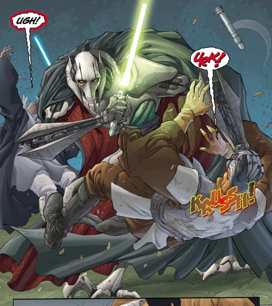
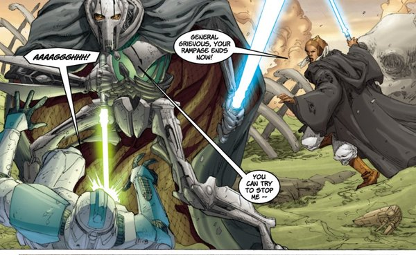

# Adi Gallia

- **Aliases:** —
- **Era:** Clone Wars
- **Continuity:** default Legends; entries present for: Canon, Legends
- **Research tier:** untiered (not listed as INTRO/DEEP/MASTERY in legends-feats.md)
- **Entries:** 74 (27 with quotations; 1 quotations extended to the full sentence/passage from the source text on file; 22 marked as fragments; 23 before the 2026-11-17 fragment fill). Rebuilt 2026-11-17 from 82 old entries; old file: `characters/_bak/adi-gallia.md.bak-20261117`.
- **How to read:** each entry is the quotation in full (block quote), then its source and point of view. "Note" lines are summaries from our notes, not quotations. `[fragment — full passage not on file]` means the source text is not on the box, so only the words in our notes are shown. Debate and forum material is in the last section and is unverified.

# LEGENDS (Legends / EU — main focus)

## The Complete Star Wars Encyclopedia, Vol. III (P–Z)

> He and his fleet of Sabaoth Destroyers were defeated by forces led by Adi Gallia and Nym.
— Source: scan pages 241–280; Adi Gallia. POV: Adi Gallia.
Note (our notes, around the quote): Adi Gallia: "He and his fleet of Sabaoth Destroyers were defeated by forces led by Adi Gallia and Nym." Source: The Complete Star Wars Encyclopedia, Vol. III, p.256
Our notes: `notes/materials/032-complete-star-wars-encyclopedia-vol-3/06-v3-scan-241-280.md:199`

## Power of the Jedi Sourcebook (d20, 2002)

- Note (summary from our notes, not a quotation): Page contents: 662 words, 28 paragraphs | headings/entries: Adi Gallia, Jedi Master; The two contributed to a Jedi; Feats: Exotic Weapon Proficiency (lightsaber), Force-Sensitive, Persuasive,
  — Source: Chapter Six: Jedi traditions and famous Jedi.
Our notes: `notes/materials/033-power-of-the-jedi-sourcebook/06-ch6-jedi-traditions.md:182`

> One of the bounty hunter's booby traps defeated Adi Gallia, but failed to kill her.
— Source: Chapter Six: Jedi traditions and famous Jedi; Adi Gallia. POV: Adi Gallia.
Note (our notes, around the quote): Adi Gallia: "One of the bounty hunter's booby traps defeated Adi Gallia, but failed to kill her." Source: Power of the Jedi Sourcebook, p.116
Our notes: `notes/materials/033-power-of-the-jedi-sourcebook/06-ch6-jedi-traditions.md:184`

> Adi Gallia's parents were nearly killed by Red laro terrorists.
— Source: Chapter Six: Jedi traditions and famous Jedi; Adi Gallia — entry/section: Adi Gallia, Jedi Master.
Note (our notes, around the quote): Adi Gallia — entry/section: Adi Gallia, Jedi Master: "Adi Gallia's parents were nearly killed by Red laro terrorists." Source: Power of the Jedi Sourcebook, p.116
Our notes: `notes/materials/033-power-of-the-jedi-sourcebook/06-ch6-jedi-traditions.md:186`

## The New Essential Guide to Characters (2002)

- Note (summary from our notes, not a quotation): Page contents: 415 words, 20 paragraphs | headings/entries: Old Republic, the Jedi Council; Depa Billaba; Adi Gallia; Ki-Adi-Mundi (Ke-a-dé-miin'-dé); As a Jedi Master, Ki-Adi-Mundi
  — Source: scan pages 61–90.
Our notes: `notes/materials/034-new-essential-guide-to-characters/02-negc-scan-061-090.md:173`

## Star Wars Gamer/Star Wars Gamer 09.pdf [Star Wars Roleplaying Game (d20, 2000)] (scan pages 61–104)

- Note (summary from our notes, not a quotation): Page contents: Star Wars Jedi Starfighter preview (Eric Bratcher, PlayStation 2): Daron Stinnett directs; Rhys Dallows and Vana Sage give way to Jedi councilwoman Adi Gallia in a Jedi Starfighter with Force powers ('magic in space'), starting with Shield; the Trade Federation Scarab returns (hand-read)
  — Source: Star Wars Gamer/Star Wars Gamer 09.pdf [Star Wars Roleplaying Game (d20,.
Our notes: `notes/materials/037-sw-d20-folder/058-star-wars-gamer-09-scan-061-104.md:208`

## Star Wars Gamer/Star Wars Gamer 10.pdf [Star Wars Roleplaying Game (d20, 2000)] (scan pages 61–120)

- Note (summary from our notes, not a quotation): Page contents: Jedi Starfighter strategy by Brett Rector (PS2): the evil Captain Toth and a mysterious cohort threaten the Republic in the Karthakk system; Mace Windu sends Adi Gallia, described as a Corellian Jedi Master raised on Coruscant, the daughter of diplomats; the Delta-7 prototype Jedi starfighter has quad-pulse lasers and light armor (hand-read)
  — Source: Star Wars Gamer/Star Wars Gamer 10.pdf [Star Wars Roleplaying Game (d20,.
Our notes: `notes/materials/037-sw-d20-folder/059-star-wars-gamer-10-scan-061-120.md:347`

## Sourcebooks/Sourcebook Web Enhancements/Hero's Guide Web Enhancement - Lightsaber Forms and the Fallanassi.pdf [Star Wars Roleplaying Game Revised Core (d20, 2002)]

- Note (summary from our notes, not a quotation): Page contents: Credits; Variant Lightsaber Forms: Sokan (mobility; blended with Yoda's Form IV), Shien (reverse horizontal grip; Adi Gallia, Nikkos Tyris), Niman (two lightsabers); Sokan Mastery (no AoO moves per day: 1/2/3/4 at Jedi levels 1-5/6-10/11-15/16-20, from the image); Shien Mastery prerequisites (hand-read)
  — Source: Sourcebooks/Sourcebook Web Enhancements/Hero's Guide Web Enhancement - Li.
Our notes: `notes/materials/037-sw-d20-folder/648-heros-guide-web-enhancement-lightsaber-forms-and.md:15`

> The style encompasses everything from quick, darting movements to smooth tumbles and strikes that arc toward the vital areas of an opponent’s body. The variant form known as Shien is a rarely seen style that, while effective, is almost a topic of controversy among lightsaber masters due to the drastically different grip taught by practitioners of the form. The style calls for the Jedi to hold the lightsaber horizontally with the tip of the blade out away from the body, and all strikes are made by sweeping the arm forward as though throwing a punch while whipping the blade forward quickly in a broad arc. Adi Gallia was one of the few Jedi around the time of the Clone Wars known to actively practice the form, as was the Anzati Jedi called Nikkos Tyris. Another uncommon form called Niman is a style often taught in the Jedi Order but rarely mastered by more than a few Jedi each generation. Niman teaches the use of two lightsabers simultaneously, which can be used as a pair of offensive weapons, or as an offensive weapon and a parrying blade. Many Jedi study the basics of Niman, and such rudimentary training has often been the edge needed to prevail over a foe.
— Source: Sourcebooks/Sourcebook Web Enhancements/Hero's Guide Web Enhancement - Li.
(Excerpt widened 2026-11-17 to the relevant passage, word for word from evised Core Sourcebooks Sourcebook Web Enhancements Hero s Guide Web Enhancement Lightsaber Forms and the Fallanassi (text copy `evised_Core_Sourcebooks_Sourcebook_Web_Enhancements_Hero_s_Guide_Web_Enhancement_Lightsaber_Forms_and_the_Fallanassi_pdf_03813bf3fe`).)
(Excerpt widened 2026-11-17 to the relevant passage, word for word from evised Core Sourcebooks Sourcebook Web Enhancements Hero s Guide Web Enhancement Lightsaber Forms and the Fallanassi (text copy `evised_Core_Sourcebooks_Sourcebook_Web_Enhancements_Hero_s_Guide_Web_Enhancement_Lightsaber_Forms_and_the_Fallanassi_pdf_03813bf3fe`).)
Note (our notes, around the quote): Adi Gallia — entry/section: Hero's Guide Web Enhancement - Lightsaber Forms and the Fallanassi: "Adi Gallia was one of the few Jedi around the time of the Clone Wars known to actively practice the form, as was the Anzati Jedi called Nikkos Tyris." Source: *Hero's Guide Web Enhancement - Lightsaber Forms and the Fallanassi* (SWRPG d20 Revised Core), scan p.2
Our notes: `notes/materials/037-sw-d20-folder/648-heros-guide-web-enhancement-lightsaber-forms-and.md:17`

## Sourcebooks/Hero's Guide.pdf [Star Wars Roleplaying Game Revised Core (d20, 2002)] (scan pages 181–185)

- Note (summary from our notes, not a quotation): Page contents: Credits/legal; Variant Lightsaber Forms: Sokan (Yoda's Form IV), Shien (Adi Gallia, Nikkos Tyris), Niman (same text already logged from d648 p2); Sokan Mastery, Shien Mastery feats. (hand-read)
  — Source: Sourcebooks/Hero's Guide.pdf [Star Wars Roleplaying Game Revised Core (d2.
Our notes: `notes/materials/037-sw-d20-folder/668-heros-guide-scan-181-185.md:15`

## Sourcebooks/Galaxy of Intrigue.pdf [Star Wars Roleplaying Game Saga Edition (2007)] (scan pages 61–120)

- Note (summary from our notes, not a quotation): Page contents: Prowler-class Reconnaissance Vessel (CL 12); Sabaoth Frigate Spy Ship (Captain Cavik Toth's Sabaoth mercenary squadron; Occupation of Karthakk; destroyed by Adi Gallia). Caption: "SCOUTING OUT THE VONG". (hand-read)
  — Source: Sourcebooks/Galaxy of Intrigue.pdf [Star Wars Roleplaying Game Saga Editi.
Our notes: `notes/materials/037-sw-d20-folder/716-galaxy-of-intrigue-scan-061-120.md:64`

> These additions come at the expense of the tractor beam projectors and half the heavy laser cannons found on other Sabaoth frigates. This ship was used around the time of the Occupation of Karthakk. Jedi Master Adi Gallia encountered a Sabaoth spy ship during a meeting with Reti in the Ruby Nebula. Believing it was tapping communications between them, Adi Gallia destroyed the ship from her Delta-7 Aethersprite-class light interceptor. Sabaoth Frigate Spy Ship Colossal (frigate) capital ship Init +1; Senses Perception +8 (+13 with sensor package) Defense Ref 14 (flat-footed 11). Fort 34; +11 armor hp 650; DR 15; SR 105; Threshold 134 Speed fly 3 squares (starship scale) Ranged 4 heavy laser cannons +9 (see below) Fighting Space 2x2 squares (starship scale); Cover total Base Atk +5; Grp +49 Abilities Str 58, Dex 16, Con -, Int 18 Skills Initiative +1, Mechanics +8, Perception +8 (+13 with sensor package). Pilot +1, Use Computer +8 Crew 100 (expert); Passengers 450 Cargo 1,200 tons; Consumables 1 year; Carried Craft none Hyperdrive x3 (x18 backup). navicomputer Availability Military; Cost not available for sale Heavy laser cannon (gunne~ Atk +9, Dmg 6dlOx2 OROUND VEHICLES CL 11 Just as they have access to the finest starships, the galaxy's elite ride in the most luxurious ground vehicles possible.
— Source: Sourcebooks/Galaxy of Intrigue.pdf [Star Wars Roleplaying Game Saga Editi; Adi Gallia. POV: Adi Gallia.
(Excerpt widened 2026-11-17 to the relevant passage, word for word from research primary sw d20 folder files Star Wars Roleplaying Game Saga Edition Sourcebooks Galaxy of Intrigue (text copy `research_primary_sw_d20_folder_files_Star_Wars_Roleplaying_Game_Saga_Edition_Sourcebooks_Galaxy_of_Intrigue_pdf_7fa4ad4ee9`).)
(Excerpt widened 2026-11-17 to the relevant passage, word for word from research primary sw d20 folder files Star Wars Roleplaying Game Saga Edition Sourcebooks Galaxy of Intrigue (text copy `research_primary_sw_d20_folder_files_Star_Wars_Roleplaying_Game_Saga_Edition_Sourcebooks_Galaxy_of_Intrigue_pdf_7fa4ad4ee9`).)
Note (our notes, around the quote): Adi Gallia: "Believing it was tapping communications between them, Adi Gallia destroyed the ship from her Delta-7 Aethersprite-class light interceptor." Source: *Galaxy of Intrigue* (SWRPG Saga Edition), scan p.71
Our notes: `notes/materials/037-sw-d20-folder/716-galaxy-of-intrigue-scan-061-120.md:66`

## Sourcebooks/The Clone Wars Campaign Guide.pdf [Star Wars Roleplaying Game Saga Edition (2007)] (scan pages 181–225)

- Note (summary from our notes, not a quotation): Page contents: Influential Figures (Fringe). Boba Fett (Episode III) description and stat block (CL 7). Cavik Toth (Sabaoth Squadron founder; allied with Dooku; foes Nym, Lok Revenants, Adi Gallia) and stat block (CL 11). (hand-read)
  — Source: Sourcebooks/The Clone Wars Campaign Guide.pdf [Star Wars Roleplaying Game.
Our notes: `notes/materials/037-sw-d20-folder/728-the-clone-wars-campaign-guide-scan-181-225.md:286`

- Note (summary from our notes, not a quotation): Page contents: Nym (Feeorin pirate; leader of the Lok Revenants; Scurrg H-6 bomber Havoc; teams with Vana Sage and Rhys Dallows; pardoned by Palpatine; later teams with Adi Gallia vs. Cavik Toth) and stat block (CL 11). (hand-read)
  — Source: Sourcebooks/The Clone Wars Campaign Guide.pdf [Star Wars Roleplaying Game.
Our notes: `notes/materials/037-sw-d20-folder/728-the-clone-wars-campaign-guide-scan-181-225.md:310`

> A Sabaoth destroyer launches a squadron of Sabaoth starfighters. *(hand-read)*
— Source: Sourcebooks/The Clone Wars Campaign Guide.pdf [Star Wars Roleplaying Game.
Note (our notes, around the quote): Page contents: Raddaugh Gnasp Fluttercraft stat block (CL 4). Sabaoth Destroyer (Sabaoth Squadron recruited by Dooku; Nym destroys several, including Cavik Toth's flagship the Reaver; CL 12). Sabaoth Starfighter begins (first seen at Geonosis vs. Adi Gallia and Siri Tachi). Caption (OCR approx.): "A Sabaoth destroyer launches a squadron of Sabaoth starfighters." (hand-read)
Our notes: `notes/materials/037-sw-d20-folder/728-the-clone-wars-campaign-guide-scan-181-225.md:349`

> They are first seen launching from Sabaoth destroyers in battic over Geonosis, where they meet the Jedi starfighters of Adi Gallia and Siri Tachi.
— Source: Sourcebooks/The Clone Wars Campaign Guide.pdf [Star Wars Roleplaying Game; Adi Gallia. POV: Adi Gallia.
Note (our notes, around the quote): Adi Gallia: "They are first seen launching from Sabaoth destroyers in battic over Geonosis, where they meet the Jedi starfighters of Adi Gallia and Siri Tachi." Source: *The Clone Wars Campaign Guide* (SWRPG Saga Edition), scan p.221
Our notes: `notes/materials/037-sw-d20-folder/728-the-clone-wars-campaign-guide-scan-181-225.md:351`

## Star Wars Insider #67 (2003)

- Note (summary from our notes, not a quotation): Page contents: Q&A continued (Luke's lost lightsaber and Mara Jade; Luke and the Imperial Academy; droid pain; restraining bolts; Adi Gallia and Stass Allie). (hand-read)
  — Source: Star Wars Insider #67 (2003).
Our notes: `notes/materials/038-star-wars-insider/067-ins067.md:575`

## Star Wars Insider #70 (2003)

- Note (summary from our notes, not a quotation): Adi Gallia — entry/section: Star Wars Galaxies: Lok: "The planet is exceedingly harsh, with the landscape dominated by a large volcano (known as "Adi's Rest," presumably named after Nym's one-time ally, the Jedi Adi Gallia)." Source: *Star Wars Insider #70* (2003), scan p.55
  — Source: Star Wars Insider #70 (2003).
Our notes: `notes/materials/038-star-wars-insider/070-ins070.md:301`

## Star Wars Insider #88 (2006)

- Note (summary from our notes, not a quotation): Page contents: Ask the Master: Adi Gallia vs. Stass Allie on Saleucami (caption Gin Clarke, Lily Nyamwasa, Nina Fallon); Vader's and the Emperor's other apprentices (Lumiya, Vost Tyne, Lord Hethrir); Jango "keep him here" (hand-read)
  — Source: Star Wars Insider #88 (2006).
Our notes: `notes/materials/038-star-wars-insider/088-ins088.md:246`

## Star Wars Insider #120 (2010)

- Note (summary from our notes, not a quotation): Page contents: Filoni: avoiding villain overkill (Dooku withheld from Season Two to stay dangerous and in control); Dooku's changing story; Yoda in the Zillo Beast episodes; Plo Koon, Adi Gallia, Luminara. (hand-read)
  — Source: Star Wars Insider #120 (2010).
Our notes: `notes/materials/038-star-wars-insider/120-ins120.md:219`

## Star Wars Insider #129 (2011)

- Note (summary from our notes, not a quotation): Page contents: Insider Preview: "Nomad Droids" (Adi Gallia, Plo Koon) and "Darkness on Umbara" (Anakin gives up command of the 501st; Jedi Master Pong Krell); coming-soon titles. (hand-read)
  — Source: Star Wars Insider #129 (2011). POV: Adi Gallia.
Our notes: `notes/materials/038-star-wars-insider/129-ins129.md:40`

## Star Wars Insider #139 (2013)

- Note (summary from our notes, not a quotation): Page contents: Episode guide: "Front Runners", "The Soft War", "Tipping Points", "An Old Friend", "The Rise of Clovis" and "Crisis at the Heart" (slated for a later season), "The Gathering", "A Test of Strength" (David Tennant as Huyang), "Bound for Rescue", "A Necessary Bond" (Grievous attacks Hondo's base), "Revival" (426: Savage and Maul vs. Obi-Wan and Adi Gallia; the 100th episode produced, not counting the film). (hand-read)
  — Source: Star Wars Insider #139 (2013).
Our notes: `notes/materials/038-star-wars-insider/139-ins139.md:120`

## Star Wars Visual Dictionaries, Episodes I–VI (DK, 1998–2005) + The Phantom Menace Expanded Visual Dictionary (DK, 2012)

> intuitive... often seems to know what people are about to say
> [fragment — full passage not on file]
>
> Iridonian Zabrak such as Eeth Koth are renowned for their mental discipline, which allows them to tolerate great physical suffering.
>
> highly developed extrasensory organs
> [fragment — full passage not on file]
>
> ensures that Jedi-counselled military tactics are cunning and effective.
> [fragment — full passage not on file]
>
> Young at only 477
> [fragment — full passage not on file]
>
> single, powerful, softly spoken comment.
> [fragment — full passage not on file]
>
> Of the teeming trillions of species that populate the galaxy, very few individuals become fully fledged Jedi Knights: the ranks based on Coruscant number only about 10,000.
>
> members of hundreds of species and cultures
> [fragment — full passage not on file]
— Source: Star Wars Episode I: The Visual Dictionary (DK, 1999): hand-read notes; **p11: Adi Gallia.
Note (our notes, around the quote): **p11: Adi Gallia: "intuitive... often seems to know what people are about to say"; Chancellor's most valuable intelligence sources; second lightsabre replaces her first, destroyed on a mission. Eeth Koth: "Iridonian Zabrak such as Eeth Koth are renowned for their mental discipline, which allows them to tolerate great physical suffering." Plo Koon: Kel Dor, antiox mask, "highly developed extrasensory organs". Oppo Rancisis: abdicated throne on Thisspias; "ensures that Jedi-counselled military tactics are cunning and effective." Yaddle: "Young at only 477"; "single, powerful, softly spoken comment." Depa Billaba: Chalacta culture, mark of illumination. DATA FILE: "Of the teeming trillions of species that populate the galaxy, very few individuals become fully fledged Jedi Knights: the ranks based on Coruscant number only about 10,000." Council reflects "members of hundreds of species and cultures".
Our notes: `notes/materials/047-visual-dictionaries/vd1-ep1.md:21`

> the consummate master of Jedi mind tricks. He uses Force suggestions to bring conflicts to an abrupt end, turning combatants' own fears against themselves.
> [fragment — full passage not on file]
>
> Saber Master: Ki-Adi-Mundi is a master of the fast-paced Ataru form ... Watchman of the Semagi sector
> [fragment — full passage not on file]
>
> Unorthodox Jedi: Adi Gallia sometimes uses her specialized lightsaber to perform the combat style Shien (Form V). The form employs a reverse grip
> [fragment — full passage not on file]
— Source: Star Wars: The Phantom Menace — The Expanded Visual Dictionary (DK, 2012): hand-read notes (new and revised material only); p15 [NEW] Yarael Poof [KEY].
Note (our notes, around the quote): p15 [NEW] Yarael Poof [KEY]: "the consummate master of Jedi mind tricks. He uses Force suggestions to bring conflicts to an abrupt end, turning combatants' own fears against themselves." Ki-Adi-Mundi (binary brain; "Saber Master: Ki-Adi-Mundi is a master of the fast-paced Ataru form ... Watchman of the Semagi sector"). Adi Gallia (Valorum's intelligence source; teamed with Qui-Gon alongside Padawans Siri Tachi and Obi-Wan; "Unorthodox Jedi: Adi Gallia sometimes uses her specialized lightsaber to perform the combat style Shien (Form V). The form employs a reverse grip"). DATA FILE: Chamber floor motifs; council reflects hundreds of species.
Our notes: `notes/materials/047-visual-dictionaries/vd1x-expanded.md:19`

## Star Wars: Obsession #1–5 (Dark Horse, Nov 2004 – Apr 2005)

- Note (summary from our notes, not a quotation): 
  — Source: Star Wars: Obsession: daily-image candidates.
Our notes: `notes/materials/049-obsession/daily-image-candidates.md:58`

> I was built to kill your kind.
— Source: Star Wars: Obsession: daily-image candidates; ![Grievous vs Adi Gallia.
Note (our notes, around the quote): 
Our notes: `notes/materials/049-obsession/daily-image-candidates.md:73`

> Fortunately, we have some of the greatest minds in the Jedi Order at our disposal...
> [fragment — full passage not on file]
>
> And old friends, all. Though, it has been years since I stood in the same room as Soon Bayts.
>
> And I see you managed to pull Adi Gallia away from her pirate friends.
>
> I can't believe you're all here...
> [fragment — full passage not on file]
>
> Are you happy now? There aren't any Jedi left on Coruscant because of you.
— Source: Star Wars: Obsession #4 (Dark Horse, March 2005): hand-read notes.
Note (our notes, around the quote): p6 (file 006, double-page spread) [KEY, crop candidate: Jedi briefing around hologram]: Mace: "Fortunately, we have some of the greatest minds in the Jedi Order at our disposal..." Obi-Wan: "And old friends, all. Though, it has been years since I stood in the same room as Soon Bayts." "And I see you managed to pull Adi Gallia away from her pirate friends." Anakin: "I can't believe you're all here..." Ki-Adi-Mundi(?) [Cerean]: "Are you happy now? There aren't any Jedi left on Coruscant because of you." Present: Kit Fisto, Plo Koon, Ki-Adi-Mundi, Adi Gallia, Soon Baytes, clone ARC Alpha, Bail, others.
Our notes: `notes/materials/049-obsession/ob-04.md:12`

> Anakin, stay calm... remember your training
> [fragment — full passage not on file]
— Source: Star Wars: Obsession #4 (Dark Horse, March 2005): hand-read notes.
Note (our notes, around the quote): p11: silent page under the SKREE noise — clones running in corridor, Jedi (Adi Gallia, Kit Fisto, Plo Koon, Soon Baytes etc.) braced at consoles; Obi-Wan whispers a deliberately tiny balloon (illegible at scan resolution; appears to be ~4 words like "Anakin, stay calm... remember your training" — NOT quoted, illegible) ; Anakin's gloved mechanical hand on the throttle.
Our notes: `notes/materials/049-obsession/ob-04.md:17`

> The entrance to their base --
> [fragment — full passage not on file]
>
> -- we need to get it secured!
> [fragment — full passage not on file]
>
> Master Bayts and I can handle that.
>
> Master Gallia -- look out!
> [fragment — full passage not on file]
>
> What is it, Bayts -- ?
> [fragment — full passage not on file]
— Source: Star Wars: Obsession #4 (Dark Horse, March 2005): hand-read notes; p19: Mace(?).
Note (our notes, around the quote): p19: Mace(?): "The entrance to their base --" Bail (blaster): "-- we need to get it secured!" Adi Gallia: "Master Bayts and I can handle that." Bayts: "Master Gallia -- look out!" silhouette with yellow eyes behind her. Gallia: "What is it, Bayts -- ?" final panel: Grievous's eye close-up [KEY crop candidate].
Our notes: `notes/materials/049-obsession/ob-04.md:25`

- Note (summary from our notes, not a quotation): p20: Grievous ambush [KEY crop candidate]: impales/crushes Adi Gallia and Soon Baytes — SFX "UGH!", "UKK!", "KRUSH!"; Baytes falls bleeding; Gallia's saber flies off. (Correction after reading #5 p6: in #4 Grievous fatally wounds Soon Bayts; Adi Gallia survives into #5. Spelling in dialogue: "Bayts"/"Baytes" — p6 has "Soon Bayts", p19 "Master Bayts".)
  — Source: Star Wars: Obsession #4 (Dark Horse, March 2005): hand-read notes.
Our notes: `notes/materials/049-obsession/ob-04.md:26`

> Do not back down, or we will be buried here!
— Source: Star Wars: Obsession #5 (Dark Horse, April 2005): hand-read notes.
Note (our notes, around the quote): p6: battlefield; dying Soon Bayts on ground. Clone: "Squad Seven --" Adi Gallia: "-- Hold your ground!" "Do not back down, or we will be buried here!" Clone: "Evasive act --" Gallia: "Grievous!"
Our notes: `notes/materials/049-obsession/ob-05.md:12`

> General Grievous, your rampage ends now!
>
> You can try to stop me -- -- but I was built to kill your kind.
>
> You'd better hope they gave you deflector shields.
>
> No. Just extra arms.
> [fragment — full passage not on file]
— Source: Star Wars: Obsession #5 (Dark Horse, April 2005): hand-read notes; p8 [KEY]: Grievous impales a clone: "AAAAGGGHHH!" Adi Gallia.
Note (our notes, around the quote): p8 [KEY]: Grievous impales a clone: "AAAAGGGHHH!" Adi Gallia: "General Grievous, your rampage ends now!" Grievous: "You can try to stop me -- -- but I was built to kill your kind." Gallia: "You'd better hope they gave you deflector shields." Grievous: "No. Just extra arms." Gallia: "URK --" (a claw-hand grabs her throat).
Our notes: `notes/materials/049-obsession/ob-05.md:14`

> I was built to kill your kind.
>
> You'd better hope they gave you deflector shields.
>
> No. Just extra arms. *(Ob#5 p8)*
> [fragment — full passage not on file]
>
> You're too late. There's nothing you can do for her. *(Ob#5 p9)*
— Source: 049 Obsession: summary of strongest findings; Grievous kills Adi Gallia.
Note (our notes, around the quote): Grievous kills Adi Gallia: "I was built to kill your kind." / "You'd better hope they gave you deflector shields." / "No. Just extra arms." (Ob#5 p8). Over her body: "You're too late. There's nothing you can do for her." (Ob#5 p9)
Our notes: `notes/materials/049-obsession/summary.md:10`

> has been years since I stood in the same room as Soon Bayts
> [fragment — full passage not on file]
>
> from her pirate friends
> [fragment — full passage not on file]
— Source: 049 Obsession: summary of strongest findings.
Note (our notes, around the quote): Jedi at Boz Pity: Mace Windu, Kit Fisto, Ki-Adi-Mundi, Plo Koon, Saesee Tiin (Gold Squadron), Adi Gallia, Soon Bayts (Ob#4 p6). Obi-Wan says it "has been years since I stood in the same room as Soon Bayts" and that Adi Gallia was pulled away "from her pirate friends".
Our notes: `notes/materials/049-obsession/summary.md:19`

## Darth Plagueis (novel, read in full): feats, scaling, quotes and story notes

> At the center of the domed hall stood Valorum and Sei Taria, who was as media-savvy as she was lovely. Though ineligible for reelection, recently stripped of some of his Senatorial powers, and frequently engaged in defending himself against accusations by the Ethics Committee, Valorum had managed to make himself the center of attention, due to the presence of Masters Yoda, Mace Windu, and Adi Gallia among his followers. Merely by standing with the Supreme Chancellor, the Jedi were sending a message that they would continue to support him for the remainder of his term of office, the calumny of illegal enrichment notwithstanding.
— Source: Darth Plagueis (novel, read in full): feats, scaling, quotes and story notes; Ch28 Chain of Command L6581.
(Excerpt widened 2026-11-17 to the relevant passage, word for word from Darth Plagueis (James Luceno), Chapter 28 (text copy `MEGA_Legend_Standalones_Star_Wars_Darth_Plagueis_James_Luceno_epub`).)
Context: Complete quote register (10 lines: every sentence that names Yoda, verbatim, in book order):
Our notes: `external/mega-notes/darth-plagueis-notes.md:569`; `external/mega-notes/darth-plagueis-notes.md:580`; `external/mega-notes/darth-plagueis-notes.md:1422`; `external/mega-notes/darth-plagueis-notes.md:1865`; `external/mega-notes/darth-plagueis-notes.md:3080`; `external/mega-notes/darth-plagueis-notes.md:3088`

What it shows (our notes): Role: Jedi at the Senate reception. «An arrogant, wild-eyed human, C'baoth was cut from the same cloth as Dooku» (L6577). Gallia is named only (L6615).
> Palpatine couldn’t argue the point. Off to one side of them stood Senator Bail Antilles and his aides. A Prince on his homeworld of Alderaan and chair of the Senate’s Internal Activities Committee, the handsome, dark-haired Antilles was surrounded by a crowd that included Core World Senators and businessbeings, all of whom had pledged to support him in the coming election, and Jedi Master Jorus C’baoth, who had been enlisted to arbitrate a dispute among some of Alderaan’s royal houses. An arrogant, wild-eyed human, C’baoth was cut from the same cloth as Dooku, whose absence from the political gathering had been noted by many. Antilles had been the Sith’s pawn in bringing to the fore accusations of wrongdoing on the part of Valorum during the Eriadu crisis, but the notoriety he had gained as a result—in the Senate and in the media—had bolstered his campaign and made him the current top candidate for the chancellorship.
— Source: L6577; L6615 — Darth Plagueis (novel, read in full): feats, scaling, quotes and story notes.
(Excerpt widened 2026-11-17 to the relevant passage, word for word from Darth Plagueis (James Luceno), Chapter 28 (text copy `MEGA_Legend_Standalones_Star_Wars_Darth_Plagueis_James_Luceno_epub`).)
(Fragment completed 2026-11-17: full sentence/passage matched word for word in the source text on file: `MEGA_Legend_Standalones_Star_Wars_Darth_Plagueis_James_Luceno_epub`.)
Note text that was attached to the quote line: *(L6577)*
Our notes: `external/mega-notes/darth-plagueis-notes.md:1860`

- Note (summary from our notes, not a quotation): Scaling implications: none.
  — Source: Darth Plagueis (novel, read in full): feats, scaling, quotes and story notes.
Our notes: `external/mega-notes/darth-plagueis-notes.md:1861`

- Note (summary from our notes, not a quotation): Complete quote register (4 lines: every sentence that names Jorus C'baoth and Adi Gallia, verbatim, in book order):
  — Source: Darth Plagueis (novel, read in full): feats, scaling, quotes and story notes.
Our notes: `external/mega-notes/darth-plagueis-notes.md:1862`

> Palpatine couldn’t argue the point. Off to one side of them stood Senator Bail Antilles and his aides. A Prince on his homeworld of Alderaan and chair of the Senate’s Internal Activities Committee, the handsome, dark-haired Antilles was surrounded by a crowd that included Core World Senators and businessbeings, all of whom had pledged to support him in the coming election, and Jedi Master Jorus C’baoth, who had been enlisted to arbitrate a dispute among some of Alderaan’s royal houses. An arrogant, wild-eyed human, C’baoth was cut from the same cloth as Dooku, whose absence from the political gathering had been noted by many. Antilles had been the Sith’s pawn in bringing to the fore accusations of wrongdoing on the part of Valorum during the Eriadu crisis, but the notoriety he had gained as a result—in the Senate and in the media—had bolstered his campaign and made him the current top candidate for the chancellorship.
— Source: Darth Plagueis (novel, read in full): feats, scaling, quotes and story notes; Ch28 Chain of Command L6577.
(Excerpt widened 2026-11-17 to the relevant passage, word for word from Darth Plagueis (James Luceno), Chapter 28 (text copy `MEGA_Legend_Standalones_Star_Wars_Darth_Plagueis_James_Luceno_epub`).)
Context: Complete quote register (4 lines: every sentence that names Jorus C'baoth and Adi Gallia, verbatim, in book order):
Our notes: `external/mega-notes/darth-plagueis-notes.md:1863`

> Palpatine couldn’t argue the point. Off to one side of them stood Senator Bail Antilles and his aides. A Prince on his homeworld of Alderaan and chair of the Senate’s Internal Activities Committee, the handsome, dark-haired Antilles was surrounded by a crowd that included Core World Senators and businessbeings, all of whom had pledged to support him in the coming election, and Jedi Master Jorus C’baoth, who had been enlisted to arbitrate a dispute among some of Alderaan’s royal houses. An arrogant, wild-eyed human, C’baoth was cut from the same cloth as Dooku, whose absence from the political gathering had been noted by many. Antilles had been the Sith’s pawn in bringing to the fore accusations of wrongdoing on the part of Valorum during the Eriadu crisis, but the notoriety he had gained as a result—in the Senate and in the media—had bolstered his campaign and made him the current top candidate for the chancellorship.
— Source: Darth Plagueis (novel, read in full): feats, scaling, quotes and story notes; Ch28 Chain of Command L6577.
(Excerpt widened 2026-11-17 to the relevant passage, word for word from Darth Plagueis (James Luceno), Chapter 28 (text copy `MEGA_Legend_Standalones_Star_Wars_Darth_Plagueis_James_Luceno_epub`).)
Context: Complete quote register (4 lines: every sentence that names Jorus C'baoth and Adi Gallia, verbatim, in book order):
Our notes: `external/mega-notes/darth-plagueis-notes.md:1864`

> “Well, what with assassinations, taxation of the free-trade zones, posturing by the Trade Federation, and accusations of political impropriety, the conversation has been much on my mind of late. Fractiousness, factionalism, intersystem conflicts … Even in this hall the Jedi appear to be divided in their loyalties. Master C’baoth here, Masters Yoda and Gallia there, and yet no sign of Master Dooku.”
— Source: Darth Plagueis (novel, read in full): feats, scaling, quotes and story notes; Ch28 Chain of Command L6615.
(Excerpt widened 2026-11-17 to the relevant passage, word for word from Darth Plagueis (James Luceno), Chapter 28 (text copy `MEGA_Legend_Standalones_Star_Wars_Darth_Plagueis_James_Luceno_epub`).)
Context: Complete quote register (4 lines: every sentence that names Jorus C'baoth and Adi Gallia, verbatim, in book order):
Our notes: `external/mega-notes/darth-plagueis-notes.md:1866`

# Debate and forum claims (unverified)

Forum posts, Suspect Insight debates and Discord debates, respect threads, and verdicts. These are posters' arguments or quotations they typed; none is checked against the book here unless the entry says so.

## Saarai (Darthor) vs Even Piell (Darthor)

> Omni said:
> [fragment — full passage not on file]
>
> The reasoning for why Piell became a member initially doesn’t matter, that has no correlation with his senior status, the argument here being that he has seemingly held this position for hundreds of years, meaning he has been one of the stronger council members for hundreds of years. Seniority again being explicitly attributed with this. This puts Piell above the likes of the B-team members, Adi Gallia and Shaak Ti.
— Source: Saarai (Darthor) vs Even Piell (Darthor) — https://www.suspectinsightforums.com/t4499-ss-arena-of-the-unknowns-saarai-glo-vs-even-piell-omni-bomni.
Context: Q19 — Source: [source not stated adjacent] (preceding line: "g lackluster combatively. Jocasta Nu is given way more respect than Obi Wan despite Obi Wan probably being able to shit on her in a duel. The Jedi council really started emphasizing combat over stuff like wisdom and diplomacy when the war started, an")
Posted by: not named in our notes (see thread/notes link).
Our notes: `suspect-insight/debates/048-saarai-vs-even-piell.md:126`

## (Canon) Darth Tyranus (BreakofDawn) vs Darth Vader (Shioz)

- Note (summary from our notes, not a quotation): In the TCW "Son of Dathomir"/Ravna arc (UNCLEAR which exactly; it is the Ravna "vampire" story), Dooku shook a citadel while weakened and infected, to the point that Adi Gallia and Obi-Wan only had to nudge the supports.
  — Source: (Canon) Darth Tyranus (BreakofDawn) vs Darth Vader (Shioz) — https://www.suspectinsightforums.com/t1774-ss-darth-tyranus-breakofdawn-vs-darth-vader-shioz.
Posted by: not named in our notes (see thread/notes link).
Context: TK comparison:
Our notes: `suspect-insight/debates/070-darth-tyranus-vs-darth-vader.md:40`

## Kyle Katarn (RNGesus) vs Mace Windu (HelloThere)

> Just like Padmé—and unlike so many other Senators the Jedi had observed—Organa was no pretender. He took his duties seriously.
>
> It was a curiously comforting discovery.
>
> For his own part, he turned captivity to his advantage, surrendering himself to the kind of deep meditations usually practiced by Jedi on retreat or committed to the contemplative life. To his relief, he could sense no lowering danger.
>
> For his own part, he turned captivity to his advantage, surrendering himself to the kind of deep meditations usually practiced by Jedi on retreat or committed to the contemplative life. To his relief, he could sense no lowering danger. No threat from Grievous to these distant hyperlanes. Which wasn’t surprising. There was little out here for the Republic to want. And if the Republic didn’t want it, neither did Dooku and his Separatists.
>
> There was little out here for the Republic to want. And if the Republic didn’t want it, neither did Dooku and his Separatists.
>
> What he did perceive, in glimpses, were some of the Jedi’s Outer Rim campaigns. Adi Gallia triumphant on Agomar. Ki-Adi-Mundi defeated almost to death on Barab I. Eeth Koth defending the besieged people of Korriban, surrounded by drifts of dead and dying clone troopers.
>
> What he did perceive, in glimpses, were some of the Jedi’s Outer Rim campaigns. Adi Gallia triumphant on Agomar. Ki-Adi-Mundi defeated almost to death on Barab I. Eeth Koth defending the besieged people of Korriban, surrounded by drifts of dead and dying clone troopers. Saesee Tiin in desperate straits closer to the Core, on Bimmisaari—but no. No, that was not now, that was then. A trade dispute of the past, long since peacefully settled.
>
> A trade dispute of the past, long since peacefully settled.
>
> No, that was not now, that was then. A trade dispute of the past, long since peacefully settled.
>
> He caught a single impression of Anakin, more feeling than vision. Sorrow. Frustration.
>
> A crushing fear of failure. He couldn’t find that wretched droid.
>
> Well, try harder, Anakin. Did you think I was joking?
>
> Practically always far more trouble than they were worth. And this one—this one was proving inconveniently stubborn. Uncomfortably astute. Because he was … afraid.
>
> No matter how hard he tried, how deeply he meditated, he could sense nothing about Zigoola. And he should be able to.
>
> No matter how hard he tried, how deeply he meditated, he could sense nothing about Zigoola. And he should be able to. It was one of his particular talents, the ability to sense the shape of things to come. It wasn’t an infallible gift—the droids on Geonosis had taken him completely by surprise—but it didn’t fail him often. It certainly hadn’t failed him at the space station.
>
> It was one of his particular talents, the ability to sense the shape of things to come. It wasn’t an infallible gift—the droids on Geonosis had taken him completely by surprise—but it didn’t fail him often. It certainly hadn’t failed him at the space station. This close to Zigoola he should be able to feel something. But all he’d achieved with his meditation was that one annihilating dream.
>
> This close to Zigoola he should be able to feel something. But all he’d achieved with his meditation was that one annihilating dream.
>
> His skin crawled, remembering: the excitement of a field trip. His eagerness to impress Qui-Gon. His blithe self-belief, that this exercise would be so easy. He was a Padawan at last: no Agricultural Corps for him.
>
> **Source: Wild Space**
> [fragment — full passage not on file]
— Source: Wild Space** — Kyle Katarn (RNGesus) vs Mace Windu (HelloThere) — https://www.suspectinsightforums.com/t4428-kyle-katarn-chris-cortosis-vs-mace-windu-hellothere.
(Excerpt widened 2026-11-17 to the relevant passage, word for word from Star Wars: The Clone Wars: Wild Space (Karen Miller) (text copy `MEGA_Legend_The_Clone_Wars_Series_Star_Wars_Star_Wars_The_Clone_Wars_02_Wild_Space_Karen_Miller_epub`).)
(Fragment completed 2026-11-17 with the full excerpt, word for word from Star Wars: The Clone Wars: Wild Space (Karen Miller) (text copy `MEGA_Legend_The_Clone_Wars_Series_Star_Wars_Star_Wars_The_Clone_Wars_02_Wild_Space_Karen_Miller_epub`).)
(Excerpt widened 2026-11-17 to the relevant passage, word for word from Star Wars: The Clone Wars: Wild Space (Karen Miller) (text copy `MEGA_Legend_The_Clone_Wars_Series_Star_Wars_Star_Wars_The_Clone_Wars_02_Wild_Space_Karen_Miller_epub`).)
(Full sentence/passage taken from the source text on file: `cw_novels_tmp_wild_space_epub`.)
(Fragment completed 2026-11-17: full sentence/passage matched word for word in the source text on file: `MEGA_Legend_The_Clone_Wars_Series_Star_Wars_Star_Wars_The_Clone_Wars_02_Wild_Space_Karen_Miller_epub`.)
Context: Q5 — Source: For his own part, he turned captivity to his advantage, surrendering himself to the kind of deep meditations usually practiced by Jedi on retreat or committed to the contemplative life. To his relief, he could sense no lowering danger. No threat from Grievous to these distant hyperlanes. Which wasn't surprising. There was little out here for the Republic to want. And if the Republic didn't want it, neither did Dooku and his Separatists. What he did perceive, in glimpses, were some of the Jedi's Outer Rim campaigns. Adi Gallia triumphant on Agomar. Ki-Adi-Mundi defeated almost to death on Barab I. Eeth Koth defending the besieged people of Korriban, surrounded by drifts of dead and dying clone troopers. Saesee Tiin in desperate straits closer to the Core, on Bimmisaari-but no. No, that was not now, that was then. A trade dispute of the past, long since peacefully settled. He caught a single impression of Anakin, more feeling than vision. Sorrow. Frustration. A crushing fear of failure. He couldn't find that wretched droid. Well, try harder, Anakin. Did you think I was joking? … No matter how hard he tried, how deeply he meditated, he could sense nothing about Zigoola. And he should be able to. It was one of his particular talents, the ability to sense the shape of things to come. This close to Zigoola he should be able to feel something. But all he'd achieved with his meditation was that one annihilating dream. - Wild Space
Posted by: not named in our notes (see thread/notes link).
Our notes: `suspect-insight/debates/107-kyle-katarn-vs-mace-windu.md:115`; `suspect-insight/debates/058-darth-caedus-vs-darth-tyranus.md:656`

## Ultimate General Grievous Respect Thread (legends) 2022 — respect-thread notes

- Note (summary from our notes, not a quotation): Grievous instantly kills Adi Gallia  a couple of months before ROTS
  — Source: SI respect-thread directory: Ultimate General Grievous Respect Thread (legends) 2022 — https://www.suspectinsightforums.com/t4427-ultimate-general-grievous-respect-thread-legends-2022.
Posted by: not named in our notes (see thread/notes link).
Our notes: `suspect-insight/respect-threads/general-grievous--grievous-general-ghost-of-grievous.md:676`

- Note (summary from our notes, not a quotation): [image: https://i.servimg.com/u/f90/20/30/86/34/grievo34.jpg]
  — Source: SI respect-thread directory: Ultimate General Grievous Respect Thread (legends) 2022 — https://www.suspectinsightforums.com/t4427-ultimate-general-grievous-respect-thread-legends-2022.
Posted by: not named in our notes (see thread/notes link).
Context: Grievous instantly kills Adi Gallia  a couple of months before ROTS
Our notes: `suspect-insight/respect-threads/general-grievous--grievous-general-ghost-of-grievous.md:677`

- Note (summary from our notes, not a quotation): [image: https://i.servimg.com/u/f90/20/30/86/34/grievo35.jpg]
  — Source: SI respect-thread directory: Ultimate General Grievous Respect Thread (legends) 2022 — https://www.suspectinsightforums.com/t4427-ultimate-general-grievous-respect-thread-legends-2022.
Posted by: not named in our notes (see thread/notes link).
Context: Grievous instantly kills Adi Gallia  a couple of months before ROTS
Our notes: `suspect-insight/respect-threads/general-grievous--grievous-general-ghost-of-grievous.md:678`

- Note (summary from our notes, not a quotation): [image: https://i.servimg.com/u/f90/20/30/86/34/obsess12.jpg]
  — Source: SI respect-thread directory: Ultimate General Grievous Respect Thread (legends) 2022 — https://www.suspectinsightforums.com/t4427-ultimate-general-grievous-respect-thread-legends-2022.
Posted by: not named in our notes (see thread/notes link).
Context: Grievous instantly kills Adi Gallia  a couple of months before ROTS
Our notes: `suspect-insight/respect-threads/general-grievous--grievous-general-ghost-of-grievous.md:679`

- Note (summary from our notes, not a quotation): has Captured Adi Gallia, implying he has bested her in combat
  — Source: SI respect-thread directory: Ultimate General Grievous Respect Thread (legends) 2022 — https://www.suspectinsightforums.com/t4427-ultimate-general-grievous-respect-thread-legends-2022.
Posted by: not named in our notes (see thread/notes link).
Our notes: `suspect-insight/respect-threads/general-grievous--grievous-general-ghost-of-grievous.md:690`

- Note (summary from our notes, not a quotation): [image: https://i.servimg.com/u/f90/20/30/86/34/gg_cap10.jpg]
  — Source: SI respect-thread directory: Ultimate General Grievous Respect Thread (legends) 2022 — https://www.suspectinsightforums.com/t4427-ultimate-general-grievous-respect-thread-legends-2022.
Posted by: not named in our notes (see thread/notes link).
Context: has Captured Adi Gallia, implying he has bested her in combat
Our notes: `suspect-insight/respect-threads/general-grievous--grievous-general-ghost-of-grievous.md:691`

- Note (summary from our notes, not a quotation): Adi Gallia said to come close to dying by Grievous, hinting she may not survive in later seasons
  — Source: SI respect-thread directory: Ultimate General Grievous Respect Thread (legends) 2022 — https://www.suspectinsightforums.com/t4427-ultimate-general-grievous-respect-thread-legends-2022.
Posted by: not named in our notes (see thread/notes link).
Our notes: `suspect-insight/respect-threads/general-grievous--grievous-general-ghost-of-grievous.md:695`

- Note (summary from our notes, not a quotation): [image: https://i.servimg.com/u/f90/20/30/86/34/adi_ne10.png]
  — Source: SI respect-thread directory: Ultimate General Grievous Respect Thread (legends) 2022 — https://www.suspectinsightforums.com/t4427-ultimate-general-grievous-respect-thread-legends-2022.
Posted by: not named in our notes (see thread/notes link).
Context: Adi Gallia said to come close to dying by Grievous, hinting she may not survive in later seasons
Our notes: `suspect-insight/respect-threads/general-grievous--grievous-general-ghost-of-grievous.md:696`

## General Grievous Respect Thread - Gen. Discussion - Comic Vine — respect-thread notes

- Note (summary from our notes, not a quotation): Grievous had killed Adi Gallia by suddenly unleashing his extra arms and crushing her neck while stabbing her, although this has been retconned now that Savage Opress is the one who kills Gallia.
  — Source: SI respect-thread directory: General Grievous Respect Thread - Gen. Discussion - Comic Vine — https://comicvine.gamespot.com/forums/gen-discussion-1/general-grievous-respect-thread-1620576/.
Posted by: not named in our notes (see thread/notes link).
Our notes: `suspect-insight/respect-threads/general-grievous--grievous-general-unknown-author.md:510`

## Respect Plo Koon — respect-thread notes

What it shows (our notes): Plo Koon is a great Jedi Master.
> His dearest friends, Bant and Garen. The imperious Jocasta Nu. The gentle Ali Alann and Barriss Offee. The warriors — Shaak Ti, Kit Fisto, Luminara Unduli. And the great Jedi Masters — Ki-Adi-Mundi, Adi Gallia, Plo Koon….
>
> There’s our alien fact page, a profile of mighty master Plo Koon….
— Source: SI respect-thread directory: Respect Plo Koon — https://www.suspectinsightforums.com/t4408-respect-plo-koon.
(Excerpt widened 2026-11-17 to the relevant passage, word for word from Star Wars®: The Last of the Jedi #1: The Desperate Mission (Jude Watson) (text copy `MEGA_The_Last_Jedi_Series_Star_Wars_Last_of_the_Jedi_01_The_Desperate_Mission_Jude_Watson_epub`).)
Posted by: not named in our notes (see thread/notes link).
(Source (as named in the post's quote header): The Last of the Jedi: The Desperate Mission wrote:)
(Source (as named in the post's quote header): Clone Wars UK Magazine 6.6 wrote:)
Our notes: `suspect-insight/respect-threads/plo-koon.md:151`

- Note (summary from our notes, not a quotation): Plo Koon, along with Saesee Tiin and Adi Gallia, is specifically selected by Mace Windu to help ensure that Volfe Karkko did not escape Kiffex.
  — Source: SI respect-thread directory: Respect Plo Koon — https://www.suspectinsightforums.com/t4408-respect-plo-koon.
Posted by: not named in our notes (see thread/notes link).
Our notes: `suspect-insight/respect-threads/plo-koon.md:226`

- Note (summary from our notes, not a quotation): [image: https://i.servimg.com/u/f10/20/30/30/36/1o6die10.png]
  — Source: SI respect-thread directory: Respect Plo Koon — https://www.suspectinsightforums.com/t4408-respect-plo-koon.
Posted by: not named in our notes (see thread/notes link).
Context: Plo Koon, along with Saesee Tiin and Adi Gallia, is specifically selected by Mace Windu to help ensure that Volfe Karkko did not escape Kiffex.
Our notes: `suspect-insight/respect-threads/plo-koon.md:227`

- Note (summary from our notes, not a quotation): Plo Koon, with Qui-Gon Jinn and Adi Gallia, makes an enemy pilot see ships that aren’t really there.
  — Source: SI respect-thread directory: Respect Plo Koon — https://www.suspectinsightforums.com/t4408-respect-plo-koon.
Posted by: not named in our notes (see thread/notes link).
Our notes: `suspect-insight/respect-threads/plo-koon.md:773`

- Note (summary from our notes, not a quotation): [image: https://qph.fs.quoracdn.net/main-qimg-c6706a27fd1b278b3f021f617433ac67]
  — Source: SI respect-thread directory: Respect Plo Koon — https://www.suspectinsightforums.com/t4408-respect-plo-koon.
Posted by: not named in our notes (see thread/notes link).
Context: Plo Koon, with Qui-Gon Jinn and Adi Gallia, makes an enemy pilot see ships that aren’t really there.
Our notes: `suspect-insight/respect-threads/plo-koon.md:774`

- Note (summary from our notes, not a quotation): [image: https://qph.fs.quoracdn.net/main-qimg-ab80eea8e8cadc15c9639fd6c5fc51b4]
  — Source: SI respect-thread directory: Respect Plo Koon — https://www.suspectinsightforums.com/t4408-respect-plo-koon.
Posted by: not named in our notes (see thread/notes link).
Context: Plo Koon, with Qui-Gon Jinn and Adi Gallia, makes an enemy pilot see ships that aren’t really there.
Our notes: `suspect-insight/respect-threads/plo-koon.md:775`

> Jedi Power Battles allows players to enter into combat as either Qui-Gon Jinn, Obi-Wan Kenobi, or Jedi Council members Mace Windu, Plo Koon or Adi Gallia. Each Jedi is a formidable warrior with a unique set of battle skills that the player must carefully consider before heading into the heat of battle.
— Source: SI respect-thread directory: Respect Plo Koon — https://www.suspectinsightforums.com/t4408-respect-plo-koon.
Context: Plo Koon is a formidable warrior.
Posted by: not named in our notes (see thread/notes link).
(Source (as named in the post's quote header): Episode 1: Jedi Power Battles Prima Guide wrote:)
Our notes: `suspect-insight/respect-threads/plo-koon.md:1839`

- Note (summary from our notes, not a quotation): Plo Koon, Adi Gallia, and a squadron of Clones in V-19 Torrents take down a pirate vessel and its escort.
  — Source: SI respect-thread directory: Respect Plo Koon — https://www.suspectinsightforums.com/t4408-respect-plo-koon.
Posted by: not named in our notes (see thread/notes link).
Our notes: `suspect-insight/respect-threads/plo-koon.md:2310`

- Note (summary from our notes, not a quotation): [image: https://qph.fs.quoracdn.net/main-qimg-d0028d6c626f060d2642f8beae5de8a4-mzj]
  — Source: SI respect-thread directory: Respect Plo Koon — https://www.suspectinsightforums.com/t4408-respect-plo-koon.
Posted by: not named in our notes (see thread/notes link).
Context: Plo Koon, Adi Gallia, and a squadron of Clones in V-19 Torrents take down a pirate vessel and its escort.
Our notes: `suspect-insight/respect-threads/plo-koon.md:2311`

- Note (summary from our notes, not a quotation): [image: https://qph.fs.quoracdn.net/main-qimg-2cf6eaa1be20590ad1e9a0c1437e3c91-mzj]
  — Source: SI respect-thread directory: Respect Plo Koon — https://www.suspectinsightforums.com/t4408-respect-plo-koon.
Posted by: not named in our notes (see thread/notes link).
Context: Plo Koon, Adi Gallia, and a squadron of Clones in V-19 Torrents take down a pirate vessel and its escort.
Our notes: `suspect-insight/respect-threads/plo-koon.md:2312`

- Note (summary from our notes, not a quotation): [image: https://qph.fs.quoracdn.net/main-qimg-099b0e89690b2c9628fd791737e35c0f]
  — Source: SI respect-thread directory: Respect Plo Koon — https://www.suspectinsightforums.com/t4408-respect-plo-koon.
Posted by: not named in our notes (see thread/notes link).
Context: Plo Koon, Adi Gallia, and a squadron of Clones in V-19 Torrents take down a pirate vessel and its escort.
Our notes: `suspect-insight/respect-threads/plo-koon.md:2313`

- Note (summary from our notes, not a quotation): Plo Koon, Ki-Adi-Mundi, Adi Gallia, and Anakin Skywalker defeat a pirate vessel.
  — Source: SI respect-thread directory: Respect Plo Koon — https://www.suspectinsightforums.com/t4408-respect-plo-koon.
Posted by: not named in our notes (see thread/notes link).
Our notes: `suspect-insight/respect-threads/plo-koon.md:2317`

- Note (summary from our notes, not a quotation): [image: https://qph.fs.quoracdn.net/main-qimg-c58d747f7ef48d5429b4148298bf70ea]
  — Source: SI respect-thread directory: Respect Plo Koon — https://www.suspectinsightforums.com/t4408-respect-plo-koon.
Posted by: not named in our notes (see thread/notes link).
Context: Plo Koon, Ki-Adi-Mundi, Adi Gallia, and Anakin Skywalker defeat a pirate vessel.
Our notes: `suspect-insight/respect-threads/plo-koon.md:2318`

- Note (summary from our notes, not a quotation): Plo Koon leads the Jedi Fleet to rescue his fellow Jedi from Lola Sayu over the other Jedi Council Members present, including Saesee Tiin, Adi Gallia, and Kit Fisto.
  — Source: SI respect-thread directory: Respect Plo Koon — https://www.suspectinsightforums.com/t4408-respect-plo-koon.
Posted by: not named in our notes (see thread/notes link).
Our notes: `suspect-insight/respect-threads/plo-koon.md:2409`

> Many held the opinion that Qui-Gon would have been seated on the council, if not for his penchant for bending the rules and following his own instincts--even when those instincts conflicted with the combined wisdom of the council members. This had not endeared him to his loftier peers. In fact, rather than treat him like a peer, they viewed his unwillingness to amend his ways and accept a seat on the council as a further sign of his incorrigibility.
>
> The Reconciliation Council was made up of five members-- though rarely the same five--and today there were only four on hand: Jedi Masters Plo Koon, Oppo Rancisis, Adi Gallia, and Yoda.
>
> Months before the Battle of Naboo, Master Koon sat on the Reconciliation Council when Qui-Gon reported the destruction of the Trade Federation freighter Revenue.
— Source: SI respect-thread directory: Respect Plo Koon — https://www.suspectinsightforums.com/t4408-respect-plo-koon.
Context: Plo Koon is on the Council of Reconciliation.
Posted by: not named in our notes (see thread/notes link).
(Source (as named in the post's quote header): Cloak of Deception (2001, James Luceno) wrote:)
(Source (as named in the post's quote header): Power of the Jedi Sourcebook (2002, J.D. Wiker, Michael Mikaelian, Jeff Grubb, Owen K.C. Stephens, James Maliszewski) wrote:)
Our notes: `suspect-insight/respect-threads/plo-koon.md:2457`

## Matchup Verdicts — Research Log

- Note (summary from our notes, not a quotation): Date compiled: 2026-10-20
  — Source: Matchup Verdicts — Research Log.
Posted by: verdict file (verdicts.md).
Our notes: `verdicts.md:1067`

- Note (summary from our notes, not a quotation): Versions/conditions: Unknown (Discord-only debate; directory metadata only)
  — Source: Matchup Verdicts — Research Log.
Posted by: verdict file (verdicts.md).
Our notes: `verdicts.md:1068`

- Note (summary from our notes, not a quotation): Forum result (FORUM OPINION): Victor: Darth Durin’s Baneling (Opponent Concession) [from directory; debate content inaccessible]
  — Source: Matchup Verdicts — Research Log.
Posted by: FORUM OPINION.
Our notes: `verdicts.md:1069`

- Note (summary from our notes, not a quotation): Key reasoning: Unavailable: private Discord channel.
  — Source: Matchup Verdicts — Research Log.
Posted by: verdict file (verdicts.md).
Our notes: `verdicts.md:1070`

- Note (summary from our notes, not a quotation): What could flip it: Unknown.
  — Source: Matchup Verdicts — Research Log.
Posted by: verdict file (verdicts.md).
Our notes: `verdicts.md:1072`

- Note (summary from our notes, not a quotation): Deep notes: suspect-insight/debates/044-adi-gallia-vs-ki-adi-mundi.md
  — Source: Matchup Verdicts — Research Log.
Posted by: verdict file (verdicts.md).
Our notes: `verdicts.md:1073`

## Verdict pointers

- `verdicts.md:1066` — #44 — Adi Gallia (Ethanion) vs Ki-Adi-Mundi (Darth Durin’s Baneling)
- `suspect-insight/debates/044-adi-gallia-vs-ki-adi-mundi.md` — SI debate #44: Adi Gallia (Ethanion) vs Ki-Adi-Mundi (Darth Durin’s Baneling) — Result (FORUM OPINION): 
