# Admiral Ackbar

- **Aliases:** Ackbar
- **Era:** GCW–NJO
- **Continuity:** default Legends; entries present for: Canon, Legends
- **Research tier:** untiered (not listed as INTRO/DEEP/MASTERY in legends-feats.md)
- **Entries:** 226 (126 with quotations; 18 quotations extended to the full sentence/passage from the source text on file; 48 marked as fragments; 74 before the 2026-11-17 fragment fill). Rebuilt 2026-11-17 from 292 old entries; old file: `characters/_bak/admiral-ackbar.md.bak-20261117`.
- **How to read:** each entry is the quotation in full (block quote), then its source and point of view. "Note" lines are summaries from our notes, not quotations. `[fragment — full passage not on file]` means the source text is not on the box, so only the words in our notes are shown. Debate and forum material is in the last section and is unverified.

# LEGENDS (Legends / EU — main focus)

## Jedi Academy Trilogy (Kevin J. Anderson, 1994): Jedi Search, Dark Apprentice, Champions of the Force (power-scaling notes)

> Ackbar straightened, realizing that those words could just as well apply to himself, after he had run away to hide on the planet Calamari.
>
> “Your punishment, Terpfen,” he said, “will be to live.”
— Source: Champions of the Force, ch.22, PDF p.150 — Owner Material 026 — Jedi Academy Trilogy: Champions of the Force (Kevin J. Anderson); Ackbar to Terpfen (also: Terpfen). POV: Ackbar.
(Excerpt widened 2026-11-17 to the relevant passage, word for word from Champions of the Force (Kevin Anderson), Chapter 22 (text copy `MEGA_Legend_The_Jedi_Academy_Trilogy_Star_Wars_Jedi_Academy_03_Champions_of_the_Force_Kevin_J_Anderson_epub`).)
Note (our notes, around the quote): Ackbar to Terpfen (also: Terpfen): "“Your punishment, Terpfen,” he said, “will be to live.”" Source: Champions of the Force, ch.22, PDF p.150
Our notes: `notes/materials/026-jedi-academy-trilogy/champions-of-the-force.md:306`

> He had sabotaged Admiral Ackbar’s expanded B-wing fighter so that it crashed on Vortex, destroying the precious Cathedral of Winds and disgracing Ackbar. Terpfen had planted a tracer on another B-wing, which had allowed him to obtain the location of the secret planet Anoth, where baby Anakin Solo lived in isolation, protected from prying eyes and minds. Terpfen had passed that crucial information to a greedy Ambassador Furgan—even now the Caridans must be mounting an attack to kidnap the third Jedi child.
— Source: Champions of the Force, ch.5, PDF p.45 — Owner Material 026 — Jedi Academy Trilogy: Champions of the Force (Kevin J. Anderson); Terpfen’s confession of his sabotage (also: Terpfen). POV: Terpfen’s confession of his sabotage, about Admiral Ackbar.
(Excerpt widened 2026-11-17 to the relevant passage, word for word from Champions of the Force (Kevin Anderson), Chapter 5 (text copy `MEGA_Legend_The_Jedi_Academy_Trilogy_Star_Wars_Jedi_Academy_03_Champions_of_the_Force_Kevin_J_Anderson_epub`).)
Note (our notes, around the quote): Terpfen’s confession of his sabotage (also: Terpfen): "He had sabotaged Admiral Ackbar’s expanded B-wing fighter so that it crashed on Vortex, destroying the precious Cathedral of Winds and disgracing Ackbar." Source: Champions of the Force, ch.5, PDF p.45
Our notes: `notes/materials/026-jedi-academy-trilogy/champions-of-the-force.md:310`

> A colossal lightning bolt blasted through the atmosphere and linked across the warship like a chain of fire. A river of raw power slammed into the Vendetta from both sides, obliterating it in a hurricane of searing electricity, leaving only a burned afterimage on the screen.
— Source: Champions of the Force, ch.19, PDF p.134 — Owner Material 026 — Jedi Academy Trilogy: Champions of the Force (Kevin J. Anderson); The Vendetta destroyed by Anoth’s lightning.
Note (our notes, around the quote): The Vendetta destroyed by Anoth’s lightning: "A colossal lightning bolt blasted through the atmosphere and linked across the warship like a chain of fire. A river of raw power slammed into the Vendetta from both sides, obliterating it in a hurricane of searing electricity, leaving only a burned afterimage on the screen." Source: Champions of the Force, ch.19, PDF p.134
Our notes: `notes/materials/026-jedi-academy-trilogy/champions-of-the-force.md:311`

> “There’s a third Star Destroyer hiding behind our moon.”
>
> When Ackbar said that, half of the chattering voices in the room fell silent. The others turned toward him in amazement. “What proof do you have?”
— Source: Dark Apprentice, ch.17, PDF p.137-138 — Owner Material 026 — Jedi Academy Trilogy: Dark Apprentice (Kevin J. Anderson); Ackbar deduces the hidden third Star Destroyer (also: Admiral Ackbar).
(Excerpt widened 2026-11-17 to the relevant passage, word for word from Dark Apprentice (Kevin Anderson) (text copy `MEGA_Legend_The_Jedi_Academy_Trilogy_Star_Wars_Jedi_Academy_02_Dark_Apprentice_Kevin_J_Anderson_epub`).)
(Excerpt widened 2026-11-17 to the relevant passage, word for word from Dark Apprentice (Kevin Anderson) (text copy `MEGA_Legend_The_Jedi_Academy_Trilogy_Star_Wars_Jedi_Academy_02_Dark_Apprentice_Kevin_J_Anderson_epub`).)
Note (our notes, around the quote): Ackbar deduces the hidden third Star Destroyer (also: Admiral Ackbar): "“There’s a third Star Destroyer hiding behind our moon.”" Source: Dark Apprentice, ch.17, PDF p.137-138
Our notes: `notes/materials/026-jedi-academy-trilogy/dark-apprentice.md:159`

> The Calamarian battleship struck the underbelly of the Manticore. Just before the impact, though, the Startide went nova, erupting into blinding waves of energy that tore the Manticore apart.
— Source: Dark Apprentice, ch.17, PDF p.141 — Owner Material 026 — Jedi Academy Trilogy: Dark Apprentice (Kevin J. Anderson); Ackbar rams the Startide into the Manticore (also: Admiral Ackbar).
Note (our notes, around the quote): Ackbar rams the Startide into the Manticore (also: Admiral Ackbar): "The Calamarian battleship struck the underbelly of the Manticore. Just before the impact, though, the Startide went nova, erupting into blinding waves of energy that tore the Manticore apart." Source: Dark Apprentice, ch.17, PDF p.141
Our notes: `notes/materials/026-jedi-academy-trilogy/dark-apprentice.md:160`

> Ackbar gestured with his hands and spoke with an undignified rapidity, as if he knew he didn’t have much time. “Before I was liberated by the Rebel Alliance, I was Moff Tarkin’s indentured assistant. He took great pleasure in telling me exactly how he was going to enslave other worlds. By observing him I learned the fundamentals of space-warfare tactics, including Tarkin’s own favorite strategies.”
— Source: Dark Apprentice, ch.17, PDF p.137 — Owner Material 026 — Jedi Academy Trilogy: Dark Apprentice (Kevin J. Anderson); Ackbar reads Tarkin’s trick (also: Admiral Ackbar). POV: Ackbar reads Tarkin’s trick.
(Excerpt widened 2026-11-17 to the relevant passage, word for word from Dark Apprentice (Kevin Anderson), Chapter 17 (text copy `MEGA_Legend_The_Jedi_Academy_Trilogy_Star_Wars_Jedi_Academy_02_Dark_Apprentice_Kevin_J_Anderson_epub`).)
Note (our notes, around the quote): Ackbar reads Tarkin’s trick (also: Admiral Ackbar): "“Before I was liberated by the Rebel Alliance, I was Moff Tarkin’s indentured assistant. He took great pleasure in telling me exactly how he was going to enslave other worlds. By observing him I learned the fundamentals of space-warfare tactics, including Tarkin’s own favorite strategies.”" Source: Dark Apprentice, ch.17, PDF p.137
Our notes: `notes/materials/026-jedi-academy-trilogy/dark-apprentice.md:253`

> Terpfen tried to stop the words from coming, but the organic circuits kicked in, providing all the answer the Imperial ambassador needed. “I sabotaged Ackbar’s personal ship, and that should have meant death for both passengers—but even I underestimated Ackbar’s skill as a pilot.”
— Source: Dark Apprentice, ch.6, PDF p.65 — Owner Material 026 — Jedi Academy Trilogy: Dark Apprentice (Kevin J. Anderson).
(Excerpt widened 2026-11-17 to the relevant passage, word for word from Dark Apprentice (Kevin Anderson), Chapter 6 (text copy `MEGA_Legend_The_Jedi_Academy_Trilogy_Star_Wars_Jedi_Academy_02_Dark_Apprentice_Kevin_J_Anderson_epub`).)
Note (our notes, around the quote): Terpfen confesses the Vortex sabotage to Furgan (also: Terpfen, Admiral Ackbar): "“I sabotaged Ackbar’s personal ship, and that should have meant death for both passengers—but even I underestimated Ackbar’s skill as a pilot.”" Source: Dark Apprentice, ch.6, PDF p.65
Our notes: `notes/materials/026-jedi-academy-trilogy/dark-apprentice.md:259`

> Ackbar shook his massive head. “No, Leia. You’ve reminded me of one thing with your friendly insistence. I am not the type of person who can hide. I must do what I can, and as much as I can. Hiding is for others. Action is for myself.”
— Source: Dark Apprentice, ch.22, PDF p.174 — Owner Material 026 — Jedi Academy Trilogy: Dark Apprentice (Kevin J. Anderson); Ackbar. POV: Ackbar.
(Excerpt widened 2026-11-17 to the relevant passage, word for word from Dark Apprentice (Kevin Anderson), Chapter 22 (text copy `MEGA_Legend_The_Jedi_Academy_Trilogy_Star_Wars_Jedi_Academy_02_Dark_Apprentice_Kevin_J_Anderson_epub`).)
Note (our notes, around the quote): Ackbar: "“No, Leia. You’ve reminded me of one thing with your friendly insistence. I am not the type of person who can hide. I must do what I can, and as much as I can. Hiding is for others. Action is for myself.”" Source: Dark Apprentice, ch.22, PDF p.174
Our notes: `notes/materials/026-jedi-academy-trilogy/dark-apprentice.md:265`

> Ackbar’s B-wing shuttle plowed into the lower levels of the Cathedral of Winds like a meteor. The booming impact detonated the crystalline towers into a hail of razor-edged spears that flew in all directions.
— Source: Dark Apprentice, ch.2, PDF p.23-24 — Owner Material 026 — Jedi Academy Trilogy: Dark Apprentice (Kevin J. Anderson); Ackbar’s sabotaged B-wing destroys the Cathedral of Winds.
Note (our notes, around the quote): Ackbar’s sabotaged B-wing destroys the Cathedral of Winds: "Ackbar’s B-wing shuttle plowed into the lower levels of the Cathedral of Winds like a meteor. The booming impact detonated the crystalline towers into a hail of razor-edged spears that flew in all directions." Source: Dark Apprentice, ch.2, PDF p.23-24
Our notes: `notes/materials/026-jedi-academy-trilogy/dark-apprentice.md:269`

## Star Wars: The New Essential Chronology (Del Rey, 2005): power-scaling and lore notes

- Note (summary from our notes, not a quotation): art caption: "Admiral Ackbar" Source: The New Essential Chronology, p.124, caption
  — Source: Part Five: The Galactic Civil War.
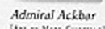
Our notes: `notes/materials/027-new-essential-chronology/05-part-five-galactic-civil-war.md:181`

> 6ABY. mperor Palpatine frequently rewarded his most capable Es with grandiose titles, further encouraging the notorious Imperial culture of greed and ambition. The best stormtroopers were molded into Royal Guards, and there were rumors that the best Royal Guards became Imperial Sovereign Protectors on Byss. Initially, the highest possinte rank in the Imperial Navy was admiral, until two years before the Battle of Yavin, when Palpatine created the elite rank of Grand Admiral. There could never be more than twelve Grand Admirals at one time.
>
> The twelve Grand Admirals, easily recognizable by their stark white uniforms and braided gold epaulets, were the best of the best-unparalleled geniuses at military strategy.
>
> Only Admiral Ackbar could be considered their equal in the New Republic Navy.
>
> Only Admiral Ackbar could be considered their equal in the New Republic Navy. In the aftermath of Endor, had the sur- viving Grand Admirals united against their common enemy. the New Republic could have been wiped out while still in its infancy.
>
> Fortunately, that threat never materialized.
— Source: Part Six: Birth of the New Republic; Grand Admiral Thrawn — Grand Admirals.
(Excerpt widened 2026-11-17 to the relevant passage, word for word from research primary new essential chronology nec paged (text copy `research_primary_new_essential_chronology_nec_paged_txt_88b808b5bc`).)
(Excerpt widened 2026-11-17 to the relevant passage, word for word from research primary new essential chronology nec paged (text copy `research_primary_new_essential_chronology_nec_paged_txt_88b808b5bc`).)
Note (our notes, around the quote): Grand Admiral Thrawn — Grand Admirals: "The twelve Grand Admirals, easily recognizable by their stark white uniforms and braided gold epaulets, were the best of the best—unparalleled geniuses at military strategy. Only Admiral Ackbar could be considered their equal in the New Republic Navy." Source: The New Essential Chronology, p.136
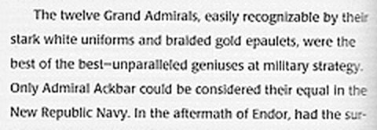
Our notes: `notes/materials/027-new-essential-chronology/06-part-six-birth-of-the-new-republic.md:59`

## The Jedi Academy Sourcebook (WEG, 1996): power-scaling and lore notes

> Hundreds of elegant work shuttles and crablike constructor pods flit in and around the spacedocks like tiny insects, moving workers and materials from place to place. Small girder impellers push huge mounds of plasteel ex- Storn Cook === sp107 truded from transorbital rubble shipments from the planet's single moon and from other sys- tems; the girders are used to construct the frameworks of the famous Mon Calamari starcruisers.
>
> Few of the ships currently in the docks are near completion. Since nearly all the ships in the docks when the Emperor’s World Devastators attacked were lost, nearly all of the ships under construction have been under construction for less than eight months. Indeed, the only ship to survive the attack of a year ago was the Startide, which is only a few months from completion when Admiral Ackbar sacrifices it to stave off Admiral Daala’s attack on the shipyards.
>
> Foamwander City Foamwander City is one of the thousands of immense artificial cities which dot the surface of the oceans of Calamari. Built by the Mon Calamari over thousands of years as slowly evolving works of art, they represent the history and heritage of the Mon Calamari people.
— Source: Chapter Ten: Planets; Admiral Daala; Admiral Ackbar — Mon Calamari Orbital Shipyards — the Startide.
(Excerpt widened 2026-11-17 to the relevant passage, word for word from research primary jedi academy sourcebook jas clean (text copy `research_primary_jedi_academy_sourcebook_jas_clean_txt_04b8ab0d44`).)
(Excerpt widened 2026-11-17 to the relevant passage, word for word from research primary jedi academy sourcebook jas clean (text copy `research_primary_jedi_academy_sourcebook_jas_clean_txt_04b8ab0d44`).)
(Full sentence/passage taken from the source text on file: `research_primary_jedi_academy_sourcebook_jas_clean_txt`.)
Note (our notes, around the quote): Admiral Daala; Admiral Ackbar — Mon Calamari Orbital Shipyards — the Startide: "the only ship to survive the attack of a year ago was the Startide, which is only a few months from completion when Admiral Ackbar sacrifices it to stave off Admiral Daala's attack on the shipyards." Source: The Jedi Academy Sourcebook, p.106
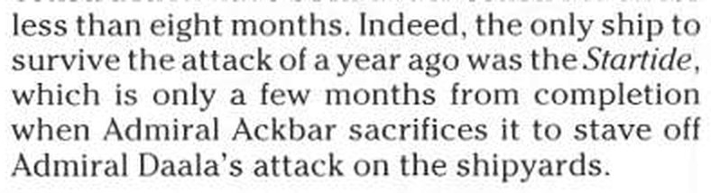
Our notes: `notes/materials/029-jedi-academy-sourcebook/10-ch10-planets.md:43`

## The Complete Star Wars Encyclopedia, Vol. I (A–G)

- Note (summary from our notes, not a quotation): Page contents: 1004 words, 28 paragraphs | headings/entries: Acib, Y'ull; Acilaris; Ackbar Slash; Ackdool, Commander
  — Source: scan pages 1–40.
Our notes: `notes/materials/030-complete-star-wars-encyclopedia-vol-1/00-v1-scan-001-040.md:139`

> Ackbar, who like other Mon Calamari had salmon-colored skin, large bulbous yelloworange eyes, and webbed hands and feet, was the leader of Coral Depths City when Imperial forces invaded and nearly destroyed his planet.
— Source: scan pages 1–40; Admiral Ackbar. POV: Admiral Ackbar.
Note (our notes, around the quote): Admiral Ackbar: "Ackbar, who like other Mon Calamari had salmon-colored skin, large bulbous yelloworange eyes, and webbed hands and feet, was the leader of Coral Depths City when Imperial forces invaded and nearly destroyed his planet." Source: The Complete Star Wars Encyclopedia, Vol. I, p.9
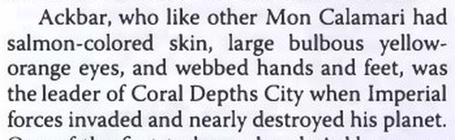
Our notes: `notes/materials/030-complete-star-wars-encyclopedia-vol-1/00-v1-scan-001-040.md:141`

> One of the first to be enslaved, Ackbar eventually became an interpreter for Grand Moff Tarkin.
— Source: scan pages 1–40; Admiral Ackbar; Grand Moff Tarkin.
Note (our notes, around the quote): Admiral Ackbar; Grand Moff Tarkin: "One of the first to be enslaved, Ackbar eventually became an interpreter for Grand Moff Tarkin." Source: The Complete Star Wars Encyclopedia, Vol. I, p.9
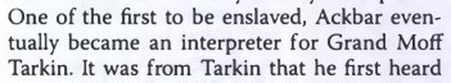
Our notes: `notes/materials/030-complete-star-wars-encyclopedia-vol-1/00-v1-scan-001-040.md:143`

> During a rendezvous with Princess Leia Organa shortly before the Battle of Hoth, Ackbar's modified bulk freighter was destroyed by the Empire.
— Source: scan pages 1–40; Leia Organa Solo; Admiral Ackbar.
Note (our notes, around the quote): Leia Organa Solo; Admiral Ackbar: "During a rendezvous with Princess Leia Organa shortly before the Battle of Hoth, Ackbar's modified bulk freighter was destroyed by the Empire." Source: The Complete Star Wars Encyclopedia, Vol. I, p.9
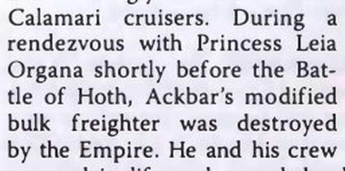
Our notes: `notes/materials/030-complete-star-wars-encyclopedia-vol-1/00-v1-scan-001-040.md:145`

> Following the defeat of the Empire at Endor, Ackbar maintained a key position in the command hierarchy of the Alliance of Free Planets, and the New Republic that followed.
— Source: scan pages 1–40; Admiral Ackbar. POV: Admiral Ackbar.
Note (our notes, around the quote): Admiral Ackbar: "Following the defeat of the Empire at Endor, Ackbar maintained a key position in the command hierarchy of the Alliance of Free Planets, and the New Republic that followed." Source: The Complete Star Wars Encyclopedia, Vol. I, p.9
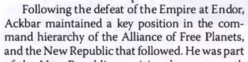
Our notes: `notes/materials/030-complete-star-wars-encyclopedia-vol-1/00-v1-scan-001-040.md:147`

> He was influential in ferret­ ing out warlords like Zsinj, and in capturing the capital world of Coruscant for the Republic. Admiral Ackbar acklaye The firstfewyears ofthe New Republic were extremely trying for Ackbar. His niece, Jesmin Ackbar, died in battle as a starfighter pilot. During the Thrawn crisis, Imperial Intelligence agents framed Ackbar for an embezzlement scheme. The resulting scandal effectively took him out of commission when he was needed the most. Following the defeat of the cloned Emperor, Ackbar's personal starfighter was sabotaged, which caused him to have a terrible accident on the planet of Vortex, where many innocent Vors were killed. This led Ackbar into early retirement back on Mon Calamari. Ackbar later returned to the fleet, though he willingly relinquished control to younger admiralsand fleet officers while adopting more of an advisory position. Some 25 years after the Battle of Yavin, Ackbar retired from offi­ cial duty. In his later years, as his body began to fail him, Ackbar came out of retirement from his home at the Heurkea floating city on Mon Calamari.
— Source: scan pages 1–40; Admiral Ackbar. POV: Admiral Ackbar.
(Excerpt widened 2026-11-17 to the relevant passage, word for word from research primary cse vol1 (text copy `research_primary_cse_vol1_pdf_45a954be6d`).)
(Excerpt widened 2026-11-17 to the relevant passage, word for word from research primary cse vol1 (text copy `research_primary_cse_vol1_pdf_45a954be6d`).)
Note (our notes, around the quote): Admiral Ackbar: "Following the defeat of the cloned Emperor, Ackbar's personal starfighter was sabotaged, which caused him to have a terrible accident on the planet of Vortex, where many innocent Vors were killed." Source: The Complete Star Wars Encyclopedia, Vol. I, p.9
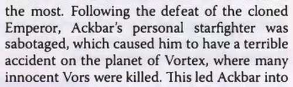
Our notes: `notes/materials/030-complete-star-wars-encyclopedia-vol-1/00-v1-scan-001-040.md:149`

- Note (summary from our notes, not a quotation): Page contents: 1010 words, 38 paragraphs | headings/entries: Adarion; Adas, King; Adasca, Aurora; Adasca, Eighth Lord Arkoh; Adascopolis; Adascorp; Addie, Boz; Adebsu; Adelimaa'j, Enton; Adem'thorn, Senator Yeb Yeb; A'den, Senior Clone Commander; Adim; Adi's Rest; Adiss, Cane; Adjudicator; Adjustment; Admiral Ackbar
  — Source: scan pages 1–40.
Our notes: `notes/materials/030-complete-star-wars-encyclopedia-vol-1/00-v1-scan-001-040.md:163`

> He learned piloting from Kai'Falnl C'ndros and earned the credits for a ship large enough to fit his oversized body by smuggling cargo for Jabba the Hutt. Ad judicator See Liberator. Adjustment One of the shadiest branches of Imperial Intelligence. When a problem grew out of control and needed to be rectified, agents from Adjustment were brought in. Their orders were never documented, and Adjustment of­ ficers were given complete access to whatever resources they required to get the job done. Admiral Ackbar A Galactic Alliance Star Destroyer and flagship of the Fifth Fleet under the command of Admiral Nek Bwua'tu. Admiral Ackbar saw heavy action during the Yuuzhan Vong invasion and was one of two vessels, alongside Man Mothma, to survive the war with its gravity-well generators intact. Both ships were charged with the interdiction of the Utegetu Nebula to prevent the spread I I eAdmiral Korvin of the Gorog hive during the Dark Nest crisis. The Killiks nonetheless capturedAdmiralAck­ barand used it to attack the Chiss, a move that made the Chiss believe the Alliance had sided with the Killiks. After reclaiming command of the vessel, Bwua'tu led AdmiralAckbar in pro­ tecting the Hapan Queen Mother in the civil war that erupted between the Alliance and the Confederation.
— Source: scan pages 1–40; Admiral Ackbar — entry/section: Admiral Ackbar.
(Excerpt widened 2026-11-17 to the relevant passage, word for word from research primary cse vol1 (text copy `research_primary_cse_vol1_pdf_45a954be6d`).)
(Excerpt widened 2026-11-17 to the relevant passage, word for word from research primary cse vol1 (text copy `research_primary_cse_vol1_pdf_45a954be6d`).)
Note (our notes, around the quote): Admiral Ackbar — entry/section: Admiral Ackbar: "Admiral Ackbar A Galactic Alliance Star Destroyer and flagship of the Fifth Fleet under the command of Admiral Nek Bwua'tu." Source: The Complete Star Wars Encyclopedia, Vol. I, p.11
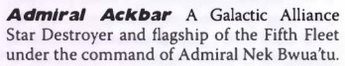
Our notes: `notes/materials/030-complete-star-wars-encyclopedia-vol-1/00-v1-scan-001-040.md:165`

> When Admiral Ackbar defeated Krennel, the Binder's crew surrendered.
— Source: scan pages 81–120; Admiral Ackbar. POV: Admiral Ackbar.
Note (our notes, around the quote): Admiral Ackbar: "When Admiral Ackbar defeated Krennel, the Binder's crew surrendered." Source: The Complete Star Wars Encyclopedia, Vol. I, p.74
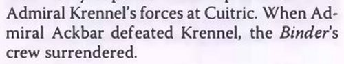
Our notes: `notes/materials/030-complete-star-wars-encyclopedia-vol-1/02-v1-scan-081-120.md:66`

> Late in the Clone Wars, it fell to the Republic. As a result, many Gos­ sam refugees fled to Felucia.
>
> Cato Nelmoldla e Cathedral of the Winds A magnificent but delicate and incredibly intricate structure, this centuries-old cathedral on the planet Vortex was the longtime site of the Vors's an­ nual Concert of the Winds, a cultural festival celebrating the planet's dramatic change of seasons. Resembling a castle made of eggshell­ thin crystal, the cathedral had thousands of passageways winding through hollow cham­ bers, turrets, and spires. At the beginning of the Vortex storm season, winds would whip through its honeycomb structure, resulting in a spellbinding concert of reverberating, almost mournful music. But on a fateful diplomatic journey with Princess Leia Organa Solo as passenger, Admiral Ackbar's personal B-wing fighter crashed into the cathedral, destroying it and killing hundreds of Vors. It later turned out that the admiral's ship had been sabotaged.
>
> The Vors almost immediately began the pain­ ful task of rebuilding the cathedral, and when it was completed, Ackbar was invited back as an honored guest.
>
> Cathor Hills One of the many sentient for­ ests on the planet !thor, it was destroyed by Imperial Captain Alima in his campaign to get Momaw Nadon to turn over Ithorian technol­ ogy to the Empire.
>
> At the beginning of the Vortex storm season, winds would whip through its honeycomb structure, resulting in a spellbinding concert ofreverberating, almost mournful music. But on a fateful diplomatic journey with Princess Leia Organa Solo as passenger, Admiral Ackbar's personal B-wing fighter crashed into the cathedral, destroying it and killing hundreds ofVors. It later turned out that the admiral's ship had been sabotaged. The Vors almost immediately began the pain­ ful task of rebuilding the cathedral, and when it was completed, Ackbar was invited back as an honored guest. CathorHillsOne ofthe many sentient for­ ests on the planet !thor, it was destroyed by Imperial Captain Alima in his campaign to get Momaw Nadon to turn over Ithorian technol­ ogy to the Empire. Catler WalkwayA noted walkway found on the planet Coruscant during the early decades of the New Republic.
— Source: scan pages 121–160; Leia Organa Solo; Admiral Ackbar.
(Excerpt widened 2026-11-17 to the relevant passage, word for word from research audit work src m030 (text copy `research_audit_work_src_m030_txt_69ea9f4a41`).)
(Excerpt widened 2026-11-17 to the relevant passage, word for word from research primary cse vol1 (text copy `research_primary_cse_vol1_pdf_45a954be6d`).)
(Excerpt widened 2026-11-17 to the relevant passage, word for word from research audit work src m030 (text copy `research_audit_work_src_m030_txt_69ea9f4a41`).)
Note (our notes, around the quote): Leia Organa Solo; Admiral Ackbar: "But on a fateful diplomatic journey with Princess Leia Organa Solo as passenger, Admiral Ackbar's personal B-wing fighter crashed into the cathedral, destroying it and killing hundreds of Vors." Source: The Complete Star Wars Encyclopedia, Vol. I, p.111
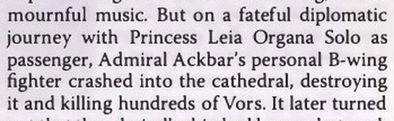
Our notes: `notes/materials/030-complete-star-wars-encyclopedia-vol-1/03-v1-scan-121-160.md:49`

> It was during one such festival that a ship carrying Admiral Ackbar and Princess Leia Organa Solo crashed into and destroyed the cathedral, killing hundreds of Vors.
— Source: scan pages 121–160; Admiral Ackbar; Leia Organa Solo.
Note (our notes, around the quote): Admiral Ackbar; Leia Organa Solo: "It was during one such festival that a ship carrying Admiral Ackbar and Princess Leia Organa Solo crashed into and destroyed the cathedral, killing hundreds of Vors." Source: The Complete Star Wars Encyclopedia, Vol. I, p.136
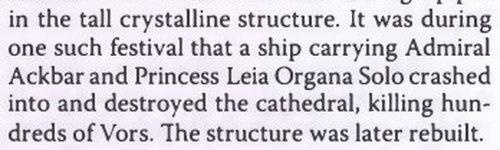
Our notes: `notes/materials/030-complete-star-wars-encyclopedia-vol-1/03-v1-scan-121-160.md:234`

> Corusea Fire A Victory-class Star Destroyer dispatched under the command of Admiral Ackbar to liberate Ciutric from Prince- Admiral Krennel.
— Source: scan pages 161–200; Admiral Ackbar. POV: Admiral Ackbar.
Note (our notes, around the quote): Admiral Ackbar: "Corusea Fire A Victory-class Star Destroyer dispatched under the command of Admiral Ackbar to liberate Ciutric from Prince- Admiral Krennel." Source: The Complete Star Wars Encyclopedia, Vol. I, p.146
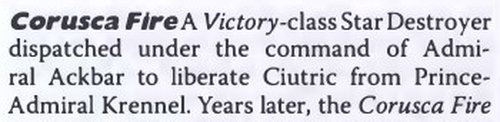
Our notes: `notes/materials/030-complete-star-wars-encyclopedia-vol-1/04-v1-scan-161-200.md:14`

> Eyan, Lieutenant Jart A New Republic officer and Twi'lek, he was brainwashed by Warlord Zsinj to assassinate Admiral Ackbar but was stopped and killed by Voort SaBinring.
— Source: scan pages 241–280; Admiral Ackbar. POV: Admiral Ackbar.
Note (our notes, around the quote): Admiral Ackbar: "Eyan, Lieutenant Jart A New Republic officer and Twi'lek, he was brainwashed by Warlord Zsinj to assassinate Admiral Ackbar but was stopped and killed by Voort SaBinring." Source: The Complete Star Wars Encyclopedia, Vol. I, p.246
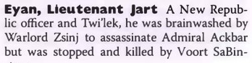
Our notes: `notes/materials/030-complete-star-wars-encyclopedia-vol-1/06-v1-scan-241-280.md:128`

> During the blockade, the group was commanded by Admiral Nek Bwua'tu aboard the flagship Star Destroyer Admiral Ackbar.
— Source: scan pages 281–320; Admiral Ackbar. POV: Admiral Ackbar.
Note (our notes, around the quote): Admiral Ackbar: "During the blockade, the group was commanded by Admiral Nek Bwua'tu aboard the flagship Star Destroyer Admiral Ackbar." Source: The Complete Star Wars Encyclopedia, Vol. I, p.271
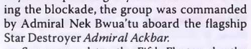
Our notes: `notes/materials/030-complete-star-wars-encyclopedia-vol-1/07-v1-scan-281-320.md:57`

> A member of the Navy of the Galactic Alliance aboard the Admiral Ackbar as part of the starfighter command team, she acted under the orders of General Nek Bwua'tu during the blockade of the Murgo Choke about a year after the Qoribu crisis.
— Source: scan pages 361–398; Admiral Ackbar. POV: Admiral Ackbar.
Note (our notes, around the quote): Admiral Ackbar: "A member of the Navy of the Galactic Alliance aboard the Admiral Ackbar as part of the starfighter command team, she acted under the orders of General Nek Bwua'tu during the blockade of the Murgo Choke about a year after the Qoribu crisis." Source: The Complete Star Wars Encyclopedia, Vol. I, p.368
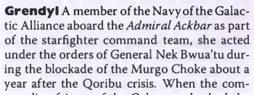
Our notes: `notes/materials/030-complete-star-wars-encyclopedia-vol-1/09-v1-scan-361-398.md:182`

## The Complete Star Wars Encyclopedia, Vol. II (H–O)

> Ackbar as a gunnery officer during the blockade of the Murgo Choke about a year after the Qoribu crisis.
— Source: scan pages 161–200; Admiral Ackbar. POV: Admiral Ackbar.
Note (our notes, around the quote): Admiral Ackbar: "Ackbar as a gunnery officer during the blockade of the Murgo Choke about a year after the Qoribu crisis." Source: The Complete Star Wars Encyclopedia, Vol. II, p.173
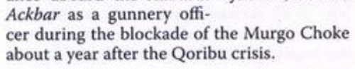
Our notes: `notes/materials/031-complete-star-wars-encyclopedia-vol-2/04-v2-scan-161-200.md:146`

> The Manticore never completed its mission, however: It was destroyed when Admiral Ackbar recognized Daala's tactics as those of Tarkin.
— Source: scan pages 281–320; Admiral Ackbar; Admiral Daala; Grand Moff Tarkin.
Note (our notes, around the quote): Admiral Ackbar; Admiral Daala; Grand Moff Tarkin: "The Manticore never completed its mission, however: It was destroyed when Admiral Ackbar recognized Daala's tactics as those of Tarkin." Source: The Complete Star Wars Encyclopedia, Vol. II, p.287
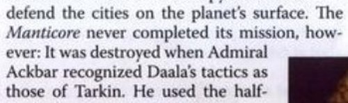
Our notes: `notes/materials/031-complete-star-wars-encyclopedia-vol-2/07-v2-scan-281-320.md:114`

> Many Mon Calamari were enslaved by the Empire, including Ackbar, who was forced to be the personal servant of Grand Moff Tarkin.
— Source: scan pages 321–360; Admiral Ackbar; Grand Moff Tarkin.
Note (our notes, around the quote): Admiral Ackbar; Grand Moff Tarkin: "Many Mon Calamari were enslaved by the Empire, including Ackbar, who was forced to be the personal servant of Grand Moff Tarkin." Source: The Complete Star Wars Encyclopedia, Vol. II, p.325
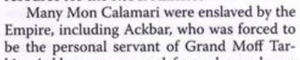
Our notes: `notes/materials/031-complete-star-wars-encyclopedia-vol-2/08-v2-scan-321-360.md:78`

> Mothma, along with Crix Madine and the Mon Calamarian Ackbar, devised the plan to destroy the second Death Star at Endor, which eventually succeeded.
— Source: scan pages 321–360; Admiral Ackbar. POV: Admiral Ackbar.
Note (our notes, around the quote): Admiral Ackbar: "Mothma, along with Crix Madine and the Mon Calamarian Ackbar, devised the plan to destroy the second Death Star at Endor, which eventually succeeded." Source: The Complete Star Wars Encyclopedia, Vol. II, p.336
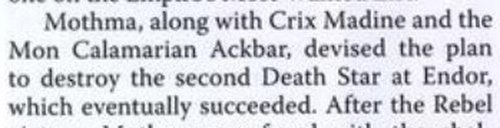
Our notes: `notes/materials/031-complete-star-wars-encyclopedia-vol-2/08-v2-scan-321-360.md:151`

> Nothos, Commander Bane This Imperial district commander was charged with locating and destroying Admiral Ackbar's Shantipole Project—then building a new starfighter, the B-wing.
— Source: scan pages 361–400; Admiral Ackbar. POV: Admiral Ackbar.
Note (our notes, around the quote): Admiral Ackbar: "Nothos, Commander Bane This Imperial district commander was charged with locating and destroying Admiral Ackbar's Shantipole Project—then building a new starfighter, the B-wing." Source: The Complete Star Wars Encyclopedia, Vol. II, p.391
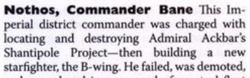
Our notes: `notes/materials/031-complete-star-wars-encyclopedia-vol-2/09-v2-scan-361-400.md:300`

> The Alliance cruisers, commanded by Admiral Ackbar, defeated the Imperials.
— Source: scan pages 401–440; Admiral Ackbar. POV: Admiral Ackbar.
Note (our notes, around the quote): Admiral Ackbar: "The Alliance cruisers, commanded by Admiral Ackbar, defeated the Imperials." Source: The Complete Star Wars Encyclopedia, Vol. II, p.417
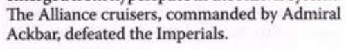
Our notes: `notes/materials/031-complete-star-wars-encyclopedia-vol-2/10-v2-scan-401-440.md:174`

## The Complete Star Wars Encyclopedia, Vol. III (P–Z)

> The Reckoning was destroyed by Admiral Ackbar's fleet at Ciutric, and Krennel died in the explosion.
— Source: scan pages 81–120; Admiral Ackbar. POV: Admiral Ackbar.
Note (our notes, around the quote): Admiral Ackbar: "The Reckoning was destroyed by Admiral Ackbar's fleet at Ciutric, and Krennel died in the explosion." Source: The Complete Star Wars Encyclopedia, Vol. III, p.86
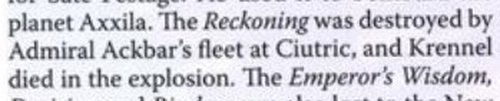
Our notes: `notes/materials/032-complete-star-wars-encyclopedia-vol-3/02-v3-scan-081-120.md:111`

> Reo, Lieutenant Commander An engineer in the Galactic Alliance military, he was stationed aboard the Admiral Ackbar and was killed by a swarm of Gorog assassin bugs during the Swarm War.
— Source: scan pages 81–120; Admiral Ackbar. POV: Admiral Ackbar.
Note (our notes, around the quote): Admiral Ackbar: "Reo, Lieutenant Commander An engineer in the Galactic Alliance military, he was stationed aboard the Admiral Ackbar and was killed by a swarm of Gorog assassin bugs during the Swarm War." Source: The Complete Star Wars Encyclopedia, Vol. III, p.93
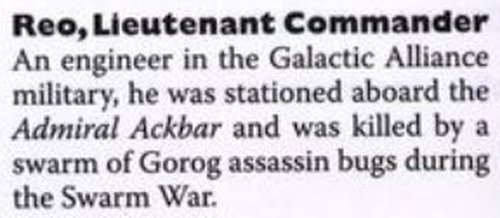
Our notes: `notes/materials/032-complete-star-wars-encyclopedia-vol-3/02-v3-scan-081-120.md:168`

> Piggy flew as Wraith Twelve, and survived being shot during an assassination attempt on Admiral Ackbar.
— Source: scan pages 121–160; Admiral Ackbar. POV: Admiral Ackbar.
Note (our notes, around the quote): Admiral Ackbar: "Piggy flew as Wraith Twelve, and survived being shot during an assassination attempt on Admiral Ackbar." Source: The Complete Star Wars Encyclopedia, Vol. III, p.122
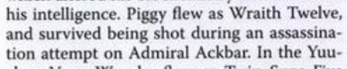
Our notes: `notes/materials/032-complete-star-wars-encyclopedia-vol-3/03-v3-scan-121-160.md:57`

> In the Battle of Snevu, the Killiks in command of the stolen Star Destroyer Admiral Ackbar attacked and leveled the Chiss base on Snevu.
— Source: scan pages 161–200; Admiral Ackbar. POV: Admiral Ackbar.
Note (our notes, around the quote): Admiral Ackbar: "In the Battle of Snevu, the Killiks in command of the stolen Star Destroyer Admiral Ackbar attacked and leveled the Chiss base on Snevu." Source: The Complete Star Wars Encyclopedia, Vol. III, p.170
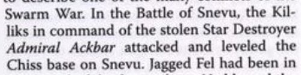
Our notes: `notes/materials/032-complete-star-wars-encyclopedia-vol-3/04-v3-scan-161-200.md:201`

- Note (summary from our notes, not a quotation): Admiral Ackbar: "Syn was defeated by Admiral Ackbar during the liberation of Kashyyyk, and his flagship Fi (named for the High Galactic word for "son") was vaporized." Source: The Complete Star Wars Encyclopedia, Vol. III, p.203
  — Source: scan pages 201–240. POV: Admiral Ackbar.
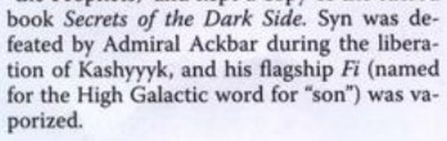
Our notes: `notes/materials/032-complete-star-wars-encyclopedia-vol-3/05-v3-scan-201-240.md:86`

> Millions died on both sides until Thul was confronted by Luke Skywalker aboard the captured Star Destroyer Admiral Ackbar.
— Source: scan pages 241–280; Luke Skywalker; Admiral Ackbar.
Note (our notes, around the quote): Luke Skywalker; Admiral Ackbar: "Millions died on both sides until Thul was confronted by Luke Skywalker aboard the captured Star Destroyer Admiral Ackbar." Source: The Complete Star Wars Encyclopedia, Vol. III, p.241
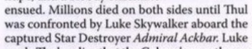
Our notes: `notes/materials/032-complete-star-wars-encyclopedia-vol-3/06-v3-scan-241-280.md:68`

> Tola During the Swarm War, this Mon Calamari served the Galactic Alliance as a captain aboard the Admiral Ackbar, acting on the orders of General Nek Bwua'tu during the blockade of the Murgo Choke.
— Source: scan pages 241–280; Admiral Ackbar. POV: Admiral Ackbar.
Note (our notes, around the quote): Admiral Ackbar: "Tola During the Swarm War, this Mon Calamari served the Galactic Alliance as a captain aboard the Admiral Ackbar, acting on the orders of General Nek Bwua'tu during the blockade of the Murgo Choke." Source: The Complete Star Wars Encyclopedia, Vol. III, p.252
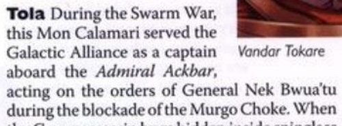
Our notes: `notes/materials/032-complete-star-wars-encyclopedia-vol-3/06-v3-scan-241-280.md:165`

> During a visit to Vortex by Admiral Ackbar and Leia Organa Solo, Ackbar's sabotaged B-wing crashed into and destroyed the centuries-old Cathedral of Winds and killed at least 358 Vors.
— Source: scan pages 281–320; Admiral Ackbar; Leia Organa Solo.
Note (our notes, around the quote): Admiral Ackbar; Leia Organa Solo: "During a visit to Vortex by Admiral Ackbar and Leia Organa Solo, Ackbar's sabotaged B-wing crashed into and destroyed the centuries-old Cathedral of Winds and killed at least 358 Vors." Source: The Complete Star Wars Encyclopedia, Vol. III, p.312
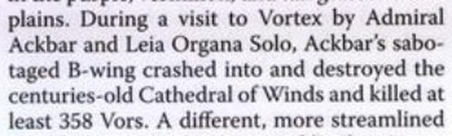
Our notes: `notes/materials/032-complete-star-wars-encyclopedia-vol-3/07-v3-scan-281-320.md:311`

> During the blockade of the Murgo Choke, Captain Wurf'al served under Admiral Bwua'tu aboard the Admiral Ackbar.
— Source: scan pages 321–360; Admiral Ackbar. POV: Admiral Ackbar.
Note (our notes, around the quote): Admiral Ackbar: "During the blockade of the Murgo Choke, Captain Wurf'al served under Admiral Bwua'tu aboard the Admiral Ackbar." Source: The Complete Star Wars Encyclopedia, Vol. III, p.336
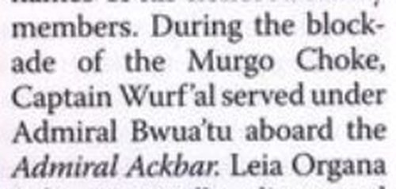
Our notes: `notes/materials/032-complete-star-wars-encyclopedia-vol-3/08-v3-scan-321-360.md:179`

## Power of the Jedi Sourcebook (d20, 2002)

- Note (summary from our notes, not a quotation): Page contents: 893 words, 159 paragraphs | headings/entries: Ae; Ne sey aS / ar; Index; Abhean 132; Abraxin 79; Ackbar, Admiral 130; Adega system 135; Adegan crystals 104, 107, 155; Advozse 112, 113; Afarathu 108; AgriCorps worker 86; Alderaan 10, 64, 110; Aleema 107; Almania 83, 127; Amanoa, Queen 7, 100, 103, 104, 105; Ambria 101, 104, 105, 106, 145-147; Anselmi 71; Arkanian 64, 73, 100; Ashla, the 6; Asmeru 113, 114, 118; Assant, Darsha 121; Auril sector 135; Baltimn 150, 151; Bane, Darth 9; Battle Influence 12; Battle Meditation 15; Beast Language 15; Belasco 116; Bespin 128; Billaba, Depa 114; Black Sun 121; Bnar, Ood 136; Bondara, Anoon 121, 122, 124; Bouri, Omo 118; Brotherhood of Darkness 9, 141, 153; Caamasi 64, 110; Callista 9, 130; Carida 131; Cathar 65; Celegian 66, 98; Cerean 119; Chalactan 114; Chatos Academy 6; Chewbacca 11; Cho Leem, Thracia 123; Chu'unthor 132-135; Cilghal 11, 130; Cinnagar 8, 98, 103; Core Worlds 6, 7, 9, 70, 130
  — Source: Chapter Seven: Where the Force is strong; Index.
Our notes: `notes/materials/033-power-of-the-jedi-sourcebook/07-ch7-locations-index.md:176`

## The New Essential Guide to Characters (2002)

> After the destruction of the first Death Star, Ackbar and the Calamarian Council survived a harrowing Imperial hunt on the planet Daluuj, and the council agreed to formally support the Alliance.
— Source: scan pages 1–30; Admiral Ackbar. POV: Admiral Ackbar.
Note (our notes, around the quote): Admiral Ackbar: "After the destruction of the first Death Star, Ackbar and the Calamarian Council survived a harrowing Imperial hunt on the planet Daluuj, and the council agreed to formally support the Alliance." Source: The New Essential Guide to Characters, p.16
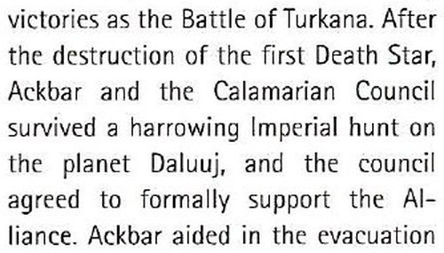
Our notes: `notes/materials/034-new-essential-guide-to-characters/00-negc-scan-001-030.md:72`

> Admiral Ackbar won his greatest victory at Endor, where he defeated Admiral Piett and routed the best elements of the mighty Imperial fleet.
— Source: scan pages 1–30; Admiral Ackbar. POV: Admiral Ackbar.
Note (our notes, around the quote): Admiral Ackbar: "Admiral Ackbar won his greatest victory at Endor, where he defeated Admiral Piett and routed the best elements of the mighty Imperial fleet." Source: The New Essential Guide to Characters, p.16
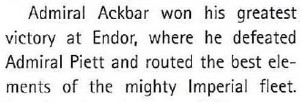
Our notes: `notes/materials/034-new-essential-guide-to-characters/00-negc-scan-001-030.md:74`

> Despite a political smear campaign orchestrated by Borsk Fey'lya, Ackbar played a key role in the defeat of Thrawn at Bilbringi and Admiral Krennel at Ciutric.
— Source: scan pages 1–30; Admiral Ackbar; Grand Admiral Thrawn.
Note (our notes, around the quote): Admiral Ackbar; Grand Admiral Thrawn: "Despite a political smear campaign orchestrated by Borsk Fey'lya, Ackbar played a key role in the defeat of Thrawn at Bilbringi and Admiral Krennel at Ciutric." Source: The New Essential Guide to Characters, p.17
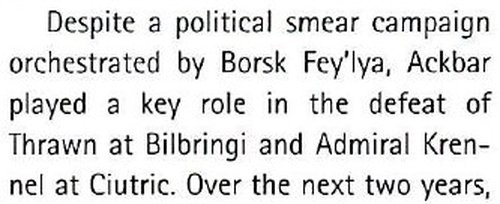
Our notes: `notes/materials/034-new-essential-guide-to-characters/00-negc-scan-001-030.md:81`

> The resurrected Emperor drove Ackbar from Victory Lake during his reconquest of Coruscant, then focused his malevolence on Mon Calamari.
— Source: scan pages 1–30; Admiral Ackbar. POV: Admiral Ackbar.
Note (our notes, around the quote): Admiral Ackbar: "The resurrected Emperor drove Ackbar from Victory Lake during his reconquest of Coruscant, then focused his malevolence on Mon Calamari." Source: The New Essential Guide to Characters, p.17
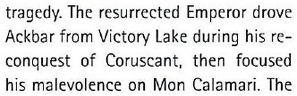
Our notes: `notes/materials/034-new-essential-guide-to-characters/00-negc-scan-001-030.md:83`

> Leia Organa Solo convinced him of his responsibilities to the greater galaxy, and Ackbar reclaimed his New Republic rank just in time to defeat Admiral Daala.
— Source: scan pages 1–30; Leia Organa Solo; Admiral Ackbar; Admiral Daala.
Note (our notes, around the quote): Leia Organa Solo; Admiral Ackbar; Admiral Daala: "Leia Organa Solo convinced him of his responsibilities to the greater galaxy, and Ackbar reclaimed his New Republic rank just in time to defeat Admiral Daala." Source: The New Essential Guide to Characters, p.17
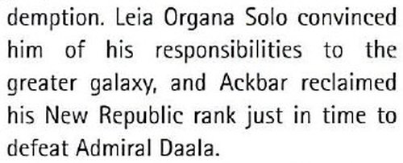
Our notes: `notes/materials/034-new-essential-guide-to-characters/00-negc-scan-001-030.md:85`

## Sourcebooks/Rebellion Era Sourcebook.pdf [Star Wars Roleplaying Game (d20, 2000)] (scan pages 61–120)

- Note (summary from our notes, not a quotation): Page contents: Cracken: 'Every blaster in our hands is a blaster that's not pointing at us.'; Ackbar views pirates as beneath contempt (hand-read)
  — Source: Sourcebooks/Rebellion Era Sourcebook.pdf [Star Wars Roleplaying Game (d20.
Our notes: `notes/materials/037-sw-d20-folder/043-rebellion-era-sourcebook-scan-061-120.md:35`

## Sourcebooks/Rebellion Era Sourcebook.pdf [Star Wars Roleplaying Game (d20, 2000)] (scan pages 121–161)

> It wasn't long thereafter when Ackbar, who made a habit of studying Imperial tactics and defenses while enslaved by Tarkin, returned to Mon Calamari and convinced his people to join the Alliance.
— Source: Sourcebooks/Rebellion Era Sourcebook.pdf [Star Wars Roleplaying Game (d20; Admiral Ackbar; Grand Moff Tarkin.
Note (our notes, around the quote): Admiral Ackbar; Grand Moff Tarkin: "It wasn't long thereafter when Ackbar, who made a habit of studying Imperial tactics and defenses while enslaved by Tarkin, returned to Mon Calamari and convinced his people to join the Alliance." Source: *Rebellion Era Sourcebook* (SWRPG d20), scan p.138
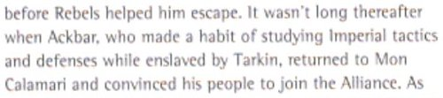
Our notes: `notes/materials/037-sw-d20-folder/043-rebellion-era-sourcebook-scan-121-161.md:146`

## Star Wars Gamer/Star Wars Gamer 01.pdf [Star Wars Roleplaying Game (d20, 2000)] (scan pages 1–60)

- Note (summary from our notes, not a quotation): Page contents: Nagai: Bey revealed as double agent for Admiral Ackbar against the Tofs; Knife (Ozrel N'takkilomandrife) forged truce with Alliance (hand-read)
  — Source: Star Wars Gamer/Star Wars Gamer 01.pdf [Star Wars Roleplaying Game (d20,.
Our notes: `notes/materials/037-sw-d20-folder/050-star-wars-gamer-01-scan-001-060.md:327`

> Bey was eventually revealed be a double agent working for Admiral Ackbar to defeat the Tofs from within.
— Source: Star Wars Gamer/Star Wars Gamer 01.pdf [Star Wars Roleplaying Game (d20,; Admiral Ackbar. POV: Admiral Ackbar.
Note (our notes, around the quote): Admiral Ackbar: "Bey was eventually revealed be a double agent working for Admiral Ackbar to defeat the Tofs from within." Source: *Star Wars Gamer 01* (SWRPG d20), scan p.57
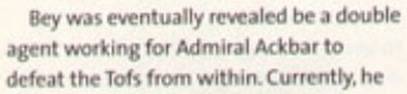
Our notes: `notes/materials/037-sw-d20-folder/050-star-wars-gamer-01-scan-001-060.md:329`

## Star Wars Gamer/Star Wars Gamer 09.pdf [Star Wars Roleplaying Game (d20, 2000)] (scan pages 1–60)

- Note (summary from our notes, not a quotation): Page contents: Wraith Squadron (Joshua J. Radke): Wedge's bet with Ackbar that if the washouts couldn't form a unit he would accept the General's rank he had refused; Wedge is the only pilot to help destroy both Death Stars and survive, a 'soldier's officer'; Gate is a cranky R5, a line supposedly designed for agriculture (hand-read)
  — Source: Star Wars Gamer/Star Wars Gamer 09.pdf [Star Wars Roleplaying Game (d20,.
Our notes: `notes/materials/037-sw-d20-folder/058-star-wars-gamer-09-scan-001-060.md:294`

- Note (summary from our notes, not a quotation): Page contents: Wraith Squadron rosters for the novels Wraith Squadron, Iron Fist and Solo Command; honor roll: Jesmin Ackbar (Ackbar's niece, killed over the pilot moon New Blood?), Falynn Sandskimmer and Grinder Thri'ag (both killed against the Implacable), Ton Phanan (allergic to bacta, shot down on Halmad), Castin Donn (killed on the Iron Fist) (hand-read)
  — Source: Star Wars Gamer/Star Wars Gamer 09.pdf [Star Wars Roleplaying Game (d20,.
Our notes: `notes/materials/037-sw-d20-folder/058-star-wars-gamer-09-scan-001-060.md:359`

## Jedi Counselling/Jedi Counseling 91.pdf [Star Wars Roleplaying Game Revised Core (d20, 2002)]

- Note (summary from our notes, not a quotation): Admiral Ackbar — entry/section: Example #4: Admiral Ackbar's Recon: "The card text for Admiral Ackbar says that Recon allows you to choose "either roll" when rolling initiative. However, the glossary text for Recon says that you take "the higher result." This is a direct contradiction because they can produce different quantities. For example, if you roll 11 and 18 for initiative, the card text would allow you to choose 11 (perhaps to trigger a Reserves ability), but the glossary text says you must choose 18. Thus, as with any direct contradiction, the card text takes precedence, and you ignore the relevant portion of the glossary text." Source: *Jedi Counseling 91* (SWRPG d20 Revised Core), scan p.4
  — Source: Jedi Counselling/Jedi Counseling 91.pdf [Star Wars Roleplaying Game Revis.
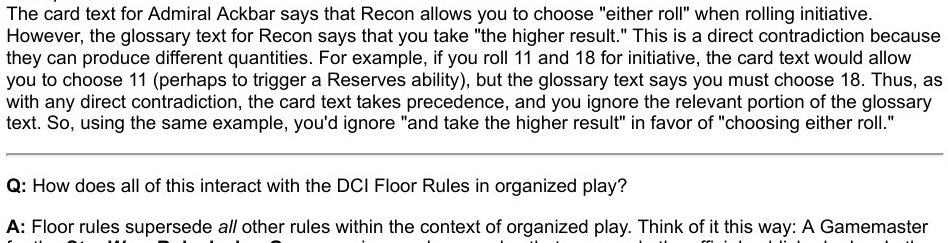
Our notes: `notes/materials/037-sw-d20-folder/262-jedi-counseling-91.md:39`

## Sourcebooks/Galactic Campaign Guide.pdf [Star Wars Roleplaying Game Revised Core (d20, 2002)] (scan pages 121–162)

- Note (summary from our notes, not a quotation): Page contents: Tables 4-29, 4-30 Mon Calamari male and female names (Ackbar, Cilghal, Jesmin, Terpfen...) (hand-read)
  — Source: Sourcebooks/Galactic Campaign Guide.pdf [Star Wars Roleplaying Game Revis.
Our notes: `notes/materials/037-sw-d20-folder/666-galactic-campaign-guide-scan-121-162.md:40`

## Sourcebooks/Geonosis and the Outer Rim Worlds.pdf [Star Wars Roleplaying Game Revised Core (d20, 2002)] (scan pages 61–120)

- Note (summary from our notes, not a quotation): Page contents: Mon Calamari: Ackbar rescued from Tarkin; joins the Rebellion after Yavin; Ackbar at Endor; World Devastators of the reborn Emperor; Admiral Daala destroys Reef Home; New Republic capital at Heurkea under Cal Omas; people (Mon Cals and Quarren; Quarren War). Mon Calamari: sidebar on the name Dac; Dac Extremists; locations - the Floating Cities (Coral City, Foamwander, Heurkea and Kee-Piru damaged by Palpatine's World Devastators; Reef Home destroyed by Daala); the Sunken Cities (Hikahi, Coral Depths, Aquarius). (hand-read)
  — Source: Sourcebooks/Geonosis and the Outer Rim Worlds.pdf [Star Wars Roleplaying.
Our notes: `notes/materials/037-sw-d20-folder/667-geonosis-and-the-outer-rim-worlds-scan-061-120.md:278`

> Following the Battle of Yavin, the Calamarian Council reversed itself and agreed to become part of the Rebellion. Nearly four years later, Admiral Ackbar led Mon Calamari’s finest warships to victory at the Battle of Endor.
— Source: Sourcebooks/Geonosis and the Outer Rim Worlds.pdf [Star Wars Roleplaying; Admiral Ackbar — entry/section: Ackbar at the Battle of Endor.
Note (our notes, around the quote): Admiral Ackbar — entry/section: Ackbar at the Battle of Endor: "Following the Battle of Yavin, the Calamarian Council reversed itself and agreed to become part of the Rebellion. Nearly four years later, Admiral Ackbar led Mon Calamari’s finest warships to victory at the Battle of Endor." Source: *Geonosis and the Outer Rim Worlds* (SWRPG d20 Revised Core), scan p.98
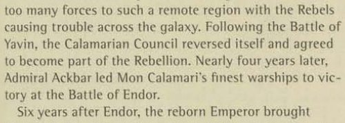
Our notes: `notes/materials/037-sw-d20-folder/667-geonosis-and-the-outer-rim-worlds-scan-061-120.md:280`

> Mon Cal warships entered Alliance service, Rebel warships were dispatched to protect the sector, and the legendary Ackbar served as an unofficial member of the Alliance's high command following his rescue from enslavement at the hands of Grand Moff Tarkin.
— Source: Sourcebooks/Geonosis and the Outer Rim Worlds.pdf [Star Wars Roleplaying; Admiral Ackbar; Grand Moff Tarkin.
Note (our notes, around the quote): Admiral Ackbar; Grand Moff Tarkin: "Mon Cal warships entered Alliance service, Rebel warships were dispatched to protect the sector, and the legendary Ackbar served as an unofficial member of the Alliance's high command following his rescue from enslavement at the hands of Grand Moff Tarkin." Source: *Geonosis and the Outer Rim Worlds* (SWRPG d20 Revised Core), scan p.98
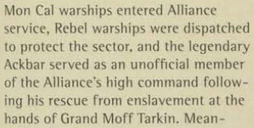
Our notes: `notes/materials/037-sw-d20-folder/667-geonosis-and-the-outer-rim-worlds-scan-061-120.md:284`

- Note (summary from our notes, not a quotation): Page contents: Mon Calamari: Alopia Rift; Mkbuto Seatree Preserve (Ackbar's retirement research and memoirs); the Knowledge Bank and using it (DC table); Algae Sward (World Devastator Nullifier-5 wreck) and Seascape; new vehicle Mon Cal submersible. (hand-read)
  — Source: Sourcebooks/Geonosis and the Outer Rim Worlds.pdf [Star Wars Roleplaying.
Our notes: `notes/materials/037-sw-d20-folder/667-geonosis-and-the-outer-rim-worlds-scan-061-120.md:291`

> When Admiral Ackbar retired from New Republic service following the Emperor’s World Devastator attacks, he researched the Mkbuto region's tectonic plate activity from a floating habitat in the Seatree Preserve. Later, during Borsk Fey'lya’s tenure as chief of state, Ackbar returned to his cozy seapod to complete his memoirs.
— Source: Sourcebooks/Geonosis and the Outer Rim Worlds.pdf [Star Wars Roleplaying.
Note (our notes, around the quote): Admiral Ackbar — entry/section: Ackbar's retreat in the Mkbuto Seatree Preserve: "When Admiral Ackbar retired from New Republic service following the Emperor’s World Devastator attacks, he researched the Mkbuto region's tectonic plate activity from a floating habitat in the Seatree Preserve. Later, during Borsk Fey'lya’s tenure as chief of state, Ackbar returned to his cozy seapod to complete his memoirs." Source: *Geonosis and the Outer Rim Worlds* (SWRPG d20 Revised Core), scan p.99
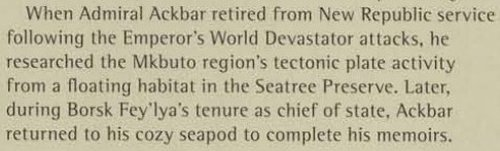
Our notes: `notes/materials/037-sw-d20-folder/667-geonosis-and-the-outer-rim-worlds-scan-061-120.md:293`

## Sourcebooks/Hero's Guide.pdf [Star Wars Roleplaying Game Revised Core (d20, 2002)] (scan pages 61–120)

- Note (summary from our notes, not a quotation): Page contents: Rebel Alliance description and history (Mon Mothma, Bail Organa, Garm Bel Iblis, Ackbar, Crix Madine, Dodonna, Ghorman); Sympathy. (hand-read)
  — Source: Sourcebooks/Hero's Guide.pdf [Star Wars Roleplaying Game Revised Core (d2.
Our notes: `notes/materials/037-sw-d20-folder/668-heros-guide-scan-061-120.md:263`

> The recognized leader of the Alliance is Mon Mothma, the former Senator of Chandrila. Assisted initially by the Corellian military strategist Garm Bel Iblis and Senator Bail Organa of Alderaan, Mon Mothma carried on virtually alone after Bel Iblis went into hiding and Bail Organa died along with his homeworld. A strong, intelligent woman, Mon Mothma is also poised and graceful—a paragon of diplomacy and an inspiration to every member of the Alliance. She is aided by the Mon Calamari tactician Ackbar and the Imperial defector Crix Madine, the replacement for General Jan Dodonna (lost in the Battle of Yavin).
— Source: Sourcebooks/Hero's Guide.pdf [Star Wars Roleplaying Game Revised Core (d2.
Note (our notes, around the quote): Mon Mothma; Bail Organa; Admiral Ackbar — entry/section: Mon Mothma, recognized leader of the Alliance: "The recognized leader of the Alliance is Mon Mothma, the former Senator of Chandrila. Assisted initially by the Corellian military strategist Garm Bel Iblis and Senator Bail Organa of Alderaan, Mon Mothma carried on virtually alone after Bel Iblis went into hiding and Bail Organa died along with his homeworld. A strong, intelligent woman, Mon Mothma is also poised and graceful—a paragon of diplomacy and an inspiration to every member of the Alliance. She is aided by the Mon Calamari tactician Ackbar and the Imperial defector Crix Madine, the replacement for General Jan Dodonna (lost in the Battle of Yavin)." Source: *Hero's Guide* (SWRPG d20 Revised Core), scan p.108
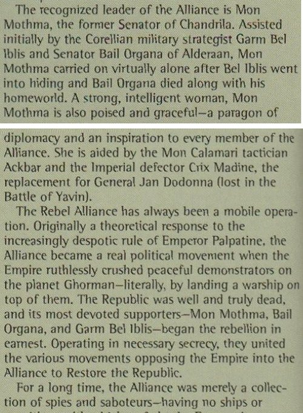
Our notes: `notes/materials/037-sw-d20-folder/668-heros-guide-scan-061-120.md:265`

## Sourcebooks/Ultimate Alien Anthology.pdf [Star Wars Roleplaying Game Revised Core (d20, 2002)] (scan pages 61–120)

- Note (summary from our notes, not a quotation): Page contents: Miraluka commoner; Mon Calamari (example names incl. Ackbar, Cilghal). (hand-read)
  — Source: Sourcebooks/Ultimate Alien Anthology.pdf [Star Wars Roleplaying Game Revi.
Our notes: `notes/materials/037-sw-d20-folder/673-ultimate-alien-anthology-scan-061-120.md:208`

## Sourcebooks/Galaxy of Intrigue.pdf [Star Wars Roleplaying Game Saga Edition (2007)] (scan pages 61–120)

- Note (summary from our notes, not a quotation): Page contents: Chapter V intro: the war in the shadows (a Rebel mole vs. an Imperial Intelligence plant on Admiral Ackbar's staff; noble houses, megacorporations, Chiss and Hapans). (hand-read)
  — Source: Sourcebooks/Galaxy of Intrigue.pdf [Star Wars Roleplaying Game Saga Editi.
Our notes: `notes/materials/037-sw-d20-folder/716-galaxy-of-intrigue-scan-061-120.md:239`

## Sourcebooks/Legacy Era Campaign Guide.pdf [Star Wars Roleplaying Game Saga Edition (2007)] (scan pages 121–180)

- Note (summary from our notes, not a quotation): Page contents: The Ackbar Trail; Alliance Personnel; sidebar "Creating Your Own Units, Squadrons, and Starship Crews". (hand-read)
  — Source: Sourcebooks/Legacy Era Campaign Guide.pdf [Star Wars Roleplaying Game Sag.
Our notes: `notes/materials/037-sw-d20-folder/719-legacy-era-campaign-guide-scan-121-180.md:71`

> The Trail was named in honor of Admiral Ackbar's famous journey from slavery under Grand Moff Tarkin to becoming a Rebel Alliance Admiral who defeated his former masters, the original Galactic Empire.
— Source: Sourcebooks/Legacy Era Campaign Guide.pdf [Star Wars Roleplaying Game Sag; Admiral Ackbar; Grand Moff Tarkin.
Note (our notes, around the quote): Admiral Ackbar; Grand Moff Tarkin: "The Trail was named in honor of Admiral Ackbar's famous journey from slavery under Grand Moff Tarkin to becoming a Rebel Alliance Admiral who defeated his former masters, the original Galactic Empire." Source: *Legacy Era Campaign Guide* (SWRPG Saga Edition), scan p.128
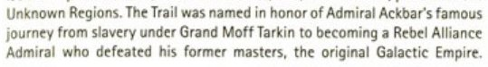
Our notes: `notes/materials/037-sw-d20-folder/719-legacy-era-campaign-guide-scan-121-180.md:75`

## Sourcebooks/Rebellion Era Campaign Guide.pdf [Star Wars Roleplaying Game Saga Edition (2007)] (scan pages 61–120)

- Note (summary from our notes, not a quotation): Page contents: Secret Bases (Yavin 4, Hoth; Imperial hidden research bases), with adventure hook (Admiral Piett sends Imperial heroes to the Cularin system; ruins of the Jedi academy on Almas hold a malign dark side intelligence). Military Battles, with adventure hook (Home One refitting in the Senex sector; Admiral Ackbar asks every pilot to join the picket line; hold out 50 rounds; destroy the Interdictor). The Force Is With Us. (hand-read)
  — Source: Sourcebooks/Rebellion Era Campaign Guide.pdf [Star Wars Roleplaying Game.
Our notes: `notes/materials/037-sw-d20-folder/722-rebellion-era-campaign-guide-scan-061-120.md:106`

> The Imperials bring an Interdictor cruiser into the fight, and soon the orders from Admiral Ackbar are to destroy the Interdictor at all costs.
— Source: Sourcebooks/Rebellion Era Campaign Guide.pdf [Star Wars Roleplaying Game; Admiral Ackbar. POV: Admiral Ackbar.
Note (our notes, around the quote): Admiral Ackbar: "The Imperials bring an Interdictor cruiser into the fight, and soon the orders from Admiral Ackbar are to destroy the Interdictor at all costs." Source: *Rebellion Era Campaign Guide* (SWRPG Saga Edition), scan p.79
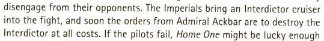
Our notes: `notes/materials/037-sw-d20-folder/722-rebellion-era-campaign-guide-scan-061-120.md:108`

> essentially an elected dictator
> [fragment — full passage not on file]
— Source: Sourcebooks/Rebellion Era Campaign Guide.pdf [Star Wars Roleplaying Game.
Note (our notes, around the quote): Page contents: Organization (Corellian Treaty; Chief of State Mon Mothma). Alliance Civil Government (Chief of State "essentially an elected dictator"; Advisory Council of the seven governments that have given the most lives; Cabinet of six ministries: Finance, Education, State, Industry, Supply, War). Alliance Military (High Command; Fleet Command under Admiral Ackbar; Ordnance and Supply). (hand-read)
Our notes: `notes/materials/037-sw-d20-folder/722-rebellion-era-campaign-guide-scan-061-120.md:196`

> A Dauntless-class heavy cruiser under fire from Imperial assault gunboats.
— Source: Sourcebooks/Rebellion Era Campaign Guide.pdf [Star Wars Roleplaying Game.
Note (our notes, around the quote): Page contents: The Alliance Fleet (Admiral Ackbar commands; Mon Mothma forbids a formal large-scale battle; up to one-quarter of the fleet detached for raids). Caption "A Dauntless-class heavy cruiser under fire from Imperial assault gunboats." Mon Calamari star cruisers; refitted Dreadnaughts. The Alliance Navy: Element, Section, Squadron. (hand-read)
Our notes: `notes/materials/037-sw-d20-folder/722-rebellion-era-campaign-guide-scan-061-120.md:206`

> Using the Rebel Fleet.
> [fragment — full passage not on file]
— Source: Sourcebooks/Rebellion Era Campaign Guide.pdf [Star Wars Roleplaying Game.
Note (our notes, around the quote): Page contents: Battle Group and Fleet (Admiral of the Fleet, Admiral Ackbar for most of the war). Fleet Command Structure. Sidebar "Using the Rebel Fleet." Special Forces organization (Fire Team to Division; ten SpecForce divisions; the Command Division under the direct control of General Crix Madine). (hand-read)
Our notes: `notes/materials/037-sw-d20-folder/722-rebellion-era-campaign-guide-scan-061-120.md:215`

- Note (summary from our notes, not a quotation): Page contents: SpecForce Officer stat block (CL 7). Alliance Personalities intro (Mon Mothma, Bail Organa, Garm Bel Iblis, Starkiller covered in The Force Unleashed Campaign Guide). Admiral Ackbar (Tarkin's slave; freed by a Rebel attack; Shantipole Project created the B-wing; acquisition of Mon Calamari star cruisers). Art "Admiral Ackbar." (hand-read)
  — Source: Sourcebooks/Rebellion Era Campaign Guide.pdf [Star Wars Roleplaying Game.
Our notes: `notes/materials/037-sw-d20-folder/722-rebellion-era-campaign-guide-scan-061-120.md:260`

> A brilliant tactician and powerful leader, Ackbar is best known for victory over Imperial fleet at the Battle of Endor.
— Source: Sourcebooks/Rebellion Era Campaign Guide.pdf [Star Wars Roleplaying Game; Admiral Ackbar — entry/section: Rebellion Era Campaign Guide (Saga).
Note (our notes, around the quote): Admiral Ackbar — entry/section: Rebellion Era Campaign Guide (Saga): "A brilliant tactician and powerful leader, Ackbar is best known for victory over Imperial fleet at the Battle of Endor." Source: *Rebellion Era Campaign Guide* (SWRPG Saga Edition), scan p.99
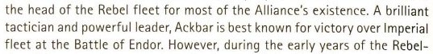
Our notes: `notes/materials/037-sw-d20-folder/722-rebellion-era-campaign-guide-scan-061-120.md:262`

- Note (summary from our notes, not a quotation): Page contents: Admiral Ackbar (Episode VI) stat block (noble 5/soldier 2/officer 4). Wedge Antilles (destroys the pirate ship that killed his parents; Booster Terrik; Red Squadron; leads Rogue Squadron; only Rebel pilot to attack both Death Stars) and Wedge Antilles (Episode VI) stat block (CL 9). Art "Wedge Antilles." (hand-read)
  — Source: Sourcebooks/Rebellion Era Campaign Guide.pdf [Star Wars Roleplaying Game.
Our notes: `notes/materials/037-sw-d20-folder/722-rebellion-era-campaign-guide-scan-061-120.md:271`

## Sourcebooks/Starships of the Galaxy.pdf [Star Wars Roleplaying Game Saga Edition (2007)] (scan pages 1–60)

- Note (summary from our notes, not a quotation): Page contents: Using Starship Maneuvers; maneuver suite; regaining maneuvers; descriptors (Attack Pattern, Dogfight, Force, Gunner); entry format. Ackbar Slash maneuver (reaction; redirect missed attack, DC 20-35). (hand-read)
  — Source: Sourcebooks/Starships of the Galaxy.pdf [Star Wars Roleplaying Game Saga.
Our notes: `notes/materials/037-sw-d20-folder/727-starships-of-the-galaxy-scan-001-060.md:144`

> The end of Return of the Jedi is a perfect example of this: Luke fights Vader on the Death Star while Lando fights a few TIE fighters inside the station's superstructure, Admiral Ackbar engages in fleet combat, and Han, Leia, and Chewbacca battle stormtroopers around the Imperial deflector shield station.
— Source: Sourcebooks/Starships of the Galaxy.pdf [Star Wars Roleplaying Game Saga.
Note (our notes, around the quote): Luke Skywalker; Darth Vader (Anakin Skywalker); Lando Calrissian; Admiral Ackbar; Leia Organa Solo; Chewbacca: "The end of Return of the Jedi is a perfect example of this: Luke fights Vader on the Death Star while Lando fights a few TIE fighters inside the station's superstructure, Admiral Ackbar engages in fleet combat, and Han, Leia, and Chewbacca battle stormtroopers around the Imperial deflector shield station." Source: *Starships of the Galaxy* (SWRPG Saga Edition), scan p.32
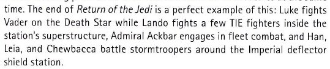
Our notes: `notes/materials/037-sw-d20-folder/727-starships-of-the-galaxy-scan-001-060.md:185`

## Sourcebooks/Starships of the Galaxy.pdf [Star Wars Roleplaying Game Saga Edition (2007)] (scan pages 61–120)

- Note (summary from our notes, not a quotation): Page contents: B-wing Starfighter (Slayn & Korpil) stat block; history (designed by Admiral Ackbar; rotating cockpit; B-wing/E2 variant with gunner); Capabilities (a B-wing squadron destroyed an Imperial Star Destroyer at Endor). (hand-read)
  — Source: Sourcebooks/Starships of the Galaxy.pdf [Star Wars Roleplaying Game Saga.
Our notes: `notes/materials/037-sw-d20-folder/727-starships-of-the-galaxy-scan-061-120.md:53`

- Note (summary from our notes, not a quotation): Page contents: Mon Calamari Star Defender (Viscount-class) stat block CL 45; history (Admiral Ackbar's view after destroying the Executor that Super Star Destroyers were the greatest threat; Star Defender classification; first completed 25 years after Yavin; Yuuzhan Vong invasion; backbone of the Galactic Alliance fleet; Battle of Mon Calamari); Capabilities begin. (hand-read)
  — Source: Sourcebooks/Starships of the Galaxy.pdf [Star Wars Roleplaying Game Saga.
Our notes: `notes/materials/037-sw-d20-folder/727-starships-of-the-galaxy-scan-061-120.md:374`

> Though Admiral Ackbar had successfully engaged and destroyed the Executor, the very difficulty of that victory convinced him that Imperial Super Star Destroyers were the greatest threat the fledgling New Republic would face for the next several years.
— Source: Sourcebooks/Starships of the Galaxy.pdf [Star Wars Roleplaying Game Saga; Admiral Ackbar. POV: Admiral Ackbar.
Note (our notes, around the quote): Admiral Ackbar: "Though Admiral Ackbar had successfully engaged and destroyed the Executor, the very difficulty of that victory convinced him that Imperial Super Star Destroyers were the greatest threat the fledgling New Republic would face for the next several years." Source: *Starships of the Galaxy* (SWRPG Saga Edition), scan p.117
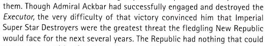
Our notes: `notes/materials/037-sw-d20-folder/727-starships-of-the-galaxy-scan-061-120.md:376`

## Sourcebooks/Starships of the Galaxy.pdf [Star Wars Roleplaying Game Saga Edition (2007)] (scan pages 121–162)

- Note (summary from our notes, not a quotation): Page contents: Executor: Darth Vader's command ship, flagship of the Death Squadron; built secretly at Fondor; tool of fear; destroyed at Endor when Admiral Ackbar focused fire and an A-wing struck the bridge; Capabilities (standard complement); tactical fire (+1 attack, +1 die damage). (hand-read)
  — Source: Sourcebooks/Starships of the Galaxy.pdf [Star Wars Roleplaying Game Saga.
Our notes: `notes/materials/037-sw-d20-folder/727-starships-of-the-galaxy-scan-121-162.md:130`

## The Lucasfilm Fan Club Magazine #6 (1989)

- Note (summary from our notes, not a quotation): Page contents: West End Games catalog (crop-viewed): miniatures, the RPG, Sourcebook, Campaign Pack, and the adventures Tatooine Manhunt (Adar Tallon), Strikeforce: Shantipole (Commander Ackbar) and Battle for the Golden Sun (Sedri). Also Star Warriors, Assault on Hoth, the Lightsaber Dueling Pack, and Land Before Time, Tucker, Indy III and THX items. Product copy only, no feats (auto-cand dropped). (hand-read)
  — Source: The Lucasfilm Fan Club Magazine #6 (1989).
Our notes: `notes/materials/038-star-wars-insider/006-lfc006.md:55`

## The Lucasfilm Fan Club Magazine #8 (1989)

- Note (summary from our notes, not a quotation): Page contents: Merchandise: Star Wars 1990 calendar, McQuarrie trilogy portfolios, 10th anniversary sweatshirt, pin and plate, blueprints, trilogy posters and pins, a set of eight mugs, Don Post masks (crop-verified: Vader, stormtrooper, Chewbacca, cantina band member, Yoda, Admiral Ackbar, Wicket). (hand-read)
  — Source: The Lucasfilm Fan Club Magazine #8 (1989).
Our notes: `notes/materials/038-star-wars-insider/008-lfc008.md:60`

## The Lucasfilm Fan Club Magazine #10 (1990)

- Note (summary from our notes, not a quotation): Page contents: Merchandise: trilogy posters, the Blackshear plate, a mug set, Don Post masks (Admiral Ackbar listed). (hand-read)
  — Source: The Lucasfilm Fan Club Magazine #10 (1990).
Our notes: `notes/materials/038-star-wars-insider/010-lfc010.md:60`

## The Lucasfilm Fan Club Magazine #14 (1991)

- Note (summary from our notes, not a quotation): Page contents: Merchandise: trilogy postcards, pins, 1991 calendar, masks (Vader, Stormtrooper, Chewbacca, Cantina Band Member, Yoda, Admiral Ackbar, Wicket), blueprints, ESB 10th Anniversary bronze Yoda. Product copy. (hand-read)
  — Source: The Lucasfilm Fan Club Magazine #14 (1991).
Our notes: `notes/materials/038-star-wars-insider/014-lfc014.md:55`

## Star Wars Insider #32 (1997)

- Note (summary from our notes, not a quotation): Page contents: 192 words, 33 paragraphs | headings/entries: STAND-UPS; Luke; Princess Leia ® —; Stormtrooper 4 ' Bobs Fett 7; Boba Fett Vinyl Model Figure Kit; L164K Bobs Fett 1/6 scale $46.00; Star Wars; Life-Size Stand-ups; Lsus Princess Leta; LSU6 f2-D2 Lsu7 Darth Vader Lsus Yoda; Lsu9 Chewbacca; LSUID ~—- Boba Fett; LSU12 ss Darth Vader with Lightsaber; Lsu13 Jawa; LSUI4 ~—s Imperial Royal Guard; LSU1G6 = Admiral Ackbar; LSU17 ~—s Princess Leia Slave Outfit; Ackbar Princess Lota Slave Outfit
  — Source: Star Wars Insider #32 (1997).
Our notes: `notes/materials/038-star-wars-insider/032-ins032.md:252`

## Star Wars Insider #33 (1997)

- Note (summary from our notes, not a quotation): Page contents: 141 words, 13 paragraphs | headings/entries: Emperor; Star Wars Life-Size Stand-ups; LSU1 =C-3P0 LSUS Yoda LSU16 Admiral Ackbar; LSU6 =-R2-02 LSU13 Jawa
  — Source: Star Wars Insider #33 (1997).
Our notes: `notes/materials/038-star-wars-insider/033-ins033.md:235`

## Star Wars Insider #38 (1998)

- Note (summary from our notes, not a quotation): Page contents: Poll ranks incl. Admiral Ackbar (memorable line crop-verified T), Dengar, Piett. Fan quotes S only. (hand-read)
  — Source: Star Wars Insider #38 (1998).
Our notes: `notes/materials/038-star-wars-insider/038-ins038.md:382`

## Star Wars Insider #41 (1998)

> formed a sort of supergroup of Alliance leaders
> [fragment — full passage not on file]
— Source: Star Wars Insider #41 (1998).
Note (our notes, around the quote): Page contents: Scott Chernoff, In the Star Wars Universe: Dermot Crowley (General Crix Madine), printed p.20 (crop-verified): fans told him of Madine's rich backstory and "eventual demise" in the books; Madine, Mon Mothma and Admiral Ackbar "formed a sort of supergroup of Alliance leaders". See T. (hand-read)
Our notes: `notes/materials/038-star-wars-insider/041-ins041.md:84`

## Star Wars Insider #42 (1999)

> Evil has a New Name
> [fragment — full passage not on file]
>
> Darth Maul, Dark Lord of the Sith, From Episode I
> [fragment — full passage not on file]
— Source: Star Wars Insider #42 (1999); Page contents: Cover (image-read): Darth Maul.
Note (our notes, around the quote): Page contents: Cover (image-read): Darth Maul, "Evil has a New Name", "Darth Maul, Dark Lord of the Sith, From Episode I"; teasers: new Frank Oz interview, Lucas Down Under, Admiral Ackbar surfaces. S only. (hand-read)
Our notes: `notes/materials/038-star-wars-insider/042-ins042.md:10`

- Note (summary from our notes, not a quotation): Page contents: Contents departments (Prequel Profile: Nick Dudman; Star News; Wonder Column; In the Star Wars Universe: Admiral Ackbar; From the Horse's Mouth: Vader and Fett; Scouting); cover illustration Javier Fernandez; Jon Bradley Snyder editorial on Celebration (no Lucas autographs; Rick McCallum to attend). Readers omitted. Real-world. (hand-read)
  — Source: Star Wars Insider #42 (1999).
Our notes: `notes/materials/038-star-wars-insider/042-ins042.md:40`

- Note (summary from our notes, not a quotation): Page contents: Scott Chernoff, "Tim Rose: Looking for Mr. Ackbar" (crop-verified): Rose played Sy Snootles, Salacious Crumb and Ackbar; Phil Tippett; Ackbar #14 in Insider #38 poll. Reader omitted. See T. (hand-read)
  — Source: Star Wars Insider #42 (1999).
Our notes: `notes/materials/038-star-wars-insider/042-ins042.md:336`

- Note (summary from our notes, not a quotation): Page contents: Tim Rose continued: Ackbar as hand puppet (Mike Quinn); Salacious Crumb tests; Richard Marquand; Muppet workshop with Faz Fazakas; Dark Crystal Skeksis; Mike McCormick. Continues p.79. Real-world. (hand-read)
  — Source: Star Wars Insider #42 (1999).
Our notes: `notes/materials/038-star-wars-insider/042-ins042.md:345`

## Star Wars Insider #47 (1999)

> all Yoda-type characters
> [fragment — full passage not on file]
— Source: Star Wars Insider #47 (1999).
Note (our notes, around the quote): Page contents: Quinn end: assisted Jabba, Ackbar, Yoda's right hand; early Jedi Council "all Yoda-type characters". Production only. (hand-read)
Our notes: `notes/materials/038-star-wars-insider/047-ins047.md:107`

## Star Wars Insider #56 (2001)

- Note (summary from our notes, not a quotation): Page contents: Kevin Smith interview cont. (flip section p. 16; scan lacks flip p. 15): Silent Bob testing as audience favorite, The Muppet Movie as influence, Clerks cartoon movie and Fletch plans, closing thanks to Star Wars; top box "Fandom Menace: Kevin Smith's Favorite Star Wars Stuff" - favorite movie Empire, favorite character, favorite alien Nien Nunb then Admiral Ackbar, favorite merchandise the AT-AT, favorite line Tarkin's; photo of Nien Nunb. (hand-read)
  — Source: Star Wars Insider #56 (2001).
Our notes: `notes/materials/038-star-wars-insider/056-ins056.md:441`

> I'd have to go with Nien Nunb. I thought he looked pretty good, and I thought his speech pattern was phenomenal. He's one of those quick hits—he's in and out of the picture. Followed closely by Admiral Ackbar, also a good-looking character from Jedi. They really did kind of nail them by then.
— Source: Star Wars Insider #56 (2001).
Note (our notes, around the quote): Nien Nunb; Admiral Ackbar — entry/section: Kevin Smith on his favorite Star Wars alien: ""I'd have to go with Nien Nunb. I thought he looked pretty good, and I thought his speech pattern was phenomenal. He's one of those quick hits—he's in and out of the picture. Followed closely by Admiral Ackbar, also a good-looking character from Jedi. They really did kind of nail them by then." —Kevin Smith, Star Wars Insider 56, p. 16 (Kevin Smith flip section)" Source: *Star Wars Insider #56* (2001), scan p.75
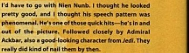
Our notes: `notes/materials/038-star-wars-insider/056-ins056.md:445`

## Star Wars Insider #59 (2002)

- Note (summary from our notes, not a quotation): Page contents: Who's Who in Rogue Squadron cont. (magazine p. 54): "Rogue Squadron" history (from Red Squadron after Yavin, Luke's idea after Hoth, Wedge's command, renamed Red Group at Endor, rebuilt two years after Endor); "Wraith Squadron" (Wedge's commando squadron, Ackbar's three-month bet, war against Warlord Zsinj); "The Incom T-65" X-wing sidebar with schematics; Wedge Antilles entry with portrait. (hand-read)
  — Source: Star Wars Insider #59 (2002).
Our notes: `notes/materials/038-star-wars-insider/059-ins059.md:374`

> She got more than she bargained for and was killed in the M2398 system.
— Source: Star Wars Insider #59 (2002); Jesmin Ackbar; Admiral Ackbar — entry/section: Jesmin Ackbar.
Note (our notes, around the quote): Jesmin Ackbar; Admiral Ackbar — entry/section: Jesmin Ackbar: "She got more than she bargained for and was killed in the M2398 system." Source: *Star Wars Insider #59* (2002), scan p.58
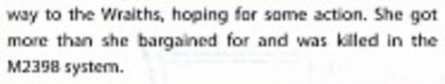
Our notes: `notes/materials/038-star-wars-insider/059-ins059.md:429`

> Set Piece: Rebel Alliance Briefing Room - Take a seat, but keep an eye out for pigeons
> [fragment — full passage not on file]
— Source: Star Wars Insider #59 (2002); Page contents. POV: Page contents, about Admiral Ackbar.
Note (our notes, around the quote): Page contents: "Set Piece: Rebel Alliance Briefing Room - Take a seat, but keep an eye out for pigeons" by Chris Reiff & Chris Trevas (magazine p. 86): Elstree Stage 5 (Star Destroyer sets in Empire) became the Return of the Jedi briefing room and bridge of Admiral Ackbar's cruiser Home One; tin roof and rain noise; pigeons forced re-recording of the Mon Mothma, General Madine and Admiral Ackbar monologues nine months later; Richard Marquand and about 75 extras. Callouts (verified on crops): Ishi Tib aliens nicknamed Star Fish, also seen in Jabba's palace; puppeteer Tim Rose played Ackbar in the full-body suit and operated the separate close-up puppet; the 3D graphic of the forest moon and Death Star was one of ILM's earliest uses of computer animation on film. (hand-read)
Our notes: `notes/materials/038-star-wars-insider/059-ins059.md:628`

## Star Wars Insider #60 (2002)

- Note (summary from our notes, not a quotation): Page contents: Star Wars Q&A "Answers to Your Star Wars Questions" with Pablo Hidalgo, Internet Content Provider for starwars.com: the Jabba's palace "perimeter droid" is a B'omarr Monk brain in a modified BT-16 droid shell; full Aurebesh/English key (first printed 1995 in a miniatures roleplaying supplement) shown; why B-wings are called B-wings ("blade"; Ackbar and Verpine; ILM "A"/"B" fighters, "Bill-wing" after Bill George; LucasArts T-wing); the ladder to Luke's X-wing (begins). (hand-read)
  — Source: Star Wars Insider #60 (2002).
Our notes: `notes/materials/038-star-wars-insider/060-ins060.md:996`

## Star Wars Insider #61 (2002)

- Note (summary from our notes, not a quotation): Page contents: Scouting the Galaxy cont.: Revenge of the Jedi collectibles (Admiral Ackbar offer), the 1997 Theater Edition Luke Skywalker Jedi Knight figure (about 150,000 made; $50–$75), a misspelled Star Wars reference on a video store bag (pictured), no plans for a new Tomart's price guide. Letter-writer names omitted. (hand-read)
  — Source: Star Wars Insider #61 (2002).
Our notes: `notes/materials/038-star-wars-insider/061-ins061.md:583`

## Star Wars Insider #65 (2003)

- Note (summary from our notes, not a quotation): Page contents: Who's Who: Gorr Ebelt cont., Corellia rebel hideout (Wedge Antilles, Captain Ackbar), Endor Marauders' Citadel (Marauder Guards, King Terak). (hand-read)
  — Source: Star Wars Insider #65 (2003).
Our notes: `notes/materials/038-star-wars-insider/065-ins065.md:196`

## Star Wars Insider #74 (2004)

- Note (summary from our notes, not a quotation): Page contents: NJO: Destiny's Way synopsis; fallen heroes: Chewbacca, Anakin Solo, Ganner Rhysode, Vergere, Elegos A'Kla, Borsk Fey'lya, Ikrit and Admiral Ackbar; Force Heretic I: Remnant synopsis (Nom Anor as the Prophet Yu'shaa). (hand-read)
  — Source: Star Wars Insider #74 (2004).
Our notes: `notes/materials/038-star-wars-insider/074-ins074.md:188`

- Note (summary from our notes, not a quotation): Page contents: Collecting answers continued: Starbles value; Canadian Empire-carded figures with Jedi stickers covering the Ackbar offer (per James T. McCallum); a reader complaint about value questions answered — no E.T. Senator figure likely and why Hasbro makes multiple character versions (questioner names omitted). (hand-read)
  — Source: Star Wars Insider #74 (2004).
Our notes: `notes/materials/038-star-wars-insider/074-ins074.md:504`

- Note (summary from our notes, not a quotation): Page contents: Action Figure Archive: the nine 1998 European Long Photo Card figures in multilingual packaging (Ackbar, Endor Rebel soldier, Ewoks, Emperor's Royal Guard, Bespin Han, Bespin Luke, Snowtrooper, Grand Moff Tarkin, Weequay skiff guard). (hand-read)
  — Source: Star Wars Insider #74 (2004).
Our notes: `notes/materials/038-star-wars-insider/074-ins074.md:548`

## Star Wars Insider #92 (2007)

- Note (summary from our notes, not a quotation): Page contents: Contents: features (The In-Between Theory by Patrice Girod; The Toys That Never Were by Chris Fawcett; Unknown Origins by J.W. Rinzler) and departments (Comlink, Skywalking, Jedi Library, Drawn by the Force, Jabba's Collection, Technical Readout: Rebel Snowspeeder, Ask the Master: Darth Bane, Scouting the Galaxy, Star Wars International: toys from Brazil, Best of Hyperspace: unproduced Empire Micro Collection, Padawan Corner: how to draw Admiral Ackbar, Bantha Tracks: Tournament of Roses, Pirates of the Boards part II, Puzzle Planet: The Models of Revenge of the Sith Part III by Frank Parisi); StarWarsShop note (hand-read)
  — Source: Star Wars Insider #92 (2007).
Our notes: `notes/materials/038-star-wars-insider/092-ins092.md:20`

- Note (summary from our notes, not a quotation): Page contents: Padawan Corner "How to Draw Admiral Ackbar" by Amy Pronovost: steps 1-4 (hand-read)
  — Source: Star Wars Insider #92 (2007).
Our notes: `notes/materials/038-star-wars-insider/092-ins092.md:504`

- Note (summary from our notes, not a quotation): Page contents: How to Draw Admiral Ackbar steps 5-7; artist bio (starwars.com, Star Wars Kids, Topps sketch cards) (hand-read)
  — Source: Star Wars Insider #92 (2007).
Our notes: `notes/materials/038-star-wars-insider/092-ins092.md:509`

## Star Wars Insider #100 (2008)

- Note (summary from our notes, not a quotation): Page contents: Top 100: 95 Banking Clan Frigate; 94 ARC-170 Fighter; 93 Admiral Ackbar (photo of Ackbar; A-wing image) (hand-read)
  — Source: Star Wars Insider #100 (2008).
Our notes: `notes/materials/038-star-wars-insider/100-ins100.md:161`

## Star Wars Insider #102 (2008)

> What's Cool and What's Cold in this month's Star Wars popularity stakes?
— Source: Star Wars Insider #102 (2008).
Note (our notes, around the quote): Page contents: Launch Pad (cont.): Robot Chicken interview conclusion (stills: Boba Fett figure, Ackbar eating cereal, cantina dancers with Max Rebo puppet); Expanded Universe box "Robot Chicken: Star Wars Special DVD from July 22"; "Speeder News in Brief" box (scout trooper on speeder bike art); bottom strip "What's Cool and What's Cold in this month's Star Wars popularity stakes?" (Picnicing on Naboo / Podracing on Tatooine / Red Hot on Mustafar; Captain Rex, Kenny Baker photo, PROXY droid) (hand-read)
Our notes: `notes/materials/038-star-wars-insider/102-ins102.md:113`

## Star Wars Insider #104 (2008)

- Note (summary from our notes, not a quotation): Page contents: Contents, Departments (folio 05): top box "The Special Edition!" (variant cover with Starkiller); 08 Editor's Welcome; 10 Launch Pad (Celebration Japan, San Diego Comic-Con); 26 Versus (Ackbar takes on Thrawn); 36 The Science of Star Wars (personal jetpacks); 44 A Long Time Ago.... (1978, the Holiday Special); Blaster review section: 73 Books (Michael Reaves, Coruscant Nights), 74 Ask Lobot, 75 Comics (Knights of the Old Republic "Vindication"), 79 International Collecting, 82 Toys (Wizards of the Coast, Top Trumps The Clone Wars; Ahsoka Tano card pictured), 87 Bounty Hunters, 89 Bantha Tracks, 93 Classic Moment (first mention of the Clone Wars as Obi-Wan passes the lightsaber to Luke). Scan is 72 pages of the 100-page issue (some magazine pages not in scan) (hand-read)
  — Source: Star Wars Insider #104 (2008).
Our notes: `notes/materials/038-star-wars-insider/104-ins104.md:24`

- Note (summary from our notes, not a quotation): Page contents: Versus: Admiral Ackbar vs. Grand Admiral Thrawn, Ackbar side (folio 26): Databank, Profile (Mon Calamari; 1.8 m; Mon Calamarian star cruiser; Rebel Alliance/New Republic), Skills and ratings; intro text comparing the two strategists (hand-read)
  — Source: Star Wars Insider #104 (2008).
Our notes: `notes/materials/038-star-wars-insider/104-ins104.md:117`

## Star Wars Insider #109 (2009)

- Note (summary from our notes, not a quotation): Page contents: LEGO: Echo Base, Battle of Endor (12 minifigs), fan-choice Home One Mon Calamari Star Cruiser (Ackbar, Mon Mothma, Lando, Madine), top-10 LEGO sets. Out-of-universe. (hand-read)
  — Source: Star Wars Insider #109 (2009).
Our notes: `notes/materials/038-star-wars-insider/109-ins109.md:372`

## Star Wars Insider #110 (2009)

- Note (summary from our notes, not a quotation): Page contents: Tom Kane feature: taking over Yoda from Frank Oz after goofing around in a LucasArts session; Yoda in Jedi Power Battles, Galactic Battlegrounds, Battlefront I/II, ROTS game, Clone Wars micro-series; other Star Wars voices (Lobot, Ackbar, C-3PO, Nien Nunb, Bib Fortuna, Boba Fett, Tarkin); non-Star Wars voice work. (hand-read)
  — Source: Star Wars Insider #110 (2009).
Our notes: `notes/materials/038-star-wars-insider/110-ins110.md:89`

- Note (summary from our notes, not a quotation): Page contents: Incoming cont.: Sideshow 12-inch Lando (Baron Administrator), Scout Trooper Premium Format, life-size Admiral Ackbar bust. (hand-read)
  — Source: Star Wars Insider #110 (2009).
Our notes: `notes/materials/038-star-wars-insider/110-ins110.md:387`

## Star Wars Insider #111 (2009)

> the coolest guy on the planet
> [fragment — full passage not on file]
— Source: Star Wars Insider #111 (2009).
Note (our notes, around the quote): Page contents: Robot Chicken: Breckin Meyer box (Boba Fett, Admiral Ackbar voices; "The Emperor's Phone Call" sketch; cut Ackbar skits; Boba Fett "the coolest guy on the planet"); 15 minutes of new footage and 90 minutes of bonus features. Parody, out-of-universe. (hand-read)
Our notes: `notes/materials/038-star-wars-insider/111-ins111.md:148`

- Note (summary from our notes, not a quotation): Page contents: Incoming: Cube Darth Vader and R2-D2 USB hubs; Hasbro Galactic Heroes wave (Ackbar and Nien Nunb, etc.). Out-of-universe merchandise. (hand-read)
  — Source: Star Wars Insider #111 (2009).
Our notes: `notes/materials/038-star-wars-insider/111-ins111.md:333`

## Star Wars Insider #112 (2009)

- Note (summary from our notes, not a quotation): Page contents: Newspaper strips history: L.A. Times Syndicate strip from February 1979; Russ Manning's "Gambler's World"; Archie Goodwin (as Russ Helm) and Alfredo Alcala's "Planet of Kadril" and Han Solo at Star's End; Goodwin/Williamson from 1981 ("The Bounty Hunter of Ord Mantell") with Dengar, Ackbar and Boba Fett before his film debut; cancelled 1984. Strip panels with Vader and a Ben Kenobi impostor ("actor"). Out-of-universe article. (hand-read)
  — Source: Star Wars Insider #112 (2009).
Our notes: `notes/materials/038-star-wars-insider/112-ins112.md:233`

What it shows (our notes): Page contents: Strip Teasers cont.: "The Bounty Hunter of Ord Mantell," "Traitor's Gambit" (Aquaris, demonsquid), "Iceworld" (Luke discovers Hoth; droids disguised as humans), "Revenge of the Jedi" (Yavin evacuation; Ackbar's first chronological appearance), "Race for Survival." Genesis: Cooper's plan to reprint the Manning strips. Out-of-universe. (hand-read)
> Czethros keeps Anja strung out on andris, an addictive spice that can boost one’s senses and reflexes to Jedi-like levels.
>
> ANJA GALLANDRO is the daughter of the gunslinger featured in Brian Daley’s Han Solo’s Revenge (1979) and Han Solo and the Lost Legacy (1980). The bounty hunter Czethros was originally intended to be Skorr, the titular antagonist from the 1981 comic strip The Bounty Hunter of Ord Mantell by Archie Goodwin and Al Williamson. At the eleventh hour, however, editors realized Skorr dies at the end of the newspaper strip in 1984, so Skorr was hastily rewritten as new character Czethros.
>
> AUTHORS · Kevin J. Anderson and Rebecca Moesta COVER ARTIST · Dave Dorman PUBLICATION HISTORY · Novel, Berkley Jam Books · Paperback, August 1998 TIME LINE PLACEMENT · 24 ABY WORLDS VISITED · Bespin [K-18]; Clak’dor VII [M-18]; Yavin 4 [P-6] MAIN CHARACTERS · Jacen Solo, Jedi student (human male); Jaina Solo, Jedi student (human female); Anja Gallandro, reluctant Black Sun agent (human female); Lando Calrissian, entrepreneur (human male); Tenel Ka, Jedi student(human female); Zekk, Jedi student (human male); Lowbacca, Jedi student (Wookiee male); Czethros, Black Sun leader (humanoid male) SUMMARY · At the invitation of the Solos, Anja Gallandro studies at the Jedi academy, but she is too short-tempered and distracted to make much progress.
>
> AUTHORS · Kevin J.
— Source: Star Wars Insider #112 (2009); Page contents: Strip Teasers cont..
(Excerpt widened 2026-11-17 to the relevant passage, word for word from The Essential Reader’s Companion: Star Wars (Pablo Hidalgo) (text copy `primary_essential_guides_eg_readers_companion_2012_Star_Wars_The_Essential_Readers_Companion_Pablo_Hidalgo_8O9y2bib_epub_e20384df21`).)
(Excerpt widened 2026-11-17 to the relevant passage, word for word from The Essential Reader’s Companion: Star Wars (Pablo Hidalgo) (text copy `primary_essential_guides_eg_readers_companion_2012_Star_Wars_The_Essential_Readers_Companion_Pablo_Hidalgo_8O9y2bib_epub_e20384df21`).)
(Full sentence/passage taken from the source text on file: `primary_essential_guides_eg_readers_companion_2012_Star_Wars_The_Essential_Readers_Companion_Pablo_Hidalgo_8O9y2bib_epub`.)
Our notes: `notes/materials/038-star-wars-insider/112-ins112.md:252`

## Star Wars Insider #120 (2010)

- Note (summary from our notes, not a quotation): Page contents: Al Williamson: Goodwin on Williamson as the best Star Wars artist; early Boba Fett, Ackbar and Dengar in comics; ROTJ adaptation, Classic Star Wars covers, inks on TPM and ANH SE; tributes by Grant Gould and Tom Hodges. (hand-read)
  — Source: Star Wars Insider #120 (2010).
Our notes: `notes/materials/038-star-wars-insider/120-ins120.md:244`

## Star Wars Insider #121 (2010)

- Note (summary from our notes, not a quotation): Page contents: Interrogation Droid: puppeteer Tim Rose answers rhyme questions as Admiral Ackbar ("It's a trap!" jokes; humor). (hand-read)
  — Source: Star Wars Insider #121 (2010).
Our notes: `notes/materials/038-star-wars-insider/121-ins121.md:65`

## Star Wars Insider #125 (2011)

- Note (summary from our notes, not a quotation): Page contents: Stanton interview: pressure of the role; a hoped-for Tarkin–Dooku meeting (Cushing/Lee); would like to voice Ackbar. (hand-read)
  — Source: Star Wars Insider #125 (2011).
Our notes: `notes/materials/038-star-wars-insider/125-ins125.md:390`

## Star Wars Insider #128 (2011)

- Note (summary from our notes, not a quotation): Page contents: Launchpad: Clone Wars season four preview ("Water War", "Gungan Attack"; Captain Ackbar, the Gungan army). (hand-read)
  — Source: Star Wars Insider #128 (2011).
Our notes: `notes/materials/038-star-wars-insider/128-ins128.md:35`

> more in the thick of it than we ever saw before. *(hand-read)*
> [fragment — full passage not on file]
— Source: Star Wars Insider #128 (2011).
Note (our notes, around the quote): Page contents: Filoni: writers' room; threads for Ahsoka, Ventress, Savage Opress, the clones and Rex in season four; Obi-Wan/Ventress "bizarre, flirtatious relationship"; Walter Murch directing; sidebar Big Fish: Admiral Ackbar will appear as a younger officer in The Clone Wars, "more in the thick of it than we ever saw before." (hand-read)
Our notes: `notes/materials/038-star-wars-insider/128-ins128.md:140`

## Star Wars Insider #129 (2011)

- Note (summary from our notes, not a quotation): Page contents: Feature: the Squid Head and Mon Calamari debut in ROTJ; Ackbar's pre-release appearances (Bantha Tracks #17, the Goodwin/Williamson strip, the Kenner mail-away); performed by Tim Rose and voiced by Erik Bauersfeld. (hand-read)
  — Source: Star Wars Insider #129 (2011).
Our notes: `notes/materials/038-star-wars-insider/129-ins129.md:85`

## Star Wars Insider #135 (2012)

- Note (summary from our notes, not a quotation): Page contents: Comics: The Crimson Empire Saga hardcover (Kir Kanos; Nom Anor's first appearance); Omnibus: Clone Wars Volume 1 (Ventress, Dooku, Durge). Ask Lobot (questioner omitted): Mon Calamari usually have first and last names; Ackbar's first name was recently revealed as Gial. (hand-read)
  — Source: Star Wars Insider #135 (2012).
Our notes: `notes/materials/038-star-wars-insider/135-ins135.md:356`

## Star Wars Insider #138 (2013)

- Note (summary from our notes, not a quotation): Page contents: Launch Pad: Lucasfilm Sidewalk Art Festival (Ackbar "It's a trap!" won); Vulture's devoted fanbases list (Star Wars at #2); Hasbro MTT giveaway; IGT Star Wars slots; Aigan eyewear. (hand-read)
  — Source: Star Wars Insider #138 (2013).
Our notes: `notes/materials/038-star-wars-insider/138-ins138.md:50`

## Star Wars Insider #142 (2013)

- Note (summary from our notes, not a quotation): Page contents: ROTJ archive (viewed): monster creator Phil Tippett checks Admiral Ackbar's articulated mask (actor Tim Rose inside); model makers working on the Death Star model. (hand-read)
  — Source: Star Wars Insider #142 (2013).
Our notes: `notes/materials/038-star-wars-insider/142-ins142.md:220`

## Star Wars Insider #143 (2013)

- Note (summary from our notes, not a quotation): Page contents: My Star Wars: Tim Rose (Ackbar, Sy Snootles, Salacious Crumb) interviewed by Mark Newbold. (hand-read)
  — Source: Star Wars Insider #143 (2013).
Our notes: `notes/materials/038-star-wars-insider/143-ins143.md:135`

- Note (summary from our notes, not a quotation): Page contents: My Star Wars (Tim Rose), continued (viewed): favorite film and favorite toy answers; LEGO Ackbar photo. (hand-read)
  — Source: Star Wars Insider #143 (2013).
Our notes: `notes/materials/038-star-wars-insider/143-ins143.md:140`

## Star Wars Insider #144 (2013)

- Note (summary from our notes, not a quotation): Page contents: Rinzler interview: Marquand's contributions (the Slave Leia costume idea, casting Ackbar as a Mon Calamari, possibly recommending McDiarmid); Lucas's review process; credit to the UK art departments and Mark Hamill. (hand-read)
  — Source: Star Wars Insider #144 (2013).
Our notes: `notes/materials/038-star-wars-insider/144-ins144.md:60`

## Star Wars Insider #145 (2013)

> Luke reacts to the trap Admiral Ackbar so helpfully pointed out by rejecting fear and anger; Anakin reacts to his personal tragedies with unholy killing sprees.
— Source: Star Wars Insider #145 (2013); Darth Vader (Anakin Skywalker) — entry/section: Hearne on Anakin's choices.
Note (our notes, around the quote): Darth Vader (Anakin Skywalker) — entry/section: Hearne on Anakin's choices: ""Luke reacts to the trap Admiral Ackbar so helpfully pointed out by rejecting fear and anger; Anakin reacts to his personal tragedies with unholy killing sprees." —Kevin Hearne, Star Wars Insider 145, p. 15" Source: *Star Wars Insider #145* (2013), scan p.15

Our notes: `notes/materials/038-star-wars-insider/145-ins145.md:86`

## Star Wars Insider #148 (2014)

- Note (summary from our notes, not a quotation): Page contents: Jedi Quiz "Revenge of the Quiz" compiled by Louisa Owen: Know your characters, Admiral Ackbar questions (questions only; auto-cand from quiz text dropped). (hand-read)
  — Source: Star Wars Insider #148 (2014).
Our notes: `notes/materials/038-star-wars-insider/148-ins148.md:410`

## Star Wars Insider #149 (2014)

- Note (summary from our notes, not a quotation): Page contents: Exclusive fiction "Blade Squadron" Part One by David J. Williams and Mark S. Williams, art by Chris Trevas. Note: published 2014 and later treated as Disney-canon; T lines below are tagged [canon-era story]. OCR "Brayten" crop-verified as "Braylen" Stramm. Moonsong breaks formation in a drone exercise; Fox's force-multiplier doctrine; Ackbar's orders. (hand-read)
  — Source: Star Wars Insider #149 (2014).
Our notes: `notes/materials/038-star-wars-insider/149-ins149.md:298`

## Star Wars Insider #150 (2014)

- Note (summary from our notes, not a quotation): Page contents: Blade Squadron: Ackbar and Calrissian order the fleet to engage the Star Destroyers; Blade One knocks a TIE interceptor wing off into another before dying; Fox injured; Stramm takes command of the attack run. (hand-read)
  — Source: Star Wars Insider #150 (2014).
Our notes: `notes/materials/038-star-wars-insider/150-ins150.md:206`

## Star Wars Insider #151 (2014)

- Note (summary from our notes, not a quotation): Page contents: Bantha Tracks Almost-Annual Wedding Edition: the 501st UK Garrison's surprise stormtrooper honor guard at actor Tim Rose's (Admiral Ackbar) wedding; Rose donated autographed items including his 1983 Return of the Jedi storybook to its charity auction (fan names omitted). (hand-read)
  — Source: Star Wars Insider #151 (2014).
Our notes: `notes/materials/038-star-wars-insider/151-ins151.md:396`

## Star Wars Insider Best Buy Exclusive Collector's Issue (2004)

- Note (summary from our notes, not a quotation): Page contents: Rebel Vehicles: Headquarters Frigate Home One (Ackbar's flagship, given to the Alliance by the Mon Calamari) and Millennium Falcon entries (viewed). (hand-read)
  — Source: Star Wars Insider Best Buy Exclusive Collector's Issue.
Our notes: `notes/materials/038-star-wars-insider/154-insbestbuy2004.md:278`

## Star Wars Insider Special Edition (2013)

- Note (summary from our notes, not a quotation): Page contents: War leaders feature image (viewed): Admiral Ackbar on the bridge; no body text. (hand-read)
  — Source: Star Wars Insider Special Edition (2013).
Our notes: `notes/materials/038-star-wars-insider/159-insspecial2013.md:180`

- Note (summary from our notes, not a quotation): Page contents: "Greatest Military Leaders" by Jason Fry (from The Essential Guide to Warfare): #1 Admiral Ackbar. (hand-read)
  — Source: Star Wars Insider Special Edition (2013). POV: Page contents, about Admiral Ackbar.
Our notes: `notes/materials/038-star-wars-insider/159-insspecial2013.md:185`

## Star Wars: Dark Empire (1991–92), Dark Empire II (1994–95), Empire's End (1995), single issues, hand-read

> SOMETHING VERY BIG IS HAPPENING, MON MOTHMA... WE SAW IMPERIAL SHIPS FROM BOTH SIDES OF THE CIVIL WAR VANISHING INTO THE UNINHABITED REGIONS OF THE GALACTIC CORE! *(Ackbar)*
> [fragment — full passage not on file]
— Source: Star Wars: Dark Empire #2 — "Book 2: Devastator of Worlds" (Feb 1992). POV: Ackbar.
Label in our notes: > (Ackbar
Our notes: `notes/materials/041-dark-empire/de1-02.md:15`

> WHEN THE EMPEROR CREATED THE DEATH STAR, CALAMARI WAS AT THE TOP OF THE LIST OF WORLDS SCHEDULED TO BE ANNIHILATED BY THAT DREADFUL BATTLE STATION...\
> [fragment — full passage not on file]
>
> ...AND NOW, AT LAST, WHOEVER IS REUNIFYING THE EMPIRE IS CARRYING OUT THE EMPEROR'S DECISION TO DISCIPLINE US... WITH THESE NEW WORLD DEVASTATORS!\
> [fragment — full passage not on file]
— Source: Star Wars: Dark Empire #2 — "Book 2: Devastator of Worlds" (Feb 1992). POV: Ackbar.
Label in our notes: > "\ " / "\ " (Ackbar
Our notes: `notes/materials/041-dark-empire/de1-02.md:28`

> "THIS IS THE GREATEST SCOURGE THE GALAXY HAS EVER SEEN... FAR MORE LETHAL THAN THE DEATH STAR!" (Ackbar)
> [fragment — full passage not on file]
— Source: Star Wars: Dark Empire #2 — "Book 2: Devastator of Worlds" (Feb 1992). POV: Ackbar.
Context: — Star Wars: Dark Empire #2, p. 11
Our notes: `notes/materials/041-dark-empire/de1-02.md:32`

> far more lethal than the Death Star.
> [fragment — full passage not on file]
— Source: Star Wars: Dark Empire #2 — "Book 2: Devastator of Worlds" (Feb 1992); Statement (tech): Ackbar rates the World Devastators.
Note (our notes, around the quote): Statement (tech): Ackbar rates the World Devastators "far more lethal than the Death Star." They strip cities and turn the debris into raw material and new weapons (p10–11 art).
Our notes: `notes/materials/041-dark-empire/de1-02.md:37`

> FAR MORE LETHAL THAN THE DEATH STAR!
— Source: Star Wars: Dark Empire (#1–6, Dec 1991–Oct 1992): series summary and scaling notes; | Ackbar | World Devastators.
Note (our notes, around the quote): | Ackbar | World Devastators "FAR MORE LETHAL THAN THE DEATH STAR!" | DE #2 p12 | Character, about tech |
Context: | Speaker | Statement | Where | Weight |
Our notes: `notes/materials/041-dark-empire/de1-summary.md:40`

- Note (summary from our notes, not a quotation): Statement: Pinnacle Moon's destruction (#5) did not kill the Alliance leaders. Mon Mothma and Ackbar evacuated in time (p25), which corrects Luke's "ALL THE LEADERS OF THE ALLIANCE ARE DEAD" (p6).
  — Source: Star Wars: Dark Empire II #6 (May 1995).
Our notes: `notes/materials/041-dark-empire/de2-06.md:212`

## Dark Empire Sourcebook (West End Games, 1993), hand-read

What it shows (our notes): Read 2026-11-03 CST: PDF pp. 1–18 (cover, contents, Introduction, Prologue, "Why Do We Fight the Empire?", Ch. 1 overview, Hextrophon letter, Ackbar, Luke, Leia, Han, Chewbacca, Lando, R2-D2 stat block start) — all text read.
> The Emperor has prepared for battle on many fronts. He created the horrific World Devastators, unleashing them against the Calamari homeworld itself. He has also dedicated himself to turning Luke Skywalker to the Dark Side - to making young Skywalker his loyal servant, as his father was before him. In the tumultuous events that followed, the Emperor’s grandest plans were brought to fruition as the Rebel Alliance fought a desperate struggle against a seemingly immortal foe; a struggle that brought Luke Skywalker and Princess Leia Organa Solo face-to-face with the Emperor in a final confrontation that will affect the fate of the galaxy for years! 5 This textfile was issued to the holomedia in the weeks following the Imperial siege of Caprioril, a New Republic Sector capital. Why Do We Fight the Empire? 1. Because it is not legal. As a government, it betrays the trust given it as successor to the Old Republic. It is unresponsive to the wishes of the beings it governs.
— Source: Dark Empire Sourcebook (WEG 40071, 1993) — chunk 1: front matter, Prologue, Chapter One part A (printed pp. 1–17).
(Excerpt widened 2026-11-17 to the relevant passage, word for word from WEG40071 Star Wars Dark Empire Sourcebook pdf x.txt (text copy `MEGA_WEG40071_Star_Wars_Dark_Empire_Sourcebook_pdf_x`).)
(Excerpt widened 2026-11-17 to the relevant passage, word for word from WEG40071 Star Wars Dark Empire Sourcebook pdf x.txt (text copy `MEGA_WEG40071_Star_Wars_Dark_Empire_Sourcebook_pdf_x`).)
Our notes: `notes/materials/043-dark-empire-sourcebook/01-front-and-new-republic-a.md:4`

> "Most people are still having nightmares about those things descending from the sky and slicing cities in half." — p. 8 (World Devastators on Calamari)
> [fragment — full passage not on file]
— Source: Dark Empire Sourcebook (WEG 40071, 1993) — chunk 1: front matter, Prologue, Chapter One part A (printed pp. 1–17). POV: Stats, about Admiral Ackbar.
Context: Stats: "tactics: capital ships 9D, tactics: fleets 9D+2"; "capital ship piloting: Mon Calamari battle cruiser 10D"; "command: Mon Calamari crewmen 11D+2"; FP 3, CP 15 (p. 8).
Our notes: `notes/materials/043-dark-empire-sourcebook/01-front-and-new-republic-a.md:55`

> "Traditional restraints were useless against those who could call upon the Force. ... Eventually, the energy shields used on the Universal Energy Cages had to be installed around the perimeter of the cells to prevent the Jedi from using their abilities. Life support settings were set extremely low to force the Jedi into hibernating" — p. 95 (Lictor-class dungeon ships; "Originally designed by the Mandalorians")
> [fragment — full passage not on file]
— Source: Dark Empire Sourcebook — chunk 5: Chapter Five "Planets" (pp. 81–90) + Chapter Six "Starships" part A (pp. 91–99).
Context: MC90 *Defiance* (Ackbar's flagship): "Length: 1,255 meters", "Hyperdrive Multiplier: x1", "Hull: 7D Shields: 6D*" + 6D back-up shields, 72 starfighters, "75 Turbolaser Batteries" (p. 94–95).
Our notes: `notes/materials/043-dark-empire-sourcebook/05-planets-and-starships-a.md:43`

## The Thrawn Trilogy (Timothy Zahn): Heir to the Empire, Dark Force Rising, The Last Command, plus the Heir 20th Anniversary extras

- Note (summary from our notes, not a quotation): Verpine: they reportedly helped Ackbar design the B-wing.
  — Source: Dark Force Rising — notes part 1: front matter, ch. 1–2.
Our notes: `notes/materials/044-thrawn-trilogy/dfr-01.md:41`

> “Rogue Squadron was engaged with a group of approximately forty TIE fighters and fifty stolen mole miners that had somehow been smuggled into the shipyards,” Han continued. “We gave them some assistance with the fighters, figured out that the Imperials were using the mole miners to try and steal some of the capital ships that had been pressed into cargo duty, and were able to stop them. That’s about it.”
>
> Han braced himself. Here it came. He and Lando had stopped the Imperials, all right … only they’d had to fry the nerve centers of over forty capital ships to do it. “I’m sorry about wrecking the ships,” he said, looking Fey’lya straight in the eye. “Would you rather the Imperials have taken them intact?”
— Source: Dark Force Rising — notes part 2: ch. 3–5; Han tells the Council the Imperial strike force was.
(Excerpt widened 2026-11-17 to the relevant passage, word for word from Dark Force Rising (Timothy Zahn), Chapter 3 (text copy `MEGA_Legend_The_Thrawn_Trilogy_Star_Wars_Thrawn_Trilogy_02_Dark_Force_Rising_Timothy_Zahn_epub`).)
(Fragment completed 2026-11-17: full sentence/passage matched word for word in the source text on file: `MEGA_Legend_The_Thrawn_Trilogy_Star_Wars_Thrawn_Trilogy_02_Dark_Force_Rising_Timothy_Zahn_epub`.)
Label in our notes: Han and Lando
Our notes: `notes/materials/044-thrawn-trilogy/dfr-02.md:4`

What it shows (our notes): Mon Mothma: Fey'lya calls it
> light blue skin ... eyes that glowed red ... white uniform
> [fragment — full passage not on file]
>
> The silence hung thick in the air. Mon Mothma recovered first. “That’s impossible,” she said, sounding more like she wanted to believe it than that she really did. “We’ve accounted for all the Grand Admirals.”
>
> a self-granted promotion
> [fragment — full passage not on file]
— Source: Dark Force Rising — notes part 2: ch. 3–5; Han reveals the Grand Admiral (.
(Excerpt widened 2026-11-17 to the relevant passage, word for word from Dark Force Rising (Timothy Zahn), Chapter 3 (text copy `MEGA_Legend_The_Thrawn_Trilogy_Star_Wars_Thrawn_Trilogy_02_Dark_Force_Rising_Timothy_Zahn_epub`).)
Our notes: `notes/materials/044-thrawn-trilogy/dfr-02.md:5`

What it shows (our notes): Ackbar: the Imperial records held only "a list of the Grand Admirals’ names and a little about their assignments". Leia: the Grand Admirals were "part of his plan to bring the Imperial military more personally under his control." Ackbar: "As was the Death Star project itself".
> “They won’t find anything,” Ackbar said, shaking his head. A more human gesture, that, of the sort he usually tried to use when dealing with humans. Good; that meant he was getting back on balance. “I had a thorough search made of the Imperial records when we first took Coruscant back from the Empire. There’s nothing in there but a list of the Grand Admirals’ names and a little about their assignments.”
>
> “Or perhaps never there to begin with,” Leia suggested. “Remember that these weren’t just the best and brightest military leaders the Emperor could find. They were also part of his plan to bring the Imperial military more personally under his control.”
>
> “As was the Death Star project itself,” Ackbar said. “I agree, Councilor. Until the Grand Admirals were fully integrated both militarily and politically, there was no reason to publish details of their identities. And every reason to conceal them.”
— Source: Dark Force Rising — notes part 2: ch. 3–5; Ackbar: the Imperial records held only.
(Excerpt widened 2026-11-17 to the relevant passage, word for word from Dark Force Rising (Timothy Zahn), Chapter 3 (text copy `MEGA_Legend_The_Thrawn_Trilogy_Star_Wars_Thrawn_Trilogy_02_Dark_Force_Rising_Timothy_Zahn_epub`).)
(Fragment completed 2026-11-17: full sentence/passage matched word for word in the source text on file: `MEGA_Legend_The_Thrawn_Trilogy_Star_Wars_Thrawn_Trilogy_02_Dark_Force_Rising_Timothy_Zahn_epub`.)
Our notes: `notes/materials/044-thrawn-trilogy/dfr-02.md:6`

What it shows (our notes): Cloaking shield (Ackbar's reasoning):
> “No,” Ackbar said, shaking his massive head. “That’s something we won’t have to worry about, at least. By its very nature a cloaking shield would be more danger to the user than it was worth. A cloaked warship’s own sensor beams would be as useless as those of its enemies, leaving it to flail about totally blind. Worse, if it were under power, the enemy could locate it by simply tracking its drive emissions.”
>
> “Apparently so.” Ackbar’s swiveling eyes locked onto Leia’s face. “You must get me cleared of this ridiculous charge, Councilor. As soon as possible. For all his ambition and self-confidence, Councilor Fey’lya hasn’t the tactical skills we need against a threat of this magnitude.”
— Source: Dark Force Rising — notes part 2: ch. 3–5.
(Excerpt widened 2026-11-17 to the relevant passage, word for word from Dark Force Rising (Timothy Zahn), Chapter 3 (text copy `MEGA_Legend_The_Thrawn_Trilogy_Star_Wars_Thrawn_Trilogy_02_Dark_Force_Rising_Timothy_Zahn_epub`).)
(Fragment completed 2026-11-17: full sentence/passage matched word for word in the source text on file: `MEGA_Legend_The_Thrawn_Trilogy_Star_Wars_Thrawn_Trilogy_02_Dark_Force_Rising_Timothy_Zahn_epub`.)
Note text that was attached to the quote line: — DFR ch. 3
Note text that was attached to the quote line: — Ackbar, DFR ch. 3
Our notes: `notes/materials/044-thrawn-trilogy/dfr-02.md:7`

> were originally passenger liners
> [fragment — full passage not on file]
— Source: Dark Force Rising — notes part 2: ch. 3–5; The Mon Cal Star Cruisers.
Our notes: `notes/materials/044-thrawn-trilogy/dfr-02.md:10`

What it shows (our notes): She senses the twins
> Leia frowned at that unreadable sabacc face, stretching out with all her rudimentary Jedi skills to try to sense his purpose and feelings. It didn’t get her very far. If only I had more time to practice, she thought ruefully. But if the Council had needed all her time before, it was going to need even more than that now. “Mon Mothma’s going to want to know, eventually,” she warned him.
>
> Leia shivered, focusing on the sense of the twins she carried within her. So potentially strong in the Force … and yet so utterly helpless. “So do I,” she whispered.
— Source: Dark Force Rising — notes part 2: ch. 3–5; Leia's Force use. POV: Leia's Force use, about Admiral Ackbar.
(Excerpt widened 2026-11-17 to the relevant passage, word for word from Dark Force Rising (Timothy Zahn), Chapter 3 (text copy `MEGA_Legend_The_Thrawn_Trilogy_Star_Wars_Thrawn_Trilogy_02_Dark_Force_Rising_Timothy_Zahn_epub`).)
(Fragment completed 2026-11-17: full sentence/passage matched word for word in the source text on file: `MEGA_Legend_The_Thrawn_Trilogy_Star_Wars_Thrawn_Trilogy_02_Dark_Force_Rising_Timothy_Zahn_epub`.)
Our notes: `notes/materials/044-thrawn-trilogy/dfr-02.md:11`

What it shows (our notes): Thrawn on Fey'lya: "I’ve spent many hours studying Bothan art ... Councilor Fey’lya will play his part beautifully. As beautifully as if we were pulling his strings directly."
> “We’ve been over this territory already, Captain,” Thrawn said, his voice cooling slightly. “Planting a vacuum-tight collection of evidence against Ackbar would have ruined him far too quickly. The more subtle attack will still neutralize him, but it will also send ripples of uncertainty and confusion through the Rebellion’s entire political system. At the very least, it will distract and weaken them just at the moment when we’ll be launching the Mount Tantiss campaign. At its best, it could split the entire Alliance apart.” He smiled. “Ackbar himself is replaceable, Captain. The delicate political balance the Rebellion has created for itself is not.”
— Source: Dark Force Rising — notes part 3: ch. 6–8. POV: Thrawn, about Admiral Ackbar.
(Excerpt widened 2026-11-17 to the relevant passage, word for word from Dark Force Rising (Timothy Zahn), Chapter 6 (text copy `MEGA_Legend_The_Thrawn_Trilogy_Star_Wars_Thrawn_Trilogy_02_Dark_Force_Rising_Timothy_Zahn_epub`).)
(Fragment completed 2026-11-17: full sentence/passage matched word for word in the source text on file: `MEGA_Legend_The_Thrawn_Trilogy_Star_Wars_Thrawn_Trilogy_02_Dark_Force_Rising_Timothy_Zahn_epub`.)
Note text that was attached to the quote line: — Thrawn, DFR ch. 6
Our notes: `notes/materials/044-thrawn-trilogy/dfr-03.md:5`

> I do not intend to fall ... My supporters among the New Republic military will see to that. Ackbar will fall, and I will rise in his place.
> [fragment — full passage not on file]
— Source: Dark Force Rising — notes part 9: ch. 25–27; Fey'lya. POV: Fey'lya, about Admiral Ackbar.
Our notes: `notes/materials/044-thrawn-trilogy/dfr-09.md:16`

What it shows (our notes): Karrde sends Mara to the Trogan system to call in Aves and "everything we have that can both fly and fight". Ghent is sent to Coruscant to slice Ackbar's bank account. Leia gets Mara a reconnaissance Y-wing.
> “I want you to leave tonight for the Trogan system,” he said, handing her the data card. “Best guess is that’s where Aves will have holed up. Make contact and tell him I want everything we have that can both fly and fight to rendezvous with me at the Katana fleet as soon as possible.”
— Source: Dark Force Rising — notes part 9: ch. 25–27.
(Excerpt widened 2026-11-17 to the relevant passage, word for word from Dark Force Rising (Timothy Zahn), Chapter 26 (text copy `MEGA_Legend_The_Thrawn_Trilogy_Star_Wars_Thrawn_Trilogy_02_Dark_Force_Rising_Timothy_Zahn_epub`).)
(Fragment completed 2026-11-17: full sentence/passage matched word for word in the source text on file: `MEGA_Legend_The_Thrawn_Trilogy_Star_Wars_Thrawn_Trilogy_02_Dark_Force_Rising_Timothy_Zahn_epub`.)
Our notes: `notes/materials/044-thrawn-trilogy/dfr-09.md:18`

> are rather hero-oriented
> [fragment — full passage not on file]
— Source: Heir to the Empire — notes part 2: Chapters 4–7; Fey'lya vs. Ackbar over the lost Elomin force. The Bimms.
Note (our notes, around the quote): Fey'lya vs. Ackbar over the lost Elomin force. The Bimms "are rather hero-oriented" and want Luke at Bimmisaari (ch. 5).
Our notes: `notes/materials/044-thrawn-trilogy/heir-02.md:20`

What it shows (our notes): Han cuts the decoy YT-1300's coolant lines with Leia's lightsaber (ch. 10). Ackbar: "up to two hundred people" had access to the itinerary (ch. 10).
> “You might be surprised,” Ackbar said. “Between the Council members, their staffs, the prep crews at the spaceport, and various security and support personnel, there may be up to two hundred people who had direct access to your itinerary. And that doesn’t count friends and colleagues any of those two hundred might have mentioned it to. Tracking through all of them is going to take time.”
— Source: Heir to the Empire — notes part 3: Chapters 8–10.
(Excerpt widened 2026-11-17 to the relevant passage, word for word from Heir to the Empire (Timothy Zahn) (text copy `MEGA_Legend_The_Thrawn_Trilogy_Star_Wars_Thrawn_Trilogy_01_Heir_to_the_Empire_20th_Anniversary_Edition_Timothy_Zahn_epub`).)
(Fragment completed 2026-11-17: full sentence/passage matched word for word in the source text on file: `MEGA_Legend_The_Thrawn_Trilogy_Star_Wars_Thrawn_Trilogy_01_Heir_to_the_Empire_20th_Anniversary_Edition_Timothy_Zahn_epub`.)
Our notes: `notes/materials/044-thrawn-trilogy/heir-03.md:24`

- Note (summary from our notes, not a quotation): Winter's coded message: Fey'lya is pushing into Ackbar's territory. Ackbar is converting "Star Cruisers and Attack Frigates" into cargo ships with skeleton crews and droids (ch. 20).
  — Source: Heir to the Empire — notes part 6: Chapters 19–21 (to line 2517).
Our notes: `notes/materials/044-thrawn-trilogy/heir-06.md:15`

What it shows (our notes): / "To Be Continued . . ." (ch. 32
> He heard her take a deep breath. “Admiral Ackbar has been arrested and removed from command. On charges of treason.”
— Source: Heir to the Empire — notes part 10: Chapters 30–32, About the Author, Also By; Cliffhanger. POV: Cliffhanger, about Admiral Ackbar.
(Excerpt widened 2026-11-17 to the relevant passage, word for word from Heir to the Empire (Timothy Zahn) (text copy `MEGA_Legend_The_Thrawn_Trilogy_Star_Wars_Thrawn_Trilogy_01_Heir_to_the_Empire_20th_Anniversary_Edition_Timothy_Zahn_epub`).)
Our notes: `notes/materials/044-thrawn-trilogy/heir-10.md:25`

> “Sure,” Ghent said. “That suspicious bank deposit thing Councilor Fey’lya made such a fuss over was a complete fraud—the guys who did that electronic break-in at the bank planted it in his account at the same time. Probably Imperial Intelligence—it had their noseprints all over the programming. Oh, sure; I proved that two days after I got here.”
>
> “Well …” For a moment Ghent seemed taken aback. “No one’s come back to get me, for one thing.” His face brightened. “Besides, there’s this really neat encrypt code someone nearby is using to send information to the Empire. General Bel Iblis says the Imperials call it Delta Source, and that it’s sending them stuff right out of the Palace.”
— Source: The Last Command: notes part 2, ch. 2–4 (and ch. 5 opening); Ghent cleared Ackbar.
(Excerpt widened 2026-11-17 to the relevant passage, word for word from The Last Command (Timothy Zahn), Chapter 3 (text copy `MEGA_Legend_The_Thrawn_Trilogy_Star_Wars_Thrawn_Trilogy_03_The_Last_Command_Timothy_Zahn_epub`).)
(Fragment completed 2026-11-17: full sentence/passage matched word for word in the source text on file: `MEGA_Legend_The_Thrawn_Trilogy_Star_Wars_Thrawn_Trilogy_03_The_Last_Command_Timothy_Zahn_epub`.)
Note (our notes, around the quote): Ghent cleared Ackbar "two days after I got here": the bank deposit was an Imperial Intelligence plant. Delta Source is "sending them stuff right out of the Palace".
Our notes: `notes/materials/044-thrawn-trilogy/tlc-02.md:13`

> focusing nonvisible energy against a shield … weaken a section long enough to fire a turbolaser blast through the opening. But such a thing would take a tremendous power output.
> [fragment — full passage not on file]
— Source: The Last Command: notes part 2, ch. 2–4 (and ch. 5 opening); Ackbar on shield penetration. POV: Ackbar.
Our notes: `notes/materials/044-thrawn-trilogy/tlc-02.md:40`

> same rabid dedication, same cold-blooded machine-precision fighting … they're everywhere now
> [fragment — full passage not on file]
>
> “Tell me about it,” Wedge agreed soberly. “We had to fight off two TIE fighter squadrons of the things in the first Qat Chrystac assault. They were pulling stunts I didn’t think TIEs were capable of.”
>
> Pash nodded. “General Kryll figures Thrawn must be picking his best people for his cloning templets.”
>
> “He’d be stupid to do anything else. What about Varth? Did he make it out?”
— Source: The Last Command: notes part 8, ch. 18 (end) to ch. 21 (Covell).
(Excerpt widened 2026-11-17 to the relevant passage, word for word from The Last Command (Timothy Zahn) (text copy `MEGA_Legend_The_Thrawn_Trilogy_Star_Wars_Thrawn_Trilogy_03_The_Last_Command_Timothy_Zahn_epub`).)
(Excerpt widened 2026-11-17 to the relevant passage, word for word from The Last Command (Timothy Zahn) (text copy `MEGA_Legend_The_Thrawn_Trilogy_Star_Wars_Thrawn_Trilogy_03_The_Last_Command_Timothy_Zahn_epub`).)
(Fragment completed 2026-11-17: full sentence/passage matched word for word in the source text on file: `MEGA_Legend_The_Thrawn_Trilogy_Star_Wars_Thrawn_Trilogy_03_The_Last_Command_Timothy_Zahn_epub`.)
Note (our notes, around the quote): Bilbringi plan (Ackbar/Madine): fake Tangrene (Ubiqtorate base, CGT) and actually hit Bilbringi. Pash Cracken: Generis fell "three days ago". Clones are "same rabid dedication, same cold-blooded machine-precision fighting … they're everywhere now". Wedge: clone TIE pilots "were pulling stunts I didn't think TIEs were capable of." Kryll believes Thrawn picks "his best people for his cloning templets."
Our notes: `notes/materials/044-thrawn-trilogy/tlc-08.md:13`

> Obroa-skai information raid
> [fragment — full passage not on file]
>
> a 94 percent probability
> [fragment — full passage not on file]
>
> they attempt to use my own tactical skill and insight against me. They pretend to walk into my trap … it makes no difference whether we crush them at Tangrene or at Bilbringi.
> [fragment — full passage not on file]
>
> “Unfortunately, Delta Source has been silenced,” Thrawn said. “But we have no need of confirmation. This is the Rebels’ plan, and we will not risk tipping our hand with anything so obvious as a heightened Intelligence presence. They believe they’ve deceived me. Our overriding task now is to make certain they continue to believe that.”
— Source: The Last Command: notes part 8, ch. 18 (end) to ch. 21 (Covell).
(Excerpt widened 2026-11-17 to the relevant passage, word for word from The Last Command (Timothy Zahn), Chapter 20 (text copy `MEGA_Legend_The_Thrawn_Trilogy_Star_Wars_Thrawn_Trilogy_03_The_Last_Command_Timothy_Zahn_epub`).)
(Fragment completed 2026-11-17: full sentence/passage matched word for word in the source text on file: `MEGA_Legend_The_Thrawn_Trilogy_Star_Wars_Thrawn_Trilogy_03_The_Last_Command_Timothy_Zahn_epub`.)
Note (our notes, around the quote): Thrawn deduces Bilbringi from art: Ackbar's own sculptures and Bel Iblis's chosen art (from the "Obroa-skai information raid"). Intelligence gave Tangrene "a 94 percent probability". Thrawn: "they attempt to use my own tactical skill and insight against me. They pretend to walk into my trap … it makes no difference whether we crush them at Tangrene or at Bilbringi." He notes "Delta Source has been silenced."
Our notes: `notes/materials/044-thrawn-trilogy/tlc-08.md:22`

What it shows (our notes): Bilbringi: Rogue Squadron is pulled out of hyperspace by Interdictors, too far out. Ackbar: "It appears to be a trap."
> “All ships—emergency combat status,” Admiral Ackbar’s gravelly voice cut in on the comm. “Defensive configuration: Starfighter Command to screen positions. It appears to be a trap.”
— Source: The Last Command: notes part 10, ch. 24 (cont.) to ch. 27 (opening).
(Excerpt widened 2026-11-17 to the relevant passage, word for word from The Last Command (Timothy Zahn), Chapter 26 (text copy `MEGA_Legend_The_Thrawn_Trilogy_Star_Wars_Thrawn_Trilogy_03_The_Last_Command_Timothy_Zahn_epub`).)
Our notes: `notes/materials/044-thrawn-trilogy/tlc-10.md:39`

- Note (summary from our notes, not a quotation): Thrawn plans to let Ackbar's cruiser survive as a messenger, so the Republic will suspect betrayal.
  — Source: The Last Command: notes part 11, ch. 27 (end) to ch. 29, plus front of back matter.
Our notes: `notes/materials/044-thrawn-trilogy/tlc-11.md:14`

## The Thrawn Trilogy Sourcebook (West End Games, 1996; WEG 40131)

> nearly three-quarters of the former Galactic Empire *(p. 18)*
> [fragment — full passage not on file]
— Source: The Thrawn Trilogy Sourcebook (WEG 40131, 1996), notes part 1: PDF pp. 1–24 (book pp. 4–27); The NR holds.
Note (our notes, around the quote): The NR holds "nearly three-quarters of the former Galactic Empire" (p. 18). Under the Corellian Treaty the Chief of State was "an elected dictatorship"; the Provisional Council has run for "nearly five years". The Inner Council: Mon Mothma, Ackbar, Fey'lya, Leia.
Our notes: `notes/materials/045-thrawn-trilogy-sourcebook/tts-01.md:40`

> can withstand extreme pressures found in ocean depths
> [fragment — full passage not on file]
— Source: The Thrawn Trilogy Sourcebook (WEG 40131, 1996), notes part 1: PDF pp. 1–24 (book pp. 4–27).
Note (our notes, around the quote): Ackbar: designed the B-wing (built by the Verpine). Tactics: fleets 9D, capital ship piloting 8D+1; Mon Calamari moist/dry environment rules; "can withstand extreme pressures found in ocean depths".
Our notes: `notes/materials/045-thrawn-trilogy-sourcebook/tts-01.md:42`

- Note (summary from our notes, not a quotation): Councilor Sian Tew (new): a Sullustan friend of Nien Nunb who got Sullust to join the Alliance; the Endor fleet assembled at Sullust at his insistence. Fiction sidebar "Council Debate" (Tew vs. Ackbar on smugglers).
  — Source: The Thrawn Trilogy Sourcebook (WEG 40131, 1996), notes part 1: PDF pp. 1–24 (book pp. 4–27).
Our notes: `notes/materials/045-thrawn-trilogy-sourcebook/tts-01.md:50`

- Note (summary from our notes, not a quotation): Commander Sesfan (new): Mon Calamari, Ackbar's representative (continues).
  — Source: The Thrawn Trilogy Sourcebook (WEG 40131, 1996), notes part 1: PDF pp. 1–24 (book pp. 4–27).
Our notes: `notes/materials/045-thrawn-trilogy-sourcebook/tts-01.md:52`

> dormant and undetectable … for years
> [fragment — full passage not on file]
>
> one in three cases of the disease are fatal
> [fragment — full passage not on file]
— Source: Thrawn Trilogy Sourcebook, notes part 2: PDF pp. 25–32 (book pp. 28–35), Ch. 2 The New Republic (cont.).
Note (our notes, around the quote): Commander Sesfan: a Mon Cal sensor officer and Ackbar's aide. May have Mon Calamari Nerveshock, a virus that is "dormant and undetectable … for years" with no cure for adult strains; "one in three cases of the disease are fatal". Willpower 7D+2.
Our notes: `notes/materials/045-thrawn-trilogy-sourcebook/tts-02.md:3`

- Note (summary from our notes, not a quotation): NR assault frigate: converted Dreadnaught, crew cut "from 16,000 … to 5,000"; 20 umbilical docks; hull 5D, shields 3D; 15 turbolaser batteries 7D.
  — Source: Thrawn Trilogy Sourcebook, notes part 19: PDF pp. 211–224 (book pp. 208–221), Ch. 12 end; Ch. 13 Starships (start).
Our notes: `notes/materials/045-thrawn-trilogy-sourcebook/tts-19.md:16`

- Note (summary from our notes, not a quotation): Bulk cruiser (*Battle Horn*): 600 m; 30 quad lasers, 2 tractors.
  — Source: Thrawn Trilogy Sourcebook, notes part 19: PDF pp. 211–224 (book pp. 208–221), Ch. 12 end; Ch. 13 Starships (start).
Our notes: `notes/materials/045-thrawn-trilogy-sourcebook/tts-19.md:17`

What it shows (our notes): Carrack: "among the fastest cruisers in either fleet" (space 8); 10 heavy turbolasers 7D; hull 5D.
> Many of the cruisers have been refitted with tractor beam projectors. Layered bulkheads and compartmentalized design, combined with modular life support systems, assures maximum crew survival rates during hull breaching attacks. The bulkhead honeycombs also add strength to the overall ship design, and this is reflected in the high hull integrity rating for a ship of this size. Of course, all of this compartmentalization means the light cruisers have no internal hangar bays. To compensate for the lack of starfighter support, Carracks contain powerful sublight engines for added speed. They are among the fastest cruisers in either fleet. The ships were typically designated for patrol in areas that were believed to be relatively docile, or they were appointed for the personal transportation ofplanetarygovernors. Theywere alsocalled upon forcourier missions, andwhencoupled with other ships, forscouting duties. As the Empire steadily loses more and more ships, more Carracks are seeing front line duty, with disastrous results when sent against slower but heavily armed cruisers. (For more information, see page 58 of Imperial Sourcebook.)
— Source: Thrawn Trilogy Sourcebook, notes part 19: PDF pp. 211–224 (book pp. 208–221), Ch. 12 end; Ch. 13 Starships (start); Carrack.
(Excerpt widened 2026-11-17 to the relevant passage, word for word from WEG40131 Star Wars The Thrawn Trilogy Sourcebook pdf x.txt (text copy `MEGA_WEG40131_Star_Wars_The_Thrawn_Trilogy_Sourcebook_pdf_x`).)
(Excerpt widened 2026-11-17 to the relevant passage, word for word from WEG40131 Star Wars The Thrawn Trilogy Sourcebook pdf x.txt (text copy `MEGA_WEG40131_Star_Wars_The_Thrawn_Trilogy_Sourcebook_pdf_x`).)
(Fragment completed 2026-11-17: full sentence/passage matched word for word in the source text on file: `MEGA_WEG40131_Star_Wars_The_Thrawn_Trilogy_Sourcebook_pdf_x`.)
Note text that was attached to the quote line: *(space 8)*
Our notes: `notes/materials/045-thrawn-trilogy-sourcebook/tts-19.md:18`

- Note (summary from our notes, not a quotation): Corellian corvette: hull 4D, 6 double turbolasers 4D+2.
  — Source: Thrawn Trilogy Sourcebook, notes part 19: PDF pp. 211–224 (book pp. 208–221), Ch. 12 end; Ch. 13 Starships (start).
Our notes: `notes/materials/045-thrawn-trilogy-sourcebook/tts-19.md:19`

- Note (summary from our notes, not a quotation): Corellian Gunship: concussion missiles 9D.
  — Source: Thrawn Trilogy Sourcebook, notes part 19: PDF pp. 211–224 (book pp. 208–221), Ch. 12 end; Ch. 13 Starships (start).
Our notes: `notes/materials/045-thrawn-trilogy-sourcebook/tts-19.md:20`

> (For more information, see pages 61-63 of Rebel Alliance Sourcebook.) CorellianGunship.Capital,astrogation3D+1, capital ship gunnery 4D+2, capital ship piloting 4D, capital ship shields4D+1,sensors3D,maneuverability2D+1,space 7, atmosphere 350; 1,000 kmh, hull 4D+2, shields 2D+1. Weapons: Eight double turbolaser cannons (fire control3D, space range3-15/35/75, atmosphererange300- 1.5/3.5/7.5 km, damage 4D+2), six quad laser cannons (fire control 3D, space range 1-5/10/17, atmosphere range 100-500/1/1.7 km, damage 5D), four concussion missile tubes (fire control 3D, space range 2-12/30/60, atmosphere range 200-1.2/3/6 km, damage 9D). Dreadnaughts Before the Clone Wars shook the galaxy, the Dreadnaught-class heavy cruiser was the largest warship to patrol the space lanes. It was the backbone of the Old Republic fleet, the warship that kept the galaxy safe and the space lanes open. By the time the Star Destroyer was introduced, the Dreadnaught was relegated to a smaller, less prestigious role in the Imperial The Thrawn Trilogy Sourcebook 215 Chapter Thirteen: Starships fleet. Who would believe that now, five years after the Empire's defeat at Endor, the very fate of the galaxy might hinge upon which side gets to add these vessels to its fleet? The Dreadnaught suffered from significant problems, even when it was new.
— Source: Thrawn Trilogy Sourcebook, notes part 19: PDF pp. 211–224 (book pp. 208–221), Ch. 12 end; Ch. 13 Starships (start); Dreadnaught.
(Excerpt widened 2026-11-17 to the relevant passage, word for word from WEG40131 Star Wars The Thrawn Trilogy Sourcebook pdf x.txt (text copy `MEGA_WEG40131_Star_Wars_The_Thrawn_Trilogy_Sourcebook_pdf_x`).)
(Excerpt widened 2026-11-17 to the relevant passage, word for word from WEG40131 Star Wars The Thrawn Trilogy Sourcebook pdf x.txt (text copy `MEGA_WEG40131_Star_Wars_The_Thrawn_Trilogy_Sourcebook_pdf_x`).)
Our notes: `notes/materials/045-thrawn-trilogy-sourcebook/tts-19.md:21`

> "the fleet was made up of two hundred Dreadnaught-class heavy cruisers, led by the flagship, Katana. The entire fleet was mysteriously lost years before the start of the Clone Wars." — p. 216
> [fragment — full passage not on file]
>
> "A crewer picked up a hive virus … back then such viruses were known to level entire planetary populations … the hive virus drove its victims insane before it killed them. The dying crewers slaved their ships together, and the whole fleet jumped to lightspeed and disappeared." — p. 216
> [fragment — full passage not on file]
— Source: Thrawn Trilogy Sourcebook, notes part 19: PDF pp. 211–224 (book pp. 208–221), Ch. 12 end; Ch. 13 Starships (start).
Context: Sidebar "The Katana Fleet":
Our notes: `notes/materials/045-thrawn-trilogy-sourcebook/tts-19.md:22`

- Note (summary from our notes, not a quotation): Katana Dreadnaught stats: 600 m; crew 2,204 with slave rigging; 3,000 troops; hull 5D+2, shields 2D+1. Weapons: 10 turbolaser cannons 2D, 20 quad turbolasers 4D, 10 turbolaser batteries 7D.
  — Source: Thrawn Trilogy Sourcebook, notes part 19: PDF pp. 211–224 (book pp. 208–221), Ch. 12 end; Ch. 13 Starships (start).
Context: Sidebar "The Katana Fleet":
Our notes: `notes/materials/045-thrawn-trilogy-sourcebook/tts-19.md:25`

- Note (summary from our notes, not a quotation): Nebulon-B: hull 3D+2, 12 turbolaser batteries 4D.
  — Source: Thrawn Trilogy Sourcebook, notes part 19: PDF pp. 211–224 (book pp. 208–221), Ch. 12 end; Ch. 13 Starships (start).
Our notes: `notes/materials/045-thrawn-trilogy-sourcebook/tts-19.md:26`

- Note (summary from our notes, not a quotation): I: 1,231 m, hull 4D, shields 2D, 28 turbolasers 4D+2, 5 torpedoes 7D.
  — Source: Thrawn Trilogy Sourcebook, notes part 19: PDF pp. 211–224 (book pp. 208–221), Ch. 12 end; Ch. 13 Starships (start).
Context: Golan stations:
Our notes: `notes/materials/045-thrawn-trilogy-sourcebook/tts-19.md:28`

- Note (summary from our notes, not a quotation): II: 2,158 m, hull 4D, shields 2D+2, 35 turbolasers 5D, 10 torpedoes 9D, 8 tractors 6D.
  — Source: Thrawn Trilogy Sourcebook, notes part 19: PDF pp. 211–224 (book pp. 208–221), Ch. 12 end; Ch. 13 Starships (start).
Context: Golan stations:
Our notes: `notes/materials/045-thrawn-trilogy-sourcebook/tts-19.md:29`

- Note (summary from our notes, not a quotation): III NovaGun: 2,600 m, hull 5D+2, shields 4D, 50 turbolasers 5D, 24 torpedoes 9D, 15 tractors.
  — Source: Thrawn Trilogy Sourcebook, notes part 19: PDF pp. 211–224 (book pp. 208–221), Ch. 12 end; Ch. 13 Starships (start).
Context: Golan stations:
Our notes: `notes/materials/045-thrawn-trilogy-sourcebook/tts-19.md:30`

> The SpaceGun model is an orbiting combat platform designed for defense duty around smaller outposts, such as civilian shipbuilding facilities and colony worlds. The Republic chose to use these platforms around the Sluis Van shipyards. The Golan II platform is for repelling starfighter and light capital combat starship assaults. It has been modestly up-gunned from the original design, but has a much more efficient power generation system, giving it greater shield power. It has 35 turbolaser batteries, 10 proton torpedo launchers and eight tractor beam emplacements, making it a match for most ships. The unique "crossbeam" structure of the hull makes it capable of absorbing a great deal of punishment. The Golan III station is a much more powerful defense station and is geared towards military installations and vital civilian facilities. It has 50 turbolaser batteries, 22 proton torpedo launchers and 15 tractor beam emplacements and is the largest platform Golan Arms manufactures. The crewmembers of these stations are a unique group. It requires a peculiar mindset to function aboard a system defense platform.
— Source: Thrawn Trilogy Sourcebook, notes part 19: PDF pp. 211–224 (book pp. 208–221), Ch. 12 end; Ch. 13 Starships (start).
(Excerpt widened 2026-11-17 to the relevant passage, word for word from WEG40131 Star Wars The Thrawn Trilogy Sourcebook pdf x.txt (text copy `MEGA_WEG40131_Star_Wars_The_Thrawn_Trilogy_Sourcebook_pdf_x`).)
(Excerpt widened 2026-11-17 to the relevant passage, word for word from WEG40131 Star Wars The Thrawn Trilogy Sourcebook pdf x.txt (text copy `MEGA_WEG40131_Star_Wars_The_Thrawn_Trilogy_Sourcebook_pdf_x`).)
Context: Golan stations:
Our notes: `notes/materials/045-thrawn-trilogy-sourcebook/tts-19.md:31`

> "The Imperial Star Destroyer has enough fire power to reduce a civilized world to slag or take on a fleet of lesser enemy vessels." — p. 219
> [fragment — full passage not on file]
>
> "The resources and energy used up by such a vessel is often greater than what a system can produce in a year — no wonder whole planets quaked in fear at the thought of a Star Destroyer entering their system." — p. 219
> [fragment — full passage not on file]
— Source: Thrawn Trilogy Sourcebook, notes part 19: PDF pp. 211–224 (book pp. 208–221), Ch. 12 end; Ch. 13 Starships (start).
Context: ISD (key scaling; the column text is interleaved in the scan and was reassembled):
Our notes: `notes/materials/045-thrawn-trilogy-sourcebook/tts-19.md:32`

> No new Star Destroyers have been constructed since the death of the Emperor.
— Source: Thrawn Trilogy Sourcebook, notes part 19: PDF pp. 211–224 (book pp. 208–221), Ch. 12 end; Ch. 13 Starships (start).
Note (our notes, around the quote): Full complement: stormtrooper division, 20 AT-ATs, 30 AT-STs, 6 TIE squadrons. "No new Star Destroyers have been constructed since the death of the Emperor."
Context: ISD (key scaling; the column text is interleaved in the scan and was reassembled):
Our notes: `notes/materials/045-thrawn-trilogy-sourcebook/tts-19.md:35`

- Note (summary from our notes, not a quotation): Imperial I: hull 7D, shields 3D; 60 turbolaser batteries 5D (atmosphere range to 150 km); 60 ion cannons 3D; 10 tractors 6D.
  — Source: Thrawn Trilogy Sourcebook, notes part 19: PDF pp. 211–224 (book pp. 208–221), Ch. 12 end; Ch. 13 Starships (start).
Context: ISD (key scaling; the column text is interleaved in the scan and was reassembled):
Our notes: `notes/materials/045-thrawn-trilogy-sourcebook/tts-19.md:36`

What it shows (our notes): Interdictor: gravity well "simulating the presence of a large stellar body"; projectors' range to 150 space units; used on Luke's X-wing.
> Interdictor Cruiser Designed by Sienar Fleet Systems, designers of the infamous TIE fighter, the Interdictor-class cruiser is a powerful single-use cruiser. Built on the shell of a standardheavycruiser, extensive designmodifications were necessary to accommodate the huge gravity well generators and their power source. In the process, many of the standard weapons of the cruiser were gutted to accommodate the incredibly expensive and fickle generator. The core of the ship is the gravitywell generator and its four companion gravity well projectors. When in operation, the gravity well generator emits waves of energy which disrupt mass lines in realspace, thus simulating the presence of a large stellar body. The presence of so much mass prevents ships from engaging hyperdrive engines. Any ship unfortunate enough to pass close to such a gravity shadow is forced to cut to realspace, occasionally suffering severe damage. The mission profile of the Interdictor cruiser, even in these days of less specialization, is to serve as an escape cutoff. Bywaitingoutsidean areaofcombat, the Interdictor positions itself to fire its gravity waves so that it can disrupt escape attempts of enemycraft.
— Source: Thrawn Trilogy Sourcebook, notes part 19: PDF pp. 211–224 (book pp. 208–221), Ch. 12 end; Ch. 13 Starships (start); Interdictor: gravity well.
(Excerpt widened 2026-11-17 to the relevant passage, word for word from WEG40131 Star Wars The Thrawn Trilogy Sourcebook pdf x.txt (text copy `MEGA_WEG40131_Star_Wars_The_Thrawn_Trilogy_Sourcebook_pdf_x`).)
(Excerpt widened 2026-11-17 to the relevant passage, word for word from WEG40131 Star Wars The Thrawn Trilogy Sourcebook pdf x.txt (text copy `MEGA_WEG40131_Star_Wars_The_Thrawn_Trilogy_Sourcebook_pdf_x`).)
(Fragment completed 2026-11-17: full sentence/passage matched word for word in the source text on file: `MEGA_WEG40131_Star_Wars_The_Thrawn_Trilogy_Sourcebook_pdf_x`.)
Our notes: `notes/materials/045-thrawn-trilogy-sourcebook/tts-19.md:37`

- Note (summary from our notes, not a quotation): Lancer: 20 quad lasers, fire control 4D.
  — Source: Thrawn Trilogy Sourcebook, notes part 19: PDF pp. 211–224 (book pp. 208–221), Ch. 12 end; Ch. 13 Starships (start).
Our notes: `notes/materials/045-thrawn-trilogy-sourcebook/tts-19.md:38`

> * The MC90 has 6D of back-up shields.
— Source: Thrawn Trilogy Sourcebook, notes part 19: PDF pp. 211–224 (book pp. 208–221), Ch. 12 end; Ch. 13 Starships (start).
(Full sentence/passage taken from the source text on file: `research_primary_jedi_academy_sourcebook_jas_clean_txt`.)
Note (our notes, around the quote): MC80a: 1,200 m; crew 5,156; x1; hull 6D, shields 3D plus "6D of back-up shields". Six cruisers always guard Coruscant.
Our notes: `notes/materials/045-thrawn-trilogy-sourcebook/tts-19.md:39`

## Star Wars Handbook 3: Dark Empire (Dark Horse, 1998) + Star Wars Insider #157–159 "The Making of Dark Empire" (Titan, 2015)

> the Empire did not conquer worlds; rather, it saved them from themselves.
> [fragment — full passage not on file]
— Source: Star Wars Handbook 3: Dark Empire (Dark Horse, 1998), notes part 1: pp. 000–026 (complete handbook); Palpatine's view. POV: Palpatine's view, about Admiral Ackbar.
Note (our notes, around the quote): Palpatine's view: "the Empire did not conquer worlds; rather, it saved them from themselves." The Mon Cal were enslaved; Ackbar's background is given.
Context: p. 011: Mon Calamari / Battle of Mon Calamari (Abell and Royal; Nestelle):
Our notes: `notes/materials/046-dark-empire-handbook-3/hb3-01.md:57`

> During the Emperor's absence, Imperial loyalists were able to maintain a deathlike grip on many galactic systems
> [fragment — full passage not on file]
>
> to keep the Rebel Alliance off balance until Palpatine could return
> [fragment — full passage not on file]
— Source: Star Wars Handbook 3: Dark Empire (Dark Horse, 1998), notes part 1: pp. 000–026 (complete handbook).
Note (our notes, around the quote): The Provisional Council (Mon Mothma, Ackbar, Leia). "During the Emperor's absence, Imperial loyalists were able to maintain a deathlike grip on many galactic systems". Warlords were a diversion "to keep the Rebel Alliance off balance until Palpatine could return".
Context: pp. 020–021: Rebel Alliance (art on p. 021 by Dusty Abell and Jim Royal: a Coruscant ground battle with an AT-AT, a Lambda shuttle, and stormtroopers vs. Rebel troops; color by Dave Nestelle):
Our notes: `notes/materials/046-dark-empire-handbook-3/hb3-01.md:102`

## The Dark Nest Trilogy (Troy Denning, Del Rey 2005): FULL consecutive re-read (2026-11-16 CST)

What it shows (our notes): The *Admiral Ackbar* arrives, crewed by Unu. Jagged Fel commands the drop ship. Jaina's feelings cause a break in the joint mind; Zekk: "We have to stop lying to ourselves." Jaina explodes a laser cannon with Force-thrown sand. Jacen rolls the wreck so Fel can trigger the vape charges, and the bomb is erased. Jaina: "You helped Jag! ... You don’t want us to recover this weapon!"
> Zekk glared at her out of one eye. “We have to stop lying to ourselves. It’ll get us killed.”
>
> “You helped Jag!” Jaina added. As Jaina made her accusation, she and Zekk were turning back toward the bomb—now about three hundred meters above, still at the top of the dune. “You don’t want us to recover this weapon!”
— Source: Dark Nest III: *The Swarm War* (Troy Denning, 2006), notes part 1: front matter, prologue, ch. 1–.
(Excerpt widened 2026-11-17 to the relevant passage, word for word from The Unseen Queen (Troy Denning) (text copy `MEGA_Legend_The_Dark_Nest_Trilogy_Star_Wars_Dark_Nest_02_The_Unseen_Queen_Troy_Denning_epub`).)
(Full sentence/passage taken from the source text on file: `dn_tmp_sw_epub`.)
Our notes: `notes/materials/051-dark-nest-trilogy/sw-01.md:12`

What it shows (our notes): Luke persuades him to leave the Chiss fleet to its fate and concentrate on retaking the *Ackbar* and Raynar: "We’re here to stop this war." / "I know you don’t want speciecide on your conscience." Pellaeon: "It isn’t the killing, you know ... It’s the beauty of battles that I love ... I guess I carry a little more Thrawn with me than I’d like to believe."
> “Probably not,” Luke agreed. “But we’re not here to destroy an enemy fleet. We’re here to stop this war.”
>
> “No doubt. But it might be wise to let the Chiss have a good taste of what the Killiks can do. Otherwise, the Ascendancy will continue pressing the war—they’ll find another way to deploy their parasite weapon.” Luke paused, then continued, “As excited as you are about this battle, I know you don’t want speciecide on your conscience.”
>
> Pellaeon’s eyes flashed, and Luke thought maybe he had gone too far.
>
> Then the admiral sighed. “It isn’t the killing, you know,” he said. “It’s the beauty of battles that I love—the choreography and the challenge of executing everything just right—and the challenge of matching your wits against a capable opponent.”
>
> Pellaeon’s expression began to change from indignant to reluctant. “I guess I carry a little more Thrawn with me than I’d like to believe.” He sighed again, then looked out toward Tenupe, now just as heavily blanketed with dartships as it was with green clouds. “The Chiss will lose a lot of ships, you know—and this is a dangerous part of the galaxy, even without the Colony.”
— Source: *The Swarm War* notes part 3: ch. 20 (cont.)–25, epilogue, end matter.
(Excerpt widened 2026-11-17 to the relevant passage, word for word from The Swarm War (Troy Denning) (text copy `MEGA_Legend_The_Dark_Nest_Trilogy_Star_Wars_Dark_Nest_03_The_Swarm_War_Troy_Denning_epub`).)
(Excerpt widened 2026-11-17 to the relevant passage, word for word from The Swarm War (Troy Denning) (text copy `MEGA_Legend_The_Dark_Nest_Trilogy_Star_Wars_Dark_Nest_03_The_Swarm_War_Troy_Denning_epub`).)
(Full sentence/passage taken from the source text on file: `dn_tmp_sw_epub`.)
Our notes: `notes/materials/051-dark-nest-trilogy/sw-03.md:20`

What it shows (our notes): "Task Force Stomper": Luke is "the sole biological unit" among YVH 5-S Bugcrunchers ("check sound, check Basic" in Lando's voice). The droids wait "precisely 1.2 seconds" for an incomplete thought: "Sir, ‘fan out and get in fast’ is not a clear order." Bwua'tu predicted every Killik move. "Shard-class" Killik capital ships look made from a shattered moon.
> the sole biological unit
> [fragment — full passage not on file]
>
> check sound, check Basic
> [fragment — full passage not on file]
>
> Luke activated his task force command channel. “We’re on our own now. Fan out and get in fast.”
>
> Instead of acknowledgments, he was greeted by a static-filled pause precisely 1.2 seconds long—the standard delay a YVH droid allowed for a biological unit to finish an incomplete thought.
>
> Then an ultradeep Lando Calrissian voice said, “Sir, ‘fan out and get in fast’ is not a clear order.”
— Source: *The Swarm War* notes part 3: ch. 20 (cont.)–25, epilogue, end matter; "Task Force Stomper": Luke is.
(Excerpt widened 2026-11-17 to the relevant passage, word for word from The Swarm War (Troy Denning) (text copy `MEGA_Legend_The_Dark_Nest_Trilogy_Star_Wars_Dark_Nest_03_The_Swarm_War_Troy_Denning_epub`).)
(A fragment line was removed 2026-11-17: its words appear word for word inside the full excerpt in this entry.)
(Excerpt widened 2026-11-17 to the relevant passage, word for word from The Swarm War (Troy Denning) (text copy `MEGA_Legend_The_Dark_Nest_Trilogy_Star_Wars_Dark_Nest_03_The_Swarm_War_Troy_Denning_epub`).)
Our notes: `notes/materials/051-dark-nest-trilogy/sw-03.md:29`

> But this time, Luke was ready. He placed his own hand in front of Raynar’s and rooted himself in the heart of the Force, and when he did that, he became the very essence of the immovable object. Nothing could dislodge him—not one of Lando’s asteroid tuggers, not the Megador’s sixteen ion engines, not the black hole at the center of the galaxy itself.
>
> The Master sighed and shook his head. “What am I going to do with you, Raynar Thul?” he asked. “You learn nothing from your mistakes.”
>
> It was in that moment that Luke finally decided that the life of Raynar Thul would be spared. He intercepted the weapon and used the Force to pin Raynar’s remaining arm against the wall along with the rest of his body. Then he opened the hilt of the captured lightsaber and removed the focusing crystal. He held it up in front of Raynar.
— Source: *The Swarm War* notes part 3: ch. 20 (cont.)–25, epilogue, end matter.
(Excerpt widened 2026-11-17 to the relevant passage, word for word from The Swarm War (Troy Denning) (text copy `MEGA_Legend_The_Dark_Nest_Trilogy_Star_Wars_Dark_Nest_03_The_Swarm_War_Troy_Denning_epub`).)
(Full sentence/passage taken from the source text on file: `dn_tmp_sw_epub`.)
Note (our notes, around the quote): Raynar tears the shuttles apart with the Force. Luke turns UnuThul's Will back on him using shared memories (the Diversity Alliance, the plague). Luke cuts off Raynar's forearm, then roots himself: "he became the very essence of the immovable object." "What am I going to do with you, Raynar Thul? ... You learn nothing from your mistakes." "It was in that moment that Luke finally decided that the life of Raynar Thul would be spared." He pockets Raynar's focusing crystal.
Our notes: `notes/materials/051-dark-nest-trilogy/sw-03.md:30`

What it shows (our notes): Luke's Alderaan argument: "The Killiks devoured their own world and tried to take someone else’s. That’s the reason the Celestials drove the Killiks into the Unknown Regions." (Luke presents this as certain to break Raynar's Will. The text frames it as persuasion: "trying to draw Raynar into his own view of reality".)
> “Not always,” Luke said. “Sometimes all of the other worlds are taken. That could have been what happened when the Killiks disappeared from Alderaan.” He paused, then used the Force to pull as hard as he could, trying to draw Raynar into his own view of reality. “In fact, I’m sure that’s what happened on Alderaan. The Killiks devoured their own world and tried to take someone else’s. That’s the reason the Celestials drove the Killiks into the Unknown Regions.”
— Source: *The Swarm War* notes part 3: ch. 20 (cont.)–25, epilogue, end matter; Luke's Alderaan argument.
(Excerpt widened 2026-11-17 to the relevant passage, word for word from The Swarm War (Troy Denning) (text copy `MEGA_Legend_The_Dark_Nest_Trilogy_Star_Wars_Dark_Nest_03_The_Swarm_War_Troy_Denning_epub`).)
(Full sentence/passage taken from the source text on file: `dn_tmp_sw_epub`.)
Our notes: `notes/materials/051-dark-nest-trilogy/sw-03.md:31`

> “Now you’re just ticking me off,” Luke said.
>
> Lomi clacked her mandibles and hissed, then launched a deadly low—high—low combination with her flashing blades. Luke parried, ducked, and jumped, then brought an elbow up under her mandibles and sent her staggering back, all four arms flailing as she struggled to catch her balance on her mismatched legs.
>
> Luke snorted. “That’s the trouble with you ruthless types—you’re all so predictable.”
>
> Lomi Plo grabbed hold of the sides of the hatchway with two of her hands, then pulled herself up on her insect leg and cocked her head so that only one of her bulbous eyes was turned toward Luke.
>
> “Mara and Jacen are in a hospital back on Coruscant,” Luke explained. “There’s nobody aboard Healing Star but a few mouse droids. Admiral Bwua’tu said you were going to attack it. And by the way, I have no doubts about Mara. She says hello, in fact.”
>
> Luke, of course, had anticipated this, too. Lomi Plo had no power over him. He simply stepped inside her attack and flicked his wrist twice, first sweeping his blade upward, then whipping it around in a backslash, and she landed at his feet in four parts.
>
> Luke stood looking down at the pieces for a moment, half expecting them to turn to smoke and vanish, or to dissolve like a bad HoloNet signal. It was hard to believe that a woman of mere flesh and blood and chitin had caused so much trouble—had brought the galaxy to the edge of eternal war—but of course, beings of flesh and blood were always starting wars. That’s why the galaxy needed her Jedi.
>
> Luke broke out a medkit and started to work. “Let’s get you patched up, son,” he said. “We’re going home.”
— Source: *The Swarm War* notes part 3: ch. 20 (cont.)–25, epilogue, end matter.
(Excerpt widened 2026-11-17 to the relevant passage, word for word from The Swarm War (Troy Denning) (text copy `MEGA_Legend_The_Dark_Nest_Trilogy_Star_Wars_Dark_Nest_03_The_Swarm_War_Troy_Denning_epub`).)
(Excerpt widened 2026-11-17 to the relevant passage, word for word from The Swarm War (Troy Denning) (text copy `MEGA_Legend_The_Dark_Nest_Trilogy_Star_Wars_Dark_Nest_03_The_Swarm_War_Troy_Denning_epub`).)
(Full sentence/passage taken from the source text on file: `dn_tmp_sw_epub`.)
Note (our notes, around the quote): Lomi Plo wields Luke's own green lightsaber, taken by Raynar on Woteba: "Now you’re just ticking me off." Luke breaks her human knee. The Healing Star feint: "That’s the trouble with you ruthless types—you’re all so predictable ... There’s nobody aboard Healing Star but a few mouse droids ... I have no doubts about Mara. She says hello, in fact." "she landed at his feet in four parts." "beings of flesh and blood were always starting wars. That’s why the galaxy needed her Jedi." Luke: "Let’s get you patched up, son ... We’re going home."
Our notes: `notes/materials/051-dark-nest-trilogy/sw-03.md:32`

> “He hasn’t,” Wurf’al said, apparently not noticing the irony in his answer. “But he defeats the Thrawn simulator every time.”
>
> from a shipping line
> [fragment — full passage not on file]
>
> “Not from you,” Leia said. She had vague sense of where Saba was trying to go with this, but could not tell whether the Barabel had sensed some new menace or was simply trying to play Bwua’tu. “Something is wrong on this ship. Master Sebatyne and I have been sensing it since we came aboard.”
— Source: The Unseen Queen: notes part 2, ch. 10–.
(Excerpt widened 2026-11-17 to the relevant passage, word for word from The Unseen Queen (Troy Denning) (text copy `MEGA_Legend_The_Dark_Nest_Trilogy_Star_Wars_Dark_Nest_02_The_Unseen_Queen_Troy_Denning_epub`).)
(Full sentence/passage taken from the source text on file: `dn_tmp_uq_epub`.)
Note (our notes, around the quote): Leia and Saba are stunned with Czerka HeadBangers on maximum and are out for four days. Wurf'al's grudge is the Avengeance/ar'krai affair. Nek Bwua'tu ("he defeats the Thrawn simulator every time") keeps spinglass busts of himself, a gift "from a shipping line". He threatens to hole the *Falcon*'s nacelles, and Saba gives her parole. Leia: "Something is wrong on this ship." Bwua'tu sends Darklighter away as "dangerously naïve". Mara waits in Force-hibernation in her StealthX.
Our notes: `notes/materials/051-dark-nest-trilogy/uq-02.md:16`

> “Take advantage?” Omas kept his voice pleasant. Divide, then conquer. It was one of the lessons he had learned by watching Admiral Ackbar. “By trying to usurp his leadership?”
— Source: The Unseen Queen: notes part 2, ch. 10–; Omas. POV: Omas, about Admiral Ackbar.
(Excerpt widened 2026-11-17 to the relevant passage, word for word from The Unseen Queen (Troy Denning) (text copy `MEGA_Legend_The_Dark_Nest_Trilogy_Star_Wars_Dark_Nest_02_The_Unseen_Queen_Troy_Denning_epub`).)
Our notes: `notes/materials/051-dark-nest-trilogy/uq-02.md:19`

What it shows (our notes): Bwua'tu orders the *Mothma* to withdraw ("The Ackbar is lost") and fires on "Bug One" (the Gorog ship) with Luke and Han aboard. He keeps some batteries firing: "We’ll make a fleet admiral of you yet, Princess."
> The Ackbar is lost
> [fragment — full passage not on file]
>
> Bwua’tu nodded. “We’ll make a fleet admiral of you yet, Princess.”
>
> They returned to the holodisplay. The tiny triangle of an unidentified vessel was just separating from Bug One and starting to accelerate toward the Ackbar.
— Source: The Unseen Queen: notes part 2, ch. 10–; Bwua'tu orders the *Mothma* to withdraw (.
(Excerpt widened 2026-11-17 to the relevant passage, word for word from The Unseen Queen (Troy Denning) (text copy `MEGA_Legend_The_Dark_Nest_Trilogy_Star_Wars_Dark_Nest_02_The_Unseen_Queen_Troy_Denning_epub`).)
(Excerpt widened 2026-11-17 to the relevant passage, word for word from The Unseen Queen (Troy Denning) (text copy `MEGA_Legend_The_Dark_Nest_Trilogy_Star_Wars_Dark_Nest_02_The_Unseen_Queen_Troy_Denning_epub`).)
Our notes: `notes/materials/051-dark-nest-trilogy/uq-02.md:53`

What it shows (our notes): Raynar's Lancer frigate turns turbolaser strikes aside with the Force. "They weren’t trying to hit the Ackbar." Leia: "It’s Raynar Thul ... And I think he’s coming to take your ship."
> They weren’t trying to hit the Ackbar.
>
> When the second volley of turbolaser fire also veered away at the last instant, Bwua’tu narrowed his eyes and turned to Leia.
>
> Leia shook her head. “It’s Raynar Thul,” she said. “And I think he’s coming to take your ship.”
— Source: The Unseen Queen: notes part 2, ch. 10–.
(Excerpt widened 2026-11-17 to the relevant passage, word for word from The Unseen Queen (Troy Denning) (text copy `MEGA_Legend_The_Dark_Nest_Trilogy_Star_Wars_Dark_Nest_02_The_Unseen_Queen_Troy_Denning_epub`).)
(Excerpt widened 2026-11-17 to the relevant passage, word for word from The Unseen Queen (Troy Denning) (text copy `MEGA_Legend_The_Dark_Nest_Trilogy_Star_Wars_Dark_Nest_02_The_Unseen_Queen_Troy_Denning_epub`).)
(Full sentence/passage taken from the source text on file: `dn_tmp_uq_epub`.)
Our notes: `notes/materials/051-dark-nest-trilogy/uq-02.md:54`

> as large as Wookiees ... golden thoraxes
> [fragment — full passage not on file]
— Source: The Unseen Queen: notes part 2, ch. 10–; Unu soldiers (.
Note (our notes, around the quote): Unu soldiers ("as large as Wookiees ... golden thoraxes") board the ship. The self-destruct terminals have been smashed.
Our notes: `notes/materials/051-dark-nest-trilogy/uq-02.md:60`

What it shows (our notes): Leia beats Alema in the first exchange. Alema: "You’re too old to start being a real Jedi now." She kills Bwua'tu's aide Grendyl with Force lightning. Leia cuts off one of Alema's lekku ("the cauterized stump of one nerve-packed head-tail"). Leia fakes collapse to bait her. Saba: "You are beginning to sound just like Han." The *Ackbar* is lost to the Killiks.
> “It won’t matter,” Alema sneered. “You’re too old to start being a real Jedi now.”
>
> Leia raised her brow. “I think I need to teach you some manners.”
>
> Leia looked up and found Alema trembling and screaming in pain, the cauterized stump of one nerve-packed head-tail ending just above her shoulder. But the Twi’lek’s pain did not prevent her from releasing another stream of Force lightning—this time into the access terminal itself.
>
> “Laying a trap?” Saba shook her head and began to siss hysterically. “You are beginning to sound just like Han.”
— Source: The Unseen Queen: notes part 2, ch. 10–; Leia beats Alema in the first exchange. Alema.
(Excerpt widened 2026-11-17 to the relevant passage, word for word from The Unseen Queen (Troy Denning) (text copy `MEGA_Legend_The_Dark_Nest_Trilogy_Star_Wars_Dark_Nest_02_The_Unseen_Queen_Troy_Denning_epub`).)
(Excerpt widened 2026-11-17 to the relevant passage, word for word from The Unseen Queen (Troy Denning) (text copy `MEGA_Legend_The_Dark_Nest_Trilogy_Star_Wars_Dark_Nest_02_The_Unseen_Queen_Troy_Denning_epub`).)
(Full sentence/passage taken from the source text on file: `dn_tmp_uq_epub`.)
Our notes: `notes/materials/051-dark-nest-trilogy/uq-02.md:61`

- Note (summary from our notes, not a quotation): The Killiks escape with four nest ships and the *Ackbar*. The Dark Nest ship and ten others remain in the Choke.
  — Source: The Unseen Queen: notes part 2, ch. 10–.
Our notes: `notes/materials/051-dark-nest-trilogy/uq-02.md:72`

## The Making of Star Wars: Return of the Jedi (J. W. Rinzler, Del Rey 2013)

What it shows (our notes): Ackbar first appears, as "a pale blue non-human creature", and Mon Mothma gives a speech (p. 50). Vader to the Emperor: "It is for me to train my son"; he is choked: "The boy is mine to train. Your place is with the fleet." (p. 51). Yoda: "Evil one, this will be the last day of your existence." (p. 51).
What it shows (our notes): Revised rough draft sidebar (June 12, 1981; 95 pp.), pp. 47–53:
> I no longer wish to be annoyed by your simpering ways.
>
> JERJERROD The Emperor will destroy you for this.
>
> Vader snaps the man’s neck and he drops to the floor in a heap.
>
> Another new scene occurs in the war room of the rebel frigate, with ADMIRAL ACKBAR, “a pale blue non-human creature,” giving a strategy debriefing. MON MOTHMA delivers an inspirational speech.
>
> Another new scene occurs in the war room of the rebel frigate, with ADMIRAL ACKBAR, “a pale blue non-human creature,” giving a strategy debriefing. MON MOTHMA delivers an inspirational speech. Within the Tombs Prison, Luke lies unconscious on a small island in the middle of a hot lava lake, but is woken by a shrouded figure, who turns out to be Ben Kenobi—in the flesh.
>
> The rebel fleet arrives as before, but Vader now descends to Had Abbadon and approaches the throne room; two guards barring the way are dispatched, and Vader confronts the Emperor.
>
> VADER Where is he?
>
> EMPEROR Safe … There is no need for you to worry, I will take good care of him …
>
> VADER It is for me to train my son … you—
>
> The Emperor raises his hand and Vader’s breathing suddenly stops. The dark Lord struggles at his controls, attempting to regain his air supply.
>
> The Emperor raises his hand and Vader’s breathing suddenly stops. The dark Lord struggles at his controls, attempting to regain his air supply. He chokes.
>
> EMPEROR You forget yourself … Lord Vader. I will tolerate no more discussion on the subject.
>
> Lord Vader. I will tolerate no more discussion on the subject.
>
> The boy is mine to train. Your place is with the fleet.
>
> Vader collapses on the floor and the Emperor lowers his hand. Vader starts breathing again and rises to a kneeling position.
>
> VADER Forgive me, Master.
>
> On the moon and in space the action is roughly the same, but on Had Abbadon, when the Emperor takes an elevator down to the tombs, Vader secretly follows.
>
> VADER Forgive me, Master.
>
> On the moon and in space the action is roughly the same, but on Had Abbadon, when the Emperor takes an elevator down to the tombs, Vader secretly follows.
>
> LUKE Do you feel that?
>
> BEN Yes, it’s the Emperor … he’s moving this way …
>
> LUKE … and so is my Father.
>
> BEN He is following the Emperor. Yoda!
>
> BEN He is following the Emperor. Yoda!
>
> YODA’S VOICE I am between them and the Force … cloud their minds I will.
>
> BEN Luke, you must take them on one at a time … together they will destroy you …
>
> The Emperor enters the cavern and looks across to the boiling lava lake.
>
> The Emperor enters the cavern and looks across to the boiling lava lake. He sees Ben and is surprised.
>
> The boy is mine to train. Your place is with the fleet. *(p. 51)*
>
> Evil one, this will be the last day of your existence. *(p. 51)*
— Source: Making of RotJ: notes part 2, ch. 2 (end) to the story-conference sidebar (pp. 43–70); Ackbar first appears, as.
(Excerpt widened 2026-11-17 to the relevant passage, word for word from The Making of Star Wars: Return of the Jedi (Enhanced Edition) (J. W. Rinzler) (text copy `MEGA_Star_Wars_Other_The_Making_of_Star_Wars_Return_of_the_Jedi_J_W_Rinzler_Enhanced_Edition_epub`).)
(Excerpt widened 2026-11-17 to the relevant passage, word for word from The Making of Star Wars: Return of the Jedi (Enhanced Edition) (J. W. Rinzler) (text copy `MEGA_Star_Wars_Other_The_Making_of_Star_Wars_Return_of_the_Jedi_J_W_Rinzler_Enhanced_Edition_epub`).)
(Full sentence/passage taken from the source text on file: `novels_tmp_lucas_bts_kaminski_secret_history_pdf`.)
(Fragment completed 2026-11-17: full sentence/passage matched word for word in the source text on file: `MEGA_Star_Wars_Other_The_Making_of_Star_Wars_Return_of_the_Jedi_J_W_Rinzler_Enhanced_Edition_epub`.)
Our notes: `notes/materials/052-making-of-rotj/rotj-02.md:14`

What it shows (our notes): Sy Snootles: "‘Oh, she’s got to have some Mick Jagger lips’" (Marquand quoting Lucas, p. 59). Ackbar: Lucas let Marquand choose, and he picked the "Calamari man with a red face". Marquand: "good people aren’t necessarily good-looking people and that bad people aren’t necessarily ugly people." (p. 59).
> So that one’s out.”
>
> “There is a little band in the film made of creatures, just stupid looking monsters who play ridiculous instruments,” says Tippett. “I like the lead vocalist a lot. She looks like an egg on stilts and she has these big red lips that sing.”
>
> “When George saw the marionette dancer in the workshop, he said, ‘Oh, she’s got to have some Mick Jagger lips,’ ” says Marquand. “So now she has these amazing lips that are just incredible.”
>
> Background monsters would include a mechanical spider; snakeheads; Hoover, a Muppet; Yussem, a marionette; prune face; and “Bubo,” an amputee who will “drag his bottom along floor (actor will walk through path cut into floor),” a note read.
>
> I just decided he should be a creature, so you can pick out Admiral Ackbar.’ I said, ‘George, I think this should be your decision. He’s one of your new characters here.’ And he said, ‘No, you choose.’
>
> “So I picked the most delicious, wonderful creature out of the whole lot, this great big wonderful Calamari man with a red face and eyes on the side. I think it’s good to tell kids that good people aren’t necessarily good-looking people and that bad people aren’t necessarily ugly people.
>
> “So I picked the most delicious, wonderful creature out of the whole lot, this great big wonderful Calamari man with a red face and eyes on the side. I think it’s good to tell kids that good people aren’t necessarily good-looking people and that bad people aren’t necessarily ugly people. One or two people around the table, who shall be nameless, said they thought it was a terrible idea: ‘People are just going to laugh when they see this guy.’ ”
>
> Objections overruled, it was immediately decided that Ackbar’s head would be fully articulated and that Freeborn should call Tippett later in the month to discuss.
— Source: Making of RotJ: notes part 2, ch. 2 (end) to the story-conference sidebar (pp. 43–70); Sy Snootles. POV: Sy Snootles, about Admiral Ackbar.
(Excerpt widened 2026-11-17 to the relevant passage, word for word from The Making of Star Wars: Return of the Jedi (Enhanced Edition) (J. W. Rinzler) (text copy `MEGA_Star_Wars_Other_The_Making_of_Star_Wars_Return_of_the_Jedi_J_W_Rinzler_Enhanced_Edition_epub`).)
(Excerpt widened 2026-11-17 to the relevant passage, word for word from The Making of Star Wars: Return of the Jedi (Enhanced Edition) (J. W. Rinzler) (text copy `MEGA_Star_Wars_Other_The_Making_of_Star_Wars_Return_of_the_Jedi_J_W_Rinzler_Enhanced_Edition_epub`).)
(Fragment completed 2026-11-17: full sentence/passage matched word for word in the source text on file: `MEGA_Star_Wars_Other_The_Making_of_Star_Wars_Return_of_the_Jedi_J_W_Rinzler_Enhanced_Edition_epub`.)
Note text that was attached to the quote line: *(Marquand quoting Lucas, p. 59)*
Note text that was attached to the quote line: *(p. 59)*
Our notes: `notes/materials/052-making-of-rotj/rotj-02.md:23`

- Note (summary from our notes, not a quotation): pp. 80–83: Johnston's early bike-chase storyboards ("LEIA'S POV ... BIKER FIRES AT LEIA"). p. 85: Rodis-Jamero's concept for Leia's slave bikini. p. 88: the "Blue Harvest / Horror Beyond Imagination" logos. pp. 92–93: the pig-guard costume in progress and Tippett sculpting Ackbar's head.
  — Source: Making of RotJ: notes part 2, ch. 2 (end) to the story-conference sidebar (pp. 43–70).
Our notes: `notes/materials/052-making-of-rotj/rotj-02.md:72`

- Note (summary from our notes, not a quotation): pp. 126–127: a b/w spread of the producers by the X-wing, and Tebrooke with Fisher by the Y-wing, both on the sandstorm set. p. 145: a full-page photo of Leia in the Boushh costume with Chewbacca. p. 148: Tippett cooling Ackbar with a hair dryer. pp. 154–155: the slave-outfit PR spread of Fisher. p. 164: the "ultra-secret" handwritten page of Vader's death dialogue. p. 165: Albert Clarke's contact sheet of the Shaw unmasking day.
  — Source: Making of RotJ: notes part 2, ch. 2 (end) to the story-conference sidebar (pp. 43–70).
Our notes: `notes/materials/052-making-of-rotj/rotj-02.md:143`

> ‘Y manu machoo Vader con yum num’ ... I wanted to say, ‘Goo boo Vader,’ but George wouldn’t let me do that. He thought it sounded rude. *(pp. 270–271)*
> [fragment — full passage not on file]
>
> After Fisher did another day of ADR, Harrison Ford recorded his lines, followed by Frank Oz. Up north at Sprockets, Burtt was taping additional voices for many of the secondary characters.
>
> Known for his work as Pacifica Radio KPFA’s drama and literature director, Erik Bauersfeld performed as both Bib Fortuna and Admiral Ackbar. “I went next door, where Ben showed me photos of Ackbar and Bib, and I did what I thought they sounded like. It took about an hour. I had done many voices for radio, but I do not speak Huttese. I had no idea what I was saying. Ben gave me a general idea and I just did it.”
>
> The creator of Hardware Wars (1978), the first Star Wars parody/homage, Ernie Fosselius did the voices of the two rancor keepers. Per Burtt’s direction, he channeled Laurel and Hardy.
>
> Jabba’s voice was performed by Larry Ward.
>
> “He had a deep voice to begin with, but not deep enough,” Burtt would recall. “I pitch-shifted his voice as low as it would go while still maintaining intelligibility. Then a sub-harmonic generator was used to derive even deeper tones, almost an earthquake rumble in short bursts, which were mixed in with the words. On top of all this was added a slurpy noise that I got from the sound of my wife’s macaroni and cheese being fondled in a bowl.”
>
> The crime lord’s sadistic laugh was a combination of humans, hippos, hyenas, and more elements blended together. “Ben is already developing wonderful, extra characteristics for Jabba,” says Marquand, who was now further along on his next film.
— Source: The Making of Star Wars: Return of the Jedi, part 3: Ch. 7 (end) and Ch. 8 (pp. 171–205).
(Excerpt widened 2026-11-17 to the relevant passage, word for word from The Making of Star Wars: Return of the Jedi (Enhanced Edition) (J. W. Rinzler) (text copy `MEGA_Star_Wars_Other_The_Making_of_Star_Wars_Return_of_the_Jedi_J_W_Rinzler_Enhanced_Edition_epub`).)
(Excerpt widened 2026-11-17 to the relevant passage, word for word from The Making of Star Wars: Return of the Jedi (Enhanced Edition) (J. W. Rinzler) (text copy `MEGA_Star_Wars_Other_The_Making_of_Star_Wars_Return_of_the_Jedi_J_W_Rinzler_Enhanced_Edition_epub`).)
(Fragment completed 2026-11-17: full sentence/passage matched word for word in the source text on file: `MEGA_Star_Wars_Other_The_Making_of_Star_Wars_Return_of_the_Jedi_J_W_Rinzler_Enhanced_Edition_epub`.)
Note (our notes, around the quote): Ewokese came from an 80-year-old Kalmyk speaker, "Grandma Vodka", plus Tibetan and Nepalese words. Daniels: "‘Y manu machoo Vader con yum num’ ... I wanted to say, ‘Goo boo Vader,’ but George wouldn’t let me do that. He thought it sounded rude." (pp. 270–271). Bauersfeld voiced both Bib Fortuna and Ackbar ("I do not speak Huttese"). Fosselius (*Hardware Wars*) voiced the rancor keepers. Larry Ward voiced Jabba, with "my wife’s macaroni and cheese being fondled in a bowl" for the slurp. Barron is the AT-ST driver's scream. Mark Dodson's laugh became Salacious Crumb. Howie Hammerman did the Sarlacc burp (p. 272).
Our notes: `notes/materials/052-making-of-rotj/rotj-03.md:65`

## Essential Guide to Characters (1995)

- Note (summary from our notes, not a quotation): Ackbar began receiving more and more responsibility from Mon Mothma. He became one of her top two advisors, and she made him the commander of the entire Rebel fleet. Although the promotion had been made entirely based on Ackbar’s skills and character, it carried much political weight. The Empire had practiced racism, slavery, and genocide against nonhuman species; now the Alliance was not only embracing them, but allowing them positions of great power. The weight on Ackbar’s shoulders was great.
  — Source: The Essential Guide to Characters (Andy Mangels, Del Rey, 1995), printed p.2, scan p.011.
Our notes: `notes/materials/147-essential-guide-to-characters-1995/egc-ackbar.md`

- Note (summary from our notes, not a quotation): Made a commander in the Alliance, Ackbar wanted to create an answer to the Empire’s deadly new Nebulon-B frigate, which maintained twenty-four laser batteries, heavy shielding, and two TIE fighter squadrons, which made it more than a match for traditionally lightly armed Rebel starfighters. Ackbar went to the Roche system to deal with a renowned species of brilliant ship designers, the insectoid Verpine. Code-named Shantipole, the project would lead to the development of an oddly shaped, two-crewed B-wing starfighter. Working with Ackbar and other Calamari, the peaceful Verpine were able to create several prototypes of the B-wing. Despite a betrayal by Salin Glek, Ackbar’s Quarren lieutenant, the Empire was unable to capture the new ships. Several days after the B-wings were delivered, Ackbar was promoted to admiral by Alliance leader Mon Mothma.
  — Source: The Essential Guide to Characters (Andy Mangels, Del Rey, 1995), printed p.2, scan p.011. The 1995 guide's telling, not a power feat..
Our notes: `notes/materials/147-essential-guide-to-characters-1995/egc-ackbar.md`

- Note (summary from our notes, not a quotation): Ackbar and the white-haired beauty would enjoy each others’ company a lot over the coming years, both in their tasks for building the New Republic, and in private. With many more missions and successes in his future, Admiral Ackbar would go down in history as one of the galaxy’s greatest military leaders.
  — Source: The Essential Guide to Characters (Andy Mangels, Del Rey, 1995), printed p.4, scan p.013. The 1995 guide's telling, not a power feat..
Our notes: `notes/materials/147-essential-guide-to-characters-1995/egc-ackbar.md`

- Note (summary from our notes, not a quotation): Unknown to Ackbar, his chief starship mechanic, a Mon Calamari named Terpfen, was secretly a spy. Terpfen had been tortured by the Imperials, and organic circuitry had been placed into his brain, forcing him to spy for them. He reported to Caridian Imperial Ambassador Furgan.
  — Source: The Essential Guide to Characters (Andy Mangels, Del Rey, 1995), printed p.4, scan p.013. Printed spelling is "Caridian." The 1995 guide's telling, not a power feat..
Our notes: `notes/materials/147-essential-guide-to-characters-1995/egc-ackbar.md`

## Essential Guide to Planets and Moons (1998)

What it shows (our notes): "I have brought this upon you," he told Tarkin, "in exchange for all the pain you have inflicted upon me and others like me."
> “Shields are down, our engines crippled,” Ackbar said. “And now they are coming in for the kill.” He looked up at the front viewport. “I just wanted you to understand that I have brought this upon you, Grand Moff Tarkin, in exchange for all the pain you have inflicted upon me and others like me.”
— Source: The Essential Guide to Planets and Moons (Daniel Wallace, Del Rey, 1998), printed p.81, scan p.095.
(Excerpt widened 2026-11-17 to the relevant passage, word for word from Darksaber (Kevin Anderson), Chapter 40 (text copy `MEGA_Legend_The_Callista_Trilogy_Star_Wars_Callista_Trilogy_02_Darksaber_Kevin_Anderson_epub`).)
(Full sentence/passage taken from the source text on file: `novels_tmp_darksaber_book_epub`.)
Our notes: `notes/materials/150-essential-guide-to-planets-and-moons-1998/egpm-eriadu-through-etti4.md`

## The New Essential Guide to Vehicles and Vessels (2003)

> You're among the best pilots in the galaxy. You'll have to be if you want to control this starship.
— Source: The New Essential Guide to Vehicles and Vessels (W. Haden Blackman, Del Rey, 2003), printed p.21, scan p.043. The printed word is "starship.".
Note (our notes, around the quote): "You're among the best pilots in the galaxy. You'll have to be if you want to control this starship." —Admiral Ackbar, briefing B-wing pilots before the Battle of Endor.
Our notes: `notes/materials/154-new-essential-guide-to-vehicles-vessels-2003/quotes/QUOTES-INDEX.md`

> Make no mistake, the Mon Calamari saved the galaxy. Their cruisers protected our fleet at the Battle of Endor, allowing the starfighters to penetrate the second Death Star's core. Without Admiral Ackbar and his people, we would all be the Emperor's slaves.
— Source: The New Essential Guide to Vehicles and Vessels (W. Haden Blackman, Del Rey, 2003), printed p.91, scan p.113. Mon Mothma's memoirs, as printed..
Note (our notes, around the quote): "Make no mistake, the Mon Calamari saved the galaxy. Their cruisers protected our fleet at the Battle of Endor, allowing the starfighters to penetrate the second Death Star's core. Without Admiral Ackbar and his people, we would all be the Emperor's slaves." —Excerpt from Mon Mothma's memoirs.
Our notes: `notes/materials/154-new-essential-guide-to-vehicles-vessels-2003/quotes/QUOTES-INDEX.md`

## The New Essential Guide to Weapons and Technology (2004)

> Be smart! Be victorious!
> [fragment — full passage not on file]
— Source: The New Essential Guide to Weapons and Technology (W. Haden Blackman, Del Rey, 2004), printed p.85, scan p.111..
Note (our notes, around the quote): "Be smart! Be victorious!" —Admiral Ackbar.
Our notes: `notes/materials/155-new-essential-guide-to-weapons-technology-2004/quotes/QUOTES-INDEX.md`

# CANON (Disney canon — kept separate)

## Star Wars Insider #130 (2012)

- Note (summary from our notes, not a quotation): Page contents: Interview (Kellogg): telling the Umbara clones apart through brows and lids; villains like Osi Sobeck can be pushed about 20 percent more; Ackbar in "Water War", young Tarkin; box on Chewbacca (Peter Mayhew helped shape his TCW performance). (hand-read)
  — Source: Star Wars Insider #130 (2012).
Our notes: `notes/materials/038-star-wars-insider/130-ins130.md:317`

## Star Wars Insider Best Buy Exclusive Collector's Issue (2004)

- Note (summary from our notes, not a quotation): Page contents: Rebels: General Dodonna, Admiral Ackbar and Wedge Antilles entries (viewed; OCR garbled the Wedge entry). (hand-read)
  — Source: Star Wars Insider Best Buy Exclusive Collector's Issue.
Our notes: `notes/materials/038-star-wars-insider/154-insbestbuy2004.md:179`

## Star Wars Visual Dictionaries, Episodes I–VI (DK, 1998–2005) + The Phantom Menace Expanded Visual Dictionary (DK, 2012)

> Once a slave to Grand Moff Tarkin, Ackbar was rescued by Rebels
> [fragment — full passage not on file]
>
> the largest ships in the Rebel fleet
> [fragment — full passage not on file]
>
> highest leader of the Rebellion
> [fragment — full passage not on file]
>
> Bothan teams will endure heavy losses to accomplish their objectives
> [fragment — full passage not on file]
— Source: Star Wars: The Visual Dictionary (DK, 1998; Episodes IV–VI): hand-read notes.
Note (our notes, around the quote): p27 Admiral Ackbar: from Mon Calamari; "Once a slave to Grand Moff Tarkin, Ackbar was rescued by Rebels"; Mon Cal star cruisers "the largest ships in the Rebel fleet"; Headquarters Frigate. Mon Mothma ("highest leader of the Rebellion"; Chandrillian Freedom Medal). Rebel helmet of Red Leader Garven Dreis. DATA FILE: Bothan spynet ("Bothan teams will endure heavy losses to accomplish their objectives"); 300-meter Nebulon B escort as medical frigate.
Our notes: `notes/materials/047-visual-dictionaries/vd46-ep4-6.md:30`

# Debate and forum claims (unverified)

Forum posts, Suspect Insight debates and Discord debates, respect threads, and verdicts. These are posters' arguments or quotations they typed; none is checked against the book here unless the entry says so.

_None in our notes._

# NJO FULL re-read additions (2026-11-17)
Verbatim excerpts from the full consecutive re-read of the New Jedi Order novels (Dark Journey through The Unifying Force), each shown with the text around it and its source chapter.

## *Destiny's Way*
Ackbar explains that Yuuzhan Vong bravery, obedience, fight to the death and refusal to surrender are exploitable weaknesses for a trap.

> “Of course,” Ackbar said simply. “We can count on the enemy to have these traits. That means they are predictable. And while each of these traits may be admirable in itself, together they add up to massive and systematic weaknesses!”
>
> He held up one giant hand. “Consider,” he said. “Bravery and aggression result in foolhardy courage, and in any case are useful only with adequate direction. Unthinking obedience means a lack of flexibility. To fight to the death, and never to surrender, is to deny oneself useful alternatives. Together, we can use these Yuuzhan Vong traits to draw the enemy into a trap from which he will never escape.”
>
> Ackbar extended a single finger as far as the hand’s webbing would permit. “Foolhardy courage will bring the Yuuzhan Vong into the trap.” He held out a second finger. “Unthinking obedience means that Vong subordinates won’t dare to question their superiors even if they have doubts.” A third finger. “Unthinking obedience also means that warriors can’t exercise initiative and will continue to follow their superiors’ plans even after a fluid combat situation has made them irrelevant. They won’t change their plans without their superiors’ permission, even if their superiors are out of touch or have an unrealistic idea of the situation.”

— Source: *Destiny's Way* (Walter Jon Williams, Del Rey 2002), chapter 19 (DW).

Ackbar proposes seasoning the fleet in many small victories and defending only Mon Calamari, Kuat and Corellia.

> “Through many small engagements,” Ackbar said. “The Yuuzhan Vong now have the same disadvantage that we had at the beginning—they have too many worlds to defend. Too many trade lanes. Too many resources. We should let the fleet loose on these targets—on all of them.” He held up a hand. “But we should never attack where we know the Yuuzhan Vong to be strong. Never engage where we do not possess an advantage. Our military must be seasoned, but seasoned only in victory. Through one success after another, they will learn to trust their commanders, and will grow in confidence to the point where they expect only victory.” His huge pop eyes turned toward Admiral Sovv. “You must give your commanders a great deal of initiative in choosing their targets. You must give them permission to take risks, and occasionally to fail. Raid, skirmish, pounce on isolated detachments. Disrupt lines of communication, isolate enemy worlds from one another, establish hidden bases from which you can mount raids. But you must never engage the enemy where he is strong. Only where he is weak.”
>
> “The Rebellion all over again,” Cal Omas said. “That’s how we fought the Empire for the first years.”
>
> “That’s correct.”
>
> “But when we fought the Empire,” Cal continued, “we didn’t have so many places to defend. Our government was small and able to move to places like Yavin or Hoth. We didn’t have millions of refugees to feed and resettle, or hundreds of Senators demanding special protection for their worlds.”

— Source: *Destiny's Way* (Walter Jon Williams, Del Rey 2002), chapter 19 (DW).

Ackbar realizes he did not foresee the Vong sacrifice run at Ebaq.

> “I did not foresee this!” Ackbar beat with one huge hand on the arm of his chair. “What a fool I have been!”
>
> Countless ships whirled in Jacen’s mind. He struggled madly with his expanded senses to understand what the new enemy maneuver meant, and suddenly he understood. At his realization an electric shock rang through the Jedi meld.

— Source: *Destiny's Way* (Walter Jon Williams, Del Rey 2002), chapter 25 (DW).

