# Aleema Keto

- **Aliases:** Aleema
- **Era:** Great Sith War
- **Continuity:** default Legends; entries present for: Legends
- **Research tier:** MASTERY (Tales of the Jedi 024 version only: Freedon Nadd Uprising #1–2, Dark Lords of the Sith #1–6, The Sith War #1–6; primary read 2026-10-27)
- **Entries:** 146 (61 with quotations; 2 quotations extended to the full sentence/passage from the source text on file; 36 marked as fragments; 37 before the 2026-11-17 fragment fill). Rebuilt 2026-11-17 from 178 old entries; old file: `characters/_bak/aleema-keto.md.bak-20261117`.
- **How to read:** each entry is the quotation in full (block quote), then its source and point of view. "Note" lines are summaries from our notes, not quotations. `[fragment — full passage not on file]` means the source text is not on the box, so only the words in our notes are shown. Debate and forum material is in the last section and is unverified.

# LEGENDS (Legends / EU — main focus)

## Tales of the Jedi: Freedon Nadd Uprising #1–2, Dark Lords of the Sith #1–6, The Sith War #1–6, plus the WEG Tales of the Jedi Companion (power-scaling notes)

- Note (summary from our notes, not a quotation): | #1 | 1–28 | (Book One #1) | Empress Teta system, Ossus, Onderon, Dantooine | Naga Sadow's Denarii Nova flashback. Krath coup on Koros Major; Aleema kills Korus. Exar Kun studies under Vodo-Siosk Baas; Sylvar scars Exar; Vodo defeats Exar in a staff-vs-saber duel. Nadd's spirit courts Ulic. |
  — Source: Owner Material 024b — Tales of the Jedi: Dark Lords of the Sith #1–6 (1994–95): power-scaling notes.
Context: | Issue | PDF pages | Title (intro page) | Setting | Main events |
Our notes: `notes/materials/024-tales-of-the-jedi/dark-lords-of-the-sith.md:15`

- Note (summary from our notes, not a quotation): | #2 | 1–28 | The Quest for the Sith | Ossus, Koros Major, Dxun | Exar steals Sith lore; Arca rebuffs him. Nomi sees through Krath illusions. Exar breaches Nadd's tomb on Dxun and kills Nebo and Rask. Nomi rips apart Aleema's illusion; Ulic wounded by Krath slag. |
  — Source: Owner Material 024b — Tales of the Jedi: Dark Lords of the Sith #1–6 (1994–95): power-scaling notes.
Context: | Issue | PDF pages | Title (intro page) | Setting | Main events |
Our notes: `notes/materials/024-tales-of-the-jedi/dark-lords-of-the-sith.md:16`

- Note (summary from our notes, not a quotation): Exar studies forbidden Sith lore on Ossus; Arca refuses to help him (p5–7). Nomi sees through the Krath space-grazer illusions at Koros Major (p12–14). Exar saves Naddists Nebo and Rask on Dxun, kills beasts, opens the Mandalorian-iron tomb with Nadd's help, and kills the Naddists (p16–22). Nomi tears Aleema's illusion apart (p24–25); Ulic is wounded by Krath kamikaze slag (p26–27). Korriban revealed (p28).
  — Source: Owner Material 024b — Tales of the Jedi: Dark Lords of the Sith #1–6 (1994–95): power-scaling notes.

Our notes: `notes/materials/024-tales-of-the-jedi/dark-lords-of-the-sith.md:33`

- Note (summary from our notes, not a quotation): Massassi seize Exar on Yavin 4 (p4–9). Ood Bnar and Odan-Urr warn Ulic (p10–12); Cay's farewell (p13). Ulic joins the Krath by "saving" Aleema (p17–21). The Sith amulet clamps to Exar's arm; he destroys Sadow's alchemical horrors (p22–24) and kills Nadd's spirit (p25–26).
  — Source: Owner Material 024b — Tales of the Jedi: Dark Lords of the Sith #1–6 (1994–95): power-scaling notes.
Our notes: `notes/materials/024-tales-of-the-jedi/dark-lords-of-the-sith.md:40`

- Note (summary from our notes, not a quotation): Dace crash-lands the Star Saber (p4–6). The masters' council (p8–9). The Jedi raid on Cinnagar (p12–17); Nomi's battle meditation dissolves Aleema's illusions; Ulic blasts Nomi with the amulet and she leaves him (p18–21). Exar blasts Aleema and duels Ulic; the amulets join and a Dark Lord's spirit anoints Exar and Ulic (p23–27).
  — Source: Owner Material 024b — Tales of the Jedi: Dark Lords of the Sith #1–6 (1994–95): power-scaling notes.
Our notes: `notes/materials/024-tales-of-the-jedi/dark-lords-of-the-sith.md:46`

> I HAVE LEARNED EVERYTHING!
> [fragment — full passage not on file]
— Source: Owner Material 024b — Tales of the Jedi: Dark Lords of the Sith #1–6 (1994–95): power-scaling notes; Blasts Aleema Keto across the room (.
Note (our notes, around the quote): Blasts Aleema Keto across the room ("I HAVE LEARNED EVERYTHING!"). Source: Dark Lords of the Sith #6, p23
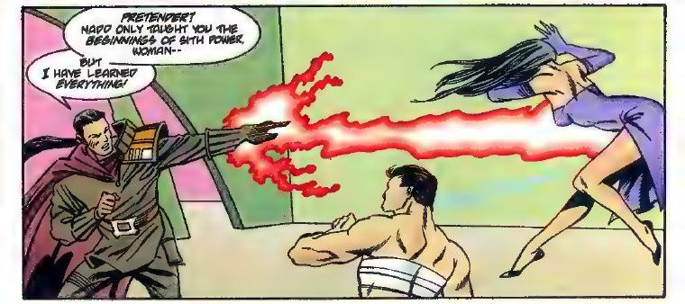
Our notes: `notes/materials/024-tales-of-the-jedi/dark-lords-of-the-sith.md:70`

> MY CHILDREN--I COME TO WARN YOU! IT IS NOT QEL-DROMA YOU MUST FEAR!
>
> BEWARE OF EXAR KUN. HE HAS ACQUIRED GREAT SITH POWERS AND HE HAS AMBITION WITHOUT LIMIT--
> [fragment — full passage not on file]
>
> I NOW DECLARE IT...EXAR KUN IS A PRETENDER TO THE SITH LEGACY...
> [fragment — full passage not on file]
>
> ...THE REAL POWER OF THE SITH RESTS WITH YOU...THREE...
> [fragment — full passage not on file]
— Source: Owner Material 024b — Tales of the Jedi: Dark Lords of the Sith #1–6 (1994–95): power-scaling notes; Freedon Nadd's spirit (dying) to Satal and Aleema Keto. POV: Freedon Nadd's spirit, about Aleema Keto.
Note (our notes, around the quote): Freedon Nadd's spirit (dying) to Satal and Aleema Keto: "MY CHILDREN--I COME TO WARN YOU! IT IS NOT QEL-DROMA YOU MUST FEAR!" "BEWARE OF EXAR KUN. HE HAS ACQUIRED GREAT SITH POWERS AND HE HAS AMBITION WITHOUT LIMIT--" "I NOW DECLARE IT...EXAR KUN IS A PRETENDER TO THE SITH LEGACY..." "...THE REAL POWER OF THE SITH RESTS WITH YOU...THREE..." Source: Dark Lords of the Sith #4, p26
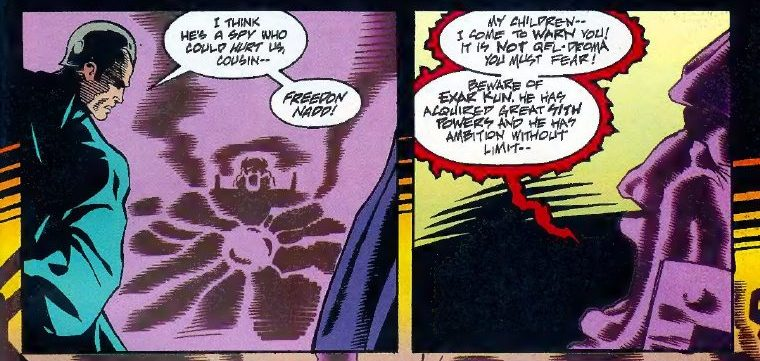
Our notes: `notes/materials/024-tales-of-the-jedi/dark-lords-of-the-sith.md:94`

> PRETENDER? NADD ONLY TAUGHT YOU THE BEGINNINGS OF SITH POWER, WOMAN--
> [fragment — full passage not on file]
>
> BUT I HAVE LEARNED EVERYTHING!
> [fragment — full passage not on file]
— Source: Dark Lords of the Sith #6, p23 — Owner Material 024b — Tales of the Jedi: Dark Lords of the Sith #1–6 (1994–95): power-scaling notes; Exar Kun to Aleema Keto. POV: Exar Kun, about Aleema Keto.
Note (our notes, around the quote): Exar Kun to Aleema Keto: "PRETENDER? NADD ONLY TAUGHT YOU THE BEGINNINGS OF SITH POWER, WOMAN--" "BUT I HAVE LEARNED EVERYTHING!" Source: Dark Lords of the Sith #6, p23
Our notes: `notes/materials/024-tales-of-the-jedi/dark-lords-of-the-sith.md:100`

> --IS BRUSHED ASIDE...HE MUST SAVE ALEEMA!
> [fragment — full passage not on file]
>
> HOW WOULD HE KNOW SHE PLANNED THE WHOLE THING?
— Source: Owner Material 024b — Tales of the Jedi: Dark Lords of the Sith #1–6 (1994–95): power-scaling notes; Narration on Ulic Qel-Droma and Aleema Keto. POV: narrator, about Aleema Keto.
Note (our notes, around the quote): Narration on Ulic Qel-Droma and Aleema Keto: "--IS BRUSHED ASIDE...HE MUST SAVE ALEEMA!" "HOW WOULD HE KNOW SHE PLANNED THE WHOLE THING?" · NARRATION. Source: Dark Lords of the Sith #4, p21
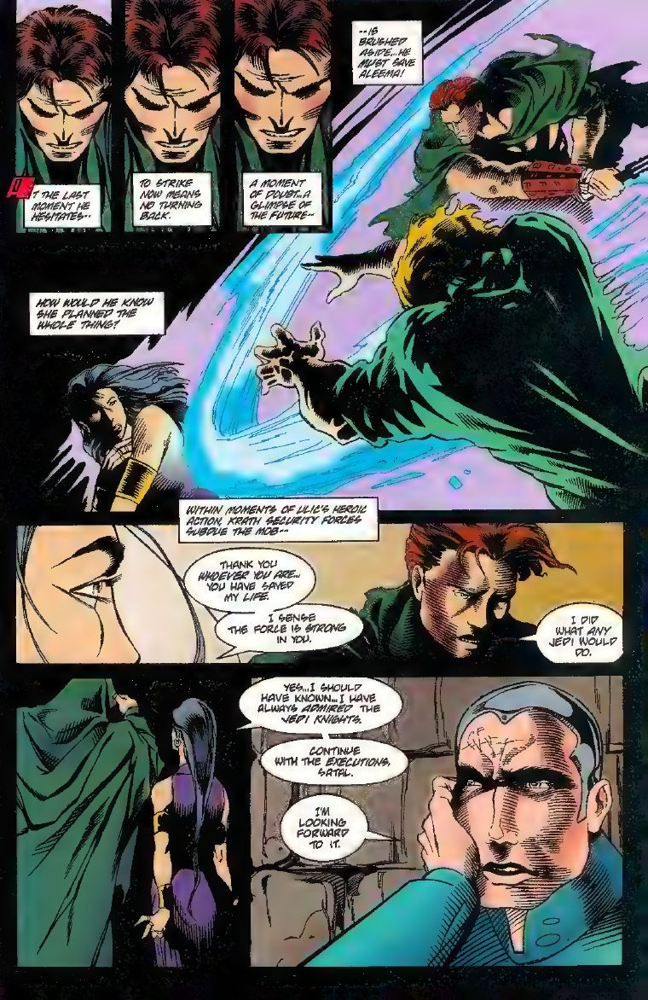
Our notes: `notes/materials/024-tales-of-the-jedi/dark-lords-of-the-sith.md:131`

- Note (summary from our notes, not a quotation): Tears apart Aleema Keto's illusion with "FINGERS OF BRIGHT FORCE". Source: Dark Lords of the Sith #2, p24–25
  — Source: Owner Material 024b — Tales of the Jedi: Dark Lords of the Sith #1–6 (1994–95): power-scaling notes.
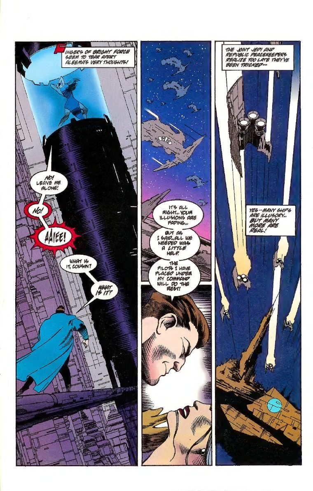
Our notes: `notes/materials/024-tales-of-the-jedi/dark-lords-of-the-sith.md:144`

- Note (summary from our notes, not a quotation): Battle meditation dissolves Aleema's illusions during the Cinnagar raid. Source: Dark Lords of the Sith #6, p16
  — Source: Owner Material 024b — Tales of the Jedi: Dark Lords of the Sith #1–6 (1994–95): power-scaling notes.

Our notes: `notes/materials/024-tales-of-the-jedi/dark-lords-of-the-sith.md:148`

- Note (summary from our notes, not a quotation): Kills Lord Korus with dark-side energy. Source: Dark Lords of the Sith #1, p16
  — Source: Owner Material 024b — Tales of the Jedi: Dark Lords of the Sith #1–6 (1994–95): power-scaling notes.
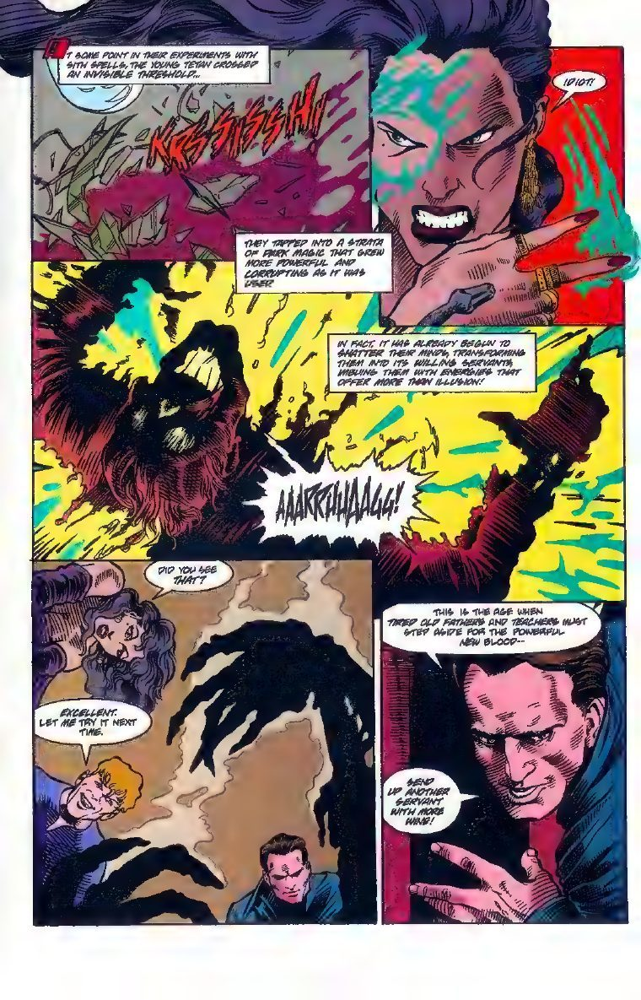
Our notes: `notes/materials/024-tales-of-the-jedi/dark-lords-of-the-sith.md:162`

- Note (summary from our notes, not a quotation): Krath illusions (space-grazers, false armies) deceive the Republic fleet until Nomi sees through them. Source: Dark Lords of the Sith #2, p12–14
  — Source: Owner Material 024b — Tales of the Jedi: Dark Lords of the Sith #1–6 (1994–95): power-scaling notes.
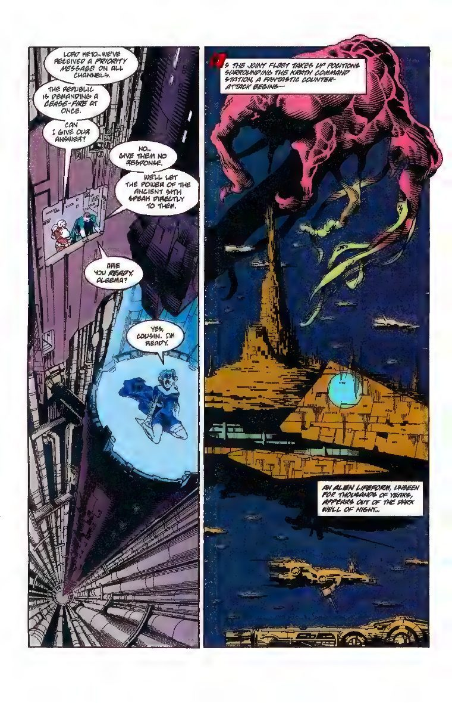
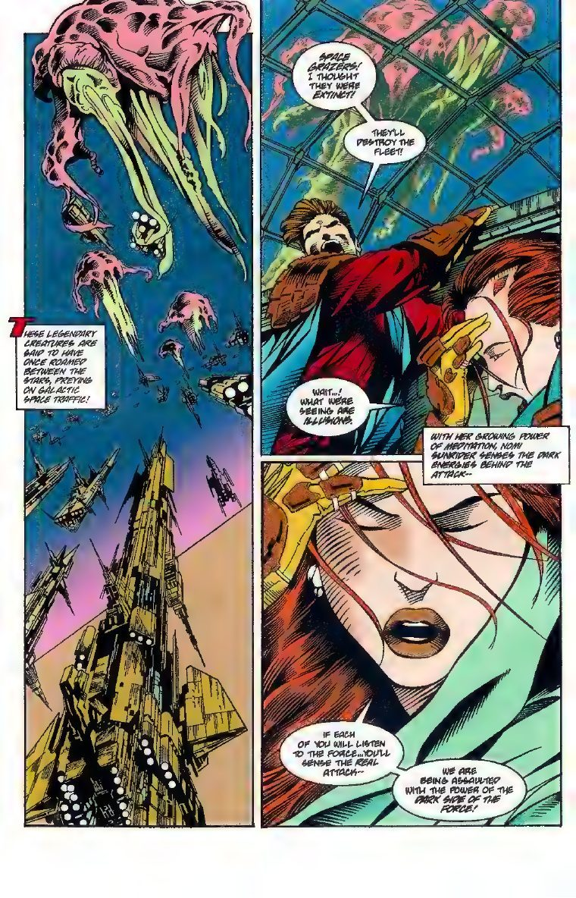
Our notes: `notes/materials/024-tales-of-the-jedi/dark-lords-of-the-sith.md:164`

> I HAVE LEARNED EVERYTHING!
> [fragment — full passage not on file]
— Source: Dark Lords of the Sith #6, p23 — Owner Material 024b — Tales of the Jedi: Dark Lords of the Sith #1–6 (1994–95): power-scaling notes; Blasted across the room by Exar Kun (.
Note (our notes, around the quote): Blasted across the room by Exar Kun ("I HAVE LEARNED EVERYTHING!"). Source: Dark Lords of the Sith #6, p23
Our notes: `notes/materials/024-tales-of-the-jedi/dark-lords-of-the-sith.md:169`

- Note (summary from our notes, not a quotation): Stages her own "public execution" rescue so Ulic will join the Krath. Source: Dark Lords of the Sith #4, p17–21
  — Source: Dark Lords of the Sith #4, p17–21 — Owner Material 024b — Tales of the Jedi: Dark Lords of the Sith #1–6 (1994–95): power-scaling notes.
Our notes: `notes/materials/024-tales-of-the-jedi/dark-lords-of-the-sith.md:170`

> SATAL AND ALEEMA... I AM NADD.
> [fragment — full passage not on file]
>
> YOU MAY KEEP THE BOOK... AND THE TALISMAN.
> [fragment — full passage not on file]
>
> BOTH RIGHTFULLY BELONG TO YOU.
> [fragment — full passage not on file]
>
> AS DO THESE SWORDS OF THE SITH.
>
> KING OMMIN WILL NO LONGER NEED THEM.
— Source: Freedon Nadd Uprising #2, p18 — Owner Material 024a — Tales of the Jedi: The Freedon Nadd Uprising #1–2 (1994): power-scaling notes.
Note (our notes, around the quote): Spirit appears to Satal and Aleema Keto and gives them the Sith book, the talisman and two Sith swords: "SATAL AND ALEEMA... I AM NADD." "YOU MAY KEEP THE BOOK... AND THE TALISMAN." "BOTH RIGHTFULLY BELONG TO YOU." "AS DO THESE SWORDS OF THE SITH." "KING OMMIN WILL NO LONGER NEED THEM." Source: Freedon Nadd Uprising #2, p18
Our notes: `notes/materials/024-tales-of-the-jedi/freedon-nadd-uprising.md:66`

> OMMIN WAS RIGHT... YOU ARE THE FUTURE OF MY WORK...
> [fragment — full passage not on file]
>
> NOW LEAVE... THIS PASSAGE WILL BRING YOU TO THE SURFACE!
> [fragment — full passage not on file]
— Source: Freedon Nadd Uprising #2, p18 — Owner Material 024a — Tales of the Jedi: The Freedon Nadd Uprising #1–2 (1994): power-scaling notes; Freedon Nadd's spirit to Satal and Aleema Keto. POV: Freedon Nadd's spirit, about Aleema Keto.
Note (our notes, around the quote): Freedon Nadd's spirit to Satal and Aleema Keto: "OMMIN WAS RIGHT... YOU ARE THE FUTURE OF MY WORK..." "NOW LEAVE... THIS PASSAGE WILL BRING YOU TO THE SURFACE!" Source: Freedon Nadd Uprising #2, p18
Our notes: `notes/materials/024-tales-of-the-jedi/freedon-nadd-uprising.md:72`

> THEY WERE LEFT TO ME BY MY ANCIENT FOREBEAR, FREEDON NADD.
— Source: Owner Material 024a — Tales of the Jedi: The Freedon Nadd Uprising #1–2 (1994): power-scaling notes. POV: Ommin, about Aleema Keto.
Note (our notes, around the quote): Ommin about Freedon Nadd: "HERE LET ME SHOW YOU MY WONDERFUL AMULETS--" "THEY WERE LEFT TO ME BY MY ANCIENT FOREBEAR, FREEDON NADD." Source: Freedon Nadd Uprising #2, p11
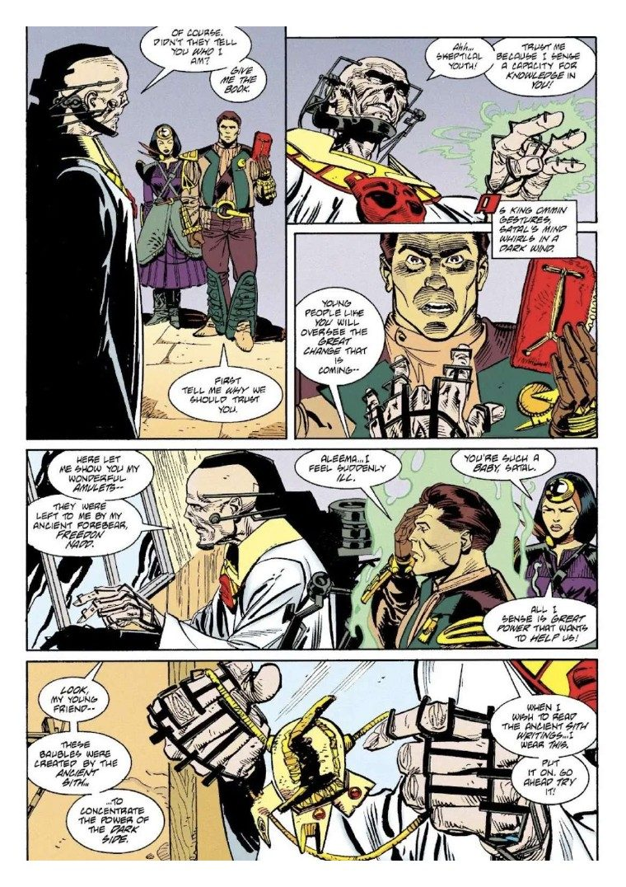
Our notes: `notes/materials/024-tales-of-the-jedi/freedon-nadd-uprising.md:81`

> AS KING OMMIN GESTURES, SATAL'S MIND WHIRLS IN A DARK WIND.
— Source: Owner Material 024a — Tales of the Jedi: The Freedon Nadd Uprising #1–2 (1994): power-scaling notes; Makes Satal's mind whirl with a gesture. POV: narrator, about Aleema Keto.
Note (our notes, around the quote): Makes Satal's mind whirl with a gesture: "AS KING OMMIN GESTURES, SATAL'S MIND WHIRLS IN A DARK WIND." · NARRATION. Source: Freedon Nadd Uprising #2, p11

Our notes: `notes/materials/024-tales-of-the-jedi/freedon-nadd-uprising.md:100`

> YES... I WONDER IF ANYONE BUT US CAN FEEL IT.
> [fragment — full passage not on file]
— Source: Owner Material 024a — Tales of the Jedi: The Freedon Nadd Uprising #1–2 (1994): power-scaling notes.
Note (our notes, around the quote): Steals a Sith book from the Galactic Museum's "Sith Hall"; Satal: "YES... I WONDER IF ANYONE BUT US CAN FEEL IT." Source: Freedon Nadd Uprising #1, p25–26
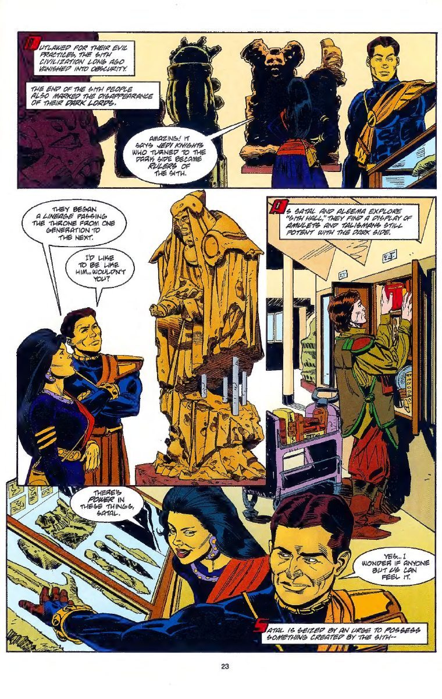
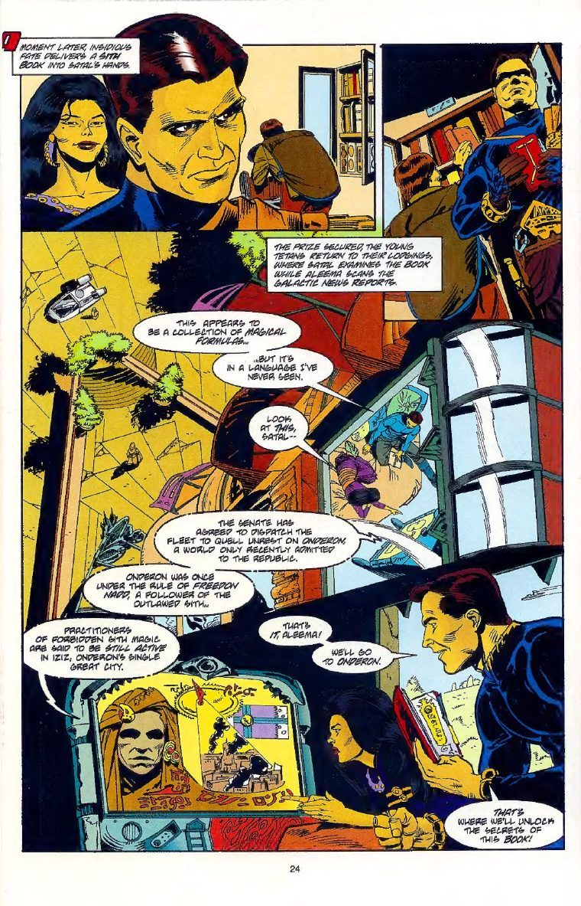
Our notes: `notes/materials/024-tales-of-the-jedi/freedon-nadd-uprising.md:218`

> ALEEMA...I FEEL SUDDENLY ILL.
> [fragment — full passage not on file]
— Source: Owner Material 024a — Tales of the Jedi: The Freedon Nadd Uprising #1–2 (1994): power-scaling notes; Satal Keto. POV: Satal Keto, about Aleema Keto.
Note (our notes, around the quote): Satal Keto: "ALEEMA...I FEEL SUDDENLY ILL." Source: Freedon Nadd Uprising #2, p11

Our notes: `notes/materials/024-tales-of-the-jedi/freedon-nadd-uprising.md:225`

> THERE'S POWER IN THESE THINGS, SATAL.
— Source: Owner Material 024a — Tales of the Jedi: The Freedon Nadd Uprising #1–2 (1994): power-scaling notes; Senses Sith amulets in the museum.
Note (our notes, around the quote): Senses Sith amulets in the museum: "THERE'S POWER IN THESE THINGS, SATAL." Source: Freedon Nadd Uprising #1, p25

Our notes: `notes/materials/024-tales-of-the-jedi/freedon-nadd-uprising.md:230`

> AS A WAY OF AMUSING THEMSELVES, THE INDOLENT YOUNG ARISTOCRATS HAVE BEEN DABBLING IN THE LORE OF MAGIC.
— Source: Owner Material 024a — Tales of the Jedi: The Freedon Nadd Uprising #1–2 (1994): power-scaling notes; Narration on Satal Keto and Aleema Keto. POV: narrator, about Aleema Keto.
Note (our notes, around the quote): Narration on Satal Keto and Aleema Keto: "AS A WAY OF AMUSING THEMSELVES, THE INDOLENT YOUNG ARISTOCRATS HAVE BEEN DABBLING IN THE LORE OF MAGIC." · NARRATION. Source: Freedon Nadd Uprising #1, p24
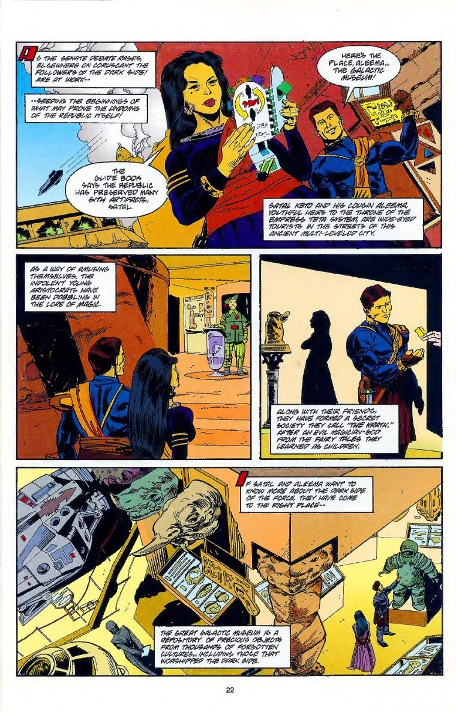
Our notes: `notes/materials/024-tales-of-the-jedi/freedon-nadd-uprising.md:232`

> CAN'T YOU FEEL IT? THERE IS POWER HERE... WAITING FOR US.
> [fragment — full passage not on file]
>
> I TELL YOU WE WILL BECOME INVINCIBLE!
— Source: Owner Material 024a — Tales of the Jedi: The Freedon Nadd Uprising #1–2 (1994): power-scaling notes; Senses the dark side on Onderon.
Note (our notes, around the quote): Senses the dark side on Onderon: "CAN'T YOU FEEL IT? THERE IS POWER HERE... WAITING FOR US." "I TELL YOU WE WILL BECOME INVINCIBLE!" Source: Freedon Nadd Uprising #2, p3
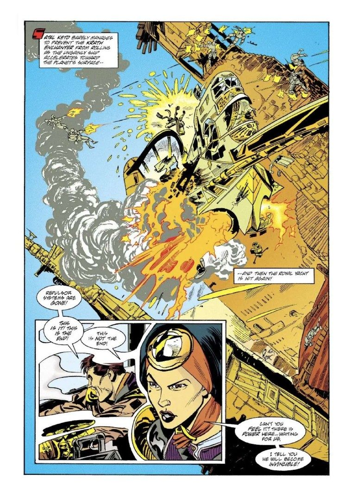
Our notes: `notes/materials/024-tales-of-the-jedi/freedon-nadd-uprising.md:234`

> ALL I SENSE IS GREAT POWER THAT WANTS TO HELP US!
— Source: Owner Material 024a — Tales of the Jedi: The Freedon Nadd Uprising #1–2 (1994): power-scaling notes; Aleema Keto in Ommin's lair. POV: Aleema Keto in Ommin's lair.
Note (our notes, around the quote): Aleema Keto in Ommin's lair: "ALL I SENSE IS GREAT POWER THAT WANTS TO HELP US!" Source: Freedon Nadd Uprising #2, p11

Our notes: `notes/materials/024-tales-of-the-jedi/freedon-nadd-uprising.md:236`

- Note (summary from our notes, not a quotation): Coverage: the book covers *Tales of the Jedi* up to *The Freedon Nadd Uprising* only. It came out before *Dark Lords of the Sith* and *The Sith War* were collected. So it has no stat block for Exar Kun, and he is named only once (p.78). There are also no stat blocks for Naga Sadow, Aleema, Satal or Mandalore.
  — Source: Owner Material 024d — Tales of the Jedi Companion (West End Games, 1996): power-scaling notes.
Our notes: `notes/materials/024-tales-of-the-jedi/tales-of-the-jedi-companion.md:12`

> the spirit of Freedon Nadd appears to Satal and Aleema, giving them the book, the amulet, and a pair of Sith swords.
> [fragment — full passage not on file]
— Source: Owner Material 024d — Tales of the Jedi Companion (West End Games, 1996): power-scaling notes; FNU summary. POV: FNU summary.
Note (our notes, around the quote): FNU summary: "the spirit of Freedon Nadd appears to Satal and Aleema, giving them the book, the amulet, and a pair of Sith swords." Source: Tales of the Jedi Companion (WEG, 1996), p.15
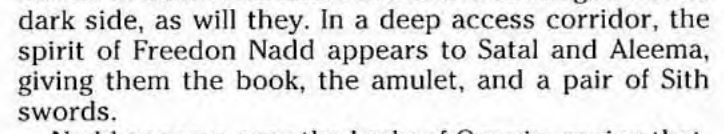
Our notes: `notes/materials/024-tales-of-the-jedi/tales-of-the-jedi-companion.md:100`

- Note (summary from our notes, not a quotation): | #2 | 1–29 | (2 of 6) | Kemplex Nine, Yavin 4, Coruscant | Exar crushes the Sith holocron and possesses his students with Sith spirits. Coruscant assault; Aleema betrays Ulic; Vodo, Nomi and the Jedi block Ulic with a wall of light. |
  — Source: Owner Material 024c — Tales of the Jedi: The Sith War #1–6 (1995–96): power-scaling notes.
Context: | Issue | PDF pages | Title | Setting | Main events |
Our notes: `notes/materials/024-tales-of-the-jedi/the-sith-war.md:16`

- Note (summary from our notes, not a quotation): | #4 | 1–26 | Jedi Holocaust | Ambria, galaxy montage, Cron Cluster | Oss Wilum and Crado attack Thon; Sylvar claws Crado. Students murder their masters. Aleema rips a star's core out and kills Dace, Shoaneb and Qrrrl Toq; the Cron supernova kills Aleema and Crado. |
  — Source: Owner Material 024c — Tales of the Jedi: The Sith War #1–6 (1995–96): power-scaling notes.
Context: | Issue | PDF pages | Title | Setting | Main events |
Our notes: `notes/materials/024-tales-of-the-jedi/the-sith-war.md:18`

> NEVER TO UNDERESTIMATE THE POWER OF THE SITH! *(p27)*
— Source: Owner Material 024c — Tales of the Jedi: The Sith War #1–6 (1995–96): power-scaling notes.
Note (our notes, around the quote): Kemplex Nine ruse; Vanicus and Netus (p4–7). On Yavin 4 Oss Wilum resists, Exar crushes the Sith holocron and Sith spirits possess the students (p8–15). Coruscant assault: Mandalore steals the MK prototype, Ulic seizes the war room, Aleema betrays him (p16–23). Vodo, Nomi and the Jedi block Ulic (p24–25). Exar: "NEVER TO UNDERESTIMATE THE POWER OF THE SITH!" (p27).
Our notes: `notes/materials/024-tales-of-the-jedi/the-sith-war.md:31`

- Note (summary from our notes, not a quotation): Vodo splits a rock (p4). Aleema's serpent eats dissenters (p5). Ulic's trial (p9–14); Exar orders the masters killed (p10–11). Exar's Sith spell freezes the Senate (p15–16); Sylvar claws through Massassi (p17); Exar stops, puppets and kills the Senate leader (p18–20). Exar kills Vodo (p21–25) and Force-hurls Sylvar (p26).
  — Source: Owner Material 024c — Tales of the Jedi: The Sith War #1–6 (1995–96): power-scaling notes.
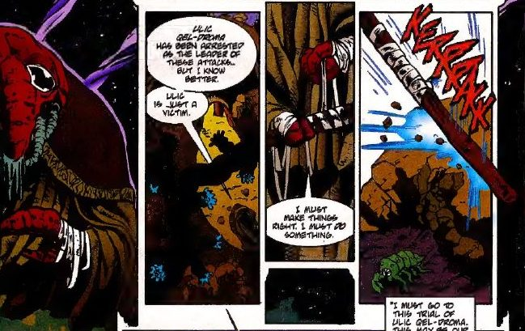
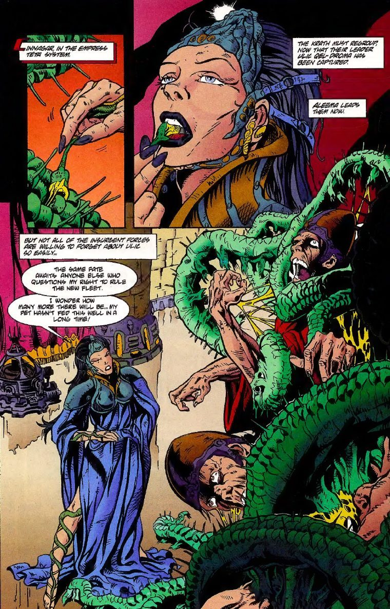
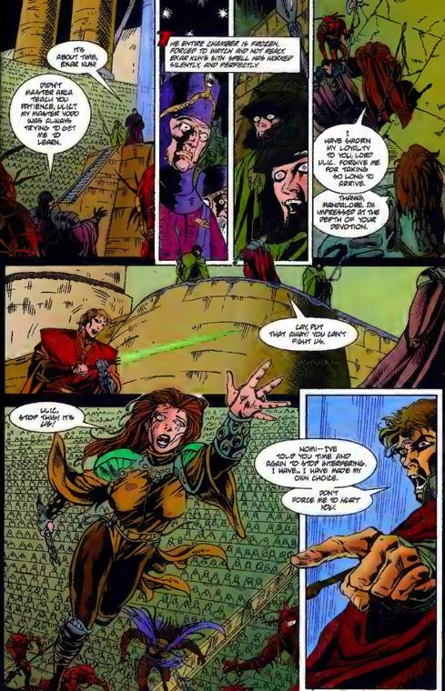
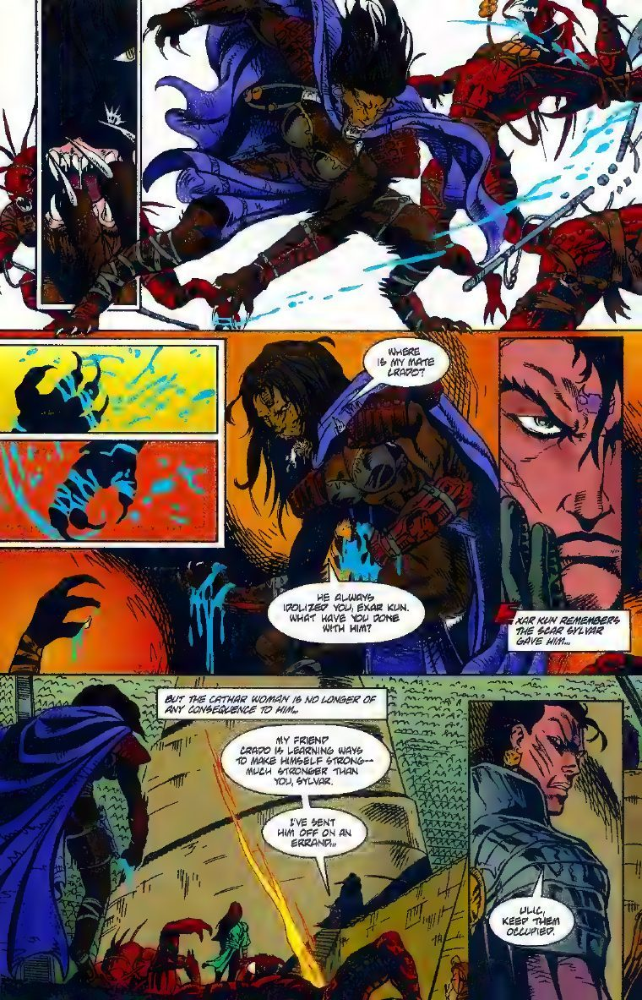
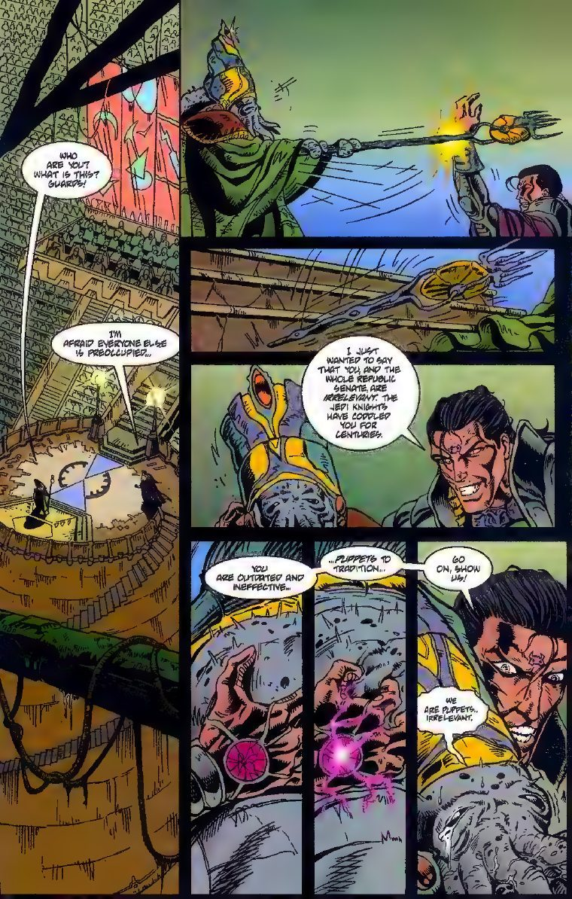
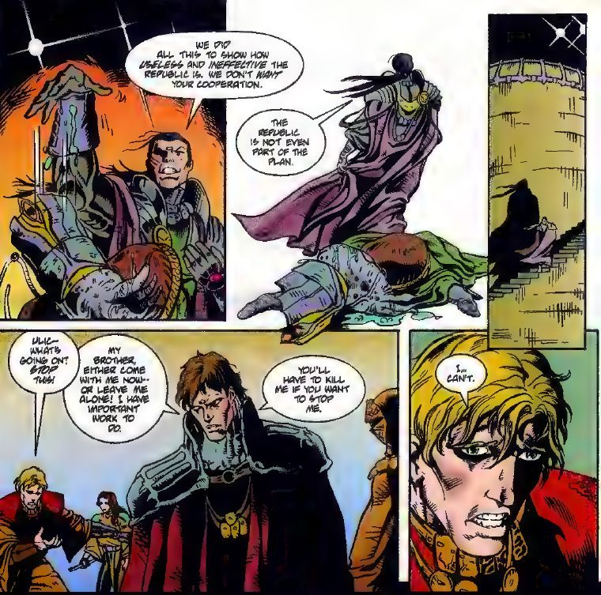
Our notes: `notes/materials/024-tales-of-the-jedi/the-sith-war.md:34`

- Note (summary from our notes, not a quotation): Shows Aleema how to use Naga Sadow's ship ("THE POWER TO WRENCH FIRE FROM THE STARS"); the plan uses her to trigger the Cron supernova. Source: The Sith War #4, p15–24
  — Source: Owner Material 024c — Tales of the Jedi: The Sith War #1–6 (1995–96): power-scaling notes.
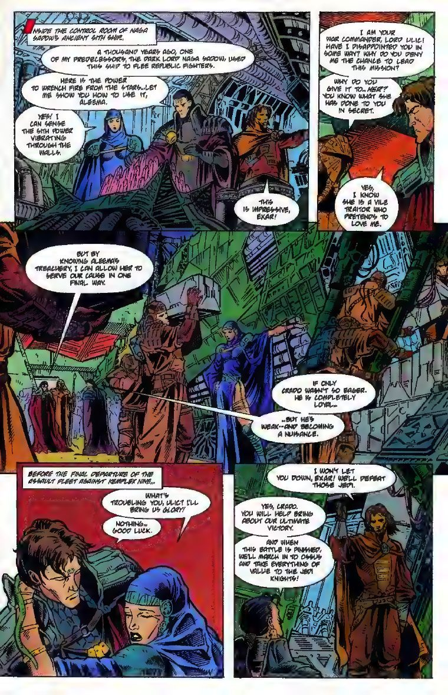
Our notes: `notes/materials/024-tales-of-the-jedi/the-sith-war.md:60`

> YES, I KNOW SHE IS A VILE TRAITOR WHO PRETENDS TO LOVE ME.
>
> BUT BY KNOWING ALEEMA'S TREACHERY, I CAN ALLOW HER TO SERVE OUR CAUSE IN ONE FINAL WAY.
— Source: The Sith War #4, p15 — Owner Material 024c — Tales of the Jedi: The Sith War #1–6 (1995–96): power-scaling notes; Ulic Qel-Droma about Aleema Keto. POV: Ulic Qel-Droma, about Aleema Keto.
Note (our notes, around the quote): Ulic Qel-Droma about Aleema Keto: "YES, I KNOW SHE IS A VILE TRAITOR WHO PRETENDS TO LOVE ME." "BUT BY KNOWING ALEEMA'S TREACHERY, I CAN ALLOW HER TO SERVE OUR CAUSE IN ONE FINAL WAY." Source: The Sith War #4, p15
Our notes: `notes/materials/024-tales-of-the-jedi/the-sith-war.md:123`

- Note (summary from our notes, not a quotation): Using Naga Sadow's ship, rips the core out of one of the ten Cron stars and hurls it at the pursuing Jedi, killing Dace Diath, Shoaneb Culu and Qrrrl Toq. Source: The Sith War #4, p17–22
  — Source: The Sith War #4, p17–22 — Owner Material 024c — Tales of the Jedi: The Sith War #1–6 (1995–96): power-scaling notes.
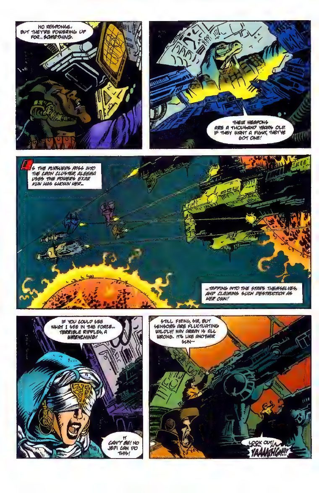
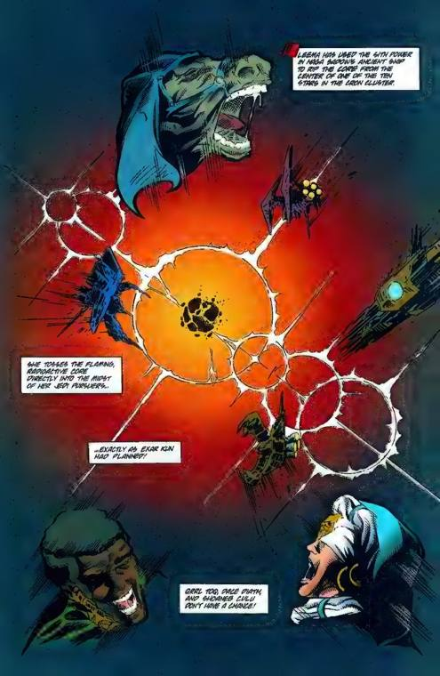
Our notes: `notes/materials/024-tales-of-the-jedi/the-sith-war.md:149`

> ALEEMA HAS USED THE SITH POWER IN NAGA SADOW'S ANCIENT SHIP TO RIP THE CORE FROM THE CENTER OF ONE OF THE TEN STARS IN THE CRON CLUSTER.
>
> SHE TOSSES THE FLAMING, RADIOACTIVE CORE DIRECTLY INTO THE MIDST OF HER JEDI PURSUERS...
> [fragment — full passage not on file]
>
> ...EXACTLY AS EXAR KUN HAD PLANNED!
> [fragment — full passage not on file]
— Source: The Sith War #4, p21 — Owner Material 024c — Tales of the Jedi: The Sith War #1–6 (1995–96): power-scaling notes; Narration on Aleema Keto. POV: narrator, about Aleema Keto.
Note (our notes, around the quote): Narration on Aleema Keto: "ALEEMA HAS USED THE SITH POWER IN NAGA SADOW'S ANCIENT SHIP TO RIP THE CORE FROM THE CENTER OF ONE OF THE TEN STARS IN THE CRON CLUSTER." "SHE TOSSES THE FLAMING, RADIOACTIVE CORE DIRECTLY INTO THE MIDST OF HER JEDI PURSUERS..." "...EXACTLY AS EXAR KUN HAD PLANNED!" · NARRATION. Source: The Sith War #4, p21

Our notes: `notes/materials/024-tales-of-the-jedi/the-sith-war.md:150`

- Note (summary from our notes, not a quotation): Her serpent illusion/creature devours Krath dissenters. Source: The Sith War #3, p5
  — Source: Owner Material 024c — Tales of the Jedi: The Sith War #1–6 (1995–96): power-scaling notes.

Our notes: `notes/materials/024-tales-of-the-jedi/the-sith-war.md:151`

> IN HER LAST MOMENTS, ALEEMA SUDDENLY KNOWS THAT HER TREACHERY HAS BEEN EXPOSED!
— Source: The Sith War #4, p24 — Owner Material 024c — Tales of the Jedi: The Sith War #1–6 (1995–96): power-scaling notes; Killed by the Cron supernova she triggered.
Note (our notes, around the quote): Killed by the Cron supernova she triggered: "IN HER LAST MOMENTS, ALEEMA SUDDENLY KNOWS THAT HER TREACHERY HAS BEEN EXPOSED!" Aleema (burning): "ULIC!" Source: The Sith War #4, p24
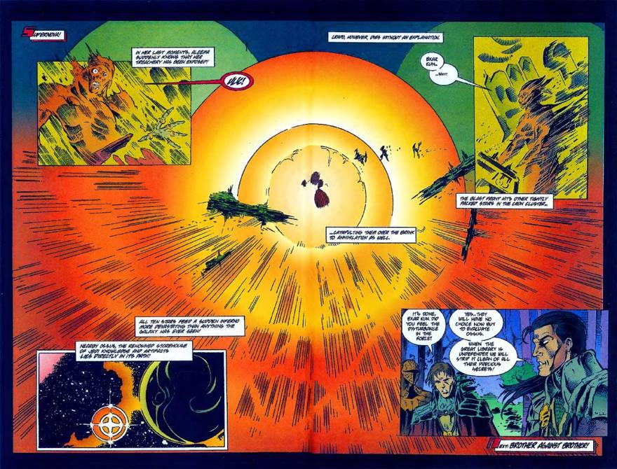
Our notes: `notes/materials/024-tales-of-the-jedi/the-sith-war.md:155`

- Note (summary from our notes, not a quotation): Betrays Ulic during the Coruscant assault; her messenger tells Mandalore "QEL-DROMA IS DEAD". Source: The Sith War #2, p23
  — Source: The Sith War #2, p23 — Owner Material 024c — Tales of the Jedi: The Sith War #1–6 (1995–96): power-scaling notes.
Our notes: `notes/materials/024-tales-of-the-jedi/the-sith-war.md:158`

- Note (summary from our notes, not a quotation): Killed with Shoaneb Culu and Qrrrl Toq ("QREL TOQ") by Aleema's stellar core. Source: The Sith War #4, p21–22
  — Source: The Sith War #4, p21–22 — Owner Material 024c — Tales of the Jedi: The Sith War #1–6 (1995–96): power-scaling notes.
Our notes: `notes/materials/024-tales-of-the-jedi/the-sith-war.md:250`

- Note (summary from our notes, not a quotation): | 9 | Aleema vs Dace, Shoaneb, Qrrrl Toq | Cron Cluster | p17–22 (#4) | All three killed | Sadow's ship, stellar core |
  — Source: Owner Material 024c — Tales of the Jedi: The Sith War #1–6 (1995–96): power-scaling notes.
Context: | # | Fight | Where | Pages (issue) | Outcome | Conditions |
Our notes: `notes/materials/024-tales-of-the-jedi/the-sith-war.md:277`

- Note (summary from our notes, not a quotation): 
  — Source: Owner Material 024c — Tales of the Jedi: The Sith War #1–6 (1995–96): power-scaling notes.
Our notes: `notes/materials/024-tales-of-the-jedi/the-sith-war.md:315`

- Note (summary from our notes, not a quotation): 
  — Source: Owner Material 024c — Tales of the Jedi: The Sith War #1–6 (1995–96): power-scaling notes.
Our notes: `notes/materials/024-tales-of-the-jedi/the-sith-war.md:317`

## Star Wars: The New Essential Chronology (Del Rey, 2005): power-scaling and lore notes

> Ulic and Nomi assisted by using their Jedi abilities—but Aleema countered with her own powerful Sith illusions.
— Source: Part One: Tales of the Ancient Republic; Aleema Keto — Aleema's illusions vs Ulic and Nomi.
Note (our notes, around the quote): Aleema Keto — Aleema's illusions vs Ulic and Nomi: "Ulic and Nomi assisted by using their Jedi abilities—but Aleema countered with her own powerful Sith illusions." Source: The New Essential Chronology, p.15
Our notes: `notes/materials/027-new-essential-chronology/01-part-one-ancient-republic.md:105`

> Instead, Ulic killed Keto in a great duel, then took his place beside Aleema as the new ruler of the Krath.
— Source: Part One: Tales of the Ancient Republic; Ulic Qel-Droma; Satal Keto — Ulic kills Satal Keto.
Note (our notes, around the quote): Ulic Qel-Droma; Satal Keto — Ulic kills Satal Keto: "Instead, Ulic killed Keto in a great duel, then took his place beside Aleema as the new ruler of the Krath." Source: The New Essential Chronology, p.17
Our notes: `notes/materials/027-new-essential-chronology/01-part-one-ancient-republic.md:121`

## The Complete Star Wars Encyclopedia, Vol. I (A–G)

- Note (summary from our notes, not a quotation): Page contents: 955 words, 34 paragraphs | headings/entries: Alderaan Biotics; Alderaanian Oversea; Royal Engimeers; Alderaan University; Aldo Spach; Aldraig IV; Aldrete, Agrippa; Aldrete, Alya; Aldrete, Celana; Aleco; Aleema; Aleen; Aleena; Alfex Cargo Stacks; Alfi; Algar
  — Source: scan pages 1–40.
Our notes: `notes/materials/030-complete-star-wars-encyclopedia-vol-1/00-v1-scan-001-040.md:215`

> Crado was killed along with dark sider Aleema ina multiple supernova eruption that they triggered.
— Source: scan pages 161–200; Crado; Aleema Keto — entry/section: Crado.
Note (our notes, around the quote): Crado; Aleema Keto — entry/section: Crado: "Crado was killed along with dark sider Aleema ina multiple supernova eruption that they triggered." Source: The Complete Star Wars Encyclopedia, Vol. I, p.151
Our notes: `notes/materials/030-complete-star-wars-encyclopedia-vol-1/04-v1-scan-161-200.md:51`

> Aleema activated an ancient Sith weapon and ripped the core from one of the stars, hurling it at the Jedi fleet and destroying it.
— Source: scan pages 161–200; Aleema Keto. POV: Aleema Keto.
Note (our notes, around the quote): Aleema Keto: "Aleema activated an ancient Sith weapon and ripped the core from one of the stars, hurling it at the Jedi fleet and destroying it." Source: The Complete Star Wars Encyclopedia, Vol. I, p.153
Our notes: `notes/materials/030-complete-star-wars-encyclopedia-vol-1/04-v1-scan-161-200.md:69`

## The Complete Star Wars Encyclopedia, Vol. II (H–O)

- Note (summary from our notes, not a quotation): Page contents: 1090 words, 26 paragraphs | headings/entries: Kern; Kerrithrarr; Kessel; Kesselrook, Serja; Kessel Run; Kestic Station; Kestrel; Kestrel Nova; Ketaris; Keten; Kether, Ran; Kethor; Keto, Aleema; Keto, Satal
  — Source: scan pages 201–240.
Our notes: `notes/materials/031-complete-star-wars-encyclopedia-vol-2/05-v2-scan-201-240.md:190`

> Jedi Knight Ulic Qel-Droma traveled to the system in order to learn the Krath's secrets, but he succumbed to the dark side himself and helped Aleema defeat her enemies.
— Source: scan pages 201–240; Aleema Keto; Ulic Qel-Droma — entry/section: Keto, Aleema.
Note (our notes, around the quote): Aleema Keto; Ulic Qel-Droma — entry/section: Keto, Aleema: "Jedi Knight Ulic Qel-Droma traveled to the system in order to learn the Krath's secrets, but he succumbed to the dark side himself and helped Aleema defeat her enemies." Source: The Complete Star Wars Encyclopedia, Vol. II, p.213
Our notes: `notes/materials/031-complete-star-wars-encyclopedia-vol-2/05-v2-scan-201-240.md:194`

> Later, Aleema attempted to reassert her power over Krath forces by abandoning Qel-Droma during an attack on Coruscant, but he was rescued and eventually had Aleema killed.
— Source: scan pages 201–240; Aleema Keto — entry/section: Keto, Aleema.
Note (our notes, around the quote): Aleema Keto — entry/section: Keto, Aleema: "Later, Aleema attempted to reassert her power over Krath forces by abandoning Qel-Droma during an attack on Coruscant, but he was rescued and eventually had Aleema killed." Source: The Complete Star Wars Encyclopedia, Vol. II, p.213
Our notes: `notes/materials/031-complete-star-wars-encyclopedia-vol-2/05-v2-scan-201-240.md:196`

> Not long after, Aleema directed so much dark force at Korus that his body exploded.
— Source: scan pages 201–240; Aleema Keto. POV: Aleema Keto.
Note (our notes, around the quote): Aleema Keto: "Not long after, Aleema directed so much dark force at Korus that his body exploded." Source: The Complete Star Wars Encyclopedia, Vol. II, p.228
Our notes: `notes/materials/031-complete-star-wars-encyclopedia-vol-2/05-v2-scan-201-240.md:351`

> But Aleema and fallen Jedi Ulic Qel-Droma survived.
— Source: scan pages 241–280; Aleema Keto; Ulic Qel-Droma.
Note (our notes, around the quote): Aleema Keto; Ulic Qel-Droma: "But Aleema and fallen Jedi Ulic Qel-Droma survived." Source: The Complete Star Wars Encyclopedia, Vol. II, p.236
Our notes: `notes/materials/031-complete-star-wars-encyclopedia-vol-2/06-v2-scan-241-280.md:25`

> Blasting Aleema with dark side power, Kun and Qel-Droma engaged in a blistering lightsaber duel.
— Source: scan pages 241–280; Aleema Keto. POV: Aleema Keto.
Note (our notes, around the quote): Aleema Keto: "Blasting Aleema with dark side power, Kun and Qel-Droma engaged in a blistering lightsaber duel." Source: The Complete Star Wars Encyclopedia, Vol. II, p.236
Our notes: `notes/materials/031-complete-star-wars-encyclopedia-vol-2/06-v2-scan-241-280.md:27`

## Power of the Jedi Sourcebook (d20, 2002)

> Aleema used the ancient Sith weapon to obliterate the detachment and ultimately destroy the Library of Ossus.
— Source: Chapter Six: Jedi traditions and famous Jedi; Aleema Keto. POV: Aleema Keto.
Note (our notes, around the quote): Aleema Keto: "Aleema used the ancient Sith weapon to obliterate the detachment and ultimately destroy the Library of Ossus." Source: Power of the Jedi Sourcebook, p.107
Our notes: `notes/materials/033-power-of-the-jedi-sourcebook/06-ch6-jedi-traditions.md:113`

> Piloted by Aleema, an ancient starship ripped the core out of one of the ten suns of the Cron Cluster and caused a conflagration that destroyed the Library of Ossus.
— Source: Chapter Six: Jedi traditions and famous Jedi; Aleema Keto. POV: Aleema Keto.
Note (our notes, around the quote): Aleema Keto: "Piloted by Aleema, an ancient starship ripped the core out of one of the ten suns of the Cron Cluster and caused a conflagration that destroyed the Library of Ossus." Source: Power of the Jedi Sourcebook, p.108
Our notes: `notes/materials/033-power-of-the-jedi-sourcebook/06-ch6-jedi-traditions.md:122`

- Note (summary from our notes, not a quotation): Page contents: 893 words, 159 paragraphs | headings/entries: Ae; Ne sey aS / ar; Index; Abhean 132; Abraxin 79; Ackbar, Admiral 130; Adega system 135; Adegan crystals 104, 107, 155; Advozse 112, 113; Afarathu 108; AgriCorps worker 86; Alderaan 10, 64, 110; Aleema 107; Almania 83, 127; Amanoa, Queen 7, 100, 103, 104, 105; Ambria 101, 104, 105, 106, 145-147; Anselmi 71; Arkanian 64, 73, 100; Ashla, the 6; Asmeru 113, 114, 118; Assant, Darsha 121; Auril sector 135; Baltimn 150, 151; Bane, Darth 9; Battle Influence 12; Battle Meditation 15; Beast Language 15; Belasco 116; Bespin 128; Billaba, Depa 114; Black Sun 121; Bnar, Ood 136; Bondara, Anoon 121, 122, 124; Bouri, Omo 118; Brotherhood of Darkness 9, 141, 153; Caamasi 64, 110; Callista 9, 130; Carida 131; Cathar 65; Celegian 66, 98; Cerean 119; Chalactan 114; Chatos Academy 6; Chewbacca 11; Cho Leem, Thracia 123; Chu'unthor 132-135; Cilghal 11, 130; Cinnagar 8, 98, 103; Core Worlds 6, 7, 9, 70, 130
  — Source: Chapter Seven: Where the Force is strong; Index.
Our notes: `notes/materials/033-power-of-the-jedi-sourcebook/07-ch7-locations-index.md:176`

- Note (summary from our notes, not a quotation): Page contents: 977 words, 210 paragraphs | headings/entries: Kenzon, Ephaan 152, 153; Kerilt 64; Keto, Aleema 8; Keto, Satal 8; Khommite 67; Ki-Adi-Mundi 117, 119, 120; Kiffar 17, 123, 124; Kil'qiy, Surenit 32; Kirrek 7, 98; Koba system 112; Koon, Plo 113, 117, 124; Koros system 98, 99; Koros Major 103, 106; Korriban 102; Koth, Eeth 114; Krevaaki 68, 102; Kushiban 68, 129; Kut, Plovin 112; Lah, Tsavong 139; Lannik 69, 113, 117; Lowbacca 11; Madine, Crix 131; Malacia 13, 118; Malastare 113, 116, 117; Mandalore 102; Mar, Easal 132; Marspa, Master 33; Massassi 7, 8, 98, 138, 139; Maul, Darth 43; MedCorps worker 94; Meditative Canyon on Ambria 145-147; Mid Rim 76, 79, 132, 153; Miraluka 70, 107; Mirial 127, 128; Mon Calamari 130; Mon, Ephant 119; Morichro 16, 113; Mothma, Mon 11, 130, 131; Nadill, Memit 7, 99; Nam Chorios 78; Nam Priax 77; Nar Shaddaa 114, 123; Nautolan 71, 125; Nazzar 72; Nebulon Front 113, 114; Nebulon Ranger 59, 103, 104, 105; Neti
  — Source: Chapter Seven: Where the Force is strong; Index.
Our notes: `notes/materials/033-power-of-the-jedi-sourcebook/07-ch7-locations-index.md:181`

## Dark Side Sourcebook (d20, 2001)

> Along with their friends, the pair dabbled in Sith magic and amused themselves with artifacts from the time of the Great Hyperspace War. To gain more power, Aleema persuaded Satal to steal an ancient book of Sith secrets from a Coruscant museum, but they couldn't read the text. They went in search of someone who could. Armed with rumors of Sith practitioners on Onderon, the two aristocrats used their money and novice dark side skills to reach King Ommin. The delighted ruler gave Satal a Sith amulet and had a scribe start work on translating the arcane tome. The specter of Freedon Nadd had been assisting King Ommin, but decided that Satal and Aleema held the key to resurrecting the golden age of the Sith. The dark side avatar appeared before the pair and offered to guide them in their rise to power. Spurred on and encouraged by the spirit's attention, Satal and his cousin extracted a wealth of Sith artifacts and returned to the Empress Teta system. Nadd's spirit, meanwhile, was trapped within an armored tomb on the moon of Dxun. With the artifacts and Sith tome in hand, Satal and Aleema quickly grew in dark side power.
— Source: Chapter Five: Dark Side Traditions (Sith Empire, Set Harth, prophets, Brakiss…); Freedon Nadd; King Ommin; Satal Keto; Aleema Keto.
(Excerpt widened 2026-11-17 to the relevant passage, word for word from research primary dark side sourcebook dss (text copy `research_primary_dark_side_sourcebook_dss_pdf_9cd3453f4a`).)
(Excerpt widened 2026-11-17 to the relevant passage, word for word from research primary dark side sourcebook dss (text copy `research_primary_dark_side_sourcebook_dss_pdf_9cd3453f4a`).)
Note (our notes, around the quote): Freedon Nadd; King Ommin; Satal Keto; Aleema Keto: "The specter of Freedon Nadd had been assisting King Ommin, but decided that Satal and Aleema held the key to resurrecting the golden age of the Sith." Source: Dark Side Sourcebook, p.74
Our notes: `notes/materials/035-dark-side-sourcebook/05-ch5-traditions.md:53`

> They led a rebellion against the government of the Empress Teta system, killing Satal's parents and delighting in the use of their newfound abilities. Barbaric, evil, and totally despotic, the pair spread fear and suffering throughout the system as the inhabited worlds revolted. Republic forces, assisted by Jedi Knights Ulic Qel- Drorna and Nomi Sunrider, tried to put an end to the violence, but Aleema used powerful Sith illusions to confuse and confound the unwanted intruders. Later, Ulic disguised himself as a fallen Jedi and made his way to Satal and Aleema's stronghold in the city of Cinnagar. An assassin threatened to end Aleema's life, but Ulic intervened. He killed the assassin and was accepted into the usurper's sect by the beautiful Aleema. Satal, jealous and suspicious of Ulic, tortured the Jedi, seeking to make him confess to being a spy. Even under the influence of Sith poison, Ulic denied the charges, though his mind was clouded by the foul substance. Aleema scoffed at Satal's suspicions and made Ulic general of their military forces-and her personal pet Jedi. When Satal Keto eventually discovered Ulic's true plans, he confronted the fallen Jedi in a great duel that had terrible repercussions: Ulic unleashed his fury, killing Satal but completing his slide to the dark side.
— Source: Chapter Five: Dark Side Traditions (Sith Empire, Set Harth, prophets, Brakiss…); Aleema Keto. POV: Aleema Keto.
(Excerpt widened 2026-11-17 to the relevant passage, word for word from research primary dark side sourcebook dss (text copy `research_primary_dark_side_sourcebook_dss_pdf_9cd3453f4a`).)
(Excerpt widened 2026-11-17 to the relevant passage, word for word from research primary dark side sourcebook dss (text copy `research_primary_dark_side_sourcebook_dss_pdf_9cd3453f4a`).)
Note (our notes, around the quote): Aleema Keto: "He killed the assassin and was accepted into the usurper's sect by the beautiful Aleema." Source: Dark Side Sourcebook, p.75
Our notes: `notes/materials/035-dark-side-sourcebook/05-ch5-traditions.md:60`

> Feats: Dark Side Skill Emphasis (Fear), Dark Side Skill Emphasis (Force Grip), Force-Sensitive, Iron Will, Persuasive, Weapon Group Proficiency (blaster pistols), Weapon Group Proficiency (simple weapons). Force Feats: Alter, Control, Sense, Sith Sorcery. Ulic Qel-Droma, Former Jedi Hnight, Sith Lord Almost four thousand years before the coming of Darth Vader, two other Jedi Knights embraced the dark side, eventually challenging and almost decimating the ranks of the Jedi Order they once loyally served. One, Exar Kun, turned to the dark side in a quest for knowledge long forbidden by the Order. The other, Ulic Qel-Droma, sought to destroy the dark side sect of Satal and Aleema Keto frorn the inside, only to be turned to evil himself by dark side poison. By the time he was finally defeated, Ulic Qel-Droma had become a formidable Dark Lord of the Sith, second only to his partner Exar Kun. Ulic and his brother Cay Qel-Droma trained under Jedi Master Arca Jeth on the world of Arkania, alongside a Twi'lek Jedi named Tott Doneeta. Master Arca sent the three Jedi students to the world of Onderon to settle the dispute between Iziz and the beast-riders of Onderon. Ulic encountered the dark side spirit of Freedon Nadd in the Sith storehouses below the royal palace.
— Source: Chapter Five: Dark Side Traditions (Sith Empire, Set Harth, prophets, Brakiss…).
(Excerpt widened 2026-11-17 to the relevant passage, word for word from research primary dark side sourcebook dss (text copy `research_primary_dark_side_sourcebook_dss_pdf_9cd3453f4a`).)
(Excerpt widened 2026-11-17 to the relevant passage, word for word from research primary dark side sourcebook dss (text copy `research_primary_dark_side_sourcebook_dss_pdf_9cd3453f4a`).)
Note (our notes, around the quote): Ulic Qel-Droma; Satal Keto; Aleema Keto — entry/section: Ulic Qel-Droma, Former Jedi Hnight, Sith Lord: "The other, Ulic Qel-Droma, sought to destroy the dark side sect of Satal and Aleema Keto frorn the inside, only to be turned to evil himself by dark side poison." Source: Dark Side Sourcebook, p.75
Our notes: `notes/materials/035-dark-side-sourcebook/05-ch5-traditions.md:66`

## Jedi Counselling/Jedi Counseling 41 - Fake Death Stars.pdf [Star Wars Roleplaying Game Revised Core (d20, 2002)]

- Note (summary from our notes, not a quotation): Page contents: Species phobias, illusion size (illusory Death Star, Aleema), bayonets, elevation (hand-read)
  — Source: Jedi Counselling/Jedi Counseling 41 - Fake Death Stars.pdf [Star Wars Rol.
Our notes: `notes/materials/037-sw-d20-folder/207-jedi-counseling-41-fake-death-stars.md:10`

> A: It might help you to know that the original inspiration for the Illusion skill came from the Knights of the Old Republic comic book series from Dark Horse, in which the character Aleema Keto created an illusion of a starship so large that it hid a fleet of smaller ships. Thus, the intent of Illusion is that you can create an image of anything, no matter how large, so long as all of it is inside the maximum range.
— Source: Jedi Counselling/Jedi Counseling 41 - Fake Death Stars.pdf [Star Wars Rol.
Note (our notes, around the quote): Aleema Keto — entry/section: Aleema's starship illusion inspired the Illusion skill: "A: It might help you to know that the original inspiration for the Illusion skill came from the Knights of the Old Republic comic book series from Dark Horse, in which the character Aleema Keto created an illusion of a starship so large that it hid a fleet of smaller ships. Thus, the intent of Illusion is that you can create an image of anything, no matter how large, so long as all of it is inside the maximum range." Source: *Jedi Counseling 41 - Fake Death Stars* (SWRPG d20 Revised Core), scan p.1
Our notes: `notes/materials/037-sw-d20-folder/207-jedi-counseling-41-fake-death-stars.md:12`

## Sourcebooks/Geonosis and the Outer Rim Worlds.pdf [Star Wars Roleplaying Game Revised Core (d20, 2002)] (scan pages 61–120)

- Note (summary from our notes, not a quotation): Page contents: Ossus: moons Mim and Nerit; history (Jedi stronghold; Great Sith War - Crado and Aleema with Ulic Qel-Droma and Exar Kun ignite the Cron Cluster; Ysanna descendants met by Luke Skywalker and Kam Solusar; Ood Bnar guards the lightsaber vaults and later aids them against Executor Sedriss; NJO era); people; Knossa Spaceport begins. (hand-read)
  — Source: Sourcebooks/Geonosis and the Outer Rim Worlds.pdf [Star Wars Roleplaying.
Our notes: `notes/materials/037-sw-d20-folder/667-geonosis-and-the-outer-rim-worlds-scan-061-120.md:375`

> Ossus changed dramatically during the Great Sith War. Former Jedi Crado and Aleema Kato, working with Ulic Qel-Droma and Exar Kun, succeed in igniting the ten stars of the nearby Cron Cluster.
— Source: Sourcebooks/Geonosis and the Outer Rim Worlds.pdf [Star Wars Roleplaying.
Note (our notes, around the quote): Crado; Aleema Keto; Ulic Qel-Droma; Exar Kun — entry/section: The Cron Cluster ignited: "Ossus changed dramatically during the Great Sith War. Former Jedi Crado and Aleema Kato, working with Ulic Qel-Droma and Exar Kun, succeed in igniting the ten stars of the nearby Cron Cluster." Source: *Geonosis and the Outer Rim Worlds* (SWRPG d20 Revised Core), scan p.110
Our notes: `notes/materials/037-sw-d20-folder/667-geonosis-and-the-outer-rim-worlds-scan-061-120.md:377`

## Sourcebooks/Knights of the Old Rebuplic Campaign Guide.pdf [Star Wars Roleplaying Game Saga Edition (2007)] (scan pages 1–60)

> However, Nadd realizes that the King is on the brink of defeat by Jedi and Republic forces, so he transfers his support to Satal and Aleema, promising to guide them into a new Sith Golden Age.
— Source: Sourcebooks/Knights of the Old Rebuplic Campaign Guide.pdf [Star Wars Rol; Freedon Nadd; Satal Keto; Aleema Keto. POV: Aleema Keto; about Aleema Keto.
Note (our notes, around the quote): Freedon Nadd; Satal Keto; Aleema Keto: "However, Nadd realizes that the King is on the brink of defeat by Jedi and Republic forces, so he transfers his support to Satal and Aleema, promising to guide them into a new Sith Golden Age." Source: *Knights of the Old Rebuplic Campaign Guide* (SWRPG Saga Edition), scan p.60
Our notes: `notes/materials/037-sw-d20-folder/718-knights-of-the-old-rebuplic-campaign-guide-scan-001-060.md:384`

## Sourcebooks/Knights of the Old Rebuplic Campaign Guide.pdf [Star Wars Roleplaying Game Saga Edition (2007)] (scan pages 61–120)

> 3,996 BBY: Aleema Keto, leading the forces of the Krath in battle near the Cron Cluster, is killed after activating a supernova-inducing weapon aboard her warship.
— Source: Sourcebooks/Knights of the Old Rebuplic Campaign Guide.pdf [Star Wars Rol; Aleema Keto. POV: Aleema Keto.
Note (our notes, around the quote): Aleema Keto: "3,996 BBY: Aleema Keto, leading the forces of the Krath in battle near the Cron Cluster, is killed after activating a supernova-inducing weapon aboard her warship." Source: *Knights of the Old Rebuplic Campaign Guide* (SWRPG Saga Edition), scan p.114
Our notes: `notes/materials/037-sw-d20-folder/718-knights-of-the-old-rebuplic-campaign-guide-scan-061-120.md:354`

## Sourcebooks/Knights of the Old Rebuplic Campaign Guide.pdf [Star Wars Roleplaying Game Saga Edition (2007)] (scan pages 181–226)

> The simple nature of the great warrior is no match for Aleema's seductive voice.
— Source: Sourcebooks/Knights of the Old Rebuplic Campaign Guide.pdf [Star Wars Rol. POV: speaker not named in our notes.
Note (our notes, around the quote): Aleema Keto — entry/section: Knights of the Old Republic Campaign Guide (Saga): "The simple nature of the great warrior is no match for Aleema's seductive voice." Source: *Knights of the Old Rebuplic Campaign Guide* (SWRPG Saga Edition), scan p.199
Our notes: `notes/materials/037-sw-d20-folder/718-knights-of-the-old-rebuplic-campaign-guide-scan-181-226.md:172`

## Star Wars Insider #151 (2014)

- Note (summary from our notes, not a quotation): Page contents: Tales of the Jedi: captions (Satal and Aleema Keto uncover Sith magic; Nomi and Andur Sunrider at the Stenness hyperspace terminal; Bogga the Hutt on Dorman's cover of #4); "Never-ending Tales": next, Dark Lords of the Sith; to be concluded. (hand-read)
  — Source: Star Wars Insider #151 (2014).
Our notes: `notes/materials/038-star-wars-insider/151-ins151.md:198`

## Prima *Star Wars Knights of the Old Republic II: The Sith Lords* Official Game Guide (2004)

- Note (summary from our notes, not a quotation): Sylvar, Thon, Nomi and Andur, Aleema Keto and Arca Jeth also appear in robe notes (p. 244). Ulic Qel-Droma is mentioned in robe and armor notes (pp. 244, 246).
  — Source: Prima *KOTOR II* guide, part 5: Appendices I–XII and "Paths of Destiny" (PDF pp. 213–304).
Context: Old Republic deep lore in the item notes:
Our notes: `notes/materials/058-prima-kotor2/kt-05.md:16`

## https://starwars.fandom.com/wiki/Exar_Kun ; https://starwars.fandom.com/wiki/Exar_Kun/Legends

> Keto immediately attacked but Kun swiftly took her out of commission with a blast of dark side power—Kun and Qel-Droma dueled, but the two were both such master swordsmen that neither could gain the advantage.
— Source: Tales of the Jedi – Dark Lords of the Sith 6 [per Wookieepedia "Exar Kun/Legends" rev 15679816, ref 10; exact text match]; per Wookieepedia "Exar Kun/Legends" rev 15679816, ref 10; exact text match — Exar Kun — Legends article extraction — https://starwars.fandom.com/wiki/Exar_Kun ; https://starwars.fandom.com/wiki/Exar_Kun/Legends.
(Classification: Concrete Force feat followed by a direct combat comparison.)
(Scaling: Aleema Keto is defeated/incapacitated by Kun’s blast; the article explicitly places Kun and Ulic Qel-Droma at parity in that duel.)
(Source: Tales of the Jedi – Dark Lords of the Sith 6 [per Wookieepedia "Exar Kun/Legends" rev 15679816, ref 10; exact text match])
Our notes: `external/mega-notes/exar-kun-legends-quotes.txt:104`

> Later he effortlessly knocked out Aleema Keto with a Force blast.
— Source: Tales of the Jedi – Dark Lords of the Sith 6 [per Wookieepedia "Exar Kun/Legends" rev 15679816, ref 10; exact text match]; per Wookieepedia "Exar Kun/Legends" rev 15679816, ref 10; exact text match — Exar Kun — Legends article extraction — https://starwars.fandom.com/wiki/Exar_Kun ; https://starwars.fandom.com/wiki/Exar_Kun/Legends.
(Classification: Concrete Force feat.)
(Scaling: Directly places Aleema Keto below this Force blast in the encounter; “effortlessly” is the article’s characterization.)
(Source: Tales of the Jedi – Dark Lords of the Sith 6 [per Wookieepedia "Exar Kun/Legends" rev 15679816, ref 10; exact text match])
Our notes: `external/mega-notes/exar-kun-legends-quotes.txt:322`

## https://starwars.fandom.com/wiki/Freedon_Nadd/Legends ; https://starwars.fandom.com/wiki/Freedon_Nadd

- Note (summary from our notes, not a quotation): Nadd trained Aleema and Satal Keto in Sith sorcery. The article says they became powerful sorcerers and, as the Krath, used those abilities to overthrow their home system and launch a jihad against the Republic and Jedi. This is an influence/training result, not a direct solo feat. [10][11][19]
  — Source: FREEDON NADD — Wookieepedia extraction (Legends) — https://starwars.fandom.com/wiki/Freedon_Nadd/Legends ; https://starwars.fandom.com/wiki/Freedon_Nadd.
Our notes: `external/mega-notes/freedon-nadd-quotes.txt:37`

- Note (summary from our notes, not a quotation): Nadd’s final warning to the Ketos calls Kun a threat who had acquired “great Sith powers” and says Kun was a “pretender” while claiming the real Sith power rested with Satal, Aleema, and Ulic. These are Nadd’s statements/opinions and should not be treated as objective power measurements. [10]
  — Source: FREEDON NADD — Wookieepedia extraction (Legends) — https://starwars.fandom.com/wiki/Freedon_Nadd/Legends ; https://starwars.fandom.com/wiki/Freedon_Nadd.
Our notes: `external/mega-notes/freedon-nadd-quotes.txt:46`

- Note (summary from our notes, not a quotation): Exar Kun and Ulic Qel-Droma later became Dark Lords of the Sith; the article says Kun, Qel-Droma, and Aleema’s Krath formed the Brotherhood of the Sith and initiated the Great Sith War. This is legacy/context, not proof of Nadd’s personal combat level. [7][22][23]
  — Source: FREEDON NADD — Wookieepedia extraction (Legends) — https://starwars.fandom.com/wiki/Freedon_Nadd/Legends ; https://starwars.fandom.com/wiki/Freedon_Nadd.
Our notes: `external/mega-notes/freedon-nadd-quotes.txt:62`

## https://starwars.fandom.com/wiki/Ulic_Qel-Droma/Legends

- Note (summary from our notes, not a quotation): Aleema Keto gave Qel-Droma a powerful Sith amulet, originally Satal Keto’s. The article says he learned to use it to attack with blue-hued dark energy and used it against former Jedi friends [25]. When Cay and Nomi tried to retrieve him, Qel-Droma used the amulet to lash out; Cay and Toq had to use the Force to restrain him [25].
  — Source: Tales of the Jedi – Dark Lords of the Sith 6 [per Wookieepedia "Ulic Qel-Droma/Legends" rev 15671614, ref 25; per-sentence approximate match (4/4 sentences matched, min 0.72), verify; agrees with the entry's own ref marker]; per Wookieepedia "Ulic Qel-Droma/Legends" rev 15671614, ref 25; per-sentence approximate match (4/4 sentences matched, min 0.72), verify; agrees with the entry's own ref marker — Ulic Qel-Droma research extraction — https://starwars.fandom.com/wiki/Ulic_Qel-Droma/Legends.
(Source: Tales of the Jedi – Dark Lords of the Sith 6 [per Wookieepedia "Ulic Qel-Droma/Legends" rev 15671614, ref 25; per-sentence approximate match (4/4 sentences matched, min 0.72), verify; agrees with the entry's own ref marker])
Our notes: `external/mega-notes/ulic-qel-droma-quotes.txt:42`

- Note (summary from our notes, not a quotation): In the Coruscant assault he used Aleema’s Sith illusions to conceal the approach, destroyed the troops defending the Republic war room, used the Force to control a surviving official’s mind, and ordered a fleet deployment intended to make Republic squadrons collide [31].
  — Source: UNRESOLVED (sentence not found in current Wookieepedia article revision; primary source not identified) — Ulic Qel-Droma research extraction — https://starwars.fandom.com/wiki/Ulic_Qel-Droma/Legends.
(Source: UNRESOLVED (sentence not found in current Wookieepedia article revision; primary source not identified))
Our notes: `external/mega-notes/ulic-qel-droma-quotes.txt:59`

## Legends Feats & Quotes (Star Wars Legends / EU)

- Note (summary from our notes, not a quotation): TOTJ: defeats a meditation-sphere-amped Aleema Keto in a mind battle (per xolthol) (debate #68)
  — Source: (debate #68) — Legends Feats & Quotes (Star Wars Legends / EU).
Our notes: `legends-feats.md:1803`

# Debate and forum claims (unverified)

Forum posts, Suspect Insight debates and Discord debates, respect threads, and verdicts. These are posters' arguments or quotations they typed; none is checked against the book here unless the entry says so.

## https://comicvine.gamespot.com/profile/sithrevenant/blog/exar-kun-the-chronological-respect-thread-2019/134756/ ; https://comicvine.gamespot.com/profile/deactivated-5e8a1f5fafc4e/blog/exar-kun-respect-thread-updated-2014/101338/ ; https://comicvine.gamespot.com/profile/silver2467/blog/exar-kun-respect-thread/67101/

> shattered the Dark Holocron with a single punch
> [fragment — full passage not on file]
>
> smashed in over a hundred places *(DLotS #3 per Wookieepedia)*
> [fragment — full passage not on file]
— Source: per Wookieepedia: "shattered the Dark Holocron with a single punch"); smashes Mandalorian-iron tomb wall (DLotS #2 per Wookieepedia, after "a strange power" surrounds him); blade afterimages vs Baas; survives temple collapse with bones "smashed in over a hundred places" (DLotS #3 per Wookieepedia);  — Exar Kun: Comic Vine respect threads, read 2026-10-18 (DEEP-layer pass) — https://comicvine.gamespot.com/profile/sithrevenant/blog/exar-kun-the-chronological-respect-thread-2019/134756/ ; https://comicvine.gamespot.com/profile/deactivated-5e8a1f5fafc4e/blog/exar-kun-respect-thread-updated-2014/101338/ ; https://comicvine.gamespot.com/profile/silver2467/blog/exar-kun-respect-thread/67101/.
Note (our notes, around the quote): Strikes "heard for kilometers"; snaps Baas's Force-imbued staff twice; smashes holocron bare-handed (Sith War #2 per Wookieepedia: "shattered the Dark Holocron with a single punch"); smashes Mandalorian-iron tomb wall (DLotS #2 per Wookieepedia, after "a strange power" surrounds him); blade afterimages vs Baas; survives temple collapse with bones "smashed in over a hundred places" (DLotS #3 per Wookieepedia); deflects an Aleema magic blast; conceals presence from Odan-Urr and Nomi; softened long fall into the wyrm pit; sparring wins vs Crado and Sylvar. [panel: panels/exar-kun/exar-kun-smashes-down-wall-mandalorian-iron-1.png; panels/exar-kun/exar-kun-smashes-down-wall-mandalorian-iron-2.png; panels/exar-kun/exar-kun-smashes-down-wall-mandalorian-iron-3.png]
Posted by: not named in our notes (see thread/notes link).
Our notes: `external/mega-notes/exar-kun-comicvine-respect.txt:41`

- Note (summary from our notes, not a quotation): Kun senses Ulic Qel-Droma and Aleema beyond walls. (issue unknown (source not named in thread)) [panel: panels/exar-kun/exar-kun-kun-senses-ulic-qel-droma-aleema-beyond-1.png]
  — Source: Exar Kun: Comic Vine respect threads, read 2026-10-18 (DEEP-layer pass) — https://comicvine.gamespot.com/profile/sithrevenant/blog/exar-kun-the-chronological-respect-thread-2019/134756/ ; https://comicvine.gamespot.com/profile/deactivated-5e8a1f5fafc4e/blog/exar-kun-respect-thread-updated-2014/101338/ ; https://comicvine.gamespot.com/profile/silver2467/blog/exar-kun-respect-thread/67101/.
Posted by: not named in our notes (see thread/notes link).
Our notes: `external/mega-notes/exar-kun-comicvine-respect.txt:98`; `suspect-insight/respect-threads/exar-kun--exar-kun-i-like-swords.md:280`

- Note (summary from our notes, not a quotation): Kun nonchalantly blasts Aleema Keto into unconsciousness. (issue unknown (source not named in thread)) [panel: panels/exar-kun/exar-kun-kun-nonchalantly-blasts-aleema-keto-unconsciousness-1.png]
  — Source: Exar Kun: Comic Vine respect threads, read 2026-10-18 (DEEP-layer pass) — https://comicvine.gamespot.com/profile/sithrevenant/blog/exar-kun-the-chronological-respect-thread-2019/134756/ ; https://comicvine.gamespot.com/profile/deactivated-5e8a1f5fafc4e/blog/exar-kun-respect-thread-updated-2014/101338/ ; https://comicvine.gamespot.com/profile/silver2467/blog/exar-kun-respect-thread/67101/.
Posted by: not named in our notes (see thread/notes link).
Our notes: `external/mega-notes/exar-kun-comicvine-respect.txt:109`; `suspect-insight/respect-threads/exar-kun--exar-kun-i-like-swords.md:313`

- Note (summary from our notes, not a quotation): Kun's gauntlets provide him with more power than Aleema's skill in Sith magic. Aleema, after a few months of training alone, was capable of reducing a man to a  (issue unknown (source not named in thread)) [panel: panels/exar-kun/exar-kun-kuns-gauntlets-provide-him-power-aleemas-skill-1.png]
  — Source: Exar Kun: Comic Vine respect threads, read 2026-10-18 (DEEP-layer pass) — https://comicvine.gamespot.com/profile/sithrevenant/blog/exar-kun-the-chronological-respect-thread-2019/134756/ ; https://comicvine.gamespot.com/profile/deactivated-5e8a1f5fafc4e/blog/exar-kun-respect-thread-updated-2014/101338/ ; https://comicvine.gamespot.com/profile/silver2467/blog/exar-kun-respect-thread/67101/.
Posted by: not named in our notes (see thread/notes link).
Our notes: `external/mega-notes/exar-kun-comicvine-respect.txt:110`

- Note (summary from our notes, not a quotation): A likely usage of Energy Resistance, Exar Kun deflects a magic blast from Aleema Keto. (issue unknown (source not named in thread)) [panel: panels/exar-kun/exar-kun-likely-usage-energy-resistance-exar-kun-deflects-1.png]
  — Source: Exar Kun: Comic Vine respect threads, read 2026-10-18 (DEEP-layer pass) — https://comicvine.gamespot.com/profile/sithrevenant/blog/exar-kun-the-chronological-respect-thread-2019/134756/ ; https://comicvine.gamespot.com/profile/deactivated-5e8a1f5fafc4e/blog/exar-kun-respect-thread-updated-2014/101338/ ; https://comicvine.gamespot.com/profile/silver2467/blog/exar-kun-respect-thread/67101/.
Posted by: not named in our notes (see thread/notes link).
Our notes: `external/mega-notes/exar-kun-comicvine-respect.txt:158`; `suspect-insight/respect-threads/exar-kun--exar-kun-i-like-swords.md:478`

## Thon (Darthor) vs Yarael Poof (XanNotZan)

> I take your Yarael Poof and raise you Aleema Keto.
— Source: Thon (Darthor) vs Yarael Poof (XanNotZan) — https://www.suspectinsightforums.com/t4518-ss-arena-of-the-unknowns-thon-darthor-vs-yarael-poof-xannotzan.
Context: Q16 — Source: Darthor
Posted by: not named in our notes (see thread/notes link).
Our notes: `suspect-insight/debates/051-thon-vs-yarael-poof.md:153`

> Xan said:
> [fragment — full passage not on file]
>
> Naga Sadow's illusions are literally taking on the Jedi Order. And Poof is put > Naga Sadow in the very same book (see above). That is further proof that affect mind works on Force Users, btw. Importantly, I am extremely dubious of any claim that would attempt to put Aleema Keto above a Dark Lord of the Sith. Note that the very scan Darthor provides says Keto's illusions are "little help". Contrary to this, Sadow's illusions are the deciding factor in the battle between the Sith and the Jedi Order.
— Source: Thon (Darthor) vs Yarael Poof (XanNotZan) — https://www.suspectinsightforums.com/t4518-ss-arena-of-the-unknowns-thon-darthor-vs-yarael-poof-xannotzan.
Context: Q65 — Source: [source not stated adjacent] (preceding line: "This is the only connection made to Thon. Let's debunk it.")
Posted by: not named in our notes (see thread/notes link).
Our notes: `suspect-insight/debates/051-thon-vs-yarael-poof.md:406`

> Xan said:
> [fragment — full passage not on file]
>
> There is little doubt in my mind that Poof's abilities would work on the likes of Thon. In fact, there is no precedent for Poof's illusions to ever fail, unlike Naga Sadow and Aleema Keto.
— Source: Thon (Darthor) vs Yarael Poof (XanNotZan) — https://www.suspectinsightforums.com/t4518-ss-arena-of-the-unknowns-thon-darthor-vs-yarael-poof-xannotzan.
(Full sentence/passage taken from the source text on file: `research_suspect_insight_raw_threads_051_txt`.)
Context: Q67 — Source: [source not stated adjacent] (preceding line: "-")
Posted by: not named in our notes (see thread/notes link).
Our notes: `suspect-insight/debates/051-thon-vs-yarael-poof.md:414`

> You have not proven any of this at all. You didn't prove that Poof is > A Naga Sadow whose illusions are amplified a thousand fold by the meditation sphere. You didn't prove that he is above Aleema Keto because consummate doesn't preclude the existence of superiors.
>
> None of what you said engaged with the fact that **both Keto and Sadow has combative illusions feat that shits on what Poof has actually displayed.
— Source: Thon (Darthor) vs Yarael Poof (XanNotZan) — https://www.suspectinsightforums.com/t4518-ss-arena-of-the-unknowns-thon-darthor-vs-yarael-poof-xannotzan.
(Full sentence/passage taken from the source text on file: `research_suspect_insight_raw_threads_051_txt`.)
Context: Q71 — Source: (inline bold passage)
Posted by: not named in our notes (see thread/notes link).
Our notes: `suspect-insight/debates/051-thon-vs-yarael-poof.md:434`

## Darth Caedus (DC77) vs Exar Kun (AncientPower)

- Note (summary from our notes, not a quotation): Freedon Nadd chose Aleema and Satal Keto over King Ommin.
  — Source: Darth Caedus (DC77) vs Exar Kun (AncientPower) — https://www.suspectinsightforums.com/t568-ss-darth-caedus-dc77-vs-exar-kun-ladykulvax.
Posted by: not named in our notes (see thread/notes link).
Context: Nomi Sunrider chain:
Our notes: `suspect-insight/debates/059-darth-caedus-vs-exar-kun.md:24`

- Note (summary from our notes, not a quotation): Nomi destroys Aleema in telepathy.
  — Source: Darth Caedus (DC77) vs Exar Kun (AncientPower) — https://www.suspectinsightforums.com/t568-ss-darth-caedus-dc77-vs-exar-kun-ladykulvax.
Posted by: not named in our notes (see thread/notes link).
Context: Nomi Sunrider chain:
Our notes: `suspect-insight/debates/059-darth-caedus-vs-exar-kun.md:28`

> Satal Keto and his cousin Aleema, have begun to explore the magic of the Sith and have used it to corrupt their homeworld in the Empress Teta system.
— Source: Darth Caedus (DC77) vs Exar Kun (AncientPower) — https://www.suspectinsightforums.com/t568-ss-darth-caedus-dc77-vs-exar-kun-ladykulvax.
Context: Q5 — Source: Tales of the Jedi: Dark Lords of the Sith Audiobook Pt.2
Posted by: not named in our notes (see thread/notes link).
Our notes: `suspect-insight/debates/059-darth-caedus-vs-exar-kun.md:85`

## Exar Kun (IdrisianGraecus) vs the Outlander (Praxis)

- Note (summary from our notes, not a quotation): Kun shrugs off Aleema, then duels an enraged Ulic "for hours" ("too evenly matched").
  — Source: Exar Kun (IdrisianGraecus) vs the Outlander (Praxis) — https://www.suspectinsightforums.com/t1117p25-ss-exar-kun-idrisiangraecus-vs-the-outlander-praxis.
Posted by: not named in our notes (see thread/notes link).
Context: Force and skill:
Our notes: `suspect-insight/debates/064-exar-kun-vs-the-outlander.md:33`

> For example on Tatooine and Aargonar, “Smoke had clouded his mind, had blinded him and left him flailing in the dark, a mindless machine of slaughter” (Source: Revenge of the Sith Novelization) which also happened to him on Mustafar: “The rage that boiled up in his brain threatened to block out his vision” (Source: Vader - The Ultimate Guide).
>
> And Kun is certainly not lacking in feats of strength, his ability to break through thick walls of beskar is impressive, given that beskar is one of the few materials in the galaxy that is lightsaber-proof.
>
> And Exar's speed is nothing to laugh at either, as he's able to ragdoll a bloodlusted Sylvar:
> [fragment — full passage not on file]
>
> Which is especially impressive because Sylvar is able to move so fast that Nomi Sunrider, who's superior to a meditation sphere amped Aleema Keto, can't even react her.
>
> Kun also has amazing durability, while not at the level of some of the giants in this category, he's able to survive his bones being broken in hundreds of locations.
— Source: Exar Kun (IdrisianGraecus) vs the Outlander (Praxis) — https://www.suspectinsightforums.com/t1117p25-ss-exar-kun-idrisiangraecus-vs-the-outlander-praxis.
(Fragment completed 2026-11-17 from the forum thread text on file, not from the book itself: `research_suspect_insight_raw_threads_002_txt_41d9f561e7`.)
Context: Q1 — Source: (inline bold passage)
Posted by: not named in our notes (see thread/notes link).
>  [IMG: file:///C:/Users/rsing/AppData/Local/Temp/msohtmlclip1/01/clip_image002.jpg]
>  [IMG: file:///C:/Users/rsing/AppData/Local/Temp/msohtmlclip1/01/clip_image004.jpg]
>  [IMG: file:///C:/Users/rsing/AppData/Local/Temp/msohtmlclip1/01/clip_image005.png]
>  [IMG: file:///C:/Users/rsing/AppData/Local/Temp/msohtmlclip1/01/clip_image007.jpg]
>  [IMG: file:///C:/Users/rsing/AppData/Local/Temp/msohtmlclip1/01/clip_image009.jpg]
Our notes: `suspect-insight/debates/064-exar-kun-vs-the-outlander.md:76`

> Cool, but you didn't provide any reasons for why Kun blasting Aleema or matching Ulic is something noteworthy or how this "vast power" that Kun acquired actually helps him.
>
> D.
> [fragment — full passage not on file]
— Source: Exar Kun (IdrisianGraecus) vs the Outlander (Praxis) — https://www.suspectinsightforums.com/t1117p25-ss-exar-kun-idrisiangraecus-vs-the-outlander-praxis.
Context: Q12 — Source: (inline bold passage)
Posted by: not named in our notes (see thread/notes link).
Our notes: `suspect-insight/debates/064-exar-kun-vs-the-outlander.md:198`

> When going to confront Ulic Qel Droma, Exar shrugs off Aleema Keto's attacks, blasts her unconscious, and proceeds to engage in a duel with an enraged Ulic, a duel that would go on for hours.
>
> While Ulic infiltrated the dark side sect, Exar Kun had been learning the secrets of the Sith directly from the source. He journeyed to the tomb of Freedon Nadd on Dxun, the moon of Onderon, then followed Nadd's spirit to the Sith tomb world of Korriban and finally to the temple of the exiled Sith Lord Naga Sadow on Yavin 4. Now armed with powerful Sith artifacts and accompanied by a force of Massassi warriors, Exar Kun battled his way into the royal palace of Cinnagar, where Ulic and Aleema had just repulsed the Jedi group. Exar Kun and Ulic fought, but they were too evenly matched for either to gain the upper hand. Their battle might have gone on for hours but for the macabre manifestation of a host of Sith spirits, led by the shade of Marka Ragnos. Ragnos told Ulic and Exar Kun that they would restore the Sith Empire to its former glory, proclaiming Exar Kun the new Dark Lord of the Sith, and Ulic Qel-Droma his first apprentice. Together, Exar Kun and Ulic Qel-Droma assembled vast armies with which to destroy the Jedi Order and establish the Sith as the rulers of the galaxy.
>
> Source: Dark Side Sourcebook
> [fragment — full passage not on file]
>
> Exar and Ulic proceeded to vanish for years, gaining vast power.
— Source: Exar Kun (IdrisianGraecus) vs the Outlander (Praxis) — https://www.suspectinsightforums.com/t1117p25-ss-exar-kun-idrisiangraecus-vs-the-outlander-praxis.
(Excerpt widened 2026-11-17 to the relevant passage, word for word from research primary dark side sourcebook dss (text copy `research_primary_dark_side_sourcebook_dss_pdf_9cd3453f4a`).)
(Excerpt widened 2026-11-17 to the relevant passage, word for word from research primary dark side sourcebook dss (text copy `research_primary_dark_side_sourcebook_dss_pdf_9cd3453f4a`).)
Context: Q13 — Source: IdrisianGraecus
Posted by: not named in our notes (see thread/notes link).
>  [IMG: https://comicvine1.cbsistatic.com/uploads/original/11111/111114474/4249304-screenshot%202014-11-30%20at%2000.00.53.png]
>  [IMG: https://static.comicvine.com/uploads/original/11111/111114474/4249305-screenshot%202014-11-30%20at%2000.01.12.png]
>  [IMG: https://static.comicvine.com/uploads/original/11111/111114474/4249306-screenshot%202014-11-30%20at%2000.01.24.png]
>  [IMG: https://static.comicvine.com/uploads/original/11126/111264386/6558255-6679186408-droma.jpg]
Our notes: `suspect-insight/debates/064-exar-kun-vs-the-outlander.md:203`

> Which is especially impressive because Sylvar is able to move so fast that Nomi Sunrider, who's superior to a meditation sphere amped Aleema Keto, can't even react her.
>
> Kun also has amazing durability, while not at the level of some of the giants in this category, he's able to survive his bones being broken in hundreds of locations.
>
> **2. Force Powers & Fighting Skill**
> [fragment — full passage not on file]
>
> Exar Kun's command of the force in second to none in his era, and he is one of the most powerful force wielders to ever have lived.
>
> After turning to the dark side, Kun betrays his master, Freedon Nadd & destroys him with a full powered Force Blast.
>
> And this is impressive because at this point, Kun is worthy of the "legacy of the Sith", whereas Nadd was not. Nadd's own powers were also extraordinary, given that he had grown far more powerful than his master, Naga Sadow, before killing him, and then proceeded to grow for another 100 years.
>
> But the orbalisk research was only the beginning. Freedon Nadd had been a Jedi who turned to the dark side as the apprentice of Naga Sadow, the former ruler of the ancient Sith Empire. Sadow’s power had been so great, it had allowed him to survive for six centuries, fueled by the energies of the dark side. As his apprentice, Nadd had absorbed all his knowledge and teachings, transferring them into the Holocron before murdering Sadow and taking his place.
— Source: Exar Kun (IdrisianGraecus) vs the Outlander (Praxis) — https://www.suspectinsightforums.com/t1117p25-ss-exar-kun-idrisiangraecus-vs-the-outlander-praxis.
(Excerpt widened 2026-11-17 to the relevant passage, word for word from Rule of Two (Drew Karpyshyn), Chapter 8 (text copy `MEGA_Legend_The_Darth_Bane_Trilogy_Star_Wars_Darth_Bane_02_Rule_of_Two_Drew_Karpyshyn_epub`).)
Context: I2 — Source line: Source: Rule Of Two
Posted by: not named in our notes (see thread/notes link).
> [IMG: file:///C:/Users/rsing/AppData/Local/Temp/msohtmlclip1/01/clip_image007.jpg]
> [IMG: file:///C:/Users/rsing/AppData/Local/Temp/msohtmlclip1/01/clip_image009.jpg]
> [IMG: https://static.comicvine.com/uploads/original/11111/111114474/4292511-kun%20banishes%20nadd.png]
Our notes: `suspect-insight/debates/064-exar-kun-vs-the-outlander.md:377`

## Meetra Surik (IdrisianGraecus) vs Nomi Sunrider (Xolthol)

> Amanoa didn't TP dominate them, and hundreds of thousands is extremely dubious. Aleema being >> Ulic is extremely suspect
> [fragment — full passage not on file]
>
> Nomi is not the superior force user by any means.
— Source: Meetra Surik (IdrisianGraecus) vs Nomi Sunrider (Xolthol) — https://www.suspectinsightforums.com/t1421-ss-meetra-surik-ig-vs-nomi-sunrider-xolthol; P41.
Label in our notes: Also
Posted by: not named in our notes (see thread/notes link).
Our notes: `suspect-insight/debates/068-meetra-surik-vs-nomi-sunrider.md:31`

- Note (summary from our notes, not a quotation): Aleema had the upper hand over Ulic in training.
  — Source: Meetra Surik (IdrisianGraecus) vs Nomi Sunrider (Xolthol) — https://www.suspectinsightforums.com/t1421-ss-meetra-surik-ig-vs-nomi-sunrider-xolthol.
Posted by: not named in our notes (see thread/notes link).
Context: P34, Onderon:
Our notes: `suspect-insight/debates/068-meetra-surik-vs-nomi-sunrider.md:40`

- Note (summary from our notes, not a quotation): Nomi "trashed" a meditation-chamber-amped Aleema in a mind fight.
  — Source: Meetra Surik (IdrisianGraecus) vs Nomi Sunrider (Xolthol) — https://www.suspectinsightforums.com/t1421-ss-meetra-surik-ig-vs-nomi-sunrider-xolthol.
Posted by: not named in our notes (see thread/notes link).
Context: P34, Onderon:
Our notes: `suspect-insight/debates/068-meetra-surik-vs-nomi-sunrider.md:41`

> Xolthol
> [fragment — full passage not on file]
>
> Ulic Qel-Droma, willing to defeat the sith, decided to infiltrate them by going into the Krath system where the Keto's cousin where leading thanks to their dark power. During the time here, Ulic after being captured have been realeased by Aleema Keto (who fell in love with him) in order to defeat her cousin Satal Keto.
>
> Following the defeat of Satal, Aleema and Ulic become used to trained against each other but it clearly seems that Aleema had the upper hand and by a pretty good margin [10] [LINK: https://comicvine1.cbsistatic.com/uploads/scale_super/11132/111323216/6841777-aleemapower.jpg] .
>
> But this same Aleema Keto, while in a meditation chamber (IE: insanely amp), was literraly trashed by Nomi Sunrider during a mind fight [11] [LINK: https://2.bp.blogspot.com/BtarzVxluoCcufFfhNOt1YwdlK-8FfFW7LwoWckBq6LhkBiFE84cYteQTgjyVkXqqhfIMdLd-JJq=s1600] [12] [LINK: https://2.bp.blogspot.com/VvJ088C4YsDy1thE3jQlRwqsP3kqWZUaw07-olS0VPbsCpzM8Qc4fgLt3wPLbivBarh4XX26Gd0u=s1600] . As you can see, Nomi Sunrider scaled insanely above Aleema Keto
> [fragment — full passage not on file]
— Source: Meetra Surik (IdrisianGraecus) vs Nomi Sunrider (Xolthol) — https://www.suspectinsightforums.com/t1421-ss-meetra-surik-ig-vs-nomi-sunrider-xolthol.
Context: Q26 — Source: [source not stated adjacent] (preceding line: "r foes, she’s just sowing disorder in their ranks, which makes this feet less impressive. And while Arca, yes is able to defeat Amanoa, she’s not dominating anybody, just, you know, sowing disorder. Also, the text says “Hundreds of beast lord”, citat")
Posted by: not named in our notes (see thread/notes link).
Our notes: `suspect-insight/debates/068-meetra-surik-vs-nomi-sunrider.md:238`

> Xolthol
> [fragment — full passage not on file]
>
> Well, lets sum-up this scaling chain we have that:
> [fragment — full passage not on file]
>
> Prime Nomi > Nomi >>> Amp!Aleema >> Aleema >> Ulic > King Ommin >>>Arca Jeth >>>Queen Amanoa > Mind dominating hundreds of thousands of beast and their riders, up to the poin that they cannot fight.
>
> This is an insanely good showing for Nomi, putting her leagues above anything that Meetra Surik have.
— Source: Meetra Surik (IdrisianGraecus) vs Nomi Sunrider (Xolthol) — https://www.suspectinsightforums.com/t1421-ss-meetra-surik-ig-vs-nomi-sunrider-xolthol.
Context: Q27 — Source: [source not stated adjacent] (preceding line: "n a  TP battle? Good job. So your entire point is saying TP victories scale you above somebody? Well that’s ludicrous. We’d have a lot of really weird scaling chains if that were the case. Furthermore, nothing says that Nomi stomped Aleema, moreso ju")
Posted by: not named in our notes (see thread/notes link).
Our notes: `suspect-insight/debates/068-meetra-surik-vs-nomi-sunrider.md:246`; `suspect-insight/debates/068-meetra-surik-vs-nomi-sunrider.md:42`

> Xolthol
> [fragment — full passage not on file]
>
> *CLEANING THE MESS AROUND MEETRA*
> [fragment — full passage not on file]
>
> Speaking of the devil, lets correct what my opponent say about Surik.
— Source: Meetra Surik (IdrisianGraecus) vs Nomi Sunrider (Xolthol) — https://www.suspectinsightforums.com/t1421-ss-meetra-surik-ig-vs-nomi-sunrider-xolthol.
Context: Q28 — Source: [source not stated adjacent] (preceding line: "ct, and sparring matches don’t reflect all out combat. Nomi being able to defeat Aleema (while granted, Aleema had an amp) in a TP contest doesn’t show superiority overall, and unless you’re trying to argue that Nomi is going to mind dominate Meetra ")
Posted by: not named in our notes (see thread/notes link).
Our notes: `suspect-insight/debates/068-meetra-surik-vs-nomi-sunrider.md:254`

> Ulic Qel-Droma, willing to defeat the sith, decided to infiltrate them by going into the Krath system where the Keto's cousin where leading thanks to their dark power. During the time here, Ulic after being captured have been realeased by Aleema Keto (who fell in love with him) in order to defeat her cousin Satal Keto.
>
> Following the defeat of Satal, Aleema and Ulic become used to trained against each other but it clearly seems that Aleema had the upper hand and by a pretty good margin [10] [LINK: https://comicvine1.cbsistatic.com/uploads/scale_super/11132/111323216/6841777-aleemapower.jpg].
>
> But this same Aleema Keto, while in a meditation chamber (IE: insanely amp), was literraly trashed by Nomi Sunrider during a mind fight [11] [LINK: https://2.bp.blogspot.com/BtarzVxluoCcufFfhNOt1YwdlK-8FfFW7LwoWckBq6LhkBiFE84cYteQTgjyVkXqqhfIMdLd-JJq=s1600] [12] [LINK: https://2.bp.blogspot.com/VvJ088C4YsDy1thE3jQlRwqsP3kqWZUaw07-olS0VPbsCpzM8Qc4fgLt3wPLbivBarh4XX26Gd0u=s1600]. As you can see, Nomi Sunrider scaled insanely above Aleema Keto.
— Source: Meetra Surik (IdrisianGraecus) vs Nomi Sunrider (Xolthol) — https://www.suspectinsightforums.com/t1421-ss-meetra-surik-ig-vs-nomi-sunrider-xolthol.
Context: I4 — Source line: ~Full scaling chain~
Posted by: not named in our notes (see thread/notes link).
Our notes: `suspect-insight/debates/068-meetra-surik-vs-nomi-sunrider.md:362`

> **Prime Nomi > Nomi >>> Amp!Aleema >> Aleema >> Ulic > King Ommin >>>Arca Jeth >>>Queen Amanoa > Mind dominating hundreds of thousands of beast and their riders, up to the poin that they cannot fight.**
> [fragment — full passage not on file]
>
> This is an insanely good showing for Nomi, putting her leagues above anything that Meetra Surik have.
>
> *CLEANING THE MESS AROUND MEETRA*
> [fragment — full passage not on file]
>
> Speaking of the devil, lets correct what my opponent say about Surik.
— Source: Meetra Surik (IdrisianGraecus) vs Nomi Sunrider (Xolthol) — https://www.suspectinsightforums.com/t1421-ss-meetra-surik-ig-vs-nomi-sunrider-xolthol.
Context: I5 — Source line: ~Irrelevant accolades~
Posted by: not named in our notes (see thread/notes link).
Our notes: `suspect-insight/debates/068-meetra-surik-vs-nomi-sunrider.md:367`

## Ulic Qel-Droma (AncientPower) vs Darth Maul (Lobenzo)

- Note (summary from our notes, not a quotation): On Aleema's betrayal: the army had already withdrawn.
  — Source: Ulic Qel-Droma (AncientPower) vs Darth Maul (Lobenzo) — https://www.suspectinsightforums.com/t4407-ss-ulic-qel-droma-ladykulvax-vs-darth-maul-lorenzo.
Posted by: not named in our notes (see thread/notes link).
Our notes: `suspect-insight/debates/096-ulic-qel-droma-vs-darth-maul.md:37`

## Exar Kun (AncientPower) vs Darth Sidious (Darth Durin's Baneling)

> Ulic unleashes a force of unruly fury at the death of Master Arca, avenging the death by defeating Keto, and taking the Krath throne by the side of Aleema. Meanwhile on Yavin 4, a more powerful EXAR KUN rests in his meditation chamber.
— Source: Exar Kun (AncientPower) vs Darth Sidious (Darth Durin's Baneling) — https://www.suspectinsightforums.com/t4488-ss-exar-kun-ancientpower-vs-darth-sidious-durin.
Context: Q218 — Source: Chronicles of the Old Republic
Posted by: not named in our notes (see thread/notes link).
Also cited as: SI respect-thread directory: Exar Kun Supreme Respect Thread (NEW UPDATE 8/28/2022) — https://www.suspectinsightforums.com/t822-exar-kun-supreme-respect-thread-new-update-8-28-2022.
Also noted as: Exar Kun is even more powerful by the time Ulic Qel-Droma kills Satal Keto and joins his cousin Aleema:
Our notes: `suspect-insight/debates/123-exar-kun-vs-darth-sidious.md:1475`; `suspect-insight/debates/096-ulic-qel-droma-vs-darth-maul.md:117`; `suspect-insight/respect-threads/exar-kun--exar-kun-ancient-power.md:222`; `suspect-insight/debates/086-dooku-vs-exar-kun.md:98`

## Aleema Keto Respect Thread — respect-thread notes

- Note (summary from our notes, not a quotation): Continuity (from the thread title/directory label): Legends unless the post says otherwise
  — Source: SI respect-thread directory: Aleema Keto Respect Thread — https://comicvine.gamespot.com/profile/i_like_swords/blog/aleema-keto-respect-thread/102921/.
Posted by: not named in our notes (see thread/notes link).
Our notes: `suspect-insight/respect-threads/aleema-keto.md:6`

- Note (summary from our notes, not a quotation): # Aleema Keto Respect Thread — respect-thread notes
  — Source: SI respect-thread directory: Aleema Keto Respect Thread — https://comicvine.gamespot.com/profile/i_like_swords/blog/aleema-keto-respect-thread/102921/.
Posted by: not named in our notes (see thread/notes link).
Our notes: `suspect-insight/respect-threads/aleema-keto.md:11`

- Note (summary from our notes, not a quotation): By deactivated-5e8a1f5fafc4e
  — Source: SI respect-thread directory: Aleema Keto Respect Thread — https://comicvine.gamespot.com/profile/i_like_swords/blog/aleema-keto-respect-thread/102921/.
Posted by: not named in our notes (see thread/notes link).
Our notes: `suspect-insight/respect-threads/aleema-keto.md:13`

- Note (summary from our notes, not a quotation): [image: https://comicvine.gamespot.com/a/uploads/original/11111/111114474/4414817-9066042514-Magic.jpg]
  — Source: SI respect-thread directory: Aleema Keto Respect Thread — https://comicvine.gamespot.com/profile/i_like_swords/blog/aleema-keto-respect-thread/102921/.
Posted by: not named in our notes (see thread/notes link).
Context: Respect Aleema Keto
Our notes: `suspect-insight/respect-threads/aleema-keto.md:20`

- Note (summary from our notes, not a quotation): Aleema was a powerful Sith Sorceress who learnt directly from Freedon Nadd.
  — Source: SI respect-thread directory: Aleema Keto Respect Thread — https://comicvine.gamespot.com/profile/i_like_swords/blog/aleema-keto-respect-thread/102921/.
Posted by: not named in our notes (see thread/notes link).
Our notes: `suspect-insight/respect-threads/aleema-keto.md:22`

- Note (summary from our notes, not a quotation): Click here for improved viewing in blog format.
  — Source: SI respect-thread directory: Aleema Keto Respect Thread — https://comicvine.gamespot.com/profile/i_like_swords/blog/aleema-keto-respect-thread/102921/.
Posted by: not named in our notes (see thread/notes link).
Our notes: `suspect-insight/respect-threads/aleema-keto.md:24`

- Note (summary from our notes, not a quotation): Aleema implements a variety of illusions, causing men to believe their own tongues and swords have become living snakes, among other items. Believing they really have been devoured by a snake, they fall into catatonic shock.
  — Source: SI respect-thread directory: Aleema Keto Respect Thread — https://comicvine.gamespot.com/profile/i_like_swords/blog/aleema-keto-respect-thread/102921/.
Posted by: not named in our notes (see thread/notes link).
Our notes: `suspect-insight/respect-threads/aleema-keto.md:28`

- Note (summary from our notes, not a quotation): [image: https://static.comicvine.com/uploads/square_avatar/11111/111114474/4593432-illusions.jpg]
  — Source: SI respect-thread directory: Aleema Keto Respect Thread — https://comicvine.gamespot.com/profile/i_like_swords/blog/aleema-keto-respect-thread/102921/.
Posted by: not named in our notes (see thread/notes link).
Context: Gallery
Our notes: `suspect-insight/respect-threads/aleema-keto.md:31`

- Note (summary from our notes, not a quotation): Aleema and Satal Keto were able to use their Sith illusions to conquer the six of the seven worlds within the Tetan system, defeating their six military forces individually. When staging a battle over the seventh world, Koros Major, Aleema projects illusions down onto the planet which cause the Tetan armies to believe their weapons are snakes, among other illusions. Then, when Jedi reinforcements from another part of the Republic arrive to provide aid, Aleema projects massive illusions of Space Grazers, an alien lifeform which, if real, could have destroyed the Republic fleets. Nomi Sunrider is able to see through the illusions due to her abilities in battle meditation, and then proceeds to telepathically defeat Aleema. Despite this, Aleema's cousin, Satal, is able to cast a spell on the minds of hundreds of Chaos Fighter pilots, compelling them to crash into the Republic capital ships in a suicidal final attack. It's worth noting that Aleema carried out these feats within a meditation chamber, although her cousin required no such aid in his feat.
  — Source: SI respect-thread directory: Aleema Keto Respect Thread — https://comicvine.gamespot.com/profile/i_like_swords/blog/aleema-keto-respect-thread/102921/.
Posted by: not named in our notes (see thread/notes link).
Our notes: `suspect-insight/respect-threads/aleema-keto.md:33`

- Note (summary from our notes, not a quotation): I've posted the scans in the following Imgur album, seeing as posting all of them on Comic Vine just isn't really feasible:
  — Source: SI respect-thread directory: Aleema Keto Respect Thread — https://comicvine.gamespot.com/profile/i_like_swords/blog/aleema-keto-respect-thread/102921/.
Posted by: not named in our notes (see thread/notes link).
Our notes: `suspect-insight/respect-threads/aleema-keto.md:35`

> With the artifacts and Sith tome in hand, Satal and Aleema quickly grew in dark side power. They led a rebellion against the government of the Empress Teta system, killing Satal's parents and delighting in the use of their newfound abilities. Barbaric, evil, and totally despotic, the pair spread fear and suffering throughout the system as the inhabited worlds revolted. Republic forces, assisted by Jedi Knights Ulic Qel-Droma and Nomi Sunrider, tried to put an end to the violence, but Aleema used powerful Sith illusions to confuse and confound the unwanted intruders.
— Source: SI respect-thread directory: Aleema Keto Respect Thread — https://comicvine.gamespot.com/profile/i_like_swords/blog/aleema-keto-respect-thread/102921/.
Context: http://imgur.com/a/ACBau
Posted by: not named in our notes (see thread/notes link).
Our notes: `suspect-insight/respect-threads/aleema-keto.md:37`

- Note (summary from our notes, not a quotation): Aleema projects another beast-form illusion.
  — Source: SI respect-thread directory: Aleema Keto Respect Thread — https://comicvine.gamespot.com/profile/i_like_swords/blog/aleema-keto-respect-thread/102921/.
Posted by: not named in our notes (see thread/notes link).
Our notes: `suspect-insight/respect-threads/aleema-keto.md:42`

- Note (summary from our notes, not a quotation): [image: https://static.comicvine.com/uploads/square_avatar/11111/111114474/4593441-aleema%20sorcery%20execution.jpg]
  — Source: SI respect-thread directory: Aleema Keto Respect Thread — https://comicvine.gamespot.com/profile/i_like_swords/blog/aleema-keto-respect-thread/102921/.
Posted by: not named in our notes (see thread/notes link).
Context: Gallery
Our notes: `suspect-insight/respect-threads/aleema-keto.md:45`

- Note (summary from our notes, not a quotation): [image: https://comicvine.gamespot.com/a/uploads/scale_medium/11111/111114474/4593445-more%20illusions.jpg]
  — Source: SI respect-thread directory: Aleema Keto Respect Thread — https://comicvine.gamespot.com/profile/i_like_swords/blog/aleema-keto-respect-thread/102921/.
Posted by: not named in our notes (see thread/notes link).
Context: More illusion-casting:
Our notes: `suspect-insight/respect-threads/aleema-keto.md:48`

- Note (summary from our notes, not a quotation): After gaining years of experience, Aleema demonstrates the ability to project massive illusions in order to mask Ulic Qel-Droma's capital ships.
  — Source: SI respect-thread directory: Aleema Keto Respect Thread — https://comicvine.gamespot.com/profile/i_like_swords/blog/aleema-keto-respect-thread/102921/.
Posted by: not named in our notes (see thread/notes link).
Our notes: `suspect-insight/respect-threads/aleema-keto.md:50`

- Note (summary from our notes, not a quotation): [image: https://static.comicvine.com/uploads/square_avatar/11111/111114474/4593448-hugeship%20illusion.jpg]
  — Source: SI respect-thread directory: Aleema Keto Respect Thread — https://comicvine.gamespot.com/profile/i_like_swords/blog/aleema-keto-respect-thread/102921/.
Posted by: not named in our notes (see thread/notes link).
Context: Gallery
Our notes: `suspect-insight/respect-threads/aleema-keto.md:53`

- Note (summary from our notes, not a quotation): Aleema can project powerful magical blasts after only a few months of training in Sith Magic, able to reduce a man down to a skeleton.
  — Source: SI respect-thread directory: Aleema Keto Respect Thread — https://comicvine.gamespot.com/profile/i_like_swords/blog/aleema-keto-respect-thread/102921/.
Posted by: not named in our notes (see thread/notes link).
Our notes: `suspect-insight/respect-threads/aleema-keto.md:57`

- Note (summary from our notes, not a quotation): [image: https://static.comicvine.com/uploads/square_avatar/11111/111114474/4593453-disintegrate.jpg]
  — Source: SI respect-thread directory: Aleema Keto Respect Thread — https://comicvine.gamespot.com/profile/i_like_swords/blog/aleema-keto-respect-thread/102921/.
Posted by: not named in our notes (see thread/notes link).
Context: Gallery
Our notes: `suspect-insight/respect-threads/aleema-keto.md:60`

- Note (summary from our notes, not a quotation): Using Naga Sadow's ancient capital ship imbued with Force power, Aleema wrenches the core from a star within the Cron Cluster, causing cataclysmic damage.
  — Source: SI respect-thread directory: Aleema Keto Respect Thread — https://comicvine.gamespot.com/profile/i_like_swords/blog/aleema-keto-respect-thread/102921/.
Posted by: not named in our notes (see thread/notes link).
Our notes: `suspect-insight/respect-threads/aleema-keto.md:64`

- Note (summary from our notes, not a quotation): [image: https://static.comicvine.com/uploads/square_avatar/11111/111114474/4593461-aleema%20starcore.jpg]
  — Source: SI respect-thread directory: Aleema Keto Respect Thread — https://comicvine.gamespot.com/profile/i_like_swords/blog/aleema-keto-respect-thread/102921/.
Posted by: not named in our notes (see thread/notes link).
Context: Gallery
Our notes: `suspect-insight/respect-threads/aleema-keto.md:67`

- Note (summary from our notes, not a quotation): When Ulic Qel-Droma attempted to infiltrate the Krath, not only did Aleema sense him, but she sensed that he was a Jedi as well as his intentions.
  — Source: SI respect-thread directory: Aleema Keto Respect Thread — https://comicvine.gamespot.com/profile/i_like_swords/blog/aleema-keto-respect-thread/102921/.
Posted by: not named in our notes (see thread/notes link).
Our notes: `suspect-insight/respect-threads/aleema-keto.md:71`

- Note (summary from our notes, not a quotation): [image: https://static.comicvine.com/uploads/square_avatar/11111/111114474/4593474-aleema%20senses.jpg]
  — Source: SI respect-thread directory: Aleema Keto Respect Thread — https://comicvine.gamespot.com/profile/i_like_swords/blog/aleema-keto-respect-thread/102921/.
Posted by: not named in our notes (see thread/notes link).
Context: Gallery
Our notes: `suspect-insight/respect-threads/aleema-keto.md:74`

- Note (summary from our notes, not a quotation): Aleema has access to a wide range of additional Force abilities listed below, which I'll accompany with a bullet-pointed listing with the more common terms for some of the powers.
  — Source: SI respect-thread directory: Aleema Keto Respect Thread — https://comicvine.gamespot.com/profile/i_like_swords/blog/aleema-keto-respect-thread/102921/.
Posted by: not named in our notes (see thread/notes link).
Our notes: `suspect-insight/respect-threads/aleema-keto.md:78`

- Note (summary from our notes, not a quotation): Star Wars Galaxy Guide 14: The Dark Side [image: data:image/gif;base64,R0lGODlhAQABAAAAACH5BAEKAAEALAAAAAABAAEAAAICTAEAOw==]
  — Source: SI respect-thread directory: Aleema Keto Respect Thread — https://comicvine.gamespot.com/profile/i_like_swords/blog/aleema-keto-respect-thread/102921/.
Posted by: not named in our notes (see thread/notes link).
Our notes: `suspect-insight/respect-threads/aleema-keto.md:80`

- Note (summary from our notes, not a quotation): Absorb/Dissipate Energy, more commonly known as Tutaminis
  — Source: SI respect-thread directory: Aleema Keto Respect Thread — https://comicvine.gamespot.com/profile/i_like_swords/blog/aleema-keto-respect-thread/102921/.
Posted by: not named in our notes (see thread/notes link).
Our notes: `suspect-insight/respect-threads/aleema-keto.md:84`

- Note (summary from our notes, not a quotation): Accelerate healing, more commonly known as Force Healing
  — Source: SI respect-thread directory: Aleema Keto Respect Thread — https://comicvine.gamespot.com/profile/i_like_swords/blog/aleema-keto-respect-thread/102921/.
Posted by: not named in our notes (see thread/notes link).
Our notes: `suspect-insight/respect-threads/aleema-keto.md:86`

- Note (summary from our notes, not a quotation): Control Pain, otherwise known as Crucitron
  — Source: SI respect-thread directory: Aleema Keto Respect Thread — https://comicvine.gamespot.com/profile/i_like_swords/blog/aleema-keto-respect-thread/102921/.
Posted by: not named in our notes (see thread/notes link).
Our notes: `suspect-insight/respect-threads/aleema-keto.md:90`

- Note (summary from our notes, not a quotation): Enhance Attribute, more commonly known as Force Augmentation
  — Source: SI respect-thread directory: Aleema Keto Respect Thread — https://comicvine.gamespot.com/profile/i_like_swords/blog/aleema-keto-respect-thread/102921/.
Posted by: not named in our notes (see thread/notes link).
Our notes: `suspect-insight/respect-threads/aleema-keto.md:94`

- Note (summary from our notes, not a quotation): Translation, of Sith Tomes
  — Source: SI respect-thread directory: Aleema Keto Respect Thread — https://comicvine.gamespot.com/profile/i_like_swords/blog/aleema-keto-respect-thread/102921/.
Posted by: not named in our notes (see thread/notes link).
Our notes: `suspect-insight/respect-threads/aleema-keto.md:120`

- Note (summary from our notes, not a quotation): Dark Side Web, otherwise known as Odojinya
  — Source: SI respect-thread directory: Aleema Keto Respect Thread — https://comicvine.gamespot.com/profile/i_like_swords/blog/aleema-keto-respect-thread/102921/.
Posted by: not named in our notes (see thread/notes link).
Our notes: `suspect-insight/respect-threads/aleema-keto.md:126`

- Note (summary from our notes, not a quotation): Farseeing, otherwise known as Force Vision
  — Source: SI respect-thread directory: Aleema Keto Respect Thread — https://comicvine.gamespot.com/profile/i_like_swords/blog/aleema-keto-respect-thread/102921/.
Posted by: not named in our notes (see thread/notes link).
Our notes: `suspect-insight/respect-threads/aleema-keto.md:132`

- Note (summary from our notes, not a quotation): Control, Sense and Alter
  — Source: SI respect-thread directory: Aleema Keto Respect Thread — https://comicvine.gamespot.com/profile/i_like_swords/blog/aleema-keto-respect-thread/102921/.
Posted by: not named in our notes (see thread/notes link).
Our notes: `suspect-insight/respect-threads/aleema-keto.md:144`

## Queen Amanoa Respect Thread — respect-thread notes

> Click here to be redirected to my list of respect threads. <
— Source: SI respect-thread directory: Queen Amanoa Respect Thread — https://comicvine.gamespot.com/profile/i_like_swords/blog/queen-amanoa-respect-thread/102919/.
Context: Having said all of that, thanks for reading. Next up will be a respect thread for Aleema and Satal Keto of the Krath, followed by Freedon Nadd himself.
Posted by: not named in our notes (see thread/notes link).
Also cited as: SI respect-thread directory: Exar Kun Respect Thread - Updated 2014 — https://comicvine.gamespot.com/profile/i_like_swords/blog/exar-kun-respect-thread-updated-2014/101338/.
Also noted as: [image: data:image/gif;base64,R0lGODlhAQABAAAAACH5BAEKAAEALAAAAAABAAEAAAICTAEAOw==]
Our notes: `suspect-insight/respect-threads/amanoa.md:101`; `suspect-insight/respect-threads/aleema-keto.md:154`; `suspect-insight/respect-threads/exar-kun--exar-kun-i-like-swords.md:480`; `suspect-insight/respect-threads/exar-kun--exar-kun-i-like-swords.md:281`; `suspect-insight/respect-threads/exar-kun--exar-kun-i-like-swords.md:314`; `suspect-insight/respect-threads/exar-kun--exar-kun-i-like-swords.md:317`; `suspect-insight/respect-threads/exar-kun--exar-kun-i-like-swords.md:479`

## Exar Kun Supreme Respect Thread (NEW UPDATE 8/28/2022) — respect-thread notes

> "My children, it is not Qel-Droma you must fear! Beware of Exar Kun, he has acquired great Sith powers!"
— Source: SI respect-thread directory: Exar Kun Supreme Respect Thread (NEW UPDATE 8/28/2022) — https://www.suspectinsightforums.com/t822-exar-kun-supreme-respect-thread-new-update-8-28-2022.
Context: As his spirit is destroyed, Nadd claims that the Ketos shouldn't fear Ulic, but Exar:
Posted by: not named in our notes (see thread/notes link).
(Source (as named in the post's quote header): Freedon Nadd to Aleema & Satal, Star Wars Omnibus: Tales of the Jedi Vol.2 wrote:)
Our notes: `suspect-insight/respect-threads/exar-kun--exar-kun-ancient-power.md:170`

- Note (summary from our notes, not a quotation): Exar Kun shrugs off the power of Aleema Keto, blasts her unconscious and engages in a stalemate lightsaber duel with an enraged Ulic Qel-Droma:
  — Source: SI respect-thread directory: Exar Kun Supreme Respect Thread (NEW UPDATE 8/28/2022) — https://www.suspectinsightforums.com/t822-exar-kun-supreme-respect-thread-new-update-8-28-2022.
Posted by: not named in our notes (see thread/notes link).
Our notes: `suspect-insight/respect-threads/exar-kun--exar-kun-ancient-power.md:305`

- Note (summary from our notes, not a quotation): [image: https://i.servimg.com/u/f21/20/06/49/72/images46.jpg]
  — Source: SI respect-thread directory: Exar Kun Supreme Respect Thread (NEW UPDATE 8/28/2022) — https://www.suspectinsightforums.com/t822-exar-kun-supreme-respect-thread-new-update-8-28-2022.
Posted by: not named in our notes (see thread/notes link).
Context: Exar Kun shrugs off the power of Aleema Keto, blasts her unconscious and engages in a stalemate lightsaber duel with an enraged Ulic Qel-Droma:
Our notes: `suspect-insight/respect-threads/exar-kun--exar-kun-ancient-power.md:306`

- Note (summary from our notes, not a quotation): [image: https://i.servimg.com/u/f21/20/06/49/72/images47.jpg]
  — Source: SI respect-thread directory: Exar Kun Supreme Respect Thread (NEW UPDATE 8/28/2022) — https://www.suspectinsightforums.com/t822-exar-kun-supreme-respect-thread-new-update-8-28-2022.
Posted by: not named in our notes (see thread/notes link).
Context: Exar Kun shrugs off the power of Aleema Keto, blasts her unconscious and engages in a stalemate lightsaber duel with an enraged Ulic Qel-Droma:
Our notes: `suspect-insight/respect-threads/exar-kun--exar-kun-ancient-power.md:307`

- Note (summary from our notes, not a quotation): [image: https://i.servimg.com/u/f21/20/06/49/72/images48.jpg]
  — Source: SI respect-thread directory: Exar Kun Supreme Respect Thread (NEW UPDATE 8/28/2022) — https://www.suspectinsightforums.com/t822-exar-kun-supreme-respect-thread-new-update-8-28-2022.
Posted by: not named in our notes (see thread/notes link).
Context: Exar Kun shrugs off the power of Aleema Keto, blasts her unconscious and engages in a stalemate lightsaber duel with an enraged Ulic Qel-Droma:
Our notes: `suspect-insight/respect-threads/exar-kun--exar-kun-ancient-power.md:308`

- Note (summary from our notes, not a quotation): [image: https://i.servimg.com/u/f21/20/06/49/72/images44.jpg]
  — Source: SI respect-thread directory: Exar Kun Supreme Respect Thread (NEW UPDATE 8/28/2022) — https://www.suspectinsightforums.com/t822-exar-kun-supreme-respect-thread-new-update-8-28-2022.
Posted by: not named in our notes (see thread/notes link).
Context: Exar Kun shrugs off the power of Aleema Keto, blasts her unconscious and engages in a stalemate lightsaber duel with an enraged Ulic Qel-Droma:
Our notes: `suspect-insight/respect-threads/exar-kun--exar-kun-ancient-power.md:309`

- Note (summary from our notes, not a quotation): The power bestowed upon them was greater than all of the magic and power Aleema Keto had gained:
  — Source: SI respect-thread directory: Exar Kun Supreme Respect Thread (NEW UPDATE 8/28/2022) — https://www.suspectinsightforums.com/t822-exar-kun-supreme-respect-thread-new-update-8-28-2022.
Posted by: not named in our notes (see thread/notes link).
Our notes: `suspect-insight/respect-threads/exar-kun--exar-kun-ancient-power.md:318`

- Note (summary from our notes, not a quotation): [image: https://encrypted-tbn0.gstatic.com/images?q=tbn%3AANd9GcTPEtQusxer7tPH8n6ObIqD07kpvUNkjIlcGQXjj5MgUPlBVqRX]
  — Source: SI respect-thread directory: Exar Kun Supreme Respect Thread (NEW UPDATE 8/28/2022) — https://www.suspectinsightforums.com/t822-exar-kun-supreme-respect-thread-new-update-8-28-2022.
Posted by: not named in our notes (see thread/notes link).
Context: The power bestowed upon them was greater than all of the magic and power Aleema Keto had gained:
Our notes: `suspect-insight/respect-threads/exar-kun--exar-kun-ancient-power.md:319`

## Exar Kun Respect Thread - Updated 2014 — respect-thread notes

- Note (summary from our notes, not a quotation): Kun's gauntlets provide him with more power than Aleema's skill in Sith magic. Aleema, after a few months of training alone, was capable of reducing a man to a skeleton with one of her magic blasts.
  — Source: SI respect-thread directory: Exar Kun Respect Thread - Updated 2014 — https://comicvine.gamespot.com/profile/i_like_swords/blog/exar-kun-respect-thread-updated-2014/101338/.
Posted by: not named in our notes (see thread/notes link).
Our notes: `suspect-insight/respect-threads/exar-kun--exar-kun-i-like-swords.md:316`
