# Alema Rar

- **Aliases:** Alema
- **Era:** LotF
- **Continuity:** default Legends; entries present for: Legends
- **Research tier:** untiered (not listed as INTRO/DEEP/MASTERY in legends-feats.md)
- **Entries:** 327 (229 with quotations; 149 quotations extended to the full sentence/passage from the source text on file; 51 marked as fragments; 104 before the 2026-11-17 fragment fill). Rebuilt 2026-11-17 from 468 old entries; old file: `characters/_bak/alema-rar.md.bak-20261117`.
- **How to read:** each entry is the quotation in full (block quote), then its source and point of view. "Note" lines are summaries from our notes, not quotations. `[fragment — full passage not on file]` means the source text is not on the box, so only the words in our notes are shown. Debate and forum material is in the last section and is unverified.

# LEGENDS (Legends / EU — main focus)

## Legacy of the Force 1–9: novel notes from the other agent (reference copy)

- Note (summary from our notes, not a quotation): Headline: this book has no lightsaber duel between major Force users. No Jacen vs. Luke, no Mara vs. Lumiya, and Alema Rar does not appear. Its scaling value comes from Jacen's stealth, illusion, and mind feats against Luke, from narration that directly compares Jacen with Luke and with Anakin/Vader, and from the Jacen–Lumiya power relationship.
  — Source: Legacy of the Force 2: Bloodlines (novel), feats and scaling notes.
Our notes: `notes/materials/021-legacy-of-the-force/lotf-2-bloodlines-notes.md:11`

- Note (summary from our notes, not a quotation): Headline: this is the combat book of the first LotF trilogy. It contains: Tresina Lobi vs. Lumiya + Alema (Ch6), Jacen vs. Aurra Sing (Ch19), Luke + Mara vs. Lumiya + Alema at Roqoo Depot (Ch21), and Jacen ordering the Anakin Solo to fire on the Falcon (Ch23).
  — Source: Legacy of the Force 3: Tempest (novel), feats and scaling notes.
Our notes: `notes/materials/021-legacy-of-the-force/lotf-3-tempest-notes.md:11`

What it shows (our notes): Prologue · L224 · Alema (FEAT, stealth ability): «Lomi Plo-had helped her develop a slippery presence in the Force. Now, as soon as Alema vanished from someone's sight, she also vanished from memory.» This is her signature tool, and it explains how she gets the drop on Luke and Mara later.
> “You must stop the intruder from entering.”
>
> Three Tentacle pressed a nerve bundle, closing the door, then both Quarren pointed their blaster rifles at the heart of the membrane.
>
> “Good,” Alema said.
>
> She turned away from the door, confident the two Quarren had already forgotten her.
>
> During her time with the Killiks, the queen of her nest—a Dark Jedi named Lomi Plo—had helped her develop a slippery presence in the Force.
>
> During her time with the Killiks, the queen of her nest—a Dark Jedi named Lomi Plo—had helped her develop a slippery presence in the Force. Now, as soon as Alema vanished from someone’s sight, she also vanished from memory.
>
> Alema left the vestibule and entered a warren of winding, tunnel-like passages lit by the bioluminescent lichen typical of Yuuzhan Vong-converted buildings. She selected the largest, most heavily trodden corridor and started forward at a brisk pace.
— Source: Legacy of the Force 3: Tempest (novel), feats and scaling notes; Prologue · L224 · Alema (FEAT, stealth ability).
(Excerpt widened 2026-11-17 to the relevant passage, word for word from Star Wars: Legacy of the Force: Tempest (Troy Denning) (text copy `MEGA_Legend_The_Legacy_of_the_Force_Series_Star_Wars_Legacy_of_the_Force_03_Tempest_Troy_Denning_epub`).)
(Excerpt widened 2026-11-17 to the relevant passage, word for word from Star Wars: Legacy of the Force: Tempest (Troy Denning) (text copy `MEGA_Legend_The_Legacy_of_the_Force_Series_Star_Wars_Legacy_of_the_Force_03_Tempest_Troy_Denning_epub`).)
Our notes: `notes/materials/021-legacy-of-the-force/lotf-3-tempest-notes.md:40`

What it shows (our notes): She cuts down Quarren guards
> No spice she had ever used was so harsh; if the odor grew any stronger, it would be foul enough to quell a rancor in rut.
>
> She had just reached a short side passage when the distant shriek of blaster rifles sang down the corridor—the vestibule guards opening fire on her mysterious stalker.
>
> Alema peered down the side passage and saw that it opened into something vaguely reminiscent of a Kala’uun joy cave: a central chamber surrounded by a number of privacy cells.
>
> Was that where she would find Jacen and his friend?
>
> A strange chorus of snap-hisses erupted from the entry vestibule, and the blasterfire ceased as suddenly as it had begun.
>
> A strange chorus of snap-hisses erupted from the entry vestibule, and the blasterfire ceased as suddenly as it had begun. By the sound of it, whoever was following Alema was using some sort of strange lightsaber technology—and using it well. The Quarren had bought Alema even less time than she had expected.
>
> By the sound of it, whoever was following Alema was using some sort of strange lightsaber technology—and using it well. The Quarren had bought Alema even less time than she had expected.
>
> But which way had Jacen gone—into the joy cave, or deeper into the building? Searching for him in the Force would do no good—indeed, would probably prove disastrous. Even if he wasn’t concealing his own presence, he would feel her looking for him, and Alema could not best Jacen Solo in a straight duel—not with one half-useless arm and one clumsy half foot.
— Source: Legacy of the Force 3: Tempest (novel), feats and scaling notes; Prologue · L232 · Lumiya (FEAT, lightwhip).
(Excerpt widened 2026-11-17 to the relevant passage, word for word from Star Wars: Legacy of the Force: Tempest (Troy Denning) (text copy `MEGA_Legend_The_Legacy_of_the_Force_Series_Star_Wars_Legacy_of_the_Force_03_Tempest_Troy_Denning_epub`).)
(Excerpt widened 2026-11-17 to the relevant passage, word for word from Star Wars: Legacy of the Force: Tempest (Troy Denning) (text copy `MEGA_Legend_The_Legacy_of_the_Force_Series_Star_Wars_Legacy_of_the_Force_03_Tempest_Troy_Denning_epub`).)
(Full sentence/passage taken from the source text on file: `novels_tmp_tempest_tempest_epub`.)
Our notes: `notes/materials/021-legacy-of-the-force/lotf-3-tempest-notes.md:41`

> blade was not rising to block. *(L320)*
>
> Then Jacen cried out and flew backward, as though hurled by an invisible hand, and *(L322)*
— Source: L320; L322 — Legacy of the Force 3: Tempest (novel), feats and scaling notes.
(Full sentence/passage taken from the source text on file: `novels_tmp_tempest_tempest_epub`.)
Note (our notes, around the quote): Prologue · L320–326 · Lumiya saves Jacen (FEAT): Alema's Force-hidden dart is incoming, and Jacen's blade «was not rising to block» (L320). Then «Jacen cried out and flew backward, as though hurled by an invisible hand» (L322). *Context:* Lumiya sensed Alema and Jacen did not. Jacen was distracted talking to the World Brain.
Our notes: `notes/materials/021-legacy-of-the-force/lotf-3-tempest-notes.md:42`

What it shows (our notes): Prologue · L332–336 · Force lightning hits Alema (the caster is ambiguous, L334). Jacen is «burning with a rage that Alema had not thought possible for him» (L336). Alema retreats: she «knew she lacked the power to kill Jacen with one attack-and that she would not have time for two» (L340).
> Alema turned to run, but the fog suddenly flashed blue, and a tremendous crack sounded from behind her. In the next moment she found herself sliding across the floor, snakes of Force lightning dancing across her anguished body until she finally passed from her attacker’s sight.
>
> Alema did not understand what had just happened—had Lumiya really warned Jacen? had he been the one who hurled the Force lightning at her?—but there was no time to figure it out. She forced her cramped muscles to drag her into the nearest corridor, then rose to a knee and drew a Force shadow over herself. She reached into her pocket for another dart … and that was when she realized the Force lightning had made her drop her blowgun.
>
> Jacen alit on the edge of the balcony, so obscured by yellow fog that he was barely more than a silhouette. But he was burning with a rage that Alema had not thought possible for him, an anger so fierce that it warmed the Force like fire.
>
> Jacen alit on the edge of the balcony, so obscured by yellow fog that he was barely more than a silhouette. But he was burning with a rage that Alema had not thought possible for him, an anger so fierce that it warmed the Force like fire. He ignited his lightsaber, casting a green reflection that made his eyes shine with murderous intent. His gaze fell on the blowgun, and he started forward.
>
> possible for him, an anger so fierce that it warmed the Force like fire. *(L336)*
>
> He ignited his lightsaber, casting a green reflection that made his eyes shine with murderous intent. His gaze fell on the blowgun, and he started forward.
>
> An ear-piercing screech rang out from the Well of the World Brain, then a dozen black tentacles rose out of the fog. They began to thrash about wildly, gashing themselves on the balcony and spraying the walls with blood. Jacen’s eyes darkened to the color of black holes, and he started forward, his gaze shifting to the corridor where Alema was hiding.
>
> Though Alema knew she lacked the power to kill Jacen with one attack—and that she would not have time for two—she opened herself to the Force, preparing to blast him with lightning.
>
> Then a second silhouette—this one a slender woman with a veiled face—dropped out of the fog, landing on the edge of the balcony and dancing past the thrashing tentacles as only someone trained in Force acrobatics could.
>
> Alema extended her hand.
>
> would not have time for two—she opened herself to the Force, preparing to blast him *(L340)*
— Source: L336; L340 — Legacy of the Force 3: Tempest (novel), feats and scaling notes.
(Excerpt widened 2026-11-17 to the relevant passage, word for word from Star Wars: Legacy of the Force: Tempest (Troy Denning) (text copy `MEGA_Legend_The_Legacy_of_the_Force_Series_Star_Wars_Legacy_of_the_Force_03_Tempest_Troy_Denning_epub`).)
(Excerpt widened 2026-11-17 to the relevant passage, word for word from Star Wars: Legacy of the Force: Tempest (Troy Denning) (text copy `MEGA_Legend_The_Legacy_of_the_Force_Series_Star_Wars_Legacy_of_the_Force_03_Tempest_Troy_Denning_epub`).)
(Full sentence/passage taken from the source text on file: `novels_tmp_tempest_tempest_epub`.)
Our notes: `notes/materials/021-legacy-of-the-force/lotf-3-tempest-notes.md:43`

> His gaze fell on the blowgun, and he started forward.
>
> An ear-piercing screech rang out from the Well of the World Brain, then a dozen black tentacles rose out of the fog. They began to thrash about wildly, gashing themselves on the balcony and spraying the walls with blood. Jacen’s eyes darkened to the color of black holes, and he started forward, his gaze shifting to the corridor where Alema was hiding.
>
> Though Alema knew she lacked the power to kill Jacen with one attack—and that she would not have time for two—she opened herself to the Force, preparing to blast him with lightning.
>
> Then a second silhouette—this one a slender woman with a veiled face—dropped out of the fog, landing on the edge of the balcony and dancing past the thrashing tentacles as only someone trained in Force acrobatics could.
>
> Alema extended her hand. Lumiya was not going to steal her kill.
— Source: Legacy of the Force 3: Tempest (novel), feats and scaling notes; Prologue · L342 · Lumiya (FEAT, acrobatics).
(Excerpt widened 2026-11-17 to the relevant passage, word for word from Star Wars: Legacy of the Force: Tempest (Troy Denning) (text copy `MEGA_Legend_The_Legacy_of_the_Force_Series_Star_Wars_Legacy_of_the_Force_03_Tempest_Troy_Denning_epub`).)
(Excerpt widened 2026-11-17 to the relevant passage, word for word from Star Wars: Legacy of the Force: Tempest (Troy Denning) (text copy `MEGA_Legend_The_Legacy_of_the_Force_Series_Star_Wars_Legacy_of_the_Force_03_Tempest_Troy_Denning_epub`).)
(Full sentence/passage taken from the source text on file: `novels_tmp_tempest_tempest_epub`.)
Our notes: `notes/materials/021-legacy-of-the-force/lotf-3-tempest-notes.md:44`

What it shows (our notes): Ch6 · L1656 · Alema (FEAT, lightning): her lightning «caught her target square between the shoulder blades-and drove her to the ground». Lobi gets up, and Alema cannot redirect Lobi's thrown urn: «Lobi's Force grasp was too secure» (L1666).
> Alema launched herself back through the blartrees; if Lobi had not yet followed, that could only mean she was fleeing. “Come, before the Jedi spy escapes!”
>
> Alema emerged from the hedge to find Lobi twenty paces away and already fading into the night. Alema dropped her lightsaber and pointed in the Chev’s direction, opening herself completely to the Force, using her anger and fear to draw it deep down inside.
>
> A moment later its power began to burn, and she released it in a long crackling bolt that caught her target square between the shoulder blades—and drove her to the ground.
>
> Lumiya emerged from the hedge, her lightwhip burning a bright-colored hole in the fog.
>
> Lumiya emerged from the hedge, her lightwhip burning a bright-colored hole in the fog. She glanced at the blue bolts coming from Alema’s fingertips, then asked again, “Who are you?”
>
> They had closed to within five meters of Lobi. “Right now, we are in too much trouble to …”
>
> Lobi suddenly stopped writhing and extended a hand toward a nearby patio. A decorative urn came flying out of the fog.
>
> Alema let the Force lightning sizzle out and tried to redirect the urn, but Lobi’s Force grasp was too secure. The urn caught her full in her crippled shoulder and sent her flying.
>
> Alema let the Force lightning sizzle out and tried to redirect the urn, but Lobi’s Force grasp was too secure. The urn caught her full in her crippled shoulder and sent her flying. She landed in the chrysanthus shrubs several meters away, her body throbbing with pain and her mind numb with shock.
>
> Force grasp was too secure. *(L1666)*
— Source: Ch6 · L1656; L1666 — Legacy of the Force 3: Tempest (novel), feats and scaling notes; Ch6 · L1656 · Alema (FEAT, lightning): her lightning.
(Excerpt widened 2026-11-17 to the relevant passage, word for word from Star Wars: Legacy of the Force: Tempest (Troy Denning) (text copy `MEGA_Legend_The_Legacy_of_the_Force_Series_Star_Wars_Legacy_of_the_Force_03_Tempest_Troy_Denning_epub`).)
(Excerpt widened 2026-11-17 to the relevant passage, word for word from Star Wars: Legacy of the Force: Tempest (Troy Denning) (text copy `MEGA_Legend_The_Legacy_of_the_Force_Series_Star_Wars_Legacy_of_the_Force_03_Tempest_Troy_Denning_epub`).)
(Full sentence/passage taken from the source text on file: `novels_tmp_tempest_tempest_epub`.)
Our notes: `notes/materials/021-legacy-of-the-force/lotf-3-tempest-notes.md:53`

What it shows (our notes): Ch6 · L1668–1674 · Lobi vs. Lumiya (FEAT, key): Lobi was «slowly forcing Lumiya back» (L1668). She Force-pulls Alema into the whip's path (L1672), and «Lumiya's weapon arm-one of her many cybernetic parts- fell to the ground» (L1674). *Context:* this was 1v1 vs. Lumiya while Alema was recovering. A Jedi Master was out-fighting Lumiya.
> slowly forcing Lumiya back *(L1668)*
> [fragment — full passage not on file]
>
> Alema summoned her own weapon back into her grasp, then stood and limped forward to help.
>
> Lobi sprang into a backflip and sailed over a crackling whip strike. Then, as she was still descending, she extended a hand in Alema’s direction and used the Force to pull her into the path of the flashing strands. Lumiya barely managed to shut down the weapon before it struck, and even then the hot filaments cut through Alema’s robe, burning a rainbow of hot welts into her thigh and ribs.
>
> Alema was still screaming when Lobi landed at Lumiya’s side. The Chev brought her lightsaber down, and Lumiya’s weapon arm—one of her many cybernetic parts—fell to the ground trailing sparks and hydraulic fluid.
>
> Lobi reversed her blade instantly, angling for Lumiya’s torso, but Alema was already leaping forward to catch the Chev’s attack on her own lightsaber.
>
> Lobi whipped her lightsaber around low, aiming at Alema’s knees and forcing her to leap back.
>
> the ground trailing sparks and hydraulic fluid. *(L1674)*
— Source: Ch6 · L1668–1674; L1668; L1672; L1674 — Legacy of the Force 3: Tempest (novel), feats and scaling notes; Ch6 · L1668–1674 · Lobi vs. Lumiya (FEAT, key): Lobi was.
(Excerpt widened 2026-11-17 to the relevant passage, word for word from Star Wars: Legacy of the Force: Tempest (Troy Denning) (text copy `MEGA_Legend_The_Legacy_of_the_Force_Series_Star_Wars_Legacy_of_the_Force_03_Tempest_Troy_Denning_epub`).)
(Excerpt widened 2026-11-17 to the relevant passage, word for word from Star Wars: Legacy of the Force: Tempest (Troy Denning) (text copy `MEGA_Legend_The_Legacy_of_the_Force_Series_Star_Wars_Legacy_of_the_Force_03_Tempest_Troy_Denning_epub`).)
(Full sentence/passage taken from the source text on file: `novels_tmp_tempest_tempest_epub`.)
Our notes: `notes/materials/021-legacy-of-the-force/lotf-3-tempest-notes.md:54`

> Even you cannot defeat two of us. *(L1688)*
— Source: Ch6 · L1688–1700; L1688; L1696; L1700 — Legacy of the Force 3: Tempest (novel), feats and scaling notes.
Note (our notes, around the quote): Ch6 · L1688–1700 · Alema + Lumiya kill Lobi (2v1): Alema's Force whisper: «Even you cannot defeat two of us.» (L1688). Lumiya's whip takes Lobi's legs (L1696) and Alema beheads her (L1700). *Context:* 2v1, and Lumiya fought on after losing a cybernetic arm.
Our notes: `notes/materials/021-legacy-of-the-force/lotf-3-tempest-notes.md:55`

- Note (summary from our notes, not a quotation): Ch21 · L5718 · Luke (FEAT): Force-hurls Alema's grenade back. Alema is in Force shadow and Luke cannot feel her.
  — Source: Ch21 · L5718 — Legacy of the Force 3: Tempest (novel), feats and scaling notes.
Our notes: `notes/materials/021-legacy-of-the-force/lotf-3-tempest-notes.md:71`

What it shows (our notes): Ch21 · L5766–5776 · Luke vs. Lumiya, exchange (FEAT): «Lumiya's counter was, of course, masterful.» (L5766; Alema POV). Luke cuts away a strand of the whip (L5768). L5776: Luke «made an unbelievable parry across his body with his short blade, then spun into a slashing, whirling advance», and Lumiya retreats behind bystanders (L5780).
> Lumiya's counter was, of course, masterful. *(L5766; Alema POV)*
>
> Luke Skywalker had taken so much from her—the use of her arm, her nest, her identity—and it would not be right for Alema to simply kill him. She had to destroy him, to let him watch Mara die first so that when he died, he would know that there was no hope—so he would know that Lumiya had won, that the Sith would have his nephew and his son, and that the Jedi order would die with him.
>
> So Alema held her dart, waiting motionless while Lumiya’s lightwhip flashed again and again, keeping Skywalker framed in the hatchway for her, striking at his flanks and head to keep him from pivoting or somersaulting or simply advancing out of her line of sight.
>
> Finally Skywalker feinted a leap for the hatchway. When Lumiya made the mistake of trying only halfheartedly to block his “escape,” he made an unbelievable parry across his body with his short blade, then spun into a slashing, whirling advance with his long blade.
>
> Lumiya had no choice except to retreat. Skywalker vanished from the hatchway and out of Alema’s sight, then the last of the lightwhip’s metallic strands whirled past the hatchway.
— Source: Ch21 · L5766–5776; L5768; L5780 — Legacy of the Force 3: Tempest (novel), feats and scaling notes; Ch21 · L5766–5776 · Luke vs. Lumiya, exchange (FEAT).
(Excerpt widened 2026-11-17 to the relevant passage, word for word from Star Wars: Legacy of the Force: Tempest (Troy Denning) (text copy `MEGA_Legend_The_Legacy_of_the_Force_Series_Star_Wars_Legacy_of_the_Force_03_Tempest_Troy_Denning_epub`).)
(Excerpt widened 2026-11-17 to the relevant passage, word for word from Star Wars: Legacy of the Force: Tempest (Troy Denning) (text copy `MEGA_Legend_The_Legacy_of_the_Force_Series_Star_Wars_Legacy_of_the_Force_03_Tempest_Troy_Denning_epub`).)
(Full sentence/passage taken from the source text on file: `novels_tmp_tempest_tempest_epub`.)
Our notes: `notes/materials/021-legacy-of-the-force/lotf-3-tempest-notes.md:73`

What it shows (our notes): Ch21 · L5786–5790 · Lumiya + Alema maim Luke (FEAT, 2v1 + distraction): Alema projects her anguish into Luke. «A bolt of surprise shot through the Force», and the whip wraps him «in a fiery cage». «The short blade went flying, taking along the hand that had been holding it» (his cybernetic hand), and his torso is lacerated. *Context:* 2v1, a surprise psychic attack, and Luke protecting bystanders.
> When Alema looked back into the cantina, it was to find Mara crouching opposite her, just inside the hatchway and facing away. Half a dozen meters beyond her, Skywalker and Lumiya were fighting a frantic battle in the midst of the crowd, Skywalker trying to remain in clear areas so no bystanders would be injured, Lumiya working to keep those same bystanders in front of her so Skywalker could not attack without cutting his way through them first.
>
> Now was Alema’s chance—but it would not be enough to simply kill Mara. Alema was a Jedi, and Jedi served the Balance.
>
> As she filled her lungs, Alema was also reaching out to Skywalker, sharing with him all the sorrow and loneliness and despair he had caused her—the shame and hopelessness and unending anguish.
>
> A bolt of surprise shot through the Force.
>
> A bolt of surprise shot through the Force. Skywalker’s eyes widened and slid toward the hatchway—and that was all the opening Lumiya needed.
>
> The lightwhip cracked again, wrapping Skywalker in a fiery cage of light and leather.
>
> The short blade went flying, taking along the hand that had been holding it, and Skywalker’s *(his cybernetic hand)*
— Source: Ch21 · L5786–5790 — Legacy of the Force 3: Tempest (novel), feats and scaling notes.
(Excerpt widened 2026-11-17 to the relevant passage, word for word from Star Wars: Legacy of the Force: Tempest (Troy Denning) (text copy `MEGA_Legend_The_Legacy_of_the_Force_Series_Star_Wars_Legacy_of_the_Force_03_Tempest_Troy_Denning_epub`).)
(A fragment line was removed 2026-11-17: its words appear word for word inside the full excerpt in this entry.)
(Excerpt widened 2026-11-17 to the relevant passage, word for word from Star Wars: Legacy of the Force: Tempest (Troy Denning) (text copy `MEGA_Legend_The_Legacy_of_the_Force_Series_Star_Wars_Legacy_of_the_Force_03_Tempest_Troy_Denning_epub`).)
(Full sentence/passage taken from the source text on file: `novels_tmp_tempest_tempest_epub`.)
(Fragment completed 2026-11-17: full sentence/passage matched word for word in the source text on file: `MEGA_Legend_The_Legacy_of_the_Force_Series_Star_Wars_Legacy_of_the_Force_03_Tempest_Troy_Denning_epub`.)
Our notes: `notes/materials/021-legacy-of-the-force/lotf-3-tempest-notes.md:74`

> an all-out attack, but Alema was not much of a challenge and Luke was running out *(L5832; Mara POV)*
>
> As overconfidence always does, Mara's proved costly *(L5834)*
— Source: Ch21 · L5792–5840; L5792; L5808; L5810 — Legacy of the Force 3: Tempest (novel), feats and scaling notes.
(Full sentence/passage taken from the source text on file: `novels_tmp_tempest_tempest_epub`.)
Note (our notes, around the quote): Ch21 · L5792–5840 · Mara vs. Alema (FEAT): Mara dodges the dart on Luke's warning (L5792). Alema stabs through an Arcona at her (L5808), and Mara grazes Alema's lekku (L5810). «Alema was not much of a challenge» (L5832; Mara POV). Then «As overconfidence always does, Mara's proved costly» (L5834): Alema's talons pierce Mara's throat, and her lightning misses narrowly (L5836–5838). Mara's scissor takedown knocks Alema out (L5838–5840). Mara spares her and disarms Alema's dead-man vest (L5846–5848). Result: Mara wins.
Our notes: `notes/materials/021-legacy-of-the-force/lotf-3-tempest-notes.md:75`

- Note (summary from our notes, not a quotation): Ch23 · L6366, L6450 · Jacen: grabs Alema in the Force (L6366). He projects reassurance to Ben and Zekk across the battle zone (L6450).
  — Source: Ch23 · L6366; L6366; L6450 — Legacy of the Force 3: Tempest (novel), feats and scaling notes.
Our notes: `notes/materials/021-legacy-of-the-force/lotf-3-tempest-notes.md:82`

What it shows (our notes): *Reliable as her self-assessment.*
> By the sound of it, whoever was following Alema was using some sort of strange lightsaber technology—and using it well. The Quarren had bought Alema even less time than she had expected.
>
> But which way had Jacen gone—into the joy cave, or deeper into the building? Searching for him in the Force would do no good—indeed, would probably prove disastrous. Even if he wasn’t concealing his own presence, he would feel her looking for him, and Alema could not best Jacen Solo in a straight duel—not with one half-useless arm and one clumsy half foot.
>
> Fortunately, Alema knew males, and males—especially important males who pursued their secret passions in low places—did not like to wait for their pleasure.
>
> She went down the side passage and was surprised to find no panderer there to greet her, nor any spice dealers, nor any glitter girls waiting for new clients.
— Source: Legacy of the Force 3: Tempest (novel), feats and scaling notes; S1 · L234 · Alema (POV).
(Excerpt widened 2026-11-17 to the relevant passage, word for word from Star Wars: Legacy of the Force: Tempest (Troy Denning) (text copy `MEGA_Legend_The_Legacy_of_the_Force_Series_Star_Wars_Legacy_of_the_Force_03_Tempest_Troy_Denning_epub`).)
(Excerpt widened 2026-11-17 to the relevant passage, word for word from Star Wars: Legacy of the Force: Tempest (Troy Denning) (text copy `MEGA_Legend_The_Legacy_of_the_Force_Series_Star_Wars_Legacy_of_the_Force_03_Tempest_Troy_Denning_epub`).)
Our notes: `notes/materials/021-legacy-of-the-force/lotf-3-tempest-notes.md:88`

What it shows (our notes): *Reliable on Jacen's stealth.*
> The most dangerous thing Alema met was a foraging skrat pack, which skittered away into a tangle of slashvines almost as soon as she saw it. The only other oddity was the sporadic stream of Ferals disappearing through a door membrane near the corner of the building. They were of many species—Bith, Bothan, Ho’Din—and they were all bearing the carcasses of dead animals, including hawk-bats, granite slugs, a few slimy yanskacs. Once, there was even a Chevin clutching what looked like a dead Ewok in its huge claw. They were probably just Ferals returning home with the day’s hunt, but as Alema passed in front of the doorway, she kept her lightsaber at the ready.
>
> No one leapt out to attack her, but she sensed a trio of Force presences on the other side of the membrane. Alema did not bother to investigate; had it been Jacen lurking behind the door, she would have sensed nothing at all.
>
> No one leapt out to attack her, but she sensed a trio of Force presences on the other side of the membrane. Alema did not bother to investigate; had it been Jacen lurking behind the door, she would have sensed nothing at all. Instead, she exchanged her lightsaber for a short blowgun and armed it with a small cone-dart from a sealed container in her utility belt. She had eight more such darts—one for each of the Solos and the Skywalkers, plus two extras—all fashioned from the stinger and venom sac of a deadly Tenupian wasber.
— Source: Legacy of the Force 3: Tempest (novel), feats and scaling notes; S2 · L138 · Alema (POV).
(Excerpt widened 2026-11-17 to the relevant passage, word for word from Star Wars: Legacy of the Force: Tempest (Troy Denning) (text copy `MEGA_Legend_The_Legacy_of_the_Force_Series_Star_Wars_Legacy_of_the_Force_03_Tempest_Troy_Denning_epub`).)
(Excerpt widened 2026-11-17 to the relevant passage, word for word from Star Wars: Legacy of the Force: Tempest (Troy Denning) (text copy `MEGA_Legend_The_Legacy_of_the_Force_Series_Star_Wars_Legacy_of_the_Force_03_Tempest_Troy_Denning_epub`).)
(Full sentence/passage taken from the source text on file: `novels_tmp_tempest_tempest_epub`.)
Our notes: `notes/materials/021-legacy-of-the-force/lotf-3-tempest-notes.md:89`

> “Master Skywalker is not someone to trifle with,” Alema said. *(L4594)*
>
> I have fought him before, you know. *(L4596)*
>
> that being killed is a more likely outcome than I would prefer.” *(L4638)*
— Source: L4594; L4596; L4638 — Legacy of the Force 3: Tempest (novel), feats and scaling notes; S21 · L4594–4638 · Alema/Lumiya (key): Alema.
(Full sentence/passage taken from the source text on file: `novels_tmp_tempest_tempest_epub`.)
Note (our notes, around the quote): S21 · L4594–4638 · Alema/Lumiya (key): Alema: «Master Skywalker is not someone to trifle with» (L4594). Lumiya: «I have fought him before, you know.» (L4596) and «being killed is a more likely outcome than I would prefer» (L4638). *Lumiya expects to lose to Luke. High reliability; it comes from the Sith's own POV.*
Our notes: `notes/materials/021-legacy-of-the-force/lotf-3-tempest-notes.md:108`

> “We would never try to use our powers on you, Jacen. You have already proved that you are too powerful and smart for us.” *(the text has the OCR typo "MS" for "us")*
— Source: Legacy of the Force 3: Tempest (novel), feats and scaling notes; S27 · L6466 · Alema to Jacen.
(Full sentence/passage taken from the source text on file: `novels_tmp_tempest_tempest_epub`.)
Note (our notes, around the quote): S27 · L6466 · Alema to Jacen: "You have already proved that you are too powerful and smart for us" (the text has the OCR typo "MS" for "us"). *She is flattering him, but it matches S1.*
Our notes: `notes/materials/021-legacy-of-the-force/lotf-3-tempest-notes.md:114`

- Note (summary from our notes, not a quotation): | D1 | Alema vs. Jacen (+ Lumiya) | Prologue, Tenupe / World Brain | Alema driven off | Ambush; Lumiya detects Alema and saves Jacen |
  — Source: Legacy of the Force 3: Tempest (novel), feats and scaling notes.
Context: | # | Fight | Where | Result | Context |
Our notes: `notes/materials/021-legacy-of-the-force/lotf-3-tempest-notes.md:123`

- Note (summary from our notes, not a quotation): | D3 | Tresina Lobi vs. Alema + Lumiya | Ch6, Fellowship Plaza | Lobi killed | 2v1; Lobi was pushing Lumiya back and took her arm |
  — Source: Legacy of the Force 3: Tempest (novel), feats and scaling notes.
Context: | # | Fight | Where | Result | Context |
Our notes: `notes/materials/021-legacy-of-the-force/lotf-3-tempest-notes.md:125`

- Note (summary from our notes, not a quotation): | D7 | Luke + Mara vs. Lumiya + Alema | Ch21, Roqoo Depot | Skywalkers win; Alema KO'd, Lumiya shot | Ambush, hostages, crowd turned against Luke; Luke loses his hand |
  — Source: Legacy of the Force 3: Tempest (novel), feats and scaling notes.
Context: | # | Fight | Where | Result | Context |
Our notes: `notes/materials/021-legacy-of-the-force/lotf-3-tempest-notes.md:129`

- Note (summary from our notes, not a quotation): Lumiya herself expects to lose (S21). Luke out-parries her in an even exchange (feat 25). She only lands the maiming blow because Alema projects distress into Luke (feat 26), and Luke still finishes her one-handed (feats 28–29).
  — Source: Legacy of the Force 3: Tempest (novel), feats and scaling notes.
Our notes: `notes/materials/021-legacy-of-the-force/lotf-3-tempest-notes.md:137`

> an all-out attack, but Alema was not much of a challenge and Luke was running out *(L5832)*
— Source: L5832 — Legacy of the Force 3: Tempest (novel), feats and scaling notes; Mara rates her as.
(Full sentence/passage taken from the source text on file: `novels_tmp_tempest_tempest_epub`.)
Note (our notes, around the quote): Mara rates her as «not much of a challenge» (L5832), loses ground only to overconfidence, and wins decisively (feat 27). Mara > Alema. Alema's equalizers are stealth (feat 2) and dirty tactics.
Our notes: `notes/materials/021-legacy-of-the-force/lotf-3-tempest-notes.md:141`

- Note (summary from our notes, not a quotation): Alema's memory cord and her survival on Tenupe (L3612–3632).
  — Source: L3612–3632 — Legacy of the Force 3: Tempest (novel), feats and scaling notes.
Our notes: `notes/materials/021-legacy-of-the-force/lotf-3-tempest-notes.md:210`

What it shows (our notes): Key feats: Alema says that if he had been behind the door «she would have sensed nothing at all» (Prologue, L138). Luke cannot sense him face to face (Ch16, L4256). He dominates Aurra Sing's mind by surprise: «she simply was not strong enough» (Ch19, L5150). He chokes Espara: «Jacen made a pinching motion with his fingers» (Ch23, L6314).
> behind the door, she would have sensed nothing at all. *(Prologue, L138)*
>
> Jacen spoke the word with his mind instead of his mouth. At the same time, he was expanding his Force presence into Sing’s mind, opening himself fully to the Force and using its power to push himself deeper into her mind, to crush her own presence and force it deep down into the bottom of her being.
>
> “Wait,” he repeated.
>
> Sing fought back, trying to push him from her mind, but Jacen had taken her by surprise.
>
> He had the power of his anger and his fear and his hatred behind him, and she simply was not strong enough.
>
> Jacen started forward again, then dropped his blaster pistol and retrieved his comlink.
>
> “Double-Ex, open—”
>
> The doors to his stateroom slid open, grating loudly as the damaged area scraped past the jambs.
>
> was not strong enough. *(Ch19, L5150)*
>
> Jacen made a pinching motion with his fingers, and Espara was suddenly too busy gasping *(Ch23, L6314)*
— Source: Ch16, L4256; Ch19, L5150; Ch23, L6314 — Legacy of the Force 3: Tempest (novel), feats and scaling notes.
(Excerpt widened 2026-11-17 to the relevant passage, word for word from Star Wars: Legacy of the Force: Tempest (Troy Denning) (text copy `MEGA_Legend_The_Legacy_of_the_Force_Series_Star_Wars_Legacy_of_the_Force_03_Tempest_Troy_Denning_epub`).)
(Excerpt widened 2026-11-17 to the relevant passage, word for word from Star Wars: Legacy of the Force: Tempest (Troy Denning) (text copy `MEGA_Legend_The_Legacy_of_the_Force_Series_Star_Wars_Legacy_of_the_Force_03_Tempest_Troy_Denning_epub`).)
(Full sentence/passage taken from the source text on file: `novels_tmp_tempest_tempest_epub`.)
Our notes: `notes/materials/021-legacy-of-the-force/lotf-3-tempest-notes.md:226`

> If you're right-if Jacen has been making a fool of me-he won't be easy to handle. It'll take both of us. *(Ch16, L4220)*
>
> “But we’d better work fast. Jacen is too powerful already, *(Ch21, L5696)*
>
> By the sound of it, whoever was following Alema was using some sort of strange lightsaber technology—and using it well. The Quarren had bought Alema even less time than she had expected.
>
> But which way had Jacen gone—into the joy cave, or deeper into the building? Searching for him in the Force would do no good—indeed, would probably prove disastrous. Even if he wasn’t concealing his own presence, he would feel her looking for him, and Alema could not best Jacen Solo in a straight duel—not with one half-useless arm and one clumsy half foot.
>
> Fortunately, Alema knew males, and males—especially important males who pursued their secret passions in low places—did not like to wait for their pleasure.
>
> She went down the side passage and was surprised to find no panderer there to greet her, nor any spice dealers, nor any glitter girls waiting for new clients.
>
> could not best Jacen Solo in a straight duel—not with one half-useless arm and one *(L234)*
>
> a thernbee-sly, ruthless, and deadly. I couldn't be more proud. *(L4578)*
>
> Jacen isn't ready to be a Master . . . and I don't think he ever will be. *(L1008)*
— Source: Ch16, L4220; Ch21, L5696; L234; L4578 — Legacy of the Force 3: Tempest (novel), feats and scaling notes; Statements: Mara.
(Excerpt widened 2026-11-17 to the relevant passage, word for word from Star Wars: Legacy of the Force: Tempest (Troy Denning) (text copy `MEGA_Legend_The_Legacy_of_the_Force_Series_Star_Wars_Legacy_of_the_Force_03_Tempest_Troy_Denning_epub`).)
(Excerpt widened 2026-11-17 to the relevant passage, word for word from Star Wars: Legacy of the Force: Tempest (Troy Denning) (text copy `MEGA_Legend_The_Legacy_of_the_Force_Series_Star_Wars_Legacy_of_the_Force_03_Tempest_Troy_Denning_epub`).)
(Full sentence/passage taken from the source text on file: `novels_tmp_tempest_tempest_epub`.)
Note (our notes, around the quote): Statements: Mara: «If you're right-if Jacen has been making a fool of me-he won't be easy to handle. It'll take both of us.» (Ch16, L4220) and «Jacen is too powerful already» (Ch21, L5696). Alema: «Alema could not best Jacen Solo in a straight duel» (L234). Lumiya calls him «a thernbee-sly, ruthless, and deadly. I couldn't be more proud.» (L4578). Luke: «Jacen isn't ready to be a Master . . . and I don't think he ever will be.» (L1008).
Our notes: `notes/materials/021-legacy-of-the-force/lotf-3-tempest-notes.md:227`

- Note (summary from our notes, not a quotation): Fights/results: Alema's prologue ambush. He missed her dart and Lumiya saved him (L320–322). Beats Aurra Sing (Ch19, L5146–5236), but he was surprised, held back his lightning (L5206), took knee and knife strikes, and Allana sedated Sing at the end. Pulls free of Tenel Ka's Force grip easily (Ch11, L2926).
  — Source: Ch19, L5146–5236; Ch11, L2926; L320–322; L5206 — Legacy of the Force 3: Tempest (novel), feats and scaling notes.
Our notes: `notes/materials/021-legacy-of-the-force/lotf-3-tempest-notes.md:229`

> somersaulted three meters up
> [fragment — full passage not on file]
>
> Luke Skywalker had taken so much from her—the use of her arm, her nest, her identity—and it would not be right for Alema to simply kill him. She had to destroy him, to let him watch Mara die first so that when he died, he would know that there was no hope—so he would know that Lumiya had won, that the Sith would have his nephew and his son, and that the Jedi order would die with him.
>
> So Alema held her dart, waiting motionless while Lumiya’s lightwhip flashed again and again, keeping Skywalker framed in the hatchway for her, striking at his flanks and head to keep him from pivoting or somersaulting or simply advancing out of her line of sight.
>
> Finally Skywalker feinted a leap for the hatchway. When Lumiya made the mistake of trying only halfheartedly to block his “escape,” he made an unbelievable parry across his body with his short blade, then spun into a slashing, whirling advance with his long blade.
>
> Lumiya had no choice except to retreat. Skywalker vanished from the hatchway and out of Alema’s sight, then the last of the lightwhip’s metallic strands whirled past the hatchway.
>
> Mara only hoped that Luke could hold Lumiya off until she finished. Even with the Force to guide her, this was going to take time.
>
> And time was something Luke did not have. He could feel that in the fire eating his lungs, in the raw nettling of his flesh. His breath came in inadequate gasps, and his blood was bubbling from his side in a pink froth. He was calling on the Force to keep fighting, drawing it through himself faster than his body could endure, literally boiling his own cells. At most, he had another minute of fight in him … maybe less.
>
> Luke had to end this now.
>
> He blocked a pair of crackling energy strands with his lightsaber and flung them aside, then launched himself across a claqball table toward Lumiya.
>
> boiling his own cells. *(L5850)*
— Source: Ch3, L942; Ch21, L5718; L844; L5776 — Legacy of the Force 3: Tempest (novel), feats and scaling notes.
(Excerpt widened 2026-11-17 to the relevant passage, word for word from Star Wars: Legacy of the Force: Tempest (Troy Denning) (text copy `MEGA_Legend_The_Legacy_of_the_Force_Series_Star_Wars_Legacy_of_the_Force_03_Tempest_Troy_Denning_epub`).)
(Excerpt widened 2026-11-17 to the relevant passage, word for word from Star Wars: Legacy of the Force: Tempest (Troy Denning) (text copy `MEGA_Legend_The_Legacy_of_the_Force_Series_Star_Wars_Legacy_of_the_Force_03_Tempest_Troy_Denning_epub`).)
(Full sentence/passage taken from the source text on file: `novels_tmp_tempest_tempest_epub`.)
Note (our notes, around the quote): Key feats: holds Ben's hilt motionless two meters away with his eyes closed (Ch3, L942) and «somersaulted three meters up» onto a beam (L844). In the cantina he hurls Alema's grenade back while unable to feel her (Ch21, L5718). He «made an unbelievable parry across his body with his short blade, then spun into a slashing, whirling advance» against Lumiya (L5776). Wounded and «literally boiling his own cells» (L5850), he keeps fighting and drops Lumiya with a Force-guided blaster shot (L5892–5900).
Our notes: `notes/materials/021-legacy-of-the-force/lotf-3-tempest-notes.md:234`

> Ben’s voice was sarcastic. “The greatest sword handler in the galaxy *(L810)*
>
> “Master Skywalker is not someone to trifle with,” Alema said. *(L4594)*
>
> that being killed is a more likely outcome than I would prefer.” *(L4638)*
— Source: L810; L4594; L4638 — Legacy of the Force 3: Tempest (novel), feats and scaling notes; Statements: Ben.
(Full sentence/passage taken from the source text on file: `novels_tmp_tempest_tempest_epub`.)
Note (our notes, around the quote): Statements: Ben: «The greatest sword handler in the galaxy» (L810). Alema: «Master Skywalker is not someone to trifle with» (L4594). Lumiya: «being killed is a more likely outcome than I would prefer» (L4638).
Our notes: `notes/materials/021-legacy-of-the-force/lotf-3-tempest-notes.md:235`

- Note (summary from our notes, not a quotation): Fights/results: dominates Ben in a spar while holding back (Ch3). With Mara, beats Lumiya and Alema (Ch21). He was maimed only through a 2v1 psychic distraction (L5786–5790).
  — Source: L5786–5790 — Legacy of the Force 3: Tempest (novel), feats and scaling notes.
Our notes: `notes/materials/021-legacy-of-the-force/lotf-3-tempest-notes.md:237`

- Note (summary from our notes, not a quotation): Key feats: detects the booby trap on Lumiya's door with Luke (Ch10, L2388–2400). Beats Alema with a scissor takedown after her throat is pierced (Ch21, L5836–5840), then disarms Alema's dead-man vest (L5846–5848).
  — Source: Ch10, L2388–2400; Ch21, L5836–5840; L5846–5848 — Legacy of the Force 3: Tempest (novel), feats and scaling notes.
Our notes: `notes/materials/021-legacy-of-the-force/lotf-3-tempest-notes.md:242`

> an all-out attack, but Alema was not much of a challenge and Luke was running out *(L5832)*
>
> As overconfidence always does, Mara's proved costly *(L5834)*
>
> You can't dispute Jacen's Force knowledge. *(L1006)*
— Source: L5832; L5834; L1006 — Legacy of the Force 3: Tempest (novel), feats and scaling notes; Statements: her own POV.
(Full sentence/passage taken from the source text on file: `novels_tmp_tempest_tempest_epub`.)
Note (our notes, around the quote): Statements: her own POV: «Alema was not much of a challenge» (L5832). Narration: «As overconfidence always does, Mara's proved costly» (L5834). To Luke: «You can't dispute Jacen's Force knowledge.» (L1006).
Our notes: `notes/materials/021-legacy-of-the-force/lotf-3-tempest-notes.md:243`

- Note (summary from our notes, not a quotation): Fights/results: Mara > Alema, a decisive win.
  — Source: Legacy of the Force 3: Tempest (novel), feats and scaling notes.
Our notes: `notes/materials/021-legacy-of-the-force/lotf-3-tempest-notes.md:244`

- Note (summary from our notes, not a quotation): Scaling: well above Alema. Her own judgment that it would take her and Luke together (L4220) places her below Jacen.
  — Source: L4220 — Legacy of the Force 3: Tempest (novel), feats and scaling notes.
Our notes: `notes/materials/021-legacy-of-the-force/lotf-3-tempest-notes.md:245`

- Note (summary from our notes, not a quotation): Key feats: lightwhip skill against Quarren guards (Prologue, L232). Senses Alema's hidden dart when Jacen does not and saves him (L320–322). Turns a cantina crowd's fear on Luke (Ch21, L5754).
  — Source: Ch21, L5754; L320–322 — Legacy of the Force 3: Tempest (novel), feats and scaling notes.
Our notes: `notes/materials/021-legacy-of-the-force/lotf-3-tempest-notes.md:249`

> “And old grudges,” Jacen added. The long history of malice and betrayal between his uncle and Lumiya was one of the reasons he still had doubts about his decision to become a Sith. He was well aware that all Lumiya’s talk of saving the galaxy might be a ploy; that turning him and Ben into Sith would be a vengeance on Luke that surpassed even murder. “What about you or Vergere? Why bother making me a Sith when you were Sith?”
>
> “Because we wouldn’t have succeeded,” Lumiya said. “I’m as much machine as human, and you know how that limits me.”
>
> “I know the theory,” Jacen said. “The Force can be tapped only by living beings, so people with largely cybernetic bodies can’t use it to its full potential.
>
> “Neither did your grandfather’s—except to the Emperor, whose power had no limit,” Lumiya replied. *(Ch12, L2716–2720)*
>
> I have fought him before, you know. *(L4596)*
>
> Lumiya's counter was, of course, masterful. *(L5766)*
— Source: Ch12, L2716–2720; L4596; L5766 — Legacy of the Force 3: Tempest (novel), feats and scaling notes; Statements: her own.
(Excerpt widened 2026-11-17 to the relevant passage, word for word from Star Wars: Legacy of the Force: Tempest (Troy Denning) (text copy `MEGA_Legend_The_Legacy_of_the_Force_Series_Star_Wars_Legacy_of_the_Force_03_Tempest_Troy_Denning_epub`).)
(Excerpt widened 2026-11-17 to the relevant passage, word for word from Star Wars: Legacy of the Force: Tempest (Troy Denning) (text copy `MEGA_Legend_The_Legacy_of_the_Force_Series_Star_Wars_Legacy_of_the_Force_03_Tempest_Troy_Denning_epub`).)
(Full sentence/passage taken from the source text on file: `novels_tmp_tempest_tempest_epub`.)
Note (our notes, around the quote): Statements: her own: «I'm as much machine as human, and you know how that limits me.» Vader's limits were «Neither did your grandfather's-except to the Emperor, whose power had no limit» (Ch12, L2716–2720). «I have fought him before, you know.» (L4596). Alema's POV in the cantina: «Lumiya's counter was, of course, masterful.» (L5766).
Our notes: `notes/materials/021-legacy-of-the-force/lotf-3-tempest-notes.md:250`

> slowly forcing Lumiya back
> [fragment — full passage not on file]
— Source: Ch6, L1668–1674; L1696–1700 — Legacy of the Force 3: Tempest (novel), feats and scaling notes; Fights/results: a Council Master, Tresina Lobi, was.
Note (our notes, around the quote): Fights/results: a Council Master, Tresina Lobi, was «slowly forcing Lumiya back» 1v1 and severed her cybernetic arm (Ch6, L1668–1674). She killed Lobi only 2v1 with Alema (L1696–1700). Luke beats her (Ch21).
Our notes: `notes/materials/021-legacy-of-the-force/lotf-3-tempest-notes.md:251`

- Note (summary from our notes, not a quotation): Role/arc: the crippled last of the Gorog. She serves «the Balance» (L6392) and blackmails Jacen over Allana's paternity.
  — Source: L6392 — Legacy of the Force 3: Tempest (novel), feats and scaling notes.
Our notes: `notes/materials/021-legacy-of-the-force/lotf-3-tempest-notes.md:255`

> Still calling on the Force, she lifted him off his feet and squeezed until she heard the happy crackle of crushed cartilage. *(Prologue, L180)*
— Source: Ch6, L1656; L224 — Legacy of the Force 3: Tempest (novel), feats and scaling notes; Key feats: Force-crushes a Nikto.
(Full sentence/passage taken from the source text on file: `novels_tmp_tempest_tempest_epub`.)
Note (our notes, around the quote): Key feats: Force-crushes a Nikto: «lifted him off his feet and squeezed until she heard the happy crackle of crushed cartilage» (Prologue, L180). Lomi Plo's «slippery presence», by which she vanishes from memory when out of sight (L224). Lightning drops Lobi (Ch6, L1656).
Also cited as: L96–114; L182–194 — Legacy of the Force 3: Tempest (novel), feats and scaling notes; Prologue · L180 · Alema (FEAT, TK).
Also noted as: Prologue · L180 · Alema (FEAT, TK): «Still calling on the Force, she lifted him off his feet and squeezed until she heard the happy crackle of crushed cartilage.» *Opponent:* a Nikto thug. Also Force-pins and hurls boys (L96–114) and turns Quarren blasters aside (L182–194).
Our notes: `notes/materials/021-legacy-of-the-force/lotf-3-tempest-notes.md:256`; `notes/materials/021-legacy-of-the-force/lotf-3-tempest-notes.md:39`

> By the sound of it, whoever was following Alema was using some sort of strange lightsaber technology—and using it well. The Quarren had bought Alema even less time than she had expected.
>
> But which way had Jacen gone—into the joy cave, or deeper into the building? Searching for him in the Force would do no good—indeed, would probably prove disastrous. Even if he wasn’t concealing his own presence, he would feel her looking for him, and Alema could not best Jacen Solo in a straight duel—not with one half-useless arm and one clumsy half foot.
>
> Fortunately, Alema knew males, and males—especially important males who pursued their secret passions in low places—did not like to wait for their pleasure.
>
> She went down the side passage and was surprised to find no panderer there to greet her, nor any spice dealers, nor any glitter girls waiting for new clients.
>
> clumsy half foot. *(L234)*
>
> Though Alema knew she lacked the power to kill Jacen with one attack—and that she *(L340)*
— Source: L234; L340 — Legacy of the Force 3: Tempest (novel), feats and scaling notes; Statements: self-assessment, she cannot beat Jacen.
(Excerpt widened 2026-11-17 to the relevant passage, word for word from Star Wars: Legacy of the Force: Tempest (Troy Denning) (text copy `MEGA_Legend_The_Legacy_of_the_Force_Series_Star_Wars_Legacy_of_the_Force_03_Tempest_Troy_Denning_epub`).)
(Excerpt widened 2026-11-17 to the relevant passage, word for word from Star Wars: Legacy of the Force: Tempest (Troy Denning) (text copy `MEGA_Legend_The_Legacy_of_the_Force_Series_Star_Wars_Legacy_of_the_Force_03_Tempest_Troy_Denning_epub`).)
(Full sentence/passage taken from the source text on file: `novels_tmp_tempest_tempest_epub`.)
Note (our notes, around the quote): Statements: self-assessment, she cannot beat Jacen «in a straight duel-not with one half-useless arm and one clumsy half foot» (L234). Prologue: she «knew she lacked the power to kill Jacen with one attack» (L340).
Our notes: `notes/materials/021-legacy-of-the-force/lotf-3-tempest-notes.md:257`

- Note (summary from our notes, not a quotation): Fights/results: with Lumiya, kills Lobi (2v1). Loses to Mara (Ch21). Pierces Mara's throat during the fight (L5836).
  — Source: L5836 — Legacy of the Force 3: Tempest (novel), feats and scaling notes.
Our notes: `notes/materials/021-legacy-of-the-force/lotf-3-tempest-notes.md:259`

- Note (summary from our notes, not a quotation): Scaling: a stealth specialist below Mara, Lobi and Jacen. Dangerous only with surprise.
  — Source: Legacy of the Force 3: Tempest (novel), feats and scaling notes.
Our notes: `notes/materials/021-legacy-of-the-force/lotf-3-tempest-notes.md:260`

What it shows (our notes): Key feats: counters Alema's Force-leap with an elbow to the knee (L1632). Alema cannot redirect her thrown urn: «Lobi's Force grasp was too secure» (L1666). Takes Lumiya's weapon arm (L1674).
> They had closed to within five meters of Lobi. “Right now, we are in too much trouble to …”
>
> Lobi suddenly stopped writhing and extended a hand toward a nearby patio. A decorative urn came flying out of the fog.
>
> Alema let the Force lightning sizzle out and tried to redirect the urn, but Lobi’s Force grasp was too secure. The urn caught her full in her crippled shoulder and sent her flying.
>
> Alema let the Force lightning sizzle out and tried to redirect the urn, but Lobi’s Force grasp was too secure. The urn caught her full in her crippled shoulder and sent her flying. She landed in the chrysanthus shrubs several meters away, her body throbbing with pain and her mind numb with shock.
>
> Force grasp was too secure. *(L1666)*
— Source: L1632; L1666; L1674 — Legacy of the Force 3: Tempest (novel), feats and scaling notes.
(Excerpt widened 2026-11-17 to the relevant passage, word for word from Star Wars: Legacy of the Force: Tempest (Troy Denning) (text copy `MEGA_Legend_The_Legacy_of_the_Force_Series_Star_Wars_Legacy_of_the_Force_03_Tempest_Troy_Denning_epub`).)
(Excerpt widened 2026-11-17 to the relevant passage, word for word from Star Wars: Legacy of the Force: Tempest (Troy Denning) (text copy `MEGA_Legend_The_Legacy_of_the_Force_Series_Star_Wars_Legacy_of_the_Force_03_Tempest_Troy_Denning_epub`).)
(Full sentence/passage taken from the source text on file: `novels_tmp_tempest_tempest_epub`.)
Our notes: `notes/materials/021-legacy-of-the-force/lotf-3-tempest-notes.md:264`

- Note (summary from our notes, not a quotation): Headline: Exile is a spy and intrigue book with limited saber combat. The key items: Lumiya's long-range possession and phantom feat (Ch10); Luke vs. Lumiya at Gilatter VIII (brief, no decision; Lumiya stands down); Leia vs. Alema (Errant Venture trap and Gilatter); Ben's Ziost survival story with TK kills; and two characters saying Lumiya fought Luke "to a standstill" at Roqoo (L3545, L4815). Lumiya's own POV contradicts that (L865).
  — Source: L865 — Legacy of the Force 4: Exile (novel), feats and scaling notes.
Our notes: `notes/materials/021-legacy-of-the-force/lotf-4-exile-notes.md:11`

> She got her dart in hand, placed it into the mouthpiece of her blowgun, and was just raising the weapon to her lips when Luke stood and looked straight at her.
— Source: Ch14 · L3869; L3887–3889 — Legacy of the Force 4: Exile (novel), feats and scaling notes.
(Full sentence/passage taken from the source text on file: `novels_tmp_exile_exile_epub`.)
Note (our notes, around the quote): Ch14 · L3869 · Luke (FEAT, sensing): Alema is hidden in casino shadow and about to fire, but Luke «stood and looked straight at her». She holds off. Her later dart hits an Ortolan instead of Mara (L3887–3889).
Our notes: `notes/materials/021-legacy-of-the-force/lotf-4-exile-notes.md:52`

> a good-sized Wookiee *(L4063)*
> [fragment — full passage not on file]
>
> Alema fell, landing atop Lando’s blaster, but clearly was still struggling against the shocks paralyzing her even as wisps of smoke began to rise from her body. *(L4067)*
— Source: Ch14 · L4033–4085; L4063; L4067; L4073–4085 — Legacy of the Force 4: Exile (novel), feats and scaling notes.
(Full sentence/passage taken from the source text on file: `novels_tmp_exile_exile_epub`.)
Note (our notes, around the quote): Ch14 · L4033–4085 · Alema vs. Lando (FEAT): she TK-yanks his blaster and cane (L4033, L4055). His stun cane, rated for «a good-sized Wookiee» (L4063), only holds her briefly: she «was still struggling against the shocks» (L4067). Then she wipes Lando's memory as he flees (L4073–4085).
Our notes: `notes/materials/021-legacy-of-the-force/lotf-4-exile-notes.md:53`

> Horn plucked the dart from the air. *(L5559)*
>
> Leia raised one hand. Alema felt the blowgun twitch-and the dart within it shot backward, straight into her mouth. *(L5591–5593)*
— Source: Ch18 · L5555–5643; L5559; L5573–5577; L5591–5593 — Legacy of the Force 4: Exile (novel), feats and scaling notes.
(Full sentence/passage taken from the source text on file: `novels_tmp_exile_exile_epub`.)
Note (our notes, around the quote): Ch18 · L5555–5643 · The Errant Venture trap on Alema (FEAT, several): Corran «plucked the dart from the air» (L5559). Alema throws her saber to cut down a chandelier, and Zekk catches it with the Force (L5573–5577). Leia: «Leia raised one hand. Alema felt the blowgun twitch-and the dart within it shot backward, straight into her mouth.» (L5591–5593). Alema cuts through a turbolift floor (L5619–5621). Jag's armor stops her dart and he shoots her, breaking her clavicle (L5639–5641). She TK-hurls Jag into cargo crates (L5643) and escapes in Lavint's ship (L5659). *Context:* a 5-on-1 ambush. Alema is crippled but still escapes.
Our notes: `notes/materials/021-legacy-of-the-force/lotf-4-exile-notes.md:58`

> Leia swung an almost ceaseless flurry of blows at Alema, but the Twi’lek Jedi continued backing away, fighting a defensive action, never trying to attack. It was unlike her. *(L6601)*
— Source: Ch20 · L6545–6617; L6545; L6551; L6601 — Legacy of the Force 4: Exile (novel), feats and scaling notes.
(Full sentence/passage taken from the source text on file: `novels_tmp_exile_exile_epub`.)
Note (our notes, around the quote): Ch20 · L6545–6617 · Leia vs. Alema (FEAT): Alema trips Leia with a TK-shoved table (L6545) and «casually caught» Han's bolt (L6551). Leia «swung an almost ceaseless flurry of blows at Alema, but the Twi'lek Jedi continued backing away, fighting a defensive action, never trying to attack. It was unlike her.» (L6601). *Context:* Alema is stalling for her ship to ram the dome, and she has a broken clavicle from Ch18. Leia is on top but there is no decision.
Our notes: `notes/materials/021-legacy-of-the-force/lotf-4-exile-notes.md:65`; `notes/materials/021-legacy-of-the-force/lotf-4-exile-notes.md:226`

What it shows (our notes): S7 · L995 · Jag on Alema: «She can scrub herself from the short-term memory of people». Cilghal later develops a counter-technique (L3761).
> “In those two years,” Jag concluded, “I gave a lot of thought to Alema Rar, to what she was, what she could do. Afterward, I continued researching her … and investigating ways to counter her Killik abilities. She can scrub herself from the short-term memory of people, meaning that you can run into her and, if you survive, moments after the encounter you have no memory of meeting her. It makes her terribly hard to track. Her Killik abilities and remaining Jedi powers make her an extreme danger to you and your sister—and to the galaxy.”
— Source: L3761 — Legacy of the Force 4: Exile (novel), feats and scaling notes; S7 · L995 · Jag on Alema.
(Excerpt widened 2026-11-17 to the relevant passage, word for word from Exile (Aaron Allston), Chapter Five (text copy `MEGA_Legend_The_Legacy_of_the_Force_Series_Star_Wars_Legacy_of_the_Force_04_Exile_Aaron_Allston_epub`).)
(Full sentence/passage taken from the source text on file: `novels_tmp_exile_exile_epub`.)
Our notes: `notes/materials/021-legacy-of-the-force/lotf-4-exile-notes.md:79`

What it shows (our notes): S15 · L5651 · Han: Alema had stopped jamming the holocams: «I bet it costs too much energy or concentration.»
> Han, sitting at another viewing station, nodded. He switched from the view of the storage bay to one of the hangar bay; they could both see Alema running, looking between vehicles as if seeking one in which she could escape. “She’s not messing with the holocams anymore,” he said. “I bet it costs too much energy or concentration.”
— Source: Legacy of the Force 4: Exile (novel), feats and scaling notes; S15 · L5651 · Han: Alema had stopped jamming the holocams.
(Excerpt widened 2026-11-17 to the relevant passage, word for word from Exile (Aaron Allston), Chapter Eighteen (text copy `MEGA_Legend_The_Legacy_of_the_Force_Series_Star_Wars_Legacy_of_the_Force_04_Exile_Aaron_Allston_epub`).)
Our notes: `notes/materials/021-legacy-of-the-force/lotf-4-exile-notes.md:87`

- Note (summary from our notes, not a quotation): | D3 | Alema vs. Lando | Ch14, *Errant Venture* | Alema wins and erases his memory | Surprise; stun cane |
  — Source: Legacy of the Force 4: Exile (novel), feats and scaling notes.
Context: | # | Fight | Where | Result | Context |
Our notes: `notes/materials/021-legacy-of-the-force/lotf-4-exile-notes.md:99`

- Note (summary from our notes, not a quotation): | D4 | Jedi trap vs. Alema | Ch18, *Errant Venture* | Alema escapes, wounded | Corran, Zekk, Leia, Jaina, Jag |
  — Source: Legacy of the Force 4: Exile (novel), feats and scaling notes.
Context: | # | Fight | Where | Result | Context |
Our notes: `notes/materials/021-legacy-of-the-force/lotf-4-exile-notes.md:100`

- Note (summary from our notes, not a quotation): | D6 | Leia vs. Alema | Ch20, Gilatter VIII | Leia pressing; Alema stalls and escapes | Alema injured and defensive by design |
  — Source: Legacy of the Force 4: Exile (novel), feats and scaling notes.
Context: | # | Fight | Where | Result | Context |
Our notes: `notes/materials/021-legacy-of-the-force/lotf-4-exile-notes.md:102`

- Note (summary from our notes, not a quotation): Mara won in *Tempest*. Here Alema dodges Mara entirely; her dart misses (L3887). Leia beats Alema's tools (the reversed dart, L5593) and pressures her in melee (L6601). Alema's survival comes from stealth and memory-erasure, not dueling. Mara > Alema and Leia ≥ Alema (Leia is pressing; Alema is crippled).
  — Source: L3887; L6601 — Legacy of the Force 4: Exile (novel), feats and scaling notes.
Our notes: `notes/materials/021-legacy-of-the-force/lotf-4-exile-notes.md:122`

- Note (summary from our notes, not a quotation): Key feats: looks straight at the hidden Alema in a casino, and she holds her fire (Ch14, L3869). StealthX torpedo run cripples a Nebulon-B (L4107–4111). Cuts five or six blaster barrels in one circle (Ch20, L6529). At Gilatter he deflects lightwhip tendrils with both blades and leaps her sweep (L6559–6563).
  — Source: Ch14, L3869; Ch20, L6529; L4107–4111; L6559–6563 — Legacy of the Force 4: Exile (novel), feats and scaling notes.
Our notes: `notes/materials/021-legacy-of-the-force/lotf-4-exile-notes.md:200`

- Note (summary from our notes, not a quotation): Key feats: defuses a bomb and trihexalon trap, then bends backward under a meter-long dart trap (Ch10, L2509–2517, L2581–2583). Force-sweeps half a dozen agents (Ch20, L6529). Avoids Alema's dart, which hits an Ortolan instead (L3887–3889).
  — Source: Ch10, L2509–2517, L2581–2583; Ch20, L6529; Ch10, L2509–2517; L3887–3889 — Legacy of the Force 4: Exile (novel), feats and scaling notes.
Our notes: `notes/materials/021-legacy-of-the-force/lotf-4-exile-notes.md:214`

- Note (summary from our notes, not a quotation): Scaling: Mara > Alema (carried over from Tempest). Roughly Lumiya's level overall.
  — Source: Legacy of the Force 4: Exile (novel), feats and scaling notes.
Our notes: `notes/materials/021-legacy-of-the-force/lotf-4-exile-notes.md:215`

> He was even more weakminded than I'm used to. *(Ch6, L1555)*
>
> Alema felt the blowgun twitch—and the dart within it shot backward, straight into her mouth. *(Ch18, L5591–5593)*
— Source: Ch6, L1555; Ch7, L1867; Ch18, L5591–5593 — Legacy of the Force 4: Exile (novel), feats and scaling notes; Key feats: mind trick for blockade codes.
(Full sentence/passage taken from the source text on file: `novels_tmp_exile_exile_epub`.)
Note (our notes, around the quote): Key feats: mind trick for blockade codes: «He was even more weakminded than I'm used to.» (Ch6, L1555). Mind trick at range without eye contact, at a cost (Ch7, L1867). Turns Alema's dart around: «the dart within it shot backward, straight into her mouth.» (Ch18, L5591–5593).
Our notes: `notes/materials/021-legacy-of-the-force/lotf-4-exile-notes.md:225`

- Note (summary from our notes, not a quotation): Scaling: Leia ≥ Alema here (Alema has a broken clavicle).
  — Source: Legacy of the Force 4: Exile (novel), feats and scaling notes.
Our notes: `notes/materials/021-legacy-of-the-force/lotf-4-exile-notes.md:228`

- Note (summary from our notes, not a quotation): Role/arc: stows away with Lavint and hunts the Solos.
  — Source: Legacy of the Force 4: Exile (novel), feats and scaling notes.
Our notes: `notes/materials/021-legacy-of-the-force/lotf-4-exile-notes.md:231`

> a good-sized Wookiee *(L4063)*
> [fragment — full passage not on file]
— Source: Ch14, L4073–4085; Ch20, L6551; Ch18, L5555–5659; L4063 — Legacy of the Force 4: Exile (novel), feats and scaling notes.
Note (our notes, around the quote): Key feats: TK-yanks Lando's blaster and cane, outlasts a stun cane rated for «a good-sized Wookiee» (L4063), and wipes his memory (Ch14, L4073–4085). Catches Han's bolt «casually» (Ch20, L6551). Escapes a five-on-one trap despite a broken clavicle (Ch18, L5555–5659).
Our notes: `notes/materials/021-legacy-of-the-force/lotf-4-exile-notes.md:232`

> Afterward, I continued researching her … and investigating ways to counter her Killik abilities. She can scrub herself from the short-term memory of people, meaning that you can run into her and, if you survive, moments after the encounter you have no memory of meeting her. *(L995)*
>
> Alema's a Jedi who thinks like an assassin. *(L5445)*
— Source: L995; L5445 — Legacy of the Force 4: Exile (novel), feats and scaling notes; Statements: Jag.
(Full sentence/passage taken from the source text on file: `novels_tmp_exile_exile_epub`.)
Label in our notes: Statements: Jag: (L995). Leia: (L5445
Our notes: `notes/materials/021-legacy-of-the-force/lotf-4-exile-notes.md:233`; `notes/materials/021-legacy-of-the-force/lotf-4-exile-notes.md:86`

- Note (summary from our notes, not a quotation): Scaling: loses every direct contest and escapes every time. Below Leia, Mara and Corran.
  — Source: Legacy of the Force 4: Exile (novel), feats and scaling notes.
Our notes: `notes/materials/021-legacy-of-the-force/lotf-4-exile-notes.md:234`

- Note (summary from our notes, not a quotation): Feats: Zekk catches Alema's thrown saber with the Force (Ch18, L5573–5577). Jaina is part of the trap team.
  — Source: Ch18, L5573–5577 — Legacy of the Force 4: Exile (novel), feats and scaling notes.
Our notes: `notes/materials/021-legacy-of-the-force/lotf-4-exile-notes.md:246`

- Note (summary from our notes, not a quotation): Feats: his armor stops Alema's dart and he shoots her, breaking her clavicle (Ch18, L5639–5641). She TK-hurls him into crates (L5643).
  — Source: Ch18, L5639–5641; L5643 — Legacy of the Force 4: Exile (novel), feats and scaling notes.
Our notes: `notes/materials/021-legacy-of-the-force/lotf-4-exile-notes.md:251`

What it shows (our notes): Ch2 · L861 · Lumiya: senses Alema «like a beacon even at this range». *Shows:* sensing.
> There was a presence following her, and Lumiya could pick it out like a beacon even at this range. So could the meditation sphere.
— Source: Ch2 · L861 — Legacy of the Force 5: Sacrifice (novel, read in full): feats, scaling and story notes; Ch2 · L861 · Lumiya: senses Alema.
(Excerpt widened 2026-11-17 to the relevant passage, word for word from Sacrifice (Karen Traviss), Chapter Two (text copy `MEGA_Legend_The_Legacy_of_the_Force_Series_Star_Wars_Legacy_of_the_Force_05_Sacrifice_Karen_Traviss_epub`).)
(Full sentence/passage taken from the source text on file: `novels_tmp_sacrifice_FULL_txt`.)
Our notes: `notes/materials/021-legacy-of-the-force/lotf-5-sacrifice-notes.md:42`

- Note (summary from our notes, not a quotation): 40 ABY. Follows *Exile* (Lumiya and Alema hunt; Gilatter VIII; Ailyn Vel's death under Jacen's interrogation, L727). Followed by *Inferno*, where Ben investigates Mara's murder, and later Luke vs. Caedus.
  — Source: Legacy of the Force 5: Sacrifice (novel, read in full): feats, scaling and story notes.
Our notes: `notes/materials/021-legacy-of-the-force/lotf-5-sacrifice-notes.md:228`

> Luke will crush you *(L8541)*
> [fragment — full passage not on file]
>
> Alema is still prowling *(L8708)*
> [fragment — full passage not on file]
— Source: L8541; L9554; L8708; L9410 — Legacy of the Force 5: Sacrifice (novel, read in full): feats, scaling and story notes; Foreshadowing: Mara's last words.
Note (our notes, around the quote): Foreshadowing: Mara's last words «Luke will crush you» (L8541). Caedus expects Ben's future hatred (L9554). Lumiya warns «Alema is still prowling» (L8708). The sphere is stolen from Terephon (L9410).
Our notes: `notes/materials/021-legacy-of-the-force/lotf-5-sacrifice-notes.md:230`

> “I’m actually more machine than organic,” Lumiya went on. *(L989–991)*
>
> I just redirected a little opposition from the gallery. *(L3282)*
>
> There was a presence following her, and Lumiya could pick it out like a beacon even at this range. *(L861)*
— Source: L989–991; L3282; L861 — Legacy of the Force 5: Sacrifice (novel, read in full): feats, scaling and story notes; Key feats: stabs her own thigh and hits metal.
(Full sentence/passage taken from the source text on file: `novels_tmp_sacrifice_FULL_txt`.)
Note (our notes, around the quote): Key feats: stabs her own thigh and hits metal: «I'm actually more machine than organic» (L989–991). Influences a Senate council from the gallery: «I just redirected a little opposition from the gallery.» (L3282). Senses Alema «like a beacon even at this range» (L861).
Our notes: `notes/materials/021-legacy-of-the-force/lotf-5-sacrifice-notes.md:483`

> She pushed harder against its resolve, this time forsaking subtlety for sheer power. *(L1399)*
— Source: Ch5 · L1381–1411; L1381; L1399 — Legacy of the Force 6: Inferno (novel, read in full): feats, scaling and story notes.
Note (our notes, around the quote): Ch5 · L1381–1411 · Alema: mind-wipes guards (L1381); overpowers the Sith sphere's will: «She pushed harder against its resolve, this time forsaking subtlety for sheer power.» (L1399). *Shows:* Alema's raw strength against a sentient Sith artifact.
Also cited as: Ch5, L1399; L1449–1471; L5271 — Legacy of the Force 6: Inferno (novel, read in full): feats, scaling and story notes; Key feats: overpowers the Sith sphere's will.
Also noted as: Key feats: overpowers the Sith sphere's will, «forsaking subtlety for sheer power» (Ch5, L1399). Gets through Lumiya's trap gauntlet, including a damage-reflecting illusion (L1449–1471). Helps Caedus's battle meditation with the sphere (L5271).
Our notes: `notes/materials/021-legacy-of-the-force/lotf-6-inferno-notes.md:46`; `notes/materials/021-legacy-of-the-force/lotf-6-inferno-notes.md:475`

- Note (summary from our notes, not a quotation): Ch5 · L1449–1471 · Alema: gets through Lumiya's trap gauntlet, including a damage-reflecting Force illusion (L1471).
  — Source: Ch5 · L1449–1471; L1471 — Legacy of the Force 6: Inferno (novel, read in full): feats, scaling and story notes.
Our notes: `notes/materials/021-legacy-of-the-force/lotf-6-inferno-notes.md:47`

- Note (summary from our notes, not a quotation): Ch20 · L5271–5277 · Caedus (+Alema and the sphere): builds on the indecision Alema planted in the Bothan commanders. They advance instead of falling back, and the Fifth Fleet escapes. *Shows:* fleet-scale battle meditation while badly hurt, with Sith-sphere help.
  — Source: Ch20 · L5271–5277 — Legacy of the Force 6: Inferno (novel, read in full): feats, scaling and story notes.
Our notes: `notes/materials/021-legacy-of-the-force/lotf-6-inferno-notes.md:102`

- Note (summary from our notes, not a quotation): Ch16 · L3797–3805 · Alema: Force-chokes a Bothan and crushes a human's jaw.
  — Source: Ch16 · L3797–3805 — Legacy of the Force 6: Inferno (novel, read in full): feats, scaling and story notes.
Our notes: `notes/materials/021-legacy-of-the-force/lotf-6-inferno-notes.md:106`

What it shows (our notes): Ch16 · L3875–3877 · Morto (One Sith): grabs Alema so fast «that Alema barely realized his hand had moved» and pins her: «his strength so obvious and great that Alema didn't even try to fight». She still poisons him with a dart and a bacteria trick.
> The Togorian lashed out so fast that Alema barely realized his hand had moved, but she felt his claws sinking into the back of her good arm. Without speaking, he pulled her inside and dragged her through a murky archway. A dozen steps later, they entered a large courtyard surrounded by dark balconies and gloom-filled doorways, and he threw her down on a floor of black cobblestones.
>
> “Tell how you found us, Jedi, and your death will be swift.” He was pinning her down with the Force, his strength so obvious and great that Alema didn’t even try to fight. “Hesitate, and your pain will amuse us every day for a year.”
— Source: Ch16 · L3875–3877 — Legacy of the Force 6: Inferno (novel, read in full): feats, scaling and story notes; Ch16 · L3875–3877 · Morto (One Sith): grabs Alema so fast.
(Excerpt widened 2026-11-17 to the relevant passage, word for word from Inferno (Troy Denning) (text copy `MEGA_Legend_The_Legacy_of_the_Force_Series_Star_Wars_Legacy_of_the_Force_06_Inferno_Troy_Denning_epub`).)
(Full sentence/passage taken from the source text on file: `novels_tmp_inferno_FULL_txt`.)
Our notes: `notes/materials/021-legacy-of-the-force/lotf-6-inferno-notes.md:107`; `notes/materials/021-legacy-of-the-force/lotf-6-inferno-notes.md:480`

- Note (summary from our notes, not a quotation): Ch16 · L4039, L4057 · White Eyes: silences Alema with a raised hand and hurls Morto into a pillar with a look.
  — Source: Ch16 · L4039 — Legacy of the Force 6: Inferno (novel, read in full): feats, scaling and story notes.
Our notes: `notes/materials/021-legacy-of-the-force/lotf-6-inferno-notes.md:108`

> “Thank you.” Alema tucked her lightsaber under her arm and rubbed her throat, then said, “Luke Skywalker will soon discover who killed his wife. Do you really want him to track us here?”
— Source: Legacy of the Force 6: Inferno (novel, read in full): feats, scaling and story notes; | S19 | L4051–4053 | Alema / One Sith reaction |.
(Excerpt widened 2026-11-17 to the relevant passage, word for word from Inferno (Troy Denning) (text copy `MEGA_Legend_The_Legacy_of_the_Force_Series_Star_Wars_Legacy_of_the_Force_06_Inferno_Troy_Denning_epub`).)
Note (our notes, around the quote): | S19 | L4051–4053 | Alema / One Sith reaction | «Luke Skywalker will soon discover who killed his wife. Do you really want him to track us here?», which produces «misgivings and concern» | High as reaction. The One Sith fear Luke. |
Context: | # | Line | Speaker / POV | Statement | Reliability |
Our notes: `notes/materials/021-legacy-of-the-force/lotf-6-inferno-notes.md:134`

- Note (summary from our notes, not a quotation): | F | Caedus vs. combined fleets (battle meditation) | Ch20, L5257–5277 | – | Caedus escapes | Alema and the sphere helped (L5271). Caedus was badly injured. | Caedus's battle meditation is a genuine strategic weapon. |
  — Source: Ch20, L5257–5277; L5271 — Legacy of the Force 6: Inferno (novel, read in full): feats, scaling and story notes.
Context: | # | Fight | Where (lines) | Length | Winner | Holding back / help / injuries | What it suggests |
Our notes: `notes/materials/021-legacy-of-the-force/lotf-6-inferno-notes.md:152`

> I will use it when the time is right.
— Source: L95 — Legacy of the Force 6: Inferno (novel, read in full): feats, scaling and story notes.
(Full sentence/passage taken from the source text on file: `lotf_tmp_b1_epub`.)
Note (our notes, around the quote): 40 ABY, about a week after Mara's death (L95). It follows *Sacrifice* and leads into *Fury* (Alema and the One Sith, Luke and Ben's promise to come for Jacen «when the time is right», L4937).
Our notes: `notes/materials/021-legacy-of-the-force/lotf-6-inferno-notes.md:223`

> Jacen Solo; Sith Lord (male human) *(L33)*
— Source: L33; L27 — Legacy of the Force 6: Inferno (novel, read in full): feats, scaling and story notes; Dramatis personae lists.
Note (our notes, around the quote): Dramatis personae lists «Jacen Solo; Sith Lord (male human)» (L33); Alema Rar still «Jedi Knight» (L27).
Our notes: `notes/materials/021-legacy-of-the-force/lotf-6-inferno-notes.md:244`

> It's hiding its presence in the Force. *(L1039)*
— Source: L1039; L1001–1021; L1051 — Legacy of the Force 6: Inferno (novel, read in full): feats, scaling and story notes.
Note (our notes, around the quote): Alema's new ship (the Sith sphere, stolen) hides its presence in the Force: «It's hiding its presence in the Force.» (L1039); Jaina notices only the physical depression in the canopy (L1001–1021) — Jaina sensing/deduction. Jag declines to disable it (L1051).
Our notes: `notes/materials/021-legacy-of-the-force/lotf-6-inferno-notes.md:269`

> “Maybe Jaina should sit on the vessel,” Jag suggested. “She’s the better pilot anyway, and you and I will be just as effective on the ground.” *(L1085, statement Jaina > Zekk/Jag as pilot)*
— Source: L1059; L1063 — Legacy of the Force 6: Inferno (novel, read in full): feats, scaling and story notes.
(Full sentence/passage taken from the source text on file: `novels_tmp_inferno_FULL_txt`.)
Note (our notes, around the quote): Alema at Roqoo Depot inflicted wounds like her own on a whole freighter crew; survivors' memories blurred (L1059). Jaina: «My brother?» as Alema's next target, joke (L1063). Jag: «She's the better pilot anyway» (L1085, statement Jaina > Zekk/Jag as pilot).
Our notes: `notes/materials/021-legacy-of-the-force/lotf-6-inferno-notes.md:270`

- Note (summary from our notes, not a quotation): Roqoo Depot lies on a straight hyperlane route to Kavan → Jaina suspects Alema in Mara's death (L1239–1245).
  — Source: L1239–1245 — Legacy of the Force 6: Inferno (novel, read in full): feats, scaling and story notes.
Our notes: `notes/materials/021-legacy-of-the-force/lotf-6-inferno-notes.md:273`

> Alema Rar has the ability to wipe the memory of seeing her from even Jedi minds. *(L1293, statement)*
— Source: L1313–1329; L1321; L1317 — Legacy of the Force 6: Inferno (novel, read in full): feats, scaling and story notes; Jag. POV: Jag, about Alema Rar.
Note (our notes, around the quote): Jag: «Alema Rar has the ability to wipe the memory of seeing her from even Jedi minds.» (L1293, statement). Jaina & Jag surrender weapons to protect the children (L1313–1329); Jaina removes her lightsaber's focusing crystal (L1321). Zekk stays hidden in StealthX via battle-meld (L1317).
Our notes: `notes/materials/021-legacy-of-the-force/lotf-6-inferno-notes.md:274`

What it shows (our notes): Alema senses Jaina's battle-meld projection (L1339). Alema believes Jacen «had not blundered until his mentor was killed» (L1351). Lore: the meditation sphere is «a sort of Force-augmented control vessel, designed to amplify a commander's battle meditation abilities while also concealing his or her location from the enemy.» (L1353).
> Jacen had not blundered until his mentor was killed, then—within days of her death—he had overreached himself. *(L1351)*
>
> Alema linked her datapad to the archives computer she had been accessing, then downloaded the limited data she had found regarding the vessel she had inherited from Lumiya. According to Jedi histories, Ship—it refused to reveal its name, so Alema just called it Ship—was an ancient meditation sphere, a sort of thinking starship that had at one time been used by Jedi and Sith alike. From what little the records had revealed, the meditation sphere was a sort of Force-augmented control vessel, designed to amplify a commander’s battle meditation abilities while also concealing his or her location from the enemy.
— Source: L1339; L1351; L1353 — Legacy of the Force 6: Inferno (novel, read in full): feats, scaling and story notes; Alema senses Jaina's battle-meld projection (L1339). Alema believes Jacen.
(Excerpt widened 2026-11-17 to the relevant passage, word for word from Inferno (Troy Denning) (text copy `MEGA_Legend_The_Legacy_of_the_Force_Series_Star_Wars_Legacy_of_the_Force_06_Inferno_Troy_Denning_epub`).)
(Full sentence/passage taken from the source text on file: `novels_tmp_inferno_FULL_txt`.)
Our notes: `notes/materials/021-legacy-of-the-force/lotf-6-inferno-notes.md:276`; `notes/materials/021-legacy-of-the-force/lotf-6-inferno-notes.md:131`

> Alema addressed herself to the man, who—as usual—was weaker-minded than his prospective mate. “We’re a friend of Jacen’s.”
>
> Confident that her slippery Force presence would rob their minds of any memory of her visit, she worked her way through the academy gardens into the forest where Ship was waiting. *(L1381)*
— Source: L1381 — Legacy of the Force 6: Inferno (novel, read in full): feats, scaling and story notes.
(Full sentence/passage taken from the source text on file: `novels_tmp_inferno_FULL_txt`.)
Note (our notes, around the quote): Alema mind-tricks two guards (power cells taken; «We're a friend of Jacen's.» L1365–1373); «slippery Force presence would rob their minds of any memory of her visit» (L1381) — feat.
Our notes: `notes/materials/021-legacy-of-the-force/lotf-6-inferno-notes.md:277`

> She pushed harder against its resolve, this time forsaking subtlety for sheer power. *(L1399)*
>
> Ship knew what she was doing, but it was not a sentient being, and it did not have the strength to resist the pressure she was bringing to bear. *(L1411)*
>
> It had served Masters more powerful than she could imagine. *(L1397)*
— Source: L1399; L1411; L1397 — Legacy of the Force 6: Inferno (novel, read in full): feats, scaling and story notes; Alema "thought veer" overpowers the Sith sphere's will.
(Full sentence/passage taken from the source text on file: `novels_tmp_inferno_FULL_txt`.)
Label in our notes: L1399); Ship (L1411). Ship: (L1397
Our notes: `notes/materials/021-legacy-of-the-force/lotf-6-inferno-notes.md:278`

> “So the Jedi would know we were near when Mara died,” Alema clarified. “So they would suspect us instead of Jacen.” *(L1417)*
>
> “She assigned us to keep watch on Mara.” *(L1409)*
— Source: L1417; L1409 — Legacy of the Force 6: Inferno (novel, read in full): feats, scaling and story notes; Alema reveals the Roqoo Depot massacre was to frame herself.
(Full sentence/passage taken from the source text on file: `novels_tmp_inferno_FULL_txt`.)
Note (our notes, around the quote): Alema reveals the Roqoo Depot massacre was to frame herself: «So the Jedi would know we were near when Mara died ... So they would suspect us instead of Jacen.» (L1417). Lumiya had assigned Alema «to keep watch on Mara» (L1409). (Alema knows Jacen killed Mara.)
Our notes: `notes/materials/021-legacy-of-the-force/lotf-6-inferno-notes.md:279`

- Note (summary from our notes, not a quotation): Lumiya's asteroid hideaway (Kanz sector) — booby-trapped; Alema senses danger from coolant drums, Force-pulls the middle drum out (L1449–1457).
  — Source: L1449–1457 — Legacy of the Force 6: Inferno (novel, read in full): feats, scaling and story notes.
Our notes: `notes/materials/021-legacy-of-the-force/lotf-6-inferno-notes.md:280`

> Then came the air lock with the reversed controls and the poison “decontamination shower,” followed by a clever Force illusion of Lumiya herself that somehow transferred the damage of any attack directed at it back to the assailant. *(L1471)*
— Source: L1461–1465; L1471; L1501–1517 — Legacy of the Force 6: Inferno (novel, read in full): feats, scaling and story notes.
(Full sentence/passage taken from the source text on file: `novels_tmp_inferno_FULL_txt`.)
Note (our notes, around the quote): Alema disarms a baradium bomb (L1461–1465); gets through Lumiya's trap gauntlet incl. «a clever Force illusion of Lumiya herself that somehow transferred the damage of any attack directed at it back to the assailant» (L1471) — lore. Kaiburr crystals, lightwhip spares, >1M credits (L1501–1517).
Our notes: `notes/materials/021-legacy-of-the-force/lotf-6-inferno-notes.md:281`

> “Had we foreseen the speed of the invaders’ advance, we would have sent a more sizable escort. Should you survive and care to reach us on your own, the navigation string attached to this message will guide you … Once.” *(L1521)*
>
> But Lumiya had once hinted—in the missile hold of the Anakin Solo, as she made preparations that might involve sacrificing herself to kill Luke Skywalker—that there were more than two Sith, and that their plan for the galaxy did not necessarily involve Lumiya’s survival. *(L1523)*
>
> What she needed were the Sith themselves. *(L1527)*
— Source: L1521; L1523; L1527 — Legacy of the Force 6: Inferno (novel, read in full): feats, scaling and story notes; Datachip: hooded male Sith message.
(Full sentence/passage taken from the source text on file: `novels_tmp_inferno_FULL_txt`.)
Note (our notes, around the quote): Datachip: hooded male Sith message — «Should you survive and care to reach us on your own, the navigation string attached to this message will guide you.... once.» (L1521). Lumiya hinted «there were more than two Sith» (L1523) → [the Lost Tribe; pays off in Fury]. «What she needed were the Sith themselves.» (L1527).
Our notes: `notes/materials/021-legacy-of-the-force/lotf-6-inferno-notes.md:282`

- Note (summary from our notes, not a quotation): Alema reaches Korriban via the navigation string (L3753–3759) — dilapidated spaceport.
  — Source: L3753–3759 — Legacy of the Force 6: Inferno (novel, read in full): feats, scaling and story notes.
Our notes: `notes/materials/021-legacy-of-the-force/lotf-6-inferno-notes.md:350`

- Note (summary from our notes, not a quotation): Alema Force-chokes a Bothan, Force-crushes a human's jaw (L3797–3805); Rak'k (Barabel) points her to «The Valley of the Dark Lordz» (L3835) and a cloister at the valley mouth (L3843).
  — Source: L3797–3805; L3835; L3843 — Legacy of the Force 6: Inferno (novel, read in full): feats, scaling and story notes.
Our notes: `notes/materials/021-legacy-of-the-force/lotf-6-inferno-notes.md:351`

> He was pinning her down with the Force, his strength so obvious and great that Alema didn’t even try to fight. *(L3877)*
— Source: L3877; L3893–3913 — Legacy of the Force 6: Inferno (novel, read in full): feats, scaling and story notes.
(Full sentence/passage taken from the source text on file: `novels_tmp_inferno_FULL_txt`.)
Note (our notes, around the quote): Korriban cloister — the "One Sith": Togorian Morto grabs Alema, pins her with the Force «his strength so obvious and great that Alema didn't even try to fight» (L3877) — STATEMENT (Alema POV: Morto > Alema in TK). Alema's poisoned dart behind his knee; tricks him into rubbing in Tenupe flesh-eating bacteria (L3893–3913).
Our notes: `notes/materials/021-legacy-of-the-force/lotf-6-inferno-notes.md:352`

- Note (summary from our notes, not a quotation): Alema claims she killed Mara (by her twisted logic) and the Sith detect no lie (L3945–3955).
  — Source: L3945–3955 — Legacy of the Force 6: Inferno (novel, read in full): feats, scaling and story notes.
Our notes: `notes/materials/021-legacy-of-the-force/lotf-6-inferno-notes.md:354`

What it shows (our notes): White Eyes: «Lumiya's plan-not ours. Hers and Vergere's.» (L3983); raspy woman: «You didn't know that?» re Vergere being a Sith (L3985–3987) — STATEMENT (One Sith claim that Vergere was a Sith). White Eyes: «Jacen Solo is not our problem. Nor do we want him to be.» (L3991). Alema: «all it took to bring Palpatine down was a farmboy and a self-absorbed Princess» (L3975).
> At last, the white eyes seemed to glow with comprehension. “Lumiya’s plan—not ours. Hers and Vergere’s.”
>
> Now it was Alema’s turn to be surprised. “Vergere was a Sith?”
>
> “You didn’t know that?” asked the raspy-voiced woman. “I thought you were Lumiya’s apprentice?”
>
> “Do you tell your apprentice everything?” Alema countered.
>
> Jacen Solo is not our problem. Nor do we want him to be. *(L3991)*
>
> No wonder all it took to bring Palpatine down was a farmboy and a self-absorbed Princess.” *(L3975)*
— Source: L3983; L3985–3987; L3991; L3975 — Legacy of the Force 6: Inferno (novel, read in full): feats, scaling and story notes; **White Eyes. POV: White Eyes, about Alema Rar.
(Excerpt widened 2026-11-17 to the relevant passage, word for word from Inferno (Troy Denning) (text copy `MEGA_Legend_The_Legacy_of_the_Force_Series_Star_Wars_Legacy_of_the_Force_06_Inferno_Troy_Denning_epub`).)
(Excerpt widened 2026-11-17 to the relevant passage, word for word from Inferno (Troy Denning) (text copy `MEGA_Legend_The_Legacy_of_the_Force_Series_Star_Wars_Legacy_of_the_Force_06_Inferno_Troy_Denning_epub`).)
(Full sentence/passage taken from the source text on file: `novels_tmp_inferno_FULL_txt`.)
Our notes: `notes/materials/021-legacy-of-the-force/lotf-6-inferno-notes.md:355`

> Luke Skywalker will soon discover who killed his wife. Do you really want him to track us here? *(L4051)*
>
> We may have something for Jacen Solo after all. *(L4061)*
— Source: L4057; L4051; L4053; L4061 — Legacy of the Force 6: Inferno (novel, read in full): feats, scaling and story notes.
Note (our notes, around the quote): White Eyes Force-silences Alema with a gesture (L4039, L4045); hurls Morto into a pillar with a look (L4057). Alema's leverage: «Luke Skywalker will soon discover who killed his wife. Do you really want him to track us here?» (L4051) — the One Sith fear Luke (L4053). White Eyes: «We may have something for Jacen Solo after all.» (L4061).
Our notes: `notes/materials/021-legacy-of-the-force/lotf-6-inferno-notes.md:357`

> Darth Vectivus had been a middle manager in a galactic mining conglomerate. *(L5177)*
— Source: L5173–5177; L5177 — Legacy of the Force 6: Inferno (novel, read in full): feats, scaling and story notes.
(Full sentence/passage taken from the source text on file: `novels_tmp_inferno_FULL_txt`.)
Note (our notes, around the quote): Alema trained 3 days by the One Sith in the meditation sphere; their gift to Jacen: the Holocron of Darth Vectivus (L5173–5177) — Alema mocks it. Ship: Vectivus was «a middle manager in a galactic mining conglomerate» (L5177).
Our notes: `notes/materials/021-legacy-of-the-force/lotf-6-inferno-notes.md:405`

> And only because they have no meditation spheres of their own. *(L5193)*
— Source: L5193 — Legacy of the Force 6: Inferno (novel, read in full): feats, scaling and story notes.
(Full sentence/passage taken from the source text on file: `novels_tmp_inferno_FULL_txt`.)
Note (our notes, around the quote): Ship (Sith meditation sphere) can «Control, not command» an enemy fleet because «they have no meditation spheres of their own» (L5193) — Alema + sphere influence the Bothan fleet.
Our notes: `notes/materials/021-legacy-of-the-force/lotf-6-inferno-notes.md:406`

> Her power seemed greatly magnified, far too ancient and somehow even darker than before. *(L5241)*
>
> Caedus filled his thoughts with the conviction that they would escape—that it was his destiny to survive and unite the galaxy—then began to press down on Atoko’s presence. The admiral seemed startled at first, then confused, but his resistance quickly yielded to obedience, and Caedus continued to press.
— Source: L5241; L5249; L5261; L5257–5259 — Legacy of the Force 6: Inferno (novel, read in full): feats, scaling and story notes; Caedus's battle meditation, badly injured: senses Alema's pull, her power.
(Excerpt widened 2026-11-17 to the relevant passage, word for word from Inferno (Troy Denning) (text copy `MEGA_Legend_The_Legacy_of_the_Force_Series_Star_Wars_Legacy_of_the_Force_06_Inferno_Troy_Denning_epub`).)
(Full sentence/passage taken from the source text on file: `novels_tmp_inferno_FULL_txt`.)
Note (our notes, around the quote): Caedus's battle meditation, badly injured: senses Alema's pull, her power «greatly magnified, far too ancient and somehow even darker than before» (L5241). Orders the Fifth to charge the Bothans head-on (L5249). Presses down on Admiral Atoko's presence until «his resistance quickly yielded to obedience» (L5261) — FEAT (mind-pressure on a fleet commander at range). Brushes calm onto the fleet's officers (L5257–5259).
Our notes: `notes/materials/021-legacy-of-the-force/lotf-6-inferno-notes.md:407`

> He drew the Force in through his love of them all, of the entire galaxy he was sacrificing himself to save. *(L5269)*
— Source: L5269; L5271–5277; L5277 — Legacy of the Force 6: Inferno (novel, read in full): feats, scaling and story notes; Caedus draws on the Force.
(Full sentence/passage taken from the source text on file: `novels_tmp_inferno_FULL_txt`.)
Note (our notes, around the quote): Caedus draws on the Force «through his love of them all» (L5269) — notable framing: love as his power source, even now. Presses the Bothan commanders' minds to build on Alema's induced indecision; they advance instead of falling back, letting the Fifth escape (L5271–5277) — FEAT (fleet-scale battle meditation, aided by Alema/sphere). He blacks out into a vision of peace (L5277).
Our notes: `notes/materials/021-legacy-of-the-force/lotf-6-inferno-notes.md:408`

- Note (summary from our notes, not a quotation): Role/arc: "Balance" logic and Jacen's unwanted guardian angel.
  — Source: Legacy of the Force 6: Inferno (novel, read in full): feats, scaling and story notes.
Our notes: `notes/materials/021-legacy-of-the-force/lotf-6-inferno-notes.md:474`

- Note (summary from our notes, not a quotation): Fights/results: Morto pins her (below), but she poisons him.
  — Source: Legacy of the Force 6: Inferno (novel, read in full): feats, scaling and story notes.
Our notes: `notes/materials/021-legacy-of-the-force/lotf-6-inferno-notes.md:476`

- Note (summary from our notes, not a quotation): Scaling: below the One Sith rank-and-file in TK, but resourceful.
  — Source: Legacy of the Force 6: Inferno (novel, read in full): feats, scaling and story notes.
Our notes: `notes/materials/021-legacy-of-the-force/lotf-6-inferno-notes.md:477`

- Note (summary from our notes, not a quotation): Fight/result: Alema's dart and bacteria trick get him.
  — Source: Legacy of the Force 6: Inferno (novel, read in full): feats, scaling and story notes.
Our notes: `notes/materials/021-legacy-of-the-force/lotf-6-inferno-notes.md:481`

- Note (summary from our notes, not a quotation): Scaling: a One Sith rank-and-filer > Alema in raw power.
  — Source: Legacy of the Force 6: Inferno (novel, read in full): feats, scaling and story notes.
Our notes: `notes/materials/021-legacy-of-the-force/lotf-6-inferno-notes.md:482`

- Note (summary from our notes, not a quotation): Feats: silences Alema with a raised hand and hurls Morto into a pillar with a look (L4039, L4057).
  — Source: Legacy of the Force 6: Inferno (novel, read in full): feats, scaling and story notes.
Our notes: `notes/materials/021-legacy-of-the-force/lotf-6-inferno-notes.md:485`

What it shows (our notes): Ch1 · L153, L277–285 · Alema (phantom): appears on the *Falcon* undetected. Her ruined arm is whole («Her left arm was useless, had been ruined years earlier-but now it was fine.», L153). She shrugs off Leia's push: «Alema merely rocked back on her heels and looked faintly amused.» (L285). *Shows:* the phantom ignores physics; it is a projection, not a body.
> Han gaped at her. She should not have been able to do that. Her left arm was useless, had been ruined years earlier—but now it was fine.
>
> Alema merely rocked back on her heels and looked faintly amused. *(L285)*
— Source: Ch1 · L153; L285 — Legacy of the Force 7: Fury (novel, read in full): feats, scaling and story notes.
(Excerpt widened 2026-11-17 to the relevant passage, word for word from Fury (Aaron Allston) (text copy `MEGA_Legend_The_Legacy_of_the_Force_Series_Star_Wars_Legacy_of_the_Force_07_Fury_Aaron_Allston_epub`).)
Our notes: `notes/materials/021-legacy-of-the-force/lotf-7-fury-notes.md:42`

- Note (summary from our notes, not a quotation): Ch1 · L291–309 · Leia vs Alema phantom: Leia defends «purely defensively» (L303); the phantom's «strength seemed to» fade (L305) and it vanishes.
  — Source: Ch1 · L291–309; L303; L305 — Legacy of the Force 7: Fury (novel, read in full): feats, scaling and story notes.
Our notes: `notes/materials/021-legacy-of-the-force/lotf-7-fury-notes.md:43`

What it shows (our notes): Ch16 · L2847–2871 · Alema (lore feat): projects herself across the galaxy from the asteroid, drawing on «the immense pool of dark power waiting hundreds of meters below her», and anchors on the sleeping Allana aboard the *Anakin Solo*.
> Alema relaxed, closing her eyes, and invited the immense pool of dark power waiting hundreds of meters below her, in the asteroid proper, to ascend to her, to flow through her. She stiffened as she felt the power grope its way blindly toward where she reclined. As it washed across her, it seemed to be half hot waterfall, half galvanizing electric current, but too full of malicious emotion to be cleansing or refreshing. It imparted to her a sense of greater power and destiny, yes, but it was also an invasion of her self, and that part of it she did not relish.
— Source: Ch16 · L2847–2871 — Legacy of the Force 7: Fury (novel, read in full): feats, scaling and story notes.
(Excerpt widened 2026-11-17 to the relevant passage, word for word from Fury (Aaron Allston), Chapter Sixteen (text copy `MEGA_Legend_The_Legacy_of_the_Force_Series_Star_Wars_Legacy_of_the_Force_07_Fury_Aaron_Allston_epub`).)
(Full sentence/passage taken from the source text on file: `novels_tmp_fury_FULL_txt`.)
Our notes: `notes/materials/021-legacy-of-the-force/lotf-7-fury-notes.md:63`

What it shows (our notes): L4205–4207, L4253–4255 · Alema: mynock phantoms tied to real people: «Burn that and you burn yourself.» Leia, Han, Jaina, Zekk and Jag are all targeted at once. The cost: «already panting, tired by the effort of maintaining so many phantoms at once» (L4341).
> Leia gulped. “Burn that and you burn yourself. That mynock is a Force phantom. And it’s you.”
>
> Han looked outraged. “A mynock? Kill me, sure, but does she have to insult me?”
>
> She was already panting, tired by the effort of maintaining so many phantoms at once. *(L4341)*
— Source: L4341 — Legacy of the Force 7: Fury (novel, read in full): feats, scaling and story notes.
(Excerpt widened 2026-11-17 to the relevant passage, word for word from Fury (Aaron Allston) (text copy `MEGA_Legend_The_Legacy_of_the_Force_Series_Star_Wars_Legacy_of_the_Force_07_Fury_Aaron_Allston_epub`).)
(Excerpt widened 2026-11-17 to the relevant passage, word for word from Fury (Aaron Allston) (text copy `MEGA_Legend_The_Legacy_of_the_Force_Series_Star_Wars_Legacy_of_the_Force_07_Fury_Aaron_Allston_epub`).)
(Full sentence/passage taken from the source text on file: `novels_tmp_fury_FULL_txt`.)
Our notes: `notes/materials/021-legacy-of-the-force/lotf-7-fury-notes.md:71`

- Note (summary from our notes, not a quotation): L4355, L4363 · Sith sphere: fires from the dark and cuts the track twice.
  — Source: Legacy of the Force 7: Fury (novel, read in full): feats, scaling and story notes.
Our notes: `notes/materials/021-legacy-of-the-force/lotf-7-fury-notes.md:72`

- Note (summary from our notes, not a quotation): L4451–4455 · Jaina: reads through the phantom "Jag" and dodges Alema's hidden blade: «Predictable, Alema, predictable.»
  — Source: Legacy of the Force 7: Fury (novel, read in full): feats, scaling and story notes.
Our notes: `notes/materials/021-legacy-of-the-force/lotf-7-fury-notes.md:74`

> all fourth-form technique *(L4479)*
> [fragment — full passage not on file]
>
> In their last exchange, the Twi’lek’s sledgehammerlike blows had grown weaker. *(L4535)*
— Source: L4479; L4483; L4535 — Legacy of the Force 7: Fury (novel, read in full): feats, scaling and story notes; L4479–4485, L4535 · Leia vs Alema phantom (2): Alema uses.
(Full sentence/passage taken from the source text on file: `novels_tmp_fury_FULL_txt`.)
Note (our notes, around the quote): L4479–4485, L4535 · Leia vs Alema phantom (2): Alema uses «all fourth-form technique» (L4479). Leia rides a Force link to Han's piloting so Alema stumbles (L4483). Alema's «sledgehammerlike blows had grown weaker» (L4535).
Our notes: `notes/materials/021-legacy-of-the-force/lotf-7-fury-notes.md:75`

- Note (summary from our notes, not a quotation): L4741–4749 · Alema: tears a 4 m section of track loose and clubs Jag with it twice. The beskar holds.
  — Source: Legacy of the Force 7: Fury (novel, read in full): feats, scaling and story notes.
Our notes: `notes/materials/021-legacy-of-the-force/lotf-7-fury-notes.md:77`

> Her right arm was gone from just below the elbow. *(L4785)*
>
> He felt the crack of Alema's vertebrae under his hand as they shattered. *(L4803)*
>
> “We cannot feel droid intent, and lasers travel faster than the eye can follow.” *(L4773)*
— Source: L4785; L4803; L4773 — Legacy of the Force 7: Fury (novel, read in full): feats, scaling and story notes.
(Full sentence/passage taken from the source text on file: `novels_tmp_fury_FULL_txt`.)
Note (our notes, around the quote): L4767–4803 · Jag kills Alema: she Force-pulls his blaster mid-draw. It is rigged and explodes: «Her right arm was gone from just below the elbow.» (L4785). Then «He felt the crack of Alema's vertebrae under his hand as they shattered.» (L4803). Her own analysis of the weakness: «We cannot feel droid intent» (L4773).
Our notes: `notes/materials/021-legacy-of-the-force/lotf-7-fury-notes.md:78`; `notes/materials/021-legacy-of-the-force/lotf-7-fury-notes.md:194`

> “Are you all right?”
>
> Luke nodded. “Better. Mara’s murderer has met justice, and we can put that uncertainty behind us.”
— Source: Legacy of the Force 7: Fury (novel, read in full): feats, scaling and story notes; | S20 | L4991, L5001 | Luke (POV) | Luke believes Alema killed Mara.
(Excerpt widened 2026-11-17 to the relevant passage, word for word from Fury (Aaron Allston) (text copy `MEGA_Legend_The_Legacy_of_the_Force_Series_Star_Wars_Legacy_of_the_Force_07_Fury_Aaron_Allston_epub`).)
(Full sentence/passage taken from the source text on file: `novels_tmp_fury_FULL_txt`.)
Label in our notes: | False in-universe. Dramatic irony. |
Context: | # | Line | Speaker / POV | Statement | Reliability |
Our notes: `notes/materials/021-legacy-of-the-force/lotf-7-fury-notes.md:123`

> “We cannot feel droid intent, and lasers travel faster than the eye can follow.”
— Source: Legacy of the Force 7: Fury (novel, read in full): feats, scaling and story notes; | S24 | L4773 | Alema |.
(Full sentence/passage taken from the source text on file: `novels_tmp_fury_FULL_txt`.)
Label in our notes: | High (lore and weakness). |
Context: | # | Line | Speaker / POV | Statement | Reliability |
Our notes: `notes/materials/021-legacy-of-the-force/lotf-7-fury-notes.md:127`

- Note (summary from our notes, not a quotation): | C | Leia vs. Alema's phantom (×3) | L291–309, L3127–3163, L4479–4537 | short | Leia holds every time | Phantoms drain Alema. Leia fights defensively. | Leia ≥ the phantom Alema. |
  — Source: Legacy of the Force 7: Fury (novel, read in full): feats, scaling and story notes.
Context: | # | Fight | Where (lines) | Length | Winner | Holding back / help / injuries | What it suggests |
Our notes: `notes/materials/021-legacy-of-the-force/lotf-7-fury-notes.md:137`

- Note (summary from our notes, not a quotation): | D | Alema vs. Jaina, Zekk and Jag (asteroid) | Ch24–27, L4253–4803 | long | Jag kills Alema | Alema was drained by phantoms, lost Ship, and had one working arm. Zekk took dark-side damage. Jag had a broken leg. | Prep and tech beat Force power. Template for Jaina's later plan. |
  — Source: Legacy of the Force 7: Fury (novel, read in full): feats, scaling and story notes.
Context: | # | Fight | Where (lines) | Length | Winner | Holding back / help / injuries | What it suggests |
Our notes: `notes/materials/021-legacy-of-the-force/lotf-7-fury-notes.md:138`

> Jacen Solo
>
> Darth Caedus; Sith, joint Chief of State of the Galactic Alliance (human male) *(L51)*
>
> Alema Rar; Jedi Knight (Twi'lek female) *(L39)*
— Source: L51; L39 — Legacy of the Force 7: Fury (novel, read in full): feats, scaling and story notes; Dramatis personae. POV: Dramatis personae, about Alema Rar.
Label in our notes: L51); (L39). Author: Aaron Allston
Our notes: `notes/materials/021-legacy-of-the-force/lotf-7-fury-notes.md:229`

> Her left arm was useless, had been ruined years earlier-but now it was fine. *(L153)*
— Source: L129–135; L153 — Legacy of the Force 7: Fury (novel, read in full): feats, scaling and story notes.
Note (our notes, around the quote): Han & Leia making firebreaks (L129–135). Alema appears aboard undetected, Force-pulls Han's blaster: «Her left arm was useless, had been ruined years earlier-but now it was fine.» (L153). [Alema's restored body = an illusion projected via the Sith sphere/One Sith training — check later.]
Our notes: `notes/materials/021-legacy-of-the-force/lotf-7-fury-notes.md:231`

> We are simply ageless and eternal now, as we have always deserved to be. *(L277)*
>
> Alema merely rocked back on her heels and looked faintly amused. *(L285)*
— Source: L277; L285 — Legacy of the Force 7: Fury (novel, read in full): feats, scaling and story notes.
Note (our notes, around the quote): Alema walks on the ceiling as if gravity didn't matter (L217, L271); «We are simply ageless and eternal now, as we have always deserved to be.» (L277). Leia's Force push: «Alema merely rocked back on her heels and looked faintly amused.» (L285).
Our notes: `notes/materials/021-legacy-of-the-force/lotf-7-fury-notes.md:233`

> curiously clumsy and unpracticed *(L291)*
> [fragment — full passage not on file]
>
> She caught Alema’s next strike, this one as suitably swift and ferocious as any Jedi’s, before it could sever her right arm, but she did not press her attack. *(L297)*
>
> Alema’s smile did not fade, but after another moment her strength seemed to. She sagged back as Leia continued to push. “Fine.” Her tone was light, but there was a forced, brittle quality to it. “We will meet later.”
— Source: L291–309; L291; L297; L303 — Legacy of the Force 7: Fury (novel, read in full): feats, scaling and story notes; Leia vs Alema (L291–309): Alema's first swing.
(Excerpt widened 2026-11-17 to the relevant passage, word for word from Fury (Aaron Allston) (text copy `MEGA_Legend_The_Legacy_of_the_Force_Series_Star_Wars_Legacy_of_the_Force_07_Fury_Aaron_Allston_epub`).)
(Full sentence/passage taken from the source text on file: `novels_tmp_fury_FULL_txt`.)
Note (our notes, around the quote): Leia vs Alema (L291–309): Alema's first swing «curiously clumsy and unpracticed» (L291); Leia blocks a strike «as suitably swift and ferocious as any Jedi's» (L297); Leia fights «purely defensively», blocks two limb strikes and dodges a third (L303); Alema's «strength seemed to» fade (L305); «We will meet later.» Alema vanishes (L309). Leia blocks Waroo's bowcaster bolt — senses «something wrong» (L297). Leia's Force sense detects Waroo twice (L211–213) — hint Alema is disguising as Waroo / illusion.
Our notes: `notes/materials/021-legacy-of-the-force/lotf-7-fury-notes.md:234`

> I couldn't even feel her in the Force. Only Lumpy. I mean, Waroo. *(L573)*
>
> It seems more likely that she was a fiction. An agent of, or an alternate identity of, Lumiya herself.” *(L657)*
>
> She's going to use this technique again. And she'll get better with practice. *(L613)*
— Source: L557; L573; L589–593; L597 — Legacy of the Force 7: Fury (novel, read in full): feats, scaling and story notes.
(Full sentence/passage taken from the source text on file: `novels_tmp_fury_FULL_txt`.)
Note (our notes, around the quote): Jaina repaired the *Falcon*. Alema left no fingerprints, threads or skin cells (L557); Leia: «I couldn't even feel her in the Force. Only Lumpy. I mean, Waroo.» (L573). Jaina's theory: Alema is projecting a phantom, like Brisha Syo's evil Mara phantom that Ben fought (L589–593), via the Sith sphere (L597). Jag: Brisha Syo was likely «a fiction. An agent of, or an alternate identity of, Lumiya herself.» (L657). Jag: «She's going to use this technique again. And she'll get better with practice.» (L613). Han's plan: reconstruct the asteroid's location from Caedus's shuttle telemetry aboard the *Anakin Solo* (L615–623).
Our notes: `notes/materials/021-legacy-of-the-force/lotf-7-fury-notes.md:243`

> Tough, tough metal. Legend says armor made from the stuff can take a lightsaber hit and survive. *(L1141)*
— Source: L1133; L1141; L1177–1187 — Legacy of the Force 7: Fury (novel, read in full): feats, scaling and story notes.
(Full sentence/passage taken from the source text on file: `novels_tmp_fury_FULL_txt`.)
Note (our notes, around the quote): Fett sends Han beskar crushgaunts and breastplate «With deepest sympathy» (L1133). Han: beskar «Legend says armor made from the stuff can take a lightsaber hit and survive» (L1141). Jag takes the armor for the hunt on Alema (L1177–1187).
Our notes: `notes/materials/021-legacy-of-the-force/lotf-7-fury-notes.md:262`

What it shows (our notes): Endor: Ben (narration, his POV): «He suspected-he knew, deep down-that it had been Jacen, not Alema Rar, who had killed his mother.» (L1803). Ben on Vader's isolation = what Jacen did to him (L1819–1823). Luke: «Ben, I would kill Jacen.» (L1861) — choosing Valin over Jacen; admits special treatment of Ben (L1865). Luke's condition: «you take your shot only if you can do it without hate» (L1881).
> He suspected-he knew, deep down-that it had been Jacen, not Alema Rar, who had killed his mother. *(L1803)*
>
> “Ben, I would kill Jacen.”
>
> “So you gave me special consideration you wouldn’t give Valin.”
>
> “Yes.” Luke lowered his gaze to his hands, which rested in his lap. “Speaking as the Grand Master … I shouldn’t have.”
>
> “If you’re ever in the same position you were on the Anakin Solo, with Jacen at your mercy, you take your shot only if you can do it without hate. *(L1881)*
— Source: L1803; L1819–1823; L1861; L1865 — Legacy of the Force 7: Fury (novel, read in full): feats, scaling and story notes; Endor: Ben (narration, his POV).
(Excerpt widened 2026-11-17 to the relevant passage, word for word from Fury (Aaron Allston) (text copy `MEGA_Legend_The_Legacy_of_the_Force_Series_Star_Wars_Legacy_of_the_Force_07_Fury_Aaron_Allston_epub`).)
(Excerpt widened 2026-11-17 to the relevant passage, word for word from Fury (Aaron Allston) (text copy `MEGA_Legend_The_Legacy_of_the_Force_Series_Star_Wars_Legacy_of_the_Force_07_Fury_Aaron_Allston_epub`).)
(Full sentence/passage taken from the source text on file: `novels_tmp_fury_FULL_txt`.)
Our notes: `notes/materials/021-legacy-of-the-force/lotf-7-fury-notes.md:287`; `notes/materials/021-legacy-of-the-force/lotf-7-fury-notes.md:122`

> But in hand-to-hand combat, you’re nowhere near my equal. And you can’t begin to simulate Jacen’s abilities. *(L2013)*
>
> He's studied Alema Rar for years. He knows what she's capable of. I'm worse. *(L2019)*
— Source: L1987–1999; L2013; L2019 — Legacy of the Force 7: Fury (novel, read in full): feats, scaling and story notes.
(Full sentence/passage taken from the source text on file: `novels_tmp_fury_FULL_txt`.)
Note (our notes, around the quote): Jag arrives in Vader-like GAG armor (the beskar gift) to spar (L1987–1999). Jaina: «in hand-to-hand combat, you're nowhere near my equal. And you can't begin to simulate Jacen's abilities.» (L2013); «He's studied Alema Rar for years. He knows what she's capable of. I'm worse.» (L2019).
Our notes: `notes/materials/021-legacy-of-the-force/lotf-7-fury-notes.md:292`

> She sat in the topmost chamber of Lumiya’s former habitat, the chamber with the curved, bookcase-laden walls and transparisteel dome, in a ridiculously comfortable stuffed chair … in her old body, the crippled one. *(L2847)*
>
> Alema relaxed, closing her eyes, and invited the immense pool of dark power waiting hundreds of meters below her, in the asteroid proper, to ascend to her, to flow through her. *(L2855)*
>
> Her last projection to Kashyyyk had tired her immensely. She had slept for days afterward. *(L2853)*
>
> They would be too strong for her to merge with. *(L2863)*
>
> I dreamed there was a lady here. *(L2923)*
— Source: L2847; L2855; L2853; L2863 — Legacy of the Force 7: Fury (novel, read in full): feats, scaling and story notes.
(Full sentence/passage taken from the source text on file: `novels_tmp_fury_FULL_txt`.)
Note (our notes, around the quote): Alema's Force projection — lore: she sits in Lumiya's asteroid habitat (system MZX32905 near Bimmiel) «in her old body, the crippled one» (L2847); draws on «the immense pool of dark power waiting hundreds of meters below her, in the asteroid proper» (L2855); projects herself across the galaxy; «Her last projection to Kashyyyk had tired her immensely. She had slept for days afterward.» (L2853). She needs an anchor presence: too-bright presences are «too strong for her to merge with» (L2863). She anchors on a sleeping child — Allana — aboard the *Anakin Solo* (L2865–2871) and goes hunting for Han. Alema plans to exterminate the Korriban Sith (L2851). Allana: «I dreamed there was a lady here.» (L2923).
Our notes: `notes/materials/021-legacy-of-the-force/lotf-7-fury-notes.md:314`

> Alema attacked, lunging at Zekk with speed surpassing that which her Jedi training should have allowed her. *(L3127)*
>
> Experimentally, he launched a sonar ping. Registering higher than the range of hearing of most species, it was not audible, but it returned an image about as crude as that of his radar set. And Alema was nowhere on that image.
>
> If you just want some more sword training, Alema, come back to the Order. Luke will whistle you up a youngling to practice against. *(L3157)*
— Source: L3127; L3133; L3135; L3157 — Legacy of the Force 7: Fury (novel, read in full): feats, scaling and story notes; Alema projection vs Zekk, Leia, Jag: lunges.
(Excerpt widened 2026-11-17 to the relevant passage, word for word from Fury (Aaron Allston), Chapter Eighteen (text copy `MEGA_Legend_The_Legacy_of_the_Force_Series_Star_Wars_Legacy_of_the_Force_07_Fury_Aaron_Allston_epub`).)
(Full sentence/passage taken from the source text on file: `novels_tmp_fury_FULL_txt`.)
Note (our notes, around the quote): Alema projection vs Zekk, Leia, Jag: lunges «with speed surpassing that which her Jedi training should have allowed her» (L3127). Leia fights her only defensively, like «a stage performer» (L3133). Jag's sensor helmet: on infrared Alema is «a homogeneous color» (L3135); «And Alema was nowhere on that image.» (sonar, L3137) — the projection is detectable by tech. Leia: «If you just want some more sword training, Alema, come back to the Order. Luke will whistle you up a youngling to practice against.» (L3157). The projection ripples like a sail and vanishes (L3161–3163). Lesson: the projection can only hurt those who fight back/accept it [check later].
Our notes: `notes/materials/021-legacy-of-the-force/lotf-7-fury-notes.md:320`

- Note (summary from our notes, not a quotation): Red Sword Flight: Luke, Kyp, Corran, Tyria Tainer, Twool (sensor StealthX tracking Caedus's tracer), Sanola Ti (L3177–3185).
  — Source: L3177–3185 — Legacy of the Force 7: Fury (novel, read in full): feats, scaling and story notes.
Our notes: `notes/materials/021-legacy-of-the-force/lotf-7-fury-notes.md:321`

> “It seems that among the resources she inherited from Lumiya is a Force technique permitting her the projection of phantoms across space. It appears in every way to match the lost technique of Darth Vectivus.”
>
> At those words, the murmur rose again. “Vectivus’s history is clear. He was a fraud,” someone muttered. *(L3879)*
— Source: L3855–3893; L3877; L3879; L3865 — Legacy of the Force 7: Fury (novel, read in full): feats, scaling and story notes.
(Excerpt widened 2026-11-17 to the relevant passage, word for word from Fury (Aaron Allston), Chapter Twenty-Two (text copy `MEGA_Legend_The_Legacy_of_the_Force_Series_Star_Wars_Legacy_of_the_Force_07_Fury_Aaron_Allston_epub`).)
(Full sentence/passage taken from the source text on file: `novels_tmp_fury_FULL_txt`.)
Note (our notes, around the quote): One Sith conclave on Korriban (L3855–3893): Dician (tattooed, poses as a Confederation intel operative, L3875); white-eyed leader. Lore: Alema's phantom projection «appears in every way to match the lost technique of Darth Vectivus» (L3877); «Vectivus's history is clear. He was a fraud» (L3879). They gave Alema an «ersatz Sith Holocron» that tracked her (L3865). Orders: take the warship *Poison Moon*, destroy the dark-side energy source powering the technique, capture or kill Alema (L3891).
Our notes: `notes/materials/021-legacy-of-the-force/lotf-7-fury-notes.md:340`; `notes/materials/021-legacy-of-the-force/lotf-7-fury-notes.md:117`

> She had been hunted many times, but this was the first time she had ever been hunted in a place where she made the rules—all the rules. *(L4023)*
>
> It was at times like this that the vast amount of dark side power down below was an impediment instead of a blessing—like a racing thruster engine, it offered many resources but tended to drown out all lesser noises around it. *(L4017)*
— Source: L3985–3995; L4023; L4017 — Legacy of the Force 7: Fury (novel, read in full): feats, scaling and story notes.
(Full sentence/passage taken from the source text on file: `novels_tmp_fury_FULL_txt`.)
Note (our notes, around the quote): Han/Leia in the *Falcon*, Jag in X-wing, Jaina & Zekk in StealthXs locate the asteroid (L3985–3995). Alema senses being hunted: «this was the first time she had ever been hunted in a place where she made the rules-all the rules.» (L4023). The dark power «like a racing thruster engine ... tended to drown out all lesser noises» (L4017).
Our notes: `notes/materials/021-legacy-of-the-force/lotf-7-fury-notes.md:344`

> Burn that and you burn yourself. *(L4205–4207)*
>
> On Kashyyyk and here, none had demonstrated an ability to project damage at range, as with a blaster—the phantoms seemed to be contained, confined to the limits of the bodies they simulated. Some could wield lightsabers, but that made a certain amount of sense, as the Jedi regarded their lightsabers as extensions of themselves. *(L4317)*
— Source: L4205–4207; L4253–4255; L4317; L4231 — Legacy of the Force 7: Fury (novel, read in full): feats, scaling and story notes.
(Full sentence/passage taken from the source text on file: `novels_tmp_fury_FULL_txt`.)
Note (our notes, around the quote): Alema's phantoms are linked to real people: a mynock on the *Falcon*'s viewport is a phantom «And it's you» (Han) — «Burn that and you burn yourself.» (L4205–4207); a flock of 20+ mynock phantoms in the caverns, the lead one is Jag (L4253–4255). Lore/statement: phantoms «seemed to be contained, confined to the limits of the bodies they simulated. Some could wield lightsabers» (L4317). Alema also brushes the *Poison Moon* (L4231). *Poison Moon* attacks the *Falcon* and launches raiding shuttles (L4285–4289).
Our notes: `notes/materials/021-legacy-of-the-force/lotf-7-fury-notes.md:348`

> She was already panting, tired by the effort of maintaining so many phantoms at once. *(L4341)*
— Source: L4339; L4341 — Legacy of the Force 7: Fury (novel, read in full): feats, scaling and story notes.
(Full sentence/passage taken from the source text on file: `novels_tmp_fury_FULL_txt`.)
Note (our notes, around the quote): (Ch24 heading not found in OCR; the section from about L4339 is Alema's POV.) Alema sits at the bottom near Darth Vectivus's private cavern and mansion (L4339); «already panting, tired by the effort of maintaining so many phantoms at once» (L4341).
Our notes: `notes/materials/021-legacy-of-the-force/lotf-7-fury-notes.md:351`

- Note (summary from our notes, not a quotation): Zekk Force-pushes Jaina out of the path of the sphere's shot (L4353–4355); the Sith meditation sphere (Alema's ship) fires from the dark and severs the track twice (L4355, L4363). Zekk reads its self-image through the Force (L4357). Zekk stays to distract it: «By dying, probably.» (L4371). He taunts the ship with contempt through the Force (L4377); it grasps at him (L4379).
  — Source: L4353–4355; L4357; L4371; L4377 — Legacy of the Force 7: Fury (novel, read in full): feats, scaling and story notes.
Our notes: `notes/materials/021-legacy-of-the-force/lotf-7-fury-notes.md:353`

> Into his words he poured his own power of will, and felt it joined, strengthened by the power of this dark place. *(L4405)*
>
> But it was strong, so very strong, and it laughed at his pathetic efforts. *(L4423)*
— Source: L4405; L4407–4409; L4409; L4413–4417 — Legacy of the Force 7: Fury (novel, read in full): feats, scaling and story notes.
(Full sentence/passage taken from the source text on file: `novels_tmp_fury_FULL_txt`.)
Note (our notes, around the quote): Zekk frees the Sith sphere from Alema by opening himself to the dark side (Shadow Academy techniques, L4383–4387): «Into his words he poured his own power of will, and felt it joined, strengthened by the power of this dark place.» (L4405); erodes Alema's «older orders» (L4407–4409) — FEAT (Zekk out-wills Alema's hold on Ship with dark-side help; cf. Alema overpowering Ship in Inferno L1399–1411). Ship flees (L4409). Zekk then falls under the dark side: plans to kill Alema, then Jag, then bind Jaina through their link (L4413–4417); «it was strong, so very strong, and it laughed at his pathetic efforts.» (L4423).
Our notes: `notes/materials/021-legacy-of-the-force/lotf-7-fury-notes.md:354`; `notes/materials/021-legacy-of-the-force/lotf-7-fury-notes.md:73`

> I'm prepared to die. Are you? *(L4467)*
— Source: L4451–4453; L4455; L4467 — Legacy of the Force 7: Fury (novel, read in full): feats, scaling and story notes.
Note (our notes, around the quote): Jaina spots the phantom-"Jag" by Force-sensing (Jag's own "assumption" lesson, L4443–4447): the phantom becomes Alema and slashes with a blue-black lightsaber, only cutting her robe (L4451–4453). «Predictable, Alema, predictable.» (L4455). Jaina: «I'm prepared to die. Are you?» (L4467).
Our notes: `notes/materials/021-legacy-of-the-force/lotf-7-fury-notes.md:355`

> all fourth-form technique *(Form IV, Ataru, L4479)*
> [fragment — full passage not on file]
>
> a dozen failed blows
> [fragment — full passage not on file]
>
> In their last exchange, the Twi’lek’s sledgehammerlike blows had grown weaker. *(L4535)*
>
> Across forty years now, the same speech. *(L4489)*
— Source: L4481; L4483; L4485; L4535 — Legacy of the Force 7: Fury (novel, read in full): feats, scaling and story notes; Leia vs Alema phantom on the *Falcon*: Alema.
(Full sentence/passage taken from the source text on file: `novels_tmp_fury_FULL_txt`.)
Note (our notes, around the quote): Leia vs Alema phantom on the *Falcon*: Alema «all fourth-form technique» (Form IV, Ataru, L4479); Leia defends economically in the doorway (L4481), uses a Force link to Han to anticipate his maneuvers so Alema is thrown off balance (L4483) — FEAT; after «a dozen failed blows» Alema's smile fades (L4485); Alema tires, «sledgehammerlike blows had grown weaker» (L4535). Leia: «Across forty years now, the same speech.» (L4489).
Our notes: `notes/materials/021-legacy-of-the-force/lotf-7-fury-notes.md:357`

- Note (summary from our notes, not a quotation): The dark energy is «Eating Zekk» (L4503); Jaina loses his presence (L4507). Ship leaves; Alema vanishes from both fights (L4525, L4537). Jag hits a wall; left leg cracked, blacks out (L4565).
  — Source: L4503; L4507; L4565 — Legacy of the Force 7: Fury (novel, read in full): feats, scaling and story notes.
Our notes: `notes/materials/021-legacy-of-the-force/lotf-7-fury-notes.md:358`

What it shows (our notes): Alema back in her crippled body, «already tired. More than tired.» (L4581); hides «small in the Force» (L4583) and rides the railcar up.
> She was already tired. More than tired.
>
> As she clambered into the railcar, she tried to make herself small in the Force, so that it would be more difficult to find her. The railcar, at least, had no droid brain to malfunction, no Sith sympathies to lead it astray. It had a lever with labels that read UP and DOWN.
>
> small in the Force *(L4583)*
> [fragment — full passage not on file]
— Source: L4581; L4583 — Legacy of the Force 7: Fury (novel, read in full): feats, scaling and story notes; Alema back in her crippled body.
(Excerpt widened 2026-11-17 to the relevant passage, word for word from Fury (Aaron Allston) (text copy `MEGA_Legend_The_Legacy_of_the_Force_Series_Star_Wars_Legacy_of_the_Force_07_Fury_Aaron_Allston_epub`).)
(Excerpt widened 2026-11-17 to the relevant passage, word for word from Fury (Aaron Allston) (text copy `MEGA_Legend_The_Legacy_of_the_Force_Series_Star_Wars_Legacy_of_the_Force_07_Fury_Aaron_Allston_epub`).)
(Full sentence/passage taken from the source text on file: `novels_tmp_fury_FULL_txt`.)
(Fragment completed 2026-11-17: full sentence/passage matched word for word in the source text on file: `MEGA_Legend_The_Legacy_of_the_Force_Series_Star_Wars_Legacy_of_the_Force_07_Fury_Aaron_Allston_epub`.)
Note text that was attached to the quote line: *(L4581)*
Our notes: `notes/materials/021-legacy-of-the-force/lotf-7-fury-notes.md:359`

- Note (summary from our notes, not a quotation): Dician lets the Falcon go and chases the empty sphere; it heads for Ziost (L4617–4623); Dician triggers asteroid-buster bombs (L4627). An explosion vents the asteroid's atmosphere (L4657).
  — Source: L4617–4623; L4627; L4657 — Legacy of the Force 7: Fury (novel, read in full): feats, scaling and story notes.
Our notes: `notes/materials/021-legacy-of-the-force/lotf-7-fury-notes.md:360`

> Say, how are you going to climb the track and swing a lightsaber with only one working arm?” *(L4677)*
— Source: L4667–4669; L4671; L4677 — Legacy of the Force 7: Fury (novel, read in full): feats, scaling and story notes.
(Full sentence/passage taken from the source text on file: `novels_tmp_fury_FULL_txt`.)
Note (our notes, around the quote): Jaina cuts a gap in the rails to wreck the railcar (L4667–4669); Alema thrown out, catches a cross-tie (L4671). Jaina: «how are you going to climb the track and swing a lightsaber with only one working arm?» (L4677).
Our notes: `notes/materials/021-legacy-of-the-force/lotf-7-fury-notes.md:362`

> With the universe still out of balance? With the wicked not punished? We think not. *(L4683)*
— Source: L4683 — Legacy of the Force 7: Fury (novel, read in full): feats, scaling and story notes; Alema refuses surrender. POV: Alema refuses surrender.
Label in our notes: L4683
Our notes: `notes/materials/021-legacy-of-the-force/lotf-7-fury-notes.md:365`

> Energy—invisible, reeking of the dark side—slammed into Jaina, forcing her back. The track she held on to bent several meters above her head, moving her out of the way. *(L4695)*
>
> The track she held on to bent several meters above her head, moving her out of the way. The blow drove the wind from her lungs and sent a wave of pain through her chest. *(L4697)*
>
> She began climbing as though the vertical track were a staircase, using only her feet and the Force. *(L4699)*
— Source: L4695; L4697; L4699 — Legacy of the Force 7: Fury (novel, read in full): feats, scaling and story notes; Alema's dark-side Force blow on Jaina. POV: Alema's dark-side Force blow.
(Full sentence/passage taken from the source text on file: `novels_tmp_fury_FULL_txt`.)
Note (our notes, around the quote): Alema's dark-side Force blow on Jaina: «Energy-invisible, reeking of the dark side-slammed into Jaina, forcing her back. The track she held on to bent several meters above her head» (L4695); «The blow drove the wind from her lungs» (L4697) — FEAT (Alema; Jaina caught off guard). Alema leaps 20 m past her and climbs the track «using only her feet and the Force» (L4699).
Our notes: `notes/materials/021-legacy-of-the-force/lotf-7-fury-notes.md:366`; `notes/materials/021-legacy-of-the-force/lotf-7-fury-notes.md:76`

> Yours, with your mask, five minutes. Who dies first? Go on. *(L4719)*
— Source: L4701; L4715–4725; L4719 — Legacy of the Force 7: Fury (novel, read in full): feats, scaling and story notes.
(Full sentence/passage taken from the source text on file: `novels_tmp_fury_FULL_txt`.)
Note (our notes, around the quote): Jag's blaster bolt from above knocks Alema 50 m down (L4701). Jag sends Jaina up to save Zekk (L4715–4725): «Who dies first? Go on.» (L4719).
Our notes: `notes/materials/021-legacy-of-the-force/lotf-7-fury-notes.md:367`

> His left leg, probably already broken at the thigh, was suddenly engulfed in greater pain, as though his bone marrow had been replaced by a lit lightsaber blade. *(L4747)*
— Source: L4737; L4741–4749; L4747 — Legacy of the Force 7: Fury (novel, read in full): feats, scaling and story notes.
(Full sentence/passage taken from the source text on file: `novels_tmp_fury_FULL_txt`.)
Note (our notes, around the quote): Alema Force-tosses Jag's explosive pouch off the track before he can detonate it (L4737). Alema tears a 4 m section of track free and swings it like a club at Jag twice (L4741–4749); the beskar plate holds; Jag's leg «probably already broken at the thigh» (L4747) — FEAT (Alema TK).
Our notes: `notes/materials/021-legacy-of-the-force/lotf-7-fury-notes.md:368`

> Her right arm was gone from just below the elbow. *(L4785)*
>
> He felt the crack of Alema's vertebrae under his hand as they shattered. *(L4803)*
— Source: L4767; L4785; L4803; L4793 — Legacy of the Force 7: Fury (novel, read in full): feats, scaling and story notes.
Note (our notes, around the quote): Alema Force-pulls Jag's blaster mid-draw without looking (L4767). Jag's trick blaster has a distance-triggered explosive (the secret feature from L3763) and explodes in her hand: «Her right arm was gone from just below the elbow.» (L4785). Jag snaps Alema's neck with his crushgaunt: «He felt the crack of Alema's vertebrae under his hand as they shattered.» (L4803). Her last word: «Remember.» (L4793).
Our notes: `notes/materials/021-legacy-of-the-force/lotf-7-fury-notes.md:369`

> It's in me. The evil of this place. *(L4823)*
— Source: L4823; L4843–4849; L4929–4931; L4941–4945 — Legacy of the Force 7: Fury (novel, read in full): feats, scaling and story notes; Zekk dark-side-sick. POV: Zekk dark-side-sick, about Alema Rar.
Note (our notes, around the quote): Zekk dark-side-sick: «It's in me. The evil of this place.» (L4823); Jaina carries him up. A space mine (fission) rolls down the track (L4843–4849). The habitat is blown loose; Jaina uses a shadow bomb to blow open the hangar wall (L4889, L4909). The asteroid is destroyed by fission bombs (L4929–4931). Jag survives and reaches his X-wing (L4941–4945).
Our notes: `notes/materials/021-legacy-of-the-force/lotf-7-fury-notes.md:371`

> “Big news calls for a big show. Luke, Alema Rar is dead.” *(L4965)*
— Source: L4965 — Legacy of the Force 7: Fury (novel, read in full): feats, scaling and story notes; Leia. POV: Leia, about Alema Rar.
(Full sentence/passage taken from the source text on file: `novels_tmp_fury_FULL_txt`.)
Label in our notes: L4965
Our notes: `notes/materials/021-legacy-of-the-force/lotf-7-fury-notes.md:373`

> He felt a touch of regret—unlike Jacen, Alema Rar had insanity to blame for the evils she perpetrated. *(L4991)*
— Source: L5001; L5005; L4991 — Legacy of the Force 7: Fury (novel, read in full): feats, scaling and story notes.
(Full sentence/passage taken from the source text on file: `novels_tmp_fury_FULL_txt`.)
Note (our notes, around the quote): Luke believes Mara's killer has met justice (L5001); senses Ben's doubt (L5005). Luke on Alema: «unlike Jacen, Alema Rar had insanity to blame» (L4991).
Our notes: `notes/materials/021-legacy-of-the-force/lotf-7-fury-notes.md:374`

- Note (summary from our notes, not a quotation): Jag's injuries: neck, left elbow fracture, multiple breaks in left thigh, internal injuries (L5393). Killing Alema severed his last clan tie (L5421). Jaina: «Yes. I am.» (his friend) (L5453).
  — Source: L5393; L5421; L5453 — Legacy of the Force 7: Fury (novel, read in full): feats, scaling and story notes.
Our notes: `notes/materials/021-legacy-of-the-force/lotf-7-fury-notes.md:380`

- Note (summary from our notes, not a quotation): Lt. Tebut finds the tracer patch on Caedus's cloak (L5591–5603) — Caedus never sensed it (a mundane device evades his Force senses; compare Alema L4773 on droid intent).
  — Source: L5591–5603 — Legacy of the Force 7: Fury (novel, read in full): feats, scaling and story notes.
Our notes: `notes/materials/021-legacy-of-the-force/lotf-7-fury-notes.md:385`

> She took a moment to consider her words. “I’m his twin. I have as much power as he does … potentially. But he’s had training I haven’t. I need to counter it with training he hasn’t had. *(L7039)*
>
> But I think Alema was just about my match. Jacen … he’s far more dangerous.” *(L7041)*
— Source: L7039; L7041 — Legacy of the Force 7: Fury (novel, read in full): feats, scaling and story notes; Jaina's self-assessment (STATEMENT, Jaina, reliable re: potential).
(Full sentence/passage taken from the source text on file: `novels_tmp_fury_FULL_txt`.)
Label in our notes: L7039). Jag (STATEMENT): (L7041
Our notes: `notes/materials/021-legacy-of-the-force/lotf-7-fury-notes.md:432`; `notes/materials/021-legacy-of-the-force/lotf-7-fury-notes.md:126`

> He suspected—he knew, deep down—that it had been Jacen, not Alema Rar, who had killed his mother. *(L1803)*
— Source: L5169; L5353–5355; L1803 — Legacy of the Force 7: Fury (novel, read in full): feats, scaling and story notes.
(Full sentence/passage taken from the source text on file: `novels_tmp_fury_fury_epub`.)
Note (our notes, around the quote): Role/arc: maturing. His trials count as done (L5169). «Not revenge» (L5353–5355). He suspects the truth: «it had been Jacen, not Alema Rar, who had killed his mother.» (L1803).
Our notes: `notes/materials/021-legacy-of-the-force/lotf-7-fury-notes.md:458`

> Almost faster than the eye could follow, Jaina lunged. *(L2035)*
— Source: L2035; L4451–4455 — Legacy of the Force 7: Fury (novel, read in full): feats, scaling and story notes; Key feats.
Note (our notes, around the quote): Key feats: «Almost faster than the eye could follow, Jaina lunged.» (L2035). Reads through Alema's phantom "Jag": «Predictable, Alema, predictable.» (L4451–4455).
Our notes: `notes/materials/021-legacy-of-the-force/lotf-7-fury-notes.md:464`

- Note (summary from our notes, not a quotation): Role/arc: a Jedi-hunter in beskar and cortosis who ends his clan duty by killing Alema.
  — Source: Legacy of the Force 7: Fury (novel, read in full): feats, scaling and story notes.
Our notes: `notes/materials/021-legacy-of-the-force/lotf-7-fury-notes.md:470`

> Her right arm was gone from just below the elbow. *(L4785)*
>
> He felt the crack of Alema's vertebrae under his hand as they shattered. *(L4803)*
— Source: L4741–4749; L4785; L4803 — Legacy of the Force 7: Fury (novel, read in full): feats, scaling and story notes.
Note (our notes, around the quote): Key feats: survives two hits from a 4 m section of track on beskar (L4741–4749). Booby-trapped blaster: «Her right arm was gone from just below the elbow.» (L4785). «He felt the crack of Alema's vertebrae under his hand as they shattered.» (L4803).
Our notes: `notes/materials/021-legacy-of-the-force/lotf-7-fury-notes.md:471`

> But you need to be thinking like someone who hunts Jedi. Like me.” *(L2115)*
>
> But I think Alema was just about my match. Jacen … he’s far more dangerous.” *(L7041)*
— Source: L2115; L7041 — Legacy of the Force 7: Fury (novel, read in full): feats, scaling and story notes; Statements.
(Full sentence/passage taken from the source text on file: `novels_tmp_fury_FULL_txt`.)
Label in our notes: L2115). (L7041
Our notes: `notes/materials/021-legacy-of-the-force/lotf-7-fury-notes.md:472`

- Note (summary from our notes, not a quotation): Role/arc: the tragic end of the Dark Nest. «Remember.» (L4793).
  — Source: L4793 — Legacy of the Force 7: Fury (novel, read in full): feats, scaling and story notes.
Our notes: `notes/materials/021-legacy-of-the-force/lotf-7-fury-notes.md:476`

> Alema merely rocked back on her heels and looked faintly amused. *(L285)*
>
> She was already panting, tired by the effort of maintaining so many phantoms at once. *(L4341)*
— Source: Ch16, L2847–2871; L285; L4205–4207; L4341 — Legacy of the Force 7: Fury (novel, read in full): feats, scaling and story notes.
(Full sentence/passage taken from the source text on file: `novels_tmp_fury_FULL_txt`.)
Note (our notes, around the quote): Key feats: a phantom with her arm restored that shrugs off Leia's push: «Alema merely rocked back on her heels and looked faintly amused.» (L285). Projects across the galaxy from a dark-side well (Ch16, L2847–2871). Holds several mynock phantoms tied to real people (L4205–4207), until «tired by the effort of maintaining so many phantoms at once» (L4341). Bends a track with an invisible blow (L4695).
Our notes: `notes/materials/021-legacy-of-the-force/lotf-7-fury-notes.md:477`

> appears in every way to match the lost technique of Darth Vectivus *(L3877)*
>
> “We cannot feel droid intent, and lasers travel faster than the eye can follow.” *(L4773)*
— Source: L3877; L4773 — Legacy of the Force 7: Fury (novel, read in full): feats, scaling and story notes; Statements: the One Sith say her technique.
(Full sentence/passage taken from the source text on file: `novels_tmp_fury_FULL_txt`.)
Note (our notes, around the quote): Statements: the One Sith say her technique «appears in every way to match the lost technique of Darth Vectivus» (L3877). Her weakness: «We cannot feel droid intent» (L4773).
Our notes: `notes/materials/021-legacy-of-the-force/lotf-7-fury-notes.md:478`

- Note (summary from our notes, not a quotation): Fights/results: Leia holds her phantom three times. Jag kills her.
  — Source: Legacy of the Force 7: Fury (novel, read in full): feats, scaling and story notes.
Our notes: `notes/materials/021-legacy-of-the-force/lotf-7-fury-notes.md:479`

- Note (summary from our notes, not a quotation): Scaling: dangerous at range through phantoms, weak in person.
  — Source: Legacy of the Force 7: Fury (novel, read in full): feats, scaling and story notes.
Our notes: `notes/materials/021-legacy-of-the-force/lotf-7-fury-notes.md:480`

> In their last exchange, the Twi’lek’s sledgehammerlike blows had grown weaker. *(L4535)*
>
> She glanced at the button, and it clicked down without Caedus’s help. *(L2543)*
— Source: L291–309; L4483; L4535; L2543 — Legacy of the Force 7: Fury (novel, read in full): feats, scaling and story notes.
(Full sentence/passage taken from the source text on file: `novels_tmp_fury_FULL_txt`.)
Note (our notes, around the quote): Feats: holds off Alema's phantom, which loses strength (L291–309). Rides a Force link to Han's piloting (L4483); Alema's «sledgehammerlike blows had grown weaker» (L4535). TK in front of Caedus: «it clicked down without Caedus's help» (L2543). Kills a YVH with an upward thrust into its skull (L6663–6665).
Our notes: `notes/materials/021-legacy-of-the-force/lotf-7-fury-notes.md:483`

- Note (summary from our notes, not a quotation): Scaling: Caedus says she is beatable «without trouble» (L5993). Leia ≥ the phantom Alema.
  — Source: L5993 — Legacy of the Force 7: Fury (novel, read in full): feats, scaling and story notes.
Our notes: `notes/materials/021-legacy-of-the-force/lotf-7-fury-notes.md:484`

## The Complete Star Wars Encyclopedia, Vol. I (A–G)

> Enterprising Sullustan ranchers made a fortune by establish­ ing reliable food supplies, though years of genetic tampering have lessened the quality of gornt stock. In the wild, gornts travel in packs of 10 to 30 adults and about half as many young "gorntlings:' Gornts lived for about six years, during which they mated three times, producing litters of two to four ayas (pups) each time. An average gornt ate its weight in food every week. Gornts were primarily herbivorous, but ate almost anything in a pinch. Their extremely efficient diges­ tive systems broke down even 354 the toughest of foods into prime nutri­ ents, which was why gornt flesh was so succulent and nutritious. GorogOne oftwo new hives cre­ ated after the crash ofthe Tachyon Flier on the planet Yoggoy dur­ ing the Yuuzhan Vong invasion of the galaxy.
>
> Gornts were primarily herbivorous, but ate almost anything in a pinch.
>
> Their extremely efficient diges­ tive systems broke down even 354 the toughest of foods into prime nutri­ ents, which was why gornt flesh was so succulent and nutritious.
>
> King Gorneesh ultimately succeeded, and the Gorog hive was eliminated as the unconscious aspect of the Will of the Colony. But Alema Rar had survived her battle with Leia Organa Solo on Tenupe and considered herself the final member of the Gorog hive.
>
> Gorog One oftwo new hives cre­ ated after the crash of the Tachyon Flier on the planet Yoggoy dur­ ing the Yuuzhan Vong invasion of the galaxy. Like its counter­ part, the Unu hive, the Gorog hive was formed when a Force­ sensitive individual joined with the hive mind and began to in­ fluence it.
— Source: scan pages 361–398; Alema Rar; Leia Organa Solo.
(Excerpt widened 2026-11-17 to the relevant passage, word for word from research primary cse vol1 (text copy `research_primary_cse_vol1_pdf_45a954be6d`).)
(Excerpt widened 2026-11-17 to the relevant passage, word for word from research audit work src m030 (text copy `research_audit_work_src_m030_txt_69ea9f4a41`).)
(Excerpt widened 2026-11-17 to the relevant passage, word for word from research audit work src m030 (text copy `research_audit_work_src_m030_txt_69ea9f4a41`).)
Note (our notes, around the quote): Alema Rar; Leia Organa Solo: "But Alema Rar had survived her battle with Leia Organa Solo on Tenupe and considered herself the final member of the Gorog hive." Source: The Complete Star Wars Encyclopedia, Vol. I, p.354
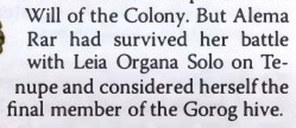
Our notes: `notes/materials/030-complete-star-wars-encyclopedia-vol-1/09-v1-scan-361-398.md:74`

## The Complete Star Wars Encyclopedia, Vol. II (H–O)

> Alema Rar and a team of Jedi were aboard the ship when it was turned over to the Yuuzhan Vong, but the Jedi managed to overpower the crew and intercept the aliens.
— Source: scan pages 161–200; Alema Rar. POV: Alema Rar.
Note (our notes, around the quote): Alema Rar: "Alema Rar and a team of Jedi were aboard the ship when it was turned over to the Yuuzhan Vong, but the Jedi managed to overpower the crew and intercept the aliens." Source: The Complete Star Wars Encyclopedia, Vol. II, p.156
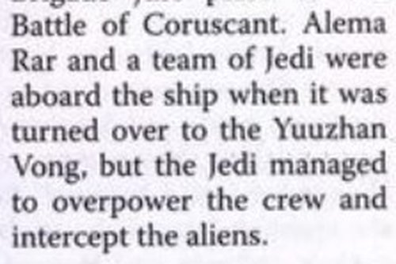
Our notes: `notes/materials/031-complete-star-wars-encyclopedia-vol-2/04-v2-scan-161-200.md:19`

> According to the former Jedi, BedaGorog was the original Night Herald, but after she was killed on Kr by Luke Skywalker, Alema took on her role.
— Source: scan pages 361–400; Luke Skywalker; Alema Rar.
Note (our notes, around the quote): Luke Skywalker; Alema Rar: "According to the former Jedi, BedaGorog was the original Night Herald, but after she was killed on Kr by Luke Skywalker, Alema took on her role." Source: The Complete Star Wars Encyclopedia, Vol. II, p.380
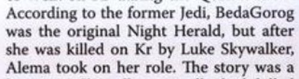
Our notes: `notes/materials/031-complete-star-wars-encyclopedia-vol-2/09-v2-scan-361-400.md:211`

## The Complete Star Wars Encyclopedia, Vol. III (P–Z)

> Alema Rar attacked and killed him, while his crew was wiped out by YVH 1 battle droids.
— Source: scan pages 81–120; Alema Rar. POV: Alema Rar.
Note (our notes, around the quote): Alema Rar: "Alema Rar attacked and killed him, while his crew was wiped out by YVH 1 battle droids." Source: The Complete Star Wars Encyclopedia, Vol. III, p.75
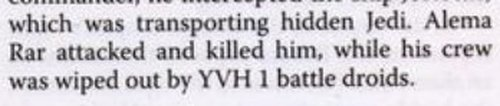
Our notes: `notes/materials/032-complete-star-wars-encyclopedia-vol-3/02-v3-scan-081-120.md:14`

> Five years after the defeat of the Yuuzhan Vong, Alema Rar was one of seven young Jedi veterans of the Myrkr mission who responded to the telepathic call of Unu- Thul, the joined consciousness of Raynar Thul and the Killik hive that had found and nurtured him back to health.
— Source: scan pages 81–120; Alema Rar. POV: Alema Rar.
Note (our notes, around the quote): Alema Rar: "Five years after the defeat of the Yuuzhan Vong, Alema Rar was one of seven young Jedi veterans of the Myrkr mission who responded to the telepathic call of Unu- Thul, the joined consciousness of Raynar Thul and the Killik hive that had found and nurtured him back to health." Source: The Complete Star Wars Encyclopedia, Vol. III, p.80
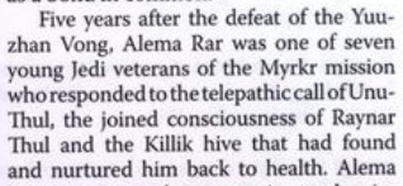
Our notes: `notes/materials/032-complete-star-wars-encyclopedia-vol-3/02-v3-scan-081-120.md:57`

> Luke and Mara Jade Skywalker confronted Alema there, and engaged in a lightsaber duel.
— Source: scan pages 81–120; Luke Skywalker; Mara Jade Skywalker; Alema Rar.
Note (our notes, around the quote): Luke Skywalker; Mara Jade Skywalker; Alema Rar: "Luke and Mara Jade Skywalker confronted Alema there, and engaged in a lightsaber duel." Source: The Complete Star Wars Encyclopedia, Vol. III, p.80
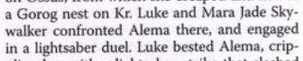
Our notes: `notes/materials/032-complete-star-wars-encyclopedia-vol-3/02-v3-scan-081-120.md:59`

> Luke bested Alema, crippling her with a lightsaber strike that slashed her from shoulder to sternum.
— Source: scan pages 81–120; Luke Skywalker; Alema Rar.
Note (our notes, around the quote): Luke Skywalker; Alema Rar: "Luke bested Alema, crippling her with a lightsaber strike that slashed her from shoulder to sternum." Source: The Complete Star Wars Encyclopedia, Vol. III, p.80
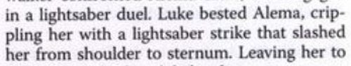
Our notes: `notes/materials/032-complete-star-wars-encyclopedia-vol-3/02-v3-scan-081-120.md:61`

> Alema survived, however, maimed and further twisted by her experiences.
— Source: scan pages 81–120; Alema Rar. POV: Alema Rar.
Note (our notes, around the quote): Alema Rar: "Alema survived, however, maimed and further twisted by her experiences." Source: The Complete Star Wars Encyclopedia, Vol. III, p.80
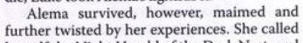
Our notes: `notes/materials/032-complete-star-wars-encyclopedia-vol-3/02-v3-scan-081-120.md:63`

> Leia managed to disfigure Alema, severing one of her lekku from her skull.
— Source: scan pages 81–120; Leia Organa Solo; Alema Rar.
Note (our notes, around the quote): Leia Organa Solo; Alema Rar: "Leia managed to disfigure Alema, severing one of her lekku from her skull." Source: The Complete Star Wars Encyclopedia, Vol. III, p.80
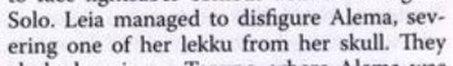
Our notes: `notes/materials/032-complete-star-wars-encyclopedia-vol-3/02-v3-scan-081-120.md:65`

> Together they killed the Jedi Tresina Lobi; Alema also fought by Lumiya's side at Rooqoo Depot, where they attempted to defeat Luke and Mara Jade Skywalker.
— Source: scan pages 81–120; Tresina Lobi; Alema Rar; Lumiya; Luke Skywalker; Mara Jade Skywalker.
Note (our notes, around the quote): Tresina Lobi; Alema Rar; Lumiya; Luke Skywalker; Mara Jade Skywalker: "Together they killed the Jedi Tresina Lobi; Alema also fought by Lumiya's side at Rooqoo Depot, where they attempted to defeat Luke and Mara Jade Skywalker." Source: The Complete Star Wars Encyclopedia, Vol. III, p.81
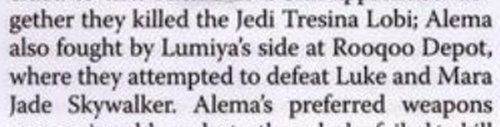
Our notes: `notes/materials/032-complete-star-wars-encyclopedia-vol-3/02-v3-scan-081-120.md:74`

> The World Brain was killed when Alema Rar tried to murder Jacen by firing a poisoned dart at him.
— Source: scan pages 321–360; Alema Rar; Jacen Solo (Darth Caedus).
Note (our notes, around the quote): Alema Rar; Jacen Solo (Darth Caedus): "The World Brain was killed when Alema Rar tried to murder Jacen by firing a poisoned dart at him." Source: The Complete Star Wars Encyclopedia, Vol. III, p.334
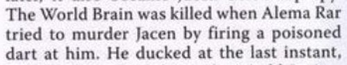
Our notes: `notes/materials/032-complete-star-wars-encyclopedia-vol-3/08-v3-scan-321-360.md:159`

## Sourcebooks/The New Jedi Order Sourcebook.pdf [Star Wars Roleplaying Game (d20, 2000)] (scan pages 121–162)

- Note (summary from our notes, not a quotation): Page contents: 916 words, 25 paragraphs | headings/entries: Ht < a > A; Mara Jade; Jade Shadow; Refugee Ships; Alema Rar, Twi'lek Jedi
  — Source: Sourcebooks/The New Jedi Order Sourcebook.pdf [Star Wars Roleplaying Game.
Our notes: `notes/materials/037-sw-d20-folder/049-the-new-jedi-order-sourcebook-scan-121-162.md:108`

> Numa is killed, and Alema is burned and temporarily deafened.
— Source: Sourcebooks/The New Jedi Order Sourcebook.pdf [Star Wars Roleplaying Game; Alema Rar. POV: Alema Rar.
Note (our notes, around the quote): Alema Rar: "Numa is killed, and Alema is burned and temporarily deafened." Source: *The New Jedi Order Sourcebook* (SWRPG d20), scan p.137
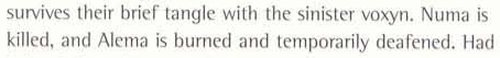
Our notes: `notes/materials/037-sw-d20-folder/049-the-new-jedi-order-sourcebook-scan-121-162.md:110`

> Fortunately for the Jedi, the Yuuzhan Vong are too busy destroying Nebula Chaser to notice Jade Shadow flitting in to pick up Alema's pod before fleeing to hyperspace.
— Source: Sourcebooks/The New Jedi Order Sourcebook.pdf [Star Wars Roleplaying Game; Alema Rar. POV: Alema Rar.
Note (our notes, around the quote): Alema Rar: "Fortunately for the Jedi, the Yuuzhan Vong are too busy destroying Nebula Chaser to notice Jade Shadow flitting in to pick up Alema's pod before fleeing to hyperspace." Source: *The New Jedi Order Sourcebook* (SWRPG d20), scan p.137
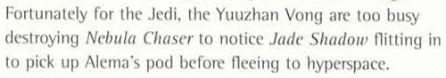
Our notes: `notes/materials/037-sw-d20-folder/049-the-new-jedi-order-sourcebook-scan-121-162.md:112`

> She had grieved when her master was killed at the Battle of Ithor, but that tragedy also left her with an angry focus that would not dissipate.
— Source: Sourcebooks/The New Jedi Order Sourcebook.pdf [Star Wars Roleplaying Game; Alema Rar — entry/section: Alema Rar, Twi'lek Jedi.
Note (our notes, around the quote): Alema Rar — entry/section: Alema Rar, Twi'lek Jedi: "She had grieved when her master was killed at the Battle of Ithor, but that tragedy also left her with an angry focus that would not dissipate." Source: *The New Jedi Order Sourcebook* (SWRPG d20), scan p.137
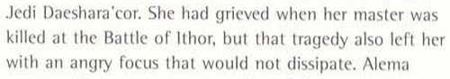
Our notes: `notes/materials/037-sw-d20-folder/049-the-new-jedi-order-sourcebook-scan-121-162.md:114`

> Alema recovered her composure over time with her sister's help— but when Numa was slain by a voxyn aboard Nebula Chaser, Alema's journey to the dark side had begun.
— Source: Sourcebooks/The New Jedi Order Sourcebook.pdf [Star Wars Roleplaying Game; Alema Rar — entry/section: Alema Rar, Twi'lek Jedi.
Note (our notes, around the quote): Alema Rar — entry/section: Alema Rar, Twi'lek Jedi: "Alema recovered her composure over time with her sister's help— but when Numa was slain by a voxyn aboard Nebula Chaser, Alema's journey to the dark side had begun." Source: *The New Jedi Order Sourcebook* (SWRPG d20), scan p.137
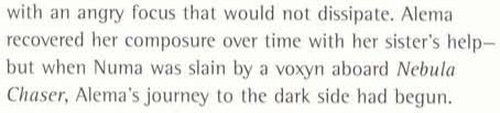
Our notes: `notes/materials/037-sw-d20-folder/049-the-new-jedi-order-sourcebook-scan-121-162.md:116`

## Star Wars Gamer/Star Wars Gamer 09.pdf [Star Wars Roleplaying Game (d20, 2000)] (scan pages 61–104)

- Note (summary from our notes, not a quotation): Page contents: Nosaurian history: the economy depended on intoxicant rikknit egg yolks until Valorum protected the ten-legged rikknit, turning most of the population into poachers; the Empire classed New Plympto 'expendable'; General Fefar Blackeye led three guerrilla campaigns, was captured a year after Yavin and shown in a Coruscant zoo cage with primates until he took his own life; independence during the Corellian insurrection; Nosaurians joined Nolaa Tarkona's Diversity Alliance; Alema and Numa Rar led the resistance to the Vong, who left a virus that melted hundreds of thousands, and the world is quarantined like Ithor (hand-read)
  — Source: Star Wars Gamer/Star Wars Gamer 09.pdf [Star Wars Roleplaying Game (d20,.
Our notes: `notes/materials/037-sw-d20-folder/058-star-wars-gamer-09-scan-061-104.md:144`

## Star Wars Insider #93 (2007)

- Note (summary from our notes, not a quotation): Page contents: Books cont.: Upcoming Book Releases Timeline, Legacy of the Force forthcoming books (Book 5 Sacrifice by Karen Traviss, hardcover; Book 6 Inferno by Troy Denning, paperback; Book 7 Fury by Aaron Allston, paperback; Book 8 Revelation by Karen Traviss, paperback; Book 9 TBA by Troy Denning, hardcover); Lumiya and Alema Rar; Pushed to the Limit; True Colors due this summer; Mird the strill; dream projects; Das Boot; Lumiya art (hand-read)
  — Source: Star Wars Insider #93 (2007).
Our notes: `notes/materials/038-star-wars-insider/093-ins093.md:350`

## Legacy of the Force, own full read (Betrayal, Revelation, Invincible)

- Note (summary from our notes, not a quotation): Not in this book: Alema Rar, Tahiri, Kyp and Fett do not appear in Betrayal.
  — Source: Legacy of the Force 1: Betrayal (Aaron Allston, 2006) — own full read.
Our notes: `notes/materials/040-lotf-own-read/lotf-1-betrayal.md:91`

- Note (summary from our notes, not a quotation): prl–c03: Jaina decides to train with Boba Fett so she can stop Jacen. Ben doubts that Alema killed Mara and goes to Coruscant to work the case with GAG captain Lon Shevu. Niathal, shaken by Tebut's killing, starts feeding Luke information. Caedus sends Tahiri to court Pellaeon. Fett recovers his ex-wife Sintas Vel, blind and amnesiac, from carbonite.
  — Source: Legacy of the Force 8: Revelation (Karen Traviss, 2008) — own full read.
Our notes: `notes/materials/040-lotf-own-read/lotf-8-revelation.md:6`

- Note (summary from our notes, not a quotation): Lumiya and Alema are dead before this book and appear only in Caedus's memories [c18 ¶197]. Kyp does not appear.
  — Source: Legacy of the Force 8: Revelation (Karen Traviss, 2008) — own full read.
Our notes: `notes/materials/040-lotf-own-read/lotf-8-revelation.md:95`

- Note (summary from our notes, not a quotation): Lumiya and Alema are dead; Lumiya is named only in Saba's taint remark [c02 ¶109–111]. Mara appears only as Luke's motive.
  — Source: Legacy of the Force 9: Invincible (Troy Denning, 2008) — own full read.
Our notes: `notes/materials/040-lotf-own-read/lotf-9-invincible.md:122`

## The Dark Nest Trilogy (Troy Denning, Del Rey 2005): FULL consecutive re-read (2026-11-16 CST)

What it shows (our notes): The seven Jedi are Myrkr survivors: Jaina, Alema, Zekk, Lowbacca, Tesar, Tekli and Tahiri. "six young Jedi Knights had died in the process—including Anakin himself—and another was missing and presumed lost". This is Raynar.
> “I wish we knew,” Luke said. Undertaken in the middle of the war with the Yuuzhan Vong, the Myrkr mission had been as costly as it had been successful. Anakin Solo and his strike team had destroyed the enemy’s Jedi-killing voxyn. But six young Jedi Knights had died in the process—including Anakin himself—and another was missing and presumed lost. “All I can tell you is that for several weeks, Jaina and the other survivors of that mission reported feeling a ‘call’ from the Unknown Regions. On the day they left, that call became a cry for help.”
— Source: Dark Nest I: The Joiner King (Troy Denning, Del Rey 2005): notes part 1.
(Excerpt widened 2026-11-17 to the relevant passage, word for word from The Joiner King (Troy Denning) (text copy `MEGA_Legend_The_Dark_Nest_Trilogy_Star_Wars_Dark_Nest_01_The_Joiner_King_Troy_Denning_epub`).)
(Full sentence/passage taken from the source text on file: `dn_tmp_jk_epub`.)
Our notes: `notes/materials/051-dark-nest-trilogy/jk-01.md:24`

What it shows (our notes): Zekk is now "two meters tall". Alema: "Should is for narrow minds. It makes me feel welcome." The Taat alarm appears "instantly full-blown" inside them. Dartships launch against "another defoliator squad".
> Alema shrugged. “Should is for narrow minds. It makes me feel welcome.”
>
> Jaina considered this for a moment, then nodded in agreement. “Same here—and valued. Zekk? You brought it up.”
— Source: Dark Nest I: The Joiner King (Troy Denning, Del Rey 2005): notes part 1; Zekk is now "two meters tall". Alema.
(Excerpt widened 2026-11-17 to the relevant passage, word for word from The Joiner King (Troy Denning) (text copy `MEGA_Legend_The_Dark_Nest_Trilogy_Star_Wars_Dark_Nest_01_The_Joiner_King_Troy_Denning_epub`).)
(Excerpt widened 2026-11-17 to the relevant passage, word for word from The Joiner King (Troy Denning) (text copy `MEGA_Legend_The_Dark_Nest_Trilogy_Star_Wars_Dark_Nest_01_The_Joiner_King_Troy_Denning_epub`).)
Our notes: `notes/materials/051-dark-nest-trilogy/jk-01.md:58`

What it shows (our notes): Alema kills clawcraft for revenge; the battle escalates
> A swell of anger rose in the Force. Jaina was still too far from the battle to see anything more than a hazy cloud of dartships silhouetted against Qoribu’s gleaming rings, but the tactical display showed more than a dozen clawcraft swarming Jacen and Tahiri, methodically herding them toward the Star Destroyer’s tractor beams. Supported by a throng of Taat, they were fighting back valiantly, opening one hole after the other in the enemy formation. The Chiss always managed to cut them off and drive them back toward the sweeping tractor beams.
>
> Then a clawcraft designator vanished. Another turned yellow and spiraled through the ring system and out of the system. Jaina felt Alema and Zekk urging Tahiri and Jacen to accelerate through the gap. Two of three clawcraft moving to cut them off also lost control and flew out of the battle, then Tahiri and Jacen were free, pulling away from their pursuers and weaving a crooked path among the few enemy fighters still in a position to attack.
>
> Tahiri’s gratitude flooded the Force, but quickly changed to astonishment when a clawcraft behind her exploded in a flash of static. A second one vanished an instant later, then a third turned yellow on Jaina’s display and broke into two parts.
>
> Tahiri’s shock was overpowered by Alema’s glee, then almost instantly by Zekk’s righteous fury.
>
> This is wrong! Zekk raged. He was furious with Alema; she was killing for revenge!
>
> But Alema did not think so. She felt she was only killing to teach them a lesson, to make them understand there were consequences.
>
> Jaina added her anger to Zekk’s. Alema had violated the unspoken rules of the conflict. She had killed without purpose. When the Chiss reviewed their battle vids, they would feel bound to retaliate in kind.
>
> Alema didn’t care, and Taat seemed to agree. The hundreds of dartships not yet swept up in the tractor beams began to coalesce in tightly knit balls, moving with eerie precision into the path of oncoming clawcraft. Chiss fighters began to explode as though they were crashing into asteroids. The conflict was turning into an all-out battle.
— Source: The Joiner King (Troy Denning, Del Rey 2005), JK ch. 13 — 051 Dark Nest trilogy notes (re-read 2026-11-16).
(Excerpt widened 2026-11-17 to the relevant passage, word for word from The Joiner King (Troy Denning) (text copy `MEGA_Legend_The_Dark_Nest_Trilogy_Star_Wars_Dark_Nest_01_The_Joiner_King_Troy_Denning_epub`).)
(Excerpt widened 2026-11-17 to the relevant passage, word for word from The Joiner King (Troy Denning) (text copy `MEGA_Legend_The_Dark_Nest_Trilogy_Star_Wars_Dark_Nest_01_The_Joiner_King_Troy_Denning_epub`).)
(Fragment completed 2026-11-17: full sentence/passage matched word for word in the source text on file: `MEGA_Legend_The_Dark_Nest_Trilogy_Star_Wars_Dark_Nest_01_The_Joiner_King_Troy_Denning_epub`.)
Note text that was attached to the quote line: (JK ch. 13) — **Alema kills clawcraft for revenge; the battle escalates**
Our notes: `notes/materials/051-dark-nest-trilogy/jk-01.md:201`

> This is wrong! Zekk raged ... she was killing for revenge!
> [fragment — full passage not on file]
>
> Reya fell silent, but the dartships continued to attack. Jaina found her frustration with Alema growing. The Twi’lek was a fine pilot, but she was too wild, too quick to surrender to the pearl of hatred that had been accreting inside her since the death of her sister, Numa. Now Alema’s anger would spread across the Gyuel system like a nova blast.
>
> “They did not feel like mistakes,” Reya countered. “They felt good.”
>
> “This battle is getting out of hand,” Tahiri responded, echoing Jaina’s feelings. “Reya was Chiss. She knows what will happen if you continue.”
— Source: Dark Nest I: The Joiner King: notes part 2 (ch. 9 onward); Alema kills for revenge.
(Excerpt widened 2026-11-17 to the relevant passage, word for word from The Joiner King (Troy Denning) (text copy `MEGA_Legend_The_Dark_Nest_Trilogy_Star_Wars_Dark_Nest_01_The_Joiner_King_Troy_Denning_epub`).)
(Excerpt widened 2026-11-17 to the relevant passage, word for word from The Joiner King (Troy Denning) (text copy `MEGA_Legend_The_Dark_Nest_Trilogy_Star_Wars_Dark_Nest_01_The_Joiner_King_Troy_Denning_epub`).)
(Full sentence/passage taken from the source text on file: `dn_tmp_jk_epub`.)
Label in our notes: Alema has Reya
Our notes: `notes/materials/051-dark-nest-trilogy/jk-02.md:46`

What it shows (our notes): "You have nothing to fear, if you will just do what we tell you!" / "We who, Alema?"
> “I’m trying to figure out who’s been attacking us.” Leia was speaking in a soft, nonthreatening voice … and wondering who exactly she was talking to. Maybe there had been more to that hopeful look than Leia imagined when Alema had mistaken the tangbark for glitterstim. “And I’m pretty certain Welk is involved. Possibly Lomi—”
>
> “It doesn’t matter what Jacen thinks he saw,” Alema said. “They’re both dead.”
>
> “And you know this?”
>
> Alema nodded.
>
> “How?” Leia asked.
>
> “We …” Alema’s face went blank, and she began to make loud clicking sound deep in her throat. “The Colony knows.”
>
> “The Colony knows.” Leia made a point of letting her skepticism show. “Alema, what are you trying to protect us from?”
>
> “Nothing!” The Twi’lek banged her fists on the table. “You have nothing to fear, if you will just do what we tell you!”
>
> “We who, Alema?”
>
> Alema’s eyes widened, then she drew herself upright and stood at the table in shock, her mouth working but no sound coming from her lips. The Noghri appeared silently at the cabin entrance. Leia signaled them to wait with an eye flicker, then let the silence hang while she finished her hot chocolate.
>
> Finally, she put the empty mug down and looked up. “Well, I’m happy to see you understand why that statement is so wrong.”
>
> “Of course,” Alema said. “We … I … apologize.”
>
> She spun on her heel and left the cabin so quickly that the Noghri barely had time to step out of her way. Leia did not go after her. There would be plenty of time to tease the rest of the truth out of her on the trip back to Ossus, and Leia had learned enough for now. She closed her eyes and reached into the Force for Luke, hoping that this time her sense of him would be a little more solid, that she could impart to him some hint of the hidden danger that the Shadow might have carried back from Qoribu.
>
> She spun on her heel and left the cabin so quickly that the Noghri barely had time to step out of her way. Leia did not go after her. There would be plenty of time to tease the rest of the truth out of her on the trip back to Ossus, and Leia had learned enough for now. She closed her eyes and reached into the Force for Luke, hoping that this time her sense of him would be a little more solid, that she could impart to him some hint of the hidden danger that the Shadow might have carried back from Qoribu. (JK ch. 20) — **"You have nothing to fear, if you will just do what we tell you!"
— Source: The Joiner King (Troy Denning, Del Rey 2005), JK ch. 20 — 051 Dark Nest trilogy notes (re-read 2026-11-16).
(Excerpt widened 2026-11-17 to the relevant passage, word for word from The Joiner King (Troy Denning) (text copy `MEGA_Legend_The_Dark_Nest_Trilogy_Star_Wars_Dark_Nest_01_The_Joiner_King_Troy_Denning_epub`).)
(A fragment line was removed 2026-11-17: its words appear word for word inside the full excerpt in this entry.)
(Fragment completed 2026-11-17 with the full excerpt, word for word from The Joiner King (Troy Denning) (text copy `MEGA_Legend_The_Dark_Nest_Trilogy_Star_Wars_Dark_Nest_01_The_Joiner_King_Troy_Denning_epub`).)
(Excerpt widened 2026-11-17 to the relevant passage, word for word from The Joiner King (Troy Denning) (text copy `MEGA_Legend_The_Dark_Nest_Trilogy_Star_Wars_Dark_Nest_01_The_Joiner_King_Troy_Denning_epub`).)
(Fragment completed 2026-11-17: full sentence/passage matched word for word in the source text on file: `MEGA_Legend_The_Dark_Nest_Trilogy_Star_Wars_Dark_Nest_01_The_Joiner_King_Troy_Denning_epub`.)
Our notes: `notes/materials/051-dark-nest-trilogy/jk-02.md:76`

What it shows (our notes): Jaina refuses to leave without Lowbacca ("Don’t try the Desilijic shift on me"). The trio finish each other's sentences: "No daughter of mine— ... —is going to become a bughugger". Leia: "Raynar isn’t the earnest young man who went to Myrkr with you. He’s desperate and lonely." Jaina: "Mom, sometimes you think too much." Alema goes along as "guide".
> “Don’t try the Desilijic shift on me,” Jaina said. “The terms were that we had to bring him back.”
>
> “We all can,” Zekk added. “No daughter of mine—”
>
> “—is going to become a bughugger” Alema finished.
>
> “Hey, no fair!” Han objected. “Just because I don’t like bugs doesn’t mean I’m wrong. There’s something sneaky going on here—and Raynar’s in it up to his neck.”
>
> “I wish you’d listen to your father.” Leia’s chest grew heavy, for she could see Han’s frustration with Jaina turning to anger. “You do know you might be the real prize in this conflict? Raynar isn’t the earnest young man who went to Myrkr with you. He’s desperate and lonely. I wouldn’t be surprised if he had instigated the whole border conflict just to draw you—”
>
> “Mom, sometimes you think too much.” Jaina lowered her arms, then turned and started away. “You’d better get the Falcon off this moon. I’ll try to warn Aunt Mara through the Force.”
— Source: Dark Nest I: The Joiner King: notes part 3 (ch. 18 onward); Jaina refuses to leave without Lowbacca (.
(Excerpt widened 2026-11-17 to the relevant passage, word for word from The Joiner King (Troy Denning) (text copy `MEGA_Legend_The_Dark_Nest_Trilogy_Star_Wars_Dark_Nest_01_The_Joiner_King_Troy_Denning_epub`).)
(Excerpt widened 2026-11-17 to the relevant passage, word for word from The Joiner King (Troy Denning) (text copy `MEGA_Legend_The_Dark_Nest_Trilogy_Star_Wars_Dark_Nest_01_The_Joiner_King_Troy_Denning_epub`).)
(Full sentence/passage taken from the source text on file: `dn_tmp_jk_epub`.)
(Fragment completed 2026-11-17: full sentence/passage matched word for word in the source text on file: `MEGA_Legend_The_Dark_Nest_Trilogy_Star_Wars_Dark_Nest_01_The_Joiner_King_Troy_Denning_epub`.)
Our notes: `notes/materials/051-dark-nest-trilogy/jk-03.md:15`

> “Really? Hot chocolate!” Alema gasped. Always scarce, hot chocolate had become a true Hutt’s pleasure after the Yuuzhan Vong reshaped seven of the eight planets capable of growing the rare pods necessary to produce it. “What about your duties in the cockpit?”
— Source: Dark Nest I: The Joiner King: notes part 3 (ch. 18 onward); Hot chocolate is scarce because.
(Excerpt widened 2026-11-17 to the relevant passage, word for word from The Joiner King (Troy Denning) (text copy `MEGA_Legend_The_Dark_Nest_Trilogy_Star_Wars_Dark_Nest_01_The_Joiner_King_Troy_Denning_epub`).)
(Full sentence/passage taken from the source text on file: `dn_tmp_jk_epub`.)
Our notes: `notes/materials/051-dark-nest-trilogy/jk-03.md:18`

> “Maybe there is,” she said. “It’s nothing you’re aware of. You start feeling like you belong, then you sort of … suddenly you just seem to have a larger mind.”
>
> Leia began to wonder if there were any deprogrammers in the Galactic Alliance capable of handling eight Jedi.
>
> “It’s hard to describe.” Alema must have sensed Leia’s thoughts in the Force, because her tone was defensive. “You’re aware of so much more. You see outside the nest when you’re inside, or inside when you’re outside. And what you feel—you feel everything.”
>
> “I’ve heard glitterstim is a lot like that,” Leia commented dryly.
>
> “This is even better,” Alema said. “You don’t get sick. It’s completely harmless.”
— Source: Dark Nest I: The Joiner King: notes part 3 (ch. 18 onward); The joining.
(Excerpt widened 2026-11-17 to the relevant passage, word for word from The Joiner King (Troy Denning) (text copy `MEGA_Legend_The_Dark_Nest_Trilogy_Star_Wars_Dark_Nest_01_The_Joiner_King_Troy_Denning_epub`).)
(Excerpt widened 2026-11-17 to the relevant passage, word for word from The Joiner King (Troy Denning) (text copy `MEGA_Legend_The_Dark_Nest_Trilogy_Star_Wars_Dark_Nest_01_The_Joiner_King_Troy_Denning_epub`).)
(Full sentence/passage taken from the source text on file: `dn_tmp_jk_epub`.)
Label in our notes: Leia
Our notes: `notes/materials/051-dark-nest-trilogy/jk-03.md:19`

> "Nothing!" The Twi’lek banged her fists on the table. "You have nothing to fear, if you will just do what we tell you!"
>
> "We who, Alema?" *(JK ch. 20)*
— Source: Dark Nest I: The Joiner King: notes part 3 (ch. 18 onward).
Context: Memory manipulation. Alema cannot recall Welk's or Lomi's names. The truth "seemed to be changing before her eyes": "He died when the Flier crashed, along with … his Master." ... "The Colony knows." Then:
Our notes: `notes/materials/051-dark-nest-trilogy/jk-03.md:20`

> Luke fell in behind her; then an attack alarm sounded and a laser cannon began to fire blue bolts up the shaft. He felt another jolt of emotion from Mara, this time anger, as her StealthX took a trio of hits. Her shields went down with the second, and the ends of both starboard wings vanished with the third.
>
> Luke did not waste time looking at his tactical display. He simply dropped the StealthX into a dive and started firing and then saw the nose of Alema’s stolen skiff, just slipping back out of sight. He continued to fire for a second longer, pouring his rage and disbelief at her through the Force, until the bend in the shaft vanished behind a curtain of ethmane steam. He sensed no shame or sorrow in the Twi’lek, only the enormous, murky presence of the Dark Nest.
— Source: The Joiner King (Troy Denning, Del Rey 2005), JK ch. 35 — 051 Dark Nest trilogy notes (re-read 2026-11-16).
(Fragment completed 2026-11-17: full sentence/passage matched word for word in the source text on file: `MEGA_Legend_The_Dark_Nest_Trilogy_Star_Wars_Dark_Nest_01_The_Joiner_King_Troy_Denning_epub`.)
Note text that was attached to the quote line: (JK ch. 35) — **Alema's skiff ambush; "the enormous, murky presence of the Dark Nest"**
Context: Alema's skiff ambush; "the enormous, murky presence of the Dark Nest"
Our notes: `notes/materials/051-dark-nest-trilogy/jk-03.md:45`

What it shows (our notes): On the nebula planet there are no animals, yet the flowers carry pollen (Alema: "what pollinates the flowers?"). Coolant evaporates suspiciously fast. These are hints for the later Dark Nest books; the planet is never named here.
> “Interesting.” Alema plucked the flower off its stem and brought it over to Leia. “If there are no insects or animals, what pollinates the flowers?”
— Source: Dark Nest I: The Joiner King: notes part 3 (ch. 18 onward).
(Excerpt widened 2026-11-17 to the relevant passage, word for word from The Joiner King (Troy Denning) (text copy `MEGA_Legend_The_Dark_Nest_Trilogy_Star_Wars_Dark_Nest_01_The_Joiner_King_Troy_Denning_epub`).)
(Fragment completed 2026-11-17: full sentence/passage matched word for word in the source text on file: `MEGA_Legend_The_Dark_Nest_Trilogy_Star_Wars_Dark_Nest_01_The_Joiner_King_Troy_Denning_epub`.)
Our notes: `notes/materials/051-dark-nest-trilogy/jk-03.md:53`

What it shows (our notes): Alema "accidentally" spills the coolant. It is a trap: the Noghri ambush her and "You have extra coolant." Alema: "We had no … choice ... You betrayed the Colony! ... let you poison the Masters’ council against us!"
> A frightening darkness came to Alema’s eyes, and she took one step toward Leia. “Put down your weapon, Princess. There’s no need for us to fight. Without coolant …” The Twi’lek stopped midsentence, apparently realizing how she had been tricked, then said, “You have extra coolant.”
>
> “We had no … choice.” Alema launched herself through the air, flipping and corkscrewing closer to Cakhmaim, turning bolt after bolt in Meewalh’s direction. “You betrayed the Colony!”
>
> “We betrayed them?” Han was incredulous. “Saba’s the one lying up there half dead.”
>
> “You see?” Alema landed. “You blame the Colony! We can’t—” She directed one of Cakhmaim’s stun bolts into Meewalh’s chest. “—let you poison the Masters’ council against us!”
— Source: Dark Nest I: The Joiner King: notes part 3 (ch. 18 onward).
(Excerpt widened 2026-11-17 to the relevant passage, word for word from The Joiner King (Troy Denning) (text copy `MEGA_Legend_The_Dark_Nest_Trilogy_Star_Wars_Dark_Nest_01_The_Joiner_King_Troy_Denning_epub`).)
(Excerpt widened 2026-11-17 to the relevant passage, word for word from The Joiner King (Troy Denning) (text copy `MEGA_Legend_The_Dark_Nest_Trilogy_Star_Wars_Dark_Nest_01_The_Joiner_King_Troy_Denning_epub`).)
(Full sentence/passage taken from the source text on file: `dn_tmp_jk_epub`.)
(Fragment completed 2026-11-17: full sentence/passage matched word for word in the source text on file: `MEGA_Legend_The_Dark_Nest_Trilogy_Star_Wars_Dark_Nest_01_The_Joiner_King_Troy_Denning_epub`.)
Our notes: `notes/materials/051-dark-nest-trilogy/jk-03.md:54`

What it shows (our notes): Cakhmaim's club-and-sickle cuts her finger tendons. Leia realizes Alema "did not know why she had sabotaged the Falcon"; the real target is Luke, Mara or Ben. The escape-pod hatch blows into Alema. "If I’m going to make a habit of this, I really have to practice more."
> Leia let the sentence trail off, suddenly realizing how badly she had misunderstood the situation. Alema did not know why she had sabotaged the Falcon. She thought she was protecting the Colony when she was actually damaging any chance it had of winning the Masters’ sympathies … and why?
>
> “Give me that!” Leia snatched the hypo from the droid’s hands and knelt down to inject the Twi’lek … then nearly fainted as a terrible pain shot up her leg. “Blast! If I’m going to make a habit of this, I really have to practice more.”
— Source: Dark Nest I: The Joiner King: notes part 3 (ch. 18 onward).
(Excerpt widened 2026-11-17 to the relevant passage, word for word from The Joiner King (Troy Denning) (text copy `MEGA_Legend_The_Dark_Nest_Trilogy_Star_Wars_Dark_Nest_01_The_Joiner_King_Troy_Denning_epub`).)
(Full sentence/passage taken from the source text on file: `dn_tmp_jk_epub`.)
Our notes: `notes/materials/051-dark-nest-trilogy/jk-03.md:55`

What it shows (our notes): Alema mumbles Twi'leki words for "night" and "herald", "the Night Herald", under stun cuffs on her lekku. Han: "Teamwork and treachery will beat youth and skill every time."
> “Sure we could,” Han said. “Teamwork and treachery will beat youth and skill every time.”
>
> “Alema isn’t that young—and I’d say she beats us hands-down in the treachery department,” Leia said. She crossed the hold—emptied so Alema would have nothing to fling with the Force—and stopped at Han’s side. “I thought you and Juun were plotting the next jump.”
— Source: Dark Nest I: The Joiner King: notes part 3 (ch. 18 onward).
(Excerpt widened 2026-11-17 to the relevant passage, word for word from The Joiner King (Troy Denning) (text copy `MEGA_Legend_The_Dark_Nest_Trilogy_Star_Wars_Dark_Nest_01_The_Joiner_King_Troy_Denning_epub`).)
(Excerpt widened 2026-11-17 to the relevant passage, word for word from The Joiner King (Troy Denning) (text copy `MEGA_Legend_The_Dark_Nest_Trilogy_Star_Wars_Dark_Nest_01_The_Joiner_King_Troy_Denning_epub`).)
Our notes: `notes/materials/051-dark-nest-trilogy/jk-03.md:69`

What it shows (our notes): Han charted the nebula: "There might be another dozen stars inside the nebula". Leia thinks of the Ithorians and "the Reclamation Act". This is the origin of the later Ithorian resettlement plot. The nebula is near the Rago Run.
> “Yep.” Han flashed a cocky grin. “And I charted everything in sensor range on the way out.” The grin grew larger and cockier. “There might be another dozen stars inside the nebula.”
— Source: Dark Nest I: The Joiner King: notes part 3 (ch. 18 onward); Han charted the nebula. POV: Han charted the nebula.
(Excerpt widened 2026-11-17 to the relevant passage, word for word from The Joiner King (Troy Denning) (text copy `MEGA_Legend_The_Dark_Nest_Trilogy_Star_Wars_Dark_Nest_01_The_Joiner_King_Troy_Denning_epub`).)
(Full sentence/passage taken from the source text on file: `dn_tmp_jk_epub`.)
Our notes: `notes/materials/051-dark-nest-trilogy/jk-03.md:70`

What it shows (our notes): A Hapan fleet (Novas and Battle Dragons) on its way to Lizil intercepts them. The Falcon is flying as "Longshot". Dukat Aleson Gray: "The Queen Mother’s new consort. He was the one who, uh, convinced her to intervene." Han: "You think you know him ... And then he tries to start a war."
> “Yes.” Gray sounded confused. “The Queen Mother’s new consort. He was the one who, uh, convinced her to intervene.”
>
> “You think you know him,” Han said, shaking his head. “And then he tries to start a war.”
— Source: Dark Nest I: The Joiner King: notes part 3 (ch. 18 onward).
(Excerpt widened 2026-11-17 to the relevant passage, word for word from The Joiner King (Troy Denning) (text copy `MEGA_Legend_The_Dark_Nest_Trilogy_Star_Wars_Dark_Nest_01_The_Joiner_King_Troy_Denning_epub`).)
(Full sentence/passage taken from the source text on file: `dn_tmp_jk_epub`.)
Our notes: `notes/materials/051-dark-nest-trilogy/jk-03.md:71`

- Note (summary from our notes, not a quotation): Isolation chambers hold Tesar, Tekli, Tahiri, Jacen, Alema and Gorog. Sensory cortices correlate across all of them. Only Alema's and Gorog's limbic systems correlate.
  — Source: Dark Nest I: The Joiner King: notes part 3 (ch. 18 onward).
Our notes: `notes/materials/051-dark-nest-trilogy/jk-03.md:79`

What it shows (our notes): Mara's Force lightning on Alema; Welk: "We had thought Skywalker's Jedi considered themselves above that."
> Mara’s neck prickled with cold, and she spun around to find the wrong end of an electrobolt rifle illuminated in her lamp beam. Behind it, sighting down the stock, was a blue face framed by a pair of Twi’lek lekku.
>
> Rather than taking half a second to ignite her lightsaber and another half a second to block, Mara pointed and released the Force energy she had been using to keep herself going. Her body erupted into pain and muscle tremors, but blue lightning shot from her fingertips and blasted the rifle, driving the stock back into the Twi’lek’s mangled shoulder and crackling deep into the wound. Alema cried out and let the weapon slip from her hands, then went limp and floated away into darkness.
>
> Mara felt a hint of uneasiness in Luke. “What?”
>
> “Nothing,” Luke replied. Just thinking—
>
> Luke’s lightsaber crackled to life and droned past Mara’s ear, blocking what sounded more like blasterfire than another electrobolt. She sensed a second attack coming and activated her own blade, sweeping it up behind Luke’s to bat away another string of bolts.
>
> The blasterfire fell silent, but not before Mara could swing her helmet lamp toward its source. She glimpsed a hump-shouldered man with a half-melted face and one chitinous insect arm grafted to his shoulder; then he slipped out of the light.
>
> “Force lightning.” The man’s voice was raspy and sharp. “We had thought Skywalker’s Jedi considered themselves above that.”
>
> “We make exceptions.” Again, Mara sensed a certain apprehension in Luke. She ignored it and swung her helmet lamp toward the voice, and again the dark figure slipped out of the light. “Especially in your case, Welk.”
>
> As Mara spoke, she and Luke moved apart, positioning themselves just within each other’s reach, where they could still take advantage of overlapping fields of defense.
>
> A soft flutter sounded above Mara’s head.
— Source: The Joiner King (Troy Denning, Del Rey 2005), JK ch. 40 — 051 Dark Nest trilogy notes (re-read 2026-11-16).
(Excerpt widened 2026-11-17 to the relevant passage, word for word from The Joiner King (Troy Denning) (text copy `MEGA_Legend_The_Dark_Nest_Trilogy_Star_Wars_Dark_Nest_01_The_Joiner_King_Troy_Denning_epub`).)
(Excerpt widened 2026-11-17 to the relevant passage, word for word from The Joiner King (Troy Denning) (text copy `MEGA_Legend_The_Dark_Nest_Trilogy_Star_Wars_Dark_Nest_01_The_Joiner_King_Troy_Denning_epub`).)
(Fragment completed 2026-11-17: full sentence/passage matched word for word in the source text on file: `MEGA_Legend_The_Dark_Nest_Trilogy_Star_Wars_Dark_Nest_01_The_Joiner_King_Troy_Denning_epub`.)
Note text that was attached to the quote line: (JK ch. 40) — **Mara's Force lightning on Alema; Welk: "We had thought Skywalker's Jedi considered themselves above that."**
Our notes: `notes/materials/051-dark-nest-trilogy/jk-03.md:87`

What it shows (our notes): Gorog is "Force-sensitive ... After a fashion". She can "use the Force to hide their presence—not only from us, but from other Killiks as well." Alema's emotional centers mirror Gorog's: "sharing emotions".
> Force-sensitive ... After a fashion
> [fragment — full passage not on file]
>
> “After a fashion,” Cilghal said. “I believe she and other Gorog can use the Force to hide their presence—not only from us, but from other Killiks as well. What I need to find out is whether they can also use the Force to pass neural impulses to other members of the Colony—even those outside their own nest.”
— Source: Dark Nest I: The Joiner King: notes part 4 (end of ch. 29 onward); Gorog is.
(Excerpt widened 2026-11-17 to the relevant passage, word for word from The Joiner King (Troy Denning) (text copy `MEGA_Legend_The_Dark_Nest_Trilogy_Star_Wars_Dark_Nest_01_The_Joiner_King_Troy_Denning_epub`).)
(Full sentence/passage taken from the source text on file: `dn_tmp_jk_epub`.)
Our notes: `notes/materials/051-dark-nest-trilogy/jk-04.md:6`

What it shows (our notes): Alema and Gorog follow the Colony's unconscious Will; the Taat Joiners follow the conscious Will. The Gorog are a secret nest the Colony "might well fool itself into believing ... doesn’t exist". Jacen: "Lomi and Welk are threatened by you ... And they’re the ones who control the Gorog nest." Jacen insists "my mind remains entirely my own."
> “Gorog is part of a secret nest,” Luke said, making sure he understood what Cilghal was telling him. “The Colony wouldn’t be aware of it—”
>
> “And might well fool itself into believing it doesn’t exist,” Cilghal said. “We’ve more or less proved that, and it explains the Killiks’ reaction to the attacks on you.”
>
> “It all makes sense, except for one thing—why does the secret nest keep attacking us?” Luke asked. “Raynar seemed to want our help.”
>
> “But Lomi and Welk are threatened by you.” It was Jacen who asked this, his voice coming from the data-holo. “And they’re the ones who control the Gorog nest.”
>
> “Them,” Jacen corrected. “In case you haven’t noticed, my mind remains entirely my own.”
>
> “Very well,” Cilghal said. “Why did Alema join the Gorog, while everyone else joined the Taat?”
— Source: Dark Nest I: The Joiner King: notes part 4 (end of ch. 29 onward).
(Excerpt widened 2026-11-17 to the relevant passage, word for word from The Joiner King (Troy Denning) (text copy `MEGA_Legend_The_Dark_Nest_Trilogy_Star_Wars_Dark_Nest_01_The_Joiner_King_Troy_Denning_epub`).)
(Excerpt widened 2026-11-17 to the relevant passage, word for word from The Joiner King (Troy Denning) (text copy `MEGA_Legend_The_Dark_Nest_Trilogy_Star_Wars_Dark_Nest_01_The_Joiner_King_Troy_Denning_epub`).)
(Full sentence/passage taken from the source text on file: `dn_tmp_jk_epub`.)
Our notes: `notes/materials/051-dark-nest-trilogy/jk-04.md:10`

> Luke knew the answer to that, and he wished he didn’t.
>
> “Because of Numa.” He was remembering the time he had stood outside Alema’s bacta tank, awash in the guilt the Twi’lek felt for allowing the voxyn to take her sister. “When Numa was killed, Alema turned a lot of her anger inward—and anger has always been fertile ground for the likes of Lomi Plo.”
>
> But I knew Alema would fall. *(Luke)*
— Source: Dark Nest I: The Joiner King: notes part 4 (end of ch. 29 onward); Why Alema joined. POV: Why Alema joined.
(Excerpt widened 2026-11-17 to the relevant passage, word for word from The Joiner King (Troy Denning) (text copy `MEGA_Legend_The_Dark_Nest_Trilogy_Star_Wars_Dark_Nest_01_The_Joiner_King_Troy_Denning_epub`).)
(Excerpt widened 2026-11-17 to the relevant passage, word for word from The Joiner King (Troy Denning) (text copy `MEGA_Legend_The_Dark_Nest_Trilogy_Star_Wars_Dark_Nest_01_The_Joiner_King_Troy_Denning_epub`).)
(Full sentence/passage taken from the source text on file: `dn_tmp_jk_epub`.)
Label in our notes: / (Luke
Our notes: `notes/materials/051-dark-nest-trilogy/jk-04.md:11`

What it shows (our notes): Alema steals a skiff with gelmeat crates and Gorog. "Ben, I think Gorog wants..." Ben still feels Gorog after the hyperspace jump: "He was part Joiner—Dark Nest Joiner." The escape was allowed and tracked: "We bugged them all." The subspace transmitter has a 50-light-year range.
> “Ben, I think Gorog wants you to leave, too.”
>
> Ben glanced at the Killik, then asked Mara, “Are you going to kill her?”
>
> Luke felt his own dismay mirrored in Mara. If Ben remained in touch with Gorog after she had entered hyperspace, it could only be through the Colony’s Will. He was part Joiner—Dark Nest Joiner.
>
> “We didn’t,” Leia said. “We bugged them all.”
>
> “Speaking of bugs, we’d better get going,” Han said. “That transmitter only has a subspace range of fifty light-years. We can’t be too far behind when Alema hits Colony space, or we’ll be stuck guessing where she went.”
— Source: Dark Nest I: The Joiner King: notes part 4 (end of ch. 29 onward).
(Excerpt widened 2026-11-17 to the relevant passage, word for word from The Joiner King (Troy Denning) (text copy `MEGA_Legend_The_Dark_Nest_Trilogy_Star_Wars_Dark_Nest_01_The_Joiner_King_Troy_Denning_epub`).)
(Excerpt widened 2026-11-17 to the relevant passage, word for word from The Joiner King (Troy Denning) (text copy `MEGA_Legend_The_Dark_Nest_Trilogy_Star_Wars_Dark_Nest_01_The_Joiner_King_Troy_Denning_epub`).)
(Fragment completed 2026-11-17: full sentence/passage matched word for word in the source text on file: `MEGA_Legend_The_Dark_Nest_Trilogy_Star_Wars_Dark_Nest_01_The_Joiner_King_Troy_Denning_epub`.)
Our notes: `notes/materials/051-dark-nest-trilogy/jk-04.md:28`

What it shows (our notes): Ben: "You just dump me someplace with Masters Tionne and Solusar". Jacen stays on Ossus with Ben ("Trust me"). Mara does not "quite trust the 'new-and-improved' Jacen".
> Han grimaced, then said, “Not if we can help it, kid.”
>
> “And certainly not in this part of the galaxy,” Mara added. “Why are you worried about that?”
>
> “Because this is what you do when there’s a war,” Ben said. “You just dump me someplace with Masters Tionne and Solusar and then never even come to visit.”
>
> “Of course.” Mara answered with no outward hesitation, but Luke detected just a hint of apprehension, as though she did not quite trust the “new-and-improved” Jacen. “As long as Master Solusar thinks Ben is keeping up with his schoolwork—”
— Source: Dark Nest I: The Joiner King: notes part 4 (end of ch. 29 onward); Ben. POV: Ben, about Alema Rar.
(Excerpt widened 2026-11-17 to the relevant passage, word for word from The Joiner King (Troy Denning) (text copy `MEGA_Legend_The_Dark_Nest_Trilogy_Star_Wars_Dark_Nest_01_The_Joiner_King_Troy_Denning_epub`).)
(Excerpt widened 2026-11-17 to the relevant passage, word for word from The Joiner King (Troy Denning) (text copy `MEGA_Legend_The_Dark_Nest_Trilogy_Star_Wars_Dark_Nest_01_The_Joiner_King_Troy_Denning_epub`).)
(Full sentence/passage taken from the source text on file: `dn_tmp_jk_epub`.)
Our notes: `notes/materials/051-dark-nest-trilogy/jk-04.md:29`

> Luke followed Han and the others toward the door. Their intention was to follow Alema to the core of the Dark Nest, then undermine its influence over the Colony by eliminating Welk and—assuming she had survived the Crash—Lomi Plo. Cilghal and Jacen were convinced that at least Welk had survived—and that a Dark Jedi now led the Gorog in much the same way Raynar led the Unu. It was a somewhat ruthless plan, especially in the way it placed Alema’s life at risk without her consent. But it seemed to Luke to be consistent with the nature of modern Jedi themselves. The war with the Yuuzhan Vong had taught the Jedi the folly of valuing sentiment over effectiveness, the wisdom of striking quickly and fiercely at the heart of a problem. Sometimes, Luke wondered whether it was a lesson the Jedi had learned too well; whether in defeating their enemies they had not become a little too much like them.
— Source: Dark Nest I: The Joiner King: notes part 4 (end of ch. 29 onward); Luke on modern Jedi ruthlessness. POV: Luke, about Alema Rar.
(Excerpt widened 2026-11-17 to the relevant passage, word for word from The Joiner King (Troy Denning) (text copy `MEGA_Legend_The_Dark_Nest_Trilogy_Star_Wars_Dark_Nest_01_The_Joiner_King_Troy_Denning_epub`).)
(Full sentence/passage taken from the source text on file: `dn_tmp_jk_epub`.)
Our notes: `notes/materials/051-dark-nest-trilogy/jk-04.md:30`

What it shows (our notes): Zakarisz Ghent (tattooed face, blue hair) recovers the second holo:
> Obi-Wan’s face grew serious. “You should be a Jedi, Padmé.”
>
> The name shot an electric bolt of excitement through Luke—and he could sense it had done the same to Leia.
>
> “You’re not very good at hiding your feelings,” Padmé said.
>
> Obi-Wan nodded. “It’s Anakin. He’s becoming moody and detached.” His holoimage turned half away. “He’s been put in a difficult position as the Chancellor’s representative, but I think it’s more than that.” The image turned back to Padmé again. “I was hoping he may have talked to you.”
>
> Padmé’s expression—at least what could be seen of it in the small hologrammic image—remained neutral.
>
> “Why would he talk to me about his work?”
>
> Obi-Wan studied her for a moment. “Neither of you is very good at hiding your feelings, either.”
>
> Padmé frowned. “Don’t give me that look.”
>
> Obi-Wan continued to look at her in the same way. “I know how he feels about you.”
>
> Padmé’s eyes slid away. “What did he say?”
>
> “Nothing,” Obi-Wan answered. “He didn’t have to.”
>
> Padmé’s face fell, and she turned and walked out of the hologram. “I don’t know what you’re talking about.”
>
> “I know you both too well.” Obi-Wan followed her out of the frame. “I can see you two are in love.” *(Obi-Wan in R2-D2 holo, JK ch. 32)*
— Source: Dark Nest I: The Joiner King: notes part 4 (end of ch. 29 onward).
(Excerpt widened 2026-11-17 to the relevant passage, word for word from The Joiner King (Troy Denning) (text copy `MEGA_Legend_The_Dark_Nest_Trilogy_Star_Wars_Dark_Nest_01_The_Joiner_King_Troy_Denning_epub`).)
(Excerpt widened 2026-11-17 to the relevant passage, word for word from The Joiner King (Troy Denning) (text copy `MEGA_Legend_The_Dark_Nest_Trilogy_Star_Wars_Dark_Nest_01_The_Joiner_King_Troy_Denning_epub`).)
(Full sentence/passage taken from the source text on file: `dn_tmp_jk_epub`.)
Our notes: `notes/materials/051-dark-nest-trilogy/jk-04.md:31`

What it shows (our notes): Luke and Leia learn the name Padmé: "Did they finally know their mother’s name?" R2 refuses "Because he thinks he’s protecting you". "doomsday gate". To get in, they need the datapad of the Intellex IV designer, who consulted with the Incom X-wing defectors and then "just disappeared". This sets up the later quest.
> Luke was so excited by the hologram that he had let it overshadow their mission for a moment. Anakin—his father—had been in love with a beautiful woman named Padmé. And Padmé did not look so different from Leia. Did they finally know their mother’s name? He could sense that Leia thought so—but she was too afraid to say as much out loud. So was he.
>
> Luke fell in beside Ghent. “You were explaining why Artoo won’t let me access those memories?”
>
> “Because he thinks he’s protecting you,” Ghent said. “He’s a very stubborn droid.”
— Source: Dark Nest I: The Joiner King: notes part 4 (end of ch. 29 onward); Luke and Leia learn the name Padmé.
(Excerpt widened 2026-11-17 to the relevant passage, word for word from The Joiner King (Troy Denning) (text copy `MEGA_Legend_The_Dark_Nest_Trilogy_Star_Wars_Dark_Nest_01_The_Joiner_King_Troy_Denning_epub`).)
(Excerpt widened 2026-11-17 to the relevant passage, word for word from The Joiner King (Troy Denning) (text copy `MEGA_Legend_The_Dark_Nest_Trilogy_Star_Wars_Dark_Nest_01_The_Joiner_King_Troy_Denning_epub`).)
(Fragment completed 2026-11-17: full sentence/passage matched word for word in the source text on file: `MEGA_Legend_The_Dark_Nest_Trilogy_Star_Wars_Dark_Nest_01_The_Joiner_King_Troy_Denning_epub`.)
Our notes: `notes/materials/051-dark-nest-trilogy/jk-04.md:33`

What it shows (our notes): Qoribu: the Hapan fleet is at the north pole, the Chiss at the south. About 150,000 methane dartships plus "four KDY orbital defense platforms" ("Smugglers", per Tarfang). Alema's skiff heads for the ice moon Kr. Jedi aboard: Kyp, Saba, Octa Ramis and Kyle Katarn, with Luke and Mara in StealthXs.
> “Closer to a hundred and fifty thousand, Captain,” Juun said from behind him. “Plus a handful of freighters, blastboats, and four KDY orbital defense platforms.”
— Source: Dark Nest I: The Joiner King: notes part 4 (end of ch. 29 onward).
(Excerpt widened 2026-11-17 to the relevant passage, word for word from The Joiner King (Troy Denning) (text copy `MEGA_Legend_The_Dark_Nest_Trilogy_Star_Wars_Dark_Nest_01_The_Joiner_King_Troy_Denning_epub`).)
(Fragment completed 2026-11-17: full sentence/passage matched word for word in the source text on file: `MEGA_Legend_The_Dark_Nest_Trilogy_Star_Wars_Dark_Nest_01_The_Joiner_King_Troy_Denning_epub`.)
Note text that was attached to the quote line: *("Smugglers", per Tarfang)*
Our notes: `notes/materials/051-dark-nest-trilogy/jk-04.md:42`

What it shows (our notes): Alema fires on the Skywalkers from the stolen skiff. "He sensed no shame or sorrow in the Twi’lek, only the enormous, murky presence of the Dark Nest." Mara's StealthX loses its starboard wings. They torpedo the hangar and crash-land inside, and Mara self-destructs her StealthX.
> Luke did not waste time looking at his tactical display. He simply dropped the StealthX into a dive and started firing and then saw the nose of Alema’s stolen skiff, just slipping back out of sight. He continued to fire for a second longer, pouring his rage and disbelief at her through the Force, until the bend in the shaft vanished behind a curtain of ethmane steam. He sensed no shame or sorrow in the Twi’lek, only the enormous, murky presence of the Dark Nest.
— Source: Dark Nest I: The Joiner King: notes part 4 (end of ch. 29 onward); Alema fires on the Skywalkers from the stolen skiff..
(Excerpt widened 2026-11-17 to the relevant passage, word for word from The Joiner King (Troy Denning) (text copy `MEGA_Legend_The_Dark_Nest_Trilogy_Star_Wars_Dark_Nest_01_The_Joiner_King_Troy_Denning_epub`).)
Our notes: `notes/materials/051-dark-nest-trilogy/jk-04.md:48`

> outdated Lancer-class frigate
> [fragment — full passage not on file]
— Source: Dark Nest I: The Joiner King: notes part 4 (end of ch. 29 onward).
Note (our notes, around the quote): The Great Swarm hits the Chiss and the Unu command ship, an "outdated Lancer-class frigate". Jaina and Zekk sense Luke, Mara, Leia and Kyp in-system, hidden from them by Unu. Lowbacca is "Drugged" in the Chiss command group.
Our notes: `notes/materials/051-dark-nest-trilogy/jk-04.md:56`

> speeder-sized Killik heads ... Membrosia givers
> [fragment — full passage not on file]
>
> oozing cloudy beads of dark membrosia ... with stringy clots of solids
> [fragment — full passage not on file]
— Source: Dark Nest I: The Joiner King: notes part 4 (end of ch. 29 onward); Black membrosia. Inside Kr.
Note (our notes, around the quote): Black membrosia. Inside Kr, "speeder-sized Killik heads ... Membrosia givers", bantha-sized and "oozing cloudy beads of dark membrosia ... with stringy clots of solids". This is the first appearance of the black membrosia that later drives the plot.
Our notes: `notes/materials/051-dark-nest-trilogy/jk-04.md:57`

> Sorry ... We can’t let you leave.
> [fragment — full passage not on file]
>
> “Tell your masters they’re about to wish they had died in the Crash.” Mara slipped a fresh power pack into her blaster pistol. “We’re coming for them.”
>
> Alema smirked, and Gorog warriors began to pour out of the tunnel behind her. “You will need more than lightsabers and blaster pistols, we think.”
— Source: Dark Nest I: The Joiner King: notes part 4 (end of ch. 29 onward); Alema, in the plural.
(Excerpt widened 2026-11-17 to the relevant passage, word for word from The Joiner King (Troy Denning) (text copy `MEGA_Legend_The_Dark_Nest_Trilogy_Star_Wars_Dark_Nest_01_The_Joiner_King_Troy_Denning_epub`).)
Label in our notes: Mara: Alema
Our notes: `notes/materials/051-dark-nest-trilogy/jk-04.md:58`

> He lowered his aim and began to blast Killik legs. “… did I ever tell you how much I hate bugs?”
— Source: Dark Nest I: The Joiner King: notes part 4 (end of ch. 29 onward).
(Full sentence/passage taken from the source text on file: `dn_tmp_jk_epub`.)
Note (our notes, around the quote): The rescue party: four YVH "bugcruncher" war droids on loan from Tendrando Arms; Kyp, Saba, Octa Ramis and Kyle Katarn; Han and Leia. Han: "did I ever tell you how much I hate bugs?"
Our notes: `notes/materials/051-dark-nest-trilogy/jk-04.md:59`

What it shows (our notes): Alema cuts open a membrosia giver that Luke had pulled into the line of fire. Luke reflects: "The line she had crossed was an invisible one, a matter of degree and intention rather than principle. Had another Jedi Knight made a similar sacrifice pursuing a Jedi goal, Luke might have condoned the act ... And that made him wonder more than ever what the Jedi had become."
> Luke moved to intercept, no longer dodging or twisting, just shouldering past Killik corpses and going after Alema. He was shocked by her ruthlessness, but hardly surprised. The line she had crossed was an invisible one, a matter of degree and intention rather than principle. Had another Jedi Knight made a similar sacrifice pursuing a Jedi goal, Luke might have condoned the act, even tried to console the individual and reassure her that it had been the best choice available.
>
> And that made him wonder more than ever what the Jedi had become.
>
> A trio of Gorog warriors zeroed in on Luke, forcing him into somersaults until Mara took them out. He arrived at the cutoff point after Alema, but close enough on her heels that she had to turn and face him. She showed no emotion on her face or in the Force, but she raised her lightsaber into a middle guard—the best initial defense for an outmatched fighter.
— Source: Dark Nest I: The Joiner King: notes part 4 (end of ch. 29 onward).
(Excerpt widened 2026-11-17 to the relevant passage, word for word from The Joiner King (Troy Denning) (text copy `MEGA_Legend_The_Dark_Nest_Trilogy_Star_Wars_Dark_Nest_01_The_Joiner_King_Troy_Denning_epub`).)
(Excerpt widened 2026-11-17 to the relevant passage, word for word from The Joiner King (Troy Denning) (text copy `MEGA_Legend_The_Dark_Nest_Trilogy_Star_Wars_Dark_Nest_01_The_Joiner_King_Troy_Denning_epub`).)
(Full sentence/passage taken from the source text on file: `dn_tmp_jk_epub`.)
Our notes: `notes/materials/051-dark-nest-trilogy/jk-04.md:67`

What it shows (our notes): Luke: "Alema, your anger has made you vulnerable." Alema: "Numa was a warrior! ... She would defend the Colony!" Luke cleaves her "down through her clavicle, deep into her shoulder" and takes her lightsaber.
> “Alema, your anger has made you vulnerable,” Luke said. “Your sister’s death made you angry, and the Gorog are using that anger to hold you.”
>
> Numa was a warrior! ... She would defend the Colony!
> [fragment — full passage not on file]
>
> Suddenly the Twi’lek stopped, determined to stand her ground. Luke tapped her lightsaber aside, then used the Force to pull her hand toward him, drawing her off balance onto his own weapon. Her eyes widened, and the blade sliced down through her clavicle, deep into her shoulder.
— Source: Dark Nest I: The Joiner King: notes part 4 (end of ch. 29 onward); Luke. POV: Luke, about Alema Rar.
(Excerpt widened 2026-11-17 to the relevant passage, word for word from The Joiner King (Troy Denning) (text copy `MEGA_Legend_The_Dark_Nest_Trilogy_Star_Wars_Dark_Nest_01_The_Joiner_King_Troy_Denning_epub`).)
(Full sentence/passage taken from the source text on file: `dn_tmp_jk_epub`.)
Our notes: `notes/materials/051-dark-nest-trilogy/jk-04.md:68`

> “Force lightning.” The man’s voice was raspy and sharp. “We had thought Skywalker’s Jedi considered themselves above that.”
— Source: Dark Nest I: The Joiner King: notes part 4 (end of ch. 29 onward); Mara blasts Alema with Force lightning. Welk.
(Full sentence/passage taken from the source text on file: `dn_tmp_jk_epub`.)
Note (our notes, around the quote): Mara blasts Alema with Force lightning. Welk: "Force lightning ... We had thought Skywalker’s Jedi considered themselves above that." / "We make exceptions."
Our notes: `notes/materials/051-dark-nest-trilogy/jk-04.md:74`

> “Raynar Thul is no more,” Raynar said. He was squatting on his haunches in the heart of the Prime Chamber, high atop a circular dais where he would always be visible to the hundreds of insect attendants that followed wherever he went. His long arms were hanging over his knees with the backs of his hands resting slackly on the ground before him, and his blue eyes were riveted, unblinking, to Luke’s face. “We are UnuThul.” *(JK ch. 10)*
— Source: The Dark Nest Trilogy: summary of strongest findings.
(Full sentence/passage taken from the source text on file: `dn_tmp_jk_epub`.)
Context: Raynar Thul becomes UnuThul; the Dark Nest of Lomi Plo, Welk and Alema.
Our notes: `notes/materials/051-dark-nest-trilogy/summary.md:12`

> He simply stepped inside her attack and flicked his wrist twice, first sweeping his blade upward, then whipping it around in a backslash, and she landed at his feet in four parts. *(SW ch. 25)*
— Source: The Dark Nest Trilogy: summary of strongest findings; Lomi Plo is killed only when Luke drops all doubt.
(Full sentence/passage taken from the source text on file: `dn_tmp_sw_epub`.)
Label in our notes: SW ch. 25
Context: Raynar Thul becomes UnuThul; the Dark Nest of Lomi Plo, Welk and Alema.
Our notes: `notes/materials/051-dark-nest-trilogy/summary.md:14`

What it shows (our notes): UnuThul's dark pressure ("until they thought their hearts would collapse"); they resist together; Alema joins the meld
> A cannon bolt flashed past Jaina’s cockpit—so close that it raised a heat blister in the canopy—and she and Zekk turned and dived. With their forward shields down and the Chiss behaving more like Killik suicide fliers than clawcraft pilots, their only chance of stopping the defoliators lay in catching the two vessels in the clouds, where their StealthXs could remain hidden until they attacked. The clawcraft pursued, but both Jaina and Zekk still had their rear shields and were able to endure the short pounding they received before reaching cover.
>
> They had barely entered the clouds before the dark pressure began to build inside their chests again. UnuThul did not want them to wait. He wanted them to attack now. Jaina and Zekk reached out to him in the Force, trying to make him see that they could not possibly succeed, that their StealthXs were barely holding together and their only hope of success lay in concealment.
>
> UnuThul did not understand—or care. The dark pressure grew unrelenting, until they thought their hearts would collapse. Still, they remained in the clouds, calling on each other for the strength to resist UnuThul, Jaina using the Force to steady Zekk’s hand when his StealthX began to drift upward, Zekk reaching out to push her stick forward when she began to pull it back. Because Jaina’s displays were not working and Zekk’s sensor pod had been blasted away, they had to navigate by feeling alone, always keeping the noses of their battered starfighters pointed toward the menace they sensed in the Force.
>
> And even as Jaina and Zekk closed on their targets again, they sensed Leia and Saba struggling with their own troubles far above. Sometimes, her mother felt tense and worried, and other times she and Saba were clearly in combat, filling the battle-meld with fury and fear and determination. Jaina and Zekk ached to help, but they were too well disciplined to ignore the defoliators—even without the influence of UnuThul.
>
> A shock wave of astonishment rolled through the battle-meld, and suddenly Leia and Saba seemed confused, hopeful, and terrified all at once. The dark pressure inside Jaina and Zekk grew more powerful than ever, and they found themselves poking their canopies out of the clouds in spite of themselves.
>
> The defoliators were only a few kilometers above, so close now that Jaina and Zekk could clearly see their hawkish silhouettes—and the drop-shaped outlines of two enormous bombs hanging beneath each wing.
>
> Each of the vessels was tightly ringed by a defensive cordon of clawcraft, with another six starfighters arrayed farther out in intercept position. There would be another dozen Chiss ambushers even farther out, circling low over the clouds, ready to pounce the instant the StealthXs showed themselves.
>
> Far above the defoliators, a distant web of light was flashing back and forth between the descending Chiss fleet and the lower reaches of space. With both of their tactical displays nonfunctional, it was impossible for Jaina and Zekk to tell exactly what was happening … but they could guess. UnuThul had arrived with the Moon Swarm and launched his attack prematurely, probably hoping to divert the Chiss’s attention and make it easier for them to bring down the defoliators—and judging by the feelings in the battle-meld, Leia and Saba and the rest of the Falcon’s crew had gotten caught in the middle of it.
>
> The tactic changed nothing as far as Jaina and Zekk were concerned. Their best chance of success, as small as it was, still lay in the …
>
> A new presence joined the meld—the dark, oddly familiar presence of a Twi’lek Joiner. Alema Rar.
>
> A wave of revulsion rose inside Jaina and Zekk—and inside Leia and Saba, as well. Alema was the holochild for all that worried Master Skywalker about the Jedi’s new view of the Force. She was living proof that there was a dark side, for she had ventured into that darkness and lost her way so completely that even Luke had given up hoping of redeeming her. She had become a twisted and angry thing that cast off vows like boyfriends, that turned her back on faithful comrades and betrayed sacred trusts and viciously attacked those who had shown her nothing but kindness.
— Source: The Swarm War (Troy Denning, Del Rey 2005), SW ch. 21 — 051 Dark Nest trilogy notes (re-read 2026-11-16).
(Excerpt widened 2026-11-17 to the relevant passage, word for word from The Swarm War (Troy Denning) (text copy `MEGA_Legend_The_Dark_Nest_Trilogy_Star_Wars_Dark_Nest_03_The_Swarm_War_Troy_Denning_epub`).)
(Excerpt widened 2026-11-17 to the relevant passage, word for word from The Swarm War (Troy Denning) (text copy `MEGA_Legend_The_Dark_Nest_Trilogy_Star_Wars_Dark_Nest_03_The_Swarm_War_Troy_Denning_epub`).)
(Fragment completed 2026-11-17: full sentence/passage matched word for word in the source text on file: `MEGA_Legend_The_Dark_Nest_Trilogy_Star_Wars_Dark_Nest_03_The_Swarm_War_Troy_Denning_epub`.)
Note text that was attached to the quote line: (SW ch. 21) — **UnuThul's dark pressure ("until they thought their hearts would collapse"); they resist together; Alema joins the meld**
Our notes: `notes/materials/051-dark-nest-trilogy/sw-01.md:183`

What it shows (our notes): Alema, "Night Herald of the Dark Nest", uses Jaina and Zekk as decoys; Zekk Force-pulls his one-winged StealthX back into a climb ("Who's using the Force? This is fear!"); Alema destroys both defoliators; one wing with two bombs survives
> A wave of revulsion rose inside Jaina and Zekk—and inside Leia and Saba, as well. Alema was the holochild for all that worried Master Skywalker about the Jedi’s new view of the Force. She was living proof that there was a dark side, for she had ventured into that darkness and lost her way so completely that even Luke had given up hoping of redeeming her. She had become a twisted and angry thing that cast off vows like boyfriends, that turned her back on faithful comrades and betrayed sacred trusts and viciously attacked those who had shown her nothing but kindness.
>
> And none of that mattered, because there she was in a StealthX, hiding in the clouds a few kilometers behind Jaina and Zekk. The Chiss had no idea she was there, and Jaina and Zekk understood now why the dark pressure inside them had grown so strong, why UnuThul was so eager for them to sacrifice themselves in a futile gesture.
>
> They were nothing more than a diversion. Alema—Night Herald of the Dark Nest—was the true firepower. To UnuThul, this was the surest way to stop the evil hanging beneath the defoliators’ wings.
>
> Leia and Saba reached out in the Force, urging Jaina and Zekk to resist UnuThul’s Will, to stick to their own plan and attack in the clouds.
>
> Jaina and Zekk pushed their throttles forward, then pulled their sticks back and began to climb in a wild corkscrew that made their astromechs shriek structure-stress warnings. With no forward shields left to share, it made no sense to fly in close formation. Instead, they climbed in parallel spirals, angling across the bows of the defoliators to cut off their descent.
>
> The Chiss moved quickly to stop them, the defensive rings shifting to remain between the two StealthXs and their targets, the interceptors diving to confront them with laser cannons flashing. Jaina and Zekk returned fire effectively but without enthusiasm, destroying a clawcraft apiece and knowing that those pilots were being sacrificed to a diversion—just as they were themselves.
>
> “Sneaky, can you get a torpedo lock on either of the defoliators?” The bombs—four on each vessel—were identical to the prototype that Jag had destroyed in the dunes above the Iesei nest.
>
> The droid replied with an affirmative tweet, but added a long descending whistle that suggested he questioned the wisdom of this attack.
>
> “Don’t argue!” Jaina armed all of her proton torpedoes, and sensed Zekk doing the same. “Just let me know when you’re ready.”
>
> The droid emitted a brief whistle.
>
> Jaina fired her next two proton torpedoes and watched in horrified fascination as a pair of clawcraft dropped down in front of the shrinking efflux dots. A moment later, she was momentarily blinded when a pair of dazzling flashes lit the sky between her and the defoliators.
>
> Guessing that she must be in range by now, Jaina began to pour laser cannon fire into the defoliator Sneaky had targeted. The defensive ring tightened even more, bunching up to absorb the attacks on their own shields and leaving the stern of the vessel badly exposed to a proton torpedo.
>
> Still, Alema did not attack. Was she waiting for the Chiss ambushers to show themselves … or for Jaina and Zekk to be blasted out of the sky? The spite Leia and Saba were pouring into the meld made clear what they thought.
>
> Two proton torpedoes streaked from Zekk’s StealthX toward the second defoliator. A Chiss clawcraft dropped down and obliterated the first torpedo with a volley of cannon bolts. The pilots trying to intercept the second torpedo were blinded by the explosion, and it slipped past the defensive screen to detonate against the defoliator’s belly shields. Almost immediately, Jagged Fel and a dozen other ambushers emerged from the clouds to begin hammering Jaina and Zekk’s rear shields.
>
> Trapped in a devastating crossfire and badly outnumbered, the only sensible thing for Jaina and Zekk to do was to roll out. Sneaky began to whistle and toot, no doubt extolling the wisdom of presenting their shielded tails to the enemy and fleeing while they still could.
>
> Instead, Jaina launched her last set of proton torpedoes and accelerated toward her target, pouring a constant stream of cannon bolts ahead of her and doing her best to make it appear that she intended to ram the defoliator. Zekk mirrored her every move, heading toward the second defoliator. Four clawcraft defenders quickly moved to block their torpedoes. The interceptors raced forward on a collision course with Jaina and Zekk, while Jag and his ambushers poured fire into the StealthX tails with no concern for hitting their own starfighters.
>
> Then Jaina and Zekk sensed Alema streaking up out of the clouds, coming up behind the defoliators where there were no longer any clawcraft to challenge her. Jaina’s rear shields went down, then one of her fusial engines flamed out, and Sneaky began to trill warnings that she could not understand. She continued to pour fire at the belly of her defoliator, ignoring the pending collision with the clawcraft interceptors and using the Force to dodge what she could of the mad storm of bolts.
>
> One of Zekk’s wings came off. His StealthX entered a spin and tried to nose over into a dive, but Jaina felt him using the Force to pull it back into a climb. He continued toward his target, his spiral more erratic than ever and firing with only two laser cannons, but holding the Chiss rapt.
>
> You have nothing to be jealous of, Jaina said through their mind-link. Even if Jag had the Force, he couldn’t do that!
>
> Who’s using the Force? Zekk replied. This is fear!
>
> Alema finally launched her first set of proton torpedoes, targeting the nearest defoliator. She was so close that the vessel had no chance to deploy countermeasures. The first torpedo overloaded the vessel’s shields and blasted its tail into shards. The second vaporized the entire ship, bombs included, leaving nothing behind but a white flash.
>
> The Force roiled with shock and confusion, but the Chiss reacted with remarkable swiftness, instantly abandoning Jaina’s StealthX to rush back toward Alema.
>
> They were too late; Alema had already sent another set of torpedoes toward the remaining defoliator. One exploded just as the defensive ring arrived at the vessel’s stern, and Jaina and Zekk felt a dozen lives wink out in an instant. The other torpedo smashed into a sacrificial clawcraft, but it was so close to the defoliator that both vessels took the hit. The defoliator’s fuselage and one wing vanished in another white flash.
>
> But one of the wings survived.
>
> It went fluttering planetward, its silver skin flashing brightly in the blue sun, the two bombs still intact and the clouds below coming up fast.
— Source: The Swarm War (Troy Denning, Del Rey 2005), SW ch. 21 — 051 Dark Nest trilogy notes (re-read 2026-11-16).
(Excerpt widened 2026-11-17 to the relevant passage, word for word from The Swarm War (Troy Denning) (text copy `MEGA_Legend_The_Dark_Nest_Trilogy_Star_Wars_Dark_Nest_03_The_Swarm_War_Troy_Denning_epub`).)
(Excerpt widened 2026-11-17 to the relevant passage, word for word from The Swarm War (Troy Denning) (text copy `MEGA_Legend_The_Dark_Nest_Trilogy_Star_Wars_Dark_Nest_03_The_Swarm_War_Troy_Denning_epub`).)
(Fragment completed 2026-11-17: full sentence/passage matched word for word in the source text on file: `MEGA_Legend_The_Dark_Nest_Trilogy_Star_Wars_Dark_Nest_03_The_Swarm_War_Troy_Denning_epub`.)
Note text that was attached to the quote line: (SW ch. 21) — **Alema, "Night Herald of the Dark Nest", uses Jaina and Zekk as decoys; Zekk Force-pulls his one-winged StealthX back into a climb ("Who's using the Force? This is fear!"); Alema destroys both defoliators; one wing with two bombs survives**
Our notes: `notes/materials/051-dark-nest-trilogy/sw-01.md:184`

What it shows (our notes): Leia Force-leaps, cuts down a snake-bird mid-fall; finds Alema as an "empty place" in the Force; Alema's beguiling voice (Force-persuasion); Leia resists
> Sissing with laughter, Saba turned and Force-jumped down to an adjacent branch. Leia watched the Barabel vanish into the foliage, worried that perhaps she was absorbing more than Jedi wisdom from her Master. She actually understood the joke.
>
> Leia took a bearing to her own contact, then selected a safe-looking branch to serve as her intermediate landing point and Force-leapt into the rain. She would much rather have used a repulsor pack, but Saba disdained technological “crutches” when the Force would do instead.
>
> On the way down, a cold shiver of danger sense raced along Leia’s spine, and she felt something hungry descending on her from above. The hiss of air rushing over wing scales began to rise behind her, and she rolled into a Force flip and ignited her lightsaber, bringing the blade up through the body of something huge, green, and musty smelling.
>
> The snake-bird fell away in two pieces. Then Leia sensed her target branch coming up behind her—fast. She reached out to it in the Force and drew herself over to it, landing backward in the wet moss and nearly slipping off the branch.
>
> Leia’s danger sense continued to ripple.
>
> She could hear a large river purling through the jungle somewhere far below, but she had no sense of where this new predator was hiding. She turned in a slow circle. When she saw nothing but clouds of emerald foliage, she reached out in the Force, but she felt only the same hunters as before. This danger was something different—something that could hide itself in the Force.
>
> Leia stilled herself and began to search for an empty place in the gauzy fog of the living Force on Tenupe. It did not take long to find. There was an odd calm where her branch connected to the mogo’s trunk, hidden behind a green curtain of strangle-vines. Still holding her lightsaber in one hand, she drew her blaster and began to fire into the vines.
>
> The snap-hiss of an igniting lightsaber sounded from inside the mass of vines, then a blade so blue it was almost black sliced through the foliage and began to bat Leia’s bolts aside. The tangle of vines quickly fell away, revealing a blue-skinned Twi’lek female with an amputated head-tail and one withered arm hanging useless beneath a sagging shoulder. She wore a StealthX flight suit two sizes too small for her slender figure, her front zipper open down to the navel.
>
> Leia stopped firing and touched Saba through their battle-meld, trying to let her knew she had found something as important as the bombs. “Alema Rar. I should have known you’d crawl out of a hole around here somewhere.”
>
> Alema’s unblinking eyes widened with anger, but she deactivated her lightsaber and bared her teeth in what looked more like an insect’s threat display than a smile.
>
> “Come now, Princess,” Alema purred. “We are both here to destroy the bombs. Perhaps we should work together.”
>
> The Twi’lek’s voice was so beguiling that Leia found herself thinking that Alema was not really such a bad girl; that anyone who had had such a hard life was entitled to make a few mistakes along the way. And besides, the suggestion was reasonable. The Dark Nest had even more reason than the Jedi to want those parasite bombs destroyed, and any time she and Alema spent fighting each other was time that would bring the Chiss closer to recovering them.
>
> Then an image of Jaina and Zekk diving for the clouds in their battered StealthXs flashed through Leia’s mind, and an icy knot of danger sense formed at the base of her skull. This was how Alema Rar—and probably the whole Dark Nest—worked, by offering the promise of something pleasant or reasonable to secure the target’s cooperation. But in the end, it was the target who suffered—who played the decoy, or who had to stay and fight while the Twi’lek and the Dark Nest simply faded into the night.
>
> “Thanks, but I’ll pass,” Leia said. “I’ve seen your kind of cooperation. It nearly got my daughter killed.”
>
> Alema gave a couple of throat-clicks, then said, “It was necessary for the good of the Colony. Jaina and Zekk understood that.”
— Source: The Swarm War (Troy Denning, Del Rey 2005), SW ch. 24 — 051 Dark Nest trilogy notes (re-read 2026-11-16).
(Excerpt widened 2026-11-17 to the relevant passage, word for word from The Swarm War (Troy Denning) (text copy `MEGA_Legend_The_Dark_Nest_Trilogy_Star_Wars_Dark_Nest_03_The_Swarm_War_Troy_Denning_epub`).)
(Excerpt widened 2026-11-17 to the relevant passage, word for word from The Swarm War (Troy Denning) (text copy `MEGA_Legend_The_Dark_Nest_Trilogy_Star_Wars_Dark_Nest_03_The_Swarm_War_Troy_Denning_epub`).)
(Fragment completed 2026-11-17: full sentence/passage matched word for word in the source text on file: `MEGA_Legend_The_Dark_Nest_Trilogy_Star_Wars_Dark_Nest_03_The_Swarm_War_Troy_Denning_epub`.)
Note text that was attached to the quote line: (SW ch. 24) — **Leia Force-leaps, cuts down a snake-bird mid-fall; finds Alema as an "empty place" in the Force; Alema's beguiling voice (Force-persuasion); Leia resists**
Our notes: `notes/materials/051-dark-nest-trilogy/sw-01.md:199`

What it shows (our notes): KEY FIGHT (verbatim): Leia vs Alema in the mogo canopy. A Force-persuasion duel; Leia's power attack and backslash take off half of Alema's foot; Alema Force-jerks Leia into the branch (head blow); Leia's Barabel rage attack; Alema's strike/Force-push combinations; Leia Force-sticks herself to the branch
> “They understand that you ran out on them,” Leia countered. Now that she was alert to it, she could feel the Twi’lek trying to use the Force against her, to dampen her negative thoughts and bolster the positive ones. Fortunately, there weren’t many positive ones. “And so do I.”
>
> “We had to destroy the bombs.” Alema put a little urgency in her voice—and complemented it by pushing harder with the Force. “We still have to destroy the bombs.”
>
> “Okay,” Leia said, deciding to switch tactics. She reached out in the Force, trying to make her own voice sound beguiling and reasonable. “I’ve never been one to hold a grudge. If you want to work together, Alema, just pass over your lightsaber and other weapons.”
>
> “Really?” Alema started to unbuckle her utility belt—then blinked both eyes in astonishment and let out a jagged little throat-rattle. “Nice try, Princess—but we don’t think so.”
>
> “Good.” Leia smiled, looking forward to the surprise she was about to visit upon the Twi’lek. “I was hoping you’d say that.”
>
> Leia charged, firing her blaster pistol with one hand and activating her lightsaber with the other. There was no question of giving Alema a chance to escape later by working with her now—even if it meant letting the Chiss recover the bomb. Eliminating the Dark Nest was the core of Luke’s plan, and the Twi’lek was a big part of that nest.
>
> Alema rushed to meet the attack, igniting her own lightsaber, wielding it with her one good arm and easily deflecting the stream of bolts. They met at a large burl where a smaller limb converged with its parent, their lightsabers coming together in a sizzle of sparks and color.
>
> Leia jolted Alema with a one-handed power attack that hammered the Twi’lek’s block down easily, then whipped her blade around in a buzzing backslash at a pulsing span of blue undefended throat. Alema dropped to her haunches and somehow snap-kicked from that impossible position, and Leia’s middle exploded into pain.
>
> The Princess exhaled hard, forcing the pain out, and did not yield a centimeter. She swept her blade down to attack the extended leg, but Alema had already drawn her foot back, and she ended up blocking the Twi’lek’s blade as it came sizzling in at her knees.
>
> Leia rolled her wrist and sent Alema’s lightsaber flying, then brought her blaster pistol around and allowed herself a small smirk as she opened fire.
>
> It was too soon to gloat.
>
> Alema was already twisting away and launching herself backward in the air, her handed extended to recall her falling lightsaber. A pair of bolts burned past the Twi’lek’s legs—so close that her flight suit began to smoke—but she rolled into an evasive Force tumble and landed unscathed on the adjacent branch … and slipped. She inhaled sharply and started to fall, then hooked the back of her knee over the branch and caught herself.
>
> Leia fired at the knee, but Alema was already swinging around, facing her, deep blue lightsaber in hand, batting blaster bolts straight back at her. Leia stopped firing. The Twi’lek slipped back into the branch moss in a seated position, then brought her leg up and stretched it along the branch, staring at her boot.
>
> Leia’s earlier slash had not missed after all. The front half of Alema’s boot was missing—along with half her foot. The Twi’lek turned toward Leia, her unblinking eyes wide in astonishment and anger, and that was when Leia’s comlink earpiece crackled to life.
>
> “How’s it going down there?” Han asked.
>
> “Busy!” Leia said into her throat mike.
>
> “Any sign of the bombs?” Han pressed.
>
> “Not really.”
>
> Leia watched in alarm as Alema rose and peered over the branch behind her—no doubt plotting an escape route.
>
> “Gotta go,” Leia said. “I’m sort of in the middle of something.”
>
> Determined not to let her prey escape, Leia Force-jumped from her branch toward Alema’s.
>
> The Twi’lek’s withered arm swung up, reaching toward Leia. The princess tucked into an evasive somersault—then felt herself rolling the wrong way as her feet were Force-jerked in the opposite direction. She called on the Force to stop her rotation, but by then the back of her head was thonking into the side of the branch.
>
> The moss was not as thick on the sides of the branches. The sound echoed inside her skull so hard that Leia thought she would never hear anything else. Then she felt her feet whipping down from above and sensed the darkness rising up to swallow hers and she knew she had come to one of those terrible instants when everything depended on willpower and the stubborn desire to live.
>
> Fortunately, Saba had prepared her well for such moments. Leia found her arms lashing out behind her, one elbow hooking over the branch to stop her fall. Everything remained dark, but she knew she had to keep fighting, to keep her enemy … whoever that was—she was having trouble remembering … at bay.
>
> Leia felt the blaster pistol in one hand and her lightsaber in the other … another of Saba’s lessons ringing inside her head, never, never drop your weapon, die with your weapon sssstill in your hand … and Leia started to fire the blaster, pointing it down the branch where the trouble—who was it again?—seemed to lie.
>
> A familiar voice sounded in her ear. “Hey, that sounds like blasterfire!”
>
> Han.
>
> “Yeah … it is.” Leia started to recall the situation—a jungle, a Twi’lek, a fight—Alema Rar. “Now be quiet!”
>
> Leia shook her head—big mistake—then whipped her leg up over the branch, still firing. The darkness faded from her eyes, but her blaster bolts were snaking toward their target in slow motion, while the target—a shimmering blue mirage that seemed to have three heads and six arms—was limping toward her behind a lightsaber moving so fast that it seemed to be weaving a shield of solid light.
>
> Then one of the six blue arms moved. Leia’s blaster flew from her own hand and vanished into the billowing greenness of the out-of-focus jungle.
>
> The fight was not going exactly as planned.
>
> Saba always said that planning would be Leia’s downfall; that she planned too much and felt too little. She had also said that a shenbit always saves its deepest bite for last.
>
> Leia pushed off the mossy branch and brought her feet up beneath her. The Princess had never met a shenbit, but Saba usually uttered the saying in sparring practice, right before she drove her student into the deck with a flurry of power strikes. Leia began to advance on her three-headed, six-armed opponent, weaving her blade through the frenzied slash-slice-and-rip of a Barabel rage attack.
>
> To Leia’s astonishment, the three-headed enemy suddenly stopped advancing, then began to retreat.
>
> “Wait! This is silly!” Again, that beguiling voice and that furtive Force-touch, trying to dampen the negative thoughts and bolster the positive ones. Alema pointed her lightsaber over the side of the branch. “The bomb is right down there.”
>
> Leia stopped advancing—more to give her eyes a chance to bring her enemy into focus than because she was considering the offer—and glanced down. There did seem to be a big silver blur lying in a bed of green.
>
> “It would be a shame to let the Chiss recover it,” Alema said. “Can’t we strike a truce long enough to destroy it—then finish killing each other?”
>
> Leia pretended to consider the offer while her vision finished clearing, then—when Alema’s extra heads and arms disappeared—she shook her own head.
>
> “Let’s do it now.”
>
> Leia started forward … and instantly regretted her decision when the branch bounced and nearly buckled her knees. She noticed it sagging beneath her weight and realized she was farther out on the end than she had perceived in her foggy-headed state. It was a mistake that would cost her dearly. With such unreliable footing, the Princess would be even worse off than her half-footed foe.
>
> Alema was quick to press her advantage, hobbling forward to attack, launching a flurry of strike and Force-push combinations that drove Leia back even farther toward the tip of the bouncing branch. The Princess parried, but her reactions had been slowed by her head blow, and she had to retreat yet another step. She Force-shoved at Alema’s knee, but the nimble Twi’lek—who had spent her youth dancing in the ryll dens of Kala’uun—simply lifted her bad foot and pirouetted forward on the good one, driving Leia back another, even longer step.
>
> The branch sagged so precariously that the Princess had to Force-stick herself in place.
>
> “Hey, those sound like lightsabers!” Han observed over Leia’s earpiece.
>
> “They are!” Leia growled. “Can you just hold on?”
>
> Now the branch was bouncing even when the Princess wasn’t moving, and her danger sense was covering her back with goose bumps. Had Alema launched a power attack—even a weak one—Leia’s only choice would have been to drop off the branch and hope she could catch another one with the Force on the way down. Instead, the Twi’lek seemed content merely to hold the Princess in place with defensive swordplay.
— Source: The Swarm War (Troy Denning, Del Rey 2005), SW ch. 24 — 051 Dark Nest trilogy notes (re-read 2026-11-16).
(Excerpt widened 2026-11-17 to the relevant passage, word for word from The Swarm War (Troy Denning) (text copy `MEGA_Legend_The_Dark_Nest_Trilogy_Star_Wars_Dark_Nest_03_The_Swarm_War_Troy_Denning_epub`).)
(A fragment line was removed 2026-11-17: its words appear word for word inside the full excerpt in this entry.)
(Fragment completed 2026-11-17 with the full excerpt, word for word from The Swarm War (Troy Denning) (text copy `MEGA_Legend_The_Dark_Nest_Trilogy_Star_Wars_Dark_Nest_03_The_Swarm_War_Troy_Denning_epub`).)
(Excerpt widened 2026-11-17 to the relevant passage, word for word from The Swarm War (Troy Denning) (text copy `MEGA_Legend_The_Dark_Nest_Trilogy_Star_Wars_Dark_Nest_03_The_Swarm_War_Troy_Denning_epub`).)
(Fragment completed 2026-11-17: full sentence/passage matched word for word in the source text on file: `MEGA_Legend_The_Dark_Nest_Trilogy_Star_Wars_Dark_Nest_03_The_Swarm_War_Troy_Denning_epub`.)
Note text that was attached to the quote line: (SW ch. 24) — **KEY FIGHT (verbatim): Leia vs Alema in the mogo canopy. A Force-persuasion duel; Leia's power attack and backslash take off half of Alema's foot; Alema Force-jerks Leia into the branch (head blow); Leia's Barabel rage attack; Alema's strike/Force-push combinations; Leia Force-sticks herself to the branch**
Our notes: `notes/materials/051-dark-nest-trilogy/sw-01.md:200`

What it shows (our notes): Leia's open Force flip; she kicks Alema into the predator's jaws; she Force-throws her locked lightsaber through its tail; Alema goes into the river
> Then comprehension finally burned its way through the concussion fog inside Leia’s head. The danger she was sensing had nothing to do with Alema. A predator had landed behind her … something large enough to weigh down a limb the size of her thigh.
>
> Alema smiled. “Dinnertime, Princess.”
>
> Leia’s blood began to burn with a very Barabel-like rage. She would not die at the hands of some Twi’lek dancing girl—or at the claws of some jungle flunky. She went on the attack, forgeting her slow reactions and foggy head and uneven footing, and let the battle take her—let her lightsaber block and slash and stab of its own accord, let her feet dance back and forth over the bouncing limb.
>
> Alema came at her just as strongly, kicking with her half foot, stretching out for long lightsaber lunges, pushing constantly through the Force—steadily driving Leia back toward the hungry presence that she could now sense coming up behind her.
>
> Then a wisp of hot breath brushed the back of Leia’s neck, and she knew it was time. The Princess tried a throat slash and swung wide, deliberately leaving herself open for a heart thrust. Never having been one to resist temptation, Alema could not help lunging for the kill.
>
> Leia had already flexed her knees and was springing off the sagging branch, bringing her feet up over her head in an open Force flip. She saw the Twi’lek stretched out below her, not quite off balance—but not far from it—her neck craned back as she watched her target fly overhead.
>
> Leia brought her lightsaber down, striking for the head. Alema could only whip her lightsaber up in a desperate block. The blades clashed in a growling shower of sparks and light, then the Princess was swinging down behind her, twisting around to plant one foot between the Twi’lek’s shoulders and send her stumbling toward the shaggy mass that had been creeping up behind Leia.
>
> There was no time to tell what kind of creature the thing was. All Leia saw was something the size of a bantha taking Alema’s sword arm in its jaws. The Twi’lek screamed in pain; then four spiky pedipalps emerged from the side of the creature’s mouth and began to feed her in.
>
> Alema’s legs were still outside, kicking wildly, when Leia felt the thing’s attention fall on her and noticed six beady eyes peering out from beneath the mossy scales that covered its head. Before it could spring, the Princess brought her lightsaber down, cutting the branch away at her feet.
>
> Instead of plummeting toward the jungle floor, the creature swung outward, hanging suspended by a thick, ropy tail that ascended more than ten meters to a branch above. It was even larger than Leia had first imagined, with a long slug-like body that had dozens of tiny feet wriggling on the underside. Alema remained in its mouth, kicking her feet and presumably screaming into its throat. Leia locked her lightsaber blade in the on position, then used the Force to send it spinning through the tail.
>
> The predator—whatever it was—did not open its mouth or roar in pain. It simply plummeted groundward, filling the jungle with a terrific banging and cracking as it crashed through the mogo boughs, then finally splashed into the dark river below.
>
> Leia called her lightsaber back to her hand, and had barely switched it off before Han’s voice came over her earpiece again.
— Source: The Swarm War (Troy Denning, Del Rey 2005), SW ch. 24 — 051 Dark Nest trilogy notes (re-read 2026-11-16).
(Excerpt widened 2026-11-17 to the relevant passage, word for word from The Swarm War (Troy Denning) (text copy `MEGA_Legend_The_Dark_Nest_Trilogy_Star_Wars_Dark_Nest_03_The_Swarm_War_Troy_Denning_epub`).)
(Excerpt widened 2026-11-17 to the relevant passage, word for word from The Swarm War (Troy Denning) (text copy `MEGA_Legend_The_Dark_Nest_Trilogy_Star_Wars_Dark_Nest_03_The_Swarm_War_Troy_Denning_epub`).)
(Fragment completed 2026-11-17: full sentence/passage matched word for word in the source text on file: `MEGA_Legend_The_Dark_Nest_Trilogy_Star_Wars_Dark_Nest_03_The_Swarm_War_Troy_Denning_epub`.)
Note text that was attached to the quote line: (SW ch. 24) — **Leia's open Force flip; she kicks Alema into the predator's jaws; she Force-throws her locked lightsaber through its tail; Alema goes into the river**
Our notes: `notes/materials/051-dark-nest-trilogy/sw-01.md:201`

What it shows (our notes): Alema is "Night Herald of the Dark Nest"; Jaina and Zekk are her decoys. Narration: "Alema was the holochild for all that worried Master Skywalker ... living proof that there was a dark side". Zekk keeps flying after losing a wing: "Who’s using the Force? ... This is fear!" Alema destroys both defoliators, but one wing with two bombs survives.
> A wave of revulsion rose inside Jaina and Zekk—and inside Leia and Saba, as well. Alema was the holochild for all that worried Master Skywalker about the Jedi’s new view of the Force. She was living proof that there was a dark side, for she had ventured into that darkness and lost her way so completely that even Luke had given up hoping of redeeming her. She had become a twisted and angry thing that cast off vows like boyfriends, that turned her back on faithful comrades and betrayed sacred trusts and viciously attacked those who had shown her nothing but kindness.
>
> Who’s using the Force? ... This is fear!
> [fragment — full passage not on file]
— Source: *The Swarm War* notes part 3: ch. 20 (cont.)–25, epilogue, end matter.
(Excerpt widened 2026-11-17 to the relevant passage, word for word from The Swarm War (Troy Denning) (text copy `MEGA_Legend_The_Dark_Nest_Trilogy_Star_Wars_Dark_Nest_03_The_Swarm_War_Troy_Denning_epub`).)
(Full sentence/passage taken from the source text on file: `dn_tmp_sw_epub`.)
Our notes: `notes/materials/051-dark-nest-trilogy/sw-03.md:11`

What it shows (our notes): Saba eats the wildlife ("Who found Alema Rar’z StealthX?"). Alema's StealthX is hidden as "a giant curtain of beard-moss". The bombs fall separately.
> “Do not be disapproving, Jedi Solo,” she said. “This one can eat and search at the zame time. Who found Alema Rar’z StealthX?”
>
> Saba had found the starfighter hidden high in a mogo tree, camouflaged as a giant curtain of beard-moss and suspended nose-down with its rear landing struts carefully hung over a thick branch. They assumed that the Twi’lek was doing the same thing they were—trying to destroy the parasite bombs before the Chiss arrived to recover them—but it was not a task that either Master or student wished to entrust to someone else, especially not a Dark Nest Joiner.
— Source: *The Swarm War* notes part 3: ch. 20 (cont.)–25, epilogue, end matter; Saba eats the wildlife (.
(Excerpt widened 2026-11-17 to the relevant passage, word for word from The Swarm War (Troy Denning) (text copy `MEGA_Legend_The_Dark_Nest_Trilogy_Star_Wars_Dark_Nest_03_The_Swarm_War_Troy_Denning_epub`).)
(Fragment completed 2026-11-17: full sentence/passage matched word for word in the source text on file: `MEGA_Legend_The_Dark_Nest_Trilogy_Star_Wars_Dark_Nest_03_The_Swarm_War_Troy_Denning_epub`.)
Our notes: `notes/materials/051-dark-nest-trilogy/sw-03.md:23`

> “Come now, Princess,” Alema purred. “We are both here to destroy the bombs. Perhaps we should work together.”
>
> “Thanks, but I’ll pass,” Leia said. “I’ve seen your kind of cooperation. It nearly got my daughter killed.”
>
> Leia shook her head—big mistake—then whipped her leg up over the branch, still firing. The darkness faded from her eyes, but her blaster bolts were snaking toward their target in slow motion, while the target—a shimmering blue mirage that seemed to have three heads and six arms—was limping toward her behind a lightsaber moving so fast that it seemed to be weaving a shield of solid light.
>
> Leia felt the blaster pistol in one hand and her lightsaber in the other … another of Saba’s lessons ringing inside her head, never, never drop your weapon, die with your weapon sssstill in your hand … and Leia started to fire the blaster, pointing it down the branch where the trouble—who was it again?—seemed to lie.
>
> Saba always said that planning would be Leia’s downfall; that she planned too much and felt too little. She had also said that a shenbit always saves its deepest bite for last.
— Source: *The Swarm War* notes part 3: ch. 20 (cont.)–25, epilogue, end matter; Alema's beguiling Force-voice. POV: Alema's beguiling Force-voice.
(Excerpt widened 2026-11-17 to the relevant passage, word for word from The Swarm War (Troy Denning) (text copy `MEGA_Legend_The_Dark_Nest_Trilogy_Star_Wars_Dark_Nest_03_The_Swarm_War_Troy_Denning_epub`).)
(Full sentence/passage taken from the source text on file: `dn_tmp_sw_epub`.)
(Fragment completed 2026-11-17: full sentence/passage matched word for word in the source text on file: `MEGA_Legend_The_Dark_Nest_Trilogy_Star_Wars_Dark_Nest_03_The_Swarm_War_Troy_Denning_epub`.)
Note (our notes, around the quote): Alema's beguiling Force-voice: "Perhaps we should work together." Leia: "I’ve seen your kind of cooperation. It nearly got my daughter killed." Leia cuts off half of Alema's foot. Leia is concussed and sees Alema "three heads and six arms". Saba's lessons: "die with your weapon sssstill in your hand"; "a shenbit always saves its deepest bite for last". Alema: "Dinnertime, Princess" (a predator lands behind Leia).
Our notes: `notes/materials/051-dark-nest-trilogy/sw-03.md:24`

What it shows (our notes): Resolution: Leia vaults over Alema and kicks her into the creature. "something the size of a bantha taking Alema’s sword arm in its jaws ... four spiky pedipalps". Leia cuts its tail, and it falls into the river with Alema in its mouth.
> There was no time to tell what kind of creature the thing was. All Leia saw was something the size of a bantha taking Alema’s sword arm in its jaws. The Twi’lek screamed in pain; then four spiky pedipalps emerged from the side of the creature’s mouth and began to feed her in.
— Source: *The Swarm War* notes part 3: ch. 20 (cont.)–25, epilogue, end matter.
(Excerpt widened 2026-11-17 to the relevant passage, word for word from The Swarm War (Troy Denning) (text copy `MEGA_Legend_The_Dark_Nest_Trilogy_Star_Wars_Dark_Nest_03_The_Swarm_War_Troy_Denning_epub`).)
(Full sentence/passage taken from the source text on file: `dn_tmp_sw_epub`.)
Our notes: `notes/materials/051-dark-nest-trilogy/sw-03.md:25`

What it shows (our notes): Saba destroyed the first bomb; she drops a thermal detonator on the second as it sinks in the river. Saba: "This one taught you too well ... This one did very well, given the material she had to work with." Leia: "Let’s go—it’s time to go get my daughter."
> “No.” Saba shook her head. “This one taught you too well.”
>
> Leia felt her jaw drop. “Is that a compliment, Master Sebatyne?”
>
> “Yez.” Saba thumped her hand against her chest. “This one did very well, given the material she had to work with.”
>
> Leia checked her scanner. There was still no blip on the screen. “Let’s say we did—because even if we didn’t, the Chiss will never find it, either.” She motioned Saba to start climbing. “Let’s go—it’s time to go get my daughter.”
— Source: *The Swarm War* notes part 3: ch. 20 (cont.)–25, epilogue, end matter.
(Excerpt widened 2026-11-17 to the relevant passage, word for word from The Swarm War (Troy Denning) (text copy `MEGA_Legend_The_Dark_Nest_Trilogy_Star_Wars_Dark_Nest_03_The_Swarm_War_Troy_Denning_epub`).)
(Excerpt widened 2026-11-17 to the relevant passage, word for word from The Swarm War (Troy Denning) (text copy `MEGA_Legend_The_Dark_Nest_Trilogy_Star_Wars_Dark_Nest_03_The_Swarm_War_Troy_Denning_epub`).)
(Full sentence/passage taken from the source text on file: `dn_tmp_sw_epub`.)
Our notes: `notes/materials/051-dark-nest-trilogy/sw-03.md:26`

What it shows (our notes): Aristocra Formbi: Raynar is held in "a special brain hood Cilghal designed". Alema is "presumed dead ... eaten" by "Some sort of spider sloth". More than half the Colony's planets are seeded with nanotech: "It worked like a charm on Woteba."
> “Besides, we have him buttoned up tight in a special brain hood Cilghal designed,” Han said. “If he even thinks about a bug, he gets zapped with dazers.”
>
> “Some sort of spider sloth,” Leia said. “I can’t actually name it. All I can tell you is that we were fighting on Tenupe when the creature attacked. I escaped and Alema didn’t. The creature disappeared into the jungle with her upper body in its mouth.”
>
> “You might say it’s a failsafe,” Han said. “It worked like a charm on Woteba.”
>
> “So you say,” Formbi replied. “But I doubt your guarantees will be satisfactory to the ruling houses.”
— Source: *The Swarm War* notes part 3: ch. 20 (cont.)–25, epilogue, end matter; Aristocra Formbi: Raynar is held in.
(Excerpt widened 2026-11-17 to the relevant passage, word for word from The Swarm War (Troy Denning) (text copy `MEGA_Legend_The_Dark_Nest_Trilogy_Star_Wars_Dark_Nest_03_The_Swarm_War_Troy_Denning_epub`).)
(Excerpt widened 2026-11-17 to the relevant passage, word for word from The Swarm War (Troy Denning) (text copy `MEGA_Legend_The_Dark_Nest_Trilogy_Star_Wars_Dark_Nest_03_The_Swarm_War_Troy_Denning_epub`).)
(Fragment completed 2026-11-17: full sentence/passage matched word for word in the source text on file: `MEGA_Legend_The_Dark_Nest_Trilogy_Star_Wars_Dark_Nest_03_The_Swarm_War_Troy_Denning_epub`.)
Our notes: `notes/materials/051-dark-nest-trilogy/sw-03.md:35`

What it shows (our notes): Luke's post-war reform of the order: "They had embraced a ruthless, anything-goes philosophy that left young Jedi Knights with no clear concept of who they were and what they stood for ... And so Luke had decided to rebuild a sense of principle in the Jedi order". C-3PO finds no Killik word "for ‘trust’ or ‘honor’".
> The ease with which Alema Rar had fallen under the sway of the Dark Nest during the Qoribu crisis had prompted Luke to do a lot of soul searching, and he had come to the conclusion that the Jedi had been injured by the war with the Yuuzhan Vong in ways even more serious than the deaths they had suffered. They had embraced a ruthless, anything-goes philosophy that left young Jedi Knights with no clear concept of who they were and what they stood for, that blurred the difference between right and wrong and made them far too susceptible to sinister influences. And so Luke had decided to rebuild a sense of principle in the Jedi order, to demonstrate to his followers that a Jedi Knight was a force for good in the galaxy.
>
> “Captain Solo is quite correct.” C-3PO remained halfway up the ramp. “I haven’t been able to identify a word for ‘trust’ or ‘honor’ in any of their native languages. It really would be wiser to flee.”
— Source: Dark Nest II: *The Unseen Queen* (Troy Denning, 2005), notes part 1: front matter, prologue, ch. 1–5; Luke's post-war reform of the order.
(Excerpt widened 2026-11-17 to the relevant passage, word for word from The Unseen Queen (Troy Denning) (text copy `MEGA_Legend_The_Dark_Nest_Trilogy_Star_Wars_Dark_Nest_02_The_Unseen_Queen_Troy_Denning_epub`).)
(Full sentence/passage taken from the source text on file: `dn_tmp_uq_epub`.)
(Fragment completed 2026-11-17: full sentence/passage matched word for word in the source text on file: `MEGA_Legend_The_Dark_Nest_Trilogy_Star_Wars_Dark_Nest_02_The_Unseen_Queen_Troy_Denning_epub`.)
Our notes: `notes/materials/051-dark-nest-trilogy/uq-01.md:21`

What it shows (our notes): Luke detects Alema by the "ripples" technique he developed with Jacen ("to search for beings who could hide their presences in the Force"). Alema claims "Lomi Plo died in the Crash" and that the Night Herald Luke killed was "BedaGorog".
> But instead of expanding his awareness as he would normally do when searching for an unseen threat, Luke waited quietly, patiently, without motion. He was trying to feel not the threat itself, but the ripples it created in the Force around it. The technique was one he had developed—with his nephew, Jacen—to search for beings who could hide their presences in the Force.
>
> Alema gave a low throat-click, then said, “Lomi Plo died in the Crash.”
>
> “With Welk, I suppose.”
— Source: Dark Nest II: *The Unseen Queen* (Troy Denning, 2005), notes part 1: front matter, prologue, ch. 1–5.
(Excerpt widened 2026-11-17 to the relevant passage, word for word from The Unseen Queen (Troy Denning) (text copy `MEGA_Legend_The_Dark_Nest_Trilogy_Star_Wars_Dark_Nest_02_The_Unseen_Queen_Troy_Denning_epub`).)
(Excerpt widened 2026-11-17 to the relevant passage, word for word from The Unseen Queen (Troy Denning) (text copy `MEGA_Legend_The_Dark_Nest_Trilogy_Star_Wars_Dark_Nest_02_The_Unseen_Queen_Troy_Denning_epub`).)
(Full sentence/passage taken from the source text on file: `dn_tmp_uq_epub`.)
(Fragment completed 2026-11-17: full sentence/passage matched word for word in the source text on file: `MEGA_Legend_The_Dark_Nest_Trilogy_Star_Wars_Dark_Nest_02_The_Unseen_Queen_Troy_Denning_epub`.)
Our notes: `notes/materials/051-dark-nest-trilogy/uq-01.md:22`

What it shows (our notes): She says Daxar Ies "was an Imperial droid-brain designer ... He designed the Intellex Four". She has R2's file override code "Ray-Ray-zero-zero-seven-zero-five-five-five-Trill-Jenth-seven" (Eremay's memory of numbers).
> “Daxar Ies wasn’t the Emperor’s accountant,” she interrupted. “He was an Imperial droid-brain designer.” She glanced again at R2-D2. “He designed the Intellex Four, as a matter of fact.”
>
> “We have your file security override code: Ray-Ray-zero-zero-seven-zero-five-five-five-Trill-Jenth-seven.” *(Eremay's memory of numbers)*
— Source: Dark Nest II: *The Unseen Queen* (Troy Denning, 2005), notes part 1: front matter, prologue, ch. 1–5; She says Daxar Ies.
(Excerpt widened 2026-11-17 to the relevant passage, word for word from The Unseen Queen (Troy Denning) (text copy `MEGA_Legend_The_Dark_Nest_Trilogy_Star_Wars_Dark_Nest_02_The_Unseen_Queen_Troy_Denning_epub`).)
(Full sentence/passage taken from the source text on file: `dn_tmp_uq_epub`.)
Our notes: `notes/materials/051-dark-nest-trilogy/uq-01.md:23`

> Anakin shook his head. “Something’s happening.” He still would not look at her. “I’m not the Jedi I should be. I’m one of the most powerful Jedi, but I’m not satisfied. I want more, but I know I shouldn’t.”
>
> Anakin remained grave. “No, I promise you,” he said. “I’m becoming so powerful with my new knowledge of the Force that I’ll be able to keep you from dying.”
>
> This won a smile from Anakin—but it was a small, hard smile filled with secrets and fear, and when they kissed, it seemed to Luke that his father’s arms were not embracing so much as claiming.
— Source: Dark Nest II: *The Unseen Queen* (Troy Denning, 2005), notes part 1: front matter, prologue, ch. 1–5; The Padmé/Anakin holo: Anakin.
(Excerpt widened 2026-11-17 to the relevant passage, word for word from The Unseen Queen (Troy Denning) (text copy `MEGA_Legend_The_Dark_Nest_Trilogy_Star_Wars_Dark_Nest_02_The_Unseen_Queen_Troy_Denning_epub`).)
(Full sentence/passage taken from the source text on file: `dn_tmp_uq_epub`.)
Note (our notes, around the quote): The Padmé/Anakin holo: Anakin: "I’m not the Jedi I should be. I’m one of the most powerful Jedi, but I’m not satisfied. I want more, but I know I shouldn’t." / "I’m becoming so powerful with my new knowledge of the Force that I’ll be able to keep you from dying." Luke notes "his father’s arms were not embracing so much as claiming." Each access code changes with use, and three lost files will destroy the chip.
Our notes: `notes/materials/051-dark-nest-trilogy/uq-01.md:24`

What it shows (our notes): Luke refuses the bribe: "I would never place personal interests above those of the Jedi and the Force." He crushes her crystal in his hand: "But you are no longer fit to carry a lightsaber." / "And I’ll take that one away, too."
> “You surprise me, Alema,” Luke said. “I would never place personal interests above those of the Jedi and the Force. You must know that—even if Gorog doesn’t.”
>
> “It pains me to say this, Alema.” He began to squeeze, calling on the Force to bolster his strength, and felt the crystal shatter. “But you are no longer fit to carry a lightsaber.”
>
> “I know.” Luke turned his hand sideways and let the crystal dust fall to the floor. “And I’ll take that one away, too.”
— Source: Dark Nest II: *The Unseen Queen* (Troy Denning, 2005), notes part 1: front matter, prologue, ch. 1–5; Luke refuses the bribe. POV: Luke refuses the bribe.
(Excerpt widened 2026-11-17 to the relevant passage, word for word from The Unseen Queen (Troy Denning) (text copy `MEGA_Legend_The_Dark_Nest_Trilogy_Star_Wars_Dark_Nest_02_The_Unseen_Queen_Troy_Denning_epub`).)
Our notes: `notes/materials/051-dark-nest-trilogy/uq-01.md:25`

What it shows (our notes): the Force-ripple technique (developed with Jacen) finds Alema
> Luke was about to turn toward the exit when his danger sense made the hairs on his neck stand upright. He did not sense anything unusual from the eavesdroppers who had been watching them—no hardening of resolve, no cresting wave of anger or gathering lump of fear. He remained where he was, pretending to study the blemish on the ceiling as he opened himself more fully to the Force.
>
> But instead of expanding his awareness as he would normally do when searching for an unseen threat, Luke waited quietly, patiently, without motion. He was trying to feel not the threat itself, but the ripples it created in the Force around it. The technique was one he had developed—with his nephew, Jacen—to search for beings who could hide their presences in the Force.
>
> “Uh, Luke?” Han had already taken a dozen steps toward the exit and was standing in the middle of a long column of Saras porters. The insects were swinging their line around him, rushing a load of five-meter hamogoni logs into the hold of a boxy Damorian SpaceBantha freighter. “You coming?”
>
> “Not yet,” Luke said. “Why don’t you go on ahead and ask about a place to stay? I’ll join you in a few minutes.”
>
> Han frowned, then shrugged. “Whatever you say.”
>
> “Perhaps Artoo and I should go with Captain Solo.” C-3PO was two steps ahead of Han. “He’s sure to need a translator.”
>
> But R2-D2 remained behind. Luke had been forced to remove a motivation module to preserve a secret memory cache that had surfaced last year, and now the little droid refused to leave his side.
>
> As Han departed, Luke worked to quiet his mind, to shut out the booming and banging and whirring of the busy hangar, the swirling mad efficiency of the Killiks and filmy hot weight of the dank air, to sense nothing but the Force itself, holding him in its liquid grasp, lapping at him from all sides, and soon he felt one set of ripples that seemed to come out of nowhere, from an emptiness where he sensed only a vague uneasiness in the Force, where he felt nothing except a cold, empty hole.
>
> Luke turned toward the emptiness and found himself looking under an old Gallofree Star Barge that was listing toward a collapsed strut. The shadows beneath its belly were so thick and gray that it took a moment to find the source of the ripples he’d felt, but finally he noticed a pair of almond-shaped eyes watching him from near the stern. They had green irises surrounded by yellow sclera, and they were set in a slender blue face with high cheeks and a thin straight nose. The thick tendrils of a pair of lekku curled back from the top of the forehead, arching over the shoulders and vanishing behind a lithe female body.
>
> “Alema Rar.” Luke let his hand drop to the hilt of his lightsaber. “I’m glad to see you survived the trouble at Kr.”
— Source: The Unseen Queen (Troy Denning, Del Rey 2005), UQ ch. 2 — 051 Dark Nest trilogy notes (re-read 2026-11-16).
(Excerpt widened 2026-11-17 to the relevant passage, word for word from The Unseen Queen (Troy Denning) (text copy `MEGA_Legend_The_Dark_Nest_Trilogy_Star_Wars_Dark_Nest_02_The_Unseen_Queen_Troy_Denning_epub`).)
(Excerpt widened 2026-11-17 to the relevant passage, word for word from The Unseen Queen (Troy Denning) (text copy `MEGA_Legend_The_Dark_Nest_Trilogy_Star_Wars_Dark_Nest_02_The_Unseen_Queen_Troy_Denning_epub`).)
(Fragment completed 2026-11-17: full sentence/passage matched word for word in the source text on file: `MEGA_Legend_The_Dark_Nest_Trilogy_Star_Wars_Dark_Nest_02_The_Unseen_Queen_Troy_Denning_epub`.)
Note text that was attached to the quote line: (UQ ch. 2) — **the Force-ripple technique (developed with Jacen) finds Alema**
Our notes: `notes/materials/051-dark-nest-trilogy/uq-01.md:30`

What it shows (our notes): Luke crushes Alema's Adegan crystal with Force-bolstered strength: "you are no longer fit to carry a lightsaber"
> “Nice try.” Alema shot Han an irritated scowl. “But one sample is all you get. And we advise you not to try opening any files yourself. The access code changes with each use, and the file will be destroyed. When three files have been lost, the entire chip will self-destruct.”
>
> “That would be unfortunate, but not disastrous,” Luke said. Though he had little doubt now that the woman in the holos was indeed his mother, his father’s brooding nature had left him feeling uneasy inside—and a bit frightened for the woman. “Leia and I have learned a great deal from Old Republic records already. We’re fairly certain that the woman in the holos is Padmé Amidala, a former Queen and later Senator of Naboo.”
>
> “Will those old records tell you what she looked like when she smiled? How she sounded when she laughed? Why she abandoned you and your sister?” Alema pushed her lip into a pout. “Come, Master Skywalker. We are only asking that you leave Gorog alone. Do that, and each week we will feed you one of the access codes you need to truly know your mother.”
>
> Luke paused, insulted that Alema could believe such a ploy would work on him, wondering if there had ever been a time when he could have seemed so unprincipled and self-serving to her.
>
> “You surprise me, Alema,” Luke said. “I would never place personal interests above those of the Jedi and the Force. You must know that—even if Gorog doesn’t.”
>
> “Yeah, but that doesn’t mean we’re looking for trouble, either,” Han added hastily. “We’re just here to help with the Fizz. As long as the Dark Nest isn’t bothering us, we won’t bother it.”
>
> “Good.” Alema trailed her fingertips across Han’s shoulders, smirking as though she had won her concession. “That’s all we can ask.”
>
> Han shuddered free of her. “Do you mind? I don’t want to catch anything.”
>
> Alema cocked her brow, more surprised than hurt, then held her hand out to Luke. “If you’ll return our lightsaber, we’ll let you be on your way.” She glanced at the ceiling, which was already starting to froth, then added, “We wouldn’t want anything to happen to Artoo.”
>
> Luke took the weapon from his belt, but instead of returning it to Alema, he opened the hilt and removed the Adegan focusing crystal from inside.
>
> “It pains me to say this, Alema.” He began to squeeze, calling on the Force to bolster his strength, and felt the crystal shatter. “But you are no longer fit to carry a lightsaber.”
>
> Alema’s eyes flashed with rage. “That means nothing!” Her lekku began to writhe and twitch, but she managed to retain control of herself and turned toward the door. “We’ll just build another.”
>
> “I know.” Luke turned his hand sideways and let the crystal dust fall to the floor. “And I’ll take that one away, too.”
— Source: The Unseen Queen (Troy Denning, Del Rey 2005), UQ ch. 2 — 051 Dark Nest trilogy notes (re-read 2026-11-16).
(Excerpt widened 2026-11-17 to the relevant passage, word for word from The Unseen Queen (Troy Denning) (text copy `MEGA_Legend_The_Dark_Nest_Trilogy_Star_Wars_Dark_Nest_02_The_Unseen_Queen_Troy_Denning_epub`).)
(Excerpt widened 2026-11-17 to the relevant passage, word for word from The Unseen Queen (Troy Denning) (text copy `MEGA_Legend_The_Dark_Nest_Trilogy_Star_Wars_Dark_Nest_02_The_Unseen_Queen_Troy_Denning_epub`).)
(Fragment completed 2026-11-17: full sentence/passage matched word for word in the source text on file: `MEGA_Legend_The_Dark_Nest_Trilogy_Star_Wars_Dark_Nest_02_The_Unseen_Queen_Troy_Denning_epub`.)
Note text that was attached to the quote line: (UQ ch. 2) — **Luke crushes Alema's Adegan crystal with Force-bolstered strength: "you are no longer fit to carry a lightsaber"**
Our notes: `notes/materials/051-dark-nest-trilogy/uq-01.md:40`

> “Yes.” Raynar’s tone was bitter. “All the worlds you traded to us are poisoned.”
>
> “I’m sorry to hear that,” Luke said, finally coming up behind Alema. “But the Jedi didn’t know—and we didn’t send reactor fuel to any of the worlds. We have no reason to wish the Colony harm.”
— Source: Dark Nest II: *The Unseen Queen* (Troy Denning, 2005), notes part 1: front matter, prologue, ch. 1–5; Alema reframes the evidence (the Jedi brought the rods). Raynar.
(Excerpt widened 2026-11-17 to the relevant passage, word for word from The Unseen Queen (Troy Denning) (text copy `MEGA_Legend_The_Dark_Nest_Trilogy_Star_Wars_Dark_Nest_02_The_Unseen_Queen_Troy_Denning_epub`).)
(Excerpt widened 2026-11-17 to the relevant passage, word for word from The Unseen Queen (Troy Denning) (text copy `MEGA_Legend_The_Dark_Nest_Trilogy_Star_Wars_Dark_Nest_02_The_Unseen_Queen_Troy_Denning_epub`).)
Our notes: `notes/materials/051-dark-nest-trilogy/uq-01.md:57`

> “You are as brave as we recall, Master Skywalker.” The Twi’lek sent a cold shiver through Luke by trailing a finger down his arm, then added, “We don’t know what Mara is trying to hide from you, but we hope it has nothing to do with your mother’s death. It would be very sad if Daxar Ies was not her only victim.”
>
> He knew, of course, that the sequence would hurt him; the Gorog’s Night Herald would not be giving it to him otherwise. But Luke wanted the code anyway, not because he believed anything he might learn from R2-D2’s files could change his love for Mara, or even because the smoke inside him was growing darker and harsher and harder to ignore every moment. He wanted the code because it had frightened him—and if he allowed himself to be afraid of what he did not know, then the Dark Nest had already won.
>
> “Burrurruru ubburr,” one of the insects added. “Uuubu burru.”
>
> “And everyone knows the Night Herald is just a myth you tell the larvae,” C-3PO translated, “to make them regurgitate.”
— Source: Dark Nest II: *The Unseen Queen* (Troy Denning, 2005), notes part 1: front matter, prologue, ch. 1–5; Alema plants doubt about Mara. POV: Alema plants doubt.
(Excerpt widened 2026-11-17 to the relevant passage, word for word from The Unseen Queen (Troy Denning) (text copy `MEGA_Legend_The_Dark_Nest_Trilogy_Star_Wars_Dark_Nest_02_The_Unseen_Queen_Troy_Denning_epub`).)
(Excerpt widened 2026-11-17 to the relevant passage, word for word from The Unseen Queen (Troy Denning) (text copy `MEGA_Legend_The_Dark_Nest_Trilogy_Star_Wars_Dark_Nest_02_The_Unseen_Queen_Troy_Denning_epub`).)
(Full sentence/passage taken from the source text on file: `dn_tmp_uq_epub`.)
Note (our notes, around the quote): Alema plants doubt about Mara: "It would be very sad if Daxar Ies was not her only victim." Luke's inner state: "the smoke inside him was growing darker". He takes the code: "if he allowed himself to be afraid of what he did not know, then the Dark Nest had already won." Alema kisses Raynar, and the Unu deny she exists ("the Night Herald is just a myth you tell the larvae"). Luke and Han are disarmed; Luke removes his focusing crystal first.
Our notes: `notes/materials/051-dark-nest-trilogy/uq-01.md:58`

What it shows (our notes): Alema's dark-side influence on Luke: "smoky and raw inside, and a cloudiness came to the edges of his vision"
> As soon as Luke asked the question, he began to feel smoky and raw inside, and a cloudiness came to the edges of his vision.
>
> “Have you given any more thought to why Mara lied to you about Daxar Ies?” Alema asked.
>
> “No,” Luke said. “And I doubt Mara did lie.”
>
> But even as he said it, Luke began to see why Mara could have been reluctant to tell him. She knew how much learning more about his mother meant to him, and being the one who had deprived him of that opportunity would have weighed heavily on her conscience. She might even have found the prospect to be more than she could bear.
>
> Alema stepped closer, then spoke in a coldly alluring voice. “Of course, we hope that you’re right, Master Skywalker, but, for everyone’s sake, it’s important that you consider the possibility that you’re wrong—that you’re being deceived by those close to you.”
>
> “There is no possibility,” Han growled.
>
> “Then no harm will come of considering it.” Alema kept her gaze fixed on Luke, and the cloudiness at the edges of his vision began to darken. “But Master Skywalker must make up his own mind. That is why we have decided to give him the next code.”
>
> R2-D2 gave a little squeal of protest, and Luke said, “I don’t want it.”
>
> Alema’s voice grew sultry and knowing. “Now who are you deceiving, Master Skywalker? It is not us.” She turned to C-3PO. “Remember this sequence. Master Skywalker will want it later.”
— Source: The Unseen Queen (Troy Denning, Del Rey 2005), UQ ch. 9 — 051 Dark Nest trilogy notes (re-read 2026-11-16).
(Excerpt widened 2026-11-17 to the relevant passage, word for word from The Unseen Queen (Troy Denning) (text copy `MEGA_Legend_The_Dark_Nest_Trilogy_Star_Wars_Dark_Nest_02_The_Unseen_Queen_Troy_Denning_epub`).)
(Excerpt widened 2026-11-17 to the relevant passage, word for word from The Unseen Queen (Troy Denning) (text copy `MEGA_Legend_The_Dark_Nest_Trilogy_Star_Wars_Dark_Nest_02_The_Unseen_Queen_Troy_Denning_epub`).)
(Fragment completed 2026-11-17: full sentence/passage matched word for word in the source text on file: `MEGA_Legend_The_Dark_Nest_Trilogy_Star_Wars_Dark_Nest_02_The_Unseen_Queen_Troy_Denning_epub`.)
Note text that was attached to the quote line: (UQ ch. 9) — **Alema's dark-side influence on Luke: "smoky and raw inside, and a cloudiness came to the edges of his vision"**
Our notes: `notes/materials/051-dark-nest-trilogy/uq-01.md:100`

What it shows (our notes): Unu has "never met Alema Rar"; Raynar Force-takes Han's blaster; Luke surrenders his lightsaber
> “She?” Raynar lowered his brow. “She who?”
>
> “Alema Rar,” Luke prompted. “The Night Herald?”
>
> Raynar frowned, and Unu drummed their thoraxes.
>
> “The Killiks seem to have no idea who you’re talking about,” C-3PO informed them. “Unu claims it has never met Alema Rar.”
>
> “Burrurruru ubburr,” one of the insects added. “Uuubu burru.”
>
> “And everyone knows the Night Herald is just a myth you tell the larvae,” C-3PO translated, “to make them regurgitate.”
>
> Han scowled and pointed his blaster at the ground in front of Raynar. “That myth was just standing there kissing you.”
>
> “Had we ever kissed Alema Rar, we are sure we would remember,” Raynar retorted. “And we certainly were not just kissing her. Alema Rar is dead.”
>
> “Don’t tell me,” Han said. “She died in the Crash.”
>
> “Of course not,” Raynar said. “She died at Kr, with the rest of the Dark Nest.”
>
> “Just great.” Han let his chin drop. “Here we go again.”
>
> “We do not understand why you persist in this fantasy, but you are not going anywhere. That is the point.” Raynar extended his hand. “You will give us your weapons.”
>
> Han’s knuckles whitened around his blaster grip. “When Hutts ride swoops!”
>
> “We would rather have it now,” Raynar said. Han’s blaster twisted free of his grasp and floated over, then Raynar turned to Luke. “Master Skywalker?”
>
> Luke hated to yield his weapon—especially with Alema Rar running around loose—but he would have an easier time recovering it later than fighting to keep it now. He removed the focusing crystal from the handle—the Jedi equivalent of unloading a weapon before surrendering it—and handed both the crystal and the lightsaber over.
>
> “A wise choice,” Raynar said. A swarm of large, orange-chested worker insects began to gather around Luke and Han. “Saras will see you to your new quarters. Please do not force us to harm you by attempting to leave before Princess Leia returns with a way to stop the Fizz.”
— Source: The Unseen Queen (Troy Denning, Del Rey 2005), UQ ch. 9 — 051 Dark Nest trilogy notes (re-read 2026-11-16).
(Excerpt widened 2026-11-17 to the relevant passage, word for word from The Unseen Queen (Troy Denning) (text copy `MEGA_Legend_The_Dark_Nest_Trilogy_Star_Wars_Dark_Nest_02_The_Unseen_Queen_Troy_Denning_epub`).)
(Excerpt widened 2026-11-17 to the relevant passage, word for word from The Unseen Queen (Troy Denning) (text copy `MEGA_Legend_The_Dark_Nest_Trilogy_Star_Wars_Dark_Nest_02_The_Unseen_Queen_Troy_Denning_epub`).)
(Fragment completed 2026-11-17: full sentence/passage matched word for word in the source text on file: `MEGA_Legend_The_Dark_Nest_Trilogy_Star_Wars_Dark_Nest_02_The_Unseen_Queen_Troy_Denning_epub`.)
Note text that was attached to the quote line: (UQ ch. 9) — **Unu has "never met Alema Rar"; Raynar Force-takes Han's blaster; Luke surrenders his lightsaber**
Our notes: `notes/materials/051-dark-nest-trilogy/uq-01.md:102`

> as large as Wookiees ... golden thoraxes
> [fragment — full passage not on file]
— Source: The Unseen Queen: notes part 2, ch. 10–; Unu soldiers (.
Note (our notes, around the quote): Unu soldiers ("as large as Wookiees ... golden thoraxes") board the ship. The self-destruct terminals have been smashed.
Our notes: `notes/materials/051-dark-nest-trilogy/uq-02.md:60`

What it shows (our notes): Leia beats Alema in the first exchange. Alema: "You’re too old to start being a real Jedi now." She kills Bwua'tu's aide Grendyl with Force lightning. Leia cuts off one of Alema's lekku ("the cauterized stump of one nerve-packed head-tail"). Leia fakes collapse to bait her. Saba: "You are beginning to sound just like Han." The *Ackbar* is lost to the Killiks.
> “It won’t matter,” Alema sneered. “You’re too old to start being a real Jedi now.”
>
> Leia raised her brow. “I think I need to teach you some manners.”
>
> Leia looked up and found Alema trembling and screaming in pain, the cauterized stump of one nerve-packed head-tail ending just above her shoulder. But the Twi’lek’s pain did not prevent her from releasing another stream of Force lightning—this time into the access terminal itself.
>
> “Laying a trap?” Saba shook her head and began to siss hysterically. “You are beginning to sound just like Han.”
— Source: The Unseen Queen: notes part 2, ch. 10–; Leia beats Alema in the first exchange. Alema.
(Excerpt widened 2026-11-17 to the relevant passage, word for word from The Unseen Queen (Troy Denning) (text copy `MEGA_Legend_The_Dark_Nest_Trilogy_Star_Wars_Dark_Nest_02_The_Unseen_Queen_Troy_Denning_epub`).)
(Excerpt widened 2026-11-17 to the relevant passage, word for word from The Unseen Queen (Troy Denning) (text copy `MEGA_Legend_The_Dark_Nest_Trilogy_Star_Wars_Dark_Nest_02_The_Unseen_Queen_Troy_Denning_epub`).)
(Full sentence/passage taken from the source text on file: `dn_tmp_uq_epub`.)
Our notes: `notes/materials/051-dark-nest-trilogy/uq-02.md:61`

What it shows (our notes): How she hides: Luke realizes "Doubt! ... Cloud your vision, doubt will ... How many times did I hear that from Yoda?" / "If Lomi Plo can sense any doubt in a mind at all, she can hide behind it." Han: "That might explain why Alema was trying so hard to make you doubt Mara." Luke ("you set me up!") used Juun as bait.
> “Doubt!” Luke turned to Han. “Cloud your vision, doubt will. Blast it! How many times did I hear that from Yoda?”
>
> “It doesn’t have to be doubt in her,” Luke said. They drew adjacent to the StealthX, and Mara began to back the starfighter toward the opening on its repulsor drive. “If Lomi Plo can sense any doubt in a mind at all, she can hide behind it.”
>
> Han fell quiet for a moment, then said, “That might explain why Alema was trying so hard to make you doubt Mara.”
>
> “I’m sure it does,” Luke said. “And now that I know what she was trying to do, I know that it’s without basis.”
>
> Juun remained silent a moment longer, then exclaimed, “Madter Skywalker, you set me up!”
>
> “I knew she would deflect your attacks,” Luke admitted. “But I did block her attacks … and you said you’d do anything to save Tarfang.”
— Source: The Unseen Queen: notes part 2, ch. 10–; How she hides: Luke realizes.
(Excerpt widened 2026-11-17 to the relevant passage, word for word from The Unseen Queen (Troy Denning) (text copy `MEGA_Legend_The_Dark_Nest_Trilogy_Star_Wars_Dark_Nest_02_The_Unseen_Queen_Troy_Denning_epub`).)
(Excerpt widened 2026-11-17 to the relevant passage, word for word from The Unseen Queen (Troy Denning) (text copy `MEGA_Legend_The_Dark_Nest_Trilogy_Star_Wars_Dark_Nest_02_The_Unseen_Queen_Troy_Denning_epub`).)
(Full sentence/passage taken from the source text on file: `dn_tmp_uq_epub`.)
(Fragment completed 2026-11-17: full sentence/passage matched word for word in the source text on file: `MEGA_Legend_The_Dark_Nest_Trilogy_Star_Wars_Dark_Nest_02_The_Unseen_Queen_Troy_Denning_epub`.)
Our notes: `notes/materials/051-dark-nest-trilogy/uq-02.md:67`

What it shows (our notes): FIGHT: Leia vs Alema Rar on the Ackbar (verbatim): the stomp kick and leg sweep; the Force-enhanced punch that was "like hitting a wall"; "You're too old to start being a real Jedi now."
> Ten meters away, a cluster of much smaller Gorog soldiers—lacking carapaces and only about shoulder height—were rushing out of a side corridor to block a security hatch marked CAPTURE BAY ACCESS. With them was a slender Twi’lek female armored in blue chitin so closely formfitted that it looked like a body stocking. One arm was hanging limp beneath a sagging, misshapen shoulder—a result of her fight against Luke a year earlier at Qoribu—and as soon as she saw Leia, her full lips twisted into a contemptuous sneer.
>
> “Alema Rar!” Leia said. “I’ve been looking forward to this.”
>
> Leia reached back and caught one of the last standing Unu soldiers in a Force grasp, then brought her arm forward and hurled the insect sideways down the corridor. She followed a few steps behind, using its body as a shield, listening to shatter gun pellets drum into its carapace.
>
> A couple of moments later, she heard the snap-hiss of an igniting lightsaber, then a blade so blue it was almost black sliced the insect in half. Leia pressed the attack, leaping between the body halves as they dropped away, hitting Alema with a Force shove and bringing her own blade around in an overhand power strike.
>
> Alema barely got her guard up in time, and sparks filled the air as the two blades met. Leia brought her foot up in a driving stomp kick that rocked the Twi’lek back on her heels, then rolled her lightsaber into a horizontal slash at. Alema’s limp arm.
>
> Alema had no choice except to pivot away and bring her weapon around in a desperate block that left her sideways and out of position. Leia swung her foot around in a powerful roundhouse kick that caught the Twi’lek behind the knees and swept both legs.
>
> Alema landed flat on her back, her mouth gaping and her green eyes wide with alarm. Leia allowed herself a small smirk of satisfaction—recalling how lopsided the combat had been in Alema’s favor the last time they fought—then blocked a desperate slash at her ankles and slipped into a counter, angling the tip of her blade toward the Twi’lek’s heart.
>
> Before Leia could drive the thrust home, a thrumming mass of blue chitin hit her in the chest and bowled her over backward. She tried to bring her lightsaber up and found her arms pinned to her chest, then her attacker pressed the muzzle of a shatter gun to her ribs. She used the Force to push the weapon away, but then the insect’s mandibles were clamped around her head, its needle-sharp proboscis darting toward her eye.
>
> Leia shot her free hand up between its mandibles, catching the proboscis between two fingers and continuing to shove until it snapped. The Gorog let out a distressed whistle and bore down with its mandibles, and the edge of her face exploded into pain. But by then she was shoving at the insect with the Force, opening enough of a gap so she could bring her lightsaber up and slice her attacker in two.
>
> Leia started to spring up—until a storm of blaster bolts streamed past overhead, tearing into a trio of Gorog at her feet. Half a dozen crew members rushed past and crashed into the wall of insects in a deafening cacophony of blows and small-arms fire, then Bwua’tu appeared at her side, reaching down to help her up.
>
> “Princess! Are you—”
>
> “Fine!” Leia brought her feet under her, automatically raising her lightsaber in a high block. “Get ba—”
>
> Alema charged out of the melee, her lightsaber already descending for the kill. Leia caught the attack on her blade, then delivered a Force-enhanced punch to the Twi’lek’s chitin-armored midsection.
>
> It was like hitting a wall. She felt a bone snap in her hand, and she did not even drive Alema far enough away to buy space to stand. The Twi’lek brought her knee up under Leia’s chin, snapping her head back with such force that her vision went black for a moment.
>
> Leia lashed out with her free arm, hooking it around the knee that had just struck her, then launched herself into a back roll. Alema had to sprang in the opposite direction, executing a backflip, and they both came up on their feet facing each other. Leia’s hand throbbed, but not so badly that it prevented her from grasping her lightsaber handle with both hands.
>
> Bwua’tu and the rest of the crew members were behind Alema, pressing the attack on the Gorog and driving them back toward the capture bay. On the other side of the hatch, Leia sensed Saba and the Noghri, struggling to override the security system so they could join the battle. Coming down the corridor behind her, working their way through the smoke left by the Grendyl’s grenade, Leia heard the distant drone of the surviving assassin bugs.
>
> Alema studied Leia with narrowed eyes. “You’ve been practicing.”
>
> Leia shrugged. “A little.”
>
> “It won’t matter,” Alema sneered. “You’re too old to start being a real Jedi now.”
>
> Leia raised her brow. “I think I need to teach you some manners.”
>
> Leia sprang forward, once again attacking the side with Alema’s crippled arm. This time, the Twi’lek did not make the mistake of underestimating her opponent. She gave ground quickly, pivoting around so that her crippled side was protected.
>
> Their blades clashed time and again, each Jedi augmenting their lightsaber strikes with Force shoves and telekinesis attacks, each trying to take advantage of the other’s weakness. Leia’s face had become so swollen that she could barely see out of one eye, and Alema kept circling to find a blind spot. As Alema tried to protect her weak side, Leia kept slipping toward it, forcing the Twi’lek to retreat toward the security hatch. All the time, the drone of the assassin bugs drew nearer.
> [fragment — full passage not on file]
— Source: The Unseen Queen (Troy Denning, Del Rey 2005), UQ ch. 21 — 051 Dark Nest trilogy notes (re-read 2026-11-16).
(Fragment completed 2026-11-17 with the full excerpt, word for word from The Unseen Queen (Troy Denning) (text copy `MEGA_Legend_The_Dark_Nest_Trilogy_Star_Wars_Dark_Nest_02_The_Unseen_Queen_Troy_Denning_epub`).)
(Excerpt widened 2026-11-17 to the relevant passage, word for word from The Unseen Queen (Troy Denning) (text copy `MEGA_Legend_The_Dark_Nest_Trilogy_Star_Wars_Dark_Nest_02_The_Unseen_Queen_Troy_Denning_epub`).)
(Fragment completed 2026-11-17 with the full excerpt, word for word from The Unseen Queen (Troy Denning) (text copy `MEGA_Legend_The_Dark_Nest_Trilogy_Star_Wars_Dark_Nest_02_The_Unseen_Queen_Troy_Denning_epub`).)
(Fragment completed 2026-11-17 with the full excerpt, word for word from The Unseen Queen (Troy Denning) (text copy `MEGA_Legend_The_Dark_Nest_Trilogy_Star_Wars_Dark_Nest_02_The_Unseen_Queen_Troy_Denning_epub`).)
(Excerpt widened 2026-11-17 to the relevant passage, word for word from The Unseen Queen (Troy Denning) (text copy `MEGA_Legend_The_Dark_Nest_Trilogy_Star_Wars_Dark_Nest_02_The_Unseen_Queen_Troy_Denning_epub`).)
(Fragment completed 2026-11-17: full sentence/passage matched word for word in the source text on file: `MEGA_Legend_The_Dark_Nest_Trilogy_Star_Wars_Dark_Nest_02_The_Unseen_Queen_Troy_Denning_epub`.)
Note text that was attached to the quote line: (UQ ch. 21) — **FIGHT: Leia vs Alema Rar on the Ackbar (verbatim): the stomp kick and leg sweep; the Force-enhanced punch that was "like hitting a wall"; "You're too old to start being a real Jedi now."**
Our notes: `notes/materials/051-dark-nest-trilogy/uq-02.md:104`

What it shows (our notes): Alema's Force lightning kills Grendyl; Alema loses a lekku; Leia feigns collapse; "I was laying a trap."
> Then Bwua’tu and the Ackbar’s crew began to overwhelm Alema’s company of insect-soldiers, forcing them past her toward the access terminal. Though the Twi’lek’s back was now to the main fight, as the admiral and his followers drew closer to the terminal, the knowledge came to her through Gorog’s collective mind. Her eyes flashed with alarm, then she sprang back, locked her blade on, and hurled her lightsaber at Leia’s legs.
>
> Leia had no choice but to block low and pivot away, and in that second Alema pointed at Bwua’tu’s spine and let loose a crackling stream of Force lightning. Leia started to grab the admiral in the Force, intending to jerk him out of the way, but his aide Grendyl was already leaping to protect him.
>
> The lightning caught the woman full in the chest, hurling her back into Bwua’tu and knocking him to the deck.
>
> Leia leapt at Alema, striking for the shoulders. The Twi’lek spun away … and launched Leia into a wall with a whirling back kick to the ribs.
>
> The blunt clang of skull against durasteel sounded inside Leia’s head. Her mind turned to gauze and she thought for a moment that the bloodcurdling howl assaulting her ears was her own. Then she noticed the meter-long segment of amputated lekku flopping around on the deck like a baagalmog out of water.
>
> Leia looked up and found Alema trembling and screaming in pain, the cauterized stump of one nerve-packed head-tail ending just above her shoulder. But the Twi’lek’s pain did not prevent her from releasing another stream of Force lightning—this time into the access terminal itself.
>
> The unit exploded into a spray of sparks, pieces, and fumes. The security hatch gave the telltale hiss of a breaking seal, and Bwua’tu cried out in frustration.
>
> Leia sprang to her feet and started toward Alema.
>
> The Twi’lek was already stretching her arm up the corridor, calling her lightsaber back to hand. Leia heard the sizzle of the blade growing louder behind her and dropped into a deep squat as the weapon spun past overhead, then stabbed for Alema’s heart.
>
> The Twi’lek brought her blade down and blocked easily, then brought her foot up in a side-snap kick that caught Leia in the base of the throat. The blow was more painful than harmful, but Leia dropped to her seat, coughing and choking and trying to make it sound as though her larynx had been crushed. She could hear the drone of the assassin bugs only a few meters behind her and knew the time had come to end this fight—and she could see by the unreasoning fury in Alema’s eyes that the wounded Twi’lek was primed for a mistake.
>
> Leia rolled her eyes back in her head and let herself collapse to the floor. She heard Alema slide forward, then felt a knot of anticipation form in her stomach as the time approached to bring her blade slashing up through the Twi’lek’s abdomen—and that was when Leia felt a surge of relief from Saba and the Noghri. A loud grating sounded from the security hatch, and she knew her Master and bodyguards had finally forced it open.
>
> The pulsing whine of Meewalh’s T-21 repeating blaster echoed down the corridor, then Alema’s blade began to hiss and sizzle as it batted blaster bolts away. Leia opened her eyes to find the Twi’lek dancing along one wall of the corridor, just beyond reach and retreating into the droning cloud of assassin bugs.
>
> When their eyes met, Alema’s brow shot up in surprise. She flicked her lightsaber up in a brief salute, then gave Leia a spiteful sneer and fled out of sight.
>
> Leia locked her blade on and spun around to throw her lightsaber, but the Twi’lek was nowhere to be seen.
>
> Leia felt herself sliding across the deck, then realized Saba was using the Force to draw her away from the approaching cloud of assassin bugs. Cakhmaim and Meewalh appeared at her sides, spraying the corridor with blasterfire.
>
> “Jedi Solo,” Saba said. “Why are you lying on the floor at a time like this?”
>
> Leia deactivated her lightsaber and stood with as much dignity as she could manage, considering how much her hand was beginning to hurt and how swollen her face was.
>
> “I was laying a trap.”
>
> “Laying a trap?” Saba shook her head and began to siss hysterically. “You are beginning to sound just like Han.”
— Source: The Unseen Queen (Troy Denning, Del Rey 2005), UQ ch. 21 — 051 Dark Nest trilogy notes (re-read 2026-11-16).
(Excerpt widened 2026-11-17 to the relevant passage, word for word from The Unseen Queen (Troy Denning) (text copy `MEGA_Legend_The_Dark_Nest_Trilogy_Star_Wars_Dark_Nest_02_The_Unseen_Queen_Troy_Denning_epub`).)
(Excerpt widened 2026-11-17 to the relevant passage, word for word from The Unseen Queen (Troy Denning) (text copy `MEGA_Legend_The_Dark_Nest_Trilogy_Star_Wars_Dark_Nest_02_The_Unseen_Queen_Troy_Denning_epub`).)
(Fragment completed 2026-11-17: full sentence/passage matched word for word in the source text on file: `MEGA_Legend_The_Dark_Nest_Trilogy_Star_Wars_Dark_Nest_02_The_Unseen_Queen_Troy_Denning_epub`.)
Note text that was attached to the quote line: (UQ ch. 21) — **Alema's Force lightning kills Grendyl; Alema loses a lekku; Leia feigns collapse; "I was laying a trap."**
Our notes: `notes/materials/051-dark-nest-trilogy/uq-02.md:105`

## *Star by Star* (Troy Denning, Del Rey 2001): FULL consecutive re-read (2026-11-16 CST)

> Alema Rar; Jedi Knight (female Twi’lek)
>
> Anakin Solo; Jedi Knight (male human)
>
> Bela Hara; Jedi Knight (female Barabel)
>
> Borsk Fey’lya; chief of state (male Bothan)
>
> C-3PO; protocol droid
>
> Cilghal; Jedi Master (female Mon Calamari)
>
> Eryl Besa; Jedi Knight (female human)
>
> Ganner Rhysode; Jedi Knight (male human)
>
> Han Solo; captain, Millennium Falcon (male human)
>
> Jacen Solo; Jedi Knight (male human)
>
> Jaina Solo; Jedi Knight (female human)
>
> Jovan Drark; Jedi Knight (male Rodian)
>
> Krasov Hara; Jedi Knight (female Barabel)
>
> Kyp Durron; Jedi Master (male human)
>
> Lando Calrissian; resistance fighter (male human)
>
> Leia Organa Solo; former New Republic diplomat (female human)
>
> Lowbacca; Jedi Knight (male Wookiee)
>
> Luke Skywalker; Jedi Master (male human)
>
> Mara Jade Skywalker; Jedi Master (female human)
>
> Nom Anor; executor (male Yuuzhan Vong)
>
> R2-D2; astromech droid
>
> Raynar Thul; Jedi Knight (male human)
>
> Saba Sebatyne; Jedi Knight (female Barabel)
>
> Tahiri Veila; Jedi Knight (female human)
>
> Tekli; Jedi Knight (female Chadra-Fan)
>
> Tenel Ka; Jedi Knight (female human)
>
> Tesar Sebatyne; Jedi Knight (male Barabel)
>
> Tsavong Lah; warmaster (male Yuuzhan Vong)
>
> Ulaha Kore; Jedi Knight (female Bith)
>
> Vergere; adviser to Tsavong Lah (female Fosh)
>
> Viqi Shesh; senator (female human)
>
> Zekk; Jedi Knight (male human) (SBS front) — **cast list: Alema Rar … Zekk; "Vergere; adviser to Tsavong Lah (female Fosh)"; "Leia Organa Solo; former New Republic diplomat"; "Lando Calrissian; resistance fighter"**
> [fragment — full passage not on file]
— Source: The New Jedi Order: Star by Star (Troy Denning, Del Rey 2001), SBS front — 124 notes (re-read 2026-11-16).
Context: cast list: Alema Rar … Zekk; "Vergere; adviser to Tsavong Lah (female Fosh)"; "Leia Organa Solo; former New Republic diplomat"; "Lando Calrissian; resistance fighter"
Our notes: `notes/materials/124-njo-10-star-by-star/sbs-01.md:4`

What it shows (our notes): the engineer raises the door; Numa sprayed with acid mucus; the voxyn pinned under Bulkhead 42; Numa dies: "a lingering peace and a vague sense of emptiness"; Alema's fingers burned to the bone
> As the launching bay’s iris hatch swirled open, a soft pop sounded from Bulkhead 38, and Alema knew the hermetic seal had been broken. Her first thought was that someone on the bridge was raising the door, but then she heard the muffled voice of the female engineer.
>
> The door rose, and the voxyn came scurrying down the corridor, sensory bristles on end, white tail whipping back and forth. The creature’s yellow eyes were fixed on the floor and it was licking the air with a long forked tongue, and Alema’s hand ached more than ever for her lightsaber.
>
> “Ready the escape pod,” Numa ordered, pushing Alema into the launching bay’s bluish light. “Now, sister.”
>
> Alema found herself looking into the nozzle of the escape pod’s primitive rocket engine. It was barely a meter across, just large enough to start the hundred-person capsule toward the nearest habitable planet.
>
> In the corridor, Numa called, “Close Bulkhead Forty-two! Authorization code: nebula rubantine!”
>
> “The bulkhead emergency code is temporarily suspended,” the computer returned in its sweet voice. “Please report valid emergencies to any engineering supervisor.”
>
> “Override!” Numa ordered. “And disarm safety sensors! Code:
>
> Pollux …”
>
> As Numa finished the authorization code, Alema slipped past the rocket nozzle to the side of the pod. A sickening crunch sounded out in the corridor, but she could no longer see what was happening outside the bay. She pressed her palm to the escape pod’s activation pad. The hatch slid open, revealing a starkly lit interior crammed with ten cramped rows of acceleration chairs. There was no cockpit or viewport, only a droid pilot stationed at the craft’s single control panel.
>
> The droid pointed to the chair farthest from the door. “Welcome to Escape Pod Four-twenty-one. Please take your seat and wait for the other passengers. There is no need—”
>
> “Prepare for a cold launch.” Alema would have preferred the speed of a hot launch, but the flare of rockets would be noticed on the bridge—and however faint their fast-dwindling hopes of escaping unnoticed, she still had to try. “On my command. Authorization code: Pollux—”
>
> “The override authorization code has already been given,” the droid said, turning to its duties. “There is no need to repeat the override authorization code once the launching bay is entered.”
>
> A wet burping noise sounded from out in the corridor, then Numa screamed. Alema stepped out of the escape pod and saw her sister staggering into the launching bay, arms raised to cover her face. She missed the center of the hatch and stumbled over the rim, then fell with her feet across the threshold. Her face and chest were covered in sizzling brown mucus, and her lekku were thrashing against the durasteel floor.
>
> Alema did not experience Numa’s pain, as she had heard sometimes happened between Force-sensitive siblings, but she did receive a heightened impression of her sister’s thoughts. Numa was afraid of being blind, but more than that, she was frightened they would be unveiled as Jedi and cause the deaths of yet more innocents. And she was angry—angry at her own carelessness in letting the creature surprise her.
>
> “Sister!”
>
> Alema sprang toward Numa and saw the voxyn pinned beneath Bulkhead 42, struggling to pull itself forward. Though its torso was pressed almost flat, she was astounded to see it moving at all. Bulkhead doors had safety sensors precisely because they closed with so much force; they had sensor overrides because it was sometimes necessary to crush anything beneath them to save the ship.
>
> As Alema neared her sister, the creature swung its broad snout in her direction and sprayed a jet of brown saliva through the hatchway. Prepared by the attack on her sister, she opened herself to the Force and, with an almost unconscious wave of her fingertips, sent the stream washing back toward her attacker. The voxyn, fast as a blaster bolt, closed its eyes and turned away before the mucus struck.
>
> Alema hardly cared. Numa’s thoughts were growing disorganized and distant, her cries fading to groans. Alema grabbed her sister beneath the arms, smearing her own fingers in the burning mucus, and tried not to think about what the stuff was doing to Numa’s face and eyes.
>
> “Find your center, sister.” She pulled Numa into the launching bay. “Let the Force flow into you.”
>
> Numa fell completely quiet, her mind alarmingly calm—and then the calmness vanished, leaving in its place only a lingering peace and a vague sense of emptiness. Alema cried out and started to look down, then felt the mucus burning into the bones of her fingers and knew she did not have the courage.
>
> Alema carried her sister’s body around to the escape pod hatch and glanced back toward the door, where the voxyn, still trapped beneath the bulkhead, continued to watch. One side of its head was covered in the residue of its acid mucus, the scales beneath pocked and smoking as they continued to dissolve. The heads of several amphistaffs appeared in the narrow gap next to the creature’s head and began—hopelessly—to pry.
>
> A part of Alema—the part not mourning her sister, the part that was still a Jedi Knight—realized her last faint hope of slipping away unnoticed had vanished. The Yuuzhan Vong would hear the whir of the closing hatch and feel the thump of the pod’s separation. Still, she could do nothing but go on. Pollux’s life was forfeit—even if she surrendered, she knew the Yuuzhan Vong better than to think the commander would forgive his lies—but it would take time to destroy a ship as large as the Nebula Chaser. Perhaps, if she launched quickly, the frigate would be forced to pursue the escape pod instead of attacking the starliner. It was her best hope—her only hope.
> [fragment — full passage not on file]
— Source: The New Jedi Order: Star by Star (Troy Denning, Del Rey 2001), SBS ch. 1 — 124 notes (re-read 2026-11-16).
(Fragment completed 2026-11-17 with the full excerpt, word for word from Star by Star (Troy Denning) (text copy `MEGA_Legend_The_New_Jedi_Order_Series_Star_Wars_New_Jedi_Order_10_Star_by_Star_Troy_Denning_epub`).)
(Excerpt widened 2026-11-17 to the relevant passage, word for word from Star by Star (Troy Denning) (text copy `MEGA_Legend_The_New_Jedi_Order_Series_Star_Wars_New_Jedi_Order_10_Star_by_Star_Troy_Denning_epub`).)
(Fragment completed 2026-11-17 with the full excerpt, word for word from Star by Star (Troy Denning) (text copy `MEGA_Legend_The_New_Jedi_Order_Series_Star_Wars_New_Jedi_Order_10_Star_by_Star_Troy_Denning_epub`).)
(Fragment completed 2026-11-17 with the full excerpt, word for word from Star by Star (Troy Denning) (text copy `MEGA_Legend_The_New_Jedi_Order_Series_Star_Wars_New_Jedi_Order_10_Star_by_Star_Troy_Denning_epub`).)
(Excerpt widened 2026-11-17 to the relevant passage, word for word from Star by Star (Troy Denning) (text copy `MEGA_Legend_The_New_Jedi_Order_Series_Star_Wars_New_Jedi_Order_10_Star_by_Star_Troy_Denning_epub`).)
(Fragment completed 2026-11-17: full sentence/passage matched word for word in the source text on file: `MEGA_Legend_The_New_Jedi_Order_Series_Star_Wars_New_Jedi_Order_10_Star_by_Star_Troy_Denning_epub`.)
Note text that was attached to the quote line: (SBS ch. 1) — **the engineer raises the door; Numa sprayed with acid mucus; the voxyn pinned under Bulkhead 42; Numa dies: "a lingering peace and a vague sense of emptiness"; Alema's fingers burned to the bone**
Our notes: `notes/materials/124-njo-10-star-by-star/sbs-02.md:14`

What it shows (our notes): Luke at Alema's bacta tank: "not a question of whether Alema Rar would turn to the dark side, but how soon and for how long"; Eclipse's plastifoam "sweat lodges"; "Good old Han. It's nice to have him back to normal."; "She's feeding Ben."
> Luke Skywalker knew that a few days in the bacta tank would heal the physical damage, but there was an anguish in Alema that would never fade. He could feel it even now, while she floated in a restless healing trance, and the torment would only grow worse when she awakened to the news of the Nebula Chaser’s fate. There would be more feelings of guilt, more anger, more fear of the … thing that had killed her sister. Already perilously close to the dark side in her leadership of the New Plympto resistance, now she would find it an irresistible alternative to accepting whatever responsibility she bore for her sister’s death, for New Plympto’s destruction, and for the star-liner’s fate. It was not a question of whether Alema Rar would turn to the dark side, but how soon and for how long.
>
> The infirmary door whispered open behind Luke, and he turned to find Cilghal’s liquid eyes studying him from the threshold.
>
> “I am sorry to interrupt, Luke, but your brother-in-law is demanding to speak with you. He seems to think we’re keeping something from him.”
>
> Luke smiled. “Good old Han. It’s nice to have him back to normal.”
>
> Cilghal’s huge mouth parted in a Calamarian grin. “Yes, isn’t it?”
>
> Luke followed her into a round corridor and started toward the conference vault. Like much of the new base, the tunnel had been laser-cut from solid rock, but it had been sealed against vacuum leaks with a white plastifoam that made it appear much softer and brighter than the typical cave warren. The foam was also an excellent insulator, trapping equipment-generated heat so efficiently that most species elected to wear their vacuum emergency suits—still necessary far too often—with all closures open. Engineering was trying to correct the problem, but most inhabitants already referred to their sleeping quarters as sweat lodges.
>
> Luke entered the conference vault and found his nephews, Jacen and Anakin, waiting with Danni Quee, Tahiri Veila, and a group of other Jedi. A small hologram of Han and Leia hovered above the holoprojector in the center of the conference table. Han was grilling his sons about exactly why their sister was not in the room; Leia was looking a little embarrassed.
>
> Luke joined the others at the table and, much to the gratitude of his two nephews, took their place in the holo’s sensor arc. “Han, Jaina is in the signals center with Artoo, trying to enhance a transmission they received from the Nebula Chaser. She’ll be here as soon as she can, but she can’t drop what she’s doing.”
>
> Han frowned, but appeared to accept this. “You heard about the threat?”
>
> Luke nodded. “A few minutes ago.”
>
> “Then what took you so long?”
>
> “I was with Alema Rar,” he said. “She wasn’t strapped in when the pod ejected and got beat up. She couldn’t say much on the way back except ‘voxyn,’ so I was hoping to get a subconscious impression of what happened to her sister.”
>
> Han narrowed his eyes. “Subconscious impression?”
>
> “Through the Force, Han,” Luke said, beginning to lose patience with his brother-in-law. Though Han was largely back to himself, his grief over Chewbacca’s death continued to manifest itself in peculiar ways. The latest was a nervous streak that had both Leia and his children ready to walk asteroids. “Jaina is fine—so is Mara.”
>
> The attempt at subtlety was lost on Han. “So how come Mara isn’t there?”
>
> “Mara can’t exactly drop what she’s doing either,” Luke answered. “She’s feeding Ben.”
— Source: The New Jedi Order: Star by Star (Troy Denning, Del Rey 2001), SBS ch. 2 — 124 notes (re-read 2026-11-16).
(Excerpt widened 2026-11-17 to the relevant passage, word for word from Star by Star (Troy Denning) (text copy `MEGA_Legend_The_New_Jedi_Order_Series_Star_Wars_New_Jedi_Order_10_Star_by_Star_Troy_Denning_epub`).)
(Excerpt widened 2026-11-17 to the relevant passage, word for word from Star by Star (Troy Denning) (text copy `MEGA_Legend_The_New_Jedi_Order_Series_Star_Wars_New_Jedi_Order_10_Star_by_Star_Troy_Denning_epub`).)
(Fragment completed 2026-11-17: full sentence/passage matched word for word in the source text on file: `MEGA_Legend_The_New_Jedi_Order_Series_Star_Wars_New_Jedi_Order_10_Star_by_Star_Troy_Denning_epub`.)
Note text that was attached to the quote line: (SBS ch. 2) — **Luke at Alema's bacta tank: "not a question of whether Alema Rar would turn to the dark side, but how soon and for how long"; Eclipse's plastifoam "sweat lodges"; "Good old Han. It's nice to have him back to normal."; "She's feeding Ben."**
Our notes: `notes/materials/124-njo-10-star-by-star/sbs-02.md:26`

> With the milky splendor of the galactic core pouring down through its transparisteel ceiling, the crater room on Eclipse was one of the few that still had light. An attempt to feed more power to the central cooling system had blown a primary switching bank, shutting down all nonvital systems and compelling the Jedi to hold their assembly in one of the Eclipse Program’s labs. Several empty villip tanks—even Cilghal could not make the things grow—had been moved aside to create a gathering area. Han and Lando stood a little off to the side with Leia’s Noghri bodyguards. After the close call on Coruscant, the Noghri had emerged from their bacta tanks a day early and now refused to let Leia out of their sight.
>
> Leia was near the front with Mara, Cilghal, and the older Jedi, while Jacen and Jaina stood with Tenel Ka, Lowie, Raynar, Zekk, and the more thoughtful of the younger Jedi Knights. Anakin, with his pretty friend Tahiri at his side, was surrounded by his growing gaggle of companions, now including the three Barabel hatchmates, Ulaha Kore, a red-haired human woman named Eryl Besa, and the Twi’lek dancer, Alema Rar.
>
> Han was only slightly less pleased than Tahiri to see how closely Alema pressed into his son’s space. Though the Twi’lek was about the same age as Anakin, he could tell by how she used her eyes and touch that she was much older in at least one sense—and now was not a particularly good time for Anakin to learn those lessons. Though Luke had called the gathering to report a breakthrough in Cilghal’s research, they had just received word that Anakin’s friend Lyric had fallen to the voxyn. Almost as alarming, Corran Horn had been seen with his wife, Mirax, fleeing a pack of the creatures while resupplying on Corellia. No one had been able to contact them since.
>
> Cilghal was the first to break the silence. “I asked Master Skywalker to call this meeting because I wanted to give you some hopeful news. Instead, I must again apologize for my tardiness in solving the problem.” The Mon Calamari turned her bulbous eyes toward the floor. “Forgive me.”
>
> “Don’t think like that.” Though Anakin’s eyes were wet with barely restrained tears, his tone was warm. “No one could do better. Without you, we wouldn’t even know these things were part vornskr.”
>
> Anakin’s words made Han proud. He knew from his own experience how difficult it was not to lash out after the loss of someone close, and his son’s reassurances would help ease Cilghal’s overactive conscience.
>
> “That’s right,” Ganner Rhysode agreed. The big man’s scarred cheek lent a dangerous air to an otherwise rakishly handsome face. “Everyone knows how hard you’ve been working—just by how hard we’ve been working.”
— Source: The New Jedi Order: Star by Star (Troy Denning, Del Rey 2001), SBS ch. 13 — 124 notes (re-read 2026-11-16).
(Fragment completed 2026-11-17: full sentence/passage matched word for word in the source text on file: `MEGA_Legend_The_New_Jedi_Order_Series_Star_Wars_New_Jedi_Order_10_Star_by_Star_Troy_Denning_epub`.)
Note text that was attached to the quote line: (SBS ch. 13) — **the assembly in an Eclipse Program lab; Anakin's gaggle (the Barabels, Ulaha, Eryl Besa, Alema pressing close); Lyric fallen to voxyn; Corran and Mirax fled a pack on Corellia; Anakin: "Without you, we wouldn't even know these things were part vornskr."; Ganner**
Context: the assembly in an Eclipse Program lab; Anakin's gaggle (the Barabels, Ulaha, Eryl Besa, Alema pressing close); Lyric fallen to voxyn; Corran and Mirax fled a pack on Corellia; Anakin: "Without you, we wouldn't even know these things were part vornskr."; Ganner
Our notes: `notes/materials/124-njo-10-star-by-star/sbs-03.md:23`

What it shows (our notes): no massive attack (Ulaha's odds); Wraith Squadron could not cross the frontier; Tahiri: "'Let the enemy fight.' I don't think they're trying to be fair."; Alema on New Plympto traps; Anakin: "So we do—and let them ferry us across the frontier."; "You don't … We do."
> “Let us dismiss any thought of a massive attack out of hand,” Ulaha Kore said. “Even if we could assemble a large-enough fleet—and we cannot—our probability of success is below single digits.”
>
> “And the mere attempt would telegraph our intentions,” Luke said. “We must think of a better way.”
>
> “A commando force,” Zekk said. “We sneak a small strike team in the back way—”
>
> “Not unless you’re better at it than Wraith Squadron,” Han interrupted. Before leaving Coruscant, he had stopped by the New Republic Defense Force medcenter to check on Wedge and found the general in a garrulous mood. “They’ve been trying to penetrate the frontier between Corellia and Vortex for six months. The Yuuzhan Vong have dovin basal interdictors everywhere; the Wraiths were pulled out of every hyperspace lane they tried. And the stretch between the Perlemian Trade Route and the Hydian Way was especially bad; they were jumped this side of the frontier.”
>
> “Now we know why,” Luke surmised. “The Yuuzhan Vong suspect we will discover this secret, and they’re prepared for us to take action.”
>
> “I think they’re counting on it,” Tahiri said. Despite her age—at just over fifteen, she was the youngest Jedi present—her comment commanded attention. Having survived a Yuuzhan Vong shaper’s attempt to turn her into a Jedi-hunting slave, she understood the Yuuzhan Vong better than anyone present. “They have a saying, ‘Let the enemy fight.’ I don’t think they’re trying to be fair.”
>
> “You are very right, Tahiri,” Alema said. The praise drew only an icy glare in response, but the Twi’lek pretended not to notice. She addressed herself to Luke and the senior Jedi. “On New Plympto, the Yuuzhan Vong always tried to anticipate our response and build a trap around it. You can be sure they’re looking for us now.”
>
> “Then we have to fool them,” Anakin said, speaking in his typical tone of teenage certainty. He turned to the younger Jedi gathered around him. “The Yuuzhan Vong want us to surrender, right? So we do—and let them ferry us across the frontier.”
>
> “Go on,” Luke said, deftly drawing attention back to the assembly’s more mature side. “We’re listening.”
>
> Anakin disengaged himself from Tahiri and stepped toward his uncle. “It’ll buy time for Talfaglio, too.”
>
> “That would be a plus,” Luke said. “How do we do this?”
>
> “You don’t,” Anakin said. “We do.”
— Source: The New Jedi Order: Star by Star (Troy Denning, Del Rey 2001), SBS ch. 13 — 124 notes (re-read 2026-11-16).
(Excerpt widened 2026-11-17 to the relevant passage, word for word from Star by Star (Troy Denning) (text copy `MEGA_Legend_The_New_Jedi_Order_Series_Star_Wars_New_Jedi_Order_10_Star_by_Star_Troy_Denning_epub`).)
(Excerpt widened 2026-11-17 to the relevant passage, word for word from Star by Star (Troy Denning) (text copy `MEGA_Legend_The_New_Jedi_Order_Series_Star_Wars_New_Jedi_Order_10_Star_by_Star_Troy_Denning_epub`).)
(Fragment completed 2026-11-17: full sentence/passage matched word for word in the source text on file: `MEGA_Legend_The_New_Jedi_Order_Series_Star_Wars_New_Jedi_Order_10_Star_by_Star_Troy_Denning_epub`.)
Note text that was attached to the quote line: (SBS ch. 13) — **no massive attack (Ulaha's odds); Wraith Squadron could not cross the frontier; Tahiri: "'Let the enemy fight.' I don't think they're trying to be fair."; Alema on New Plympto traps; Anakin: "So we do—and let them ferry us across the frontier."; "You don't … We do."**
Our notes: `notes/materials/124-njo-10-star-by-star/sbs-03.md:26`

What it shows (our notes): Jacen: "Maybe none of us should be going."; Anakin: "this is no time to stand around debating good and evil. Either we kill those things, or those things kill the Jedi."; Alema: "the blood is not on our hands"; Ulaha; Luke projects his voice into every mind: "How do we fight a brutal, evil enemy without growing brutal and evil ourselves?"
> Even Han could sense the reluctance of the other Jedi.
>
> When no one volunteered to join the handsome Jedi Knight, Jacen said, “Maybe none of us should be going.”
>
> This drew a frown from both of his siblings, and Anakin said, “Jacen, this is no time to stand around debating good and evil. Either we kill those things, or those things kill the Jedi.”
>
> “And if we destroy the queen, the Yuuzhan Vong will retaliate against New Republic citizens even more severely,” Jacen replied. “Do we want that on our heads?”
>
> “Jacen, the blood is not on our hands,” Alema said, lekku trembling angrily. “It is on theirs.”
>
> “A convenient position, but will it save more lives than it costs?” Ulaha asked. “As Jedi, that must be our only concern.”
>
> And they were off, voices rising and gestures growing sharp as they argued the same point they had been contesting since the destruction of the Nebula Chaser. Alema spoke most forcefully against Jacen, no doubt because she could not bear the burden of New Plympto’s destruction and her sister’s death. Ulaha and Jacen led the argument for Jedi responsibility; they were supported by a surprisingly large number, including Streen, Cilghal, and, most astonishingly, the Barabel hatchmates.
>
> In the end, the debate grew so heated that C-3PO had to be summoned to take a crying Ben to his nursery, and Luke was forced to call repeatedly for quiet. Finally, he used the Force to project his voice directly into the mind of everyone present, and a silence as tense as it was embarrassed fell over the room.
>
> Luke glanced over the Jedi calmly, then spoke in barely a whisper. “It comes down to a simple question: How do we fight a brutal, evil enemy without growing brutal and evil ourselves?”
>
> “This is so,” Tenel Ka confirmed.
>
> Luke looked at her for a moment, then shook his head wearily. “I wish I had the answer, but the Force has refused to guide me in this—as it has all of you, I think.” He waited a moment, and when no one denied this, continued, “What has grown clear to me is that the time has come for us to choose one path. I assume there is no one among us who believes we should actually surrender to the Yuuzhan Vong?”
>
> Though Jacen alarmed Han by briefly looking as though he might disagree, he remained as silent as the rest of the Jedi.
>
> Luke nodded. “As I thought. So, do we destroy the voxyn and risk more retaliation? Or do we accept our losses in the hope that doing so will save the New Republic many more lives than it costs us?”
— Source: The New Jedi Order: Star by Star (Troy Denning, Del Rey 2001), SBS ch. 13 — 124 notes (re-read 2026-11-16).
(Excerpt widened 2026-11-17 to the relevant passage, word for word from Star by Star (Troy Denning) (text copy `MEGA_Legend_The_New_Jedi_Order_Series_Star_Wars_New_Jedi_Order_10_Star_by_Star_Troy_Denning_epub`).)
(Excerpt widened 2026-11-17 to the relevant passage, word for word from Star by Star (Troy Denning) (text copy `MEGA_Legend_The_New_Jedi_Order_Series_Star_Wars_New_Jedi_Order_10_Star_by_Star_Troy_Denning_epub`).)
(Fragment completed 2026-11-17: full sentence/passage matched word for word in the source text on file: `MEGA_Legend_The_New_Jedi_Order_Series_Star_Wars_New_Jedi_Order_10_Star_by_Star_Troy_Denning_epub`.)
Note text that was attached to the quote line: (SBS ch. 13) — **Jacen: "Maybe none of us should be going."; Anakin: "this is no time to stand around debating good and evil. Either we kill those things, or those things kill the Jedi."; Alema: "the blood is not on our hands"; Ulaha; Luke projects his voice into every mind: "How do we fight a brutal, evil enemy without growing brutal and evil ourselves?"**
Our notes: `notes/materials/124-njo-10-star-by-star/sbs-03.md:30`

What it shows (our notes): Lando: "Things are going to go wrong … You're not going as warriors, you're going as spies … You can't balk. You can't even hesitate."; Alema: "I won't."; "Watch Alema."; Jacen: "That way lies the dark side"; "if the path before us is dark, we dare not shy away"; Zekk: "Vengeance leads to the dark side"
> Lando sat across from the Bith and stared into her glassy eyes, his own gaze harder and colder than Anakin had ever seen. “What I’m talking about can’t be measured.” He glanced at the others. “Things are going to go wrong. No matter how many times we rehearse, no matter how well we plan, this isn’t going to happen the way we expect. You’ll need to react fast.”
>
> “No different from any battle,” Ganner said.
>
> “This isn’t a battle, Rhysode. Get that into your head.” Lando glared at Ganner until Ganner looked away, then continued to glare some more. “You’re not going as warriors, you’re going as spies. You’ll have to do things that don’t sit well inside. You can’t balk. You can’t even hesitate.”
>
> “We won’t.” It was Alema Rar who said this, and Anakin knew by the look in her eyes that she, at least, understood exactly what Lando was telling them. “I won’t.”
>
> Lando studied the Twi’lek only a moment before nodding. “You’ve been there, I know.” He turned to the others and said, “Watch Alema. She’ll do what’s necessary, and so should you.”
>
> “What are you saying?” Jacen asked. “That any means justify the ends?”
>
> “He means we have only two concerns,” Alema said, the silkiness of her voice belying the steel of her words. “The first is to complete our mission. The second is to return alive.”
>
> “That way lies the dark side,” Jacen insisted. “If we have no concern for the methods we use to win our goals, we are no better than the Emperor … or the Yuuzhan Vong.”
>
> “Perhaps so,” Alema agreed. “But if the path before us is dark, we dare not shy away—not for our own sakes, but for the sake of those who will fall if we fail.”
>
> “And for Numa and Lusa and Eelysa and everyone else the voxyn have taken already,” Raynar added.
>
> Alema rewarded his support with a vaguely promising smile. “Of course. For their sakes most of all.”
>
> “No. Vengeance leads to the dark side,” Zekk said. “I won’t be a part of something like that.”
— Source: The New Jedi Order: Star by Star (Troy Denning, Del Rey 2001), SBS ch. 14 — 124 notes (re-read 2026-11-16).
(Excerpt widened 2026-11-17 to the relevant passage, word for word from Star by Star (Troy Denning) (text copy `MEGA_Legend_The_New_Jedi_Order_Series_Star_Wars_New_Jedi_Order_10_Star_by_Star_Troy_Denning_epub`).)
(Excerpt widened 2026-11-17 to the relevant passage, word for word from Star by Star (Troy Denning) (text copy `MEGA_Legend_The_New_Jedi_Order_Series_Star_Wars_New_Jedi_Order_10_Star_by_Star_Troy_Denning_epub`).)
(Fragment completed 2026-11-17: full sentence/passage matched word for word in the source text on file: `MEGA_Legend_The_New_Jedi_Order_Series_Star_Wars_New_Jedi_Order_10_Star_by_Star_Troy_Denning_epub`.)
Note text that was attached to the quote line: (SBS ch. 14) — **Lando: "Things are going to go wrong … You're not going as warriors, you're going as spies … You can't balk. You can't even hesitate."; Alema: "I won't."; "Watch Alema."; Jacen: "That way lies the dark side"; "if the path before us is dark, we dare not shy away"; Zekk: "Vengeance leads to the dark side"**
Our notes: `notes/materials/124-njo-10-star-by-star/sbs-03.md:37`

What it shows (our notes): the argument; Lando provoked it on purpose; Anakin: "Shut up! That's an order! … Nobody is turning to the dark side on this mission."; Tahiri's smirk at Alema; "Jacen! … Can you do this?"
> Everyone started to talk at once, Alema and Raynar arguing that destroying the voxyn and defeating the Yuuzhan Vong would justify any action, Zekk telling them they didn’t know what they were talking about, Jacen insisting it was wrong to put the ends before the means. Though the others seemed to fall somewhere between the two poles, they spoke just as loudly, drawing even Eryl Besa and Jovan Drark, an imperturbable Rodian, into the argument on opposite sides. Only the Barabels, squatting in the corner with their reptilian pupils narrowed to vertical slits, seemed in possession of themselves.
>
> Anakin sighed deep inside, then noticed Lando watching him and realized just how wise his mother had been in choosing the arms merchant to ferry them to the enemy. As sincere as Lando’s warning about not hesitating might be, there was a hidden agenda behind his words. Knowing the strike team was going to have this argument eventually, he had intentionally provoked it while they could take time to work things through—and now he was waiting for Anakin to solve the problem.
>
> “Quiet.” Anakin waited a moment, then tried again, and when that failed, shouted, “Shut up! That’s an order!”
>
> His rudeness, and the Force he used to augment his voice, finally got through to the others. Before the argument could resume, he continued, “Nobody is turning to the dark side on this mission.” He glared at Raynar and Alema. “Is that clear?”
>
> “I didn’t mean to suggest we should,” Alema began quietly. “Only that we can’t shy—”
>
> “Is that clear?” Anakin demanded again.
>
> Alema’s lekku curled at the tips, but she pushed her lip out and said, “Of course, Anakin.”
>
> Anakin felt more than glimpsed the strange smirk that came to Tahiri’s face. While she was not fond of any of the strike team’s female Jedi, she seemed to truly dislike Alema. Deciding to puzzle over the matter later, he turned to Raynar and cocked his brow.
>
> Raynar nodded. “Fine. Who’d want to anyway?”
>
> Anakin accepted this and turned to Zekk and Jacen. “But Lando’s right. We may have to do some things we don’t feel good about, and do them quickly. If you can’t live with that, maybe you should catch a ride home on the freighter.”
>
> “What kind of things?” Jacen asked. “If we talk about our limits now—”
>
> “Jacen!” Anakin hissed. “Can you do this?”
>
> Instead of answering, Jacen looked around for support. He found it, of course, especially from Zekk and Tenel Ka, but Anakin began to think even his brother’s special talent for handling animals might not be worth the discord he would bring to the team. He looked to Lando for guidance, but found only the expressionless face of a seasoned gambler. Anakin would have to solve this problem on his own; where they were going, there would be no advice from old heroes of the Rebellion.
— Source: The New Jedi Order: Star by Star (Troy Denning, Del Rey 2001), SBS ch. 14 — 124 notes (re-read 2026-11-16).
(Excerpt widened 2026-11-17 to the relevant passage, word for word from Star by Star (Troy Denning) (text copy `MEGA_Legend_The_New_Jedi_Order_Series_Star_Wars_New_Jedi_Order_10_Star_by_Star_Troy_Denning_epub`).)
(Excerpt widened 2026-11-17 to the relevant passage, word for word from Star by Star (Troy Denning) (text copy `MEGA_Legend_The_New_Jedi_Order_Series_Star_Wars_New_Jedi_Order_10_Star_by_Star_Troy_Denning_epub`).)
(Fragment completed 2026-11-17: full sentence/passage matched word for word in the source text on file: `MEGA_Legend_The_New_Jedi_Order_Series_Star_Wars_New_Jedi_Order_10_Star_by_Star_Troy_Denning_epub`.)
Note text that was attached to the quote line: (SBS ch. 14) — **the argument; Lando provoked it on purpose; Anakin: "Shut up! That's an order! … Nobody is turning to the dark side on this mission."; Tahiri's smirk at Alema; "Jacen! … Can you do this?"**
Our notes: `notes/materials/124-njo-10-star-by-star/sbs-03.md:38`

What it shows (our notes): Alema's fear of herself; Tenel Ka clubbed; Ganner knocked out "before Jacen could call on the others"; Tesar makes the Vong order them forward; "This was going to work great."
> Alema began to tremble, frightened not of the Yuuzhan Vong—she had killed dozens with her own hands, eluded hundreds more—but of herself. She had not expected to encounter a voxyn on the transit ship. Could she face one again, knowing what the first had done to her sister?
>
> Jacen fed her the feelings of Raynar, who was comforting himself with the knowledge that the Twi’lek had done this stuff many times before. She had denied the Yuuzhan Vong New Plympto. She would get them through this. Alema’s lekku stopped shaking, and Jacen followed the unconscious Jedi—who were being levitated by five of their fellows—past Lando’s suite toward the guest cabins.
>
> A door slid open behind Tenel Ka, and something blunt caught her between the shoulder blades. Jacen dropped to his knees and started to black out, then realized it was Tenel Ka’s body he was feeling and reached out to the others, calling upon their strength to keep them both conscious. When his vision cleared, Yuuzhan Vong filled the corridor.
>
> At the head of the line, Ganner lunged for Lando. “You double-crossing—”
>
> The blunt edge of an amphistaff caught the big Jedi across the back of the head, dropping him into a dark pit before Jacen could call on the others to keep him conscious. Not in the script—but probably for the best.
>
> Point thirty: The crew departs. Tendra and Yarsroot retreated into the ship, leaving the strike team in the hands of the Yuuzhan Vong. There were only six guards on the transfer deck with Lando. The rest were down in the access corridor behind Anakin, flanking the long line of Jedi. Tesar Sebatyne, who was second in line, hesitated at the transfer deck and stared down at Ganner’s unconscious form.
>
> A Yuuzhan Vong warrior, a large one with a spindly fringe of black hair, grabbed the Barabel and shoved him into the boarding suite. “Forward—all of you!”
>
> Anakin suppressed a smirk and stepped over Ganner’s unconscious form. Tesar had played his role perfectly, forcing the Yuuzhan Vong to order the strike team to do exactly what the strike team wanted to. Anakin followed the Barabel to the far end of the deck and took his place across from the weapons locker. Tahiri and the other Jedi crowded after him, packing themselves just tightly enough to make room for the whole team—and not much else.
>
> So far, events were proceeding more or less as planned. True, their lightsabers had been dropped into the flushlock. But Tendra and Yarsroot had taken extra “precautions” during the turnover to give the war droids time to retrieve the weapons. Anakin could feel the strike team’s confidence growing with every success. The empathic sharing strengthened everyone’s resolve and bound them to a common purpose, just as the Barabels had said it would, and Jacen was keeping him in touch with the group. Anakin sensed Alema Rar’s resolve harden and shared Tenel Ka’s surprise when she was struck from behind, and now he perceived Lowie’s mind stirring. No sooner had Anakin begun to worry about how a groggy Wookiee would impact their plans than he sensed Jacen reaching out to calm their waking friend. This was going to work great.
— Source: The New Jedi Order: Star by Star (Troy Denning, Del Rey 2001), SBS ch. 17 — 124 notes (re-read 2026-11-16).
(Excerpt widened 2026-11-17 to the relevant passage, word for word from Star by Star (Troy Denning) (text copy `MEGA_Legend_The_New_Jedi_Order_Series_Star_Wars_New_Jedi_Order_10_Star_by_Star_Troy_Denning_epub`).)
(Excerpt widened 2026-11-17 to the relevant passage, word for word from Star by Star (Troy Denning) (text copy `MEGA_Legend_The_New_Jedi_Order_Series_Star_Wars_New_Jedi_Order_10_Star_by_Star_Troy_Denning_epub`).)
(Fragment completed 2026-11-17: full sentence/passage matched word for word in the source text on file: `MEGA_Legend_The_New_Jedi_Order_Series_Star_Wars_New_Jedi_Order_10_Star_by_Star_Troy_Denning_epub`.)
Note text that was attached to the quote line: (SBS ch. 17) — **Alema's fear of herself; Tenel Ka clubbed; Ganner knocked out "before Jacen could call on the others"; Tesar makes the Vong order them forward; "This was going to work great."**
Our notes: `notes/materials/124-njo-10-star-by-star/sbs-03.md:57`

What it shows (our notes): "The reputation of the Jeedai is well deserved."; "You have five breaths."; Anakin crushes the shoulder villips; "Three breaths."; Lando: "Nobody's going to slag my ship"; Alema's blaster trips a safety; Lando reverses a power pack and stuns Tesar: "standard safety precaution"
> Tesar took his time pulling his heel spike out of the guard’s hand, then pressed his blaster to Duman Yaght’s face.
>
> “Tell your warriorz to drop their weaponz,” the Barabel rasped.
>
> Duman Yaght surprised Anakin and everyone else by responding with an admiring smirk. “Impressive. The reputation of the Jeedai is well deserved.”
>
> Tesar’s only response was a hiss. If not for the battle meld, Anakin would have thought the Barabel confused, but he sensed through Jacen that Tesar was only stalling for time.
>
> Two seconds later, Tesar snarled, “This one wantz surrender, not complimentz.”
>
> “Then you are to be disappointed,” Duman replied. “You must know that before allowing seventeen Jeedai to escape, I’ll destroy this ship and everyone aboard it—myself included.”
>
> “Wait a second,” Lando objected. He stepped forward, and Anakin’s count reached eight. “There’s no call for—”
>
> “Silence! If you know anything about the Yuuzhan Vong, then you know we have no fear of death.” Duman looked back to Tesar. “You have five breaths.”
>
> Finally, something they had not planned for. Desperate to thwart the deadline, Anakin stepped over and kicked the villips off the commander’s shoulder, crushed them beneath his foot.
>
> “That will not save you,” the commander said. “I have a personal villip on the bridge of my ship, relaying every word I say.” He looked back to Tesar. “Three breaths.”
>
> Though Anakin’s count had barely passed ten seconds, he knew better than to challenge the commander’s word. Having proclaimed his willingness to die, it was now a matter of honor to follow through. He watched Duman Yaght’s chest rise and fall two more times.
>
> Lando must have been watching, as well; after the second breath, he snorted loudly. “Nobody’s going to slag my ship.” He started across the transfer deck to the inner hatch. “Not when there’s no reason for it.”
>
> Alema Rar blocked his way and pointed her blaster at his face, then pulled the trigger as he moved to step past. There was a loud pop of a tripping safety breaker, then she cried out and dropped the smoking pistol.
>
> Lando kicked the weapon aside. “You see? I’ve thought of everything.” He snatched Raynar’s blaster out of his hand, popped a retaining clip, reversed the power pack, adjusted the discharge setting, and dropped Tesar with a stun bolt. “Reversed power packs—standard safety precaution, at least when you’re turning traitor on a company of Jedi.”
— Source: The New Jedi Order: Star by Star (Troy Denning, Del Rey 2001), SBS ch. 17 — 124 notes (re-read 2026-11-16).
(Excerpt widened 2026-11-17 to the relevant passage, word for word from Star by Star (Troy Denning) (text copy `MEGA_Legend_The_New_Jedi_Order_Series_Star_Wars_New_Jedi_Order_10_Star_by_Star_Troy_Denning_epub`).)
(Excerpt widened 2026-11-17 to the relevant passage, word for word from Star by Star (Troy Denning) (text copy `MEGA_Legend_The_New_Jedi_Order_Series_Star_Wars_New_Jedi_Order_10_Star_by_Star_Troy_Denning_epub`).)
(Fragment completed 2026-11-17: full sentence/passage matched word for word in the source text on file: `MEGA_Legend_The_New_Jedi_Order_Series_Star_Wars_New_Jedi_Order_10_Star_by_Star_Troy_Denning_epub`.)
Note text that was attached to the quote line: (SBS ch. 17) — **"The reputation of the Jeedai is well deserved."; "You have five breaths."; Anakin crushes the shoulder villips; "Three breaths."; Lando: "Nobody's going to slag my ship"; Alema's blaster trips a safety; Lando reverses a power pack and stuns Tesar: "standard safety precaution"**
Our notes: `notes/materials/124-njo-10-star-by-star/sbs-03.md:59`

What it shows (our notes): the brawl; Ulaha stabbed in the back with a coufee and the shock floors the meld; Lando steps over her and opens the hatch; "Done, Jeedai!"; Anakin's Sernpidal hollowness: "Maybe it would be his fault."; Alema "relieved"
> Anakin and several others popped their retaining clips, but even Jedi were not that quick. Duman Yaght’s protector caught Anakin in a leg scissors and whipped him to the floor, and Anakin found himself struggling to continue his count beneath a rain of blows.
>
> The rest of the Yuuzhan Vong were also attacking, forgoing their coufees to lash out at the blasters in the hands of their foes. Even Duman Yaght joined the fray, leaping up to hurl Tahiri into an escape pod hatch. Blaster and power pack flew in two directions, and she wisely let herself slump to the deck.
>
> The commander turned to Lando, pointed to the inner hatch. “Open it!”
>
> Lando stepped forward, his hand reaching for the override. By Anakin’s count, they were at twenty-five seconds. The two war droids would be searching the bottom of the shuttle for a place to anchor. Jacen sensed Anakin’s worry, and Ulaha stepped forward to block the path, a long-fingered Bith hand flicking forward as she opened herself to the Force.
>
> Jacen screamed first. Anakin experienced an instant of hot pain and thought his brother had been wounded, but then he heard Ulaha’s whistle and saw the Bith stumbling forward, the handle of a coufee protruding from her back. Shock shot through the strike team like a stun bolt. No one had seen the attack coming, and the sudden pain dazed them badly. Anakin took two hard blows and felt the others reeling, too, and then bodies began to fall.
>
> Across the deck, Ulaha lay facedown, too pained to scream, her fingernails raking the durasteel floor. Lando stood above her, dark eyes dazed with horror, but too much the gambler to show anything more. His knee flexed as though he might kneel down to pull out the coufee. Then he caught himself and stepped over the anguished Jedi and opened the inner hatch.
>
> Another fist crashed down on Anakin, this time summoning misty shadows of unconsciousness. He forgot his count, but it had to be thirty—or as close as they were going to get. The floor began to reverberate with heavy footfalls, the rest of the boarding party rushing onto the transfer deck. Anakin reached out with the Force and hurled a discarded blaster pistol into his attacker’s head and was rewarded with another blow, then the tip of a coufee touched his throat.
>
> “Done, Jeedai!” the warrior hissed. “Understand?”
>
> Anakin did not even dare to nod.
>
> Duman Yaght barked an order. A pair of Yuuzhan Vong lifted Ulaha off the floor and passed her into the air lock, the coufee still protruding from her back. A familiar hollowness came to Anakin then—the same hollowness he had felt on Sernpidal, when he had been forced to raise the Falcon’s nose and leave Chewie behind—and a cold fear rose inside him. They had barely made contact, and he had already gotten someone injured. Maybe this mission was too much for them. Maybe everyone was going to get killed just like Chewbacca—Lowie, Tahiri, even Jacen and Jaina. Maybe it would be his fault.
>
> Jacen reached out to him, gently laving him with the emotions of the others. There was fear, anger, guilt. Anakin could not tell who was feeling what, except for Alema Rar.
>
> Alema seemed to be relieved. No one had actually died yet, and she had made it this far without breaking down in terror. Things were going pretty well, it seemed to her.
— Source: The New Jedi Order: Star by Star (Troy Denning, Del Rey 2001), SBS ch. 17 — 124 notes (re-read 2026-11-16).
(Excerpt widened 2026-11-17 to the relevant passage, word for word from Star by Star (Troy Denning) (text copy `MEGA_Legend_The_New_Jedi_Order_Series_Star_Wars_New_Jedi_Order_10_Star_by_Star_Troy_Denning_epub`).)
(Excerpt widened 2026-11-17 to the relevant passage, word for word from Star by Star (Troy Denning) (text copy `MEGA_Legend_The_New_Jedi_Order_Series_Star_Wars_New_Jedi_Order_10_Star_by_Star_Troy_Denning_epub`).)
(Fragment completed 2026-11-17: full sentence/passage matched word for word in the source text on file: `MEGA_Legend_The_New_Jedi_Order_Series_Star_Wars_New_Jedi_Order_10_Star_by_Star_Troy_Denning_epub`.)
Note text that was attached to the quote line: (SBS ch. 17) — **the brawl; Ulaha stabbed in the back with a coufee and the shock floors the meld; Lando steps over her and opens the hatch; "Done, Jeedai!"; Anakin's Sernpidal hollowness: "Maybe it would be his fault."; Alema "relieved"**
Our notes: `notes/materials/124-njo-10-star-by-star/sbs-03.md:60`

What it shows (our notes): the meld agrees she should admit it; "Tell him!" / "Say it!" / "Yes!"; Jaina: "She admitted it! Now let her rest."; Alema clubbed for warning her: "He's trying to break—"
> No sooner had she given thought to this emotion than she felt a flood of similar feelings from the others. Jaina knew that persuading Ulaha to admit the planet’s existence was only the first step of the breaking, but what harm was there, really? The strike team would be seizing the ship soon, and at least Ulaha would still be alive. She felt a flash of alarm from Alema and a certain bewilderment from the Barabels, but there was no doubting the general feeling of the group. They agreed.
>
> “Bighead, you must think carefully before you answer,” Duman Yaght said. “This may be your last chance. Is there a Jeedai base?”
>
> Tell him! Jaina wanted to scream.
>
> “You know … the answer,” Ulaha gasped.
>
> “I am sorry, Bighead. That is not good enough.”
>
> Say it!
>
> “Yes!” Ulaha cried.
>
> The group let out an emotional sigh of relief, but now Alema seemed worried and the Barabels sad.
>
> “Yes what?” Duman demanded.
>
> “Yes, there is a Jedi base,” Jaina said, yelling into the wall. “She admitted it! Now let her rest.”
>
> “Jaina, be quiet!” Alema hissed. “He’s trying to break—”
>
> The admonishment was interrupted by a hollow crack, and Jaina looked over to see a Yuuzhan Vong warrior holding the butt of an amphistaff over the Twi’lek’s unconscious form. There was a surge of anger from the other Jedi, but Jaina felt only guilt. It had been her outburst that prompted Alema to speak without permission.
>
> The admonishment was interrupted by a hollow crack, and Jaina looked over to see a Yuuzhan Vong warrior holding the butt of an amphistaff over the Twi’lek’s unconscious form. There was a surge of anger from the other Jedi, but Jaina felt only guilt. It had been her outburst that prompted Alema to speak without permission. (SBS ch. 21) — **the meld agrees she should admit it; "Tell him!"
>
> "Say it!"
>
> "Yes!"; Jaina: "She admitted it! Now let her rest."; Alema clubbed for warning her: "He's trying to break—"**
> [fragment — full passage not on file]
— Source: The New Jedi Order: Star by Star (Troy Denning, Del Rey 2001), SBS ch. 21 — 124 notes (re-read 2026-11-16).
(Excerpt widened 2026-11-17 to the relevant passage, word for word from Star by Star (Troy Denning) (text copy `MEGA_Legend_The_New_Jedi_Order_Series_Star_Wars_New_Jedi_Order_10_Star_by_Star_Troy_Denning_epub`).)
(Fragment completed 2026-11-17 with the full excerpt, word for word from Star by Star (Troy Denning) (text copy `MEGA_Legend_The_New_Jedi_Order_Series_Star_Wars_New_Jedi_Order_10_Star_by_Star_Troy_Denning_epub`).)
(Excerpt widened 2026-11-17 to the relevant passage, word for word from Star by Star (Troy Denning) (text copy `MEGA_Legend_The_New_Jedi_Order_Series_Star_Wars_New_Jedi_Order_10_Star_by_Star_Troy_Denning_epub`).)
(Fragment completed 2026-11-17: full sentence/passage matched word for word in the source text on file: `MEGA_Legend_The_New_Jedi_Order_Series_Star_Wars_New_Jedi_Order_10_Star_by_Star_Troy_Denning_epub`.)
Our notes: `notes/materials/124-njo-10-star-by-star/sbs-04.md:16`

What it shows (our notes): a voxyn survived the detonators ("I really don't want to know"); eleven warriors waiting in ambush; Ganner moved forward under guard; Alema: "The Yuuzhan Vong believe we are soft. They will try to use him against us."
> A gentle whumpf shook the corridor behind them, and 2-1S said, “Two-Four-S reports mine detonation in the main elimination duct. Ultrasonic soundings suggest the triggering agent was a voxyn, injured but not crippled.”
>
> “Voxyn?” Anakin demanded from behind his breath mask. “I thought Two-Four-S disintegrated them!”
>
> “There was a point zero eight chance of a single survival,” 2-1S pointed out. “Two-Four-S calculates the odds of a double survival—”
>
> “Don’t tell me,” Anakin said, raising a hand. “I really don’t want to know.”
>
> He used his comlink to warn Jaina about the voxyn and sent 2-4S back to watch ducts for her, then asked 2-1S for a see-through sensor sweep.
>
> “Eleven conscious warriors waiting on the deck below, in a cabin adjacent to the bulkhead ahead,” the droid reported. “Tactical analysis suggests the likelihood of an ambush.”
>
> “You don’t say,” Anakin said. “What about Ganner?”
>
> “Implant triangulation fixes Ganner Rhysode at five meters starboard and moving forward. Passive acoustics suggest the company of several guards. Vital readings satisfactory, heart rate and respiration indicate deep sleep.”
>
> “Coma-gassed, but moving,” Anakin surmised. “They must be cutting their way from one cabin to another, or Jaina’s squad would see them.”
>
> “And they have ysalamiri.” Alema Rar laid a hand on Anakin’s arm and spoke so quietly that he had to lean his ear toward her breath mask. “The Yuuzhan Vong believe we are soft. They will try to use him against us.”
>
> “Against us?” Anakin found himself staring almost hypnotically into Alema’s pale Twi’lek eyes. “As bait?”
>
> When she nodded, Anakin disengaged himself and ignited his lightsaber. Being careful not to penetrate all the way through, he plunged the blade into the floor and began to cut a circle. He had no real plan yet except to avoid the ambush, but walking into a trap was not going to save Ganner, either. The yorik coral was easier to cut than durasteel, but it popped and cracked loudly as it melted, and Anakin worried that the enemy would not be as surprised as he hoped.
— Source: The New Jedi Order: Star by Star (Troy Denning, Del Rey 2001), SBS ch. 23 — 124 notes (re-read 2026-11-16).
(Excerpt widened 2026-11-17 to the relevant passage, word for word from Star by Star (Troy Denning) (text copy `MEGA_Legend_The_New_Jedi_Order_Series_Star_Wars_New_Jedi_Order_10_Star_by_Star_Troy_Denning_epub`).)
(Excerpt widened 2026-11-17 to the relevant passage, word for word from Star by Star (Troy Denning) (text copy `MEGA_Legend_The_New_Jedi_Order_Series_Star_Wars_New_Jedi_Order_10_Star_by_Star_Troy_Denning_epub`).)
(Fragment completed 2026-11-17: full sentence/passage matched word for word in the source text on file: `MEGA_Legend_The_New_Jedi_Order_Series_Star_Wars_New_Jedi_Order_10_Star_by_Star_Troy_Denning_epub`.)
Note text that was attached to the quote line: (SBS ch. 23) — **a voxyn survived the detonators ("I really don't want to know"); eleven warriors waiting in ambush; Ganner moved forward under guard; Alema: "The Yuuzhan Vong believe we are soft. They will try to use him against us."**
Our notes: `notes/materials/124-njo-10-star-by-star/sbs-04.md:39`

What it shows (our notes): "Well, that puts Plan A right out the lock"; Alema: "if we forgo our best plan, we stand to lose more Jedi than we would save."; Anakin: "there is no need to remind me about the dark side. I understand the consequences of killing our own."; "Shouldn't everyone?"; one of the times Lando warned of, "when any choice he made felt like the wrong one"
> “Well, that puts Plan A right out the lock,” Ganner said. Plan A called for them to sneak as close as possible to the cloning facility and destroy it with a baradium-packed missile, then use the resulting confusion to confirm the queen’s destruction and escape. “We’ll have to try something else.”
>
> “That is very brave, of course,” Alema said. Standing beside the commander’s chair opposite Tahiri, she laid a hand on Anakin’s arm and turned to him with a look of entreaty. “But if we forgo our best plan, we stand to lose more Jedi than we would save.”
>
> Jacen emerged from the back of the bridge, his eyes rolling at the Twi’lek’s pouty tone. “Alema, I think Anakin knows what’s at stake here.”
>
> “I can handle this, Jacen,” Anakin said, doing his best to keep the irritation out of his voice. “And there is no need to remind me about the dark side. I understand the consequences of killing our own.”
>
> “Anakin, I only meant—”
>
> “Shouldn’t you be at your battle station?” Anakin asked, deliberately cutting Jacen off. He cast a meaningful look at both Alema and Tahiri. “Shouldn’t everyone?”
>
> Jacen’s face reddened, and Tahiri’s eyes narrowed, but all three retreated to their assigned places and left Anakin to his thoughts. This was one of those times Lando had warned them about, when any choice he made felt like the wrong one—but Lando did not have the Force to guide him, and Anakin still had a few minutes before he had to decide anything. If he waited, maybe things would work out for the better; they almost always did.
— Source: The New Jedi Order: Star by Star (Troy Denning, Del Rey 2001), SBS ch. 26 — 124 notes (re-read 2026-11-16).
(Excerpt widened 2026-11-17 to the relevant passage, word for word from Star by Star (Troy Denning) (text copy `MEGA_Legend_The_New_Jedi_Order_Series_Star_Wars_New_Jedi_Order_10_Star_by_Star_Troy_Denning_epub`).)
(Excerpt widened 2026-11-17 to the relevant passage, word for word from Star by Star (Troy Denning) (text copy `MEGA_Legend_The_New_Jedi_Order_Series_Star_Wars_New_Jedi_Order_10_Star_by_Star_Troy_Denning_epub`).)
(Fragment completed 2026-11-17: full sentence/passage matched word for word in the source text on file: `MEGA_Legend_The_New_Jedi_Order_Series_Star_Wars_New_Jedi_Order_10_Star_by_Star_Troy_Denning_epub`.)
Note text that was attached to the quote line: (SBS ch. 26) — **"Well, that puts Plan A right out the lock"; Alema: "if we forgo our best plan, we stand to lose more Jedi than we would save."; Anakin: "there is no need to remind me about the dark side. I understand the consequences of killing our own."; "Shouldn't everyone?"; one of the times Lando warned of, "when any choice he made felt like the wrong one"**
Our notes: `notes/materials/124-njo-10-star-by-star/sbs-04.md:60`

What it shows (our notes): they felt Ulaha's death; the grashal peaks of the voxyn; the prisoner is undetectable; Alema: "If they've got a Jedi, they'd need ysalamiri."; the team "sharing thoughts"; Jacen hands over the pheromone capsule: "Try it from my end."; "Anakin, before we start, there's something—" / "Not now, Jacen … I need to do this my own way." (Centerpoint)
> On the near side of the spaceport, the latest rescue transport to return from the space battle was just berthing, the two halves of the bay carapace rising up to press themselves against the lumpy hull. Though Anakin and the others had not been able to see the battle as they stole across the worldship’s pocked surface, the steady stream of rescue vessels returning from space told them that their comrades had put up a good fight. They also knew the outcome; 2-1S had burst-commed a final situation report to 2-4S, and they had all felt Ulaha’s death—one of the reasons, no doubt, for Anakin’s “negatude.”
>
> Perhaps five kilometers beyond the landing pit rose the hive-shaped grashal peaks they had seen from space. Anakin did not need to stretch out with the Force to know that was where the voxyn were kept. He could feel their hunger clearly, coming straight from that direction. The Jedi prisoner was another matter. He could not sense him—or her, or them—at all, even when he exerted himself.
>
> “Ysalamiri?” Alema asked. She crawled up beside him on the side opposite Tahiri, stopping so that the shoulder of her vac suit touched his. “If they’ve got a Jedi, they’d need ysalamiri.”
>
> Anakin was not really surprised to have the Twi’lek anticipating him. During the trip from the drop zone, the strike team had found itself acting in such harmony that, at times, it seemed they were sharing thoughts.
>
> “I don’t think he’s dead,” Tahiri said. “I realize we don’t know who he is or anything, but I still think we’d know.”
>
> Anakin did not think so, but there was only one way to find out. He turned to call for the ysalamiri mating pheromones Cilghal had supplied—then grimaced when Jacen was waiting to press the capsule into his glove.
>
> “This is getting weird,” he said. “Tesar could have said something.”
>
> A grin showed in Jacen’s eyes. “Try it from my end.” He grew more serious, an aura of distress rising around him. “Anakin, before we start, there’s something—”
>
> “Not now, Jacen.” Anakin looked away. The last thing he wanted to do was hurt Jacen’s feelings, but he had seen at Centerpoint Station what happened when he listened to his brother. “I need to do this my own way.”
>
> “I know. I only want to—”
>
> “Please.” (SBS ch. 27) — **they felt Ulaha's death; the grashal peaks of the voxyn; the prisoner is undetectable; Alema: "If they've got a Jedi, they'd need ysalamiri."; the team "sharing thoughts"; Jacen hands over the pheromone capsule: "Try it from my end."; "Anakin, before we start, there's something—"
>
> "Not now, Jacen … I need to do this my own way." (Centerpoint)**
> [fragment — full passage not on file]
— Source: The New Jedi Order: Star by Star (Troy Denning, Del Rey 2001), SBS ch. 27 — 124 notes (re-read 2026-11-16).
(Excerpt widened 2026-11-17 to the relevant passage, word for word from Star by Star (Troy Denning) (text copy `MEGA_Legend_The_New_Jedi_Order_Series_Star_Wars_New_Jedi_Order_10_Star_by_Star_Troy_Denning_epub`).)
(Fragment completed 2026-11-17 with the full excerpt, word for word from Star by Star (Troy Denning) (text copy `MEGA_Legend_The_New_Jedi_Order_Series_Star_Wars_New_Jedi_Order_10_Star_by_Star_Troy_Denning_epub`).)
(Excerpt widened 2026-11-17 to the relevant passage, word for word from Star by Star (Troy Denning) (text copy `MEGA_Legend_The_New_Jedi_Order_Series_Star_Wars_New_Jedi_Order_10_Star_by_Star_Troy_Denning_epub`).)
(Fragment completed 2026-11-17: full sentence/passage matched word for word in the source text on file: `MEGA_Legend_The_New_Jedi_Order_Series_Star_Wars_New_Jedi_Order_10_Star_by_Star_Troy_Denning_epub`.)
Our notes: `notes/materials/124-njo-10-star-by-star/sbs-04.md:72`

What it shows (our notes): the ysalamiri warren's stench; "Remaga corlat, migan yam?" / "Kane a bar."; Anakin and Alema kill the guards; the torture chamber; Tesar's minicannon splinters the ysalamiri tree
> They reached the dark archway leading into the ysalamiri warren. Anakin knew instantly they were in the right place, for the air stank of unwashed bodies, old blood, and even fouler things. The battle meld vanished three steps into the tunnel, and he saw that the passage ahead was lined with walking trees similar to those they had seen aboard the Death. Most had broken claws protruding from the trunks, but a handful of the trees still had ysalamiri clinging to them. A pair of Yuuzhan Vong warriors stood behind a yorik coral lobby counter, adroitly plaiting a living cord into a braided whip and somehow ignoring the anguished screams rolling up the corridor.
>
> As Anakin approached, both warriors stopped work and crossed their arms over their chest.
>
> “Remaga corlat, migan yam?” the taller one asked.
>
> Anakin walked straight to the gateway.
>
> “Remaga corlat?” the tallest guard asked again, now pulling his amphistaff off his waist and stepping to block Anakin’s way.
>
> Anakin’s answer was sharp, if not quite angry. “Kane a bar.”
>
> The Yuuzhan Vong’s saggy eyes looked more confused than angry, but he lowered his amphistaff toward Anakin’s chest. “Yaga?”
>
> Anakin pointed his lightsaber and thumbed the activation switch. The crimson blade shot through the guard’s throat and came out through his neck, narrowly missing the warrior behind him. This second Yuuzhan Vong hurled himself backward and opened his mouth to shout the alarm, but was interrupted by the snap-hiss of Alema’s silver lightsaber slicing through his head.
>
> Anakin switched off his holoshroud and made assignments, sending Jacen, Ganner, and 2-4S to watch the entrance and Jaina, Raynar, and Eryl to dispose of the remaining ysalamiri. Everyone else, he led down the corridor toward the torture sounds. When he reached the doorway and peered around the corner, he found himself staring at a Yuuzhan Vong’s vonduun-crab-armored chest.
>
> The warrior gave a startled cry and started to bring his amphistaff around, but Anakin was already slashing his lightsaber across the Yuuzhan Vong’s throat. He thrust-kicked the collapsing body back into the chamber, then heard the telltale drone of thud bugs coming his way and dived to the floor. He rolled over his shoulder, trying to scan the chamber as he moved. There was an ysalamiri tree in one corner and two figures spread-eagle against the rear wall, and two more figures moving on his right. He came up with his lightsaber in a high guard—then dropped flat as Tesar’s minicannon bolts began whumpfing past his head.
>
> The ysalamiri tree erupted into splinters, and Anakin’s contact with the Force returned as the ysalamiri itself was vaporized. He heard the drone of a thud bug coming his way and allowed his Jedi senses to guide his lightsaber around to deflect it, then spun toward the source and found a Yuuzhan Vong charging him with amphistaff in hand. Before Anakin could parry, a bolt from Tesar’s minicannon hurled the warrior across the room, and Alema rushed in to thrust her silver lightsaber through the shattered armor. (SBS ch. 27) — **the ysalamiri warren's stench; "Remaga corlat, migan yam?"
>
> "Kane a bar."; Anakin and Alema kill the guards; the torture chamber; Tesar's minicannon splinters the ysalamiri tree**
> [fragment — full passage not on file]
— Source: The New Jedi Order: Star by Star (Troy Denning, Del Rey 2001), SBS ch. 27 — 124 notes (re-read 2026-11-16).
(Excerpt widened 2026-11-17 to the relevant passage, word for word from Star by Star (Troy Denning) (text copy `MEGA_Legend_The_New_Jedi_Order_Series_Star_Wars_New_Jedi_Order_10_Star_by_Star_Troy_Denning_epub`).)
(Excerpt widened 2026-11-17 to the relevant passage, word for word from Star by Star (Troy Denning) (text copy `MEGA_Legend_The_New_Jedi_Order_Series_Star_Wars_New_Jedi_Order_10_Star_by_Star_Troy_Denning_epub`).)
Our notes: `notes/materials/124-njo-10-star-by-star/sbs-04.md:75`

What it shows (our notes): Alema: "a fascinating technique … Do you think I could learn it?"; "That attack was cruel. Unnecessarily so."; "You may lecture me about cruel when a voxyn has burned the flesh from your sister's face … Perhaps I want to be cruel."; Lomi: "There is nothing wrong with vengeance. It is a noble emotion—a powerful one."
> An acknowledging click came over the comlink, then Anakin turned to find Alema at the back wall, already freeing the dark woman from the blorash jelly holding her in place.
>
> “… a fascinating technique,” the Twi’lek was cooing. “Do you think I could learn it?”
>
> “No, you couldn’t,” Anakin said. “That attack was cruel. Unnecessarily so.”
>
> Alema spun on him, her pale Twi’lek eyes as cold and hard as a Hothan lake. “You may lecture me about cruel when a voxyn has burned the flesh from your sister’s face.” She turned back to the dark woman, who was now free of the wall. “Perhaps I want to be cruel.”
>
> The woman gave her an encouraging smile. “There is nothing wrong with vengeance. It is a noble emotion—a powerful one.”
— Source: The New Jedi Order: Star by Star (Troy Denning, Del Rey 2001), SBS ch. 27 — 124 notes (re-read 2026-11-16).
(Excerpt widened 2026-11-17 to the relevant passage, word for word from Star by Star (Troy Denning) (text copy `MEGA_Legend_The_New_Jedi_Order_Series_Star_Wars_New_Jedi_Order_10_Star_by_Star_Troy_Denning_epub`).)
(Excerpt widened 2026-11-17 to the relevant passage, word for word from Star by Star (Troy Denning) (text copy `MEGA_Legend_The_New_Jedi_Order_Series_Star_Wars_New_Jedi_Order_10_Star_by_Star_Troy_Denning_epub`).)
(Fragment completed 2026-11-17: full sentence/passage matched word for word in the source text on file: `MEGA_Legend_The_New_Jedi_Order_Series_Star_Wars_New_Jedi_Order_10_Star_by_Star_Troy_Denning_epub`.)
Note text that was attached to the quote line: (SBS ch. 27) — **Alema: "a fascinating technique … Do you think I could learn it?"; "That attack was cruel. Unnecessarily so."; "You may lecture me about cruel when a voxyn has burned the flesh from your sister's face … Perhaps I want to be cruel."; Lomi: "There is nothing wrong with vengeance. It is a noble emotion—a powerful one."**
Our notes: `notes/materials/124-njo-10-star-by-star/sbs-04.md:77`

What it shows (our notes): FEAT: 2-4S rockets into a coralskipper and self-destructs; "I need a mask." / "Hold your breath," / Alema Force-throws hers: "And who will guide us if she falls?"; the team feels "their protector had vanished"; "Sith blood! … When does something go right?"
> “Two-Four-S, secure the intersection,” Anakin ordered. “Affirmative,” the droid responded.
>
> They were barely a hundred splashes into the swamp when the whumpf-whumpf of the droid’s blaster cannon reverberated down the canyon.
>
> “Lead ship destroyed,” 2-4S reported over their comlinks.
>
> The fire continued another second before it was joined by the roaring sizzle of a plasma volcano. Through the treetops, Jacen glimpsed the dark disk of a coralskipper swinging toward the canyon mouth, a fan of dark mist pouring from its belly.
>
> “Breath masks!” he shouted.
>
> Most members of the strike team were already pulling the masks over their faces, but the two Dark Jedi could only glance helplessly at the others. Lomi turned to Anakin with an outstretched hand.
>
> “I need a mask.”
>
> “Hold your breath,” Zekk said nastily.
>
> “And who will guide us if she falls?” Alema demanded.
>
> The Twi’lek tossed her breath mask across the swamp, using the Force to propel it into Lomi’s hands, then the roar of 2-4S’s propulsion rockets sounded from the intersection. Jacen glanced back to see the droid rising out of the swamp on a column of yellow flame, all weapon systems pouring fire into the nose of the coralskipper. The enemy pilot countered with a pair of plasma balls to the chest. YVH 2-4S vanished inside a ball of white flame, but still managed to steer himself into the oncoming coralskipper and trigger his self-destruct charges.
>
> Coralskipper and droid vanished together in a brilliant flash. Jacen’s vision spotted, then the shock wave sent him stumbling backward through the water. He was caught by Tenel Ka’s strong hand. After steadying him, she said something he could not hear over the ringing in his ears, but the sentiment of which he recognized through the battle meld: His breath mask would do him no good dangling from his hand.
>
> Jacen pulled the straps over his head, more than a little distressed by 2-4S’s annihilation. Not only had the droid been a valuable and respected comrade, but with both him and 2-1S destroyed, the entire strike team felt far more exposed, as though their protector had vanished and left them to fend for themselves.
>
> When the spots cleared from his eyes, Jacen saw a cloud of oily smoke drifting down the canyon toward them. Beneath it hung the same dark mist that the coralskipper had been releasing when 2-4S destroyed it. He turned to warn the others and found Anakin already motioning the team forward—then he felt the familiar agitation of a voxyn somewhere ahead.
>
> “Sith blood!” Tahiri put her lightsaber in one hand and her blaster in the other. “When does something go right?” (SBS ch. 30) — **FEAT: 2-4S rockets into a coralskipper and self-destructs; "I need a mask."
>
> “Hold your breath,” Zekk said nastily.
>
> “And who will guide us if she falls?” Alema demanded.
>
> The Twi’lek tossed her breath mask across the swamp, using the Force to propel it into Lomi’s hands, then the roar of 2-4S’s propulsion rockets sounded from the intersection. Jacen glanced back to see the droid rising out of the swamp on a column of yellow flame, all weapon systems pouring fire into the nose of the coralskipper. The enemy pilot countered with a pair of plasma balls to the chest. YVH 2-4S vanished inside a ball of white flame, but still managed to steer himself into the oncoming coralskipper and trigger his self-destruct charges.
> [fragment — full passage not on file]
— Source: The New Jedi Order: Star by Star (Troy Denning, Del Rey 2001), SBS ch. 30 — 124 notes (re-read 2026-11-16).
(Fragment completed 2026-11-17 with the full excerpt, word for word from Star by Star (Troy Denning) (text copy `MEGA_Legend_The_New_Jedi_Order_Series_Star_Wars_New_Jedi_Order_10_Star_by_Star_Troy_Denning_epub`).)
Note text that was attached to the quote line: Alema Force-throws hers: the team feels "their protector had vanished"; "Sith blood! … When does something go right?"**
(Excerpt widened 2026-11-17 to the relevant passage, word for word from Star by Star (Troy Denning) (text copy `MEGA_Legend_The_New_Jedi_Order_Series_Star_Wars_New_Jedi_Order_10_Star_by_Star_Troy_Denning_epub`).)
(Fragment completed 2026-11-17 with the full excerpt, word for word from Star by Star (Troy Denning) (text copy `MEGA_Legend_The_New_Jedi_Order_Series_Star_Wars_New_Jedi_Order_10_Star_by_Star_Troy_Denning_epub`).)
(Excerpt widened 2026-11-17 to the relevant passage, word for word from Star by Star (Troy Denning) (text copy `MEGA_Legend_The_New_Jedi_Order_Series_Star_Wars_New_Jedi_Order_10_Star_by_Star_Troy_Denning_epub`).)
(Fragment completed 2026-11-17: full sentence/passage matched word for word in the source text on file: `MEGA_Legend_The_New_Jedi_Order_Series_Star_Wars_New_Jedi_Order_10_Star_by_Star_Troy_Denning_epub`.)
Our notes: `notes/materials/124-njo-10-star-by-star/sbs-05.md:26`

What it shows (our notes): Bela flushes a voxyn ("Found it!"); the black mist downs Welk and Alema (a voxyn caught her underwater); "Now is no time for jealousy, Tahiri." / "I just don't like being sent off like some child."; Barabel concussion grenades stun three voxyn; "The whole pack."
> A forest of lightsabers snapped to life, and Anakin ordered, “Keep going—let’s stay ahead of that mist until it disperses.”
>
> The Barabels inserted their earplugs, then dropped to their bellies and glided out across the water, their thick tails propelling them quietly forward. The rest of the strike team put in their own earplugs and waded after the hatchmates, some with blaster weapons in hand, others with lightsabers, some with both.
>
> They advanced no more than twenty meters before a loud purling rippled through the trees ahead, and Jacen felt an outpouring of surprise from Bela. He pointed toward her side of the gorge and started to shout the alarm, but the rest of the team was already splashing in her direction.
>
> The Barabel shot from the water like a rocket, plastering her body against a nearby tree trunk and scrambling for the top. Behind her came a voxyn’s flattish snout, its beady lips drawing open to spray acid. A flurry of blaster bolts converged on the creature’s head. Many hit scales and bounced harmlessly away, but several more burned through or buried themselves into the soft tissue around its eyes and ear slits. Ganner and Alema leapt forward and hacked off the smoking head with their lightsabers, leaving the neck stump to slide back beneath the surface.
>
> “Found it!” Bela called, dropping back into the swamp.
>
> The three Barabels broke into a fit of sissing inside their breath masks, then the mist curtain caught up to them and tiny droplets of black vapor began to melt into the water.
>
> “Alema, Welk—into the water!” Jacen yelled.
>
> Alema was already underwater by the time he finished, but, not being part of the battle meld, Welk was slower. He looked around in confusion for a moment, then finally grasped what was happening and threw himself beneath the surface—only to bob to the surface a few seconds later, limp and floating facedown.
>
> Lomi used the Force to summon him to her, then held him above the water while Tekli examined him.
>
> “His breathing is fine,” the Chadra-Fan said. “I think it’s only …”
>
> She let the sentence trail off as she—and everyone else in the battle meld—experienced a sudden surge of panic from Alema.
>
> “You think what?” Lomi asked, unaware of what the others were feeling. “Will he recover, or am I—”
>
> She was interrupted by the crackle of liquid turning instantly to vapor as Alema’s lightsaber ignited underwater. The Twi’lek shot out of the swamp in a cloud of steam, using the Force to somersault backward over Ganner.
>
> “Another voxyn!” Alema yelled, pointing. “It caught me by … the …”
>
> Her eyes closed before she finished, and she splashed into the water on her back. Ganner and Bela ignited their own lightsabers and began to back away, stabbing at the water as they moved. Jacen concentrated on muting the team’s negative feelings and keeping the battle meld efficient, and Anakin used the Force to lift Alema out of harm’s way and float her over to Tahiri.
>
> “Take her.” Anakin pointed back toward the murky forest where the coralskippers had found them. “Take Lomi and Tekli, wait for us on dry land.”
>
> “Me?” Tahiri let the Twi’lek sink half into the water before reaching out with the Force to keep her afloat. “Why do I have—”
>
> “Because Anakin asked you to,” Jacen said. He stretched a hand toward where Alema had fallen and summoned the Twi’lek’s lightsaber from beneath the water, then slapped it into the girl’s hand. “Now is no time for jealousy, Tahiri.”
>
> “I’m not jealous,” Tahiri snapped. “I just don’t like being sent off like some child.”
>
> With that, she motioned to Lomi and Tekli, then took Alema and retreated up the canyon. Jacen activated his own lightsaber and started forward to join the others searching for the voxyn, but saw the Barabels spreading across the channel with a handful of concussion grenades and realized they had a better idea.
>
> “Everybody back,” Anakin ordered, approving the plan even before the Barabels suggested it. “Watch those trees—we don’t want them falling on someone.”
>
> The Barabels began to throw their grenades in simultaneous trios, working inward from the farthest distance they guessed the voxyn could have traveled. With each column of water the explosions sent shooting into the air, Jacen felt a sharp concussion against his legs. On the second throw, three voxyn floated to the surface with glazed eyes and bleeding ears. Ganner and Lowbacca used their lightsabers to finish the stunned creatures.
>
> “That’s four.” Anakin deactivated his lightsaber. “The whole pack.” (SBS ch. 30) — **Bela flushes a voxyn ("Found it!"); the black mist downs Welk and Alema (a voxyn caught her underwater); "Now is no time for jealousy, Tahiri."
>
> “I’m not jealous,” Tahiri snapped. “I just don’t like being sent off like some child.”
>
> With that, she motioned to Lomi and Tekli, then took Alema and retreated up the canyon. Jacen activated his own lightsaber and started forward to join the others searching for the voxyn, but saw the Barabels spreading across the channel with a handful of concussion grenades and realized they had a better idea.
> [fragment — full passage not on file]
— Source: The New Jedi Order: Star by Star (Troy Denning, Del Rey 2001), SBS ch. 30 — 124 notes (re-read 2026-11-16).
(Fragment completed 2026-11-17 with the full excerpt, word for word from Star by Star (Troy Denning) (text copy `MEGA_Legend_The_New_Jedi_Order_Series_Star_Wars_New_Jedi_Order_10_Star_by_Star_Troy_Denning_epub`).)
Note text that was attached to the quote line: Barabel concussion grenades stun three voxyn; "The whole pack."**
(Excerpt widened 2026-11-17 to the relevant passage, word for word from Star by Star (Troy Denning) (text copy `MEGA_Legend_The_New_Jedi_Order_Series_Star_Wars_New_Jedi_Order_10_Star_by_Star_Troy_Denning_epub`).)
(Fragment completed 2026-11-17 with the full excerpt, word for word from Star by Star (Troy Denning) (text copy `MEGA_Legend_The_New_Jedi_Order_Series_Star_Wars_New_Jedi_Order_10_Star_by_Star_Troy_Denning_epub`).)
(Excerpt widened 2026-11-17 to the relevant passage, word for word from Star by Star (Troy Denning) (text copy `MEGA_Legend_The_New_Jedi_Order_Series_Star_Wars_New_Jedi_Order_10_Star_by_Star_Troy_Denning_epub`).)
(Fragment completed 2026-11-17: full sentence/passage matched word for word in the source text on file: `MEGA_Legend_The_New_Jedi_Order_Series_Star_Wars_New_Jedi_Order_10_Star_by_Star_Troy_Denning_epub`.)
Our notes: `notes/materials/124-njo-10-star-by-star/sbs-05.md:27`

What it shows (our notes): Lomi: "A Jedi is never without a weapon, Anakin. Would you rather I use a blaster or the dark side?"; Alema's G-9 for her; "Not your choice, Bounty Hunter"; "I suppose you'll be bringing them into the battle meld next"; the discord hurts the team in combat
> Lomi waded up to Anakin, who was standing in the water just five meters from Jacen. “Very impressive, young Solo,” she said. “Where would you like me?”
>
> “Out of the way. You have no weapon.”
>
> Lomi gave him a sarcastic smile. “A Jedi is never without a weapon, Anakin. Would you rather I use a blaster or the dark side?”
>
> Anakin sighed, then used his comlink to have Lowbacca pass down Alema’s G-9 power blaster and grenade belt.
>
> “Anakin, you can’t!” Zekk protested. He was so loud that Anakin could hear him even without using the comlink.
>
> “Not your choice, Bounty Hunter,” Anakin said. “This might get ugly, and she has a right to defend herself.”
>
> “Tell him that Welk and I will promise not to use the dark side—as long as we remain armed,” Lomi said, sneering. “That should calm him.”
>
> Anakin relayed the message.
>
> “I suppose you’ll be bringing them into the battle meld next,” Zekk said sarcastically.
>
> A warning click came over the comm channel, and the human Jedi lay down beneath the surface of the swamp, relying on their breath masks’ backup oxygen canister for air. It was not long before they began to feel the tension of those watching the enemy’s approach from the trees, though this sensation was all but overwhelmed by the qualms Zekk and several others felt at seeing an armed Dark Jedi in their midst. Though Jacen was not entirely happy about the matter himself, it seemed a better alternative than having her call on the dark side. He did his best to subordinate Zekk’s resentment and keep everyone’s emotions focused on the task at hand, but the discord was hurting their combat effectiveness. He could feel it.
— Source: The New Jedi Order: Star by Star (Troy Denning, Del Rey 2001), SBS ch. 30 — 124 notes (re-read 2026-11-16).
(Excerpt widened 2026-11-17 to the relevant passage, word for word from Star by Star (Troy Denning) (text copy `MEGA_Legend_The_New_Jedi_Order_Series_Star_Wars_New_Jedi_Order_10_Star_by_Star_Troy_Denning_epub`).)
(Excerpt widened 2026-11-17 to the relevant passage, word for word from Star by Star (Troy Denning) (text copy `MEGA_Legend_The_New_Jedi_Order_Series_Star_Wars_New_Jedi_Order_10_Star_by_Star_Troy_Denning_epub`).)
(Fragment completed 2026-11-17: full sentence/passage matched word for word in the source text on file: `MEGA_Legend_The_New_Jedi_Order_Series_Star_Wars_New_Jedi_Order_10_Star_by_Star_Troy_Denning_epub`.)
Note text that was attached to the quote line: (SBS ch. 30) — **Lomi: "A Jedi is never without a weapon, Anakin. Would you rather I use a blaster or the dark side?"; Alema's G-9 for her; "Not your choice, Bounty Hunter"; "I suppose you'll be bringing them into the battle meld next"; the discord hurts the team in combat**
Our notes: `notes/materials/124-njo-10-star-by-star/sbs-05.md:29`

What it shows (our notes): thirty hours in; Myrkr's light through a window patch; Jovan: power feeds isolated by "mineral secretions"; "little flitnats, completely harmless"; Alema: "Nothing the Yuuzhan Vong create is harmless … This is a trap." / Tahiri: "Everything's a trap with you"
> Given a few resources and a little time, she and Lowbacca might well have found a way to restore the machinery—but with the infiltration already thirty hours old, the last thing the strike team could do was give the Yuuzhan Vong more time to react. A pale green tint began to come over the chalky passage, and Jaina looked up to see Myrkr pushing its emerald disk across a jagged patch of window membrane that had been used to mend a twenty-meter breach in the outer shell of the worldship. She suddenly felt rejuvenated, a little less jittery and worried. There was something about the arrival of a bright body in the sky that always made her feel as though she had just risen from a long night in a warm bunk.
>
> Jovan Drark’s Rodian voice buzzed over the comlink. “The Force has favored us today. The batteries still have a charge, but the power feeds have been isolated by mineral secretions.”
>
> A shiver of danger sense raced down Jaina’s spine. “Secretions?” she commed.
>
> “It appears to be an insect nest,” Jovan reported. “Lowbacca is cleaning it off now.”
>
> Jacen’s voice came over the comm channel. “What kind of insects?” Though her twin brother was always interested in new creatures, Jaina sensed through their bond that he was asking out of more than curiosity. “If they look like worms with legs—”
>
> “It’s no shockapede hive,” Jovan commed. “These are little flitnats, completely harmless.”
>
> “Nothing the Yuuzhan Vong create is harmless,” Alema Rar said to Anakin. “This is a trap.”
>
> “Everything’s a trap with you,” Tahiri objected. As she spoke, the walker’s cockpit illumination activated, creating a band of pale light above the next dune. “Why can’t the Force just be with us for once? We could all use the ride.”
— Source: The New Jedi Order: Star by Star (Troy Denning, Del Rey 2001), SBS ch. 33 — 124 notes (re-read 2026-11-16).
(Excerpt widened 2026-11-17 to the relevant passage, word for word from Star by Star (Troy Denning) (text copy `MEGA_Legend_The_New_Jedi_Order_Series_Star_Wars_New_Jedi_Order_10_Star_by_Star_Troy_Denning_epub`).)
(Excerpt widened 2026-11-17 to the relevant passage, word for word from Star by Star (Troy Denning) (text copy `MEGA_Legend_The_New_Jedi_Order_Series_Star_Wars_New_Jedi_Order_10_Star_by_Star_Troy_Denning_epub`).)
(Fragment completed 2026-11-17: full sentence/passage matched word for word in the source text on file: `MEGA_Legend_The_New_Jedi_Order_Series_Star_Wars_New_Jedi_Order_10_Star_by_Star_Troy_Denning_epub`.)
Note text that was attached to the quote line: (SBS ch. 33) — **thirty hours in; Myrkr's light through a window patch; Jovan: power feeds isolated by "mineral secretions"; "little flitnats, completely harmless"; Alema: "Nothing the Yuuzhan Vong create is harmless … This is a trap."
Note text that was attached to the quote line: Tahiri:
Our notes: `notes/materials/124-njo-10-star-by-star/sbs-05.md:53`

> Alema stared back down the passage toward the approaching threat, then turned to Jaina. “I can buy us fifteen minutes.” Her voice sounded strangely distant. “I need half a dozen concussion grenades.”
>
> Dimly, Anakin heard Ganner say, “Do it,” and saw him flip something to the Twi’lek. She danced over to the Barabels, then all four sprinted up the passage ahead of the strike team.
>
> Anakin slipped closer to delirium and began to lose his sense of the others in the Force. He could always feel Tahiri at his side, telling him he was going to be fine. He believed her, but could not muster the strength to say so and squeezed her hand instead.
>
> Time passed—it couldn’t have been much—and the hum of a lightsaber filled the passage. They passed close to Tesar, and Anakin glimpsed Alema sitting on his shoulders, pushing her silver blade into the ceiling. Behind her, Bela was on her sister’s shoulders, using Jovan Drark’s longblaster to tamp a wad of cloth into a similar hole.
>
> Alema took a grenade from Tesar and reached up to push it into the hole she had made, then Tahiri pulled Anakin around a corner and he lost sight of what was happening. He heard—clearly—one of the Barabels rasp “six seconds” and knew Tekli was stabilizing him, perhaps even bringing him back.
>
> Anakin lifted his head and saw Alema and the Barabels come racing around the corner behind the rest of the team, then heard an all-too-familiar drone coming up the passage. A pair of thud bugs splatted into Alema’s back; they failed to penetrate her jumpsuit, but sent her sprawling. Tesar caught her on the run, pulling her into his grasp and continuing up the passage without breaking stride.
>
> An instant later, a shock wave jolted Anakin, and his earplugs sealed themselves against the roar of falling yorik coral. Dust billowed off the passage walls, and as the cloud overtook the team, Tekli pushed Anakin’s breath mask over his face.
>
> The Jedi continued another thirty paces and stopped. Tekli had Anakin lowered to the floor and gave Jaina a tube of stinksalts to rouse Alema, then pushed her small hands into Anakin’s wound and up under his rib cage. He tried not to scream and failed. She continued to work, issuing half-whispered instructions to Tahiri. Anakin looked down once and found Tekli’s small arms immersed to the elbow. Darkness closed around the edges of his vision, and he did not look again.
— Source: The New Jedi Order: Star by Star (Troy Denning, Del Rey 2001), SBS ch. 38 — 124 notes (re-read 2026-11-16).
(Fragment completed 2026-11-17: full sentence/passage matched word for word in the source text on file: `MEGA_Legend_The_New_Jedi_Order_Series_Star_Wars_New_Jedi_Order_10_Star_by_Star_Troy_Denning_epub`.)
Note text that was attached to the quote line: (SBS ch. 38) — **FEAT: Alema: "I can buy us fifteen minutes … I need half a dozen concussion grenades."; she and the Barabels bring the ceiling down; Tesar catches her on the run; Tekli's arms "immersed to the elbow"**
Context: FEAT: Alema: "I can buy us fifteen minutes … I need half a dozen concussion grenades."; she and the Barabels bring the ceiling down; Tesar catches her on the run; Tekli's arms "immersed to the elbow"
Our notes: `notes/materials/124-njo-10-star-by-star/sbs-06.md:20`

What it shows (our notes): Eryl's red hair dragged into a feral lair; Raynar plucked back from an acid spray: "Uh, thanks."; "Twi'leks do not go space happy"; Alema (raised in Ryloth's warrens): "This hole is breathing … It could be a shortcut."
> A sour stench began to fill the passage. Everyone but Tesar and Krasov donned their breath masks. They rounded the corner and saw Eryl’s red hair disappearing into a low jagged tunnel on the right. Raynar raced forward and dropped to his knees, screaming for the voxyn to release her, reaching inside its acid-melted lair.
>
> Anakin stretched out with the Force and plucked him back into the main passage.
>
> “Hey!” Raynar yelled, flailing.
>
> A low burping sound erupted from the lair, and a spray of sticky acid shot out into the passage. Raynar stopped struggling.
>
> “Uh, thanks.” He glanced over. “Anakin, you can put me down. I’m not going in there.”
>
> “Are you certain?” Alema went over to the tunnel and—cautiously—stooped in front of it, peering inside. “This is exactly where we need to go.”
>
> “You’ve gone space happy,” Welk said.
>
> “Twi’leks do not go space happy,” Alema replied mildly.
>
> The distant sound of Yuuzhan Vong feet began to rustle up the passage.
>
> Alema held her palm over the tunnel entrance, then pulled it away and looked up the main passage. “Has anyone else noticed that we have been circling around something?”
>
> Anakin shook his head with the others. “We’ll have to trust your instincts on that,” he said. As a Twi’lek, Alema’s sense of direction was undoubtedly more accurate than that of anyone else; her species inhabited a vast warren of underground cities on the inhospitable planet Ryloth. “What are you thinking?”
>
> “This hole is breathing.” Eyes twinkling, she took Anakin’s hand and held it in the steady breeze that carried the foul stench from the voxyn tunnel. “It goes somewhere big, and it bisects whatever we’re circling around. It could be a shortcut.”
— Source: The New Jedi Order: Star by Star (Troy Denning, Del Rey 2001), SBS ch. 38 — 124 notes (re-read 2026-11-16).
(Excerpt widened 2026-11-17 to the relevant passage, word for word from Star by Star (Troy Denning) (text copy `MEGA_Legend_The_New_Jedi_Order_Series_Star_Wars_New_Jedi_Order_10_Star_by_Star_Troy_Denning_epub`).)
(Excerpt widened 2026-11-17 to the relevant passage, word for word from Star by Star (Troy Denning) (text copy `MEGA_Legend_The_New_Jedi_Order_Series_Star_Wars_New_Jedi_Order_10_Star_by_Star_Troy_Denning_epub`).)
(Fragment completed 2026-11-17: full sentence/passage matched word for word in the source text on file: `MEGA_Legend_The_New_Jedi_Order_Series_Star_Wars_New_Jedi_Order_10_Star_by_Star_Troy_Denning_epub`.)
Note text that was attached to the quote line: (SBS ch. 38) — **Eryl's red hair dragged into a feral lair; Raynar plucked back from an acid spray: "Uh, thanks."; "Twi'leks do not go space happy"; Alema (raised in Ryloth's warrens): "This hole is breathing … It could be a shortcut."**
Our notes: `notes/materials/124-njo-10-star-by-star/sbs-06.md:25`

What it shows (our notes): Zekk levitates Raynar; Alema navigates ("near the surface"); the flechette mine not yet tripped; twenty minutes to cut the plug; a travelway full of captured craft and a battered light freighter: "It looks like the Force is finally with us."
> “Have someone levitate him,” Tekli said. “I’ll ride.”
>
> Zekk had the patient in the air before Anakin could give the order. Alema was beside him, holding Tekli’s medpac, her face distressed. Anakin gave her arm a reassuring squeeze, then gently took the medpac from her and passed it to Tahiri.
>
> “We need you to navigate,” he said to Alema. “Lomi’s never been outside the training course, and everyone else is lost down here.”
>
> Alema thought for a moment, then guided them down the passage in what seemed the opposite direction they had been traveling. This corridor resembled the one they had followed into the arena, save that it lacked acid-scarred caves connected to a parallel tunnel. Eventually, the team passed an intersection that had been blocked with a yorik coral plug, presumably to discourage voxyn from escaping onto the rest of the worldship. Alema passed by the first, then the next, and finally stopped at a third.
>
> “It feels like we’re very near the surface here.” A shudder ran down her lekku as she spoke. “I’m guessing we are far from the gate they were herding us toward. Maybe we can finally take them by surprise.”
>
> Jaina checked her comlink. “Maybe we can. They still haven’t tripped the flechette mine.”
>
> Anakin gestured at the barricade. “Who wants the honors?”
>
> Lowbacca and Tesar ignited their lightsabers simultaneously and set to work. The yorik coral was much harder than that aboard the Exquisite Death, and it required nearly twenty minutes to cut through the meter-deep plug. Anakin spent much of the time in meditation, doing what he could for his injury, but Tekli did not want to open it again. Even if a stitch had popped, there would be nothing solid to reattach it to.
>
> Finally, Ganner levitated the last block out of the intersection. Ahead of them, a large access tunnel ascended toward the surface at a shallow angle. About fifty meters distant, it ended in a transparent wall of membrane and an air-locked valveway that opened into one of the deep-walled service routes they had seen from space. This travelway, however, was obviously no longer in use. It was crammed with captured equipment—landspeeders, utility lifts, hovertaxis, even a SoroSuub cloud car—all of it no doubt being stored out of sight until it was needed in the training course.
>
> And there, sitting cockeyed in the middle of the tangle with hatches sealed tight and one landing gear only half extended, was a battered light freighter.
>
> “Well,” Anakin said. “It looks like the Force is finally with us.”
— Source: The New Jedi Order: Star by Star (Troy Denning, Del Rey 2001), SBS ch. 41 — 124 notes (re-read 2026-11-16).
(Excerpt widened 2026-11-17 to the relevant passage, word for word from Star by Star (Troy Denning) (text copy `MEGA_Legend_The_New_Jedi_Order_Series_Star_Wars_New_Jedi_Order_10_Star_by_Star_Troy_Denning_epub`).)
(Excerpt widened 2026-11-17 to the relevant passage, word for word from Star by Star (Troy Denning) (text copy `MEGA_Legend_The_New_Jedi_Order_Series_Star_Wars_New_Jedi_Order_10_Star_by_Star_Troy_Denning_epub`).)
(Fragment completed 2026-11-17: full sentence/passage matched word for word in the source text on file: `MEGA_Legend_The_New_Jedi_Order_Series_Star_Wars_New_Jedi_Order_10_Star_by_Star_Troy_Denning_epub`.)
Note text that was attached to the quote line: (SBS ch. 41) — **Zekk levitates Raynar; Alema navigates ("near the surface"); the flechette mine not yet tripped; twenty minutes to cut the plug; a travelway full of captured craft and a battered light freighter: "It looks like the Force is finally with us."**
Our notes: `notes/materials/124-njo-10-star-by-star/sbs-06.md:54`

What it shows (our notes): skips and Nom Anor's frigate chase the Flier; Alema: "I hope they dump 'em in a voxyn pen." / Tenel Ka: "Our friend Raynar is still aboard."; Lowie's comlink silent: "if he had been killed, I'm pretty sure we would have felt him die."; "In war, people sometimes just disappeared."; "Now might be nice."
> The blue dot of the Tachyon Flier’s ion drives blinked completely out of sight, then a flight of coralskippers streaked across a patching membrane and shot into space. A moment after that, the dark shape of Nom Anor’s frigate floated over the horizon, also pursuing the YV-888.
>
> “I hope the scarheads catch them,” Alema Rar said, her voice full of bitterness. “I hope they dump ’em in a voxyn pen.”
>
> “I do not.” Tenel Ka displayed her comlink, which was already pulsing static as the first plasma balls battered the Flier’s shields. “Our friend Raynar is still aboard.”
>
> The sinking feeling in Anakin’s chest was all too familiar. He activated Lowbacca’s comlink remotely and found it completely silent.
>
> “But not Lowie,” he said. “And if he had been killed, I’m pretty sure we would have felt him die.”
>
> “But not Lowie,” he said. “And if he had been killed, I’m pretty sure we would have felt him die.”
>
> “But not Lowie,” he said. “And if he had been killed, I’m pretty sure we would have felt him die.”
>
> When no one said anything, he looked up from his comlink and found everyone else studying him. There were tears welling in Jacen’s and Jaina’s eyes, and Tahiri was wiping her cheeks with the cuff of her sleeve.
>
> “We’d better do this now,” Anakin said, not wanting to lose focus. He disengaged from Tekli, then took Raynar’s G-9 power blaster off his shoulder and raised the long-range sight. “Jaina, keep a channel open to Raynar. Maybe we’ll hear what becomes of him.”
>
> And maybe they wouldn’t, Anakin knew. In war, people sometimes just disappeared. No one ever found out what had happened to them, leaving friends and family with lifetimes of longing and uncertainty.
>
> When no one moved to ready themselves, Anakin said, “Now might be nice.” (SBS ch. 43) — **skips and Nom Anor's frigate chase the Flier; Alema: "I hope they dump 'em in a voxyn pen."
>
> “I do not.” Tenel Ka displayed her comlink, which was already pulsing static as the first plasma balls battered the Flier’s shields. “Our friend Raynar is still aboard.”
— Source: The New Jedi Order: Star by Star (Troy Denning, Del Rey 2001), SBS ch. 43 — 124 notes (re-read 2026-11-16).
(Fragment completed 2026-11-17 with the full excerpt, word for word from Star by Star (Troy Denning) (text copy `MEGA_Legend_The_New_Jedi_Order_Series_Star_Wars_New_Jedi_Order_10_Star_by_Star_Troy_Denning_epub`).)
Note text that was attached to the quote line: Tenel Ka: Lowie's comlink silent: "if he had been killed, I'm pretty sure we would have felt him die."; "In war, people sometimes just disappeared."; "Now might be nice."**
(Excerpt widened 2026-11-17 to the relevant passage, word for word from Star by Star (Troy Denning) (text copy `MEGA_Legend_The_New_Jedi_Order_Series_Star_Wars_New_Jedi_Order_10_Star_by_Star_Troy_Denning_epub`).)
(Excerpt widened 2026-11-17 to the relevant passage, word for word from Star by Star (Troy Denning) (text copy `MEGA_Legend_The_New_Jedi_Order_Series_Star_Wars_New_Jedi_Order_10_Star_by_Star_Troy_Denning_epub`).)
Our notes: `notes/materials/124-njo-10-star-by-star/sbs-06.md:70`

What it shows (our notes): Jaina dives into the pit; "Stay back, or I give him to you in pieces!"; Alema's longblaster brings the arch down; Jaina Force-shoves the body free: "Take Anakin,"
> By now, an astonished murmur was rolling across the compound as the crowd below began to realize they were under attack. Jaina shouldered her blaster, then snapped her lightsaber off her belt and hurled herself headlong into the pit. Using the Force to slow her descent, she performed a twisting flip and landed facing into the warren, midway between Tahiri and Lowbacca. Alema was on the other side of Tahiri, her longblaster rising to her shoulder. The warrior whose life Zekk had spared was backing under the wall, using Anakin’s body to shield himself from the Twi’lek’s weapon and drawing his coufee.
>
> “You two secure the shuttle,” Jaina ordered Lowie and Tahiri. “Alema and I will get Anakin.”
>
> As they scrambled to obey, the Yuuzhan Vong plunged his coufee into the husk and cut it open near the head. “You want your Jeedai?” He thrust the blade through a layer of clear gelatinous slime and placed the tip on Anakin’s cheek. “Stay back, or I give him to you in pieces!”
>
> The longblaster roared, missing the Yuuzhan Vong but demolishing the keystone of the arch behind him. He flinched and looked over his shoulder at the tons of rubble crashing down behind him, then turned back toward Jaina and moved his knife toward Anakin’s eye.
>
> Rage boiling inside her like magma, Jaina reached out with the Force and shoved Anakin’s body hard. The Yuuzhan Vong yelled in surprise and stumbled back into the collapsing arch, his coufee sliding away from the eye. Jaina jerked her brother free of the warrior’s grasp and sent him floating in Alema’s direction.
>
> “Take Anakin,” she said.
>
> As Jaina spoke, she was opening herself to her anger, using the power of its emotion to draw the Force into her as the Dark Masters Brakiss and Tamith Kai had tried to force her to do so long ago, when she and Jacen had been imprisoned at the Shadow Academy with Lowbacca. The power came surging into her in cold waves, feeding on her hatred of the Yuuzhan Vong and pouring it back to her twofold.
— Source: The New Jedi Order: Star by Star (Troy Denning, Del Rey 2001), SBS ch. 49 — 124 notes (re-read 2026-11-16).
(Excerpt widened 2026-11-17 to the relevant passage, word for word from Star by Star (Troy Denning) (text copy `MEGA_Legend_The_New_Jedi_Order_Series_Star_Wars_New_Jedi_Order_10_Star_by_Star_Troy_Denning_epub`).)
(Excerpt widened 2026-11-17 to the relevant passage, word for word from Star by Star (Troy Denning) (text copy `MEGA_Legend_The_New_Jedi_Order_Series_Star_Wars_New_Jedi_Order_10_Star_by_Star_Troy_Denning_epub`).)
(Fragment completed 2026-11-17: full sentence/passage matched word for word in the source text on file: `MEGA_Legend_The_New_Jedi_Order_Series_Star_Wars_New_Jedi_Order_10_Star_by_Star_Troy_Denning_epub`.)
Note text that was attached to the quote line: (SBS ch. 49) — **Jaina dives into the pit; "Stay back, or I give him to you in pieces!"; Alema's longblaster brings the arch down; Jaina Force-shoves the body free: "Take Anakin,"**
Our notes: `notes/materials/124-njo-10-star-by-star/sbs-07.md:29`

What it shows (our notes): Alema, "somewhat tentatively": "We'd better go."; Jaina leaves a thermal detonator in the air lock: "The vac breach that leaves ought to burst a few scarhead lungs."
> Alema came to Jaina’s side and, somewhat tentatively, took her by the arm. “We’d better go.”
>
> Jaina grew aware of a roar building on the other side of the vessel and realized that the outraged priests were exhorting their mourners to attack. “The shuttle?”
>
> “Secure,” Alema reported. “Everyone’s aboard but us.”
>
> “Good.” Jaina took Anakin from the Twi’lek, then entered the air lock. As the outer valve opened, she thumbed the fuse of her last thermal detonator to ten seconds and dropped it on the middle of the lock. “The vac breach that leaves ought to burst a few scarhead lungs.”
— Source: The New Jedi Order: Star by Star (Troy Denning, Del Rey 2001), SBS ch. 49 — 124 notes (re-read 2026-11-16).
(Excerpt widened 2026-11-17 to the relevant passage, word for word from Star by Star (Troy Denning) (text copy `MEGA_Legend_The_New_Jedi_Order_Series_Star_Wars_New_Jedi_Order_10_Star_by_Star_Troy_Denning_epub`).)
(Excerpt widened 2026-11-17 to the relevant passage, word for word from Star by Star (Troy Denning) (text copy `MEGA_Legend_The_New_Jedi_Order_Series_Star_Wars_New_Jedi_Order_10_Star_by_Star_Troy_Denning_epub`).)
(Fragment completed 2026-11-17: full sentence/passage matched word for word in the source text on file: `MEGA_Legend_The_New_Jedi_Order_Series_Star_Wars_New_Jedi_Order_10_Star_by_Star_Troy_Denning_epub`.)
Note text that was attached to the quote line: (SBS ch. 49) — **Alema, "somewhat tentatively": "We'd better go."; Jaina leaves a thermal detonator in the air lock: "The vac breach that leaves ought to burst a few scarhead lungs."**
Our notes: `notes/materials/124-njo-10-star-by-star/sbs-07.md:31`

What it shows (our notes): Jaina wakes in the crashed shuttle; Alema cackling with the longblaster: "I cut him in two." / "Good … Kill some more."; Zekk: "But I do know the dark side … It isn't the answer." / "You used the Force to kill."; "He had it coming."; "Anakin is beyond insults"; "I was angry."
> Jaina woke to the sound of laughter, with a bright light shining in her eye and a stink in her nose like a Gamorrean refresher station. The laugh was just the sort of mad cackle one would expect in a Kala’uun ryll den, but she knew better than to think her throbbing head and aching shoulder were the by-products of a spice dream. This nightmare was real. Nom Anor’s frigate had shot down her stolen shuttle, Jacen and the rest were stranded on an enemy worldship, Anakin was dead.
>
> The longblaster roared, and another mad cackle sounded somewhere forward of Jaina.
>
> “Did you see that one?” Alema Rar chortled. “I cut him in two.”
>
> “Good,” Jaina rasped. The effort filled her head with pain, but she welcomed it, drew strength from it. “Kill some more.”
>
> “Be quiet, Jaina,” Zekk said, his voice condemning. The light shifted to her other eye. “You don’t know what you’re talking about.”
>
> “And you do?” Jaina slapped the glow stick aside, and the foul-smelling stinksalts, as well. “You don’t even have a brother.”
>
> “And you do?” Jaina slapped the glow stick aside, and the foul-smelling stinksalts, as well. “You don’t even have a brother.”
>
> “And you do?” Jaina slapped the glow stick aside, and the foul-smelling stinksalts, as well. “You don’t even have a brother.”
>
> “But I do know the dark side,” he said. “It isn’t the answer.”
>
> “Who said I was turning to the dark side?” Jaina asked.
>
> “You used the Force to kill.”
>
> Zekk did not say more.
>
> Jaina looked away from Zekk’s dark eyes. “He had it coming.” Her numbness had been replaced with raw fury, and she was glad. “You saw what he did to Anakin.”
>
> “Anakin is beyond insults,” Zekk said evenly. “And what about Vergere? You attacked her, too.”
>
> “I was angry.” (SBS ch. 52) — **Jaina wakes in the crashed shuttle; Alema cackling with the longblaster: "I cut him in two."
>
> "Good … Kill some more."; Zekk: "But I do know the dark side … It isn't the answer."
>
> “You used the Force to kill.”
>
> Zekk did not say more.
>
> Jaina looked away from Zekk’s dark eyes. “He had it coming.” Her numbness had been replaced with raw fury, and she was glad. “You saw what he did to Anakin.”
> [fragment — full passage not on file]
— Source: The New Jedi Order: Star by Star (Troy Denning, Del Rey 2001), SBS ch. 52 — 124 notes (re-read 2026-11-16).
(Fragment completed 2026-11-17 with the full excerpt, word for word from Star by Star (Troy Denning) (text copy `MEGA_Legend_The_New_Jedi_Order_Series_Star_Wars_New_Jedi_Order_10_Star_by_Star_Troy_Denning_epub`).)
Note text that was attached to the quote line: "He had it coming."; "Anakin is beyond insults"; "I was angry."**
(Excerpt widened 2026-11-17 to the relevant passage, word for word from Star by Star (Troy Denning) (text copy `MEGA_Legend_The_New_Jedi_Order_Series_Star_Wars_New_Jedi_Order_10_Star_by_Star_Troy_Denning_epub`).)
(Fragment completed 2026-11-17 with the full excerpt, word for word from Star by Star (Troy Denning) (text copy `MEGA_Legend_The_New_Jedi_Order_Series_Star_Wars_New_Jedi_Order_10_Star_by_Star_Troy_Denning_epub`).)
(Excerpt widened 2026-11-17 to the relevant passage, word for word from Star by Star (Troy Denning) (text copy `MEGA_Legend_The_New_Jedi_Order_Series_Star_Wars_New_Jedi_Order_10_Star_by_Star_Troy_Denning_epub`).)
(Fragment completed 2026-11-17: full sentence/passage matched word for word in the source text on file: `MEGA_Legend_The_New_Jedi_Order_Series_Star_Wars_New_Jedi_Order_10_Star_by_Star_Troy_Denning_epub`.)
Our notes: `notes/materials/124-njo-10-star-by-star/sbs-07.md:67`

## "My Problems with Caedus Wank: Why I find Caedus = Maul more believable than Caedus = Yoda" (Master Azronger)

> “I’m no more suited to analyze the Force than I am to composing ultrasonic music, since I can’t experience either. I just know the little bits I’ve heard, and that’s been added to quite a lot since I’ve come here. But if the Force was speaking through the Grand Master when he pronounced you the Sword of the Jedi, and if the Sword is anything like the Chosen One, then there’s some sort of imbalance that needs to be addressed. And that would seem to point to Lumiya.”
>
> Jaina nodded. “Maybe our task force needs to be pursuing her instead of Alema Rar.”
>
> “Or in addition to, since the two of them were clearly cooperating against the Skywalkers at Roqoo Depot.”
>
> “Or in addition to, since the two of them [… truncated here for length; full passage in raw thread.txt from line 5074]
> [fragment — full passage not on file]
— Source: Why I find Caedus = Maul more believable than Caedus = Yoda" (Master Azronger) — https://www.suspectinsightforums.com/t4493-my-problems-with-caedus-wank-why-i-find-caedus-maul-more-believable-than-caedus-yoda.
(Excerpt widened 2026-11-17 to the relevant passage, word for word from Exile (Aaron Allston) (text copy `MEGA_Legend_The_Legacy_of_the_Force_Series_Star_Wars_Legacy_of_the_Force_04_Exile_Aaron_Allston_epub`).)
(Excerpt widened 2026-11-17 to the relevant passage, word for word from Exile (Aaron Allston) (text copy `MEGA_Legend_The_Legacy_of_the_Force_Series_Star_Wars_Legacy_of_the_Force_04_Exile_Aaron_Allston_epub`).)
Context: A114. Source as labelled by blogger: Star Wars: Legacy of the Force - Exile (raw thread.txt line 5074)
Our notes: `notes/materials/008-caedus-wank-problems-caedus-maul-vs-yoda.md:1057`

> Alone, Luke stood away from the ill-balanced tool rack, closing his eyes, immersing himself in the Force … looking for guidance.
>
> His heart should have been the only guide he needed, with the Force offering the occasional nudge when things were unclear. But his heart had been burned beyond recognition when Mara had died, and what was left was in pieces, each piece suggesting a different course of action. Throw everything into the effort against Jacen. Hunt down Alema Rar and make her pay for killing Mara. The rot is too deep; the Jedi Order should withdraw and let the warring states fight their way to a finish; only then can rebuilding begin. This kill is mine. This kill is mine.
>
> His heart should have been the only guide he needed, with the Force offering the occasional nudge when things were unclear. But his heart had been burned beyond recognition when Mara had died, and what was left was in pieces, each piece suggesting a different course of action. Throw everything into the effort against Jacen. Hunt down Alema Rar and make her pay for killing Mara. The rot is too deep; the Jedi Order should withdraw and let the warring states fight [… truncated here for length; full passage in raw thread.txt from line 5888]
> [fragment — full passage not on file]
— Source: Why I find Caedus = Maul more believable than Caedus = Yoda" (Master Azronger) — https://www.suspectinsightforums.com/t4493-my-problems-with-caedus-wank-why-i-find-caedus-maul-more-believable-than-caedus-yoda.
(Excerpt widened 2026-11-17 to the relevant passage, word for word from Fury (Aaron Allston) (text copy `MEGA_Legend_The_Legacy_of_the_Force_Series_Star_Wars_Legacy_of_the_Force_07_Fury_Aaron_Allston_epub`).)
(Fragment completed 2026-11-17 with the full excerpt, word for word from Fury (Aaron Allston) (text copy `MEGA_Legend_The_Legacy_of_the_Force_Series_Star_Wars_Legacy_of_the_Force_07_Fury_Aaron_Allston_epub`).)
(Excerpt widened 2026-11-17 to the relevant passage, word for word from Fury (Aaron Allston) (text copy `MEGA_Legend_The_Legacy_of_the_Force_Series_Star_Wars_Legacy_of_the_Force_07_Fury_Aaron_Allston_epub`).)
(Fragment completed 2026-11-17: full sentence/passage matched word for word in the source text on file: `MEGA_Legend_The_Legacy_of_the_Force_Series_Star_Wars_Legacy_of_the_Force_07_Fury_Aaron_Allston_epub`.)
Context: A143. Source as labelled by blogger: Star Wars: Legacy of the Force - Fury (raw thread.txt line 5888)
Our notes: `notes/materials/008-caedus-wank-problems-caedus-maul-vs-yoda.md:1279`

## https://starwars.fandom.com/wiki/Jaina_Solo_Fel

- Note (summary from our notes, not a quotation): During the Kashyyyk events, Jaina, Jagged Fel, and Zekk defeated an apparent Alema Rar attack, later deducing it was only a Force phantom controlled by Rar [14]. The article does not credit Jaina with killing the real Rar there.
  — Source: UNRESOLVED (sentence not found in current Wookieepedia article revision; primary source not identified) — JAINA SOLO FEL — ARTICLE EXTRACTION — https://starwars.fandom.com/wiki/Jaina_Solo_Fel.
(Source: UNRESOLVED (sentence not found in current Wookieepedia article revision; primary source not identified))
Our notes: `external/mega-notes/jaina-solo-quotes.txt:62`

## https://starwars.fandom.com/wiki/Mara_Jade_Skywalker

- Note (summary from our notes, not a quotation): Force lightning: the article explicitly says she learned the skill and used it against Alema Rar in the Battle of Kr. [10]
  — Source: Mara Jade Skywalker — research extraction — https://starwars.fandom.com/wiki/Mara_Jade_Skywalker.
Our notes: `external/mega-notes/mara-jade-quotes.txt:33`

- Note (summary from our notes, not a quotation): The article says she had learned Force lightning and used it against Alema Rar during the Battle of Kr. [10]
  — Source: Mara Jade Skywalker — research extraction — https://starwars.fandom.com/wiki/Mara_Jade_Skywalker.
Our notes: `external/mega-notes/mara-jade-quotes.txt:109`

- Note (summary from our notes, not a quotation): She built a shoto specifically to fight Lumiya's lightwhip. In the encounter at the Hapan rendezvous, Alema Rar nearly killed Mara with a dart, but Mara defeated Rar and knocked her unconscious; she noticed the bomb on Rar and prevented her death from triggering it. [75]
  — Source: Mara Jade Skywalker — research extraction — https://starwars.fandom.com/wiki/Mara_Jade_Skywalker.
Our notes: `external/mega-notes/mara-jade-quotes.txt:120`

## Legends Feats & Quotes (Star Wars Legends / EU)

What it shows (our notes): Pain tolerance vs Alema/Sing: 'pain was an old friend of Jacen's' (Tempest) (debate #5)
> Sing kicked him in the side. The tip of a small, wedge-shaped blade scraped against his ribs and sent a blazing bolt of pain shooting into his body.
>
> The glow was as blinding as the heat was searing, and Jacen’s vision blossomed into a fiery red blur. He brought his free hand up to brace his weapon arm and tried not to worry about whether his eyeball would melt, not daring to turn his head or even look away for fear that he would slip.
>
> Sing kicked him in the side. The tip of a small, wedgeshaped blade scraped against his ribs and sent a blazing bolt of pain shooting into his body.
>
> “Never—” She kicked him again, sending another bolt of pain deep into his stomach.
>
> “—violate—”
>
> She kicked again.
>
> “—my—” Another kick, more pain. “—mind!”
>
> Sing kicked again, this time catching him near a kidney.
>
> “—violate—”
>
> Sing kicked again, this time catching him near a kidney. A wave of fiery anguish rolled through his body, stealing his breath, so hot he could not even scream.
>
> “—violate—”
>
> She kicked again.
> [fragment — full passage not on file]
>
> Sing kicked again, this time catching him near a kidney. A wave of fiery anguish rolled through his body, stealinig his breath, so hot he could not even scream. The pain would have paralyzed anyone else, left him on the floor praying to die before he drew his next breath.
>
> A wave of fiery anguish rolled through his body, stealing his breath, so hot he could not even scream. The pain would have paralyzed anyone else, left him on the floor praying to die before he drew his next breath.
>
> But pain was an old friend of Jacen’s. He had learned to embrace it during his imprisonment among the Yuuzhan Vong, and now it no longer troubled him. Now it served him.
>
> He turned the palm of his bracing hand toward Sing and pushed with the Force.
>
> The move did not surprise her as much as he had hoped.
>
> The move did not surprise her as much as he had hoped. As she flew away, Sing rolled the tip of her blade over his, and his lightsaber went flying.
>
> — -Tempest (cited by NevesYtneves (DC77) *(June 1st 2019, 12:31 pmMessage reputation : 100% in debate #5)*
> [fragment — full passage not on file]
— Source: (debate #5); (cited by NevesYtneves (DC77) — Legends Feats & Quotes (Star Wars Legends / EU).
(Excerpt widened 2026-11-17 to the relevant passage, word for word from Star Wars: Legacy of the Force: Tempest (Troy Denning) (text copy `MEGA_Legend_The_Legacy_of_the_Force_Series_Star_Wars_Legacy_of_the_Force_03_Tempest_Troy_Denning_epub`).)
(A fragment line was removed 2026-11-17: its words appear word for word inside the full excerpt in this entry.)
(Excerpt widened 2026-11-17 to the relevant passage, word for word from Star Wars: Legacy of the Force: Tempest (Troy Denning) (text copy `MEGA_Legend_The_Legacy_of_the_Force_Series_Star_Wars_Legacy_of_the_Force_03_Tempest_Troy_Denning_epub`).)
(Fragment completed 2026-11-17: full sentence/passage matched word for word in `MEGA_Legend_The_Legacy_of_the_Force_Series_Star_Wars_Legacy_of_the_Force_03_Tempest_Troy_Denning_epub`.)
Our notes: `legends-feats.md:914`

# Debate and forum claims (unverified)

Forum posts, Suspect Insight debates and Discord debates, respect threads, and verdicts. These are posters' arguments or quotations they typed; none is checked against the book here unless the entry says so.

## Legacy of the Force 1–9: novel notes from the other agent (reference copy)

- Note (summary from our notes, not a quotation): No Mara, Alema, Kyp, Corran, or Tenel Ka combat data in this book.
  — Source: Legacy of the Force 2: Bloodlines (novel), feats and scaling notes.
Posted by: not named in our notes (see thread/notes link).
Our notes: `notes/materials/021-legacy-of-the-force/lotf-2-bloodlines-notes.md:183`

- Note (summary from our notes, not a quotation): Mara beats Alema decisively; her only scare came from overconfidence (L5834).
  — Source: L5834 — Legacy of the Force 3: Tempest (novel), feats and scaling notes.
Posted by: not named in our notes (see thread/notes link).
Our notes: `notes/materials/021-legacy-of-the-force/lotf-3-tempest-notes.md:164`

- Note (summary from our notes, not a quotation): Alema loses every direct contest (Leia's reversed dart, Jag's shot, Leia's flurry) but escapes every time.
  — Source: Legacy of the Force 4: Exile (novel), feats and scaling notes.
Posted by: not named in our notes (see thread/notes link).
Our notes: `notes/materials/021-legacy-of-the-force/lotf-4-exile-notes.md:139`

- Note (summary from our notes, not a quotation): Second tier: Leia > Tahiri (Fight D). Zekk and Jaina outclass unpowered GAG troops. The One Sith Morto > Alema in a TK grip (L3877).
  — Source: L3877 — Legacy of the Force 6: Inferno (novel, read in full): feats, scaling and story notes.
Posted by: not named in our notes (see thread/notes link).
Our notes: `notes/materials/021-legacy-of-the-force/lotf-6-inferno-notes.md:168`

- Note (summary from our notes, not a quotation): Alema: dangerous at range through phantoms; drained in person; killed by Jag.
  — Source: Legacy of the Force 7: Fury (novel, read in full): feats, scaling and story notes.
Posted by: not named in our notes (see thread/notes link).
Our notes: `notes/materials/021-legacy-of-the-force/lotf-7-fury-notes.md:155`

- Note (summary from our notes, not a quotation): Jaina vs. Caedus: at end of *Fury*, Jaina is the top Knight (S8) with equal potential but less training (S22). Jag's Jedi-hunter lessons (S10) and the Alema kill (Fight D) are the blueprint for how she beats Caedus in *Invincible*. Caedus would beat this Jaina, but she leaves to close the gap.
  — Source: Legacy of the Force 7: Fury (novel, read in full): feats, scaling and story notes.
Posted by: not named in our notes (see thread/notes link).
Our notes: `notes/materials/021-legacy-of-the-force/lotf-7-fury-notes.md:216`

- Note (summary from our notes, not a quotation): Alema's death is a prep-and-tech kill on a drained opponent. It is not evidence that Jag ≥ a healthy Alema.
  — Source: Legacy of the Force 7: Fury (novel, read in full): feats, scaling and story notes.
Posted by: not named in our notes (see thread/notes link).
Our notes: `notes/materials/021-legacy-of-the-force/lotf-7-fury-notes.md:218`

What it shows (our notes): RESULT: Alema Rar killed by Jag Fel, a non-Force-user using anti-Jedi tactics (the theme he taught Jaina in Ch12). Alema was badly drained by maintaining phantoms and by losing Ship (L4581). Alema on her own weakness: «Droids firing lasers-now, that would have been intelligent and dangerous to us.» / «We cannot feel droid intent» (L4771–4773).
> Oh, but I do learn. The sensor inside that blaster is now informing its processor that it’s gone beyond a certain distance from me. Five …
>
> “Droids firing lasers—now, that would have been intelligent and dangerous to us.”
>
> “We cannot feel droid intent, and lasers travel faster than the eye can follow.” *(L4771–4773)*
— Source: L4581; L4771–4773 — Legacy of the Force 7: Fury (novel, read in full): feats, scaling and story notes.
(Excerpt widened 2026-11-17 to the relevant passage, word for word from Fury (Aaron Allston), Chapter Twenty-Seven (text copy `MEGA_Legend_The_Legacy_of_the_Force_Series_Star_Wars_Legacy_of_the_Force_07_Fury_Aaron_Allston_epub`).)
(Full sentence/passage taken from the source text on file: `novels_tmp_fury_FULL_txt`.)
Posted by: not named in our notes (see thread/notes link).
Our notes: `notes/materials/021-legacy-of-the-force/lotf-7-fury-notes.md:370`

## Legends feat notes

- Note (summary from our notes, not a quotation): Lobi vs. Lumiya + Alema: Lobi was pushing Lumiya back 1v1 and severed her arm (L1668-1700).
  — Source: L1668-1700 — Legends feat notes — https://starwars.fandom.com/wiki/Palpatine/Legends ; https://comicvine.gamespot.com/emperor-palpatine/4005-16164/ ; https://www.suspectinsightforums.com/t1921-darth-krayt-versus-darth-sidious.
Posted by: not named in our notes (see thread/notes link).
Our notes: `external/mega-notes/legends-feats.md:557`

> not much of a challenge *(L5832)*
> [fragment — full passage not on file]
— Source: L5718-5912; L5832; L5892 — Legends feat notes — https://starwars.fandom.com/wiki/Palpatine/Legends ; https://comicvine.gamespot.com/emperor-palpatine/4005-16164/ ; https://www.suspectinsightforums.com/t1921-darth-krayt-versus-darth-sidious.
Note (our notes, around the quote): Luke + Mara vs. Lumiya + Alema at Roqoo (L5718-5912). Alema's distraction costs Luke his hand. Mara beats Alema: «not much of a challenge» (L5832). Luke, dying, shoots Lumiya five times (L5892).
Posted by: not named in our notes (see thread/notes link).
Our notes: `external/mega-notes/legends-feats.md:559`

- Note (summary from our notes, not a quotation): The Errant Venture trap on Alema (L5555-5659): Leia reverses Alema's dart into her mouth (L5593), Corran catches a dart, and Jag breaks her clavicle. Alema escapes.
  — Source: L5555-5659; L5593 — Legends feat notes — https://starwars.fandom.com/wiki/Palpatine/Legends ; https://comicvine.gamespot.com/emperor-palpatine/4005-16164/ ; https://www.suspectinsightforums.com/t1921-darth-krayt-versus-darth-sidious.
Posted by: not named in our notes (see thread/notes link).
Our notes: `external/mega-notes/legends-feats.md:568`

- Note (summary from our notes, not a quotation): Leia vs. Alema at Gilatter (L6601): Leia is pressing, and Alema stalls.
  — Source: L6601 — Legends feat notes — https://starwars.fandom.com/wiki/Palpatine/Legends ; https://comicvine.gamespot.com/emperor-palpatine/4005-16164/ ; https://www.suspectinsightforums.com/t1921-darth-krayt-versus-darth-sidious.
Posted by: L6601.
Our notes: `external/mega-notes/legends-feats.md:569`

- Note (summary from our notes, not a quotation): Jag kills Alema (L4767-4803) with a rigged blaster and a beskar crushgaunt.
  — Source: L4767-4803 — Legends feat notes — https://starwars.fandom.com/wiki/Palpatine/Legends ; https://comicvine.gamespot.com/emperor-palpatine/4005-16164/ ; https://www.suspectinsightforums.com/t1921-darth-krayt-versus-darth-sidious.
Posted by: not named in our notes (see thread/notes link).
Our notes: `external/mega-notes/legends-feats.md:607`

## Verdicts and rankings (living file)

> “I’m not sure you can gain anything from sparring more with me. You’ve outstripped me with the lightsaber. Practice is all you think about, day and night. I doubt any Jedi Knight can stand against you. You need to practice against a Master.”
>
> Grand Master Skywalker, Ben Skywalker, half the Jedi Knights, all the Jedi Masters … every pilot I know plans to be there in a starfighter the next time he’s in one. So I suggest you get in line.”
>
> “If it is someone else, I won’t complain. But if it has to be me, I want to be ready. You showed me I wasn’t.” She took a moment to consider her words. “I’m his twin. I have as much power as he does … potentially. But he’s had training I haven’t. I need to counter it with training he hasn’t had. And the sort of ingenuity you showed me.”
>
> He watched her in the deepening shadows. “I’ll give you whatever help I can.
>
> But I think Alema was just about my match. Jacen … he’s far more dangerous.”
>
> Her brother seemed to anticipate every shot before she took it. *(Inferno L4303)*
>
> But you need to be thinking like someone who hunts Jedi. Like me.” *(Fury L2115)*
— Source: L7041; L7067 — Verdicts and rankings (living file); Reasoning: Zekk.
(Excerpt widened 2026-11-17 to the relevant passage, word for word from Fury (Aaron Allston) (text copy `MEGA_Legend_The_Legacy_of_the_Force_Series_Star_Wars_Legacy_of_the_Force_07_Fury_Aaron_Allston_epub`).)
(Excerpt widened 2026-11-17 to the relevant passage, word for word from Fury (Aaron Allston) (text copy `MEGA_Legend_The_Legacy_of_the_Force_Series_Star_Wars_Legacy_of_the_Force_07_Fury_Aaron_Allston_epub`).)
(Excerpt widened 2026-11-17 to the relevant passage, word for word from Fury (Aaron Allston) (text copy `MEGA_Legend_The_Legacy_of_the_Force_Series_Star_Wars_Legacy_of_the_Force_07_Fury_Aaron_Allston_epub`).)
(Full sentence/passage taken from the source text on file: `novels_tmp_fury_fury_epub`.)
(Fragment completed 2026-11-17: full sentence/passage matched word for word in the source text on file: `MEGA_Legend_The_Legacy_of_the_Force_Series_Star_Wars_Legacy_of_the_Force_07_Fury_Aaron_Allston_epub`.)
Note text that was attached to the quote line: *(Fury L1957)*
(Fragment completed 2026-11-17: full sentence/passage matched word for word in the source text on file: `MEGA_Legend_The_Legacy_of_the_Force_Series_Star_Wars_Legacy_of_the_Force_07_Fury_Aaron_Allston_epub`.)
Note text that was attached to the quote line: *(Fury L7039)*
Note text that was attached to the quote line: *(L7041)*
Note (our notes, around the quote): Reasoning: Zekk: «I doubt any Jedi Knight can stand against you. You need to practice against a Master.» (Fury L1957). Jaina herself: «I have as much power as he does. ... potentially. But he's had training I haven't.» (Fury L7039). Jag, who just killed Alema: «Jacen. ... he's far more dangerous.» (L7041). In the Inferno dogfight, «Her brother seemed to anticipate every shot before she took it.» (Inferno L4303). Caedus beat a Master plus three Knights at once while still hurt (Fury L1545-1745). Jag's lesson, «you need to be thinking like someone who hunts Jedi. Like me.» (Fury L2115), and his prep-based kill of Alema show the route she takes. Fury ends with her going «Toward her teacher.» (L7067). See jaina-solo-quotes.txt L17, L30, L34 for the later duel.
Posted by: verdict file (verdicts.md).
Our notes: `external/mega-notes/verdicts.md:44`

> not much of a challenge *(Tempest L5832)*
> [fragment — full passage not on file]
— Source: L5593; L6601; L5641 — Verdicts and rankings (living file); Reasoning: Mara beat her at Roqoo.
Note (our notes, around the quote): Reasoning: Mara beat her at Roqoo: «not much of a challenge» (Tempest L5832). Alema's only edge was a distraction that cost Luke his hand. In Exile, Alema loses every direct contest: Leia reverses her dart (L5593), Leia drives her back (L6601), and Jag breaks her clavicle (L5641). What keeps her alive is erasing people's memories and running.
Posted by: verdict file (verdicts.md).
Our notes: `external/mega-notes/verdicts.md:97`

- Note (summary from our notes, not a quotation): What could flip it: Alema's stealth, ambush, and poison-dart opening. Her dart missed Mara in Exile (L3887).
  — Source: L3887 — Verdicts and rankings (living file).
Posted by: verdict file (verdicts.md).
Our notes: `external/mega-notes/verdicts.md:98`

## Antares Draco (Informal Geek) vs TUF Jacen Solo (RNGesus)

> By the time Anakin and his three companions penetrated the hedge, the rst wave had already cut through the grashal wall. Tenel Ka, Zekk, and Alema pressed themselves against the block and rode along as Ganner used the Force to shove the monolith inside.
>
> -SBS
> [fragment — full passage not on file]
— Source: Antares Draco (Informal Geek) vs TUF Jacen Solo (RNGesus) — https://www.suspectinsightforums.com/t4375-stomper-showdown-r2-8-antares-draco-informal-geek-vs-tuf-jacen-solo-rngesus4.
Context: Q12 — Source: [source not stated adjacent] (preceding line: "<<END QUOTE>>")
Posted by: not named in our notes (see thread/notes link).
Our notes: `suspect-insight/debates/017-antares-draco-vs-tuf-jacen-solo.md:125`

## Cin Drallig ([member]) vs Jaina Solo (hellothere)

> “Not closely enough.” Lumiya didn’t have the complete Sith ability to see all the pieces in the game, every element in the battle. That was for a full Sith Master. But she didn’t need to let on that she had fewer powers than Alema might think. “I don’t have time to log his movements, but for his own safety, I need to know exactly where he is at all times, especially when he leaves Coruscant. Do you think you can do that? It’s tedious work, but necessary.”
— Source: Cin Drallig ([member]) vs Jaina Solo (hellothere) — https://www.suspectinsightforums.com/t4500-ss-arena-of-the-unknowns-cin-drallig-xan-vs-jaina-solo-hellothere.
Context: I27 — Source line: - LotF: Sacrifice
Posted by: not named in our notes (see thread/notes link).
Our notes: `suspect-insight/debates/050-cin-drallig-vs-jaina-solo.md:252`

## Darth Traya (MasterCilghal) vs Jaina Solo (Xolthol)

- Note (summary from our notes, not a quotation): Jaina was inferior to a weakened Caedus and had trouble with Alema Rar.
  — Source: Darth Traya (MasterCilghal) vs Jaina Solo (Xolthol) — https://www.suspectinsightforums.com/t110-ss-darth-traya-mastercilghal-vs-jaina-solo-xolthol.
Posted by: not named in our notes (see thread/notes link).
Context: Why she wins:
Our notes: `suspect-insight/debates/055-darth-traya-vs-jaina-solo.md:40`

## Darth Caedus (EmperorCaedus) vs Anakin Skywalker (Vaelias)

> But R2-D2's acoustic signaler began to emit the tinnypew-pew of recorded blasterfire. Stray dashes of blue began to streak through the hologram, blowing fountains apart, burning holes in the walls, vanishing into the heights of the vaulted ceiling.
>
> Dozens of children, dressed in simple Jedi robes and wearing a single braid on the sides of their heads, began to retreat into the room. The youngest, those under six or seven, simply tried to run or find a place to hide. The older ones were attempting to fight, using the Force to hurl benches and pieces of broken fountain at their attackers. Some were firing captured blaster rifles, while a few were trying to use their newly constructed lightsabers to ricochet bolts at the unseen enemy. For the most part, they failed miserably but bravely, deflecting half a dozen or a dozen attacks before one sneaked through and knocked them off their feet.
>
> The teenagers came next, backing into the room with their lightsabers whirling, weaving a wall of flashing energy before a column of advancing infantry. Dressed in what appeared to be early stormtrooper armor, the soldiers assaulted ruthlessly, cutting down fleeing four-year-olds with the same brutal efficiency with which they slaughtered the Padawans.
>
> Han had been just a boy in Garris Shrike's band of vagabonds when the Separatists tried to break away from the Old Republic, but he had seen enough of the war to recognize the finned helmets and independent joint covers on the white armor the soldiers wore.
>
> "Clone troopers!"
> [fragment — full passage not on file]
>
> R2-D2 gave a confirming tweet.
>
> A huge Jedi with stooped shoulders and a gnarled face backed into view, anchoring the line of teenage defenders, his lightsaber sending bolt after bolt back at the attackers, lashing out to cut down one trooper after another. A pair of Padawans stepped in to support his flanks, and the entire line stopped falling back, the lightsabers of the young Jedi weaving an impenetrable wall of energy that—for a few short moments—allowed nothing past, not a blaster bolt, nor a clone trooper, nor even, it seemed to Han, a stray glance.
>
> A blue lightsaber appeared at the edge of the holo, beating down the defense of the first Padawan and slashing through his torso, then slipping past the guard of the other one and cutting him down as well. The back of a blond head and a pair of caped shoulders appeared behind the blue blade and began to carry the attack to the stoop-shouldered Jedi.
>
> The two stood battling toe-to-toe for only an instant before the caped figure slipped a strike and brought his own blade down on the defender’s stooped shoulder, cleaving him deep into the torso. The Jedi’s gnarled face paled with shock, and he collapsed in too much pain to scream.
>
> The Padawans continued to battle on valiantly, but without the burly Jedi to anchor their line, they were no match for the sheer numbers assaulting them. Their defense collapsed, and the caped figure stepped aside, standing in seeming indifference as the clone troopers poured past to continue the slaughter of the children.
>
> Han felt sickened and angered by what he was watching, but he also felt a little bit relieved. Mara would have been only a baby-and perhaps not even that-when the Jedi were slaughtered. Whatever Alema hoped to reveal with the code sequence, the scene they were watching could have nothing to do with Mara.
>
> Finally, the last of the children had fallen, and the clones stopped firing. The caped figure studied the room for a moment, then gave a barely perceptible nod and turned back toward the entrance. The face that stared into the cam was clouded with anger, the eyes sunken and dark, the mouth set in a grim slash, but there was no mistaking who it belonged to.
>
> Anakin Skywalker.
> [fragment — full passage not on file]
— Source: Darth Caedus (EmperorCaedus) vs Anakin Skywalker (Vaelias) — https://www.suspectinsightforums.com/t4380-ss-darth-caedus-emperorcaedus-prez-vs-anakin-skywalker-vaelias.
(Excerpt widened 2026-11-17 to the relevant passage, word for word from The Unseen Queen (Troy Denning) (text copy `MEGA_Legend_The_Dark_Nest_Trilogy_Star_Wars_Dark_Nest_02_The_Unseen_Queen_Troy_Denning_epub`).)
(Excerpt widened 2026-11-17 to the relevant passage, word for word from The Unseen Queen (Troy Denning) (text copy `MEGA_Legend_The_Dark_Nest_Trilogy_Star_Wars_Dark_Nest_02_The_Unseen_Queen_Troy_Denning_epub`).)
(Fragment completed 2026-11-17: full sentence/passage matched word for word in the source text on file: `MEGA_Legend_The_Dark_Nest_Trilogy_Star_Wars_Dark_Nest_02_The_Unseen_Queen_Troy_Denning_epub`.)
Context: Q70 — Source: Dark Nest II: The Unseen Queen
Posted by: not named in our notes (see thread/notes link).
Our notes: `suspect-insight/debates/088-darth-caedus-vs-anakin-skywalker.md:678`

## Darth Caedus (The Ellimist) vs the Outlander (XSupremeSkillzX)

> Alone, Luke stood away from the ill-balanced tool rack, closing his eyes, immersing himself in the Force … looking for guidance.
>
> His heart should have been the only guide he needed, with the Force offering the occasional nudge when things were unclear. But his heart had been burned beyond recognition when Mara had died, and what was left was in pieces, each piece suggesting a different course of action. Throw everything into the effort against Jacen. Hunt down Alema Rar and make her pay for killing Mara. The rot is too deep; the Jedi Order should withdraw and let the warring states fight their way to a finish; only then can rebuilding begin. This kill is mine. This kill is mine.
>
> His heart should have been the only guide he needed, with the Force offering the occasional nudge when things were unclear. [/U]But his heart had been burned beyond recognition when Mara had died, and what was left was in pieces, each piece suggesting a different course of action. Throw everything into the effort against Jacen. Hunt down Alema Rar and make her pay for killing Mara. The rot is too deep; the Jedi Order should withdraw and let the warring states fight their way to a finish; only then can rebuilding begin. This kill is mine. This kill is mine.[/U]
> [fragment — full passage not on file]
>
> And the Force was silent. It seemed like forever since it had shown him any guidance about the bigger picture. All it offered him these days was guidance for immediate problems, the here and now. It had been that way since-for how long? Since Mara's death at least. It could have begun before then.
>
> Perhaps he could no longer read the Force. Perhaps it chose not to speak to him anymore.
>
> And if that was true, he could not remain the Grand Master of the Order. He would lead the Jedi into ruin.
— Source: Darth Caedus (The Ellimist) vs the Outlander (XSupremeSkillzX) — https://www.suspectinsightforums.com/t4397-ss-darth-caedus-the-ellimist-vs-the-alliance-commander-xsupremeskillz.
(Excerpt widened 2026-11-17 to the relevant passage, word for word from Fury (Aaron Allston) (text copy `MEGA_Legend_The_Legacy_of_the_Force_Series_Star_Wars_Legacy_of_the_Force_07_Fury_Aaron_Allston_epub`).)
(Fragment completed 2026-11-17 with the full excerpt, word for word from Fury (Aaron Allston) (text copy `MEGA_Legend_The_Legacy_of_the_Force_Series_Star_Wars_Legacy_of_the_Force_07_Fury_Aaron_Allston_epub`).)
(Excerpt widened 2026-11-17 to the relevant passage, word for word from Fury (Aaron Allston) (text copy `MEGA_Legend_The_Legacy_of_the_Force_Series_Star_Wars_Legacy_of_the_Force_07_Fury_Aaron_Allston_epub`).)
(Fragment completed 2026-11-17: full sentence/passage matched word for word in the source text on file: `MEGA_Legend_The_Legacy_of_the_Force_Series_Star_Wars_Legacy_of_the_Force_07_Fury_Aaron_Allston_epub`.)
Context: Q23 — Source: [source not stated adjacent] (preceding line: "<<END QUOTE>>")
Posted by: not named in our notes (see thread/notes link).
Our notes: `suspect-insight/debates/094-darth-caedus-vs-the-outlander.md:270`

## Darth Caedus Respect Thread — respect-thread notes

- Note (summary from our notes, not a quotation): Jacen Solo fought Mara Jade Skywalker. She was a powerful force users. She fought powerful warriors, like Lumiya and Alema Rar.
  — Source: SI respect-thread directory: Darth Caedus Respect Thread — https://www.suspectinsightforums.com/t3840-darth-caedus-respect-thread.
Posted by: not named in our notes (see thread/notes link).
Our notes: `suspect-insight/respect-threads/darth-caedus.md:227`

## Mara Jade Skywalker Respect Thread (2022) — respect-thread notes

What it shows (our notes): Lumiya is absolutely capable of fighting Grand Master Skywalker to a standstill in the last two months:
> Luke used the Force to shove the Twi’lek aside. Though Mara was no longer in his line of sight, he could sense through their Force-bond that she was in position and ready to strike—and Lumiya continued to seem unaware of her.
>
> The Twi’lek stepped out behind Luke. “Coward!” His voice grew a little muted as he turned toward the crowd. “Let’s get—”
>
> Luke silenced the Twi’lek with a bone-crunching back kick, then hurled himself at Lumiya, both blades striking for the kill. He knew better than to think victory would come so easily, but he had to keep her attention riveted on him until Mara struck.
>
> Lumiya’s counter was, of course, masterful.
>
> Lumiya’s counter was, of course, masterful. She flicked her whip at Luke’s legs, forcing him into a high somersault that bought her half a second to spin away.
>
> Lumiya’s counter was, of course, masterful. She flicked her whip at Luke’s legs, forcing him into a high somersault that bought her half a second to spin away. He came down a couple of paces inside the cantina, framed in the hatchway and facing the murky corridor where Alema crouched, hidden inside her Force shadow.
>
> She flicked her whip at Luke’s legs, forcing him into a high somersault that bought her half a second to spin away. He came down a couple of paces inside the cantina, framed in the hatchway and facing the murky corridor where Alema crouched, hidden inside her Force shadow.
>
> Then Lumiya’s lightwhip crackled in at Luke’s flank, striking high, low, and in between all at once. He pivoted around to defend himself, filling the air with sparks and ozone and flying shards of Kaiburr Crystal as he blocked with the short blade and used the long to cut away one of the strands.
>
> Alema could have taken him at that moment. She had the cone-dart in the blowgun and the blowgun pressed to her lips, and Skywalker was so focused on Lumiya that he would never have sensed the dart coming.
>
> Alema could have taken him at that moment. She had the cone-dart in the blowgun and the blowgun pressed to her lips, and Skywalker was so focused on Lumiya that he would never have sensed the dart coming. That was what Lumiya would want, what she expected.
>
> But where was the Balance in that? Luke Skywalker had taken so much from her—the use of her arm, her nest, her identity—and it would not be right for Alema to simply kill him.
>
> But where was the Balance in that? Luke Skywalker had taken so much from her-the use of her arm, her nest, her identity-and it would not be right for Alema to simply kill him. She had to destroy him, to let him watch Mara die first so that when he died, he would know that there was no hope-so he would know that Lumiya had won, that the Sith would have his nephew and his son, and that the Jedi order would die with him.
>
> Luke Skywalker had taken so much from her—the use of her arm, her nest, her identity—and it would not be right for Alema to simply kill him. She had to destroy him, to let him watch Mara die first so that when he died, he would know that there was no hope—so he would know that Lumiya had won, that the Sith would have his nephew and his son, and that the Jedi order would die with him.
>
> So Alema held her dart, waiting motionless while Lumiya’s lightwhip flashed again and again, keeping Skywalker framed in the hatchway for her, striking at his flanks and head to keep him from pivoting or somersaulting or simply advancing out of her line of sight.
>
> Finally Skywalker feinted a leap for the hatchway. When Lumiya made the mistake of trying only halfheartedly to block his “escape,” he made an unbelievable parry across his body with his short blade, then spun into a slashing, whirling advance with his long blade.
>
> Lumiya had no choice except to retreat. Skywalker vanished from the hatchway and out of Alema’s sight, then the last of the lightwhip’s metallic strands whirled past the hatchway.
>
> Lumiya had no choice except to retreat. Skywalker vanished from the hatchway and out of Alema’s sight, then the last of the lightwhip’s metallic strands whirled past the hatchway. A fresh chorus of screams arose, and a jet of blood arced out of the cantina to splat down in a line of elongated red beads.
>
> Skywalker vanished from the hatchway and out of Alema’s sight, then the last of the lightwhip’s metallic strands whirled past the hatchway. A fresh chorus of screams arose, and a jet of blood arced out of the cantina to splat down in a line of elongated red beads.
>
> When Alema looked back into the cantina, it was to find Mara crouching opposite her, just inside the hatchway and facing away. Half a dozen meters beyond her, Skywalker and Lumiya were fighting a frantic battle in the midst of the crowd, Skywalker trying to remain in clear areas so no bystanders would be injured, Lumiya working to keep those same bystanders in front of her so Skywalker could not attack without cutting his way through them first.
>
> Now was Alema’s chance—but it would not be enough to simply kill Mara. Alema was a Jedi, and Jedi served the Balance.
>
> As she filled her lungs, Alema was also reaching out to Skywalker, sharing with him all the sorrow and loneliness and despair he had caused her—the shame and hopelessness and unending anguish.
>
> A bolt of surprise shot through the Force.
>
> A bolt of surprise shot through the Force. Skywalker’s eyes widened and slid toward the hatchway - and that was all the opening Lumiya needed.
>
> The lightwhip cracked again, wrapping Skywalker in a fiery cage of light and leather. The short blade went flying, taking along the hand that had been holding it, and Sky-walker’s robe fell away below the armpits in ribbons, leaving the air pink and smoky with blood and charred flesh.
>
> Head injuries were too unpredictable. The Twi’lek could die at any moment, and even if she lived, one of the fleeing patrons might trigger the device accidentally. Unfortunately, the wires had to be disconnected in a specific sequence to keep from triggering the detonator. Mara only hoped that Luke could hold Lumiya off until she finished. Even with the Force to guide her, this was going to take time.
>
> And time was something Luke did not have. He could feel that in the fire eating his lungs, in the raw nettling of his flesh.
>
> And time was something Luke did not have. He could feel that in the fire eating his lungs, in the raw nettling of his flesh. His breath came in inadequate gasps, and his blood was bubbling from his side in a pink froth. He was calling on the Force to keep fighting, drawing it through himself faster than his body could endure, literally boiling his own cells. At most, he had another minute of fight in him … maybe less.
>
> Luke had to end this now.
>
> At most, he had another minute of fight in him … maybe less.
>
> Luke had to end this now.
>
> He blocked a pair of crackling energy strands with his lightsaber and flung them aside, then launched himself across a claqball table toward Lumiya. She countered by pivoting away, bringing between them a Twi’lek serving girl. He could have continued the attack, slicing through the chests of both shield and captor, but even desperate, he could not kill a hostage.
>
> Luke had to end this now.
>
> He blocked a pair of crackling energy strands with his lightsaber and flung them aside, then launched himself across a daqball table toward Lumiya. She countered by pivoting away, bringing between them a Twi’lek serving girl. He could have continued the attack, slicing through the chests of both shield and captor, but even desperate, he could not kill a hostage. He threw himself into an aerial cartwheel and came down on a slick, utensil-strewn floor squarely facing Lumiya.
>
> He could have continued the attack, slicing through the chests of both shield and captor, but even desperate, he could not kill a hostage. He threw himself into an aerial cartwheel and came down on a slick, utensil-strewn floor squarely facing Lumiya.
>
> Her hand flicked, and the lightwhip came arcing toward his head. Luke dropped to his haunches and let it crackle past overhead. Then, when Lumiya started to back away from the expected lunge at her midsection, he hit her hard with a Force shove and spun her half around. She crashed into a drink table and nearly fell, but quickly brought her hostage around to protect her from an attack.
>
> Then, when Lumiya started to back away from the expected lunge at her midsection, he hit her hard with a Force shove and spun her half around. She crashed into a drink table and nearly fell, but quickly brought her hostage around to protect her from an attack.
>
> Luke smiled and raised his arm, pointing his lightsaber toward the serving girl, then using the Force to wrench her free of Lumiya’s grasp, he sent her flying across the claqball table. She crashed down on the other side in a heap, screaming in terror but far safer than she had been a moment earlier.
>
> By then Lumiya had recovered from her stumble, and the lightwhip was snaking back toward Luke. He sprang into a round-off, wrapping the tip of his blade into the crackling strands as he passed over upside down.
>
> By then Lumiya had recovered from her stumble, and the lightwhip was snaking back toward Luke. He sprang into a round-off, wrapping the tip of his blade into the crackling strands as he passed over upside down. He landed on the claqball table’s squishy surface and jerked backward with all his might.
>
> He sprang into a round-off, wrapping the tip of his blade into the crackling strands as he passed over upside down. He landed on the claqball table’s squishy surface and jerked backward with all his might.
>
> And that was when his mangled body failed him. Instead of yanking the weapon from Lumiya’s hand, his lightsaber slipped out of his own grasp and went flying into the shadows.
>
> And that was when his mangled body failed him. Instead of yanking the weapon from Lumiya’s hand, his lightsaber slipped out of his own grasp and went flying into the shadows.
>
> Luke cursed in disbelief—then rolled off the table in a backward somersault.
>
> Even that turned into a disaster. He landed on the body of one of Lumiya’s original victims and—too weak to steady himself—hit the floor with an audible thump.
>
> Even that turned into a disaster. He landed on the body of one of Lumiya’s original victims and-too weak to steady himself-hit the floor with an audible thump. He could sense Mara out in the corridor, concentrating intently on something, very frightened and urging him to wait for her, not to press the attack until she was there.
>
> There was no chance of that. Luke’s strength was failing so fast that he feared Jacen’s betrayal would cost him his life. And when Lumiya was done with him, she would be free to go attack Mara, as well. His chest tightened with an emotion that might have been anger or sorrow or fear-and was probably all those things at once. Jacen had betrayed them . . . which could only mean that somewhere along the line, Luke had failed Jacen.
>
> There was no chance of that. Luke’s strength was failing so fast that he feared Jacen’s betrayal would cost him his life. And when Lumiya was done with him, she would be free to go attack Mara, as well. His chest tightened with an emotion that might have been anger or sorrow or fear—and was probably all those things at once. Jacen had betrayed them … which could only mean that somewhere along the line, Luke had failed Jacen.
>
> Lumiya must have suspected a trap, because when Luke failed to rise immediately, she did not rush to attack. Instead, she called, “It’s not too late, Skywalker.
>
> Lumiya must have suspected a trap, because when Luke failed to rise immediately, she did not rush to attack. Instead, she called, “It’s not too late, Skywalker. Let me kill you now, and everyone else survives. Even Mara.”
>
> Let me kill you now, and everyone else survives. Even Mara.”
>
> “Very generous.” As Luke replied, he was inspecting the cantina floor, searching for the shoto he had lost when Lumiya took his cybernetic hand. “But I don’t … think so.
>
> You can’t have …
>
> "Very generous." As Luke replied, he was inspecting the cantina floor, searching for the shoto he had lost when Lumiya took his cybernetic hand. "But I don’t. .. think so. You can’t have . . . Jacen."
>
> You can’t have … Jacen.”
>
> “Jacen?” Lumiya let out a cold laugh. “What makes you think this is about him?”
>
> Lumiya let out a cold laugh. “What makes you think this is about him?”
>
> “Your involvement with GAG.” He wasn’t having much success looking for his lightsabers; the blades had deactivated as soon as they left his grasp, and the cantina floor was too littered in debris and shadow for him to find anything. “Who else could give you … an apartment? Who else could give you access to … their files?”
>
> Again, that cruel laugh. “Indeed.” The lightwhip’s crackling grew deeper as Lumiya shortened the strands for easier control. “Who else has access to Jacen’s codes? Who else could give orders to GAG officers in Jacen’s name?”
>
> “Who else has access to Jacen’s codes? Who else could give orders to GAG officers in Jacen’s name?”
>
> The questions caught Luke like a kick in the stomach. He knew that Lumiya was only trying to hurt him, that her implications were likely more false than true. But the possibility explained too much … and now that he thought back on Ben’s behavior over the last several months, he had to admit that he had seen too much of that possibility himself.
>
> Something crunched on the floor as Lumiya circled the base of the claqball table.
>
> Something crunched on the floor as Lumiya circled the base of the claqball table. Luke gave up his search for his shoto and began to look for another weapon. He had not brought his own blaster into the cantina, prefering light blades instead, but the body he had fallen on was almost certainly a spacer, and spacers always carried blasters.
>
> Luke gave up his search for his shoto and began to look for another weapon. He had not brought his own blaster into the cantina, prefering light blades instead, but the body he had fallen on was almost certainly a spacer, and spacers always carried blasters.
>
> Luke gave up his search for his shoto and began to look for another weapon. He had not brought his own blaster into the cantina, prefering light blades instead, but the body he had fallen on was almost certainly a spacer, and spacers always carried blasters.
>
> “You’re lying.” Luke found the spacer’s belt and followed it to a holster. “Just saying that … to hurt me!”
>
> “Does that make it a lie?” Lumiya asked.
>
> “Does that make it a lie?” Lumiya asked.
>
> "Does that make it a lie?" Lumiya asked. "You’ve caused me a lot of pain over the years, Skywalker. What better way to repay it than bringing your family legacy full circle?"
>
> “You’ve caused me a lot of pain over the years, Skywalker. What better way to repay it than bringing your family legacy full circle?”
>
> “You’ve caused me a lot of pain over the years, Skywalker. What better way to repay it than bringing your family legacy full circle?”
>
> Luke knew she was only trying to twist the vibroblade, to hurt him as much as she could before she killed him—but he stuck his head up anyway.
>
> “Stop it!” he yelled, with real anger. “You’ll never make a Sith of my—”
>
> Luke never had a chance to say son.
>
> Luke never had a chance to say son.
>
> Luke never had a chance to say son. All he saw was the bright glow of Lumiya’s lightwhip snaking across the claqball table barely centimeters above the surface, and he knew that his reflexes were just too slow right now, that he could not duck quickly enough to keep the whip from slicing into his brain.
>
> So Luke simply fell backward, closing his eyes against the crackling glow as the strands swept past a finger’s width above his nose, bringing up the blaster he had taken from the dead spacer’s holster, allowing the Force to guide his hand, squeezing the trigger three times before he felt Lumiya’s shock in the Force, then squeezing it twice more before he heard her body hit the floor.
>
> All he saw was the bright glow of Lumiya’s lightwhip snaking across the claqball table barely centimeters above the surface, and he knew that his reflexes were just too slow right now, that he could not duck quickly enough to keep the whip from slicing into his brain.
>
> So Luke simply fell backward, closing his eyes against the crackling glow as the strands swept past a finger’s width above his nose, bringing up the blaster he had taken from the dead spacer’s holster, allowing the Force to guide his hand, squeezing the trigger three times before he felt Lumiya’s shock in the Force, then squeezing it twice more before he heard her body hit the floor.
>
> All he saw was the bright glow of Lumiya’s lightwhip snaking across the claqball table barely centimeters above the surface, and he knew that his reflexes were just too slow right now, that he could not duck quickly enough to keep the whip from slicing into his brain.
>
> So Luke simply fell backward, closing his eyes against the crackling glow as the strands swept past a finger’s width above his nose, bringing up the blaster he had taken from the dead spacer’s holster, allowing the Force to guide his hand, squeezing the trigger three times before he felt Lumiya’s shock in the Force, then squeezing it twice more before he heard her body hit the floor.
>
> And suddenly Mara was screaming at him from across the cantina, flooding the Force with alarm. “Stop firing!”
>
> Luke sat up and glanced over long enough to see her in the hatchway, pushing past the last handful of stragglers—mostly wounded—who were still struggling to leave the cantina.
>
> “You can’t kill her!”
>
> “You can’t kill her!”
— Source: SI respect-thread directory: Mara Jade Skywalker Respect Thread (2022) — https://www.suspectinsightforums.com/t4439-mara-jade-skywalker-respect-thread-2022.
(Excerpt widened 2026-11-17 to the relevant passage, word for word from Star Wars: Legacy of the Force: Tempest (Troy Denning) (text copy `MEGA_Legend_The_Legacy_of_the_Force_Series_Star_Wars_Legacy_of_the_Force_03_Tempest_Troy_Denning_epub`).)
(Excerpt widened 2026-11-17 to the relevant passage, word for word from Star Wars: Legacy of the Force: Tempest (Troy Denning) (text copy `MEGA_Legend_The_Legacy_of_the_Force_Series_Star_Wars_Legacy_of_the_Force_03_Tempest_Troy_Denning_epub`).)
Posted by: not named in our notes (see thread/notes link).
(Source (as named in the post's quote header): Legacy of the Force: Tempest wrote:)
Our notes: `suspect-insight/respect-threads/mara-jade.md:334`

What it shows (our notes): Lumiya fights Luke again:
> As Han and Leia approached, the nature of the battle before them changed in an instant. Abruptly Luke was drawing and igniting his second lightsaber, the half-length shoto, and using his primary lightsaber to deflect a weapon that looked oddly like Lumiya’s lightwhip.
>
> Han squinted. The wielder was Lumiya, though her skin was dark. He raised his blaster and fired, but Lumiya must have been aware of him; she simply twisted aside and the bolt caromed off the floor, then passed through the chest of the six-meter hologram of an admiral that dominated the center of the room.
>
> Mara, nearly surrounded by security agents, was batting their blasterfire back at them with her own lightsaber. Leia angled away from her, toward Luke-and then let out a surprised cry as a low table slid into her path, too suddenly for her to vault or sidestep. She tripped but came up on her feet and lit her lightsaber.
>
> She stopped abruptly and stared to the left. Han followed her gaze … to see Alema Rar emerging from wall-side shadows, an odd smile on her lips, her lit lightsaber in her hand.
>
> “Mine,” Leia said, and leapt forward.
>
> Han ignored her. He fired at the Twi’lek, but Alema casually caught the bolt with her lightsaber, then began spinning her blade in a defensive pattern as Leia reached her.
>
> "I guess this settles the question of whether you're dead or not," Luke said. He caught another crack of the lightwhip On his long blade, darted in close, slashed at Lumiya with the shoto. But with an exertion through the Force, she lifted a severed human head into the path of the blow, and Luke's attack sent the head spinning through the air. It landed on a table stacked with food.
>
> “Of course,” Lumiya said. “I thought you knew. I am dead. I have been for decades.”
>
> “Then lie down and let us throw dirt on top of you.” With a similar telekinetic exertion, Luke whipped the tablecloth from beneath all the platters and hurled it at Lumiya. It swept upon her from behind, but she cracked her whip backward, cutting the tablecloth in two, then continued the maneuver into a forward stroke. Luke deflected separate lightwhip tendrils with his two blades.
>
> “You really do hate me, don’t you?” Lumiya asked.
>
> “You’ve given me plenty of reasons to. But no. I don’t reciprocate your hate.” Luke leapt over another sweep of tendrils, coming down atop a chair and leaping free of it as Lumiya’s follow-up attack disintegrated it. He landed lightly, poised.
>
> “I don’t hate.” She lowered her whip. “I’m sorry you think that of me. I haven’t hated for … a very long time. Yes, I’ve tried to kill you—but that was professional. Not personal.”
>
> Luke held up his own weapon long enough to deflect a stray blaster bolt, a security agent attack that merely strayed too near him, then lowered the lightsaber, matching Lumiya's action. "You don't hate. Somehow I don't believe that."
>
> "We belong to rival schools, Luke. That's all. Shall I prove it?"
>
> "Sure."
> [fragment — full passage not on file]
>
> Lumiya deactivated her lightwhip and wrapped it around her waist. She gestured, palms up. "Kill me now, if you want."
— Source: SI respect-thread directory: Mara Jade Skywalker Respect Thread (2022) — https://www.suspectinsightforums.com/t4439-mara-jade-skywalker-respect-thread-2022.
(Excerpt widened 2026-11-17 to the relevant passage, word for word from Exile (Aaron Allston) (text copy `MEGA_Legend_The_Legacy_of_the_Force_Series_Star_Wars_Legacy_of_the_Force_04_Exile_Aaron_Allston_epub`).)
(Fragment completed 2026-11-17 with the full excerpt, word for word from Exile (Aaron Allston) (text copy `MEGA_Legend_The_Legacy_of_the_Force_Series_Star_Wars_Legacy_of_the_Force_04_Exile_Aaron_Allston_epub`).)
(Excerpt widened 2026-11-17 to the relevant passage, word for word from Exile (Aaron Allston) (text copy `MEGA_Legend_The_Legacy_of_the_Force_Series_Star_Wars_Legacy_of_the_Force_04_Exile_Aaron_Allston_epub`).)
(Fragment completed 2026-11-17: full sentence/passage matched word for word in the source text on file: `MEGA_Legend_The_Legacy_of_the_Force_Series_Star_Wars_Legacy_of_the_Force_04_Exile_Aaron_Allston_epub`.)
Posted by: not named in our notes (see thread/notes link).
(Source (as named in the post's quote header): Legacy of the Force: Exile wrote:)
Our notes: `suspect-insight/respect-threads/mara-jade.md:383`

## Tresina Lobi respect thread/Analysis — respect-thread notes

> Whoever it was, the shadow had to be a Jedi- and a fairly adept one, at that. Like Lumiya and Alema herself he-or she- had drawn in on himself until he no longer seemed to have a force presence at all.
>
> -tempest
> [fragment — full passage not on file]
— Source: SI respect-thread directory: Tresina Lobi respect thread/Analysis — https://www.suspectinsightforums.com/t591-tresina-lobi-respect-thread-analysis.
Context: 2-Before recognizing her identity, Alema Rar realizes she must be an adept jedi, especially when it came to her ability to shut down her force presence:
Posted by: not named in our notes (see thread/notes link).
Our notes: `suspect-insight/respect-threads/tresina-lobi.md:20`

What it shows (our notes): 3- Alema Rar, who was quite an arrogant dark jedi, considered Lobi too strong for Lumiya and her  to take out, and that they need all the help they can get (note that Lumiya had just told Jacen to go, so that’s the “help” she was eluding at)
> She merely ignited her own lightsaber and raced forward to attack.
>
> Alema barely had time to slash the headset apart before the Chev was on her, driving her back toward the hedge with a combination of high slashes and powerful front thrust kicks. The first kick that landed drove the air from Alema’s lungs. The second doubled her over, making her an easy target—until she used the Force to accelerate herself off Lobi’s foot and deep into the hedge where she had been hiding a moment earlier.
>
> As Alema crashed into the blartrees, she heard Lumiya on the other side, calling down the walkway to Jacen.
>
> “Go on!
>
> “Go on! I’ll handle this.”
>
> No! Alema wanted to yell.
>
> No! Alema wanted to yell. Lobi is too dangerous—we need all the help we can get!
>
> Alema wanted to yell. Lobi is too dangerous—we need all the help we can get!
>
> But of course, she did not dare. During the early stages of the Killiks’ conflict with the Galactic Alliance, her nest—the Dark Nest—had attempted to assassinate Jacen’s daughter, and she was quite sure that he’d be happy to let Lobi kill her. So she pushed out onto the walkway just far enough to reveal herself to Lumiya.
>
> The Sith scowled and ignited her own weapon—an exotic one that seemed equal parts whip and lightsaber, with long flexible strands of metal and bright hissing energy.
>
> But of course, she did not dare. During the early stages of the Killiks’ conflict with the Galactic Alliance, her nest -- the Dark Nest -- had attempted to inate Jacen’s daughter, and she was quite sure that he’d be happy to let Lobi kill her.
>
> -tempest
> [fragment — full passage not on file]
— Source: SI respect-thread directory: Tresina Lobi respect thread/Analysis — https://www.suspectinsightforums.com/t591-tresina-lobi-respect-thread-analysis.
(Excerpt widened 2026-11-17 to the relevant passage, word for word from Star Wars: Legacy of the Force: Tempest (Troy Denning) (text copy `MEGA_Legend_The_Legacy_of_the_Force_Series_Star_Wars_Legacy_of_the_Force_03_Tempest_Troy_Denning_epub`).)
(Fragment completed 2026-11-17 with the full excerpt, word for word from Star Wars: Legacy of the Force: Tempest (Troy Denning) (text copy `MEGA_Legend_The_Legacy_of_the_Force_Series_Star_Wars_Legacy_of_the_Force_03_Tempest_Troy_Denning_epub`).)
(Excerpt widened 2026-11-17 to the relevant passage, word for word from Star Wars: Legacy of the Force: Tempest (Troy Denning) (text copy `MEGA_Legend_The_Legacy_of_the_Force_Series_Star_Wars_Legacy_of_the_Force_03_Tempest_Troy_Denning_epub`).)
Posted by: not named in our notes (see thread/notes link).
Our notes: `suspect-insight/respect-threads/tresina-lobi.md:24`

What it shows (our notes): 5- she ultimately gives her one last praise through force whisper, although it was mainly meant to intimidate her:
> Alema sprang at her from behind, striking for the Chev’s thick neck, then cried out in surprise as a huge foot glanced off her ribs … and still sent her staggering back.
>
> Lumiya seized the opportunity to launch a flurry of attacks, fanning the strands of her whip to make it more difficult to block, striking right and left to prevent the Chev from pivoting away again, slowly driving Lobi back toward Alema’s droning lightsaber.
>
> Then, finally, Lobi faltered, gathering herself for a Force leap, but hesitating and retreating another step toward Alema instead.
>
> It was the moment Alema had been waiting for.
>
> “You are good, Master Lobi—but not that good.”
>
> “You are good, Master Lobi—but not that good.” Alema spoke in a Force whisper so soft that it was little more than a thought. “Even you cannot defeat two of us.”
>
> Alema spoke in a Force whisper so soft that it was little more than a thought. “Even you cannot defeat two of us.”
>
> Lobi’s head snapped around, her eyes filled with confusion and doubt, and she spun into a whirling charge of crescent kicks and horizontal lightsaber strikes.
>
> Alema held her ground, ducking a lightsaber strike and letting a kick slip off her shoulder, then Force-slammed the hilt of her lightsaber into the pit of the Chev’s stomach and spoke again in her Force whisper.
>
> “No good.”
>
> -tempest
> [fragment — full passage not on file]
— Source: SI respect-thread directory: Tresina Lobi respect thread/Analysis — https://www.suspectinsightforums.com/t591-tresina-lobi-respect-thread-analysis.
(Excerpt widened 2026-11-17 to the relevant passage, word for word from Star Wars: Legacy of the Force: Tempest (Troy Denning) (text copy `MEGA_Legend_The_Legacy_of_the_Force_Series_Star_Wars_Legacy_of_the_Force_03_Tempest_Troy_Denning_epub`).)
(Excerpt widened 2026-11-17 to the relevant passage, word for word from Star Wars: Legacy of the Force: Tempest (Troy Denning) (text copy `MEGA_Legend_The_Legacy_of_the_Force_Series_Star_Wars_Legacy_of_the_Force_03_Tempest_Troy_Denning_epub`).)
(Fragment completed 2026-11-17: full sentence/passage matched word for word in the source text on file: `MEGA_Legend_The_Legacy_of_the_Force_Series_Star_Wars_Legacy_of_the_Force_03_Tempest_Troy_Denning_epub`.)
Posted by: not named in our notes (see thread/notes link).
Our notes: `suspect-insight/respect-threads/tresina-lobi.md:33`

- Note (summary from our notes, not a quotation): Jedi master Tresina Lobi has only one major showing of power/skill (that being her confrontation with Lumiya and Alema Rar in the novel tempest ), all the others being simply implied to have happened and not really worthy of attention. However, given its impressiveness and relative obscurity, I feel like it is important to analyze it deeply. All the quotes are from the aforementioned novel.
  — Source: SI respect-thread directory: Tresina Lobi respect thread/Analysis — https://www.suspectinsightforums.com/t591-tresina-lobi-respect-thread-analysis.
Posted by: not named in our notes (see thread/notes link).
Our notes: `suspect-insight/respect-threads/tresina-lobi.md:39`

- Note (summary from our notes, not a quotation): before proceeding with the analysis, let’s give this feat a bit of context. It takes place in 40 ABY. The scene features Jacen Solo, meeting Lumiya on fellowship Plaza (on Coruscant), right after discussing with Ben Skywalker about the current jedi. However, Lobi had been sent to follow Ben and his interactions with Jacen, whose actions were increasingly close to the dark side. There, she discovers Lumiya, who is apparently Jacen’s teacher, but before she can give the information to Luke she is attacked by Alema Rar, who had been present and was spying Jacen and Lumiya as well.
  — Source: SI respect-thread directory: Tresina Lobi respect thread/Analysis — https://www.suspectinsightforums.com/t591-tresina-lobi-respect-thread-analysis.
Posted by: not named in our notes (see thread/notes link).
Our notes: `suspect-insight/respect-threads/tresina-lobi.md:43`

What it shows (our notes): first  see how she actually fared in the first half of the fight, against Alema Alone:
> Skywalker he was … Lumiya IS following Ben—”
>
> That was as far as Lobi made it before Alema understood the reason the Force had brought the Chev so close to her hiding place.
>
> “… is more …”
>
> Alema jerked her lightsaber off her belt. She was a Jedi—and Jedi served the Balance.
>
> “… Lumiya is—”
>
> Alema sprang from her hiding place, activating her blade as she flew through the air.
>
> Lobi was already rolling, her hand flying from her throat as she reached for her own weapon.
>
> “… Lumiya is—”
>
> Lumiya is—”
>
> Alema stretched her jump into a Force leap and brought her mangled half foot down between Lobi’s shoulder blades … then felt a crushing pain as the Chev continued to roll, smashing the back of an elbow into Alema’s knee and knocking her legs out from beneath her.
>
> Alema landed flat atop a chrysanthus shrub, surprised and hurting. Lobi had never been a flashy fighter, but she was powerful and effective—and clearly deserving of her rank.
>
> Alema landed flat atop a chrysanthus shrub, surprised and hurting.
>
> Alema landed flat atop a chrysanthus shrub, surprised and hurting. Lobi had never been a flashy fighter, but she was powerful and effective-and clearly deserving of her rank. Alema whipped her lightsaber around to protect herself, half expecting to feel the death slash before it reached middle guard.
>
> But the Chev had been disoriented by the unexpected ault and decided to buy some reaction time by leaping into a high Force flip. Alema arched her back and sprang to her feet-then nearly fell when her aching knee buckled. Instead of leaping into another attack, she extended her hand and used the Force to pluck the headset off Lobi’s head.
>
> Lobi had never been a flashy fighter, but she was powerful and effective—and clearly deserving of her rank. Alema whipped her lightsaber around to protect herself, half expecting to feel the death slash before it reached middle guard.
>
> But the Chev had been disoriented by the unexpected assault and decided to buy some reaction time by leaping into a high Force flip. Alema arched her back and sprang to her feet—then nearly fell when her aching knee buckled. Instead of leaping into another attack, she extended her hand and used the Force to pluck the headset off Lobi’s head.
>
> The Chev landed an instant later, her eyes wide with rage and disbelief, but she wasted no time acknowledging Alema’s identity. She merely ignited her own lightsaber and raced forward to attack.
>
> Alema barely had time to slash the headset apart before the Chev was on her, driving her back toward the hedge with a combination of high slashes and powerful front thrust kicks. The first kick that landed drove the air from Alema’s lungs.
>
> Alema barely had time to slash the headset apart before the Chev was on her, driving her back toward the hedge with a combination of high slashes and powerful front thrust kicks. The first kick that landed drove the air from Alema’s lungs. The second doubled her over, making her an easy target-until she used the Force to accelerate herself off Lobi’s foot and deep into the hedge where she had been hiding a moment earlier.
>
> The first kick that landed drove the air from Alema’s lungs. The second doubled her over, making her an easy target—until she used the Force to accelerate herself off Lobi’s foot and deep into the hedge where she had been hiding a moment earlier.
>
> As Alema crashed into the blartrees, she heard Lumiya on the other side, calling down the walkway to Jacen.
>
> “Go on! I’ll handle this.”
>
> source: tempest
> [fragment — full passage not on file]
— Source: SI respect-thread directory: Tresina Lobi respect thread/Analysis — https://www.suspectinsightforums.com/t591-tresina-lobi-respect-thread-analysis.
(Excerpt widened 2026-11-17 to the relevant passage, word for word from Star Wars: Legacy of the Force: Tempest (Troy Denning) (text copy `MEGA_Legend_The_Legacy_of_the_Force_Series_Star_Wars_Legacy_of_the_Force_03_Tempest_Troy_Denning_epub`).)
(Fragment completed 2026-11-17 with the full excerpt, word for word from Star Wars: Legacy of the Force: Tempest (Troy Denning) (text copy `MEGA_Legend_The_Legacy_of_the_Force_Series_Star_Wars_Legacy_of_the_Force_03_Tempest_Troy_Denning_epub`).)
(Excerpt widened 2026-11-17 to the relevant passage, word for word from Star Wars: Legacy of the Force: Tempest (Troy Denning) (text copy `MEGA_Legend_The_Legacy_of_the_Force_Series_Star_Wars_Legacy_of_the_Force_03_Tempest_Troy_Denning_epub`).)
(Fragment completed 2026-11-17: full sentence/passage matched word for word in the source text on file: `MEGA_Legend_The_Legacy_of_the_Force_Series_Star_Wars_Legacy_of_the_Force_03_Tempest_Troy_Denning_epub`.)
Posted by: not named in our notes (see thread/notes link).
Our notes: `suspect-insight/respect-threads/tresina-lobi.md:45`; `notes/materials/021-legacy-of-the-force/lotf-3-tempest-notes.md:52`

- Note (summary from our notes, not a quotation): initially, Alema attempts to attack Lobi by taking her off-guard, but her opponent ( clearly possessing superior speed) reacts in time , starting to roll. with merely an elbow strike, Lobi menages to provoke immense pain on Alema. Rar menages to rip Lobi of her headset, not because of superior skill, but because she made a move Lobi was not expecting. the fight continues: now Lobi ( apparently enraged at seeing Alema) is on the offensive and she immediately starts to overwhelm Alema with her strength: in fact she finds herself almost beaten after 2 kicks. Had Lumiys not intervened, she would have already been defeated.
  — Source: SI respect-thread directory: Tresina Lobi respect thread/Analysis — https://www.suspectinsightforums.com/t591-tresina-lobi-respect-thread-analysis.
Posted by: not named in our notes (see thread/notes link).
Our notes: `suspect-insight/respect-threads/tresina-lobi.md:57`

What it shows (our notes): later, Rar menages to injure Lobi with force lightning, although it should be noted that Lobi was taken off-guard and that Alema had to extensively gather her energies :
> Alema launched herself back through the blartrees; if Lobi had not yet followed, that could only mean she was fleeing. “Come, before the Jedi spy escapes!”
>
> Alema emerged from the hedge to find Lobi twenty paces away and already fading into the night. Alema dropped her lightsaber and pointed in the Chev’s direction, opening herself completely to the Force, using her anger and fear to draw it deep down inside.
>
> A moment later its power began to burn, and she released it in a long crackling bolt that caught her target square between the shoulder blades—and drove her to the ground.
>
> Lumiya emerged from the hedge, her lightwhip burning a bright-colored hole in the fog.
>
> Lumiya emerged from the hedge, her lightwhip burning a bright-colored hole in the fog. She glanced at the blue bolts coming from Alema’s fingertips, then asked again, “Who are you?”
>
> "We’re a friend." Continuing to pour Force lightning into Lobi’s prostrate form, Alema limped forward on her throbbing knee. "One who doesn’t wish Master Sky-walker to learn what you are doing with his nephew." Lumiya followed. "We? I don’t see..."
> [fragment — full passage not on file]
>
> source: tempest
> [fragment — full passage not on file]
— Source: SI respect-thread directory: Tresina Lobi respect thread/Analysis — https://www.suspectinsightforums.com/t591-tresina-lobi-respect-thread-analysis.
(Excerpt widened 2026-11-17 to the relevant passage, word for word from Star Wars: Legacy of the Force: Tempest (Troy Denning) (text copy `MEGA_Legend_The_Legacy_of_the_Force_Series_Star_Wars_Legacy_of_the_Force_03_Tempest_Troy_Denning_epub`).)
(Excerpt widened 2026-11-17 to the relevant passage, word for word from Star Wars: Legacy of the Force: Tempest (Troy Denning) (text copy `MEGA_Legend_The_Legacy_of_the_Force_Series_Star_Wars_Legacy_of_the_Force_03_Tempest_Troy_Denning_epub`).)
Posted by: not named in our notes (see thread/notes link).
Our notes: `suspect-insight/respect-threads/tresina-lobi.md:61`

What it shows (our notes): in order to save herself, Lobi hurls a decorative burn. her grip on it was so strong that Rar is completely incapable of breaking it, and this without taking into account the fact that Lobi did this while under the effect of Alema's lightning. The impact of the urn sends her flying.
> Continuing to pour Force lightning into Lobi’s prostrate form, Alema limped forward on her throbbing knee. “One who doesn’t wish Master Skywalker to learn what you are doing with his nephew.”
>
> Lumiya followed. “We? I don’t see—”
>
> “Later!” Alema snapped. They had closed to within five meters of Lobi.
>
> “Later!” Alema snapped. They had closed to within five meters of Lobi. “Right now, we are in too much trouble to …”
>
> Lobi suddenly stopped writhing and extended a hand toward a nearby patio. A decorative urn came flying out of the fog.
>
> Lobi suddenly stopped writhing and extended a hand toward a nearby patio. A decorative urn came flying out of the fog.
>
> Lobi suddenly stopped writhing and extended a hand toward a nearby patio. A decorative urn came flying out of the fog.
>
> Alema let the Force lightning sizzle out and tried to redirect the urn, but Lobi’s Force grasp was too secure. The urn caught her full in her crippled shoulder and sent her flying. She landed in the chrysanthus shrubs several meters away, her body throbbing with pain and her mind numb with shock.
>
> The hum-and-sizzle of clashing weapons slowly brought her back to her senses, and she sat up to find Tresina Lobi spinning and parrying, slowly forcing Lumiya back, probing and feinting, trying to work her way past the crackling strands of Lumiya’s exotic lightwhip—and into the striking range of a lightsaber.
>
> Alema let the Force lightning sizzle out and tried to redirect the urn, but Lobi’s Force grasp was too secure. The urn caught her full in her crippled shoulder and sent Her flying. She landed in the chrysanthus shrubs several meters away, her body throbbing with pain and her mind numb with shock.
>
> source: tempest
> [fragment — full passage not on file]
— Source: SI respect-thread directory: Tresina Lobi respect thread/Analysis — https://www.suspectinsightforums.com/t591-tresina-lobi-respect-thread-analysis.
(Excerpt widened 2026-11-17 to the relevant passage, word for word from Star Wars: Legacy of the Force: Tempest (Troy Denning) (text copy `MEGA_Legend_The_Legacy_of_the_Force_Series_Star_Wars_Legacy_of_the_Force_03_Tempest_Troy_Denning_epub`).)
(Fragment completed 2026-11-17 with the full excerpt, word for word from Star Wars: Legacy of the Force: Tempest (Troy Denning) (text copy `MEGA_Legend_The_Legacy_of_the_Force_Series_Star_Wars_Legacy_of_the_Force_03_Tempest_Troy_Denning_epub`).)
(Excerpt widened 2026-11-17 to the relevant passage, word for word from Star Wars: Legacy of the Force: Tempest (Troy Denning) (text copy `MEGA_Legend_The_Legacy_of_the_Force_Series_Star_Wars_Legacy_of_the_Force_03_Tempest_Troy_Denning_epub`).)
Posted by: not named in our notes (see thread/notes link).
Our notes: `suspect-insight/respect-threads/tresina-lobi.md:67`

What it shows (our notes): Further proving Lobi's overwhelming superiority to Rar, she grabs her in the force and hurls her against Lumiya, using the opportunity to disarm the cyborg and sever her arm:
> The urn caught her full in her crippled shoulder and sent her flying. She landed in the chrysanthus shrubs several meters away, her body throbbing with pain and her mind numb with shock.
>
> The hum-and-sizzle of clashing weapons slowly brought her back to her senses, and she sat up to find Tresina Lobi spinning and parrying, slowly forcing Lumiya back, probing and feinting, trying to work her way past the crackling strands of Lumiya’s exotic lightwhip—and into the striking range of a lightsaber.
>
> Alema summoned her own weapon back into her grasp, then stood and limped forward to help.
>
> Lobi sprang into a backflip and sailed over a crackling whip strike.
>
> Lobi sprang into a backflip and sailed over a crackling whip strike. Then, as she was still descending, she extended a hand in Alema’s direction and used the Force to pull her into the path of the flashing strands. Lumiya barely managed to shut down the weapon before it struck, and even then the hot filaments cut through Alema’s robe, burning a rainbow of hot welts into her thigh and ribs.
>
> Then, as she was still descending, she extended a hand in Alema’s direction and used the Force to pull her into the path of the flashing strands. Lumiya barely managed to shut down the weapon before it struck, and even then the hot filaments cut through Alema’s robe, burning a rainbow of hot welts into her thigh and ribs.
>
> Alema was still screaming when Lobi landed at Lumiya’s side. The Chev brought her lightsaber down, and Lumiya’s weapon arm—one of her many cybernetic parts—fell to the ground trailing sparks and hydraulic fluid.
>
> Lobi reversed her blade instantly, angling for Lumiya’s torso, but Alema was already leaping forward to catch the Chev’s attack on her own lightsaber.
>
> Lobi whipped her lightsaber around low, aiming at Alema’s knees and forcing her to leap back.
>
> source: tempest
> [fragment — full passage not on file]
— Source: SI respect-thread directory: Tresina Lobi respect thread/Analysis — https://www.suspectinsightforums.com/t591-tresina-lobi-respect-thread-analysis.
(Excerpt widened 2026-11-17 to the relevant passage, word for word from Star Wars: Legacy of the Force: Tempest (Troy Denning) (text copy `MEGA_Legend_The_Legacy_of_the_Force_Series_Star_Wars_Legacy_of_the_Force_03_Tempest_Troy_Denning_epub`).)
(Excerpt widened 2026-11-17 to the relevant passage, word for word from Star Wars: Legacy of the Force: Tempest (Troy Denning) (text copy `MEGA_Legend_The_Legacy_of_the_Force_Series_Star_Wars_Legacy_of_the_Force_03_Tempest_Troy_Denning_epub`).)
Posted by: not named in our notes (see thread/notes link).
Our notes: `suspect-insight/respect-threads/tresina-lobi.md:76`

What it shows (our notes): At this point, the duo starts to gain ground, thanks to a trick on Alema's part, yet the chev jedi master continues to hold her own against the two and stagger Alema with her strength, until Alema confuses her with her "force whispers" and the two ultimately overwhelm the jedi master.
> Then, as she was still descending, she extended a hand in Alema’s direction and used the Force to pull her into the path of the flashing strands. Lumiya barely managed to shut down the weapon before it struck, and even then the hot filaments cut through Alema’s robe, burning a rainbow of hot welts into her thigh and ribs.
>
> Alema was still screaming when Lobi landed at Lumiya’s side. The Chev brought her lightsaber down, and Lumiya’s weapon arm—one of her many cybernetic parts—fell to the ground trailing sparks and hydraulic fluid.
>
> Lobi reversed her blade instantly, angling for Lumiya’s torso, but Alema was already leaping forward to catch the Chev’s attack on her own lightsaber.
>
> Lobi whipped her lightsaber around low, aiming at Alema’s knees and forcing her to leap back.
>
> Alema pointed at Lumiya’s severed arm, then used the Force to send it spinning toward Lobi’s head.
>
> Alema pointed at Lumiya’s severed arm, then used the Force to send it spinning toward Lobi’s head. The Chev woman ducked easily, but that gave Lumiya time to call her lightwhip into her remaining hand and strike again. Lobi pivoted away from the attack. Alema sprang at her from behind, striking for the Chev’s thick neck, then cried out in surprise as a huge foot glanced off her ribs . . . and still sent her staggering back.
>
> Alema pointed at Lumiya’s severed arm, then used the Force to send it spinning toward Lobi’s head. The Chev woman ducked easily, but that gave Lumiya time to call her lightwhip into her remaining hand and strike again. Lobi pivoted away from the attack. Alema sprang at her from behind, striking for the Chev’s thick neck, then cried out in surprise as a huge foot glanced off her ribs … and still sent her staggering back.
>
> Lobi pivoted away from the attack. Alema sprang at her from behind, striking for the Chev’s thick neck, then cried out in surprise as a huge foot glanced off her ribs … and still sent her staggering back.
>
> Lumiya seized the opportunity to launch a flurry of attacks, fanning the strands of her whip to make it more difficult to block, striking right and left to prevent the Chev from pivoting away again, slowly driving Lobi back toward Alema’s droning lightsaber.
>
> Then, finally, Lobi faltered, gathering herself for a Force leap, but hesitating and retreating another step toward Alema instead.
>
> It was the moment Alema had been waiting for.
>
> "You are good, Master Lobi -- but not that good." Alema spoke in a Force whisper so soft that it was little more than a thought. "Even you cannot defeat two of us."
>
> Alema spoke in a Force whisper so soft that it was little more than a thought. “Even you cannot defeat two of us.”
>
> Alema spoke in a Force whisper so soft that it was little more than a thought. “Even you cannot defeat two of us.”
>
> Lobi’s head snapped around, her eyes filled with confusion and doubt, and she spun into a whirling charge of crescent kicks and horizontal lightsaber strikes.
>
> Alema held her ground, ducking a lightsaber strike and letting a kick slip off her shoulder, then Force-slammed the hilt of her lightsaber into the pit of the Chev’s stomach and spoke again in her Force whisper.
>
> “No good.”
>
> “No good.”
>
> Alema held her ground, ducking a Iightsaber strike and letting a kick slip off her shoulder, then Force-slammed the hilt of her Iightsaber into the pit of the Chev’s stomach and spoke again in her Force whisper.
>
> "No good."
> [fragment — full passage not on file]
>
> Amazingly, Lobi stumbled only one step back... but that step was one too far. Lumiya’s lightwhip caught her across the back of the legs and severed them both at the knees. The Chev roared first in anger, then -- as she dropped onto the stumps and pitched forward onto her hands -- in agony.
>
> Lumiya’s lightwhip caught her across the back of the legs and severed them both at the knees.
>
> Amazingly, Lobi stumbled only one step back … but that step was one too far. Lumiya’s lightwhip caught her across the back of the legs and severed them both at the knees.
>
> The Chev roared first in anger, then—as she dropped onto the stumps and pitched forward onto her hands—in agony.
>
> It was a terrible sound to hear. Alema stepped forward and spoke once more in her Force whisper.
>
> “There is no need to suffer.” She swept her blade across the back of the Chev’s neck, and the head tumbled away.
>
> "There is no need to suffer." She swept her blade across the back of the Chev’s neck, and the head tumbled away. "Your fight is done."
— Source: SI respect-thread directory: Tresina Lobi respect thread/Analysis — https://www.suspectinsightforums.com/t591-tresina-lobi-respect-thread-analysis.
(Excerpt widened 2026-11-17 to the relevant passage, word for word from Star Wars: Legacy of the Force: Tempest (Troy Denning) (text copy `MEGA_Legend_The_Legacy_of_the_Force_Series_Star_Wars_Legacy_of_the_Force_03_Tempest_Troy_Denning_epub`).)
(Fragment completed 2026-11-17 with the full excerpt, word for word from Star Wars: Legacy of the Force: Tempest (Troy Denning) (text copy `MEGA_Legend_The_Legacy_of_the_Force_Series_Star_Wars_Legacy_of_the_Force_03_Tempest_Troy_Denning_epub`).)
(Excerpt widened 2026-11-17 to the relevant passage, word for word from Star Wars: Legacy of the Force: Tempest (Troy Denning) (text copy `MEGA_Legend_The_Legacy_of_the_Force_Series_Star_Wars_Legacy_of_the_Force_03_Tempest_Troy_Denning_epub`).)
Posted by: not named in our notes (see thread/notes link).
Our notes: `suspect-insight/respect-threads/tresina-lobi.md:81`; `notes/materials/021-legacy-of-the-force/lotf-3-tempest-notes.md:258`

> @user/Tempest I never understood the purpose of that fight. It’s like Denning wanted to show how powerful the jedi on the council can be. I mean, Alema Rae was Denning’s favorite/most important character to develop, and she made her look like a joke against Lobi, who technically should be a nobody.
> [fragment — full passage not on file]
>
> It's mostly because LOTF and FOTJ are almost entirely shit with a surprising lack of narrative competence from a trio of professional authors.
>
> I actually disagree. There are some bad parts but, for example, Outcast is my favourite SW book. But that’s up to one’s personal opinion I think.
— Source: SI respect-thread directory: Tresina Lobi respect thread/Analysis — https://www.suspectinsightforums.com/t591-tresina-lobi-respect-thread-analysis.
Context: (quoted passage)
Posted by: not named in our notes (see thread/notes link).
(Source (as named in the post's quote header): MasterCilghal wrote:)
(Source (as named in the post's quote header): Gideon/Tempest wrote:)
(Source (as named in the post's quote header): MasterCilghal wrote:)
Our notes: `suspect-insight/respect-threads/tresina-lobi.md:169`; `suspect-insight/respect-threads/tresina-lobi.md:159`; `suspect-insight/respect-threads/tresina-lobi.md:151`; `suspect-insight/respect-threads/tresina-lobi.md:147`

# NJO FULL re-read additions (2026-11-17)
Verbatim excerpts from the full consecutive re-read of the New Jedi Order novels (Dark Journey through The Unifying Force), each shown with the text around it and its source chapter.

## *Rebel Dream*
Alema Rar's turret laser shears through a coralskipper's armor and kills the pilot.

> But Alema Rar’s shot with the turret laser flashed past the void and sheared through the skip’s coral armor. The coralskipper exploded as its internal mechanisms were superheated, their fluids converted instantly to steam and gas.
>
> The second missile detonated, with the same result, and Alema’s second shot punched through the amber-colored canopy. The canopy blew out as though the pilot were about to eject, but Han knew the skips didn’t have ejection seats. There was no pilot left behind, just a blackened crater where his body and seat had been.

— Source: *Rebel Dream* (Aaron Allston, Del Rey 2002), chapter 7 (RD).

Alema Rar disarms the Jeolocas's captain before he can draw and holds his own blaster to his chin.

> He drew his service blaster. He’d practiced his draw for years until it was as smooth as shimmersilk and faster than the eye could follow. He’d practiced it until Han Solo himself, had he ever met the man, would have been impressed with his speed and deadliness.
>
> As he brought the weapon up, he felt a sharp pain in his wrist.
>
> He looked down. His hand was empty, bent back at a bad angle. His blaster was in the Twi’lek woman’s hand and tucked barrel-first under his chin. She looked slightly more serious now, as if deciding whether to forgive him for the minor transgression of trying to kill her. The pain from his wrist jolted up to his elbow, then made more leisurely progress up to his shoulder while he stared, uncomprehending. He cradled his injured hand.

— Source: *Rebel Dream* (Aaron Allston, Del Rey 2002), chapter 9 (RD).

Alema Rar ignites a silver lightsaber and cuts Bastori Rak down.

> In his peripheral vision, Bastori Rak saw something silver moving from above. It smacked down into the woman’s palm.
>
> The hilt of a lightsaber.
>
> She said, “Embrace the pain, scarhead,” and ignited the weapon; a bright silver blade of energy shimmered into existence.
>
> The weapon’s distinctive snap-hiss noise jolted Bastori Rak into action. He swung up his amphistaff in a blocking motion.
>
> Her strike, a lateral slice, danced around his parry. It sliced the miniature villip from his shoulder and seared into his neck between the vonduun crab armor on his torso and his helmet. He felt blinding pain, pain too great for him to accept or ignore, and the amphistaff flew from his nerveless fingers as he collapsed.

— Source: *Rebel Dream* (Aaron Allston, Del Rey 2002), chapter 9 (RD).

## *The Final Prophecy*
Alema Rar leaps at the bridge crew.

> Lowbacca—the furry mass—growled and leapt toward Prann, followed closely by Alema Rar, whose lightsaber was also blazing. Then the air was suddenly full of blaster fire. Lowbacca slashed through Prann’s weapon and then knocked him to the ground with an elbow strike; Rar leapt straight at the bridge crew. Her mother and father were suddenly in front of her, Leia blocking any shots coming their way and Han taking careful aim so as not to damage the consoles.

— Source: *The Final Prophecy* (Greg Keyes, Del Rey 2003), chapter 34 (FP).

