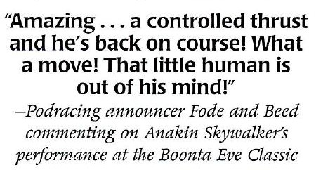

# Anakin Skywalker

- **Aliases:** Anakin Skywalker
- **Era:** see cited notes
- **Continuity:** Legends only. Canon is not mixed into this file.
- **Research tier:** untiered (not listed as INTRO/DEEP/MASTERY in legends-feats.md)
- **Entries:** 5 (2 with quotations; 0 quotations extended to the full sentence/passage from the source text on file; 1 marked as fragments; 1 before the 2026-11-17 fragment fill). Rebuilt 2026-11-17 from 5 old entries; old file: `characters/_bak/anakin-skywalker.md.bak-20261117`.
- **How to read:** each entry is the quotation in full (block quote), then its source and point of view. "Note" lines are summaries from our notes, not quotations. `[fragment — full passage not on file]` means the source text is not on the box, so only the words in our notes are shown. Debate and forum material is in the last section and is unverified.

# LEGENDS (Legends / EU — main focus)

## *Star by Star* (Troy Denning, Del Rey 2001): FULL consecutive re-read (2026-11-16 CST)

What it shows (our notes): Han drops out of hyperspace and draws on Izal; the blaster-pull trick fails; "so did Darth Vader"; "It's the salt habit, isn't it?"; Kenth's nerfloaf and the vanished salt; "I found a Master who taught me to accept my weakness"
> Doing his best to appear nonchalant, Han stepped onto the flight deck and paused to glance at the navicomputer. According to the display, they remained on course to Commenor, so any hidden diversions the Arcona might have sneaked past Han had not yet occurred.
>
> Han slipped into the pilot’s chair. “Everything okay up here?”
>
> “What could go wrong in ten minutes?” Izal continued to stare out the viewport, his color-hungry Arconan eyes mesmerized by the gray void of hyperspace. “You seem distressed.”
>
> “Distressed?” Han checked their position, reached up, and disengaged the hyperdrive. Then, as the sudden dazzle of starlight disoriented Izal, he drew his blaster and swiveled around to face the Arcona. “I’m not distressed. I’m mad. Furious, even.”
>
> Izal did not even seem all that surprised. He merely blinked the blindness from his eyes and gestured at the blaster. “That’s not necessary. I can explain.”
>
> “You’d better hope so.” Han opened his other hand and laid the black flakes and disassembled transmitters on a console between their seats. “When it comes to protecting my wife, I have a short temper.”
>
> Izal grinned and did not look at the items. “So I noticed in the isolation ward.”
>
> “You were the one in the bacta parlor?”
>
> Izal nodded eagerly. “I helped.”
>
> When Han did not lower the blaster, a furrow appeared in Izal’s brow, and he flicked his hand almost casually. Had Han been just any freighter captain concerned he was about to be hijacked by a rogue Jedi and his stowaway partners, the trick might have worked. As it was, Han had fought at Luke Skywalker’s side often enough to anticipate such maneuvers, and his free hand was already clamped over the barrel, holding the weapon in his grasp.
>
> “If it’s going to come down to using it or losing it,” Han warned, “I’ll use it.”
>
> The blaster settled back into Han’s hand.
>
> “You’re as short on gratitude as you are on temper,” the Arcona complained. “Or maybe you just don’t know how to trust.”
>
> “I’ll trust you when I know who you are.” Han set the blaster to stun, less to spare Izal than to avoid burning a hole through a crucial circuit board. “You own a lightsaber and you know a few Force tricks, but so did Darth Vader. As far as I’m concerned, you still look more like a bounty hunter than a Jedi Knight.”
>
> Izal sank into the copilot’s seat like he had been punched.
>
> “It’s the salt habit, isn’t it?” he asked. “You think no real Jedi would let himself come to this.”
>
> “If you’re looking for sympathy, you’re on the wrong ship,” Han said. The truth was he felt a certain empathy for the troubled Arcona, but now was not the time to share shortcomings. “You must know I’m no stranger to the Jedi. If you were a Jedi, I’d know you.”
>
> “You do.” Izal’s gaze slipped away from Han’s, and his face darkened to charcoal. “There’s a reason you recognized my name, I had some trouble at the academy. One bite of Kenth’s nerfloaf—”
>
> “Of course,” Han said, recalling the incident. A three-month supply of salt had vanished in the space of a few days, and then so had the student who choked it all down. “But you were only there a few months.”
>
> Han cast a meaningful glance at Izal’s belt.
>
> Izal nodded. “Hardly long enough to build my lightsaber,” he said. “Eventually, I found a Master who taught me to accept my weakness—and who helped me find my strength.”
>
> “Any idea what the setup is in here?”
>
> “Unfortunately, yes,” Ohali said softly. Ignoring the droid coming toward them, she pulled Han into the next aisle over. “I was brought here several times, when the Qrephs were just beginning to experiment with Force-sensitive biots.”
>
> Han raised his brow. “You mean like Ditto?”
>
> “Precisely.
>
> “Precisely.
>
> Han raised his brow.
>
> “And I’m sure you don’t know her,” Izal said.
>
> “Your story is smelling more like a Gamorrean kitchen every minute,” Han warned. He gestured at the flakes and disassembled transmitters. “And you still haven’t explained these.”
>
> “Oh . . . those.” Izal’s slanted smile might have been one of relief or anxiety. “That’s easy.”
>
> “So explain.”
>
> “First, I wasn’t keeping this a secret,” Izal said. “I was going to tell you when things settled down.”
>
> “Come on, you two.” Holding the repeating blaster in one hand, Han lifted the access gate in the rear safety rail. A narrow boarding ramp shot out from the Cygnus-7, bridging the half-meter distance between its side door and the hoverscaf. “We don’t have all day!”
>
> R2-D2 rolled onto the ramp and was across in a second, but C-3PO took one look at the traffic-choked chasm below and activated his self-preservation routines.
>
> “Are you quite sure that my presence is required?” he asked.
>
> “Are you quite sure that my presence is required?” he asked. “My gyroservers have been sticking—”
>
> “Quit stalling,” Han ordered. He pointed at the foam-covered cam bubble, then held a finger to his lips. “You’ve got vibration detectors to calibrate.”
>
> “Quit stalling,” Han ordered. He pointed at the foam-covered cam bubble, then held a finger to his lips. “You’ve got vibration detectors to calibrate.”
>
> Izal swallowed hard, which was quite a sight given the Arcona’s long neck. “All right.” He picked up one of the black flakes. “This scale—” (SBS Rec. 4) — **Han drops out of hyperspace and draws on Izal; the blaster-pull trick fails; "so did Darth Vader"; "It's the salt habit, isn't it?"; Kenth's nerfloaf and the vanished salt; "I found a Master who taught me to accept my weakness"**
> [fragment — full passage not on file]
— Source: The New Jedi Order: Star by Star (Troy Denning, Del Rey 2001), SBS Rec. 4 — 124 notes (re-read 2026-11-16).
(Excerpt widened 2026-11-17 to the relevant passage, word for word from Recovery (Troy Denning) (text copy `MEGA_Legend_The_New_Jedi_Order_Series_Star_Wars_New_Jedi_Order_07_Recovery_Troy_Denning_epub`).)
(Excerpt widened 2026-11-17 to the relevant passage, word for word from Crucible: Star Wars (Troy Denning) (text copy `MEGA_Legend_Standalones_Star_Wars_Crucible_Troy_Denning_epub`).)
(Excerpt widened 2026-11-17 to the relevant passage, word for word from Star Wars: Fate of the Jedi: Vortex (Troy Denning) (text copy `MEGA_Legend_The_Fate_of_the_Jedi_Series_Star_Wars_Fate_of_the_Jedi_06_Vortex_Troy_Denning_epub`).)
(Fragment completed 2026-11-17 with the full excerpt, word for word from Recovery (Troy Denning) (text copy `MEGA_Legend_The_New_Jedi_Order_Series_Star_Wars_New_Jedi_Order_07_Recovery_Troy_Denning_epub`).)
(Fragment completed 2026-11-17 with the full excerpt, word for word from Crucible: Star Wars (Troy Denning) (text copy `MEGA_Legend_Standalones_Star_Wars_Crucible_Troy_Denning_epub`).)
(Fragment completed 2026-11-17 with the full excerpt, word for word from Star Wars: Fate of the Jedi: Vortex (Troy Denning) (text copy `MEGA_Legend_The_Fate_of_the_Jedi_Series_Star_Wars_Fate_of_the_Jedi_06_Vortex_Troy_Denning_epub`).)
(Excerpt widened 2026-11-17 to the relevant passage, word for word from Recovery (Troy Denning) (text copy `MEGA_Legend_The_New_Jedi_Order_Series_Star_Wars_New_Jedi_Order_07_Recovery_Troy_Denning_epub`).)
(Excerpt widened 2026-11-17 to the relevant passage, word for word from Crucible: Star Wars (Troy Denning) (text copy `MEGA_Legend_Standalones_Star_Wars_Crucible_Troy_Denning_epub`).)
(Excerpt widened 2026-11-17 to the relevant passage, word for word from Star Wars: Fate of the Jedi: Vortex (Troy Denning) (text copy `MEGA_Legend_The_Fate_of_the_Jedi_Series_Star_Wars_Fate_of_the_Jedi_06_Vortex_Troy_Denning_epub`).)
(Fragment completed 2026-11-17: full sentence/passage matched word for word in the source text on file: `MEGA_Legend_The_New_Jedi_Order_Series_Star_Wars_New_Jedi_Order_07_Recovery_Troy_Denning_epub`.)
(Fragment completed 2026-11-17: full sentence/passage matched word for word in the source text on file: `MEGA_Legend_Standalones_Star_Wars_Crucible_Troy_Denning_epub`.)
(Fragment completed 2026-11-17: full sentence/passage matched word for word in the source text on file: `MEGA_Legend_The_Fate_of_the_Jedi_Series_Star_Wars_Fate_of_the_Jedi_06_Vortex_Troy_Denning_epub`.)
Our notes: `notes/materials/124-njo-10-star-by-star/sbs-01.md:30`

## NJO 19 Force Heretic III: Reunion (Sean Williams & Shane Dix)

- Note (summary from our notes, not a quotation): Sekot as boy Anakin Skywalker to Luke; as Vergere to Jacen. Simultaneous counseling.
  — Source: Force Heretic III: Reunion — notes fh3-04 — 135-njo-19-force-heretic-reunion/fh3-04-part4-epilogue.md.
Our notes: `notes/materials/135-njo-19-force-heretic-reunion/fh3-04-part4-epilogue.md:18`

## Republic Vol 9 — Honor and Duty TPB (#46–48 + #78)

- Note (summary from our notes, not a quotation): Obi-Wan / Anakin: standard saber defense vs assassin droids / seekers; Anakin emotional read of situations (Padmé parallel foreshadowed next issue).
  — Source: Star Wars: Republic #46 — Honor and Duty, Part 1 — exact issue Republic #46 — issue scan range from the note header: read/07 — 146-republic-v09-honor-and-duty/rp-46.md.
Our notes: `notes/materials/146-republic-v09-honor-and-duty/rp-46.md:18`

- Note (summary from our notes, not a quotation): Anakin: soft spot / Padmé projection → operational mistake (balcony).
  — Source: Star Wars: Republic #47 — Honor and Duty, Part 2 — exact issue Republic #47 — issue scan range from the note header: read/29 — 146-republic-v09-honor-and-duty/rp-47.md.
Our notes: `notes/materials/146-republic-v09-honor-and-duty/rp-47.md:19`

## The New Essential Guide to Vehicles and Vessels (2003)

> Amazing . . . a controlled thrust and he's back on course! What a move! That little human is out of his mind!
— Source: The New Essential Guide to Vehicles and Vessels (W. Haden Blackman, Del Rey, 2003), printed p.105, scan p.127. Fode and Beed have no character file..
Note (our notes, around the quote): "Amazing . . . a controlled thrust and he's back on course! What a move! That little human is out of his mind!" —Podracing announcer Fode and Beed, commenting on Anakin Skywalker's performance at the Boonta Eve Classic.
Our notes: `notes/materials/154-new-essential-guide-to-vehicles-vessels-2003/quotes/QUOTES-INDEX.md`

# Debate and forum claims (unverified)

Forum posts, Suspect Insight debates and Discord debates, respect threads, and verdicts. These are posters' arguments or quotations they typed; none is checked against the book here unless the entry says so.

_None in our notes._
