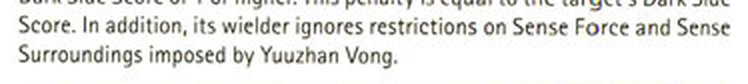

# Anakin Solo — part 3 of 3

[All parts](README.md) · [Previous](02-legends-njo-7-edge-of-victory-i-conquest-greg-keye.md) · Last part

# LEGENDS (Legends / EU — main focus)

## *Star by Star* (Troy Denning, Del Rey 2001): FULL consecutive re-read (2026-11-16 CST)

What it shows (our notes): the council: "they're the murderers here, not us" vs Cilghal; Jaina: "we're not entirely innocent in this"; Danni: "We can't presume to know how these killers think"; Anakin and Tahiri: "Break their blockade"; Jacen: "If we fight, the Yuuzhan Vong kill more people; if we don't fight, they kill them anyway … The Jedi are supposed to be the defenders of life"
> “You’ll have to excuse us for being a little nervous.” Leia flashed an annoyed look at her husband, then continued, “That was quite a demonstration Nom Anor put on. Ten thousand people dead, and I doubt he would have stopped if I had told him where to find Eclipse. What are we going to do about Talfaglio?”
>
> “First, remember that by allowing the Yuuzhan Vong to make the responsibility ours, we would only be playing into their hands,” Luke said. “We must always remember that they’re the murderers here, not us.”
>
> “That is true as far as it goes, Master Skywalker,” Cilghal said, addressing Luke more formally now that they were in a larger group. “But I am not comfortable closing my eyes to the death of so many. Whether the responsibility is ours or not, we must do something if we can prevent it.”
>
> “And we’re not entirely innocent in this, either.” Jaina entered the vault leading R2-D2 and several Jedi. News of Tsavong Lah’s threat was spreading fast, and base personnel were pouring into the conference vault. “There were Jedi on the Nebula Chaser, and those Jedi were leading the resistance on New Plympto. The Rar sisters put the whole starliner at risk by boarding it—as we did by rendezvousing with it.”
>
> “And you know the Yuuzhan Vong wouldn’t have taken them for sacrifices how?” Danni Quee asked, always quick to pinpoint the flaw in any argument. A small-framed woman with green eyes and curly blond hair, Danni had been one of the first Yuuzhan Vong prisoners—and the first to witness their breaking tortures. “We can’t presume to know how these killers think,” she went on. “It will cause mistakes. Bad ones.”
>
> As Danni spoke, she stepped aside to let Jaina join Luke in the holocomm’s sensor arc.
>
> “Hi, Dad, Mom,” Jaina said. “Sorry to keep you waiting.”
>
> “We weren’t waiting that long,” Leia said.
>
> The tension drained from Han’s face, and he added, “Yeah, no problem.”
>
> The calm lasted about a second before Anakin Solo, his brown hair as unruly as ever, stepped forward to kick the discussion into hyperdrive. “Look, it doesn’t really matter whether we’re responsible or not. There are hundreds of thousands—maybe millions—of lives at risk. We’ve got to do something, that’s all.”
>
> “What would you have us do, Anakin?” Luke asked.
>
> Tahiri answered for him. “Break their blockade, of course.” Blond and willowy, Tahiri resembled in many respects a fifteen-year-old version of Danni Quee—even down to having been a Yuuzhan Vong prisoner, until Anakin rescued her from a shaper laboratory. “We make them pay, so they don’t try it again. It’s the only way we turn this back on them.”
>
> “And that may be exactly what the Yuuzhan Vong expect us to do,” Danni said. “If they see the Jedi as warriors like themselves, they will expect an honorable response.”
>
> Han nodded in the hologram. “They’re calling the Jedi out. You’d be fools to go—especially when they’re waiting for you.”
>
> “So we let a world die?” Jacen’s quiet voice was a stark contrast to the rising tension in the room. He turned toward Tahiri and Anakin. “But waving our lightsabers around will only get more people killed, too.”
>
> Anakin scowled, as he so often did when talking with his older brother these days. “Maybe you can just stand aside and watch—”
>
> Jacen raised a hand. “Let me finish, Anakin. I’m saying that neither choice is good.” He glanced at the others in the room. “If we fight, the Yuuzhan Vong kill more people; if we don’t fight, they kill them anyway. We can’t permit either. The Jedi are supposed to be the defenders of life in this galaxy.”
>
> “What are you saying, Jacen?” Han demanded. “That the Jedi have to surrender?” He closed his eyes and winced. “Tell me that’s not what you’re saying.”
>
> “Nobody is going to surrender, Han,” Luke said.
>
> He was sympathetic to Han’s concern. Of all the young Jedi Knights who had come to Eclipse, Jacen was the most philosophical, often struggling with the paradoxical idea that it was sometimes necessary to destroy in order to preserve. Luke knew his nephew’s concerns to be the result of a disturbing vision on the planet Duro, in which Jacen had seen the galaxy tipping toward darkness and been unable to stop it. Fearful of tipping the balance even farther, the young Jedi had temporarily abandoned the Force altogether. Though he had resumed its use when events necessitated it in order to save his mother’s life, Jacen remained uncertain enough about his vision that at times his uneasiness still moved him close to inaction—a situation as perilous, in its own way, as the one that would soon be leading Alema into danger.
— Source: The New Jedi Order: Star by Star (Troy Denning, Del Rey 2001), SBS ch. 2 — 124 notes (re-read 2026-11-16).
(Excerpt widened 2026-11-17 to the relevant passage, word for word from Star by Star (Troy Denning) (text copy `MEGA_Legend_The_New_Jedi_Order_Series_Star_Wars_New_Jedi_Order_10_Star_by_Star_Troy_Denning_epub`).)
(Excerpt widened 2026-11-17 to the relevant passage, word for word from Star by Star (Troy Denning) (text copy `MEGA_Legend_The_New_Jedi_Order_Series_Star_Wars_New_Jedi_Order_10_Star_by_Star_Troy_Denning_epub`).)
(Fragment completed 2026-11-17: full sentence/passage matched word for word in the source text on file: `MEGA_Legend_The_New_Jedi_Order_Series_Star_Wars_New_Jedi_Order_10_Star_by_Star_Troy_Denning_epub`.)
Note text that was attached to the quote line: (SBS ch. 2) — **the council: "they're the murderers here, not us" vs Cilghal; Jaina: "we're not entirely innocent in this"; Danni: "We can't presume to know how these killers think"; Anakin and Tahiri: "Break their blockade"; Jacen: "If we fight, the Yuuzhan Vong kill more people; if we don't fight, they kill them anyway … The Jedi are supposed to be the defenders of life"**
Our notes: `notes/materials/124-njo-10-star-by-star/sbs-02.md:27`

What it shows (our notes): the young Jedi Knights at the tissue locker (Anakin and barefoot Tahiri, Lowbacca and Jaina, Zekk, one-armed Tenel Ka, Raynar sobbing); Lusa the Chironian "just running through a meadow" when voxyn ran her down; Jaina: "we should just go off into the Unknown Regions"; "what will we do when the Yuuzhan Vong come for us there?"
> Cilghal peered through the door and saw a line of young Jedi standing on the other side of the room, looking through a transparisteel observation panel into the frozen tissue locker. At one end of the group stood Anakin, tall, lanky, and broad-shouldered in the way of human males as they crossed from adolescence into adulthood, recognizable even from behind by his sandy-brown tousled mane. Beside him, as always, stood Tahiri, small and svelte with short-cropped blond hair, feet customarily bare, her EV footwear in one hand and Anakin’s arm in the other. The Wookiee groan had come from the opposite end of the line, where russet-furred Lowbacca stood with Jaina Solo’s slender form wrapped into his hairy arm. Next to them stood Zekk and Tenel Ka, Zekk a wiry young man with shaggy black hair hanging over his collar, Tenel Ka a tall and willowy beauty with rust-colored hair and an arm amputated just above the elbow. And more or less in the center was the one Cilghal had heard crying, blond-haired Raynar Thul, standing alone with his fists pressed against the transparisteel, his shoulders rising and falling as he sobbed.
>
> Cilghal remained outside, trying to decide whether collecting yet another tissue sample justified the intrusion. The young Jedi Knights were a close-knit group, having spent many of their formative years studying at Luke’s Jedi academy on Yavin 4. Together, they had fought off Imperial kidnappers, Dark Jedi, ruthless crime organizations, and more hazards than the Mon Calamari healer could name. Whatever was grieving them, it did not seem right to trespass on their gathering now.
>
> She started to back away, but her presence had not gone unnoticed. Tenel Ka turned and fixed a pair of red-rimmed eyes on her.
>
> “Do not mind us,” she said. “We are not here to disturb your work.”
>
> Feeling the companions’ anguish through the Force but unsure of what to do about it, Cilghal entered the room and went to the closet where she kept the cryosuit she would need to collect her samples.
>
> “Someone else has died?” she asked, fearing the truth even as she surmised it.
>
> “Lusa,” Anakin said, voice cracking. Lusa was one of their close friends from the academy on Yavin 4, a nature-loving Chironian female. Anakin gestured vaguely toward the frozen carcasses in the tissue locker. “A pack of voxyn ran her down.”
>
> “We just heard over the subspace,” Tahiri added. “She was at home, just running through a meadow.”
>
> “She was supposed to be safe,” Jaina added, finally pulling her face out of Lowbacca’s fur. “Chiron is a long way from the Yuuzhan Vong.”
>
> Cilghal felt a stab of guilt. “I am sorry to be so slow. I have learned much about these creatures, but nothing of use.”
>
> Raynar mumbled a suggestion that she work harder. Out of respect for his grief, Cilghal pretended not to hear and began to fumble into her cryosuit.
>
> Lowbacca was not so generous, groaning softly and admonishing the young Jedi for his rudeness. Raynar started to say something in reply, but his throat failed him and he turned back toward the tissue locker.
>
> Jaina stepped away from Lowbacca and patted Raynar’s arm, then turned to Cilghal. “Forgive Raynar, Cilghal. He and Lusa were very close.” Though Jaina’s eyes were puffy from crying, Cilghal could feel that the red came from anger. “No one is angry at you. Jedi are dying, and the senate blames us for losing the war. Sometimes, I think we should just go off into the Unknown Regions and leave the New Republic to the Yuuzhan Vong.”
>
> “I understand,” Cilghal said. Grief—especially young grief—had to have an outlet, or it would eat away the vessel. “But what will we do when the Yuuzhan Vong come for us there?”
>
> Jaina’s eyes hardened, but she nodded. “I know—and I suppose there’s no guarantee the Chiss would welcome us.”
— Source: The New Jedi Order: Star by Star (Troy Denning, Del Rey 2001), SBS ch. 8 — 124 notes (re-read 2026-11-16).
(Excerpt widened 2026-11-17 to the relevant passage, word for word from Star by Star (Troy Denning) (text copy `MEGA_Legend_The_New_Jedi_Order_Series_Star_Wars_New_Jedi_Order_10_Star_by_Star_Troy_Denning_epub`).)
(Excerpt widened 2026-11-17 to the relevant passage, word for word from Star by Star (Troy Denning) (text copy `MEGA_Legend_The_New_Jedi_Order_Series_Star_Wars_New_Jedi_Order_10_Star_by_Star_Troy_Denning_epub`).)
(Fragment completed 2026-11-17: full sentence/passage matched word for word in the source text on file: `MEGA_Legend_The_New_Jedi_Order_Series_Star_Wars_New_Jedi_Order_10_Star_by_Star_Troy_Denning_epub`.)
Note text that was attached to the quote line: (SBS ch. 8) — **the young Jedi Knights at the tissue locker (Anakin and barefoot Tahiri, Lowbacca and Jaina, Zekk, one-armed Tenel Ka, Raynar sobbing); Lusa the Chironian "just running through a meadow" when voxyn ran her down; Jaina: "we should just go off into the Unknown Regions"; "what will we do when the Yuuzhan Vong come for us there?"**
Our notes: `notes/materials/124-njo-10-star-by-star/sbs-02.md:70`

What it shows (our notes): Tahiri: "The Sand People say everyone has a weakness"; the genetic codes "always map the same"; Tekli; "Not always." / "Clones? … They're cloning the voxyn!"; "Unless they have only one."; Anakin: "That would be a weakness, definitely … We need them now."
> Jaina’s eyes hardened, but she nodded. “I know—and I suppose there’s no guarantee the Chiss would welcome us.”
>
> “Then I suppose we must find a way to defend this part of the galaxy.” Cilghal nearly fell as she thrust her leg into the cryosuit. “If we can.”
>
> “Don’t these creatures have a weakness?” Tahiri asked. “The Sand People say everyone has a weakness—everyone except them.”
>
> “The voxyn have no weakness I have found,” Cilghal answered. “As we suspected, they are part of this galaxy and part of the Yuuzhan Vong’s, but I have not gone far beyond that. There is so much that makes no sense.”
>
> “You are tired.” Tenel Ka came over and held one of the suit’s bulky arms. “I will help you.”
>
> “Maybe she should rest.” Anakin turned around, revealing eyes as red as Tenel Ka’s. “It’s hard to think straight when you can’t even stand.”
>
> Cilghal smiled at his concern. “You’re right, of course, but I cannot bring myself to sleep while others are dying.” She pushed her arm through the second sleeve. “I may as well work.”
>
> “Is there anything we can do?” Tenel Ka asked. “We have sentry duty in an hour, but—”
>
> “You can watch,” Cilghal said. “You can tell me how I keep contaminating these samples.”
>
> “Contaminating them?” Tahiri asked. “What do you mean?”
>
> “Their genetic codes always map the same,” Cilghal said. “It’s not the equipment—I have checked—so I must be contaminating the samples when I collect them.”
>
> Tenel Ka exchanged glances with her friends, then laid a hand on Cilghal’s arm to stop her from closing the suit. “How many times have you tried?”
>
> “Four,” Cilghal said.
>
> “And they always map the same?” Jaina asked. “Exactly the same?”
>
> Cilghal nodded, struggling to see what the young Jedi were driving at. “Even when Tekli gathers the samples.” Tekli was her apprentice, a young Chadra-Fan no older than Jaina. “We are making a systematic error somewhere.”
>
> “And what if you are not?” Tenel Ka asked.
>
> A wave of weariness came over Cilghal, and she shook her head. “We are. No two genetic sequences are identical. There are always differences.”
>
> “Not always,” Jaina said.
>
> Cilghal frowned, then felt her skin brighten to a pale green. “Clones?” she gasped. “They’re cloning the voxyn!”
>
> “Why would they do that?” Tenel Ka asked. “Would it not make more sense to breed them?”
>
> “Perhaps.” Cilghal was suddenly wide awake, her thoughts flying at lightspeed. “Unless they have only one.”
>
> Anakin’s eyes lit with excitement—or perhaps it was determination. “That would be a weakness, definitely.”
>
> “But these voxyn all came from the same shipment,” Tenel Ka observed. “Can we be sure that a pack from another shipment would not come from a different master?”
>
> Cilghal thought for a moment, going over all the different kinds of tests—both scientific and through the Force—she could run. She kept coming to the same conclusion.
>
> “There is no way to be sure,” she said. “Not from one set of samples.”
>
> “Then we need more samples.” Anakin was already half out the door before he seemed to realize that Tahiri was the only one following. He scowled back at the others. “We need them now.”
>
> “Then we need more samples.” Anakin was already half out the door before he seemed to realize that Tahiri was the only one following. He scowled back at the others. “We need them now.” (SBS ch. 8) — **Tahiri: "The Sand People say everyone has a weakness"; the genetic codes "always map the same"; Tekli; "Not always."
>
> "Clones? … They're cloning the voxyn!"; "Unless they have only one."; Anakin: "That would be a weakness, definitely … We need them now."**
> [fragment — full passage not on file]
— Source: The New Jedi Order: Star by Star (Troy Denning, Del Rey 2001), SBS ch. 8 — 124 notes (re-read 2026-11-16).
(Excerpt widened 2026-11-17 to the relevant passage, word for word from Star by Star (Troy Denning) (text copy `MEGA_Legend_The_New_Jedi_Order_Series_Star_Wars_New_Jedi_Order_10_Star_by_Star_Troy_Denning_epub`).)
(Excerpt widened 2026-11-17 to the relevant passage, word for word from Star by Star (Troy Denning) (text copy `MEGA_Legend_The_New_Jedi_Order_Series_Star_Wars_New_Jedi_Order_10_Star_by_Star_Troy_Denning_epub`).)
(Fragment completed 2026-11-17 with the full excerpt, word for word from Star by Star (Troy Denning) (text copy `MEGA_Legend_The_New_Jedi_Order_Series_Star_Wars_New_Jedi_Order_10_Star_by_Star_Troy_Denning_epub`).)
(Fragment completed 2026-11-17 with the full excerpt, word for word from Star by Star (Troy Denning) (text copy `MEGA_Legend_The_New_Jedi_Order_Series_Star_Wars_New_Jedi_Order_10_Star_by_Star_Troy_Denning_epub`).)
(Excerpt widened 2026-11-17 to the relevant passage, word for word from Star by Star (Troy Denning) (text copy `MEGA_Legend_The_New_Jedi_Order_Series_Star_Wars_New_Jedi_Order_10_Star_by_Star_Troy_Denning_epub`).)
(Excerpt widened 2026-11-17 to the relevant passage, word for word from Star by Star (Troy Denning) (text copy `MEGA_Legend_The_New_Jedi_Order_Series_Star_Wars_New_Jedi_Order_10_Star_by_Star_Troy_Denning_epub`).)
(Fragment completed 2026-11-17: full sentence/passage matched word for word in the source text on file: `MEGA_Legend_The_New_Jedi_Order_Series_Star_Wars_New_Jedi_Order_10_Star_by_Star_Troy_Denning_epub`.)
(Fragment completed 2026-11-17: full sentence/passage matched word for word in the source text on file: `MEGA_Legend_The_New_Jedi_Order_Series_Star_Wars_New_Jedi_Order_10_Star_by_Star_Troy_Denning_epub`.)
Our notes: `notes/materials/124-njo-10-star-by-star/sbs-02.md:71`

What it shows (our notes): the strike team waits in the Froz system, where Kyp resupplies; "Anakin decided what to do, Jaina decided how"; Shesh on the newscast: "Luke Skywalker is thinking only of his followers"; Zekk needles Jaina; "Bounty Hunter, what did I say?"
> The signal was scratchy, but clear enough to recognize a familiar name as the Corellian newscaster’s sober voice filled Anakin’s cockpit.
>
> “Kuati senator Viqi Shesh said the New Republic will receive the envoy with cautious optimism.”
>
> Anakin opened a channel to the rest of his small task force. “Are you guys getting this?” They were sitting on an asteroid on the outskirts of the Froz system, powered down and quietly keeping tabs on inbound traffic. With Kyp Durron supplying from here, it seemed a good place to look for the voxyn Cilghal needed. “The Yuuzhan Vong are sending an envoy after all.”
>
> “Neg that commclutter, Little Brother,” Jaina ordered. Anakin was in command of the mission, but, being a veteran Rogue Squadron pilot, Jaina was in charge of tactical aspects. As Luke had put it before allowing them to leave Eclipse, Anakin decided what to do, Jaina decided how. “Stay passive. Let’s not spray rays on idle chatter. Never know who might be listening.”
>
> Anakin clicked an acknowledgment, then Viqi Shesh’s cloying voice replaced that of the newscaster.
>
> “I’m the last to condone bargaining with murderers, but I do think we have something to talk about,” she said. “If we can make our foes understand that the New Republic has no control over the Jedi, perhaps the Yuuzhan Vong will apply pressure where it belongs.”
>
> “Would making the Yuuzhan Vong understand include helping them find the Jedi’s secret base?” the newscaster asked. “Isn’t that why they took hostages in the first place?”
>
> “I’ve been a friend of the Jedi since I joined the senate, but in this case, Luke Skywalker is thinking only of his followers. The rash acts of the Jedi have endangered the citizens of an entire world, and now he refuses to take responsibility.”
>
> “How do you like that?” Zekk said, ignoring Jaina’s request for comm silence. While he and Jaina had been close when they were younger, they had drifted apart since she volunteered for Rogue Squadron, and now he sometimes seemed to place a premium on annoying her. “The Yuuzhan Vong threaten a billion lives, we get blamed.”
>
> “Bounty Hunter, what did I say?”
>
> “Excuse me,” Tenel Ka said. Along with Lowbacca, Raynar, and Ulaha Kore—who in addition to being a talented musician was also a Force-gifted tactical analyst—Tenel Ka was manning their sensor platform, a converted blastboat named the Big Eye. “We have a contact entering the system. Their transponder identifies them as the freighter Speed Queen.”
— Source: The New Jedi Order: Star by Star (Troy Denning, Del Rey 2001), SBS ch. 9 — 124 notes (re-read 2026-11-16).
(Excerpt widened 2026-11-17 to the relevant passage, word for word from Star by Star (Troy Denning) (text copy `MEGA_Legend_The_New_Jedi_Order_Series_Star_Wars_New_Jedi_Order_10_Star_by_Star_Troy_Denning_epub`).)
(Excerpt widened 2026-11-17 to the relevant passage, word for word from Star by Star (Troy Denning) (text copy `MEGA_Legend_The_New_Jedi_Order_Series_Star_Wars_New_Jedi_Order_10_Star_by_Star_Troy_Denning_epub`).)
(Fragment completed 2026-11-17: full sentence/passage matched word for word in the source text on file: `MEGA_Legend_The_New_Jedi_Order_Series_Star_Wars_New_Jedi_Order_10_Star_by_Star_Troy_Denning_epub`.)
Note text that was attached to the quote line: (SBS ch. 9) — **the strike team waits in the Froz system, where Kyp resupplies; "Anakin decided what to do, Jaina decided how"; Shesh on the newscast: "Luke Skywalker is thinking only of his followers"; Zekk needles Jaina; "Bounty Hunter, what did I say?"**
Our notes: `notes/materials/124-njo-10-star-by-star/sbs-02.md:74`

What it shows (our notes): the Big Eye blastboat with Tenel Ka, Lowie, Raynar and the Bith Ulaha Kore; the Speed Queen and a corvette interdictor; Anakin senses with his Yavin crystal, and a startled human presence on a moon in Orbit Twelve; the Barabels in XJ3s: "Tail Two, Little Brother."
> “Excuse me,” Tenel Ka said. Along with Lowbacca, Raynar, and Ulaha Kore—who in addition to being a talented musician was also a Force-gifted tactical analyst—Tenel Ka was manning their sensor platform, a converted blastboat named the Big Eye. “We have a contact entering the system. Their transponder identifies them as the freighter Speed Queen.”
>
> Tenel Ka fed the coordinates directly to the X-wing astromech droids, then added, “A second craft has exited hyperspace. It is on a convergence course to the first.”
>
> “Enemy interdictor?” Jaina asked.
>
> A favorite tactic of the Yuuzhan Vong interdiction forces was to lurk outside their assigned system, then catch inbound traffic with a quick hyperspace hop.
>
> Tenel Ka took only a moment to confirm Jaina’s deduction. “It does not register on the sensors, and there is no ion efflux. It masses out at corvette size.”
>
> “Little Brother?” Jaina said.
>
> “Give me a sec.”
>
> Being the group’s most powerful in the Force, Anakin reached out, stretching his awareness to just shy of the population concentration around Froz. He felt no voxyn aboard the corvette, nor even the Yuuzhan Vong flying it. This latter was no surprise. Though the living crystal he had stolen from the enemy base on Yavin 4 enabled him to sense Yuuzhan Vong—in a different, much hazier way than Jedi sensed most other beings—his perceptions at such distances were too weak to discern anything less than a massive concentration. He was somewhat surprised to detect a more ordinary presence on a frozen moon near the edge of the system, something that was startled to feel his touch.
>
> Well, let him think it, then. He opened the channel for a reply. “Just give me a sec, will you? He is my son, after all.”
>
> “Negative voxyn,” he reported. “Something on that moon in Orbit Twelve, but I can’t tell what. Not Yuuzhan Vong, though.”
>
> “Nor did we three feel anything hungry,” the rasping voice of one of Saba Sebatyne’s Barabel apprentices agreed. Anakin had been reluctant to bring the newcomers along until Luke pointedly reminded him that they had survived more than fifty space battles flying ancient Y-wings for the Wild Knights. On the way out, they had also proven adept pilots in the new XJ3—with variable-stutter lasers, decoy-enhanced proton torpedoes, and grab-proof shields, the newest and most sophisticated X-wing yet. “But the presence in Orbit Twelve was human.”
>
> Unsure of whether the Barabel was trying to show him up or be helpful, Anakin assumed the latter. “Thanks for the backup, uh, One?”
>
> There was a rhythmic hissing that suggested chuckling. “Tail Two, Little Brother.”
>
> Anakin felt the heat rise to his cheeks. “Sorry.”
>
> Tail One was the male, Tesar Sebatyne. Two and Three were Bela and Krasov Hara—not sisters, they insisted, but hatchmates. Whatever that meant, their sense of humor gave Anakin the shudders. They had been the ones to suggest the Tail code names, which they seemed to find hilarious for some reason no one understood.
>
> Raynar saved Anakin the embarrassment of a more protracted silence. “Why are we sitting here? Let’s do something.”
> [fragment — full passage not on file]
— Source: The New Jedi Order: Star by Star (Troy Denning, Del Rey 2001), SBS ch. 9 — 124 notes (re-read 2026-11-16).
(Fragment completed 2026-11-17 with the full excerpt, word for word from Star by Star (Troy Denning) (text copy `MEGA_Legend_The_New_Jedi_Order_Series_Star_Wars_New_Jedi_Order_10_Star_by_Star_Troy_Denning_epub`).)
(Excerpt widened 2026-11-17 to the relevant passage, word for word from Star by Star (Troy Denning) (text copy `MEGA_Legend_The_New_Jedi_Order_Series_Star_Wars_New_Jedi_Order_10_Star_by_Star_Troy_Denning_epub`).)
(Fragment completed 2026-11-17 with the full excerpt, word for word from Star by Star (Troy Denning) (text copy `MEGA_Legend_The_New_Jedi_Order_Series_Star_Wars_New_Jedi_Order_10_Star_by_Star_Troy_Denning_epub`).)
(Fragment completed 2026-11-17 with the full excerpt, word for word from Star by Star (Troy Denning) (text copy `MEGA_Legend_The_New_Jedi_Order_Series_Star_Wars_New_Jedi_Order_10_Star_by_Star_Troy_Denning_epub`).)
(Fragment completed 2026-11-17 with the full excerpt, word for word from Star Wars: The New Jedi Order: Edge of Victory II: Rebirth (Greg Keyes) (text copy `MEGA_Legend_The_New_Jedi_Order_Series_Star_Wars_New_Jedi_Order_09_Edge_of_Victory_02_Rebirth_Greg_Keyes_epub`).)
(Excerpt widened 2026-11-17 to the relevant passage, word for word from Star by Star (Troy Denning) (text copy `MEGA_Legend_The_New_Jedi_Order_Series_Star_Wars_New_Jedi_Order_10_Star_by_Star_Troy_Denning_epub`).)
(Excerpt widened 2026-11-17 to the relevant passage, word for word from Star Wars: The New Jedi Order: Edge of Victory II: Rebirth (Greg Keyes) (text copy `MEGA_Legend_The_New_Jedi_Order_Series_Star_Wars_New_Jedi_Order_09_Edge_of_Victory_02_Rebirth_Greg_Keyes_epub`).)
(Fragment completed 2026-11-17: full sentence/passage matched word for word in the source text on file: `MEGA_Legend_The_New_Jedi_Order_Series_Star_Wars_New_Jedi_Order_10_Star_by_Star_Troy_Denning_epub`.)
(Fragment completed 2026-11-17: full sentence/passage matched word for word in the source text on file: `MEGA_Legend_The_New_Jedi_Order_Series_Star_Wars_New_Jedi_Order_09_Edge_of_Victory_02_Rebirth_Greg_Keyes_epub`.)
Note text that was attached to the quote line: (SBS ch. 9) — **the Big Eye blastboat with Tenel Ka, Lowie, Raynar and the Bith Ulaha Kore; the Speed Queen and a corvette interdictor; Anakin senses with his Yavin crystal, and a startled human presence on a moon in Orbit Twelve; the Barabels in XJ3s: "Tail Two, Little Brother."**
Our notes: `notes/materials/124-njo-10-star-by-star/sbs-02.md:75`

What it shows (our notes): "We can't interfere, Merchantman"; "someone does not obey the orderz of Uncle Master"; Kyp's Dozen arrives; "Trouble, yes … but not for us."; the boarding shuttle "simply vanished"; Anakin wonders if Kyp kills with the Force; "See? No trouble."
> “We can’t interfere, Merchantman,” Anakin said. He was as eager as Raynar to avenge Lusa’s death, but Luke had ordered them to focus solely on the mission. With Viqi Shesh and her allies already suggesting the Jedi should surrender for the greater good, the slightest incident could turn the rest of the senate against them. “And the Speed Queen is better off without us. If the Yuuzhan Vong see us coming, they’ll blast and run. This way, they might let it off with a search.”
>
> “Fact,” Tenel Ka confirmed. “They have used their dovin basals to bring the Speed Queen to a halt, and a small launch is separating from their hull.”
>
> A trio of blips, one marked in New Republic red and two in Yuuzhan Vong blue, appeared on Anakin’s tactical display. He had his astromech droid, Fiver, call up the technical data and saw no reason to disagree with Tenel Ka. Even the Yuuzhan Vong did not destroy every vessel they found; if the ship was not carrying war matériel or Jedi, they often released it in the hope of picking it up outbound filled with refugees.
>
> A raspy Barabel voice—Anakin thought it was Krasov—said, “Little Brother, we feel … someone does not obey the orderz of Uncle Master.”
>
> An instant later, a swarm of blips appeared on Anakin’s sensor display. He called, “Big Eye?”
>
> “A flight of X-wings,” Tenel Ka reported. “Twelve XJ3s.”
>
> “Likelihood ninety-nine point …” Ulaha paused, then said, “Well, that is Kyp’s Dozen. Undoubtedly.”
>
> “Big Eye, open a secure subspace channel,” Anakin said. “And download the coordinates for a microjump.”
>
> “Little Brother,” Jaina warned, “remember what—”
>
> “Just in case.” Anakin’s subspace comm light came on, and he activated his microphone. “X-wing flight, you know who this is.”
>
> He reached out with the Force to identify himself, and felt a presence almost as strong as his own in return.
>
> “Request you break off,” he said. “You’ll cause some real trouble for us—for all of us.”
>
> “Trouble, yes,” the familiar voice of Kyp Durron replied, “but not for us.”
>
> On Anakin’s tactical display, the Yuuzhan Vong boarding shuttle dissolved into static and vanished. Simply vanished, no sign of attack from the X-wings—no propellant trails, no energy flashes, nothing.
>
> “Big Eye?” Anakin asked. “Is something wrong with—”
>
> The corvette lashed out with plasma cannons and magma missiles, and Anakin’s display filled with streaks of red energy. Nothing wrong with Big Eye’s sensor package. Kyp had destroyed the shuttle … how? The Force? It didn’t seem possible. Only the most powerful Jedi could use it that way; only Dark Jedi would. Killing with the Force directly opened a Jedi to corruption, made him hungry for power. At least that was what Luke said. Anakin knew his uncle and Mara had been disappointed by their latest meeting with Kyp; perhaps this was the reason.
>
> The Dozen began to juke and jink, lacing the tactical display with flashes of laserfire. Enemy plasma balls flared against their shields or streaked off and vanished, then the corvette’s blip was engulfed in static. Anakin thought maybe a proton torpedo, but his display had not shown any propellant trails.
>
> When the static faded, the corvette remained, its fire faded to a mere dribble. The XJ3 X-wings swarmed, blasting it with laser bolts and finishing it with proton torpedoes. This time, propellant trails glowed brilliant blue on Anakin’s display.
>
> Kyp’s voice came over the subspace. “See? No trouble.”
>
> The Speed Queen fired its sublight drives and lumbered off. Though Anakin knew rogue attacks would ultimately prove harmful to both the Jedi and the New Republic, Lusa’s death was still too fresh for him to feel anything but glad.
— Source: The New Jedi Order: Star by Star (Troy Denning, Del Rey 2001), SBS ch. 9 — 124 notes (re-read 2026-11-16).
(Excerpt widened 2026-11-17 to the relevant passage, word for word from Star by Star (Troy Denning) (text copy `MEGA_Legend_The_New_Jedi_Order_Series_Star_Wars_New_Jedi_Order_10_Star_by_Star_Troy_Denning_epub`).)
(Excerpt widened 2026-11-17 to the relevant passage, word for word from Star by Star (Troy Denning) (text copy `MEGA_Legend_The_New_Jedi_Order_Series_Star_Wars_New_Jedi_Order_10_Star_by_Star_Troy_Denning_epub`).)
(Fragment completed 2026-11-17: full sentence/passage matched word for word in the source text on file: `MEGA_Legend_The_New_Jedi_Order_Series_Star_Wars_New_Jedi_Order_10_Star_by_Star_Troy_Denning_epub`.)
Note text that was attached to the quote line: (SBS ch. 9) — **"We can't interfere, Merchantman"; "someone does not obey the orderz of Uncle Master"; Kyp's Dozen arrives; "Trouble, yes … but not for us."; the boarding shuttle "simply vanished"; Anakin wonders if Kyp kills with the Force; "See? No trouble."**
Our notes: `notes/materials/124-njo-10-star-by-star/sbs-02.md:76`

What it shows (our notes): Jaina's plan, "Stickz"; Tesar's suggestion; Ulaha's odds; the microjump; Anakin feels Jaina's "strange resignation … almost detached"; "Green to go, Jedi, and good shooting."
> As the squadron formed around the Big Eye, Jaina said, “Our hop brings us out behind the low frigate. No fancy stuff, and don’t get carried away. Just blast an escape hole and head for home. Tails, you fly cover. No offense, but we haven’t worked together.”
>
> “No offense taken, Stickz,” a Barabel said. Worried that she might not respond as automatically to a different call sign, Jaina had asked the squadron to use her Rogue Squadron nickname. “We are honored to cover your backz. If Tail One may offer a suggestion?”
>
> Tenel Ka began the countdown, and Jaina said, “Seven seconds, One.”
>
> “Their missile crewz will be facing away when you arrive. If you send the blastboat on the first pasz—”
>
> “Risky, but it could work in a hurry,” Jaina said. “Odds, Minstrel?”
>
> “The probability of success is … eighty-two percent, with a margin of error—”
>
> Lowbacca rumbled his commitment to the Barabel plan, then Tenel Ka said, “Two, one, mark!”
>
> Anakin pushed the throttle and toggled the hyperdrive. The stars stretched into lines. Two seconds later, Fiver chirped to announce their arrival half a system away. To prevent the return to realspace from disorienting him, Anakin kept his eyes squeezed shut.
>
> He reached out with the Force and felt his squadron in formation behind him. Kyp and the Dozen were a short distance to the left, swirling about in the killing zone trying to avoid plasma balls and magma missiles. Now that he was close enough, he could also feel the Yuuzhan Vong over at the battle, an indistinct quaver just powerful enough to divert his attention at a crucial moment. He was tempted to remove his lightsaber’s lambent focusing crystal. A starfighter battle was no place to get distracted.
>
> The X-wing banked sharply right as Fiver, acting in tandem with the other astromech droids, lined up on target. Now past any danger of becoming disoriented, Anakin opened his eyes and saw the battle ahead, a tiny web of flashing color.
>
> “Everybody ready to play?” Jaina asked.
>
> Anakin keyed his microphone to answer affirmative and counted the right number of clicks as others did likewise. Through the Force, he sensed a strange resignation in his sister, not at all similar to his own adrenaline-charged excitement. She seemed more weary than tense, almost detached. Maybe that was how an ace pilot survived so many blinding-fast starfighter battles—or maybe it was the price of coming back alive, the all-too-organic result of stress overload. Perhaps senate politics weren’t the only reason Jaina’s leave from Rogue Squadron was indefinite. Perhaps the flight surgeons had suggested to Gavin that she needed a long rest.
>
> “Fiver, open a private channel to Jaina.”
>
> Before the droid could obey, Jaina said, “We’re whole and hot. Green to go, Jedi, and good shooting.”
— Source: The New Jedi Order: Star by Star (Troy Denning, Del Rey 2001), SBS ch. 9 — 124 notes (re-read 2026-11-16).
(Excerpt widened 2026-11-17 to the relevant passage, word for word from Star by Star (Troy Denning) (text copy `MEGA_Legend_The_New_Jedi_Order_Series_Star_Wars_New_Jedi_Order_10_Star_by_Star_Troy_Denning_epub`).)
(Excerpt widened 2026-11-17 to the relevant passage, word for word from Star by Star (Troy Denning) (text copy `MEGA_Legend_The_New_Jedi_Order_Series_Star_Wars_New_Jedi_Order_10_Star_by_Star_Troy_Denning_epub`).)
(Fragment completed 2026-11-17: full sentence/passage matched word for word in the source text on file: `MEGA_Legend_The_New_Jedi_Order_Series_Star_Wars_New_Jedi_Order_10_Star_by_Star_Troy_Denning_epub`.)
Note text that was attached to the quote line: (SBS ch. 9) — **Jaina's plan, "Stickz"; Tesar's suggestion; Ulaha's odds; the microjump; Anakin feels Jaina's "strange resignation … almost detached"; "Green to go, Jedi, and good shooting."**
Our notes: `notes/materials/124-njo-10-star-by-star/sbs-02.md:78`

What it shows (our notes): Jaina kills a skip with stutter blasts; "Neg that commclutter, Bounty Hunter"; the bait-and-switch game of shields; Anakin and Zekk open a breach; linked through the Force, "The skips disintegrated … together."
> Her X-wing leapt ahead, racing into a light-laced panorama now so large it spilled across the entire front panel of Anakin’s canopy. Putting aside any thought of suggesting she stay behind, he toggled his weapons live and selected laser cannons. The target swelled into view, first a blocky silhouette hiding the stars, then a megalithic darkness spewing plasma and magma into the maelstrom beyond.
>
> Jaina nosed down to meet the only coralskipper in position to intercept the Jedi and soon had it juking and jinking to avoid her laserfire. The enemy pilot poured the power of his dovin basal into shielding his craft instead of maneuvering it. Not smart. Jaina dodged past the few plasma balls he lobbed in her direction and raked the skip with low-power stutter blasts. When the first hit scored, she immediately quadded her weapons and unloaded.
>
> “Now that’s shooting!” Zekk said.
>
> “Neg that commclutter, Bounty Hunter,” Jaina ordered.
>
> Zekk keyed his microphone.
>
> With nothing between him and the frigate, Anakin switched to proton torpedoes and laid his targeting reticle on the ship’s bow. Tesar had guessed right about the missile crews; the plasma nodules and rock spitters on their side of the vessel remained quiet.
>
> “Fiver, what’s happening with those skips chasing the Speed Queen?”
>
> Fiver shifted the tactical display’s scale. The missing coralskippers were swarming the Queen.
>
> “Not good,” Anakin groaned. “Really not good. Uncle Luke will like that about as much as rancor fighting.”
>
> Fiver displayed a readout noting how long it would take the skips to return. They were out of the fight, but they might try to cut off the Jedi retreat.
>
> “Keep an eye on them.” Gavin thought for a second, then nodded to himself. “On my mark, all Rogues will break onto course 270 mark 27. We’re aiming for the big asteroid there, the one that’s slowly rolling.”
>
> Fiver whistled an acknowledgment, then Anakin’s targeting reticle lit as he entered torpedo range. The frigate filled the front of the canopy now, an asteroidlike rock that was all Anakin could see.
>
> “Little Brother green,” he reported.
>
> “Bounty Hunter green,” Zekk said. “Back and forth?”
>
> “Bounty Hunter green,” Zekk said. “Back and forth?”
>
> “You first.”
>
> A dozen white circles—three proton torpedoes and their decoy flares—streaked past and spread along the frigate’s flank. The Yuuzhan Vong shielding crews activated their gravity-focusing dovin basals, projecting a string of miniature black holes that swallowed everything coming at them. Zekk switched to laser cannons and sprayed the frigate with stutter blasts. Over the last two years, space combat between the New Republic and the Yuuzhan Vong had evolved into a game of bait and switch, each side trying to bluff the other into squandering its limited reserve of power on unneeded defenses and ineffectual attacks. The XJ3 updates had been designed to win that game.
>
> Anakin fired his first torpedo salvo, then switched weapons and sprayed laserfire. The shield crews were slower to grab his attacks, and the proximity fuses detonated within meters of the ship. Melt circles pocked the hull. Out of one small crack shot a geyser of atmosphere. Anakin hit the fissure with a pair of laser bursts, and a plume of bodies and equipment tumbled out. Zekk added a quadded burst and triggered a flurry of internal explosions, and then they were too close and had to pull up.
>
> Anakin felt a pair of Yuuzhan Vong eyes on him—the lambent wasn’t always a distraction—and jinked right. A magma missile spiraled past from somewhere beyond the frigate, and he felt his alarm mirrored back to him through the Force. He checked the heads-up display and saw Zekk sliding in behind him as another rock missile corkscrewed past.
>
> “Thanks for the warning!” Zekk commed.
>
> A pair of skips shot up from behind the frigate and hurled past, volcano cannons spitting plasma balls in the blastboat’s direction.
>
> Anakin started to loop around. “Get ’em!”
>
> “Neg that, boys.” Jaina’s X-wing came swinging up behind the skips, her nose already leveling off to fire. “Take the pair going under.”
>
> She flashed past, a single proton torpedo streaking after the rear skip. No need to check the tactical display; with Jaina on their tail, the two Yuuzhan Vong were already dead. Anakin and Zekk nosed down over the frigate, weaving through a storm of magma missiles and circling under the vessel’s belly before the surprised gunnery crews could target them. Three hundred meters ahead, two skips were angling up under the Big Eye, trading fire with the blastboat’s big laser cannons.
>
> Anakin felt Zekk find him through the Force. He quadded his cannons and positioned his targeting reticle. Lead flier ready. They depressed their triggers together. Their weapons flashed together. The skips disintegrated … together.
>
> “Very nice shooting,” Tenel Ka said. “Now please get clear.”
>
> Anakin pushed his throttle forward. There should have been another coralskipper, but it was nowhere on his display.
>
— Source: The New Jedi Order: Star by Star (Troy Denning, Del Rey 2001), SBS ch. 9 — 124 notes (re-read 2026-11-16).
(A fragment line was removed 2026-11-17: its words appear word for word inside the full excerpt in this entry.)
(Excerpt widened 2026-11-17 to the relevant passage, word for word from Star by Star (Troy Denning) (text copy `MEGA_Legend_The_New_Jedi_Order_Series_Star_Wars_New_Jedi_Order_10_Star_by_Star_Troy_Denning_epub`).)
(Fragment completed 2026-11-17 with the full excerpt, word for word from Star by Star (Troy Denning) (text copy `MEGA_Legend_The_New_Jedi_Order_Series_Star_Wars_New_Jedi_Order_10_Star_by_Star_Troy_Denning_epub`).)
(Fragment completed 2026-11-17 with the full excerpt, word for word from Star by Star (Troy Denning) (text copy `MEGA_Legend_The_New_Jedi_Order_Series_Star_Wars_New_Jedi_Order_10_Star_by_Star_Troy_Denning_epub`).)
(Excerpt widened 2026-11-17 to the relevant passage, word for word from Star by Star (Troy Denning) (text copy `MEGA_Legend_The_New_Jedi_Order_Series_Star_Wars_New_Jedi_Order_10_Star_by_Star_Troy_Denning_epub`).)
(Excerpt widened 2026-11-17 to the relevant passage, word for word from Onslaught: Dark Tide I (Michael A. Stackpole), Chapter Eight (text copy `MEGA_Legend_The_New_Jedi_Order_Series_Star_Wars_New_Jedi_Order_02_Dark_Tide_01_Onslaught_Michael_A_Stackpole_epub`).)
(Fragment completed 2026-11-17: full sentence/passage matched word for word in the source text on file: `MEGA_Legend_The_New_Jedi_Order_Series_Star_Wars_New_Jedi_Order_10_Star_by_Star_Troy_Denning_epub`.)
(Fragment completed 2026-11-17: full sentence/passage matched word for word in the source text on file: `MEGA_Legend_The_New_Jedi_Order_Series_Star_Wars_New_Jedi_Order_02_Dark_Tide_01_Onslaught_Michael_A_Stackpole_epub`.)
Note text that was attached to the quote line: (SBS ch. 9) — **Jaina kills a skip with stutter blasts; "Neg that commclutter, Bounty Hunter"; the bait-and-switch game of shields; Anakin and Zekk open a breach; linked through the Force, "The skips disintegrated … together."**
Our notes: `notes/materials/124-njo-10-star-by-star/sbs-02.md:79`

What it shows (our notes): Anakin on Vua Rapuung's lesson: "a dark side even without the Force"; "the Force was one tool among many"; Kyp: "'Size matters not,' and all that." / "You're using the Force to throw torpedoes?"; the Speed Queen destroyed; six skips cut off the escape
> But Anakin was beginning to wonder. On Yavin 4, a bitter Yuuzhan Vong outcast had betrayed his people to help Anakin rescue Tahiri—and from him, Anakin had learned that there was a dark side even without the Force, that strength of will counted for as much as purity of heart. Now, more than ever, it seemed to him that the Force was one tool among many, to be used for a greater good. And if Kyp Durron had discovered some way to use the Force to destroy enemy ships, it seemed to Anakin that Eclipse should investigate it—that a strong Jedi with a focused will and pure heart might be able to use it without turning to the dark side.
>
> Kyp allowed the silence to hang on the comm channels until they were clear of the enemy, then asked, “Anakin, did those explosions remind you of anything?”
>
> “Their spectrographic signature was that of a proton torpedo,” Tenel Ka said helpfully. “But there was no propellant trail.”
>
> “And what does that tell you?” Kyp asked smugly. “Think about it. ‘Size matters not,’ and all that.”
>
> “Telekinesis?” Anakin gasped. “You’re using the Force to throw torpedoes?”
>
> “I’m not as fast as a propellant charge—yet—but the Yuuzhan Vong have a hard time seeing proton torpedoes without a big, bright propellant glow to give them away.”
>
> Anakin was almost disappointed. He had been hoping for a secret weapon, something the Force-blind Yuuzhan Vong could never counter. Instead, it was just one more move in the game, one more trick the enemy would soon learn to defeat.
>
> If Kyp expected someone to congratulate him on his cleverness, he was disappointed. Tenel Ka remarked that it would save the New Republic a few propellant cylinders if nothing else, then an urgent warble drew Anakin’s attention to his tactical display. Fiver shifted scales, showing the Speed Queen’s derelict hulk dead in space. The six coralskippers that had destroyed it were rushing to cut off his group’s escape path. (SBS ch. 9) — **Anakin on Vua Rapuung's lesson: "a dark side even without the Force"; "the Force was one tool among many"; Kyp: "'Size matters not,' and all that."
>
> “Telekinesis?” Anakin gasped. “You’re using the Force to throw torpedoes?”
>
> “I’m not as fast as a propellant charge—yet—but the Yuuzhan Vong have a hard time seeing proton torpedoes without a big, bright propellant glow to give them away.”
— Source: The New Jedi Order: Star by Star (Troy Denning, Del Rey 2001), SBS ch. 9 — 124 notes (re-read 2026-11-16).
(Fragment completed 2026-11-17 with the full excerpt, word for word from Star by Star (Troy Denning) (text copy `MEGA_Legend_The_New_Jedi_Order_Series_Star_Wars_New_Jedi_Order_10_Star_by_Star_Troy_Denning_epub`).)
Note text that was attached to the quote line: the Speed Queen destroyed; six skips cut off the escape**
(Excerpt widened 2026-11-17 to the relevant passage, word for word from Star by Star (Troy Denning) (text copy `MEGA_Legend_The_New_Jedi_Order_Series_Star_Wars_New_Jedi_Order_10_Star_by_Star_Troy_Denning_epub`).)
(Excerpt widened 2026-11-17 to the relevant passage, word for word from Star by Star (Troy Denning) (text copy `MEGA_Legend_The_New_Jedi_Order_Series_Star_Wars_New_Jedi_Order_10_Star_by_Star_Troy_Denning_epub`).)
Our notes: `notes/materials/124-njo-10-star-by-star/sbs-02.md:81`

> With the milky splendor of the galactic core pouring down through its transparisteel ceiling, the crater room on Eclipse was one of the few that still had light. An attempt to feed more power to the central cooling system had blown a primary switching bank, shutting down all nonvital systems and compelling the Jedi to hold their assembly in one of the Eclipse Program’s labs. Several empty villip tanks—even Cilghal could not make the things grow—had been moved aside to create a gathering area. Han and Lando stood a little off to the side with Leia’s Noghri bodyguards. After the close call on Coruscant, the Noghri had emerged from their bacta tanks a day early and now refused to let Leia out of their sight.
>
> Leia was near the front with Mara, Cilghal, and the older Jedi, while Jacen and Jaina stood with Tenel Ka, Lowie, Raynar, Zekk, and the more thoughtful of the younger Jedi Knights. Anakin, with his pretty friend Tahiri at his side, was surrounded by his growing gaggle of companions, now including the three Barabel hatchmates, Ulaha Kore, a red-haired human woman named Eryl Besa, and the Twi’lek dancer, Alema Rar.
>
> Han was only slightly less pleased than Tahiri to see how closely Alema pressed into his son’s space. Though the Twi’lek was about the same age as Anakin, he could tell by how she used her eyes and touch that she was much older in at least one sense—and now was not a particularly good time for Anakin to learn those lessons. Though Luke had called the gathering to report a breakthrough in Cilghal’s research, they had just received word that Anakin’s friend Lyric had fallen to the voxyn. Almost as alarming, Corran Horn had been seen with his wife, Mirax, fleeing a pack of the creatures while resupplying on Corellia. No one had been able to contact them since.
>
> Cilghal was the first to break the silence. “I asked Master Skywalker to call this meeting because I wanted to give you some hopeful news. Instead, I must again apologize for my tardiness in solving the problem.” The Mon Calamari turned her bulbous eyes toward the floor. “Forgive me.”
>
> “Don’t think like that.” Though Anakin’s eyes were wet with barely restrained tears, his tone was warm. “No one could do better. Without you, we wouldn’t even know these things were part vornskr.”
>
> Anakin’s words made Han proud. He knew from his own experience how difficult it was not to lash out after the loss of someone close, and his son’s reassurances would help ease Cilghal’s overactive conscience.
>
> “That’s right,” Ganner Rhysode agreed. The big man’s scarred cheek lent a dangerous air to an otherwise rakishly handsome face. “Everyone knows how hard you’ve been working—just by how hard we’ve been working.”
— Source: The New Jedi Order: Star by Star (Troy Denning, Del Rey 2001), SBS ch. 13 — 124 notes (re-read 2026-11-16).
(Fragment completed 2026-11-17: full sentence/passage matched word for word in the source text on file: `MEGA_Legend_The_New_Jedi_Order_Series_Star_Wars_New_Jedi_Order_10_Star_by_Star_Troy_Denning_epub`.)
Note text that was attached to the quote line: (SBS ch. 13) — **the assembly in an Eclipse Program lab; Anakin's gaggle (the Barabels, Ulaha, Eryl Besa, Alema pressing close); Lyric fallen to voxyn; Corran and Mirax fled a pack on Corellia; Anakin: "Without you, we wouldn't even know these things were part vornskr."; Ganner**
Context: the assembly in an Eclipse Program lab; Anakin's gaggle (the Barabels, Ulaha, Eryl Besa, Alema pressing close); Lyric fallen to voxyn; Corran and Mirax fled a pack on Corellia; Anakin: "Without you, we wouldn't even know these things were part vornskr."; Ganner
Our notes: `notes/materials/124-njo-10-star-by-star/sbs-03.md:23`

What it shows (our notes): no massive attack (Ulaha's odds); Wraith Squadron could not cross the frontier; Tahiri: "'Let the enemy fight.' I don't think they're trying to be fair."; Alema on New Plympto traps; Anakin: "So we do—and let them ferry us across the frontier."; "You don't … We do."
> “Let us dismiss any thought of a massive attack out of hand,” Ulaha Kore said. “Even if we could assemble a large-enough fleet—and we cannot—our probability of success is below single digits.”
>
> “And the mere attempt would telegraph our intentions,” Luke said. “We must think of a better way.”
>
> “A commando force,” Zekk said. “We sneak a small strike team in the back way—”
>
> “Not unless you’re better at it than Wraith Squadron,” Han interrupted. Before leaving Coruscant, he had stopped by the New Republic Defense Force medcenter to check on Wedge and found the general in a garrulous mood. “They’ve been trying to penetrate the frontier between Corellia and Vortex for six months. The Yuuzhan Vong have dovin basal interdictors everywhere; the Wraiths were pulled out of every hyperspace lane they tried. And the stretch between the Perlemian Trade Route and the Hydian Way was especially bad; they were jumped this side of the frontier.”
>
> “Now we know why,” Luke surmised. “The Yuuzhan Vong suspect we will discover this secret, and they’re prepared for us to take action.”
>
> “I think they’re counting on it,” Tahiri said. Despite her age—at just over fifteen, she was the youngest Jedi present—her comment commanded attention. Having survived a Yuuzhan Vong shaper’s attempt to turn her into a Jedi-hunting slave, she understood the Yuuzhan Vong better than anyone present. “They have a saying, ‘Let the enemy fight.’ I don’t think they’re trying to be fair.”
>
> “You are very right, Tahiri,” Alema said. The praise drew only an icy glare in response, but the Twi’lek pretended not to notice. She addressed herself to Luke and the senior Jedi. “On New Plympto, the Yuuzhan Vong always tried to anticipate our response and build a trap around it. You can be sure they’re looking for us now.”
>
> “Then we have to fool them,” Anakin said, speaking in his typical tone of teenage certainty. He turned to the younger Jedi gathered around him. “The Yuuzhan Vong want us to surrender, right? So we do—and let them ferry us across the frontier.”
>
> “Go on,” Luke said, deftly drawing attention back to the assembly’s more mature side. “We’re listening.”
>
> Anakin disengaged himself from Tahiri and stepped toward his uncle. “It’ll buy time for Talfaglio, too.”
>
> “That would be a plus,” Luke said. “How do we do this?”
>
> “You don’t,” Anakin said. “We do.”
— Source: The New Jedi Order: Star by Star (Troy Denning, Del Rey 2001), SBS ch. 13 — 124 notes (re-read 2026-11-16).
(Excerpt widened 2026-11-17 to the relevant passage, word for word from Star by Star (Troy Denning) (text copy `MEGA_Legend_The_New_Jedi_Order_Series_Star_Wars_New_Jedi_Order_10_Star_by_Star_Troy_Denning_epub`).)
(Excerpt widened 2026-11-17 to the relevant passage, word for word from Star by Star (Troy Denning) (text copy `MEGA_Legend_The_New_Jedi_Order_Series_Star_Wars_New_Jedi_Order_10_Star_by_Star_Troy_Denning_epub`).)
(Fragment completed 2026-11-17: full sentence/passage matched word for word in the source text on file: `MEGA_Legend_The_New_Jedi_Order_Series_Star_Wars_New_Jedi_Order_10_Star_by_Star_Troy_Denning_epub`.)
Note text that was attached to the quote line: (SBS ch. 13) — **no massive attack (Ulaha's odds); Wraith Squadron could not cross the frontier; Tahiri: "'Let the enemy fight.' I don't think they're trying to be fair."; Alema on New Plympto traps; Anakin: "So we do—and let them ferry us across the frontier."; "You don't … We do."**
Our notes: `notes/materials/124-njo-10-star-by-star/sbs-03.md:26`

What it shows (our notes): Leia's warning to Han about overprotectiveness; Anakin's plan: a traitor hands them over near Obroa-skai, then they take the ship to Myrkr; Jaina: "If you go, I go."; Tahiri: "If you say young, I'll kick you where you really don't want to be kicked … Can anyone else understand the language?"
> Han felt Lando’s hand on his arm even before he realized he was starting forward. Lando had been there when Leia finally laid into Han for nearly getting her killed at the droid demonstration. In no uncertain terms, she had told him that while she was glad to have him back, she would not tolerate overprotectiveness in a husband any more than she would in a Noghri bodyguard—who was certainly much better at it. The next time Han smothered her or one of their children with his deranged need to control, she had warned, he would find himself flying the Falcon alone. Han vowed to hear his younger son out, then stepped back and quietly thanked Lando for the reminder.
>
> Anakin looked back to his group. “We’ll have a traitor turn us over to the Yuuzhan Vong on the pretext of buying time for the Talfaglion hostages. We’ll set up a transfer for somewhere near Obroa-skai, let them cross the frontier, then take over the ship and fly to Myrkr.” He turned to his older sister. “I know Wedge—General Antilles—has let you fly a couple of captured Yuuzhan Vong vessels. Can you teach Zekk?”
>
> Jaina studied him suspiciously. “Why would I need to? You’re not doing something that crazy without me.”
>
> A look of distress came to Anakin’s face. “But you’re only on temporary leave. The Rogues could call you back anytime.”
>
> “Sure they could.” Jaina rolled her eyes; then her face grew hard in the same way Leia’s did when she would abide no argument. “If you go, I go.”
>
> “Me, too,” Tahiri said.
>
> Anakin frowned. “You? You’re too—”
>
> “If you say young, I’ll kick you where you really don’t want to be kicked,” Tahiri interrupted. “Nobody here knows the Yuuzhan Vong from the inside like I do. Can anyone else—except you, maybe—be sure they’d know a shaper laboratory? Can anyone else understand the language?”
>
> “Good point,” Jaina said. “We’ll need her help to run the ship.”
>
> Anakin frowned at his sister. “Can you fly a Yuuzhan Vong ship or not? If Wedge just had you put on the cognition hood or something—”
>
> “I’ve flown—and so has Tahiri, unless you’ve forgotten,” Jaina said. She was referring to Anakin’s narrow escape in the Yag’Dhul system a few months before, when, along with Corran Horn and Tahiri, he escaped an almost certain death by capturing a Yuuzhan Vong scouting ship. “Most of the piloting stuff is symbolic, but who knows about the rest? There’s more to this than flying.”
>
> “And what happens when they start hailing us?” Tahiri asked. “You’ll need to know what they’re saying—and how to answer.”
>
> She glanced around the room expectantly. When no one responded, Han bit his tongue and waited for his brother-in-law to shoot down the plan.
— Source: The New Jedi Order: Star by Star (Troy Denning, Del Rey 2001), SBS ch. 13 — 124 notes (re-read 2026-11-16).
(Excerpt widened 2026-11-17 to the relevant passage, word for word from Star by Star (Troy Denning) (text copy `MEGA_Legend_The_New_Jedi_Order_Series_Star_Wars_New_Jedi_Order_10_Star_by_Star_Troy_Denning_epub`).)
(Excerpt widened 2026-11-17 to the relevant passage, word for word from Star by Star (Troy Denning) (text copy `MEGA_Legend_The_New_Jedi_Order_Series_Star_Wars_New_Jedi_Order_10_Star_by_Star_Troy_Denning_epub`).)
(Fragment completed 2026-11-17: full sentence/passage matched word for word in the source text on file: `MEGA_Legend_The_New_Jedi_Order_Series_Star_Wars_New_Jedi_Order_10_Star_by_Star_Troy_Denning_epub`.)
Note text that was attached to the quote line: (SBS ch. 13) — **Leia's warning to Han about overprotectiveness; Anakin's plan: a traitor hands them over near Obroa-skai, then they take the ship to Myrkr; Jaina: "If you go, I go."; Tahiri: "If you say young, I'll kick you where you really don't want to be kicked … Can anyone else understand the language?"**
Our notes: `notes/materials/124-njo-10-star-by-star/sbs-03.md:27`

What it shows (our notes): Han breaks: "Tell him why this isn't going to work."; "Why don't you tell me, Dad?"; "Because you're not going, that's why."; "At seventeen, Anakin was as much a man as Han had been at thirty"; "This isn't a mission, it's a sacrifice."
> Luke was very patient. Han counted the seconds, determined to heed his wife’s warning, yet just as determined to keep his family safe. All of it.
>
> Han made it to five seconds before his brother-in-law’s silence grew unbearable. “What are you waiting for, Luke?” Han shook off Lando’s hand and stepped into the Jedi circle. “Tell him why this isn’t going to work.”
>
> Anakin’s blue eyes darkened to angry amethyst. “Why don’t you tell me, Dad?”
>
> “All right, I will.” He spun toward his son. “It won’t work because …” Han was so angry he found it difficult to think of a reason. “Because you can’t be certain you’ll escape.”
>
> “Actually, I think I can—at least reasonably certain.” Despite the indignation in his eyes, Anakin’s voice remained calm. “I went behind Yuuzhan Vong lines to rescue Tahiri, and I have this.” He touched his lambent-modulated lightsaber. “But most of all, I know how they think.”
>
> “We know how they think,” Tahiri corrected.
>
> “You know how they think?” Han stormed. “They aren’t going to be thinking thud bugs at you.”
>
> Han started to object, but Leia took his arm.
>
> “Han, it could be the truth,” she said. “I mean, the real truth. We need to hear this.”
>
> He shook her off. “And I’ll give you another reason. You can’t do it because it’s crazy.” He shook a finger in his son’s face and was vaguely surprised to realize he was shaking it at the height of his own nose. “Because you’re not going, that’s why.”
>
> “Han!” Leia pulled him away. “This isn’t your decision.”
>
> Han turned to scowl. “It sure isn’t Anakin’s!”
>
> When he turned back to Anakin, he was surprised to find his son glaring at him, more hurt than angry, yet unyielding and completely sure of himself. It was so teenage, so classically rebellious. But there was also a stoniness that even Han could not miss, a hardness born of battles already lost and won, tempered by the anguish of fallen comrades and missing friends. At seventeen, Anakin was as much a man as Han had been at thirty, had probably seen as much combat and spilled more blood than Han had in the Rebellion. And he was still so young.
>
> “Han, the decision is Luke’s,” Leia said. “Not Anakin’s, not yours.”
>
> She interposed herself between father and son, then gently turned Han away, leaving him to wonder where he had been when his son, when all his children, had grown into adults. The answer, of course, was lost—lost and wallowing in his grief as the object of that grief would never have wanted.
>
> But the old Han Solo was back now, and the old Han Solo was not about to let the Yuuzhan Vong—or anyone else—take his family from him. He turned to Luke.
>
> “This isn’t a mission, it’s a sacrifice. You can’t send him in there—not Anakin, not any of them.”
— Source: The New Jedi Order: Star by Star (Troy Denning, Del Rey 2001), SBS ch. 13 — 124 notes (re-read 2026-11-16).
(Excerpt widened 2026-11-17 to the relevant passage, word for word from Star by Star (Troy Denning) (text copy `MEGA_Legend_The_New_Jedi_Order_Series_Star_Wars_New_Jedi_Order_10_Star_by_Star_Troy_Denning_epub`).)
(Excerpt widened 2026-11-17 to the relevant passage, word for word from The Unseen Queen (Troy Denning) (text copy `MEGA_Legend_The_Dark_Nest_Trilogy_Star_Wars_Dark_Nest_02_The_Unseen_Queen_Troy_Denning_epub`).)
(Excerpt widened 2026-11-17 to the relevant passage, word for word from Star by Star (Troy Denning) (text copy `MEGA_Legend_The_New_Jedi_Order_Series_Star_Wars_New_Jedi_Order_10_Star_by_Star_Troy_Denning_epub`).)
(Excerpt widened 2026-11-17 to the relevant passage, word for word from The Unseen Queen (Troy Denning) (text copy `MEGA_Legend_The_Dark_Nest_Trilogy_Star_Wars_Dark_Nest_02_The_Unseen_Queen_Troy_Denning_epub`).)
(Fragment completed 2026-11-17: full sentence/passage matched word for word in the source text on file: `MEGA_Legend_The_New_Jedi_Order_Series_Star_Wars_New_Jedi_Order_10_Star_by_Star_Troy_Denning_epub`.)
(Fragment completed 2026-11-17: full sentence/passage matched word for word in the source text on file: `MEGA_Legend_The_Dark_Nest_Trilogy_Star_Wars_Dark_Nest_02_The_Unseen_Queen_Troy_Denning_epub`.)
Note text that was attached to the quote line: (SBS ch. 13) — **Han breaks: "Tell him why this isn't going to work."; "Why don't you tell me, Dad?"; "Because you're not going, that's why."; "At seventeen, Anakin was as much a man as Han had been at thirty"; "This isn't a mission, it's a sacrifice."**
Our notes: `notes/materials/124-njo-10-star-by-star/sbs-03.md:28`

What it shows (our notes): Jacen: "Maybe none of us should be going."; Anakin: "this is no time to stand around debating good and evil. Either we kill those things, or those things kill the Jedi."; Alema: "the blood is not on our hands"; Ulaha; Luke projects his voice into every mind: "How do we fight a brutal, evil enemy without growing brutal and evil ourselves?"
> Even Han could sense the reluctance of the other Jedi.
>
> When no one volunteered to join the handsome Jedi Knight, Jacen said, “Maybe none of us should be going.”
>
> This drew a frown from both of his siblings, and Anakin said, “Jacen, this is no time to stand around debating good and evil. Either we kill those things, or those things kill the Jedi.”
>
> “And if we destroy the queen, the Yuuzhan Vong will retaliate against New Republic citizens even more severely,” Jacen replied. “Do we want that on our heads?”
>
> “Jacen, the blood is not on our hands,” Alema said, lekku trembling angrily. “It is on theirs.”
>
> “A convenient position, but will it save more lives than it costs?” Ulaha asked. “As Jedi, that must be our only concern.”
>
> And they were off, voices rising and gestures growing sharp as they argued the same point they had been contesting since the destruction of the Nebula Chaser. Alema spoke most forcefully against Jacen, no doubt because she could not bear the burden of New Plympto’s destruction and her sister’s death. Ulaha and Jacen led the argument for Jedi responsibility; they were supported by a surprisingly large number, including Streen, Cilghal, and, most astonishingly, the Barabel hatchmates.
>
> In the end, the debate grew so heated that C-3PO had to be summoned to take a crying Ben to his nursery, and Luke was forced to call repeatedly for quiet. Finally, he used the Force to project his voice directly into the mind of everyone present, and a silence as tense as it was embarrassed fell over the room.
>
> Luke glanced over the Jedi calmly, then spoke in barely a whisper. “It comes down to a simple question: How do we fight a brutal, evil enemy without growing brutal and evil ourselves?”
>
> “This is so,” Tenel Ka confirmed.
>
> Luke looked at her for a moment, then shook his head wearily. “I wish I had the answer, but the Force has refused to guide me in this—as it has all of you, I think.” He waited a moment, and when no one denied this, continued, “What has grown clear to me is that the time has come for us to choose one path. I assume there is no one among us who believes we should actually surrender to the Yuuzhan Vong?”
>
> Though Jacen alarmed Han by briefly looking as though he might disagree, he remained as silent as the rest of the Jedi.
>
> Luke nodded. “As I thought. So, do we destroy the voxyn and risk more retaliation? Or do we accept our losses in the hope that doing so will save the New Republic many more lives than it costs us?”
— Source: The New Jedi Order: Star by Star (Troy Denning, Del Rey 2001), SBS ch. 13 — 124 notes (re-read 2026-11-16).
(Excerpt widened 2026-11-17 to the relevant passage, word for word from Star by Star (Troy Denning) (text copy `MEGA_Legend_The_New_Jedi_Order_Series_Star_Wars_New_Jedi_Order_10_Star_by_Star_Troy_Denning_epub`).)
(Excerpt widened 2026-11-17 to the relevant passage, word for word from Star by Star (Troy Denning) (text copy `MEGA_Legend_The_New_Jedi_Order_Series_Star_Wars_New_Jedi_Order_10_Star_by_Star_Troy_Denning_epub`).)
(Fragment completed 2026-11-17: full sentence/passage matched word for word in the source text on file: `MEGA_Legend_The_New_Jedi_Order_Series_Star_Wars_New_Jedi_Order_10_Star_by_Star_Troy_Denning_epub`.)
Note text that was attached to the quote line: (SBS ch. 13) — **Jacen: "Maybe none of us should be going."; Anakin: "this is no time to stand around debating good and evil. Either we kill those things, or those things kill the Jedi."; Alema: "the blood is not on our hands"; Ulaha; Luke projects his voice into every mind: "How do we fight a brutal, evil enemy without growing brutal and evil ourselves?"**
Our notes: `notes/materials/124-njo-10-star-by-star/sbs-03.md:30`

What it shows (our notes): the argument; Lando provoked it on purpose; Anakin: "Shut up! That's an order! … Nobody is turning to the dark side on this mission."; Tahiri's smirk at Alema; "Jacen! … Can you do this?"
> Everyone started to talk at once, Alema and Raynar arguing that destroying the voxyn and defeating the Yuuzhan Vong would justify any action, Zekk telling them they didn’t know what they were talking about, Jacen insisting it was wrong to put the ends before the means. Though the others seemed to fall somewhere between the two poles, they spoke just as loudly, drawing even Eryl Besa and Jovan Drark, an imperturbable Rodian, into the argument on opposite sides. Only the Barabels, squatting in the corner with their reptilian pupils narrowed to vertical slits, seemed in possession of themselves.
>
> Anakin sighed deep inside, then noticed Lando watching him and realized just how wise his mother had been in choosing the arms merchant to ferry them to the enemy. As sincere as Lando’s warning about not hesitating might be, there was a hidden agenda behind his words. Knowing the strike team was going to have this argument eventually, he had intentionally provoked it while they could take time to work things through—and now he was waiting for Anakin to solve the problem.
>
> “Quiet.” Anakin waited a moment, then tried again, and when that failed, shouted, “Shut up! That’s an order!”
>
> His rudeness, and the Force he used to augment his voice, finally got through to the others. Before the argument could resume, he continued, “Nobody is turning to the dark side on this mission.” He glared at Raynar and Alema. “Is that clear?”
>
> “I didn’t mean to suggest we should,” Alema began quietly. “Only that we can’t shy—”
>
> “Is that clear?” Anakin demanded again.
>
> Alema’s lekku curled at the tips, but she pushed her lip out and said, “Of course, Anakin.”
>
> Anakin felt more than glimpsed the strange smirk that came to Tahiri’s face. While she was not fond of any of the strike team’s female Jedi, she seemed to truly dislike Alema. Deciding to puzzle over the matter later, he turned to Raynar and cocked his brow.
>
> Raynar nodded. “Fine. Who’d want to anyway?”
>
> Anakin accepted this and turned to Zekk and Jacen. “But Lando’s right. We may have to do some things we don’t feel good about, and do them quickly. If you can’t live with that, maybe you should catch a ride home on the freighter.”
>
> “What kind of things?” Jacen asked. “If we talk about our limits now—”
>
> “Jacen!” Anakin hissed. “Can you do this?”
>
> Instead of answering, Jacen looked around for support. He found it, of course, especially from Zekk and Tenel Ka, but Anakin began to think even his brother’s special talent for handling animals might not be worth the discord he would bring to the team. He looked to Lando for guidance, but found only the expressionless face of a seasoned gambler. Anakin would have to solve this problem on his own; where they were going, there would be no advice from old heroes of the Rebellion.
— Source: The New Jedi Order: Star by Star (Troy Denning, Del Rey 2001), SBS ch. 14 — 124 notes (re-read 2026-11-16).
(Excerpt widened 2026-11-17 to the relevant passage, word for word from Star by Star (Troy Denning) (text copy `MEGA_Legend_The_New_Jedi_Order_Series_Star_Wars_New_Jedi_Order_10_Star_by_Star_Troy_Denning_epub`).)
(Excerpt widened 2026-11-17 to the relevant passage, word for word from Star by Star (Troy Denning) (text copy `MEGA_Legend_The_New_Jedi_Order_Series_Star_Wars_New_Jedi_Order_10_Star_by_Star_Troy_Denning_epub`).)
(Fragment completed 2026-11-17: full sentence/passage matched word for word in the source text on file: `MEGA_Legend_The_New_Jedi_Order_Series_Star_Wars_New_Jedi_Order_10_Star_by_Star_Troy_Denning_epub`.)
Note text that was attached to the quote line: (SBS ch. 14) — **the argument; Lando provoked it on purpose; Anakin: "Shut up! That's an order! … Nobody is turning to the dark side on this mission."; Tahiri's smirk at Alema; "Jacen! … Can you do this?"**
Our notes: `notes/materials/124-njo-10-star-by-star/sbs-03.md:38`

What it shows (our notes): the brothers' rift; Jaina's "brainstorm": the Dubrillion Force union, Jacen to link the whole team against the breaking; the Barabel "meld-fight"; "If something feels wrong, it's on my head, not yours."; "I trust your judgment, Anakin. I really do."
> Anakin took a deep breath, using a Jedi relaxation technique to clear his mind so he could concentrate. Throughout the Yuuzhan Vong invasion, he and Jacen had been drifting apart, until they had reached a point where they had barely been able to speak to each other without an undercurrent of resentment and blame. Those wounds were only now beginning to heal. The last thing Anakin wanted to do was remove his brother from the team and open them again, but he had to think of the mission—and of the others who would be on it.
>
> Anakin turned to his brother. “Jacen, maybe—”
>
> “Anakin, I’ve had a brainstorm!” Though Jaina’s tone was enthusiastic, Anakin could feel his sister’s agitation through the Force. Nearly as troubled by the schism as the brothers themselves, she had spoken to them both about trying to bridge it. “You know how we’ve been worried about the breaking?”
>
> “Yeah?” Anakin answered cautiously. Everyone on Eclipse knew how much value the Yuuzhan Vong placed on trying to break the will of Jedi prisoners. His biggest concern was that their “captors” would start it aboard the transfer vessel, and that someone in the group would not be able to endure it long enough to cross the frontier. “What’s that have to do with what we’re talking about?”
>
> “You remember how we used that telepathic Force union during that first Yuuzhan Vong attack at Dubrillion?” Jaina asked. The three siblings had reached out to each other through the Force to share perceptions. “What if Jacen could help us all do that? We could use the link to bolster each other mentally and emotionally.”
>
> “This is a good plan,” Tenel Ka said. “Every interrogator knows that mental isolation is key to breaking a victim’s resistance.”
>
> Anakin saw the potential—just as he saw how desperately his sister was trying to prevent the gulf between him and Jacen from widening any farther. Cautiously, he asked, “How can we do that?”
>
> Jaina’s expression grew confident. “I’ve been talking to Tesar and his hatchmates about the Wild Knights’ combat tactics.” She glanced in the Barabels’ direction. “I think we could adapt a couple to our situation.”
>
> “Yes, this one thinkz we could,” Tesar said. “Perhapz we could even use the bond to create a big meld-fight.”
>
> Anakin raised his brow. Meld-fight was what the Barabels had called their incredible display of cohesion during the confused battle at Froz. “An interesting possibility.”
>
> “But we’d need Jacen,” Jaina pressed. “He’s the only one with enough empathic power to bind us all together.”
>
> Or to drive us apart, Anakin thought. But, as he studied the expectant faces watching him, he realized much of the damage had been done already. Sending Jacen back now would not only disappoint his sister, it would alienate Zekk, Tenel Ka, and many of the others who shared his concerns about the dark side. It would also widen the gulf between the two brothers—and Anakin wanted that about as much as he wanted another Yuuzhan Vong slave seed implanted in his head.
>
> “Jacen, you have to do what I say when I say it.” Anakin caught his brother’s gaze and held it. “If something feels wrong, it’s on my head, not yours. If you can’t live with that, I’m sorry, but you can’t come.”
>
> Having sensed how close Anakin had been to sending him home before, Jacen knew better than to hesitate. He nodded and said, “I trust your judgment, Anakin. I really do.”
— Source: The New Jedi Order: Star by Star (Troy Denning, Del Rey 2001), SBS ch. 14 — 124 notes (re-read 2026-11-16).
(Excerpt widened 2026-11-17 to the relevant passage, word for word from Star by Star (Troy Denning) (text copy `MEGA_Legend_The_New_Jedi_Order_Series_Star_Wars_New_Jedi_Order_10_Star_by_Star_Troy_Denning_epub`).)
(Excerpt widened 2026-11-17 to the relevant passage, word for word from Star by Star (Troy Denning) (text copy `MEGA_Legend_The_New_Jedi_Order_Series_Star_Wars_New_Jedi_Order_10_Star_by_Star_Troy_Denning_epub`).)
(Fragment completed 2026-11-17: full sentence/passage matched word for word in the source text on file: `MEGA_Legend_The_New_Jedi_Order_Series_Star_Wars_New_Jedi_Order_10_Star_by_Star_Troy_Denning_epub`.)
Note text that was attached to the quote line: (SBS ch. 14) — **the brothers' rift; Jaina's "brainstorm": the Dubrillion Force union, Jacen to link the whole team against the breaking; the Barabel "meld-fight"; "If something feels wrong, it's on my head, not yours."; "I trust your judgment, Anakin. I really do."**
Our notes: `notes/materials/124-njo-10-star-by-star/sbs-03.md:39`

What it shows (our notes): Lando's stun-cuff "gift" ("Bindings that teach as well as restrain"); point thirty-two: Anakin Force-crumples the weapons locker and slams its door into Duman Yaght; Ulaha seals the hatch; ten blasters thrown to waiting Jedi; Tesar's tail sweep and heel spike; the thirty-second count
> Once the crew was safely out of sight, Lando turned to a scar-faced Yuuzhan Vong and gestured at a fiberplast crate in front of the Lady Luck’s escape pod. “Perhaps the commander of the Exquisite Death would allow me to present him with a small gift?”
>
> It was a subtle variation on point thirty-one, but a useful one. No one had expected the commander of the transit ship to supervise the transfer personally. This officer was an eager one.
>
> When the enemy commander did not object, Lando removed several pairs of stun cuffs from the crate. Anakin expelled a long calming breath, using a Jedi relaxation technique to let a spike of anxiety flow out with it.
>
> Lando held the cuffs in front of the commander. “A little something to keep the prisoners in line, Duman Yaght.”
>
> Duman Yaght regarded the cuffs with a sneer. “What are those profanities?”
>
> “Wrist restraints.” Lando opened a metal sleeve and displayed it proudly. “You see, I’ve thought of everything.”
>
> Duman knocked the stun cuffs aside. “We have our own bindings.” He glared at Ganner’s unconscious form, which one of the strike team had levitated and placed in the center of the transfer deck with the other unconscious Jedi Knights. “Bindings that teach as well as restrain.”
>
> Point thirty-two: The enemy acknowledges the offer. Anakin turned his palm toward the weapons locker and reached out with the Force, buckling the door panel inward. Lando and the Yuuzhan Vong spun toward the screal of crumpling durasteel. Ulaha closed the pressure hatch at her end of the transfer deck, sealing the rest of the enemy boarding party out in the access corridor.
>
> Anakin twisted the door free and slammed it into Duman Yaght’s head. One Yuuzhan Vong warrior stepped over to defend his stunned commander, and the others—finding the space too cramped for amphistaffs—reached for their coufees. The strike team counterattacked in a flurry of kicks and blows, taking full advantage of the battle meld to keep the enemy too busy dodging and blocking to actually draw a weapon.
>
> With the Force, Anakin jerked the blaster pistols from their locker mounts and hurled them across the transfer deck into the grasps of ten waiting Jedi. From the other side of the sealed hatch came muffled shouts and metallic thuds as the rest of the boarding party tried to break into the transfer deck, then Tesar half turned, whipping his thick reptilian tail into the ankles of Duman Yaght and his defender and sweeping both Yuuzhan Vong off their feet. He leveled his blaster at the commander’s head.
>
> “Call off your scarheads,” the Barabel rasped.
>
> Duman Yaght’s eyes flared with anger, and his guard, now lying behind Tesar, reached for his coufee. Anakin started to shout a warning, but Jacen had already felt his alarm and relayed it through the battle meld. The Barabel pivoted and brought his heel down, a long spike folding out to pin the warrior’s hand to the durasteel floor.
>
> The tumult on the other side of the hatch suddenly fell silent, and Anakin guessed the situation on the transfer deck had been relayed to the officers of the Exquisite Death. He leveled his blaster pistol at Duman Yaght’s wounded protector and began to count. The war droids would need at least a thirty-second distraction to slip out of the Lady Luck’s disposal lock with the equipment pod and attach to the enemy shuttle. Anakin would have liked to give them a safety margin of twice that, but sixty seconds seemed like an eternity.
— Source: The New Jedi Order: Star by Star (Troy Denning, Del Rey 2001), SBS ch. 17 — 124 notes (re-read 2026-11-16).
(Excerpt widened 2026-11-17 to the relevant passage, word for word from Star by Star (Troy Denning) (text copy `MEGA_Legend_The_New_Jedi_Order_Series_Star_Wars_New_Jedi_Order_10_Star_by_Star_Troy_Denning_epub`).)
(Excerpt widened 2026-11-17 to the relevant passage, word for word from Star by Star (Troy Denning) (text copy `MEGA_Legend_The_New_Jedi_Order_Series_Star_Wars_New_Jedi_Order_10_Star_by_Star_Troy_Denning_epub`).)
(Fragment completed 2026-11-17: full sentence/passage matched word for word in the source text on file: `MEGA_Legend_The_New_Jedi_Order_Series_Star_Wars_New_Jedi_Order_10_Star_by_Star_Troy_Denning_epub`.)
Note text that was attached to the quote line: (SBS ch. 17) — **Lando's stun-cuff "gift" ("Bindings that teach as well as restrain"); point thirty-two: Anakin Force-crumples the weapons locker and slams its door into Duman Yaght; Ulaha seals the hatch; ten blasters thrown to waiting Jedi; Tesar's tail sweep and heel spike; the thirty-second count**
Our notes: `notes/materials/124-njo-10-star-by-star/sbs-03.md:58`

What it shows (our notes): "The reputation of the Jeedai is well deserved."; "You have five breaths."; Anakin crushes the shoulder villips; "Three breaths."; Lando: "Nobody's going to slag my ship"; Alema's blaster trips a safety; Lando reverses a power pack and stuns Tesar: "standard safety precaution"
> Tesar took his time pulling his heel spike out of the guard’s hand, then pressed his blaster to Duman Yaght’s face.
>
> “Tell your warriorz to drop their weaponz,” the Barabel rasped.
>
> Duman Yaght surprised Anakin and everyone else by responding with an admiring smirk. “Impressive. The reputation of the Jeedai is well deserved.”
>
> Tesar’s only response was a hiss. If not for the battle meld, Anakin would have thought the Barabel confused, but he sensed through Jacen that Tesar was only stalling for time.
>
> Two seconds later, Tesar snarled, “This one wantz surrender, not complimentz.”
>
> “Then you are to be disappointed,” Duman replied. “You must know that before allowing seventeen Jeedai to escape, I’ll destroy this ship and everyone aboard it—myself included.”
>
> “Wait a second,” Lando objected. He stepped forward, and Anakin’s count reached eight. “There’s no call for—”
>
> “Silence! If you know anything about the Yuuzhan Vong, then you know we have no fear of death.” Duman looked back to Tesar. “You have five breaths.”
>
> Finally, something they had not planned for. Desperate to thwart the deadline, Anakin stepped over and kicked the villips off the commander’s shoulder, crushed them beneath his foot.
>
> “That will not save you,” the commander said. “I have a personal villip on the bridge of my ship, relaying every word I say.” He looked back to Tesar. “Three breaths.”
>
> Though Anakin’s count had barely passed ten seconds, he knew better than to challenge the commander’s word. Having proclaimed his willingness to die, it was now a matter of honor to follow through. He watched Duman Yaght’s chest rise and fall two more times.
>
> Lando must have been watching, as well; after the second breath, he snorted loudly. “Nobody’s going to slag my ship.” He started across the transfer deck to the inner hatch. “Not when there’s no reason for it.”
>
> Alema Rar blocked his way and pointed her blaster at his face, then pulled the trigger as he moved to step past. There was a loud pop of a tripping safety breaker, then she cried out and dropped the smoking pistol.
>
> Lando kicked the weapon aside. “You see? I’ve thought of everything.” He snatched Raynar’s blaster out of his hand, popped a retaining clip, reversed the power pack, adjusted the discharge setting, and dropped Tesar with a stun bolt. “Reversed power packs—standard safety precaution, at least when you’re turning traitor on a company of Jedi.”
— Source: The New Jedi Order: Star by Star (Troy Denning, Del Rey 2001), SBS ch. 17 — 124 notes (re-read 2026-11-16).
(Excerpt widened 2026-11-17 to the relevant passage, word for word from Star by Star (Troy Denning) (text copy `MEGA_Legend_The_New_Jedi_Order_Series_Star_Wars_New_Jedi_Order_10_Star_by_Star_Troy_Denning_epub`).)
(Excerpt widened 2026-11-17 to the relevant passage, word for word from Star by Star (Troy Denning) (text copy `MEGA_Legend_The_New_Jedi_Order_Series_Star_Wars_New_Jedi_Order_10_Star_by_Star_Troy_Denning_epub`).)
(Fragment completed 2026-11-17: full sentence/passage matched word for word in the source text on file: `MEGA_Legend_The_New_Jedi_Order_Series_Star_Wars_New_Jedi_Order_10_Star_by_Star_Troy_Denning_epub`.)
Note text that was attached to the quote line: (SBS ch. 17) — **"The reputation of the Jeedai is well deserved."; "You have five breaths."; Anakin crushes the shoulder villips; "Three breaths."; Lando: "Nobody's going to slag my ship"; Alema's blaster trips a safety; Lando reverses a power pack and stuns Tesar: "standard safety precaution"**
Our notes: `notes/materials/124-njo-10-star-by-star/sbs-03.md:59`

What it shows (our notes): the brawl; Ulaha stabbed in the back with a coufee and the shock floors the meld; Lando steps over her and opens the hatch; "Done, Jeedai!"; Anakin's Sernpidal hollowness: "Maybe it would be his fault."; Alema "relieved"
> Anakin and several others popped their retaining clips, but even Jedi were not that quick. Duman Yaght’s protector caught Anakin in a leg scissors and whipped him to the floor, and Anakin found himself struggling to continue his count beneath a rain of blows.
>
> The rest of the Yuuzhan Vong were also attacking, forgoing their coufees to lash out at the blasters in the hands of their foes. Even Duman Yaght joined the fray, leaping up to hurl Tahiri into an escape pod hatch. Blaster and power pack flew in two directions, and she wisely let herself slump to the deck.
>
> The commander turned to Lando, pointed to the inner hatch. “Open it!”
>
> Lando stepped forward, his hand reaching for the override. By Anakin’s count, they were at twenty-five seconds. The two war droids would be searching the bottom of the shuttle for a place to anchor. Jacen sensed Anakin’s worry, and Ulaha stepped forward to block the path, a long-fingered Bith hand flicking forward as she opened herself to the Force.
>
> Jacen screamed first. Anakin experienced an instant of hot pain and thought his brother had been wounded, but then he heard Ulaha’s whistle and saw the Bith stumbling forward, the handle of a coufee protruding from her back. Shock shot through the strike team like a stun bolt. No one had seen the attack coming, and the sudden pain dazed them badly. Anakin took two hard blows and felt the others reeling, too, and then bodies began to fall.
>
> Across the deck, Ulaha lay facedown, too pained to scream, her fingernails raking the durasteel floor. Lando stood above her, dark eyes dazed with horror, but too much the gambler to show anything more. His knee flexed as though he might kneel down to pull out the coufee. Then he caught himself and stepped over the anguished Jedi and opened the inner hatch.
>
> Another fist crashed down on Anakin, this time summoning misty shadows of unconsciousness. He forgot his count, but it had to be thirty—or as close as they were going to get. The floor began to reverberate with heavy footfalls, the rest of the boarding party rushing onto the transfer deck. Anakin reached out with the Force and hurled a discarded blaster pistol into his attacker’s head and was rewarded with another blow, then the tip of a coufee touched his throat.
>
> “Done, Jeedai!” the warrior hissed. “Understand?”
>
> Anakin did not even dare to nod.
>
> Duman Yaght barked an order. A pair of Yuuzhan Vong lifted Ulaha off the floor and passed her into the air lock, the coufee still protruding from her back. A familiar hollowness came to Anakin then—the same hollowness he had felt on Sernpidal, when he had been forced to raise the Falcon’s nose and leave Chewie behind—and a cold fear rose inside him. They had barely made contact, and he had already gotten someone injured. Maybe this mission was too much for them. Maybe everyone was going to get killed just like Chewbacca—Lowie, Tahiri, even Jacen and Jaina. Maybe it would be his fault.
>
> Jacen reached out to him, gently laving him with the emotions of the others. There was fear, anger, guilt. Anakin could not tell who was feeling what, except for Alema Rar.
>
> Alema seemed to be relieved. No one had actually died yet, and she had made it this far without breaking down in terror. Things were going pretty well, it seemed to her.
— Source: The New Jedi Order: Star by Star (Troy Denning, Del Rey 2001), SBS ch. 17 — 124 notes (re-read 2026-11-16).
(Excerpt widened 2026-11-17 to the relevant passage, word for word from Star by Star (Troy Denning) (text copy `MEGA_Legend_The_New_Jedi_Order_Series_Star_Wars_New_Jedi_Order_10_Star_by_Star_Troy_Denning_epub`).)
(Excerpt widened 2026-11-17 to the relevant passage, word for word from Star by Star (Troy Denning) (text copy `MEGA_Legend_The_New_Jedi_Order_Series_Star_Wars_New_Jedi_Order_10_Star_by_Star_Troy_Denning_epub`).)
(Fragment completed 2026-11-17: full sentence/passage matched word for word in the source text on file: `MEGA_Legend_The_New_Jedi_Order_Series_Star_Wars_New_Jedi_Order_10_Star_by_Star_Troy_Denning_epub`.)
Note text that was attached to the quote line: (SBS ch. 17) — **the brawl; Ulaha stabbed in the back with a coufee and the shock floors the meld; Lando steps over her and opens the hatch; "Done, Jeedai!"; Anakin's Sernpidal hollowness: "Maybe it would be his fault."; Alema "relieved"**
Our notes: `notes/materials/124-njo-10-star-by-star/sbs-03.md:60`

What it shows (our notes): "I am happy they were disintegrated."; "next time, I want some warning"; Anakin hopes Lando can save Ulaha; "A haunted and fearful look came to his eyes"
> Duman Yaght’s voice sounded from somewhere beyond Anakin’s feet. “I must admit, Fitzgibbon Lane, that I now understand why you destroyed their lightsabers. Had they gotten to those … well, let us say I am happy they were disintegrated.”
>
> A pair of Yuuzhan Vong jerked Anakin to his feet, and he saw the commander standing with Lando as the boarding party lined the Jedi up for transfer. Anakin fixed his stare on Lando, wondering if there was not some way for the silky-tongued gambler to keep Ulaha aboard the Lady Luck.
>
> Lando caught Anakin staring at him and allowed his gaze to linger a moment, then turned back to Duman Yaght. “It’s all in the planning, but next time, I want some warning. If we catch them during a sleep cycle—”
>
> “You will have your villip,” the Yuuzhan Vong interrupted. “That is all I can promise.”
>
> Anakin’s guards pushed him into the air lock. He stumbled on the threshold, but kept his gaze turned over his shoulder. He knew there was no safe way for Lando to retrieve Ulaha, but Lando Calrissian had a way of doing the impossible. Lando had spent his youth outwitting Imperial agents and swindling the deadliest criminals in the galaxy, and he had been rescuing the Solo children and their parents for longer than Anakin had been alive. Surely, Lando Calrissian could outwit one ambitious Yuuzhan Vong.
>
> Lando met Anakin’s gaze again. A haunted and fearful look came to his eyes, then Duman Yaght said something that required a laugh, and Lando had to turn his back.
— Source: The New Jedi Order: Star by Star (Troy Denning, Del Rey 2001), SBS ch. 17 — 124 notes (re-read 2026-11-16).
(Excerpt widened 2026-11-17 to the relevant passage, word for word from Star by Star (Troy Denning) (text copy `MEGA_Legend_The_New_Jedi_Order_Series_Star_Wars_New_Jedi_Order_10_Star_by_Star_Troy_Denning_epub`).)
(Excerpt widened 2026-11-17 to the relevant passage, word for word from Star by Star (Troy Denning) (text copy `MEGA_Legend_The_New_Jedi_Order_Series_Star_Wars_New_Jedi_Order_10_Star_by_Star_Troy_Denning_epub`).)
(Fragment completed 2026-11-17: full sentence/passage matched word for word in the source text on file: `MEGA_Legend_The_New_Jedi_Order_Series_Star_Wars_New_Jedi_Order_10_Star_by_Star_Troy_Denning_epub`.)
Note text that was attached to the quote line: (SBS ch. 17) — **"I am happy they were disintegrated."; "next time, I want some warning"; Anakin hopes Lando can save Ulaha; "A haunted and fearful look came to his eyes"**
Our notes: `notes/materials/124-njo-10-star-by-star/sbs-03.md:61`

What it shows (our notes): aboard the Errant Venture over Eclipse; Corran and Mirax escaped (a corroded hovertaxi to repay); Ben cries until Leia takes him: "I was thinking about Anakin … wishing there had been more time for me to hold him when he was this age."
> Instead of taking the sanibuffed corridor to the Errant Venture’s parade deck, where two dozen eager academy students stood waiting to display their Force skills, Luke and his companions followed a freshly preened Booster Terrik into a lift tube and ascended directly to the bridge. The Star Destroyer could orbit Eclipse only so long before it risked exposing the base’s location, so the last thing anyone in the group wanted was to spend time watching the HoloNet. Unfortunately, they had just received word that Nom Anor was about to address the senate regarding the Talfaglion hostages, and that Borsk Fey’lya himself had asked both Wedge Antilles and Garm Bel Iblis to attend. There could be no doubt that something major was about to happen, and that it would be of great importance to the Jedi.
>
> Booster led them along the back of the bridge into the ship’s comm center, where an old Imperial holoprojector sat at the far end of a conference table littered with datapads, science projects, and flimsiplast dye-paintings. In addition to Luke and Booster, there were Corran and Mirax Horn, Han and Leia, R2-D2 and C-3PO, and, fussing discontentedly in Mara’s arms, Ben. Tionne and Kam Solusar were on the parade deck with their students, explaining that Master Skywalker was looking forward to seeing them very much and would be along soon.
>
> Luke had not yet heard how Corran and Mirax had escaped from the voxyn on Corellia. Their story had been interrupted by news of Nom Anor’s address, but they claimed it was nothing too exciting, save that they would need to find some way of quietly reimbursing Corellian Transport Services for a badly corroded hovertaxi.
>
> Ben grew more disgruntled as the group gathered around the transceiver pad. He was normally the most imperturbable of babies—but there were times when he simply could not be consoled. Now, as R2-D2 tuned the ancient transceiver to the senate holoband, Ben broke into a fit of wailing. Luke felt Mara reaching out through the Force to calm him. When that did not help, he did so himself. Ben only cried harder. Mara sighed heavily and turned to take the baby into the next room.
>
> Leia intercepted her. “Let me. I really don’t need to see this.”
>
> Mara nodded and passed Ben over.
>
> The infant calmed almost instantly.
>
> Luke and Mara exchanged surprised glances, both feeling a little distressed that they had not been able to comfort their son themselves, but knowing there was more to it than that.
>
> “I was thinking about Anakin,” Leia said, her eyes fixed on Ben’s face. “I was watching Mara and wishing there had been more time for me to hold him when he was this age.”
>
> Luke smiled and turned back to the holopad, where the cam was zooming in on a figure in the Grand Convocation Chamber.
>
> To Viqi Shesh’s eye, Nom Anor looked too certain of himself. Though Fey’lya had denied him the privilege of appearing in warrior’s garb, the executor carried himself tall and haughtily, all but deaf to the taunts of the jeering senators, his one eye fixed on the high councilors’ dais. He wore a shimmering robe of living glistaweb, nearly as proof against blaster bolts as vonduun crab armor, but far more innocuous—at least to those who did not know the secret of its charge-neutralizing fibers.
— Source: The New Jedi Order: Star by Star (Troy Denning, Del Rey 2001), SBS ch. 18 — 124 notes (re-read 2026-11-16).
(Excerpt widened 2026-11-17 to the relevant passage, word for word from Star by Star (Troy Denning) (text copy `MEGA_Legend_The_New_Jedi_Order_Series_Star_Wars_New_Jedi_Order_10_Star_by_Star_Troy_Denning_epub`).)
(Excerpt widened 2026-11-17 to the relevant passage, word for word from Star by Star (Troy Denning) (text copy `MEGA_Legend_The_New_Jedi_Order_Series_Star_Wars_New_Jedi_Order_10_Star_by_Star_Troy_Denning_epub`).)
(Fragment completed 2026-11-17: full sentence/passage matched word for word in the source text on file: `MEGA_Legend_The_New_Jedi_Order_Series_Star_Wars_New_Jedi_Order_10_Star_by_Star_Troy_Denning_epub`.)
Note text that was attached to the quote line: (SBS ch. 18) — **aboard the Errant Venture over Eclipse; Corran and Mirax escaped (a corroded hovertaxi to repay); Ben cries until Leia takes him: "I was thinking about Anakin … wishing there had been more time for me to hold him when he was this age."**
Our notes: `notes/materials/124-njo-10-star-by-star/sbs-03.md:64`

What it shows (our notes): the list: Ganner, Tesar, Lowbacca, the wounded Ulaha, "the Solo name"; Bel Iblis: "Anakin or the twins?" / "Twins?"; Shesh: "They're twins, just like their mother and Luke Skywalker."; "as long as the New Republic continues to turn over its Jedi"; "A like number every ten standard days."
> Nom Anor sneered. “I have a list.” He made a show of consulting a sheet of what looked like the shed skin of a snake, then said, “The leader is Ganner Rhysode. His assistants seem to be Tesar Sebatyne and a Wookiee named Lowbacca.”
>
> A plaintive howl echoed down from the Wookiee gallery, and a security droid was slapped out of the air by a hairy claw.
>
> “The Bith Jedi Ulaha Kore was wounded resisting capture, and I certainly recognize the Solo name.”
>
> “Solo?” Wedge Antilles gasped. Along with Garm Bel Iblis, he was standing behind Fey’lya’s seat for some reason Viqi did not yet understand. “You have a Solo?”
>
> The chamber fell so quiet that the next question, from General Bel Iblis, would have carried to the top gallery even without being picked up by Fey’lya’s microphone. “Which one? Anakin or the twins?”
>
> The smug look vanished from Nom Anor’s face. “Twins?” He quickly forced a sneer, but, to Viqi, the expression looked more sick than snide. “We have the three young ones.”
>
> The two generals glanced at each other with fallen faces, and Fey’lya’s ears drooped, but only Viqi seemed to perceive Nom Anor’s subtle shift of attitude. She did not know what significance twins had to the Yuuzhan Vong, but it seemed clear enough to her that there was one—and that, with a little help from her, Nom Anor would look like a fool to Tsavong Lah for not realizing it.
>
> Viqi leaned forward and glared at the Yuuzhan Vong as though challenging his claim. “Jacen and Jaina are twins, Mr. Ambassador.” She leaned back, then added with a disdainful smirk, “It’s common knowledge. They’re twins, just like their mother and Luke Skywalker.”
>
> Nom Anor’s good eye narrowed, and he glared at her in open anger. “It does not matter what they are.” He forced himself to look back to Fey’lya. “What I came here to say, what the warmaster wishes me to say, is that he is not unreasonable. He will spare the Talfaglion hostages as long as the New Republic continues to turn over its Jedi.”
>
> Fey’lya rose from his seat. “Never!”
>
> Nom Anor ignored him and turned to the gallery. “A like number every …”
>
> His microphone suddenly went dead, preventing his last three words from reaching the senate gallery.
>
> Viqi keyed her own microphone. “A like number every ten standard days. You have the right to know, whether the chief of state wants you to or not.”
>
> Viqi keyed her own microphone. “A like number every ten standard days. You have the right to know, whether the chief of state wants you to or not.” (SBS ch. 18) — **the list: Ganner, Tesar, Lowbacca, the wounded Ulaha, "the Solo name"; Bel Iblis: "Anakin or the twins?"
>
> "Twins?"; Shesh: "They're twins, just like their mother and Luke Skywalker."; "as long as the New Republic continues to turn over its Jedi"; "A like number every ten standard days."**
> [fragment — full passage not on file]
— Source: The New Jedi Order: Star by Star (Troy Denning, Del Rey 2001), SBS ch. 18 — 124 notes (re-read 2026-11-16).
(Excerpt widened 2026-11-17 to the relevant passage, word for word from Star by Star (Troy Denning) (text copy `MEGA_Legend_The_New_Jedi_Order_Series_Star_Wars_New_Jedi_Order_10_Star_by_Star_Troy_Denning_epub`).)
(Fragment completed 2026-11-17 with the full excerpt, word for word from Star by Star (Troy Denning) (text copy `MEGA_Legend_The_New_Jedi_Order_Series_Star_Wars_New_Jedi_Order_10_Star_by_Star_Troy_Denning_epub`).)
(Excerpt widened 2026-11-17 to the relevant passage, word for word from Star by Star (Troy Denning) (text copy `MEGA_Legend_The_New_Jedi_Order_Series_Star_Wars_New_Jedi_Order_10_Star_by_Star_Troy_Denning_epub`).)
(Fragment completed 2026-11-17: full sentence/passage matched word for word in the source text on file: `MEGA_Legend_The_New_Jedi_Order_Series_Star_Wars_New_Jedi_Order_10_Star_by_Star_Troy_Denning_epub`.)
Our notes: `notes/materials/124-njo-10-star-by-star/sbs-03.md:67`

What it shows (our notes): "It is dangerous to enter a fight angry."; Wonetun: "Calm down or close up."; Danni angry that Luke let Anakin go: "Master Skywalker has not seen a breaking"; "What would you have us do? Go after them?"; Saba's son and apprentices are on the team; "If we could find them, Saba, that's exactly what I'd do"; data as "the only apology Saba Sebatyne would understand"
> “How can I correlate anything from here?”
>
> “You will have your chance, Danni Quee.” Their platform opened up with its variable-pulse turbolasers, filling the darkness outside with sheets of colored light. Saba, sitting in her command chair near the front, half turned so she could fix a reptilian eye on Danni. “Use the wait to calm yourself. It is dangerous to enter a fight angry.”
>
> “I’m not angry.”
>
> “You feel angry to me,” Wonetun rumbled from the pilot’s seat. “And that’ll get someone killed. Calm down or close up.”
>
> “You were angry when Mara came to tell us about Anakin’s plan,” Saba said. “Perhapz you wished to go along?”
>
> “You’re smarter than that,” Danni retorted, “or this bunch of grutchin traps wouldn’t have lasted this long. The last place I want to be is another Yuuzhan Vong holding cell.”
>
> “No anger there,” Wonetun observed sarcastically.
>
> “She is upset with Master Ssskywalker.” Izal sat in the topside turret, his long tongue flicking the pale salt crust clinging to his upper lip. “She thinks he should have asked her.”
>
> Danni glared up at the Arcona. “Stay out of my mind.”
>
> “It is in your face, not your mind.”
>
> Danni was not certain she believed him—Izal could be a little sly when he was holding back on the salt—but there was no denying the irritation she felt at the suggestion.
>
> “He shouldn’t have let Anakin talk him into it,” Danni said. “Those kids have no idea what they’re getting into.”
>
> “The voxyn must be exterminated,” Saba said. “Master Skywalker has surely considered the riskz.”
>
> “Master Skywalker has not seen a breaking,” Danni shot back. “He has no idea.”
>
> “The strike team will commandeer the ship before the breaking,” Saba said.
>
> “Sure they will,” Danni said.
>
> Saba’s scaly tail slapped the floor. “What would you have us do? Go after them?”
>
> The sudden apprehension in the Force reminded Danni of what she was saying. Saba’s face was so stoic and fearsome-looking that it was easy to forget she had emotions, too, and it had completely slipped Danni’s mind that Saba’s apprentices and son were with the strike team. Knowing the Barabel did not really understand the concept of an apology and would probably have found it disingenuous if she did, Danni did not even try. She simply gave a small nod.
>
> “If we could find them, Saba, that’s exactly what I’d do,” Danni said. “I’d go after them.”
>
> Saba studied her with a black eye for a moment, then the TacCon’s voice came over the comm channel. “Guard ships forward. Remember your areas, and stay close to your platforms.”
>
> “Let us do our own jobz first.” Saba gestured at Danni’s instrument panel. “Knowing how the yammosks communicate does us no good until we understand their language. Did you not say that?”
>
> Without awaiting a reply, the Barabel turned away and ordered the squadron forward. Though Danni’s anger was gone, the Force was now filled with grimness and apprehension—and not only Saba’s. Though the exchange in the blastboat had not been transmitted over the comm channels, the rest of the Wild Knights could sense their leader’s anxiety. Danni instantly felt ashamed of her anger and regretted her thoughtless words even more than before. In a squadron that relied on empathy to bind it together, runaway emotions could get someone killed.
>
> Danni focused her attention on her instruments and promised herself that she would coax every bit of data possible out of the battle. It was the only apology Saba Sebatyne would understand.
> [fragment — full passage not on file]
— Source: The New Jedi Order: Star by Star (Troy Denning, Del Rey 2001), SBS ch. 19 — 124 notes (re-read 2026-11-16).
(Fragment completed 2026-11-17 with the full excerpt, word for word from Star by Star (Troy Denning) (text copy `MEGA_Legend_The_New_Jedi_Order_Series_Star_Wars_New_Jedi_Order_10_Star_by_Star_Troy_Denning_epub`).)
(Excerpt widened 2026-11-17 to the relevant passage, word for word from Star by Star (Troy Denning) (text copy `MEGA_Legend_The_New_Jedi_Order_Series_Star_Wars_New_Jedi_Order_10_Star_by_Star_Troy_Denning_epub`).)
(Fragment completed 2026-11-17 with the full excerpt, word for word from Star by Star (Troy Denning) (text copy `MEGA_Legend_The_New_Jedi_Order_Series_Star_Wars_New_Jedi_Order_10_Star_by_Star_Troy_Denning_epub`).)
(Fragment completed 2026-11-17 with the full excerpt, word for word from Star by Star (Troy Denning) (text copy `MEGA_Legend_The_New_Jedi_Order_Series_Star_Wars_New_Jedi_Order_10_Star_by_Star_Troy_Denning_epub`).)
(Excerpt widened 2026-11-17 to the relevant passage, word for word from Star by Star (Troy Denning) (text copy `MEGA_Legend_The_New_Jedi_Order_Series_Star_Wars_New_Jedi_Order_10_Star_by_Star_Troy_Denning_epub`).)
(Fragment completed 2026-11-17: full sentence/passage matched word for word in the source text on file: `MEGA_Legend_The_New_Jedi_Order_Series_Star_Wars_New_Jedi_Order_10_Star_by_Star_Troy_Denning_epub`.)
Note text that was attached to the quote line: (SBS ch. 19) — **"It is dangerous to enter a fight angry."; Wonetun: "Calm down or close up."; Danni angry that Luke let Anakin go: "Master Skywalker has not seen a breaking"; "What would you have us do? Go after them?"; Saba's son and apprentices are on the team; "If we could find them, Saba, that's exactly what I'd do"; data as "the only apology Saba Sebatyne would understand"**
Our notes: `notes/materials/124-njo-10-star-by-star/sbs-04.md:5`

What it shows (our notes): "Your brother, or your twin?"; "I choose me." / "That is not your choice."; Anakin a little brother, Jacen "a second skin"; Anakin: "Jaina, you can choose … You can choose me."; "Be quiet, Jacen … Choose."; "Anakin … Take Anakin."
> “What?” Jaina felt the shock of his demand not only in the hollowness of her own stomach, but in the stunned outrage coming to her through the Force. “Choose what?”
>
> “You are the one in control, Jaina Solo. Who will be next?” He kicked first Anakin in the kidneys, then Jacen. “Your brother, or your twin?”
>
> “They’re both my brothers.” In Jaina’s shock, it registered only vaguely that Duman Yaght now realized her relationship to Jacen. “And I choose neither. I choose me.”
>
> Duman Yaght shook his head. “That is not your choice. You must choose Anakin or Jacen.” Again, he kicked them, drawing involuntary groans from both. “Choose one, or I will be forced to return Ulaha to the breaking. The warmaster knows of her wound, so no one will think anything of it should she happen to die. You are the master now, Jaina Solo.”
>
> Jaina felt a surge of anger and would have whirled on Duman Yaght to attack, had a flash of alarm from her brothers not brought her up short. Each wanted to be the one chosen—she would have felt that much from her brothers even without the group’s emotional bond—and her tie to Jacen went farther yet. She could sense that for him it was more than a matter of being noble, that he had good reason to believe himself the best choice. Jaina suspected those reasons included the fact that Anakin would need a clear head when the time came to escape—it had to be soon, she hoped—but she could not be certain; even the bond between the twins was not strong enough to share complete thoughts.
>
> “Your choice?” Duman Yaght demanded.
>
> “You can’t ask that,” Jaina said. She told herself that as facilitator of the battle meld, Jacen was just as important as Anakin, but the truth was that she could not bring herself to harm either one. Though Anakin was a war hero and leader to everyone else, he would always be a little brother to her—someone to look after, protect, keep out of trouble. And Jacen had always been her best friend, the person who understood her when she did not understand herself, the presence that enveloped her like a second skin. How could she send either of them? She looked away from Duman Yaght. “I can’t choose.”
>
> “No?” His hand tightened on the back of her neck, and he started to pull her away. “A pity for the Bith, then.”
>
> Anakin craned his head around. “Jaina, you can choose.” The weight of the Force was behind his words, not as much to compel her as to make clear that this was an order. “You can choose me.”
>
> Jaina’s connection to the others diminished as Jacen withdrew into himself. He looked toward their younger brother.
>
> “Anakin—”
>
> “Be quiet, Jacen.” Anakin continued to stare at Jaina. “Choose.”
>
> Duman Yaght looked at her expectantly. “The Bith will probably die anyway, you know.”
>
> Jaina closed her eyes. “Anakin,” she said. “Take Anakin.” (SBS ch. 21) — **"Your brother, or your twin?"; "I choose me."
>
> Duman Yaght shook his head. “That is not your choice. You must choose Anakin or Jacen.” Again, he kicked them, drawing involuntary groans from both. “Choose one, or I will be forced to return Ulaha to the breaking. The warmaster knows of her wound, so no one will think anything of it should she happen to die. You are the master now, Jaina Solo.”
> [fragment — full passage not on file]
— Source: The New Jedi Order: Star by Star (Troy Denning, Del Rey 2001), SBS ch. 21 — 124 notes (re-read 2026-11-16).
(Fragment completed 2026-11-17 with the full excerpt, word for word from Star by Star (Troy Denning) (text copy `MEGA_Legend_The_New_Jedi_Order_Series_Star_Wars_New_Jedi_Order_10_Star_by_Star_Troy_Denning_epub`).)
Note text that was attached to the quote line: Anakin a little brother, Jacen "a second skin"; Anakin: "Jaina, you can choose … You can choose me."; "Be quiet, Jacen … Choose."; "Anakin … Take Anakin."**
(Excerpt widened 2026-11-17 to the relevant passage, word for word from Star by Star (Troy Denning) (text copy `MEGA_Legend_The_New_Jedi_Order_Series_Star_Wars_New_Jedi_Order_10_Star_by_Star_Troy_Denning_epub`).)
(Fragment completed 2026-11-17 with the full excerpt, word for word from Star by Star (Troy Denning) (text copy `MEGA_Legend_The_New_Jedi_Order_Series_Star_Wars_New_Jedi_Order_10_Star_by_Star_Troy_Denning_epub`).)
(Excerpt widened 2026-11-17 to the relevant passage, word for word from Star by Star (Troy Denning) (text copy `MEGA_Legend_The_New_Jedi_Order_Series_Star_Wars_New_Jedi_Order_10_Star_by_Star_Troy_Denning_epub`).)
(Fragment completed 2026-11-17: full sentence/passage matched word for word in the source text on file: `MEGA_Legend_The_New_Jedi_Order_Series_Star_Wars_New_Jedi_Order_10_Star_by_Star_Troy_Denning_epub`.)
Our notes: `notes/materials/124-njo-10-star-by-star/sbs-04.md:18`

What it shows (our notes): a quarter hour; "Anakin never cried out."; the voxyn's slimed claws and retroviruses; "You'll just have to watch from the back"; the claw rakes Anakin's back; "You two are the twins."
> Duman Yaght nodded to the guard standing behind her brothers, then said something to another standing beside one of the gelatinous membranes that covered the hold doorways. The warrior tickled the membrane until it drew aside, then disappeared into the next room with a thin smile of anticipation.
>
> Instead of returning Jaina to her place on the wall, Duman Yaght forced her to stand beside him as Anakin was secured to the floor facedown. The commander summoned his pet forward and began to give orders, and for the next quarter hour Jaina was forced to watch.
>
> Bolstered by the support of the strike team, Anakin never cried out. Eventually even Duman Yaght clucked his tongue in admiration.
>
> “He takes pain well, your brother,” the commander said. “Perhaps we try something new, yes?”
>
> He barked a command, and the voxyn held a foot over Anakin’s back. The sharp claws were coated in green slime—the medium, Jaina knew, for the retroviruses that flourished in the thing’s toe pads.
>
> “Is that fear in your eyes, Jaina Solo?” Duman asked. “Then there is no need to tell you about the fevers. You know what will become of your brother if he is scratched.”
>
> “You wouldn’t disappoint your priests.” As Jaina spoke, she reached out to the others, sharing with them the uncertainty her brave words concealed. The vaccine Cilghal had given them was untested; it might destroy all the diseases or only some, and she was not happy about experimenting with her brother’s life. “Not when they have promised you a place at our sacrifices.”
>
> “True, but think of my place if I could tell them in which region the Jeedai base is located,” Duman Yaght said. “I would be only a few tiers behind the warmaster, close enough so that you could see the gratitude in my eyes.”
>
> An overwhelming sense of defiance came to Jaina—Anakin’s feelings on the matter, no doubt, as relayed by Jacen.
>
> “You’ll just have to watch from the back,” Jaina retorted.
>
> Duman Yaght’s hand tightened on her neck. “You believe I won’t do this?”
>
> He whistled sharply, and the voxyn raked its claw down Anakin’s back. Jaina felt a shock through the Force, but somehow her brother still did not scream.
>
> “You overestimate your brother’s value,” Duman Yaght said. “The priests will be happy as long as I return with you and Jacen. You two are the twins.”
>
> He said the word twins as though it were some sort of state secret. There was something there Jaina did not understand, but it hardly mattered. One way or the other, she and Jacen were going to disappoint both Duman Yaght and the priests.
— Source: The New Jedi Order: Star by Star (Troy Denning, Del Rey 2001), SBS ch. 21 — 124 notes (re-read 2026-11-16).
(Excerpt widened 2026-11-17 to the relevant passage, word for word from Star by Star (Troy Denning) (text copy `MEGA_Legend_The_New_Jedi_Order_Series_Star_Wars_New_Jedi_Order_10_Star_by_Star_Troy_Denning_epub`).)
(Excerpt widened 2026-11-17 to the relevant passage, word for word from Star by Star (Troy Denning) (text copy `MEGA_Legend_The_New_Jedi_Order_Series_Star_Wars_New_Jedi_Order_10_Star_by_Star_Troy_Denning_epub`).)
(Fragment completed 2026-11-17: full sentence/passage matched word for word in the source text on file: `MEGA_Legend_The_New_Jedi_Order_Series_Star_Wars_New_Jedi_Order_10_Star_by_Star_Troy_Denning_epub`.)
Note text that was attached to the quote line: (SBS ch. 21) — **a quarter hour; "Anakin never cried out."; the voxyn's slimed claws and retroviruses; "You'll just have to watch from the back"; the claw rakes Anakin's back; "You two are the twins."**
Our notes: `notes/materials/124-njo-10-star-by-star/sbs-04.md:19`

What it shows (our notes): the walking tree with an ysalamiri; the voxyn goes mindless with hunger: "I have seen them tear off their own legs to get the ysalamiri."; the lizard put on Anakin's bleeding shoulders; "Sooner or later, the voxyn will stop trying to eat its problem and kill it."
> The guard who had been sent out earlier reappeared at the hold door. Duman Yaght had a pair of guards lay a lump of blorash jelly over the voxyn’s two rear feet, trapping the creature in place. They moved Anakin well beyond the voxyn’s reach and secured him to the floor by a single foot.
>
> This was something new, and Jaina did not like the look of it. “What are you preparing, a stare-down?”
>
> Duman Yaght cracked a smile. “In a manner of speaking, yes.”
>
> He nodded to the door guard, who stood aside and stretched the membrane back to admit what looked like a small tree. About the size of a grown Wookiee, the plant had a small but thick crown of foliage. In the center of its trunk was a single knothole with a glassy black orb, which it turned in the commander’s direction. Duman Yaght pointed at the center of the hold, and the tree clumped forward on three gnarled root burls.
>
> As the thing approached, the voxyn’s forked tongue flickered out to test the air. The sensory bristles rose on its back, then it strained to curl its long body around and look behind it.
>
> The tree was about seven meters away when the voxyn went wild, hissing madly and gouging furrows into the floor as it tried to tear itself free. The creature seemed to have lost all its intelligence, acting more like a mindless beast than the shrewd predator the Jedi had learned to fear.
>
> The tree continued to advance, and two meters later Jaina lost all contact with her companions. She reached out with the Force and felt nothing. Then, as the tree drew nearer and the rest of the strike team struggled to see what was cutting them off from the Force, Jaina glimpsed a lizardlike shape clinging to the back of the tree—no doubt trying to hide itself from the voracious predator clambering to get it.
>
> “An ysalamiri,” Jaina said loudly. She was a little puzzled, for ysalamiri usually created a much larger bubble of Force absence. “What are you going to do with that?”
>
> “An interesting question.” Duman Yaght nodded to the guard who had brought the walking tree into the room. “Show her.”
>
> The guard stepped forward and took the ysalamiri from its perch. The creature’s hook-shaped claws tore small chunks of bark out of the trunk, drawing a pained leaf-rustle from the tree. With a crooked ridge of vertebrae running down its gaunt back and red sores flecking its smooth hide, the ysalamiri itself looked half dead. The voxyn was mad to get at it, lunging and flicking its tongue at the wary guard as he laid the thing on Anakin’s shoulders.
>
> The ysalamiri slid down behind Anakin’s back and held on. The voxyn lunged at its restraints, threatening to pull its rear legs out of socket.
>
> “The shapers cannot understand why, but ysalamiri drive voxyn mad,” Duman Yaght said. “The voxyn lose their natural cunning. In experiments similar to this, I have seen them tear off their own legs to get the ysalamiri.”
>
> “Your point?”
>
> “You know my point,” Duman Yaght said. “Sooner or later, the voxyn will stop trying to eat its problem and kill it.”
>
> Jaina could not take her eyes off her brother, now so coated in blood he looked almost clothed. In the equipment pod, there was a way to make the ysalamiri leave the hold, of course, but Anakin and Ganner were the only ones who could activate the war droids and get at it. If they both died, the droids would automatically activate to search for strike team survivors—hardly the way Jaina wanted to deal with the problem of the ysalamiri.
>
> “In what region will we find the Jeedai base?” Duman Yaght asked. “Take all the time you wish to answer. I am in no hurry.”
> [fragment — full passage not on file]
— Source: The New Jedi Order: Star by Star (Troy Denning, Del Rey 2001), SBS ch. 21 — 124 notes (re-read 2026-11-16).
(Fragment completed 2026-11-17 with the full excerpt, word for word from Star by Star (Troy Denning) (text copy `MEGA_Legend_The_New_Jedi_Order_Series_Star_Wars_New_Jedi_Order_10_Star_by_Star_Troy_Denning_epub`).)
(Excerpt widened 2026-11-17 to the relevant passage, word for word from Star by Star (Troy Denning) (text copy `MEGA_Legend_The_New_Jedi_Order_Series_Star_Wars_New_Jedi_Order_10_Star_by_Star_Troy_Denning_epub`).)
(Fragment completed 2026-11-17 with the full excerpt, word for word from Star by Star (Troy Denning) (text copy `MEGA_Legend_The_New_Jedi_Order_Series_Star_Wars_New_Jedi_Order_10_Star_by_Star_Troy_Denning_epub`).)
(Fragment completed 2026-11-17 with the full excerpt, word for word from Star by Star (Troy Denning) (text copy `MEGA_Legend_The_New_Jedi_Order_Series_Star_Wars_New_Jedi_Order_10_Star_by_Star_Troy_Denning_epub`).)
(Excerpt widened 2026-11-17 to the relevant passage, word for word from Star by Star (Troy Denning) (text copy `MEGA_Legend_The_New_Jedi_Order_Series_Star_Wars_New_Jedi_Order_10_Star_by_Star_Troy_Denning_epub`).)
(Fragment completed 2026-11-17: full sentence/passage matched word for word in the source text on file: `MEGA_Legend_The_New_Jedi_Order_Series_Star_Wars_New_Jedi_Order_10_Star_by_Star_Troy_Denning_epub`.)
Note text that was attached to the quote line: (SBS ch. 21) — **the walking tree with an ysalamiri; the voxyn goes mindless with hunger: "I have seen them tear off their own legs to get the ysalamiri."; the lizard put on Anakin's bleeding shoulders; "Sooner or later, the voxyn will stop trying to eat its problem and kill it."**
Our notes: `notes/materials/124-njo-10-star-by-star/sbs-04.md:20`

What it shows (our notes): Jaina understands the breaking was aimed at all of them, "and Jaina had shown the first crack"; "The Core" (true, and nearly useless); "Never deny a killer her reward."; "Just tell me who is next." / "Me."; "I thought Yuuzhan Vong were honorable."; Anakin has a plan
> Jaina tore her gaze from Anakin. Now she understood. In dragging Ulaha before the voxyn all those times, Duman Yaght had not been trying to break the Bith. He had been trying to break the rest of the strike team—and Jaina had shown the first crack. Her body did not seem large enough to hold the disappointment she felt in herself. Lando had warned them, and she clearly had not listened.
>
> Without looking at her tormentor, she asked, “You’ll release Anakin if I answer?”
>
> “If that is what you wish,” Duman Yaght answered. “You are the one controlling things.”
>
> “The Core,” Jaina answered. Technically, it was true, though the only way to reach it was via a short hyperlane shaving the edge of the Deep Core. “That should come as no surprise.”
>
> Duman Yaght nodded. “It confirms what the readers have surmised.” He nodded, and Anakin’s guard tore the ysalamiri free, then tossed it to the voxyn. “Never deny a killer her reward.”
>
> “I’ll keep that in mind,” Jaina said. As the voxyn gulped down its treat, her contact with the Force returned, and she felt a surge of support from her companions. “What about my brother?”
>
> “Of course. Just tell me who is next.”
>
> Jaina’s heart fell. She had expected something like this and knew there was only one response. “Me.”
>
> “Not possible.”
>
> “It’s my only answer.”
>
> “Then Anakin will stay. Perhaps he will die.”
>
> “You said you would release him,” Jaina said. “I thought Yuuzhan Vong were honorable.”
>
> The blue beneath the commander’s eyes grew darker, but he turned to Anakin’s guard and nodded. “Return him to his place and bring the Bith.”
>
> Jaina sensed a torrent of conflicting emotions from the rest of the strike team. Some seemed frightened for Ulaha, others supportive of her defiance, but Jacen brought one feeling to the fore—Anakin’s calmness and determination. He had a plan; Jaina had no idea what, but just knowing that much gave her the strength to remain silent. (SBS ch. 21) — **Jaina understands the breaking was aimed at all of them, "and Jaina had shown the first crack"; "The Core" (true, and nearly useless); "Never deny a killer her reward."; "Just tell me who is next."
>
> "Me."; "I thought Yuuzhan Vong were honorable."; Anakin has a plan**
> [fragment — full passage not on file]
— Source: The New Jedi Order: Star by Star (Troy Denning, Del Rey 2001), SBS ch. 21 — 124 notes (re-read 2026-11-16).
(Excerpt widened 2026-11-17 to the relevant passage, word for word from Star by Star (Troy Denning) (text copy `MEGA_Legend_The_New_Jedi_Order_Series_Star_Wars_New_Jedi_Order_10_Star_by_Star_Troy_Denning_epub`).)
(Fragment completed 2026-11-17 with the full excerpt, word for word from Star by Star (Troy Denning) (text copy `MEGA_Legend_The_New_Jedi_Order_Series_Star_Wars_New_Jedi_Order_10_Star_by_Star_Troy_Denning_epub`).)
(Excerpt widened 2026-11-17 to the relevant passage, word for word from Star by Star (Troy Denning) (text copy `MEGA_Legend_The_New_Jedi_Order_Series_Star_Wars_New_Jedi_Order_10_Star_by_Star_Troy_Denning_epub`).)
(Fragment completed 2026-11-17: full sentence/passage matched word for word in the source text on file: `MEGA_Legend_The_New_Jedi_Order_Series_Star_Wars_New_Jedi_Order_10_Star_by_Star_Troy_Denning_epub`.)
Our notes: `notes/materials/124-njo-10-star-by-star/sbs-04.md:21`

What it shows (our notes): Anakin whispers to Ulaha and is knocked out; "A name or a life."; "This is the last name."; "Jaina had been broken. Everyone knew."; Ulaha: "Don't let them use me—"; "Give me strength."; she pushes her hand toward the bristles; Jaina cannot believe Anakin would order this
> Three meters from the wall, Anakin pulled out of his guard’s grasp and, yelling for Ulaha to wake, sprang to her side. He dropped to his knees and whispered frantically into her ear. Ulaha’s lidless eyes continued to stare vacantly at the ceiling, but a groggy hint of disappointment in the Force suggested she was more alert than she appeared. Anakin managed another half a dozen words before a guard’s amphistaff slammed him in the head. He sank into a place of quiet darkness, and even the strike team’s apprehension could not summon him back.
>
> The guard secured him in place with blorash jelly, then released Ulaha and, still holding his amphistaff in one hand, dragged the Bith to the center of the hold. The voxyn tried to face them, but found its rear feet still secured and settled for watching out of one eye. The creature seemed in control of itself again, but its hunger burned through the Force as hot as a blaster bolt.
>
> Too weak to stand on her own, Ulaha was trembling visibly and seemed unwilling to lift her gaze from the floor. Lando had said they would need to do things that sat poorly with their consciences, but Jaina could not believe he had meant standing by while the Yuuzhan Vong killed someone on their team.
>
> “The choice is yours, Jaina.” Duman Yaght twisted his scarified face into the semblance of a smirk. “A name or a life.”
>
> Jaina reached out to Eryl Besa through the Force, praying for some sign that they had crossed the war zone, that they could finally call the war droids to blast them out of this mess. No such reassurance came.
>
> Jaina lowered her head. There was only one way to correct her mistake, only one way to defeat the breaking, but she could not bring herself to let Ulaha die—to actually speak the words that would kill her.
>
> Jaina did not look up. “This is the last name.”
>
> “If you wish it so.”
>
> Duman Yaght’s mocking tone provoked a sense of deep humiliation. Jaina had been broken. Everyone knew.
>
> Ulaha’s feeble voice came to her, and with it a sense of shame not unlike her own. “You mustn’t, Jaina … Don’t let them use me—”
>
> She was silenced by a sharp smack.
>
> “The name, Jaina,” Duman Yaght demanded. “Who is next?”
>
> Jaina finally raised her gaze and saw Ulaha struggling to recover her feet. The guard was practically dangling the Bith by her arm, holding her hand over the sensory bristles along the voxyn’s spine.
>
> Ulaha turned toward Jacen, gasped, “Give me strength.”
>
> “Quiet!” The warrior jerked Ulaha to her feet.
>
> The Force surged with encouragement, support, and something else—something electric and raw, like the zap of a stun bolt. Suddenly, Ulaha gathered her legs beneath her. The strange energy continued to flow through the Force, and she grew stronger by the moment, pushing her hand down … down onto the sensory bristles. It was all the guard could do to keep the Bith from impaling her own palm.
>
> Jaina felt sick. Could this have been Anakin’s plan? The anger spilling out of Jacen made clear what he thought, but Jaina could not believe Anakin would order anyone to take her own life—not when he still felt Chewbacca’s death so acutely.
— Source: The New Jedi Order: Star by Star (Troy Denning, Del Rey 2001), SBS ch. 21 — 124 notes (re-read 2026-11-16).
(Excerpt widened 2026-11-17 to the relevant passage, word for word from Star by Star (Troy Denning) (text copy `MEGA_Legend_The_New_Jedi_Order_Series_Star_Wars_New_Jedi_Order_10_Star_by_Star_Troy_Denning_epub`).)
(Excerpt widened 2026-11-17 to the relevant passage, word for word from Star by Star (Troy Denning) (text copy `MEGA_Legend_The_New_Jedi_Order_Series_Star_Wars_New_Jedi_Order_10_Star_by_Star_Troy_Denning_epub`).)
(Fragment completed 2026-11-17: full sentence/passage matched word for word in the source text on file: `MEGA_Legend_The_New_Jedi_Order_Series_Star_Wars_New_Jedi_Order_10_Star_by_Star_Troy_Denning_epub`.)
Note text that was attached to the quote line: (SBS ch. 21) — **Anakin whispers to Ulaha and is knocked out; "A name or a life."; "This is the last name."; "Jaina had been broken. Everyone knew."; Ulaha: "Don't let them use me—"; "Give me strength."; she pushes her hand toward the bristles; Jaina cannot believe Anakin would order this**
Our notes: `notes/materials/124-njo-10-star-by-star/sbs-04.md:22`

What it shows (our notes): Luke's stern act with Corran; the Lady Luck arrives; "How can we tell you anything, when you are always so ready to leave us?"; Han: "You can take the Dozen and leave … but you can't go after Anakin and the twins—not if friendship means anything to you."; "I want them back alive"; "There won't be a backup mission"; "If you want to be part of this, I need your promise."
> Corran stepped aside, yielding his place at the head of the gathering to Luke.
>
> Luke allowed a note of irritation to creep into his voice and focused only on Corran. “Corran, what’s happening here? Why aren’t you analyzing the morning exercise?”
>
> Corran’s eyes betrayed surprise at Luke’s stern tone, but he stiffened his bearing. “Master Skywalker, our exercise came to an early end when the Lady Luck entered the system. It should be arriving shortly.”
>
> Luke heard Han and Leia approaching and, with a dart of his eyes, sent Mara to intercept them. The sense of purpose he felt from her confirmed that she understood what she needed to do.
>
> As Mara departed, Luke continued to look at Corran. “I don’t understand.” His voice remained even but firm. “If Lando was in trouble, what are you doing here?”
>
> Saba Sebatyne stepped forward. “It is not Jedi Horn’s fault, Master Skywalker. This one left.”
>
> Luke raised his brow and waited.
>
> “This one wanted to hear how it went.”
>
> “How what went?” Kyp demanded, completely ignorant of the part Lando had played in Anakin’s “capture.”
>
> “Somebody had better tell me what’s going on around here before I take the Dozen and leave.”
>
> Luke stepped toward Kyp. “How can we tell you anything, when you are always so ready to leave us?”
>
> Kyp frowned, then glanced over his shoulder at his pilots. “Are you saying you can’t trust us?”
>
> “It isn’t a matter of trust,” Luke replied.
>
> He let the statement hang and continued to study Kyp as Han and Leia came up behind him. Neither spoke, and they both fixed silent gazes on Kyp.
>
> Finally, Kyp looked from Luke to Saba. “Saba knows what this is all about,” he complained. “And she isn’t promising to stay.”
>
> “Saba has a right to know. Her son is with Anakin,” Luke said. “So are her apprentices.”
>
> Kyp considered this for a moment, then turned to Saba. “We don’t have to take this, you know. We can go after them ourselves.”
>
> Han shook his head. “No, kid, you can’t.” He pointed at the blast doors. “You can take the Dozen and leave if you like, but you can’t go after Anakin and the twins—not if friendship means anything to you.”
>
> A look of stunned confusion came over Kyp. “Those are your kids, Han. You should want us to go after them!”
>
> “I want them back alive,” Han said. “And that’s not going to happen if you go after them.”
>
> “Depending on what Lando Calrissian has to report,” Saba corrected. “If he has learned through his villip that the breaking worked—”
>
> “There won’t be a backup mission,” Luke said. He saw Han stiffen and felt Leia’s dismay through the Force, but Mara had prepared them well enough that they betrayed no other sign of concern. “The strike team must succeed or fail on its own. Even if we could reach them, we’ll be too busy with other things.”
>
> “Strike team?” Kyp looked to Han for enlightenment. “What other things?”
>
> “Sorry, Kyp. You’ll have to ask Luke.” Ever the gambler, Han sweetened the pot. “There’s too much at risk for me to talk out of turn.”
>
> Kyp looked back to Luke. “Have you figured out what that feint at Arkania was about? Are we finally going to take the war to the Yuuzhan Vong?”
>
> Luke fought to keep a deadpan face. “I don’t know that ‘we’ are going to do anything.” As he spoke, the Lady Luck appeared outside the hangar door and hovered on the other side of the magnetic containment field while the technicians moved the last vessel, Tendra Risant Calrissian’s Gentleman Caller, out of the way. “If you want to be part of this, I need your promise.”
— Source: The New Jedi Order: Star by Star (Troy Denning, Del Rey 2001), SBS ch. 22 — 124 notes (re-read 2026-11-16).
(Excerpt widened 2026-11-17 to the relevant passage, word for word from Star by Star (Troy Denning) (text copy `MEGA_Legend_The_New_Jedi_Order_Series_Star_Wars_New_Jedi_Order_10_Star_by_Star_Troy_Denning_epub`).)
(Excerpt widened 2026-11-17 to the relevant passage, word for word from Star by Star (Troy Denning) (text copy `MEGA_Legend_The_New_Jedi_Order_Series_Star_Wars_New_Jedi_Order_10_Star_by_Star_Troy_Denning_epub`).)
(Fragment completed 2026-11-17: full sentence/passage matched word for word in the source text on file: `MEGA_Legend_The_New_Jedi_Order_Series_Star_Wars_New_Jedi_Order_10_Star_by_Star_Troy_Denning_epub`.)
Note text that was attached to the quote line: (SBS ch. 22) — **Luke's stern act with Corran; the Lady Luck arrives; "How can we tell you anything, when you are always so ready to leave us?"; Han: "You can take the Dozen and leave … but you can't go after Anakin and the twins—not if friendship means anything to you."; "I want them back alive"; "There won't be a backup mission"; "If you want to be part of this, I need your promise."**
Our notes: `notes/materials/124-njo-10-star-by-star/sbs-04.md:30`

What it shows (our notes): "Secure the doors"; coma gas, and three voxyn killed with thermal detonators; the corvette's layout and its "network of nondiagrammed ducts"; Tekli tends Anakin's back; "Want that meat?" / "Uh, not really."
> Anakin looked across the hold to 2-1S. “Secure the doors,” he ordered.
>
> A beetle landed beside Anakin’s ankle, then several more between him and Jacen, and soon they were free. He assigned one group to retrieve weapons and equipment from the pod, another to dispose of the ysalamiri, and the rest of the Jedi to evaluate the group’s medical condition and tend to Ulaha. Only then did he join 2-1S at the forward door, where the droid was peering through the translucent membrane down a long access corridor.
>
> “Report.”
>
> “Sir, we are fifteen seconds ahead of schedule. Two-Four-S was able to penetrate the hull with ten coma-gas canisters; effectiveness assessment currently unavailable. Three voxyn were detected in the stern hold and attacked with class-C thermal detonators; postblast sensor sweep detected no sign of surviving life-forms.”
>
> “And the vessel itself?” Anakin asked. Tekli appeared beside him, her pudgy Chadra-Fan snout twitching incessantly as she reached up to spray a pain-numbing antiseptic over his raw back.
>
> He nodded his thanks, but kept his attention fixed on 2-1S. “Were you able to do any internal mapping?”
>
> “Sir, we are aboard a corvette-analog picket boat, length one hundred twenty-two meters, estimated crew ninety-eight,” 2-1S said. “Ultrasonic soundings suggest a two-level design with back-to-back decks sharing a common floor, four main access corridors, three aft holds, forward-facing bridge in the bow, and a substantial network of nondiagrammed ducts.”
>
> Anakin groaned inwardly; the ducts would make it easy for the enemy to move around undetected. The Barabels came up behind him loaded with weapons, equipment, and bulky jumpsuits.
>
> “One-One-A fished these out of the flushlock,” Tesar said, passing Anakin’s lightsaber to him.
>
> As Anakin took it, the lambent crystal inside opened him to the presence of the Yuuzhan Vong, an indistinct fury somewhere forward in the ship.
>
> Bela pointed to a gob of frozen gunk on the handle. “Want that meat?”
>
> “Uh, not really.”
>
> Anakin knocked the garbage off the handle and clipped the weapon to the equipment harness Tesar was holding out to him. The Barabels exchanged expressionless reptilian glances, then Krasov retrieved the gunk and divided it into three even pieces. Anakin rolled his eyes and selected a blaster pistol and half a dozen stun grenades from the small arsenal Tesar was carrying, then called the rest of the group over while Tahiri, who had insisted on taking the duty over from Tekli, plastered his back with bacta bandages.
>
> “Uh, not really.” (SBS ch. 23) — **"Secure the doors"; coma gas, and three voxyn killed with thermal detonators; the corvette's layout and its "network of nondiagrammed ducts"; Tekli tends Anakin's back; "Want that meat?"
— Source: The New Jedi Order: Star by Star (Troy Denning, Del Rey 2001), SBS ch. 23 — 124 notes (re-read 2026-11-16).
(Excerpt widened 2026-11-17 to the relevant passage, word for word from Star by Star (Troy Denning) (text copy `MEGA_Legend_The_New_Jedi_Order_Series_Star_Wars_New_Jedi_Order_10_Star_by_Star_Troy_Denning_epub`).)
(A fragment line was removed 2026-11-17: its words appear word for word inside the full excerpt in this entry.)
(Fragment completed 2026-11-17 with the full excerpt, word for word from Star by Star (Troy Denning) (text copy `MEGA_Legend_The_New_Jedi_Order_Series_Star_Wars_New_Jedi_Order_10_Star_by_Star_Troy_Denning_epub`).)
(Excerpt widened 2026-11-17 to the relevant passage, word for word from Star by Star (Troy Denning) (text copy `MEGA_Legend_The_New_Jedi_Order_Series_Star_Wars_New_Jedi_Order_10_Star_by_Star_Troy_Denning_epub`).)
(Fragment completed 2026-11-17: full sentence/passage matched word for word in the source text on file: `MEGA_Legend_The_New_Jedi_Order_Series_Star_Wars_New_Jedi_Order_10_Star_by_Star_Troy_Denning_epub`.)
Our notes: `notes/materials/124-njo-10-star-by-star/sbs-04.md:36`

What it shows (our notes): the Barabels split the gunk three ways; Tahiri bandages his back; the armored molytex-and-quantum-fiber jumpsuits; Anakin senses Jacen's reservation and regrets bringing him; "Astral! … Let's go do this."
> Anakin knocked the garbage off the handle and clipped the weapon to the equipment harness Tesar was holding out to him. The Barabels exchanged expressionless reptilian glances, then Krasov retrieved the gunk and divided it into three even pieces. Anakin rolled his eyes and selected a blaster pistol and half a dozen stun grenades from the small arsenal Tesar was carrying, then called the rest of the group over while Tahiri, who had insisted on taking the duty over from Tekli, plastered his back with bacta bandages.
>
> Bela passed jumpsuits to those who were not yet dressed, and within moments everyone on the strike team was garbed in a simple brown uniform that made the Jedi Knights seem both efficient and intimidating. The jumpsuits were also light armor, for they were lined with the same alternating layers of molytex and quantum fiber that made the YVH droids’ laminanium armor so impenetrable. In a pinch, they could even serve as vac suits; they had been designed to work with the emergency suits worn back on Eclipse, but attached independently to the appendage pieces and could be made airtight in their own right.
>
> Anakin divided the strike team into two squads—assault and support—and outlined his plan. After allowing everyone a few moments to meditate and rejuvenate their anguished bodies through the Force, they opened their emotions to each other.
>
> As Jacen weaved the battle meld, Anakin sensed a certain reservation in his brother, some misgiving that sent unsettling ripples through the entire strike team. He immediately regretted not sending Jacen back with Lando, but swallowed his irritation and focused on the task at hand. The team would sense his resentment through their emotional bond, and such distractions were the last thing they needed now.
>
> Anakin fitted a breath mask over his nose and mouth, then affixed the attachable hood to his jumpsuit to protect his head. When the others did the same, he was so awed by the effect that he instantly felt better.
>
> “Astral!” he exclaimed. “Let’s go do this.”
>
> YVH 2-1S opened his elbow and fired a pair of flash grenades down the corridor, then stepped through the tattered door membrane. Thud bugs began to plink at his laminanium armor. He silenced the source with a flurry of blaster bolts, and the Jedi followed him forward. The interior of the ship looked oddly cavernlike and murky, with hazy circles of bioluminescent lichen clinging to the walls and clouds of coma gas swirling through the air and door valves sagging open every two meters.
— Source: The New Jedi Order: Star by Star (Troy Denning, Del Rey 2001), SBS ch. 23 — 124 notes (re-read 2026-11-16).
(Excerpt widened 2026-11-17 to the relevant passage, word for word from Star by Star (Troy Denning) (text copy `MEGA_Legend_The_New_Jedi_Order_Series_Star_Wars_New_Jedi_Order_10_Star_by_Star_Troy_Denning_epub`).)
(Excerpt widened 2026-11-17 to the relevant passage, word for word from Star by Star (Troy Denning) (text copy `MEGA_Legend_The_New_Jedi_Order_Series_Star_Wars_New_Jedi_Order_10_Star_by_Star_Troy_Denning_epub`).)
(Fragment completed 2026-11-17: full sentence/passage matched word for word in the source text on file: `MEGA_Legend_The_New_Jedi_Order_Series_Star_Wars_New_Jedi_Order_10_Star_by_Star_Troy_Denning_epub`.)
Note text that was attached to the quote line: (SBS ch. 23) — **the Barabels split the gunk three ways; Tahiri bandages his back; the armored molytex-and-quantum-fiber jumpsuits; Anakin senses Jacen's reservation and regrets bringing him; "Astral! … Let's go do this."**
Our notes: `notes/materials/124-njo-10-star-by-star/sbs-04.md:37`

> YVH 2-1S opened his elbow and fired a pair of flash grenades down the corridor, then stepped through the tattered door membrane. Thud bugs began to plink at his laminanium armor. He silenced the source with a flurry of blaster bolts, and the Jedi followed him forward. The interior of the ship looked oddly cavernlike and murky, with hazy circles of bioluminescent lichen clinging to the walls and clouds of coma gas swirling through the air and door valves sagging open every two meters.
>
> Anakin advanced with lightsaber in hand and blaster holstered. Behind him came Tesar Sebatyne, a big B-100 power blaster cradled in both arms, then Alema Rar and the rest of the assault squad. Jacen was in the middle with Tenel Ka, followed by an indignant Tahiri—she wanted to be in front with Anakin—and Bela and Krasov Hara. Last came 2-4S, who was tasked with covering Lowbacca while the Wookiee used a laser drill to insert flechette mines into the system ducts. Jaina remained behind with Ulaha and the support squad, covering the other corridors with powerful blaster minicannons.
>
> As Anakin and the others moved toward the bridge, it grew apparent that the coma gas had done its job well. Unconscious Yuuzhan Vong lay sprawled across sagging door valves, curled up in sleeping nests, slumped over duty stations in shielding nodules and weapon turrets. Several had fallen to the floor in front of gnulliths—the Yuuzhan Vong equivalent of breath masks—and one crew member had even managed to lay the thing on his face before falling prey to the neural effects of the coma gas.
>
> The strike team was attacked only once, when Anakin sensed a sudden flare of enemy anxiety behind a half-open door valve. By the time he turned to warn the others, a gnullith-masked warrior was flinging a pair of thud bugs into Bela’s shoulder. The projectiles smashed harmlessly against her jumpsuit’s armored lining, and she barely flinched before jerking her attacker from his hiding place and skewering him on her sister’s waiting lightsaber.
>
> As they drew near the bow, the assault team lost contact with the Force—no doubt because ysalamiri were near. Anakin lost his sense of the Yuuzhan Vong, as well—a hint that the lambent crystal was somehow connected to the Force. It was good to know, he supposed, but he really didn’t care as long as it worked when the Force returned.
>
> Ten meters ahead, the corridor ended in a vertical bulkhead, where an unconscious Yuuzhan Vong warrior hung as though pinned to the wall. The strange sight confused no one; like all good starship designers, the enemy made the most of shipboard space, utilizing their dovin basals to orient gravity in the most convenient direction. The bulkhead looked like a wall from the assault squad’s current perspective, but it would become a floor as soon as they crossed the open area and placed a foot on it.
— Source: The New Jedi Order: Star by Star (Troy Denning, Del Rey 2001), SBS ch. 23 — 124 notes (re-read 2026-11-16).
(Fragment completed 2026-11-17: full sentence/passage matched word for word in the source text on file: `MEGA_Legend_The_New_Jedi_Order_Series_Star_Wars_New_Jedi_Order_10_Star_by_Star_Troy_Denning_epub`.)
Note text that was attached to the quote line: (SBS ch. 23) — **through the coma-gassed ship (sleepers in front of their gnulliths); Bela shrugs off thud bugs; ysalamiri near the bow cut off the Force and Anakin's lambent sense; the gravity-turned bulkhead**
Context: through the coma-gassed ship (sleepers in front of their gnulliths); Bela shrugs off thud bugs; ysalamiri near the bow cut off the Force and Anakin's lambent sense; the gravity-turned bulkhead
Our notes: `notes/materials/124-njo-10-star-by-star/sbs-04.md:38`

What it shows (our notes): Anakin cuts through the floor; Jacen: "Anakin can't keep sacrificing others to make his plans work. That way lies the dark side … You told Ulaha to attack the voxyn"; "Ulaha disobeyed orders. I wanted her to tell Duman Yaght the name of the base."; Jacen "so quick to believe the worst, just as their father had when Chewbacca died"; "Get away from me."; Tenel Ka: "You must wait until later."
> “Against us?” Anakin found himself staring almost hypnotically into Alema’s pale Twi’lek eyes. “As bait?”
>
> When she nodded, Anakin disengaged himself and ignited his lightsaber. Being careful not to penetrate all the way through, he plunged the blade into the floor and began to cut a circle. He had no real plan yet except to avoid the ambush, but walking into a trap was not going to save Ganner, either. The yorik coral was easier to cut than durasteel, but it popped and cracked loudly as it melted, and Anakin worried that the enemy would not be as surprised as he hoped.
>
> Jacen stepped to Anakin’s side. “What are you doing?” The disappointment was evident in his face, and Anakin knew others could see it, too. “We should be going after Ganner.”
>
> “No, we must destroy the ambush party first,” Alema said. “This is better.”
>
> “Better how?” Jacen asked. “Anakin can’t keep sacrificing others to make his plans work. That way lies the dark side.”
>
> “Sacrificing others?” Anakin did not look away from his work. “What are you talking about?”
>
> “Ulaha, and now Ganner,” Jacen said. “You told Ulaha to attack the voxyn, and now you’re abandoning Ganner.”
>
> The accusations hit Anakin almost physically. His lightsaber slipped and cut a deep furrow across the floor, and he found himself glaring at his brother, sick with anger and hurt.
>
> “How can you think that?” he demanded. “Ulaha disobeyed orders. I wanted her to tell Duman Yaght the name of the base. I did not say to attack!”
>
> Jacen’s cheeks flushed, then his jaw dropped, and he stood speechless for a long time. Finally, he stammered, “Anakin, I-I’m sorry. When Ulaha attacked, I thought … I just assumed—”
>
> “I know what you assumed,” Anakin said. Though his brother’s regret was evident on his crimson face, no apology could erase the doubt he had expressed about Anakin’s character—nor the fact that he had been so quick to believe the worst, just as their father had when Chewbacca died. Anakin plunged his lightsaber back into the floor and continued to cut. “Get away from me. You’re holding things up.”
>
> Jacen started to reply, but Tenel Ka caught him by the arm and pulled him away. “This cannot be resolved now, Jacen. You must wait until later.”
— Source: The New Jedi Order: Star by Star (Troy Denning, Del Rey 2001), SBS ch. 23 — 124 notes (re-read 2026-11-16).
(Excerpt widened 2026-11-17 to the relevant passage, word for word from Star by Star (Troy Denning) (text copy `MEGA_Legend_The_New_Jedi_Order_Series_Star_Wars_New_Jedi_Order_10_Star_by_Star_Troy_Denning_epub`).)
(Excerpt widened 2026-11-17 to the relevant passage, word for word from Star by Star (Troy Denning) (text copy `MEGA_Legend_The_New_Jedi_Order_Series_Star_Wars_New_Jedi_Order_10_Star_by_Star_Troy_Denning_epub`).)
(Fragment completed 2026-11-17: full sentence/passage matched word for word in the source text on file: `MEGA_Legend_The_New_Jedi_Order_Series_Star_Wars_New_Jedi_Order_10_Star_by_Star_Troy_Denning_epub`.)
Note text that was attached to the quote line: (SBS ch. 23) — **Anakin cuts through the floor; Jacen: "Anakin can't keep sacrificing others to make his plans work. That way lies the dark side … You told Ulaha to attack the voxyn"; "Ulaha disobeyed orders. I wanted her to tell Duman Yaght the name of the base."; Jacen "so quick to believe the worst, just as their father had when Chewbacca died"; "Get away from me."; Tenel Ka: "You must wait until later."**
Our notes: `notes/materials/124-njo-10-star-by-star/sbs-04.md:40`

What it shows (our notes): Tesar kicks a detonite-cut slab through; a voxyn's acid misses Lowie; Tesar's power blaster chokes its screech; the maimed voxyn escapes into the ducts; Anakin beheads a warrior; "There's another one."
> Tesar and Lowbacca were in the forward cabin, already outlining a new doorway with elastic detonite. As Anakin approached, the pair pressed themselves flat against the wall and ignited the charge with the tip of Lowie’s lightsaber. There was a sharp crack and the clatter of spraying shrapnel, then smoke filled the air and the new door remained closed. Tesar stepped away from the wall and sprang into the yorik coral feetfirst.
>
> The slab flew into the adjacent cabin, slammed into something large, and drew a startled Yuuzhan Vong curse. Tesar silenced the voice with the staccato roar of his power blaster, then Lowbacca charged in behind him. Anakin ignited his own lightsaber and … heard the all-too-familiar burp of a voxyn expelling acid.
>
> Anakin’s thoughts leapt to Lowbacca—he could not bear the thought of telling Chewbacca’s family that another member had died with him—then the brown mucus came shooting out of the makeshift door and splashed against the far wall. From inside came a Wookiee growl and the shrill sizzle of a lightsaber straining to cut, then a ghostly squeal of pain that quickly modulated into the opening burst of a screech attack.
>
> Tesar’s power blaster roared again.
>
> The screech choked to an end. Anakin stepped through the doorway and found himself looking into a large wardroom, where a blaster-scorched voxyn was scurrying toward a lopsided hole in the rear wall. The thing was missing at least a tail and two rear legs, but remained quick enough to dodge a blaster bolt.
>
> Scattered across the floor were nearly a dozen coma-gassed Yuuzhan Vong, but two more stood behind the claw-scarred remnants of a ysalamiri tree, their faces half hidden behind gnulliths, amphistaffs held ready. Tesar disposed of the sickly looking ysalamiri with a quick shot from his power blaster, and the Yuuzhan Vong warriors rushed to do battle.
>
> Tesar brought his power blaster around and burned a hole through the chest armor of the first one, hurling him back against the wall. Anakin intercepted the second, freeing Lowbacca to make one last stab at the vanishing voxyn.
>
> The Yuuzhan Vong tried to pin Anakin against the wall, changing his amphistaff into whip form and flicking the fanged head at the Jedi’s eyes. It was a tired tactic, almost disrespectful. Anakin feigned a stumble and dropped into a crouch, catching the attack on his lightsaber’s fiery blade.
>
> The serpent recoiled. Anakin posted his free hand, whipped his feet around and trapped the Yuuzhan Vong’s knees, scissored his legs. The warrior yelled and hit the floor like a bag of rocks. The amphistaff struck again. Anakin blocked, flicked the thing away, brought his own blade down across the enemy’s throat.
>
> As the head rolled away, he spun toward the rear wall and was relieved to find Lowbacca holding yet another voxyn leg. The Wookiee’s disappointed growls left no doubt that the creature had escaped, but Anakin was happy enough to see him standing. He gathered his own feet beneath him and saw, as he had feared, no sign of Ganner in the room.
>
> Anakin noticed a chill along his spine and realized that his sense of the Yuuzhan Vong had returned, then he felt Jacen’s touch brush his mind. There was also another sensation, the familiar hunger of the voxyn, wounded and angry, lurking somewhere in the ducts. They would hunt it down later, after the vessel was secure. Waving his lightsaber out the door to avoid being blasted by a minicannon, Anakin motioned Tesar and Lowbacca after him and stepped into the corridor.
>
> Jaina’s voice came over the comlink. “What’s that I feel? It can’t be a voxyn. Two-Four-S and I killed it. I’m looking at its body right now.”
>
> “Just keep an eye on those ducts,” Anakin said, resisting the urge to comm 2-1S about the odds of all three escaping the thermal detonator. “There’s another one.”
— Source: The New Jedi Order: Star by Star (Troy Denning, Del Rey 2001), SBS ch. 23 — 124 notes (re-read 2026-11-16).
(Excerpt widened 2026-11-17 to the relevant passage, word for word from Star by Star (Troy Denning) (text copy `MEGA_Legend_The_New_Jedi_Order_Series_Star_Wars_New_Jedi_Order_10_Star_by_Star_Troy_Denning_epub`).)
(Excerpt widened 2026-11-17 to the relevant passage, word for word from Star by Star (Troy Denning) (text copy `MEGA_Legend_The_New_Jedi_Order_Series_Star_Wars_New_Jedi_Order_10_Star_by_Star_Troy_Denning_epub`).)
(Fragment completed 2026-11-17: full sentence/passage matched word for word in the source text on file: `MEGA_Legend_The_New_Jedi_Order_Series_Star_Wars_New_Jedi_Order_10_Star_by_Star_Troy_Denning_epub`.)
Note text that was attached to the quote line: (SBS ch. 23) — **Tesar kicks a detonite-cut slab through; a voxyn's acid misses Lowie; Tesar's power blaster chokes its screech; the maimed voxyn escapes into the ducts; Anakin beheads a warrior; "There's another one."**
Our notes: `notes/materials/124-njo-10-star-by-star/sbs-04.md:42`

What it shows (our notes): "We don't want to get careless and blast Ganner by mistake." / "You're sure?"; Duman Yaght with a coufee at Ganner's throat: "When it comes to the death of your fellows, you are soft."; "Not that soft."; "Yuuzhan Vong do not surrender."; Anakin Force-pushes the knife away; the commander dies in blasterfire; "By this one's broken tail! … They don't surrender."
> “It doesn’t look like there’s much happening,” Anakin said, speaking to Lowbacca, Tesar, and the rest of the assault squad. “But be careful. We don’t want to get careless and blast Ganner by mistake.”
>
> “You’re sure?” Tahiri asked, drawing a laugh from the others.
>
> Anakin allowed himself a chuckle, but said, “At least for now.”
>
> He ignited his lightsaber and dived through the melt hole headfirst, then felt an attack coming and brought his blade around to block. The thud bug sizzled out of existence with a sharp hiss, and Anakin spun in the direction of the assault, stepping forward to protect those who would be following him.
>
> “Very impressive, Jeedai.”
>
> Anakin looked toward the voice and found Duman Yaght wearing a gnullith and standing behind an instrument console, Ganner Rhysode’s limp form held in front with a coufee to the throat.
>
> “There you are.” Anakin peered around the bridge. “All alone, it seems.”
>
> “Lay down your weapons,” the commander said cautiously, “and your leader will live to meet our warmaster.”
>
> Anakin thumbed off his lightsaber—then, as Lowbacca and Tesar stepped onto the bridge, drew his blaster pistol.
>
> “You really don’t know Ganner, do you?” Anakin asked. “What makes you think he’s that important?”
>
> “You came after him, did you not?” Duman Yaght retreated a few steps, bringing Ganner around to shield him from all three Jedi. “We have studied you Jeedai. When it comes to the death of your fellows, you are soft.”
>
> “Not that soft.” Anakin leveled his blaster pistol at the commander’s head, and Tesar did the same with his power blaster. “But I’ll offer you a deal. If you surrender, we’ll put you off in the shuttle with the rest of your crew.”
>
> Duman Yaght’s eyes hardened. “And dishonor Domain Yaght?” He ran the coufee lightly along Ganner’s throat, drawing a two-centimeter-long trickle of blood. “Yuuzhan Vong do not surrender.”
>
> “Really?”
>
> Anakin reached out with the Force and used it to push the coufee away from Ganner’s neck. Eyes growing wide, Duman Yaght struggled for a moment to bring the blade back to his captive’s throat, then snarled something in his own language and let it fly from his grasp.
>
> When the other hand twitched and started to rise, his head vanished in a convergence of blasterfire.
>
> “By this one’s broken tail!” Tesar slung his power blaster over his shoulder and stepped forward to pluck Ganner out of the mess. “They don’t surrender.”
>
> “By this one’s broken tail!” Tesar slung his power blaster over his shoulder and stepped forward to pluck Ganner out of the mess. “They don’t surrender.” (SBS ch. 23) — **"We don't want to get careless and blast Ganner by mistake."
>
> "You're sure?"; Duman Yaght with a coufee at Ganner's throat: "When it comes to the death of your fellows, you are soft."; "Not that soft."; "Yuuzhan Vong do not surrender."; Anakin Force-pushes the knife away; the commander dies in blasterfire; "By this one's broken tail! … They don't surrender."**
> [fragment — full passage not on file]
— Source: The New Jedi Order: Star by Star (Troy Denning, Del Rey 2001), SBS ch. 23 — 124 notes (re-read 2026-11-16).
(Excerpt widened 2026-11-17 to the relevant passage, word for word from Star by Star (Troy Denning) (text copy `MEGA_Legend_The_New_Jedi_Order_Series_Star_Wars_New_Jedi_Order_10_Star_by_Star_Troy_Denning_epub`).)
(Fragment completed 2026-11-17 with the full excerpt, word for word from Star by Star (Troy Denning) (text copy `MEGA_Legend_The_New_Jedi_Order_Series_Star_Wars_New_Jedi_Order_10_Star_by_Star_Troy_Denning_epub`).)
(Excerpt widened 2026-11-17 to the relevant passage, word for word from Star by Star (Troy Denning) (text copy `MEGA_Legend_The_New_Jedi_Order_Series_Star_Wars_New_Jedi_Order_10_Star_by_Star_Troy_Denning_epub`).)
(Fragment completed 2026-11-17: full sentence/passage matched word for word in the source text on file: `MEGA_Legend_The_New_Jedi_Order_Series_Star_Wars_New_Jedi_Order_10_Star_by_Star_Troy_Denning_epub`.)
Our notes: `notes/materials/124-njo-10-star-by-star/sbs-04.md:44`

What it shows (our notes): Anakin feels a voxyn and "Jedi, not Yuuzhan Vong", a presence that feels pity for him; "There are Jedi there … With the voxyn."
> A clear, sharp presence, not hazy. Jedi, not Yuuzhan Vong.
>
> Anakin did not realize he had gasped until a hand took his arm and Alema asked what was wrong. Not answering, he continued to focus on the worldship. The presence touched him back, still full of pain and fear, but now also pity—not for itself, he thought, but for him. He filled his heart with comforting emotions, trying to project an aura of confidence and hope, though he knew the vagaries of the Force might not be capable of conveying the message he wanted. The presence at the other end maintained contact for only a moment longer before abruptly withdrawing, closing itself off to Anakin without any hint of whether it had comprehended what he was trying to communicate.
>
> Tahiri clasped his arm. “Anakin?”
>
> “There are Jedi there,” he said. “With the voxyn.”
>
> “Well, that puts Plan A right out the lock,” Ganner said. Plan A called for them to sneak as close as possible to the cloning facility and destroy it with a baradium-packed missile, then use the resulting confusion to confirm the queen’s destruction and escape. “We’ll have to try something else.”
— Source: The New Jedi Order: Star by Star (Troy Denning, Del Rey 2001), SBS ch. 26 — 124 notes (re-read 2026-11-16).
(Excerpt widened 2026-11-17 to the relevant passage, word for word from Star by Star (Troy Denning) (text copy `MEGA_Legend_The_New_Jedi_Order_Series_Star_Wars_New_Jedi_Order_10_Star_by_Star_Troy_Denning_epub`).)
(Excerpt widened 2026-11-17 to the relevant passage, word for word from Star by Star (Troy Denning) (text copy `MEGA_Legend_The_New_Jedi_Order_Series_Star_Wars_New_Jedi_Order_10_Star_by_Star_Troy_Denning_epub`).)
(Fragment completed 2026-11-17: full sentence/passage matched word for word in the source text on file: `MEGA_Legend_The_New_Jedi_Order_Series_Star_Wars_New_Jedi_Order_10_Star_by_Star_Troy_Denning_epub`.)
Note text that was attached to the quote line: (SBS ch. 26) — **Anakin feels a voxyn and "Jedi, not Yuuzhan Vong", a presence that feels pity for him; "There are Jedi there … With the voxyn."**
Our notes: `notes/materials/124-njo-10-star-by-star/sbs-04.md:59`

What it shows (our notes): "Well, that puts Plan A right out the lock"; Alema: "if we forgo our best plan, we stand to lose more Jedi than we would save."; Anakin: "there is no need to remind me about the dark side. I understand the consequences of killing our own."; "Shouldn't everyone?"; one of the times Lando warned of, "when any choice he made felt like the wrong one"
> “Well, that puts Plan A right out the lock,” Ganner said. Plan A called for them to sneak as close as possible to the cloning facility and destroy it with a baradium-packed missile, then use the resulting confusion to confirm the queen’s destruction and escape. “We’ll have to try something else.”
>
> “That is very brave, of course,” Alema said. Standing beside the commander’s chair opposite Tahiri, she laid a hand on Anakin’s arm and turned to him with a look of entreaty. “But if we forgo our best plan, we stand to lose more Jedi than we would save.”
>
> Jacen emerged from the back of the bridge, his eyes rolling at the Twi’lek’s pouty tone. “Alema, I think Anakin knows what’s at stake here.”
>
> “I can handle this, Jacen,” Anakin said, doing his best to keep the irritation out of his voice. “And there is no need to remind me about the dark side. I understand the consequences of killing our own.”
>
> “Anakin, I only meant—”
>
> “Shouldn’t you be at your battle station?” Anakin asked, deliberately cutting Jacen off. He cast a meaningful look at both Alema and Tahiri. “Shouldn’t everyone?”
>
> Jacen’s face reddened, and Tahiri’s eyes narrowed, but all three retreated to their assigned places and left Anakin to his thoughts. This was one of those times Lando had warned them about, when any choice he made felt like the wrong one—but Lando did not have the Force to guide him, and Anakin still had a few minutes before he had to decide anything. If he waited, maybe things would work out for the better; they almost always did.
— Source: The New Jedi Order: Star by Star (Troy Denning, Del Rey 2001), SBS ch. 26 — 124 notes (re-read 2026-11-16).
(Excerpt widened 2026-11-17 to the relevant passage, word for word from Star by Star (Troy Denning) (text copy `MEGA_Legend_The_New_Jedi_Order_Series_Star_Wars_New_Jedi_Order_10_Star_by_Star_Troy_Denning_epub`).)
(Excerpt widened 2026-11-17 to the relevant passage, word for word from Star by Star (Troy Denning) (text copy `MEGA_Legend_The_New_Jedi_Order_Series_Star_Wars_New_Jedi_Order_10_Star_by_Star_Troy_Denning_epub`).)
(Fragment completed 2026-11-17: full sentence/passage matched word for word in the source text on file: `MEGA_Legend_The_New_Jedi_Order_Series_Star_Wars_New_Jedi_Order_10_Star_by_Star_Troy_Denning_epub`.)
Note text that was attached to the quote line: (SBS ch. 26) — **"Well, that puts Plan A right out the lock"; Alema: "if we forgo our best plan, we stand to lose more Jedi than we would save."; Anakin: "there is no need to remind me about the dark side. I understand the consequences of killing our own."; "Shouldn't everyone?"; one of the times Lando warned of, "when any choice he made felt like the wrong one"**
Our notes: `notes/materials/124-njo-10-star-by-star/sbs-04.md:60`

What it shows (our notes): the approach; Anakin in a holoshroud disguise; the worldship dilapidated after the journey between galaxies; no hail, and Anakin's danger sense; the spaceport pit stacked "with cargo pods … and cages"; "They're trying to lead us into a trap."; the cruiser; Em Teedee switched off
> Jaina swung the Exquisite Death into an approach pattern, and the edge of Myrkr’s enormous green disk began to slide across the port side of the bridge. From space, at least, there was no visible sign of Yuuzhan Vong planet-shaping; it remained the same steam-shrouded forest world depicted in holovids.
>
> The worldship was rapidly filling the viewing dome, swelling from a little smaller than a Kuati banquet plate to the size of a high command conference table. A thin halo of twinkling stars hinted at the escape of radiant heat, while blotchy circles of gray and brown began to define the planetoid’s pocked surface.
>
> Expecting the hailing villip in front of him to activate at any moment, Anakin waved Tahiri close, then used the holoshroud unit on his equipment harness to cloak himself in the prerecorded image of a Yuuzhan Vong warrior. Whether the tattoos and scarrings were appropriate for the commander of a corvette-analog vessel was anybody’s guess; there seemed to be the right amount, but New Republic Intelligence was still struggling to learn the significance—if any—of individual patterns.
>
> Lowbacca moaned a warning from the sensor console, informing Anakin that a trio of Yuuzhan Vong corvettes had just appeared from the far side of Myrkr and were lining up for approach behind the Exquisite Death. Anakin ordered Jaina to continue as before. Though her face was hidden beneath the pilot’s hood she wore to interface with the vessel, he could feel her apprehension. Not knowing the proper procedure for entering a Yuuzhan Vong base, they had opted to try an open approach, trusting that procedural mistakes would prove less alarming than a furtive advance.
>
> Jaina rolled them to starboard and angled into line behind a string of dark specks drifting across the face of the worldship, now so large that it completely filled the dome. Anakin had Ulaha activate a holocam and begin feeding mapping information to her datapad. The long journey between galaxies had left the massive spacecraft dilapidated and spent. A few black, jagged scars denoted breaches in the outer shell, but most of the planetoid seemed a mottled patchwork of gray dust and jagged yorik coral. A sparse network of surface utility lanes curved along the surface, occasionally converging in starburst intersections or vanishing down the dark mouth of an interior access portal.
>
> The worldship still did not hail them, and the back of Anakin’s neck began to prickle with danger sense. No New Republic base would allow any ship to approach so closely without making contact. Jaina maintained her spacing behind the other ships, following them around the curve of the planetoid. A complex of cone-shaped grashal peaks appeared on the horizon, protruding up through the outer shell, a little to the starboard of the long line of vessels they were following. Even with the naked eye, Anakin could see that the buildings emerged from the surface close to the city-sized square of a huge black pit.
>
> “Maxmag that, Ulaha,” he said. “What’s it like?”
>
> Ulaha turned her holocam on the complex and increased the magnification. “It appears to be some kind of spaceport,” she wheezed. Though the Bith was much improved after her healing trance, she remained weak and colorless. “There is a large pit surrounded by many entrances, with what look to be loading facilities.”
>
> “Abandoned?”
>
> “Empty,” Ulaha corrected. “No vessels in sight, but the landing pads are stacked with cargo pods … and cages.”
>
> Anakin reached out to the facility with the Force. He no longer felt the pained presence he had noticed before, but the hungry stirring of voxyn was still powerful. The tingle in the back of his neck became a nettling, and, noting that their current approach would keep them well away from the complex, he suddenly understood why the worldship had not yet hailed them.
>
> “They’re trying to lead us into a trap. Jaina, turn toward that complex now!” Anakin activated the comlink. “Ganner, you and Tesar ready that missile. Stand by for targeting coordinates. Everybody, secure your vac suits. We’re in for a rough ride.”
>
> As Jaina swung the ship around, Lowbacca rumbled an alarm. “Oh, dear,” Em Teedee chirped at Anakin’s collar. “Master Lowbacca says there’s a cruiser—”
>
> “I heard him,” Anakin said.
>
> A distant ovoid of yorik coral floated over the horizon, moving to position itself between the Exquisite Death and what Anakin now felt certain was the loading area for the cloning complex. Lowbacca warned that the corvettes coming from Myrkr were accelerating and spreading out, and the half-dozen vessels they had been following were turning toward the cruiser. When Em Teedee attempted to repeat this information in Basic, Anakin switched him off.
— Source: The New Jedi Order: Star by Star (Troy Denning, Del Rey 2001), SBS ch. 26 — 124 notes (re-read 2026-11-16).
(Excerpt widened 2026-11-17 to the relevant passage, word for word from Star by Star (Troy Denning) (text copy `MEGA_Legend_The_New_Jedi_Order_Series_Star_Wars_New_Jedi_Order_10_Star_by_Star_Troy_Denning_epub`).)
(A fragment line was removed 2026-11-17: its words appear word for word inside the full excerpt in this entry.)
(Fragment completed 2026-11-17 with the full excerpt, word for word from Star by Star (Troy Denning) (text copy `MEGA_Legend_The_New_Jedi_Order_Series_Star_Wars_New_Jedi_Order_10_Star_by_Star_Troy_Denning_epub`).)
(Excerpt widened 2026-11-17 to the relevant passage, word for word from Star by Star (Troy Denning) (text copy `MEGA_Legend_The_New_Jedi_Order_Series_Star_Wars_New_Jedi_Order_10_Star_by_Star_Troy_Denning_epub`).)
(Fragment completed 2026-11-17: full sentence/passage matched word for word in the source text on file: `MEGA_Legend_The_New_Jedi_Order_Series_Star_Wars_New_Jedi_Order_10_Star_by_Star_Troy_Denning_epub`.)
Note text that was attached to the quote line: (SBS ch. 26) — **the approach; Anakin in a holoshroud disguise; the worldship dilapidated after the journey between galaxies; no hail, and Anakin's danger sense; the spaceport pit stacked "with cargo pods … and cages"; "They're trying to lead us into a trap."; the cruiser; Em Teedee switched off**
Our notes: `notes/materials/124-njo-10-star-by-star/sbs-04.md:61`

What it shows (our notes): Anakin slashes the hailing villip; "Missile loose." (the battle meld anticipates the order); a thousand kilograms of baradium destroy the cruiser, "a one-kilometer sun"; "What now? Plan D?" / "Sort of."
> Hoping Luke had everything ready on his side of the galaxy, Anakin snatched his lightsaber from his belt and, thumbing the ignition switch, slashed the hailing villip apart.
>
> “Full ahead, Jaina.” He activated his comlink. “Ganner, target cruiser. Set fuse to proximity, fire when ready.”
>
> “Missile loose.”
>
> The report came almost before the order was finished, but it took Anakin until the missile flashed past to realize Ganner had known what Anakin intended. The strike team had established its battle meld automatically, perhaps even unconsciously, as soon as the likelihood of combat became apparent.
>
> The missile’s unexpected appearance confused the Yuuzhan Vong for only a few seconds. A flurry of plasma balls boiled out to intercept the missile, causing the droid brain to activate its countermeasure program. The missile diverted some of its power to shields and continued toward its target in an evasive corkscrew. Anakin did not need to tell his sister to circle around the target. Baradium was the same substance that made thermal detonators such fearsome weapons, and the missile was carrying enough of the explosive to equip an entire assault division.
>
> The Yuuzhan Vong gunners tried in vain for another few seconds to hit the spiraling target, then gave up and turned the ship’s defense over to the shielding crews. A black dot appeared half a kilometer from the ship and sucked the missile toward its doom.
>
> As soon as the droid brain detected the existence of a shielding singularity, it used its guidance laser to measure the distance to target, calculated that 98 percent of the mass fell within its blast radius, and triggered a thousand kilograms of baradium. The cruiser vanished in a blinding sphere of white fire that resembled, for a few seconds, a one-kilometer sun.
>
> The Exquisite Death shook beneath the shock wave, then Ganner’s voice came over the comlink. “What now? Plan D?”
>
> “Sort of.” Anakin looked toward the cloning compound and saw a dozen yorik coral flecks swarming over the buildings. They were not coming out to attack, so it seemed apparent they were conserving their energies and would not open fire until the Exquisite Death reached point-blank range. Given the likelihood of a miss hitting the corvette analogs streaking in behind the Death, it seemed a wise strategy. “Here’s what I want.” (SBS ch. 26) — **Anakin slashes the hailing villip; "Missile loose." (the battle meld anticipates the order); a thousand kilograms of baradium destroy the cruiser, "a one-kilometer sun"; "What now? Plan D?"
>
> "Sort of."**
> [fragment — full passage not on file]
— Source: The New Jedi Order: Star by Star (Troy Denning, Del Rey 2001), SBS ch. 26 — 124 notes (re-read 2026-11-16).
(Excerpt widened 2026-11-17 to the relevant passage, word for word from Star by Star (Troy Denning) (text copy `MEGA_Legend_The_New_Jedi_Order_Series_Star_Wars_New_Jedi_Order_10_Star_by_Star_Troy_Denning_epub`).)
(Excerpt widened 2026-11-17 to the relevant passage, word for word from Star by Star (Troy Denning) (text copy `MEGA_Legend_The_New_Jedi_Order_Series_Star_Wars_New_Jedi_Order_10_Star_by_Star_Troy_Denning_epub`).)
Our notes: `notes/materials/124-njo-10-star-by-star/sbs-04.md:63`

What it shows (our notes): Ulaha: "I must be the one to stay with the ship … Without me to burden you on the ground, your success probability rises to almost fifty percent."; she asks for metal tubing; "No heroics, Ulaha. That's an order."; "It's okay, Anakin. This is the right thing."; "every minute of delay reduces the mission's success probability by zero point two percent."
> “Sort of.” Anakin looked toward the cloning compound and saw a dozen yorik coral flecks swarming over the buildings. They were not coming out to attack, so it seemed apparent they were conserving their energies and would not open fire until the Exquisite Death reached point-blank range. Given the likelihood of a miss hitting the corvette analogs streaking in behind the Death, it seemed a wise strategy. “Here’s what I want.”
>
> Anakin had barely described his plan before Ulaha held out her datapad.
>
> “What’s that?”
>
> “I must be the one to stay with the ship,” she said.
>
> Anakin felt his sister’s alarm as acutely as his own. “No offense, Ulaha,” Jaina said, “but you’re hardly up to something like this.”
>
> “Perhaps not, but I am a pilot—and the Exquisite Death is hardly a starfighter.” Ulaha pressed the datapad into Anakin’s hand. “As stated, your plan has a twenty-one percent success probability, with a casualty projection in excess of ninety percent. Without me to burden you on the ground, your success probability rises to almost fifty percent.”
>
> “That high?” Anakin did not even want to hear the casualty projections. “Okay, but just drop Two-One-S’s shuttle and go. Do you need anything?”
>
> Ulaha thought for a moment, then said, “If there is time, I would like a length of metal tubing from the droid kit. Leave it in the corridor.”
>
> “Count on it.” Anakin wanted to hug her or shake her hand or something, but that all seemed so final, so irrevocable. Instead, he sent Jaina after the rest of the team, already gathering in the first hold, then paused at the door valve and looked back. “No heroics, Ulaha. That’s an order. Just drop Two-One-S and go.”
>
> The Bith nodded at him. “It’s okay, Anakin. This is the right thing.” She turned away and reached for the cognition hood. “Now hurry; every minute of delay reduces the mission’s success probability by zero point two percent.”
>
> Feeling a little lonely and hollow inside, Anakin rushed down the corridor into the first hold, where the Jedi were already packing themselves and their equipment into five Yuuzhan Vong cargo pods. He left the tubing in the corridor for Ulaha, then sealed the hold door and turned to join the others.
> [fragment — full passage not on file]
— Source: The New Jedi Order: Star by Star (Troy Denning, Del Rey 2001), SBS ch. 26 — 124 notes (re-read 2026-11-16).
(Fragment completed 2026-11-17 with the full excerpt, word for word from Star by Star (Troy Denning) (text copy `MEGA_Legend_The_New_Jedi_Order_Series_Star_Wars_New_Jedi_Order_10_Star_by_Star_Troy_Denning_epub`).)
(Excerpt widened 2026-11-17 to the relevant passage, word for word from Star by Star (Troy Denning) (text copy `MEGA_Legend_The_New_Jedi_Order_Series_Star_Wars_New_Jedi_Order_10_Star_by_Star_Troy_Denning_epub`).)
(Fragment completed 2026-11-17 with the full excerpt, word for word from Star by Star (Troy Denning) (text copy `MEGA_Legend_The_New_Jedi_Order_Series_Star_Wars_New_Jedi_Order_10_Star_by_Star_Troy_Denning_epub`).)
(Fragment completed 2026-11-17 with the full excerpt, word for word from Star by Star (Troy Denning) (text copy `MEGA_Legend_The_New_Jedi_Order_Series_Star_Wars_New_Jedi_Order_10_Star_by_Star_Troy_Denning_epub`).)
(Excerpt widened 2026-11-17 to the relevant passage, word for word from Star by Star (Troy Denning) (text copy `MEGA_Legend_The_New_Jedi_Order_Series_Star_Wars_New_Jedi_Order_10_Star_by_Star_Troy_Denning_epub`).)
(Fragment completed 2026-11-17: full sentence/passage matched word for word in the source text on file: `MEGA_Legend_The_New_Jedi_Order_Series_Star_Wars_New_Jedi_Order_10_Star_by_Star_Troy_Denning_epub`.)
Note text that was attached to the quote line: (SBS ch. 26) — **Ulaha: "I must be the one to stay with the ship … Without me to burden you on the ground, your success probability rises to almost fifty percent."; she asks for metal tubing; "No heroics, Ulaha. That's an order."; "It's okay, Anakin. This is the right thing."; "every minute of delay reduces the mission's success probability by zero point two percent."**
Our notes: `notes/materials/124-njo-10-star-by-star/sbs-04.md:64`

What it shows (our notes): the cargo pods; "Only four?"; Zekk: "I thought it best to separate families and equipment."; "They're still trying to take us alive!"; "They are alienz"; the decoy pod caught by a tentacle detonates; the Barabels' "yipeee!"; Anakin Force-cushions the pod's fall; the impact
> Zekk was packing Tesar in with Ganner, Jovan, and Tenel Ka.
>
> “You are sure we have enough thermal detonatorz?” Tesar rasped. “We are going to need many detonatorz for the voxyn.”
>
> “I packed all four cases.” Zekk pushed the pod shut.
>
> “Only four?” Tesar demanded.
>
> Zekk shook his head, then sealed the seam with a glob of blorash jelly and motioned Anakin into a pod with Raynar, Eryl, and Tahiri. “We’re the last. I thought it best to separate families and equipment.”
>
> There was no need to explain the precaution. Anakin nodded, then pulled up his vac suit hood and crouched beside Tahiri, opposite Eryl and Raynar. Zekk squeezed in beside Anakin, then lit a glow stick and sealed the seam from the inside. The Exquisite Death continued forward unopposed for what seemed an eternity, and, through the battle meld, Anakin felt Ulaha’s anxiety slowly giving way to bewilderment.
>
> “They are coming out to meet us, but they do not fire,” Ulaha commed. “Now they are spreading out, and arrest tentacles are extending from the noses of some ships.”
>
> “They’re still trying to take us alive!” Anakin gasped. “Why risk so much?”
>
> “They are alienz,” one of the Barabel sisters commed. “There is no sense trying to understand them.”
>
> The Exquisite Death swung sharply to port, then lurched back onto course, dipped sharply, and began to jink like a fighter.
>
> “You must start the drop,” Ulaha commed. The ship began to shudder. “They are shooting tentacles at us.”
>
> “Projected drop zone two kilometers from spaceport at bearing one-twenty-two,” 2-1S reported from the shuttle. “Surprise likelihood high.”
>
> Anakin gave the go order, and Ulaha put the Exquisite Death into a coral-crackling climb. At the end of the long line of cargo pods, 2-4S used his blaster cannon to open a makeshift bomb bay, and the hold decompressed with a tremendous roaring. Anakin’s pod began to slide across the floor toward the breach.
>
> “Decoy away,” 2-4S commed.
>
> Anakin’s pod, number five, slid toward the hole faster.
>
> “Pod one away.” There was a moment of silence, then 2-4S reported, “Enemy arrest tentacle has captured decoy pod.”
>
> Anakin held his breath. He had intended the decoy to detonate on the ground, but as long as it convinced the Yuuzhan Vong they were dropping bombs instead of a strike team …
>
> A burst of static crackled across the comlinks, then 2-1S’s barely audible voice said, “Decoy detonation. Heavy damage to enemy vessel.”
>
> The Barabels sissed over the comm channel.
>
> “Pod two away,” 2-4S reported. “Pod three …”
>
> Anakin did not hear the next report, for a tremendous growling reverberated through their pod as it scraped over the edge of the hole and fell free. His stomach grew queasy with weightlessness and all five of them began to float.
>
> “Two-Four-S away,” 2-4S reported.
>
> Tahiri grabbed Anakin’s arm, and Eryl began an audible countdown. Anakin opened himself to the Force as completely as possible, alert to any emotion that might suggest the others had been grabbed by an arresting tentacle, or targeted by a defensive blast of plasma. He sensed only apprehensions similar to his own—except from the Barabels, who were radiating the emotional equivalent of a big “yipeee!”
>
> Finally, Eryl said, “Fifteen seconds—mark!”
>
> According to calculations, at least, they were now only a thousand meters above the surface of the worldship. Anakin caught their vessel with the invisible hand of the Force, cushioning their descent just enough so that the deceleration kept them pinned to the floor. The war droids had calculated that a deceleration of approximately one and a half standard gravities would not be overly noticeable, yet the resulting landing would be 99 percent survivable.
>
> Anakin remained silent through the descent, wishing that he could see the surface, or feel the nonexistent atmosphere buffeting them, or anything. After a few more seconds, he decided that they had to be almost down and began to slow their descent still further—and then the bone-jarring shock of impact slammed everyone to the floor. They went weightless as the capsule bounced, then came down on their side and rolled more times than Anakin could count before coming to a rest in a jumbled tangle.
— Source: The New Jedi Order: Star by Star (Troy Denning, Del Rey 2001), SBS ch. 26 — 124 notes (re-read 2026-11-16).
(Excerpt widened 2026-11-17 to the relevant passage, word for word from Star by Star (Troy Denning) (text copy `MEGA_Legend_The_New_Jedi_Order_Series_Star_Wars_New_Jedi_Order_10_Star_by_Star_Troy_Denning_epub`).)
(Excerpt widened 2026-11-17 to the relevant passage, word for word from Star by Star (Troy Denning) (text copy `MEGA_Legend_The_New_Jedi_Order_Series_Star_Wars_New_Jedi_Order_10_Star_by_Star_Troy_Denning_epub`).)
(Fragment completed 2026-11-17: full sentence/passage matched word for word in the source text on file: `MEGA_Legend_The_New_Jedi_Order_Series_Star_Wars_New_Jedi_Order_10_Star_by_Star_Troy_Denning_epub`.)
Note text that was attached to the quote line: (SBS ch. 26) — **the cargo pods; "Only four?"; Zekk: "I thought it best to separate families and equipment."; "They're still trying to take us alive!"; "They are alienz"; the decoy pod caught by a tentacle detonates; the Barabels' "yipeee!"; Anakin Force-cushions the pod's fall; the impact**
Our notes: `notes/materials/124-njo-10-star-by-star/sbs-04.md:65`

What it shows (our notes): Jovan's Force wave flattens the senalak thorn field; Anakin doubts the mission; Tahiri: "you're not making it any easier with that big negatude … This is me, Anakin."; the spaceport pit and its twenty berthing bays
> In the dim planetglow shining down from Myrkr’s emerald face, the flattened senalak shafts looked more like ice spikes than any security system Anakin had ever seen. The rigid stalks were only knee-high and no thicker than a finger, but as Jovan Drark’s invisible Force wave pushed a safe furrow through the field, their blunt blue caps released a meter-long strand of thorns. The barbed cord would flail around in the vacuum for a couple of seconds, presumably entwining and capturing—if not killing—whatever had disturbed it.
>
> Had Alema not warned them about the trap, the strike team would have entered the security field completely unprepared. Given the trap they had already flown into aboard the Exquisite Death, Anakin was beginning to wonder if they were really prepared for this. Ulaha had given them less than a 50 percent chance of success, and as far as he could tell, things were not getting any better. He was beginning to wonder if coming after the voxyn queen had been such a good idea after all.
>
> “Anakin, this has to be done—and you’re not making it any easier with that big negatude.” Tahiri was crawling along behind Anakin, her blond hair spilling out behind her faceplate. “So they were expecting us. You dealt with it, and now they aren’t.”
>
> “Sorry. Thought I had that stuff closed off.”
>
> “You did.” Tahiri rolled her eyes. “This is me, Anakin.”
>
> The last of the senalaks fell to Jovan’s Force wave, and they found themselves at the edge of the spaceport. Basically a huge pit thirty meters deep and a kilometer across, it was surrounded by a cavernous colonnade sealed behind a transparent membrane and accessed by a ring of air-locked valveways. Twenty biotic berthing bays lay spaced evenly across the floor, all covered by retractable carapaces and sized to accommodate corvette-analog vessels.
— Source: The New Jedi Order: Star by Star (Troy Denning, Del Rey 2001), SBS ch. 27 — 124 notes (re-read 2026-11-16).
(Excerpt widened 2026-11-17 to the relevant passage, word for word from Star by Star (Troy Denning) (text copy `MEGA_Legend_The_New_Jedi_Order_Series_Star_Wars_New_Jedi_Order_10_Star_by_Star_Troy_Denning_epub`).)
(Excerpt widened 2026-11-17 to the relevant passage, word for word from Star by Star (Troy Denning) (text copy `MEGA_Legend_The_New_Jedi_Order_Series_Star_Wars_New_Jedi_Order_10_Star_by_Star_Troy_Denning_epub`).)
(Fragment completed 2026-11-17: full sentence/passage matched word for word in the source text on file: `MEGA_Legend_The_New_Jedi_Order_Series_Star_Wars_New_Jedi_Order_10_Star_by_Star_Troy_Denning_epub`.)
Note text that was attached to the quote line: (SBS ch. 27) — **Jovan's Force wave flattens the senalak thorn field; Anakin doubts the mission; Tahiri: "you're not making it any easier with that big negatude … This is me, Anakin."; the spaceport pit and its twenty berthing bays**
Our notes: `notes/materials/124-njo-10-star-by-star/sbs-04.md:71`

What it shows (our notes): they felt Ulaha's death; the grashal peaks of the voxyn; the prisoner is undetectable; Alema: "If they've got a Jedi, they'd need ysalamiri."; the team "sharing thoughts"; Jacen hands over the pheromone capsule: "Try it from my end."; "Anakin, before we start, there's something—" / "Not now, Jacen … I need to do this my own way." (Centerpoint)
> On the near side of the spaceport, the latest rescue transport to return from the space battle was just berthing, the two halves of the bay carapace rising up to press themselves against the lumpy hull. Though Anakin and the others had not been able to see the battle as they stole across the worldship’s pocked surface, the steady stream of rescue vessels returning from space told them that their comrades had put up a good fight. They also knew the outcome; 2-1S had burst-commed a final situation report to 2-4S, and they had all felt Ulaha’s death—one of the reasons, no doubt, for Anakin’s “negatude.”
>
> Perhaps five kilometers beyond the landing pit rose the hive-shaped grashal peaks they had seen from space. Anakin did not need to stretch out with the Force to know that was where the voxyn were kept. He could feel their hunger clearly, coming straight from that direction. The Jedi prisoner was another matter. He could not sense him—or her, or them—at all, even when he exerted himself.
>
> “Ysalamiri?” Alema asked. She crawled up beside him on the side opposite Tahiri, stopping so that the shoulder of her vac suit touched his. “If they’ve got a Jedi, they’d need ysalamiri.”
>
> Anakin was not really surprised to have the Twi’lek anticipating him. During the trip from the drop zone, the strike team had found itself acting in such harmony that, at times, it seemed they were sharing thoughts.
>
> “I don’t think he’s dead,” Tahiri said. “I realize we don’t know who he is or anything, but I still think we’d know.”
>
> Anakin did not think so, but there was only one way to find out. He turned to call for the ysalamiri mating pheromones Cilghal had supplied—then grimaced when Jacen was waiting to press the capsule into his glove.
>
> “This is getting weird,” he said. “Tesar could have said something.”
>
> A grin showed in Jacen’s eyes. “Try it from my end.” He grew more serious, an aura of distress rising around him. “Anakin, before we start, there’s something—”
>
> “Not now, Jacen.” Anakin looked away. The last thing he wanted to do was hurt Jacen’s feelings, but he had seen at Centerpoint Station what happened when he listened to his brother. “I need to do this my own way.”
>
> “I know. I only want to—”
>
> “Please.” (SBS ch. 27) — **they felt Ulaha's death; the grashal peaks of the voxyn; the prisoner is undetectable; Alema: "If they've got a Jedi, they'd need ysalamiri."; the team "sharing thoughts"; Jacen hands over the pheromone capsule: "Try it from my end."; "Anakin, before we start, there's something—"
>
> "Not now, Jacen … I need to do this my own way." (Centerpoint)**
> [fragment — full passage not on file]
— Source: The New Jedi Order: Star by Star (Troy Denning, Del Rey 2001), SBS ch. 27 — 124 notes (re-read 2026-11-16).
(Excerpt widened 2026-11-17 to the relevant passage, word for word from Star by Star (Troy Denning) (text copy `MEGA_Legend_The_New_Jedi_Order_Series_Star_Wars_New_Jedi_Order_10_Star_by_Star_Troy_Denning_epub`).)
(Fragment completed 2026-11-17 with the full excerpt, word for word from Star by Star (Troy Denning) (text copy `MEGA_Legend_The_New_Jedi_Order_Series_Star_Wars_New_Jedi_Order_10_Star_by_Star_Troy_Denning_epub`).)
(Excerpt widened 2026-11-17 to the relevant passage, word for word from Star by Star (Troy Denning) (text copy `MEGA_Legend_The_New_Jedi_Order_Series_Star_Wars_New_Jedi_Order_10_Star_by_Star_Troy_Denning_epub`).)
(Fragment completed 2026-11-17: full sentence/passage matched word for word in the source text on file: `MEGA_Legend_The_New_Jedi_Order_Series_Star_Wars_New_Jedi_Order_10_Star_by_Star_Troy_Denning_epub`.)
Our notes: `notes/materials/124-njo-10-star-by-star/sbs-04.md:72`

What it shows (our notes): the ysalamiri warren's stench; "Remaga corlat, migan yam?" / "Kane a bar."; Anakin and Alema kill the guards; the torture chamber; Tesar's minicannon splinters the ysalamiri tree
> They reached the dark archway leading into the ysalamiri warren. Anakin knew instantly they were in the right place, for the air stank of unwashed bodies, old blood, and even fouler things. The battle meld vanished three steps into the tunnel, and he saw that the passage ahead was lined with walking trees similar to those they had seen aboard the Death. Most had broken claws protruding from the trunks, but a handful of the trees still had ysalamiri clinging to them. A pair of Yuuzhan Vong warriors stood behind a yorik coral lobby counter, adroitly plaiting a living cord into a braided whip and somehow ignoring the anguished screams rolling up the corridor.
>
> As Anakin approached, both warriors stopped work and crossed their arms over their chest.
>
> “Remaga corlat, migan yam?” the taller one asked.
>
> Anakin walked straight to the gateway.
>
> “Remaga corlat?” the tallest guard asked again, now pulling his amphistaff off his waist and stepping to block Anakin’s way.
>
> Anakin’s answer was sharp, if not quite angry. “Kane a bar.”
>
> The Yuuzhan Vong’s saggy eyes looked more confused than angry, but he lowered his amphistaff toward Anakin’s chest. “Yaga?”
>
> Anakin pointed his lightsaber and thumbed the activation switch. The crimson blade shot through the guard’s throat and came out through his neck, narrowly missing the warrior behind him. This second Yuuzhan Vong hurled himself backward and opened his mouth to shout the alarm, but was interrupted by the snap-hiss of Alema’s silver lightsaber slicing through his head.
>
> Anakin switched off his holoshroud and made assignments, sending Jacen, Ganner, and 2-4S to watch the entrance and Jaina, Raynar, and Eryl to dispose of the remaining ysalamiri. Everyone else, he led down the corridor toward the torture sounds. When he reached the doorway and peered around the corner, he found himself staring at a Yuuzhan Vong’s vonduun-crab-armored chest.
>
> The warrior gave a startled cry and started to bring his amphistaff around, but Anakin was already slashing his lightsaber across the Yuuzhan Vong’s throat. He thrust-kicked the collapsing body back into the chamber, then heard the telltale drone of thud bugs coming his way and dived to the floor. He rolled over his shoulder, trying to scan the chamber as he moved. There was an ysalamiri tree in one corner and two figures spread-eagle against the rear wall, and two more figures moving on his right. He came up with his lightsaber in a high guard—then dropped flat as Tesar’s minicannon bolts began whumpfing past his head.
>
> The ysalamiri tree erupted into splinters, and Anakin’s contact with the Force returned as the ysalamiri itself was vaporized. He heard the drone of a thud bug coming his way and allowed his Jedi senses to guide his lightsaber around to deflect it, then spun toward the source and found a Yuuzhan Vong charging him with amphistaff in hand. Before Anakin could parry, a bolt from Tesar’s minicannon hurled the warrior across the room, and Alema rushed in to thrust her silver lightsaber through the shattered armor. (SBS ch. 27) — **the ysalamiri warren's stench; "Remaga corlat, migan yam?"
>
> "Kane a bar."; Anakin and Alema kill the guards; the torture chamber; Tesar's minicannon splinters the ysalamiri tree**
> [fragment — full passage not on file]
— Source: The New Jedi Order: Star by Star (Troy Denning, Del Rey 2001), SBS ch. 27 — 124 notes (re-read 2026-11-16).
(Excerpt widened 2026-11-17 to the relevant passage, word for word from Star by Star (Troy Denning) (text copy `MEGA_Legend_The_New_Jedi_Order_Series_Star_Wars_New_Jedi_Order_10_Star_by_Star_Troy_Denning_epub`).)
(Excerpt widened 2026-11-17 to the relevant passage, word for word from Star by Star (Troy Denning) (text copy `MEGA_Legend_The_New_Jedi_Order_Series_Star_Wars_New_Jedi_Order_10_Star_by_Star_Troy_Denning_epub`).)
Our notes: `notes/materials/124-njo-10-star-by-star/sbs-04.md:75`

What it shows (our notes): DARK FEAT: Lomi Plo's Force web dices the shaper ("Force, but colder and tainted with darkness"); Anakin: "No! This is wrong … Stop!"; "That frigate's sending down a shuttle, Little Brother."
> Only one Yuuzhan Vong remained, smaller than most and thinner, with a spectral female face and a variety of hooked and serrated talons protruding from her eight fingers, wrists, and even elbows. A shaper. Anakin stood and started toward her, but a web of shimmering energy lines crackled into existence around her body before he had taken two steps. He thought it was a personal shield of some kind—until her eyes widened and she spat something angry.
>
> Anakin focused his thoughts on the web and felt the familiar energies of the Force, but colder and tainted with darkness. He glanced toward the back wall, where the two prisoners still hung spread-eagle, each bleeding from a profusion of wounds. One, a powerfully built woman with dark hair and darker eyes, was glaring at the shaper, quietly mouthing words Anakin did not understand.
>
> The Yuuzhan Vong tried to pluck a strand of the Force energy from her body and succeeded only in severing three fingers. The dark woman smiled, and the web slowly began to shrink, slowly cutting into the shaper’s flesh.
>
> Anakin was overcome by a deep sense of wrongness, of hatred and anger … and evil. This woman was acting not out of wartime necessity, but out of bloodlust and vengeance. He started toward her. “No! This is wrong.”
>
> She ignored him, and the Yuuzhan Vong screamed in anguish. Blood began to patter on the floor, and something larger, as well. Anakin glanced back to see small cubes of flesh dropping off the body of the female shaper.
>
> “Stop!”
>
> Anakin raised the butt of his lightsaber and stepped forward to enforce his command, but the Yuuzhan Vong’s scream ended abruptly in a wettish plopping sound. When he glanced back, he found her body heaped on the floor in diced sections. The smell was as horrible as the sight, and he had to fight not to vomit.
>
> That was when Jacen’s voice came over his earpiece. “That frigate’s sending down a shuttle, Little Brother.”
>
> “O-okay,” Anakin gasped. “Keep me … posted.”
>
> There was a pause, then Jacen asked, “Is something wrong?”
>
> “We’re fine,” Anakin said. “Just a surprise. I’ll tell you later.”
>
> An acknowledging click came over the comlink, then Anakin turned to find Alema at the back wall, already freeing the dark woman from the blorash jelly holding her in place.
> [fragment — full passage not on file]
— Source: The New Jedi Order: Star by Star (Troy Denning, Del Rey 2001), SBS ch. 27 — 124 notes (re-read 2026-11-16).
(Fragment completed 2026-11-17 with the full excerpt, word for word from Star by Star (Troy Denning) (text copy `MEGA_Legend_The_New_Jedi_Order_Series_Star_Wars_New_Jedi_Order_10_Star_by_Star_Troy_Denning_epub`).)
(Excerpt widened 2026-11-17 to the relevant passage, word for word from Star by Star (Troy Denning) (text copy `MEGA_Legend_The_New_Jedi_Order_Series_Star_Wars_New_Jedi_Order_10_Star_by_Star_Troy_Denning_epub`).)
(Fragment completed 2026-11-17 with the full excerpt, word for word from Star by Star (Troy Denning) (text copy `MEGA_Legend_The_New_Jedi_Order_Series_Star_Wars_New_Jedi_Order_10_Star_by_Star_Troy_Denning_epub`).)
(Fragment completed 2026-11-17 with the full excerpt, word for word from Star by Star (Troy Denning) (text copy `MEGA_Legend_The_New_Jedi_Order_Series_Star_Wars_New_Jedi_Order_10_Star_by_Star_Troy_Denning_epub`).)
(Excerpt widened 2026-11-17 to the relevant passage, word for word from Star by Star (Troy Denning) (text copy `MEGA_Legend_The_New_Jedi_Order_Series_Star_Wars_New_Jedi_Order_10_Star_by_Star_Troy_Denning_epub`).)
(Fragment completed 2026-11-17: full sentence/passage matched word for word in the source text on file: `MEGA_Legend_The_New_Jedi_Order_Series_Star_Wars_New_Jedi_Order_10_Star_by_Star_Troy_Denning_epub`.)
Note text that was attached to the quote line: (SBS ch. 27) — **DARK FEAT: Lomi Plo's Force web dices the shaper ("Force, but colder and tainted with darkness"); Anakin: "No! This is wrong … Stop!"; "That frigate's sending down a shuttle, Little Brother."**
Our notes: `notes/materials/124-njo-10-star-by-star/sbs-04.md:76`

What it shows (our notes): Zekk: "Spoken like a true Nightsister … Hello, Welk." / "Hello, traitor."; Tamith Kai's student, Vilas, "the Darkest Knight"; Tesar: "We risked our lives to save Dark Jedi? … Blaster boltz!"; "We are Jedi … We were the ones you sensed"; "My name, by the way, is Lomi Plo."; "And who would be the dark one then, Anakin?"; "It looks like Nom Anor!"
> “Spoken like a true Nightsister,” Zekk said, stepping into the chamber. He glanced from the dark woman to the young man, who was still hanging on the wall behind her. “Hello, Welk.”
>
> Welk, a blond-haired human a year or two older than Anakin, narrowed his eyes at Zekk. “Hello, traitor.”
>
> “You two know each other?” Anakin asked.
>
> Zekk nodded. “From the Shadow Academy. Welk here was Tamith Kai’s best student—after Vilas died, of course.”
>
> “After you killed him,” Welk corrected, glaring at Zekk. “And Zekk was the Darkest Knight—our leader, until he betrayed the Second Imperium at Yavin Four.”
>
> Anakin frowned at this. Though he had been too young to participate in the defense of the Jedi academy when Tamith Kai’s Dark Jedi attacked, many of the Jedi Knights on his strike team—including both of his siblings, Lowbacca, Tenel Ka, and Raynar—had fought valiantly in the battle. They would not be happy to learn that they had just risked their lives to save one of the attackers.
>
> Tesar, who had never even been to Yavin 4, was the first to object. “We risked our lives to save Dark Jedi?” The Barabel trained his minicannon on the pair. “Blaster boltz!”
>
> “Check that, Tesar.” Anakin pushed the minicannon down, then turned to the dark woman. “Are there any Jedi—”
>
> “We are Jedi,” she replied. Though she was oozing blood from a hundred different wounds, the pain seemed to trouble the woman no more than it would a Yuuzhan Vong. “But in answer to your question: not alive. We were the ones you sensed when you entered the system.”
>
> “All the same, there’s no harm in looking around.” Anakin nodded to Tesar and his hatchmates. “Be careful.”
>
> “Do as you wish, young Solo.” The woman smiled. “But there is no need to doubt us. We will be happy to help destroy the voxyn.”
>
> Leia raised her brow in surprise. “I had a hint from the Force—but how do you know what happened there?”
>
> “You are certainly not here to rescue us.” Leaving Welk pinned on the wall behind her, she started for the door. “My name, by the way, is Lomi Plo. Perhaps I should start by telling you what we know of this place.”
>
> Anakin raised his brow. “You aren’t holding that to bargain? What makes you think we won’t leave you?”
>
> Lomi regarded him coldly. “And who would be the dark one then, Anakin?”
>
> Anakin was still trying to figure out how she knew his identity when his earpiece activated again.
>
> “We’ve got trouble, Little Brother.” This time it was Ganner on the other end. “That shuttle? You won’t believe who’s on it.”
>
> “I don’t,” Jacen added. “It looks like Nom Anor!”
>
> "Hello, traitor."; Tamith Kai's student, Vilas, "the Darkest Knight"; Tesar: "We risked our lives to save Dark Jedi? … Blaster boltz!"; "We are Jedi … We were the ones you sensed"; "My name, by the way, is Lomi Plo."; "And who would be the dark one then, Anakin?"; "It looks like Nom Anor!"**
> [fragment — full passage not on file]
— Source: The New Jedi Order: Star by Star (Troy Denning, Del Rey 2001), SBS ch. 27 — 124 notes (re-read 2026-11-16).
(Excerpt widened 2026-11-17 to the relevant passage, word for word from Star by Star (Troy Denning) (text copy `MEGA_Legend_The_New_Jedi_Order_Series_Star_Wars_New_Jedi_Order_10_Star_by_Star_Troy_Denning_epub`).)
(Fragment completed 2026-11-17 with the full excerpt, word for word from Star by Star (Troy Denning) (text copy `MEGA_Legend_The_New_Jedi_Order_Series_Star_Wars_New_Jedi_Order_10_Star_by_Star_Troy_Denning_epub`).)
(Excerpt widened 2026-11-17 to the relevant passage, word for word from Star by Star (Troy Denning) (text copy `MEGA_Legend_The_New_Jedi_Order_Series_Star_Wars_New_Jedi_Order_10_Star_by_Star_Troy_Denning_epub`).)
(Excerpt widened 2026-11-17 to the relevant passage, word for word from Tatooine Ghost (Troy Denning) (text copy `MEGA_Legend_Tatooine_Ghost_Star_Wars_Tatooine_Ghost_Troy_Denning_epub`).)
(Fragment completed 2026-11-17: full sentence/passage matched word for word in the source text on file: `MEGA_Legend_The_New_Jedi_Order_Series_Star_Wars_New_Jedi_Order_10_Star_by_Star_Troy_Denning_epub`.)
(Fragment completed 2026-11-17: full sentence/passage matched word for word in the source text on file: `MEGA_Legend_Tatooine_Ghost_Star_Wars_Tatooine_Ghost_Troy_Denning_epub`.)
Note text that was attached to the quote line: (SBS ch. 27) — **Zekk: "Spoken like a true Nightsister … Hello, Welk."
Our notes: `notes/materials/124-njo-10-star-by-star/sbs-04.md:78`

What it shows (our notes): Zekk: "She's a Nightsister! … You can't trust her"; Jacen backs Anakin: "Abandoning them would be the same as killing them." / "Worse"; "I said we need you, not trust you"
> Zekk started after him. “Anakin, what are you doing?”
>
> Jacen did his best to dampen the alarm and indignation pouring into the battle meld, but Zekk’s feelings were too powerful. They cascaded through the group, evoking enmity and resentment from Raynar and Eryl, and something more deadly from the Barabels.
>
> Anakin glanced back at the landing pit, where Nom Anor and Vergere were waving to their troops. “We’ll never make it around the spaceport. We need to follow Lomi through the training area.”
>
> “She’s a Nightsister!” Zekk continued. “You can’t trust her—you can’t even bring her.”
>
> “Zekk, we don’t have any choice,” Jacen said. He was glad to have an opportunity to support his brother—maybe that would convince Anakin to forgive him for his mistake aboard the Exquisite Death. “Abandoning them would be the same as killing them.”
>
> “Worse,” Lomi said, leading the way past the detention cells. “I doubt you have any spare lightsabers, but perhaps a blaster—”
>
> “I said we need you, not trust you,” Anakin said.
>
> Lomi smiled guilefully. “As you wish.”
>
> She turned down a corridor lined so thickly with ysalamiri trees that Jacen felt as though he were traveling through the jungle floor back on Yavin 4. The battle meld broke briefly as they entered a deep region where the ysalamiri had not smelled the pheromone capsule, then the corridor entered a throat of yorik coral so narrow that even Tekli had to turn sideways. Had the walls not been covered with a slippery blanket of mildew, Lowbacca would not have been able to squeeze through at all.
>
> "Worse"; "I said we need you, not trust you"**
> [fragment — full passage not on file]
— Source: The New Jedi Order: Star by Star (Troy Denning, Del Rey 2001), SBS ch. 30 — 124 notes (re-read 2026-11-16).
(Excerpt widened 2026-11-17 to the relevant passage, word for word from Star by Star (Troy Denning) (text copy `MEGA_Legend_The_New_Jedi_Order_Series_Star_Wars_New_Jedi_Order_10_Star_by_Star_Troy_Denning_epub`).)
(Fragment completed 2026-11-17 with the full excerpt, word for word from Star by Star (Troy Denning) (text copy `MEGA_Legend_The_New_Jedi_Order_Series_Star_Wars_New_Jedi_Order_10_Star_by_Star_Troy_Denning_epub`).)
(Excerpt widened 2026-11-17 to the relevant passage, word for word from Star by Star (Troy Denning) (text copy `MEGA_Legend_The_New_Jedi_Order_Series_Star_Wars_New_Jedi_Order_10_Star_by_Star_Troy_Denning_epub`).)
(Fragment completed 2026-11-17: full sentence/passage matched word for word in the source text on file: `MEGA_Legend_The_New_Jedi_Order_Series_Star_Wars_New_Jedi_Order_10_Star_by_Star_Troy_Denning_epub`.)
Note text that was attached to the quote line: (SBS ch. 30) — **Zekk: "She's a Nightsister! … You can't trust her"; Jacen backs Anakin: "Abandoning them would be the same as killing them."
Our notes: `notes/materials/124-njo-10-star-by-star/sbs-05.md:24`

What it shows (our notes): Lomi: "A Jedi is never without a weapon, Anakin. Would you rather I use a blaster or the dark side?"; Alema's G-9 for her; "Not your choice, Bounty Hunter"; "I suppose you'll be bringing them into the battle meld next"; the discord hurts the team in combat
> Lomi waded up to Anakin, who was standing in the water just five meters from Jacen. “Very impressive, young Solo,” she said. “Where would you like me?”
>
> “Out of the way. You have no weapon.”
>
> Lomi gave him a sarcastic smile. “A Jedi is never without a weapon, Anakin. Would you rather I use a blaster or the dark side?”
>
> Anakin sighed, then used his comlink to have Lowbacca pass down Alema’s G-9 power blaster and grenade belt.
>
> “Anakin, you can’t!” Zekk protested. He was so loud that Anakin could hear him even without using the comlink.
>
> “Not your choice, Bounty Hunter,” Anakin said. “This might get ugly, and she has a right to defend herself.”
>
> “Tell him that Welk and I will promise not to use the dark side—as long as we remain armed,” Lomi said, sneering. “That should calm him.”
>
> Anakin relayed the message.
>
> “I suppose you’ll be bringing them into the battle meld next,” Zekk said sarcastically.
>
> A warning click came over the comm channel, and the human Jedi lay down beneath the surface of the swamp, relying on their breath masks’ backup oxygen canister for air. It was not long before they began to feel the tension of those watching the enemy’s approach from the trees, though this sensation was all but overwhelmed by the qualms Zekk and several others felt at seeing an armed Dark Jedi in their midst. Though Jacen was not entirely happy about the matter himself, it seemed a better alternative than having her call on the dark side. He did his best to subordinate Zekk’s resentment and keep everyone’s emotions focused on the task at hand, but the discord was hurting their combat effectiveness. He could feel it.
— Source: The New Jedi Order: Star by Star (Troy Denning, Del Rey 2001), SBS ch. 30 — 124 notes (re-read 2026-11-16).
(Excerpt widened 2026-11-17 to the relevant passage, word for word from Star by Star (Troy Denning) (text copy `MEGA_Legend_The_New_Jedi_Order_Series_Star_Wars_New_Jedi_Order_10_Star_by_Star_Troy_Denning_epub`).)
(Excerpt widened 2026-11-17 to the relevant passage, word for word from Star by Star (Troy Denning) (text copy `MEGA_Legend_The_New_Jedi_Order_Series_Star_Wars_New_Jedi_Order_10_Star_by_Star_Troy_Denning_epub`).)
(Fragment completed 2026-11-17: full sentence/passage matched word for word in the source text on file: `MEGA_Legend_The_New_Jedi_Order_Series_Star_Wars_New_Jedi_Order_10_Star_by_Star_Troy_Denning_epub`.)
Note text that was attached to the quote line: (SBS ch. 30) — **Lomi: "A Jedi is never without a weapon, Anakin. Would you rather I use a blaster or the dark side?"; Alema's G-9 for her; "Not your choice, Bounty Hunter"; "I suppose you'll be bringing them into the battle meld next"; the discord hurts the team in combat**
Our notes: `notes/materials/124-njo-10-star-by-star/sbs-05.md:29`

What it shows (our notes): FEAT: Jacen lures the voxyn onto the Yuuzhan Vong ("He was treading as close as he cared to the dark side."); grenades and Force urging; the patrol wiped out; "not exactly guilty … but hardly noble either"; Tahiri: "That was astral!"; Anakin: "You saved a lot of Jedi today." (the warmest since Centerpoint); "had the day been over."
> Ganner and Lomi retreated to cover, and Jacen reached out to the voxyn he had sensed earlier, calling on the Force to soothe them out of their shock, to lull them into thinking there was nothing to fear ahead.
>
> The voxyn responded almost too well. The entire strike team experienced a hungry stirring in the Force as the beasts reached out to locate them, then Jacen felt the creatures start down the canyon toward the ambush. The two sides began to trade fire more sporadically, the Yuuzhan Vong content to sit in cover in the mistaken belief that help would arrive soon, the Jedi content to let them. Jacen thought about comming Jovan to tell him to keep an eye out for Nom Anor and Vergere, then decided against it. He was treading as close as he cared to the dark side.
>
> Less than a minute later, a Yuuzhan Vong snarled in surprise, then gurgled horribly as a voxyn dragged him underwater. Several other Yuuzhan Vong cried out as the creatures brushed past, but only two let out screams suggesting they had been attacked. The voxyn, Jacen realized, were more interested in the Force wielders down the way.
>
> “Out of the water, now!” he commed.
>
> As his fellow Jedi used the Force to boost themselves into the trees, Jacen thumbed a fragmentation grenade active and tossed it into the swamp. While not as powerful as a concussion grenade, it would generate enough of a shock wave to serve his purpose. He waited until the grenade exploded, then reached out to the voxyn, encouraging them to blame anything in the water for the attack.
>
> Several more Yuuzhan Vong cried out. A few even stumbled from cover to be picked off by Jovan and the Barabels, but more than a dozen remained in hiding and continued to fling thud bugs into the trees. Climbing into a tree himself, Jacen dropped the battle meld—it was not working that well anyway—and focused only on the voxyn. He threw another fragmentation grenade and urged the creatures to attack anything in the water.
>
> The Yuuzhan Vong attacks dwindled as they turned to battle the attacking voxyn. A handful tried to scramble into the trees as the Jedi had done, but without the Force to boost them, they could not climb fast enough to escape their pursuers. Lowbacca and the Barabels took advantage of the distraction to leap through the treetops and attack from above. Soon they were shooting at nothing but voxyn, and a few concussion grenades brought the last of creatures to the surface.
>
> Jacen dropped back into the swamp feeling not exactly guilty about luring the creatures to their doom, but hardly noble either. Maybe Zekk was right; maybe Lomi’s mere presence was enough to taint the entire strike team. Jacen was still trying to work this out when Anakin waded over with Tahiri, both of them grinning ear to ear.
>
> Tahiri clasped Jacen’s arm and pulled herself up to kiss his cheek. “That was astral!”
>
> “Well done.” Anakin slapped Jacen’s on the back, and there was more warmth in the gesture than had passed between the two brothers since Centerpoint Station. “You saved a lot of Jedi today.”
>
> Jacen would have felt good about that, had the day been over.
— Source: The New Jedi Order: Star by Star (Troy Denning, Del Rey 2001), SBS ch. 30 — 124 notes (re-read 2026-11-16).
(Excerpt widened 2026-11-17 to the relevant passage, word for word from Star by Star (Troy Denning) (text copy `MEGA_Legend_The_New_Jedi_Order_Series_Star_Wars_New_Jedi_Order_10_Star_by_Star_Troy_Denning_epub`).)
(Excerpt widened 2026-11-17 to the relevant passage, word for word from Star by Star (Troy Denning) (text copy `MEGA_Legend_The_New_Jedi_Order_Series_Star_Wars_New_Jedi_Order_10_Star_by_Star_Troy_Denning_epub`).)
(Fragment completed 2026-11-17: full sentence/passage matched word for word in the source text on file: `MEGA_Legend_The_New_Jedi_Order_Series_Star_Wars_New_Jedi_Order_10_Star_by_Star_Troy_Denning_epub`.)
Note text that was attached to the quote line: (SBS ch. 30) — **FEAT: Jacen lures the voxyn onto the Yuuzhan Vong ("He was treading as close as he cared to the dark side."); grenades and Force urging; the patrol wiped out; "not exactly guilty … but hardly noble either"; Tahiri: "That was astral!"; Anakin: "You saved a lot of Jedi today." (the warmest since Centerpoint); "had the day been over."**
Our notes: `notes/materials/124-njo-10-star-by-star/sbs-05.md:32`

What it shows (our notes): Izal: "I'm a hero!"; the Talfaglio holos and the censoring of Jedi techniques; "don't embarrasz us!"; Ben's delight recalls baby Anakin on Anoth; Mara: "Leia, it's because of you we're here at all … I know Anakin and the twins will."
> Izal Waz wandered into the room and stopped behind the couches. “Hey—look at this!” He used a voice command to change the holovid from the senate feed to a news channel. In the foreground, he was shown debarking the Wild Knights’ blastboat while a breathless Arcona newswoman explained that a member of their own species had participated in the daring Jedi rescue of the Talfaglion hostages. “I’m a hero!”
>
> Almost since their departure from the system, the HoloNet had been filled with news of the Yuuzhan Vong’s total defeat at Talfaglio. A Kuati network had even managed to obtain a hologram from a Star Destroyer holocam showing an enemy corvette exploding for no visible reason in front of a Jedi X-wing—the newscaster had identified the wing markings incorrectly as those of Kyp’s Dozen. Fortunately, the shadow bomb responsible could not be detected even with enhancement, but Luke had prevailed on the New Republic high command to censor all images of Jedi combat techniques lest another, better recording betray the secret.
>
> Saba grabbed Izal by the arm and pulled him away, saying, “Yes, we are all famous now—so don’t embarrasz us!”
>
> Mara stood her son up on her knees and cooed in a high, chirrupy, and very un-Mara-like voice. “Someone found the salt, didn’t he?”
>
> Ben chortled in response, his delight rippling through the Force just the way Anakin’s used to when Leia visited him in hiding on Anoth—and so powerfully it moved her to tears. She turned away and tried to hide her face by leaning against Han’s shoulder, but Mara was not one to miss such an obvious sign. She reached over and placed a hand on Leia’s forearm.
>
> “Leia, it’s because of you we’re here at all,” she said. “Remember that. I know Anakin and the twins will.”
— Source: The New Jedi Order: Star by Star (Troy Denning, Del Rey 2001), SBS ch. 31 — 124 notes (re-read 2026-11-16).
(Excerpt widened 2026-11-17 to the relevant passage, word for word from Star by Star (Troy Denning) (text copy `MEGA_Legend_The_New_Jedi_Order_Series_Star_Wars_New_Jedi_Order_10_Star_by_Star_Troy_Denning_epub`).)
(Excerpt widened 2026-11-17 to the relevant passage, word for word from Star by Star (Troy Denning) (text copy `MEGA_Legend_The_New_Jedi_Order_Series_Star_Wars_New_Jedi_Order_10_Star_by_Star_Troy_Denning_epub`).)
(Fragment completed 2026-11-17: full sentence/passage matched word for word in the source text on file: `MEGA_Legend_The_New_Jedi_Order_Series_Star_Wars_New_Jedi_Order_10_Star_by_Star_Troy_Denning_epub`.)
Note text that was attached to the quote line: (SBS ch. 31) — **Izal: "I'm a hero!"; the Talfaglio holos and the censoring of Jedi techniques; "don't embarrasz us!"; Ben's delight recalls baby Anakin on Anoth; Mara: "Leia, it's because of you we're here at all … I know Anakin and the twins will."**
Our notes: `notes/materials/124-njo-10-star-by-star/sbs-05.md:36`

What it shows (our notes): Lomi: "You will understand if I prefer alive over fast, Zekk."; "two hours anyway … four at the most."; "You're beginning to sound like Dad."; Jaina worries about Anakin's overconfidence ("being best guaranteed nothing"); success odds down 2% an hour; no extraction; "You're doing a good job, Anakin … Just remember to keep your guard up."
> Anakin wisely looked to Lomi. “What do you know about those things?”
>
> “That they are an unnecessary risk.” She pointed down the way to where the passage ended in a sheer face of yorik coral. “We have almost reached our destination. The main cloning lab is only a kilometer beyond that wall.”
>
> “About time,” Zekk said, joining the rest of the group. “I was beginning to think you were stalling.”
>
> Lomi smiled sourly. “You will understand if I prefer alive over fast, Zekk. Our fates will be the same in this.”
>
> “She’s kept us out of trouble so far,” Anakin added, scowling at Zekk’s provocative tone. In contrast to nearly everyone else on the strike team, Anakin seemed completely untroubled by the time it had taken to negotiate the training course. “Let’s make the safe play and avoid the walker. We’ll be done and on our way home in two hours anyway … four at the most.”
>
> “Careful, Anakin,” Jaina said. “You’re beginning to sound like Dad.”
>
> Despite the jovial smile she flashed, Jaina was distressed by her younger brother’s overconfidence. Having lost only Ulaha and the two droids despite all their setbacks, Anakin seemed to think that the strike team was untouchable, that even an entire worldship full of Yuuzhan Vong could not stop a single platoon of well-trained Jedi. That might even be true, but Jaina had learned in Rogue Squadron that being best guaranteed nothing, that plans went awry for everyone—and always at the worst possible moment.
>
> Anakin nodded to the Barabels, who never seemed to tire of walking point, and the strike team started up the dune in a billowing dust cloud. Jaina stayed at her brother’s side, debating the wisdom of pointing out how much trouble they were in. Before leaving Eclipse, Ulaha and the tacticians had estimated that the mission’s likelihood of success would drop 2 percent with every hour of duration, which meant that the strike team’s chances had to be approaching zero by now. Add to that the fact that the Yuuzhan Vong had anticipated their assault far enough in advance to set an ambush and send Nom Anor to recapture them, and the odds had clearly fallen to minuscule.
>
> Even the Wraiths would have given up at this point and called for extraction—but that was not an option for the strike team. They had known from the outset that any flotilla sent to support the operation would be destroyed either crossing the war zone or once it was detected near Myrkr. Seeing this as his chance to save the galaxy, Anakin had insisted on coming anyway, arguing that if the group needed to be rescued, the Jedi were already doomed—and with them, the New Republic itself. As much as it frightened her, Jaina thought he was probably right.
>
> As they neared the top of the dune, Anakin asked, “Jaina?”
>
> She looked over and was struck by how tall her brother had grown, by how handsome he had become—even with several days of beard growing through the chalk on his face. “Yeah?”
>
> “What are you doing out of line?” He glanced over his shoulder, then spoke so quietly he had to use the Force to carry his words to her ears. “Is there something you want to say?”
>
> Jaina smiled. “There is.” She reached over and squeezed his forearm. “You’re doing a good job, Anakin. If we’re going to get this done, it’s because of your confidence and determination.”
>
> “Thanks, Jaina.” Anakin probably meant his lopsided grin to be cocky, but to his sister it seemed more surprised—perhaps even relieved. “I know.”
>
> “Sure you do.” Jaina laughed. She punched him in the shoulder hard enough to make him stumble, then added, “Just remember to keep your guard up.”
— Source: The New Jedi Order: Star by Star (Troy Denning, Del Rey 2001), SBS ch. 33 — 124 notes (re-read 2026-11-16).
(Excerpt widened 2026-11-17 to the relevant passage, word for word from Star by Star (Troy Denning) (text copy `MEGA_Legend_The_New_Jedi_Order_Series_Star_Wars_New_Jedi_Order_10_Star_by_Star_Troy_Denning_epub`).)
(Excerpt widened 2026-11-17 to the relevant passage, word for word from Star by Star (Troy Denning) (text copy `MEGA_Legend_The_New_Jedi_Order_Series_Star_Wars_New_Jedi_Order_10_Star_by_Star_Troy_Denning_epub`).)
(Fragment completed 2026-11-17: full sentence/passage matched word for word in the source text on file: `MEGA_Legend_The_New_Jedi_Order_Series_Star_Wars_New_Jedi_Order_10_Star_by_Star_Troy_Denning_epub`.)
Note text that was attached to the quote line: (SBS ch. 33) — **Lomi: "You will understand if I prefer alive over fast, Zekk."; "two hours anyway … four at the most."; "You're beginning to sound like Dad."; Jaina worries about Anakin's overconfidence ("being best guaranteed nothing"); success odds down 2% an hour; no extraction; "You're doing a good job, Anakin … Just remember to keep your guard up."**
Our notes: `notes/materials/124-njo-10-star-by-star/sbs-05.md:54`

What it shows (our notes): a dust cloud coming; Anakin hauls the swollen, bitten Lowie out; Lomi's feeble Force wind; "Mustn't forget these … The Wookiee did risk his life for them."; "Still determined to fight?" / "Blaster bolts! … Ganner, let's go. Retreat."
> “Anakin, there’s a dust cloud coming up the canyon toward us, and I don’t think it’s a New Republic landspeeder,” Ganner said. “How about those orders?”
>
> “In a second!” Anakin snapped. He let out a calming breath, then knelt beside the hatch and looked to Jaina. “Ready?”
>
> “Ready.” Even without the battle meld—perhaps even without the Force—she was close enough to her younger brother to sense what he wanted from her. “Watch yourselves.”
>
> Jaina levitated the heavy escape hatch out of its seat and moved it aside. A few flitnats drifted out of the opening, their wings emitting a barely audible buzz as they circled Anakin and began to land on his face. Paying no attention, he peered into the cockpit and used the Force to pull Lowbacca up into the hatchway. Even beneath his thick fur, the flitnats were visible on his face, teeming over his eyelids and swarming inside his black nostrils. His cheeks and lips were swollen to twice their normal size, and his breath came in strangled coughs.
>
> The Wookiee’s huge shoulders proved too broad to fit through the hatchway, and Anakin had to lower him back into the cockpit. The instant the opening was clear, clouds of flitnats began to pour out, lighting on Anakin’s face and drawing a hissed curse as they started to bite. He leaned into the AT-AT and grabbed Lowbacca’s arms, then pulled them through the hatchway first. Along with Zekk, Jaina dropped to her brother’s side and grabbed an arm so Anakin could concentrate on squeezing the unconscious Wookiee through the narrow space. Her hands and face exploded in stinging pain as the flitnats swarmed. Lomi stepped behind the others and made a feeble attempt to call up a Force wind, which failed to blow the insects away.
>
> As Lowbacca’s torso came through the hatchway, masses of blood-bloated flitnats began to drop from his sleeves. The skin on his hands had been chewed bald and was already erupting into purple lumps the size of Jaina’s fingertips.
>
> Anakin’s only reply was to pull Lowbacca the rest of the way through. A billowing cloud of flitnats poured out behind the Wookiee, prompting Jaina to turn for the hatch. The flitnat bites were already making her sick, and itching so madly she had to take a second to concentrate before she could levitate the heavy piece of steel. When she turned back around, it was to find Lomi summoning an armful of filter housings and breath masks through the hatchway.
>
> “Mustn’t forget these.” Lomi gathered the equipment into her arms and started toward the front of the cockpit, where Anakin was already lowering Lowbacca to the dune below. “The Wookiee did risk his life for them.”
>
> Jaina slipped the hatch into place, then felt Zekk’s hand on her arm. She was surprised to find herself stumbling as he pulled her off the front of the cockpit after the others. Though the drop was brief, it was long enough to draw a distracting rise from her queasy stomach. They landed hard between Anakin and Lomi, where Jaina fell to her knees and remained, at once choking on chalk dust, itching madly, and trying to keep her gorge down.
>
> Across her back, Lomi asked, “What do you think now, young Solo? Still determined to fight?”
>
> Anakin thought for a moment, then said, “Blaster bolts!” He pulled Jaina to her feet and sent her stumbling down the back side of the dune, then activated his comlink. “Ganner, let’s go. Retreat.”
>
> "Blaster bolts! … Ganner, let's go. Retreat."**
> [fragment — full passage not on file]
— Source: The New Jedi Order: Star by Star (Troy Denning, Del Rey 2001), SBS ch. 33 — 124 notes (re-read 2026-11-16).
(Excerpt widened 2026-11-17 to the relevant passage, word for word from Star by Star (Troy Denning) (text copy `MEGA_Legend_The_New_Jedi_Order_Series_Star_Wars_New_Jedi_Order_10_Star_by_Star_Troy_Denning_epub`).)
(Excerpt widened 2026-11-17 to the relevant passage, word for word from Star by Star (Troy Denning) (text copy `MEGA_Legend_The_New_Jedi_Order_Series_Star_Wars_New_Jedi_Order_10_Star_by_Star_Troy_Denning_epub`).)
(Fragment completed 2026-11-17: full sentence/passage matched word for word in the source text on file: `MEGA_Legend_The_New_Jedi_Order_Series_Star_Wars_New_Jedi_Order_10_Star_by_Star_Troy_Denning_epub`.)
Note text that was attached to the quote line: (SBS ch. 33) — **a dust cloud coming; Anakin hauls the swollen, bitten Lowie out; Lomi's feeble Force wind; "Mustn't forget these … The Wookiee did risk his life for them."; "Still determined to fight?"
Our notes: `notes/materials/124-njo-10-star-by-star/sbs-05.md:57`

> “They are already in danger,” Lomi said. “And you are the one who wishes to try the voxyn warren. This is the only way to reach it.”
>
> “You know you’re going to get us killed?” Welk asked. “Even Yuuzhan Vong don’t go down there.”
>
> “Which is why we must,” Anakin said. Whether Nom Anor intended to or not, he was wearing the strike team down, steadily depleting its munitions and draining its vigor. “We need to break through soon, or we never will.”
>
> “If this doesn’t work, we may have to accept never,” Lomi said. “There comes a time when we must think of our own lives.”
>
> “Yeah, like after we’ve vaped the queen.” Tahiri stepped to Anakin’s side. “There is no try, only do.”
>
> Lomi flashed Tahiri a condescending smirk. “Very impressive, child. You have memorized Skywalker’s maxims.” She looked back to Anakin. “Seriously, if this does not work, you must signal your extraction team. I won’t throw away my life.”
>
> “There’s more at risk here than your life—or ours,” Anakin said.
>
> Lomi rolled her eyes. “I know—the Jedi themselves.”
>
> “The Jedi are the galaxy’s best hope of survival,” Anakin replied. “Otherwise, the Yuuzhan Vong wouldn’t be working so hard to destroy us.”
>
> Lomi ran her eyes down Anakin’s figure, her expression almost seductive. “You are so very earnest, Anakin. It is really quite adorable.” Her smile turned icy. “But I did not see Skywalker sending his Jedi Knights to save the Nightsisters when the Yuuzhan Vong captured Dathomir. I will show you to the voxyn cave, but if we cannot fight through, you must call your extraction team.”
>
> Anakin hesitated a moment, wondering how earnest she would think him after he lied to her—and then he realized there was no need. He returned her smile with one just as icy.
>
> “Extraction team?” he asked. “What extraction team would that be?”
>
> Lomi’s eyes narrowed, and she reached out to test Anakin with the Force. “Do you think you can …” When she encountered no resistance, her jaw fell, and she let the probe drop. “You are on a suicide mission?”
>
> “It’s no suicide mission,” Tahiri said. “We’ve walked rockier trails than this, lots of times.”
>
> Lomi ignored her and continued to stare at Anakin.
>
> “The warmaster anticipated our plans,” he explained. “We lost our ship coming in.”
>
> “And your backup plan?” Lomi asked. “Surely, you have a backup plan?”
>
> Anakin nodded. “Kill the queen and destroy the lab, then hope we can steal a ship in the confusion.”
>
> “I see.” The anger in Lomi’s eyes grew more intent. “There is no try …”
>
> “Only do,” Welk finished, his voice mocking. “If that doesn’t blast my bones!”
>
> “Only do,” Welk finished, his voice mocking. “If that doesn’t blast my bones!” (SBS ch. 36) — **the voxyn warren: "Even Yuuzhan Vong don't go down there."
>
> "Which is why we must"; Tahiri: "There is no try, only do."
>
> "You have memorized Skywalker's maxims."; "The Jedi are the galaxy's best hope of survival"; Lomi: "You are so very earnest, Anakin … But I did not see Skywalker sending his Jedi Knights to save the Nightsisters when the Yuuzhan Vong captured Dathomir."; "What extraction team would that be?"
>
> Lomi’s eyes narrowed, and she reached out to test Anakin with the Force. “Do you think you can …” When she encountered no resistance, her jaw fell, and she let the probe drop. “You are on a suicide mission?”
> [fragment — full passage not on file]
— Source: The New Jedi Order: Star by Star (Troy Denning, Del Rey 2001), SBS ch. 36 — 124 notes (re-read 2026-11-16).
(Fragment completed 2026-11-17 with the full excerpt, word for word from Star by Star (Troy Denning) (text copy `MEGA_Legend_The_New_Jedi_Order_Series_Star_Wars_New_Jedi_Order_10_Star_by_Star_Troy_Denning_epub`).)
Note text that was attached to the quote line: "If that doesn't blast my bones!"**
(Excerpt widened 2026-11-17 to the relevant passage, word for word from Star by Star (Troy Denning) (text copy `MEGA_Legend_The_New_Jedi_Order_Series_Star_Wars_New_Jedi_Order_10_Star_by_Star_Troy_Denning_epub`).)
(Fragment completed 2026-11-17 with the full excerpt, word for word from Star by Star (Troy Denning) (text copy `MEGA_Legend_The_New_Jedi_Order_Series_Star_Wars_New_Jedi_Order_10_Star_by_Star_Troy_Denning_epub`).)
(Excerpt widened 2026-11-17 to the relevant passage, word for word from Star by Star (Troy Denning) (text copy `MEGA_Legend_The_New_Jedi_Order_Series_Star_Wars_New_Jedi_Order_10_Star_by_Star_Troy_Denning_epub`).)
(Fragment completed 2026-11-17: full sentence/passage matched word for word in the source text on file: `MEGA_Legend_The_New_Jedi_Order_Series_Star_Wars_New_Jedi_Order_10_Star_by_Star_Troy_Denning_epub`.)
Context: the voxyn warren: "Even Yuuzhan Vong don't go down there." / "Which is why we must"; Tahiri: "There is no try, only do." / "You have memorized Skywalker's maxims."; "The Jedi are the galaxy's best hope of survival"; Lomi: "You are so very earnest, Anakin … But I did not see Skywalker sending his Jedi Knights to save the Nightsisters when the Yuuzhan Vong captured Dathomir."; "What extraction team would that be?" / "You are on a suicide mission?"; "If that doesn't blast my bones!"
Our notes: `notes/materials/124-njo-10-star-by-star/sbs-05.md:78`

> The acid-burned Gotal finally died, and the strike team started up the street again. As soon as they left the toxin cloud, the mob closed in, begging the Jedi to free them, thrusting children out for rescue, volunteering to fight. There were thousands of slaves—Ranats, Ossan, Togorians, even some species Anakin could not name, all cognizant of their fate, all desperate to escape their coming doom, the very people who needed the Jedi—the weak, the downtrodden, the defenseless. Anakin’s heart grew heavier each time he was forced to say he could not help, that his mission here was too vital, that he had no way to get them off the worldship. Soon, it grew too painful to explain that much. He simply apologized in a quiet and calm voice, using Jedi persuasion techniques to comfort those in despair and to redirect the wrath of those who were angry.
>
> Lomi started down a cramped alley-canyon that would not have felt out of place in Coruscant’s underlevels. Barely three meters wide, the lane descended at a steep angle beneath a network of balconies and catwalks, then vanished into the dank-smelling murk ahead. The windows and doors that pocked the walls to both sides were sealed behind curtains of living membrane. An odd double pathway worn into the dusty ground was spaced about right for the wide-set legs of a voxyn. Noting that the slave residents showed no desire to follow them into the alley, Anakin stopped three steps in.
>
> “Stay sharp, everyone. We need to make this work.” He turned to his brother. “If you can do something to keep the voxyn quiet, now is the time.”
>
> Jacen paled. “I’ll do my best, Anakin.” He started forward. “But these aren’t normal animals. I can’t just reach—”
— Source: The New Jedi Order: Star by Star (Troy Denning, Del Rey 2001), SBS ch. 36 — 124 notes (re-read 2026-11-16).
(Fragment completed 2026-11-17: full sentence/passage matched word for word in the source text on file: `MEGA_Legend_The_New_Jedi_Order_Series_Star_Wars_New_Jedi_Order_10_Star_by_Star_Troy_Denning_epub`.)
Note text that was attached to the quote line: (SBS ch. 36) — **thousands of slaves beg for rescue — "the very people who needed the Jedi"; Anakin calms them with Jedi persuasion; the voxyn-worn alley; "If you can do something to keep the voxyn quiet, now is the time."**
Context: thousands of slaves beg for rescue — "the very people who needed the Jedi"; Anakin calms them with Jedi persuasion; the voxyn-worn alley; "If you can do something to keep the voxyn quiet, now is the time."
Our notes: `notes/materials/124-njo-10-star-by-star/sbs-05.md:79`

What it shows (our notes): masqued impostors with blorash jelly; Anakin Force-plucks Jacen free; DEATH: a razor bug "slashed her face in two" — Eryl Besa; the meld fills with anger, blame and guilt
> Anakin did not hear the rest, for the general haze of Yuuzhan Vong presence suddenly grew strong and almost distinct. He turned to scan the crowd and found a group of humans shoving toward Jacen. All five were large men with swarthy faces and blank expressions, men so similar they could have been clones. Four reached for their belts. The fifth tossed a thumb-sized capsule at Jacen’s feet, and a thin coat of greenish gel spread across the street.
>
> “Blorash jelly!” Anakin burned a blaster hole through the jelly thrower’s throat, then used the Force to pluck his brother off the ground. “Watch the crowd!”
>
> A dozen lightsabers came to life and formed a dancing cage of light around the rear half of the strike team. Anakin put Jacen down in the alley mouth. Someone took a heavy blow, and a tide of darkness swirled through the battle meld as they struggled to stay conscious.
>
> “Jaina!” Jacen yelled.
>
> The mob roared and scattered, trampling each other in their panic. The impostors flung more blorash jelly, capturing slaves and Jedi alike, turning the street into a tangle of confusion. Lowbacca roared, his bronze lightsaber flashing down, cleaving something Anakin could not see. Tenel Ka yelled for support. Alema cursed in Ryl, her silver blade burning through a soft body. Eryl cried out as green gel spread over her foot. She hacked the stuff apart, and the second piece bound her other foot to the ground. She reached into her equipment pouch for a more potent defense.
>
> A razor bug flew out of the crowd, caught her below the nose, and slashed her face in two. Her eyes rolled back, and the lightsaber slipped from her hand, and she fell and began to convulse.
>
> Shock burned through the battle meld like an ion blast. Doubt and resentment gave way to anger, blame, guilt—none of it helpful. The emotions only added to the chaos, blurring Anakin’s awareness. He felt just one thing clearly, the black gauze threatening to engulf his sister.
— Source: The New Jedi Order: Star by Star (Troy Denning, Del Rey 2001), SBS ch. 36 — 124 notes (re-read 2026-11-16).
(Excerpt widened 2026-11-17 to the relevant passage, word for word from Star by Star (Troy Denning) (text copy `MEGA_Legend_The_New_Jedi_Order_Series_Star_Wars_New_Jedi_Order_10_Star_by_Star_Troy_Denning_epub`).)
(Excerpt widened 2026-11-17 to the relevant passage, word for word from Star by Star (Troy Denning) (text copy `MEGA_Legend_The_New_Jedi_Order_Series_Star_Wars_New_Jedi_Order_10_Star_by_Star_Troy_Denning_epub`).)
(Fragment completed 2026-11-17: full sentence/passage matched word for word in the source text on file: `MEGA_Legend_The_New_Jedi_Order_Series_Star_Wars_New_Jedi_Order_10_Star_by_Star_Troy_Denning_epub`.)
Note text that was attached to the quote line: (SBS ch. 36) — **masqued impostors with blorash jelly; Anakin Force-plucks Jacen free; DEATH: a razor bug "slashed her face in two" — Eryl Besa; the meld fills with anger, blame and guilt**
Our notes: `notes/materials/124-njo-10-star-by-star/sbs-05.md:80`

What it shows (our notes): Tahiri spots a gablith masquer: "Careful!" / "You're one to talk!"; arsensalts dissolve the jelly; Anakin somersaults over the attackers; Tesar bites an elbow; Raynar: "I can't feel her, Anakin. She's not in the Force."; the razor bugs mean the team is close to the labs
> Anakin stepped out of the alley and heard an amphistaff hiss. He caught the snakish head on his lightsaber, then spun around, driving a back kick into his attacker’s midsection and bringing his molten blade around in a neck-high sweep. The impostor collapsed, head tumbling from his shoulders.
>
> Tahiri somersaulted under Anakin’s lightsaber and sprang to her feet behind her blade, driving the tip up through the torso of a Duros male. Seeing no amphistaff, Anakin thought she had made a terrible mistake, then sensed Yuuzhan Vong pain and saw a gablith masquer peeling off the Duros’ face.
>
> Anakin jerked her behind him. “Careful!”
>
> “You’re one to talk!” she snapped.
>
> Tahiri pulled a handful of arsensalts from her equipment pouch and sprinkled them on a blorash jelly sliding toward their feet. The stuff drew back, then began to divide itself into oblivion. Anakin circled past and first sensed, then saw more impostors, three human and two Duros, shouldering their way out of the crowd.
>
> He pushed Tahiri at Ganner and the Barabels and ordered them to secure the alley entrance, then sprang into the air and called on the Force to carry himself over the charging Yuuzhan Vong. As he somersaulted past their heads, he dragged his lightsaber across one impostor’s skull and split it down the center. He landed behind the group and thrust-kicked another onto Tesar’s waiting blade.
>
> The Barabel ducked a whistling amphistaff, then trapped the arm that had swung it and pulled the elbow into his sharp-toothed mouth. With the odds in the alley now firmly in the strike team’s favor, Anakin turned to find Raynar pulling Eryl’s limp body into his arms, his face streaked with tears and seemingly unaware of the blorash jelly binding his knee to the ground. Anakin sprinkled some salts on the blob.
>
> Raynar looked up, eyes wide. “I can’t feel her, Anakin. She’s not in the Force.”
>
> Anakin shared his shock. Before, Nom Anor had seemed intent on recapturing the strike team alive. So why were Yuuzhan Vong hurling razor bugs now? Because, suddenly, the strike team had a good chance of reaching the cloning labs, that was why. He pulled Eryl into Raynar’s arms, then pushed them both toward the alley.
>
> “I’ll send Tekli.” (SBS ch. 36) — **Tahiri spots a gablith masquer: "Careful!"
>
> “I’m not getting much sleep lately,” Revan admitted. “Bad dreams,” he added as Canderous arched an eyebrow. “Besides, you’re one to talk. Looks like you haven’t shaved in three days.”
>
> The Mandalorian smiled and caressed the stubble across his cheeks and chin with an open palm.
— Source: The New Jedi Order: Star by Star (Troy Denning, Del Rey 2001), SBS ch. 36 — 124 notes (re-read 2026-11-16).
(Fragment completed 2026-11-17 with the full excerpt, word for word from Star Wars: Fate of the Jedi: Apocalypse (Troy Denning) (text copy `MEGA_Legend_The_Fate_of_the_Jedi_Series_Star_Wars_Fate_of_the_Jedi_09_Apocalypse_Troy_Denning_epub`).)
Note text that was attached to the quote line: arsensalts dissolve the jelly; Anakin somersaults over the attackers; Tesar bites an elbow; Raynar: "I can't feel her, Anakin. She's not in the Force."; the razor bugs mean the team is close to the labs**
(Excerpt widened 2026-11-17 to the relevant passage, word for word from Star by Star (Troy Denning) (text copy `MEGA_Legend_The_New_Jedi_Order_Series_Star_Wars_New_Jedi_Order_10_Star_by_Star_Troy_Denning_epub`).)
(Excerpt widened 2026-11-17 to the relevant passage, word for word from Star by Star (Troy Denning) (text copy `MEGA_Legend_The_New_Jedi_Order_Series_Star_Wars_New_Jedi_Order_10_Star_by_Star_Troy_Denning_epub`).)
Our notes: `notes/materials/124-njo-10-star-by-star/sbs-05.md:81`

What it shows (our notes): Tekli's hands inside Jovan's chest; Anakin blames himself; Jaina pinned and bleeding, still fighting one-handed; an amphistaff pierces Anakin's abdomen; "He would not let them—could not let them."; he jerks it out: "The agony was crushing."
> Anakin rushed forward into a mad riot of shrieking slaves. Some lay dead and many were bleeding, but the battle had already drifted out into the street, and most were screaming only because they were trapped. He hurled a few sprinkles of arsensalts as he passed, then met Tenel Ka coming in the opposite direction, levitating Jovan Drark. Tekli was kneeling astride the Rodian, her hands buried to the wrists inside his open chest.
>
> Anakin touched him through the Force and immediately felt sick and hollow inside. Jovan had only the faintest glimmer of life, and even that was fading.
>
> “Jaina’s in trouble,” Tenel Ka said. “They’re trying to—”
>
> Anakin was already racing forward, leaping the bodies of groaning slaves and fallen Yuuzhan Vong, flinging arsensalts at the few remaining patches of blorash jelly. He should have anticipated this, should have realized Nom Anor would use the slave city to ambush them. Now Eryl was dead, Jovan dying, Jaina about to be taken—and the strike team had yet to reach the cloning labs.
>
> He found Jaina pinned against a building, a blob of blorash jelly binding her along one side, blood pouring from a head wound. Despite it all, she was holding two Yuuzhan Vong impostors at bay with a one-handed lightsaber defense. Lowbacca and Zekk were fighting toward her through a half-dozen still-masqued warriors. Alema Rar crouched behind a crashed hovercar, using Jovan Drark’s longblaster to delay a company of reinforcements. Anakin gathered the Force to him and charged, somersaulting into the air as he had a few moments before.
>
> Zekk’s opponents broke off, stepping back to hurl their am-phistaffs like spears. Anakin batted one aside—then felt a hot pain in his abdomen when the second pierced his jumpsuit’s armored lining.
>
> As he finished his tumble, the shaft swung away, the head pivoting inside his abdomen. He heard himself scream, then he was coming down, landing on his feet and hammering the butt into the ground. Cold anguish filled his belly. His knees tried to buckle, but he would not let them—could not let them.
>
> “Anakin!”
>
> Guided by her screaming voice, Anakin flung a handful of arsensalts in Jaina’s direction, used the Force to carry them to the jelly.
>
> Then he grabbed the amphistaff and jerked it from his body.
>
> The agony was crushing.
>
> Anakin shunted it aside, used his Jedi training to prevent his suffering from crippling him. He was injured, but not mortally so. One of Jaina’s attackers spun to attack, changing his amphistaff to whip form in midswing.
>
— Source: The New Jedi Order: Star by Star (Troy Denning, Del Rey 2001), SBS ch. 36 — 124 notes (re-read 2026-11-16).
(A fragment line was removed 2026-11-17: its words appear word for word inside the full excerpt in this entry.)
(Excerpt widened 2026-11-17 to the relevant passage, word for word from Star by Star (Troy Denning) (text copy `MEGA_Legend_The_New_Jedi_Order_Series_Star_Wars_New_Jedi_Order_10_Star_by_Star_Troy_Denning_epub`).)
(Fragment completed 2026-11-17 with the full excerpt, word for word from Star by Star (Troy Denning) (text copy `MEGA_Legend_The_New_Jedi_Order_Series_Star_Wars_New_Jedi_Order_10_Star_by_Star_Troy_Denning_epub`).)
(Fragment completed 2026-11-17 with the full excerpt, word for word from Star by Star (Troy Denning) (text copy `MEGA_Legend_The_New_Jedi_Order_Series_Star_Wars_New_Jedi_Order_10_Star_by_Star_Troy_Denning_epub`).)
(Excerpt widened 2026-11-17 to the relevant passage, word for word from Star by Star (Troy Denning) (text copy `MEGA_Legend_The_New_Jedi_Order_Series_Star_Wars_New_Jedi_Order_10_Star_by_Star_Troy_Denning_epub`).)
(Fragment completed 2026-11-17: full sentence/passage matched word for word in the source text on file: `MEGA_Legend_The_New_Jedi_Order_Series_Star_Wars_New_Jedi_Order_10_Star_by_Star_Troy_Denning_epub`.)
Note text that was attached to the quote line: (SBS ch. 36) — **Tekli's hands inside Jovan's chest; Anakin blames himself; Jaina pinned and bleeding, still fighting one-handed; an amphistaff pierces Anakin's abdomen; "He would not let them—could not let them."; he jerks it out: "The agony was crushing."**
Our notes: `notes/materials/124-njo-10-star-by-star/sbs-05.md:82`

What it shows (our notes): Anakin kills Jaina's attacker despite the wound; "By the Sith, Anakin! Why'd you do something like that?"; "We lost two … You were in trouble." / "And now you are … Are you ever going to learn?"; "Let's go before someone else gets killed."; "Tahiri, stop … It's just a little cut."
> Anakin shunted it aside, used his Jedi training to prevent his suffering from crippling him. He was injured, but not mortally so. One of Jaina’s attackers spun to attack, changing his amphistaff to whip form in midswing.
>
> Anakin batted the fanged head aside, leapt forward, feigned a slash. The impostor tried to step inside—had to try. Anakin slipped a foot behind his foe’s heel and swept the leg. The Yuuzhan Vong went down, rolled, then opened his own throat on Anakin’s downturned lightsaber.
>
> Now free of her blorash jelly, Jaina was driving her foe back with a wild web of lightsaber slashes. Calling on the Force for strength, Anakin stepped over and slashed his blade across the Yuuzhan Vong’s knees. Jaina opened the warrior’s chestplate before he hit the ground, then turned and grabbed Anakin by the elbow.
>
> “By the Sith, Anakin! Why’d you do something like that?”
>
> “Like what?” he asked.
>
> Jaina glared; they both knew his rescue had been rash.
>
> “We lost two … and I wasn’t going to …” The words caught in Anakin’s throat, and he had to try again. “You were in trouble.”
>
> “And now you are.” Jaina tried to wipe the blood from her eyes and failed, then started toward the alley. “Anakin, this was really … Are you ever going to learn?”
>
> As they turned, Anakin found himself looking at a wall of Jedi, with Lowbacca and Zekk flanked by Jacen, Ganner, and everyone else he had ordered to stay in the alley. The last of the Yuuzhan Vong impostors lay on the ground behind them, their masquers and vonduun crab armor hacked into smoking pieces. Zekk went instantly to Jaina’s side. Tahiri beat Lowbacca and Jacen to Anakin’s. She tried to pull his hand away from the wound, but he wouldn’t allow it. He lifted his chin toward Alema, who was still crouched behind the hovercar burning holes in Yuuzhan Vong chests.
>
> “Call her off,” he said. “Let’s go before someone else gets killed.”
>
> Paying no attention, Tahiri continued to tug at his arm. “Anakin, how bad is it? Let me—”
>
> “Tahiri, stop.” Anakin pushed her arm down. “It’s just a little cut.”
>
> “Tahiri, stop.” Anakin pushed her arm down. “It’s just a little cut.”
>
> "And now you are … Are you ever going to learn?"; "Let's go before someone else gets killed."; "Tahiri, stop … It's just a little cut."**
> [fragment — full passage not on file]
— Source: The New Jedi Order: Star by Star (Troy Denning, Del Rey 2001), SBS ch. 36 — 124 notes (re-read 2026-11-16).
(Excerpt widened 2026-11-17 to the relevant passage, word for word from Star by Star (Troy Denning) (text copy `MEGA_Legend_The_New_Jedi_Order_Series_Star_Wars_New_Jedi_Order_10_Star_by_Star_Troy_Denning_epub`).)
(Fragment completed 2026-11-17 with the full excerpt, word for word from Star by Star (Troy Denning) (text copy `MEGA_Legend_The_New_Jedi_Order_Series_Star_Wars_New_Jedi_Order_10_Star_by_Star_Troy_Denning_epub`).)
(Excerpt widened 2026-11-17 to the relevant passage, word for word from Star by Star (Troy Denning) (text copy `MEGA_Legend_The_New_Jedi_Order_Series_Star_Wars_New_Jedi_Order_10_Star_by_Star_Troy_Denning_epub`).)
(Fragment completed 2026-11-17: full sentence/passage matched word for word in the source text on file: `MEGA_Legend_The_New_Jedi_Order_Series_Star_Wars_New_Jedi_Order_10_Star_by_Star_Troy_Denning_epub`.)
Note text that was attached to the quote line: (SBS ch. 36) — **Anakin kills Jaina's attacker despite the wound; "By the Sith, Anakin! Why'd you do something like that?"; "We lost two … You were in trouble."
Our notes: `notes/materials/124-njo-10-star-by-star/sbs-05.md:83`

> They were silent some more, then Leia just said it. “Anakin’s been hurt.”
>
> Han’s heart collapsed like a black hole. “Hurt?”
>
> He began to depress actuator buttons and toggle circuit switches. Even with so many systems shut down and cool, the Falcon’s start-up sequence was remarkably short. They would be launched and on their way in less than three minutes.
>
> “Han?” There was frailty in Leia’s voice. “Where are we going?”
>
> “Huh?” Han primed the ion drives and began a twenty-second countdown. “Where do you think we’re going?”
>
> “I have no idea,” Leia said. “Because I know you’d never have let Anakin go through with that hypercrazed surrender plan if there was some other way to reach Myrkr.”
>
> The count reached fifteen, and Han’s finger automatically swung over to the actuator and hovered there waiting for twenty. Then he finally grasped why Leia had waited for the Falcon to cool down before telling him, and stopped counting.
>
> “There’s not another way.” He deactivated the primers and began to shut down the rest of the systems, then found the strength to ask, “Is it bad?”
>
> Leia’s only response was a nod.
>
> Han wanted to do something—protect Anakin or help Leia with what she must be feeling through the Force—but how could he defend a son from a thousand light-years away? Or assume Leia’s burden, when he could not even sense the Force, much less feel Anakin’s wound through it?
>
> “At least he’s not alone.” Han reached over to her and noticed that his hand was trembling. He laid it on her arm anyway. “Jaina’s there.”
>
> “And Jacen.”
>
> “Yeah, and Jacen.” Given Jacen’s recent moral dilemma over using the Force, Han was not accustomed to thinking of his oldest son in the role of a Jedi warrior, but on Duro it had been Jacen who faced Tsavong Lah and saved Leia’s life. “The twins will look after him.”
>
> “That’s right.” Leia nodded absently, her thoughts already back on Myrkr a thousand light-years away. “He has the twins.”
>
> The last glow faded from the cockpit displays, and they sat in the dark, alone with their thoughts and still close enough to hear each other breathe.
>
> After a time, Han could stand it no longer. “I wish I hadn’t said those things when Chewbacca died,” he said. “I really wish I hadn’t blamed Anakin.”
>
> A warm hand found his. “That’s over, Han. Really.”
>
> They waited in silence, pondering the same unanswerable questions—how serious? how did it happen? was he safe now?—for what seemed an eternity. Once, Han saw a glimmer of purple cross over the rift, but it was so faint and fleeting that he thought it more likely to be a trick of his light-starved eyes than the glow of a Yuuzhan Vong cockpit. For the most part, they just sat and waited, not even able to confirm that the New Republic would be sending an attack fleet, since the Falcon’s subspace transceiver antenna was shielded by several kilometers of iron asteroid.
— Source: The New Jedi Order: Star by Star (Troy Denning, Del Rey 2001), SBS ch. 37 — 124 notes (re-read 2026-11-16).
(Excerpt widened 2026-11-17 to the relevant passage, word for word from Star by Star (Troy Denning) (text copy `MEGA_Legend_The_New_Jedi_Order_Series_Star_Wars_New_Jedi_Order_10_Star_by_Star_Troy_Denning_epub`).)
(A fragment line was removed 2026-11-17: its words appear word for word inside the full excerpt in this entry.)
(Fragment completed 2026-11-17 with the full excerpt, word for word from Star by Star (Troy Denning) (text copy `MEGA_Legend_The_New_Jedi_Order_Series_Star_Wars_New_Jedi_Order_10_Star_by_Star_Troy_Denning_epub`).)
(Excerpt widened 2026-11-17 to the relevant passage, word for word from Star by Star (Troy Denning) (text copy `MEGA_Legend_The_New_Jedi_Order_Series_Star_Wars_New_Jedi_Order_10_Star_by_Star_Troy_Denning_epub`).)
(Fragment completed 2026-11-17: full sentence/passage matched word for word in the source text on file: `MEGA_Legend_The_New_Jedi_Order_Series_Star_Wars_New_Jedi_Order_10_Star_by_Star_Troy_Denning_epub`.)
Note text that was attached to the quote line: (SBS ch. 37) — **"Anakin's been hurt."; Han starts the launch sequence; Leia: "I know you'd never have let Anakin go through with that hypercrazed surrender plan if there was some other way to reach Myrkr."; "Is it bad?" (a nod); "how could he defend a son from a thousand light-years away?"; "He has the twins."; Han: "I wish I hadn't said those things when Chewbacca died … I really wish I hadn't blamed Anakin."
Context: "Anakin's been hurt."; Han starts the launch sequence; Leia: "I know you'd never have let Anakin go through with that hypercrazed surrender plan if there was some other way to reach Myrkr."; "Is it bad?" (a nod); "how could he defend a son from a thousand light-years away?"; "He has the twins."; Han: "I wish I hadn't said those things when Chewbacca died … I really wish I hadn't blamed Anakin." / "That's over, Han. Really."
Our notes: `notes/materials/124-njo-10-star-by-star/sbs-06.md:10`

What it shows (our notes): Nom Anor harries them through the lambent; Anakin blames himself for Eryl and Jovan ("like some dustkicker straight off a moisture farm"); Jaina thumps him: "Stop that … You need to stop blaming yourself."; "The war … If people die, people die." / "That's a little cold." / "I'll cry at home."; the feral voxyn warrens
> Anakin’s anguished body was screaming for a stop, a trance, any kind of escape. But that was not possible, not with Nom Anor and his company coming up the passage. The Yuuzhan Vong were hanging behind now, just far enough so even the Barabels had lost their sound, but Anakin could still feel the enemy through the lambent, a cold aura of anger and malice pressing the strike team onward, always pushing, always threatening.
>
> The Yuuzhan Vong had been back there since the slave city, harrying the Jedi whenever their pace lagged, assailing them with bug attacks and provoking them into firing their weapons. Though the assaults had escalated, Nom Anor had not changed tactics. He was still beleaguering the strike team, still wearing it down, still trying to take a few prizes alive.
>
> And Anakin had given the one-eyed spy no reason to try anything else. He had avoided the trap at the AT-AT, only to wander into the ambush in the slave city like some dustkicker straight off a moisture farm. Distressed by the plight of the inhabitants, he had allowed Nom Anor’s impostors to sneak up on the strike team. Now Eryl and Jovan were dead. Anakin should have remembered Nom Anor’s predilection for subterfuge and foreseen the attack, should have at least kept the crowd away from his Jedi. He should have been more careful. He—
>
> Jaina thumped him behind the ear. “Stop that.”
>
> “What?” Anakin rubbed his ear, then his concentration slipped and pain roared through him in waves of fire. “And thanks for caring.”
>
> “You can feel sorry for yourself,” Jaina said. A thin line stretched diagonally across her forehead where Tekli had sealed the gash over her eye with synthflesh. “You were reckless, Anakin, and you paid the price—and that’s not the point. You need to stop blaming yourself.”
>
> The distant rustle of Yuuzhan Vong feet came up the passage. Anakin tried not to let it weaken his concentration and asked, “Who should I blame?”
>
> “The war,” Jaina said. “Do you think Uncle Luke sent us here to train? This is important. If people die, people die.”
>
> “That’s a little cold.”
>
> “I’ll cry at home.” Jaina hazarded a glance over her shoulder, then said, “Maybe you made a mistake, maybe you didn’t. But start focusing on the mission, or more people will die.”
>
> Jaina held his eye for a moment, then the distant rustle of feet grew louder, and they concentrated on running. The strike team passed one of the waist-high tunnels that descended into the warrens of the “feral” voxyn. According to Lomi and Welk, the ferals were creatures the trainers simply lost. Eventually, the beasts found their way to the slave city—the only consistent source of prey in the training maze—and laired in these caves. With an irregular shape, acid-pocked walls, and an overpowering stench of decay, the tunnel certainly seemed like something the creatures might have excavated. Everyone except the Barabels donned their breath masks.
>
> “I’ll cry at home.” Jaina hazarded a glance over her shoulder, then said, “Maybe you made a mistake, maybe you didn’t. But start focusing on the mission, or more people will die.”
> [fragment — full passage not on file]
— Source: The New Jedi Order: Star by Star (Troy Denning, Del Rey 2001), SBS ch. 38 — 124 notes (re-read 2026-11-16).
(Fragment completed 2026-11-17 with the full excerpt, word for word from Star by Star (Troy Denning) (text copy `MEGA_Legend_The_New_Jedi_Order_Series_Star_Wars_New_Jedi_Order_10_Star_by_Star_Troy_Denning_epub`).)
Note text that was attached to the quote line: the feral voxyn warrens**
(Excerpt widened 2026-11-17 to the relevant passage, word for word from Star by Star (Troy Denning) (text copy `MEGA_Legend_The_New_Jedi_Order_Series_Star_Wars_New_Jedi_Order_10_Star_by_Star_Troy_Denning_epub`).)
(Fragment completed 2026-11-17 with the full excerpt, word for word from Star by Star (Troy Denning) (text copy `MEGA_Legend_The_New_Jedi_Order_Series_Star_Wars_New_Jedi_Order_10_Star_by_Star_Troy_Denning_epub`).)
(Excerpt widened 2026-11-17 to the relevant passage, word for word from Star by Star (Troy Denning) (text copy `MEGA_Legend_The_New_Jedi_Order_Series_Star_Wars_New_Jedi_Order_10_Star_by_Star_Troy_Denning_epub`).)
(Fragment completed 2026-11-17: full sentence/passage matched word for word in the source text on file: `MEGA_Legend_The_New_Jedi_Order_Series_Star_Wars_New_Jedi_Order_10_Star_by_Star_Troy_Denning_epub`.)
Note text that was attached to the quote line: (SBS ch. 38) — **Nom Anor harries them through the lambent; Anakin blames himself for Eryl and Jovan ("like some dustkicker straight off a moisture farm"); Jaina thumps him: "Stop that … You need to stop blaming yourself."; "The war … If people die, people die."
Our notes: `notes/materials/124-njo-10-star-by-star/sbs-06.md:17`

What it shows (our notes): the bodies of Eryl and Jovan gone (taken by ferals); Anakin collapses, as if a lance pierced his heart; mines on the rubble; DEATH: Bela Hara, an amphistaff between her shoulder blades; "He had let another Jedi die—worse, had not even noticed until she was gone."
> The five Jedi leapt backward off the rubble pile, flipping through the air and landing safely out of the reach of their foes. Anakin assigned Alema, Lomi, and Ganner to cover the others, then motioned Lowbacca and Raynar up the passage to gather their dead, Eryl and Jovan.
>
> “Where?” Raynar demanded. “Eryl’s body isn’t here! Neither is Jovan’s!”
>
> “What?” Anakin glanced back to find Raynar and Lowbacca standing over a pair of bloodstains. “They’re gone?”
>
> Lowbacca rumbled indeed they were, then squatted to inspect some marks on the floor. He rumbled something more.
>
> “Master Lowbacca wishes to inquire whether the feral voxyn might have taken them?” To this fairly accurate translation, Em Teedee added his own opinion. “I must say, it hardly seems possible—not from beneath our very noses.”
>
> Anakin turned to Jacen, who had already closed his eyes and reached out to the ferals through the Force.
>
> “There are four—no, five—moving up the passage ahead of us. They seem, uh, excited.”
>
> “Excited?” Alema asked, turning her attention forward. “How?”
>
> The cacophony atop the rubble pile grew suddenly louder, and Anakin looked up to see Yuuzhan Vong silhouettes clambering into the gaps between his friends.
>
> “Later, Alema,” Anakin said. “Keep covering.” He activated his comlink. “Break off, everyone!”
>
> As the rest of the Jedi battle line stepped off the rubble pile, Anakin grabbed his brother’s arm and pulled himself to his feet—and instantly collapsed. It was as if a lance had pierced his heart, and he screamed so loud his voice echoed back to him a dozen-fold. Then Jacen and Tahiri had him under the arms, dragging him half a dozen steps down the passage before they levitated him into the air.
>
> Bugs swarmed down from the top of the rubble pile, drawing angry curses as they splattered against the strike team’s armored jumpsuits. Someone thumbed a remote, triggering the mines planted on opposite sides atop the rubble pile, and the bug storm fell silent. Anakin glanced back to see the area clouded in blast shrapnel, the fragments burying themselves two millimeters deep in bare flesh, vonduun crab armor, or even yorik coral before detonating again. The Yuuzhan Vong literally vanished in a fog of detonite fume and blood spray.
>
> The anguish in Anakin’s chest subsided, and was quickly replaced by a different kind, coming to him through the battle meld—a heavier, sadder pain that could be described only as sorrow. He swung his feet around, breaking Tahiri’s Force grip, and began to run alongside the others. A large Barabel body was floating between her hatchmates, being pulled along by her arms. The amphistaff that had felled her still wagged between her shoulder blades.
>
> “Bela!” Anakin half turned toward Jacen. “Is she …”
>
> There was no need to finish the question. He could feel that she was dead, knew that the amphistaff buried in her back was the source of the pain that had driven him down earlier. He had let another Jedi die—worse, had not even noticed until she was gone. Yet again, he had failed his strike team.
— Source: The New Jedi Order: Star by Star (Troy Denning, Del Rey 2001), SBS ch. 38 — 124 notes (re-read 2026-11-16).
(Excerpt widened 2026-11-17 to the relevant passage, word for word from Star by Star (Troy Denning) (text copy `MEGA_Legend_The_New_Jedi_Order_Series_Star_Wars_New_Jedi_Order_10_Star_by_Star_Troy_Denning_epub`).)
(Excerpt widened 2026-11-17 to the relevant passage, word for word from Star by Star (Troy Denning) (text copy `MEGA_Legend_The_New_Jedi_Order_Series_Star_Wars_New_Jedi_Order_10_Star_by_Star_Troy_Denning_epub`).)
(Fragment completed 2026-11-17: full sentence/passage matched word for word in the source text on file: `MEGA_Legend_The_New_Jedi_Order_Series_Star_Wars_New_Jedi_Order_10_Star_by_Star_Troy_Denning_epub`.)
Note text that was attached to the quote line: (SBS ch. 38) — **the bodies of Eryl and Jovan gone (taken by ferals); Anakin collapses, as if a lance pierced his heart; mines on the rubble; DEATH: Bela Hara, an amphistaff between her shoulder blades; "He had let another Jedi die—worse, had not even noticed until she was gone."**
Our notes: `notes/materials/124-njo-10-star-by-star/sbs-06.md:23`

What it shows (our notes): Jacen can't drive the voxyn off; the guarded gate; "There was no way, no escape."; Jaina: "We need time for your healing trance."; Tenel Ka: "Quite the opposite, I am sure."; "No matter what he decided, more Jedi would die."; "Young Solo? … We are waiting."; Anakin asks Jacen: "Thanks for asking … But you know what we need to do. I think we all do." (a thermal detonator into the tunnel)
> “Not one we can use,” Jacen said. “The voxyn are protecting something down there. I’m trying to make them think they need to stay with it.”
>
> The sound of tramping began to roll up the passage. They all glanced back toward their unseen pursuers.
>
> Ganner said, “Then you make the voxyn leave instead.” He turned to Anakin. “We’ve got to do something.”
>
> Even before Anakin turned to ask if what Ganner suggested was possible, Jacen gave an almost imperceptible shake of his head.
>
> Anakin looked to Lomi. “What’s down there?”
>
> The Dark Jedi shrugged. “Voxyn, I am sure—but the snake-head may be right. It could be a shortcut. There are more tunnels like this one near the gate.”
>
> “Gate?” Anakin was already imagining the difficulty of fighting through a company of gate guards with Nom Anor rushing them from behind. “A guarded gate?”
>
> Lomi nodded. “You can be certain.”
>
> Anakin began to feel sick. There was no way, no escape.
>
> The tramping grew louder.
>
> “Anakin?” Ganner asked.
>
> “There’s no choice,” Jaina said, inserting herself between the two. “We need time for your healing trance.”
>
> “We are unlikely to buy much time in a cavern full of voxyn,” Tenel Ka observed. “Quite the opposite, I am sure.”
>
> Anakin glanced guiltily in Bela’s direction. He knew what he wanted to do, but he had been wrong so many times on this mission, and every time, someone fell. Now he had to choose again. No matter what he decided, more Jedi would die. Maybe they all would.
>
> “Young Solo?” Lomi inquired. “We are waiting.”
>
> Anakin turned to Jacen. “What do—”
>
> “Thanks for asking,” Jacen interrupted, not quite hiding his surprise. He took a thermal detonator from his equipment harness and dropped to his hands and knees in front of the foul-smelling tunnel. “But you know what we need to do. I think we all do.”
— Source: The New Jedi Order: Star by Star (Troy Denning, Del Rey 2001), SBS ch. 38 — 124 notes (re-read 2026-11-16).
(Excerpt widened 2026-11-17 to the relevant passage, word for word from Star by Star (Troy Denning) (text copy `MEGA_Legend_The_New_Jedi_Order_Series_Star_Wars_New_Jedi_Order_10_Star_by_Star_Troy_Denning_epub`).)
(Excerpt widened 2026-11-17 to the relevant passage, word for word from Star by Star (Troy Denning) (text copy `MEGA_Legend_The_New_Jedi_Order_Series_Star_Wars_New_Jedi_Order_10_Star_by_Star_Troy_Denning_epub`).)
(Fragment completed 2026-11-17: full sentence/passage matched word for word in the source text on file: `MEGA_Legend_The_New_Jedi_Order_Series_Star_Wars_New_Jedi_Order_10_Star_by_Star_Troy_Denning_epub`.)
Note text that was attached to the quote line: (SBS ch. 38) — **Jacen can't drive the voxyn off; the guarded gate; "There was no way, no escape."; Jaina: "We need time for your healing trance."; Tenel Ka: "Quite the opposite, I am sure."; "No matter what he decided, more Jedi would die."; "Young Solo? … We are waiting."; Anakin asks Jacen: "Thanks for asking … But you know what we need to do. I think we all do." (a thermal detonator into the tunnel)**
Our notes: `notes/materials/124-njo-10-star-by-star/sbs-06.md:26`

> Tattooed sparsely beneath his sagging eyes and bearing no mutilations except a hole beneath his lip that looked like a second mouth, the Yuuzhan Vong was clearly a raw recruit, probably assigned to point duty for the sole purpose of drawing fire. Praying that the shadows in the tunnel were deep enough to hide her, Jaina used the Force to press her back more tightly to the ceiling. She held her breath as the warrior crawled another meter into the cave. Holding an activated lambent at arm’s length, he used his amphistaff to prod the floor beneath Jaina. She could see the weapon’s snakish shape and knew her own silhouette had to be just as visible, but the Yuuzhan Vong did not look up. He merely gagged on the stench of the place and retreated. When he reached the entrance, he rose and yelled “fas!” and continued up the main passage.
>
> Jaina remained where she was, watching vonduun-crab-armored legs march past, desperately hoping the next thing to peer inside would not be a voxyn. Though they had already killed four of the beasts—Lowbacca had blasted the last one at the cave-in—the possibility that Nom Anor had brought more than the standard number was the one weak point in the strike team’s plan. The Yuuzhan Vong could be expected to miss the Jedi’s detour, but a voxyn could not. A voxyn would feel the change of direction.
>
> A second Yuuzhan Vong, this time with the fringed earlobes and heavily branded face of a veteran, thrust his lambent crystal into the jagged tunnel. Like most of the Jedi on the strike team, Jaina had toyed with the idea of capturing one of the crystals, but it was certainly not worth the risk. Anakin’s bond to his was unique, no doubt because of his role in growing it, and even he doubted that he could re-create the feat. Certainly, no one in the Eclipse Program had even been able to figure how the things reproduced. This time, the warrior searched the ceiling as well as the floor, but he rose and continued up the main passage without crawling inside.
>
> Finally allowing herself a full breath, Jaina removed the flechette mine from her equipment harness. She set the signal feature to their comlink frequency and attached it to the ceiling in front of her. She did not activate it. Once she set the detonation selector to “motion,” she would have only three seconds to leave sensor range, and she could not risk moving until all the Yuuzhan Vong had gone by.
>
> The company seemed to take forever to pass. Without their pet voxyn to warn when Jedi were near, they moved warily, keeping a five-meter interval and looking for booby traps. Despite everything, the strike team remained alive, mobile, and—with a little help from the Force—capable of destroying the queen. Were Anakin in one piece, Jaina would have considered that a victory in itself.
>
> She alternated between being scared for her brother and furious with him. She could not really blame Anakin for coming to her rescue—she would have done the same for him or Jacen—but she did. It had been a reckless and typically Anakin thing to do, spectacular, rash, effective—foolish. Tekli had made clear what would happen if they didn’t find time to let him heal, and Anakin had made it just as clear that they were to place the mission above his life. Jaina was determined to do both, but if she had to make a choice … well, she had only two brothers, and she did not intend to leave either one behind.
— Source: The New Jedi Order: Star by Star (Troy Denning, Del Rey 2001), SBS ch. 40 — 124 notes (re-read 2026-11-16).
(Fragment completed 2026-11-17: full sentence/passage matched word for word in the source text on file: `MEGA_Legend_The_New_Jedi_Order_Series_Star_Wars_New_Jedi_Order_10_Star_by_Star_Troy_Denning_epub`.)
Note text that was attached to the quote line: (SBS ch. 40) — **Jaina pressed to the ceiling as the pursuers miss the detour; the lambent crystals (Anakin's bond is unique); she arms a flechette mine; "she had only two brothers, and she did not intend to leave either one behind."**
Context: Jaina pressed to the ceiling as the pursuers miss the detour; the lambent crystals (Anakin's bond is unique); she arms a flechette mine; "she had only two brothers, and she did not intend to leave either one behind."
Our notes: `notes/materials/124-njo-10-star-by-star/sbs-06.md:35`

What it shows (our notes): Anakin's talk with the Barabels; Tenel Ka: "more furrows between your eyebrows than a Hutt's purser"; "I saw Vergere." / "And nothing … she left."; Jacen: "I'm scared." / Jaina: "Don't be. We're not going to let anything happen to him." / "Fact."
> Jacen checked to make sure no voxyn lurked in ambush, then led the way out into the grand corridor. The stench was so bad that even his breath mask could not filter it out. He reached out to summon Jaina and felt her already approaching, apprehensive and baffled, but not panicked.
>
> Anakin joined the Barabels and began to speak with them quietly. Though Jacen knew Tesar and Krasov would be more unsettled by an apology than gratified by it, he kept his distance. Anakin needed his talk with the Barabels; maybe they would do for him what Jacen could not.
>
> Jaina arrived and, at Ganner’s insistence, the team set off up the corridor. Anakin reluctantly allowed Tesar and Krasov to assume their usual position in front, though only because they appeared insulted by the suggestion that it was someone else’s turn at point. Every thirty meters, another archway led into the rustling darkness. Though Jacen never perceived more voxyn lurking in these openings, the Barabels took no chances. They always leapt onto the wall and, extending their claws to hold themselves in place, peered through the opening to be certain.
>
> Jacen stepped to his sister’s side. “Everything okay back there? You seem uneasy.”
>
> “Fact,” Tenel Ka said, joining them. “You have more furrows between your eyebrows than a Hutt’s purser.”
>
> “Thanks,” Jaina said. “I saw Vergere.”
>
> Jacen waited, then finally asked, “And?”
>
> Jaina’s eyes went vacant. “And nothing … she left.” She pointed her chin ahead. “How’s Little Brother doing?”
>
> Jacen looked forward to where Anakin was keeping pace with Lowbacca’s long stride. Their brother was so powerful in the Force that it was difficult to tell how much pain he was burying, or how much strength he was burning, but Jacen could feel the fatigue nipping at the edges of Anakin’s carefully maintained facade of vigor.
>
> “Hard to know,” he said. “I’m scared.”
>
> Jaina fell quiet, then surprised Jacen by grasping his arm. “Don’t be. We’re not going to let anything happen to him.”
>
> Tenel Ka took Jacen’s other arm. “Fact.” (SBS ch. 40) — **Anakin's talk with the Barabels; Tenel Ka: "more furrows between your eyebrows than a Hutt's purser"; "I saw Vergere."
>
> "And nothing … she left."; Jacen: "I'm scared."
>
> Jaina: "Don't be. We're not going to let anything happen to him."
>
> "Fact."**
> [fragment — full passage not on file]
— Source: The New Jedi Order: Star by Star (Troy Denning, Del Rey 2001), SBS ch. 40 — 124 notes (re-read 2026-11-16).
(Excerpt widened 2026-11-17 to the relevant passage, word for word from Star by Star (Troy Denning) (text copy `MEGA_Legend_The_New_Jedi_Order_Series_Star_Wars_New_Jedi_Order_10_Star_by_Star_Troy_Denning_epub`).)
(Fragment completed 2026-11-17 with the full excerpt, word for word from Star by Star (Troy Denning) (text copy `MEGA_Legend_The_New_Jedi_Order_Series_Star_Wars_New_Jedi_Order_10_Star_by_Star_Troy_Denning_epub`).)
(Excerpt widened 2026-11-17 to the relevant passage, word for word from Star by Star (Troy Denning) (text copy `MEGA_Legend_The_New_Jedi_Order_Series_Star_Wars_New_Jedi_Order_10_Star_by_Star_Troy_Denning_epub`).)
(Fragment completed 2026-11-17: full sentence/passage matched word for word in the source text on file: `MEGA_Legend_The_New_Jedi_Order_Series_Star_Wars_New_Jedi_Order_10_Star_by_Star_Troy_Denning_epub`.)
Our notes: `notes/materials/124-njo-10-star-by-star/sbs-06.md:39`

What it shows (our notes): "Sith blood! … He's cracking."; voxyn from both sides; "It would be easier this way; no decisions to make."; Tesar: "Better if you watch … For Krasov."; Jaina: "Anakin! Will you stay? … Get yourself together." (it hits him like a fist)
> “Trouble coming!”
>
> Anakin barely heard Jacen’s words. He did not want to make any more decisions, cause any more casualties.
>
> “Anakin?”
>
> He felt Jacen probing, checking to see if the battle had caused his wound to open. It had not. The pain remained bearable, and the Force gave Anakin strength.
>
> A muffled rustling came down the corridor from both directions.
>
> “Sith blood!” Jaina cursed. “He’s cracking.”
>
> Someone fired a blaster. Someone else fired in the other direction. The Force became permeated with primal longing, and voxyn poured into the grand corridor to both sides of the strike team. The blasterfire grew deafening. Anakin drew his own weapon. It would be easier this way; no decisions to make. All he had to do was aim and fire.
>
> Anakin started forward, and Lowbacca clamped hold of his shoulder and pointed toward the arch at their backs and groaned a question.
>
> Anakin shook his head. “Tahiri can keep watch. I’m fighting with everyone else.”
>
> “Better if you watch,” Tesar rasped. He pushed Anakin toward the arch. “For Krasov.”
>
> “I’m not hurt.” Anakin followed the Barabel toward the battle line. “I can still fight.”
>
> “Anakin! Will you stay?” Jaina pointed her blaster into the arch. “Get yourself together.”
>
> Though spoken softly, the words struck Anakin like a fist. His own sister did not want him fighting at her side. Had he bungled things that badly?
— Source: The New Jedi Order: Star by Star (Troy Denning, Del Rey 2001), SBS ch. 40 — 124 notes (re-read 2026-11-16).
(Excerpt widened 2026-11-17 to the relevant passage, word for word from Star by Star (Troy Denning) (text copy `MEGA_Legend_The_New_Jedi_Order_Series_Star_Wars_New_Jedi_Order_10_Star_by_Star_Troy_Denning_epub`).)
(A fragment line was removed 2026-11-17: its words appear word for word inside the full excerpt in this entry.)
(Fragment completed 2026-11-17 with the full excerpt, word for word from Star by Star (Troy Denning) (text copy `MEGA_Legend_The_New_Jedi_Order_Series_Star_Wars_New_Jedi_Order_10_Star_by_Star_Troy_Denning_epub`).)
(Excerpt widened 2026-11-17 to the relevant passage, word for word from Star by Star (Troy Denning) (text copy `MEGA_Legend_The_New_Jedi_Order_Series_Star_Wars_New_Jedi_Order_10_Star_by_Star_Troy_Denning_epub`).)
(Fragment completed 2026-11-17: full sentence/passage matched word for word in the source text on file: `MEGA_Legend_The_New_Jedi_Order_Series_Star_Wars_New_Jedi_Order_10_Star_by_Star_Troy_Denning_epub`.)
Note text that was attached to the quote line: (SBS ch. 40) — **"Sith blood! … He's cracking."; voxyn from both sides; "It would be easier this way; no decisions to make."; Tesar: "Better if you watch … For Krasov."; Jaina: "Anakin! Will you stay? … Get yourself together." (it hits him like a fist)**
Our notes: `notes/materials/124-njo-10-star-by-star/sbs-06.md:41`

What it shows (our notes): Krasov's detonator brings down forty meters of wall; Anakin's wound tears; Welk Force-chokes the voxyn attacking Anakin; using the Force to kill directly is a sure path to the dark side, "but Anakin would have been hard-pressed to call it immoral."; Tenel Ka: "Under no circumstances must anyone attack."
> Anakin ducked through the arch into the arena, Tesar close on his heels. The rest of the strike team was already three tiers below, lighting their way with glow sticks and nervously snaking past a nesting voxyn. The two Jedi started after them, circling around a forty-meter crater that Anakin had made moments earlier with a thermal detonator.
>
> A tumult of snarling and bellowing rumbled through the arch behind them, prompting Anakin and Tesar to launch themselves headlong down the tiers. The thermal detonator Krasov had been clutching when she died would go off three seconds after the ravaging voxyn knocked it from her lifeless hand. Something tore inside Anakin’s wound and sent a half-numbed pain shooting up through his belly. He ignored it and completed his somersault, then landed dead-legged two tiers below and tumbled over the edge.
>
> Two things happened next. First, the voxyn that he had disturbed took offense and opened its mouth to spew acid. Second, the thermal detonator went off above him, flashing a fan of white brilliance across the arena and disintegrating a forty-meter length of wall, and bringing untold tons of yorik coral crashing down into the arena.
>
> Anakin was a lot more worried about the angry voxyn. Fumbling for his lightsaber, he rolled away and leapt to his feet—only to find the beast scratching at its own throat, mysteriously choking on its tongue and dribbling brown acid out the side of its mouth. A dark shiver raced down his spine, and he turned to find Welk standing behind him, one hand curled into a strangling claw, his face contorted into an angry mask of concentration.
>
> “Jacen needs everybody down!” Tenel Ka’s hushed voice came over the comlink. “Stay low and silent!”
>
> Anakin obeyed quickly, Welk less so, and Anakin watched in silence as the Dark Jedi used the Force to strangle the life out of the creature. Certainly, neither Anakin nor anyone else on the strike team would have used the Force to kill directly—calling upon its power to extinguish the very life that sustained it was a certain path to the dark side—but Anakin would have been hard-pressed to call it immoral. Had the situation been reversed, he would not have hesitated to use a blaster or lightsaber to save Welk.
>
> As the rumble of falling yorik coral faded away, the voxyn continued to snarl and scratch at the yorik coral beneath their feet. Anakin felt Jacen reaching out with the Force, soothing the beasts with reassuring thoughts, working to persuade them that this was the last of the disturbances. Given the commotion of the last hour, the task was difficult, but the voxyn were so eager to remain on their nests that they calmed.
>
> “It is okay to move slowly,” Tenel Ka advised. “But do nothing threatening. Under no circumstances must anyone attack.”
— Source: The New Jedi Order: Star by Star (Troy Denning, Del Rey 2001), SBS ch. 41 — 124 notes (re-read 2026-11-16).
(Excerpt widened 2026-11-17 to the relevant passage, word for word from Star by Star (Troy Denning) (text copy `MEGA_Legend_The_New_Jedi_Order_Series_Star_Wars_New_Jedi_Order_10_Star_by_Star_Troy_Denning_epub`).)
(Excerpt widened 2026-11-17 to the relevant passage, word for word from Star by Star (Troy Denning) (text copy `MEGA_Legend_The_New_Jedi_Order_Series_Star_Wars_New_Jedi_Order_10_Star_by_Star_Troy_Denning_epub`).)
(Fragment completed 2026-11-17: full sentence/passage matched word for word in the source text on file: `MEGA_Legend_The_New_Jedi_Order_Series_Star_Wars_New_Jedi_Order_10_Star_by_Star_Troy_Denning_epub`.)
Note text that was attached to the quote line: (SBS ch. 41) — **Krasov's detonator brings down forty meters of wall; Anakin's wound tears; Welk Force-chokes the voxyn attacking Anakin; using the Force to kill directly is a sure path to the dark side, "but Anakin would have been hard-pressed to call it immoral."; Tenel Ka: "Under no circumstances must anyone attack."**
Our notes: `notes/materials/124-njo-10-star-by-star/sbs-06.md:47`

What it shows (our notes): "He saved my life … And if we can feel your outrage, so can the voxyn."; Zekk: "Don't use the Force again—not around me."; Anakin thanks Welk; "I'm not afraid of it … But Zekk's right, you did break your promise." / "I won't do it again."
> “He saved my life.” Anakin stepped to Zekk’s side, then glanced pointedly around. There were no live voxyn closer than twenty meters, but all of the beasts within the range of their glow sticks were ruffling their neck scales and staring at the strike team. “And if we can feel your outrage, so can the voxyn.”
>
> The heat went out of Zekk’s expression. “Sorry, Anakin.” He glared at Welk and Lomi, then said, “Don’t use the Force again—not around me.”
>
> With that, he spun on his heel and started down the tier after Jacen and Jaina. Anakin watched him go, suddenly too weary to concern himself over Zekk’s rigid view of the dark side. His legs shook from the mere effort of standing. He took a moment to concentrate, using the Force to muster his strength, then waved Welk and Lomi forward and fell in behind.
>
> “By the way, thanks for saving my life,” he said to Welk.
>
> “Then you do not feel tainted by the dark side?” Lomi asked.
>
> “I’m not afraid of it, if that’s what you mean,” Anakin replied. “But Zekk’s right, you did break your promise.”
>
> “Don’t worry,” Welk said, not looking back. “I won’t do it again.”
>
> They descended the tiers in a zigzagging course as Jacen gave the widest possible berth to the nesting voxyn. Even through the breath masks, the stench grew ever more unbearable, and they saw bodies in all states of decomposition, the hopeful mothers still standing guard over the food they expected to nourish their sterile eggs. In a few cases, the voxyn herself had starved to death and collapsed on top of her nest’s bare bones. The sight struck Anakin as morbidly sad, though it did not really surprise him. He knew from his studies—and from Jacen’s endless discourses during long space voyages—that many creatures faced death to bring forth the next generation. This willingness—and the fact that in some species it was even necessary—was tangible evidence of the eternal nature of the Force, Jacen said.
— Source: The New Jedi Order: Star by Star (Troy Denning, Del Rey 2001), SBS ch. 41 — 124 notes (re-read 2026-11-16).
(Excerpt widened 2026-11-17 to the relevant passage, word for word from Star by Star (Troy Denning) (text copy `MEGA_Legend_The_New_Jedi_Order_Series_Star_Wars_New_Jedi_Order_10_Star_by_Star_Troy_Denning_epub`).)
(Excerpt widened 2026-11-17 to the relevant passage, word for word from Star by Star (Troy Denning) (text copy `MEGA_Legend_The_New_Jedi_Order_Series_Star_Wars_New_Jedi_Order_10_Star_by_Star_Troy_Denning_epub`).)
(Fragment completed 2026-11-17: full sentence/passage matched word for word in the source text on file: `MEGA_Legend_The_New_Jedi_Order_Series_Star_Wars_New_Jedi_Order_10_Star_by_Star_Troy_Denning_epub`.)
Note text that was attached to the quote line: (SBS ch. 41) — **"He saved my life … And if we can feel your outrage, so can the voxyn."; Zekk: "Don't use the Force again—not around me."; Anakin thanks Welk; "I'm not afraid of it … But Zekk's right, you did break your promise."
Our notes: `notes/materials/124-njo-10-star-by-star/sbs-06.md:49`

What it shows (our notes): the voxyn mothers guarding food for sterile eggs, some starved on their nests (the "eternal nature of the Force"); "Anakin, you're shaking." / "The smell is getting to me." / "The smell makes no one else shake … This one will carry you."
> They descended the tiers in a zigzagging course as Jacen gave the widest possible berth to the nesting voxyn. Even through the breath masks, the stench grew ever more unbearable, and they saw bodies in all states of decomposition, the hopeful mothers still standing guard over the food they expected to nourish their sterile eggs. In a few cases, the voxyn herself had starved to death and collapsed on top of her nest’s bare bones. The sight struck Anakin as morbidly sad, though it did not really surprise him. He knew from his studies—and from Jacen’s endless discourses during long space voyages—that many creatures faced death to bring forth the next generation. This willingness—and the fact that in some species it was even necessary—was tangible evidence of the eternal nature of the Force, Jacen said.
>
> About halfway down, they came to a ten-meter drop, which proved to be another tier of arches similar to the ones out of which they had come. Rather than risk drawing any more nest-less voxyn through these portals, they began to circle the arena—or whatever it was—clambering up and down tiers in order to avoid voxyn nests. The effort quickly began to tell on Anakin, even when he used the Force to assist himself. It was not long before his knees were trembling and his belly burning.
>
> Tahiri, of course, noticed right away. “Anakin, you’re shaking.”
>
> Anakin nodded. “The smell is getting to me.”
>
> “The smell makes no one else shake,” Tesar noted, coming up behind Anakin. “This one will carry you.”
>
> Before Anakin could object, the Barabel scooped him up in his arms. Tahiri insisted on reporting Anakin’s condition to Tekli, whose examination came to an abrupt end when an angry voxyn stuck its head over the tier above and belched acid in their direction. Fearful of agitating the rest of the beasts, the strike team resumed its march, with Anakin cradled in Tesar’s scaly arms. (SBS ch. 41) — **the voxyn mothers guarding food for sterile eggs, some starved on their nests (the "eternal nature of the Force"); "Anakin, you're shaking."
>
> "The smell makes no one else shake … This one will carry you."**
> [fragment — full passage not on file]
— Source: The New Jedi Order: Star by Star (Troy Denning, Del Rey 2001), SBS ch. 41 — 124 notes (re-read 2026-11-16).
(Excerpt widened 2026-11-17 to the relevant passage, word for word from Star by Star (Troy Denning) (text copy `MEGA_Legend_The_New_Jedi_Order_Series_Star_Wars_New_Jedi_Order_10_Star_by_Star_Troy_Denning_epub`).)
(Excerpt widened 2026-11-17 to the relevant passage, word for word from Star by Star (Troy Denning) (text copy `MEGA_Legend_The_New_Jedi_Order_Series_Star_Wars_New_Jedi_Order_10_Star_by_Star_Troy_Denning_epub`).)
Our notes: `notes/materials/124-njo-10-star-by-star/sbs-06.md:50`

What it shows (our notes): Raynar, delirious, sees Eryl and is slashed by a voxyn; "Anakin, no! … Let it go back to its nest."; Lomi: "I can kill it, but there is that promise—" / "Keep your promise … You really don't want to see Zekk angry." / "I hear he is very powerful when he is angry."; Anakin feels "sorrowful and relieved, but not guilty. He had chosen as well as he could."
> A few minutes later, Alema announced that they had circled around the arena to a point opposite their entry arch, and the team began to ascend the stairs. Anakin was able to climb under his own power, but Raynar was still suffering from the effects of the poison antidote and had to be lifted from one tier to the next with the Force. They were only one tier from the exit when Raynar, waiting for Alema to climb up after him, pointed ten meters down the tier.
>
> “Look!” His tongue was so thick that Anakin did not understand him at first. “Eryl!”
>
> Raynar turned and started to stagger in the direction he was pointing, drawing a warning neck rustle from a nearby voxyn. Alema pulled herself up in one swift motion and rushed after the disoriented Jedi, while Anakin and several others reached out with the Force and jerked him back.
>
> The voxyn belched acid and missed, then lunged forward and slashed Raynar twice. The first attack tore through his armored jumpsuit, the second opened four deep gashes. Leaving the wounded Jedi to his companions, Anakin jerked his lightsaber off his harness and activated the blade.
>
> “Anakin, no!” Jacen warned. “Let it go back to its nest.”
>
> Anakin deactivated the blade, but kept the weapon at high guard. Tesar floated Raynar’s babbling figure over to Ganner and Alema, who quickly disappeared behind the edge with him. The voxyn continued to glare down, its beady eyes fixed on the lightsaber in Anakin’s hands.
>
> “Need help, young Solo?” Lomi asked. “I can kill it, but there is that promise—”
>
> “Keep your promise,” Anakin said. He slowly lowered his lightsaber and backed away. “You really don’t want to see Zekk angry.”
>
> “Do not be so sure,” Lomi said. “I hear he is very powerful when he is angry.”
>
> The voxyn retreated to its nest. Anakin dared to breathe again, then he and the others scrambled up the last tier to the exit. Alema and Zekk were already on the other side with Tekli and Raynar, but Jacen and the rest were waiting just inside the arch.
>
> Anakin stepped through and peered at Raynar over the Chadra-Fan’s small shoulder. Four deep gashes ran diagonally across his chest, but the bleeding was not severe and no bone was showing.
>
> “How is he?”
>
> “Well enough for now,” Tekli said, filling the wounds with cleansing foam. “But much will depend on how Cilghal’s anti-disease agents work.”
>
> Anakin continued to stare at Raynar. Another casualty, this one a close friend of Jacen and Jaina—but they had made it across the voxyn warrens. He felt both sorrowful and relieved, but not guilty. He had chosen as well as he could.
>
> Though Raynar was probably too incoherent to notice, Anakin kneeled down and patted his shoulder. “Can he be moved?”
>
> “Do not be so sure,” Lomi said. “I hear he is very powerful when he is angry.”
>
> The voxyn retreated to its nest. Anakin dared to breathe again, then he and the others scrambled up the last tier to the exit. Alema and Zekk were already on the other side with Tekli and Raynar, but Jacen and the rest were waiting just inside the arch.
> [fragment — full passage not on file]
— Source: The New Jedi Order: Star by Star (Troy Denning, Del Rey 2001), SBS ch. 41 — 124 notes (re-read 2026-11-16).
(Fragment completed 2026-11-17 with the full excerpt, word for word from Star by Star (Troy Denning) (text copy `MEGA_Legend_The_New_Jedi_Order_Series_Star_Wars_New_Jedi_Order_10_Star_by_Star_Troy_Denning_epub`).)
Note text that was attached to the quote line: Anakin feels "sorrowful and relieved, but not guilty. He had chosen as well as he could."**
(Excerpt widened 2026-11-17 to the relevant passage, word for word from Star by Star (Troy Denning) (text copy `MEGA_Legend_The_New_Jedi_Order_Series_Star_Wars_New_Jedi_Order_10_Star_by_Star_Troy_Denning_epub`).)
(Fragment completed 2026-11-17 with the full excerpt, word for word from Star by Star (Troy Denning) (text copy `MEGA_Legend_The_New_Jedi_Order_Series_Star_Wars_New_Jedi_Order_10_Star_by_Star_Troy_Denning_epub`).)
(Excerpt widened 2026-11-17 to the relevant passage, word for word from Star by Star (Troy Denning) (text copy `MEGA_Legend_The_New_Jedi_Order_Series_Star_Wars_New_Jedi_Order_10_Star_by_Star_Troy_Denning_epub`).)
(Fragment completed 2026-11-17: full sentence/passage matched word for word in the source text on file: `MEGA_Legend_The_New_Jedi_Order_Series_Star_Wars_New_Jedi_Order_10_Star_by_Star_Troy_Denning_epub`.)
Note text that was attached to the quote line: (SBS ch. 41) — **Raynar, delirious, sees Eryl and is slashed by a voxyn; "Anakin, no! … Let it go back to its nest."; Lomi: "I can kill it, but there is that promise—"
Our notes: `notes/materials/124-njo-10-star-by-star/sbs-06.md:53`

> The question came to an abrupt end as the droid was switched off, then Lowbacca acknowledged with a comm click. Anakin responded with a double click and continued his reconnaissance. The cone-shaped grashal stood in the heart of what had once been a vaulted dome, but which had become an immense basin when the shapers reoriented the worldship’s gravity. As the strike team had seen from the other side of the spaceport, the peak of the huge structure protruded through the outer shell of the worldship and—judging by the number of patching membranes —provided some much-needed support for the makeshift ceiling.
>
> Whether Nom Anor understood that this was where his prey had gone was impossible to say, but Anakin felt an urgency in the Force. The strike team had escaped through the voxyn lair over an hour ago, so the executor certainly realized by now that his quarry had disappeared. Provided he knew a shorter route, he might even be waiting inside. Someone should have been able to help with this question, but Anakin could not think who. Alema? Tahiri? Both had experience with Yuuzhan Vong bases, but their knowledge of this complex was no more specific than anyone else’s. He shook his head. There was someone else, but for the life of him he could not remember who …
— Source: The New Jedi Order: Star by Star (Troy Denning, Del Rey 2001), SBS ch. 43 — 124 notes (re-read 2026-11-16).
(Fragment completed 2026-11-17: full sentence/passage matched word for word in the source text on file: `MEGA_Legend_The_New_Jedi_Order_Series_Star_Wars_New_Jedi_Order_10_Star_by_Star_Troy_Denning_epub`.)
Note text that was attached to the quote line: (SBS ch. 43) — **the grashal in an inverted dome; Anakin can't recall who could help, "There was someone else, but for the life of him he could not remember who …"**
Context: the grashal in an inverted dome; Anakin can't recall who could help, "There was someone else, but for the life of him he could not remember who …"
Our notes: `notes/materials/124-njo-10-star-by-star/sbs-06.md:67`

What it shows (our notes): the Flier launches; Tesar: "This one has always heard that nothing is more loyal than a Wookiee."; Em Teedee: "Help! They're stealing me!"; Lomi's Force-wiped memory ("We were never here."); Ganner: "Anakin, I'm sorry" / "Yes, we should have … Without them, we wouldn't have made it this far"; "We'll find another way off this rock." / "First things first"
> Anakin had almost finished explaining his plan when a blue glow shone down through the transparent ceiling patches. He lifted his gaze and saw the Tachyon Flier shooting into the green sky, its efflux nacelles glowing brilliantly as the ion drives flared to life.
>
> “Lowie?” he gasped.
>
> Jaina and the others were instantly on their comlinks, trying to raise Lowbacca and find out why he was leaving. They received only static in return.
>
> “Strange,” Tesar Sebatyne rasped. “This one has always heard that nothing is more loyal than a Wookiee.”
>
> “That’s right,” Jacen said. “And Lowbacca is more loyal than most. Something’s wrong.”
>
> “Fact,” Tenel Ka said. “That is all that matters.”
>
> “But you’re not married—and you had a baby!” Ben’s eyes were wide and gleeful. “You guys are gonna be in so much trouble!”
>
> The strike team stared at each other blankly while Anakin tried to raise Lowbacca again. When that did not work, Jaina switched channels and sent an activation signal to Em Teedee.
>
> “—danger?” the droid asked, finishing the question that had been in his circuits when Lowbacca shut him down. “Oh dear, when did we launch?”
>
> “Em Teedee, what’s Lowie doing?” Jacen asked. “Why’s he leaving?”
>
> “Leaving? Why, Master Lowbacca is doing nothing of the sort. He’s right here with …” The droid let the sentence drift off, then screeched, “Help! They’re stealing me!”
>
> “Who?” Anakin asked.
>
> “Who?” Em Teedee echoed. “Lomi and—”
>
> The explanation ended in a crackle of static.
>
> “Welk,” Zekk finished, his voice hard and angry. “Lomi and Welk.”
>
> As soon as he heard the names, Anakin recalled the Dark Master who had guided them through the training course—and whose last sentence to him had been something along the lines of “We were never here.” He had seen her hand rise and felt the Force behind her words, but Lomi was as subtle as she was powerful. He could not even remember if there had been time to resist.
>
> Ganner might not have been the first to realize what the ship’s theft meant for Anakin, but, as usual, he was the only one bold enough to say it. “Anakin, I’m sorry. Once we found out they were Dark Jedi, we should never have—”
>
> “Yes, we should have,” Anakin said. He was surprised to discover how calm he felt, how focused he was on the duty at hand. “Without them, we wouldn’t have made it this far—and I would have died in the arena anyway.”
>
> “Not anyway,” Tahiri insisted. “We’ll find another way off this rock.”
>
> “First things first,” Anakin said softly. Though Tekli was still working on him, reaching into his wound with the Force to repair his torn organs, he could feel his strength fading and his pain rising. “Let’s concentrate on the mission.”
>
> "Yes, we should have … Without them, we wouldn't have made it this far"; "We'll find another way off this rock."
>
> "First things first"**
> [fragment — full passage not on file]
— Source: The New Jedi Order: Star by Star (Troy Denning, Del Rey 2001), SBS ch. 43 — 124 notes (re-read 2026-11-16).
(Excerpt widened 2026-11-17 to the relevant passage, word for word from Star by Star (Troy Denning) (text copy `MEGA_Legend_The_New_Jedi_Order_Series_Star_Wars_New_Jedi_Order_10_Star_by_Star_Troy_Denning_epub`).)
(Excerpt widened 2026-11-17 to the relevant passage, word for word from The Unseen Queen (Troy Denning) (text copy `MEGA_Legend_The_Dark_Nest_Trilogy_Star_Wars_Dark_Nest_02_The_Unseen_Queen_Troy_Denning_epub`).)
(Fragment completed 2026-11-17 with the full excerpt, word for word from Star by Star (Troy Denning) (text copy `MEGA_Legend_The_New_Jedi_Order_Series_Star_Wars_New_Jedi_Order_10_Star_by_Star_Troy_Denning_epub`).)
(Excerpt widened 2026-11-17 to the relevant passage, word for word from Star by Star (Troy Denning) (text copy `MEGA_Legend_The_New_Jedi_Order_Series_Star_Wars_New_Jedi_Order_10_Star_by_Star_Troy_Denning_epub`).)
(Excerpt widened 2026-11-17 to the relevant passage, word for word from The Unseen Queen (Troy Denning) (text copy `MEGA_Legend_The_Dark_Nest_Trilogy_Star_Wars_Dark_Nest_02_The_Unseen_Queen_Troy_Denning_epub`).)
(Fragment completed 2026-11-17: full sentence/passage matched word for word in the source text on file: `MEGA_Legend_The_New_Jedi_Order_Series_Star_Wars_New_Jedi_Order_10_Star_by_Star_Troy_Denning_epub`.)
(Fragment completed 2026-11-17: full sentence/passage matched word for word in the source text on file: `MEGA_Legend_The_Dark_Nest_Trilogy_Star_Wars_Dark_Nest_02_The_Unseen_Queen_Troy_Denning_epub`.)
Note text that was attached to the quote line: (SBS ch. 43) — **the Flier launches; Tesar: "This one has always heard that nothing is more loyal than a Wookiee."; Em Teedee: "Help! They're stealing me!"; Lomi's Force-wiped memory ("We were never here."); Ganner: "Anakin, I'm sorry"
Our notes: `notes/materials/124-njo-10-star-by-star/sbs-06.md:69`

> Anakin left Tahiri and Tekli at the breach with Alema’s longblaster and followed his sister into the grashal. It was like stepping into a Yavin 4 nightstorm, a dark fog hanging overhead, glow lichen up there somewhere casting sallow halos, blaster bolts and lightsabers flashing like colored lightning—and the humid air muffling the scream and roar of combat, making all that death seem more distant than it was.
>
> Anakin spun out from behind the door block and batted a razor bug from the air, found himself staring through a jungle of pulsing white vines, their corkscrew stalks rising out of planting bins filled with briny-smelling mud. The Yuuzhan Vong were ahead everywhere, their presence too dispersed and indistinct to tell him much. A pair of thud bugs sent him diving for cover. He exchanged his lightsaber for the power blaster and came up firing.
>
> The first shots left him so light-dazzled he glimpsed only a dark shape on the opposite side of the bin, diving for cover. He spun around the end of the box, heard the snap-hiss of an igniting lightsaber, then Tesar Sebatyne’s familiar hissing. The Yuuzhan Vong had thrown his last bug.
>
> Anakin reached out with the Force and found the rest of the strike team taking heavy swarm, pinned down in the darkness. Easy enough to fix. He reached for his incendiary grenades, but felt Tesar already lifting three objects into the dark fog overhead.
>
> A smug Yuuzhan Vong presence drew Anakin’s attention to the next planting bin. Rolling from his hiding place, he saw a dark figure leaping across the aisle ahead, amphistaff poised to strike. He lifted his power blaster … and pitched forward as a razor bug sliced across his neck from behind, vibro-sharp mandibles gliding off his jumpsuit’s armored lining. The insect banked and came back, pincers stretching for his face. Anakin pivoted and took a cheek slash, fired at his original target.
>
> The bolt caught the Yuuzhan Vong in a shoulder seam and spun him around. An arm flew off trailing the smell of scorched flesh, but the warrior did not even scream. He just pirouetted and, now swinging one-armed, brought his amphistaff down.
>
> Anakin’s razor bug came around again, this time slashing for the throat, and he had to turn away. Behind him, Tesar’s lightsaber snapped to life and sputtered harshly. Anakin blocked with the body of the power blaster, then took a pair of thud bugs in the flank and slammed to the floor. He heard the dull thump of an amphistaff hitting a thick reptilian skull, and the flow of strength trailed off as the Barabel plummeted into insensibility.
>
> Anakin did not consciously fire his power blaster. He was too busy reaching up into the darkness, searching for falling grenades. How many seconds left? The power blaster just flashed, and Tesar’s attacker crashed to the floor.
>
> Anakin found what he was looking for and pushed. A ripple of danger sense made him roll away as the razor bug crashed to the floor where his head had been. He hammered the thing dead, then heard the telltale crackle of the grenade detonations. Hoping he would still be there when the sound fell silent, he closed his eyes and reached out to find his attacker through the lambent crystal.
>
> Not easy—too many Yuuzhan Vong in too many places—but he felt something off to his left. He spun and fired.
>
> The depletion alarm sounded, just loud enough to be heard over the crackling flames above. The Yuuzhan Vong presence was closer now, eager. Flinging the useless blaster aside, he plucked his lightsaber from his belt and thumbed it to life, brought it into a cross-body guard—caught an amphistaff descending toward his head. Eyes still squeezed shut against the brilliant glare above, he swung his legs around and scissored his attacker’s knees. The contest ended in a quick lightsaber thrust.
— Source: The New Jedi Order: Star by Star (Troy Denning, Del Rey 2001), SBS ch. 43 — 124 notes (re-read 2026-11-16).
(Fragment completed 2026-11-17: full sentence/passage matched word for word in the source text on file: `MEGA_Legend_The_New_Jedi_Order_Series_Star_Wars_New_Jedi_Order_10_Star_by_Star_Troy_Denning_epub`.)
Note text that was attached to the quote line: (SBS ch. 43) — **inside the grashal "like stepping into a Yavin 4 nightstorm"; Tesar Force-lifts grenades; a razor bug slashes Anakin's cheek; the one-armed warrior; Tesar clubbed senseless and the strength flow stops; Anakin Force-pushes the grenades, fights blind by the lambent, and scissor-kills his attacker**
Context: inside the grashal "like stepping into a Yavin 4 nightstorm"; Tesar Force-lifts grenades; a razor bug slashes Anakin's cheek; the one-armed warrior; Tesar clubbed senseless and the strength flow stops; Anakin Force-pushes the grenades, fights blind by the lambent, and scissor-kills his attacker
Our notes: `notes/materials/124-njo-10-star-by-star/sbs-06.md:73`

> The door membrane began to roll upward, revealing forty pairs of Yuuzhan Vong feet waiting to rush inside. Anakin opened himself to the Force completely, drawing it into himself through the power of his emotions—not through his anger or fear like a Dark Jedi, but through his love for his family and his fellow Jedi Knights, through his faith in the Jedi purpose and the promise of the future. The Force poured in from all sides, filling him with a swirling maelstrom of power and purpose, saturating him and devouring him. There was nothing to be frightened of, no reason to grieve. He could feel it flowing into him and himself flowing into it. Anakin was the Force, and the Force was Anakin.
>
> Anakin rose. His body emitted a faint aura of light—the glow of his cells burning out—and the air crackled around him. His injuries no longer pained him. He was acutely aware of everything in the grashal—the musty smell of the droning thud bugs, the sultry heat rising from the planting bins, the huffing breath of his fellow Jedi, even the Yuuzhan Vong. Their presence was as distinct to him as that of his own companions, almost as though the Force had somehow expanded to include them.
— Source: The New Jedi Order: Star by Star (Troy Denning, Del Rey 2001), SBS ch. 43 — 124 notes (re-read 2026-11-16).
(Fragment completed 2026-11-17: full sentence/passage matched word for word in the source text on file: `MEGA_Legend_The_New_Jedi_Order_Series_Star_Wars_New_Jedi_Order_10_Star_by_Star_Troy_Denning_epub`.)
Note text that was attached to the quote line: (SBS ch. 43) — **FEAT/TRANSFORMATION: Anakin draws the Force in "not through his anger or fear like a Dark Jedi, but through his love for his family and his fellow Jedi Knights, through his faith in the Jedi purpose and the promise of the future … Anakin was the Force, and the Force was Anakin."; the glowing aura, "the glow of his cells burning out"; even the Yuuzhan Vong now distinct to him**
Context: FEAT/TRANSFORMATION: Anakin draws the Force in "not through his anger or fear like a Dark Jedi, but through his love for his family and his fellow Jedi Knights, through his faith in the Jedi purpose and the promise of the future … Anakin was the Force, and the Force was Anakin."; the glowing aura, "the glow of his cells burning out"; even the Yuuzhan Vong now distinct to him
Our notes: `notes/materials/124-njo-10-star-by-star/sbs-06.md:77`

What it shows (our notes): FEAT: Anakin holds the entrance alone — "every attack a killing blow", his aura casting shadows behind his foes; the Force scalds the poison out; Jaina weeping behind the longblaster; "Go! … I can't hold."
> The blaster sang out in Anakin’s hand, dropping Yuuzhan Vong as fast as it could fire. More warriors poured in. A razor bug buried itself in his shoulder, his jumpsuit half disintegrated by the Force energy escaping his body and no longer offered much protection. He allowed the impact to spin him around, fired again and once more, heard the depletion alarm. The Yuuzhan Vong hurled handfuls of thud bugs and rushed, already pulling amphistaffs off their waists.
>
> Anakin threw the blaster pistol at the first and dropped him and leapt the second, thumbing his lightsaber to life in the air. He landed in front of the entrance and began a whirling dance of slash and parry, blocking once and striking twice, every attack a killing blow. His aura was burning so brightly that he cast shadows behind his foes. He batted the blade left to right, overpowering two blocks to open two throats, then sent another warrior tumbling with a hook kick to the head.
>
> And still they came, piercing Anakin in three places, one amphistaff sinking its fangs into his flesh. The Force scalded the poison from his system before he felt it, and the new wounds troubled him less than the old one—but there were a dozen more warriors behind them, and he could not hold forever. He killed another, then another, took a crippling slash to his thigh, and gave ground. The Yuuzhan Vong rushed, trying to slip past to the right.
>
> The longblaster roared from the pen area, blowing a head-sized hole through one Yuuzhan Vong and a fist-sized hole through the one behind him. Anakin launched himself into a back flip and landed five meters away. His aura flickered wildly as his cells began to burn and burst. He hazarded a glance over his shoulder and saw Jaina peering over the pit wall, tears streaming down her cheeks, the longblaster propped against her shoulder. Jacen was beside her, likewise weeping, trying to pull her away.
>
> Go! Anakin said through the Force. I can’t hold.
>
> The Yuuzhan Vong charged again, and Jaina fired. Another warrior fell, and the rest came. Anakin flipped another five meters back—then felt someone, a Yuuzhan Vong, creeping along the far wall of the grashal. He retreated until he could see the figure: the Jedi impostor, perhaps thirty meters distant, dragging a heavy cargo pod toward the strike team’s makeshift opening.
— Source: The New Jedi Order: Star by Star (Troy Denning, Del Rey 2001), SBS ch. 43 — 124 notes (re-read 2026-11-16).
(Excerpt widened 2026-11-17 to the relevant passage, word for word from Star by Star (Troy Denning) (text copy `MEGA_Legend_The_New_Jedi_Order_Series_Star_Wars_New_Jedi_Order_10_Star_by_Star_Troy_Denning_epub`).)
(Excerpt widened 2026-11-17 to the relevant passage, word for word from Star by Star (Troy Denning) (text copy `MEGA_Legend_The_New_Jedi_Order_Series_Star_Wars_New_Jedi_Order_10_Star_by_Star_Troy_Denning_epub`).)
(Fragment completed 2026-11-17: full sentence/passage matched word for word in the source text on file: `MEGA_Legend_The_New_Jedi_Order_Series_Star_Wars_New_Jedi_Order_10_Star_by_Star_Troy_Denning_epub`.)
Note text that was attached to the quote line: (SBS ch. 43) — **FEAT: Anakin holds the entrance alone — "every attack a killing blow", his aura casting shadows behind his foes; the Force scalds the poison out; Jaina weeping behind the longblaster; "Go! … I can't hold."**
Our notes: `notes/materials/124-njo-10-star-by-star/sbs-06.md:79`

What it shows (our notes): the impostor dragging a cargo pod of voxyn tissue "enough to clone a million"; "He felt himself not exactly departing, but melting back into the Force."; "Go now." / "Anakin, I can't!"; "Thirty seconds … Take her, Jacen. Kiss Tahiri for me."
> The warriors arrived again, and Anakin had to defend himself. Purple blade ticking back and forth, blocking and parrying and slipping strike after strike, he faded two steps and saw an opening. He brought his feet up and planted his heels in the center Yuuzhan Vong’s chest. His lightsaber flashed twice, cleaving the skulls of the adjacent warriors, then he kicked off, launching himself into a series of Force-assisted cartwheels.
>
> Anakin continued far enough to see where the impostor had come from, a work area near the queen’s pen. Dozens of tendrils lay stretched along a workbench, each ending in a small cloning pod, some open, some closed. It looked like a tissue transfer station.
>
> That was what the impostor had, a cargo pod full of voxyn tissue, enough to clone a million. Anakin’s aura flashed and dimmed, flashed again and dimmed more, his cells rupturing in chain reactions, the cycles coming faster and faster as less of him remained to contain the energy. He felt himself not exactly departing, but melting back into the Force. He pulled his last thermal detonator off his harness and thumbed the timer three clicks.
>
> Go now.
>
> “Anakin, I can’t!” Jaina commed.
>
> Anakin raised the detonator so his brother and sister could see. Thirty seconds. He released the trigger. Take her, Jacen. Kiss Tahiri for me.
>
> Anakin raised the detonator so his brother and sister could see. Thirty seconds. He released the trigger. Take her, Jacen. Kiss Tahiri for me. (SBS ch. 43) — **the impostor dragging a cargo pod of voxyn tissue "enough to clone a million"; "He felt himself not exactly departing, but melting back into the Force."; "Go now."
>
> "Anakin, I can't!"; "Thirty seconds … Take her, Jacen. Kiss Tahiri for me."**
> [fragment — full passage not on file]
— Source: The New Jedi Order: Star by Star (Troy Denning, Del Rey 2001), SBS ch. 43 — 124 notes (re-read 2026-11-16).
(Excerpt widened 2026-11-17 to the relevant passage, word for word from Star by Star (Troy Denning) (text copy `MEGA_Legend_The_New_Jedi_Order_Series_Star_Wars_New_Jedi_Order_10_Star_by_Star_Troy_Denning_epub`).)
(Fragment completed 2026-11-17 with the full excerpt, word for word from Star by Star (Troy Denning) (text copy `MEGA_Legend_The_New_Jedi_Order_Series_Star_Wars_New_Jedi_Order_10_Star_by_Star_Troy_Denning_epub`).)
(Excerpt widened 2026-11-17 to the relevant passage, word for word from Star by Star (Troy Denning) (text copy `MEGA_Legend_The_New_Jedi_Order_Series_Star_Wars_New_Jedi_Order_10_Star_by_Star_Troy_Denning_epub`).)
(Fragment completed 2026-11-17: full sentence/passage matched word for word in the source text on file: `MEGA_Legend_The_New_Jedi_Order_Series_Star_Wars_New_Jedi_Order_10_Star_by_Star_Troy_Denning_epub`.)
Our notes: `notes/materials/124-njo-10-star-by-star/sbs-06.md:80`

What it shows (our notes): DEATH: the detonator hits Nom Anor in the head; Anakin nudges it away from him and, with his last reach, rolls it to the cargo pod; Nom Anor runs; "By then, Anakin was gone."
> With the charging warriors almost on him again, Anakin threw the detonator across the grashal. He wasn’t conscious of using the Force to guide it, but he must have, because it hit the impostor in the head.
>
> Anakin was too busy parrying to see what happened for the next few seconds, but when he finally managed to spring away from his attackers—he was no longer strong enough to flip or cartwheel—the impostor was gathering himself up, rubbing his head and searching for what had struck him. Even from thirty meters, his broken nose and misshapen eye orbit identified him clearly as Nom Anor.
>
> When the executor’s gaze fell on the silver sphere, his real eye grew as large as his plaeryin bol. He reached down.
>
> Anakin used the Force to nudge the sphere away, then caught an amphistaff in the ribs and went down hard, letting his lightsaber fall from his hand. His aura was only a faint glow, flickering between dim and nonexistent. The maelstrom inside was dying away now, flowing back into the Force.
>
> Nom Anor rushed for the detonator again. Anakin waited, waited until the executor was almost on it, then reached out with the Force one last time, rolling the sphere toward the cargo pod.
>
> He did not hear the angry curse that followed, nor did he see Nom Anor fleeing at a dead run.
>
> By then, Anakin was gone.
— Source: The New Jedi Order: Star by Star (Troy Denning, Del Rey 2001), SBS ch. 43 — 124 notes (re-read 2026-11-16).
(Excerpt widened 2026-11-17 to the relevant passage, word for word from Star by Star (Troy Denning) (text copy `MEGA_Legend_The_New_Jedi_Order_Series_Star_Wars_New_Jedi_Order_10_Star_by_Star_Troy_Denning_epub`).)
(Excerpt widened 2026-11-17 to the relevant passage, word for word from Star by Star (Troy Denning) (text copy `MEGA_Legend_The_New_Jedi_Order_Series_Star_Wars_New_Jedi_Order_10_Star_by_Star_Troy_Denning_epub`).)
(Fragment completed 2026-11-17: full sentence/passage matched word for word in the source text on file: `MEGA_Legend_The_New_Jedi_Order_Series_Star_Wars_New_Jedi_Order_10_Star_by_Star_Troy_Denning_epub`.)
Note text that was attached to the quote line: (SBS ch. 43) — **DEATH: the detonator hits Nom Anor in the head; Anakin nudges it away from him and, with his last reach, rolls it to the cargo pod; Nom Anor runs; "By then, Anakin was gone."**
Our notes: `notes/materials/124-njo-10-star-by-star/sbs-06.md:81`

What it shows (our notes): Luke sees "a purple blade ticking back and forth, of a golden light burning in a dark place"; Anakin calm and in harmony; "and Luke had sent him, had sent them all."; "Then Anakin was gone."
> He adjusted the holoprojector, annulling the displays of the Borleias hyperspace routes and the Eclipse system—then, when his connection to Anakin suddenly began to strengthen, failed to enlarge the Coruscant map. He flashed on an image of Yuuzhan Vong charging past a tangle of burning vines, of a purple blade ticking back and forth, of a golden light burning in a dark place. Luke could feel that his nephew was calm and focused, in harmony with the Force and himself—but weak and growing weaker.
>
> “Master Skywalker?” Corran asked. “What is it?”
>
> Luke turned away and did not answer. He knew that Saba Sebatyne had felt the Hara sisters die, and others were gone, too—he could not feel who, only that there was a growing Jedi absence in the Force. Now the strike team was losing Anakin, as well—and Luke had sent him, had sent them all.
>
> “Luke?” Mara was standing behind him, taking his hand.
>
> Luke let her, but reached out for Jacen and Jaina, found them filled with sorrow and horror, fear and rage, but alive, at least, and strong.
>
> Then Anakin was gone. (SBS ch. 44) — **Luke sees "a purple blade ticking back and forth, of a golden light burning in a dark place"; Anakin calm and in harmony; "and Luke had sent him, had sent them all."; "Then Anakin was gone."**
> [fragment — full passage not on file]
— Source: The New Jedi Order: Star by Star (Troy Denning, Del Rey 2001), SBS ch. 44 — 124 notes (re-read 2026-11-16).
(Excerpt widened 2026-11-17 to the relevant passage, word for word from Star by Star (Troy Denning) (text copy `MEGA_Legend_The_New_Jedi_Order_Series_Star_Wars_New_Jedi_Order_10_Star_by_Star_Troy_Denning_epub`).)
(Excerpt widened 2026-11-17 to the relevant passage, word for word from Star by Star (Troy Denning) (text copy `MEGA_Legend_The_New_Jedi_Order_Series_Star_Wars_New_Jedi_Order_10_Star_by_Star_Troy_Denning_epub`).)
Our notes: `notes/materials/124-njo-10-star-by-star/sbs-06.md:85`

What it shows (our notes): "a black void in his heart"; Mara: "Luke, stop! … You've got to shut it down. Ben will feel you."; Luke slams the holoprojector; "It's Anakin"; Corran: "what can we do?"; "Anakin … Anakin died for a reason."
> Luke felt like the Yuuzhan Vong had reached inside and torn his nephew out of his own body. There was a black void in his heart, a tempest so fierce and cold he began to shake uncontrollably.
>
> “Luke, stop!” Mara’s fingers dug into his arm and jerked him around to face her. “You’ve got to shut it down. Ben will feel you. Think of what this will do to him!”
>
> “Ben …”
>
> Luke covered Mara’s hand with his and drew in on himself, dampening his presence in the Force—and losing his connection to the twins. Unable to contain the anger rising up inside him, and unwilling to inflict it on his son, he turned and brought his hand down on the holoprojector.
>
> “Master Skywalker!” Kenth gasped.
>
> “It’s Anakin,” Mara said.
>
> “Anakin? Oh …” The room broke into groans and startled outcries, then Corran managed to ask, “Master Skywalker … what can we do?”
>
> What indeed, Luke wondered. He looked to Mara, struggling to regain his composure and focus his thoughts. The question was not what they could do, but what they had to do.
>
> “Anakin …” Luke choked on the words, tried again. “Anakin died for a reason.”
>
> Corran and the others waited in silence, and looked to him expectantly.
>
> “What we need to do is prep our battle wings,” Mara said, taking charge. She turned to Kenth. “And get in touch with Admiral Sovv. We’re going to need a place to berth when we get to Coruscant.”
> [fragment — full passage not on file]
— Source: The New Jedi Order: Star by Star (Troy Denning, Del Rey 2001), SBS ch. 44 — 124 notes (re-read 2026-11-16).
(Fragment completed 2026-11-17 with the full excerpt, word for word from Star by Star (Troy Denning) (text copy `MEGA_Legend_The_New_Jedi_Order_Series_Star_Wars_New_Jedi_Order_10_Star_by_Star_Troy_Denning_epub`).)
(Excerpt widened 2026-11-17 to the relevant passage, word for word from Star by Star (Troy Denning) (text copy `MEGA_Legend_The_New_Jedi_Order_Series_Star_Wars_New_Jedi_Order_10_Star_by_Star_Troy_Denning_epub`).)
(Fragment completed 2026-11-17 with the full excerpt, word for word from Star by Star (Troy Denning) (text copy `MEGA_Legend_The_New_Jedi_Order_Series_Star_Wars_New_Jedi_Order_10_Star_by_Star_Troy_Denning_epub`).)
(Fragment completed 2026-11-17 with the full excerpt, word for word from Star by Star (Troy Denning) (text copy `MEGA_Legend_The_New_Jedi_Order_Series_Star_Wars_New_Jedi_Order_10_Star_by_Star_Troy_Denning_epub`).)
(Excerpt widened 2026-11-17 to the relevant passage, word for word from Star by Star (Troy Denning) (text copy `MEGA_Legend_The_New_Jedi_Order_Series_Star_Wars_New_Jedi_Order_10_Star_by_Star_Troy_Denning_epub`).)
(Fragment completed 2026-11-17: full sentence/passage matched word for word in the source text on file: `MEGA_Legend_The_New_Jedi_Order_Series_Star_Wars_New_Jedi_Order_10_Star_by_Star_Troy_Denning_epub`.)
Note text that was attached to the quote line: (SBS ch. 44) — **"a black void in his heart"; Mara: "Luke, stop! … You've got to shut it down. Ben will feel you."; Luke slams the holoprojector; "It's Anakin"; Corran: "what can we do?"; "Anakin … Anakin died for a reason."**
Our notes: `notes/materials/124-njo-10-star-by-star/sbs-06.md:86`

What it shows (our notes): Leia's inhuman wail; curled on the floor; General Ba'tra's "Princess Leia? Princess Leia?"; "And Han knew. Anakin was gone. And Leia had felt him die."
> An anguished wail echoed down the corridor, so shrill and frenzied that Han did not recognize the voice as human—much less Leia’s—until he was already out of his chair and snatching his blaster holster off the table.
>
> “Leia!”
>
> If anything, the wailing grew louder and less human. Han raced down the corridor to Leia’s private study, where he found Adarakh and Meewalh flanking the desk and looking uncharacteristically confused and helpless. The furred image of the Bothan general of the Orbital Defense Command was staring out of the vidscreen, looking confused and inanely repeating “Princess Leia? Princess Leia?” Leia herself was lying on the floor, curled into a fetal ball and screaming something incomprehensible.
>
> When Han saw no obvious threat in the room, he knelt at Leia’s side and grabbed her arm. “Leia?”
>
> She did not seem to realize he was there. Her eyes were rimmed in red and her tears were pooling on the floor, and the only thing Han could get out of her was a long “—aaaaaaa—”
>
> The Bothan general continued to repeat “Princess Leia? Princess Leia?”
>
> Lando came into the room and, ignoring the comm unit, put a hand on Han’s shoulder. “What is it?”
>
> Han shook his head and looked to the Noghri.
>
> “Lady Vader was speaking with General Ba’tra,” Meewalh explained. “She was explaining how Lady Risant Calrissian is already on her way with a thousand Hunter Ones, then she suddenly stopped speaking—”
>
> Leia grasped Han’s arm and began to sputter, “Aa … aaa …”
>
> And Han knew. Anakin was gone.
>
> And Leia had felt him die.
>
> “Princess Leia?” Ba’tra droned. “Princess, are you—”
>
> Finding the DL-44 still in his hand, Han used it to blast the comm unit silent. It felt so good that he turned the weapon on the holopad and blasted that, too—and then the security system vid bank and anything else that crackled and made sparks when a supercharged particle beam burned a hole through it.
>
— Source: The New Jedi Order: Star by Star (Troy Denning, Del Rey 2001), SBS ch. 44 — 124 notes (re-read 2026-11-16).
(A fragment line was removed 2026-11-17: its words appear word for word inside the full excerpt in this entry.)
(Excerpt widened 2026-11-17 to the relevant passage, word for word from Star by Star (Troy Denning) (text copy `MEGA_Legend_The_New_Jedi_Order_Series_Star_Wars_New_Jedi_Order_10_Star_by_Star_Troy_Denning_epub`).)
(Fragment completed 2026-11-17 with the full excerpt, word for word from Star by Star (Troy Denning) (text copy `MEGA_Legend_The_New_Jedi_Order_Series_Star_Wars_New_Jedi_Order_10_Star_by_Star_Troy_Denning_epub`).)
(Fragment completed 2026-11-17 with the full excerpt, word for word from Star by Star (Troy Denning) (text copy `MEGA_Legend_The_New_Jedi_Order_Series_Star_Wars_New_Jedi_Order_10_Star_by_Star_Troy_Denning_epub`).)
(Excerpt widened 2026-11-17 to the relevant passage, word for word from Star by Star (Troy Denning) (text copy `MEGA_Legend_The_New_Jedi_Order_Series_Star_Wars_New_Jedi_Order_10_Star_by_Star_Troy_Denning_epub`).)
(Fragment completed 2026-11-17: full sentence/passage matched word for word in the source text on file: `MEGA_Legend_The_New_Jedi_Order_Series_Star_Wars_New_Jedi_Order_10_Star_by_Star_Troy_Denning_epub`.)
Note text that was attached to the quote line: (SBS ch. 44) — **Leia's inhuman wail; curled on the floor; General Ba'tra's "Princess Leia? Princess Leia?"; "And Han knew. Anakin was gone. And Leia had felt him die."**
Our notes: `notes/materials/124-njo-10-star-by-star/sbs-06.md:89`

What it shows (our notes): Han blasts the comm unit and everything that sparks: "He's dead … They killed our boy."; Adarakh takes the blaster; "Anakin is gone." / "First Chewie, and now this. I can't imagine."
> Finding the DL-44 still in his hand, Han used it to blast the comm unit silent. It felt so good that he turned the weapon on the holopad and blasted that, too—and then the security system vid bank and anything else that crackled and made sparks when a supercharged particle beam burned a hole through it.
>
> “Han!” Lando cried. “Han? What are you doing?”
>
> “He’s dead.” Han shot a datapad off Leia’s desk, then sent Lando diving by swinging the blaster around to target a holographic wall panel. “They killed our boy.”
>
> Han pulled the trigger and watched the pinnacles of Terrarium City erupt into a spark storm, then Adarakh was on him, trapping his blaster arm in a control lock and wrenching the weapon away. Han collapsed to his haunches and began to sob, now too weary to be angry, too certain of the look in Leia’s eyes to doubt the truth.
>
> Leia did not seem to notice any of this. Still wailing in anguish, she gathered herself up and ran from the room. Han watched her go, realized somewhere in the back of his mind that Ben was crying. Lando squatted at his side. Blaster arm still locked in Adarakh’s grasp, Han looked over at his old friend.
>
> “Anakin is gone.”
>
> “Han, I’m sorry.” Lando squatted at Han’s side, then caught Adarakh’s eye and nodded toward the door. “First Chewie, and now this. I can’t imagine.”
— Source: The New Jedi Order: Star by Star (Troy Denning, Del Rey 2001), SBS ch. 44 — 124 notes (re-read 2026-11-16).
(Excerpt widened 2026-11-17 to the relevant passage, word for word from Star by Star (Troy Denning) (text copy `MEGA_Legend_The_New_Jedi_Order_Series_Star_Wars_New_Jedi_Order_10_Star_by_Star_Troy_Denning_epub`).)
(Excerpt widened 2026-11-17 to the relevant passage, word for word from Star by Star (Troy Denning) (text copy `MEGA_Legend_The_New_Jedi_Order_Series_Star_Wars_New_Jedi_Order_10_Star_by_Star_Troy_Denning_epub`).)
(Fragment completed 2026-11-17: full sentence/passage matched word for word in the source text on file: `MEGA_Legend_The_New_Jedi_Order_Series_Star_Wars_New_Jedi_Order_10_Star_by_Star_Troy_Denning_epub`.)
Note text that was attached to the quote line: (SBS ch. 44) — **Han blasts the comm unit and everything that sparks: "He's dead … They killed our boy."; Adarakh takes the blaster; "Anakin is gone."
Our notes: `notes/materials/124-njo-10-star-by-star/sbs-06.md:90`

What it shows (our notes): Han: "Those terrible things I said to him … I drove him to it. He had to prove—"; Lando: "Anakin died because he was a Jedi Knight doing what Jedi Knights do … not because he was trying to prove anything to you." / "He wasn't your son." / "But I was the one who turned him over to the Yuuzhan Vong … he knew how much you loved him."; "This time, Leia would need someone else to be strong."
> “I can’t either. Those terrible things I said to him …,” Han said. In the back of the apartment, Ben was crying more ferociously than ever, and Leia was sobbing even more loudly. “I drove him to it. He had to prove—”
>
> “No.” Lando leaned in close and locked gazes. “Listen to me, old buddy. Anakin died because he was a Jedi Knight doing what Jedi Knights do—not because of what happened to Chewbacca, not because he was trying to prove anything to you.”
>
> “How would you know?” Han snapped. He was lashing out not because Lando had said anything wrong, but because the anger was returning and he need to be angry with someone. “He wasn’t your son.”
>
> “No, he wasn’t.” A pained—perhaps even guilty—look came to Lando’s eyes. “But I was the one who turned him over to the Yuuzhan Vong. He didn’t blame himself for what happened to Chewbacca … and he knew how much you loved him. Everyone could see that.”
>
> The gentleness in Lando’s voice robbed Han of his anger, and substituted despair instead. He knew that his friend was only trying to comfort him, to keep him from falling apart like he had after Chewbacca’s death—but the words rang hollow. Han knew how he had behaved after Chewie died, how he had taken out his anger on Anakin and let the rest of his family drift apart while he wallowed in his grief. He had nearly lost them, and now it was happening again—and this time, Leia was not going to be there to pull them all together again. This time, Leia would need someone else to be strong.
>
> "But I was the one who turned him over to the Yuuzhan Vong … he knew how much you loved him."; "This time, Leia would need someone else to be strong."**
> [fragment — full passage not on file]
— Source: The New Jedi Order: Star by Star (Troy Denning, Del Rey 2001), SBS ch. 44 — 124 notes (re-read 2026-11-16).
(Fragment completed 2026-11-17 with the full excerpt, word for word from Star by Star (Troy Denning) (text copy `MEGA_Legend_The_New_Jedi_Order_Series_Star_Wars_New_Jedi_Order_10_Star_by_Star_Troy_Denning_epub`).)
(Fragment completed 2026-11-17: full sentence/passage matched word for word in the source text on file: `MEGA_Legend_The_New_Jedi_Order_Series_Star_Wars_New_Jedi_Order_10_Star_by_Star_Troy_Denning_epub`.)
Note text that was attached to the quote line: (SBS ch. 44) — **Han: "Those terrible things I said to him … I drove him to it. He had to prove—"; Lando: "Anakin died because he was a Jedi Knight doing what Jedi Knights do … not because he was trying to prove anything to you."
Our notes: `notes/materials/124-njo-10-star-by-star/sbs-06.md:91`

What it shows (our notes): Tenel Ka: "To disregard such an order would have been to dishonor Anakin's memory and dismiss his sacrifice." / "You have the emotional depth of a ronto."; "We are all hurting, Jaina. Your brother, too."; Zekk steps between them: "What's this going to help?"
> “Jacen does not deserve your blame.” Tenel Ka was sitting on the other side of the small room, her legs crossed beneath her and her posture as erect as ever. “Everyone heard the command, and we all know why he gave it. To disregard such an order would have been to dishonor Anakin’s memory and dismiss his sacrifice.”
>
> “Stay out of this, Tenel Ka,” Jaina said. “You can’t possibly know anything about it. You have the emotional depth of a ronto.”
>
> The speed with which Tenel Ka unfolded her legs and stepped around the low table proved how mistaken Jaina was. Jacen thought for a moment the Dathomiri would slap his sister, but Tenel Ka only continued to glare until Jaina finally grew uncomfortable and looked away.
>
> When she did, Tenel Ka said, “We are all hurting, Jaina. Your brother, too.”
>
> It was difficult to tell from Tenel Ka’s tone whether she meant the words to be conciliatory or cutting, but they caused Jaina to stand. Jacen reached for Jaina’s hand, but he needn’t have worried. Zekk was already stepping between the pair, positioning himself to intercept any blow that might be thrown.
>
> “What’s this going to help?” Zekk addressed himself more to Tenel Ka than to Jaina. “Calm down.”
>
> Both women opened their hands, but continued to stand and stare, each waiting for the other to apologize. The room remained uncomfortable and silent. The other Jedi stared into their gruel.
>
> Both women opened their hands, but continued to stand and stare, each waiting for the other to apologize. The room remained uncomfortable and silent. The other Jedi stared into their gruel. (SBS ch. 46) — **Tenel Ka: "To disregard such an order would have been to dishonor Anakin's memory and dismiss his sacrifice."
>
> “Stay out of this, Tenel Ka,” Jaina said. “You can’t possibly know anything about it. You have the emotional depth of a ronto.”
— Source: The New Jedi Order: Star by Star (Troy Denning, Del Rey 2001), SBS ch. 46 — 124 notes (re-read 2026-11-16).
(Fragment completed 2026-11-17 with the full excerpt, word for word from Star by Star (Troy Denning) (text copy `MEGA_Legend_The_New_Jedi_Order_Series_Star_Wars_New_Jedi_Order_10_Star_by_Star_Troy_Denning_epub`).)
Note text that was attached to the quote line: "We are all hurting, Jaina. Your brother, too."; Zekk steps between them: "What's this going to help?"**
(Excerpt widened 2026-11-17 to the relevant passage, word for word from Star by Star (Troy Denning) (text copy `MEGA_Legend_The_New_Jedi_Order_Series_Star_Wars_New_Jedi_Order_10_Star_by_Star_Troy_Denning_epub`).)
(Excerpt widened 2026-11-17 to the relevant passage, word for word from Star by Star (Troy Denning) (text copy `MEGA_Legend_The_New_Jedi_Order_Series_Star_Wars_New_Jedi_Order_10_Star_by_Star_Troy_Denning_epub`).)
Our notes: `notes/materials/124-njo-10-star-by-star/sbs-06.md:112`

What it shows (our notes): Lowie alive on the comlink, apologizing; the Yuuzhan Vong are taking Anakin's body; Tahiri: "Going after Anakin's body—what do you think? … They're not taking him anywhere."; Jacen: "He told us to destroy the queen." / Jaina: "Then destroy her … But I'm going back."
> They were spared the necessity of a long wait by a low growl over their comlinks. Jacen snatched up his own comlink.
>
> “Tesar?” he asked. As the strike team’s stealthiest member and only natural night hunter, the Barabel had been the obvious choice to send slinking through the murky lanes of the domicile warren. “Did you find her?”
>
> He was answered not by the Barabel’s voice, but by another low growl. It took him a moment to recognize the sound as a Shyriiwook word, as Wookiee voices did not carry well over comlinks.
>
> “Lowie?” Jaina gasped, grabbing her own comlink. “Is that you?”
>
> Lowbacca confirmed his identity with a groan, then began a long apology for allowing the Tachyon Flier to be stolen.
>
> “Lowie, forget it—they fooled us, too,” Jacen said. “Where are you now?”
>
> The answer Lowbacca rumbled was considerably more than a location.
>
> “Why would they do that?” Jacen asked.
>
> Lowbacca grunted a guess.
>
> “Keep watching,” Jaina said. “And whatever you do, stay with him. I’ll be there as soon as I can.”
>
> She snapped her comlink off, and Jacen barely caught her arm before she reached the door.
>
> “What are you doing?”
>
> Leia activated her comlink and opened a channel to the droid. “What are you doing?”
>
> C-3PO raised his own comlink. “They appear to need a translator. I was going to offer my—”
>
> “Going after Anakin’s body—what do you think?” It was Tahiri who said this, speaking for the first time since they had fled the grashal. “They’re not taking him anywhere.”
>
> She rose and went to Jaina’s side, as did Alema and, a moment later, Zekk. Jacen ignored them all and continued to hold his sister’s arm.
>
> “What about Anakin’s last words?” he asked. “He told us to destroy the queen.”
>
> “Then destroy her.” Jaina tore her arm free of his hand and slapped the tickle pad. “But I’m going back.”
>
> Not even checking to see if she would be seen, Jaina jerked her lightsaber off her belt and led the others out into the dark.
>
> Jaina: "Then destroy her … But I'm going back."**
> [fragment — full passage not on file]
— Source: The New Jedi Order: Star by Star (Troy Denning, Del Rey 2001), SBS ch. 46 — 124 notes (re-read 2026-11-16).
(Excerpt widened 2026-11-17 to the relevant passage, word for word from Star by Star (Troy Denning) (text copy `MEGA_Legend_The_New_Jedi_Order_Series_Star_Wars_New_Jedi_Order_10_Star_by_Star_Troy_Denning_epub`).)
(Excerpt widened 2026-11-17 to the relevant passage, word for word from A Forest Apart (Troy Denning) (text copy `MEGA_Legend_Tatooine_Ghost_Star_Wars_A_Forest_Apart_Troy_Denning_epub`).)
(Fragment completed 2026-11-17 with the full excerpt, word for word from Star by Star (Troy Denning) (text copy `MEGA_Legend_The_New_Jedi_Order_Series_Star_Wars_New_Jedi_Order_10_Star_by_Star_Troy_Denning_epub`).)
(Fragment completed 2026-11-17 with the full excerpt, word for word from A Forest Apart (Troy Denning) (text copy `MEGA_Legend_Tatooine_Ghost_Star_Wars_A_Forest_Apart_Troy_Denning_epub`).)
(Excerpt widened 2026-11-17 to the relevant passage, word for word from Star by Star (Troy Denning) (text copy `MEGA_Legend_The_New_Jedi_Order_Series_Star_Wars_New_Jedi_Order_10_Star_by_Star_Troy_Denning_epub`).)
(Excerpt widened 2026-11-17 to the relevant passage, word for word from A Forest Apart (Troy Denning) (text copy `MEGA_Legend_Tatooine_Ghost_Star_Wars_A_Forest_Apart_Troy_Denning_epub`).)
(Fragment completed 2026-11-17: full sentence/passage matched word for word in the source text on file: `MEGA_Legend_The_New_Jedi_Order_Series_Star_Wars_New_Jedi_Order_10_Star_by_Star_Troy_Denning_epub`.)
(Fragment completed 2026-11-17: full sentence/passage matched word for word in the source text on file: `MEGA_Legend_Tatooine_Ghost_Star_Wars_A_Forest_Apart_Troy_Denning_epub`.)
Note text that was attached to the quote line: (SBS ch. 46) — **Lowie alive on the comlink, apologizing; the Yuuzhan Vong are taking Anakin's body; Tahiri: "Going after Anakin's body—what do you think? … They're not taking him anywhere."; Jacen: "He told us to destroy the queen."
Our notes: `notes/materials/124-njo-10-star-by-star/sbs-06.md:113`

What it shows (our notes): "No. Absolutely not."; "General? … You can't be that desperate for line officers."; Fey'lya wants Leia to speak for his government, pointing to the pending droid orders; "Was this what Anakin had given his life for?"; Han: "This time, you're on your own."
> “Me?” Leia’s mind would normally have leapt immediately to speculations as to why Fey’lya would be calling her at such a time, but all she could think of now was that she hadn’t slept or bathed or even brushed her hair since it happened. “No. Absolutely not.”
>
> C-3PO glanced at the vidscreen again, then said, “He said to tell you it was matter of galactic security.”
>
> Leia looked to Han, and she did not even need to say anything. He simply took the comm screen from C-3PO and put it on the couch between them, with the built-in holocam facing him.
>
> “This is Han, Chief Fey’lya. Leia can’t talk right now.”
>
> On the wall screen, Leia watched Fey’lya’s hand run through his head fur. “Yes, I’ve heard that something might have happened to Anakin. If that’s so, I’d like to express not only my own sympathy, but that of the entire New Republic.”
>
> “We appreciate that.” Han glanced at the wall screen and rolled his eyes, then looked back into the comm unit’s holocam. “Now, I’m sure you’ll understand if I sign off.”
>
> Fey’lya’s hand darted out toward his instrument panel. “Wait—there was one other thing, General Solo.”
>
> “General?” Han looked over the comm screen at Leia and cocked an eyebrow. “Don’t tell me you’re reactivating my commission? You can’t be that desperate for line officers.”
>
> It finally occurred to Leia that her husband was playing with the New Republic’s chief of state not for his own amusement, but in an attempt to cheer her up. The effort touched her, even if it failed to come close to drawing a smile.
>
> “Not yet, General Solo.” Fey’lya’s ears twitched, a rare sign of being flustered. “Actually, I was hoping to prevail on Leia to say a few words of support for my government to some of her old friends in the military.”
>
> Han glanced over the comm screen.
>
> Fey’lya seemed to realize Leia was listening in, because he quickly added, “I’m sure Leia realizes how supportive I have been of the Jedi recently, and the military has several sizable droid orders pending approval with Tendrando Arms.”
>
> Leia sighed and stared at the floor. Was this what Anakin had given his life for? The thought was so depressing that she started to sob again.
>
> “Sorry, Chief Fey’lya,” Han said, reaching for the comm screen power switch. “This time, you’re on your own.”
— Source: The New Jedi Order: Star by Star (Troy Denning, Del Rey 2001), SBS ch. 47 — 124 notes (re-read 2026-11-16).
(Excerpt widened 2026-11-17 to the relevant passage, word for word from Star by Star (Troy Denning) (text copy `MEGA_Legend_The_New_Jedi_Order_Series_Star_Wars_New_Jedi_Order_10_Star_by_Star_Troy_Denning_epub`).)
(Excerpt widened 2026-11-17 to the relevant passage, word for word from Star by Star (Troy Denning) (text copy `MEGA_Legend_The_New_Jedi_Order_Series_Star_Wars_New_Jedi_Order_10_Star_by_Star_Troy_Denning_epub`).)
(Fragment completed 2026-11-17: full sentence/passage matched word for word in the source text on file: `MEGA_Legend_The_New_Jedi_Order_Series_Star_Wars_New_Jedi_Order_10_Star_by_Star_Troy_Denning_epub`.)
Note text that was attached to the quote line: (SBS ch. 47) — **"No. Absolutely not."; "General? … You can't be that desperate for line officers."; Fey'lya wants Leia to speak for his government, pointing to the pending droid orders; "Was this what Anakin had given his life for?"; Han: "This time, you're on your own."**
Our notes: `notes/materials/124-njo-10-star-by-star/sbs-07.md:7`

What it shows (our notes): "If they did that to Anakin—"; Vergere drilling with Anakin's lightsaber; the husk-encased body; ash camouflage
> Jaina grew cold inside. “If they did that to Anakin—”
>
> Lowbacca groaned softly and pointed over the rim. Being careful not to push any ash over the edge, Jaina eased herself forward and saw, twenty meters below, a handful of Yuuzhan Vong warriors playing some game that involved kicking a snarling spike-creature into the opponent’s bare chest hard enough to make it stick. Standing off to one side, weaving Anakin’s lightsaber through a surprisingly smooth practice routine, was Vergere.
>
> “So where’s Anakin?” Tahiri hissed.
>
> Lowbacca gestured at the warren beside the warriors, then to a nearby air lock, explaining in a soft rumble that the lock opened into a small docking pit where Vergere and her companions had a shuttle waiting. Jaina and the others donned their vac suits, then camouflaged themselves with a coat of ash and spent the next hour watching the gruesome rites below. Had they not seen a pair of Yuuzhan Vong emerge from the warren with the husk-encased body of a comrade and depart in one of the small yorik coral transports the Yuuzhan Vong sometimes used inside the world-ship, the wait would have been interminable. As it was, it merely gave Jaina a chance to watch the ghastly spectacle and hope the warriors who had killed Anakin were among those being offered to their gods.
>
> At last, a Yuuzhan Vong subaltern emerged from the warren and summoned two of the crew inside. The others quickly began to dress, pulling thin tunics over their heads and coaxing their living armor open so they could don it again. Jaina cautiously lifted her power blaster out of the ash, clearing the emitter nozzle and targeting sensors with a quick breath and rub of her tunic.
— Source: The New Jedi Order: Star by Star (Troy Denning, Del Rey 2001), SBS ch. 49 — 124 notes (re-read 2026-11-16).
(Excerpt widened 2026-11-17 to the relevant passage, word for word from Star by Star (Troy Denning) (text copy `MEGA_Legend_The_New_Jedi_Order_Series_Star_Wars_New_Jedi_Order_10_Star_by_Star_Troy_Denning_epub`).)
(Excerpt widened 2026-11-17 to the relevant passage, word for word from Star by Star (Troy Denning) (text copy `MEGA_Legend_The_New_Jedi_Order_Series_Star_Wars_New_Jedi_Order_10_Star_by_Star_Troy_Denning_epub`).)
(Fragment completed 2026-11-17: full sentence/passage matched word for word in the source text on file: `MEGA_Legend_The_New_Jedi_Order_Series_Star_Wars_New_Jedi_Order_10_Star_by_Star_Troy_Denning_epub`.)
Note text that was attached to the quote line: (SBS ch. 49) — **"If they did that to Anakin—"; Vergere drilling with Anakin's lightsaber; the husk-encased body; ash camouflage**
Our notes: `notes/materials/124-njo-10-star-by-star/sbs-07.md:26`

What it shows (our notes): Jaina dives into the pit; "Stay back, or I give him to you in pieces!"; Alema's longblaster brings the arch down; Jaina Force-shoves the body free: "Take Anakin,"
> By now, an astonished murmur was rolling across the compound as the crowd below began to realize they were under attack. Jaina shouldered her blaster, then snapped her lightsaber off her belt and hurled herself headlong into the pit. Using the Force to slow her descent, she performed a twisting flip and landed facing into the warren, midway between Tahiri and Lowbacca. Alema was on the other side of Tahiri, her longblaster rising to her shoulder. The warrior whose life Zekk had spared was backing under the wall, using Anakin’s body to shield himself from the Twi’lek’s weapon and drawing his coufee.
>
> “You two secure the shuttle,” Jaina ordered Lowie and Tahiri. “Alema and I will get Anakin.”
>
> As they scrambled to obey, the Yuuzhan Vong plunged his coufee into the husk and cut it open near the head. “You want your Jeedai?” He thrust the blade through a layer of clear gelatinous slime and placed the tip on Anakin’s cheek. “Stay back, or I give him to you in pieces!”
>
> The longblaster roared, missing the Yuuzhan Vong but demolishing the keystone of the arch behind him. He flinched and looked over his shoulder at the tons of rubble crashing down behind him, then turned back toward Jaina and moved his knife toward Anakin’s eye.
>
> Rage boiling inside her like magma, Jaina reached out with the Force and shoved Anakin’s body hard. The Yuuzhan Vong yelled in surprise and stumbled back into the collapsing arch, his coufee sliding away from the eye. Jaina jerked her brother free of the warrior’s grasp and sent him floating in Alema’s direction.
>
> “Take Anakin,” she said.
>
> As Jaina spoke, she was opening herself to her anger, using the power of its emotion to draw the Force into her as the Dark Masters Brakiss and Tamith Kai had tried to force her to do so long ago, when she and Jacen had been imprisoned at the Shadow Academy with Lowbacca. The power came surging into her in cold waves, feeding on her hatred of the Yuuzhan Vong and pouring it back to her twofold.
— Source: The New Jedi Order: Star by Star (Troy Denning, Del Rey 2001), SBS ch. 49 — 124 notes (re-read 2026-11-16).
(Excerpt widened 2026-11-17 to the relevant passage, word for word from Star by Star (Troy Denning) (text copy `MEGA_Legend_The_New_Jedi_Order_Series_Star_Wars_New_Jedi_Order_10_Star_by_Star_Troy_Denning_epub`).)
(Excerpt widened 2026-11-17 to the relevant passage, word for word from Star by Star (Troy Denning) (text copy `MEGA_Legend_The_New_Jedi_Order_Series_Star_Wars_New_Jedi_Order_10_Star_by_Star_Troy_Denning_epub`).)
(Fragment completed 2026-11-17: full sentence/passage matched word for word in the source text on file: `MEGA_Legend_The_New_Jedi_Order_Series_Star_Wars_New_Jedi_Order_10_Star_by_Star_Troy_Denning_epub`.)
Note text that was attached to the quote line: (SBS ch. 49) — **Jaina dives into the pit; "Stay back, or I give him to you in pieces!"; Alema's longblaster brings the arch down; Jaina Force-shoves the body free: "Take Anakin,"**
Our notes: `notes/materials/124-njo-10-star-by-star/sbs-07.md:29`

> As Jaina spoke, she was opening herself to her anger, using the power of its emotion to draw the Force into her as the Dark Masters Brakiss and Tamith Kai had tried to force her to do so long ago, when she and Jacen had been imprisoned at the Shadow Academy with Lowbacca. The power came surging into her in cold waves, feeding on her hatred of the Yuuzhan Vong and pouring it back to her twofold.
>
> In a motion so fast Jaina barely saw it, the warrior sat up and flicked his coufee at her throat. She could have dodged or blocked with her lightsaber, but she did not. Instead, with the fierce energy crackling inside her, she used her free hand to bat the weapon aside, then raised her hand toward her attacker and released the dark power inside. A fork of lightning crackled into existence a few centimeters beyond her glove tips, then blasted a hole through the Yuuzhan Vong’s chest and hurled him onto the rubble pile smoking and motionless.
>
> Jaina felt someone watching and turned to find Vergere staring at her from the shelter of a nearby archway, Anakin’s lightsaber dangling from one hand and her narrow eyes angled in what seemed a peculiar expression of dismay. Jaina sneered at the creature, then raised her hand and loosed another bolt of Force lightning.
>
> Anakin’s lightsaber snapped to life in Vergere’s hand and rose to intercept the attack. Then, eyes going wide, she turned and fled into the warren, the lit blade wagging behind her like a tail.
— Source: The New Jedi Order: Star by Star (Troy Denning, Del Rey 2001), SBS ch. 49 — 124 notes (re-read 2026-11-16).
(Fragment completed 2026-11-17: full sentence/passage matched word for word in the source text on file: `MEGA_Legend_The_New_Jedi_Order_Series_Star_Wars_New_Jedi_Order_10_Star_by_Star_Troy_Denning_epub`.)
Note text that was attached to the quote line: (SBS ch. 49) — **DARK FEAT: Jaina draws the Force through her anger "as the Dark Masters Brakiss and Tamith Kai had tried to force her to do"; Force lightning blasts a hole through the warrior; Vergere's look of dismay; Jaina's second bolt, blocked with Anakin's lightsaber; Vergere flees, "the lit blade wagging behind her like a tail."**
Context: DARK FEAT: Jaina draws the Force through her anger "as the Dark Masters Brakiss and Tamith Kai had tried to force her to do"; Force lightning blasts a hole through the warrior; Vergere's look of dismay; Jaina's second bolt, blocked with Anakin's lightsaber; Vergere flees, "the lit blade wagging behind her like a tail."
Our notes: `notes/materials/124-njo-10-star-by-star/sbs-07.md:30`

What it shows (our notes): Nom Anor and a shaper; Vergere wearing Anakin's equipment belt as a bandolier; Jacen's self-reproach: "How come his grief was not driving him mad?"; Vergere opens the comlink on purpose; he feels no urge to kill her, nor even the queen: "None of it was going to bring Anakin back."; "Looks like Jaina has been busy"; "Not if I know my sister."
> A few minutes later, Tenel Ka said, “Perhaps the Force brought the frigate to us, after all.”
>
> She pointed into the hive colony, where several dozen Yuuzhan Vong silhouettes had emerged from hiding places near the voxyn. The unarmored leader appeared from inside a spire and stomped down the detritus mound, circling toward a passage about seventy meters around the pit from that of the Jedi. He was met just inside the colony by an eight-fingered shaper whose cage of glow bugs revealed the leader’s face to be that of Nom Anor.
>
> The two immediately began to speak and gesture harshly. A moment later, Vergere came waddling out of the tunnel, Anakin’s equipment belt strapped around her body like a bandolier, lightsaber and utility pouches still hanging in place, his comlink set dangling in the empty blaster holster.
>
> The sight of his brother’s captured equipment filled Jacen with sorrow and self-reproach. Jaina’s angry accusations had compelled him to rethink nearly everything he had done since his blunder aboard the Exquisite Death, and he could not help believing that had he been less worried about making amends and more concerned with tempering his brother’s rashness, Anakin might still be alive. Jacen was troubled, as well, by the refuge he had taken in Anakin’s calm response to the theft of the Tachyon Flier. If Jaina, who remained collected under even the most heated attack, could not bear their brother’s death, how could he still be worrying about the mission? How come his grief was not driving him mad?
>
> Vergere glanced in the direction of the Jedi. Her hand brushed Anakin’s comlink, and suddenly two angry Yuuzhan Vong voices were coming over the comm net.
>
> Jacen barely noticed. His gaze remained fixed on Vergere. As much as it hurt to see her wearing Anakin’s gear as a war trophy, he felt no urge to attack her, nor even Nom Anor. Truth be told, though he was determined to destroy the queen, he really did not want to kill her either. None of it was going to bring Anakin back.
>
> Tenel Ka squeezed the back of his arm, then quietly reached over and killed his comlink mike. “I do not know what game she is playing at, but it would be better if they could not hear us, as well.”
>
> “Thanks,” Jacen said.
>
> Though he could not understand the conversation coming over his comlink, he did hear two familiar words—Jeedai and Anakin. Nom Anor gestured angrily toward the voxyn’s hiding place. Vergere spread her hands, then pointed up the passage from which she and the shaper had come. She rattled off something that included the word Jaina, which prompted the eight-fingered shaper to turn and gesture into the hives, repeating the word voxyn time and again.
>
> Nom Anor snapped at him, then he and Vergere began to yell at Nom Anor, and soon all three were shouting at once.
>
> “Looks like Jaina has been busy,” Ganner observed.
>
> “Why am I not surprised?” Tenel Ka asked. “But it is going to be difficult to destroy the queen now. That frigate will complicate matters.”
>
> “Not for long,” Jacen said. He could feel something in the Jaina-place inside him, something angry and dark coming their way. “Not if I know my sister.”
> [fragment — full passage not on file]
— Source: The New Jedi Order: Star by Star (Troy Denning, Del Rey 2001), SBS ch. 50 — 124 notes (re-read 2026-11-16).
(Fragment completed 2026-11-17 with the full excerpt, word for word from Star by Star (Troy Denning) (text copy `MEGA_Legend_The_New_Jedi_Order_Series_Star_Wars_New_Jedi_Order_10_Star_by_Star_Troy_Denning_epub`).)
(Excerpt widened 2026-11-17 to the relevant passage, word for word from Star by Star (Troy Denning) (text copy `MEGA_Legend_The_New_Jedi_Order_Series_Star_Wars_New_Jedi_Order_10_Star_by_Star_Troy_Denning_epub`).)
(Fragment completed 2026-11-17 with the full excerpt, word for word from Star by Star (Troy Denning) (text copy `MEGA_Legend_The_New_Jedi_Order_Series_Star_Wars_New_Jedi_Order_10_Star_by_Star_Troy_Denning_epub`).)
(Fragment completed 2026-11-17 with the full excerpt, word for word from Star by Star (Troy Denning) (text copy `MEGA_Legend_The_New_Jedi_Order_Series_Star_Wars_New_Jedi_Order_10_Star_by_Star_Troy_Denning_epub`).)
(Excerpt widened 2026-11-17 to the relevant passage, word for word from Star by Star (Troy Denning) (text copy `MEGA_Legend_The_New_Jedi_Order_Series_Star_Wars_New_Jedi_Order_10_Star_by_Star_Troy_Denning_epub`).)
(Fragment completed 2026-11-17: full sentence/passage matched word for word in the source text on file: `MEGA_Legend_The_New_Jedi_Order_Series_Star_Wars_New_Jedi_Order_10_Star_by_Star_Troy_Denning_epub`.)
Note text that was attached to the quote line: (SBS ch. 50) — **Nom Anor and a shaper; Vergere wearing Anakin's equipment belt as a bandolier; Jacen's self-reproach: "How come his grief was not driving him mad?"; Vergere opens the comlink on purpose; he feels no urge to kill her, nor even the queen: "None of it was going to bring Anakin back."; "Looks like Jaina has been busy"; "Not if I know my sister."**
Our notes: `notes/materials/124-njo-10-star-by-star/sbs-07.md:37`

What it shows (our notes): "wait he would—until he was fifty, if that was what it took … He had promised Anakin."; Jaina's stolen shuttle attacks the frigate; Jacen finds her "swirling darkness, stormy and unreasoning and full of hate"; the ceiling collapses on the hive; Tesar: "Stickz, not there—stop!"
> As weary as Jacen was of watching Vergere and the shaper argue with Nom Anor, he could think of no way to reach the voxyn. With a frigate full of Yuuzhan Vong in the area, sneaking up on it was out of the question. So was floating a detonator or incendiary at it; the creature had proved many times that it would flee as soon as it felt them using the Force. That left only waiting, but wait he would—until he was fifty, if that was what it took to destroy the queen. He had promised Anakin.
>
> Vergere and the others were still arguing when a series of frantic clicks came over the comm net. Jacen reached out to Tesar and felt the Barabel still waiting at his station on the surface, concerned but not nearly excited enough to be fighting someone. A single click confirmed that Tesar had felt his touch, then the boom of an exploding missile reverberated through the yorik coral. Vergere turned and bounded away around the detritus mound. Nom Anor and the shaper remained where they were, barking questions at her vanishing back.
>
> “Jaina?” Ganner gasped.
>
> “Who else?” Tenel Ka replied.
>
> Jacen reached out to his sister through the Force, found only the same cold anger that he had felt since Anakin’s death, and tried to break through to some vestige of the Jaina he had known all his life. He touched only swirling darkness, stormy and unreasoning and full of hate. Afraid to use the comlink—he could not be sure what channels Vergere had open—Jacen opened his emotions to the others, drawing them into a battle meld and reaching out to Tesar with the same question on their minds: Was this Jaina’s doing?
>
> They were answered with a confirming click.
>
> “An excellent plan, catching the frigate off guard,” Tenel Ka said. “It will greatly aid our final escape.”
>
> Another blast shook the passage, this one closer than the first, then a second eruption even louder. Flakes of glow lichen began to snow from the ceiling. High in the colony interior, the legs of the dead Yuuzhan Vong vanished from sight as the startled voxyn dragged him out the back side of the hive and disappeared, never presenting a shot to the Jedi below. A third explosion shocked the dust off the walls, and loose chunks of ceiling began to bombard the insect city.
>
> Tesar’s desperate voice came over the comlink. “Stickz, not there—stop!”
>
> Even as Tesar yelled, a fourth explosion dropped an avalanche of vault ribbing on the colony. An entire borough of the insect city collapsed into rubble around Nom Anor and the shaper, and then the whole bug pit was filled with an impenetrable cloud of dust.
— Source: The New Jedi Order: Star by Star (Troy Denning, Del Rey 2001), SBS ch. 50 — 124 notes (re-read 2026-11-16).
(Excerpt widened 2026-11-17 to the relevant passage, word for word from Star by Star (Troy Denning) (text copy `MEGA_Legend_The_New_Jedi_Order_Series_Star_Wars_New_Jedi_Order_10_Star_by_Star_Troy_Denning_epub`).)
(Excerpt widened 2026-11-17 to the relevant passage, word for word from Star by Star (Troy Denning) (text copy `MEGA_Legend_The_New_Jedi_Order_Series_Star_Wars_New_Jedi_Order_10_Star_by_Star_Troy_Denning_epub`).)
(Fragment completed 2026-11-17: full sentence/passage matched word for word in the source text on file: `MEGA_Legend_The_New_Jedi_Order_Series_Star_Wars_New_Jedi_Order_10_Star_by_Star_Troy_Denning_epub`.)
Note text that was attached to the quote line: (SBS ch. 50) — **"wait he would—until he was fifty, if that was what it took … He had promised Anakin."; Jaina's stolen shuttle attacks the frigate; Jacen finds her "swirling darkness, stormy and unreasoning and full of hate"; the ceiling collapses on the hive; Tesar: "Stickz, not there—stop!"**
Our notes: `notes/materials/124-njo-10-star-by-star/sbs-07.md:39`

What it shows (our notes): the Solos "the most conspicuous of the conspicuous"; Viqi Shesh, masqued with a voice-changing leech, has had an urchin (Dab) cosmetically altered to look like twelve-year-old Anakin; "I will not suffer failure lightly … I will not suffer it at all."
> Bureaucrats, businessbeings, and bankers, the people pouring through Gate 3700 of the Eastport Docking Facility were not the ordinary sort of refugee. They swirled into the terminal area escorted by droids, sentient assistants, and hoversleds loaded with art treasures and portable gem vaults. Most were protected by hastily armed servants, bodyguards of various intimidating species, and even Ulban Arms S-EP1 security droids. But only one family had Noghri luggage porters, a protocol droid carrying a heat-blasted ladalum, and a fully operational YVH 1 war droid providing crowd control. As ever, the Solos were the most conspicuous of the conspicuous.
>
> Pores still raging against the ooglith masquer she had been wearing since the failed kidnapping at their apartment, Viqi Shesh turned to the child standing with her at the observation deck safety rail. With a mop of unruly brown hair and big blue eyes as round as Old Republic valor medals, he could have been a twin to the twelve-year-old Anakin Solo portrayed in newsvid archives. He ought to have been; it had cost Viqi a small fortune in cosmisurgeon and bacta tank fees to make him look that way.
>
> “You see them, Dab? The ones with the big war droid?”
>
> “How could I miss them?” the boy answered. “Everybody in the galaxy knows the Solos. You didn’t say they were the ones.”
>
> “I didn’t say a lot of things,” Viqi said. Thanks to a thumb-sized Yuuzhan Vong leech-creature lodged in her throat, Viqi’s once-silky voice was now almost reedy and quavery. “But if you and your family want passage off Coruscant with me, I won’t need to.”
>
> The boy looked away. “I understand.”
>
> His mother and two sisters were already aboard Viqi’s yacht, which was berthed under a false name on the other side of the Falcon, just beyond a public starferry named the Byrt. She studied the boy, wondering if she had perhaps misjudged the urchin’s character when she spotted him in the underlevels rifling the pockets of a salted Arcona. If the child turned out to have a sense of honor—or even the shadow of a conscience—she was as doomed as Coruscant itself. After the HoloNet had reported her failure at the Solos’ apartment, Tsavong Lah’s villip had everted just long enough to say as much.
>
> “I hope you do understand, Dab,” Viqi said. “I will not suffer failure lightly … I will not suffer it at all.”
— Source: The New Jedi Order: Star by Star (Troy Denning, Del Rey 2001), SBS ch. 51 — 124 notes (re-read 2026-11-16).
(Excerpt widened 2026-11-17 to the relevant passage, word for word from Star by Star (Troy Denning) (text copy `MEGA_Legend_The_New_Jedi_Order_Series_Star_Wars_New_Jedi_Order_10_Star_by_Star_Troy_Denning_epub`).)
(Excerpt widened 2026-11-17 to the relevant passage, word for word from Star by Star (Troy Denning) (text copy `MEGA_Legend_The_New_Jedi_Order_Series_Star_Wars_New_Jedi_Order_10_Star_by_Star_Troy_Denning_epub`).)
(Fragment completed 2026-11-17: full sentence/passage matched word for word in the source text on file: `MEGA_Legend_The_New_Jedi_Order_Series_Star_Wars_New_Jedi_Order_10_Star_by_Star_Troy_Denning_epub`.)
Note text that was attached to the quote line: (SBS ch. 51) — **the Solos "the most conspicuous of the conspicuous"; Viqi Shesh, masqued with a voice-changing leech, has had an urchin (Dab) cosmetically altered to look like twelve-year-old Anakin; "I will not suffer failure lightly … I will not suffer it at all."**
Our notes: `notes/materials/124-njo-10-star-by-star/sbs-07.md:47`

What it shows (our notes): the starferry Byrt crammed into a yacht bay; ten thousand refugees for five thousand places; senators fleeing in their yachts: "She found it difficult to believe this was the same New Republic she had helped found—and for which Anakin had given his life."
> Leave it to the Eastport docking master to squeeze a ronto into a rabac hole. By keeping the dome irised open and landing the Byrt nacelles-down inside a magnolock hull-hoist, the remarkable Shev Watsn had squeezed a two-hundred-meter starferry into a berthing bay designed for yachts and light transports.
>
> Leia could have slapped him with a lightsaber.
>
> Ten thousand terrified people stood waiting to board a vessel that would hold five thousand at best, most standing in front of Docking Bay 3733 where the Falcon was kept under an assumed name. As much as Leia wanted to board their ship and get off Coruscant with Ben, she knew they would be mobbed by desperate refugees the instant they tried to push through the throng.
>
> For now, the best thing to do was wait at the edge until the Byrt began to board, then work their way over to their berth as the crowd pressed forward.
>
> Leia hoped they would have enough time. Through the narrow crescent of sky visible above the Byrt’s nose, she could see a steady stream of government yachts rising out of Imperial City—the New Republic’s dedicated senators and loyal government officials abandoning their posts. So far, the Yuuzhan Vong were still too busy with the New Republic military to harass fleeing civilians, but that would change soon. She had even heard of senators asking admirals from their own sectors to escort them home, and in far too many cases those requests were being honored. She found it difficult to believe this was the same New Republic she had helped found—and for which Anakin had given his life.
— Source: The New Jedi Order: Star by Star (Troy Denning, Del Rey 2001), SBS ch. 51 — 124 notes (re-read 2026-11-16).
(Excerpt widened 2026-11-17 to the relevant passage, word for word from Star by Star (Troy Denning) (text copy `MEGA_Legend_The_New_Jedi_Order_Series_Star_Wars_New_Jedi_Order_10_Star_by_Star_Troy_Denning_epub`).)
(Excerpt widened 2026-11-17 to the relevant passage, word for word from Star by Star (Troy Denning) (text copy `MEGA_Legend_The_New_Jedi_Order_Series_Star_Wars_New_Jedi_Order_10_Star_by_Star_Troy_Denning_epub`).)
(Fragment completed 2026-11-17: full sentence/passage matched word for word in the source text on file: `MEGA_Legend_The_New_Jedi_Order_Series_Star_Wars_New_Jedi_Order_10_Star_by_Star_Troy_Denning_epub`.)
Note text that was attached to the quote line: (SBS ch. 51) — **the starferry Byrt crammed into a yacht bay; ten thousand refugees for five thousand places; senators fleeing in their yachts: "She found it difficult to believe this was the same New Republic she had helped found—and for which Anakin had given his life."**
Our notes: `notes/materials/124-njo-10-star-by-star/sbs-07.md:48`

What it shows (our notes): "General, is that you?"; "Welda" and "Tarc" (Ran Kether's widow, lost at Kalarba); the boy looks just like young Anakin; Leia: "I'm so sorry about Ran. There's too much of that these days." (the first time she has felt sorry for someone else); "Leia, please."; "this beautiful boy is Ben Skywalker?"
> “General?” The voice that asked this was reedy and quavering. “General, is that you?”
>
> Leia turned with Han, the Noghri, and the droids to see a luggage-burdened woman with a large nose and tired eyes pushing through the crowd toward them. Trailing along at her side was a sandy-haired boy of about twelve, also struggling beneath a mound of baggage.
>
> “General!” As the woman said this, she suddenly found her path blocked by Adarakh and Meewalh. “It is you!”
>
> “I haven’t been a general for a long time.” Han spoke quietly and tried not to be too obvious as he glanced around to see who might be eavesdropping. “Do we know each other?”
>
> “I have witnesses.” Leia glanced over her shoulder at her Noghri bodyguards. “You don’t remember going to my apartment to ask my whereabouts?”
>
> The woman used a bag to sweep her son forward, and Leia was struck by just how much he looked like Anakin at that age. It was more than just the upturned nose and the ice-blue eyes; his whole face was shaped the same, and he even had the same round little chin. Her heart went out to this boy and his mother.
>
> Han studied the woman and her son, then said, “No, I don’t remember.”
>
> The woman did not seem offended. “Well, of course, I’m sure it was more important to me than to you. After all, you were the general, and Ran was only a flight officer in Rogue Squadron.”
>
> “Ran?” Han asked. “Ran Kether?”
>
> “Yes,” the woman said. “I was only his girlfriend then, but I met you twice on Chandrila—”
>
> “Okay,” Han said, warming instantly. He motioned the Noghri aside. “I’m sorry I don’t remember you. How is Ran?”
>
> The woman’s expression fell. “You didn’t hear?”
>
> Han shook his head. “I’ve been, uh, out of touch.”
>
> “He was flying refugee transports for SELCORE. We lost him at Kalarba.” The woman glanced at Leia for the first time. “I understand your daughter was injured there, too.”
>
> “She recovered quickly.” Balancing Ben on a hip, Leia reached out to squeeze the woman’s hand. It was the first time since Anakin’s death that she had felt sorry for someone other than herself, and in a self-centered sort of way it was almost a relief. “I’m so sorry about Ran. There’s too much of that these days.”
>
> “Thank you, Princess.”
>
> “Leia, please.” Leia touched the shoulder of the boy who looked so much like Anakin. “I’m sorry about your father, young man.”
>
> The boy nodded and looked uncomfortable. “Thanks.”
>
> “This is Tarc, I’m Welda.” The woman smiled at the child in Leia’s arms. “The gossip vids haven’t said anything about you being pregnant, so I assume this beautiful boy is Ben Skywalker?”
>
> “Actually, we’re trying to keep that quiet,” Leia said. She cast a meaningful look around the crowd. “You understand.”
>
> “I’m sorry.” Welda’s tone was abashed, but she did not blush. “How foolish of me.”
>
> A loud clunk sounded from five meters up the Byrt, and a cloud of vapor shot into the air as the boarding hatch broke its seal and opened. Although the boarding ramp had not yet been lowered, the crowd immediately began to compress forward.
>
— Source: The New Jedi Order: Star by Star (Troy Denning, Del Rey 2001), SBS ch. 51 — 124 notes (re-read 2026-11-16).
(A fragment line was removed 2026-11-17: its words appear word for word inside the full excerpt in this entry.)
(Excerpt widened 2026-11-17 to the relevant passage, word for word from Star by Star (Troy Denning) (text copy `MEGA_Legend_The_New_Jedi_Order_Series_Star_Wars_New_Jedi_Order_10_Star_by_Star_Troy_Denning_epub`).)
(Fragment completed 2026-11-17 with the full excerpt, word for word from Star by Star (Troy Denning) (text copy `MEGA_Legend_The_New_Jedi_Order_Series_Star_Wars_New_Jedi_Order_10_Star_by_Star_Troy_Denning_epub`).)
(Fragment completed 2026-11-17 with the full excerpt, word for word from Star by Star (Troy Denning) (text copy `MEGA_Legend_The_New_Jedi_Order_Series_Star_Wars_New_Jedi_Order_10_Star_by_Star_Troy_Denning_epub`).)
(Excerpt widened 2026-11-17 to the relevant passage, word for word from Star by Star (Troy Denning) (text copy `MEGA_Legend_The_New_Jedi_Order_Series_Star_Wars_New_Jedi_Order_10_Star_by_Star_Troy_Denning_epub`).)
(Excerpt widened 2026-11-17 to the relevant passage, word for word from Star by Star (Troy Denning) (text copy `MEGA_Legend_The_New_Jedi_Order_Series_Star_Wars_New_Jedi_Order_10_Star_by_Star_Troy_Denning_epub`).)
(Fragment completed 2026-11-17: full sentence/passage matched word for word in the source text on file: `MEGA_Legend_The_New_Jedi_Order_Series_Star_Wars_New_Jedi_Order_10_Star_by_Star_Troy_Denning_epub`.)
Note text that was attached to the quote line: (SBS ch. 51) — **"General, is that you?"; "Welda" and "Tarc" (Ran Kether's widow, lost at Kalarba); the boy looks just like young Anakin; Leia: "I'm so sorry about Ran. There's too much of that these days." (the first time she has felt sorry for someone else); "Leia, please."; "this beautiful boy is Ben Skywalker?"**
Our notes: `notes/materials/124-njo-10-star-by-star/sbs-07.md:49`

What it shows (our notes): "Leia—always the proper word for every occasion."; the powershiv thrown at Ben, blocked; "You're a better shot than that, Han!"; "Put that tree down and hold him." / "you had my child-care module wiped"; Leia hunts Shesh — "Perhaps she had even had a hand in Anakin's."
> “Leia—always the proper word for every occasion.”
>
> Shesh flicked her wrist, hurling the powershiv at Ben. Leia blocked easily with her lightsaber, then cursed inwardly as Han chased the traitor off by zinging another pair of blaster bolts over her head.
>
> “You’re a better shot than that, Han!” Leia snarled, although she knew he had only been trying to avoid hitting innocent bystanders. She thrust Ben at C-3PO. “Put that tree down and hold him.”
>
> “Me?” The droid dropped the pot and cupped his metallic hands under the child. “But, Mistress Leia, you had my child-care module wiped after that time—”
>
> “Wait on the Falcon,” Leia ordered.
>
> “Of course, Princess, but I must remind you …”
>
> The droid’s objection was lost to the general din as Leia pursued Shesh into the crowd. She heard Han call her name, but did not turn back for him either. The traitor would not escape, not after betraying the New Republic, selling out SELCORE, and no doubt arranging the deaths of a great many Jedi. Perhaps she had even had a hand in Anakin’s.
>
> The droid’s objection was lost to the general din as Leia pursued Shesh into the crowd. She heard Han call her name, but did not turn back for him either. The traitor would not escape, not after betraying the New Republic, selling out SELCORE, and no doubt arranging the deaths of a great many Jedi. Perhaps she had even had a hand in Anakin’s. (SBS ch. 51) — **"Leia—always the proper word for every occasion."; the powershiv thrown at Ben, blocked; "You're a better shot than that, Han!"; "Put that tree down and hold him."
>
> “Me?” The droid dropped the pot and cupped his metallic hands under the child. “But, Mistress Leia, you had my child-care module wiped after that time—”
> [fragment — full passage not on file]
— Source: The New Jedi Order: Star by Star (Troy Denning, Del Rey 2001), SBS ch. 51 — 124 notes (re-read 2026-11-16).
(Fragment completed 2026-11-17 with the full excerpt, word for word from Star by Star (Troy Denning) (text copy `MEGA_Legend_The_New_Jedi_Order_Series_Star_Wars_New_Jedi_Order_10_Star_by_Star_Troy_Denning_epub`).)
Note text that was attached to the quote line: Leia hunts Shesh — "Perhaps she had even had a hand in Anakin's."**
(Excerpt widened 2026-11-17 to the relevant passage, word for word from Star by Star (Troy Denning) (text copy `MEGA_Legend_The_New_Jedi_Order_Series_Star_Wars_New_Jedi_Order_10_Star_by_Star_Troy_Denning_epub`).)
(Fragment completed 2026-11-17 with the full excerpt, word for word from Star by Star (Troy Denning) (text copy `MEGA_Legend_The_New_Jedi_Order_Series_Star_Wars_New_Jedi_Order_10_Star_by_Star_Troy_Denning_epub`).)
(Excerpt widened 2026-11-17 to the relevant passage, word for word from Star by Star (Troy Denning) (text copy `MEGA_Legend_The_New_Jedi_Order_Series_Star_Wars_New_Jedi_Order_10_Star_by_Star_Troy_Denning_epub`).)
(Fragment completed 2026-11-17: full sentence/passage matched word for word in the source text on file: `MEGA_Legend_The_New_Jedi_Order_Series_Star_Wars_New_Jedi_Order_10_Star_by_Star_Troy_Denning_epub`.)
Our notes: `notes/materials/124-njo-10-star-by-star/sbs-07.md:53`

What it shows (our notes): Leia's fury: "Leia owed it to Anakin … to repay her in kind."; she cuts open the bay door; the yacht's turret; Han: "Leia, are you crazy? … You're not that good with that thing!"; FEAT: Leia Force-hurls her spinning lightsaber, which flays Shesh's back on the ramp
> “Everyone is trying to board that ship.” As she spoke, Leia gestured at him with an open palm. “And I’m sure you’ll make it that much sooner, if you just take the time now to tell me where the woman who smeared this on you went.”
>
> The Rodian repeated her suggestion, then pointed to Docking Bay 3732—the next one after the Falcon’s. Leia let him go and fought her way fifty meters up the corridor, her fury growing with every step. The damage Viqi Shesh had done to the New Republic was immeasurable, the pain she had caused the Solos unforgivable. Leia owed it to Anakin—and to all of the millions of others who had given their life defending an ideal—to repay her in kind.
>
> Leia reached the bay to find it already secured. Not bothering to try the control button, she ignited her lightsaber and jammed the blade into the seam, slicing through the durasteel locking bolt as though it were so much tin. The security alarm that began to blare both inside the berth and outside did little to add to the general commotion in the docking facility. Following close behind to shield herself from attack, she used the Force to push the durasteel door open—and was surprised to find blaster bolts already ricocheting around the launch bay’s dreary interior.
>
> In the center of the bay sat a sleek KDY staryacht, the pilot peering through the cockpit viewing panel as he powered up the repulsor drives. Viqi Shesh was about a third of the way around the circle, holding her mangled arm and dodging for the boarding ramp while Han fired at her through a hole that someone had recently cut through the durasteel wall separating Docking Bay 3732 from Bay 3733. He was being fired on, in turn, by a pair of crew members trying to cover their employer from the well of the boarding ramp.
>
> Leia started across the bay after her quarry, only to hear the ominous whir of the yacht’s roof-mounted weapons turret revolving in her direction. She barely had time to hurl herself to the floor before the weapon depressed and fired, burning a fifty-centimeter hole into the durasteel beside her head.
>
> Leia rolled and came up with her blade ignited.
>
> “Leia, are you crazy?” Han yelled, forgetting himself and rising up in front of the hole. “You’re not that good with that thing!”
>
> The crew members poured a flurry of blaster bolts through the hole, forcing Han to dive for the floor and giving Shesh a clear path to the boarding ramp. The turret laser fired again, but Leia was already dodging across the floor—if a bit awkwardly, at least fast enough to keep from getting hit. She stumbled and nearly fell, then heard a blaster rifle off to one side. She turned toward the sound and found Viqi Shesh rushing under the yacht toward its boarding ramp.
>
> Trying to ignore the blaster bolts pinging off the durasteel all around her, Leia locked her lightsaber on and hurled the weapon at the traitor, using the Force to keep it spinning toward its target. The turret laser fired again, as did the crew members at the top of the boarding ramp. Leia gave her body over to her instincts and continued to focus her mind on the attack, trusting to the Force to move her arms and legs in the correct manner.
>
> Shesh hurled herself down on the boarding ramp. Instead of cutting her in half, the blade slipped along her back, burning away her clothing and a thick layer of skin and bone. She screamed and collapsed, then reached up with her arms and began to pull herself toward the interior of the ship. The ramp rose, and the last thing Leia saw of the traitor was a pair of male hands pulling her aboard.
— Source: The New Jedi Order: Star by Star (Troy Denning, Del Rey 2001), SBS ch. 51 — 124 notes (re-read 2026-11-16).
(Excerpt widened 2026-11-17 to the relevant passage, word for word from Star by Star (Troy Denning) (text copy `MEGA_Legend_The_New_Jedi_Order_Series_Star_Wars_New_Jedi_Order_10_Star_by_Star_Troy_Denning_epub`).)
(Excerpt widened 2026-11-17 to the relevant passage, word for word from Star by Star (Troy Denning) (text copy `MEGA_Legend_The_New_Jedi_Order_Series_Star_Wars_New_Jedi_Order_10_Star_by_Star_Troy_Denning_epub`).)
(Fragment completed 2026-11-17: full sentence/passage matched word for word in the source text on file: `MEGA_Legend_The_New_Jedi_Order_Series_Star_Wars_New_Jedi_Order_10_Star_by_Star_Troy_Denning_epub`.)
Note text that was attached to the quote line: (SBS ch. 51) — **Leia's fury: "Leia owed it to Anakin … to repay her in kind."; she cuts open the bay door; the yacht's turret; Han: "Leia, are you crazy? … You're not that good with that thing!"; FEAT: Leia Force-hurls her spinning lightsaber, which flays Shesh's back on the ramp**
Our notes: `notes/materials/124-njo-10-star-by-star/sbs-07.md:55`

What it shows (our notes): Jaina wakes in the crashed shuttle; Alema cackling with the longblaster: "I cut him in two." / "Good … Kill some more."; Zekk: "But I do know the dark side … It isn't the answer." / "You used the Force to kill."; "He had it coming."; "Anakin is beyond insults"; "I was angry."
> Jaina woke to the sound of laughter, with a bright light shining in her eye and a stink in her nose like a Gamorrean refresher station. The laugh was just the sort of mad cackle one would expect in a Kala’uun ryll den, but she knew better than to think her throbbing head and aching shoulder were the by-products of a spice dream. This nightmare was real. Nom Anor’s frigate had shot down her stolen shuttle, Jacen and the rest were stranded on an enemy worldship, Anakin was dead.
>
> The longblaster roared, and another mad cackle sounded somewhere forward of Jaina.
>
> “Did you see that one?” Alema Rar chortled. “I cut him in two.”
>
> “Good,” Jaina rasped. The effort filled her head with pain, but she welcomed it, drew strength from it. “Kill some more.”
>
> “Be quiet, Jaina,” Zekk said, his voice condemning. The light shifted to her other eye. “You don’t know what you’re talking about.”
>
> “And you do?” Jaina slapped the glow stick aside, and the foul-smelling stinksalts, as well. “You don’t even have a brother.”
>
> “And you do?” Jaina slapped the glow stick aside, and the foul-smelling stinksalts, as well. “You don’t even have a brother.”
>
> “And you do?” Jaina slapped the glow stick aside, and the foul-smelling stinksalts, as well. “You don’t even have a brother.”
>
> “But I do know the dark side,” he said. “It isn’t the answer.”
>
> “Who said I was turning to the dark side?” Jaina asked.
>
> “You used the Force to kill.”
>
> Zekk did not say more.
>
> Jaina looked away from Zekk’s dark eyes. “He had it coming.” Her numbness had been replaced with raw fury, and she was glad. “You saw what he did to Anakin.”
>
> “Anakin is beyond insults,” Zekk said evenly. “And what about Vergere? You attacked her, too.”
>
> “I was angry.” (SBS ch. 52) — **Jaina wakes in the crashed shuttle; Alema cackling with the longblaster: "I cut him in two."
>
> "Good … Kill some more."; Zekk: "But I do know the dark side … It isn't the answer."
>
> “You used the Force to kill.”
>
> Zekk did not say more.
>
> Jaina looked away from Zekk’s dark eyes. “He had it coming.” Her numbness had been replaced with raw fury, and she was glad. “You saw what he did to Anakin.”
> [fragment — full passage not on file]
— Source: The New Jedi Order: Star by Star (Troy Denning, Del Rey 2001), SBS ch. 52 — 124 notes (re-read 2026-11-16).
(Fragment completed 2026-11-17 with the full excerpt, word for word from Star by Star (Troy Denning) (text copy `MEGA_Legend_The_New_Jedi_Order_Series_Star_Wars_New_Jedi_Order_10_Star_by_Star_Troy_Denning_epub`).)
Note text that was attached to the quote line: "He had it coming."; "Anakin is beyond insults"; "I was angry."**
(Excerpt widened 2026-11-17 to the relevant passage, word for word from Star by Star (Troy Denning) (text copy `MEGA_Legend_The_New_Jedi_Order_Series_Star_Wars_New_Jedi_Order_10_Star_by_Star_Troy_Denning_epub`).)
(Fragment completed 2026-11-17 with the full excerpt, word for word from Star by Star (Troy Denning) (text copy `MEGA_Legend_The_New_Jedi_Order_Series_Star_Wars_New_Jedi_Order_10_Star_by_Star_Troy_Denning_epub`).)
(Excerpt widened 2026-11-17 to the relevant passage, word for word from Star by Star (Troy Denning) (text copy `MEGA_Legend_The_New_Jedi_Order_Series_Star_Wars_New_Jedi_Order_10_Star_by_Star_Troy_Denning_epub`).)
(Fragment completed 2026-11-17: full sentence/passage matched word for word in the source text on file: `MEGA_Legend_The_New_Jedi_Order_Series_Star_Wars_New_Jedi_Order_10_Star_by_Star_Troy_Denning_epub`.)
Our notes: `notes/materials/124-njo-10-star-by-star/sbs-07.md:67`

What it shows (our notes): the crash; Tahiri, one arm broken, talking to Anakin's husk; concussed Lowie lobbing plasma from a salvaged launcher; "Nom Anor is trying to capture us alive." / "Let him try … I'm going to enjoy this."
> Gritting her teeth against the pain, Jaina sat up and looked around. The inside of the shuttle was a listing mass of clutter, with a long crack running the length of the hull and a fluid-smeared tangle of cognition hoods and burst villips strewn across the flight deck. Jaina flashed on a garbled memory of struggling with those controls to keep the nose up, of skimming a crater rim and coming down like the rock the shuttle was, of skipping across the basin floor and rolling sideways and decelerating sharply as the nose caught … then there was nothing, only a vague feeling of pitching forward and the sound of screaming voices and a sudden darkness.
>
> Across from Jaina, Tahiri lay on a litter next to Anakin, one obviously broken arm resting across the husk in which his body was encased. Barely half lucid, she was still talking to him, describing how they had tracked him down in the Yuuzhan Vong mortuary.
>
> In the back of the vessel, Lowbacca let out a low groan as he moved something heavy into place. He rumbled softly to himself in the half-slurred voice of a Wookiee with a concussion, then let what sounded like a rock plop into a pool of viscous liquid. A sodden bang followed, and an instant after that, the distant crackle of an erupting plasma ball.
>
> “A little short,” Alema called from the forward door. “Raise it one degree, and you’ll burn them crisp.”
>
> “I take it we’re under attack,” Jaina said to Zekk.
>
> “Not exactly under attack, but they’re coming,” Zekk confirmed. “Nom Anor is trying to capture us alive.”
>
> A sneer came to Jaina’s lips. “Let him try.” She swung her legs off her makeshift litter and reached for her power blaster. “I’m going to enjoy this.” (SBS ch. 52) — **the crash; Tahiri, one arm broken, talking to Anakin's husk; concussed Lowie lobbing plasma from a salvaged launcher; "Nom Anor is trying to capture us alive."
>
> "Let him try … I'm going to enjoy this."**
> [fragment — full passage not on file]
— Source: The New Jedi Order: Star by Star (Troy Denning, Del Rey 2001), SBS ch. 52 — 124 notes (re-read 2026-11-16).
(Excerpt widened 2026-11-17 to the relevant passage, word for word from Star by Star (Troy Denning) (text copy `MEGA_Legend_The_New_Jedi_Order_Series_Star_Wars_New_Jedi_Order_10_Star_by_Star_Troy_Denning_epub`).)
(Fragment completed 2026-11-17 with the full excerpt, word for word from Star by Star (Troy Denning) (text copy `MEGA_Legend_The_New_Jedi_Order_Series_Star_Wars_New_Jedi_Order_10_Star_by_Star_Troy_Denning_epub`).)
(Excerpt widened 2026-11-17 to the relevant passage, word for word from Star by Star (Troy Denning) (text copy `MEGA_Legend_The_New_Jedi_Order_Series_Star_Wars_New_Jedi_Order_10_Star_by_Star_Troy_Denning_epub`).)
(Fragment completed 2026-11-17: full sentence/passage matched word for word in the source text on file: `MEGA_Legend_The_New_Jedi_Order_Series_Star_Wars_New_Jedi_Order_10_Star_by_Star_Troy_Denning_epub`.)
Our notes: `notes/materials/124-njo-10-star-by-star/sbs-07.md:68`

What it shows (our notes): "I just didn't think you'd go away like I did. I thought you were stronger than that."; "do you care only for Wookiees?"; Han: "I'm not giving up this time—not ever again … we still have each other."; "There is no New Republic! It died before the Yuuzhan Vong came!" / "It didn't! … Because if it did, then Anakin died for nothing!"
> “I suppose I do,” Han said. “I just didn’t think you’d go away like I did. I thought you were stronger than that.”
>
> Leia faced him and, for the first time, really seemed to be looking. “How can you say that?” Though her voice remained even, her very calmness betrayed the depth of her anger. “This must hurt you, too—or do you care only for Wookiees?”
>
> “I care.” Han managed to hold his anger in check by reminding himself that her bitterness was a good sign; any emotional reaction was. “And that’s why I’m not giving up this time—not ever again. Anakin and Chewbacca may be gone, and Adarakh and maybe even Ben and Luke and Mara—but we still have each other.”
>
> “That’s about all.” Leia looked back out the window.
>
> “And we have hope,” Han insisted. “As long as we have each other, there’s still hope for us, for Jacen and Jaina—wherever they are—even for the New Republic.”
>
> “The New Republic?” Leia’s voice rose so sharply it rivaled Meewalh’s ululation. “Are you blind? There is no New Republic! It died before the Yuuzhan Vong came!”
>
> “It didn’t!” Han yelled back, no longer able to contain his anger. “Because if it did, then Anakin died for nothing!”
>
> He glanced down at the temperature of the fusion unit again and saw that they were about thirty seconds from becoming a crater. Han said nothing; if his wife had really given up, he did not care to keep fighting himself.
>
> Leia’s mouth opened as though she were going to yell back, then she saw where he was looking, and all of the emotion left her face. Han felt her watching him watch the gauge. He said nothing. The gauge ticked up another bar.
>
> "It didn't! … Because if it did, then Anakin died for nothing!"**
> [fragment — full passage not on file]
— Source: The New Jedi Order: Star by Star (Troy Denning, Del Rey 2001), SBS ch. 52 — 124 notes (re-read 2026-11-16).
(Excerpt widened 2026-11-17 to the relevant passage, word for word from Star by Star (Troy Denning) (text copy `MEGA_Legend_The_New_Jedi_Order_Series_Star_Wars_New_Jedi_Order_10_Star_by_Star_Troy_Denning_epub`).)
(Excerpt widened 2026-11-17 to the relevant passage, word for word from Star by Star (Troy Denning) (text copy `MEGA_Legend_The_New_Jedi_Order_Series_Star_Wars_New_Jedi_Order_10_Star_by_Star_Troy_Denning_epub`).)
(Fragment completed 2026-11-17: full sentence/passage matched word for word in the source text on file: `MEGA_Legend_The_New_Jedi_Order_Series_Star_Wars_New_Jedi_Order_10_Star_by_Star_Troy_Denning_epub`.)
Note text that was attached to the quote line: (SBS ch. 52) — **"I just didn't think you'd go away like I did. I thought you were stronger than that."; "do you care only for Wookiees?"; Han: "I'm not giving up this time—not ever again … we still have each other."; "There is no New Republic! It died before the Yuuzhan Vong came!"
Our notes: `notes/materials/124-njo-10-star-by-star/sbs-07.md:70`

What it shows (our notes): "We'll be lucky to get ourselves offplanet, much less rescue Ben." / "Trust in the Force, Mara." / "Did trusting the Force save Anakin?" / "Perhaps Anakin was meant to save us,"; "We're not in this alone, Mara."; "Will you hurry, Skywalker?"; "You found Leia?"
> “Luke, how are we going to do this?” They had seen from the air that the hoverlanes were either jammed with traffic or blocked by debris, and they both knew that even if they did reach a spaceport, any spacecraft worthy of the name would be long gone. “We’ll be lucky to get ourselves offplanet, much less rescue Ben.”
>
> Luke took her in his arms. “Trust in the Force, Mara.”
>
> “Is that the best you can do?” Mara asked bitterly. “Did trusting the Force save Anakin?”
>
> “Perhaps Anakin was meant to save us,” Luke said gently. He knelt in front of R2-D2 and used his sleeve cuff to dry the droid’s auditory sensors. “We’re not in this alone, Mara. If Artoo can get through on a military channel, maybe someone else can help.”
>
> “Maybe.” Mara looked away and tried to keep the dark emotions from rising inside her. She did not want to blame Han and Leia for their son’s peril, but it had been “help” that had endangered Ben in the first place. “Will you hurry, Skywalker?”
>
> “Got it,” Luke said. “Artoo—”
>
> The droid whistled in excitement.
>
> “You’re sure?” Luke began to dry R2-D2’s speaker grille. “You found Leia?”
>
> “You’re sure?” Luke began to dry R2-D2’s speaker grille. “You found Leia?” (SBS ch. 53) — **"We'll be lucky to get ourselves offplanet, much less rescue Ben."
>
> “Perhaps Anakin was meant to save us,” Luke said gently. He knelt in front of R2-D2 and used his sleeve cuff to dry the droid’s auditory sensors. “We’re not in this alone, Mara. If Artoo can get through on a military channel, maybe someone else can help.”
> [fragment — full passage not on file]
— Source: The New Jedi Order: Star by Star (Troy Denning, Del Rey 2001), SBS ch. 53 — 124 notes (re-read 2026-11-16).
(Fragment completed 2026-11-17 with the full excerpt, word for word from Star by Star (Troy Denning) (text copy `MEGA_Legend_The_New_Jedi_Order_Series_Star_Wars_New_Jedi_Order_10_Star_by_Star_Troy_Denning_epub`).)
Note text that was attached to the quote line: "We're not in this alone, Mara."; "Will you hurry, Skywalker?"; "You found Leia?"**
(Excerpt widened 2026-11-17 to the relevant passage, word for word from Star by Star (Troy Denning) (text copy `MEGA_Legend_The_New_Jedi_Order_Series_Star_Wars_New_Jedi_Order_10_Star_by_Star_Troy_Denning_epub`).)
(Fragment completed 2026-11-17 with the full excerpt, word for word from Star by Star (Troy Denning) (text copy `MEGA_Legend_The_New_Jedi_Order_Series_Star_Wars_New_Jedi_Order_10_Star_by_Star_Troy_Denning_epub`).)
(Excerpt widened 2026-11-17 to the relevant passage, word for word from Star by Star (Troy Denning) (text copy `MEGA_Legend_The_New_Jedi_Order_Series_Star_Wars_New_Jedi_Order_10_Star_by_Star_Troy_Denning_epub`).)
(Fragment completed 2026-11-17: full sentence/passage matched word for word in the source text on file: `MEGA_Legend_The_New_Jedi_Order_Series_Star_Wars_New_Jedi_Order_10_Star_by_Star_Troy_Denning_epub`.)
Our notes: `notes/materials/124-njo-10-star-by-star/sbs-07.md:78`

> “This is not the end,” Leia said. “Two years ago, the Yuuzhan Vong entered our galaxy. They came not as friends and equals, though we would gladly have welcomed them as such, but as thieves and conquerors. They saw a galaxy at peace and mistook the strength of our convictions for frailty of arms, the wisdom of compromise for the timidity of cowards. They attacked without provocation or mercy, slaying billions of our citizens, enslaving entire worlds, and sacrificing millions of beings to appease the bloodlust of their imaginary gods. They believed we would be easily defeated, because they believed we would yield without a fight.
>
> “They were wrong. We have fought at Dubrillion, Ithor, the Black Bantha, Borleias, and Corellia—we have fought them every leg of the way from the Outer Rim into the Core. We have lost untold numbers of loved ones, my own son Anakin and my husband’s dear friend Chewbacca among them, and now we are battling in the skies over Coruscant itself. We are still fighting.
>
> “Soon, the enemy will be on our rooftops, in our homes, roaming the dark underlayers of our city. To those able to evacuate and to those trapped behind, I say the same thing I would tell my twins—were I able to reach them behind enemy lines: Keep fighting.
>
> “This is not the end. Twice already, Jedi-led forces have decimated Yuuzhan Vong fleets, and we enter each battle with new weapons and better tactics. We have prevailed against ruthless enemies before, against Palpatine, against Thrawn, against the Ssi-ruuk. This is a war we know how to win. Keep fighting until you can fight no longer, then exhaust the enemy chasing you, and turn and fight some more. Keep fighting. I promise you, we will prevail.”
— Source: The New Jedi Order: Star by Star (Troy Denning, Del Rey 2001), SBS ch. 53 — 124 notes (re-read 2026-11-16).
(Fragment completed 2026-11-17: full sentence/passage matched word for word in the source text on file: `MEGA_Legend_The_New_Jedi_Order_Series_Star_Wars_New_Jedi_Order_10_Star_by_Star_Troy_Denning_epub`.)
Note text that was attached to the quote line: (SBS ch. 53) — **KEY: Leia's broadcast: "This is not the end … They saw a galaxy at peace and mistook the strength of our convictions for frailty of arms, the wisdom of compromise for the timidity of cowards"; "my own son Anakin and my husband's dear friend Chewbacca among them"; "Keep fighting."; "This is a war we know how to win … Keep fighting. I promise you, we will prevail."**
Context: KEY: Leia's broadcast: "This is not the end … They saw a galaxy at peace and mistook the strength of our convictions for frailty of arms, the wisdom of compromise for the timidity of cowards"; "my own son Anakin and my husband's dear friend Chewbacca among them"; "Keep fighting."; "This is a war we know how to win … Keep fighting. I promise you, we will prevail."
Our notes: `notes/materials/124-njo-10-star-by-star/sbs-07.md:79`

What it shows (our notes): "Only four left … Well done, Jacen Solo."; Jacen dislikes "tricking an animal into doing it for him", but keeps his promise to Anakin; Vergere distrusted (the tears that saved Mara); Jacen carries Anakin's lightsaber; Ganner's "feathercloud" threat; holoshrouds
> The shaper finally backed away and signaled his assistants to release the tethers. They had learned the hard way that the queen would not move with someone holding the other end of a leash—the result of another uneasy feeling planted by Jacen. When the voxyn showed its willingness to resume travel by not killing anyone, the Yuuzhan Vong turned and—leaving their dead and wounded where they lay—vanished through the open air lock.
>
> “Only four left,” Vergere said, rising from the group’s hiding place. “Well done, Jacen Solo.”
>
> Jacen did not thank the strange little creature. He disliked killing, and he disliked even more tricking an animal into doing it for him. But he had his promise to Anakin to keep and his sister to track down—he still could not feel Jaina through the Force—and encouraging the voxyn to follow its nature was his only hope of doing either. He nodded to Tesar, who rose and set off. The Barabel kept them concealed in a fungus-lined rift, for the area was strewn with Yuuzhan Vong workers scavenging the exhausted serpent yards for a usable amphistaff or tsaisi baton.
>
> As they traveled, Ganner remained a step behind Vergere, his repeating blaster pointed at her feathery back. Though she had been of considerable use in tracking the Yuuzhan Vong, the Jedi still did not trust her. Not only had she declined to identify her species—claiming they would not recognize it anyway—she had also refused to explain her presence during Elan’s attempt on the Jedi, or her reason for providing the tears that had saved Mara’s life. While unsure that she was an enemy, Jacen hardly considered her a friend, either. Needless to say, he now had Anakin’s lightsaber clipped to a spare hook on his equipment harness, and Ganner had pointedly confirmed that he would blast her into a feathercloud at the first sign of treachery. Vergere had indulged them with a shudder, undoubtedly insincere.
>
> The fissure and fungus both dwindled away as the group neared the air lock. To avoid drawing attention, the Jedi activated their holoshrouds and, keeping Vergere screened from view, marched through the air lock disguised as Yuuzhan Vong.
— Source: The New Jedi Order: Star by Star (Troy Denning, Del Rey 2001), SBS ch. 54 — 124 notes (re-read 2026-11-16).
(Excerpt widened 2026-11-17 to the relevant passage, word for word from Star by Star (Troy Denning) (text copy `MEGA_Legend_The_New_Jedi_Order_Series_Star_Wars_New_Jedi_Order_10_Star_by_Star_Troy_Denning_epub`).)
(Excerpt widened 2026-11-17 to the relevant passage, word for word from Star by Star (Troy Denning) (text copy `MEGA_Legend_The_New_Jedi_Order_Series_Star_Wars_New_Jedi_Order_10_Star_by_Star_Troy_Denning_epub`).)
(Fragment completed 2026-11-17: full sentence/passage matched word for word in the source text on file: `MEGA_Legend_The_New_Jedi_Order_Series_Star_Wars_New_Jedi_Order_10_Star_by_Star_Troy_Denning_epub`.)
Note text that was attached to the quote line: (SBS ch. 54) — **"Only four left … Well done, Jacen Solo."; Jacen dislikes "tricking an animal into doing it for him", but keeps his promise to Anakin; Vergere distrusted (the tears that saved Mara); Jacen carries Anakin's lightsaber; Ganner's "feathercloud" threat; holoshrouds**
Our notes: `notes/materials/124-njo-10-star-by-star/sbs-07.md:92`

What it shows (our notes): Zekk: "We have Lowbacca—and Anakin's body." / "And Jaina?" / "She's here, Jacen." (a cold darkness when he reaches for her); "somebody's coming for you."; Tesar takes the last sentry; the minicannon and T-21 cover Jacen
> “Jacen?” The voice on the comlink belonged not to Jaina, but to Zekk. “That you?”
>
> “Who else?” Jacen continued forward, tried not to be disappointed that he wasn’t talking to Jaina. “What’s your condition?”
>
> “A few injuries, but everybody’s stable,” Zekk reported. “We have Lowbacca—and Anakin’s body.”
>
> “And Jaina?” Jacen asked, concerned by what Zekk left unsaid.
>
> Zekk paused, no doubt surprised Jacen would need to ask. “She’s here, Jacen.”
>
> Something in Zekk’s tone hinted at the cold darkness Jacen found whenever he reached out to his sister, but he was happy enough for now to hear she was still alive. “Good. Wait there—somebody’s coming for you.”
>
> Jacen risked a glance at the frigate. Whether or not the ramp guards realized who he was, the sudden appearance of a single Jedi had proved too much of a temptation. Leaving one warrior on-station, the other three were racing after him, amphistaffs in hand. Behind them, Tesar Sebatyne’s dark figure was creeping into the shadows beneath the frigate’s nose, gathering himself to pounce on the last sentry.
>
> Jacen raced after the shaper and fleeing voxyn. The minicannon roared once, then twice, and two of his pursuers fell. The third dropped under a torrent of T-21 bolts. Jacen did not even look back. By now, Tesar would be boarding the frigate, the others rushing to join him. (SBS ch. 54) — **Zekk: "We have Lowbacca—and Anakin's body."
>
> "And Jaina?"
>
> "She's here, Jacen." (a cold darkness when he reaches for her); "somebody's coming for you."; Tesar takes the last sentry; the minicannon and T-21 cover Jacen**
> [fragment — full passage not on file]
— Source: The New Jedi Order: Star by Star (Troy Denning, Del Rey 2001), SBS ch. 54 — 124 notes (re-read 2026-11-16).
(Excerpt widened 2026-11-17 to the relevant passage, word for word from Star by Star (Troy Denning) (text copy `MEGA_Legend_The_New_Jedi_Order_Series_Star_Wars_New_Jedi_Order_10_Star_by_Star_Troy_Denning_epub`).)
(Excerpt widened 2026-11-17 to the relevant passage, word for word from Star by Star (Troy Denning) (text copy `MEGA_Legend_The_New_Jedi_Order_Series_Star_Wars_New_Jedi_Order_10_Star_by_Star_Troy_Denning_epub`).)
Our notes: `notes/materials/124-njo-10-star-by-star/sbs-07.md:98`

What it shows (our notes): "Jaina, what do you want to do?"; "But how could she abandon Jacen? After rebuking him for leaving Anakin, how?"; "I—"; Tenel Ka: "With only one twin, perhaps they will delay the sacrifice until we can organize a rescue."; "What rescue? … But he would not stop Jaina. Nobody would."; Ganner: "Best thing for Jacen."
> A flurry of plasma balls blazed past under the Ksstarr’s belly, then one slipped past Tesar at the stern shielding station and impacted the hull. The frigate shuddered.
>
> Zekk’s voice came through the mask. “Jaina, what do you want to do?”
>
> Jaina could not answer. There was only one thing to do. But how could she abandon Jacen? After rebuking him for leaving Anakin, how? The Ksstarr shuddered again. A wet pop sounded somewhere aft, a door valve sealing against a vacuum breach.
>
> “Jaina!” Zekk yelled.
>
> “I—”
>
> The words caught in her throat, like she was choking. She closed her fist and sent a plasma ball streaking into space.
>
> “Better for Jacen if we flee,” Tenel Ka said. “With only one twin, perhaps they will delay the sacrifice until we can organize a rescue.”
>
> What rescue? Jaina thought. They had lost so many Jedi already. Even Luke would risk no more to rescue Jacen. But he would not stop Jaina. Nobody would.
>
> “That’s what we do,” Ganner said. “Best thing for Jacen.”
>
> “Jaina?” Zekk asked. “Your brother.”
>
> Just do it, Jaina thought. Don’t make me say it.
>
> “All right.” Zekk turned the ship away. “I think I understand.”
>
> “This one thinkz you do,” Tesar said. “We all do.”
> [fragment — full passage not on file]
— Source: The New Jedi Order: Star by Star (Troy Denning, Del Rey 2001), SBS ch. 55 — 124 notes (re-read 2026-11-16).
(Fragment completed 2026-11-17 with the full excerpt, word for word from Star by Star (Troy Denning) (text copy `MEGA_Legend_The_New_Jedi_Order_Series_Star_Wars_New_Jedi_Order_10_Star_by_Star_Troy_Denning_epub`).)
(Excerpt widened 2026-11-17 to the relevant passage, word for word from Star by Star (Troy Denning) (text copy `MEGA_Legend_The_New_Jedi_Order_Series_Star_Wars_New_Jedi_Order_10_Star_by_Star_Troy_Denning_epub`).)
(Fragment completed 2026-11-17 with the full excerpt, word for word from Star by Star (Troy Denning) (text copy `MEGA_Legend_The_New_Jedi_Order_Series_Star_Wars_New_Jedi_Order_10_Star_by_Star_Troy_Denning_epub`).)
(Fragment completed 2026-11-17 with the full excerpt, word for word from Star by Star (Troy Denning) (text copy `MEGA_Legend_The_New_Jedi_Order_Series_Star_Wars_New_Jedi_Order_10_Star_by_Star_Troy_Denning_epub`).)
(Excerpt widened 2026-11-17 to the relevant passage, word for word from Star by Star (Troy Denning) (text copy `MEGA_Legend_The_New_Jedi_Order_Series_Star_Wars_New_Jedi_Order_10_Star_by_Star_Troy_Denning_epub`).)
(Fragment completed 2026-11-17: full sentence/passage matched word for word in the source text on file: `MEGA_Legend_The_New_Jedi_Order_Series_Star_Wars_New_Jedi_Order_10_Star_by_Star_Troy_Denning_epub`.)
Note text that was attached to the quote line: (SBS ch. 55) — **"Jaina, what do you want to do?"; "But how could she abandon Jacen? After rebuking him for leaving Anakin, how?"; "I—"; Tenel Ka: "With only one twin, perhaps they will delay the sacrifice until we can organize a rescue."; "What rescue? … But he would not stop Jaina. Nobody would."; Ganner: "Best thing for Jacen."**
Our notes: `notes/materials/124-njo-10-star-by-star/sbs-07.md:126`

What it shows (our notes): KEY: "Sorry, kid, that seat belongs to Leia."; Han doesn't want anyone apologizing for Anakin's death: "That would have cheapened it, implied that Anakin had died for nothing."; "My seat, huh?" / "we'll make it official and get you a seat that fits." / "Now that would be something … Take us up, flyboy."
> “Thanks for the lift.” Luke clasped Han’s shoulder and slipped into the copilot’s seat. “We were beginning to think you wouldn’t make it.”
>
> “The hoverlanes were murder.” Han glanced at the map on Leia’s display and started to ask Luke to find a good place to break for orbit—then thought better of it and hitched his thumb toward the back of the cockpit. “Sorry, kid, that seat belongs to Leia.”
>
> Luke’s face fell. “I’m sorry.” He stood and fished a piece of flimsiplast from his pocket. “I just needed to give this to you.”
>
> An uneasy silence fell over the cockpit. Luke started to hand the flimsiplast to Han, then caught himself and turned to Leia instead.
>
> Han rolled his eyes. “Look, I didn’t mean anything. I just need my copilot in her own seat and you on the belly gun. That’s all.”
>
> The relief in the cockpit was thick enough to taste, and Han was content to leave it that way. The last thing he wanted was someone apologizing for Anakin’s death. That would have cheapened it, implied that Anakin had died for nothing.
>
> “Will you guys get to it?” Han demanded. “Mara, maybe you can see about reloading the missile launchers. We’ve got a lot of people on this tub who’d like to get out of here.”
>
> “Sure.”
>
> Mara and Luke stepped aside so Leia could slip into her chair, then Luke handed her the flimsiplast and explained where it had come from. By the time he finished, the Falcon was streaking out from beneath the far side of the Western Sea. Han took it down deep in the hoverlanes and began to bob and weave through broken-down bridges. Leaving R2-D2 to plug into the droid socket, Luke and Mara retreated to their combat posts.
>
> Leia looked over. “My seat, huh?”
>
> “You’ve been doing all right.” Han eyed the huge copilot’s chair—Chewbacca’s old chair—then added, “If we get out of here alive, we’ll make it official and get you a seat that fits.”
>
> Leia raised her brow. “Now that would be something.” She studied the flimsiplast, checked the chronometer, then punched in a set of coordinates. “Take us up, flyboy.”
>
> Han laid on the power and pulled the yoke, and the Falcon streaked out of the tower canyons into the opalescent sky. (SBS ch. 55) — **KEY: "Sorry, kid, that seat belongs to Leia."; Han doesn't want anyone apologizing for Anakin's death: "That would have cheapened it, implied that Anakin had died for nothing."; "My seat, huh?"
>
> "Now that would be something … Take us up, flyboy."**
> [fragment — full passage not on file]
— Source: The New Jedi Order: Star by Star (Troy Denning, Del Rey 2001), SBS ch. 55 — 124 notes (re-read 2026-11-16).
(Excerpt widened 2026-11-17 to the relevant passage, word for word from Star by Star (Troy Denning) (text copy `MEGA_Legend_The_New_Jedi_Order_Series_Star_Wars_New_Jedi_Order_10_Star_by_Star_Troy_Denning_epub`).)
(Excerpt widened 2026-11-17 to the relevant passage, word for word from Star by Star (Troy Denning) (text copy `MEGA_Legend_The_New_Jedi_Order_Series_Star_Wars_New_Jedi_Order_10_Star_by_Star_Troy_Denning_epub`).)
(Fragment completed 2026-11-17: full sentence/passage matched word for word in the source text on file: `MEGA_Legend_The_New_Jedi_Order_Series_Star_Wars_New_Jedi_Order_10_Star_by_Star_Troy_Denning_epub`.)
Our notes: `notes/materials/124-njo-10-star-by-star/sbs-07.md:132`

> The door membrane began to roll upward, revealing forty pairs of Yuuzhan Vong feet waiting to rush inside. Anakin opened himself to the Force completely, drawing it into himself through the power of his emotions—not through his anger or fear like a Dark Jedi, but through his love for his family and his fellow Jedi Knights, through his faith in the Jedi purpose and the promise of the future. The Force poured in from all sides, filling him with a swirling maelstrom of power and purpose, saturating him and devouring him. There was nothing to be frightened of, no reason to grieve. He could feel it flowing into him and himself flowing into it. Anakin was the Force, and the Force was Anakin.
— Source: The New Jedi Order: Star by Star (Troy Denning, Del Rey 2001), SBS ch. 43 — 124 notes (re-read 2026-11-16).
(Fragment completed 2026-11-17: full sentence/passage matched word for word in the source text on file: `MEGA_Legend_The_New_Jedi_Order_Series_Star_Wars_New_Jedi_Order_10_Star_by_Star_Troy_Denning_epub`.)
Note text that was attached to the quote line: (SBS ch. 43) — **Anakin's transformation**
Context: Anakin's transformation
Our notes: `notes/materials/124-njo-10-star-by-star/summary.md:13`

> He did not hear the angry curse that followed, nor did he see Nom Anor fleeing at a dead run.
>
> By then, Anakin was gone.
— Source: The New Jedi Order: Star by Star (Troy Denning, Del Rey 2001), SBS ch. 43 — 124 notes (re-read 2026-11-16).
(Excerpt widened 2026-11-17 to the relevant passage, word for word from Star by Star (Troy Denning) (text copy `MEGA_Legend_The_New_Jedi_Order_Series_Star_Wars_New_Jedi_Order_10_Star_by_Star_Troy_Denning_epub`).)
Context: DEATH: Anakin Solo
Our notes: `notes/materials/124-njo-10-star-by-star/summary.md:14`

> As weary as Jacen was of watching Vergere and the shaper argue with Nom Anor, he could think of no way to reach the voxyn. With a frigate full of Yuuzhan Vong in the area, sneaking up on it was out of the question. So was floating a detonator or incendiary at it; the creature had proved many times that it would flee as soon as it felt them using the Force. That left only waiting, but wait he would—until he was fifty, if that was what it took to destroy the queen. He had promised Anakin.
— Source: The New Jedi Order: Star by Star (Troy Denning, Del Rey 2001), SBS ch. 50 — 124 notes (re-read 2026-11-16).
(Fragment completed 2026-11-17: full sentence/passage matched word for word in the source text on file: `MEGA_Legend_The_New_Jedi_Order_Series_Star_Wars_New_Jedi_Order_10_Star_by_Star_Troy_Denning_epub`.)
Note text that was attached to the quote line: (SBS ch. 50) — **Jacen's promise to Anakin**
Context: Jacen's promise to Anakin
Our notes: `notes/materials/124-njo-10-star-by-star/summary.md:15`

What it shows (our notes): Anakin holds the door
> “Hutt breath!” Jaina cursed over the comlink. “She’s escaping.”
>
> Anakin could feel it, too. The voxyn was moving down and away. He activated his own comlink. “The impostor must have opened an escape tunnel.” It no longer hurt to speak, but his aura had gone from faint to bright. His cells were burning like fire. “Jacen, you’re in charge. Take everyone and go after her.”
— Source: The New Jedi Order: Star by Star (Troy Denning, Del Rey 2001), SBS ch. 43 — 124 notes (re-read 2026-11-16).
(Excerpt widened 2026-11-17 to the relevant passage, word for word from Star by Star (Troy Denning) (text copy `MEGA_Legend_The_New_Jedi_Order_Series_Star_Wars_New_Jedi_Order_10_Star_by_Star_Troy_Denning_epub`).)
(Excerpt widened 2026-11-17 to the relevant passage, word for word from Star by Star (Troy Denning) (text copy `MEGA_Legend_The_New_Jedi_Order_Series_Star_Wars_New_Jedi_Order_10_Star_by_Star_Troy_Denning_epub`).)
Our notes: `notes/materials/124-njo-10-star-by-star/summary.md:16`

> “It didn’t!” Han yelled back, no longer able to contain his anger. “Because if it did, then Anakin died for nothing!”
— Source: The New Jedi Order: Star by Star (Troy Denning, Del Rey 2001), SBS ch. 52 — 124 notes (re-read 2026-11-16).
(Fragment completed 2026-11-17: full sentence/passage matched word for word in the source text on file: `MEGA_Legend_The_New_Jedi_Order_Series_Star_Wars_New_Jedi_Order_10_Star_by_Star_Troy_Denning_epub`.)
Note text that was attached to the quote line: (SBS ch. 52) — **Han: Anakin did not die for nothing**
Context: Han: Anakin did not die for nothing
Our notes: `notes/materials/124-njo-10-star-by-star/summary.md:30`

## NJO 11: Dark Journey (Elaine Cunningham) — DONE

- Note (summary from our notes, not a quotation): FEAT: Harrar (Yun-Harla priest) + Khalee Lah pursue stolen frigate Ksstarr (Nom Anor’s ship) after Myrkr/worldship raid survivors flee with Anakin’s body.
  — Source: Dark Journey — Notes batch 01 (front → Ch.13 partial) — 125-njo-11-dark-journey/dj-01-front-ch1-13.md.
Our notes: `notes/materials/125-njo-11-dark-journey/dj-01-front-ch1-13.md:14`

## NJO 14: Traitor (Matthew Woodring Stover) — DONE

What it shows (our notes): Jacen in Embrace of Pain: spectrum-of-pain; Anakin’s death as gamma; twin-bond feels Jaina falling dark; Vergere strips Force (“I am your guide through the lands of the dead”); “Everything I tell you is a lie… You will find no truth in me.” Warmaster claims Jacen for sacrifice; some whisper death-honor for voxyn queen.
> “I am your guide through the lands of the dead.”
>
> Beyond that, he heard and saw no more.
>
> Beyond that, he heard and saw no more.
>
> “Jacen Solo. Listen well.” Her voice was warm and kind, and her breath smelled of spices grown in alien soil. “Everything I tell you is a lie. Every question I ask is a trick. You will find no truth in me.” She came close enough that her whiskers tickled his ear, and whispered, “Though you believe nothing else, you may rest your faith on this.”
— Source: Traitor — Notes batch 01 (front → Ch.SIX open) — locator 131–546 — 129-njo-14-traitor/tr-01-front-prologue-ch1-6.md.
(Excerpt widened 2026-11-17 to the relevant passage, word for word from Rebel Stand: Enemy Lines II (Aaron Allston) (text copy `MEGA_Legend_The_New_Jedi_Order_Series_Star_Wars_New_Jedi_Order_13_Enemy_Lines_02_Rebel_Stand_Aaron_Allston_epub`).)
(Excerpt widened 2026-11-17 to the relevant passage, word for word from Rebel Stand: Enemy Lines II (Aaron Allston) (text copy `MEGA_Legend_The_New_Jedi_Order_Series_Star_Wars_New_Jedi_Order_13_Enemy_Lines_02_Rebel_Stand_Aaron_Allston_epub`).)
(Full sentence/passage taken from the source text on file: `novels_tmp_traitor_traitor_epub`.)
Our notes: `notes/materials/129-njo-14-traitor/tr-01-front-prologue-ch1-6.md:11`

- Note (summary from our notes, not a quotation): Jacen flees deeper; nearly drops from catwalk; phantom Anakin (no Force presence) lures him — cavern predator telepathy. Swallowed into living throat → stomach (limestone-look Vonglife). Screams (human female?) lead deeper; Jacen enters second cavern in acid smoke.
  — Source: Traitor — Notes batch 02 (Ch.SIX mid → Ch.NINE mid) — 129-njo-14-traitor/tr-02-ch6-9.md.
Our notes: `notes/materials/129-njo-14-traitor/tr-02-ch6-9.md:20`

- Note (summary from our notes, not a quotation): Anakin-hallucination/Force-voice dialogue: Nursery fake vs Force-using Vergere; telepathic bait on balcony; cavern-beast people (last-in-first-out rule; girl turned on Jacen) (6545–6853).
  — Source: Traitor — Notes batch 03 (FULL.txt l.6301–8010) — 129-njo-14-traitor/tr-03-ch9-11.md.
Our notes: `notes/materials/129-njo-14-traitor/tr-03-ch9-11.md:11`

> aren’t dark. they’re alien *(6914–6923)*
> [fragment — full passage not on file]
— Source: Traitor — Notes batch 03 (FULL.txt l.6301–8010) — 129-njo-14-traitor/tr-03-ch9-11.md.
Note (our notes, around the quote): Jacen’s dark act: Force delusion “Humans are poisonous” → cavern beast vomits captives; he walks away leaving them to Vong (6867–6900). Anakin-voice: power used to serve life; Yuuzhan Vong “aren’t dark. they’re alien” (6914–6923).
Our notes: `notes/materials/129-njo-14-traitor/tr-03-ch9-11.md:12`

- Note (summary from our notes, not a quotation): Jacen recenters: Force + Vonglife both present; Nom Anor + 12 warriors enter; Nom Anor offers Anakin’s living-crystal lightsaber; Jacen Force-tosses it to Vergere, refuses warrior path, accepts “Truth” surface (7129–7260).
  — Source: Traitor — Notes batch 03 (FULL.txt l.6301–8010) — 129-njo-14-traitor/tr-03-ch9-11.md.
Our notes: `notes/materials/129-njo-14-traitor/tr-03-ch9-11.md:14`

What it shows (our notes): Jacen: trap was stall; won’t reopen twin-bond lest Jaina die; both already “dead”; sacrificial sham is key into Well (8416–8503). “Trust… is always an act of faith.” Offers Anakin’s lightsaber (8553–8576).
> “You don’t.” Jacen’s face softened again, and a hint of the Solo half smile traced itself ruefully onto his lips. “Trust, Ganner, is always an act of faith.”
>
> act of faith.”
— Source: Traitor — Notes batch 04 (FULL.txt l.8011–10480) — 129-njo-14-traitor/tr-04-ch12-14-epilogue.md.
(Excerpt widened 2026-11-17 to the relevant passage, word for word from Traitor (Matthew Stover) (text copy `MEGA_Legend_The_New_Jedi_Order_Series_Star_Wars_New_Jedi_Order_14_Traitor_Matthew_Woodring_Stover_epub`).)
(Full sentence/passage taken from the source text on file: `novels_tmp_traitor_FULL_txt`.)
Our notes: `notes/materials/129-njo-14-traitor/tr-04-ch12-14-epilogue.md:7`

- Note (summary from our notes, not a quotation): Ganner Force-dance death: Anakin’s blade, durasteel door-shards, statues; collapses tunnel with load-bearing shove as tank-beast arrives (9719–10026).
  — Source: Traitor — Notes batch 04 (FULL.txt l.8011–10480) — 129-njo-14-traitor/tr-04-ch12-14-epilogue.md.
Our notes: `notes/materials/129-njo-14-traitor/tr-04-ch12-14-epilogue.md:20`

## NJO 15: Destiny’s Way (Walter Jon Williams) — DONE

What it shows (our notes): Series bridge: Vong invasion → Chewie/Anakin dead → Ben born → Jacen capture/Vergere → Borleias stand → Jacen sabotaged World Brain + found Vong in Force → “changed Jacen is on his way home.”
> Scattered after the fall of Coruscant, the panic-stricken surviving members of the New Republic Advisory Council struggled to save themselves, pausing only long enough to set up what was intended to be a mock defense on the planet Borleias—an attempt to buy time that fooled no one, least of all the Jedi. Under the command of Wedge Antilles and Luke Skywalker, the Borleias defense succeeded against all odds, a victory—if a small one—at last for the New Republic.
>
> Meanwhile, the missing Jacen Solo was undergoing the education of a lifetime at the hands of Vergere, a fascinating creature whose loyalties were a mystery and whose powers were beyond compare. In doing so, he discovered the key both to sabotaging the efforts of the enemy to reshape Coruscant into the image of their legendary homeworld, Yuuzhan’tar, and to finding the Yuuzhan Vong in the Force. Now, at last, as the tattered New Republic works to build on its recent victory and readies itself to strike back at the Yuuzhan Vong, a changed Jacen is on his way home …
>
> ONE As she sat in the chair that was hers by right of death, she raised her eyes to the cold faraway stars. Checklists buzzed distantly in her mind and her hands moved over the controls, but her thoughts flew elsewhere, amid the chill infinitude.
>
> ONE As she sat in the chair that was hers by right of death, she raised her eyes to the cold faraway stars. Checklists buzzed distantly in her mind and her hands moved over the controls, but her thoughts flew elsewhere, amid the chill infinitude.
>
> his way home …
— Source: Destiny’s Way — Notes batch 01 (FULL.txt l.1–~3684) — 130-njo-15-destinys-way/dw-01-front-ch1-9.md.
(Excerpt widened 2026-11-17 to the relevant passage, word for word from Destiny's Way (Walter Jon Williams) (text copy `MEGA_Legend_The_New_Jedi_Order_Series_Star_Wars_New_Jedi_Order_15_Destiny_s_Way_Walter_Jon_Williams_epub`).)
(Excerpt widened 2026-11-17 to the relevant passage, word for word from Destiny's Way (Walter Jon Williams) (text copy `MEGA_Legend_The_New_Jedi_Order_Series_Star_Wars_New_Jedi_Order_15_Destiny_s_Way_Walter_Jon_Williams_epub`).)
(Full sentence/passage taken from the source text on file: `novels_tmp_destinys_way_FULL_txt`.)
Our notes: `notes/materials/130-njo-15-destinys-way/dw-01-front-ch1-9.md:7`

- Note (summary from our notes, not a quotation): Dovin basal mine + 12 skips; Anakin-style diverging quads; Han slingshot/brake tricks; Dorja competent gunner.
  — Source: Destiny’s Way — Notes batch 01 (FULL.txt l.1–~3684) — 130-njo-15-destinys-way/dw-01-front-ch1-9.md.
Our notes: `notes/materials/130-njo-15-destinys-way/dw-01-front-ch1-9.md:13`

## NJO 17: Force Heretic I: Remnant (Sean Williams & Shane Dix) — DONE

- Note (summary from our notes, not a quotation): Nom Anor hears full Vua Rapuung / Anakin Solo heresy myth (Yavin 4); Niiriit mediates Kunra challenge; Nom Anor schemes to use heresy for reinstatement.
  — Source: Force Heretic I: Remnant — Notes batch 02 (FULL.txt 3989–8797) — 132-njo-17-force-heretic-remnant/fh1-02-part2-destination.md.
Our notes: `notes/materials/132-njo-17-force-heretic-remnant/fh1-02-part2-destination.md:11`

## Balance Point — Duro refugee arc & Jacen vision (approx l.191–3200)

- Note (summary from our notes, not a quotation): Jedi “not-council” on Coruscant; Tekli reports Force-dead waiter. Mara + Anakin take live Yuuzhan Vong (female undercover). Stun fails (redundant nervous system); amphistaff head-cut kills staff; Stokhli short-range web; prisoner suicides via embedded claw-creatures. Mara pregnancy discovered (Force-sense of Luke’s signature in uterus); Vergere tears may have enabled; secret from all but Luke.
  — Source: Balance Point — Duro refugee arc & Jacen vision (approx l.191–3200) — locator l.785 — 119-njo-06-balance-point/bp-02-duuro-refugees.md.
(Restore note (charfix 2026-11-16): cites summary-only notes that were moved to `notes/_superseded/` by the 2026-11-16 re-read; the Notes path was repointed there.)
Our notes: `notes/_superseded/119-njo-06-balance-point-2026-11-09/bp-02-duuro-refugees.md:20`

## Balance Point — Conspiracy, invasion, climax (approx l.3200–7219)

- Note (summary from our notes, not a quotation): Brarun holds Jacen as “guest”; Luke/Anakin Kubaz disguise witness. Jacen stands down from Jedi publicly. Luke: use Force fully or leave it — no middle; pride of false humility. Jacen chooses abstinence. Sunesi Gnosos gifts hoverpod voiceprint (Maker theology). Anakin stages lightsaber demo vs Luke; mob; Jacen+Jaina escape; Mara+Luke draw pursuit.
  — Source: Balance Point — Conspiracy, invasion, climax (approx l.3200–7219) — locator l.3411 — 119-njo-06-balance-point/bp-03-conspiracy-invasion.md.
(Restore note (charfix 2026-11-16): cites summary-only notes that were moved to `notes/_superseded/` by the 2026-11-16 re-read; the Notes path was repointed there.)
Our notes: `notes/_superseded/119-njo-06-balance-point-2026-11-09/bp-03-conspiracy-invasion.md:16`

- Note (summary from our notes, not a quotation): Anakin: freighter-slingshot + torps vs ychna; twelve kills reported. Landing: yorik-trema, Tu-Scart/Sgauru Beater/Biter, tkun garrotes, fire-breathers; Abbela Oldsong & researchers sacrificed; Olmahk dies protecting Leia.
  — Source: Balance Point — Conspiracy, invasion, climax (approx l.3200–7219) — locator l.5119 — 119-njo-06-balance-point/bp-03-conspiracy-invasion.md.
(Restore note (charfix 2026-11-16): cites summary-only notes that were moved to `notes/_superseded/` by the 2026-11-16 re-read; the Notes path was repointed there.)
Our notes: `notes/_superseded/119-njo-06-balance-point-2026-11-09/bp-03-conspiracy-invasion.md:20`

## Balance Point — FEAT / ANTI-FEAT / SCALING digest

- Note (summary from our notes, not a quotation): Mara+Anakin: live YV capture; amphistaff crest-cut; Stokhli web; no stun (l.1225–1265).
  — Source: Balance Point — FEAT / ANTI-FEAT / SCALING digest — locator l.1225 — 119-njo-06-balance-point/bp-05-feats-scaling.md.
(Restore note (charfix 2026-11-16): cites summary-only notes that were moved to `notes/_superseded/` by the 2026-11-16 re-read; the Notes path was repointed there.)
Our notes: `notes/_superseded/119-njo-06-balance-point-2026-11-09/bp-05-feats-scaling.md:5`

- Note (summary from our notes, not a quotation): Anakin: freighter reactor torp + ychna head kill; high skip tally (l.6455–6507, 7125).
  — Source: Balance Point — FEAT / ANTI-FEAT / SCALING digest — locator l.6455 — 119-njo-06-balance-point/bp-05-feats-scaling.md.
(Restore note (charfix 2026-11-16): cites summary-only notes that were moved to `notes/_superseded/` by the 2026-11-16 re-read; the Notes path was repointed there.)
Our notes: `notes/_superseded/119-njo-06-balance-point-2026-11-09/bp-05-feats-scaling.md:9`

- Note (summary from our notes, not a quotation): Luke/Anakin staged lightsaber demo controls crowd (l.4763–4787).
  — Source: Balance Point — FEAT / ANTI-FEAT / SCALING digest — locator l.4763 — 119-njo-06-balance-point/bp-05-feats-scaling.md.
(Restore note (charfix 2026-11-16): cites summary-only notes that were moved to `notes/_superseded/` by the 2026-11-16 re-read; the Notes path was repointed there.)
Our notes: `notes/_superseded/119-njo-06-balance-point-2026-11-09/bp-05-feats-scaling.md:10`

## Conquest — Front + Part One Praxeum (l.1–~3095)

- Note (summary from our notes, not a quotation): Kyp “Jedi for Jedi” vs Luke restraint; Anakin feels Luke’s hope “bend.” Mara pregnancy known to Luke; Anakin’s guilt (Chewie, Daeshara’cor, Fondor). Anakin forges departure code, flies alone to Yavin 4 against orders.
  — Source: Conquest — Front + Part One Praxeum (l.1–~3095) — locator l.552 — 121-njo-08-conquest/cq-01-front-praxeum.md.
Our notes: `notes/_superseded/121-njo-08-conquest-2026-11-09/cq-01-front-praxeum.md:16`

## Conquest — Yavin 4 Peace Brigade / Ikrit / Karrde (approx l.1038–3095)

- Note (summary from our notes, not a quotation): Anakin XJ X-wing vs Corusca-miner transport + Peace Brigade flotilla; atmospheric skip vs proton torps; disables transport (l.1090–1130).
  — Source: Conquest — Yavin 4 Peace Brigade / Ikrit / Karrde (approx l.1038–3095) — locator l.1090 — 121-njo-08-conquest/cq-02-yavin-escape.md.
Our notes: `notes/_superseded/121-njo-08-conquest-2026-11-09/cq-02-yavin-escape.md:4`

- Note (summary from our notes, not a quotation): Anakin + Ikrit decoy at Great Temple; Force illusions; Tahiri/Valin/Sannah stay; Tahiri lightsaber; dual Force-fall dance down turbolift shaft; glop grenades reverse (l.1508–1640).
  — Source: Conquest — Yavin 4 Peace Brigade / Ikrit / Karrde (approx l.1038–3095) — locator l.1508 — 121-njo-08-conquest/cq-02-yavin-escape.md.
Our notes: `notes/_superseded/121-njo-08-conquest-2026-11-09/cq-02-yavin-escape.md:5`

- Note (summary from our notes, not a quotation): Anakin commandeers Remis Vehn transport; crashes after corvette-skip; Vehn helps gun E-wing.
  — Source: Conquest — Yavin 4 Peace Brigade / Ikrit / Karrde (approx l.1038–3095) — 121-njo-08-conquest/cq-02-yavin-escape.md.
Our notes: `notes/_superseded/121-njo-08-conquest-2026-11-09/cq-02-yavin-escape.md:7`

## Conquest — Part Two: Shamed & Shapers (l.3100–5660)

- Note (summary from our notes, not a quotation): Anakin kills YV flier via lightsaber into dovin basal → crystal fused/broken.
  — Source: Conquest — Part Two: Shamed & Shapers (l.3100–5660) — 121-njo-08-conquest/cq-03-shapers-anakin.md.
Our notes: `notes/_superseded/121-njo-08-conquest-2026-11-09/cq-03-shapers-anakin.md:11`

> new kind of Jedi *(l.5610–5654)*
> [fragment — full passage not on file]
— Source: Conquest — Part Two: Shamed & Shapers (l.3100–5660) — locator l.5610 — 121-njo-08-conquest/cq-03-shapers-anakin.md.
Note (our notes, around the quote): Anakin attunes lambent crystal; rebuilds lightsaber with lambent as focusing crystal — “new kind of Jedi” (l.5610–5654); senses YV as static via lambent link.
Our notes: `notes/_superseded/121-njo-08-conquest-2026-11-09/cq-03-shapers-anakin.md:15`

## Conquest — Part Three climax + Epilogue (l.5664–6930)

- Note (summary from our notes, not a quotation): Anakin + Rapuung invade damutek; lightsaber cuts portal membranes; Rapuung bare-hand kills warriors then accepts amphistaff after truth.
  — Source: Conquest — Part Three climax + Epilogue (l.5664–6930) — 121-njo-08-conquest/cq-04-climax-epilogue.md.
Our notes: `notes/_superseded/121-njo-08-conquest-2026-11-09/cq-04-climax-epilogue.md:4`

> There are no gods
> [fragment — full passage not on file]
— Source: Conquest — Part Three climax + Epilogue (l.5664–6930) — locator l.6178 — 121-njo-08-conquest/cq-04-climax-epilogue.md.
Note (our notes, around the quote): Mezhan compelled: admits she engineered Rapuung’s “Shame”; “There are no gods”; finger-spears kill Tsaak Vootuh + guards; Tahiri (Riina/Tahiri split) levitates Anakin’s saber, beheads Mezhan (l.6178–6180).
Our notes: `notes/_superseded/121-njo-08-conquest-2026-11-09/cq-04-climax-epilogue.md:5`

- Note (summary from our notes, not a quotation): Anakin: YV as people worth opposing without Force-alarm absolutism; will fight on; stays with Tahiri to heal.
  — Source: Conquest — Part Three climax + Epilogue (l.5664–6930) — 121-njo-08-conquest/cq-04-climax-epilogue.md.
Our notes: `notes/_superseded/121-njo-08-conquest-2026-11-09/cq-04-climax-epilogue.md:12`

## Conquest — FEAT / ANTI-FEAT / SCALING digest

- Note (summary from our notes, not a quotation): Anakin: atmospheric skip, solo vs transport flotilla; dual Force-fall; telekinetic cyclone vs tsik vai intakes; fire heat-leach; Force+staff vs warriors; rebuilt lightsaber with lambent; senses YV via crystal; Massassi-tree kinetic barrage with Tahiri.
  — Source: Conquest — FEAT / ANTI-FEAT / SCALING digest — 121-njo-08-conquest/cq-05-feats-scaling.md.
Our notes: `notes/_superseded/121-njo-08-conquest-2026-11-09/cq-05-feats-scaling.md:4`

- Note (summary from our notes, not a quotation): Anakin’s fire kills forest life — moral cost.
  — Source: Conquest — FEAT / ANTI-FEAT / SCALING digest — 121-njo-08-conquest/cq-05-feats-scaling.md.
Our notes: `notes/_superseded/121-njo-08-conquest-2026-11-09/cq-05-feats-scaling.md:15`

## Rebirth — Front + Prologue + Part One: Threshold (Ch.1–11)

- Note (summary from our notes, not a quotation): Anakin non-Force Vong-combat training; lambent sensing
  — Source: Rebirth — Front + Prologue + Part One: Threshold (Ch.1–11) — 123-njo-09-rebirth/rb-01.md.
Our notes: `notes/_superseded/123-njo-09-rebirth-2026-11-09/rb-01.md:23`

## Rebirth — Part Three: Descent (Ch.24–35)

- Note (summary from our notes, not a quotation): Anakin duel Shok Choka (cuts through bulkhead for escape path)
  — Source: Rebirth — Part Three: Descent (Ch.24–35) — 123-njo-09-rebirth/rb-03.md.
Our notes: `notes/_superseded/123-njo-09-rebirth-2026-11-09/rb-03.md:17`

## Rebirth — Part Four: Rebirth (Ch.36–47) + Epilogue

- Note (summary from our notes, not a quotation): Anakin/Tahiri first kiss under hypoxia; relationship unresolved
  — Source: Rebirth — Part Four: Rebirth (Ch.36–47) + Epilogue — 123-njo-09-rebirth/rb-04.md.
Our notes: `notes/_superseded/123-njo-09-rebirth-2026-11-09/rb-04.md:21`

## Star by Star — Ch.1–12 (main novel)

- Note (summary from our notes, not a quotation): Anakin-led sample hunt at Froz: Kyp telekinetically throws proton torps; ambush; Barabel hatchmates precision flying; Speed Queen destroyed → Jedi PR hit
  — Source: Star by Star — Ch.1–12 (main novel) — 124-njo-10-star-by-star/sbs-02.md.
Our notes: `notes/_superseded/124-njo-10-star-by-star-2026-11-09/sbs-02.md:22`

## Star by Star — notes 04 (FULL.txt l.5601–8400 approx.)

- Note (summary from our notes, not a quotation): FEAT: Falcon shadow-bomb / Force-pushed missile into asteroid to fake crash (Han + Leia); Leia senses Anakin hurt but stays on recon; Han stops countdown when he grasps why she waited.
  — Source: Star by Star — notes 04 (FULL.txt l.5601–8400 approx.) — 124-njo-10-star-by-star/sbs-04.md.
Our notes: `notes/_superseded/124-njo-10-star-by-star-2026-11-09/sbs-04.md:13`

- Note (summary from our notes, not a quotation): ANTI-FEAT: Anakin guilt spiral after slave-city ambush; Nom Anor harrying for live prizes.
  — Source: Star by Star — notes 04 (FULL.txt l.5601–8400 approx.) — 124-njo-10-star-by-star/sbs-04.md.
Our notes: `notes/_superseded/124-njo-10-star-by-star-2026-11-09/sbs-04.md:15`

## Star by Star — notes 05 (FULL.txt ~l.8401–9800)

- Note (summary from our notes, not a quotation): Welk Force-chokes voxyn (dark side break of promise); Tesar shares strength with Anakin (9221–9235).
  — Source: Star by Star — notes 05 (FULL.txt ~l.8401–9800) — 124-njo-10-star-by-star/sbs-05.md.
Our notes: `notes/_superseded/124-njo-10-star-by-star-2026-11-09/sbs-05.md:13`

- Note (summary from our notes, not a quotation): Anakin’s death (~9625–9685): opens fully to Force/love; glowing aura; holds door vs Yuuzhan Vong; thermal detonator destroys Nom Anor’s tissue cargo / cloning stock; dies as Force returns him. Luke feels Anakin gone (9711); Leia collapses (9753–9789).
  — Source: Star by Star — notes 05 (FULL.txt ~l.8401–9800) — 124-njo-10-star-by-star/sbs-05.md.
Our notes: `notes/_superseded/124-njo-10-star-by-star-2026-11-09/sbs-05.md:17`

- Note (summary from our notes, not a quotation): FEAT: Anakin light-side saturation sacrifice; queen cloning tissue destroyed; twins escape via ceiling collapse later.
  — Source: Star by Star — notes 05 (FULL.txt ~l.8401–9800) — 124-njo-10-star-by-star/sbs-05.md.
Our notes: `notes/_superseded/124-njo-10-star-by-star-2026-11-09/sbs-05.md:20`

- Note (summary from our notes, not a quotation): ANTI-FEAT: Dark Jedi betrayal; Jaina’s rage after Anakin; Raynar missing with Flier.
  — Source: Star by Star — notes 05 (FULL.txt ~l.8401–9800) — 124-njo-10-star-by-star/sbs-05.md.
Our notes: `notes/_superseded/124-njo-10-star-by-star-2026-11-09/sbs-05.md:21`

## Star by Star — notes 06 (FULL.txt ~l.9801–12236) — novel climax & close

- Note (summary from our notes, not a quotation): Mortuary pit; Vergere with Anakin’s lightsaber; Jaina Force-lightning kills warrior (10577–10583) — Zekk objects dark side.
  — Source: Star by Star — notes 06 (FULL.txt ~l.9801–12236) — novel climax & close — 124-njo-10-star-by-star/sbs-06.md.
Our notes: `notes/_superseded/124-njo-10-star-by-star-2026-11-09/sbs-06.md:13`

- Note (summary from our notes, not a quotation): FEAT: Anakin’s sacrifice enables queen kill; Ben saved; GAM/yammosk jam proof of concept; Fey’lya’s death gambit.
  — Source: Star by Star — notes 06 (FULL.txt ~l.9801–12236) — novel climax & close — 124-njo-10-star-by-star/sbs-06.md.
Our notes: `notes/_superseded/124-njo-10-star-by-star-2026-11-09/sbs-06.md:32`

## "My Problems with Caedus Wank: Why I find Caedus = Maul more believable than Caedus = Yoda" (Master Azronger)

> Nevil’s voice was unnaturally calm, as it always was. But despite shields, the turbolaser volleys that struck the Anakin Solo were enough to shake the bridge and fill the viewscreen with brilliant, blinding, white-gold light.
>
> Caedus took it in his stride. This was meant to be, to put him in the right frame of mind to win. The bridge around him distorted a little and the colors seemed to leach out, but he recognized his anger and grabbed the reins to make it serve him. Unlike the bloodfin’s unlucky rider, he wouldn’t fall and be devoured by it.
>
> He reached out to his commanders and imbued [… truncated here for length; full passage in raw thread.txt from line 3136]
> [fragment — full passage not on file]
— Source: Why I find Caedus = Maul more believable than Caedus = Yoda" (Master Azronger) — https://www.suspectinsightforums.com/t4493-my-problems-with-caedus-wank-why-i-find-caedus-maul-more-believable-than-caedus-yoda.
Context: A78. Source as labelled by blogger: Star Wars: Legacy of the Force - Revelation (raw thread.txt line 3136)
Our notes: `notes/materials/008-caedus-wank-problems-caedus-maul-vs-yoda.md:761`

## Star Wars Saga Edition: *Legacy Era Campaign Guide* (WotC 2009): power-scaling notes with panels

> its wielder ignores restrictions on Sense Force and Sense Surroundings imposed by Yuuzhan Vong
> [fragment — full passage not on file]
— Source: *Legacy Era Campaign Guide* (WotC 2009): power-scaling notes with panels; Anakin Solo's lightsaber (p98). POV: Anakin Solo's lightsaber.

Our notes: `notes/materials/011-legacy-era-campaign-guide.md:875`

- Note (summary from our notes, not a quotation): Counter: lightning, telekinesis on non-biotech objects and lightsabers still work. Anakin Solo's saber lets its wielder ignore the Vong sensing limits (p98).
  — Source: *Legacy Era Campaign Guide* (WotC 2009): power-scaling notes with panels.

Our notes: `notes/materials/011-legacy-era-campaign-guide.md:1048`

## https://starwars.fandom.com/wiki/Darth_Caedus

- Note (summary from our notes, not a quotation): [FEAT] Section: Jedi training — Skywalker's apprentice
  — Source: The New Jedi Order: Vector Prime [per Wookieepedia "Darth Caedus" rev 15733922, ref 69; exact text match; agrees with the entry's own ref marker]; per Wookieepedia "Darth Caedus" rev 15733922, ref 69; exact text match; agrees with the entry's own ref marker — Darth Caedus (Jacen Solo) — article extraction — https://starwars.fandom.com/wiki/Darth_Caedus.
(“Jacen Solo won the sparring session, but his victory hardly settled the philosophical dispute between the two brothers.” [69])
(Scaling: The opponent was his younger brother Anakin Solo.)
(Source: The New Jedi Order: Vector Prime [per Wookieepedia "Darth Caedus" rev 15733922, ref 69; exact text match; agrees with the entry's own ref marker])
Our notes: `external/mega-notes/caedus-legends-quotes.txt:90`

- Note (summary from our notes, not a quotation): [FEAT] Section: Dark Lord of the Sith — Standing alone
  — Source: Legacy of the Force: Inferno [per Wookieepedia "Darth Caedus" rev 15733922, ref 24; exact text match; agrees with the entry's own ref marker]; per Wookieepedia "Darth Caedus" rev 15733922, ref 24; exact text match; agrees with the entry's own ref marker — Darth Caedus (Jacen Solo) — article extraction — https://starwars.fandom.com/wiki/Darth_Caedus.
(“As Caedus, he proved able to hold his own extremely well against the Grand Master during their duel on the Anakin Solo, managing to inflict severe injuries on his uncle, although in the end Luke proved to triumph and dealt more injuries on Caedus in his victory.” [24])
(Scaling: The opponent was Jedi Grand Master Luke Skywalker; Luke won the duel.)
(Source: Legacy of the Force: Inferno [per Wookieepedia "Darth Caedus" rev 15733922, ref 24; exact text match; agrees with the entry's own ref marker])
Our notes: `external/mega-notes/caedus-legends-quotes.txt:286`

## https://starwars.fandom.com/wiki/Jaina_Solo_Fel

- Note (summary from our notes, not a quotation): Before the final duel, she and Zekk made an attack run on the Anakin Solo; both craft were hit, Jaina ejected, and she successfully landed on the Star Destroyer and entered it [90].
  — Source: Legacy of the Force: Invincible [per Wookieepedia "Jaina Solo Fel" rev 15688894, ref 90; per-sentence approximate match (1/2 sentences matched, min 0.86), verify; agrees with the entry's own ref marker]; per Wookieepedia "Jaina Solo Fel" rev 15688894, ref 90; per-sentence approximate match (1/2 sentences matched, min 0.86), verify; agrees with the entry's own ref marker — JAINA SOLO FEL — ARTICLE EXTRACTION — https://starwars.fandom.com/wiki/Jaina_Solo_Fel.
(Source: Legacy of the Force: Invincible [per Wookieepedia "Jaina Solo Fel" rev 15688894, ref 90; per-sentence approximate match (1/2 sentences matched, min 0.86), verify; agrees with the entry's own ref marker])
Our notes: `external/mega-notes/jaina-solo-quotes.txt:32`

- Note (summary from our notes, not a quotation): In the final duel aboard the Anakin Solo, Jaina caught Caedus off guard by stabbing him in the abdomen. Both used Force powers and unarmed combat. Caedus cut her stomach while Jaina cut his Achilles tendon; with one arm and one good leg, Caedus could no longer prevent his death. Jaina then slashed through his torso and heart, killing him [90]. She survived with numerous injuries and was extracted by Jagged Fel [90].
  — Source: Legacy of the Force: Invincible [per Wookieepedia "Jaina Solo Fel" rev 15688894, ref 90; per-sentence approximate match (5/6 sentences matched, min 0.64), verify; agrees with the entry's own ref marker]; per Wookieepedia "Jaina Solo Fel" rev 15688894, ref 90; per-sentence approximate match (5/6 sentences matched, min 0.64), verify; agrees with the entry's own ref marker — JAINA SOLO FEL — ARTICLE EXTRACTION — https://starwars.fandom.com/wiki/Jaina_Solo_Fel.
(Source: Legacy of the Force: Invincible [per Wookieepedia "Jaina Solo Fel" rev 15688894, ref 90; per-sentence approximate match (5/6 sentences matched, min 0.64), verify; agrees with the entry's own ref marker])
Our notes: `external/mega-notes/jaina-solo-quotes.txt:34`

## https://starwars.fandom.com/wiki/Luke_Skywalker/Legends

> In fact, he had faked his death in order to sneak onboard the Anakin Solo to disable its weapons and rescue Ben, who had imprisoned by Jacen after he tried to assassinate him.
— Source: Legacy of the Force: Inferno [per Wookieepedia "Luke Skywalker/Legends" rev 15689902, ref 20; exact text match]; per Wookieepedia "Luke Skywalker/Legends" rev 15689902, ref 20; exact text match — Source: https://starwars.fandom.com/wiki/Luke_Skywalker/Legends — https://starwars.fandom.com/wiki/Luke_Skywalker/Legends.
(Source: Legacy of the Force: Inferno [per Wookieepedia "Luke Skywalker/Legends" rev 15689902, ref 20; exact text match])
Our notes: `external/mega-notes/luke-legends-quotes.txt:108`

> Later in the Yuuzhan Vong War, Luke led the Jedi against Jacen and faked his death to infiltrate the Anakin Solo.
— Source: Legacy of the Force: Inferno [per Wookieepedia "Luke Skywalker/Legends" rev 15689902, ref 20; approximate match 0.83, verify]; per Wookieepedia "Luke Skywalker/Legends" rev 15689902, ref 20; approximate match 0.83, verify — Source: https://starwars.fandom.com/wiki/Luke_Skywalker/Legends — https://starwars.fandom.com/wiki/Luke_Skywalker/Legends.
(Source: Legacy of the Force: Inferno [per Wookieepedia "Luke Skywalker/Legends" rev 15689902, ref 20; approximate match 0.83, verify])
Our notes: `external/mega-notes/luke-legends-quotes.txt:157`

## https://starwars.fandom.com/wiki/Mara_Jade_Skywalker

- Note (summary from our notes, not a quotation): At Ithor she fought Yuuzhan Vong troops while weakened, saved Anakin Solo, and acquitted herself well; Corran Horn, not Mara, killed commander Shedao Shai in single combat. [52]
  — Source: Mara Jade Skywalker — research extraction — https://starwars.fandom.com/wiki/Mara_Jade_Skywalker.
Our notes: `external/mega-notes/mara-jade-quotes.txt:82`

- Note (summary from our notes, not a quotation): With Anakin Solo, she identified a Yuuzhan Vong infiltrator by its absence from the Living Force, fought it, learned the amphistaff's vulnerability, knocked it out, and delivered it for study. The prisoner later killed itself. [57]
  — Source: Mara Jade Skywalker — research extraction — https://starwars.fandom.com/wiki/Mara_Jade_Skywalker.
Our notes: `external/mega-notes/mara-jade-quotes.txt:85`

## https://starwars.fandom.com/wiki/Palpatine/Legends

> Palpatine was hardly finished, summoning a Force storm against the New Republic fleet.
— Source: Dark Empire 6 [per Wookieepedia "Palpatine/Legends" rev 15710469, ref 8; exact text match; agrees with the entry's own ref marker]; per Wookieepedia "Palpatine/Legends" rev 15710469, ref 8; exact text match; agrees with the entry's own ref marker — Source: https://starwars.fandom.com/wiki/Palpatine/Legends — https://starwars.fandom.com/wiki/Palpatine/Legends.
Note (our notes, around the quote): “Palpatine was hardly finished, summoning a Force storm against the New Republic fleet.” Leia and Luke, aided by the unborn Anakin Solo, severed his connection to the Force; the uncontrolled storm destroyed Eclipse and killed Palpatine again. [8]
(Source: Dark Empire 6 [per Wookieepedia "Palpatine/Legends" rev 15710469, ref 8; exact text match; agrees with the entry's own ref marker])
Our notes: `external/mega-notes/sidious-legends-quotes.txt:85`

- Note (summary from our notes, not a quotation): The same passage says the storm could rip the space-time continuum into a hyperspace wormhole; early in learning it Palpatine admitted he could not fully control it, while by 10 ABY he could send several storms at will. A fully powered storm required Luke, Leia, and the unborn Anakin Solo’s combined light-side effort to turn it against him. [8][134]
  — Source: Dark Empire endnotes ; Dark Empire 6 [per Wookieepedia "Palpatine/Legends" rev 15710469, ref 134,8; approximate match 0.81, verify; agrees with the entry's own ref marker]; per Wookieepedia "Palpatine/Legends" rev 15710469, ref 134,8; approximate match 0.81, verify; agrees with the entry's own ref marker — Source: https://starwars.fandom.com/wiki/Palpatine/Legends — https://starwars.fandom.com/wiki/Palpatine/Legends.
(Source: Dark Empire endnotes ; Dark Empire 6 [per Wookieepedia "Palpatine/Legends" rev 15710469, ref 134,8; approximate match 0.81, verify; agrees with the entry's own ref marker])
Our notes: `external/mega-notes/sidious-legends-quotes.txt:124`

## Legends Feats & Quotes (Star Wars Legends / EU)

What it shows (our notes): TK: dragged a Y-wing; held the Falcon together through Leia during reentry; slowed his StealthX (Betrayal / Bloodlines / Revelation) (debate #1)
> Jacen reached out and pulled a handful of air toward him. Simultaneously the Y-wing's ion jet pods skidded backward across the duracrete, sending up showers of sparks, just until the starfighter's nose slid off the barrier and crashed to the ground, facing directly into the duracrete.
>
> Then he added a twisting motion, and the Y-wing rotated along its long axis, crashing onto the taxiing strip upside down.
>
> “There,” Jacen told Samran. “Problem solved. He can’t lift off with repulsors or thrusters, and he can’t fire his missiles at the city.”
>
> — -Legacy Of The Force: Betrayal (cited by NevesYtneves (DC77) in debate #1)
> [fragment — full passage not on file]
>
> That was what he needed to know. He was certain now that his mother was using the Force to stop the cracks in the drive housing from spreading and ripping the Falcon apart as the ship reentered the atmosphere. It was a massive task. She needed help.
>
> Jacen filled his lungs with a long, slow breath and centered himself to try something he had never attempted before.
>
> Mom, I hope you can handle this.
>
> Mom, I hope you can handle this.
>
> Mom, I hope you can handle this.
>
> He pictured Leia sitting in the copilot's seat. Her emotions and her presence in the Force washed over him and he visualized himself in her place, behind her eyes, seeing what she saw. For a moment he was simply observing; but then a feeling like a sigh drained out of him and it was as if he were exhaling an infinite breath into his mother-no, through his mother. Now he was no longer sitting in the alcove between two topiary bushes, but staring at an array of lights and readouts and at hands that weren't his. Beyond the console, Coruscant loomed in the viewport.
>
> If Jaina had joined the effort, she was hardly detectable. He had drowned out her presence in his own mind with the sheer strength of the telekinesis he was projecting.
>
> Take this, Mom. Use me. Use the Force I’m channeling through you.
>
> He heard her say “Uh!” as if something had startled her. Then he could feel pressure in his lungs as if he were running hard and fighting for breath. He had no idea how long it lasted. But he had the sense of clutching something tight to his chest, and an awareness somewhere outside his mind and yet at its core showed him the Falcon enveloped in the Force, the hull around her drive assembly compressed instead of expanding catastrophically.
>
> He was sure he wasn't seeing what his mother was actually looking at, because he had none of the images of entering the atmosphere or landing. The scenes inside the Falcon's cockpit were being supplied by his memory. He was simultaneously aware both of that rational fact and that his Force power was being funneled through his mother, helping her hold the drive assembly in place by telekinesis.
>
> Then relief swept over him like a wave, making his scalp tingle and his heart pound. The Falcon was down safely. He knew it. Now he could open his eyes. When he did, he was almost surprised to find himself still in the grounds of the Temple in broad daylight.
>
> — -Legacy Of The Force: Bloodlines (cited by NevesYtneves (DC77) in debate #1)
> [fragment — full passage not on file]
>
> The orange tunnel rushed up to meet him faster than he expected and he jerked the yoke back. Nothing snagged him; he didn't feel it, anyway. He couldn't look back. But he felt Luke's moment of horror at a near hit, buying him seconds that he needed to shoot underneath the Star Destroyer and come back along its length toward one of the hangar decks.
>
> “Anakin Solo, emergency landing, damaged StealthX One-One—open Five-Alpha Hangar—”
>
> He could have sworn he snapped off the tip of a comm mast. He was holding the fighter steady as much by the Force as by its controls, and trying to slow it with the Force as well, because the braking burn wasn’t enough. He had to drop into that slot just right or he’d take the section out with him.
>
> He could have sworn he snapped off the tip of a commmast. He was holding the fighter steady as much by the Force as by its controls, and trying to slow it with the Force as well, because the braking burn wasn't enough. He had to drop into that slot just right or he'd take the section out with him.
>
> I could have activated the transponder, let them track me for the last few seconds, but I can’t pinpoint the Jedi—
>
> Too late.
> [fragment — full passage not on file]
>
> Caedus stopped thinking and felt. He was braking with everything he had. Coming out of the blackness of space, the hangar lights were sudden and blinding, and then he realized they were sparks. He was skidding across the hangar deck. The bulkhead filled his view; the arrester baffle caught him. He was flung against what felt like a permacrete wall. As the lights around dimmed and he couldn't see through the canopy any longer, he had a foolish moment of thinking he was dying.
>
> No, you’ve done that. Doesn’t feel like this.
>
> It was the automatic flame-retardant foam coating the fighter. The airframe was completely still; he wasn’t lodged in a bulkhead. He inhaled sharply, cursed a broken rib, and set about trying to heal it, eyes closed, while he waited for the fire party to decide he wasn’t going to explode, and crack the canopy from the outside.
>
> — -Legacy Of The Force: Revelation (cited by NevesYtneves (DC77) in debate #1)
> [fragment — full passage not on file]
— Source: (debate #1); (cited by NevesYtneves (DC77) — Legends Feats & Quotes (Star Wars Legends / EU).
(Excerpt widened 2026-11-17 to the relevant passage, word for word from Betrayal (Aaron Allston) (text copy `MEGA_Legend_The_Legacy_of_the_Force_Series_Star_Wars_Legacy_of_the_Force_01_Betrayal_Aaron_Allston_epub`).)
(Excerpt widened 2026-11-17 to the relevant passage, word for word from Bloodlines (Karen Traviss) (text copy `MEGA_Legend_The_Legacy_of_the_Force_Series_Star_Wars_Legacy_of_the_Force_02_Bloodlines_Karen_Traviss_epub`).)
(Excerpt widened 2026-11-17 to the relevant passage, word for word from Revelation (Karen Traviss) (text copy `MEGA_Legend_The_Legacy_of_the_Force_Series_Star_Wars_Legacy_of_the_Force_08_Revelation_Karen_Traviss_epub`).)
(Fragment completed 2026-11-17 with the full excerpt, word for word from Revelation (Karen Traviss) (text copy `MEGA_Legend_The_Legacy_of_the_Force_Series_Star_Wars_Legacy_of_the_Force_08_Revelation_Karen_Traviss_epub`).)
(Excerpt widened 2026-11-17 to the relevant passage, word for word from Betrayal (Aaron Allston) (text copy `MEGA_Legend_The_Legacy_of_the_Force_Series_Star_Wars_Legacy_of_the_Force_01_Betrayal_Aaron_Allston_epub`).)
(Excerpt widened 2026-11-17 to the relevant passage, word for word from Bloodlines (Karen Traviss) (text copy `MEGA_Legend_The_Legacy_of_the_Force_Series_Star_Wars_Legacy_of_the_Force_02_Bloodlines_Karen_Traviss_epub`).)
(Excerpt widened 2026-11-17 to the relevant passage, word for word from Revelation (Karen Traviss) (text copy `MEGA_Legend_The_Legacy_of_the_Force_Series_Star_Wars_Legacy_of_the_Force_08_Revelation_Karen_Traviss_epub`).)
(Fragment completed 2026-11-17: full sentence/passage matched word for word in the source text on file: `MEGA_Legend_The_Legacy_of_the_Force_Series_Star_Wars_Legacy_of_the_Force_08_Revelation_Karen_Traviss_epub`.)
Our notes: `legends-feats.md:827`; `suspect-insight/debates/001-darth-caedus-vs-rotj-darth-vader.md:144`

## Young Jedi Knights 3: *The Lost Ones* (Kevin J. Anderson & Rebecca Moesta, 1995): FULL consecutive read (2026-11-20 CST)

What it shows (our notes): Anakin talks Leia into inviting Zekk: the Karnak people value children.
> She glanced at her brothers, looking for support, and saw Anakin’s face take on that peculiar measuring look it always did when he was solving a problem.
>
> “If they value children so much, won’t the ambassador be happy to have another kid join us?” Anakin said.
>
> Leia’s face cleared. “Yes, of course-that’s right. Your friend Zekk is more than welcome to come. In fact, we’ll invite Lowie and Tenel Ka too.”
— Source: Young Jedi Knights 3: The Lost Ones (Kevin J. Anderson & Rebecca Moesta, 1995), ch. 5.
(Full sentence/passage taken from the source text on file: `YJK03 The Lost Ones epub`; no print scan in the library, so no page numbers; e-book spacing glitches such as joined words normalized.)
Our notes: `notes/materials/175-yjk-03-the-lost-ones/lo-02.md:17`

What it shows (our notes): Anakin serves the Karnak ambassador, honoring her customs.
> Anakin—without argument or question—stood up, dutifully moved down the table, and presented the next plate of food to the Karnak ambassador.
>
> The ambassador chirped with surprise. “I am most honored, Chief of State,” she said to Leia, ‘that you would choose your youngest to serve me.”
— Source: Young Jedi Knights 3: The Lost Ones (Kevin J. Anderson & Rebecca Moesta, 1995), ch. 6.
(Full sentence/passage taken from the source text on file: `YJK03 The Lost Ones epub`; no print scan in the library, so no page numbers; e-book spacing glitches such as joined words normalized.)
Our notes: `notes/materials/175-yjk-03-the-lost-ones/lo-02.md:41`

What it shows (our notes): Anakin senses that Jacen will not answer and that something is wrong.
> YOUNG ANAKIN SOLO stood next to the comm unit in the living area of his family’s quarters, exhausted from his long and fruitless search, and worried about his brother Jacen. Staring at the darkened screen, he willed a message to come in from Jacen, but he knew that none would come—he could feel it.
>
> “I can sense that something is wrong,” Anakin interrupted. “Jacen and Tenel Ka haven’t come back.”
— Source: Young Jedi Knights 3: The Lost Ones (Kevin J. Anderson & Rebecca Moesta, 1995), ch. 19.
(Full sentence/passage taken from the source text on file: `YJK03 The Lost Ones epub`; no print scan in the library, so no page numbers; e-book spacing glitches such as joined words normalized.)
Our notes: `notes/materials/175-yjk-03-the-lost-ones/lo-04.md:66`

What it shows (our notes): Anakin senses a lingering darkness in the Lost Ones' meeting room.
> Even though the room was empty, Anakin sensed a lingering feeling of darkness as he entered and began to look around.
— Source: Young Jedi Knights 3: The Lost Ones (Kevin J. Anderson & Rebecca Moesta, 1995), ch. 19.
(Full sentence/passage taken from the source text on file: `YJK03 The Lost Ones epub`; no print scan in the library, so no page numbers; e-book spacing glitches such as joined words normalized.)
Our notes: `notes/materials/175-yjk-03-the-lost-ones/lo-04.md:78`

What it shows (our notes): Anakin carries his glowrod like an imitation lightsaber.
> Anakin kept his glowrod out and ready; it made him feel safer somehow, as if it were an imitation lightsaber.
— Source: Young Jedi Knights 3: The Lost Ones (Kevin J. Anderson & Rebecca Moesta, 1995), ch. 19.
(Full sentence/passage taken from the source text on file: `YJK03 The Lost Ones epub`; no print scan in the library, so no page numbers; e-book spacing glitches such as joined words normalized.)
Our notes: `notes/materials/175-yjk-03-the-lost-ones/lo-04.md:77`

### Limitations and anti-feats (The Lost Ones)

What it shows (our notes): LIMITATION / ANTI-FEAT — Anakin nearly falls from a walkway and Leia catches him.
> Once, at a spot where the side rail was missing, Anakin lost his footing and nearly fell off the bridge, but Leia instinctively grabbed him. She looked at her son with shock, then hugged him quickly. “Be careful,” she urged. “We’ve all got to be careful.”
— Source: Young Jedi Knights 3: The Lost Ones (Kevin J. Anderson & Rebecca Moesta, 1995), ch. 19.
(Full sentence/passage taken from the source text on file: `YJK03 The Lost Ones epub`; no print scan in the library, so no page numbers; e-book spacing glitches such as joined words normalized.)
Our notes: `notes/materials/175-yjk-03-the-lost-ones/lo-04.md:72`

# Debate and forum claims (unverified)

Forum posts, Suspect Insight debates and Discord debates, respect threads, and verdicts. These are posters' arguments or quotations they typed; none is checked against the book here unless the entry says so.

## Legacy of the Force 1–9: novel notes from the other agent (reference copy)

- Note (summary from our notes, not a quotation): RESULT: Luke wins decisively (Caedus's own POV). Caveats: Luke had surprise; Caedus had just been sabotaged and believed Luke dead; Luke was enraged (amplifying him, cf. Lumiya fight); Luke also injured (ribs, knee popped, nose broken, garrote toxin). Caedus fought pre-"full Sith" but already Darth Caedus.
  — Source: Legacy of the Force 6: Inferno (novel, read in full): feats, scaling and story notes.
Posted by: not named in our notes (see thread/notes link).
Our notes: `notes/materials/021-legacy-of-the-force/lotf-6-inferno-notes.md:398`

## https://comicvine.gamespot.com/forums/star-wars-universe-1943200/darth-sidioussheev-palpatine-super-respect-thread-1877280/

- Note (summary from our notes, not a quotation): [265] Type: feat
  — Source: Darth Sidious/Sheev Palpatine Super Respect Thread — cited-quote extraction — https://comicvine.gamespot.com/forums/star-wars-universe-1943200/darth-sidioussheev-palpatine-super-respect-thread-1877280/; Source named in post: The Official Star Wars Fact File #120.
Posted by: not named in our notes (see thread/notes link).
(Section context: Threat to the Force itself)
(Quote/source-associated text (verbatim):)
(His body mortally wounded by Han Solo, Palpatine tracked down the Solos and desperately sought to transfer his fading essence to the infant Anakin Solo. He was blocked and absorbed by the dying Jedi, Brand, who promised that he and all the other Jedi spirits would ensure the dark sider never returned—a fate Palpatine had feared above all others. The Emperor's reign was over for good.)
(Scaling stated in quote (verbatim):)
(None stated explicitly in this quote block.)
Our notes: `external/mega-notes/sidious-comicvine-respect.txt:2566`; `suspect-insight/respect-threads/darth-sidious--palpatine-emperor-legends.md:1359`

- Note (summary from our notes, not a quotation): [614] Type: statement
  — Source: Darth Sidious/Sheev Palpatine Super Respect Thread — cited-quote extraction — https://comicvine.gamespot.com/forums/star-wars-universe-1943200/darth-sidioussheev-palpatine-super-respect-thread-1877280/; Source named in post: Darth Plagueis.
Posted by: not named in our notes (see thread/notes link).
(Section context: Midi-chlorian Manipulation)
(Quote/source-associated text (verbatim):)
(The Emperor Reborn tanks a surge of power from Leia and Anakin Solo. This is an application of Force Barrier. [panel: panels/sidious/sidious-emperor-reborn-tanks-surge-power-leia-anakin-1.jpg])
(The Reborn Emperor tanks Leia’s Force attack. This is an application of Force Barrier. [panel: panels/sidious/sidious-reborn-emperor-tanks-leia-force-attack-application-1.png])
(Midi-chlorian Manipulation)
(Darth Sidious recalls how he and Plagueis had made a breakthrough regarding midi-chlorians.)
(His election seven years earlier had been one of the signs Plagueis had been waiting for—the return to power of a Valorum—and had followed on the heels of a remarkable breakthrough Plagueis and Sidious had engineered in manipulating midi-chlorians. A breakthrough the Muun had described as “galactonic.” Both of them suspected that the Jedi had sensed it as well, light-years distant on Coruscant.)
(Scaling stated in quote (verbatim):)
(None stated explicitly in this quote block.)
Our notes: `external/mega-notes/sidious-comicvine-respect.txt:7302`

- Note (summary from our notes, not a quotation): [714] Type: feat
  — Source: Darth Sidious/Sheev Palpatine Super Respect Thread — cited-quote extraction — https://comicvine.gamespot.com/forums/star-wars-universe-1943200/darth-sidioussheev-palpatine-super-respect-thread-1877280/; Source named in post: Handbook #3: Dark Empire.
Posted by: not named in our notes (see thread/notes link).
(Section context: Feats)
(Quote/source-associated text (verbatim):)
((★) The Reborn Emperor attempts to possess Anakin Solo, but accidentally possesses Empatojayos Brand as he intervenes. [panel: panels/sidious/sidious-reborn-emperor-attempts-possess-anakin-solo-accidentally-1.jpg; panels/sidious/sidious-reborn-emperor-attempts-possess-anakin-solo-accidentally-2.jpg])
(But as his spirit rose from his body and shot towards the defenseless child, the Jedi Empatojayos Brand, mortally wounded during the battle, intercepted it and took Palpatine within himself.)
(Scaling stated in quote (verbatim):)
(None stated explicitly in this quote block.)
Our notes: `external/mega-notes/sidious-comicvine-respect.txt:8841`; `suspect-insight/respect-threads/darth-sidious--palpatine-emperor-legends.md:5034`

- Note (summary from our notes, not a quotation): [715] Type: feat
  — Source: Darth Sidious/Sheev Palpatine Super Respect Thread — cited-quote extraction — https://comicvine.gamespot.com/forums/star-wars-universe-1943200/darth-sidioussheev-palpatine-super-respect-thread-1877280/; Source named in post: The New Essential Chronology.
Posted by: not named in our notes (see thread/notes link).
(Section context: Feats)
(Quote/source-associated text (verbatim):)
(As the Emperor fell towards death yet again, he attempted to send his spirit into the baby Anakin - but Empatojayos Brand intercepted the dark essence.)
(Scaling stated in quote (verbatim):)
(None stated explicitly in this quote block.)
Our notes: `external/mega-notes/sidious-comicvine-respect.txt:8851`; `suspect-insight/respect-threads/darth-sidious--palpatine-emperor-legends.md:5040`

## Verdicts and rankings (living file)

- Note (summary from our notes, not a quotation): Verdict: Jaina beats the Caedus of Invincible. On-page she kills him alone in the Anakin Solo's biodisposal pit (Invincible Ch18, L5088-5186). In a neutral fight between a healthy, focused Caedus and the fully prepared Jaina, I still favor Caedus slightly on raw power. Her preparation and his habit of underrating her make it close, so that part is medium confidence.
  — Source: Ch18, L5088-5186 — Verdicts and rankings (living file).
Posted by: verdict file (verdicts.md).
Our notes: `external/mega-notes/verdicts.md:48`

## Darth Caedus (DC77) vs Kyp Durron (Sith Archaeologist)

> Boarding the Anakin Solo. Finding Jacen torturing-torturing-Luke's only child, his son Ben. The duel that followed, Luke against the nephew he'd once loved... the nephew who now commanded Master-level abilities in the Force, though he had not been, and never would be, elevated to the rank of Jedi Master.
— Source: Darth Caedus (DC77) vs Kyp Durron (Sith Archaeologist) — https://www.suspectinsightforums.com/t241-ss-the-tyrannical-ten-darth-caedus-dc77-vs-kyp-durron-sitharchaeologist.
Context: Q4 — Source: -Fury
Posted by: not named in our notes (see thread/notes link).
Our notes: `suspect-insight/debates/005-darth-caedus-vs-kyp-durron.md:68`

## Darth Caedus (DC77) vs Darth Tenebrous (The Ellimist)

> The adrenaline and pure white rage looping back to him from the individual commanders made his throat tighten. It was almost like a back-pressure effect, that the passion for the battle that he was channelling into them gained power and momentum, and syphoned back into him as a changed and magnified thing that he felt he had to vent from his chest or scream.
>
> He was out of breath. He hoped nobody noticed. It might have looked as if he were panicking…
>
> His lungs demanded air. The cumulative effect of his commanders' heart-pounding aggression needed out now. He could no longer pick out the individual crew and their stations around him in the Anakin Solo, just a complex tapestry of emotions, and that was the state of near blindness that he needed to push his way into the minds of strangers many kilometers away on the planet beneath.
— Source: Darth Caedus (DC77) vs Darth Tenebrous (The Ellimist) — https://www.suspectinsightforums.com/t1353-ss-the-tyrannical-ten-darth-caedus-dc77-vs-darth-tenebrous-the-ellimist.
Context: Q24 — Source: Legacy Of The Force: Revelation
Posted by: not named in our notes (see thread/notes link).
Our notes: `suspect-insight/debates/007-darth-caedus-vs-darth-tenebrous.md:232`

## Darth Angral (Darth Plagueis the Wise) vs K’Kruhk (AaylaSecuraFan)

> ”That doesn’t explain the focus on Ben,’ Kyle said, ‘if it was just a matter of being a Force-user, Abeloth could have taken Valin or Jysella—or one of her Sith servants—just as easily. It’s something else . . . something that makes Ben special.
>
> In fact, Tahiri said the only reason she and Fett survived was because Abeloth didn’t want to kill Tahiri. She wanted to trade Pagorski’s body for Tahiri’s.”
>
> “Of course,” Cilghal said. “Pagorski and Kem weren’t Force-users. Their bodies would not tolerate so much Force energy.”
>
> “That doesn’t explain the focus on Ben,” Kyle said. “If it was just a matter of being a Force-user, Abeloth could have taken Valin or Jysella—or one of her Sith servants—just as easily.
>
> “That doesn’t explain the focus on Ben,” Kyle said. “If it was just a matter of being a Force-user, Abeloth could have taken Valin or Jysella—or one of her Sith servants—just as easily. It’s something else … something that makes Ben special.”
>
> “Well, he is a Skywalker,” Kyp Durron pointed out. “The grandson of the Chosen One.”
>
> “Well, he is a Skywalker,” Kyp Durron pointed out. “The grandson of the Chosen One.”
>
> “Well, he is a Skywalker,” Kyp Durron pointed out. “The grandson of the Chosen One.”
>
> “And Jaina is a granddaughter of the Chosen One,” Luke countered. “I’m more inclined to think it has something to do with Shelter. Maybe Abeloth just wants him because he withdrew from her touch when he was a toddler.”
>
> Kyp shook his head.
>
> Kyp shook his head. ‘Sorry, but no,’ he said. ‘Jaina is Han’s daughter just as much as Leia’s, and that means only one parent is a Force-user. Ben is the son of two parents who were very strong in the Force. No offense to Jaina, but Ben has Special Destiny written all over him.’
>
> Ben is the son of two parents who were both very strong in the Force. No offense to Jaina, but Ben has Special Destiny written all over him.”
>
> Ben is the son of two parents who were both very strong in the Force. No offense to Jaina, but Ben has Special Destiny written all over him.”
>
> Ben is the son of two parents who were both very strong in the Force. No offense to Jaina, but Ben has Special Destiny written all over him.”
>
> Luke’s face fell, and Jaina could tell by the silence that followed that he saw the wisdom of Kyp’s suggestion—as did everyone else at the table. Abeloth had gone after Ben because of what Ben was … and that meant she had something special in mind for him.
>
> “Okay,” Luke said at last. “Abeloth wants Ben for a reason.
>
> -- Fate of the Jedi: Apocalypse (Jaina lesser than Ben -> reason that Ben was born from two Force users -> Anakin Solo was born from only one Force user)
> [fragment — full passage not on file]
>
> As his Jedi uncle Luke Skywalker watches his growth, Anakin doesn’t realise he may have the strongest Force powers of his lineage.
>
> -- Star Wars: 1996 Finest #41 Anakin Solo
>
> Anakin's bold stance and daring nature made him into a popular figure among the Jedi and New Republic. Many privately whispered that he would someday take Luke Skywalker's place as the most powerful Jedi. The bloody events of the ongoing war would indisputably provide an answer to that speculation.
>
> -- Anakin Solo Databank
> [fragment — full passage not on file]
>
> The youngest of Han and Leia Solo’s children. All three Solo offspring are strong in the ways of the Force, although Anakin is especially gifted and may one day become the most powerful Jedi the galaxy has ever known.
>
> -- Star Wars: Behind the Magic
>
> Inheriting his mother’s and his grandfather’s Force abilities, Anakin Solo had the potential to become the greatest Jedi of his generation.
>
> -- Star Wars Fact File #114
> [fragment — full passage not on file]
— Source: Darth Angral (Darth Plagueis the Wise) vs K’Kruhk (AaylaSecuraFan) — https://www.suspectinsightforums.com/t4395-stomper-showdown-r4-2-darth-angral-darth-plagueis-the-wise-vs-k-kruhk-aaylasecurafan.
(Excerpt widened 2026-11-17 to the relevant passage, word for word from Star Wars: Fate of the Jedi: Apocalypse (Troy Denning) (text copy `MEGA_Legend_The_Fate_of_the_Jedi_Series_Star_Wars_Fate_of_the_Jedi_09_Apocalypse_Troy_Denning_epub`).)
(Fragment completed 2026-11-17 with the full excerpt, word for word from Star Wars: Fate of the Jedi: Apocalypse (Troy Denning) (text copy `MEGA_Legend_The_Fate_of_the_Jedi_Series_Star_Wars_Fate_of_the_Jedi_09_Apocalypse_Troy_Denning_epub`), which is not the work named in the citation above; check the citation.)
(Excerpt widened 2026-11-17 to the relevant passage, word for word from Star Wars: Fate of the Jedi: Apocalypse (Troy Denning) (text copy `MEGA_Legend_The_Fate_of_the_Jedi_Series_Star_Wars_Fate_of_the_Jedi_09_Apocalypse_Troy_Denning_epub`).)
Context: Q76 — Source: Galactic Files
Posted by: not named in our notes (see thread/notes link).
> [IMG: https://media.discordapp.net/attachments/779039162992820254/865589221728976916/Cade_Skywalker.png]
Our notes: `suspect-insight/debates/028-darth-angral-vs-k-kruhk.md:509`; `suspect-insight/debates/091-cade-skywalker-vs-darth-malgus.md:139`; `suspect-insight/debates/091-cade-skywalker-vs-darth-malgus.md:136`; `suspect-insight/debates/091-cade-skywalker-vs-darth-malgus.md:145`; `suspect-insight/debates/091-cade-skywalker-vs-darth-malgus.md:47`

> “Don’t play stupid,” Luke snapped. “This isn’t about the academy. It’s about Ben.”
>
> “Ben?” Caedus stopped at the corner of his desk, feigning shock. “Did something happen to him?”
>
> “You tell me,” Luke said. “You’re the one who sent him.”
>
> “Sent him where? I’ve hardly spoken to Ben since the funeral.”
>
> In the next instant, Caedus found himself flying across the cabin toward his observation bubble. Luke had not gestured, had not flinched, had not even shifted his gaze; he had simply grabbed Caedus in the Force and hurled him five meters into his chair.
>
> “Don’t lie.” Luke started across the cabin. “I’m getting tired of it.”
>
> Caedus sprang out of the chair … or attempted to. Instead, he found himself struggling against an invisible weight. He felt as if he were accelerating to lightspeed with a faulty inertial compensator.
>
> “Luke, you’ve gone mad.” Caedus reached for the controls on the arm of his chair and discovered he couldn’t even do that much. “You can’t do this. I know you’re having trouble dealing with Mara’s death, but—”
>
> "This has nothing to do with Mara, "Luke said. "And you're lucky it doesn't. If she were here-if she had known what you were using Ben for-there'd be pieces of you scattered along the entire length of the Hydian Way."
>
> The irony of the statement was far from lost on Caedus, but he was too astonished-and too frightened-to take any pleasure in it. While it was true that Luke had taken him by surprise, it was equally true that he had done so with no visible effort-and that he was continuing to hold him with no apparent exertion.
>
> Keenly aware that all that stood between him and a quick death was Luke Skywalker's much-strained sense of decency, Caedus let a little of his very real fear seep into the Force, just enough to seem properly alarmed.
>
> "Does this have something to do with Cal Omas?" he asked. "Tell me Ben didn't do anything foolish!"
>
> Luke’s eyes grew narrow and cold. “Tell me what makes you think he might have.”
>
> “Of course,” Caedus said. “Ben learned of a conversation that made it look as though Omas had something to do with Mara’s death.”
>
> “That’s ridiculous,” Luke said. “Chief Omas would never have done something like that.”
>
> “Never have?” Caedus echoed. “You mean Ben … you mean Omas is dead?”
>
> Luke looked at him without answering.
>
> Caedus would have shaken his head, save that it was still being held motionless with the Force. Had it been Mara’s death instead of Omas’s that Luke had just heard about, Caedus knew he would already be dead. Another reminder that anyone could be surprised.
>
> "I tried to tell Ben the same thing, but he's so full of anger." He locked gazes with Luke. "I'm afraid he's going to become its servant, if one of us doesn't reach him soon."
>
> Luke nodded, then sat on the corner of Caedus's desk. "How did Ben find out about this conversation?"
>
> Caedus forced himself not to look away. “I wish I knew.”
>
> “You told him.” When Luke’s expression did not change, Caedus realized that his uncle had been expecting the lie, that he had already worked matters out for himself. “It’s just so convenient for you, isn’t it? You let something slip in an innocent conversation and point Ben like a missile.”
>
> “That’s not what happened.” The denial was strictly for form; Caedus knew Luke wouldn’t believe it. “But even if it were, now is hardly the time to discuss it. We’re a Squib’s hair from victory. After we crush the Confederation, I’ll be—”
>
> Krova’s voice came over the comm speaker. “I’m sorry to interrupt, Colonel Solo, but Admiral Bwua’tu is ready for the Hapans.”
>
> Caedus felt a knot unwind inside. Finally.
>
> “Tell Admiral Bwua’tu the Hapans will be coming shortly.” Caedus had retained personal control of the Hapan Home Fleet, determined to prevent any risk to Tenel Ka or Allana by not using it until victory was certain. He waited until Krova had acknowledged the order and closed the channel, then turned to his uncle. “I’ve told you all I know about Omas’s death, and I need to transmit that order myself. The Queen Mother insisted I take personal responsibility for committing her fleet.”
>
> Luke raised his brow. “You think you’re dismissing me?”
>
> “I know I am.” Caedus put an angry edge in his voice; he might be trapped in a humiliating position right now, but he was still the leader of the Galactic Alliance—and Luke was still its servant. “If you like, we’ll open an inquiry into Omas’s death after we’ve saved the Alliance.”
>
> Luke glared at Caedus for a long moment, then finally slipped off the desk. "Is that a promise?"
>
> "It is."
> [fragment — full passage not on file]
>
> "Then I'll take it for what it's worth, "Luke said. Leaving Caedus Force-pinned in his chair, he started toward the door. "I'll show myself out."
>
> Caedus knew he would be freed as soon as Luke turned his concentration to something other than Force-pinning him-but that might take minutes, and Caedus needed to send in the Home Fleet now. Besides, he was the Chief of State of the Galactic Alliance, and he could not allow anyone, even Luke Skywalker, to humiliate him and simply leave. He had to assert some sort of authority.
>
> “Luke,” Caedus called. “Aren’t you forgetting something?”
>
> Luke stopped at the door and looked back, the rage in his face now softening to what looked like remorse. “You’re right. I should warn you that you’ll have to crush the Confederation without StealthXs. The Jedi can support you no longer.”
>
> "What?" Caedus was so shocked that he tried to rise- and found himself as unable to move as before. "You can't desert now. We can end this war!"
>
> "We could destroy the Confederation fleets and kill a lot of rebels, "Luke admitted. "But I don't think you can end this war, Jacen. I don't think you even know what it's about."
>
> "That's absurd." Caedus did not understand how a man who had been fighting wars for forty years could be so foolish. "After their fleets are destroyed, Corellia and Both-awui will have to accept our terms, and once they've surrendered, the rest of the Confederation will have no choice but to come racing to rejoin the Alliance."
>
> Luke shook his head and reached for the touch pad beside the door. "There's always a choice, Jacen."
>
> "And if you go through with this one, you'll regret it." Caedus could not understand why Luke wanted to desert him just when they were on the brink of saving the Alliance, but he did know how to prevent it. "Have you forgotten the academy?"
>
> The door opened. Instead of stepping through, Luke faced Caedus and spoke in a very calm voice. "I'm sure you're not threatening the younglings."
>
> He pointed at the base of Jacen's meditation chair and made a tapping motion with his finger. The pedestal gave a loud whumpf, and the seat dropped a quarter meter.
>
> "Because you really don't want to see me angry." Luke made the tapping motion again. The pedestal emitted a metallic shriek, and the seat dropped another quarter meter. "And I think you're smart enough to know that."
>
> Luke tapped a last time, and the pedestal collapsed with a low loud crump, depositing Caedus on the floor with his feet sticking out in front of him like a child.
>
> "But if you want to try me, go ahead and make that threat."
>
> Luke lowered his hand, and the weight vanished from Caedus's chest. He could have leapt up to attack-had he been that foolish-but Sith were not slaves to their emotions. Avenging his humiliation could wait until after he had saved the Alliance.
>
> --- Krova acknowledged the order, and a moment later Caedus felt the Jedi moving away from the Anakin Solo. Realizing it would soon be time for him to coordinate their attack with Admiral Bwua'tu, Caedus grabbed his meditation chair in the Force and discovered that he could not turn it back toward the battle. No matter how hard he exerted himself, it would not budge.
— Source: Darth Angral (Darth Plagueis the Wise) vs K’Kruhk (AaylaSecuraFan) — https://www.suspectinsightforums.com/t4395-stomper-showdown-r4-2-darth-angral-darth-plagueis-the-wise-vs-k-kruhk-aaylasecurafan.
(Excerpt widened 2026-11-17 to the relevant passage, word for word from Inferno (Troy Denning) (text copy `MEGA_Legend_The_Legacy_of_the_Force_Series_Star_Wars_Legacy_of_the_Force_06_Inferno_Troy_Denning_epub`).)
(Fragment completed 2026-11-17 with the full excerpt, word for word from Inferno (Troy Denning) (text copy `MEGA_Legend_The_Legacy_of_the_Force_Series_Star_Wars_Legacy_of_the_Force_06_Inferno_Troy_Denning_epub`).)
(Excerpt widened 2026-11-17 to the relevant passage, word for word from Inferno (Troy Denning) (text copy `MEGA_Legend_The_Legacy_of_the_Force_Series_Star_Wars_Legacy_of_the_Force_06_Inferno_Troy_Denning_epub`).)
(Fragment completed 2026-11-17: full sentence/passage matched word for word in the source text on file: `MEGA_Legend_The_Legacy_of_the_Force_Series_Star_Wars_Legacy_of_the_Force_06_Inferno_Troy_Denning_epub`.)
Context: Q233 — Source: Star Wars: Legacy of the Force: Inferno
Posted by: not named in our notes (see thread/notes link).
Our notes: `suspect-insight/debates/028-darth-angral-vs-k-kruhk.md:1225`

## Darth Caedus (DC77) vs Darth Tyranus (Meatpants and greysentinel365)

> **[size=13]Luke began looking from face to face as he spoke. "Wedge, handpick a starfighter squadron. We'll use it to chase the shuttle to safety aboard the Anakin Solo, then to support any operation against Centerpoint Station. I'll lead a unit of Jedi to assault Jacen; our job will be to take him out if possible, and to distract him from the rescue operation in any case. Han, Leia, I want you to lead the expedition to rescue the Chume'da. Master Katarn, I want you in reserve for extraction of the assault and rescue teams. Doctor Seyah and our scientific staff will come up with the best ways to destroy Centerpoint Station. Ben, owing to your experience there, I want you on that mission."
>
> **-LotF Fury**[/size]
> [fragment — full passage not on file]
— Source: Darth Caedus (DC77) vs Darth Tyranus (Meatpants and greysentinel365) — https://www.suspectinsightforums.com/t532-ss-darth-caedus-dc77-vs-darth-tyranus-greysentinel365.
Context: Q39 — Source: [source not stated adjacent] (preceding line: "Nevermind later.")
Posted by: not named in our notes (see thread/notes link).
Our notes: `suspect-insight/debates/058-darth-caedus-vs-darth-tyranus.md:416`

> **[size=13]Luke began looking from face to face as he spoke. "Wedge, handpick a starfighter squadron. We'll use it to chase the shuttle to safety aboard the Anakin Solo, then to support any operation against Centerpoint Station. I'll lead a unit of Jedi to assault Jacen; our job will be to take him out if possible, and to distract him from the rescue operation in any case. Han, Leia, I want you to lead the expedition to rescue the Chume'da. Master Katarn, I want you in reserve for extraction of the assault and rescue teams.
>
> **-        Fury**
> [fragment — full passage not on file]
— Source: Darth Caedus (DC77) vs Darth Tyranus (Meatpants and greysentinel365) — https://www.suspectinsightforums.com/t532-ss-darth-caedus-dc77-vs-darth-tyranus-greysentinel365.
(Full sentence/passage taken from the source text on file: `research_suspect_insight_raw_threads_058_txt`.)
Context: Q90 — Source: [source not stated adjacent] (preceding line: "Subsequently Saba is chosen over Katarn for the actual kill team")
Posted by: not named in our notes (see thread/notes link).
Our notes: `suspect-insight/debates/058-darth-caedus-vs-darth-tyranus.md:1056`

## Corran Horn (greysentinel365) vs Kyle Katarn (MasterCilghal)

> Luke felt, and quickly attempted to quell, a sense of excitement, even celebration. If Jacen was out on some sort of joyride, perhaps observing the capital ship engagement from a safe distance, then the Jedi might be able to ignore several levels of Jacen’s defenses that they had prepared for. The cargo compartments of their StealthXs were loaded with equipment especially chosen and crafted for this mission—which originally entailed having the squadron creep up close to the Anakin Solo as it waited in space, then launching a salvo of engine-crippling proton torpedoes and having most of the Jedi divert retaliatory attacks and starfighters while Luke and Kyp, laden with equipment, secretly boarded and tried to reach Jacen.
— Source: Corran Horn (greysentinel365) vs Kyle Katarn (MasterCilghal) — https://www.suspectinsightforums.com/t841-ss-corran-horn-greysentinel365-vs-kyle-katarn-mastercilghal.
(Excerpt widened 2026-11-17 to the relevant passage, word for word from Fury (Aaron Allston), Chapter Eighteen (text copy `MEGA_Legend_The_Legacy_of_the_Force_Series_Star_Wars_Legacy_of_the_Force_07_Fury_Aaron_Allston_epub`).)
Context: Q24 — Source: Fury
Posted by: not named in our notes (see thread/notes link).
Our notes: `suspect-insight/debates/063-corran-horn-vs-kyle-katarn.md:263`

## Darth Caedus (EmperorCaedus) vs Revan (IdrisianGraecus)

- Note (summary from our notes, not a quotation): Jacen's feats: Dark Nest, the Mara illusion, the Anakin Solo vision.
  — Source: Darth Caedus (EmperorCaedus) vs Revan (IdrisianGraecus) — https://www.suspectinsightforums.com/t1727p50-ss-darth-caedus-emperorcaedus-vs-revan-ig.
Posted by: not named in our notes (see thread/notes link).
Context: P15: "Part 1: Why Darth Vader is impressive", then the Luke chains:
Our notes: `suspect-insight/debates/069-darth-caedus-vs-revan.md:37`

> **Part 4: Jacen Solo/Darth Caedus**
>
> **"I wish I could do that, Uncle Luke," Jacen said. "That was really something."**
> [fragment — full passage not on file]
>
> **"You will be able to do anything you want, Jacen," Luke said. "You have the potential-as long as you have the discipline." **
>
> Jacen is stated to inherit the same force potential as his uncle Luke.
>
> **Jacen cloaked Lumiya in a Force illusion and projected his own unconcerned calm as Luke approached. It was an exhausting manoeuvre, nothing beyond him when dealing with ordinary people, but something that took all his strength when deceiving a Jedi Master of Luke's stature.**
>
> **Luke strode toward them and glanced back over his shoulder a couple of times as if someone were following him. He acknowledged Jacen stiffly and paid Lumiya no more than polite attention, as if his mind was more on what was down the corridor.**
>
> **Jacen strained to hold the Force illusion steady, like a ball of heat within his chest that he had to balance to keep it from touching his rib cage. That was exactly how it felt. And Lumiya . . . Lumiya, somehow nestled in miniature within that ball of heat, felt not vengeful or trying to disguise her intentions, but genuinely worried about being discovered before her work was complete. **
>
> “Mara?” Now Luke’s voice was frightened. “What’s wrong?”
>
> “Good question,” Mara said.
>
> She turned to Jacen, but he only held a finger to his lips and moved his hoverchair closer to Luke. R2-D2 emitted a confused whistle and raised a hydraulic extension with a medical sensor at the end.
>
>
> **She turned to Jacen, but he only held a finger to his lips and moved his hoverchair closer to Luke. R2-D2 Mara!" Luke turned and hit the emergency summons button next to Mara's bed, but Jacen made a motion with his hands and the button did not depress. Luke did not seem to realize this. He turned back to Mara and placed his fingers to her throat, checking her pulse. "I can't feel a pulse. Artoo, call an EmDee droid. Tell her to hurry!"**
>
> R2-D2 spun toward the data jack to obey, but Jacen used the Force to disable the power to the droid’s treads.
>
> Mara caught Jacen’s gaze. “All right, Jacen. This has gone far enough.”
>
> Not yet. The message reverberated without words inside Mara’s head. He must learn.
>
> Mara felt another wave of Force energy pass over her, and Luke cried out in horror and looked toward R2-D2.
>
> **Mara felt another wave of Force energy pass over her, and Luke cried out in horror and looked toward R2-D2. "Artoo, what's taking you so long?"**
>
> **R2-D2 issued a frustrated whistle and spun an accusing photoreceptor toward Jacen. Luke could take it no longer. He raised a hand and began to fill it with life-giving Force energy.**
>
> **"Jacen, we can't wait. We have to revive her ourselves." He pointed at the emergency respirator hanging on the wall. "Get the respirator."**
>
> Luke leaned over Mara and started to place his hand on her chest—until Jacen raised an arm and pushed him away.
>
> “Jacen!” Luke screamed. “What’s wrong with you?”
>
> “Nothing,” Jacen said calmly. “And there’s nothing wrong with Aunt Mara.”
>
> Luke’s gaze swung back to Mara, and she could not decide whether he looked more stunned or relieved. “You’re … you’re alive again!”
>
> “I was never dead,” Mara said. “I think Jacen is trying to make a point.”
>
> Luke turned back to Jacen, still too confused to be angry. “I don’t understand, Jacen. What’s she—”
>
> <<QUOTE Dark Nest: The Swarm War wrote:>>
>
> Caedus has repeatedly managed to fool Luke with his illusions, who is the most powerful mortal force user ever, the ladder feat being a pre-prime Jacen Solo.
>
> **The orange tunnel rushed up to meet him faster than he expected and he jerked the yoke back. Nothing snagged him; he didn't feel it, anyway. He couldn't look back. But he felt Luke's moment of horror at a near hit, buying him seconds that he needed to shoot underneath the Star Destroyer and come back along its length toward one of the hangar decks.**
>
> “Anakin Solo, emergency landing, damaged StealthX One-One—open Five-Alpha Hangar—”
>
> He could have sworn he snapped off the tip of a comm mast. He was holding the fighter steady as much by the Force as by its controls, and trying to slow it with the Force as well, because the braking burn wasn’t enough. He had to drop into that slot just right or he’d take the section out with him.
>
> **He could have sworn he snapped off the tip of a commast. He was holding the fighter steady as much by the Force as by its controls, and trying to slow it with the Force as well, because the braking burn wasn't enough. He had to drop into that slot just right or he'd take the section out with him.**
>
> **I could have activated the transponder, let them track me for the last few seconds, but I can't pinpoint the Jedi...**
>
> **Too late.**
> [fragment — full passage not on file]
>
> **Caedus stopped thinking and felt. He was braking with everything he had. Coming out of the blackness of space, the hangar lights were sudden and blinding, and then he realized they were sparks. He was skidding across the hangar deck. The bulkhead filled his view; the arrester baffle caught him. He was flung against what felt like a permacrete wall. As the lights around dimmed and he couldn't see through the canopy any longer, he had a foolish moment of thinking he was dying.**
>
> No, you’ve done that. Doesn’t feel like this.
>
> It was the automatic flame-retardant foam coating the fighter. The airframe was completely still; he wasn’t lodged in a bulkhead. He inhaled sharply, cursed a broken rib, and set about trying to heal it, eyes closed, while he waited for the fire party to decide he wasn’t going to explode, and crack the canopy from the outside.
>
> For Bryan Boult acknowledgments My grateful thanks go to my editors, Shelly Shapiro (Del Rey) and Sue Rostoni (Lucasfilm), for their support and for letting me bring back Boba; my agent, Russ Galen, for handling all the small print; Ray Ramirez, for great Mando armor; Ryan Kaufman, for patient reading and generous encouragement; to Tom Hodges, for giving Vevut and Orade a face; and all the Fett fans and other Mando fando’ade who have indulged my Mandalorian habit without reservation. Oya Manda!
>
> By Karen Traviss CITY OF PEARL CROSSING THE LINE THE WORLD BEFORE MATRIARCH ALLY JUDGE STAR WARS: REPUBLIC COMMANDO: HARD CONTACT STAR WARS: REPUBLIC COMMANDO: TRIPLE ZERO STAR WARS: REPUBLIC COMMANDO: TRUE COLORS STAR WARS: ORDER 66: A REPUBLIC COMMANDO NOVEL STAR WARS: 501st STAR WARS: THE CLONE WARS STAR WARS: THE CLONE WARS: NO PRISONERS STAR WARS: LEGACY OF THE FORCE: BLOODLINES STAR WARS: LEGACY OF THE FORCE: SACRIFICE STAR WARS: LEGACY OF THE FORCE: REVELATION GEARS OF WAR: ASPHO FIELDS GEARS OF WAR: JACINTO’S REMNANT GEARS OF WAR: ANVIL GATE STAR WARS—LEGENDS What is a legend? According to the Random House Dictionary, a legend is “a nonhistorical or unverifiable story handed down by tradition from earlier times and popularly accepted as historical.” Merriam-Webster defines it as “a story from the past that is believed by many people but cannot be proved to be true.” And Wikipedia says, “Legends are tales that, because of the tie to a historical event or location, are believable, though not necessarily believed.” Because of this inherent believability, legends tend to live on in a culture, told and retold even though they are generally regarded as fiction.
> [fragment — full passage not on file]
>
> Jacen manages to slow his StealthX which was accelerating rapidly while simultaneously holding it steady to avoid a crash, this goes to show his telekinetic strength and skill is unparalleled, save for Luke.
>
> **Jacen jerked his head around, suddenly seized by such a powerful sense of immediate danger that his instinct was to fling himself on Niathal and wrap the taxi tight in a Force shield. The vessel bucked hard as if it had been hit by a tidal wave. There was a second of silence before a deafening whump shook it like a box and they were caught in an instant blizzard of what seemed to be glittering snow. It hammered the hull as Jacen fought to hold the taxi steady, oblivious of the pilot's efforts.**
>
> **Shattered transparisteel.**
> [fragment — full passage not on file]
>
> **It seemed to go on for minutes. The pilot was shouting. Jacen straightened up, staring into the rapidly blinking eye of a shaken Niathal, and knew that they had caught the tail end of a huge explosion.**
>
> **Jacen could feel what had happened, but it was still a shocking sight. Ahead of them, the skylanes seemed to be a gaping hole of nothing-as if a whole mass of speeders had fallen out of the sky, which they clearly had-and for a hundred meters the buildings on either side were like jagged, open mouths. Each transparisteel frontage had been blown out. The Force was torn with anger and fear and shock. The unnatural silence was broken by emergency klaxons and echoing shouts. Jacen realized the taxi's screens had collapsed into the cabin, although still in one piece.**
>
> Jacen manages to shield himself and his vehicle from an explosion that damaged or ripped apart every building in a two hundred meter radius. This goes to show that his force barriers are unparalleled, save for Luke.
>
> **The invisible fist of a Force blast slammed Jaina in the chest and sent her flying back, her breath groaning from her lungs and her lightsaber hissing free of Caedus's stomach. From the fight on Nickel One, she had learned the dangers of letting her head snap back on impact. She tucked her chin, then fought to hold it there as she struck the durasteel wall on the far side of the corridor.**
>
> The flimsicrate burst at the seams as Caedus’s shoulder and head came down on top of it. Jaina leapt in to press the attack—and was stunned by how quickly he popped back up. There were more than a dozen used syringes hanging from his shoulder and face. He barely seemed to notice. Letting his lightsaber deactivate and drop to the floor, he reached toward her, making a twisting motion with his hand.
>
> Jaina felt her chin twisting around and went with it, using the Force to accelerate her whole body into a spin, still leaping toward Caedus, bringing her lightsaber around in a clearing arc. She felt the blade meet metal, and the droid’s ebony head popped into the air. Then she was on Caedus, slashing at his head with her lightsaber, bringing her boot toe up under his chin when he grew predictable and ducked.
>
> **Caedus didn't even try. He simply glanced toward the open mouth of the fusion incinerator. In the next instant Jaina felt herself rushing toward its searing heat, and it took all her Force strength to pull herself aside the half meter that saved her life.**
>
> **But the durasteel into which she slammed was still scorching, and the pain of impact was nothing compared to the sizzling shock of merely contacting the furnace exterior. She dropped to the floor screaming in rage and anguish, her nostrils filled with the stench of singed hair and charred skin, the black GAG utilities still burning on her back.**
>
> Jaina came to a knee facing him and knew Caedus was about to die. He had one arm and one good leg, and they were not even on the same side of the body. He could not pivot and he could not retreat. All she needed was to get past his lightsaber and attack the armless side of his body—before she collapsed herself, or he recovered enough to kill her with one last Force blast.
>
> TROY DENNING is the New York Times bestselling author of Star Wars: Fate of the Jedi: Abyss; Star Wars: Tatooine Ghost; Star Wars: The New Jedi Order: Star by Star; the Star Wars: Dark Nest trilogy: The Joiner King, The Unseen Queen, and The Swarm War; and Star Wars: Legacy of the Force: Tempest, Inferno, and Invincible—as well as Pages of Pain, Beyond the High Road, The Summoning, and many other novels. A former game designer and editor, he lives in western Wisconsin with his wife, Andria.
>
> By Troy Denning Waterdeep Dragonwall The Parched Sea The Verdant Passage The Crimson Legion The Amber Enchantress The Obsidian Oracle The Cerulean Storm The Ogre’s Pact The Giant Among Us The Titan of Twilight The Veiled Dragon Pages of Pain Crucible: The Trial of Cyric the Mad The Oath of Stonekeep Faces of Deception Beyond the High Road Death of the Dragon (with Ed Greenwood) The Summoning The Siege The Sorcerer Star Wars: The New Jedi Order: Star by Star Star Wars: Tatooine Ghost Star Wars: Dark Nest I: The Joiner King Star Wars: Dark Nest II: The Unseen Queen Star Wars: Dark Nest III: The Swarm War Star Wars: Legacy of the Force: Tempest Star Wars: Legacy of the Force: Inferno Star Wars: Legacy of the Force: Invincible Star Wars: Fate of the Jedi: Abyss Star Wars: Fate of the Jedi: Vortex STAR WARS—LEGENDS What is a legend? According to the Random House Dictionary, a legend is “a nonhistorical or unverifiable story handed down by tradition from earlier times and popularly accepted as historical.” Merriam-Webster defines it as “a story from the past that is believed by many people but cannot be proved to be true.” And Wikipedia says, “Legends are tales that, because of the tie to a historical event or location, are believable, though not necessarily believed.”
> [fragment — full passage not on file]
>
> Jacen is shown to be the superior of his twin sister, Jaina Solo. He managed to do this while previously sustaining injuries. These injuries include a hole in his shoulder, a shattered kneecap, a crushed ankle, only one arm, a stab wound to his gut, and a broken ribcage.
— Source: Darth Caedus (EmperorCaedus) vs Revan (IdrisianGraecus) — https://www.suspectinsightforums.com/t1727p50-ss-darth-caedus-emperorcaedus-vs-revan-ig.
(A fragment line was removed 2026-11-17: its words appear word for word inside the full excerpt in this entry.)
(Fragment completed 2026-11-17 with the full excerpt, word for word from Bloodlines (Karen Traviss) (text copy `MEGA_Legend_The_Legacy_of_the_Force_Series_Star_Wars_Legacy_of_the_Force_02_Bloodlines_Karen_Traviss_epub`).)
(Fragment completed 2026-11-17 with the full excerpt, word for word from The Swarm War (Troy Denning) (text copy `MEGA_Legend_The_Dark_Nest_Trilogy_Star_Wars_Dark_Nest_03_The_Swarm_War_Troy_Denning_epub`).)
(Excerpt widened 2026-11-17 to the relevant passage, word for word from The Swarm War (Troy Denning) (text copy `MEGA_Legend_The_Dark_Nest_Trilogy_Star_Wars_Dark_Nest_03_The_Swarm_War_Troy_Denning_epub`).)
(Excerpt widened 2026-11-17 to the relevant passage, word for word from Revelation (Karen Traviss), Chapter Twelve (text copy `MEGA_Legend_The_Legacy_of_the_Force_Series_Star_Wars_Legacy_of_the_Force_08_Revelation_Karen_Traviss_epub`).)
(Excerpt widened 2026-11-17 to the relevant passage, word for word from Invincible (Troy Denning) (text copy `MEGA_Legend_The_Legacy_of_the_Force_Series_Star_Wars_Legacy_of_the_Force_09_Invincible_Troy_Denning_epub`).)
(Excerpt widened 2026-11-17 to the relevant passage, word for word from The Swarm War (Troy Denning) (text copy `MEGA_Legend_The_Dark_Nest_Trilogy_Star_Wars_Dark_Nest_03_The_Swarm_War_Troy_Denning_epub`).)
(Full sentence/passage taken from the source text on file: `research_suspect_insight_raw_threads_058_txt`.)
(A fragment line was removed 2026-11-17: its words appear word for word inside the full excerpt in this entry.)
(Fragment completed 2026-11-17 with the full excerpt, word for word from The Swarm War (Troy Denning) (text copy `MEGA_Legend_The_Dark_Nest_Trilogy_Star_Wars_Dark_Nest_03_The_Swarm_War_Troy_Denning_epub`).)
(Fragment completed 2026-11-17 with the full excerpt, word for word from Bloodlines (Karen Traviss) (text copy `MEGA_Legend_The_Legacy_of_the_Force_Series_Star_Wars_Legacy_of_the_Force_02_Bloodlines_Karen_Traviss_epub`).)
(Fragment completed 2026-11-17 with the full excerpt, word for word from The Swarm War (Troy Denning) (text copy `MEGA_Legend_The_Dark_Nest_Trilogy_Star_Wars_Dark_Nest_03_The_Swarm_War_Troy_Denning_epub`).)
Context: Q41 — Source: EC
Posted by: not named in our notes (see thread/notes link).
Our notes: `suspect-insight/debates/069-darth-caedus-vs-revan.md:254`

> Legacy of the Force: Revelation wroteCaedus took it in his stride. This was meant to be, to put him in the right frame of mind to win. The bridge around him distorted a little and the colors seemed to leach out, but he recognized his anger and grabbed the reins to make it serve him. Unlike the bloodfin’s unlucky rider, he wouldn’t fall and be devoured by it.  **He reached out to his commanders and imbued them all with ****a little more aggression**, a little less willingness to play by the rules of engagement.
>
> The adrenaline and pure white rage looping back to him from the individual commanders made his throat tighten. It was almost like a back-pressure effect, that the passion for the battle that he was channeling into them gained power and momentum, and syphoned back into him as a changed and magnified thing that he felt he had to vent from his chest or scream.
>
> He was out of breath. He hoped nobody noticed. It might have looked as if he were panicking.
>
> He could no longer pick out the individual crew and their stations around him in the Anakin Solo, just a complex tapestry of emotions, and that was the state of near blindness that he needed to push his way into the minds ot strangers many kilometers away on the planet beneath
> [fragment — full passage not on file]
>
> Caedus saw what the Fondorians operating the shield facility might see; he had no idea what the actual location looked like, but he didn’t need to waste his strength projecting his consciousness to actually observe. Any imagined scene would do to focus him **as the torrent of anger and raw nerves of ****hundreds and more**** commanders**poured back through him.
>
> Caedus dropped into that white noise of the feelings and thoughts of billions on Fondor, and heard the one repeating note out of kilter with the rest. He focused. In seconds, it filled his head to the exclusion of all else.
>
> He was aware of solid, real beings moving around him on the ship, but he was now more aware of the shield generator facility five kilometers east of Oridin **and the minds of the ****control room team**. There were more of them than usual, he could feel that. There was a sense of having strangers around, as if they’d called in extra staff and were running emergency operations, which fitted a facility that probably ran on standby with droids and a caretaker crew most of the time.
>
> Caedus concentrated on projecting an impression that the GA Fleet and its allies had been driven off, and now ships needed to return to base under the protection of the shield. There was urgency in it, because many of the vessels were damaged and needed to land before atmosphere vented or hulls gave way.  **He flooded the operators’ minds with an urge to get the ships to safety as soon as possible**, all kinds of worries and concerns about family members who might be on board, a burning sense of saving people, of pulling out all the stops…
>
> “Shields down!” It wasn’t Nevil’s voice, but that of the weapons officer. Caedus was still drifting in that fog of minds, drowning in their panic and urgency, and not here with the ship that was going to unleash their worst nightmare. “Conc section, fire when ready—”
>
> On the monitor, he could see a fireball spreading and debris billowing up into the atmosphere on a plume of rolling smoke. Now he needed other GA vessels to turn toward the planet and press home their advantage.  **He wondered if he could even move. He was drained, and for a moment ****he couldn’t even grip the arms of his seat.**
>
> Caedus felt stronger now, but the raw energy of the battle link with his commanders, built up and discharged into the minds of the Fondorian shield technicians, hadn’t yet returned.
>
> Exhausted, he had to rely on the natural skill of the commanders who’d rallied to him. Two Fondorian frigates circled the Anakin Solo, pounding the shield generator dome.
>
> Alright EC, so we can see that Caedus near his prime, is exhausted from BMing what, 100 people? That’s just so weak that it’s sad. KOTOR Revan scales so far above Kun TP dominating the minds of all the people that saw his battleship attack a hangar that it’s funny.
— Source: Darth Caedus (EmperorCaedus) vs Revan (IdrisianGraecus) — https://www.suspectinsightforums.com/t1727p50-ss-darth-caedus-emperorcaedus-vs-revan-ig.
(Excerpt widened 2026-11-17 to the relevant passage, word for word from Revelation (Karen Traviss) (text copy `MEGA_Legend_The_Legacy_of_the_Force_Series_Star_Wars_Legacy_of_the_Force_08_Revelation_Karen_Traviss_epub`).)
(Excerpt widened 2026-11-17 to the relevant passage, word for word from Revelation (Karen Traviss) (text copy `MEGA_Legend_The_Legacy_of_the_Force_Series_Star_Wars_Legacy_of_the_Force_08_Revelation_Karen_Traviss_epub`).)
(Fragment completed 2026-11-17: full sentence/passage matched word for word in the source text on file: `MEGA_Legend_The_Legacy_of_the_Force_Series_Star_Wars_Legacy_of_the_Force_08_Revelation_Karen_Traviss_epub`.)
Context: Q77 — Source: [source not stated adjacent] (preceding line: "A. Caedus vs Luke in Inferno Comparison")
Posted by: not named in our notes (see thread/notes link).
Our notes: `suspect-insight/debates/069-darth-caedus-vs-revan.md:628`; `suspect-insight/debates/069-darth-caedus-vs-revan.md:354`

> The adrenaline and pure white rage looping back to him from the individual commanders made his throat tighten. It was almost like a back-pressure effect, that the passion for the battle that he was channeling into them gained power and momentum, and syphoned back into him as a changed and magnified thing that he felt he had to vent from his chest or scream.
>
> His lungs demanded air. The cumulative effect of his commanders’ heart-pounding aggression needed out now. He could no longer pick out the individual crew and their stations around him in the Anakin Solo, just a complex tapestry of emotions, and that was the state of near blindness that he needed to push his way into the minds of strangers many kilometers away on the planet beneath.
— Source: Darth Caedus (EmperorCaedus) vs Revan (IdrisianGraecus) — https://www.suspectinsightforums.com/t1727p50-ss-darth-caedus-emperorcaedus-vs-revan-ig.
(Excerpt widened 2026-11-17 to the relevant passage, word for word from Revelation (Karen Traviss), Chapter Thirteen (text copy `MEGA_Legend_The_Legacy_of_the_Force_Series_Star_Wars_Legacy_of_the_Force_08_Revelation_Karen_Traviss_epub`).)
Context: Q115 — Source: Legacy of the Force: Revelation
Posted by: not named in our notes (see thread/notes link).
Our notes: `suspect-insight/debates/069-darth-caedus-vs-revan.md:908`

> And finally, Jacen’s final duel with Luke-amped-Jaina is indicative of the tremendous growth he has accomplished. Convinced he was fighting Luke, Jacen thought it was Luke due to his enormous power, and Jacen knew exactly how powerful he was because of every encounter he had with Luke before, including being pinned to a chair by Luke himself. This shows that Luke-amped-Jaina is at least on par with the Luke he fought aboard the Anakin Solo. Jacen matches Luke-amped-Jaina despite the fact that he is tremendously injured, fighting “one-armed.” (link) [LINK: https://gyazo.com/8c47df29b9053737f08c60f238c7c5ec] . Which means Jacen against Luke-amped-Jaina scales far above Jacen against Bloodlust!Luke.
— Source: Darth Caedus (EmperorCaedus) vs Revan (IdrisianGraecus) — https://www.suspectinsightforums.com/t1727p50-ss-darth-caedus-emperorcaedus-vs-revan-ig.
Context: Q139 — Source: EC
Posted by: not named in our notes (see thread/notes link).
Our notes: `suspect-insight/debates/069-darth-caedus-vs-revan.md:1121`

## Darth Caedus (The Ellimist) vs the Outlander (XSupremeSkillzX)

> And she was almost right. Caedus hurt everywhere. Mere days before, he had waged the most ferocious, most terrible lightsaber duel of his life. In a secret chamber aboard his Star Destroyer, the Anakin Solo, he had been torturing Ben Skywalker to harden the young man's spirit, to better prepare Ben for life as a Sith. But he had been caught by Ben's father, Luke Skywalker.
>
> That fight... . Caedus wished he had a holorecording of it. It had gone on for what had felt like forever. It had been brutal, with the advantage being held first by Luke, then by Caedus, in what he knew had been brilliant demonstrations of lightsaber technique, of raw power within the Force, of subtle Jedi and Sith skills. For all his pain, Caedus felt a swelling of pride-not just that he had survived that duel, but that he had waged it so well.
>
> At the end, Caedus had lost a position of advantage-Luke had slipped free of the poison-injecting torture vines with which Caedus had been strangling him-when Ben had driven a vibroblade deep into Caedus's back, punching clean through a shoulder blade, nearly reaching his heart.
>
> That had ended the fight. Caedus should have been killed immediately. For reasons he did not understand, Luke and Ben had spared his life and departed. It was a mistake that would cost Luke.
— Source: Darth Caedus (The Ellimist) vs the Outlander (XSupremeSkillzX) — https://www.suspectinsightforums.com/t4397-ss-darth-caedus-the-ellimist-vs-the-alliance-commander-xsupremeskillz.
Context: Q7 — Source: [source not stated adjacent] (preceding line: "Here’s Jacen’s reaction to the fight:")
Posted by: not named in our notes (see thread/notes link).
Our notes: `suspect-insight/debates/094-darth-caedus-vs-the-outlander.md:114`

> I should be beyond this. I should be anticipating these strikes against me.
>
> It had to be one of the renegade Jedi. Lumiya was dead. Who else might be able to fool him? Ben—no, Ben had his skills like vanishing in the Force, but he thought in honest, plain lines, channeling his Force power into extensions of ordinary talents like smashing down doors, locating explosives, and blinding surveillance holocams. Two burly CSF officers and a sniffer akk could do that. So it would be one of the usual suspects—Luke, probably, or maybe Zekk, because it wasn’t his mother’s or his sister’s style. Where were they? How far could Luke extend his powers?
>
> It had to be one of the renegade Jedi. Lumiya was dead. Who else might be able to fool him? Ben-no, Ben had his skills like vanishing in the Force, but he thought in honest, plain lines, channeling his Force power into extensions of ordinary talents like smashing down doors, locating explo-sives, and blinding surveillance holocams. Two burly CSF officers and a sniffer akk could do that. So it would be one of the usual suspects-Luke, probably, or maybe Zekk, be-cause it wasn't his mother's or his sister's style. Where were they? How far could Luke extend his powers?
>
> And why couldn't anyone else see it? Illusions could be made visible to many people. So it was designed to disturb him, and him alone, not to lure his ships into shooting and whatever might result from that.
>
> Caedus could feel nothing beyond a distant sense that there were still Jedi in the Force, much the way the lights of a city were a constant and unnoticed backdrop until they went out. He was chasing phantoms again. That was what they wanted. He had to focus, swallow his anger, and avoid being provoked.
>
> The crew of the Anakin Solo had already heard him make a complete fool of himself. He'd have to work on restoring his infallible image.
— Source: Darth Caedus (The Ellimist) vs the Outlander (XSupremeSkillzX) — https://www.suspectinsightforums.com/t4397-ss-darth-caedus-the-ellimist-vs-the-alliance-commander-xsupremeskillz.
(Excerpt widened 2026-11-17 to the relevant passage, word for word from Revelation (Karen Traviss) (text copy `MEGA_Legend_The_Legacy_of_the_Force_Series_Star_Wars_Legacy_of_the_Force_08_Revelation_Karen_Traviss_epub`).)
(Excerpt widened 2026-11-17 to the relevant passage, word for word from Revelation (Karen Traviss) (text copy `MEGA_Legend_The_Legacy_of_the_Force_Series_Star_Wars_Legacy_of_the_Force_08_Revelation_Karen_Traviss_epub`).)
Context: Q19 — Source: [source not stated adjacent] (preceding line: "<<END QUOTE>>")
Posted by: not named in our notes (see thread/notes link).
Our notes: `suspect-insight/debates/094-darth-caedus-vs-the-outlander.md:228`

## Exar Kun (AncientPower) vs Darth Plagueis (Vaelias)

- Note (summary from our notes, not a quotation): Anakin Solo was using the Force in the womb.
  — Source: Exar Kun (AncientPower) vs Darth Plagueis (Vaelias) — https://www.suspectinsightforums.com/t4421-ss-exar-kun-ladykulvax-vs-darth-plagueis-vaelias.
Posted by: not named in our notes (see thread/notes link).
Our notes: `suspect-insight/debates/101-exar-kun-vs-darth-plagueis.md:70`

## Ben Skywalker (Stanley) vs Darth Baras (Fated Xtasy)

> "I have high hopes for Ben, but there hasn't been a Jedi Knight like you again. *(to Anakin Solo)*
— Source: Ben Skywalker (Stanley) vs Darth Baras (Fated Xtasy) — https://www.suspectinsightforums.com/t4438-ben-skywalkerstanley-vs-darth-barasfated-xtasy.
(Full sentence/passage taken from the source text on file: `research_suspect_insight_raw_threads_109_txt`.)
Note (our notes, around the quote): Ben is behind the Solo children at the same age. Luke: "there hasn't been a Jedi Knight like you again" (to Anakin Solo).
Posted by: not named in our notes (see thread/notes link).
Our notes: `suspect-insight/debates/109-ben-skywalker-vs-darth-baras.md:51`

## Darth Caedus (HelloThere) vs Kyle Katarn and Mara Jade (Fated Xtasy)

> Bearing dozens of minor and major wounds, including the vibroblade puncture, a lightsaber-scored kidney, and a fierce scalp wound, Caedus had been treated and resumed command of the Anakin Solo, only to experience more injury—emotional injury, this time. In Kashyyyk space, his Fifth Fleet had been surrounded by Confederation forces. Late-arriving Hapan forces could have rescued him … but the Hapan Queen Mother, Tenel Ka, his comrade and lover, had betrayed him. Swayed by the treacherous persuasion of Caedus’s own parents, Han and Leia Solo, she had demanded a price for her continued military support of the Alliance, and that price had been his surrender.
— Source: Darth Caedus (HelloThere) vs Kyle Katarn and Mara Jade (Fated Xtasy) — https://www.suspectinsightforums.com/t4441-darth-caedus-hellothere-vs-kyle-katarn-and-mara-jade-fated-xtasy.
(Excerpt widened 2026-11-17 to the relevant passage, word for word from Fury (Aaron Allston), Chapter Two (text copy `MEGA_Legend_The_Legacy_of_the_Force_Series_Star_Wars_Legacy_of_the_Force_07_Fury_Aaron_Allston_epub`).)
(Full sentence/passage taken from the source text on file: `novels_tmp_fury_fury_epub`.)
Context: Q15 — Source: Fury
Posted by: not named in our notes (see thread/notes link).
Our notes: `suspect-insight/debates/111-darth-caedus-vs-kyle-katarn-and-mara-jade.md:218`

## Lord Hoth (Vaelias) vs Odan-Urr (Darthor)

> hyperspace wormhole This unpredictable natural phenomenon suddenly connected distant points of the galaxy by creating hyperspace tunnels. These wormholes produced vast amounts of energy in the form of violent storms. Great disturbances in the Force could sometimes trigger a wormhole. Emperor Palpatine's clone discovered how to create and control these storms and evoked one at the Rebel Alliance's Pinnacle Moon base. But a combined burst of enery from Luke Skywalker, Leia Organa Solo, and the unborn Anakin Solo sent the Emperor reeling; his creation, without anyone to control it, went wild. The wormhole tore into the Palpatine's flagship, the Eclipse, and dispatched the Emperor to oblivion.
— Source: Lord Hoth (Vaelias) vs Odan-Urr (Darthor) — https://www.suspectinsightforums.com/t4487-ss-lord-hoth-vaelias-vs-odan-urr-darthor.
Context: Q518 — Source: (inline bold passage) | The Complete Star Wars Encyclopedia
Posted by: not named in our notes (see thread/notes link).
Our notes: `suspect-insight/debates/121-lord-hoth-vs-odan-urr.md:2389`

## Abeloth Respect Thread — respect-thread notes

What it shows (our notes): Abeloth used the Force with greater strength than Luke ever did. This notably includes Luke when in states of Oneness, DE Luke with Leia and Anakin Solo's powers when disrupting Sidious's Force Storm, and Luke when in proximity to Force boosting artifacts such as the kaiburr crystal or the codex.
> Sel’s voice was decisive. “No. Listener techniques don’t do that. I’d have seen it happen before. This was … something different.”
>
> “Abeloth.” Luke repressed a sigh.
>
> “Abeloth.” Luke repressed a sigh. “She’s here. Somewhere. Experimenting. Using the Force with greater strength than I ever did, certainly. And not caring what happens when she does so.”
>
> Using the Force with greater strength than I ever did, certainly. And not caring what happens when she does so.”
>
> Sel caught Luke’s eye and deliberately lagged a little behind. Luke matched his pace to hers. The two teenagers drew ahead.
— Source: SI respect-thread directory: Abeloth Respect Thread — https://comicvine.gamespot.com/profile/emperordmb/blog/abeloth-respect-thread/125991/.
(Excerpt widened 2026-11-17 to the relevant passage, word for word from Star Wars: Fate of the Jedi: Conviction (Aaron Allston) (text copy `MEGA_Legend_The_Fate_of_the_Jedi_Series_Star_Wars_Fate_of_the_Jedi_07_Conviction_Aaron_Allston_epub`).)
(Excerpt widened 2026-11-17 to the relevant passage, word for word from Star Wars: Fate of the Jedi: Conviction (Aaron Allston) (text copy `MEGA_Legend_The_Fate_of_the_Jedi_Series_Star_Wars_Fate_of_the_Jedi_07_Conviction_Aaron_Allston_epub`).)
Posted by: not named in our notes (see thread/notes link).
(Source (as named in the post's quote header): Fate of the Jedi: Conviction)
Our notes: `suspect-insight/respect-threads/abeloth.md:76`

## Darth Sidious/Sheev Palpatine Super Respect Thread - Star Wars Universe - Comic Vine — respect-thread notes

- Note (summary from our notes, not a quotation): The Emperor Reborn tanks a surge of power from Leia and Anakin Solo. This is an application of Force Barrier.
  — Source: SI respect-thread directory: Darth Sidious/Sheev Palpatine Super Respect Thread - Star Wars Universe - Comic Vine — https://comicvine.gamespot.com/star-wars-universe/4015-57038/forums/darth-sidioussheev-palpatine-super-respect-thread-1877280/.
Posted by: not named in our notes (see thread/notes link).
Our notes: `suspect-insight/respect-threads/darth-sidious--palpatine-emperor-legends.md:4013`

- Note (summary from our notes, not a quotation): [image: data:image/gif;base64,R0lGODlhAQABAAAAACH5BAEKAAEALAAAAAABAAEAAAICTAEAOw==]
  — Source: SI respect-thread directory: Darth Sidious/Sheev Palpatine Super Respect Thread - Star Wars Universe - Comic Vine — https://comicvine.gamespot.com/star-wars-universe/4015-57038/forums/darth-sidioussheev-palpatine-super-respect-thread-1877280/.
Posted by: not named in our notes (see thread/notes link).
Context: The Emperor Reborn tanks a surge of power from Leia and Anakin Solo. This is an application of Force Barrier.
Our notes: `suspect-insight/respect-threads/darth-sidious--palpatine-emperor-legends.md:4014`

## Mara Jade Skywalker Respect Thread (2022) — respect-thread notes

What it shows (our notes): This would include the likes of Jacen, Jaina and Anakin Solo:
> On Coruscant, Luke Skywalker realizes that the Jedi Knights maintaining law and order in the Outer Rim have been working too independently—and perhaps too enthusiastically—in chasing smugglers. These loose cannons have riled several New Republic councilors.
>
> Luke proposes to the government the reinstitution of the Jedi Council to act as an authority over the Jedi Knights. Interested in gathering solid intelligence from the Outer Rim, Luke voyages to the Dubrillion system with Han, Jacen, and Anakin Solo aboard the Millennium Falcon. Mara, Jaina, and Leia soon join them.
>
> Jacen and Anakin have differing opinions when it comes to the role of the Jedi in the galaxy. Anakin has an assertive perspective, believing that it is the duty of the Jedi to protect those who cannot protect themselves, while Jacen believes meditation and mediation are the Jedi mandates.
>
> Jacen and Anakin have differing opinions when it comes to the role of the Jedi in the galaxy. Anakin has an assertive perspective, believing that it is the duty of the Jedi to protect those who cannot protect themselves, while Jacen believes meditation and mediation are the Jedi mandates. This disagreement represents in microcosm the philosophical rift worming its way through the Jedi Order.
>
> Light-years away on the galactic frontier world of Belkadan, an ExGal science station scans intergalactic space for any sign of life. Little does the scientific team suspect that one of their members is an advance scout from an extragalactic civilization:
>
> Yomin Carr is a Yuuzhan Vong alien in disguise.
>
> "I wish I didn't more than half think he was right," Jaina whispered. "I feel like I'm somehow betraying Uncle Luke."
>
> Anakin nodded. "I know what you mean."
— Source: SI respect-thread directory: Mara Jade Skywalker Respect Thread (2022) — https://www.suspectinsightforums.com/t4439-mara-jade-skywalker-respect-thread-2022.
(Excerpt widened 2026-11-17 to the relevant passage, word for word from The Essential Reader’s Companion: Star Wars (Pablo Hidalgo) (text copy `primary_essential_guides_eg_readers_companion_2012_Star_Wars_The_Essential_Readers_Companion_Pablo_Hidalgo_8O9y2bib_epub_e20384df21`).)
(Excerpt widened 2026-11-17 to the relevant passage, word for word from The Essential Reader’s Companion: Star Wars (Pablo Hidalgo) (text copy `primary_essential_guides_eg_readers_companion_2012_Star_Wars_The_Essential_Readers_Companion_Pablo_Hidalgo_8O9y2bib_epub_e20384df21`).)
Posted by: not named in our notes (see thread/notes link).
(Source (as named in the post's quote header): The Essential Reader's Companion wrote:)
(Source (as named in the post's quote header): The New Jedi Order - Edge of Victory I: Conquest wrote:)
Our notes: `suspect-insight/respect-threads/mara-jade.md:296`
