# Antares Draco

- **Aliases:** Antares
- **Era:** Legacy
- **Continuity:** default Legends; entries present for: Legends
- **Research tier:** MASTERY (Legacy-era version only); DEEP
- **Entries:** 155 (68 with quotations; 1 quotations extended to the full sentence/passage from the source text on file; 57 marked as fragments). Rebuilt 2026-11-17 from 198 old entries; old file: `characters/_bak/antares-draco.md.bak-20261117`.
- **How to read:** each entry is the quotation in full (block quote), then its source and point of view. "Note" lines are summaries from our notes, not quotations. `[fragment — full passage not on file]` means the source text is not on the box, so only the words in our notes are shown. Debate and forum material is in the last section and is unverified.

# LEGENDS (Legends / EU — main focus)

## The Complete Star Wars Encyclopedia, Vol. I (A–G)

- Note (summary from our notes, not a quotation): Page contents: 1347 words, 24 paragraphs | headings/entries: Anor, Phaa; Anoth; Anselm; Anselmi; Ansion; Ansta; Antana, Soara; Antares Six; Antarian Rangers
  — Source: scan pages 41–80.
Our notes: `notes/materials/030-complete-star-wars-encyclopedia-vol-1/01-v1-scan-041-080.md:61`

> Antares Six One of two New Republic escort frigates that accompanied the Millennium Falcon to Coruscant to rescue the crew of the Liberator, the Antares Six saved Lando Calrissian and Wedge Antilles after their Star Destroyer, Emancipator, was destroyed by an Imperial World Devastator.
— Source: scan pages 41–80; Antares Draco; Lando Calrissian — entry/section: Antares Six.
Note (our notes, around the quote): Antares Draco; Lando Calrissian — entry/section: Antares Six: "Antares Six One of two New Republic escort frigates that accompanied the Millennium Falcon to Coruscant to rescue the crew of the Liberator, the Antares Six saved Lando Calrissian and Wedge Antilles after their Star Destroyer, Emancipator, was destroyed by an Imperial World Devastator." Source: The Complete Star Wars Encyclopedia, Vol. I, p.33
Our notes: `notes/materials/030-complete-star-wars-encyclopedia-vol-1/01-v1-scan-041-080.md:65`

- Note (summary from our notes, not a quotation): Page contents: 997 words, 32 paragraphs | headings/entries: Draay, Lucien; Dracmus; Draco, Antares; Draco, Valin; Dracos; D'rag; Draggle, Skeck; Dragon Cave
  — Source: scan pages 201–240.
Our notes: `notes/materials/030-complete-star-wars-encyclopedia-vol-1/05-v1-scan-201-240.md:158`

## Star Wars Gamer/Star Wars Gamer 06.pdf [Star Wars Roleplaying Game (d20, 2000)] (scan pages 1–60)

- Note (summary from our notes, not a quotation): Page contents: 4-LOM bio: LOM-series protocol droid on liner Kuvari Princess turned criminal by computer simulations; Dom Pricina's Antares Sapphire (hand-read)
  — Source: Star Wars Gamer/Star Wars Gamer 06.pdf [Star Wars Roleplaying Game (d20,.
Our notes: `notes/materials/037-sw-d20-folder/055-star-wars-gamer-06-scan-001-060.md:144`

## Sourcebooks/Legacy Era Campaign Guide.pdf [Star Wars Roleplaying Game Saga Edition (2007)] (scan pages 1–60)

- Note (summary from our notes, not a quotation): Page contents: Table of contents (species, heroic traits, Force-users in the Legacy era, Imperial Knights, Force-using traditions, vehicles and starships, campaign, planets, Galactic Alliance, Empire, Jedi remnants, Underworld, personalities incl. Cade Skywalker, Darth Krayt, Darth Talon, Darth Wyyrlok, Antares Draco, Marasiah Fel, Azlyn Rae). (hand-read)
  — Source: Sourcebooks/Legacy Era Campaign Guide.pdf [Star Wars Roleplaying Game Sag.
Our notes: `notes/materials/037-sw-d20-folder/719-legacy-era-campaign-guide-scan-001-060.md:25`

- Note (summary from our notes, not a quotation): Page contents: Caption "ANTARES DRACO, IMPERIAL KNIGHT"; Table 3-2 Imperial Knight; Examples of Imperial Knights in Star Wars: Sigel Dare, Antares Draco, Marasiah Fel, Mohrgan Fel, Roan Fel, Ganner Krieg, Azlyn Rae, Treis Sinde, Elke Vetter; requirements; game rule information. (hand-read)
  — Source: Sourcebooks/Legacy Era Campaign Guide.pdf [Star Wars Roleplaying Game Sag.
Our notes: `notes/materials/037-sw-d20-folder/719-legacy-era-campaign-guide-scan-001-060.md:322`

## Sourcebooks/Legacy Era Campaign Guide.pdf [Star Wars Roleplaying Game Saga Edition (2007)] (scan pages 121–180)

- Note (summary from our notes, not a quotation): Page contents: Darth Wyyrlok stat block CL 16 (Chagrian Jedi 5/noble 3/Sith apprentice 4/Sith Lord 4; Illusion talent). Antares Draco: highest-ranking member of the Imperial Knights; an ancestor was a member of the Inquisitorius under Palpatine; involved with Marasiah Fel. Stat block CL 15 (Jedi 7/Imperial Knight 8). (hand-read)
  — Source: Sourcebooks/Legacy Era Campaign Guide.pdf [Star Wars Roleplaying Game Sag.
Our notes: `notes/materials/037-sw-d20-folder/719-legacy-era-campaign-guide-scan-121-180.md:450`

- Note (summary from our notes, not a quotation): Page contents: Marasiah Fel ("Sia"): daughter of the deposed Emperor; diplomat with the Imperial Mission; full-fledged Imperial Knight; envoy to sympathetic worlds; romantically linked to Antares Draco. Stat block CL 10 (noble 5/Jedi 4/Imperial Knight 1). (hand-read)
  — Source: Sourcebooks/Legacy Era Campaign Guide.pdf [Star Wars Roleplaying Game Sag.
Our notes: `notes/materials/037-sw-d20-folder/719-legacy-era-campaign-guide-scan-121-180.md:472`

## Star Wars Insider #88 (2006)

- Note (summary from our notes, not a quotation): Page contents: Legacy: Morlish Veed, Antares Draco; Jedi (Wolf Sazen, Astraal and Shado Vao) (hand-read)
  — Source: Star Wars Insider #88 (2006).
Our notes: `notes/materials/038-star-wars-insider/088-ins088.md:312`

## Star Wars Insider #104 (2008)

- Note (summary from our notes, not a quotation): Page contents: International Collecting cont. (Star Wars Pine Sol bottle, Dixan laundry detergent); Toys: Expanded Universe comic two-packs (Cade Skywalker, Darth Talon, Grand Admiral Thrawn, Talon Karrde, Dengar, Fenn Shysa, Antares Draco, Ganner); Cartamundi playing cards (hand-read)
  — Source: Star Wars Insider #104 (2008).
Our notes: `notes/materials/038-star-wars-insider/104-ins104.md:395`

## Star Wars Insider #118 (2010)

- Note (summary from our notes, not a quotation): Page contents: Comics (Daniel Wallace): Star Wars: Legacy ends with #50; Randy Stradley on wrapping series by end of 2010 for Dark Horse's 25th anniversary and Knight Errant; Cade Skywalker 130+ years after the films; final arc on Utapau, Antares Draco rescues Princess Sia on Korriban, Darth Krayt thought dead in #31; Jan Duursema and John Ostrander quotes. (hand-read)
  — Source: Star Wars Insider #118 (2010).
Our notes: `notes/materials/038-star-wars-insider/118-ins118.md:325`

## Star Wars Insider #121 (2010)

- Note (summary from our notes, not a quotation): Page contents: Comics: Legacy—War #1 (Ostrander, Duursema) brings back Cade, Krayt, Marasiah Fel, Antares Draco, Wolf Sazen, Darth Talon; Ostrander: no guarantee anyone will be left. (hand-read)
  — Source: Star Wars Insider #121 (2010).
Our notes: `notes/materials/038-star-wars-insider/121-ins121.md:327`

## Star Wars: Legacy (Dark Horse, 2006–2010) single issues #20–#50, hand-read

> "GANNER KRIEG"
>
> "Calm and serious, Ganner is Antares' most trusted friend within the Imperial Knights."
>
> "SIGEL DARE"
>
> "Cold as ice, dutiful, and rigid in her thinking and approach. She never liked the Sith, but has no use for non-Imperial Jedi, either."
>
> "Sigel does not want to admit that the galaxy she knows is falling apart."
— Source: Star Wars: Legacy #0 — "Welcome to the Future..." (Jun 2006; 25¢ preview/primer issue).
Context: — Star Wars: Legacy #0, p. 14
Our notes: `notes/materials/039-legacy-2006/legacy-00.md:123`

> — Marasiah Fel, Star Wars: Legacy #23, p. 12
> [fragment — full passage not on file]
>
> "UNWISE. LAST TIME YOU WERE NEARLY KILLED! AS LEADER OF THE IMPERIAL KNIGHTS, I WILL COUNSEL THE EMPEROR TO ASSIGN SOMEONE ELSE."
>
> — Antares Draco, Star Wars: Legacy #23, p. 12
> [fragment — full passage not on file]
>
> "ANTARES...I SENSE CONFLICTED FEELINGS WITHIN YOU." · "I KNOW YOU -- I KNOW THE FEELINGS YOU HAVE FOR ME -- AS WELL AS YOUR SENSE OF DUTY. AND THUS, YOU'RE CONFLICTED."
> [fragment — full passage not on file]
>
> — Marasiah Fel, Star Wars: Legacy #23, p. 12
> [fragment — full passage not on file]
— Source: Star Wars: Legacy #23 — "Loyalties" (Dark Horse, May 2008). POV: Marasiah Fel, about Antares Draco.
Context: > "I AM FULLY RECOVERED, MASTER DRACO, AND I HAVE COMPLETED BOTH MY TRAINING AND MY TRIALS. I AM AN IMPERIAL KNIGHT NOW, AND YOU WILL TREAT ME AS NO LESS."
Our notes: `notes/materials/039-legacy-2006/legacy-23.md:67`

- Note (summary from our notes, not a quotation): (Draco says on panel that he leads the Imperial Knights. Marasiah has passed her Knight trials. Ganner Krieg is with the Emperor.)
  — Source: Star Wars: Legacy #23 — "Loyalties" (Dark Horse, May 2008).
Our notes: `notes/materials/039-legacy-2006/legacy-23.md:76`

> I KNOW AZLYN. I'M CONFIDENT HER FIRST LOYALTY IS TO THE FEL EMPIRE AND OUR EMPEROR.
— Source: Star Wars: Legacy #24 — "Loyalties, Part Two" (Dark Horse, May 2008); (The receiving officer signs off "SEFU OUT." The line.
Note (our notes, around the quote): (The receiving officer signs off "SEFU OUT." The line "I KNOW AZLYN. I'M CONFIDENT HER FIRST LOYALTY IS TO THE FEL EMPIRE AND OUR EMPEROR." comes from the ship exterior, so the speaker isn't certain. Probably Antares Draco.)
Our notes: `notes/materials/039-legacy-2006/legacy-24.md:103`

> — Deliah Blue, Star Wars: Legacy #28, p. 5
> [fragment — full passage not on file]
>
> "WE'RE BETTER, GANNER." · "BECAUSE WE'RE IMPERIAL KNIGHTS?" (Krieg) · "YES." (Draco) · "HE ISN'T ONE OF US, KRIEG. HE WOULD NEVER BE ONE OF US. HE LACKS DISCIPLINE." (Draco, of Shado Vao)
> [fragment — full passage not on file]
>
> — Antares Draco
>
> Ganner Krieg, Star Wars: Legacy #28, p. 6
> [fragment — full passage not on file]
>
> "A PIRATE RESCUED YOU! THAT'S WHAT YOU BECAME! AN IMPERIAL KNIGHT RESCUED ME. THEY FINISHED MY TRAINING -- I OWE THEM..."
> [fragment — full passage not on file]
>
> — Azlyn Rae, Star Wars: Legacy #28, p. 7
> [fragment — full passage not on file]
>
> "I SENSE MORE THAN JUST THAT. THERE'S A JEDI ON THAT SHIP, I THINK. OR A SITH." (Cade) · "WHICH DID YOU SENSE -- JEDI OR SITH? ... IT HAS TO BE ONE OR THE OTHER. CAN'T BE BOTH." (Draco) · "OH, YOU MEAN LIKE ME." (Cade)
> [fragment — full passage not on file]
>
> — Star Wars: Legacy #28, p. 12
> [fragment — full passage not on file]
— Source: Star Wars: Legacy #28 — "Vector, Part 9 of 12" (Dark Horse, September 2008). POV: Deliah Blue, about Antares Draco.
Context: > "IS IT JUST ME, SYN, OR IS CADE'S PLAN -- TO LURE DARTH KRAYT TO HAD ABBADON SO WE CAN KILL HIM -- CRAZY?"
Our notes: `notes/materials/039-legacy-2006/legacy-28.md:42`

> "AZLYN... MASTER RAE IS AN IMPERIAL KNIGHT! WE HAVE HEALERS ON BASTION! SHE BELONGS WITH HER OWN KIND!" (Antares Draco)
>
> "SHE BELONGS WITH ME!" (Ganner Krieg — speaker inferred from the tail toward the background figure)
> [fragment — full passage not on file]
— Source: Star Wars: Legacy #31 — "Vector, Part 12 of 12" (Dec 2008). POV: Antares Draco.
Context: — Star Wars: Legacy #31, p. 21
Our notes: `notes/materials/039-legacy-2006/legacy-31.md:117`

> "I DON'T LIKE THIS! THE JEDI SHOULD HAVE COME TO BASTION. WE DON'T EVEN HAVE ALL THE IMPERIAL KNIGHTS HERE! IT MAKES THE EMPEROR... AND THE PRINCESS... TOO EXPOSED." (Antares Draco)
>
> "THIS IS THE EMPEROR'S WILL. OUR SECURITY LIES IN THIS MEETING'S SECRECY. FEW AMONG OUR OWN PEOPLE KNOW THAT THE EMPEROR HAS EVEN LEFT BASTION." (Sinde)
>
> "I'M CERTAIN OF OUR SECURITY. IF THERE IS A LEAK OR A BETRAYAL, IT WILL BE FROM THE JEDI'S RANKS!" (Draco)
> [fragment — full passage not on file]
— Source: Star Wars: Legacy #45 — "Monster, Part Three" (Feb 2010). POV: Antares Draco.
Context: — Star Wars: Legacy #45, p. 16
Our notes: `notes/materials/039-legacy-2006/legacy-45.md:154`

> THE WAR HAMMER'S ATTACK HAS STARTED! THEY'LL BE ON US ANY SECOND! YOU HAVE TO LEAVE NOW! *(Calixte)*
>
> TOO LATE, MOFF CALIXTE. THE ATTACK IS HERE. *(Antares Draco)*
— Source: Star Wars: Legacy #46 — "Monster, Part Four" (Mar 2010).
Label in our notes: > (Calixte) / (Antares Draco
Our notes: `notes/materials/039-legacy-2006/legacy-46.md:26`

> "FAREWELL, TOHRI. GO WITH THE FORCE, MY FAITHFUL SOLDIERS. YOU DIED WELL."
>
> "DRACO; PRINCESS MARASIAH... IS NOT DEAD. I STILL SENSE HER IN THE FORCE, BUT... SHE IS IN THE HANDS OF THE SITH. THIS CANNOT BE ALLOWED." (Roan Fel)
>
> "I WILL NOT FAIL YOU, MY LIEGE. I WILL RETURN HER TO YOU. I SWEAR IT." (Antares Draco)
> [fragment — full passage not on file]
— Source: Star Wars: Legacy #46 — "Monster, Part Four" (Mar 2010). POV: Roan Fel, about Antares Draco.
Context: — Star Wars: Legacy #46, p. 15
Our notes: `notes/materials/039-legacy-2006/legacy-46.md:115`

> "I HEARD THE ALARMS! HOW DID A SITH SHIP GET PAST THE MINES?" (Antares Draco)
>
> "APPARENTLY, IT TRANSMITTED THE PROPER CODES."
>
> "WE'VE ATTEMPTED COMMUNICATION, BUT THERE HAS BEEN NO REPLY. PERHAPS THE SITH TORTURED THE CODES OUT OF A CAPTURED IMPERIAL KNIGHT." (officers, flag)
>
> "PRINCESS SIA WOULD DIE BEFORE SHE BROKE UNDER SITH TORTURE!" (Draco)
>
> "I DID NOT SAY IT WAS THE PRINCESS." (grey-bearded man, flag)
>
> "SILENCE!" (Ganner Krieg)
> [fragment — full passage not on file]
— Source: Star Wars: Legacy #49 — "Extremes, Part Two" (Jun 2010). POV: Antares Draco.
Context: — Star Wars: Legacy #49, p. 4
Our notes: `notes/materials/039-legacy-2006/legacy-49.md:32`

> MUCH STRONGER IN THE DARK SIDE THAN I EVER WAS IN THE LIGHT.
— Source: Star Wars: Legacy #49 — "Extremes, Part Two" (Jun 2010).
Note (our notes, around the quote): Reveal: Darth Havok = Eshkar Niin, former Imperial Knight and Antares Draco's master (p14–15). Feats: Havok's Force lightning torture; Marasiah Force-pulls Havok's lightsaber to attempt suicide; Havok Force-grips it away mid-pull; Havok hurls a fiery brazier/debris telekinetically (p16). Power statement: "MUCH STRONGER IN THE DARK SIDE THAN I EVER WAS IN THE LIGHT."
Our notes: `notes/materials/039-legacy-2006/legacy-49.md:135`

> "Meanwhile, the Imperial Knights—led by a disguised Antares Draco Antares—have been ordered to Korriban with the hope of rescuing Princess Sia Fel. To prevent her revealing secrets of Fel's Empire, she must be rescued . . . or silenced . . ."
— Source: Star Wars: Legacy #50 — "Extremes, Part Three" / cover tagline "The End of an Era" (Aug 2010).
Context: — Star Wars: Legacy #50, p. 2
Our notes: `notes/materials/039-legacy-2006/legacy-50.md:11`

> approximately 137 years after the Battle of Yavin.
> [fragment — full passage not on file]
— Source: Star Wars: Legacy #50 — "Extremes, Part Three" / cover tagline "The End of an Era" (Aug 2010).
Note (our notes, around the quote): Note: crawl literally prints "Antares Draco Antares" (sic, editorial typo for Antares Draco). Front matter: "approximately 137 years after the Battle of Yavin."
Our notes: `notes/materials/039-legacy-2006/legacy-50.md:16`

> ...NO... NO! HE'S DEAD! *(Draco, sensing Krayt)*
> [fragment — full passage not on file]
>
> HA! YOU FEEL IT ALSO! THE MIND OF LORD KRAYT REVERBERATING THROUGH THE DARK SIDE! FINAL PROOF, ANTARES! THE DARK SIDE EXISTS IN YOU!! ADMIT IT AND JOIN US! *(Havok)*
— Source: Star Wars: Legacy #50 — "Extremes, Part Three" / cover tagline "The End of an Era" (Aug 2010); > "KORRIBAN." (caption) /.
Label in our notes: Draco, sensing Krayt) / (Havok
Our notes: `notes/materials/039-legacy-2006/legacy-50.md:141`

> "NEVER! I WILL NEVER JOIN YOU!"
>
> "I WILL DIE FIGHTING YOU!" (Draco)
>
> "'ANTARES --'" (caption-quoted, Sia, flag)
>
> "-- NO!" (Sia)
>
> "NO..." (Ganner)
>
> "A GOOD MAN HAS FALLEN." (Shado Vao)
> [fragment — full passage not on file]
— Source: Star Wars: Legacy #50 — "Extremes, Part Three" / cover tagline "The End of an Era" (Aug 2010).
Context: — Star Wars: Legacy #50, p. 18
Our notes: `notes/materials/039-legacy-2006/legacy-50.md:142`

- Note (summary from our notes, not a quotation): — Star Wars: Legacy #50, p. 18
  — Source: Star Wars: Legacy #50 — "Extremes, Part Three" / cover tagline "The End of an Era" (Aug 2010).
Our notes: `notes/materials/039-legacy-2006/legacy-50.md:145`

- Note (summary from our notes, not a quotation): Feat: Havok kills Draco with Force lightning while Draco is distracted by Krayt's dark-side ripple. Note: Draco *feels* Krayt's ripple (Havok cites it as proof of his darkness). Sia, Ganner, Shado escape in the ship.
  — Source: Star Wars: Legacy #50 — "Extremes, Part Three" / cover tagline "The End of an Era" (Aug 2010).
Our notes: `notes/materials/039-legacy-2006/legacy-50.md:147`

- Note (summary from our notes, not a quotation): Deaths: Antares Draco (Havok, Force lightning, p18); Darth Azard (Wolf, p20); Vul Isen (implied, p22 — flag). Krayt confirmed alive (p14–17).
  — Source: Star Wars: Legacy #50 — "Extremes, Part Three" / cover tagline "The End of an Era" (Aug 2010).
Our notes: `notes/materials/039-legacy-2006/legacy-50.md:190`

> I very much doubt that
> [fragment — full passage not on file]
>
> Antares! No! I'll fight by your side!
— Source: Star Wars: Legacy #50 — "Extremes, Part Three" / cover tagline "The End of an Era" (Aug 2010).
Note (our notes, around the quote): Uncertain speakers: p3 "Prisoners' names?"; p5 "Can you run?"; p6 Stazi off-panel & furred GA officer; p7 "I very much doubt that"; p7 assassin unnamed; p11 "Keep moving!"; p12 "Antares! No! I'll fight by your side!"; p17 blue female beside Wyyrlok.
Our notes: `notes/materials/039-legacy-2006/legacy-50.md:192`

## Star Wars: Dark Empire (1991–92), Dark Empire II (1994–95), Empire's End (1995), single issues, hand-read

> "THE MILLENNIUM FALCON, RETROFITTED WITH THE LATEST LIGHTSPEED ION ENGINES, BURSTS OUT OF HYPERSPACE AMIDST THE WRECKAGE OF A GREAT SPACE BATTLE!" (caption)
> [fragment — full passage not on file]
— Source: Star Wars: Dark Empire #1 — "Book 1: The Destiny of a Jedi" (Dec 1991).
Context: p4–7: the Falcon (Han, Leia, Chewie, 3PO) drops out of hyperspace into battle wreckage. The frigate *Rebel Star* is hit, and *Antares Six* (Captain Snunb) holds orbit.
Our notes: `notes/materials/041-dark-empire/de1-01.md:17`

## Star Wars: Legacy Book 1 (omnibus): power-scaling notes with panels

> (p113) Talon: "ROAN FEL! FALSE EMPEROR. …" · Draco: "YOUR MASTER'S A USURPER. AND YOU'RE A FOOL, SITH, IF YOU THINK I'M ROAN FEL." · (p114) "I AM MASTER DRACO. THIS IS MASTER KRIEG." · "YOUR MASTER IS A GREATER FOOL THAN YOU IF HE THINKS EMPEROR FEL WOULD FALL INTO YOUR CLUMSY TRAP. HE SAW KRAYT'S HAND IN THIS. PERHAPS HE IS MORE POWERFUL THAN YOU KNOW..." · Draco (balloon from off-panel left): "RUN. SITH -- WHILE YOU STILL HAVE THE CHANCE." · Talon: "MY MASTER'S PATIENCE IS EXHAUSTED." · (p128) Krieg: "I AM GANNER KRIEG -- KNIGHT OF THE EMPIRE!" · "...I WILL LEAVE YOUR BONES FOR THE BEASTS TO CRACK!" · (p137) Krieg: "THE JEDI ARE VERY SKILLED ... MORE THAN WE, BUT ... WE'RE LOSING HER..." · (p139) Draco: "YOU DELUDE YOURSELF, JEDI! YOU ARE NO MATCH FOR ONE IMPERIAL KNIGHT, LET ALONE TWO!" · Shado: "NOW THAT'S AN INTERESTING THEORY."
> [fragment — full passage not on file]
— Source: Legacy Book 1 (omnibus): power-scaling notes with panels.
Context: Antares Draco and Ganner Krieg. p112 (#6 Broken)–p114 (#6 Broken), p128 (#7 Broken), p137 (#7 Broken)–p139 (#7 Broken), p228 (#10 Trust Issues)–p231 (#10 Trust Issues)
Our notes: `notes/materials/009-legacy-book-1.md:866`

> Though their numbers are small, the Imperial Knights are fully trained Force-users, with all the skills and abilities of a Jedi. However, unlike their Jedi counterparts whose allegiance is to the Jedi Order or the Force, Imperial Knights have sworn themselves to the service of the Empire as personified in Emperor Roan Fel.
>
> The Jedi view the Imperial Knights as 'gray'—though the Imperials do not seek to draw on the dark side of the Force, neither do the [sic] strictly follow the light side.
>
> The second in command of the Imperial Knights (after Emperor Fel), and equally formidable with a lightsaber or behind the controls of a fighter, Draco would give his life for the Emperor.
>
> Cold as ice, dutiful and rigid in her thinking and approach.
>
> Calm and serious, Ganner is Antares' most trusted friend.
— Source: Legacy Book 1 (omnibus): power-scaling notes with panels; Imperial Knights (p458).
Note (our notes, around the quote): Imperial Knights (p458): "Though their numbers are small, the Imperial Knights are fully trained Force-users, with all the skills and abilities of a Jedi. However, unlike their Jedi counterparts whose allegiance is to the Jedi Order or the Force, Imperial Knights have sworn themselves to the service of the Empire as personified in Emperor Roan Fel." · "The Jedi view the Imperial Knights as 'gray'—though the Imperials do not seek to draw on the dark side of the Force, neither do the [sic] strictly follow the light side." Antares Draco: "The second in command of the Imperial Knights (after Emperor Fel), and equally formidable with a lightsaber or behind the controls of a fighter, Draco would give his life for the Emperor." Sigel Dare: "Cold as ice, dutiful and rigid in her thinking and approach." Ganner Krieg: "Calm and serious, Ganner is Antares' most trusted friend."
Our notes: `notes/materials/009-legacy-book-1.md:1135`

- Note (summary from our notes, not a quotation): Fel Empire: Roan Fel, Marasiah Fel, Antares Draco, Ganner Krieg, Mohrgan, Elke Vetter.
  — Source: Legacy Book 1 (omnibus): power-scaling notes with panels.
Our notes: `notes/materials/009-legacy-book-1.md:1217`

## Star Wars: Legacy—War #1–6 (2010–11): power-scaling notes with panels

> I. WILL. TELL. YOU. NOTHING!
> [fragment — full passage not on file]
>
> I WILL DIE FIRST!
> [fragment — full passage not on file]
— Source: Legacy—War #1–6 (2010–11): power-scaling notes with panels; p14 (#1): resists torture.
Label in our notes: p14 (#1): resists torture
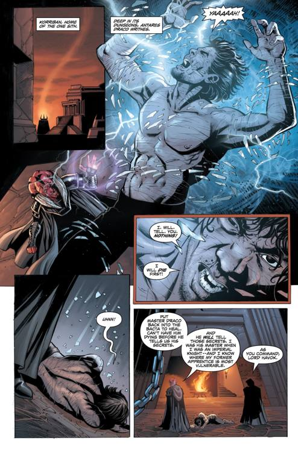
Our notes: `notes/materials/010-legacy-war.md:712`

- Note (summary from our notes, not a quotation): p45 (#2): breaks under the illusion.
  — Source: Legacy—War #1–6 (2010–11): power-scaling notes with panels.
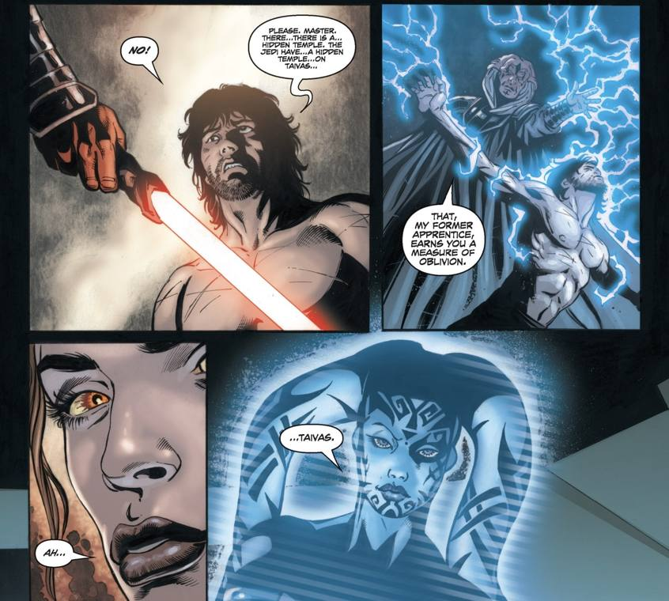
Our notes: `notes/materials/010-legacy-war.md:713`

> DARTH HAVOK -- KNEW MY WEAKNESS. FOUND MY BREAKING POINT. I...
> [fragment — full passage not on file]
>
> ...BROKE. I TOLD THE SITH OF THE HIDDEN TEMPLE AND ITS LOCATION.
> [fragment — full passage not on file]
— Source: Legacy—War #1–6 (2010–11): power-scaling notes with panels; p59 (#3).
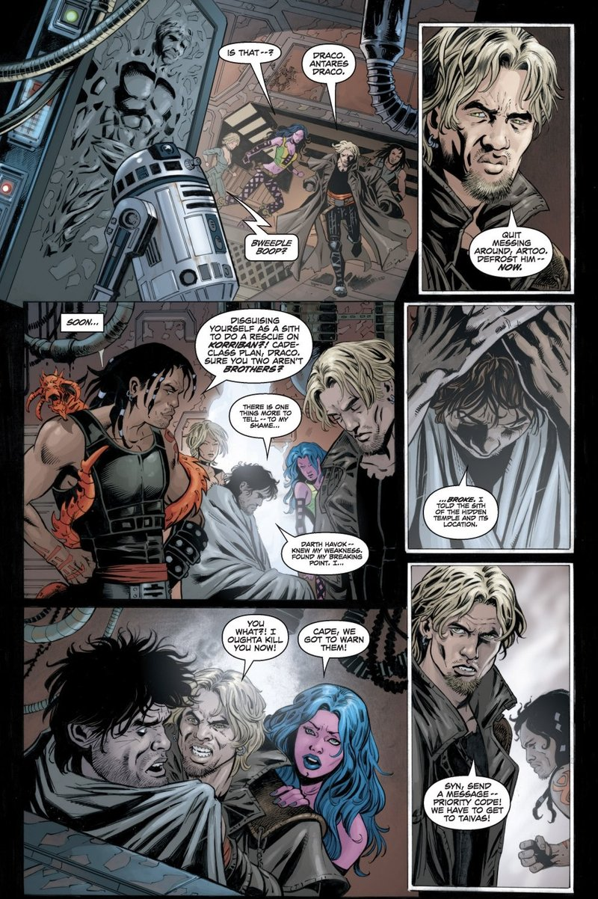 *(p59)*
Our notes: `notes/materials/010-legacy-war.md:714`

> FORGIVENESS IS IMPOSSIBLE, I KNOW, MY LADY.
>
> MY WILL WAS BROKEN...I BELIEVED THE SITH HAD RECAPTURED YOU...WERE ABOUT TO KILL YOU! IT WAS A SITH ILLUSION...
> [fragment — full passage not on file]
— Source: Legacy—War #1–6 (2010–11): power-scaling notes with panels; p61 (#3).
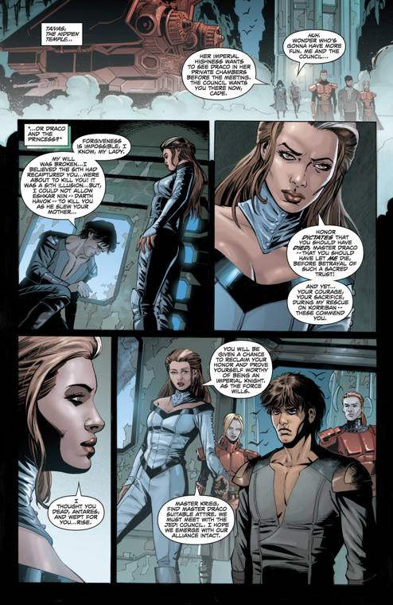
Our notes: `notes/materials/010-legacy-war.md:716`

> I CAN FIGHT BESIDE YOU, MY PRINCESS! TO HONOR OR TO DEATH!
— Source: Legacy—War #1–6 (2010–11): power-scaling notes with panels; p67 (#3).
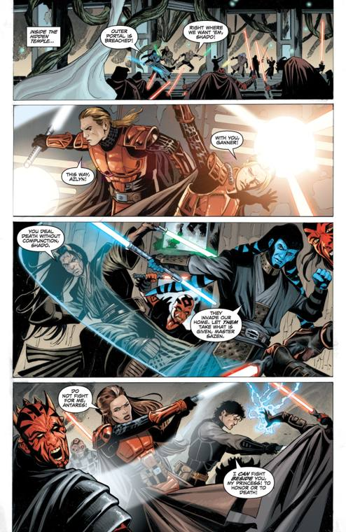
Our notes: `notes/materials/010-legacy-war.md:717`

> I BROKE AND THE SITH USED ME AS A WEAPON!
>
> WHAT IF THEY PROGRAMMED ME IN WAYS I DO NOT KNOW?
— Source: Legacy—War #1–6 (2010–11): power-scaling notes with panels; p98 (#5).
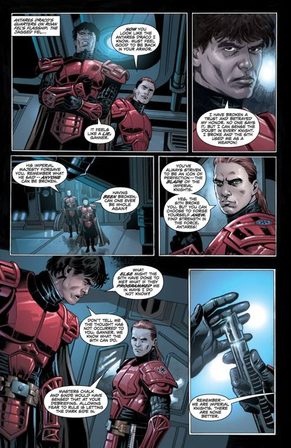
Our notes: `notes/materials/010-legacy-war.md:718`

> FORGIVE ME, MY EMPEROR...
> [fragment — full passage not on file]
>
> ...BUT I AM NOT WORTHY OF YOUR TRUST! THE SITH BROKE ME...!
> [fragment — full passage not on file]
>
> I WOULD FORFEIT MY LIFE FOR YOU AND THE HONOR OF THE EMPIRE, MAJESTY!
— Source: Legacy—War #1–6 (2010–11): power-scaling notes with panels; p100 (#5).
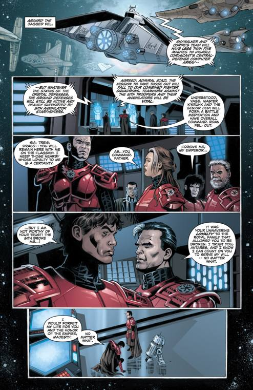
Our notes: `notes/materials/010-legacy-war.md:719`

> MY LIEGE, NO! THIS IS DARK SIDE! THE TOXIN WILL WIPE OUT ALL LIFE ON CORUSCANT! YOUR TROOPS AND ALLIES ARE DOWN THERE FIGHTING! BILLIONS OF INNOCENTS WILL DIE!
>
> I WILL NOT, MY LIEGE. PRINCESS SIA IS CORRECT.
>
> I AM A KNIGHT OF THE EMPIRE. I SWORE AN OATH --
> [fragment — full passage not on file]
>
> -- TO SERVE THE FORCE AS EMBODIED BY THE EMPEROR. AND IF THE EMPEROR HIMSELF STRAYS, TO BRING HIM BACK TO THE LIGHT -- OR KILL HIM, IF HE WILL NOT.
> [fragment — full passage not on file]
>
> YOU STAND ON THE EDGE, MY LIEGE. DO NOT MAKE ME FULFILL MY OATH.
— Source: Legacy—War #1–6 (2010–11): power-scaling notes with panels; p120–121 (#6), the Knights' oath.

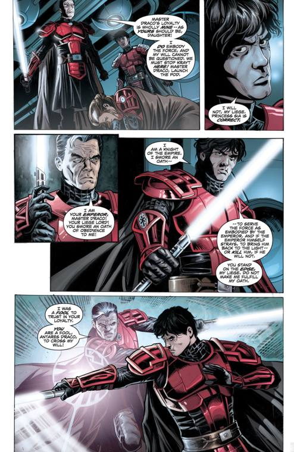
Our notes: `notes/materials/010-legacy-war.md:720`

> A DARK SHUDDER IN THE FORCE!
— Source: Legacy—War #1–6 (2010–11): power-scaling notes with panels; Senses Krayt's death across space. POV: Senses Krayt's death across space, about Antares Draco.
Context: p126 (#6):

Our notes: `notes/materials/010-legacy-war.md:722`

> IT IS NOT UP TO US! IF THE FORCE WILLS, THEN THE USURPER WILL FALL!
— Source: Legacy—War #1–6 (2010–11): power-scaling notes with panels.
Context: p126 (#6):

Our notes: `notes/materials/010-legacy-war.md:723`

> FORGIVENESS IS IMPOSSIBLE, I KNOW, MY LADY.
— Source: Legacy—War #1–6 (2010–11): power-scaling notes with panels; ![p61 Draco.
Note (our notes, around the quote): 
(*Panel: p61 — `p061-draco-forgiveness-impossible.jpg`*)
Our notes: `notes/materials/010-legacy-war.md:726`

> OR KILL HIM, IF HE WILL NOT.
— Source: Legacy—War #1–6 (2010–11): power-scaling notes with panels; ![p121 the Imperial Knights' oath.
Note (our notes, around the quote): 
(*Panel: p121 — `p121-draco-oath-kill-him-if-he-will-not.jpg`*)
Our notes: `notes/materials/010-legacy-war.md:729`

- Note (summary from our notes, not a quotation): Scaling (ANALYSIS): Draco's sensing of Krayt's death at a distance is a clean sensing feat. The Fel kill is conditional (see Fel).
  — Source: Legacy—War #1–6 (2010–11): power-scaling notes with panels.
Our notes: `notes/materials/010-legacy-war.md:732`

- Note (summary from our notes, not a quotation): | 23 | Antares Draco vs Roan Fel | *Jagged Fel* pod bay | p121–126 (#6) | Draco strikes Fel down as Fel lunges for the console | About a page of blade-lock; Fel turned his back |
  — Source: Legacy—War #1–6 (2010–11): power-scaling notes with panels.
Context: | # | Fight | Where | Pages (issue) | Outcome | Conditions / outside help |
Our notes: `notes/materials/010-legacy-war.md:948`

## Star Wars Saga Edition: *Legacy Era Campaign Guide* (WotC 2009): power-scaling notes with panels

- Note (summary from our notes, not a quotation): | 5 | Antares Draco | p175 | 15 | Jedi 7 / Imperial Knight 8 | +19 | 33 (ff 31) / 32 / 29 | 137 (32) | — | 1 / 7 | +21 (2d8+13); +16 (2d8+23) PA; +19 (3d8+13) RS |
  — Source: *Legacy Era Campaign Guide* (WotC 2009): power-scaling notes with panels.
Context: | # | Character | Page | CL | Classes | UtF | Ref / Fort / Will | HP (Thr.) | DSS | Destiny / FP | Best lightsaber line |
Our notes: `notes/materials/011-legacy-era-campaign-guide.md:120`

> The highest-ranking member of the Imperial Knights, Antares Draco is a powerful Force-user whose dedication to Roan Fel is second to none.
— Source: *Legacy Era Campaign Guide* (WotC 2009): power-scaling notes with panels.
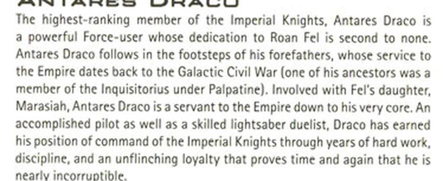
Our notes: `notes/materials/011-legacy-era-campaign-guide.md:465`

> was a member of the Inquisitorius under Palpatine
> [fragment — full passage not on file]
— Source: *Legacy Era Campaign Guide* (WotC 2009): power-scaling notes with panels; His ancestor.

Our notes: `notes/materials/011-legacy-era-campaign-guide.md:467`

> An accomplished pilot as well as a skilled lightsaber duelist, Draco has earned his position of command of the Imperial Knights through years of hard work, discipline, and an unflinching loyalty that proves time and again that he is nearly incorruptible.
— Source: *Legacy Era Campaign Guide* (WotC 2009): power-scaling notes with panels.

Our notes: `notes/materials/011-legacy-era-campaign-guide.md:469`; `suspect-insight/respect-threads/antares-draco.md:85`

> Draco has defied Roan Fel's wishes on a few occasions, such as the time he traveled to Vendaxa to rescue Marasiah.
— Source: *Legacy Era Campaign Guide* (WotC 2009): power-scaling notes with panels.
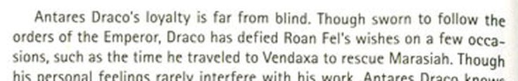
Our notes: `notes/materials/011-legacy-era-campaign-guide.md:471`

> listening to the Force and heeding one's insights are traits that make the Imperial Knights more than just lightsaber-toting soldiers.
> [fragment — full passage not on file]
— Source: *Legacy Era Campaign Guide* (WotC 2009): power-scaling notes with panels.
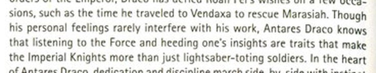
Our notes: `notes/materials/011-legacy-era-campaign-guide.md:473`

> a warrior who is cunning, loyal, and incredibly competent.
> [fragment — full passage not on file]
— Source: *Legacy Era Campaign Guide* (WotC 2009): power-scaling notes with panels.
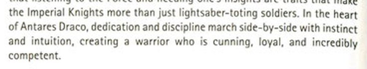
Our notes: `notes/materials/011-legacy-era-campaign-guide.md:475`

- Note (summary from our notes, not a quotation): CL 15; Medium Human Jedi 7/Imperial Knight 8. Destiny 1; Force 7; no Dark Side listed. Init +19; Perception +13 (stray "]" in print).
  — Source: *Legacy Era Campaign Guide* (WotC 2009): power-scaling notes with panels.
Our notes: `notes/materials/011-legacy-era-campaign-guide.md:479`

- Note (summary from our notes, not a quotation): Ref 33 (ff 31), Fort 32, Will 29. hp 137; Threshold 32.
  — Source: *Legacy Era Campaign Guide* (WotC 2009): power-scaling notes with panels.
Our notes: `notes/materials/011-legacy-era-campaign-guide.md:480`

- Note (summary from our notes, not a quotation): lightsaber +21 (2d8+13), or +16 (2d8+23) with 5-point Power Attack, or +19 (3d8+13) with Rapid Strike, or +14 (3d8+23) with both.
  — Source: *Legacy Era Campaign Guide* (WotC 2009): power-scaling notes with panels.
Our notes: `notes/materials/011-legacy-era-campaign-guide.md:481`

- Note (summary from our notes, not a quotation): Special Actions: cortosis gauntlet.
  — Source: *Legacy Era Campaign Guide* (WotC 2009): power-scaling notes with panels.
Our notes: `notes/materials/011-legacy-era-campaign-guide.md:482`

- Note (summary from our notes, not a quotation): Force Powers (UtF +19): battle strike, Force shield, Force slam, move object, rebuke, surge. Techniques: Force Power Mastery (battle strike), Improved Move Light Object, Improved Sense Force, Improved Sense Surroundings.
  — Source: *Legacy Era Campaign Guide* (WotC 2009): power-scaling notes with panels.
Our notes: `notes/materials/011-legacy-era-campaign-guide.md:483`

- Note (summary from our notes, not a quotation): Talents include Armor Mastery, Force Intuition, Greater Weapon Focus (lightsabers), Juggernaut and Oath of Duty.
  — Source: *Legacy Era Campaign Guide* (WotC 2009): power-scaling notes with panels.
Our notes: `notes/materials/011-legacy-era-campaign-guide.md:484`

- Note (summary from our notes, not a quotation): Possessions: Imperial Knight battle armor, cortosis gauntlet, lightsaber (self-built).
  — Source: *Legacy Era Campaign Guide* (WotC 2009): power-scaling notes with panels.
Our notes: `notes/materials/011-legacy-era-campaign-guide.md:485`

- Note (summary from our notes, not a quotation): Statted level with the Sith Lords Azard and Maladi (CL15), and above Talon and Maleval (CL13).
  — Source: *Legacy Era Campaign Guide* (WotC 2009): power-scaling notes with panels.
Our notes: `notes/materials/011-legacy-era-campaign-guide.md:488`

- Note (summary from our notes, not a quotation): His Power Attack lines (2d8+23; 3d8+23 with Rapid Strike) hit harder than any other lightsaber line in the book except Krayt's ×3 crits.
  — Source: *Legacy Era Campaign Guide* (WotC 2009): power-scaling notes with panels.
Our notes: `notes/materials/011-legacy-era-campaign-guide.md:489`

- Note (summary from our notes, not a quotation): This is the strongest WotC support for debate #17 (Draco). The counter is the comic feats where Cade tosses Draco, raised in that debate.
  — Source: *Legacy Era Campaign Guide* (WotC 2009): power-scaling notes with panels.
Our notes: `notes/materials/011-legacy-era-campaign-guide.md:490`

> highest-ranking member of the Imperial Knights… a powerful Force-user
> [fragment — full passage not on file]
— Source: *Legacy Era Campaign Guide* (WotC 2009): power-scaling notes with panels; ![p175 Draco bio.
Note (our notes, around the quote): 
(*Panel: p175 Draco bio: "highest-ranking member of the Imperial Knights… a powerful Force-user" — `p175-antares-draco-bio.jpg`*)
Our notes: `notes/materials/011-legacy-era-campaign-guide.md:492`

- Note (summary from our notes, not a quotation): 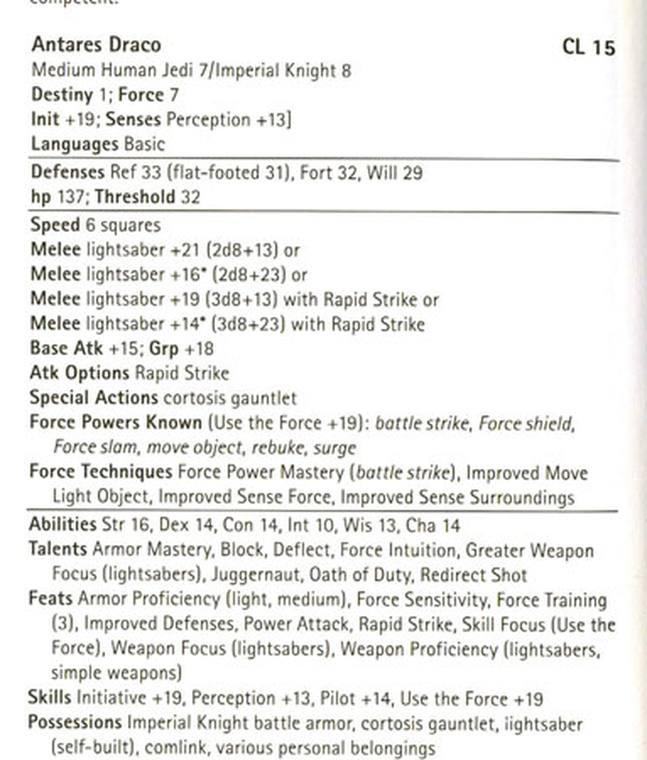
  — Source: *Legacy Era Campaign Guide* (WotC 2009): power-scaling notes with panels.
(*Panel: p175 Antares Draco CL 15 — `p175-antares-draco-stat.jpg`*)
Our notes: `notes/materials/011-legacy-era-campaign-guide.md:495`

> The highest-ranking member of the Imperial Knights, Antares Draco is a powerful Force-user whose dedication to Roan Fel is second to none.
>
> cortosis gauntlet; Vader-model armour
> [fragment — full passage not on file]
— Source: (debate #17) — Owner Material 011 — Star Wars Saga Edition: *Legacy Era Campaign Guide* (WotC 2009): power-scaling notes with panels; Draco quote (debate #17) — VERIFIED..
Note (our notes, around the quote): Draco quote (debate #17) — VERIFIED. "The highest-ranking member of the Imperial Knights, Antares Draco is a powerful Force-user whose dedication to Roan Fel is second to none." is verbatim on p175 (printed 174). The "cortosis gauntlet; Vader-model armour" label is also verified (p175 possessions; armour text on p162 and p184).

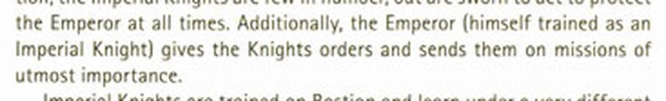
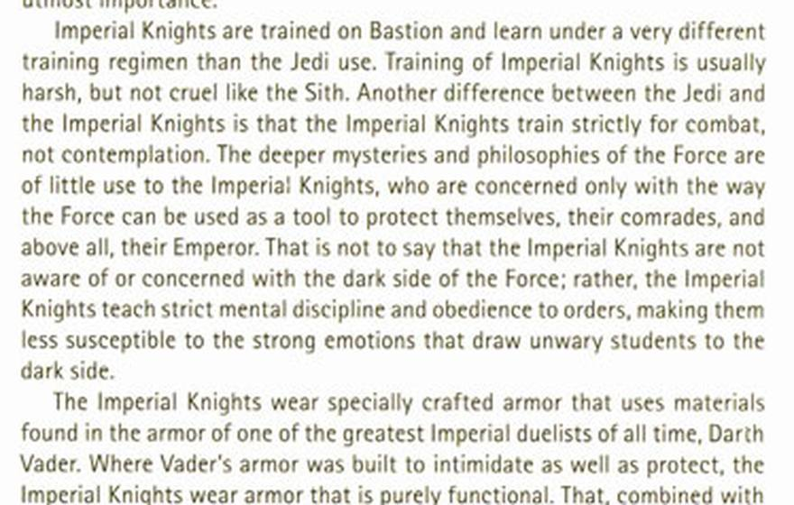

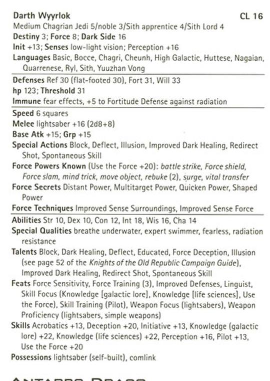

Our notes: `notes/materials/011-legacy-era-campaign-guide.md:1071`

- Note (summary from our notes, not a quotation): Fel Empire: Emperor Roan Fel (CL20), Antares Draco (CL15), Azlyn Rae (CL11), Marasiah Fel (CL10), the generic Imperial Knight (CL11), Knighthunter (CL7).
  — Source: *Legacy Era Campaign Guide* (WotC 2009): power-scaling notes with panels.
Our notes: `notes/materials/011-legacy-era-campaign-guide.md:1102`

## Star Wars: Legacy Volume 2, *Shards* (TPB): power-scaling notes with panels

> FEEL IT. THEIR NERVES ARE ON EDGE. MY GUESS IS THAT THEY SMUGGLED BLASTER PARTS ON BOARD AND REASSEMBLED THEM. IT'S WHAT I WOULD HAVE DONE.
>
> MAKE SURE YOU CAN GET YOUR SABER IF YOU NEED IT. I DON'T TRUST THIS BUNCH.
>
> WE'RE GOING TO WIN BACK THE EMPEROR'S TRUST.
— Source: Legacy Volume 2, *Shards* (TPB): power-scaling notes with panels.
Note (our notes, around the quote): 1. Sense the GA guards' hidden blasters. p71 (#9 Trust Issues) [009 p210]. Red-bordered quote caption: "FEEL IT. THEIR NERVES ARE ON EDGE. MY GUESS IS THAT THEY SMUGGLED BLASTER PARTS ON BOARD AND REASSEMBLED THEM. IT'S WHAT I WOULD HAVE DONE." · Draco: "MAKE SURE YOU CAN GET YOUR SABER IF YOU NEED IT. I DON'T TRUST THIS BUNCH." · "WE'RE GOING TO WIN BACK THE EMPEROR'S TRUST."
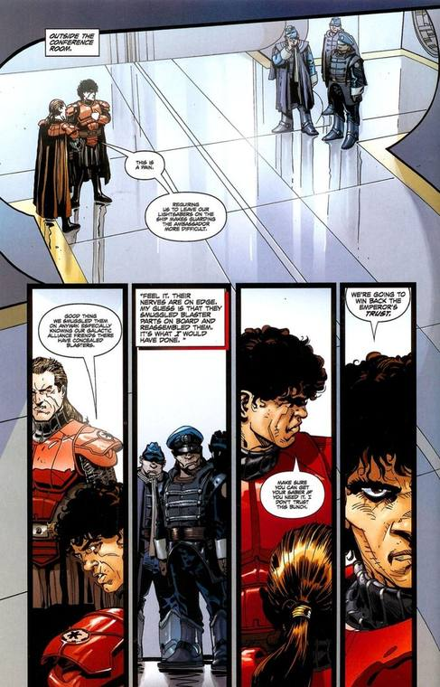
Our notes: `notes/materials/012-legacy-vol-2-shards.md:211`

- Note (summary from our notes, not a quotation): 
  — Source: Legacy Volume 2, *Shards* (TPB): power-scaling notes with panels.
(*Panel: p71 — `p071-knights-sense-ga-guards.jpg`*)
Our notes: `notes/materials/012-legacy-vol-2-shards.md:213`

> (p89) Draco: "GANNER, CAN YOU HOLD OFF THESE GUYS WHILE I RETRIEVE THE AMBASSADOR?" · Krieg: "THAT'S A JOKE, RIGHT? GO!" · (p90) Stazi (knifing Bovark): "WHEN HAS THE EMPIRE EVER NEEDED A REASON FOR ITS TREACHERY?!" · Draco (Force-push; Stazi flies across the room): "AMBASSADOR BOVARK, TIME TO GO." · (p91) To Pol Temm's security: "NO." · (p92) "WE'LL FIND OUT WHO DID THIS -- AND THEY WON'T LIVE LONG ENOUGH TO REGRET IT!"
> [fragment — full passage not on file]
— Source: Legacy Volume 2, *Shards* (TPB): power-scaling notes with panels.
Context: 2. Deflect GA blaster fire; Draco Force-pushes Admiral Stazi off Bovark. p89 (#10 Trust Issues)–p92 (#10) [009 p228–231]
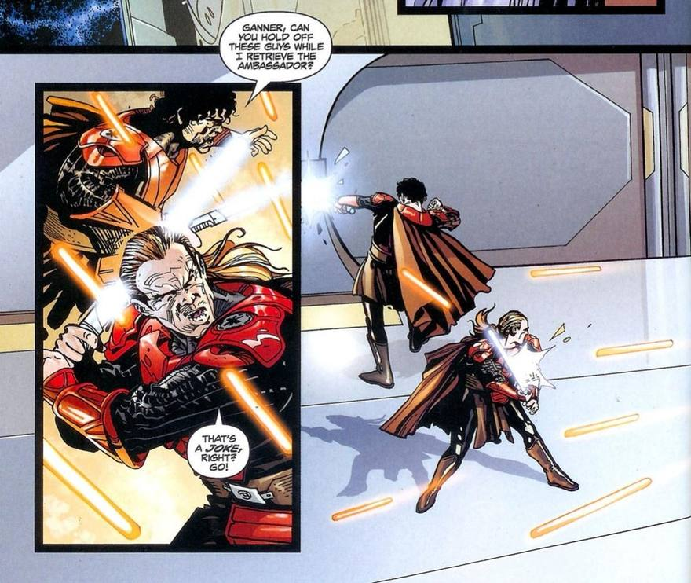
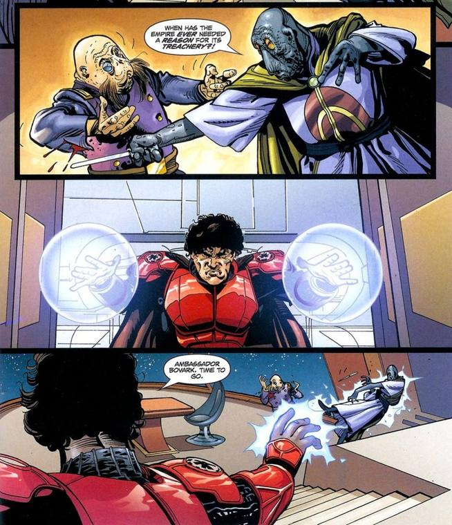
Our notes: `notes/materials/012-legacy-vol-2-shards.md:216`

- Note (summary from our notes, not a quotation): 
  — Source: Legacy Volume 2, *Shards* (TPB): power-scaling notes with panels.
(*Panel: p89 — `p089-draco-krieg-deflect.jpg`*)
Our notes: `notes/materials/012-legacy-vol-2-shards.md:219`

- Note (summary from our notes, not a quotation): 
  — Source: Legacy Volume 2, *Shards* (TPB): power-scaling notes with panels.
(*Panel: p90 — `p090-draco-pushes-stazi.jpg`*)
Our notes: `notes/materials/012-legacy-vol-2-shards.md:222`

- Note (summary from our notes, not a quotation): Scaling (ANALYSIS): routine Jedi-level skills (deflection, push, empathic sensing) against non-Force soldiers. Only Stazi is pushed. Stazi is a Duros admiral, not a "Mon Cal aide" and not guards (009 corrected). Nothing here moves debate #17 (Draco vs Jacen).
  — Source: Legacy Volume 2, *Shards* (TPB): power-scaling notes with panels.
Our notes: `notes/materials/012-legacy-vol-2-shards.md:225`

## https://starwars.fandom.com/wiki/Cade_Skywalker

- Note (summary from our notes, not a quotation): Explicit comparison: the article says Cade was able to equal Antares Draco, leader of the Imperial Knights, in lightsaber ability. [25]
  — Source: Legacy (2006) 25 [per Wookieepedia "Cade Skywalker" rev 15549841, ref 25; approximate match 0.64, verify; agrees with the entry's own ref marker]; per Wookieepedia "Cade Skywalker" rev 15549841, ref 25; approximate match 0.64, verify; agrees with the entry's own ref marker — Cade Skywalker — article extraction — https://starwars.fandom.com/wiki/Cade_Skywalker.
(Source: Legacy (2006) 25 [per Wookieepedia "Cade Skywalker" rev 15549841, ref 25; approximate match 0.64, verify; agrees with the entry's own ref marker])
Our notes: `external/mega-notes/cade-skywalker-quotes.txt:80`

## https://starwars.fandom.com/wiki/Darth_Krayt

> Later, Krayt's Sith Inquisitor, Darth Havok, successfully tortured the location of the hidden Jedi temple out of the imprisoned Antares Draco.
— Source: Legacy — War 2 [per Wookieepedia "Darth Krayt" rev 15688608, ref 53; exact text match]; per Wookieepedia "Darth Krayt" rev 15688608, ref 53; exact text match — Darth Krayt — feat/statement extraction from Wookieepedia — https://starwars.fandom.com/wiki/Darth_Krayt.
Note (our notes, around the quote): [Reborn feat] Section: War. “Later, Krayt's Sith Inquisitor, Darth Havok, successfully tortured the location of the hidden Jedi temple out of the imprisoned Antares Draco.” Scaling/context: Krayt ordered Talon to find Cade and make him a gift of the broken Imperial Knight; he continued to believe Cade would serve him.
(Source: Legacy — War 2 [per Wookieepedia "Darth Krayt" rev 15688608, ref 53; exact text match])
Our notes: `external/mega-notes/krayt-legends-quotes.txt:163`

## Legends Feats & Quotes (Star Wars Legends / EU)

> “The highest-ranking member of the Imperial Knights, Antares Draco is a powerful Force-user whose dedication to Roan Fel is second to none."
>
> — -Legacy Guide (cited by Informal_Geek *(April 7th 2021, 2:20 amMessage reputation : 100% in debate #17)*
> [fragment — full passage not on file]
— Source: (debate #17); (cited by Informal_Geek (April 7th 2021, 2:20 amMessage reputation : 100% in debate #17) — Legends Feats & Quotes (Star Wars Legends / EU).
Context: Leader of the Imperial Knights; cortosis gauntlet; Vader-model armour (Legacy Campaign Guide) (debate #17)
Our notes: `legends-feats.md:533`; `suspect-insight/debates/017-antares-draco-vs-tuf-jacen-solo.md:274`; `suspect-insight/respect-threads/antares-draco.md:82`

> "The highest-ranking member of the Imperial Knights, Antares Draco is a powerful Force-user whose dedication to Roan Fel is second to none."
>
> — Legacy Era Campaign Guide, p175
> [fragment — full passage not on file]
— Source: Legends Feats & Quotes (Star Wars Legends / EU).
Context: Antares Draco: quote verified (the debate #17 citation is verbatim, p175). Stats: CL 15 (Jedi 7/Imperial Knight 8). UtF +19. Ref 33, Fort 32, Will 29. hp 137. Lightsaber +21 (2d8+13), or +16 (2d8+23) with Power Attack. Cortosis gauntlet. Juggernaut talent.

Our notes: `legends-feats.md:2492`

> TO SERVE THE FORCE AS EMBODIED BY THE EMPEROR. AND IF THE EMPEROR HIMSELF STRAYS, TO BRING HIM BACK TO THE LIGHT -- OR KILL HIM, IF HE WILL NOT.
>
> — Antares Draco, Star Wars: Legacy—War #6, p121
> [fragment — full passage not on file]
>
> WAIT, MY LIEGE! WAIT! DID YOU FEEL IT?! A DARK SHUDDER IN THE FORCE! ... KRAYT IS DEAD!
> [fragment — full passage not on file]
>
> — Antares Draco, Star Wars: Legacy—War #6, p126
> [fragment — full passage not on file]
— Source: Legends Feats & Quotes (Star Wars Legends / EU). POV: Antares Draco.
Context: Senses Krayt's death from the Jagged Fel; strikes down Emperor Fel under the Knights' oath (material 010; p121, p126, Legacy—War #6)
Our notes: `legends-feats.md:2956`

# Debate and forum claims (unverified)

Forum posts, Suspect Insight debates and Discord debates, respect threads, and verdicts. These are posters' arguments or quotations they typed; none is checked against the book here unless the entry says so.

## "Dissecting Legacy #3: Cade Skywalker vs Darth Krayt" (Suspect Insight Forums)

> within a matter of breaths *(p108)*
> [fragment — full passage not on file]
>
> on the edge of light and dark *(p123)*
> [fragment — full passage not on file]
>
> If not for Antares Draco stopping the virus, which Krayt did not foresee or anticipate, Fel would have unleashed the virus before Krayt had actually defeated Cade… if Krayt could readily defeat Cade, he would have. The fact he didn't reveals he couldn't.
> [fragment — full passage not on file]
— Source: Cade Skywalker vs Darth Krayt" (Suspect Insight Forums) — https://www.suspectinsightforums.com/t4457-dissecting-legacy-3-cade-skywalker-vs-darth-krayt; Omega Red time pressure. The toxin kills.
Note (our notes, around the quote): Omega Red time pressure. The toxin kills "within a matter of breaths" (p108), and Sith are immune. It probably keys on dark-side energy, and Cade is still "on the edge of light and dark" (p123), so he might not survive it. Krayt therefore has to finish fast. "If not for Antares Draco stopping the virus, which Krayt did not foresee or anticipate, Fel would have unleashed the virus before Krayt had actually defeated Cade… if Krayt could readily defeat Cade, he would have. The fact he didn't reveals he couldn't."
Posted by: not named in our notes (see thread/notes link).
Our notes: `notes/materials/016-dissecting-legacy-3-cade-vs-krayt.md:40`

## https://comicvine.gamespot.com/forums/star-wars-universe-1943200/darth-sidioussheev-palpatine-super-respect-thread-1877280/

- Note (summary from our notes, not a quotation): [767] Type: feat
  — Source: Darth Sidious/Sheev Palpatine Super Respect Thread — cited-quote extraction — https://comicvine.gamespot.com/forums/star-wars-universe-1943200/darth-sidioussheev-palpatine-super-respect-thread-1877280/.
Posted by: not named in our notes (see thread/notes link).
(Section context: Feats)
(Quote/source-associated text (verbatim):)
(Palpatine's Dark Side Adepts have also shown themselves capable of teleporting, and given that all they know they learned from the Emperor, it is solid evidence that Palpatine can teleport himself. [panel: panels/sidious/sidious-palpatines-dark-side-adepts-shown-themselves-capable-1.gif])
((★) The Reborn Emperor unleashes a Force Storm upon Coruscant, from across the galaxy and teleports Luke to Byss. [panel: panels/sidious/sidious-reborn-emperor-unleashes-force-storm-upon-coruscant-1.jpg; panels/sidious/sidious-reborn-emperor-unleashes-force-storm-upon-coruscant-2.jpg; panels/sidious/sidious-reborn-emperor-unleashes-force-storm-upon-coruscant-3.jpg; panels/sidious/sidious-reborn-emperor-unleashes-force-storm-upon-coruscant-4.jpg; panels/sidious/sidious-reborn-emperor-unleashes-force-storm-upon-coruscant-5.jpg; panels/sidious/sidious-reborn-emperor-unleashes-force-storm-upon-coruscant-6.jpg; panels/sidious/sidious-reborn-emperor-unleashes-force-storm-upon-coruscant-7.jpg])
(Sound: A proximity alarm has gone off.)
(CAPTAIN SNUNB: What is it?)
(ANTARES SIX CREWMAN: Some kind of.....wormhole...opening up in space. It's huge! Fifty times the size of our ship! Energy readings off the scale!)
(Sound: Comlink goes on.)
(CAPTAIN SNUNB: Antares Six calling the Millenium Falcon. Our scanners just picked up a gigantic hyperspace wormhole--an energy storm of undetermined magnitude is--)
(ANTARES SIX CREWMAN: It's no good, sir--there's too much interference. Your message isn't getting through.)
(Sound: A huge maelstrom of sound--lightning, hail, laser blasts, and more all joined in a capohony of noise--is blasting straight at the Antares Six.)
(CAPTAIN SNUNB: Blast.....)
(ANTARES SIX CREWMAN: It's heading right for us!!!)
Our notes: `external/mega-notes/sidious-comicvine-respect.txt:9722`

## Antares Draco (Informal Geek) vs TUF Jacen Solo (RNGesus)

- Note (summary from our notes, not a quotation): Raw full-thread text (all pages): raw/threads/017.txt
  — Source: Antares Draco (Informal Geek) vs TUF Jacen Solo (RNGesus) — https://www.suspectinsightforums.com/t4375-stomper-showdown-r2-8-antares-draco-informal-geek-vs-tuf-jacen-solo-rngesus4.
Posted by: not named in our notes (see thread/notes link).
Our notes: `suspect-insight/debates/017-antares-draco-vs-tuf-jacen-solo.md:6`

> as per KingofBlade[s]
> [fragment — full passage not on file]
— Source: Antares Draco (Informal Geek) vs TUF Jacen Solo (RNGesus) — https://www.suspectinsightforums.com/t4375-stomper-showdown-r2-8-antares-draco-informal-geek-vs-tuf-jacen-solo-rngesus4.
Note (our notes, around the quote): Antares Draco vs TUF (*The Unifying Force*) Jacen Solo — Legends. Stomper Showdown R2 match 8 (host DarthAnt66). Character constraints as in the Stomper format (opener A 2,500; B 3,125; etc. — see #16). Draco side = Informal Geek; Jacen side = RNGesus (posts as "Chris Cortosis"). RNG went over in R1 (3,806) and granted Geek an extra 81 characters "as per KingofBlade[s]".
Posted by: not named in our notes (see thread/notes link).
Our notes: `suspect-insight/debates/017-antares-draco-vs-tuf-jacen-solo.md:10`

> The Imperial Knights are among the most talented and dangerous Force-users in the galaxy. Skilled in combat…
> [fragment — full passage not on file]
>
> The highest-ranking member of the Imperial Knights, Antares Draco is a powerful Force-user whose dedication to Roan Fel is second to none. *(Legacy Campaign Guide, I1–I3)*
>
> use many of the same combat training techniques as the Jedi…
> [fragment — full passage not on file]
>
> The Imperial Knights devote as much attention to fighting barehanded, in vehicles, and with the Force as they do to fighting with lightsabers.
— Source: Antares Draco (Informal Geek) vs TUF Jacen Solo (RNGesus) — https://www.suspectinsightforums.com/t4375-stomper-showdown-r2-8-antares-draco-informal-geek-vs-tuf-jacen-solo-rngesus4; Opener: captain of the Imperial Knights.
Note (our notes, around the quote): Opener: captain of the Imperial Knights — "The Imperial Knights are among the most talented and dangerous Force-users in the galaxy. Skilled in combat…"; "The highest-ranking member of the Imperial Knights, Antares Draco is a powerful Force-user whose dedication to Roan Fel is second to none." (Legacy Campaign Guide, I1–I3); willing to fight Emperor Fel, roughly his equal; Imperial Knight training "use many of the same combat training techniques as the Jedi…"; cortosis gauntlet deactivates sabers; armour modelled on Vader's; kills Sith strike teams, invasion forces, Korriban guards; "The Imperial Knights devote as much attention to fighting barehanded, in vehicles, and with the Force as they do to fighting with lightsabers."
Posted by: not named in our notes (see thread/notes link).
Our notes: `suspect-insight/debates/017-antares-draco-vs-tuf-jacen-solo.md:26`; `suspect-insight/respect-threads/antares-draco.md:66`

> Following this you made the claim that Jacen could sense Draco’s actions, Jacen actually isn’t that familiar with cortosis. He’d probably know what it is but he doesn’t deal with it hardly ever throughout his career. And at the same time Draco isn’t going to taunt him into striking, he’s never once shown to do that even at his most heated, no imperial knight is.
>
> Here is a case example of the gauntlet in use
> [fragment — full passage not on file]
>
> Emperor Fel in the heat of combat in about a split second managed to use the gauntlet to strike the saber. And may I note Antares isn’t far behind Fel at all given he killed him.
>
> Now next you make an extraordinary claim, the idea that Jacen based solely on catching blaster shots was capable of lightsaber deflection. This isn’t substantiated at all, lots of Jedi and sith have been shown deflecting blaster shots with tutaminis, Kenobi, Vader, but none of them were capable of saber deflection. And Jacen is never shown to be able to use that ability. Plus even if he was able to do that, Draco is also a master of hand to hand combat.
>
> Following this you say “Legacy Sith aren’t shown to be super potent outside of a few”, which is very untrue, one thing to keep in mind is the vast majority of fights in legacy are the top tier of each order. We only get a good view of normal sith a few times, and they aren’t by any means bad. Sith are extremely skilled, we see at the very beginning of Legacy a team of 4 fairly skilled Jedi, Vao and Wolf being two of the best Jedi in the order at the time, plus two others (one of whole is of a potent Jedi family) who Wolf chose specifically to hunt down Cade. The group is caught totally unaware by a sith assassin team who managed to bypass the Jedis force sense (jedi are very on guard) and in a matter of moments killed one Jedi from hiding and blitzed another, with only Wolf and Vao managing to fight off the team.
>
> On top of this sith if the era are noted to fairly regularly kill there masters to earn the title of lord, with combat also being key to earning the sith tattoos. And sith of the era are directly said to be fully immersed in the dark side.
— Source: Antares Draco (Informal Geek) vs TUF Jacen Solo (RNGesus) — https://www.suspectinsightforums.com/t4375-stomper-showdown-r2-8-antares-draco-informal-geek-vs-tuf-jacen-solo-rngesus4.
Context: I6 — Source line: -Legacy campaign guide
Posted by: not named in our notes (see thread/notes link).
> [IMG: https://i.servimg.com/u/f34/20/32/70/01/86093410.jpg] [LINK: https://servimg.com/view/20327001/23]
> [IMG: https://i.servimg.com/u/f34/20/32/70/01/d7575910.jpg] [LINK: https://servimg.com/view/20327001/24]
> [IMG: https://i.servimg.com/u/f34/20/32/70/01/eb77ae10.jpg] [LINK: https://servimg.com/view/20327001/25]
> [IMG: https://i.servimg.com/u/f34/20/32/70/01/6c68cd10.jpg] [LINK: https://servimg.com/view/20327001/26]
> [IMG: https://i.servimg.com/u/f34/20/32/70/01/03bffd10.jpg] [LINK: https://servimg.com/view/20327001/27]
Our notes: `suspect-insight/debates/017-antares-draco-vs-tuf-jacen-solo.md:310`

## Daegen Lok (Cheth) vs Wolf Sazen (Xolthol)

> First of all Antares Draco isn't "some random imperial knight". In a second time do you understand how ridiculous is your argument? You are claiming that because character (X is hindered and character (Y) is amped it is the proof that the amp/hinderance isn't relevant... You just forget an important thing, a **neutral comparison point**.
— Source: Daegen Lok (Cheth) vs Wolf Sazen (Xolthol) — https://www.suspectinsightforums.com/t1530-ss-daegen-lok-cheth-vs-wolf-sazen-xolthol.
(Full sentence/passage taken from the source text on file: `research_suspect_insight_raw_threads_067_txt`.)
Context: Q33 — Source: (inline bold passage)
Posted by: not named in our notes (see thread/notes link).
Our notes: `suspect-insight/debates/067-daegen-lok-vs-wolf-sazen.md:243`

## Antares Draco Respect Thread — respect-thread notes

- Note (summary from our notes, not a quotation): Continuity (from the thread title/directory label): Legends unless the post says otherwise
  — Source: SI respect-thread directory: Antares Draco Respect Thread — https://comicvine.gamespot.com/profile/i_like_swords/blog/antares-draco-respect-thread/104728/.
Posted by: not named in our notes (see thread/notes link).
Our notes: `suspect-insight/respect-threads/antares-draco.md:6`

- Note (summary from our notes, not a quotation): # Antares Draco Respect Thread — respect-thread notes
  — Source: SI respect-thread directory: Antares Draco Respect Thread — https://comicvine.gamespot.com/profile/i_like_swords/blog/antares-draco-respect-thread/104728/.
Posted by: not named in our notes (see thread/notes link).
Our notes: `suspect-insight/respect-threads/antares-draco.md:11`

- Note (summary from our notes, not a quotation): [image: http://static1.comicvine.com/uploads/scale_super/11111/111114474/4547604-beast.jpg]
  — Source: SI respect-thread directory: Antares Draco Respect Thread — https://comicvine.gamespot.com/profile/i_like_swords/blog/antares-draco-respect-thread/104728/.
Posted by: not named in our notes (see thread/notes link).
Context: Respect Antares Draco
Our notes: `suspect-insight/respect-threads/antares-draco.md:20`

- Note (summary from our notes, not a quotation): For the best viewing quality, switch to blog format.
  — Source: SI respect-thread directory: Antares Draco Respect Thread — https://comicvine.gamespot.com/profile/i_like_swords/blog/antares-draco-respect-thread/104728/.
Posted by: not named in our notes (see thread/notes link).
Our notes: `suspect-insight/respect-threads/antares-draco.md:22`

- Note (summary from our notes, not a quotation): Antares Draco punches Cade Skywalker through the air.
  — Source: SI respect-thread directory: Antares Draco Respect Thread — https://comicvine.gamespot.com/profile/i_like_swords/blog/antares-draco-respect-thread/104728/.
Posted by: not named in our notes (see thread/notes link).
Our notes: `suspect-insight/respect-threads/antares-draco.md:26`

- Note (summary from our notes, not a quotation): [image: http://static2.comicvine.com/uploads/scale_medium/11111/111114474/4547606-punches+cade.jpg]
  — Source: SI respect-thread directory: Antares Draco Respect Thread — https://comicvine.gamespot.com/profile/i_like_swords/blog/antares-draco-respect-thread/104728/.
Posted by: not named in our notes (see thread/notes link).
Context: Antares Draco punches Cade Skywalker through the air.
Our notes: `suspect-insight/respect-threads/antares-draco.md:27`

- Note (summary from our notes, not a quotation): Draco overpowers a Sith, clutching his throat.
  — Source: SI respect-thread directory: Antares Draco Respect Thread — https://comicvine.gamespot.com/profile/i_like_swords/blog/antares-draco-respect-thread/104728/.
Posted by: not named in our notes (see thread/notes link).
Our notes: `suspect-insight/respect-threads/antares-draco.md:29`

- Note (summary from our notes, not a quotation): Draco is able to endure extensive torture administered by Sith Lord Darth Havok for several days, being brought to the brink of death several times and then healed, without being broken and revealing information about the hidden Jedi Temple.
  — Source: SI respect-thread directory: Antares Draco Respect Thread — https://comicvine.gamespot.com/profile/i_like_swords/blog/antares-draco-respect-thread/104728/.
Posted by: not named in our notes (see thread/notes link).
Our notes: `suspect-insight/respect-threads/antares-draco.md:32`

- Note (summary from our notes, not a quotation): After being extensively tortured and living in poor living conditions, Draco is still able to discern the difference between Darth Havok's illusions and reality, and resist being broken, up until Darth Talon  takes the form of the person closest to him and pretends to have her life at stake.
  — Source: SI respect-thread directory: Antares Draco Respect Thread — https://comicvine.gamespot.com/profile/i_like_swords/blog/antares-draco-respect-thread/104728/.
Posted by: not named in our notes (see thread/notes link).
Our notes: `suspect-insight/respect-threads/antares-draco.md:35`

- Note (summary from our notes, not a quotation): [image: http://static.comicvine.com/uploads/square_avatar/11111/111114474/4547622-dracoresistsillusions.jpg]
  — Source: SI respect-thread directory: Antares Draco Respect Thread — https://comicvine.gamespot.com/profile/i_like_swords/blog/antares-draco-respect-thread/104728/.
Posted by: not named in our notes (see thread/notes link).
Context: After being extensively tortured and living in poor living conditions, Draco is still able to discern the difference between Darth Havok's illusions and reality, and resist being broken, up until Darth Talon  takes the form of the person closest to him and pretends to have her life at stake.
Our notes: `suspect-insight/respect-threads/antares-draco.md:36`

> "The Imperial Knights are among the most talented and dangerous Force-users in the galaxy. Skilled in combat, they train under the tutelage of their Imperial masters, learning all they need to know to defend Emperor Roan Fel against all those who would harm him. The Imperial Knights are skilled with both the lightsaber and with the Force, and make extensive use of combat armor, including their special cortosis gauntlets designed to stop lightsaber attacks. From the start of their training until they reach knighthood, the Imperial Knights learn how to use the Force to transform themselves into living weapons and shields."
— Source: SI respect-thread directory: Antares Draco Respect Thread — https://comicvine.gamespot.com/profile/i_like_swords/blog/antares-draco-respect-thread/104728/.
Context: Antares Draco is an Imperial Knight, a group of elite Force-wielding soldiers, bodyguards and agents loyal to the Imperial Emperor, Roan Fel.
Posted by: not named in our notes (see thread/notes link).
Our notes: `suspect-insight/respect-threads/antares-draco.md:40`

- Note (summary from our notes, not a quotation): --Legacy Era Campaign Guide
  — Source: SI respect-thread directory: Antares Draco Respect Thread — https://comicvine.gamespot.com/profile/i_like_swords/blog/antares-draco-respect-thread/104728/.
Posted by: not named in our notes (see thread/notes link).
Our notes: `suspect-insight/respect-threads/antares-draco.md:43`; `suspect-insight/respect-threads/antares-draco.md:54`; `suspect-insight/respect-threads/antares-draco.md:64`; `suspect-insight/respect-threads/antares-draco.md:69`

> "Though their numbers are small, the Imperial Knights are fully trained Force-users, with all the skills and abilities of a Jedi."
— Source: SI respect-thread directory: Antares Draco Respect Thread — https://comicvine.gamespot.com/profile/i_like_swords/blog/antares-draco-respect-thread/104728/.
Context: Imperial Knights are every bit as skilled as the Jedi in both combat and the Force, and their training focuses far more on combat than contemplation.
Posted by: not named in our notes (see thread/notes link).
Our notes: `suspect-insight/respect-threads/antares-draco.md:45`

> "Despite opinions to the contrary, Imperial Knights are every bit as capable in the use of the Force as their Jedi counterparts, though their training has considerably more martial focus."
— Source: SI respect-thread directory: Antares Draco Respect Thread — https://comicvine.gamespot.com/profile/i_like_swords/blog/antares-draco-respect-thread/104728/.
Context: "Despite opinions to the contrary, Imperial Knights are every bit as capable in the use of the Force as their Jedi counterparts, though their training has considerably more martial focus."
Posted by: not named in our notes (see thread/notes link).
Our notes: `suspect-insight/respect-threads/antares-draco.md:48`

> Trained in the Jedi arts, the Imperial Knights are far more than mere bodyguards and agents. They are charged with protecting the most wanted individual in the galaxy from Darth Krayt, the self-proclaimed ruler of the Galactic Empire."
— Source: SI respect-thread directory: Antares Draco Respect Thread — https://comicvine.gamespot.com/profile/i_like_swords/blog/antares-draco-respect-thread/104728/.
Context: --Legacy Era Campaign Guide
Posted by: not named in our notes (see thread/notes link).
Our notes: `suspect-insight/respect-threads/antares-draco.md:51`

> "Tactically, Imperial Knights are similar to Jedi. They work well together, using their lightsabers redirect blaster bolts against their foes until they can close to melee range.
— Source: SI respect-thread directory: Antares Draco Respect Thread — https://comicvine.gamespot.com/profile/i_like_swords/blog/antares-draco-respect-thread/104728/.
Context: Imperial Knights employ similar tactics to Jedi in combat, in addition to their own.
Posted by: not named in our notes (see thread/notes link).
Our notes: `suspect-insight/respect-threads/antares-draco.md:56`

- Note (summary from our notes, not a quotation): --Threats of the Galaxy
  — Source: SI respect-thread directory: Antares Draco Respect Thread — https://comicvine.gamespot.com/profile/i_like_swords/blog/antares-draco-respect-thread/104728/.
Posted by: not named in our notes (see thread/notes link).
Our notes: `suspect-insight/respect-threads/antares-draco.md:59`; `suspect-insight/respect-threads/antares-draco.md:77`; `suspect-insight/respect-threads/antares-draco.md:168`

> "Skilled in the art of lightsaber combat, the Imperial Knights use many of the same combat training techniques as the Jedi, and have learned to fight in many of the same lightsaber dueling styles. However, the Imperial Knights are also masters of two unique lightsaber combat forms that place greater emphasis on teamwork than one's individual prowess. The more aggressive style, known as praetoria vonil,focuses on moving quickly and striking hard. The more defensive style, known as praetoria ishu, emphasizes protecting one's allies to allow them to find openings in an opponent's defences."
— Source: SI respect-thread directory: Antares Draco Respect Thread — https://comicvine.gamespot.com/profile/i_like_swords/blog/antares-draco-respect-thread/104728/.
Context: Imperial Knights are trained in the same lightsaber forms and fighting styles as the Jedi, and in addition have developed two unique lightsaber forms which focus on fighting as effectively in a team as possible.
Posted by: not named in our notes (see thread/notes link).
Our notes: `suspect-insight/respect-threads/antares-draco.md:61`

> "Perhaps the most interesting affectation used by the Imperial Knights were gauntlets composed of cortosis weave, which would cause any lightsaber blade that came into contact with them to become dysfunctional."
— Source: SI respect-thread directory: Antares Draco Respect Thread — https://comicvine.gamespot.com/profile/i_like_swords/blog/antares-draco-respect-thread/104728/.
Context: Imperial Knights are adept in disrupting the lightsabers of Force-wielding opponents with their cortosis weave gauntlets.
Posted by: not named in our notes (see thread/notes link).
Our notes: `suspect-insight/respect-threads/antares-draco.md:71`

> "Antares Draco is the leader of the Imperial Knights, the Empire's highly trained -- and unwaveringly loyal -- answer to the Jedi Order."
— Source: SI respect-thread directory: Antares Draco Respect Thread — https://comicvine.gamespot.com/profile/i_like_swords/blog/antares-draco-respect-thread/104728/.
Context: Antares Draco is the commander of the Imperial Knights, considered their greatest fighter and leader, described as skilled, cunning, powerful and nigh-incorruptible.
Posted by: not named in our notes (see thread/notes link).
Our notes: `suspect-insight/respect-threads/antares-draco.md:79`

> "Though his personal feelings rarely interfere with his work, Antares Draco knows that listening to the Force and heeding one's insights are traits that make the Imperial Knights more than just lightsaber-toting soldiers. In the heart of Antares Draco, dedication and discipline march side-by-side with instinct and intuition, creating a warrior who is cunning, loyal, and incredibly competent."
— Source: SI respect-thread directory: Antares Draco Respect Thread — https://comicvine.gamespot.com/profile/i_like_swords/blog/antares-draco-respect-thread/104728/.
Context: --Legacy Era Campaign Guide
Posted by: not named in our notes (see thread/notes link).
Our notes: `suspect-insight/respect-threads/antares-draco.md:88`

> "The second in command of the Imperial Knights (after Emperor Fel), and equally formidable with a lightsaber or behind the control of a fighter, Draco would give his life for the Emperor."
— Source: SI respect-thread directory: Antares Draco Respect Thread — https://comicvine.gamespot.com/profile/i_like_swords/blog/antares-draco-respect-thread/104728/.
Context: --Legacy Era Campaign Guide
Posted by: not named in our notes (see thread/notes link).
Our notes: `suspect-insight/respect-threads/antares-draco.md:91`

- Note (summary from our notes, not a quotation): --Star Wars: Legacy 0.5
  — Source: SI respect-thread directory: Antares Draco Respect Thread — https://comicvine.gamespot.com/profile/i_like_swords/blog/antares-draco-respect-thread/104728/.
Posted by: not named in our notes (see thread/notes link).
Our notes: `suspect-insight/respect-threads/antares-draco.md:94`

> "Antares Draco, Ganner Kreig. My two finest Knights. . ."
— Source: SI respect-thread directory: Antares Draco Respect Thread — https://comicvine.gamespot.com/profile/i_like_swords/blog/antares-draco-respect-thread/104728/.
Context: [image: data:image/gif;base64,R0lGODlhAQABAAAAACH5BAEKAAEALAAAAAABAAEAAAICTAEAOw==]
Posted by: not named in our notes (see thread/notes link).
Context: --Star Wars: Legacy 0.5
Our notes: `suspect-insight/respect-threads/antares-draco.md:95`

- Note (summary from our notes, not a quotation): Before becoming the Commander of the Imperial Knights, Draco was able to defeat and seemingly kill his former Master, Eshkar Niin, who would later become Darth Havok.
  — Source: SI respect-thread directory: Antares Draco Respect Thread — https://comicvine.gamespot.com/profile/i_like_swords/blog/antares-draco-respect-thread/104728/.
Posted by: not named in our notes (see thread/notes link).
Our notes: `suspect-insight/respect-threads/antares-draco.md:100`

- Note (summary from our notes, not a quotation): Antares Draco and Ganner Kreig defeat seven Sith assassins.
  — Source: SI respect-thread directory: Antares Draco Respect Thread — https://comicvine.gamespot.com/profile/i_like_swords/blog/antares-draco-respect-thread/104728/.
Posted by: not named in our notes (see thread/notes link).
Our notes: `suspect-insight/respect-threads/antares-draco.md:103`

- Note (summary from our notes, not a quotation): [image: http://static.comicvine.com/uploads/square_avatar/11111/111114474/4547681-vs+sith.jpg]
  — Source: SI respect-thread directory: Antares Draco Respect Thread — https://comicvine.gamespot.com/profile/i_like_swords/blog/antares-draco-respect-thread/104728/.
Posted by: not named in our notes (see thread/notes link).
Context: Antares Draco and Ganner Kreig defeat seven Sith assassins.
Our notes: `suspect-insight/respect-threads/antares-draco.md:104`

- Note (summary from our notes, not a quotation): Antares Draco was among the group of Jedi and Imperial Knights who successfully repelled a Sith attack on Agamar, despite being outnumbered.
  — Source: SI respect-thread directory: Antares Draco Respect Thread — https://comicvine.gamespot.com/profile/i_like_swords/blog/antares-draco-respect-thread/104728/.
Posted by: not named in our notes (see thread/notes link).
Our notes: `suspect-insight/respect-threads/antares-draco.md:106`

- Note (summary from our notes, not a quotation): [image: http://static.comicvine.com/uploads/square_avatar/11111/111114474/4547697-agamarsithattack.jpg]
  — Source: SI respect-thread directory: Antares Draco Respect Thread — https://comicvine.gamespot.com/profile/i_like_swords/blog/antares-draco-respect-thread/104728/.
Posted by: not named in our notes (see thread/notes link).
Context: Antares Draco was among the group of Jedi and Imperial Knights who successfully repelled a Sith attack on Agamar, despite being outnumbered.
Our notes: `suspect-insight/respect-threads/antares-draco.md:107`

- Note (summary from our notes, not a quotation): Antares, Ganner Kreig and Shado Vao  successfully infiltrate the Sith Temple on Korriban, rescue Marasiah Fel, and fight through scores of Sith Guards on their way back to the ship.
  — Source: SI respect-thread directory: Antares Draco Respect Thread — https://comicvine.gamespot.com/profile/i_like_swords/blog/antares-draco-respect-thread/104728/.
Posted by: not named in our notes (see thread/notes link).
Our notes: `suspect-insight/respect-threads/antares-draco.md:109`; `suspect-insight/respect-threads/shado-vao.md:71`

- Note (summary from our notes, not a quotation): [image: http://static.comicvine.com/uploads/square_avatar/11111/111114474/4547711-battle+at+korriban.jpg]
  — Source: SI respect-thread directory: Antares Draco Respect Thread — https://comicvine.gamespot.com/profile/i_like_swords/blog/antares-draco-respect-thread/104728/.
Posted by: not named in our notes (see thread/notes link).
Context: Antares, Ganner Kreig and Shado Vao  successfully infiltrate the Sith Temple on Korriban, rescue Marasiah Fel, and fight through scores of Sith Guards on their way back to the ship.
Our notes: `suspect-insight/respect-threads/antares-draco.md:110`

- Note (summary from our notes, not a quotation): Antares single handedly destroys a large group of Sith possibly as large as twelve, due to the height and width of the body pile at the end. He also displays incredible technical skill, able to wield both a single and double-bladed lightsaber simultaneously.
  — Source: SI respect-thread directory: Antares Draco Respect Thread — https://comicvine.gamespot.com/profile/i_like_swords/blog/antares-draco-respect-thread/104728/.
Posted by: not named in our notes (see thread/notes link).
Our notes: `suspect-insight/respect-threads/antares-draco.md:112`

- Note (summary from our notes, not a quotation): Antares duels evenly with Darth Havok until he is struck by Force lightning.
  — Source: SI respect-thread directory: Antares Draco Respect Thread — https://comicvine.gamespot.com/profile/i_like_swords/blog/antares-draco-respect-thread/104728/.
Posted by: not named in our notes (see thread/notes link).
Our notes: `suspect-insight/respect-threads/antares-draco.md:115`

- Note (summary from our notes, not a quotation): Antares Draco was among the few Imperial Knights and Jedi who were able to hold off an army of Sith, staging a defence at the hidden Jedi Temple on Taivas. After facing and defeating dozens upon dozens of regular Sith Warriors as well as scores of stormtrooper squads and war-vehicles, Darth Krayt's Sith Troopers  enter the fray in equal numbers. Sith Troopers  have cybernetically augmented strength and speed, limitless stamina, resistance to wounds that would kill other beings (such as direct lightsaber strikes), and are skilled enough in combat to easily slay other Jedi and Sith, making this an incredible feat of skill and endurance on the part of anyone who survived this attack.
  — Source: SI respect-thread directory: Antares Draco Respect Thread — https://comicvine.gamespot.com/profile/i_like_swords/blog/antares-draco-respect-thread/104728/.
Posted by: not named in our notes (see thread/notes link).
Our notes: `suspect-insight/respect-threads/antares-draco.md:118`

- Note (summary from our notes, not a quotation): [image: http://static.comicvine.com/uploads/square_avatar/11111/111114474/4547752-attack+on+taivas.jpg]
  — Source: SI respect-thread directory: Antares Draco Respect Thread — https://comicvine.gamespot.com/profile/i_like_swords/blog/antares-draco-respect-thread/104728/.
Posted by: not named in our notes (see thread/notes link).
Context: Antares Draco was among the few Imperial Knights and Jedi who were able to hold off an army of Sith, staging a defence at the hidden Jedi Temple on Taivas. After facing and defeating dozens upon dozens of regular Sith Warriors as well as scores of stormtrooper squads and war-vehicles, Darth Krayt'
Our notes: `suspect-insight/respect-threads/antares-draco.md:119`

- Note (summary from our notes, not a quotation): Antares duels evenly with Emperor Roan Fel, the utmost leader of the Imperial Knights.
  — Source: SI respect-thread directory: Antares Draco Respect Thread — https://comicvine.gamespot.com/profile/i_like_swords/blog/antares-draco-respect-thread/104728/.
Posted by: not named in our notes (see thread/notes link).
Our notes: `suspect-insight/respect-threads/antares-draco.md:121`

- Note (summary from our notes, not a quotation): [image: http://static.comicvine.com/uploads/square_avatar/11111/111114474/4547776-antares+vs+roan.jpg]
  — Source: SI respect-thread directory: Antares Draco Respect Thread — https://comicvine.gamespot.com/profile/i_like_swords/blog/antares-draco-respect-thread/104728/.
Posted by: not named in our notes (see thread/notes link).
Context: Antares duels evenly with Emperor Roan Fel, the utmost leader of the Imperial Knights.
Our notes: `suspect-insight/respect-threads/antares-draco.md:122`

- Note (summary from our notes, not a quotation): Antares leads the Imperial Knights in a monumental battle comprised of hundreds against the remnants of the One Sith, cutting down scores of Sith in the process. I've only included the portions of the battle where Antares is in combat, however if you'd like to view the battle in it's entirety click here .
  — Source: SI respect-thread directory: Antares Draco Respect Thread — https://comicvine.gamespot.com/profile/i_like_swords/blog/antares-draco-respect-thread/104728/.
Posted by: not named in our notes (see thread/notes link).
Our notes: `suspect-insight/respect-threads/antares-draco.md:124`

- Note (summary from our notes, not a quotation): [image: http://static.comicvine.com/uploads/square_avatar/11111/111114474/4547796-24.jpg]
  — Source: SI respect-thread directory: Antares Draco Respect Thread — https://comicvine.gamespot.com/profile/i_like_swords/blog/antares-draco-respect-thread/104728/.
Posted by: not named in our notes (see thread/notes link).
Context: Antares leads the Imperial Knights in a monumental battle comprised of hundreds against the remnants of the One Sith, cutting down scores of Sith in the process. I've only included the portions of the battle where Antares is in combat, however if you'd like to view the battle in it's entirety clic
Our notes: `suspect-insight/respect-threads/antares-draco.md:125`

- Note (summary from our notes, not a quotation): Antares Draco releases an omnidirectional telekinetic wave sufficient to hurl four Sith and Ganner Kreig off-balance.
  — Source: SI respect-thread directory: Antares Draco Respect Thread — https://comicvine.gamespot.com/profile/i_like_swords/blog/antares-draco-respect-thread/104728/.
Posted by: not named in our notes (see thread/notes link).
Our notes: `suspect-insight/respect-threads/antares-draco.md:129`

- Note (summary from our notes, not a quotation): Draco blasts Darth Talon  out of the air.
  — Source: SI respect-thread directory: Antares Draco Respect Thread — https://comicvine.gamespot.com/profile/i_like_swords/blog/antares-draco-respect-thread/104728/.
Posted by: not named in our notes (see thread/notes link).
Our notes: `suspect-insight/respect-threads/antares-draco.md:132`

- Note (summary from our notes, not a quotation): Draco Force pushes a large Jedi Master.
  — Source: SI respect-thread directory: Antares Draco Respect Thread — https://comicvine.gamespot.com/profile/i_like_swords/blog/antares-draco-respect-thread/104728/.
Posted by: not named in our notes (see thread/notes link).
Our notes: `suspect-insight/respect-threads/antares-draco.md:135`

- Note (summary from our notes, not a quotation): Antares Draco senses the death of fellow Imperial Knights.
  — Source: SI respect-thread directory: Antares Draco Respect Thread — https://comicvine.gamespot.com/profile/i_like_swords/blog/antares-draco-respect-thread/104728/.
Posted by: not named in our notes (see thread/notes link).
Our notes: `suspect-insight/respect-threads/antares-draco.md:140`

- Note (summary from our notes, not a quotation): Antares senses Roan Fel fighting Darth Kruhl.
  — Source: SI respect-thread directory: Antares Draco Respect Thread — https://comicvine.gamespot.com/profile/i_like_swords/blog/antares-draco-respect-thread/104728/.
Posted by: not named in our notes (see thread/notes link).
Our notes: `suspect-insight/respect-threads/antares-draco.md:143`

- Note (summary from our notes, not a quotation): Antares senses anxiety in guards.
  — Source: SI respect-thread directory: Antares Draco Respect Thread — https://comicvine.gamespot.com/profile/i_like_swords/blog/antares-draco-respect-thread/104728/.
Posted by: not named in our notes (see thread/notes link).
Our notes: `suspect-insight/respect-threads/antares-draco.md:146`

- Note (summary from our notes, not a quotation): Antares senses Marasiah Fel's pain and despair through the dark side miasma of Korriban.
  — Source: SI respect-thread directory: Antares Draco Respect Thread — https://comicvine.gamespot.com/profile/i_like_swords/blog/antares-draco-respect-thread/104728/.
Posted by: not named in our notes (see thread/notes link).
Our notes: `suspect-insight/respect-threads/antares-draco.md:149`

- Note (summary from our notes, not a quotation): Antares is able to conceal his presence in the Force from numerous Sith, including Darth Krayt and his foremost master of espionage and stealth, Darth Maladi.
  — Source: SI respect-thread directory: Antares Draco Respect Thread — https://comicvine.gamespot.com/profile/i_like_swords/blog/antares-draco-respect-thread/104728/.
Posted by: not named in our notes (see thread/notes link).
Our notes: `suspect-insight/respect-threads/antares-draco.md:154`

> "The Imperial Knights wear specially crafted armor that uses materials found in the armor of one of the greatest Imperial duelists of all time, Darth Vader. Where Vader's armor was built to intimidate as well as protect, the Imperial Knights wear armor that is purely functional. That, combined with their lightsabers and cortosis gauntlets, leaves them constantly prepared for combat no matter where they are."
— Source: SI respect-thread directory: Antares Draco Respect Thread — https://comicvine.gamespot.com/profile/i_like_swords/blog/antares-draco-respect-thread/104728/.
Context: Imperial Knight Armor is modeled after Darth Vader's own incredibly durable armor, using similar materials in it's construction, including a lining of phrik, a lightsaber-immune metal. Imperial Knights also sport cortosis weave gauntlets, which they use to block and disable lightsaber blades for several minutes.
Posted by: not named in our notes (see thread/notes link).
Our notes: `suspect-insight/respect-threads/antares-draco.md:159`

> "The chosen armor of the Imperial Knights is modeled after the armor worn by Darth Vader during the Galactic Civil War. However, unlike Darth Vader's armor, the Imperial Knight armor is not designed to provide light support to the wearer. Additionally, the armor has small threads of phrik filaments throughout the armor. . ."
— Source: SI respect-thread directory: Antares Draco Respect Thread — https://comicvine.gamespot.com/profile/i_like_swords/blog/antares-draco-respect-thread/104728/.
Context: --Legacy Era Campaign Guide
Posted by: not named in our notes (see thread/notes link).
Our notes: `suspect-insight/respect-threads/antares-draco.md:162`

> When fighting other lightsaber-wielding Force-users, Imperial Knights attempt to use their cortosis gauntlets to deactivate their enemies' weapons for a few minutes."
— Source: SI respect-thread directory: Antares Draco Respect Thread — https://comicvine.gamespot.com/profile/i_like_swords/blog/antares-draco-respect-thread/104728/.
Context: --Legacy Era Campaign Guide
Posted by: not named in our notes (see thread/notes link).
Our notes: `suspect-insight/respect-threads/antares-draco.md:165`; `suspect-insight/respect-threads/antares-draco.md:74`

> **>Click here to be redirected to my list of respect threads. <**
— Source: SI respect-thread directory: Antares Draco Respect Thread — https://comicvine.gamespot.com/profile/i_like_swords/blog/antares-draco-respect-thread/104728/.
Context: [image: data:image/gif;base64,R0lGODlhAQABAAAAACH5BAEKAAEALAAAAAABAAEAAAICTAEAOw==]
Posted by: not named in our notes (see thread/notes link).
Context: --Threats of the Galaxy
Our notes: `suspect-insight/respect-threads/antares-draco.md:169`; `suspect-insight/respect-threads/antares-draco.md:30`; `suspect-insight/respect-threads/antares-draco.md:33`; `suspect-insight/respect-threads/antares-draco.md:101`; `suspect-insight/respect-threads/antares-draco.md:113`; `suspect-insight/respect-threads/antares-draco.md:116`; `suspect-insight/respect-threads/antares-draco.md:130`; `suspect-insight/respect-threads/antares-draco.md:133`; `suspect-insight/respect-threads/antares-draco.md:136`; `suspect-insight/respect-threads/antares-draco.md:141`; `suspect-insight/respect-threads/antares-draco.md:144`; `suspect-insight/respect-threads/antares-draco.md:147`; `suspect-insight/respect-threads/antares-draco.md:150`; `suspect-insight/respect-threads/antares-draco.md:155`; `suspect-insight/respect-threads/cade-skywalker.md:104`; `suspect-insight/respect-threads/cade-skywalker.md:192`; `suspect-insight/respect-threads/cade-skywalker.md:344`; `suspect-insight/respect-threads/shado-vao.md:47`

## Cade Skywalker Respect Thread (Updated 2017) — respect-thread notes

- Note (summary from our notes, not a quotation): Cade Skywalker defeats the Imperial Knight Antares Draco in a short skirmish:
  — Source: SI respect-thread directory: Cade Skywalker Respect Thread (Updated 2017) — https://web.archive.org/web/20190902075103/https://comicvine.gamespot.com/profile/darthant66/blog/cade-skywalker-respect-thread-updated-2017/97726/.
Posted by: not named in our notes (see thread/notes link).
Our notes: `suspect-insight/respect-threads/cade-skywalker.md:103`

- Note (summary from our notes, not a quotation): Cade Skywalker telekinetically pushes Antares Draco and Ganner Krieg:
  — Source: SI respect-thread directory: Cade Skywalker Respect Thread (Updated 2017) — https://web.archive.org/web/20190902075103/https://comicvine.gamespot.com/profile/darthant66/blog/cade-skywalker-respect-thread-updated-2017/97726/.
Posted by: not named in our notes (see thread/notes link).
Our notes: `suspect-insight/respect-threads/cade-skywalker.md:191`

- Note (summary from our notes, not a quotation): Cade Skywalker's senses are greater than Shado Vao or Antares Draco:
  — Source: SI respect-thread directory: Cade Skywalker Respect Thread (Updated 2017) — https://web.archive.org/web/20190902075103/https://comicvine.gamespot.com/profile/darthant66/blog/cade-skywalker-respect-thread-updated-2017/97726/.
Posted by: not named in our notes (see thread/notes link).
Our notes: `suspect-insight/respect-threads/cade-skywalker.md:343`

## Darth Sidious/Sheev Palpatine Super Respect Thread - Star Wars Universe - Comic Vine — respect-thread notes

> Sound: A proximity alarm has gone off.
>
> CAPTAIN SNUNB: What is it?
>
> ANTARES SIX CREWMAN: Some kind of.....wormhole...opening up in space. It's huge! Fifty times the size of our ship! Energy readings off the scale!
>
> Sound: Comlink goes on.
>
> CAPTAIN SNUNB: Antares Six calling the Millenium Falcon. Our scanners just picked up a gigantic hyperspace wormhole--an energy storm of undetermined magnitude is-- ANTARES SIX CREWMAN: It's no good, sir--there's too much interference. Your message isn't getting through.
>
> Sound: A huge maelstrom of sound--lightning, hail, laser blasts, and more all joined in a capohony of noise--is blasting straight at the Antares Six.
>
> CAPTAIN SNUNB: Blast.....
> [fragment — full passage not on file]
>
> ANTARES SIX CREWMAN: It's heading right for us!!!
>
> CAPTAIN SNUNB: EVASIVE ACTION! FULL RIGHT THRUSTERS!!!
>
> ANTARES SIX CREWMAN: THEY'RE NOT RESPONDING, CAPTAIN!!! WE'VE LOST LATERAL GUIDANCE!!!
>
> CAPTAIN SNUNB: FULL REVERSE!!!! BACK US AWAY!!!
>
> ANTARES SIX CREWMAN: TOO LATE--!!!!
>
> Sound: The sound of the energy storm is deafening, and growing closer.....closer.... ....and fades off into the distance again.
>
> ANTARES SIX CREWMAN: Wha--What happened?
>
> CAPTAIN SNUNB: The energy storm....swept right by us.....ignored us like we weren't even here.
>
> ANTARES SIX CREWMAN: Captain....it's heading right for the surface of the planet! It's heading right for-- CAPTAIN SNUNB:--right for the ruins of the Imperial City. And our friends are in it's path. May the Force be with them......
>
> LUKE: Leia, please! You all must leave now!!!
>
> HAN: Listen kid, all-powerful Force or no Force, we can't just leave you to-- Sound: The storm is now audible in the distance.
>
> ARTOO: WHOOPS AND SQUEALS IN ALARM.
>
> THREEPIO: Don't interrupt, Artoo!
>
> ARTOO: SQUAWKS IN PANIC.
>
> THREEPIO: What's that?
> [fragment — full passage not on file]
>
> ARTOO: ELABORATES WITH SOME SPEED.
>
> THREEPIO: An energy storm? Well, I don't hear anything.S
>
> ound: The storm becomes VERY audible.
>
> THREEPIO: OH MY!!!
> [fragment — full passage not on file]
>
> LANDO: (hushed) Look at that sky.
>
> THREEPIO: What is it!?!?
>
> LEIA: The sky's on fire!
>
> HAN: Must be that same magnetic storm we hit earlier-- LUKE: It's a storm--but not caused by anything natural. It's almost upon us. There's no need for you to die too!
>
> LEIA: We can't leave you!!!
>
> LUKE: It doesn't want you! It wants me! Leave, all of you, or you'll be destroyed!
>
> LEIA: No, Luke!! We're brother and sister-- LUKE: We are brother and sister! But my destiny is not yours! You.....your children....are the future of the Jedi. Protect them!!! LEAVE!!!!
>
> HAN: (reluctantly) Come on, Leia. We've got to get back to the ship.
>
> LEIA: But Luke won't-- HAN: Luke can take care of himself. Even if he is crazy.A
>
> RTOO: LETS OUT A DEFIANT WHISTLE.T
>
> HREEPIO: Artoo--? Oh, NO! He thinks he belongs with Master Luke! Stop him, someone, please!
>
> HAN: No time! Luke will have to save Artoo while he's busy saving himself. Get on board, Threepio!
>
> Sound: The heroes bundle into the Falcon, and the ramp closes. Artoo's treads are heard coming up to Luke. The storm is closing, fast.
>
> LUKE: Good. They've escaped. Oh, Leia.....you don't understand the power I've achieved since our father died. But I still don't know why our father betrayed his friends....and himself. I must find out what he learned....what made him give in to the Dark Side. It's the Dark Side that's coming. My presence triggered such hatred that it rends the fabric of space.
>
> Sound: The Falcon's engines ignite, and the ship blasts out of ground zero.
>
> ARTOO: MOANS WITH WORRY.
>
> LUKE: Yes, Artoo. I know they're leaving. They've made the right decision.
>
> Sound: The storm is now deafening again.
>
> LUKE: I only wonder......have I?
>
> Sound: The storm drowns out all background noise, drowns out everything.....except a lone man's scream.
— Source: SI respect-thread directory: Darth Sidious/Sheev Palpatine Super Respect Thread - Star Wars Universe - Comic Vine — https://comicvine.gamespot.com/star-wars-universe/4015-57038/forums/darth-sidioussheev-palpatine-super-respect-thread-1877280/.
Context: [image: https://static.comicvine.com/uploads/square_avatar/11128/111282615/5928587-3451066179-42935.jpg]
Posted by: not named in our notes (see thread/notes link).
Context: Gallery
Our notes: `suspect-insight/respect-threads/darth-sidious--palpatine-emperor-legends.md:5898`

## Darth Wyyrlok III Respect Thread — respect-thread notes

> No Jedi, not even the Council of Meditation, sensed the event he claims to have felt.
>
> We millions.. Serve Lord Krayt.. Linked through the dark side.
— Source: SI respect-thread directory: Darth Wyyrlok III Respect Thread — https://www.suspectinsightforums.com/t2805-darth-wyyrlok-iii-respect-thread.
Note (our notes, around the quote): Krayt was able to communicate through the dark side, selectively placing a vision in the minds of only those touched by the dark side. This is shown by the fact Antares Draco and Cade Skywalker felt Krayt’s return through the Force, along with all the Sith, but the entire Jedi Council joined in meditation on the Taivas nexus were unable to sense anything (“No Jedi, not even the Council of Meditation, sensed the event he claims to have felt.” / "We will investigate if further -- seek to sense Krayt in the Force”). Moreover, a Sith Trooper corroborates this by claiming that “We millions.. Serve Lord Krayt.. Linked through the dark side.”
Posted by: not named in our notes (see thread/notes link).
Our notes: `suspect-insight/respect-threads/darth-wyyrlok.md:285`

> Ha! You feel it also! The mind of Lord Krayt reverberating through the dark side! Final proof, Antares! The dark side exists in you! Admit it and join us!
— Source: SI respect-thread directory: Darth Wyyrlok III Respect Thread — https://www.suspectinsightforums.com/t2805-darth-wyyrlok-iii-respect-thread.
Posted by: not named in our notes (see thread/notes link).
Our notes: `suspect-insight/respect-threads/darth-wyyrlok.md:298`

- Note (summary from our notes, not a quotation): Antares Draco and Darth Havok, Star Wars: Legacy #50
  — Source: SI respect-thread directory: Darth Wyyrlok III Respect Thread — https://www.suspectinsightforums.com/t2805-darth-wyyrlok-iii-respect-thread.
Posted by: not named in our notes (see thread/notes link).
Our notes: `suspect-insight/respect-threads/darth-wyyrlok.md:300`

- Note (summary from our notes, not a quotation): [image: https://www.suspectinsightforums.com/users/4212/12/22/43/album/sith_t31.jpg]
  — Source: SI respect-thread directory: Darth Wyyrlok III Respect Thread — https://www.suspectinsightforums.com/t2805-darth-wyyrlok-iii-respect-thread.
Posted by: not named in our notes (see thread/notes link).
Context: Antares Draco and Darth Havok, Star Wars: Legacy #50
Our notes: `suspect-insight/respect-threads/darth-wyyrlok.md:301`

## Shado Vao Respect Thread — respect-thread notes

- Note (summary from our notes, not a quotation): Shado's skills with a lightsaber are praised by Ganner Kreig, Roan Fel's second greatest Imperial Knight, and Ganner also questions if Shado could surpass himself and Antares Draco  should he become an Imperial Knight.
  — Source: SI respect-thread directory: Shado Vao Respect Thread — https://comicvine.gamespot.com/profile/i_like_swords/blog/shado-vao-respect-thread/105092/.
Posted by: not named in our notes (see thread/notes link).
Our notes: `suspect-insight/respect-threads/shado-vao.md:46`

## Matchup Verdicts — Research Log

- Note (summary from our notes, not a quotation): Date compiled: 2026-10-20
  — Source: Matchup Verdicts — Research Log.
Posted by: verdict file (verdicts.md).
Our notes: `verdicts.md:706`

- Note (summary from our notes, not a quotation): Versions/conditions: Legends. Draco (Legacy); Jacen as of The Unifying Force.
  — Source: Matchup Verdicts — Research Log.
Posted by: verdict file (verdicts.md).
Our notes: `verdicts.md:707`

- Note (summary from our notes, not a quotation): Forum result (FORUM OPINION): RNGesus (Jacen) won by Judge Decision 2:0 (Nute_Chethray, DC77).
  — Source: Matchup Verdicts — Research Log.
Posted by: FORUM OPINION.
Our notes: `verdicts.md:708`

- Note (summary from our notes, not a quotation): Key reasoning: Judges keyed on the Vong comparison (Jacen vs slayers/warriors vs Cade struggling with one Vong, and Cade pushing Draco aside), Jacen's wider ability set (Art of the Small, electric judgment, TK) and durability (Embrace of Pain). Cortosis gauntlet acknowledged as Draco's best factor; RNG's tutaminis-blocks-sabers claim judged questionable.
  — Source: Matchup Verdicts — Research Log.
Posted by: verdict file (verdicts.md).
Our notes: `verdicts.md:709`

> As if there were a difference. Nom Anor shrugged and smiled amiably: gestures he had learned from his impersonations of the human species. He exchanged one quick glance with the other occcupant of the chamber—his partner in the Solo Project—then directed his gaze back to the villip. “The import of the Embrace chamber’s data is exactly this: Jacen Solo has become capable of not only accepting torment, but thriving on it. As the warmaster will recall, I predicted such a result. He has discovered resources within himself of the sort that we find only in our greatest warriors.”
>
> -Traitor
> [fragment — full passage not on file]
>
> — [source not stated adjacent] (preceding line: "ll, he's able to draw strength from pain as well as the greatest Vong warriors. His durability is so great he matches the greatest of warriors from a masochistic culture. And remember, this was while he was cut off from the force too. Which only spea") (cited by Chris Cortosis *(April 8th 2021, 2:22 amMessage reputation : 100% in debate #17)*
> [fragment — full passage not on file]
>
> Jacen felt rage building in him, a red fury that was his response to his own despair. The blaster hummed empty and he threw it at the warrior. And then he remembered the power he could call upon, the power fueled by the kind of despair and anger he felt now and had felt before, and he hurled it at the warrior, the brilliant emerald fire that lanced from his fingertips.
>
> The Force lightning threw the first rank of Yuuzhan Vong back into their comrades, and in the confusion Jacen launched another blaze of fire. He hadn’t killed them—the murderous form of lightning was a dark side weapon—but they wouldn’t be waking for a long time.
>
> **-Destiny's Way**
> [fragment — full passage not on file]
>
> — [source not stated adjacent] (preceding line: "He was also able to use electric judgment. It was potent enough to throw a Vong soldier back and to incapacitate the whole group") (cited by Chris Cortosis *(April 3rd 2021, 2:38 amMessage reputation : 100% in debate #17)*
> [fragment — full passage not on file]
>
> "The highest-ranking member of the Imperial Knights, Antares Draco is a powerful Force-user whose dedication to Roan Fel is second to none." — Legacy Campaign Guide (as cited by Informal Geek)
> [fragment — full passage not on file]
>
> "the Vong comparison, which is the key to this debate" — DC77, judge post
> [fragment — full passage not on file]
— Source: (cited by Chris Cortosis (April 8th 2021, 2:22 amMessage reputation : 100% in debate #17); (cited by Chris Cortosis (April 3rd 2021, 2:38 amMessage reputation : 100% in debate #17) — Matchup Verdicts — Research Log.
(Excerpt widened 2026-11-17 to the relevant passage, word for word from Traitor (Matthew Stover) (text copy `MEGA_Legend_The_New_Jedi_Order_Series_Star_Wars_New_Jedi_Order_14_Traitor_Matthew_Woodring_Stover_epub`).)
(Excerpt widened 2026-11-17 to the relevant passage, word for word from Destiny's Way (Walter Jon Williams) (text copy `MEGA_Legend_The_New_Jedi_Order_Series_Star_Wars_New_Jedi_Order_15_Destiny_s_Way_Walter_Jon_Williams_epub`).)
Context: Key quotes:
Posted by: verdict file (verdicts.md).
Our notes: `verdicts.md:710`

- Note (summary from our notes, not a quotation): What could flip it: Draco side proving Jacen can't avoid a cortosis disarm and drawing a direct Draco > Cade (or > Vong slayer) link.
  — Source: Matchup Verdicts — Research Log.
Posted by: verdict file (verdicts.md).
Our notes: `verdicts.md:726`

- Note (summary from our notes, not a quotation): Deep notes: suspect-insight/debates/017-antares-draco-vs-tuf-jacen-solo.md
  — Source: Matchup Verdicts — Research Log.
Posted by: verdict file (verdicts.md).
Our notes: `verdicts.md:727`

## Verdict pointers

- `verdicts.md:705` — #17 — Antares Draco (Informal Geek) vs TUF Jacen Solo (RNGesus, as 'Chris Cortosis')
- `suspect-insight/debates/017-antares-draco-vs-tuf-jacen-solo.md` — SI debate #17: Antares Draco (Informal Geek) vs TUF Jacen Solo (RNGesus) — Result (FORUM OPINION): **Victor: RNGesus — Judge Decision 2:0.**
