# Arca Jeth

- **Aliases:** Arca
- **Era:** Great Sith War
- **Continuity:** default Legends; entries present for: Legends
- **Research tier:** MASTERY (Tales of the Jedi 024 version only: Freedon Nadd Uprising #1–2, Dark Lords of the Sith #1–6, The Sith War #1–6; primary read 2026-10-27); DEEP
- **Entries:** 133 (82 with quotations; 8 quotations extended to the full sentence/passage from the source text on file; 44 marked as fragments). Rebuilt 2026-11-17 from 164 old entries; old file: `characters/_bak/arca-jeth.md.bak-20261117`.
- **How to read:** each entry is the quotation in full (block quote), then its source and point of view. "Note" lines are summaries from our notes, not quotations. `[fragment — full passage not on file]` means the source text is not on the box, so only the words in our notes are shown. Debate and forum material is in the last section and is unverified.

# LEGENDS (Legends / EU — main focus)

## KOTOR I, KOTOR II and The Old Republic: Revan: notes from the other agent (reference copy, reviewed)

- Note (summary from our notes, not a quotation): The Disciple (Mical). A Republic scholar and former Jedi student who wanted the Exile as his master [K2/Disciple]. Keeps Jedi lore (Ossus, Arca, Nomi). Verdict: no meaningful feats.
  — Source: K2/Disciple — Star Wars Knights of the Old Republic II: The Sith Lords (KOTOR 2): power-scaling notes (Oct 19, 2026).
Our notes: `notes/materials/023-kotor-and-revan/kotor-2-notes.md:277`

## Tales of the Jedi: Freedon Nadd Uprising #1–2, Dark Lords of the Sith #1–6, The Sith War #1–6, plus the WEG Tales of the Jedi Companion (power-scaling notes)

- Note (summary from our notes, not a quotation): | #2 | 1–28 | The Quest for the Sith | Ossus, Koros Major, Dxun | Exar steals Sith lore; Arca rebuffs him. Nomi sees through Krath illusions. Exar breaches Nadd's tomb on Dxun and kills Nebo and Rask. Nomi rips apart Aleema's illusion; Ulic wounded by Krath slag. |
  — Source: Owner Material 024b — Tales of the Jedi: Dark Lords of the Sith #1–6 (1994–95): power-scaling notes.
Context: | Issue | PDF pages | Title (intro page) | Setting | Main events |
Our notes: `notes/materials/024-tales-of-the-jedi/dark-lords-of-the-sith.md:16`

- Note (summary from our notes, not a quotation): | #3 | 1–27 | Descent to the Dark Side | Deneba, Korriban | Great Jedi Convocation. Nadd collapses the mausoleum on Exar; Exar accepts the dark side and is healed. Krath war droids attack; Arca dies. Ulic resolves to infiltrate the Krath. |
  — Source: Owner Material 024b — Tales of the Jedi: Dark Lords of the Sith #1–6 (1994–95): power-scaling notes.
Context: | Issue | PDF pages | Title (intro page) | Setting | Main events |
Our notes: `notes/materials/024-tales-of-the-jedi/dark-lords-of-the-sith.md:17`

- Note (summary from our notes, not a quotation): Exar studies forbidden Sith lore on Ossus; Arca refuses to help him (p5–7). Nomi sees through the Krath space-grazer illusions at Koros Major (p12–14). Exar saves Naddists Nebo and Rask on Dxun, kills beasts, opens the Mandalorian-iron tomb with Nadd's help, and kills the Naddists (p16–22). Nomi tears Aleema's illusion apart (p24–25); Ulic is wounded by Krath kamikaze slag (p26–27). Korriban revealed (p28).
  — Source: Owner Material 024b — Tales of the Jedi: Dark Lords of the Sith #1–6 (1994–95): power-scaling notes.
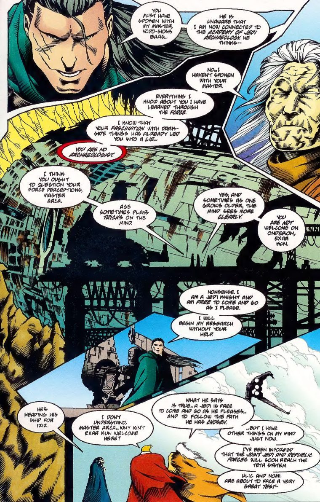
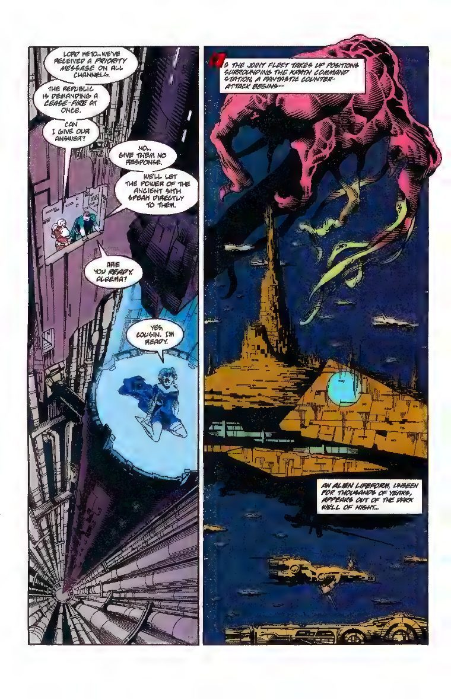
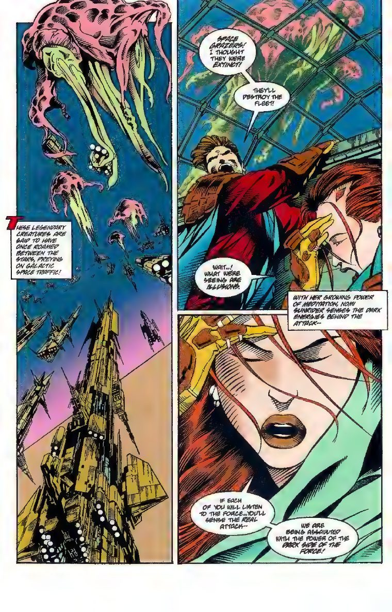
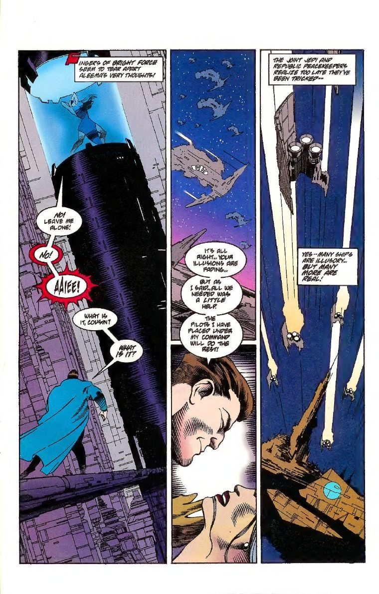

Our notes: `notes/materials/024-tales-of-the-jedi/dark-lords-of-the-sith.md:33`

- Note (summary from our notes, not a quotation): The Jedi assembly on Deneba (Odan-Urr presiding). Nadd's spirit collapses the Korriban crystal mausoleum on Exar (p12–13); Exar accepts the dark side to live (p16–17). Krath war droids attack Deneba; Arca is killed from behind (p21–22). Exar reads Sith glyphs and kills the tomb guardians in anger (p23–26). Ulic decides to destroy the Krath from within (p27).
  — Source: Owner Material 024b — Tales of the Jedi: Dark Lords of the Sith #1–6 (1994–95): power-scaling notes.
Our notes: `notes/materials/024-tales-of-the-jedi/dark-lords-of-the-sith.md:37`

- Note (summary from our notes, not a quotation): Short-circuits Krath war droids with the Force and saves Ulic. Source: Dark Lords of the Sith #3, p18–21
  — Source: Owner Material 024b — Tales of the Jedi: Dark Lords of the Sith #1–6 (1994–95): power-scaling notes.
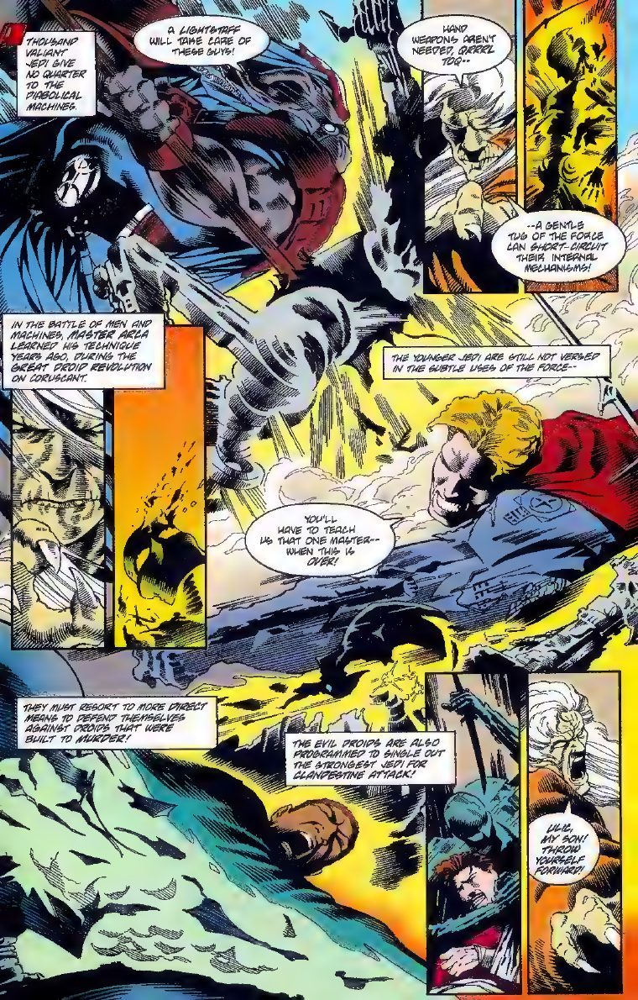
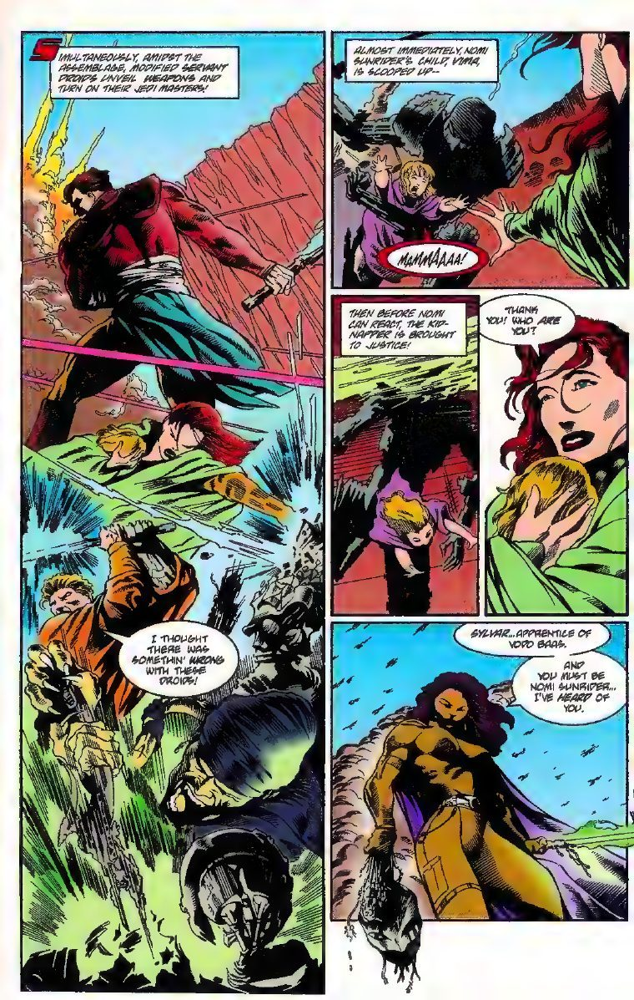
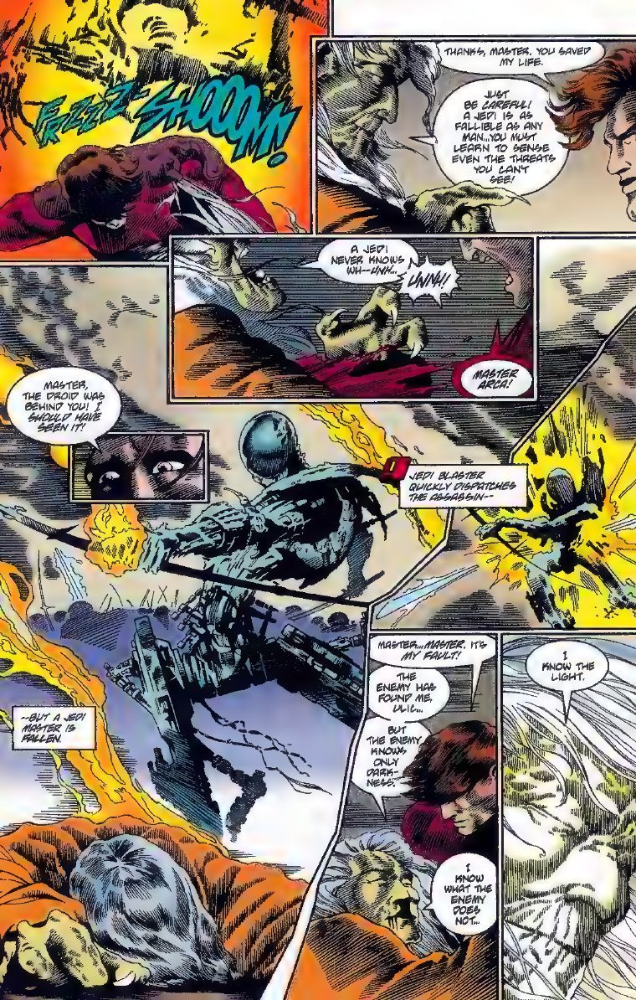
Our notes: `notes/materials/024-tales-of-the-jedi/dark-lords-of-the-sith.md:211`

- Note (summary from our notes, not a quotation): Stabbed from behind by a war droid and dies; his body vanishes. Source: Dark Lords of the Sith #3, p21–22
  — Source: Owner Material 024b — Tales of the Jedi: Dark Lords of the Sith #1–6 (1994–95): power-scaling notes.

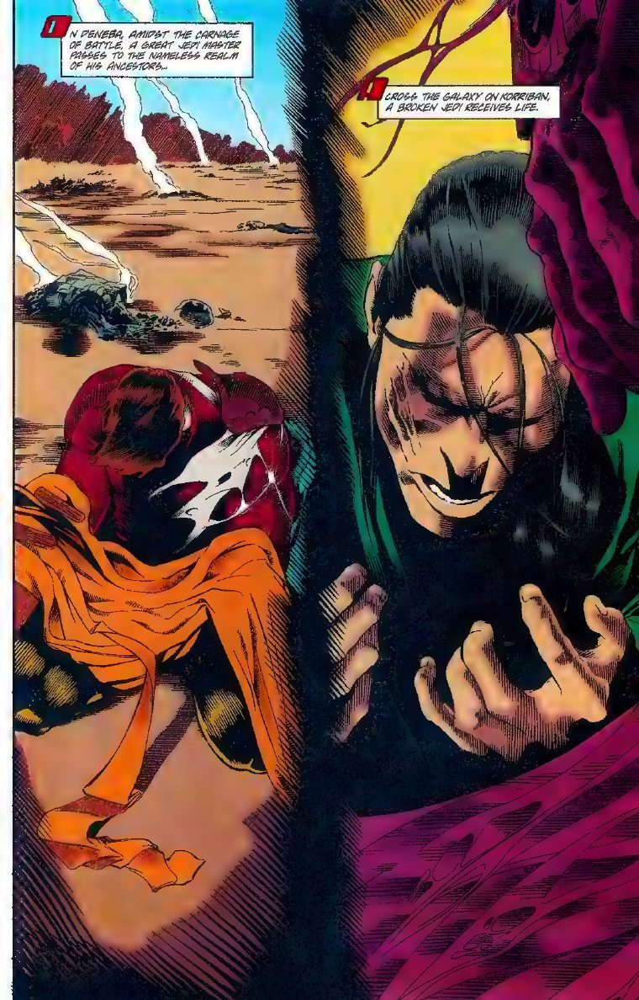
Our notes: `notes/materials/024-tales-of-the-jedi/dark-lords-of-the-sith.md:215`

> SO SHALL WE. A WALL OF LIGHT, CREATED BY MANY JEDI JOINED TOGETHER, CAN PUSH THEM BACK...
> [fragment — full passage not on file]
>
> ULIC, MY SON...HOW MANY TIMES HAVE I SAID IT? THERE'S THE WAY OF THE JEDI...AND THERE IS THE DARK PATH...WHICH LEADS ONLY TO DESTRUCTION.
> [fragment — full passage not on file]
— Source: Dark Lords of the Sith #3, p11 — Owner Material 024b — Tales of the Jedi: Dark Lords of the Sith #1–6 (1994–95): power-scaling notes; Arca Jeth to Ulic Qel-Droma at the assembly.
Note (our notes, around the quote): Arca Jeth to Ulic Qel-Droma at the assembly: "SO SHALL WE. A WALL OF LIGHT, CREATED BY MANY JEDI JOINED TOGETHER, CAN PUSH THEM BACK..." "ULIC, MY SON...HOW MANY TIMES HAVE I SAID IT? THERE'S THE WAY OF THE JEDI...AND THERE IS THE DARK PATH...WHICH LEADS ONLY TO DESTRUCTION." Source: Dark Lords of the Sith #3, p11
Our notes: `notes/materials/024-tales-of-the-jedi/dark-lords-of-the-sith.md:220`

- Note (summary from our notes, not a quotation): Onderon c. 3998 BBY, after the *Tales of the Jedi* "Ulic Qel-Droma and the Beast Wars of Onderon" arc (not part of this delivery). Ulic, Cay and Tott are Arca's apprentices; Nomi is Thon's apprentice. Freedon Nadd is a spirit; King Ommin practises Sith magic he learned from him.
  — Source: Owner Material 024a — Tales of the Jedi: The Freedon Nadd Uprising #1–2 (1994): power-scaling notes.
Our notes: `notes/materials/024-tales-of-the-jedi/freedon-nadd-uprising.md:19`

> CUT OFF FROM HIS MASTER BY OMMIN'S WARRIORS, ULIC LETS HIS FLASHING LIGHTSABER FIND ITS MARK!
— Source: Owner Material 024a — Tales of the Jedi: The Freedon Nadd Uprising #1–2 (1994): power-scaling notes.
Note (our notes, around the quote): Cuts down Ommin's warriors after he is cut off from his master: "CUT OFF FROM HIS MASTER BY OMMIN'S WARRIORS, ULIC LETS HIS FLASHING LIGHTSABER FIND ITS MARK!" Source: Freedon Nadd Uprising #1, p15
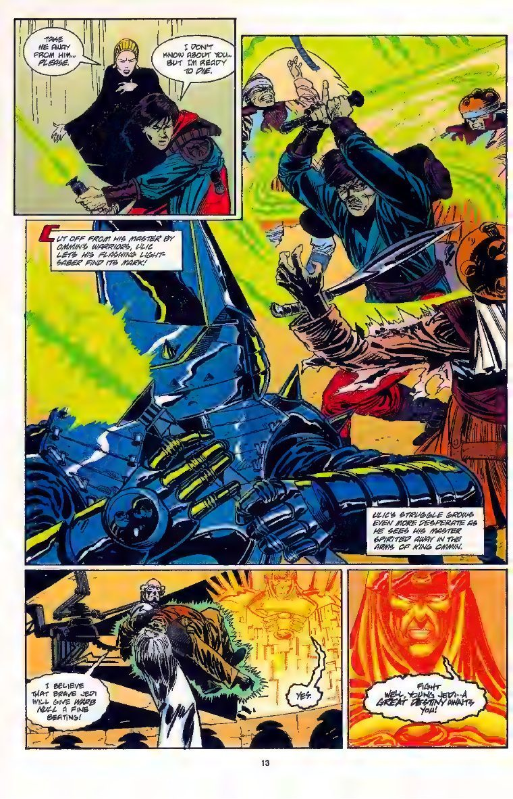
Our notes: `notes/materials/024-tales-of-the-jedi/freedon-nadd-uprising.md:31`

> Ulic narrowly defeats Null in a deadly lightsaber duel, but not before Ommin escapes with Master Arca as his prisoner.
— Source: Owner Material 024a — Tales of the Jedi: The Freedon Nadd Uprising #1–2 (1994): power-scaling notes; Recap of #1. POV: narrator, about Arca Jeth.
Note (our notes, around the quote): Recap of #1: "Ulic narrowly defeats Null in a deadly lightsaber duel, but not before Ommin escapes with Master Arca as his prisoner." · NARRATION. Source: Freedon Nadd Uprising #2, p1

Our notes: `notes/materials/024-tales-of-the-jedi/freedon-nadd-uprising.md:34`

> FIGHT WELL, YOUNG JEDI--A GREAT DESTINY AWAITS YOU!
— Source: Owner Material 024a — Tales of the Jedi: The Freedon Nadd Uprising #1–2 (1994): power-scaling notes; Freedon Nadd's spirit to Ulic Qel-Droma. POV: Freedon Nadd's spirit, about Arca Jeth.
Note (our notes, around the quote): Freedon Nadd's spirit to Ulic Qel-Droma: "FIGHT WELL, YOUNG JEDI--A GREAT DESTINY AWAITS YOU!" Source: Freedon Nadd Uprising #1, p15

Our notes: `notes/materials/024-tales-of-the-jedi/freedon-nadd-uprising.md:41`

> TODAY THE JEDI KNIGHTS HAVE TRIUMPHED OVER THE DARK SIDE.
— Source: Freedon Nadd Uprising #2, p19 — Owner Material 024a — Tales of the Jedi: The Freedon Nadd Uprising #1–2 (1994): power-scaling notes; Arca Jeth to Ulic Qel-Droma after Ommin's fall.
Note (our notes, around the quote): Arca Jeth to Ulic Qel-Droma after Ommin's fall: "TODAY THE JEDI KNIGHTS HAVE TRIUMPHED OVER THE DARK SIDE." "GOOD WORK, ULIC!" Source: Freedon Nadd Uprising #2, p19
Also cited as: Freedon Nadd Uprising #2, p19 — Owner Material 024a — Tales of the Jedi: The Freedon Nadd Uprising #1–2 (1994): power-scaling notes; Arca Jeth.
Also noted as: Arca Jeth: "TODAY THE JEDI KNIGHTS HAVE TRIUMPHED OVER THE DARK SIDE." "GOOD WORK, ULIC!" Source: Freedon Nadd Uprising #2, p19
Our notes: `notes/materials/024-tales-of-the-jedi/freedon-nadd-uprising.md:45`; `notes/materials/024-tales-of-the-jedi/freedon-nadd-uprising.md:128`

> REMEMBER, ULIC... WHERE THERE IS LIGHT... THERE CAN BE NO DARKNESS.
> [fragment — full passage not on file]
— Source: Owner Material 024a — Tales of the Jedi: The Freedon Nadd Uprising #1–2 (1994): power-scaling notes; Arca Jeth to Ulic Qel-Droma. POV: Arca Jeth.
Note (our notes, around the quote): Arca Jeth to Ulic Qel-Droma: "REMEMBER, ULIC... WHERE THERE IS LIGHT... THERE CAN BE NO DARKNESS." Source: Freedon Nadd Uprising #2, p22
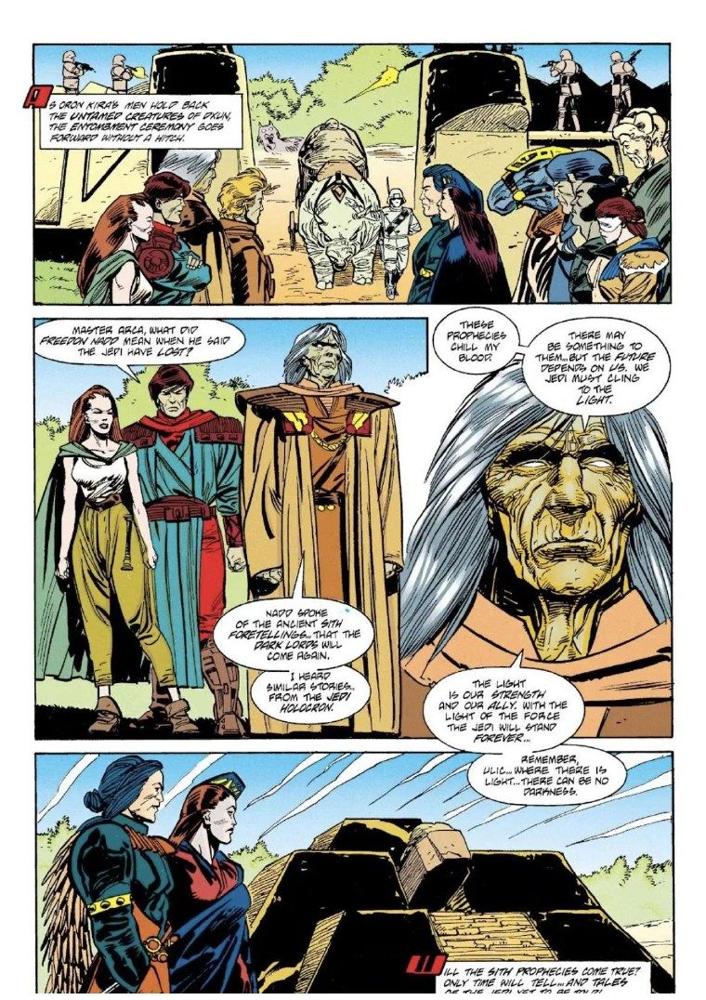
Our notes: `notes/materials/024-tales-of-the-jedi/freedon-nadd-uprising.md:46`

> THEN, IN A FLASH OF BLUE FIRE, NADD APPEARS AT THE SIDE OF THE FALLEN KING--
> [fragment — full passage not on file]
>
> LET THESE YOUNG JEDI GO! THEY DON'T BELONG TO YOU! IT IS YOUR TIME TO DIE!
>
> I'M SORRY, OMMIN... THEY DON'T BELONG TO THE DARK SIDE BUT YOU DO!
> [fragment — full passage not on file]
>
> GREETINGS, ARCA--HAS KING OMMIN'S DEATH FREED YOU?
— Source: Freedon Nadd Uprising #2, p19 — Owner Material 024a — Tales of the Jedi: The Freedon Nadd Uprising #1–2 (1994): power-scaling notes; Spirit kills (claims) the broken King Ommin.
Note (our notes, around the quote): Spirit kills (claims) the broken King Ommin: "THEN, IN A FLASH OF BLUE FIRE, NADD APPEARS AT THE SIDE OF THE FALLEN KING--" Nadd: "LET THESE YOUNG JEDI GO! THEY DON'T BELONG TO YOU! IT IS YOUR TIME TO DIE!" "I'M SORRY, OMMIN... THEY DON'T BELONG TO THE DARK SIDE BUT YOU DO!" Ommin: "NYAAAAAA!" Nadd to Arca: "GREETINGS, ARCA--HAS KING OMMIN'S DEATH FREED YOU?" Source: Freedon Nadd Uprising #2, p19
Our notes: `notes/materials/024-tales-of-the-jedi/freedon-nadd-uprising.md:67`

> NOW ALL THAT REMAINS IS TO DEAL WITH THIS ROGUE SPIRIT!
— Source: Freedon Nadd Uprising #2, p20 — Owner Material 024a — Tales of the Jedi: The Freedon Nadd Uprising #1–2 (1994): power-scaling notes; Arca turns on the spirit (.
Note (our notes, around the quote): Arca turns on the spirit ("NOW ALL THAT REMAINS IS TO DEAL WITH THIS ROGUE SPIRIT!"); bands of light cut through Nadd's image as he fades. (ANALYSIS) The spirit is dispersed, not destroyed: Exar Kun destroys it later (DLotS #4). Source: Freedon Nadd Uprising #2, p20
Also cited as: Freedon Nadd Uprising #2, p20 — Owner Material 024a — Tales of the Jedi: The Freedon Nadd Uprising #1–2 (1994): power-scaling notes; Confronts Freedon Nadd's spirit after Ommin's death.
Also noted as: Confronts Freedon Nadd's spirit after Ommin's death: "NOW ALL THAT REMAINS IS TO DEAL WITH THIS ROGUE SPIRIT!" (bands of light cut through the spirit's image as it fades). Source: Freedon Nadd Uprising #2, p20
Our notes: `notes/materials/024-tales-of-the-jedi/freedon-nadd-uprising.md:68`; `notes/materials/024-tales-of-the-jedi/freedon-nadd-uprising.md:133`

> YES. MY MUMMIFIED FLESH SLEEPS ON STONE.
>
> BUT THIS OLD MAN CALLED MY SPIRIT BACK FROM CHAOS...
> [fragment — full passage not on file]
>
> I HAVE GIVEN HIM MY KNOWLEDGE.
>
> FEAR ME NOT, JEDI. I AM POWERLESS IN MY PRESENT STATE.
— Source: Freedon Nadd Uprising #1, p13 — Owner Material 024a — Tales of the Jedi: The Freedon Nadd Uprising #1–2 (1994): power-scaling notes; Freedon Nadd's spirit to Arca Jeth. POV: Freedon Nadd's spirit, about Arca Jeth.
Note (our notes, around the quote): Freedon Nadd's spirit to Arca Jeth: "YES. MY MUMMIFIED FLESH SLEEPS ON STONE." "BUT THIS OLD MAN CALLED MY SPIRIT BACK FROM CHAOS..." "I HAVE GIVEN HIM MY KNOWLEDGE." "FEAR ME NOT, JEDI. I AM POWERLESS IN MY PRESENT STATE." Source: Freedon Nadd Uprising #1, p13
Our notes: `notes/materials/024-tales-of-the-jedi/freedon-nadd-uprising.md:71`

> YOU DELUDE YOURSELF, OLD MAN.
> [fragment — full passage not on file]
>
> THE JEDI HAVE NOT WON TODAY... AS YOU WILL ONE DAY LEARN--
> [fragment — full passage not on file]
>
> Ulic, bathed in the light side, fights off the darkness and rushes forward, slashing with his lightsaber at the metal armature that holds Ommin erect. Without support, Ommin collapses. - -,,_c."'t.:-y 17i"4/~P ~/t..aN"'!fJ,Jt(Jlrw .a c.AJ?e~t/I.-t. y PlF~/N5P A1/~~/t?N- - 5atal and Aleema retreat into the recesses of the sublevels as Ulic demands to know what has happened to Master Area. Ommin tells them that Area has gone to the dark side, as will they. In a deep access corridor, the spirit of Freedon Nadd appears to 5atal and Aleema, giving them the book, the amulet, and a pair of 5ith swords. Nadd appears near the body of Ommin, saying that, unlike the brave Jedi arrayed before him, the old man belongs to the dark side. As Ommin passes into the Force, Area is freed and Nadd's spirit fades, saying the Jedi have lost, though they do not yet know it. With Ommin dead and the Naddists squelched, the Republic institutes martial law and quickly restores order to Iziz. Meanwhile, 5atal and Aleema escape with their 5ith treasures. Freedon Nadd's and Queen Amanoa's sarcophagi are finally brought to Dxun where they are placed in a tomb constructed to withstand the ravages of time. Ulic wonders aloud what Nadd meant when he said the Jedi had lost.
— Source: Freedon Nadd Uprising #2, p20 — Owner Material 024a — Tales of the Jedi: The Freedon Nadd Uprising #1–2 (1994): power-scaling notes; Freedon Nadd's spirit to Arca Jeth. POV: Freedon Nadd's spirit, about Arca Jeth.
(Excerpt widened 2026-11-17 to the relevant passage, word for word from research primary tales of the jedi WEG40082 (text copy `research_primary_tales_of_the_jedi_WEG40082_pdf_afa57d0500`).)
(Excerpt widened 2026-11-17 to the relevant passage, word for word from research primary tales of the jedi WEG40082 (text copy `research_primary_tales_of_the_jedi_WEG40082_pdf_afa57d0500`).)
(Full sentence/passage taken from the source text on file: `research_primary_tales_of_the_jedi_WEG40082_pdf`.)
Note (our notes, around the quote): Freedon Nadd's spirit to Arca Jeth: "YOU DELUDE YOURSELF, OLD MAN." "THE JEDI HAVE NOT WON TODAY... AS YOU WILL ONE DAY LEARN--" "THE JEDI HAVE LOST!" Source: Freedon Nadd Uprising #2, p20
Our notes: `notes/materials/024-tales-of-the-jedi/freedon-nadd-uprising.md:73`

> ARCA KNOWS THAT FREEDON NADD WAS A STUDENT OF ANCIENT SITH LORDS WHO LEARNED TO FOCUS DARK-SIDE ENERGIES THROUGH THEIR TEMPLES AND AMULETS.
— Source: Owner Material 024a — Tales of the Jedi: The Freedon Nadd Uprising #1–2 (1994): power-scaling notes; Narration on Freedon Nadd. POV: narrator, about Arca Jeth.
Note (our notes, around the quote): Narration on Freedon Nadd: "ARCA KNOWS THAT FREEDON NADD WAS A STUDENT OF ANCIENT SITH LORDS WHO LEARNED TO FOCUS DARK-SIDE ENERGIES THROUGH THEIR TEMPLES AND AMULETS." · NARRATION. Source: Freedon Nadd Uprising #1, p7
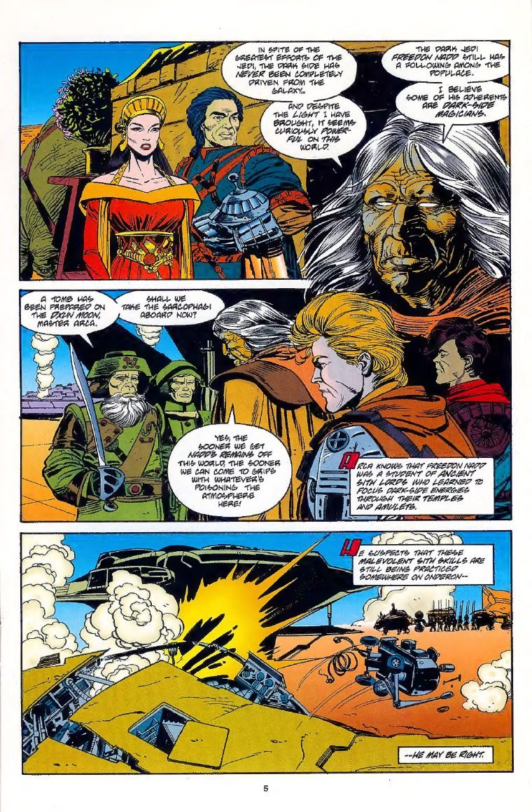
Our notes: `notes/materials/024-tales-of-the-jedi/freedon-nadd-uprising.md:76`

> IT IS AS I FEARED--FREEDON NADD AND QUEEN AMANOA ARE DEAD...BUT THEIR SITH MAGIC IS VERY MUCH ALIVE!
> [fragment — full passage not on file]
— Source: Owner Material 024a — Tales of the Jedi: The Freedon Nadd Uprising #1–2 (1994): power-scaling notes; Arca Jeth. POV: Arca Jeth.
Note (our notes, around the quote): Arca Jeth: "IT IS AS I FEARED--FREEDON NADD AND QUEEN AMANOA ARE DEAD...BUT THEIR SITH MAGIC IS VERY MUCH ALIVE!" Source: Freedon Nadd Uprising #1, p11
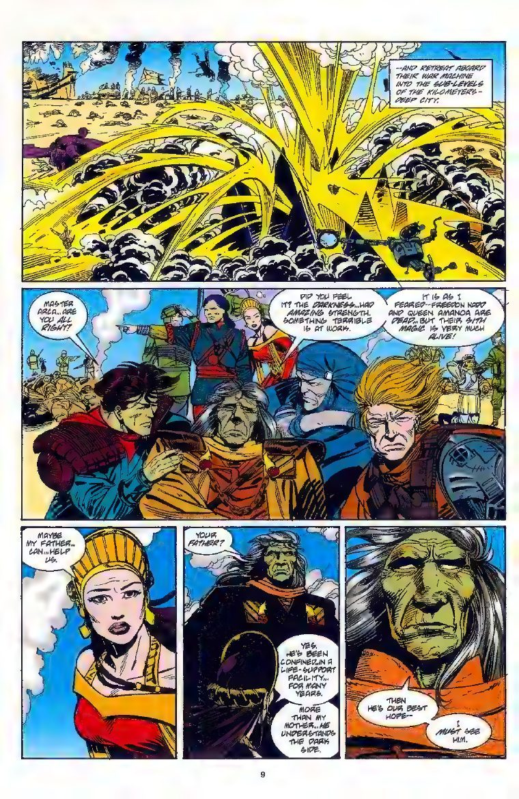
Our notes: `notes/materials/024-tales-of-the-jedi/freedon-nadd-uprising.md:79`

> NADD SPOKE OF THE ANCIENT SITH FORETELLINGS... THAT THE DARK LORDS WILL COME AGAIN.
> [fragment — full passage not on file]
>
> I HEARD SIMILAR STORIES... FROM THE JEDI HOLOCRON.
> [fragment — full passage not on file]
— Source: Owner Material 024a — Tales of the Jedi: The Freedon Nadd Uprising #1–2 (1994): power-scaling notes; Arca Jeth about Freedon Nadd. POV: Arca Jeth.
Note (our notes, around the quote): Arca Jeth about Freedon Nadd: "NADD SPOKE OF THE ANCIENT SITH FORETELLINGS... THAT THE DARK LORDS WILL COME AGAIN." "I HEARD SIMILAR STORIES... FROM THE JEDI HOLOCRON." Source: Freedon Nadd Uprising #2, p22

Our notes: `notes/materials/024-tales-of-the-jedi/freedon-nadd-uprising.md:83`

> A GREAT TOMB HAS BEEN BUILT ON BARBAROUS DXUN, DESIGNED TO WITHSTAND THE RAVAGES OF TIME.
>
> THERE THE ROYAL REMAINS WILL BE HELD SECURE UNTIL THEY FINALLY RETURN TO DUST.
— Source: Owner Material 024a — Tales of the Jedi: The Freedon Nadd Uprising #1–2 (1994): power-scaling notes; Narration on the Dxun tomb. POV: narrator, about Arca Jeth.
Note (our notes, around the quote): Narration on the Dxun tomb: "A GREAT TOMB HAS BEEN BUILT ON BARBAROUS DXUN, DESIGNED TO WITHSTAND THE RAVAGES OF TIME." "THERE THE ROYAL REMAINS WILL BE HELD SECURE UNTIL THEY FINALLY RETURN TO DUST." · NARRATION. Source: Freedon Nadd Uprising #2, p21
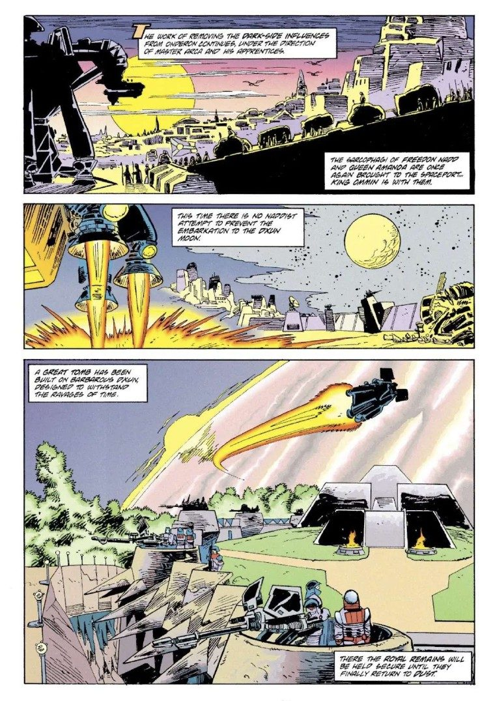
Our notes: `notes/materials/024-tales-of-the-jedi/freedon-nadd-uprising.md:85`

> IN SPITE OF THE NEED FOR MACHINERY TO SUPPORT HIS SOFTENED BONES, OMMIN IS FILLED WITH POWER.
— Source: Freedon Nadd Uprising #1, p14 — Owner Material 024a — Tales of the Jedi: The Freedon Nadd Uprising #1–2 (1994): power-scaling notes; Lurches from his life-support armature and overpowers Arca Jeth.
Note (our notes, around the quote): Lurches from his life-support armature and overpowers Arca Jeth: "IN SPITE OF THE NEED FOR MACHINERY TO SUPPORT HIS SOFTENED BONES, OMMIN IS FILLED WITH POWER." Source: Freedon Nadd Uprising #1, p14
Our notes: `notes/materials/024-tales-of-the-jedi/freedon-nadd-uprising.md:91`

> --AAIEE! ARCA'S SMOTHERED IN DARK-SIDE ENERGY!
> [fragment — full passage not on file]
— Source: Freedon Nadd Uprising #1, p14–16 — Owner Material 024a — Tales of the Jedi: The Freedon Nadd Uprising #1–2 (1994): power-scaling notes.
Note (our notes, around the quote): Smothers Arca Jeth in dark-side energy and carries him off: "--AAIEE! ARCA'S SMOTHERED IN DARK-SIDE ENERGY!" Source: Freedon Nadd Uprising #1, p14–16
Our notes: `notes/materials/024-tales-of-the-jedi/freedon-nadd-uprising.md:92`

> ULIC... THE DARK SIDERS.. HAVE STRUCK BACK!
> [fragment — full passage not on file]
— Source: Freedon Nadd Uprising #1, p9 — Owner Material 024a — Tales of the Jedi: The Freedon Nadd Uprising #1–2 (1994): power-scaling notes.
Note (our notes, around the quote): (ANALYSIS) Likely source of the "INVISIBLE BLOW" Arca suffers during the cortege attack ("ULIC... THE DARK SIDERS.. HAVE STRUCK BACK!"). Source: Freedon Nadd Uprising #1, p9
Our notes: `notes/materials/024-tales-of-the-jedi/freedon-nadd-uprising.md:93`

> The crippled old King lashes out at Arca with blistering bolts of dark side energy, subduing the Jedi Master!
— Source: Owner Material 024a — Tales of the Jedi: The Freedon Nadd Uprising #1–2 (1994): power-scaling notes; Recap of #1. POV: narrator, about Arca Jeth.
Note (our notes, around the quote): Recap of #1: "The crippled old King lashes out at Arca with blistering bolts of dark side energy, subduing the Jedi Master!" · NARRATION. Source: Freedon Nadd Uprising #2, p1

Our notes: `notes/materials/024-tales-of-the-jedi/freedon-nadd-uprising.md:94`

> MY MOST PRIZED POSSESSION...
> [fragment — full passage not on file]
>
> HIS NAME IS ARCA... HE'S QUITE ALIVE... BUT SUFFERING MIGHTILY UNDER THE CRUSHING POWER OF THE DARK SIDE.
> [fragment — full passage not on file]
— Source: Freedon Nadd Uprising #2, p13 — Owner Material 024a — Tales of the Jedi: The Freedon Nadd Uprising #1–2 (1994): power-scaling notes; Holds Arca Jeth captive in dark-side energy.
Note (our notes, around the quote): Holds Arca Jeth captive in dark-side energy: "MY MOST PRIZED POSSESSION..." "A JEDI MASTER." "HIS NAME IS ARCA... HE'S QUITE ALIVE... BUT SUFFERING MIGHTILY UNDER THE CRUSHING POWER OF THE DARK SIDE." Source: Freedon Nadd Uprising #2, p13
Our notes: `notes/materials/024-tales-of-the-jedi/freedon-nadd-uprising.md:96`

> BELIEVE ME, JEDI-- THE SITH WAY WILL LIVE FOREVER!
— Source: Freedon Nadd Uprising #1, p14 — Owner Material 024a — Tales of the Jedi: The Freedon Nadd Uprising #1–2 (1994): power-scaling notes; Ommin to Arca Jeth. POV: Ommin, about Arca Jeth.
Note (our notes, around the quote): Ommin to Arca Jeth: "BELIEVE ME, JEDI-- THE SITH WAY WILL LIVE FOREVER!" Source: Freedon Nadd Uprising #1, p14
Our notes: `notes/materials/024-tales-of-the-jedi/freedon-nadd-uprising.md:106`

> MY GOAL IS TO EXTINGUISH HIS LIGHT, UTTERLY... AND THEN RAISE HIM UP AGAIN--AS A DARK JEDI!
> [fragment — full passage not on file]
— Source: Freedon Nadd Uprising #2, p13 — Owner Material 024a — Tales of the Jedi: The Freedon Nadd Uprising #1–2 (1994): power-scaling notes; Ommin on his plan for Arca Jeth. POV: Ommin, about Arca Jeth.
Note (our notes, around the quote): Ommin on his plan for Arca Jeth: "MY GOAL IS TO EXTINGUISH HIS LIGHT, UTTERLY... AND THEN RAISE HIM UP AGAIN--AS A DARK JEDI!" Source: Freedon Nadd Uprising #2, p13
Our notes: `notes/materials/024-tales-of-the-jedi/freedon-nadd-uprising.md:108`

- Note (summary from our notes, not a quotation): Suffers an "INVISIBLE BLOW" from the dark side during the attack. Source: Freedon Nadd Uprising #1, p9
  — Source: Freedon Nadd Uprising #1, p9 — Owner Material 024a — Tales of the Jedi: The Freedon Nadd Uprising #1–2 (1994): power-scaling notes.

Our notes: `notes/materials/024-tales-of-the-jedi/freedon-nadd-uprising.md:119`

- Note (summary from our notes, not a quotation): Overpowered and carried off by King Ommin. Source: Freedon Nadd Uprising #1, p14–16
  — Source: Freedon Nadd Uprising #1, p14–16 — Owner Material 024a — Tales of the Jedi: The Freedon Nadd Uprising #1–2 (1994): power-scaling notes.
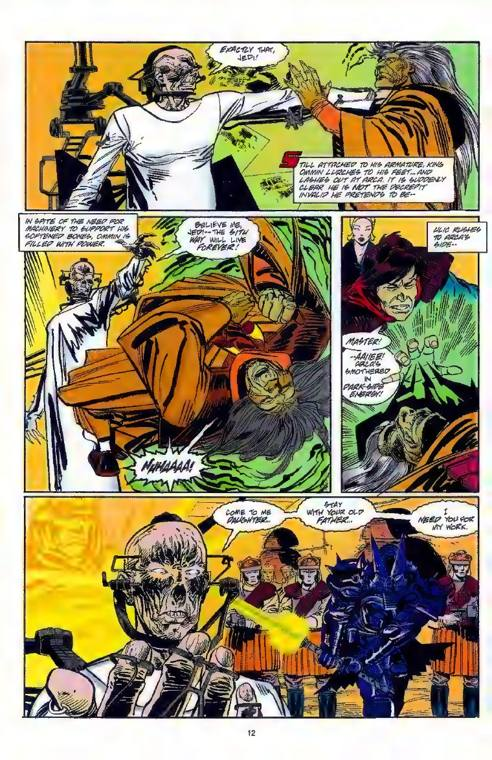

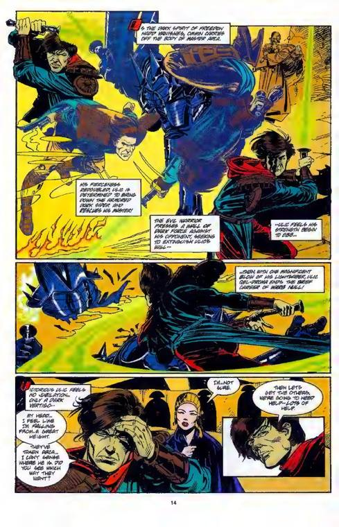
Our notes: `notes/materials/024-tales-of-the-jedi/freedon-nadd-uprising.md:120`

> Master Arca is felled by a blow of dark Force
> [fragment — full passage not on file]
— Source: Owner Material 024a — Tales of the Jedi: The Freedon Nadd Uprising #1–2 (1994): power-scaling notes; Recap of #1. POV: narrator, about Arca Jeth.
Note (our notes, around the quote): Recap of #1: "Master Arca is felled by a blow of dark Force"; Ommin's bolts subdue him. · NARRATION. Source: Freedon Nadd Uprising #2, p1

Our notes: `notes/materials/024-tales-of-the-jedi/freedon-nadd-uprising.md:121`

> SUFFERING MIGHTILY UNDER THE CRUSHING POWER OF THE DARK SIDE
> [fragment — full passage not on file]
— Source: Freedon Nadd Uprising #2, p13 — Owner Material 024a — Tales of the Jedi: The Freedon Nadd Uprising #1–2 (1994): power-scaling notes; Survives Ommin's captivity: bound in green dark-side energy.
Note (our notes, around the quote): Survives Ommin's captivity: bound in green dark-side energy, "SUFFERING MIGHTILY UNDER THE CRUSHING POWER OF THE DARK SIDE", but not turned. Source: Freedon Nadd Uprising #2, p13
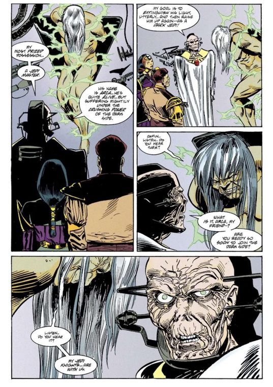
Our notes: `notes/materials/024-tales-of-the-jedi/freedon-nadd-uprising.md:123`

> THE DARK SIDE OF THE FORCE.. THE CITY IS STILL PERMEATED WITH IT...
> [fragment — full passage not on file]
>
> IT'S AFFECTING ALL OF US.
> [fragment — full passage not on file]
— Source: Freedon Nadd Uprising #1, p6 — Owner Material 024a — Tales of the Jedi: The Freedon Nadd Uprising #1–2 (1994): power-scaling notes; Arca Jeth. POV: Arca Jeth.
Note (our notes, around the quote): Arca Jeth: "THE DARK SIDE OF THE FORCE.. THE CITY IS STILL PERMEATED WITH IT..." "IT'S AFFECTING ALL OF US." Source: Freedon Nadd Uprising #1, p6
Our notes: `notes/materials/024-tales-of-the-jedi/freedon-nadd-uprising.md:126`

> IN SPITE OF THE GREATEST EFFORTS OF THE JEDI, THE DARK SIDE HAS NEVER BEEN COMPLETELY DRIVEN FROM THE GALAXY..
>
> AND DESPITE THE LIGHT I HAVE BROUGHT, IT SEEMS CURIOUSLY POWERFUL ON THIS WORLD.
— Source: Freedon Nadd Uprising #1, p7 — Owner Material 024a — Tales of the Jedi: The Freedon Nadd Uprising #1–2 (1994): power-scaling notes; Arca Jeth. POV: Arca Jeth.
Note (our notes, around the quote): Arca Jeth: "IN SPITE OF THE GREATEST EFFORTS OF THE JEDI, THE DARK SIDE HAS NEVER BEEN COMPLETELY DRIVEN FROM THE GALAXY.." "AND DESPITE THE LIGHT I HAVE BROUGHT, IT SEEMS CURIOUSLY POWERFUL ON THIS WORLD." Source: Freedon Nadd Uprising #1, p7
Our notes: `notes/materials/024-tales-of-the-jedi/freedon-nadd-uprising.md:127`

> THERE MAY BE SOMETHING TO THEM... BUT THE FUTURE DEPENDS ON US. WE JEDI MUST CLING TO THE LIGHT.
> [fragment — full passage not on file]
>
> THE LIGHT IS OUR STRENGTH AND OUR ALLY. WITH THE LIGHT OF THE FORCE THE JEDI WILL STAND FOREVER...
> [fragment — full passage not on file]
— Source: Freedon Nadd Uprising #2, p22 — Owner Material 024a — Tales of the Jedi: The Freedon Nadd Uprising #1–2 (1994): power-scaling notes; Arca Jeth. POV: Arca Jeth.
Note (our notes, around the quote): Arca Jeth: "THERE MAY BE SOMETHING TO THEM... BUT THE FUTURE DEPENDS ON US. WE JEDI MUST CLING TO THE LIGHT." "THE LIGHT IS OUR STRENGTH AND OUR ALLY. WITH THE LIGHT OF THE FORCE THE JEDI WILL STAND FOREVER..." Source: Freedon Nadd Uprising #2, p22
Our notes: `notes/materials/024-tales-of-the-jedi/freedon-nadd-uprising.md:129`

> LISTEN... DO YOU HEAR IT?
> [fragment — full passage not on file]
>
> MY JEDI KNIGHTS...ARE WITH US.
> [fragment — full passage not on file]
— Source: Freedon Nadd Uprising #2, p13 — Owner Material 024a — Tales of the Jedi: The Freedon Nadd Uprising #1–2 (1994): power-scaling notes; Still senses his Knights while bound.
Note (our notes, around the quote): Still senses his Knights while bound: "LISTEN... DO YOU HEAR IT?" "MY JEDI KNIGHTS...ARE WITH US." Source: Freedon Nadd Uprising #2, p13

Our notes: `notes/materials/024-tales-of-the-jedi/freedon-nadd-uprising.md:132`

> THE WORK OF REMOVING THE DARK-SIDE INFLUENCES FROM ONDERON CONTINUES, UNDER THE DIRECTION OF MASTER ARCA AND HIS APPRENTICES.
— Source: Owner Material 024a — Tales of the Jedi: The Freedon Nadd Uprising #1–2 (1994): power-scaling notes; Directs the cleansing of Onderon.
Note (our notes, around the quote): Directs the cleansing of Onderon: "THE WORK OF REMOVING THE DARK-SIDE INFLUENCES FROM ONDERON CONTINUES, UNDER THE DIRECTION OF MASTER ARCA AND HIS APPRENTICES." · NARRATION. Source: Freedon Nadd Uprising #2, p21

Our notes: `notes/materials/024-tales-of-the-jedi/freedon-nadd-uprising.md:134`

> As he recovers, Arca learns from Queen Galia that her father King Ommin is being kept alive in a secret life-support facility.
— Source: Owner Material 024a — Tales of the Jedi: The Freedon Nadd Uprising #1–2 (1994): power-scaling notes; Recap (Galia's role). POV: Recap, about Arca Jeth.
Note (our notes, around the quote): Recap (Galia's role): "As he recovers, Arca learns from Queen Galia that her father King Ommin is being kept alive in a secret life-support facility." · NARRATION. Source: Freedon Nadd Uprising #2, p1

Our notes: `notes/materials/024-tales-of-the-jedi/freedon-nadd-uprising.md:245`

> AS ORON KIRA'S MEN HOLD BACK THE UNTAMED CREATURES OF DXUN, THE ENTOMBMENT CEREMONY GOES FORWARD WITHOUT A HITCH.
— Source: Owner Material 024a — Tales of the Jedi: The Freedon Nadd Uprising #1–2 (1994): power-scaling notes; Oron Kira's men guard the Dxun entombment. POV: narrator, about Arca Jeth.
Note (our notes, around the quote): Oron Kira's men guard the Dxun entombment: "AS ORON KIRA'S MEN HOLD BACK THE UNTAMED CREATURES OF DXUN, THE ENTOMBMENT CEREMONY GOES FORWARD WITHOUT A HITCH." · NARRATION. (Galia and Oron Kira stand at the tomb; no Force feats.) Source: Freedon Nadd Uprising #2, p22

Our notes: `notes/materials/024-tales-of-the-jedi/freedon-nadd-uprising.md:247`

- Note (summary from our notes, not a quotation): | 2 | Ommin vs Arca Jeth | Ommin's chamber | p13–16 | Arca smothered and carried off |
  — Source: Owner Material 024a — Tales of the Jedi: The Freedon Nadd Uprising #1–2 (1994): power-scaling notes.
Context: | # | Fight | Where | Pages | Outcome |
Our notes: `notes/materials/024-tales-of-the-jedi/freedon-nadd-uprising.md:272`

> Ulic, bathed in the light side, fights off the darkness and rushes forward, slashing with his lightsaber at the metal armature that holds Ommin erect. Without support, Ommin collapses. - -,,_c."'t.:-y 17i"4/~P ~/t..aN"'!fJ,Jt(Jlrw .a c.AJ?e~t/I.-t. y PlF~/N5P A1/~~/t?N- - 5atal and Aleema retreat into the recesses of the sublevels as Ulic demands to know what has happened to Master Area. Ommin tells them that Area has gone to the dark side, as will they. In a deep access corridor, the spirit of Freedon Nadd appears to 5atal and Aleema, giving them the book, the amulet, and a pair of 5ith swords. Nadd appears near the body of Ommin, saying that, unlike the brave Jedi arrayed before him, the old man belongs to the dark side. As Ommin passes into the Force, Area is freed and Nadd's spirit fades, saying the Jedi have lost, though they do not yet know it. With Ommin dead and the Naddists squelched, the Republic institutes martial law and quickly restores order to Iziz. Meanwhile, 5atal and Aleema escape with their 5ith treasures. Freedon Nadd's and Queen Amanoa's sarcophagi are finally brought to Dxun where they are placed in a tomb constructed to withstand the ravages of time. Ulic wonders aloud what Nadd meant when he said the Jedi had lost.
— Source: Owner Material 024a — Tales of the Jedi: The Freedon Nadd Uprising #1–2 (1994): power-scaling notes.
(Excerpt widened 2026-11-17 to the relevant passage, word for word from research primary tales of the jedi WEG40082 (text copy `research_primary_tales_of_the_jedi_WEG40082_pdf_afa57d0500`).)
(Excerpt widened 2026-11-17 to the relevant passage, word for word from research primary tales of the jedi WEG40082 (text copy `research_primary_tales_of_the_jedi_WEG40082_pdf_afa57d0500`).)
(Full sentence/passage taken from the source text on file: `research_primary_tales_of_the_jedi_WEG40082_pdf`.)
Note (our notes, around the quote): | 9 | Arca Jeth vs Freedon Nadd's spirit | Ommin's lair | #2 p20 | Spirit fades; "THE JEDI HAVE LOST!" |
Context: | # | Fight | Where | Pages | Outcome |
Our notes: `notes/materials/024-tales-of-the-jedi/freedon-nadd-uprising.md:279`

- Note (summary from our notes, not a quotation): 
  — Source: Owner Material 024a — Tales of the Jedi: The Freedon Nadd Uprising #1–2 (1994): power-scaling notes.
Our notes: `notes/materials/024-tales-of-the-jedi/freedon-nadd-uprising.md:293`

- Note (summary from our notes, not a quotation): 
  — Source: Owner Material 024a — Tales of the Jedi: The Freedon Nadd Uprising #1–2 (1994): power-scaling notes.
Our notes: `notes/materials/024-tales-of-the-jedi/freedon-nadd-uprising.md:295`

- Note (summary from our notes, not a quotation): 
  — Source: Owner Material 024a — Tales of the Jedi: The Freedon Nadd Uprising #1–2 (1994): power-scaling notes.
Our notes: `notes/materials/024-tales-of-the-jedi/freedon-nadd-uprising.md:313`

- Note (summary from our notes, not a quotation): 
  — Source: Owner Material 024a — Tales of the Jedi: The Freedon Nadd Uprising #1–2 (1994): power-scaling notes.
Our notes: `notes/materials/024-tales-of-the-jedi/freedon-nadd-uprising.md:315`

- Note (summary from our notes, not a quotation): 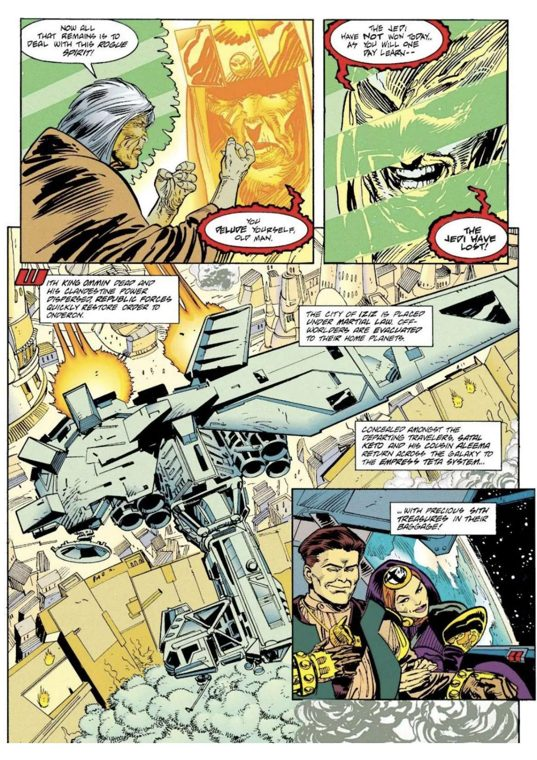
  — Source: Owner Material 024a — Tales of the Jedi: The Freedon Nadd Uprising #1–2 (1994): power-scaling notes.
Our notes: `notes/materials/024-tales-of-the-jedi/freedon-nadd-uprising.md:333`

- Note (summary from our notes, not a quotation): 
  — Source: Owner Material 024a — Tales of the Jedi: The Freedon Nadd Uprising #1–2 (1994): power-scaling notes.
Our notes: `notes/materials/024-tales-of-the-jedi/freedon-nadd-uprising.md:335`

- Note (summary from our notes, not a quotation): Ulic: the dark side that took Arca is "TOO STRONG FOR US" (p17). Nadd's spirit calls itself "POWERLESS IN MY PRESENT STATE" (p13); (ANALYSIS) Ommin is the active threat here.
  — Source: Owner Material 024a — Tales of the Jedi: The Freedon Nadd Uprising #1–2 (1994): power-scaling notes.
Our notes: `notes/materials/024-tales-of-the-jedi/freedon-nadd-uprising.md:338`

> WITH THE LIGHT SIDE OF THE FORCE AS HIS ALLY
> [fragment — full passage not on file]
— Source: Owner Material 024a — Tales of the Jedi: The Freedon Nadd Uprising #1–2 (1994): power-scaling notes.
Note (our notes, around the quote): #2: Ommin's Sith magic drains Ulic, Cay and Tott "FOR MONTHS" (p7), blocks Nomi's battle meditation and strikes her through the Force (p5, p8–9), and holds Arca (p13). But seven Jedi together break him: Ulic "WITH THE LIGHT SIDE OF THE FORCE AS HIS ALLY" smashes through his attack (p17). (ANALYSIS) Ommin < the united Jedi team; Ommin is physically fragile.
Our notes: `notes/materials/024-tales-of-the-jedi/freedon-nadd-uprising.md:339`

- Note (summary from our notes, not a quotation): #2: Nadd's spirit kills Ommin outright (p19). Arca drives the spirit off but does not destroy it (p20). (ANALYSIS) Freedon Nadd's spirit > Ommin; Arca ≥ Nadd's spirit in this encounter only; the spirit's taunt sets up Exar Kun (DLotS).
  — Source: Owner Material 024a — Tales of the Jedi: The Freedon Nadd Uprising #1–2 (1994): power-scaling notes.
Our notes: `notes/materials/024-tales-of-the-jedi/freedon-nadd-uprising.md:340`

- Note (summary from our notes, not a quotation): All 27 pages of #1 and all 22 pages of #2 read (NEW 2026-10-27). The Onderon arc is complete for Freedon Nadd, Ommin, Arca Jeth, Galia and the Jedi team. Thon does not appear in #2.
  — Source: Owner Material 024a — Tales of the Jedi: The Freedon Nadd Uprising #1–2 (1994): power-scaling notes.
Our notes: `notes/materials/024-tales-of-the-jedi/freedon-nadd-uprising.md:343`

- Note (summary from our notes, not a quotation): Quotes: verbatim from the book, with page. The only changes are fixes to obvious OCR errors in the scan ("Area" → Arca, "5ith"/"51th" → Sith, dice notation).
  — Source: Owner Material 024d — Tales of the Jedi Companion (West End Games, 1996): power-scaling notes.
Our notes: `notes/materials/024-tales-of-the-jedi/tales-of-the-jedi-companion.md:11`

- Note (summary from our notes, not a quotation): RPG MECHANICS = weaker source. The d6 stats below are game mechanics that WEG wrote to let players run these characters. They are not statements in the stories. Use them only as a rough *relative* ranking within this book: Arca > Thon in Force dice, Nadd > Arca, Ommin far below either. They do not override what the comics show or say.
  — Source: Owner Material 024d — Tales of the Jedi Companion (West End Games, 1996): power-scaling notes.
Our notes: `notes/materials/024-tales-of-the-jedi/tales-of-the-jedi-companion.md:16`

> Jedi Master Arca Jeth first earned his legendary status as an expert swordsman in the Hyabb-Twith Campaigns,
> [fragment — full passage not on file]
— Source: Owner Material 024d — Tales of the Jedi Companion (West End Games, 1996): power-scaling notes; Narrative bio. POV: Narrative bio, about Arca Jeth.
Note (our notes, around the quote): Narrative bio: "Jedi Master Arca Jeth first earned his legendary status as an expert swordsman in the Hyabb-Twith Campaigns," Source: Tales of the Jedi Companion (WEG, 1996), p.18
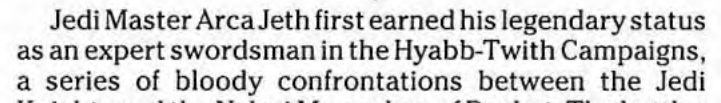
Our notes: `notes/materials/024-tales-of-the-jedi/tales-of-the-jedi-companion.md:42`

> Decades later, Arca became a Jedi Master, specializing in the power of Jedi battle meditation. He set up a training compound on the planet Arkania ... At any given time he had twenty Jedi apprentices in attendance, all potential masters of lightsaber combat, a skill in which Arca himself had a natural affinity.
> [fragment — full passage not on file]
— Source: Owner Material 024d — Tales of the Jedi Companion (West End Games, 1996): power-scaling notes; Narrative bio. POV: Narrative bio, about Arca Jeth.
Note (our notes, around the quote): Narrative bio: "Decades later, Arca became a Jedi Master, specializing in the power of Jedi battle meditation. He set up a training compound on the planet Arkania ... At any given time he had twenty Jedi apprentices in attendance, all potential masters of lightsaber combat, a skill in which Arca himself had a natural affinity." Source: Tales of the Jedi Companion (WEG, 1996), p.20
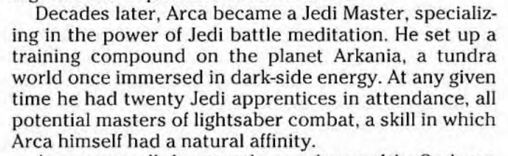
Our notes: `notes/materials/024-tales-of-the-jedi/tales-of-the-jedi-companion.md:44`

> His companions were less than a heartbeat behind, forming a ring of defenders around their fallen friends. The battle did not go well for the Jed!. Slowly their numbers dwindled -though they overcame five foes for every one of their own fallen companions. Area realized then that they had no hope for survival. And as that eventuality settled in his mind, he became aware of the ferocity of his attacks - something had caused him to abandon his training, to shun the Force and rely on his own emotion. Even as he continued to counter his enemies' attacks, he changed his focus, forming an image of victory in his mind and offering it to the Force. And with a swift suddenness, the tide of the battle changed as the light side swept across the battlefield, strengthening the remaining Jedi and weakening the Marauders. The Jedi Knights were victorious, but their success was tempered by the loss of half of their force. Over the ensuing weeks, the Jedi, led by Area Jeth, chased down the remainder of the Marauder forces who were scattered throughout the Corridor-destroying the Nelori sphere of control forever. Decades later, Area became a Jedi Master, specializing in the power of Jedi battle meditation. He set up a training compound on the planet Arkania, a tundra world once immersed in dark-side energy.
— Source: Owner Material 024d — Tales of the Jedi Companion (West End Games, 1996): power-scaling notes; Battle meditation turns a battle (bio narration). POV: Battle meditation turns a battle, about Arca Jeth.
(Excerpt widened 2026-11-17 to the relevant passage, word for word from research primary tales of the jedi WEG40082 (text copy `research_primary_tales_of_the_jedi_WEG40082_pdf_afa57d0500`).)
(Excerpt widened 2026-11-17 to the relevant passage, word for word from research primary tales of the jedi WEG40082 (text copy `research_primary_tales_of_the_jedi_WEG40082_pdf_afa57d0500`).)
(Full sentence/passage taken from the source text on file: `research_primary_tales_of_the_jedi_WEG40082_pdf`.)
Note (our notes, around the quote): Battle meditation turns a battle (bio narration): "forming an image of victory in his mind and offering it to the Force. And with a swift suddenness, the tide of the battle changed as the light side swept across the battlefield, strengthening the remaining Jedi and weakening the Marauders." Source: Tales of the Jedi Companion (WEG, 1996), p.20
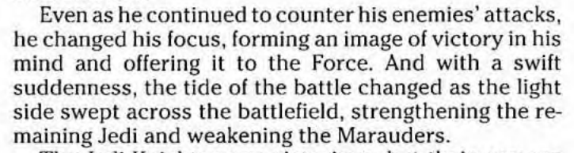
Our notes: `notes/materials/024-tales-of-the-jedi/tales-of-the-jedi-companion.md:48`

> Another Jedi ship suddenly descends toward the bailie site. Master Arca uses his bailie meditation ability to dismiss the darkness, and the tide of confrontation turns again in favor of the beast-riders. The city falls. Arca is not pleased with his students. He admonishes them for not informing him the moment they learned of the presence of the dark side. By instinct alone, Master Arca leads the Jedi and Galia to Freedon Nadd's tomb in the deepest sub-levels of the palace. Arca disrupts the darkness, breaking its hold on Queen Amanoa, who dies as a result. Area then tells his students that Freedon Nadd embraced the dark side and apprenticed himself to a Dark Lord of the Sith. Since there could never be more than one Dark Lord, Nadd murdered his teacher and assumed the title. Upon his death, his tomb became a focus of dark side energy, which Galia's ancestors used through the centuries. In a formal ceremony, the marriage of Oron Kira and Galia is recognized by the Galactic Republic, and the world of Onderon becomes unified for the first time in centuries.
— Source: Owner Material 024d — Tales of the Jedi Companion (West End Games, 1996): power-scaling notes; Beast Wars summary. POV: Beast Wars summary.
(Excerpt widened 2026-11-17 to the relevant passage, word for word from research primary tales of the jedi WEG40082 (text copy `research_primary_tales_of_the_jedi_WEG40082_pdf_afa57d0500`).)
(Excerpt widened 2026-11-17 to the relevant passage, word for word from research primary tales of the jedi WEG40082 (text copy `research_primary_tales_of_the_jedi_WEG40082_pdf_afa57d0500`).)
Note (our notes, around the quote): Beast Wars summary: "Arca disrupts the darkness, breaking its hold on Queen Amanoa, who dies as a result." Source: Tales of the Jedi Companion (WEG, 1996), p.11
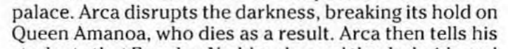
Our notes: `notes/materials/024-tales-of-the-jedi/tales-of-the-jedi-companion.md:50`

> The Jedi Masters would bring their students with them so that the training of new Jedi Knights would not cease. Master Arca Jeth set up his training compound on Arkania, discovering upon his arrival that the planet had become a mining colony. Geologists had found that the planet's core held pure diamonds the size of Ryloth melon-fruits, plus dozens of other types of gems. Within months, Arca and his students had erected rudimentary living quarters and training areas. During that time he had also surveyed the remainder of the planet, searching for the presence of the dark side, no matter how slight. While he sensed no sentient beings with a dark-side nature, he did feel a general aura of Sith magic, though he has still not been able to discover its source. Once he settles events on Onderon - the system of which he is the Jedi watchman - he plans to return to the search. ARKANIA Type: Tundra world Temperature: Cool to frigid (at the poles) Atmosphere: Type J (breathable) Hydrosphere: Moderate Gravity: Standard Terrain: Tundra, canyons Length of Day: 18 standard hours Length of Year: 277 local days Sapient Species: None Starport: Limited service Population: 100 Planet Function: Mining colony, Jedi training center Government: None Tech Level: Stone Major Exports: Precious gems Major Imports: None System: Pcrave Star.
— Source: Owner Material 024d — Tales of the Jedi Companion (West End Games, 1996): power-scaling notes; Arkania site entry. POV: Arkania site entry, about Arca Jeth.
(Excerpt widened 2026-11-17 to the relevant passage, word for word from research primary tales of the jedi WEG40082 (text copy `research_primary_tales_of_the_jedi_WEG40082_pdf_afa57d0500`).)
(Excerpt widened 2026-11-17 to the relevant passage, word for word from research primary tales of the jedi WEG40082 (text copy `research_primary_tales_of_the_jedi_WEG40082_pdf_afa57d0500`).)
(Full sentence/passage taken from the source text on file: `research_primary_tales_of_the_jedi_WEG40082_pdf`.)
Note (our notes, around the quote): Arkania site entry: "While he sensed no sentient beings with a dark-side nature, he did feel a general aura of Sith" magic on the planet. Source: Tales of the Jedi Companion (WEG, 1996), p.131
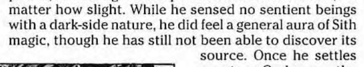
Our notes: `notes/materials/024-tales-of-the-jedi/tales-of-the-jedi-companion.md:52`

> During the confrontation, Master Arca suffers an invisible blow from the dark side.
— Source: Owner Material 024d — Tales of the Jedi Companion (West End Games, 1996): power-scaling notes; Freedon Nadd Uprising summary. POV: Freedon Nadd Uprising summary.
Note (our notes, around the quote): Freedon Nadd Uprising summary: "During the confrontation, Master Arca suffers an invisible blow from the dark side." Source: Tales of the Jedi Companion (WEG, 1996), p.13
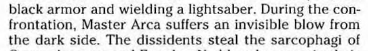
Our notes: `notes/materials/024-tales-of-the-jedi/tales-of-the-jedi-companion.md:56`

> Area realizes that they need help to defeat the Naddists. Galia mentions that her father, King Ommin, knows more about the dark side than her mother. The king has been confined for years to a life-support facility. As Master Area begins to speak with King Ommin, the spirit of Freedon Nadd appears, saying that the king called him back from the chaos. Nadd imparted his knowledge to the old man, who has been practicing Sith magic ever since. AN ERA OF CONFLlCT _U ; _W ~ - - - - ." .' - 13 Suddenly, Ommin leaps up, striking out at Master Arca. It appears that, although Ommin must rely on a mechanical apparatus to support his physical form, his power in the Force remains. Arca falls, enveloped by dark side energy. Warb Null appears, and Ulic strikes out against Ommin's minions. In the meantime, King Ommin steals Arca's body and escapes. Fighting past a wall of dark force, Ulic manages to destroy Warb Null. Galia and Ulic return to the upper levels of the city to find that the Naddists have taken the palace.
— Source: Owner Material 024d — Tales of the Jedi Companion (West End Games, 1996): power-scaling notes; Freedon Nadd Uprising summary, Ommin vs Arca.
(Excerpt widened 2026-11-17 to the relevant passage, word for word from research primary tales of the jedi WEG40082 (text copy `research_primary_tales_of_the_jedi_WEG40082_pdf_afa57d0500`).)
(Excerpt widened 2026-11-17 to the relevant passage, word for word from research primary tales of the jedi WEG40082 (text copy `research_primary_tales_of_the_jedi_WEG40082_pdf_afa57d0500`).)
Note (our notes, around the quote): Freedon Nadd Uprising summary, Ommin vs Arca: "Suddenly, Ommin leaps up, striking out at Master Arca. It appears that, although Ommin must rely on a mechanical apparatus to support his physical form, his power in the Force remains. Arca falls, enveloped by dark side energy." Source: Tales of the Jedi Companion (WEG, 1996), p.14
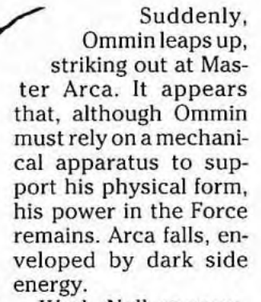
Our notes: `notes/materials/024-tales-of-the-jedi/tales-of-the-jedi-companion.md:58`

- Note (summary from our notes, not a quotation): RPG MECHANICS: Arca Jeth, Jedi Master. Force skills Control 12D+1, Sense 14D+2, Alter 14D. Lightsaber 10D. Dexterity 2D+1, melee combat 7D+2, melee parry 7D+1, dodge 6D. Command 8D+2, willpower 9D, planetary systems 10D+1. Force Points 37, Dark Side Points 1, Character Points 52. Powers include absorb/dissipate energy, force of will, injure/kill, telekinesis, farseeing, projective telepathy, affect mind, battle meditation, control mind, enhanced coordination, Force harmony, lesser Force shield. Source: Tales of the Jedi Companion (WEG, 1996), p.20
  — Source: Tales of the Jedi Companion (WEG, 1996), p.20 — Owner Material 024d — Tales of the Jedi Companion (West End Games, 1996): power-scaling notes.
Our notes: `notes/materials/024-tales-of-the-jedi/tales-of-the-jedi-companion.md:62`

> if King Ommin had 6D in alter, he could lower any one of Master Arca's Force skills
> [fragment — full passage not on file]
— Source: Owner Material 024d — Tales of the Jedi Companion (West End Games, 1996): power-scaling notes; RPG MECHANICS (rules example, not his block): dark side web.
Note (our notes, around the quote): RPG MECHANICS (rules example, not his block): dark side web, "if King Ommin had 6D in alter, he could lower any one of Master Arca's Force skills" by up to that many dice. Source: Tales of the Jedi Companion (WEG, 1996), p.87
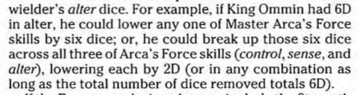
Our notes: `notes/materials/024-tales-of-the-jedi/tales-of-the-jedi-companion.md:63`

> Master Arca uses his bailie meditation ability to dismiss the darkness, and the tide of confrontation turns again in favor of the beast-riders. The city falls. Arca is not pleased with his students. He admonishes them for not informing him the moment they learned of the presence of the dark side. By instinct alone, Master Arca leads the Jedi and Galia to Freedon Nadd's tomb in the deepest sub-levels of the palace. Arca disrupts the darkness, breaking its hold on Queen Amanoa, who dies as a result. Area then tells his students that Freedon Nadd embraced the dark side and apprenticed himself to a Dark Lord of the Sith. Since there could never be more than one Dark Lord, Nadd murdered his teacher and assumed the title. Upon his death, his tomb became a focus of dark side energy, which Galia's ancestors used through the centuries. In a formal ceremony, the marriage of Oron Kira and Galia is recognized by the Galactic Republic, and the world of Onderon becomes unified for the first time in centuries. Master Arca warns his Jedi students that Freedon Nadd still has followers in the city. The struggle against the dark side on Onderon has not yet come to an end.
— Source: Owner Material 024d — Tales of the Jedi Companion (West End Games, 1996): power-scaling notes; Beast Wars summary, Arca tells his students that Nadd.
(Excerpt widened 2026-11-17 to the relevant passage, word for word from research primary tales of the jedi WEG40082 (text copy `research_primary_tales_of_the_jedi_WEG40082_pdf_afa57d0500`).)
(Excerpt widened 2026-11-17 to the relevant passage, word for word from research primary tales of the jedi WEG40082 (text copy `research_primary_tales_of_the_jedi_WEG40082_pdf_afa57d0500`).)
(Full sentence/passage taken from the source text on file: `research_primary_tales_of_the_jedi_WEG40082_pdf`.)
Note (our notes, around the quote): Beast Wars summary, Arca tells his students that Nadd "apprenticed himself to a Dark Lord of the Sith. Since there could never be more than one Dark Lord, Nadd murdered his teacher and assumed the title." Source: Tales of the Jedi Companion (WEG, 1996), p.11
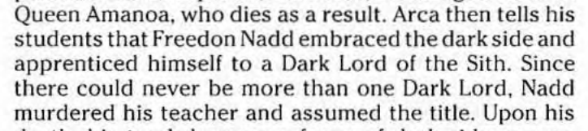
Our notes: `notes/materials/024-tales-of-the-jedi/tales-of-the-jedi-companion.md:93`

> Ulic excelled, learning and mastering the techniques presented by Arca more quickly than any of his fellow apprentices. But his relentless efforts and his sometimes reckless attempts to prove his ability brought concerned words from Cay, Tott, and Arca.
— Source: Owner Material 024d — Tales of the Jedi Companion (West End Games, 1996): power-scaling notes; Narrative bio. POV: Narrative bio, about Arca Jeth.
Note (our notes, around the quote): Narrative bio: "Ulic excelled, learning and mastering the techniques presented by Arca more quickly than any of his fellow apprentices. But his relentless efforts and his sometimes reckless attempts to prove his ability brought concerned words from Cay, Tott, and Arca." Source: Tales of the Jedi Companion (WEG, 1996), p.34
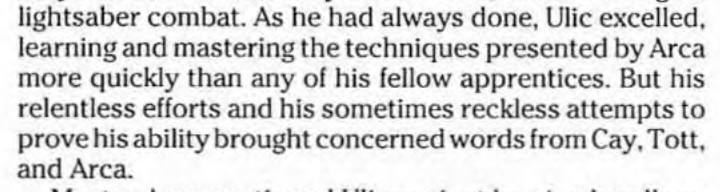
Our notes: `notes/materials/024-tales-of-the-jedi/tales-of-the-jedi-companion.md:112`

- Note (summary from our notes, not a quotation): | Arca Jeth (Jedi Master) | 12D+1 | 14D+2 | 14D | 10D | p.20 |
  — Source: Owner Material 024d — Tales of the Jedi Companion (West End Games, 1996): power-scaling notes.
Context: | Character | Control | Sense | Alter | Lightsaber | Page |
Our notes: `notes/materials/024-tales-of-the-jedi/tales-of-the-jedi-companion.md:337`

- Note (summary from our notes, not a quotation): None missing. Some crowd speakers are UNCLEAR. SW6 p10 Ulic's "FIRST MY MASTER THON" is lettered "THON" [sic]; (ANALYSIS) Arca is meant. "QREL TOQ" (SW4 p13, p21) is a spelling variant of Qrrrl Toq.
  — Source: Owner Material 024c — Tales of the Jedi: The Sith War #1–6 (1995–96): power-scaling notes.
Our notes: `notes/materials/024-tales-of-the-jedi/the-sith-war.md:353`

## Star Wars: The New Essential Chronology (Del Rey, 2005): power-scaling and lore notes

> Arca used Jedi battle meditation to influence the forces on the battlefield and turn the tide of the conflict.
— Source: Part One: Tales of the Ancient Republic; Arca Jeth — Arca's battle meditation.
Note (our notes, around the quote): Arca Jeth — Arca's battle meditation: "Arca used Jedi battle meditation to influence the forces on the battlefield and turn the tide of the conflict." Source: The New Essential Chronology, p.14
Our notes: `notes/materials/027-new-essential-chronology/01-part-one-ancient-republic.md:94`

> The spirit-avatar of Nadd joined forces with Ommin, crippling Master Arca with lightning bolts of energy.
— Source: Part One: Tales of the Ancient Republic.
Note (our notes, around the quote): Freedon Nadd; King Ommin; Arca Jeth — Nadd's spirit and Ommin cripple Arca: "The spirit-avatar of Nadd joined forces with Ommin, crippling Master Arca with lightning bolts of energy." Source: The New Essential Chronology, p.15
Our notes: `notes/materials/027-new-essential-chronology/01-part-one-ancient-republic.md:103`

## The Complete Star Wars Encyclopedia, Vol. I (A–G)

- Note (summary from our notes, not a quotation): Page contents: 1023 words, 47 paragraphs | headings/entries: Arca Company; Arcasite, Mol; Arc Hammer; Arch Canyon; Archimar, Dr.; Architects; Arcona; Arcona Mineral Harvest Corporation; Arda Il; Ardal; Ardan, Lieutenant Commander; Ardax, Colonel; Ardele, Feylis; Ardiff, Captain; Ardie, Captain; Ardos; ARE; ARENA-7580; Argai
  — Source: scan pages 41–80.
Our notes: `notes/materials/030-complete-star-wars-encyclopedia-vol-1/01-v1-scan-041-080.md:120`

## The Complete Star Wars Encyclopedia, Vol. II (H–O)

- Note (summary from our notes, not a quotation): Page contents: 1018 words, 23 paragraphs | headings/entries: Jesa Corporation; Jesart Desert; Jeseej; Jesfa; Jesi; Jess; Jessel; Jestan; Jestefad; Jester; Jeswandi; Jeth, Arca
  — Source: scan pages 161–200.
Our notes: `notes/materials/031-complete-star-wars-encyclopedia-vol-2/04-v2-scan-161-200.md:42`

> He eventually was killed by Jedi Ulic Qel-Droma for instigating the death of Qel- Droma's teacher, Jedi Master Arca Jeth.
— Source: scan pages 201–240.
Note (our notes, around the quote): Satal Keto; Ulic Qel-Droma; Arca Jeth — entry/section: Keto, Satal: "He eventually was killed by Jedi Ulic Qel-Droma for instigating the death of Qel- Droma's teacher, Jedi Master Arca Jeth." Source: The Complete Star Wars Encyclopedia, Vol. II, p.214
Our notes: `notes/materials/031-complete-star-wars-encyclopedia-vol-2/05-v2-scan-201-240.md:203`

> The Nelori Marauders were eventually defeated by Jedi including Arca Jeth and were forced to retreat to their homeworld.
— Source: scan pages 361–400; Arca Jeth. POV: Arca Jeth.
Note (our notes, around the quote): Arca Jeth: "The Nelori Marauders were eventually defeated by Jedi including Arca Jeth and were forced to retreat to their homeworld." Source: The Complete Star Wars Encyclopedia, Vol. II, p.369
Our notes: `notes/materials/031-complete-star-wars-encyclopedia-vol-2/09-v2-scan-361-400.md:128`

> When Jedi Master Arca Jeth appealed to King Ommin for aid in recovering the remains of Freedon Nadd, Ommin and Warb Null attacked, overpowering the Jedi and taking him captive.
— Source: scan pages 361–400.
Note (our notes, around the quote): Warb Null; Arca Jeth; King Ommin; Freedon Nadd — entry/section: Null, Warb: "When Jedi Master Arca Jeth appealed to King Ommin for aid in recovering the remains of Freedon Nadd, Ommin and Warb Null attacked, overpowering the Jedi and taking him captive." Source: The Complete Star Wars Encyclopedia, Vol. II, p.394
Our notes: `notes/materials/031-complete-star-wars-encyclopedia-vol-2/09-v2-scan-361-400.md:327`

## The Complete Star Wars Encyclopedia, Vol. III (P–Z)

> Trained along with his younger brother, Cay, on the mining world of Arkania by Jedi Master Arca Jeth, Ulic Qel-Droma quickly mastered the art of lightsaber dueling.
— Source: scan pages 41–80.
Note (our notes, around the quote): Ulic Qel-Droma; Cay Qel-Droma; Arca Jeth — entry/section: Qel-Droma, Ulic: "Trained along with his younger brother, Cay, on the mining world of Arkania by Jedi Master Arca Jeth, Ulic Qel-Droma quickly mastered the art of lightsaber dueling." Source: The Complete Star Wars Encyclopedia, Vol. III, p.55
Our notes: `notes/materials/032-complete-star-wars-encyclopedia-vol-3/01-v3-scan-041-080.md:154`

> Nomi stayed to train with Arca in the Force mind technique known as Jedi battle meditation, gaining in both physical strength and self-confidence.
— Source: scan pages 201–240; Nomi Sunrider; Arca Jeth — entry/section: Sunrider, Nomi.
Note (our notes, around the quote): Nomi Sunrider; Arca Jeth — entry/section: Sunrider, Nomi: "Nomi stayed to train with Arca in the Force mind technique known as Jedi battle meditation, gaining in both physical strength and self-confidence." Source: The Complete Star Wars Encyclopedia, Vol. III, p.198
Our notes: `notes/materials/032-complete-star-wars-encyclopedia-vol-3/05-v3-scan-201-240.md:45`

## Power of the Jedi Sourcebook (d20, 2002)

> Master Arca traveled to Onderon to defeat Queen Amanoa personally, but he could not end Freedon Nadd's powerful influence.
— Source: Chapter One: History of the Jedi; Arca Jeth; Queen Amanoa; Freedon Nadd.
Note (our notes, around the quote): Arca Jeth; Queen Amanoa; Freedon Nadd: "Master Arca traveled to Onderon to defeat Queen Amanoa personally, but he could not end Freedon Nadd's powerful influence." Source: Power of the Jedi Sourcebook, p.6
Our notes: `notes/materials/033-power-of-the-jedi-sourcebook/01-ch1-history.md:19`

> Dozens of Jedi were killed, including Master Arca Jeth.
— Source: Chapter One: History of the Jedi; Arca Jeth. POV: Arca Jeth.
Note (our notes, around the quote): Arca Jeth: "Dozens of Jedi were killed, including Master Arca Jeth." Source: Power of the Jedi Sourcebook, p.7
Our notes: `notes/materials/033-power-of-the-jedi-sourcebook/01-ch1-history.md:30`

- Note (summary from our notes, not a quotation): Page contents: 729 words, 13 paragraphs | headings/entries: Arca Jeth, Watchman of Onderon
  — Source: Chapter Six: Jedi traditions and famous Jedi.
Our notes: `notes/materials/033-power-of-the-jedi-sourcebook/06-ch6-jedi-traditions.md:28`

> If his scheme succeeded, Ommin would have destroyed Arca's body and raised the former Jedi as a dark side spirit.
— Source: Chapter Six: Jedi traditions and famous Jedi.
Note (our notes, around the quote): Arca Jeth; King Ommin — entry/section: Arca Jeth, Watchman of Onderon: "If his scheme succeeded, Ommin would have destroyed Arca's body and raised the former Jedi as a dark side spirit." Source: Power of the Jedi Sourcebook, p.100
Our notes: `notes/materials/033-power-of-the-jedi-sourcebook/06-ch6-jedi-traditions.md:30`

> Among the casualties was Arca Jeth, who was killed after saving Ulic's life.
— Source: Chapter Six: Jedi traditions and famous Jedi; Ulic Qel-Droma; Arca Jeth — entry/section: Ulic Qel-Droma.
Note (our notes, around the quote): Ulic Qel-Droma; Arca Jeth — entry/section: Ulic Qel-Droma,: "Among the casualties was Arca Jeth, who was killed after saving Ulic's life." Source: Power of the Jedi Sourcebook, p.103
Our notes: `notes/materials/033-power-of-the-jedi-sourcebook/06-ch6-jedi-traditions.md:65`

## Dark Side Sourcebook (d20, 2001)

> His corruption tainted his new wife, Amanoa, who became a powerful Sith sorceress in her own right. Ommin looked forward to the day when they could indoctrinate their daughter Galia into the ways of the Sith as well. But before Ommin could realize his dream, Jedi Knights came to Onderon to settle a dispute between the Onderonians and the barbaric beastriding warriors who lived in Onderon's wilderness. Investigating, the Jedi learned that the beast-riders were fighting for their survival against the tyranny of Queen Amanoa, and aided them against her. After a fierce battle, the Jedi confronted Amanoa, who called upon the spirit of Freedon Nadd for aid-only to be defeated by the light side power of the Jedi Master Arca Jeth. Nadd's spirit was driven off, and Amanoa was killed. King Ommin joined her in death only a short time later, after his loyalists attempted to steal the sarcophagi of Amanoa and Freedon Nadd and to depose Galia and her husband, Oron Kira. Though Ommin overcame Master Area with his dark side power, he himself was beaten when the Jedi Ulic Qel-Droma severed the connection to his support exoskeleton, leaving King Ommin barely able to speak or move, let alone draw upon the power of the dark side.
— Source: Chapter Five: Dark Side Traditions (Sith Empire, Set Harth, prophets, Brakiss…); Queen Amanoa; Freedon Nadd; Arca Jeth.
(Excerpt widened 2026-11-17 to the relevant passage, word for word from research primary dark side sourcebook dss (text copy `research_primary_dark_side_sourcebook_dss_pdf_9cd3453f4a`).)
(Excerpt widened 2026-11-17 to the relevant passage, word for word from research primary dark side sourcebook dss (text copy `research_primary_dark_side_sourcebook_dss_pdf_9cd3453f4a`).)
Note (our notes, around the quote): Queen Amanoa; Freedon Nadd; Arca Jeth: "After a fierce battle, the Jedi confronted Amanoa, who called upon the spirit of Freedon Nadd for aid-only to be defeated by the light side power of the Jedi Master Arca Jeth." Source: Dark Side Sourcebook, p.74
Our notes: `notes/materials/035-dark-side-sourcebook/05-ch5-traditions.md:47`

> The beginning of the answer came when a dark side sect led by Satal and Aleema Keto, heirs to the throne of Cinnagar in the Empress Teta system, seized control of the entire system. The Tetans suffered under the pair's cruel dark side rule. The Republic finally intervened, sending a small group of Jedi led by Ulic Qel-Droma to deal with the crisis. During the space battle Ulic was injured, and the wound-inflicted by a twisted shred of alchemically altered metal refused to heal. When the Jedi Order onvened on the world of Deneba to discuss a solution to the problem of the dark side sect, Satal and Aleema sent a battle force of warships arid droids to attack them. During the fight Arca Jeth was killed, and the loss of his master gave Ulic all the incentive he needed to carry out plan to infiltrate the sect and destroy it from within. Ulic journeyed to the Empress Teta system, where he presented plan to infiltrate the sect and destroy it from within. Ulic journeyed to the Empress Teta system, where he presented himself to Satal and Aleema, who promptly imprisoned him. Though Ulic explained that he had come to join them, Satal did not trust the Jedi.
— Source: Chapter Five: Dark Side Traditions (Sith Empire, Set Harth, prophets, Brakiss…); Arca Jeth; Ulic Qel-Droma.
(Excerpt widened 2026-11-17 to the relevant passage, word for word from research primary dark side sourcebook dss (text copy `research_primary_dark_side_sourcebook_dss_pdf_9cd3453f4a`).)
(Excerpt widened 2026-11-17 to the relevant passage, word for word from research primary dark side sourcebook dss (text copy `research_primary_dark_side_sourcebook_dss_pdf_9cd3453f4a`).)
Note (our notes, around the quote): Arca Jeth; Ulic Qel-Droma: "During the fight Arca Jeth was killed, and the loss of his master gave Ulic all the incentive he needed to carry out plan to infiltrate the sect and destroy it from within." Source: Dark Side Sourcebook, p.76
Our notes: `notes/materials/035-dark-side-sourcebook/05-ch5-traditions.md:77`

## Sourcebooks/Galaxy at War.pdf [Star Wars Roleplaying Game Saga Edition (2007)] (scan pages 121–180)

- Note (summary from our notes, not a quotation): Page contents: Beast Riders methods (armored drexls; Carvers carried on drexl backs for close combat), missions (annihilation of Iziz's monarchy; kidnap raids; elite advance force vs Mandalorian Basilisk riders after the Great Sith War), rank structure (initiates, Warriors, Berserkers; Conquerors and Warlords; Beast Lord holds the title only by fending off challengers in sky combat). Pull quote from Jedi Master Arca Jeth (verbatim from page image). (hand-read)
  — Source: Sourcebooks/Galaxy at War.pdf [Star Wars Roleplaying Game Saga Edition (2.
Our notes: `notes/materials/037-sw-d20-folder/715-galaxy-at-war-scan-121-180.md:52`

> What followed now seems almost inevitable—the Onderonian outcasts learned to survive in the wilds, and even to subdue the beasts and conquer them. Onderon became a divided world, one that rapidly degenerated to a state of permanent war.
— Source: Sourcebooks/Galaxy at War.pdf [Star Wars Roleplaying Game Saga Edition (2; Arca Jeth — entry/section: Pull quote: Arca Jeth on Onderon.
Note (our notes, around the quote): Arca Jeth — entry/section: Pull quote: Arca Jeth on Onderon: ""What followed now seems almost inevitable—the Onderonian outcasts learned to survive in the wilds, and even to subdue the beasts and conquer them. Onderon became a divided world, one that rapidly degenerated to a state of permanent war." —Jedi Master Arca Jeth" Source: *Galaxy at War* (SWRPG Saga Edition), scan p.126
Our notes: `notes/materials/037-sw-d20-folder/715-galaxy-at-war-scan-121-180.md:54`

## Sourcebooks/Knights of the Old Rebuplic Campaign Guide.pdf [Star Wars Roleplaying Game Saga Edition (2007)] (scan pages 61–120)

- Note (summary from our notes, not a quotation): Page contents: Arkania (Adascopolis; Arkanian offshoots; Jedi academy established by Master Arca Jeth; Quermians); Belnar (Khil homeworld). (hand-read)
  — Source: Sourcebooks/Knights of the Old Rebuplic Campaign Guide.pdf [Star Wars Rol.
Our notes: `notes/materials/037-sw-d20-folder/718-knights-of-the-old-rebuplic-campaign-guide-scan-061-120.md:397`

> THE ONLY THING MORE DANGEROUS THAN A FOOLISH ARKANIAN IS A SMART ONE.
— Source: Sourcebooks/Knights of the Old Rebuplic Campaign Guide.pdf [Star Wars Rol; Arca Jeth — entry/section: Pull quote. POV: speaker not named in our notes.
Note (our notes, around the quote): Arca Jeth — entry/section: Pull quote: ""THE ONLY THING MORE DANGEROUS THAN A FOOLISH ARKANIAN IS A SMART ONE." —MASTER ARCA JETH" Source: *Knights of the Old Rebuplic Campaign Guide* (SWRPG Saga Edition), scan p.117
Our notes: `notes/materials/037-sw-d20-folder/718-knights-of-the-old-rebuplic-campaign-guide-scan-061-120.md:399`

## Sourcebooks/Knights of the Old Rebuplic Campaign Guide.pdf [Star Wars Roleplaying Game Saga Edition (2007)] (scan pages 121–180)

> But when Arca falls fighting the Krath, Ulic infiltrates the cult, seeking revenge by learning the Krath's dark-side secrets and using them to try and destroy the organization.
— Source: Sourcebooks/Knights of the Old Rebuplic Campaign Guide.pdf [Star Wars Rol; Arca Jeth; Ulic Qel-Droma. POV: Ulic Qel-Droma; about Arca Jeth.
Note (our notes, around the quote): Arca Jeth; Ulic Qel-Droma: "But when Arca falls fighting the Krath, Ulic infiltrates the cult, seeking revenge by learning the Krath's dark-side secrets and using them to try and destroy the organization." Source: *Knights of the Old Rebuplic Campaign Guide* (SWRPG Saga Edition), scan p.135
Our notes: `notes/materials/037-sw-d20-folder/718-knights-of-the-old-rebuplic-campaign-guide-scan-121-180.md:109`

## Star Wars Insider #26 (1995)

- Note (summary from our notes, not a quotation): Page contents: Tales of the Jedi guide continued (printed p. 13): Andur through Dominis entries (Arca, Bogga, Cay, Crado, Cron system, Denarii Nova, etc.); "to be continued". (hand-read)
  — Source: Star Wars Insider #26 (1995).
Our notes: `notes/materials/038-star-wars-insider/026-ins026.md:87`

## Star Wars Insider #27 (1995)

> Skilled users of dis technique include Master Arca aml Nomi Sunrider.
— Source: Star Wars Insider #27 (1995).
Note (our notes, around the quote): Arca Jeth; Nomi Sunrider — entry/section: Star Wars Insider 027 (1995): "Skilled users of dis technique include Master Arca aml Nomi Sunrider." Source: *Star Wars Insider #27* (1995), scan p.59
Our notes: `notes/materials/038-star-wars-insider/027-ins027.md:330`

## Star Wars Insider #28 (1996)

> He was killed by Ulic Qel-Droma for instigating the death of Master Arca.
— Source: Star Wars Insider #28 (1996).
Note (our notes, around the quote): Ulic Qel-Droma; Arca Jeth — entry/section: Star Wars Insider 028 (1996): "He was killed by Ulic Qel-Droma for instigating the death of Master Arca." Source: *Star Wars Insider #28* (1996), scan p.57
Our notes: `notes/materials/038-star-wars-insider/028-ins028.md:292`

## Star Wars Insider #81 (2005)

- Note (summary from our notes, not a quotation): Page contents: Fiction: "Omega Squad: Targets" by Karen Traviss, illustrations by Robert Hendrickson; opens at Special Operations HQ, Coruscant, Arca Company Barracks, Fi and Atin testing upgraded armor against a Verpine shatter gun. (hand-read)
  — Source: Star Wars Insider #81 (2005).
Our notes: `notes/materials/038-star-wars-insider/081-ins081.md:420`

## Prima *Star Wars Knights of the Old Republic II: The Sith Lords* Official Game Guide (2004)

- Note (summary from our notes, not a quotation): Sylvar, Thon, Nomi and Andur, Aleema Keto and Arca Jeth also appear in robe notes (p. 244). Ulic Qel-Droma is mentioned in robe and armor notes (pp. 244, 246).
  — Source: Prima *KOTOR II* guide, part 5: Appendices I–XII and "Paths of Destiny" (PDF pp. 213–304).
Context: Old Republic deep lore in the item notes:
Our notes: `notes/materials/058-prima-kotor2/kt-05.md:16`

## Star Wars: The Old Republic: Deceived (novel), feats and scaling notes

- Note (summary from our notes, not a quotation): Coruscant. The Jedi Temple has four towers (L465). Statues of Odan-Urr, Ooroo, and Arca Jeth line the processional (L471). The Senate Building with the Chancellor's office is described at L2029–L2053.
  — Source: L465; L471 — Star Wars: The Old Republic: Deceived (novel), feats and scaling notes.
Our notes: `external/mega-notes/deceived-novel-feats.md:750`

- Note (summary from our notes, not a quotation): The Jedi statues name earlier figures: Odan-Urr, Ooroo, and Arca Jeth (L471).
  — Source: L471 — Star Wars: The Old Republic: Deceived (novel), feats and scaling notes.
Our notes: `external/mega-notes/deceived-novel-feats.md:803`

## https://starwars.fandom.com/wiki/Freedon_Nadd/Legends ; https://starwars.fandom.com/wiki/Freedon_Nadd

- Note (summary from our notes, not a quotation): When summoned from Chaos, his spirit assisted the Naddists during the conflict on Onderon and participated in capturing Arca Jeth. During the later assault, Nadd withdrew support from Ommin when Ommin proved no match for the Jedi, then personally terminated the dying king. Arca Jeth called on the light and drove Nadd’s spirit away, cleansing Onderon. [12][15][18]
  — Source: FREEDON NADD — Wookieepedia extraction (Legends) — https://starwars.fandom.com/wiki/Freedon_Nadd/Legends ; https://starwars.fandom.com/wiki/Freedon_Nadd.
Our notes: `external/mega-notes/freedon-nadd-quotes.txt:32`

- Note (summary from our notes, not a quotation): His tomb and sarcophagus radiated dark-side energy strongly enough that nearby Force-sensitives were affected: darksiders were empowered, while lightsiders felt stifled as if smothered. Arca Jeth’s power drove that influence from Iziz, at least temporarily. [12]
  — Source: FREEDON NADD — Wookieepedia extraction (Legends) — https://starwars.fandom.com/wiki/Freedon_Nadd/Legends ; https://starwars.fandom.com/wiki/Freedon_Nadd.
Our notes: `external/mega-notes/freedon-nadd-quotes.txt:53`

- Note (summary from our notes, not a quotation): Nadd could not completely stop the Beast Riders on Onderon, and Arca Jeth drove his dark-side influence from Iziz. [3][12]
  — Source: FREEDON NADD — Wookieepedia extraction (Legends) — https://starwars.fandom.com/wiki/Freedon_Nadd/Legends ; https://starwars.fandom.com/wiki/Freedon_Nadd.
Our notes: `external/mega-notes/freedon-nadd-quotes.txt:60`

- Note (summary from our notes, not a quotation): Arca Jeth’s quoted statement says Nadd’s power passed from generation to generation through his tomb. [12]
  — Source: FREEDON NADD — Wookieepedia extraction (Legends) — https://starwars.fandom.com/wiki/Freedon_Nadd/Legends ; https://starwars.fandom.com/wiki/Freedon_Nadd.
Our notes: `external/mega-notes/freedon-nadd-quotes.txt:66`

## https://starwars.fandom.com/wiki/Ulic_Qel-Droma/Legends

- Note (summary from our notes, not a quotation): In a chasm on Rhen Var, the spirit of Arca Jeth told him that although he might lack power in the Force, he still had inner strength. Qel-Droma then summoned enough strength to dig himself out [36]. This is an inner-strength feat, not a Force-use feat.
  — Source: Tales of the Jedi – Redemption 2 [per Wookieepedia "Ulic Qel-Droma/Legends" rev 15671614, ref 36; approximate match 0.61, verify; agrees with the entry's own ref marker]; per Wookieepedia "Ulic Qel-Droma/Legends" rev 15671614, ref 36; approximate match 0.61, verify; agrees with the entry's own ref marker — Ulic Qel-Droma research extraction — https://starwars.fandom.com/wiki/Ulic_Qel-Droma/Legends.
(Source: Tales of the Jedi – Redemption 2 [per Wookieepedia "Ulic Qel-Droma/Legends" rev 15671614, ref 36; approximate match 0.61, verify; agrees with the entry's own ref marker])
Our notes: `external/mega-notes/ulic-qel-droma-quotes.txt:91`

## Legends Feats & Quotes (Star Wars Legends / EU)

- Note (summary from our notes, not a quotation): TOTJ: counters Queen Amanoa's dark-side domination of the Beast Lord army at Iziz (per xolthol) (debate #68)
  — Source: (debate #68) — Legends Feats & Quotes (Star Wars Legends / EU).
Our notes: `legends-feats.md:540`

## Essential Guide to Characters (1995)

> It has happened more than once,
> [fragment — full passage not on file]
>
> Pray that it never happens to you.
— Source: The Essential Guide to Characters (Andy Mangels, Del Rey, 1995), printed p.128, scan p.137. The 1995 guide's telling, not a power feat..
Note (our notes, around the quote): Investigating the source of the dark-side power, Arca and his students found the crypt of Freedon Nadd. Opening it killed Queen Amanoa, but freed Galia of her own dark-side destiny. She and Oron were married soon after, and their union brought peace to the planet for the first time in centuries. Afterward, as Cay tinkered with his new robotic arm, Ulic questioned Arca. How could Freedon Nadd, a Jedi, have fallen to the dark side? "It has happened more than once," his Master warned. "Pray that it never happens to you."
Our notes: `notes/materials/147-essential-guide-to-characters-1995/egc-mon-mothma-through-sivrak.md`
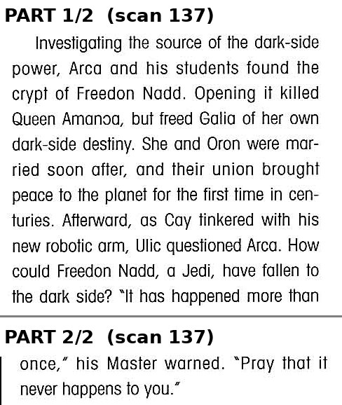

## Essential Guide to Planets and Moons (1998)

> The enemy has found me, Ulic,
> [fragment — full passage not on file]
>
> but the enemy knows only darkness. I know the light.
> [fragment — full passage not on file]
— Source: The Essential Guide to Planets and Moons (Daniel Wallace, Del Rey, 1998), printed p.27, scan p.041.
Note (our notes, around the quote): "The enemy has found me, Ulic," he told his finest disciple, "but the enemy knows only darkness. I know the light." With those words, the greatest Arkanian Jedi became one with the Force.
Our notes: `notes/materials/150-essential-guide-to-planets-and-moons-1998/egpm-arkania-through-atzerri.md`
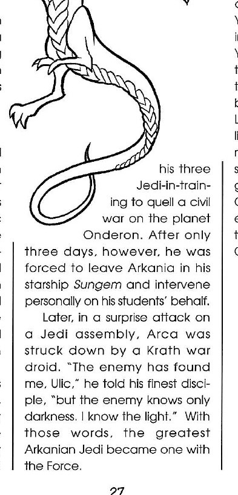

# Debate and forum claims (unverified)

Forum posts, Suspect Insight debates and Discord debates, respect threads, and verdicts. These are posters' arguments or quotations they typed; none is checked against the book here unless the entry says so.

## TFNU Ulic Qel-Droma (Vaelias) vs Jax Pavan (Proto Dan)

> "Dark Side energy, the strongest I've ever felt."
— Source: TFNU Ulic Qel-Droma (Vaelias) vs Jax Pavan (Proto Dan) — https://www.suspectinsightforums.com/t4372-stomper-showdown-r2-5-tfnu-ulic-qel-droma-vaelias-vs-jax-pavan-proto-dan.
Context: Q19 — Source: Arca Jeth, Tales of the Jedi Audio Drama
Posted by: not named in our notes (see thread/notes link).
Our notes: `suspect-insight/debates/019-tfnu-ulic-qel-droma-vs-jax-pavan.md:112`; `suspect-insight/debates/029-fnu-ulic-qel-droma-vs-tuf-jacen-solo.md:133`; `suspect-insight/debates/059-darth-caedus-vs-exar-kun.md:324`

## FNU Ulic Qel-Droma (Vaelias) vs TUF Jacen Solo (RNGesus)

> **-NJO Sourcebook**
> [fragment — full passage not on file]
— Source: FNU Ulic Qel-Droma (Vaelias) vs TUF Jacen Solo (RNGesus) — https://www.suspectinsightforums.com/t4394-stomper-showdown-r4-1-freedon-nadd-uprising-ulic-qel-droma-vaelias-vs-tuf-jacen-solo-rngesus4.
Context: Q96 — Source: [source not stated adjacent] (preceding line: "Let's look at some stats. As we see here, Balance Point Jacen is solidly below Ulic. These stats portray Ulic shortly after Arca's death. This Ulic would be greater than or equal to Uprising Ulic.")
Posted by: not named in our notes (see thread/notes link).
> [IMG: https://cdn.discordapp.com/attachments/812996714901798922/877074908201488404/unknown.png]
Our notes: `suspect-insight/debates/029-fnu-ulic-qel-droma-vs-tuf-jacen-solo.md:659`

## Thon (Darthor) vs Yarael Poof (XanNotZan)

> And was noted alongside them as "some of the greatest practitioners" of the technique:
— Source: Thon (Darthor) vs Yarael Poof (XanNotZan) — https://www.suspectinsightforums.com/t4518-ss-arena-of-the-unknowns-thon-darthor-vs-yarael-poof-xannotzan.
(Full sentence/passage taken from the source text on file: `research_suspect_insight_raw_threads_051_txt`.)
Note (our notes, around the quote): Thon "excel[s]" at battle meditation and is listed with Nomi and Arca as "some of the greatest practitioners". Odan-Urr also notes him. He taught Nomi.
Posted by: not named in our notes (see thread/notes link).
Context: Poof's style is illusions and mind tricks. These won't work:
Our notes: `suspect-insight/debates/051-thon-vs-yarael-poof.md:32`

## Darth Caedus (DC77) vs Exar Kun (AncientPower)

- Note (summary from our notes, not a quotation): Ommin overpowered Arca Jeth.
  — Source: Darth Caedus (DC77) vs Exar Kun (AncientPower) — https://www.suspectinsightforums.com/t568-ss-darth-caedus-dc77-vs-exar-kun-ladykulvax.
Posted by: not named in our notes (see thread/notes link).
Context: Nomi Sunrider chain:
Our notes: `suspect-insight/debates/059-darth-caedus-vs-exar-kun.md:25`

- Note (summary from our notes, not a quotation): Arca overcame the taint of Nadd's sarcophagus. The tomb still drew Nihilus 50 years later (KOTOR II quotes).
  — Source: Darth Caedus (DC77) vs Exar Kun (AncientPower) — https://www.suspectinsightforums.com/t568-ss-darth-caedus-dc77-vs-exar-kun-ladykulvax.
Posted by: not named in our notes (see thread/notes link).
Context: Nomi Sunrider chain:
Our notes: `suspect-insight/debates/059-darth-caedus-vs-exar-kun.md:26`

## Darth Sidious (The Ellimist) vs Valkorion (Valkorion)

> …novel Revan who is above KotOR Revan who is much above SF Malak who is much above Exar Kun who is far, far, far beyond early-TotJ Exar Kun who is far, far beyond Ommin who is far far beyond Arca Jeth who is far far far beyond Queen Amanoa who can TP dominate thousands of beast riders
> [fragment — full passage not on file]
— Source: Darth Sidious (The Ellimist) vs Valkorion (Valkorion) — https://www.suspectinsightforums.com/t711-ss-darth-sidious-the-ellimist-vs-valkorion-valkorion.
Posted by: not named in our notes (see thread/notes link).
Context: TOR chains (verbatim excerpts):
Our notes: `suspect-insight/debates/062-darth-sidious-vs-valkorion.md:29`

## Meetra Surik (IdrisianGraecus) vs Nomi Sunrider (Xolthol)

- Note (summary from our notes, not a quotation): King Ommin stuns Arca with dark magic. Ulic later beats Ommin.
  — Source: Meetra Surik (IdrisianGraecus) vs Nomi Sunrider (Xolthol) — https://www.suspectinsightforums.com/t1421-ss-meetra-surik-ig-vs-nomi-sunrider-xolthol.
Posted by: not named in our notes (see thread/notes link).
Context: P34, Onderon:
Our notes: `suspect-insight/debates/068-meetra-surik-vs-nomi-sunrider.md:39`

> Xolthol
> [fragment — full passage not on file]
>
> Ulic Qel-Droma, willing to defeat the sith, decided to infiltrate them by going into the Krath system where the Keto's cousin where leading thanks to their dark power. During the time here, Ulic after being captured have been realeased by Aleema Keto (who fell in love with him) in order to defeat her cousin Satal Keto.
>
> Following the defeat of Satal, Aleema and Ulic become used to trained against each other but it clearly seems that Aleema had the upper hand and by a pretty good margin [10] [LINK: https://comicvine1.cbsistatic.com/uploads/scale_super/11132/111323216/6841777-aleemapower.jpg] .
>
> But this same Aleema Keto, while in a meditation chamber (IE: insanely amp), was literraly trashed by Nomi Sunrider during a mind fight [11] [LINK: https://2.bp.blogspot.com/BtarzVxluoCcufFfhNOt1YwdlK-8FfFW7LwoWckBq6LhkBiFE84cYteQTgjyVkXqqhfIMdLd-JJq=s1600] [12] [LINK: https://2.bp.blogspot.com/VvJ088C4YsDy1thE3jQlRwqsP3kqWZUaw07-olS0VPbsCpzM8Qc4fgLt3wPLbivBarh4XX26Gd0u=s1600] . As you can see, Nomi Sunrider scaled insanely above Aleema Keto
> [fragment — full passage not on file]
— Source: Meetra Surik (IdrisianGraecus) vs Nomi Sunrider (Xolthol) — https://www.suspectinsightforums.com/t1421-ss-meetra-surik-ig-vs-nomi-sunrider-xolthol.
Context: Q26 — Source: [source not stated adjacent] (preceding line: "r foes, she’s just sowing disorder in their ranks, which makes this feet less impressive. And while Arca, yes is able to defeat Amanoa, she’s not dominating anybody, just, you know, sowing disorder. Also, the text says “Hundreds of beast lord”, citat")
Posted by: not named in our notes (see thread/notes link).
Our notes: `suspect-insight/debates/068-meetra-surik-vs-nomi-sunrider.md:238`

> Xolthol
> [fragment — full passage not on file]
>
> Well, lets sum-up this scaling chain we have that:
> [fragment — full passage not on file]
>
> Prime Nomi > Nomi >>> Amp!Aleema >> Aleema >> Ulic > King Ommin >>>Arca Jeth >>>Queen Amanoa > Mind dominating hundreds of thousands of beast and their riders, up to the poin that they cannot fight.
>
> This is an insanely good showing for Nomi, putting her leagues above anything that Meetra Surik have.
— Source: Meetra Surik (IdrisianGraecus) vs Nomi Sunrider (Xolthol) — https://www.suspectinsightforums.com/t1421-ss-meetra-surik-ig-vs-nomi-sunrider-xolthol.
Context: Q27 — Source: [source not stated adjacent] (preceding line: "n a  TP battle? Good job. So your entire point is saying TP victories scale you above somebody? Well that’s ludicrous. We’d have a lot of really weird scaling chains if that were the case. Furthermore, nothing says that Nomi stomped Aleema, moreso ju")
Posted by: not named in our notes (see thread/notes link).
Our notes: `suspect-insight/debates/068-meetra-surik-vs-nomi-sunrider.md:246`; `suspect-insight/debates/068-meetra-surik-vs-nomi-sunrider.md:42`

> Latest addition to the (in)famous MMORPG Star Wars The Old Republic, the planet Oderon have an ancient history of fights between two powerful factions. In Tales of the Jedi (TotJ) you can read the confrontation between the Beast Lords and the forces of Queen Amanoa.
>
> The Beast have decided to attack Iziz, capital city of Oderon and have gathered an insanely powerful army [1] [LINK: https://2.bp.blogspot.com/DpWga_URGt6SOAllOdtzDWSBo-aEHa2GL0rf1T9fD8Wy-J6dGNJNR6-f61CEXsrbuydE5cvCIfkg=s1600], we are talking about hundred of Beast Lords with tons of fighter each, this is a really powerful army.
>
> Then, understanding that she will loose the battle, Queen Amanoa, decided to use the dark side to a massive scaled in order to defeat the army attacking her capital. She changes the tide of the battle in an impressive manners [2] [LINK: https://2.bp.blogspot.com/feVJS_AP2AdRxEqBWobBUib7uWBq7HCUPgB2jJb1F5RNxXOE0IfqLe2GawrGLDMPFd4lo7e2Y_S7=s1600]. As you can see, she is able to control the beast that are used by her ennemies, to made the soldiers sick and phased,...  This is clearly an impressive feat.
> [fragment — full passage not on file]
>
> But this feat is clearly surpassed by the action of Master Arca Jeth, who when arriving abve the Battlefield was able to counter the effect of the Dark Side and give the Beast Lords troops the victory [3] [LINK: https://2.bp.blogspot.com/2qByaHjglm2iLxlC2j6fFKq_vJcw4URLhKgCs6Og6y6_UT9RUDq9LBpaFv1pfHr2yJhBd22zD9_E=s1600] [4] [LINK: https://2.bp.blogspot.com/cw_LQpNdSrFHltnA1lqYJvqrS4tTUNnXlrzTqOgFJs5cux9NPPCHzDv2dqhSIpIyqoU4XaKFvOBj=s1600]. And even more impressive, on the very heart of the palace, he was even able to clean the dark power that was here [5] [LINK: https://2.bp.blogspot.com/hG0j2Q0Q2ARIE-_mzsfZYPWJGkk7GWBjwCpAiPZiSEZoLhpcHE6iSNG938AEe96bhXe4iJaVWFVO=s1600], showing an absolute superiority over Queen Amanoa powers. And take into account that all of this was done on a really powerful DS nexus that still subsisted after the death of Queen Amanoa[*****].
>
> At the end of the day we have: **Master Arca Jeth >>> Queen Amanoa > Mind dominating hundred of thousands of beasts and their riders**.
>
> [*****] "[the city] is still permeated with it [the dark side of the force]" "Did you feel it?The Darkness... had amazing strenght"
> [fragment — full passage not on file]
— Source: Meetra Surik (IdrisianGraecus) vs Nomi Sunrider (Xolthol) — https://www.suspectinsightforums.com/t1421-ss-meetra-surik-ig-vs-nomi-sunrider-xolthol.
Context: I2 — Source line: ~Freedon Nadd Uprising~
Posted by: not named in our notes (see thread/notes link).
Our notes: `suspect-insight/debates/068-meetra-surik-vs-nomi-sunrider.md:348`; `suspect-insight/debates/068-meetra-surik-vs-nomi-sunrider.md:226`; `suspect-insight/debates/068-meetra-surik-vs-nomi-sunrider.md:38`

> After this fierce battle, the war on Oderon have come to an end but not the fight against the Dark Side. Indeed, in the husband of Queen Amanoa, King Ommin is still alive and also use the dark side of the force, trained by no one else than Freedon Nadd.
>
> And his power allow him to defeat easily master Arca Jeth, putting him under a dark side magic that completely stun him [6] [LINK: https://2.bp.blogspot.com/QS5b3zLQpPUMwbp1GuIL0CW3nRbHULV1CNpVKjWVL7ISiVGL5ZXyi5M4YViqjVMB49omtbI1efx3=s1600]. This is clearly an overwhelming victory for the king that just stomp the jedi master. And Ommin is able to keep Arca Jeth under his control with the Dark Side for an extended period of time [7] [LINK: https://2.bp.blogspot.com/BDdEmJWFqILOi788LxE9rasX-nEVnLIAwMAtSZrRi9t3WN3I6CEDl8BtPmcJdBftxBN1s-OU4kCM=s1600].
>
> Despite his impressive display of power, when the final confrontation with Ulic Qel-Droma, even though the start of the fight gives him an early upper hand [8] [LINK: https://2.bp.blogspot.com/vj8LELzU8CxyOzohs8MdtOiihnLFHP0bxvty3SMGV5Hgvz2ucO7Sewqv74O37atf234MsDQsmvys=s1600], the jedi knight and futur sith lord, Ulic Qel-Droma is able to bypass this attack and to defeat the dark king [9] [LINK: https://2.bp.blogspot.com/73vL_olumfsclTU9IaAKZqaoH9Z9DS05ibbYuwKspLw156dXk6LfP5_oPTTphNShTF5I8DJ5aOWq=s1600], showing his impressive force power.
>
> As a result we have that **Ulic > King Ommin >>> Arca Jeth**.
— Source: Meetra Surik (IdrisianGraecus) vs Nomi Sunrider (Xolthol) — https://www.suspectinsightforums.com/t1421-ss-meetra-surik-ig-vs-nomi-sunrider-xolthol.
Context: I3 — Source line: ~Dark Lord of the Sith~
Posted by: not named in our notes (see thread/notes link).
Our notes: `suspect-insight/debates/068-meetra-surik-vs-nomi-sunrider.md:356`

> **Prime Nomi > Nomi >>> Amp!Aleema >> Aleema >> Ulic > King Ommin >>>Arca Jeth >>>Queen Amanoa > Mind dominating hundreds of thousands of beast and their riders, up to the poin that they cannot fight.**
> [fragment — full passage not on file]
>
> This is an insanely good showing for Nomi, putting her leagues above anything that Meetra Surik have.
>
> *CLEANING THE MESS AROUND MEETRA*
> [fragment — full passage not on file]
>
> Speaking of the devil, lets correct what my opponent say about Surik.
— Source: Meetra Surik (IdrisianGraecus) vs Nomi Sunrider (Xolthol) — https://www.suspectinsightforums.com/t1421-ss-meetra-surik-ig-vs-nomi-sunrider-xolthol.
Context: I5 — Source line: ~Irrelevant accolades~
Posted by: not named in our notes (see thread/notes link).
Our notes: `suspect-insight/debates/068-meetra-surik-vs-nomi-sunrider.md:367`

## Luminara Unduli (MasterCilghal) vs Warb Null (Cheth)

> awesome proficiency with the lightsaber
> [fragment — full passage not on file]
— Source: Luminara Unduli (MasterCilghal) vs Warb Null (Cheth) — https://www.suspectinsightforums.com/t4384-ss-luminara-unduli-cilghal-vs-warb-null-cheth; Ulic was no neophyte: he had.
Note (our notes, around the quote): Ulic was no neophyte: he had "awesome proficiency with the lightsaber", had "perfected" his saber skills, and was more focused because Arca was in danger. Luminara lost to Ventress, whom she called an amateur.
Posted by: not named in our notes (see thread/notes link).
Our notes: `suspect-insight/debates/090-luminara-unduli-vs-warb-null.md:36`

## Darth Caedus (HelloThere) vs Kyle Katarn and Mara Jade (Fated Xtasy)

> The battle was turned by the timely arrival of Arca Jeth, who used Jedi Battle Meditation to turn the tide of the conflict, boosting the Beast Warriors' morale and letting them defeat the better-armed forces of Iziz.
— Source: Darth Caedus (HelloThere) vs Kyle Katarn and Mara Jade (Fated Xtasy) — https://www.suspectinsightforums.com/t4441-darth-caedus-hellothere-vs-kyle-katarn-and-mara-jade-fated-xtasy.
Context: Q24 — Source: Databank: Ulic Qel Droma
Posted by: not named in our notes (see thread/notes link).
Our notes: `suspect-insight/debates/111-darth-caedus-vs-kyle-katarn-and-mara-jade.md:253`

## Lord Hoth (Vaelias) vs Odan-Urr (Darthor)

> You have offered **nothing of REMOTE SUBSTANTIATION ** here. I will elaborate on the Ambria stuff later but note
>
> -Urr scales above Ambria which scales above Nadd
>
> -Urr scales above Arca who overpowered Nadd's tomb
>
> -Urr has statistical superiority over the Nadd who retained his power
>
> -Urr likely defeated Nadd anyways
>
> Since you engaged with only one of the above, I'm inclined to believe this is more or less a concession
>
> 2. Prime Nadd >> Tenebrous
> [fragment — full passage not on file]
>
> You "attempt" at a rebuttal here is nothing but further proof you didn't even read the passage. Let's look at the passage in question:
>
> Again to break down this quote:
>
> 1. Plagueis first noted that the Ancient Sith were capable of achieving midichlorian manipulation, and thus they are either more powerful than him, or benefits from the power of the bygone eras.
— Source: Lord Hoth (Vaelias) vs Odan-Urr (Darthor) — https://www.suspectinsightforums.com/t4487-ss-lord-hoth-vaelias-vs-odan-urr-darthor.
(Full sentence/passage taken from the source text on file: `research_suspect_insight_raw_threads_121_txt`.)
Context: Q191 — Source: (inline bold passage)
Posted by: not named in our notes (see thread/notes link).
Our notes: `suspect-insight/debates/121-lord-hoth-vs-odan-urr.md:979`

> You have offered nothing of REMOTE SUBSTANTIATION here. I will elaborate on the Ambria stuff later but note -Urr scales above Ambria which scales above Nadd -Urr scales above Arca who overpowered Nadd's tomb -Urr has statistical superiority over the Nadd who retained his power -Urr likely defeated Nadd anyways Since you engaged with only one of the above, I'm inclined to believe this is more or less a concession
— Source: Lord Hoth (Vaelias) vs Odan-Urr (Darthor) — https://www.suspectinsightforums.com/t4487-ss-lord-hoth-vaelias-vs-odan-urr-darthor.
Context: Q398 — Source: Darthor
Posted by: not named in our notes (see thread/notes link).
Our notes: `suspect-insight/debates/121-lord-hoth-vs-odan-urr.md:1844`

## Exar Kun (AncientPower) vs Darth Sidious (Darth Durin's Baneling)

> Ulic unleashes a force of unruly fury at the death of Master Arca, avenging the death by defeating Keto, and taking the Krath throne by the side of Aleema. Meanwhile on Yavin 4, a more powerful EXAR KUN rests in his meditation chamber.
— Source: Exar Kun (AncientPower) vs Darth Sidious (Darth Durin's Baneling) — https://www.suspectinsightforums.com/t4488-ss-exar-kun-ancientpower-vs-darth-sidious-durin.
Context: Q218 — Source: Chronicles of the Old Republic
Posted by: not named in our notes (see thread/notes link).
Also cited as: SI respect-thread directory: Exar Kun Supreme Respect Thread (NEW UPDATE 8/28/2022) — https://www.suspectinsightforums.com/t822-exar-kun-supreme-respect-thread-new-update-8-28-2022.
Also noted as: Exar Kun is even more powerful by the time Ulic Qel-Droma kills Satal Keto and joins his cousin Aleema:
Our notes: `suspect-insight/debates/123-exar-kun-vs-darth-sidious.md:1475`; `suspect-insight/debates/096-ulic-qel-droma-vs-darth-maul.md:117`; `suspect-insight/respect-threads/exar-kun--exar-kun-ancient-power.md:222`; `suspect-insight/debates/086-dooku-vs-exar-kun.md:98`

## Queen Amanoa Respect Thread — respect-thread notes

- Note (summary from our notes, not a quotation): Amanoa saps the will of the Onderonian beast riders during the Onderon civil war, pushing the conflict decisively in the favour of her own forces. That is, until Jedi Master Arca Jeth overpowers her battle meditation with his own.
  — Source: SI respect-thread directory: Queen Amanoa Respect Thread — https://comicvine.gamespot.com/profile/i_like_swords/blog/queen-amanoa-respect-thread/102919/.
Posted by: not named in our notes (see thread/notes link).
Our notes: `suspect-insight/respect-threads/amanoa.md:44`

What it shows (our notes): [image: data:image/gif;base64,R0lGODlhAQABAAAAACH5BAEKAAEALAAAAAABAAEAAAICTAEAOw==]
What it shows (our notes): Amanoa saps the will of the Onderonian beast riders during the Onderon civil war, pushing the conflict decisively in the favour of her own forces. That is, until Jedi Master Arca Jeth overpowers her battle meditation with his own.
> Queen Amanoa flees to the mausoleum of Freedon Nadd, knowing that military strength will not bring them victory. She calls upon the dark side to sap the will from her enemies. Suddenly, the tide of the battle changes, and the beast-riders’ onslaught falters.
>
> He demands that she squelch the darkness she has unleashed, but the Queen refuses. Several Royal Protectors suddenly attack, slicing off his arm at the shoulder. Queen Amanoa flees to the mausoleum of Freedon Nadd, knowing that military strength will not bring them victory. She calls upon the dark side to sap the will from her enemies. Suddenly, the tide of the bailie changes, and the beastriders' onslaught falters. Ulic rescues Cay, who finds an old droid from which he plans to scavenge a prosthetic arm for himself. The dark Sith magic weighs heavily upon the beast-riders and their mounts, sickening and confusing them. Another Jedi ship suddenly descends toward the bailie site. Master Arca uses his bailie meditation ability to dismiss the darkness, and the tide of confrontation turns again in favor of the beast-riders. The city falls. Arca is not pleased with his students.
— Source: SI respect-thread directory: Queen Amanoa Respect Thread — https://comicvine.gamespot.com/profile/i_like_swords/blog/queen-amanoa-respect-thread/102919/.
(Excerpt widened 2026-11-17 to the relevant passage, word for word from research primary tales of the jedi WEG40082 (text copy `research_primary_tales_of_the_jedi_WEG40082_pdf_afa57d0500`).)
(Excerpt widened 2026-11-17 to the relevant passage, word for word from research primary tales of the jedi WEG40082 (text copy `research_primary_tales_of_the_jedi_WEG40082_pdf_afa57d0500`).)
Posted by: not named in our notes (see thread/notes link).
Our notes: `suspect-insight/respect-threads/amanoa.md:47`

> Another Jedi ship suddenly descends toward the battle site. Master Arca uses his battle meditation ability to dismiss the darkness, and the tide of confrontation turns again in favor of the beast-riders. The city falls.
— Source: SI respect-thread directory: Queen Amanoa Respect Thread — https://comicvine.gamespot.com/profile/i_like_swords/blog/queen-amanoa-respect-thread/102919/.
Context: (quoted passage)
Posted by: not named in our notes (see thread/notes link).
Our notes: `suspect-insight/respect-threads/amanoa.md:54`

What it shows (our notes): [image: data:image/gif;base64,R0lGODlhAQABAAAAACH5BAEKAAEALAAAAAABAAEAAAICTAEAOw==]
What it shows (our notes): After her army was beaten back by the beast riders, Amanoa went to the source of her power - Freedon Nadd's tomb, a focal point of dark side energy - and begged for his power that she could destroy her enemies. Instead, Nadd withdrew his power from her, causing her to die on the spot.
> Amanoa called in the Jedi Knights. Once the Jedi-led by Ulic Qel-Droma-arrived and investigated, they resolved to side with the beastriders to overthrow Queen Amanoa and put her daughter Galia on the throne of lziz. War broke out despite Amanoa's plans. While the army of the beast-riders attacked lziz, the Jedi Knights and their allies fought their way into Amanoa's private chambers. There they discovered the secret source of her power in the deepest tombs of the palace: Freedon Nadd's sarcophagus, filled with the dark power of the ancient Sith warrior. Confronted by the light side strength of Jedi Master Arca Jeth, Freedon Nadd withdrew his strength from Amanoa, and she collapsed, lifeless, to the floor. Queen Amanaa: Female Human, Noble 3/Dark Side Devotee 6; lnit +1; Defense 20 (+9 class, +1 Dex); Spd 10m; VP/WP 54/12; Atk +6 melee or +6 ranged; SQ Call in a favor (2), dark side talisman +2, Force weapon +1 d4, inspire confidence +l; SV Fort +5, Ref +6, Will +11; SZ M; FP 2; DSP 18; Rep 10; Str 12, Dex 12, Con 12, lnt 15, Wis 15, Cha 16. Challenge Code: E. Equipment: Dark side talisman, various Sith tomes and artifacts.
— Source: SI respect-thread directory: Queen Amanoa Respect Thread — https://comicvine.gamespot.com/profile/i_like_swords/blog/queen-amanoa-respect-thread/102919/.
(Excerpt widened 2026-11-17 to the relevant passage, word for word from research primary dark side sourcebook dss (text copy `research_primary_dark_side_sourcebook_dss_pdf_9cd3453f4a`).)
(Excerpt widened 2026-11-17 to the relevant passage, word for word from research primary dark side sourcebook dss (text copy `research_primary_dark_side_sourcebook_dss_pdf_9cd3453f4a`).)
Posted by: not named in our notes (see thread/notes link).
Our notes: `suspect-insight/respect-threads/amanoa.md:87`; `suspect-insight/respect-threads/amanoa.md:45`; `suspect-insight/respect-threads/amanoa.md:46`; `suspect-insight/respect-threads/ommin.md:73`; `suspect-insight/respect-threads/ommin.md:74`; `suspect-insight/respect-threads/ommin.md:82`; `suspect-insight/respect-threads/ommin.md:83`; `suspect-insight/respect-threads/ommin.md:86`

> By instinct alone, Master Arca leads the Jedi and Galia to Freedon Nadd’s tomb in the deepest sub-levels of the palace. Arca disrupts the darkness, breaking it’s hold on Queen Amanoa, who dies as a result. Arca then tells his students that Freedon Nadd embraced the dark side and apprenticed himself to a Dark Lord of the Sith. Since there could never be more than one Dark Lord, Nadd murdered his teacher and assumed the title. Upon his death, his tomb became a focus of dark side energy, which Galia’s ancestors used through the centuries.
— Source: SI respect-thread directory: Queen Amanoa Respect Thread — https://comicvine.gamespot.com/profile/i_like_swords/blog/queen-amanoa-respect-thread/102919/.
Context: (quoted passage)
Posted by: not named in our notes (see thread/notes link).
Our notes: `suspect-insight/respect-threads/amanoa.md:92`

- Note (summary from our notes, not a quotation): Before we close up I want to clear up a quick misconception - when the text talks about Arca Jeth breaking Freedon Nadd's hold on Amanoa, and disrupting his tomb, it doesn't mean that Arca actually did anything to attack Nadd, or visa versa. There was no confrontation between them. All that happened, was when Arca and the Jedi took the city and cornered Amanoa, Nadd took his power away from Amanoa, leaving her completely powerless, and as a result, dead, because she also had nothing to sustain her physical form. Arca himself notes in the comic that he wasn't responsible for Amanoa's death, but rather Nadd's power had left her being.
  — Source: SI respect-thread directory: Queen Amanoa Respect Thread — https://comicvine.gamespot.com/profile/i_like_swords/blog/queen-amanoa-respect-thread/102919/.
Posted by: not named in our notes (see thread/notes link).
Our notes: `suspect-insight/respect-threads/amanoa.md:97`

> his light is stronger
> [fragment — full passage not on file]
— Source: SI respect-thread directory: Queen Amanoa Respect Thread — https://comicvine.gamespot.com/profile/i_like_swords/blog/queen-amanoa-respect-thread/102919/; Arca then believes that he has defeated Nadd's spirit, claiming.
Note (our notes, around the quote): Arca then believes that he has defeated Nadd's spirit, claiming "his light is stronger", which makes sense, because it would seem like Nadd is retreating from him now that the conduit for his power (Amanoa) has been defeated. However, as we find out later, Nadd was able to empower another more capable apprentice in the form of King Ommin , who handily overpowers Arca on two occasions. There really isn't any parity between the power of Arca and Nadd, despite how deceiving the text can be.
Posted by: not named in our notes (see thread/notes link).
Our notes: `suspect-insight/respect-threads/amanoa.md:99`

## King Ommin Respect Thread — respect-thread notes

- Note (summary from our notes, not a quotation): Ommin attacks Arca Jeth with an "invisible blow", felt by Jeth to have "amazing strength".
  — Source: SI respect-thread directory: King Ommin Respect Thread — https://comicvine.gamespot.com/profile/i_like_swords/blog/king-ommin-respect-thread/101298/.
Posted by: not named in our notes (see thread/notes link).
Our notes: `suspect-insight/respect-threads/ommin.md:72`

- Note (summary from our notes, not a quotation): Ommin overpowers Arca Jeth physically and in the Force, binding him with Sith Sorcery.
  — Source: SI respect-thread directory: King Ommin Respect Thread — https://comicvine.gamespot.com/profile/i_like_swords/blog/king-ommin-respect-thread/101298/.
Posted by: not named in our notes (see thread/notes link).
Our notes: `suspect-insight/respect-threads/ommin.md:81`

- Note (summary from our notes, not a quotation): Even after enough time passes the Jedi to send for reinforcements, and for a battle to take place upon their arrival, Ommin effortlessly maintains a spell over Arca Jeth, binding him.
  — Source: SI respect-thread directory: King Ommin Respect Thread — https://comicvine.gamespot.com/profile/i_like_swords/blog/king-ommin-respect-thread/101298/.
Posted by: not named in our notes (see thread/notes link).
Our notes: `suspect-insight/respect-threads/ommin.md:85`

## How Powerful is Revan? | Revan Respect Thread (2020) — respect-thread notes

What it shows (our notes): (MW) Revan defeated many Basilisk war droids across his campaign, despite their firepower tearing through the hulls of capital ships, destroying large groups of Republic forces, pulverizing large cannons, and forcing back a seven strong Jedi strike team led by Vodo-Siosk Baas, Arca Jeth, and Nomi Sunrider.
> Revan had fought plenty of Basilisks during his campaign against the Mandalorians. The trick was to keep moving and get in close enough to limit the effectiveness of their blaster cannons. Though capable of achieving high speeds during a bombing run or charging enemy lines, the droids were slowed down by their heavy armor whenever they tried to turn or change course.
— Source: SI respect-thread directory: How Powerful is Revan? | Revan Respect Thread (2020) — https://www.suspectinsightforums.com/t4463-how-powerful-is-revan-revan-respect-thread-2020.
(Excerpt widened 2026-11-17 to the relevant passage, word for word from Revan (Drew Karpyshyn), Chapter Eleven (text copy `MEGA_Legend_The_Old_Republic_Series_Star_Wars_Old_Republic_03_Revan_Drew_Karpyshyn_epub`).)
Posted by: not named in our notes (see thread/notes link).
(Source (as named in the post's quote header): Star Wars The Old Republic - Revan wrote:)
Our notes: `suspect-insight/respect-threads/revan.md:143`

## Tulak Hord: Respect Thread — respect-thread notes

- Note (summary from our notes, not a quotation): Also, I think this was Arca Jeth's holocron btw.
  — Source: SI respect-thread directory: Tulak Hord: Respect Thread — https://www.suspectinsightforums.com/t4045-tulak-hord-respect-thread.
Posted by: not named in our notes (see thread/notes link).
Our notes: `suspect-insight/respect-threads/tulak-hord--tulak-hord-rei.md:223`

- Note (summary from our notes, not a quotation): [image: https://i.servimg.com/u/f76/20/28/15/64/captur14.gif]
  — Source: SI respect-thread directory: Tulak Hord: Respect Thread — https://www.suspectinsightforums.com/t4045-tulak-hord-respect-thread.
Posted by: not named in our notes (see thread/notes link).
Context: Also, I think this was Arca Jeth's holocron btw.
Our notes: `suspect-insight/respect-threads/tulak-hord--tulak-hord-rei.md:224`
