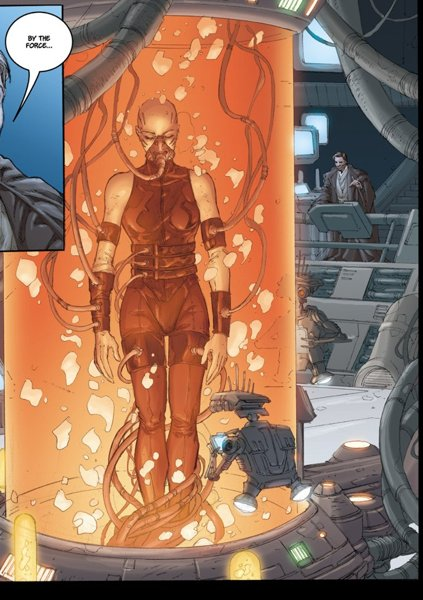
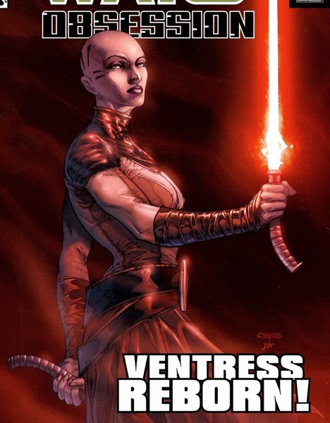
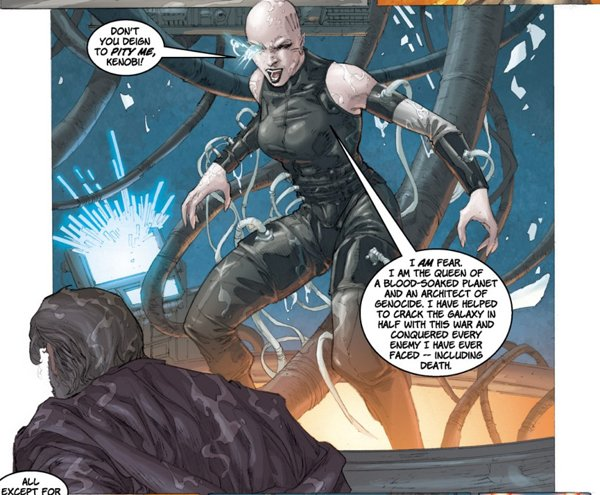
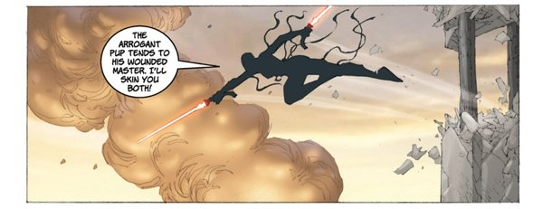
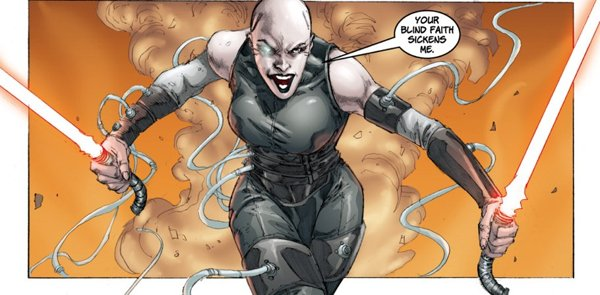
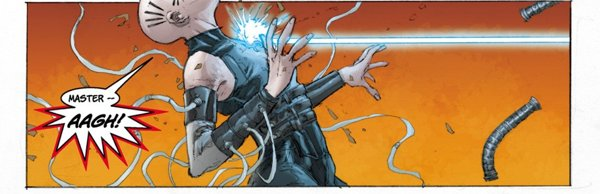
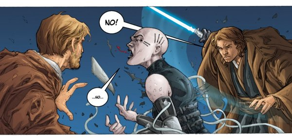
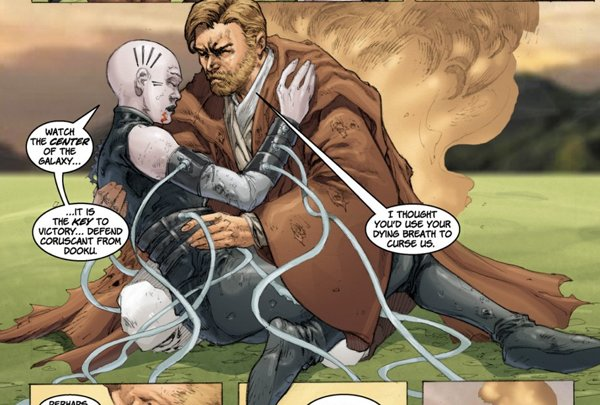
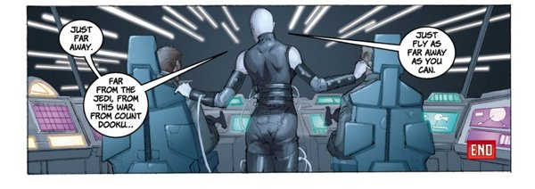

# Asajj Ventress

- **Aliases:** Ventress, Asajj
- **Era:** Clone Wars
- **Continuity:** default Legends; entries present for: Canon, Legends
- **Research tier:** DEEP
- **Entries:** 611 (306 with quotations; 72 quotations extended to the full sentence/passage from the source text on file; 222 marked as fragments; 256 before the 2026-11-17 fragment fill). Rebuilt 2026-11-17 from 784 old entries; old file: `characters/_bak/asajj-ventress.md.bak-20261117`.
- **How to read:** each entry is the quotation in full (block quote), then its source and point of view. "Note" lines are summaries from our notes, not quotations. `[fragment — full passage not on file]` means the source text is not on the box, so only the words in our notes are shown. Debate and forum material is in the last section and is unverified.

# LEGENDS (Legends / EU — main focus)

## Dark Lord trilogy (Labyrinth of Evil, Revenge of the Sith, Dark Lord): novel notes from the other agent (reference copy)

> His own lightsaber rested within reach, but the longer he gazed at it, and at the blackened furrow in the alloy, the more disheartened he became. Had the hand been flesh and blood it would be shaking now. Only Dooku, Asajj Ventress, and Obi-Wan had been good enough with a blade to injure him, so how had an undistinguished Jedi Knight been able to do so?
>
> With the loss of my limbs, have I also lost strength in the Force? *(L1317-1319)*
— Source: L1317-1319 — Dark Lord: The Rise of Darth Vader: combat and Force feats (novel, read in full); S19 [II/13, L1317-1319].
(Excerpt widened 2026-11-17 to the relevant passage, word for word from Dark Lord: The Rise of Darth Vader (James Luceno) (text copy `MEGA_Legend_The_Episode_Novelizations_Star_Wars_Revenge_of_the_Sith_03_Dark_Lord_The_Rise_of_Darth_Vader_James_Luceno_epub`).)
Note (our notes, around the quote): S19 [II/13, L1317-1319] "Only Dooku, Asajj Ventress, and Obi-Wan had been good enough with a blade to injure him, so how had an undistinguished Jedi Knight been able to do so?" / "With the loss of my limbs, have I also lost strength in the Force?" (L1317-1319). Note that Vader calls Chatak a "Jedi Knight" here, while narration elsewhere calls her a Master (L1541, L4803).
Our notes: `notes/materials/022-dark-lord-trilogy/dark-lord-novel-feats.md:278`

> Tyranus himself had trained him in lightsaber technique. In mere weeks he had surpassed any of Tyranus’s previous students. It helped, of course, to have an indestructible body reminiscent of a Krath wardroid. The ability to tower over most sentient beings. Crystal circuitry. Four grasping appendages …
— Source: L1669 — Labyrinth of Evil (novel, read in full): feats, scaling, quotes and story notes; | 18 / L1421 | Narration (Grievous POV) → Grievous, Clone Wars |.
(Excerpt widened 2026-11-17 to the relevant passage, word for word from Labyrinth of Evil (James Luceno) (text copy `MEGA_Legend_The_Episode_Novelizations_Star_Wars_Revenge_of_the_Sith_01_Labyrinth_of_Evil_James_Luceno_epub`).)
Note (our notes, around the quote): | 18 / L1421 | Narration (Grievous POV) → Grievous, Clone Wars | «Tyranus himself had trained him in lightsaber technique. In mere weeks he had surpassed any of Tyranus's previous students. It helped, of course, to have an indestructible body reminiscent of a Krath wardroid.» | B | "Previous students" include Ventress and the Dark Jedi, not Dooku. Grievous's own POV; Dooku's chapter (L1669) partly confirms it |
Context: | Ch/L | Speaker → version | Quote | Rel. | Note |
Our notes: `notes/materials/022-dark-lord-trilogy/labyrinth-of-evil-notes.md:440`

> Dooku was an eager student, and yet Sidious had continued to hold him at arm’s length. Perhaps he had been working with other potential replacements for his earlier apprentice, the savage Darth Maul, who, in fact, had been nothing more than a minion, like Asajj Ventress and General Grievous. Sidious had recognized in Dooku the makings of a true accomplice—an equal from the other camp, already trained in the Jedi arts, a master duelist, a political visionary. But he needed to gauge the depth of Dooku’s commitment.
>
> Hopeless, he thought.
>
> But he knew that he was partly to blame. He had made the same mistake with Grievous that he had made with Ventress, by allowing her to fill herself with hate, as if hate could substitute for dispassion. Even the most hateful could be defeated. Even the most angry. There should be no emotion in killing, no self, only the act. When he should have been helping Ventress rid herself of self, he had instead permitted her to grow impassioned. Sidious had once confessed that he had erred similarly in his training of Darth Maul. Ventress and Maul had been driven by a desire to excel—to be the best—instead of merely allowing themselves to be pure instruments of the dark side.
— Source: L1703; L3361; L2437; L3685 — Labyrinth of Evil (novel, read in full): feats, scaling, quotes and story notes; What LoE says.
(Excerpt widened 2026-11-17 to the relevant passage, word for word from Labyrinth of Evil (James Luceno) (text copy `MEGA_Legend_The_Episode_Novelizations_Star_Wars_Revenge_of_the_Sith_01_Labyrinth_of_Evil_James_Luceno_epub`).)
(Excerpt widened 2026-11-17 to the relevant passage, word for word from Labyrinth of Evil (James Luceno) (text copy `MEGA_Legend_The_Episode_Novelizations_Star_Wars_Revenge_of_the_Sith_01_Labyrinth_of_Evil_James_Luceno_epub`).)
(Excerpt widened 2026-11-17 to the relevant passage, word for word from Labyrinth of Evil (James Luceno) (text copy `MEGA_Legend_The_Episode_Novelizations_Star_Wars_Revenge_of_the_Sith_01_Labyrinth_of_Evil_James_Luceno_epub`).)
(Fragment completed 2026-11-17: full sentence/passage matched word for word in the source text on file: `MEGA_Legend_The_Episode_Novelizations_Star_Wars_Revenge_of_the_Sith_01_Labyrinth_of_Evil_James_Luceno_epub`.)
Note text that was attached to the quote line: *(L1703)*
(Fragment completed 2026-11-17: full sentence/passage matched word for word in the source text on file: `MEGA_Legend_The_Episode_Novelizations_Star_Wars_Revenge_of_the_Sith_01_Labyrinth_of_Evil_James_Luceno_epub`.)
Note text that was attached to the quote line: *(L3361)*
Note (our notes, around the quote): What LoE says: «the savage Darth Maul, who, in fact, had been nothing more than a minion, like Asajj Ventress and General Grievous» (L1703). «Sidious had once confessed that he had erred similarly in his training of Darth Maul.» (L3361). «Ventress and Maul had been driven by a desire to excel - - to be the best - - instead of merely allowing themselves to be pure instruments of the dark» side (L3361). He trained in The Works (L2437), and the Duelist Elite droids cut apart there point to «Sidious's previous apprentice» (L3685).
Our notes: `notes/materials/022-dark-lord-trilogy/labyrinth-of-evil-notes.md:993`

> Dooku was an eager student, and yet Sidious had continued to hold him at arm’s length. Perhaps he had been working with other potential replacements for his earlier apprentice, the savage Darth Maul, who, in fact, had been nothing more than a minion, like Asajj Ventress and General Grievous. Sidious had recognized in Dooku the makings of a true accomplice—an equal from the other camp, already trained in the Jedi arts, a master duelist, a political visionary. But he needed to gauge the depth of Dooku’s commitment.
— Source: Labyrinth of Evil (novel, read in full): feats, scaling, quotes and story notes; Ch22 L1703.
(Excerpt widened 2026-11-17 to the relevant passage, word for word from Labyrinth of Evil (James Luceno) (text copy `MEGA_Legend_The_Episode_Novelizations_Star_Wars_Revenge_of_the_Sith_01_Labyrinth_of_Evil_James_Luceno_epub`).)
Context: Complete quote register (6 lines: every sentence that names Maul, verbatim, in book order):
Our notes: `notes/materials/022-dark-lord-trilogy/labyrinth-of-evil-notes.md:997`; `notes/materials/022-dark-lord-trilogy/labyrinth-of-evil-notes.md:1010`; `notes/materials/022-dark-lord-trilogy/labyrinth-of-evil-notes.md:449`

> Hopeless, he thought.
>
> But he knew that he was partly to blame. He had made the same mistake with Grievous that he had made with Ventress, by allowing her to fill herself with hate, as if hate could substitute for dispassion. Even the most hateful could be defeated. Even the most angry. There should be no emotion in killing, no self, only the act. When he should have been helping Ventress rid herself of self, he had instead permitted her to grow impassioned. Sidious had once confessed that he had erred similarly in his training of Darth Maul. Ventress and Maul had been driven by a desire to excel—to be the best—instead of merely allowing themselves to be pure instruments of the dark side.
— Source: Labyrinth of Evil (novel, read in full): feats, scaling, quotes and story notes; Ch32 L3361.
(Excerpt widened 2026-11-17 to the relevant passage, word for word from Labyrinth of Evil (James Luceno) (text copy `MEGA_Legend_The_Episode_Novelizations_Star_Wars_Revenge_of_the_Sith_01_Labyrinth_of_Evil_James_Luceno_epub`).)
(Excerpt widened 2026-11-17 to the relevant passage, word for word from Labyrinth of Evil (James Luceno) (text copy `MEGA_Legend_The_Episode_Novelizations_Star_Wars_Revenge_of_the_Sith_01_Labyrinth_of_Evil_James_Luceno_epub`).)
Context: Complete quote register (6 lines: every sentence that names Maul, verbatim, in book order):
Our notes: `notes/materials/022-dark-lord-trilogy/labyrinth-of-evil-notes.md:1001`; `notes/materials/022-dark-lord-trilogy/labyrinth-of-evil-notes.md:1014`

> Anakin used the honorific not as learner to teacher, but as Jedi Knight to Jedi Council member. The braid that had defined his earlier status had been ritually severed after his audacious actions at Praesitlyn. His tunic, knee-high boots, and tight-fitting trousers were as black as the night. His face scarred from a contest with Dooku-trained Asajj Ventress. His mechanical right hand sheathed in an elbow-length glove. He had let his hair grow long the past few months, falling almost to his shoulders now. His face he kept clean-shaven, unlike Obi-Wan, whose strong jaw was defined by a short beard.
>
> Perhaps Gunray had thought of him as some mindless entity, like the reawakened Gen’Dai, Durge; or Dooku’s misguided apprentice, Asajj Ventress; or the humanoid bounty hunter called Aurra Sing—all three of whom had been so driven by personal hatred of the Jedi that they had proved worthless, mere distractions while Grievous went about the real business of war.
>
> Hopeless, he thought.
>
> But he knew that he was partly to blame. He had made the same mistake with Grievous that he had made with Ventress, by allowing her to fill herself with hate, as if hate could substitute for dispassion. Even the most hateful could be defeated. Even the most angry. There should be no emotion in killing, no self, only the act. When he should have been helping Ventress rid herself of self, he had instead permitted her to grow impassioned. Sidious had once confessed that he had erred similarly in his training of Darth Maul. Ventress and Maul had been driven by a desire to excel—to be the best—instead of merely allowing themselves to be pure instruments of the dark side.
>
> When he should have been helping Ventress rid herself of self, he had instead permitted her to grow impassioned. *(L3361)*
— Source: L39; L3361; L3327 — Labyrinth of Evil (novel, read in full): feats, scaling, quotes and story notes; What LoE says: Anakin's face is.
(Excerpt widened 2026-11-17 to the relevant passage, word for word from Labyrinth of Evil (James Luceno) (text copy `MEGA_Legend_The_Episode_Novelizations_Star_Wars_Revenge_of_the_Sith_01_Labyrinth_of_Evil_James_Luceno_epub`).)
(Excerpt widened 2026-11-17 to the relevant passage, word for word from Labyrinth of Evil (James Luceno) (text copy `MEGA_Legend_The_Episode_Novelizations_Star_Wars_Revenge_of_the_Sith_01_Labyrinth_of_Evil_James_Luceno_epub`).)
(Excerpt widened 2026-11-17 to the relevant passage, word for word from Labyrinth of Evil (James Luceno) (text copy `MEGA_Legend_The_Episode_Novelizations_Star_Wars_Revenge_of_the_Sith_01_Labyrinth_of_Evil_James_Luceno_epub`).)
(Full sentence/passage taken from the source text on file: `cw_novels_tmp_cestus_deception_FULL_txt`.)
(Fragment completed 2026-11-17: full sentence/passage matched word for word in the source text on file: `MEGA_Legend_The_Episode_Novelizations_Star_Wars_Revenge_of_the_Sith_01_Labyrinth_of_Evil_James_Luceno_epub`.)
Note text that was attached to the quote line: *(L39)*
(Fragment completed 2026-11-17: full sentence/passage matched word for word in the source text on file: `MEGA_Legend_The_Episode_Novelizations_Star_Wars_Revenge_of_the_Sith_01_Labyrinth_of_Evil_James_Luceno_epub`.)
Note (our notes, around the quote): What LoE says: Anakin's face is «scarred from a contest with Dooku-trained Asajj Ventress» (L39). Grievous lumps her with «mere distractions» (L1079: «Dooku's misguided apprentice, Asajj Ventress»). Dooku's self-critique: «He had made the same mistake with Grievous that he had made with Ventress, by allowing her to fill herself with hate, as if hate could substitute for» the Force (L3361); «When he should have been helping Ventress rid herself of self, he had instead permitted her to grow impassioned.» (L3361). She also uses the two-blade style Dooku deplores (L3327).
Our notes: `notes/materials/022-dark-lord-trilogy/labyrinth-of-evil-notes.md:1004`; `notes/materials/022-dark-lord-trilogy/labyrinth-of-evil-notes.md:1013`

- Note (summary from our notes, not a quotation): Scaling implications: none new. Dooku rates Ventress and Grievous as the same kind of failure.
  — Source: Labyrinth of Evil (novel, read in full): feats, scaling, quotes and story notes.
Our notes: `notes/materials/022-dark-lord-trilogy/labyrinth-of-evil-notes.md:1005`

- Note (summary from our notes, not a quotation): Complete quote register (8 lines: every sentence that names Ventress, verbatim, in book order):
  — Source: Labyrinth of Evil (novel, read in full): feats, scaling, quotes and story notes.
Our notes: `notes/materials/022-dark-lord-trilogy/labyrinth-of-evil-notes.md:1006`

> Anakin used the honorific not as learner to teacher, but as Jedi Knight to Jedi Council member. The braid that had defined his earlier status had been ritually severed after his audacious actions at Praesitlyn. His tunic, knee-high boots, and tight-fitting trousers were as black as the night. His face scarred from a contest with Dooku-trained Asajj Ventress. His mechanical right hand sheathed in an elbow-length glove. He had let his hair grow long the past few months, falling almost to his shoulders now. His face he kept clean-shaven, unlike Obi-Wan, whose strong jaw was defined by a short beard.
— Source: Labyrinth of Evil (novel, read in full): feats, scaling, quotes and story notes; Ch1 L39.
(Excerpt widened 2026-11-17 to the relevant passage, word for word from Labyrinth of Evil (James Luceno) (text copy `MEGA_Legend_The_Episode_Novelizations_Star_Wars_Revenge_of_the_Sith_01_Labyrinth_of_Evil_James_Luceno_epub`).)
Context: Complete quote register (8 lines: every sentence that names Ventress, verbatim, in book order):
Our notes: `notes/materials/022-dark-lord-trilogy/labyrinth-of-evil-notes.md:1007`

> A hunt for Dooku’s Sith allies had been going on almost since the start of the war. Dooku was known to have trained Jedi in the dark arts—Jedi Knights who had lost faith in the ideals of the Republic, Padawans fascinated by the power of the dark side, misinformed novices such as Asajj Ventress, who had been mentored by a Jedi—but the question remained, who, if anyone, had been Dooku’s teacher?
— Source: Labyrinth of Evil (novel, read in full): feats, scaling, quotes and story notes; Ch11 L675.
(Excerpt widened 2026-11-17 to the relevant passage, word for word from Labyrinth of Evil (James Luceno) (text copy `MEGA_Legend_The_Episode_Novelizations_Star_Wars_Revenge_of_the_Sith_01_Labyrinth_of_Evil_James_Luceno_epub`).)
Context: Complete quote register (8 lines: every sentence that names Ventress, verbatim, in book order):
Our notes: `notes/materials/022-dark-lord-trilogy/labyrinth-of-evil-notes.md:1008`

> Perhaps Gunray had thought of him as some mindless entity, like the reawakened Gen'Dai, Durge; or Dooku's misguided apprentice, Asajj Ventress; or the human bounty hunter called Aurra Sing - - all three of whom had been so driven by personal hatred of the Jedi that they had proved worthless, mere distractions while Grievous went about the real business of war.
— Source: Labyrinth of Evil (novel, read in full): feats, scaling, quotes and story notes; Ch15 L1079.
Context: Complete quote register (8 lines: every sentence that names Ventress, verbatim, in book order):
Our notes: `notes/materials/022-dark-lord-trilogy/labyrinth-of-evil-notes.md:1009`; `notes/materials/022-dark-lord-trilogy/labyrinth-of-evil-notes.md:1058`; `notes/materials/022-dark-lord-trilogy/labyrinth-of-evil-notes.md:1538`

> In a forward hold of Grievous’s flagship, Dooku watched the cyborg general duel with his elite MagnaGuards, three of his trophy lightsabers in constant motion, parrying thrusts of the guards’ pulse-weaponed staffs, slicing the recycled air a hairbreadth from the expressionless faces of his opponents, incapacitating arm and leg servos when he could. Grievous was a force to be reckoned with, to be sure, but Dooku deplored his habit of collecting lightsabers. It had merely bothered him that Ventress and lesser combatants such as the bounty hunter Aurra Sing had adopted the foul practice. Grievous’s habit struck Dooku as the worst kind of profanation. Even so, he was not about to discourage the practice. The more Jedi that could be dispatched, the better.
— Source: Labyrinth of Evil (novel, read in full): feats, scaling, quotes and story notes; Ch32 L3327.
(Excerpt widened 2026-11-17 to the relevant passage, word for word from Labyrinth of Evil (James Luceno) (text copy `MEGA_Legend_The_Episode_Novelizations_Star_Wars_Revenge_of_the_Sith_01_Labyrinth_of_Evil_James_Luceno_epub`).)
Context: Complete quote register (8 lines: every sentence that names Ventress, verbatim, in book order):
Our notes: `notes/materials/022-dark-lord-trilogy/labyrinth-of-evil-notes.md:1011`; `notes/materials/022-dark-lord-trilogy/labyrinth-of-evil-notes.md:1060`

> Hopeless, he thought.
>
> But he knew that he was partly to blame. He had made the same mistake with Grievous that he had made with Ventress, by allowing her to fill herself with hate, as if hate could substitute for dispassion. Even the most hateful could be defeated. Even the most angry. There should be no emotion in killing, no self, only the act. When he should have been helping Ventress rid herself of self, he had instead permitted her to grow impassioned. Sidious had once confessed that he had erred similarly in his training of Darth Maul. Ventress and Maul had been driven by a desire to excel—to be the best—instead of merely allowing themselves to be pure instruments of the dark side.
— Source: Labyrinth of Evil (novel, read in full): feats, scaling, quotes and story notes; Ch32 L3361.
(Excerpt widened 2026-11-17 to the relevant passage, word for word from Labyrinth of Evil (James Luceno) (text copy `MEGA_Legend_The_Episode_Novelizations_Star_Wars_Revenge_of_the_Sith_01_Labyrinth_of_Evil_James_Luceno_epub`).)
(Excerpt widened 2026-11-17 to the relevant passage, word for word from Labyrinth of Evil (James Luceno) (text copy `MEGA_Legend_The_Episode_Novelizations_Star_Wars_Revenge_of_the_Sith_01_Labyrinth_of_Evil_James_Luceno_epub`).)
Context: Complete quote register (8 lines: every sentence that names Ventress, verbatim, in book order):
Our notes: `notes/materials/022-dark-lord-trilogy/labyrinth-of-evil-notes.md:1012`

- Note (summary from our notes, not a quotation): Grievous lists Durge with Ventress as a «mere distraction» (L1079); Aurra Sing is one of the «lesser combatants» who use two blades (L3327). No feats.
  — Source: L1079; L3327 — Labyrinth of Evil (novel, read in full): feats, scaling, quotes and story notes.
Our notes: `notes/materials/022-dark-lord-trilogy/labyrinth-of-evil-notes.md:1056`

## Star Wars: The New Essential Chronology (Del Rey, 2005): power-scaling and lore notes

> In private he trained a number of Force-sensitive individuals in the ways of the dark side, and recruited high-powered killers to silence his enemies.
— Source: Part Two: The Fall of the Republic.
Note (our notes, around the quote): Count Dooku; Asajj Ventress; Sev'rance Tann; General Grievous — Dooku's dark side minions: "In private he trained a number of Force-sensitive individuals in the ways of the dark side, and recruited high-powered killers to silence his enemies." Source: The New Essential Chronology, p.49
Our notes: `notes/materials/027-new-essential-chronology/02-part-two-fall-of-the-republic.md:183`

> Neither fighter could gain an advantage in a contest where they seemed to be evenly matched, but Anakin found his edge by tapping into his own rage. Knocked from the pyramid, Ventress vanished into the jungle below.
— Source: Part Two: The Fall of the Republic.
Note (our notes, around the quote): Asajj Ventress; Darth Vader (Anakin Skywalker) — Ventress vs Anakin on Yavin 4: "Neither fighter could gain an advantage in a contest where they seemed to be evenly matched, but Anakin found his edge by tapping into his own rage. Knocked from the pyramid, Ventress vanished into the jungle below." Source: The New Essential Chronology, p.62
Our notes: `notes/materials/027-new-essential-chronology/02-part-two-fall-of-the-republic.md:280`

> Obi-Wan sprang himself and Alpha from their holding cell and tore through Ventress's guards.
— Source: Part Two: The Fall of the Republic; Obi-Wan Kenobi; Asajj Ventress — Obi-Wan escapes Rattatak.
Note (our notes, around the quote): Obi-Wan Kenobi; Asajj Ventress — Obi-Wan escapes Rattatak: "Obi-Wan sprang himself and Alpha from their holding cell and tore through Ventress's guards." Source: The New Essential Chronology, p.70
Our notes: `notes/materials/027-new-essential-chronology/02-part-two-fall-of-the-republic.md:360`

> As her assassin droids tore up the concourse, Ventress killed both Jai Maruk and Master Leem in a test of lightsabers.
— Source: Part Two: The Fall of the Republic; Asajj Ventress — Ventress kills Jai Maruk and Leem.
Note (our notes, around the quote): Asajj Ventress — Ventress kills Jai Maruk and Leem: "As her assassin droids tore up the concourse, Ventress killed both Jai Maruk and Master Leem in a test of lightsabers." Source: The New Essential Chronology, p.77
Our notes: `notes/materials/027-new-essential-chronology/02-part-two-fall-of-the-republic.md:433`

> In a battle on an industrial catwalk high above the city canyons, Ventress scarred Anakin Skywalker's face with her lightsaber. Anakin soon turned the tables, holding Ventress in a Force grip above an abyss and then letting her drop.
— Source: Part Two: The Fall of the Republic; Asajj Ventress; Darth Vader (Anakin Skywalker) — Ventress scars Anakin.
Note (our notes, around the quote): Asajj Ventress; Darth Vader (Anakin Skywalker) — Ventress scars Anakin: "In a battle on an industrial catwalk high above the city canyons, Ventress scarred Anakin Skywalker's face with her lightsaber. Anakin soon turned the tables, holding Ventress in a Force grip above an abyss and then letting her drop." Source: The New Essential Chronology, p.78
Our notes: `notes/materials/027-new-essential-chronology/02-part-two-fall-of-the-republic.md:444`

> Stung by Dooku's betrayal, Ventress apparently perished in her final duel with Kenobi.
— Source: Part Two: The Fall of the Republic.
Note (our notes, around the quote): Asajj Ventress; Obi-Wan Kenobi — Ventress's final duel at Boz Pity: "Stung by Dooku's betrayal, Ventress apparently perished in her final duel with Kenobi." Source: The New Essential Chronology, p.79
Our notes: `notes/materials/027-new-essential-chronology/02-part-two-fall-of-the-republic.md:455`

> Investigators later learned that she had merely muffled her life functions on Boz Pity to achieve a state of near-death stasis.
— Source: Part Two: The Fall of the Republic; Asajj Ventress — Ventress's near-death stasis.
Note (our notes, around the quote): Asajj Ventress — Ventress's near-death stasis: "Investigators later learned that she had merely muffled her life functions on Boz Pity to achieve a state of near-death stasis." Source: The New Essential Chronology, p.79
Our notes: `notes/materials/027-new-essential-chronology/02-part-two-fall-of-the-republic.md:457`

## The Complete Star Wars Encyclopedia, Vol. I (A–G)

> The treacherous captain killed his own Senate Guards, but once his task was completed, Asajj Ventress coldly killed him.
— Source: scan pages 41–80; Asajj Ventress. POV: Asajj Ventress.
Note (our notes, around the quote): Asajj Ventress: "The treacherous captain killed his own Senate Guards, but once his task was completed, Asajj Ventress coldly killed him." Source: The Complete Star Wars Encyclopedia, Vol. I, p.41
Our notes: `notes/materials/030-complete-star-wars-encyclopedia-vol-1/01-v1-scan-041-080.md:133`

- Note (summary from our notes, not a quotation): Page contents: 1293 words, 29 paragraphs | headings/entries: Fia; FIBUA Operation; Fibuli; Fibuna, B'inka; Fida, Theen; Fiddani; Fidelis; Ventress.; Fidelity; Fidge; Fiery Ones
  — Source: scan pages 281–320.
Our notes: `notes/materials/030-complete-star-wars-encyclopedia-vol-1/07-v1-scan-281-320.md:50`

> Forry helped Kit Fisto train the commandos of the Desert Wind terrorist group, and was among the survivors who managed to escape their lair when Asajj Ventress sent a group of infiltration droids to destroy them all.
— Source: scan pages 281–320; Kit Fisto; Asajj Ventress.
Note (our notes, around the quote): Kit Fisto; Asajj Ventress: "Forry helped Kit Fisto train the commandos of the Desert Wind terrorist group, and was among the survivors who managed to escape their lair when Asajj Ventress sent a group of infiltration droids to destroy them all." Source: The Complete Star Wars Encyclopedia, Vol. I, p.290
Our notes: `notes/materials/030-complete-star-wars-encyclopedia-vol-1/07-v1-scan-281-320.md:194`

> GlalveAn immense man distinguished by his drooping mustache, metal gauntlets, and leather armor that barely protected his heavily muscled body, he was a Jedi Master. Glaive and his ap­ prentice Zule were dispatched with Obi-Wan Kenobi and Anakin Skywalker to the moon of Ohma-D'un to investigate the loss of a Gungan colony after the Battle of Geonosis. The four Jedi discovered that a new form ofcombat droid underthecommand ofthebountyhunterDurge had been sent to exterminate the Gungans. When Durge captured Zule, Glaive was forced to stayhis hand. Obi-Wan's actions allowed Zule to break free, but Glaive was unprepared for the sudden appearance of Asajj Ventress. Using her own lightsaber, Ventress beheaded Glaive before Obi-Wan could act. GlakkaThe site ofa gunrunning operation of Jabba the Hurt and the Chevin criminal Ephant Mon, this ice-covered moon was nearly their final resting place. They plotted to steal an Im­ perial weapons cache on Glakka but were am­ bushed by an Imperial squad. Theysurvived the attackyet almost died during the subzero night, when Jabba kept Ephant Mon alive by covering him in the folds of his slug-like body. The pair were rescued in the morning.
— Source: scan pages 321–360; Asajj Ventress; Obi-Wan Kenobi.
(Excerpt widened 2026-11-17 to the relevant passage, word for word from research primary cse vol1 (text copy `research_primary_cse_vol1_pdf_45a954be6d`).)
(Excerpt widened 2026-11-17 to the relevant passage, word for word from research primary cse vol1 (text copy `research_primary_cse_vol1_pdf_45a954be6d`).)
Note (our notes, around the quote): Asajj Ventress; Obi-Wan Kenobi: "Using her own lightsaber, Ventress beheaded Glaive before Obi-Wan could act." Source: The Complete Star Wars Encyclopedia, Vol. I, p.344
Our notes: `notes/materials/030-complete-star-wars-encyclopedia-vol-1/08-v1-scan-321-360.md:276`

## The Complete Star Wars Encyclopedia, Vol. II (H–O)

> Master K'Kruhk was badly injured in a lightsaber duel with Ventress.
— Source: scan pages 201–240; K'Kruhk; Asajj Ventress — entry/section: K'Kruhk.
Note (our notes, around the quote): K'Kruhk; Asajj Ventress — entry/section: K'Kruhk: "Master K'Kruhk was badly injured in a lightsaber duel with Ventress." Source: The Complete Star Wars Encyclopedia, Vol. II, p.221
Our notes: `notes/materials/031-complete-star-wars-encyclopedia-vol-2/05-v2-scan-201-240.md:270`

- Note (summary from our notes, not a quotation): Obi-Wan Kenobi; Count Dooku; Asajj Ventress; Darth Vader (Anakin Skywalker): "According to information gathered from Xist on Trigalis, Obi-Wan Kenobi learned that Dooku had sent his "best assassin" after Korr, Obi-Wan believed that Dooku sent Asajj Ventress, despite the fact that she apparently had been killed on Coruscant several weeks earlier by Anakin Skywalker." Source: The Complete Star Wars Encyclopedia, Vol. II, p.226
  — Source: scan pages 201–240.
Our notes: `notes/materials/031-complete-star-wars-encyclopedia-vol-2/05-v2-scan-201-240.md:327`

> Tagge submitted the prototype to the Rattataki warlords as a gladiator combatant to prove that the droid was the superior warrior—but Asajj Ventress quickly destroyed L8-L9 in the Cauldron arena.
— Source: scan pages 241–280; Asajj Ventress. POV: Asajj Ventress.
Note (our notes, around the quote): Asajj Ventress: "Tagge submitted the prototype to the Rattataki warlords as a gladiator combatant to prove that the droid was the superior warrior—but Asajj Ventress quickly destroyed L8-L9 in the Cauldron arena." Source: The Complete Star Wars Encyclopedia, Vol. II, p.239
Our notes: `notes/materials/031-complete-star-wars-encyclopedia-vol-2/06-v2-scan-241-280.md:48`

> Ventress claimed that Jang Li-Li was the 16th Jedi she had killed in one-on-one combat, and that Master Maruk would have been the 17th if Dooku hadn't allowed him to live.
— Source: scan pages 241–280; Asajj Ventress; Count Dooku.
Note (our notes, around the quote): Asajj Ventress; Count Dooku: "Ventress claimed that Jang Li-Li was the 16th Jedi she had killed in one-on-one combat, and that Master Maruk would have been the 17th if Dooku hadn't allowed him to live." Source: The Complete Star Wars Encyclopedia, Vol. II, p.256
Our notes: `notes/materials/031-complete-star-wars-encyclopedia-vol-2/06-v2-scan-241-280.md:193`

> Maruk was forced to duel with Ventress, who would have killed him if Dooku hadn't stepped in.
— Source: scan pages 281–320; Asajj Ventress; Count Dooku.
Note (our notes, around the quote): Asajj Ventress; Count Dooku: "Maruk was forced to duel with Ventress, who would have killed him if Dooku hadn't stepped in." Source: The Complete Star Wars Encyclopedia, Vol. II, p.292
Our notes: `notes/materials/031-complete-star-wars-encyclopedia-vol-2/07-v2-scan-281-320.md:147`

> When Maruk eventually was cut down by Ventress in battle, he swore to Scout that he would remain with her forever, at least in spirit.
— Source: scan pages 281–320; Asajj Ventress. POV: Asajj Ventress.
Note (our notes, around the quote): Asajj Ventress: "When Maruk eventually was cut down by Ventress in battle, he swore to Scout that he would remain with her forever, at least in spirit." Source: The Complete Star Wars Encyclopedia, Vol. II, p.292
Our notes: `notes/materials/031-complete-star-wars-encyclopedia-vol-2/07-v2-scan-281-320.md:149`

> Unfortunately for McKnives, he was placed into the Cauldron on Rattatak at the same time as Asajj Ventress, and was soon cut down by the lightsaber-wielding warrior.
— Source: scan pages 281–320; Asajj Ventress. POV: Asajj Ventress.
Note (our notes, around the quote): Asajj Ventress: "Unfortunately for McKnives, he was placed into the Cauldron on Rattatak at the same time as Asajj Ventress, and was soon cut down by the lightsaber-wielding warrior." Source: The Complete Star Wars Encyclopedia, Vol. II, p.298
Our notes: `notes/materials/031-complete-star-wars-encyclopedia-vol-2/07-v2-scan-281-320.md:209`

> She was no match for Ventress's skills, and was quickly killed in battle.
— Source: scan pages 321–360; Asajj Ventress. POV: Asajj Ventress.
Note (our notes, around the quote): Asajj Ventress: "She was no match for Ventress's skills, and was quickly killed in battle." Source: The Complete Star Wars Encyclopedia, Vol. II, p.318
Our notes: `notes/materials/031-complete-star-wars-encyclopedia-vol-2/08-v2-scan-321-360.md:29`

> Nauton IV On this planet, Jedi Master Ruati was believed to have been beheaded by Asajj Ventress.
— Source: scan pages 361–400; Asajj Ventress. POV: Asajj Ventress.
Note (our notes, around the quote): Asajj Ventress: "Nauton IV On this planet, Jedi Master Ruati was believed to have been beheaded by Asajj Ventress." Source: The Complete Star Wars Encyclopedia, Vol. II, p.363
Our notes: `notes/materials/031-complete-star-wars-encyclopedia-vol-2/09-v2-scan-361-400.md:80`

## The Complete Star Wars Encyclopedia, Vol. III (P–Z)

> R4-P22 A small astromech used aboard Anakin Skywalker's modified Jedi starfighter, Azure Angle, it was destroyed when Asajj Ventress blew up the starfighter on Yavin 4 during the Clone Wars.
— Source: scan pages 41–80; Darth Vader (Anakin Skywalker); Asajj Ventress.
Note (our notes, around the quote): Darth Vader (Anakin Skywalker); Asajj Ventress: "R4-P22 A small astromech used aboard Anakin Skywalker's modified Jedi starfighter, Azure Angle, it was destroyed when Asajj Ventress blew up the starfighter on Yavin 4 during the Clone Wars." Source: The Complete Star Wars Encyclopedia, Vol. III, p.71
Our notes: `notes/materials/032-complete-star-wars-encyclopedia-vol-3/01-v3-scan-041-080.md:276`

> The two squared off in one-on-one combat, and though Remlout lasted several minutes, Asajj soundly defeated him, splitting his shell in a swift attack.
— Source: scan pages 81–120; Asajj Ventress. POV: Asajj Ventress.
Note (our notes, around the quote): Asajj Ventress: "The two squared off in one-on-one combat, and though Remlout lasted several minutes, Asajj soundly defeated him, splitting his shell in a swift attack." Source: The Complete Star Wars Encyclopedia, Vol. III, p.91
Our notes: `notes/materials/032-complete-star-wars-encyclopedia-vol-3/02-v3-scan-081-120.md:152`

> During the Battle of Muunilinst, Anakin led the space attack, pursuing Asajj Ventress's starfighter to the jungles of Yavin 4 and dueling her there.
— Source: scan pages 161–200; Darth Vader (Anakin Skywalker); Asajj Ventress — entry/section: Skywalker, Anakin.
Note (our notes, around the quote): Darth Vader (Anakin Skywalker); Asajj Ventress — entry/section: Skywalker, Anakin: "During the Battle of Muunilinst, Anakin led the space attack, pursuing Asajj Ventress's starfighter to the jungles of Yavin 4 and dueling her there." Source: The Complete Star Wars Encyclopedia, Vol. III, p.161
Our notes: `notes/materials/032-complete-star-wars-encyclopedia-vol-3/04-v3-scan-161-200.md:58`

> The trio managed to flee before Obi-Wan Kenobi arrived; he dueled Ventress inside Teth castle.
— Source: scan pages 201–240; Obi-Wan Kenobi; Asajj Ventress.
Note (our notes, around the quote): Obi-Wan Kenobi; Asajj Ventress: "The trio managed to flee before Obi-Wan Kenobi arrived; he dueled Ventress inside Teth castle." Source: The Complete Star Wars Encyclopedia, Vol. III, p.233
Our notes: `notes/materials/032-complete-star-wars-encyclopedia-vol-3/05-v3-scan-201-240.md:346`

> A native of the planet Rattatak, Asajj Ventress was a ruthless and cunning adversary, known for her military expertise and her corrupt mastery over the Force, Her parents were murdered by Osika Kirske when she was young, and she might have died if not for the sudden appearance of Jedi Master Ky Narec.
— Source: scan pages 281–320; Asajj Ventress. POV: Asajj Ventress.
Note (our notes, around the quote): Asajj Ventress: "A native of the planet Rattatak, Asajj Ventress was a ruthless and cunning adversary, known for her military expertise and her corrupt mastery over the Force, Her parents were murdered by Osika Kirske when she was young, and she might have died if not for the sudden appearance of Jedi Master Ky Narec." Source: The Complete Star Wars Encyclopedia, Vol. III, p.302
Our notes: `notes/materials/032-complete-star-wars-encyclopedia-vol-3/07-v3-scan-281-320.md:219`

> After Kirske killed Narec, Ventress used her powers to take over her homeworld and kill Kirske.
— Source: scan pages 281–320; Asajj Ventress. POV: Asajj Ventress.
Note (our notes, around the quote): Asajj Ventress: "After Kirske killed Narec, Ventress used her powers to take over her homeworld and kill Kirske." Source: The Complete Star Wars Encyclopedia, Vol. III, p.302
Our notes: `notes/materials/032-complete-star-wars-encyclopedia-vol-3/07-v3-scan-281-320.md:221`

> On Queyta, Ventress and Durge tried to secure the antidote to the swamp gas, but Obi-Wan Kenobi and his companions bested her.
— Source: scan pages 281–320; Asajj Ventress; Obi-Wan Kenobi.
Note (our notes, around the quote): Asajj Ventress; Obi-Wan Kenobi: "On Queyta, Ventress and Durge tried to secure the antidote to the swamp gas, but Obi-Wan Kenobi and his companions bested her." Source: The Complete Star Wars Encyclopedia, Vol. III, p.302
Our notes: `notes/materials/032-complete-star-wars-encyclopedia-vol-3/07-v3-scan-281-320.md:225`

## Characters/Miniatures/The Force Is With Them (Mostly).pdf [Star Wars Roleplaying Game Revised Core (d20, 2002)]

- Note (summary from our notes, not a quotation): Page contents: Intro; Asajj Ventress (Rattatak, Ky Narec, Dooku; Jedi Guardian 5/Dark Side Marauder 5/Officer 1, CC E); Dark Side Acolyte (Soldier 2/Dark Side Marauder 4, CC D from image) (hand-read)
  — Source: Characters/Miniatures/The Force Is With Them (Mostly).pdf [Star Wars Role.
Our notes: `notes/materials/037-sw-d20-folder/113-the-force-is-with-them-mostly.md:10`

> Asajj Ventress's early life on her war-torn home planet of Rattatak prepared her for the hardships that she would face. Her potential in the Force was discovered by a stranded Jedi named Ky Narec, and he decided to train the young Asajj. The partnership worked for a while, but Ky was killed by the powerful warlords on Rattatak before he could complete her training. As a result, her hatred of the Republic grew as she believed it abandoned her Master and her home planet.
— Source: Characters/Miniatures/The Force Is With Them (Mostly).pdf [Star Wars Role.
Note (our notes, around the quote): Asajj Ventress; Ky Narec — entry/section: Asajj Ventress and Ky Narec: "Asajj Ventress's early life on her war-torn home planet of Rattatak prepared her for the hardships that she would face. Her potential in the Force was discovered by a stranded Jedi named Ky Narec, and he decided to train the young Asajj. The partnership worked for a while, but Ky was killed by the powerful warlords on Rattatak before he could complete her training. As a result, her hatred of the Republic grew as she believed it abandoned her Master and her home planet." Source: *The Force Is With Them (Mostly)* (SWRPG d20 Revised Core), scan p.1
Our notes: `notes/materials/037-sw-d20-folder/113-the-force-is-with-them-mostly.md:12`

> Unhindered by the restrictions of a Jedi, her primal passions allowed her to grow in power. She was eventually discovered by the Separatist leader, Count Dooku, who persuaded her to join him in the Separatist's battles against the Republic.
— Source: Characters/Miniatures/The Force Is With Them (Mostly).pdf [Star Wars Role; Asajj Ventress; Count Dooku — entry/section: Ventress joins Dooku.
Note (our notes, around the quote): Asajj Ventress; Count Dooku — entry/section: Ventress joins Dooku: "Unhindered by the restrictions of a Jedi, her primal passions allowed her to grow in power. She was eventually discovered by the Separatist leader, Count Dooku, who persuaded her to join him in the Separatist's battles against the Republic." Source: *The Force Is With Them (Mostly)* (SWRPG d20 Revised Core), scan p.1
Our notes: `notes/materials/037-sw-d20-folder/113-the-force-is-with-them-mostly.md:14`

## Jedi Counselling/Jedi Counseling 19 - Illusion Confusion 2.pdf [Star Wars Roleplaying Game Revised Core (d20, 2002)]

- Note (summary from our notes, not a quotation): Darth Bane; Asajj Ventress — entry/section: Creative Force Grip (question): "Q: I saw your response to the issue of darksiders with epic-level powers in "Jedi Counseling" 12, but I have another question. I understand the need to restrict power levels for a balanced game system, but how creative can I be with the Force skills? I've seen Darth Bane and his apprentices shatter bones (and limbs) with the Force (in the Jedi Vs. Sith comic). And in the "Republic" storyline of the regular Star Wars comic, I've seen the dark Jedi Asajj Ventress attempt to crush another Jedi’s heart using the Force. So are these just artistic flourishes, or is there a way I can use these skills in a game while maintaining a balance for good play?" Source: *Jedi Counseling 19 - Illusion Confusion 2* (SWRPG d20 Revised Core), scan p.3
  — Source: Jedi Counselling/Jedi Counseling 19 - Illusion Confusion 2.pdf [Star Wars.
Our notes: `notes/materials/037-sw-d20-folder/182-jedi-counseling-19-illusion-confusion-2.md:24`

- Note (summary from our notes, not a quotation): Darth Bane; Asajj Ventress — entry/section: Bone-shattering and heart-crushing as Force Grip: "A: Good question! I also read those comics, and my immediate reaction was "Force Grip." After all, the description of Force Grip states that you can use the skill to "grip an organ" as well as to "crush a larynx." Since the basic effect is to deal damage, you could consider bones "organs" for the purpose of this skill. But to answer the slightly larger question: You can define these different specific applications of the Force as variations of Force Grip, and let players of dark side characters choose how their Force Grip manifests -- with corresponding benefits or drawbacks, depending on the situation." Source: *Jedi Counseling 19 - Illusion Confusion 2* (SWRPG d20 Revised Core), scan p.3
  — Source: Jedi Counselling/Jedi Counseling 19 - Illusion Confusion 2.pdf [Star Wars.
Our notes: `notes/materials/037-sw-d20-folder/182-jedi-counseling-19-illusion-confusion-2.md:26`

## Jedi Counselling/Jedi Counseling 64.pdf [Star Wars Roleplaying Game Revised Core (d20, 2002)]

> Obviously, if you implement this rule, Jedi become considerably more powerful than usual. I would strongly recommend reducing a Jedi's bonus lightsaber damage to +2 (or even +1) instead of +1d8 to help preserve game balance. For example, a 10th­level Jedi guardian normally inflicts 4d8 points of damage (2d8 points for the lightsaber, plus 2d8 more for increased lightsaber damage). Using this variant rule, he would instead inflict 2d8+4 points of damage (2d8 points for the lightsaber, plus 2 more at 5th level, plus 2 more at 10th level). Q: Can Force Grip be used against droids or objects? In the Clone Wars cartoon series, Mace Windu seems to dismantle a battle droid with the Force, and at least one blaster rifle seems to be crushed by Asajj Ventress. That sure looks like Force Grip. A: Given the evidence of the Clone Wars cartoon series, I'm updating a previous unofficial ruling: You can use Force Grip against droids and objects. Mace Windu's "instant disassembly" against one battle droid is a good example of the many forms Force Grip might take ­­ crushing a larynx, squeezing the heart, or, in this case, pulling out all the nuts and bolts. (This is clearly beyond the scope of Move Object or Force Strike.)
— Source: Jedi Counselling/Jedi Counseling 64.pdf [Star Wars Roleplaying Game Revis; Asajj Ventress; Mace Windu — entry/section: Jedi Counseling 64.
(Excerpt widened 2026-11-17 to the relevant passage, word for word from research primary sw d20 folder files Star Wars Roleplaying Game Revised Core Jedi Counselling Jedi Counseling 64 (text copy `research_primary_sw_d20_folder_files_Star_Wars_Roleplaying_Game_Revised_Core_Jedi_Counselling_Jedi_Counseling_64_pdf_6789ebc7d0`).)
(Excerpt widened 2026-11-17 to the relevant passage, word for word from research primary sw d20 folder files Star Wars Roleplaying Game Revised Core Jedi Counselling Jedi Counseling 64 (text copy `research_primary_sw_d20_folder_files_Star_Wars_Roleplaying_Game_Revised_Core_Jedi_Counselling_Jedi_Counseling_64_pdf_6789ebc7d0`).)
Note (our notes, around the quote): Asajj Ventress; Mace Windu — entry/section: Jedi Counseling 64: "In the Clone Wars cartoon series, Mace Windu seems to dismantle a battle droid with the Force, and at least one blaster rifle seems to be crushed by Asajj Ventress." Source: *Jedi Counseling 64* (SWRPG d20 Revised Core), scan p.1
Our notes: `notes/materials/037-sw-d20-folder/232-jedi-counseling-64.md:12`

- Note (summary from our notes, not a quotation): Mace Windu; Asajj Ventress — entry/section: Force Grip vs droids and objects (Mace Windu, Asajj Ventress): "Q: Can Force Grip be used against droids or objects? In the Clone Wars cartoon series, Mace Windu seems to dismantle a battle droid with the Force, and at least one blaster rifle seems to be crushed by Asajj Ventress. That sure looks like Force Grip.
  — Source: Jedi Counselling/Jedi Counseling 64.pdf [Star Wars Roleplaying Game Revis.
Our notes: `notes/materials/037-sw-d20-folder/232-jedi-counseling-64.md:19`

## Living Force Campaign/Articles/Year 5/08:18:05 - Dark Hands.pdf [Star Wars Roleplaying Game Revised Core (d20, 2002)]

- Note (summary from our notes, not a quotation): Page contents: Grenade destroys the console; 'You are probably right'; Ventress rumor; telepathic voice; Jedi kills the defector from behind; game notes Holonet bonus (hand-read)
  — Source: Living Force Campaign/Articles/Year 5/08:18:05 - Dark Hands.pdf [Star War.
Our notes: `notes/materials/037-sw-d20-folder/508-08-18-05-dark-hands.md:15`

## Sourcebooks/Geonosis and the Outer Rim Worlds.pdf [Star Wars Roleplaying Game Revised Core (d20, 2002)] (scan pages 121–162)

- Note (summary from our notes, not a quotation): Page contents: Sriluur: Sora Bulq (approached by Count Dooku after Geonosis; plan to frame Mace Windu for Asajj Ventress's killings; duel with Windu on Ruul; Male Weequay Jedi Guardian 9/Jedi Master 3/Jedi Weapon Master 3); Disac Pirates (Stano Hapin killed by Ket Maliss; Black Sun Vigo Sprax; Besadii clan and Vigo Durga the Hutt); Disac Pirate stats; new creature bandigo. (hand-read)
  — Source: Sourcebooks/Geonosis and the Outer Rim Worlds.pdf [Star Wars Roleplaying.
Our notes: `notes/materials/037-sw-d20-folder/667-geonosis-and-the-outer-rim-worlds-scan-121-162.md:82`

> Though the plan he laid out to frame Mace Windu for the deaths of Jedi killed by the assassin Assaj Ventress failed, Sora Bulg survived a fierce lightsaber duel with Master Windu when Windu and the other Jedi were forced to flee Ruul.
— Source: Sourcebooks/Geonosis and the Outer Rim Worlds.pdf [Star Wars Roleplaying.
Note (our notes, around the quote): Sora Bulq; Mace Windu; Asajj Ventress — entry/section: Geonosis and the Outer Rim Worlds: "Though the plan he laid out to frame Mace Windu for the deaths of Jedi killed by the assassin Assaj Ventress failed, Sora Bulg survived a fierce lightsaber duel with Master Windu when Windu and the other Jedi were forced to flee Ruul." Source: *Geonosis and the Outer Rim Worlds* (SWRPG d20 Revised Core), scan p.131
Our notes: `notes/materials/037-sw-d20-folder/667-geonosis-and-the-outer-rim-worlds-scan-121-162.md:84`

> Though Sora Bulq’s intentions may have been pure some years previous, his research into the dark side of the Force, compounded by Dooku’s persuasive arguments, were enough that he succumbed to the dark side. Though the plan he laid out to frame Mace Windu for the deaths of Jedi killed by the assassin Assaj Ventress failed, Sora Bulg survived a fierce lightsaber duel with Master Windu when Windu and the other Jedi were forced to flee Ruul.
— Source: Sourcebooks/Geonosis and the Outer Rim Worlds.pdf [Star Wars Roleplaying.
Note (our notes, around the quote): Sora Bulq; Mace Windu; Asajj Ventress; Count Dooku — entry/section: Sora Bulq falls: "Though Sora Bulq’s intentions may have been pure some years previous, his research into the dark side of the Force, compounded by Dooku’s persuasive arguments, were enough that he succumbed to the dark side. Though the plan he laid out to frame Mace Windu for the deaths of Jedi killed by the assassin Assaj Ventress failed, Sora Bulg survived a fierce lightsaber duel with Master Windu when Windu and the other Jedi were forced to flee Ruul." Source: *Geonosis and the Outer Rim Worlds* (SWRPG d20 Revised Core), scan p.131
Our notes: `notes/materials/037-sw-d20-folder/667-geonosis-and-the-outer-rim-worlds-scan-121-162.md:90`

## Sourcebooks/Galaxy at War.pdf [Star Wars Roleplaying Game Saga Edition (2007)] (scan pages 121–180)

- Note (summary from our notes, not a quotation): Page contents: Sun Guards of Thyrsus history: Echani, Six Sisters, Bengali Uprising, "son of suns" prophecy; Darth Sidious employs them; Asajj Ventress tasked with eliminating them; survivors join the Royal Guard and Imperial Shadow Guard; Kenix Jir; bounty hunter Moxin Tark; Battle of Sintheti. Image caption: a Sun Guard of Thyrsus. (hand-read)
  — Source: Sourcebooks/Galaxy at War.pdf [Star Wars Roleplaying Game Saga Edition (2.
Our notes: `notes/materials/037-sw-d20-folder/715-galaxy-at-war-scan-121-180.md:85`

## Sourcebooks/Starships of the Galaxy.pdf [Star Wars Roleplaying Game Saga Edition (2007)] (scan pages 61–120)

- Note (summary from our notes, not a quotation): Page contents: Ginivex-class Starfighter ("fanblade") stat block; history (six built for Count Dooku, given to Asajj Ventress on Rattatak; two stolen by Obi-Wan Kenobi and Anakin Skywalker); Capabilities (solar sail shields; hyperdrive at Dooku's insistence). (hand-read)
  — Source: Sourcebooks/Starships of the Galaxy.pdf [Star Wars Roleplaying Game Saga.
Our notes: `notes/materials/037-sw-d20-folder/727-starships-of-the-galaxy-scan-061-120.md:190`

## Sourcebooks/The Clone Wars Campaign Guide.pdf [Star Wars Roleplaying Game Saga Edition (2007)] (scan pages 1–60)

> Twice the pride, double the fall.
— Source: Sourcebooks/The Clone Wars Campaign Guide.pdf [Star Wars Roleplaying Game.
Note (our notes, around the quote): Page contents: Introduction: the Clone Wars polarize the galaxy; heroes can tip the balance; Jedi stretched as generals; villains (Dooku, Grievous, Ventress, Loathsom) vs. Yoda, Windu, Obi-Wan, Anakin; Palpatine secretly playing both sides as Darth Sidious. Epigraph "Twice the pride, double the fall." - Count Dooku. (hand-read)
Our notes: `notes/materials/037-sw-d20-folder/728-the-clone-wars-campaign-guide-scan-001-060.md:35`

> Your lightsabers will make a fine addition to my collection.
— Source: Sourcebooks/The Clone Wars Campaign Guide.pdf [Star Wars Roleplaying Game.
Note (our notes, around the quote): Page contents: Heroes of the Clone Wars themes: Large-Scale Conflict (Nelvaan, Commenor; Ewoks/Chiss with GM permission); Decline of the Jedi (Order 66; Jedi Master Kota); Rampant Corruption (Palpatine, Sidious, Dooku); High-Profile Villains (Dooku, Grievous, Loathsom, Ventress, Durge, Darth Maul). Epigraph: "Your lightsabers will make a fine addition to my collection." -General Grievous. (hand-read)
Our notes: `notes/materials/037-sw-d20-folder/728-the-clone-wars-campaign-guide-scan-001-060.md:147`

> Count Dooku is a well-known Jedi traitor; General Grievous is a reputedly brilliant military leader whose visage intimidates his enemies; Generali Loathsom is a vicious brute, Asajj Ventress an aspiring Sith, and Durge an immortal bounty huater.
— Source: Sourcebooks/The Clone Wars Campaign Guide.pdf [Star Wars Roleplaying Game; Count Dooku; General Grievous; Asajj Ventress.
Note (our notes, around the quote): Count Dooku; General Grievous; Asajj Ventress: "Count Dooku is a well-known Jedi traitor; General Grievous is a reputedly brilliant military leader whose visage intimidates his enemies; Generali Loathsom is a vicious brute, Asajj Ventress an aspiring Sith, and Durge an immortal bounty huater." Source: *The Clone Wars Campaign Guide* (SWRPG Saga Edition), scan p.21
Our notes: `notes/materials/037-sw-d20-folder/728-the-clone-wars-campaign-guide-scan-001-060.md:149`

- Note (summary from our notes, not a quotation): Page contents: Chapter 4: The Force, chapter opener art (Dooku, Sidious, Ventress and Jedi with lightsabers). (hand-read)
  — Source: Sourcebooks/The Clone Wars Campaign Guide.pdf [Star Wars Roleplaying Game.
Our notes: `notes/materials/037-sw-d20-folder/728-the-clone-wars-campaign-guide-scan-001-060.md:322`

## Sourcebooks/The Clone Wars Campaign Guide.pdf [Star Wars Roleplaying Game Saga Edition (2007)] (scan pages 61–120)

> Bal vows that when she does finally escape, she will kill every-one in the Hutt's courtcoincidentally, everyone who witnessed her defeat. Hatred often springs from a position of inferiority; what one cannot control, one frequently hates. But when a character has the power of life and death over the object of his hatred- a single individual, or even an entire galaxy-he can cause suffering. Mental, verbal, and physical abuse are his tools; through these methods, the character denigrates and depersonalizes his victims-making them no more significant than objects, to be used or destroyed as he likes. Suffering "hate leads to suffering." -Yoda Greed "Greed can be a powerful ally ... if it's used properly." - Qui-Gon Jinn ensues, until the Hutt's bodyguard returns. By this time, though, Bal Serinus has learned the alien's secret: He secretes a nerve-paralyzing toxin from his fingertips. Having recovered her lightsaber, the Dark Jedi severs the alien's hands, leaving him defenseless. But rather than kill him, she hauls him off in chains, selling him as a slave to another Hutt-a rival to the one who had captured her. Vengeance 'At last we will have our revenge." -Darth Maul A combination of hatred and anger, vengeance impels a character to administer what she considers "justice"though ultimately, that justice only serves herself.
— Source: Sourcebooks/The Clone Wars Campaign Guide.pdf [Star Wars Roleplaying Game.
(Excerpt widened 2026-11-17 to the relevant passage, word for word from research primary sw d20 folder files Star Wars Roleplaying Game Core Sourcebooks The Dark Side Sourcebook (text copy `research_primary_sw_d20_folder_files_Star_Wars_Roleplaying_Game_Core_Sourcebooks_The_Dark_Side_Sourcebook_pdf_c498151f20`).)
(Excerpt widened 2026-11-17 to the relevant passage, word for word from research primary sw d20 folder files Star Wars Roleplaying Game Core Sourcebooks The Dark Side Sourcebook (text copy `research_primary_sw_d20_folder_files_Star_Wars_Roleplaying_Game_Core_Sourcebooks_The_Dark_Side_Sourcebook_pdf_c498151f20`).)
Note (our notes, around the quote): Page contents: Rampant Corruption (corruption let Palpatine become Supreme Chancellor and, as Darth Sidious, manipulate the Separatists into war; corrupt senators, officers; using enemy corruption; temptation of heroes; Scum and Villainy reference). Epigraph: "Greed can be a powerful ally." -Qui-Gon Jinn. Villains (Count Dooku, General Grievous, Durge, Asajj Ventress, General Loathsom). Dehumanization begins (Count Dooku a very Human villain). (hand-read)
Our notes: `notes/materials/037-sw-d20-folder/728-the-clone-wars-campaign-guide-scan-061-120.md:233`

- Note (summary from our notes, not a quotation): Page contents: Dehumanization cont. (Ventress twisted shadow of humanity; Grievous near-total replacement cyborg; Durge faceless armor; voices and mannerisms: Grievous's metallic echo and coughs, Ventress's hissing voice, Durge's silence, Loathsom's boiling anger; ruthlessness). Powerful Personality (Dooku charismatic and bold, left the Order after the death of a beloved apprentice; Ventress strives to be heir to the Sith legacy and prove herself to Dooku; villains as dark reflections of heroes; example fallen smuggler). (hand-read)
  — Source: Sourcebooks/The Clone Wars Campaign Guide.pdf [Star Wars Roleplaying Game.
Our notes: `notes/materials/037-sw-d20-folder/728-the-clone-wars-campaign-guide-scan-061-120.md:244`

## Sourcebooks/The Clone Wars Campaign Guide.pdf [Star Wars Roleplaying Game Saga Edition (2007)] (scan pages 121–180)

- Note (summary from our notes, not a quotation): Page contents: Admiral Wullf Yularen stat block (CL 4; noble 4; Educated, Inspire Haste; Linguist). ARC Trooper Alpha-17 (clone trainer on Kamino; Ohma-D'un, Jabiim; captured and tortured by Ventress on Rattatak; trains CC-2224 and CC-1138; escorts Bail Organa aboard the Intervention; wounded by Grievous; transport vanishes); stat block begins (CL 10). Art caption: ARC Trooper Alpha-17. (hand-read)
  — Source: Sourcebooks/The Clone Wars Campaign Guide.pdf [Star Wars Roleplaying Game.
Our notes: `notes/materials/037-sw-d20-folder/728-the-clone-wars-campaign-guide-scan-121-180.md:367`

## Sourcebooks/The Clone Wars Campaign Guide.pdf [Star Wars Roleplaying Game Saga Edition (2007)] (scan pages 181–225)

- Note (summary from our notes, not a quotation): Page contents: Trandoshan Mercenary stat block cont. Influential Figures (Asajj Ventress, Durge, General Grievous, Count Dooku, Darth Sidious; Dooku plans to dispatch Sidious). Art caption: "Count Dooku and Whorm Loathsom". Count Dooku, Separatist Leader and Sith Lord begins (Darth Tyranus; Galidraan; Jango Fett among the Mandalorians). (hand-read)
  — Source: Sourcebooks/The Clone Wars Campaign Guide.pdf [Star Wars Roleplaying Game.
Our notes: `notes/materials/037-sw-d20-folder/728-the-clone-wars-campaign-guide-scan-181-225.md:34`

- Note (summary from our notes, not a quotation): Page contents: Count Dooku continues (visited by Darth Sidious after Darth Maul's loss; agrees to be public voice of secession). Count Dooku stat block (CL 18; Jedi 7/Jedi Knight 5/Jedi Master 4/Sith Lord 2; Makashi). Asajj Ventress, Dark Jedi begins (Rattatak; Ky Narec; the Cauldron; Komari Vosa's lightsabers; fails to kill Anakin; captures Kenobi once). (hand-read)
  — Source: Sourcebooks/The Clone Wars Campaign Guide.pdf [Star Wars Roleplaying Game.
Our notes: `notes/materials/037-sw-d20-folder/728-the-clone-wars-campaign-guide-scan-181-225.md:49`

> During this time, Asajj Ventress learns of the Sith and concludes that, since she cannot jain the ranks of the hated Jedi, she will become their greatest enemy.
— Source: Sourcebooks/The Clone Wars Campaign Guide.pdf [Star Wars Roleplaying Game; Asajj Ventress — entry/section: The Clone Wars Campaign Guide (Saga).
Note (our notes, around the quote): Asajj Ventress — entry/section: The Clone Wars Campaign Guide (Saga): "During this time, Asajj Ventress learns of the Sith and concludes that, since she cannot jain the ranks of the hated Jedi, she will become their greatest enemy." Source: *The Clone Wars Campaign Guide* (SWRPG Saga Edition), scan p.185
Our notes: `notes/materials/037-sw-d20-folder/728-the-clone-wars-campaign-guide-scan-181-225.md:51`

> When Ky Narec is killed, Ventress is unable to control her anger, vowing vengeance not only on the warlords whose squabbles caused Ky Narec's death but also on the Jedi Order for not sending anyone to help.
— Source: Sourcebooks/The Clone Wars Campaign Guide.pdf [Star Wars Roleplaying Game; Asajj Ventress. POV: Asajj Ventress.
Note (our notes, around the quote): Asajj Ventress: "When Ky Narec is killed, Ventress is unable to control her anger, vowing vengeance not only on the warlords whose squabbles caused Ky Narec's death but also on the Jedi Order for not sending anyone to help." Source: *The Clone Wars Campaign Guide* (SWRPG Saga Edition), scan p.185
Our notes: `notes/materials/037-sw-d20-folder/728-the-clone-wars-campaign-guide-scan-181-225.md:55`

> After proving herself worthy by defeating over a dozen opponents in the Cauldron, Asajj Ventress presents herself to Dooku, who awards her a pair of curve-hilted lightsabers (formerly belonging to Komari Vosa) and gives her an assignment to kill Anakin Skywalker, Although she fails, Ventress proves to be a resourceful and vicious assassin, carrying oul Numerous Missions on Dooku's behalf.
— Source: Sourcebooks/The Clone Wars Campaign Guide.pdf [Star Wars Roleplaying Game; Asajj Ventress; Count Dooku; Darth Vader (Anakin Skywalker).
Note (our notes, around the quote): Asajj Ventress; Count Dooku; Darth Vader (Anakin Skywalker): "After proving herself worthy by defeating over a dozen opponents in the Cauldron, Asajj Ventress presents herself to Dooku, who awards her a pair of curve-hilted lightsabers (formerly belonging to Komari Vosa) and gives her an assignment to kill Anakin Skywalker, Although she fails, Ventress proves to be a resourceful and vicious assassin, carrying oul Numerous Missions on Dooku's behalf." Source: *The Clone Wars Campaign Guide* (SWRPG Saga Edition), scan p.185
Our notes: `notes/materials/037-sw-d20-folder/728-the-clone-wars-campaign-guide-scan-181-225.md:57`

- Note (summary from our notes, not a quotation): Page contents: Asajj Ventress concluded (defeated by Skywalker and Kenobi; body vanishes en route to Coruscant; rumor of Second Battle of Xagobah). Ventress stat block (CL 13; Rattataki Jedi 5/scout 4/Sith apprentice 4; Dual Weapon Mastery III). Durge, Separatist Commander begins (Gen'Dai; over 1,500 years old; apprenticed with Mandalorian Jaing; cybernetics; vengeance on Mandalorians; IG lancer droids; Ohma-D'un; Queyta; Muunilinst; Grievous bests him on the Trenchant Space Station). (hand-read)
  — Source: Sourcebooks/The Clone Wars Campaign Guide.pdf [Star Wars Roleplaying Game.
Our notes: `notes/materials/037-sw-d20-folder/728-the-clone-wars-campaign-guide-scan-181-225.md:70`

> Shortly before the end of the Clone Wars, Skywalker and Kenobi defeat Asajj Ventress, and Kenobi believes that they have purged the hatred from her, redeeming her from the dark side.
— Source: Sourcebooks/The Clone Wars Campaign Guide.pdf [Star Wars Roleplaying Game; Obi-Wan Kenobi; Asajj Ventress.
Note (our notes, around the quote): Obi-Wan Kenobi; Asajj Ventress: "Shortly before the end of the Clone Wars, Skywalker and Kenobi defeat Asajj Ventress, and Kenobi believes that they have purged the hatred from her, redeeming her from the dark side." Source: *The Clone Wars Campaign Guide* (SWRPG Saga Edition), scan p.186
Our notes: `notes/materials/037-sw-d20-folder/728-the-clone-wars-campaign-guide-scan-181-225.md:72`

## Web Articles.pdf [Star Wars Roleplaying Game Saga Edition (2007)] (scan pages 241–300)

> The Jedi of the Republic must not only face the Separatists but hostile bounty hunters, cunning pirates and many other challenges... Commander Ahsoka The young Togruta Jedi, called Ahsoka, was assigned to Anakin Skywalker as his Padawan by Master Yoda in an effort to teach him responsibility. Although the two were often at odds at the beginning, they eventually formed a strong master/apprentice relationship. Being as impulsive as her master, Ahsoka managed to get herself into her fair share of trouble. This trouble included going face to face with some of the most powerful villains leading the Separatists, including Asajj Ventress and General Grievous. Many more experienced Jedi met their end facing these opponents and her surviving these encounters showed that she was as talented as she was impulsive. During this time Ahsoka sometimes found herself working with other Jedi Masters besides Anakin. Both Aayla Secura and Luminara Unduli passed on great wisdom and knowledge to the young Togruta and they learned something from her in return.
— Source: Web Articles.pdf [Star Wars Roleplaying Game Saga Edition (2007)] (scan p; General Grievous; Asajj Ventress — entry/section: Saga Edition Web Articles.
(Excerpt widened 2026-11-17 to the relevant passage, word for word from research primary sw d20 folder files Star Wars Roleplaying Game Saga Edition Web Articles (text copy `research_primary_sw_d20_folder_files_Star_Wars_Roleplaying_Game_Saga_Edition_Web_Articles_pdf_6187a774ab`).)
(Excerpt widened 2026-11-17 to the relevant passage, word for word from research primary sw d20 folder files Star Wars Roleplaying Game Saga Edition Web Articles (text copy `research_primary_sw_d20_folder_files_Star_Wars_Roleplaying_Game_Saga_Edition_Web_Articles_pdf_6187a774ab`).)
Note (our notes, around the quote): General Grievous; Asajj Ventress — entry/section: Saga Edition Web Articles: "This trouble included going face to face with some of the most powerful villains leading the Separatists, including Asajj Ventress and General Grievous." Source: *Web Articles* (SWRPG Saga Edition), scan p.280
Our notes: `notes/materials/037-sw-d20-folder/732-web-articles-scan-241-300.md:378`

- Note (summary from our notes, not a quotation): Page contents: Galaxy at War Miniatures Preview 2: Hondo Ohnaka and Asajj Ventress Strike Leader by Jack Irons (title checked on page image: text layer "ASAUGYU" = "ASAJJ"): intro repeated; Hondo Ohnaka background (captured Dooku, Anakin and Obi-Wan) and miniatures tactics (Thrawn; Corellian Pirate) - T records; Saga stats Hondo Ohnaka CL 10 Medium Weequay scoundrel 5/noble 3/crime lord 2 (Destiny 3; Force 6; Dark Side 3; Perception +6; Basic, Sriluurian; Ref 24, Fort 21, Will 24; hp 72; heavy blaster +8 (3d8+5); Pheromones; Demand Surrender, Fools Luck, Knack, Notorious, Presence, Surprise Strike, Tactical Superiority; Persuasion +17; possessions blaster pistol, holdout blaster, concealed carry holster). (hand-read)
  — Source: Web Articles.pdf [Star Wars Roleplaying Game Saga Edition (2007)] (scan p.
Our notes: `notes/materials/037-sw-d20-folder/732-web-articles-scan-241-300.md:415`

> Asajj Ventress, Strike Leader CL 14 Medium Rattataki (near-Human) Jedi 2/Scout 3/Melee Duelist 3/Sith Apprentice 2 Destiny 8; Force 10; Darkside 16 Init 16; Senses Perception +10 g .
— Source: Web Articles.pdf [Star Wars Roleplaying Game Saga Edition (2007)] (scan p; Asajj Ventress — entry/section: Saga Edition Web Articles.
Note (our notes, around the quote): Asajj Ventress — entry/section: Saga Edition Web Articles: "Asajj Ventress, Strike Leader CL 14 Medium Rattataki (near-Human) Jedi 2/Scout 3/Melee Duelist 3/Sith Apprentice 2 Destiny 8; Force 10; Darkside 16 Init 16; Senses Perception +10 g ." Source: *Web Articles* (SWRPG Saga Edition), scan p.283
Our notes: `notes/materials/037-sw-d20-folder/732-web-articles-scan-241-300.md:432`

- Note (summary from our notes, not a quotation): Page contents: Galaxy at War Miniatures Preview 4: Wat Tambor, Techno Union Foreman and 501st Clone Trooper by Jack Irons (title checked on page image: text layer "SOIST" = "501ST"): intro; Wat Tambor background (Skakoan pressure suit; Geonosis droid factory; CIS board; Dooku; killed by Vader on Mustafar) and miniatures comparison with the Revenge of the Sith set version (Droid Mark, Repair 20, Twin Attack, Evade, Immediate Droid Reserves 20; Asajj Ventress; Skakoan traits in Planet Hoppers) - T records; Saga stats Wat Tambor, Techno Union Foreman CL 10 Medium Skakoan noble 3/soldier 4/military engineer 3 (Destiny 4; Force 5; Init +11; Perception +11; 12 languages incl. Skakoform, Skakoverbal; Ref 29, Fort 26, Will 24; hp 70; speed 3; blaster pistol +9 (3d6+5); Field Created Weapon, Savant, Repairs on the Fly, Quick Modifications; Starship Designer, Tech Specialist; Mechanics +19, Use Computer +19; possessions blaster pistol, heavy pressure suit). (hand-read)
  — Source: Web Articles.pdf [Star Wars Roleplaying Game Saga Edition (2007)] (scan p.
Our notes: `notes/materials/037-sw-d20-folder/732-web-articles-scan-241-300.md:464`

## Star Wars Insider #67 (2003)

- Note (summary from our notes, not a quotation): Page contents: Star News: Clone Wars micro-series on Cartoon Network; sidebar "New Faces of Villainy" on Asajj Ventress and Durge. (hand-read)
  — Source: Star Wars Insider #67 (2003).
Our notes: `notes/materials/038-star-wars-insider/067-ins067.md:120`

> He immediately recognized that she was strong in the Force. To his delight she was also clever, ruthless, and vengeful. Under Dooku's tutelage, Ventress honed her mastery of the Force and the lightsaber, and she quickly rose among the Separatist ranks.
— Source: Star Wars Insider #67 (2003).
Note (our notes, around the quote): Asajj Ventress; Count Dooku — entry/section: Star Wars Insider 067 (2003): Asajj Ventress: "He immediately recognized that she was strong in the Force. To his delight she was also clever, ruthless, and vengeful. Under Dooku's tutelage, Ventress honed her mastery of the Force and the lightsaber, and she quickly rose among the Separatist ranks." Source: *Star Wars Insider #67* (2003), scan p.23
Our notes: `notes/materials/038-star-wars-insider/067-ins067.md:122`

> Wielding two curved, red-bladed lightsabers similar to her Master's, Ventress can hold her own against even the most powerful Jedi.
— Source: Star Wars Insider #67 (2003).
Note (our notes, around the quote): Asajj Ventress; Count Dooku — entry/section: Star Wars Insider 067 (2003): Ventress's lightsabers: "Wielding two curved, red-bladed lightsabers similar to her Master's, Ventress can hold her own against even the most powerful Jedi." Source: *Star Wars Insider #67* (2003), scan p.23
Our notes: `notes/materials/038-star-wars-insider/067-ins067.md:124`

## Star Wars Insider #68 (2003)

- Note (summary from our notes, not a quotation): Page contents: Feature opener: Director Genndy Tartakovsky brings Clone Wars to the small screen; concept art of Ventress, Obi-Wan, Anakin and Yoda. (hand-read)
  — Source: Star Wars Insider #68 (2003).
Our notes: `notes/materials/038-star-wars-insider/068-ins068.md:80`

## Star Wars Insider #70 (2003)

- Note (summary from our notes, not a quotation): Page contents: Hasbro Clone Wars toy line: Jedi figures, Durge, Asajj Ventress, ARC trooper. (hand-read)
  — Source: Star Wars Insider #70 (2003).
Our notes: `notes/materials/038-star-wars-insider/070-ins070.md:380`

## Star Wars Insider #71 (2003)

- Note (summary from our notes, not a quotation): Page contents: Hasbro column: Jedi Master Points eBay auction program (Jorg Sacul, Toy Fair Vader); 2004 basic figures in monthly themed waves; the Ultra line (wampa with cave, Ultra Jabba); Comic-Con Clone Wars figures (Asajj Ventress). (hand-read)
  — Source: Star Wars Insider #71 (2003).
Our notes: `notes/materials/038-star-wars-insider/071-ins071.md:384`

## Star Wars Insider #73 (2004)

- Note (summary from our notes, not a quotation): Page contents: HoloNet News continued: Asajj Ventress issues new CIS bounty postings dominated by Jedi warrants, with bounties on Republic loyalist senators; the Republic recruits Givin astrogators, per Yag'Dhul Senator Daggibus Scoritoles and Wat Tambor. (hand-read)
  — Source: Star Wars Insider #73 (2004).
Our notes: `notes/materials/038-star-wars-insider/073-ins073.md:388`

> This latest update of 82 notices of remandation comes from Commander Asajj Ventress and is dominated by Jedi warrants.
— Source: Star Wars Insider #73 (2004); Asajj Ventress — entry/section: Ventress Issues New Jedi Bounties.
Note (our notes, around the quote): Asajj Ventress — entry/section: Ventress Issues New Jedi Bounties: "This latest update of 82 notices of remandation comes from Commander Asajj Ventress and is dominated by Jedi warrants." Source: *Star Wars Insider #73* (2004), scan p.67
Our notes: `notes/materials/038-star-wars-insider/073-ins073.md:390`

> Meanwhile, Back on Coruscant...
> [fragment — full passage not on file]
— Source: Star Wars Insider #73 (2004).
Note (our notes, around the quote): Page contents: Comics preview: Star Wars Republic #60 "Hate and Fear" by Haden Blackman and Brian Ching tells Asajj Ventress's backstory and ties into the Cartoon Network Clone Wars microseries; "Meanwhile, Back on Coruscant..." introduces Republic #61. (hand-read)
Our notes: `notes/materials/038-star-wars-insider/073-ins073.md:424`

> Basically, we hear Ventress' backstory from one of her enemies … It explains how she was trained in the Force and why she believes Obi-Wan and the other Coruscant Jedi are 'false Jedi.' It should give readers much greater insight into her motivations.
> [fragment — full passage not on file]
— Source: Star Wars Insider #73 (2004); Asajj Ventress — entry/section: Blackman on Ventress's backstory.
Note (our notes, around the quote): Asajj Ventress — entry/section: Blackman on Ventress's backstory: ""Basically, we hear Ventress' backstory from one of her enemies … It explains how she was trained in the Force and why she believes Obi-Wan and the other Coruscant Jedi are 'false Jedi.' It should give readers much greater insight into her motivations." —Haden Blackman, Star Wars Insider 73, p. 72" Source: *Star Wars Insider #73* (2004), scan p.72
Our notes: `notes/materials/038-star-wars-insider/073-ins073.md:426`

> Visually, she was based on some Episode II concept art, but then I worked up her backstory to make her something other than Komari [Vosa, the female antagonist of LucasArts' Bounty Hunter video game] or Darth Maul. She's not a Sith and doesn't even consider herself a Dark Jedi. She thinks she's living up to the Jedi ideals in ways that Obi-Wan could never do.
— Source: Star Wars Insider #73 (2004); Asajj Ventress — entry/section: Blackman on Ventress as villain.
Note (our notes, around the quote): Asajj Ventress — entry/section: Blackman on Ventress as villain: ""Visually, she was based on some Episode II concept art, but then I worked up her backstory to make her something other than Komari [Vosa, the female antagonist of LucasArts' Bounty Hunter video game] or Darth Maul. She's not a Sith and doesn't even consider herself a Dark Jedi. She thinks she's living up to the Jedi ideals in ways that Obi-Wan could never do." —Haden Blackman, Star Wars Insider 73, p. 72" Source: *Star Wars Insider #73* (2004), scan p.72
Our notes: `notes/materials/038-star-wars-insider/073-ins073.md:428`

- Note (summary from our notes, not a quotation): Page contents: Letters continued (names omitted): a parent on sharing Star Wars with a daughter; beadwork; an architect on ILM's practical effects for the Indiana Jones films and kit-bashing; an Imperial Star Destroyer bridge diorama; a Rogue Squadron tattoo, with the editors inviting an Asajj Ventress tattoo. (hand-read)
  — Source: Star Wars Insider #73 (2004).
Our notes: `notes/materials/038-star-wars-insider/073-ins073.md:496`

## Star Wars Insider #75 (2004)

- Note (summary from our notes, not a quotation): Page contents: Romo on painting humans vs. nonhumans and the Peter Cushing bust; Toy Fair 2004 plans: eight mini-busts a year, 12-inch statues (Boba Fett, Darth Vader), 6-inch environments, 8-inch Clone Wars statues (Asajj Ventress), Bust-Ups micro-busts, and the "Armory Collection" of die-cast helmets. (hand-read)
  — Source: Star Wars Insider #75 (2004).
Our notes: `notes/materials/038-star-wars-insider/075-ins075.md:369`

## Star Wars Insider #76 (2004)

- Note (summary from our notes, not a quotation): Page contents: Clone Wars Adventures continued: Blackman developed the backstories of Durge and Asajj Ventress; three-story "vignette" issues; issue 1 features Obi-Wan and Anakin on a planet of eternal night, Mace Windu on Saesee Tiin's homeworld Iktotch and Kit Fisto underwater. (hand-read)
  — Source: Star Wars Insider #76 (2004).
Our notes: `notes/materials/038-star-wars-insider/076-ins076.md:460`

- Note (summary from our notes, not a quotation): Page contents: Q&A continued: Jabba's Gamorrean guards; no Endor holocaust (The Glove of Darth Vader's wormhole); why Jar Jar was banished; Luke's changed line in the ESB Special Edition; Luke and Asajj Ventress are not Sith Lords. (hand-read)
  — Source: Star Wars Insider #76 (2004).
Our notes: `notes/materials/038-star-wars-insider/076-ins076.md:556`

## Star Wars Insider #77 (2004)

- Note (summary from our notes, not a quotation): Page contents: Jedi Library (Jason Fry): Steven Barnes on The Cestus Deception, the clone ARC trooper "Nate" (CT-96/298), Ventress and the insectile X'Ting; a sidebar on upcoming Del Rey books (MedStar, Jedi Trial, Yoda: Dark Rendezvous, Labyrinth of Evil, a post-NJO trilogy, the original trilogy omnibus). (hand-read)
  — Source: Star Wars Insider #77 (2004).
Our notes: `notes/materials/038-star-wars-insider/077-ins077.md:542`

- Note (summary from our notes, not a quotation): Page contents: StarWarsShop catalog: a Yoda statue, a Gentle Giant Asajj Ventress maquette, a metallic Vader sculpture, a vinyl clone trooper. (hand-read)
  — Source: Star Wars Insider #77 (2004).
Our notes: `notes/materials/038-star-wars-insider/077-ins077.md:625`

- Note (summary from our notes, not a quotation): Page contents: StarWarsShop catalog: a Master Replicas AT-AT, a Mace Windu Force FX lightsaber, the "Anakin vs. Asajj" cel, mugs, lobby cards, a signed Billy Dee Williams litho. (hand-read)
  — Source: Star Wars Insider #77 (2004).
Our notes: `notes/materials/038-star-wars-insider/077-ins077.md:630`

## Star Wars Insider #79 (2005)

- Note (summary from our notes, not a quotation): Page contents: Drawn by the Force comics "Days of Reckoning": Dark Horse's five-issue Star Wars: Obsession (November) by Haden Blackman, Obi-Wan's pursuit of Asajj Ventress to Boz Pity; originally conceived as 10-issue countdown series (editor Randy Stradley). (hand-read)
  — Source: Star Wars Insider #79 (2005).
Our notes: `notes/materials/038-star-wars-insider/079-ins079.md:203`

> Obi-Wan is obsessed with a personal quest, which is a headspace we don't normally see him in,
> [fragment — full passage not on file]
>
> Ventress is obsessed with power and revenge and becoming Dooku's apprentice. Because of this, in some ways, the relationship between Obi-Wan and Anakin flips. While Obi-Wan is acting on impulse, Anakin is trying to be the rational one.
— Source: Star Wars Insider #79 (2005); Obi-Wan Kenobi; Asajj Ventress — entry/section: Obsession.
Note (our notes, around the quote): Obi-Wan Kenobi; Asajj Ventress — entry/section: Obsession: ""Obi-Wan is obsessed with a personal quest, which is a headspace we don't normally see him in," says writer Haden Blackman... "Ventress is obsessed with power and revenge and becoming Dooku's apprentice. Because of this, in some ways, the relationship between Obi-Wan and Anakin flips. While Obi-Wan is acting on impulse, Anakin is trying to be the rational one." —Haden Blackman, Star Wars Insider 79, p. 32" Source: *Star Wars Insider #79* (2005), scan p.32
Our notes: `notes/materials/038-star-wars-insider/079-ins079.md:205`

- Note (summary from our notes, not a quotation): Page contents: Drawn by the Force continued (Daniel Wallace): Obsession ties up loose ends for Asajj Ventress, Durge and ARC trooper Alpha; artist Brian Ching on Revenge of the Sith reference art; post-Episode III plans fluid. Sidebar "Battles, Bite-Sized": Clone Wars Adventures digest series (Haden Blackman, Welles Hartley, the Fillbach Brothers, Ben Caldwell). (hand-read)
  — Source: Star Wars Insider #79 (2005).
Our notes: `notes/materials/038-star-wars-insider/079-ins079.md:215`

## Star Wars Insider #80 (2005)

- Note (summary from our notes, not a quotation): Page contents: Ask the Master continued: why Obi-Wan's ghost sits down (Hamlet's father comparison); comics vs. Clone Wars accuracy and Asajj's fate; Palpatine's yellow eyes; why Bodie Taylor played the adult clones. (hand-read)
  — Source: Star Wars Insider #80 (2005).
Our notes: `notes/materials/038-star-wars-insider/080-ins080.md:268`

## Star Wars Insider #83 (2005)

- Note (summary from our notes, not a quotation): Page contents: Ask the Master continued: Yoda and Obi-Wan helping Anakin to the netherworld; Plagueis a real Sith Lord and Sidious' master, killed by him; Obi-Wan learning "Emperor" from the hologram; clone independence and Order 66 as a trained-in order, not a genetic trigger; Anakin's scar from Ventress in Republic #71. (hand-read)
  — Source: Star Wars Insider #83 (2005).
Our notes: `notes/materials/038-star-wars-insider/083-ins083.md:203`

- Note (summary from our notes, not a quotation): Page contents: Full-page Joe Corroney illustration: Vader, Asajj Ventress, Grievous, Aayla Secura and a dark-side figure. (hand-read)
  — Source: Star Wars Insider #83 (2005).
Our notes: `notes/materials/038-star-wars-insider/083-ins083.md:243`

- Note (summary from our notes, not a quotation): Page contents: Heirs of the Sith: Anakin Skywalker meets Asajj Ventress (Clone Wars Chapters 17–19), duel from the jungle to the Yavin 4 ruins; Ventress illustration. (hand-read)
  — Source: Star Wars Insider #83 (2005).
Our notes: `notes/materials/038-star-wars-insider/083-ins083.md:259`

- Note (summary from our notes, not a quotation): Page contents: 20 Most Memorable Moments continued: Anakin hurls Ventress into the abyss (Clone Wars); the artistic fate of Grand Admiral Thrawn (The Last Command); Boba Fett escapes the Sarlacc (Marvel #81, "A Barve Like That"); Jacen Solo descends into the rings of hell (Traitor). (hand-read)
  — Source: Star Wars Insider #83 (2005).
Our notes: `notes/materials/038-star-wars-insider/083-ins083.md:264`

## Star Wars Insider #88 (2006)

- Note (summary from our notes, not a quotation): Page contents: Morbid Visions: McBride's Darth Tyranus and Asajj Ventress cover (Gustav Klimt influence) (hand-read)
  — Source: Star Wars Insider #88 (2006).
Our notes: `notes/materials/038-star-wars-insider/088-ins088.md:138`

- Note (summary from our notes, not a quotation): Page contents: Virtual Sith: Darth Tyranus (Galactic Battlegrounds Clone Campaigns) and Asajj Ventress (Battlefront II) (hand-read)
  — Source: Star Wars Insider #88 (2006).
Our notes: `notes/materials/038-star-wars-insider/088-ins088.md:380`

## Star Wars Insider #101 (2008)

- Note (summary from our notes, not a quotation): Page contents: Feature opener: "The Essential Expanded [Universe]" (title continues p. 37); art: Splinter of the Mind's Eye cover, Aurra Sing-style bounty hunter/clone troopers, female Sith figure, Asajj Ventress-style figure (hand-read)
  — Source: Star Wars Insider #101 (2008).
Our notes: `notes/materials/038-star-wars-insider/101-ins101.md:399`

> New York Toy Fair reporting by Alex Jones & Craig Anderson
> [fragment — full passage not on file]
— Source: Star Wars Insider #101 (2008); Page contents: Space Gear cont. (.
Note (our notes, around the quote): Page contents: Space Gear cont. ("New York Toy Fair reporting by Alex Jones & Craig Anderson"): Hasbro AT-TE Transport Vehicle; Gentle Giant Obi-Wan Kenobi in Clone Armor mini-bust; Gentle Giant Count Dooku & Asajj Ventress statue ("Must Have!") (hand-read)
Our notes: `notes/materials/038-star-wars-insider/101-ins101.md:621`

## Star Wars Insider #102 (2008)

- Note (summary from our notes, not a quotation): Page contents: Directing the Troops (cont.): stills — Ahsoka & Anakin on bridge, Anakin & Ahsoka lightsaber duel stance, Rex/clone under blue light; Asajj Ventress close-up; pull quote (hand-read)
  — Source: Star Wars Insider #102 (2008).
Our notes: `notes/materials/038-star-wars-insider/102-ins102.md:168`

- Note (summary from our notes, not a quotation): Page contents: Directing the Troops (conclusion): still of Anakin, Ahsoka, Captain Rex and hologram on bridge; large lightsaber hilt in hand (Ventress) art; Clone Wars logo; credit line (hand-read)
  — Source: Star Wars Insider #102 (2008).
Our notes: `notes/materials/038-star-wars-insider/102-ins102.md:179`

> Asajj Ventress was a natural because of her role in the previous Clone Wars [animated micro-series]. She was somebody that we all thought we could use and develop.
— Source: Star Wars Insider #102 (2008); Asajj Ventress — entry/section: Filoni on Ventress.
Note (our notes, around the quote): Asajj Ventress — entry/section: Filoni on Ventress: ""Asajj Ventress was a natural because of her role in the previous Clone Wars [animated micro-series]. She was somebody that we all thought we could use and develop." —Dave Filoni, Star Wars Insider 102, p. 19" Source: *Star Wars Insider #102* (2008), scan p.19
Our notes: `notes/materials/038-star-wars-insider/102-ins102.md:181`

- Note (summary from our notes, not a quotation): Page contents: Blaster section cover (pull-out section): Asajj Ventress 12" figure; Bounty Hunters roundel (Boba Fett), Bantha Tracks roundel (bantha), Fozzie Bear as Chewbacca, Last of the Jedi: Reckoning book cover, armored creature figure from comics (hand-read)
  — Source: Star Wars Insider #102 (2008).
Our notes: `notes/materials/038-star-wars-insider/102-ins102.md:626`

- Note (summary from our notes, not a quotation): Page contents: Toys continued (Jeremy Beckett): Hasbro The Clone Wars figure line-up photo (Obi-Wan, Anakin, R2-D2, Yoda, Grievous, Captain Rex, battle droid, clone trooper); Ask Lobot box on Death Star plans; Sideshow Asajj Ventress Premium Format Figure (black panel, "Must Have!" badge) (hand-read)
  — Source: Star Wars Insider #102 (2008).
Our notes: `notes/materials/038-star-wars-insider/102-ins102.md:729`

## Star Wars Insider #103 (2008)

- Note (summary from our notes, not a quotation): Page contents: Screen Idols (folio "26 INSIDER"): Asajj Ventress and R2-D2 & C-3PO profiles with Clone Wars art and name plates (hand-read)
  — Source: Star Wars Insider #103 (2008).
Our notes: `notes/materials/038-star-wars-insider/103-ins103.md:183`

## Star Wars Insider #104 (2008)

> WAR IMAGES Exclusive scenes from The Clone Wars!
>
> STAR TOURS AT 21 The Star Wars Disney theme park ride explored!
>
> RELIVE 1978 It's the Star Wars Holiday Special!
>
> THE FORCE UNLEASHED! The Star Wars Videogame is Finally Here!
>
> TOP TEN CLASSIC QUOTES 'I've Got a Bad Feeling About This!'
>
> DARK FORCES THE CLONE WARS TV SERIES ARRIVES!
>
> FASTEN YOUR SEATBELTS! Celebrating 21 years of Star Tours!
>
> BLASTER Space Gear, Toys, Books, Collectibles, Ask Lobot, Comics, Classic Moment *(hand-read)*
> [fragment — full passage not on file]
— Source: Star Wars Insider #104 (2008).
Note (our notes, around the quote): Page contents: Cover: Star Wars Insider 104 (Asajj Ventress and Count Dooku, The Clone Wars art; "100 PAGES!" badge). Cover lines: "WAR IMAGES Exclusive scenes from The Clone Wars!"; "STAR TOURS AT 21 The Star Wars Disney theme park ride explored!"; "RELIVE 1978 It's the Star Wars Holiday Special!"; "THE FORCE UNLEASHED! The Star Wars Videogame is Finally Here!"; "TOP TEN CLASSIC QUOTES 'I've Got a Bad Feeling About This!'"; "VISUAL MAGIC Special Effects Maestro Dennis Muren"; "DARK FORCES THE CLONE WARS TV SERIES ARRIVES!"; "FASTEN YOUR SEATBELTS! Celebrating 21 years of Star Tours!"; "BLASTER Space Gear, Toys, Books, Collectibles, Ask Lobot, Comics, Classic Moment" (hand-read)
Our notes: `notes/materials/038-star-wars-insider/104-ins104.md:10`

- Note (summary from our notes, not a quotation): Page contents: Docking Bay "This Issue...." contents, Features (folio 04; Clone Wars art of Asajj Ventress vs Obi-Wan Kenobi): 16 The Clone Wars (Dave Filoni); 28 The Force Unleashed (Skywalker Ranch and the Presidio); 39 Top Ten Classic Lines (A New Hope); 47 Dennis Muren (Star Wars Effects Maestros); 52 Star Tours (21 years) (hand-read)
  — Source: Star Wars Insider #104 (2008).
Our notes: `notes/materials/038-star-wars-insider/104-ins104.md:15`

> Taking off on a Star Tour
> [fragment — full passage not on file]
— Source: Star Wars Insider #104 (2008).
Note (our notes, around the quote): Page contents: Insider's Welcome (folio 08) by the editor: The Clone Wars weekly half-hour series, first season about eight hours (four movies' worth), Ahsoka introduced, live-action TV series to follow; Contact Us column (addresses omitted); "Taking off on a Star Tour" box; Asajj Ventress art. Pull quote from Ventress (hand-read)
Our notes: `notes/materials/038-star-wars-insider/104-ins104.md:33`

> George said he wanted us to produce something that would blow everybody away...
> [fragment — full passage not on file]
— Source: Star Wars Insider #104 (2008); Page contents: Launch Pad (folio 13).
Note (our notes, around the quote): Page contents: Launch Pad (folio 13): "George said he wanted us to produce something that would blow everybody away..." Lucasfilm Comic-Con panel highlights (Catherine Winder, Dave Filoni, Henry Gilroy, Jason Tucker; moderated by Steve Sansweet); "The Clone Wars TV Series: The Critics Speak" press-reaction box (LA Times on Ventress as "genuinely frightening", Hollywood Reporter, Variety, San Francisco Chronicle) (hand-read)
Our notes: `notes/materials/038-star-wars-insider/104-ins104.md:56`

> This Spread: Villains and heroes, from Dooku and clone troopers to Yoda, Anakin and Ventress. *(hand-read)*
— Source: Star Wars Insider #104 (2008).
Note (our notes, around the quote): Page contents: Filoni interview cont. (folio 21): not constrained by the films; Yoda's power; the show running beyond 22 episodes (second season in work); kinds of episodes (philosophical, Padmé in the Senate, "I love you"/"I know"); caption "This Spread: Villains and heroes, from Dooku and clone troopers to Yoda, Anakin and Ventress." (hand-read)
Our notes: `notes/materials/038-star-wars-insider/104-ins104.md:97`

> George is the audience
> [fragment — full passage not on file]
>
> This Spread: Asajj Ventress helps put the galaxy in jeopardy, while Ahsoka enjoys a baptism by fire at Anakin's side. *(hand-read)*
— Source: Star Wars Insider #104 (2008).
Note (our notes, around the quote): Page contents: Filoni interview cont. (folio 22): pressure to grab the fan base ("George is the audience"); droid humor (regular battle droids vs. super battle droids; droids get more menacing as the war progresses); concern about rooting for clones after ROTS; Asajj Ventress as Dooku's disciple; caption "This Spread: Asajj Ventress helps put the galaxy in jeopardy, while Ahsoka enjoys a baptism by fire at Anakin's side." (hand-read)
Our notes: `notes/materials/038-star-wars-insider/104-ins104.md:102`

> Asajj Ventress is a disciple of Count Dooku. [She's] a villain. [But] how much is she being used by Sidious?
— Source: Star Wars Insider #104 (2008).
Note (our notes, around the quote): Page contents: Filoni interview cont. (folio 23): Dooku having an apprentice despite the Rule of Two; Ben Burtt/Matt Wood sound; realizing human characters in CG (stylized faces, dramatic lighting); pull quote "Asajj Ventress is a disciple of Count Dooku. [She's] a villain. [But] how much is she being used by Sidious?"—Dave Filoni (hand-read)
Our notes: `notes/materials/038-star-wars-insider/104-ins104.md:107`

- Note (summary from our notes, not a quotation): Page contents: Filoni interview end (folio 24): differences from the previous Clone Wars micro-series; HD hand-painted texture style; Big Rock Ranch; Lucas's involvement; why Star Wars is still popular ("relatability"); art of Ventress with twin red blades and a clone commander (hand-read)
  — Source: Star Wars Insider #104 (2008).
Our notes: `notes/materials/038-star-wars-insider/104-ins104.md:112`

## Star Wars Insider #105 (2008)

- Note (summary from our notes, not a quotation): Page contents: Cover: Star Wars Insider 105 (December 2008) — The Force Unleashed's Maris Brood big interview, Return of the Jedi 25th anniversary visual commentary, Versus Maris Brood vs Asajj Ventress; no further in-universe text. (hand-read)
  — Source: Star Wars Insider #105 (2008).
Our notes: `notes/materials/038-star-wars-insider/105-ins105.md:10`

- Note (summary from our notes, not a quotation): Page contents: Contents page continued: variant-cover note, departments list (Science of Star Wars, A Long Time Ago 1996, Versus Ventress vs Brood, Books Millennium Falcon, Comics Legacy Vector, lunch pails collecting, Toys, Bounty Hunters, Bantha Tracks Comic-Con, Classic Moment Obi-Wan vs Grievous); out-of-universe. (hand-read)
  — Source: Star Wars Insider #105 (2008).
Our notes: `notes/materials/038-star-wars-insider/105-ins105.md:22`

- Note (summary from our notes, not a quotation): Page contents: 306 words, 21 paragraphs | headings/entries: ASAJJ VENTRESS; As |; DATABANK; Count Dooku's most-trusted assassin, Asajj; PROFILE; SKILLS; Trained by jedi Ky Narec, the orphaned; Ventress quickly absorbed jedi ways until Narec; STRENGTH SPEED; SSSSssss
  — Source: Star Wars Insider #105 (2008).
Our notes: `notes/materials/038-star-wars-insider/105-ins105.md:262`

## Star Wars Insider #106 (2009)

> [About Yoda] He'll be the small, shriveled, green one...with the lightsaber!
> [fragment — full passage not on file]
— Source: Star Wars Insider #106 (2009); Asajj Ventress; Yoda — entry/section: Ventress on Yoda ("Ambush").
Note (our notes, around the quote): Asajj Ventress; Yoda — entry/section: Ventress on Yoda ("Ambush"): ""[About Yoda] He'll be the small, shriveled, green one...with the lightsaber!" —Asajj Ventress, Star Wars Insider 106, p. 10" Source: *Star Wars Insider #106* (2009), scan p.10
Our notes: `notes/materials/038-star-wars-insider/106-ins106.md:57`

> [To Ahsoka] If it isn't Skywalker's filthy, obnoxious little pet. Stand down, little girl, and I'll give you a cookie.
— Source: Star Wars Insider #106 (2009).
Note (our notes, around the quote): Asajj Ventress; Ahsoka Tano — entry/section: Ventress to Ahsoka ("Cloak of Darkness"): ""[To Ahsoka] If it isn't Skywalker's filthy, obnoxious little pet. Stand down, little girl, and I'll give you a cookie." —Asajj Ventress, Star Wars Insider 106, p. 15" Source: *Star Wars Insider #106* (2009), scan p.15
Our notes: `notes/materials/038-star-wars-insider/106-ins106.md:107`

## Star Wars Insider #107 (2009)

- Note (summary from our notes, not a quotation): Page contents: Bantha Tracks cont.: fan art (Asajj Ventress, clone commander, General Grievous), Paris midnight madness, Clone Wars party contest with voice cast. Contest and fan names omitted. Out-of-universe. (hand-read)
  — Source: Star Wars Insider #107 (2009).
Our notes: `notes/materials/038-star-wars-insider/107-ins107.md:346`

## Star Wars Insider #108 (2009)

- Note (summary from our notes, not a quotation): Page contents: Launch Pad: The Clone Wars "A Galaxy Divided" DVD (March 24, 2009): Ambush (Yoda vs. Asajj Ventress) and the Malevolence arc (Anakin, Ahsoka and Obi-Wan against General Grievous' warship); quotes from Lucasfilm's Doug Yates; Season One boxed set planned. Episode listing, out-of-universe. (hand-read)
  — Source: Star Wars Insider #108 (2009).
Our notes: `notes/materials/038-star-wars-insider/108-ins108.md:30`

> I really had no idea about Ahsoka's fighting style or lightsaber techniques. I had no idea how tough she was until I actually saw her fighting Ventress. There was a deleted scene from the movie, when Ahsoka fights a giant rancor. I had no idea what that would look like. Of course, Dave explained it's this giant monster, but I had no idea how big this monster was and how little Ahsoka was, and how agile. I didn't realize how cat-like she was, and how good she was with her body movements. She's like a little gymnast! She can go anywhere and flip anywhere. ... In Cloak of Darkness, Luminara and Ahsoka fight Ventress and I had no idea what she could do with a lightsaber!
> [fragment — full passage not on file]
— Source: Star Wars Insider #108 (2009).
Note (our notes, around the quote): Ahsoka Tano; Asajj Ventress; Luminara Unduli — entry/section: Eckstein on Ahsoka's fighting style: ""I really had no idea about Ahsoka's fighting style or lightsaber techniques. I had no idea how tough she was until I actually saw her fighting Ventress. There was a deleted scene from the movie, when Ahsoka fights a giant rancor. I had no idea what that would look like. Of course, Dave explained it's this giant monster, but I had no idea how big this monster was and how little Ahsoka was, and how agile. I didn't realize how cat-like she was, and how good she was with her body movements. She's like a little gymnast! She can go anywhere and flip anywhere. ... In Cloak of Darkness, Luminara and Ahsoka fight Ventress and I had no idea what she could do with a lightsaber!" —Ashley Eckstein, Star Wars Insider 108, p. 18" Source: *Star Wars Insider #108* (2009), scan p.18
Our notes: `notes/materials/038-star-wars-insider/108-ins108.md:97`

- Note (summary from our notes, not a quotation): Page contents: "Final Cut!" opener (Asajj Ventress art with red lightsabers): Clone Wars editor Jason Tucker interview by Jonathan Wilkins. (hand-read)
  — Source: Star Wars Insider #108 (2009). POV: Page contents, about Asajj Ventress.
Our notes: `notes/materials/038-star-wars-insider/108-ins108.md:189`

## Star Wars Insider #111 (2009)

- Note (summary from our notes, not a quotation): Page contents: Comlink cont.: Gene Siskel Film Center honors Lucas (with Jon Favreau); correction re Nika Futterman (Asajj Ventress voice) photo caption in issue 110; Princess Leia named sixth most iconic sci-fi heroine (Totalscifionline). (hand-read)
  — Source: Star Wars Insider #111 (2009).
Our notes: `notes/materials/038-star-wars-insider/111-ins111.md:37`

## Star Wars Insider #112 (2009)

- Note (summary from our notes, not a quotation): Page contents: Next issue: Villains Special (Palpatine, Dark Times, Imperial Might with Tarkin and Thrawn, Nika Futterman on Asajj Ventress). Out-of-universe. (hand-read)
  — Source: Star Wars Insider #112 (2009).
Our notes: `notes/materials/038-star-wars-insider/112-ins112.md:507`

## Star Wars Insider #115 (2010)

> established Asajj Ventress as a villain to be reckoned with. *(hand-read)*
> [fragment — full passage not on file]
— Source: Star Wars Insider #115 (2010).
Note (our notes, around the quote): Page contents: Dark Horse history: Stradley on Padme and Panaka being off-limits and lightsaber fatigue; Underworld: The Yavin Vassilika (Mike Kennedy); Empire series; Darth Maul four-issue series; Jedi Council: Acts of War put Mace Windu, Plo Koon and other Jedi Masters "through the wringer" against alien aggressors; Attack of the Clones unlocked the Clone Wars, serialized in Republic, which "established Asajj Ventress as a villain to be reckoned with." (hand-read)
Our notes: `notes/materials/038-star-wars-insider/115-ins115.md:215`

## Star Wars Insider #118 (2010)

- Note (summary from our notes, not a quotation): Page contents: Comics: Clone Wars: In Service of the Republic (Henry Gilroy, Steven Melching, Scott Hepburn): Kit Fisto and Plo Koon lead commandos against a Separatist stronghold on Khorm, facing Asajj Ventress. Ask Lobot (reader name omitted): why Ewoks speak Basic in the Ewok movies; creative license and translation. (hand-read)
  — Source: Star Wars Insider #118 (2010).
Our notes: `notes/materials/038-star-wars-insider/118-ins118.md:340`

## Star Wars Insider #122 (2011)

> Now you fall. As all Jedi must. *("Cloak of Darkness")*
— Source: Star Wars Insider #122 (2011).
Note (our notes, around the quote): Page contents: Contents: features (Nightsisters, Endor locations, Mark Hamill, Jon Stewart, Marvel comic adaptation, ForceCast, Ventress, Corey Burton); Ventress quote "Now you fall. As all Jedi must." ("Cloak of Darkness"). (hand-read)
Our notes: `notes/materials/038-star-wars-insider/122-ins122.md:25`

- Note (summary from our notes, not a quotation): Page contents: The Sith Witch feature opener: Ventress image. (hand-read)
  — Source: Star Wars Insider #122 (2011).
Our notes: `notes/materials/038-star-wars-insider/122-ins122.md:334`

- Note (summary from our notes, not a quotation): Page contents: Origins of Asajj Ventress: Dermot Power/Iain McCaig female Sith concepts for AOTC; name from Asaji in Throne of Blood; originally to be named Juno Eclipse; voiced by Grey DeLisle (2003) and Nika Futterman (2008). (hand-read)
  — Source: Star Wars Insider #122 (2011).
Our notes: `notes/materials/038-star-wars-insider/122-ins122.md:348`

- Note (summary from our notes, not a quotation): Page contents: Futterman on the challenge of discovering who Ventress is. (hand-read)
  — Source: Star Wars Insider #122 (2011).
Our notes: `notes/materials/038-star-wars-insider/122-ins122.md:357`

> Although she's back and more powerful, to me she is still the same person as she was before, and I'm playing her from the same place.
— Source: Star Wars Insider #122 (2011); Asajj Ventress — entry/section: Voicing Ventress.
Note (our notes, around the quote): Asajj Ventress — entry/section: Voicing Ventress: ""Although she's back and more powerful, to me she is still the same person as she was before, and I'm playing her from the same place." —Nika Futterman, Star Wars Insider 122, p. 63" Source: *Star Wars Insider #122* (2011), scan p.63
Our notes: `notes/materials/038-star-wars-insider/122-ins122.md:359`

- Note (summary from our notes, not a quotation): Page contents: Futterman: powerful people make up for having felt powerless; evil is fun to play; Ventress not tragic, could move toward the light. (hand-read)
  — Source: Star Wars Insider #122 (2011).
Our notes: `notes/materials/038-star-wars-insider/122-ins122.md:364`

> Oh yeah, definitely [laughs]! Asajj is very powerful, but Ahsoka's got so much heart, and she cares so much. I think it would be a great fight.
— Source: Star Wars Insider #122 (2011); Asajj Ventress; Ahsoka Tano — entry/section: Voicing Ventress.
Note (our notes, around the quote): Asajj Ventress; Ahsoka Tano — entry/section: Voicing Ventress: ""Oh yeah, definitely [laughs]! Asajj is very powerful, but Ahsoka's got so much heart, and she cares so much. I think it would be a great fight." —Nika Futterman (asked whether Asajj could take down Ahsoka), Star Wars Insider 122, p. 65" Source: *Star Wars Insider #122* (2011), scan p.65
Our notes: `notes/materials/038-star-wars-insider/122-ins122.md:371`

- Note (summary from our notes, not a quotation): Page contents: Classic Moment cont.: script excerpt (Yoda deflects lightning, the duel, the crane); sidebar on female Sith concepts inspiring Ventress. (hand-read)
  — Source: Star Wars Insider #122 (2011).
Our notes: `notes/materials/038-star-wars-insider/122-ins122.md:417`

## Star Wars Insider #125 (2011)

- Note (summary from our notes, not a quotation): Page contents: Bantha Tracks: fan art, including Mandalorian/Maori tattoo art and Obi-Wan vs. Ventress art (fan names omitted). (hand-read)
  — Source: Star Wars Insider #125 (2011).
Our notes: `notes/materials/038-star-wars-insider/125-ins125.md:494`

## Star Wars Insider #128 (2011)

> more in the thick of it than we ever saw before. *(hand-read)*
> [fragment — full passage not on file]
— Source: Star Wars Insider #128 (2011).
Note (our notes, around the quote): Page contents: Filoni: writers' room; threads for Ahsoka, Ventress, Savage Opress, the clones and Rex in season four; Obi-Wan/Ventress "bizarre, flirtatious relationship"; Walter Murch directing; sidebar Big Fish: Admiral Ackbar will appear as a younger officer in The Clone Wars, "more in the thick of it than we ever saw before." (hand-read)
Our notes: `notes/materials/038-star-wars-insider/128-ins128.md:140`

> I'm not saying she's a good guy—hardly! But she definitely learned a big lesson last year on the trail with her master, Count Dooku. She has a lot of room to grow in many different directions, and it will be interesting to see the characters we know so well, like Obi-Wan, reacting to those changes.
— Source: Star Wars Insider #128 (2011).
Note (our notes, around the quote): Asajj Ventress; Count Dooku; Obi-Wan Kenobi — entry/section: Filoni on Ventress after Season Three: ""I'm not saying she's a good guy—hardly! But she definitely learned a big lesson last year on the trail with her master, Count Dooku. She has a lot of room to grow in many different directions, and it will be interesting to see the characters we know so well, like Obi-Wan, reacting to those changes." —Dave Filoni, Star Wars Insider 128, p. 27" Source: *Star Wars Insider #128* (2011), scan p.27
Our notes: `notes/materials/038-star-wars-insider/128-ins128.md:142`

## Star Wars Insider #129 (2011)

> always primed for action, even against a surprise opponent
> [fragment — full passage not on file]
— Source: Star Wars Insider #129 (2011); Page contents: Interview: photo captions (Obi-Wan.
Note (our notes, around the quote): Page contents: Interview: photo captions (Obi-Wan "always primed for action, even against a surprise opponent"; Obi-Wan and Asajj Ventress's epic confrontations). (hand-read)
Our notes: `notes/materials/038-star-wars-insider/129-ins129.md:139`

- Note (summary from our notes, not a quotation): Page contents: Interview: Taylor on Obi-Wan and Padmé, Obi-Wan's humor, voicing Plo Koon, flirtation with Ventress (Nika Futterman; their first recorded scene was the film duel), Duchess Satine (Anna Graves); youthening his voice for Qui-Gon in "Mortis"; would like to voice Uncle Owen. (hand-read)
  — Source: Star Wars Insider #129 (2011).
Our notes: `notes/materials/038-star-wars-insider/129-ins129.md:154`

- Note (summary from our notes, not a quotation): Page contents: Books: ILM book continued (prequel HD cameras, CG characters Jar Jar, Watto, Yoda, Grievous). Ask Lobot (as related to Leland Y. Chee) on what happened to the pirates who found Ventress in "Nightsisters" (reader name omitted). (hand-read)
  — Source: Star Wars Insider #129 (2011).
Our notes: `notes/materials/038-star-wars-insider/129-ins129.md:342`

## Star Wars Insider #130 (2012)

- Note (summary from our notes, not a quotation): Page contents: Interview (Baker): the clones' humanity makes ROTS more tragic; he wants to know what happens to Rex, Ventress and Ahsoka; the finale hasn't been decided; the writing separates the clone characters. (hand-read)
  — Source: Star Wars Insider #130 (2012).
Our notes: `notes/materials/038-star-wars-insider/130-ins130.md:99`

## Star Wars Insider #132 (2012)

- Note (summary from our notes, not a quotation): Page contents: Launch Pad: "Brothers" (Savage finds a mad, broken Maul) and "Revenge" (Maul and Savage against Obi-Wan and Ventress). (hand-read)
  — Source: Star Wars Insider #132 (2012).
Our notes: `notes/materials/038-star-wars-insider/132-ins132.md:40`

- Note (summary from our notes, not a quotation): Page contents: Red Five: Padme's lake dress, Ventress's arm warmers, Satine's earrings. (hand-read)
  — Source: Star Wars Insider #132 (2012).
Our notes: `notes/materials/038-star-wars-insider/132-ins132.md:422`

## Star Wars Insider #135 (2012)

- Note (summary from our notes, not a quotation): Page contents: Books: A Galactic Pop-Up Adventure (Matthew Reinhart; the Anakin-to-Vader pop-up); Lost Tribe of the Sith: The Collected Stories (eight e-books plus the novella Pandemonium). Ask Lobot (questioner omitted): Ventress's mother gave her to Mother Talzin, who handed her to the Siniteen mobster Halsted from Rattatak; see "Restraint" in the 2012 Shadow Hunter edition. (hand-read)
  — Source: Star Wars Insider #135 (2012).
Our notes: `notes/materials/038-star-wars-insider/135-ins135.md:336`

- Note (summary from our notes, not a quotation): Page contents: Comics: The Crimson Empire Saga hardcover (Kir Kanos; Nom Anor's first appearance); Omnibus: Clone Wars Volume 1 (Ventress, Dooku, Durge). Ask Lobot (questioner omitted): Mon Calamari usually have first and last names; Ackbar's first name was recently revealed as Gial. (hand-read)
  — Source: Star Wars Insider #135 (2012).
Our notes: `notes/materials/038-star-wars-insider/135-ins135.md:356`

## Star Wars Insider #136 (2012)

- Note (summary from our notes, not a quotation): Page contents: Darth Maul Returns commentary (Filoni, Sam Witwer, James Arnold Taylor, and the episode writer; the writer's quotes are left out): Krismo and Pluma were once lovers before becoming siblings; the origin of Morley. Extended scenes: Ventress vs. Grievous; Ventress vs. the Kage warriors; Savage terrorizing a diner. (hand-read)
  — Source: Star Wars Insider #136 (2012).
Our notes: `notes/materials/038-star-wars-insider/136-ins136.md:304`

## Star Wars Insider #137 (2012)

- Note (summary from our notes, not a quotation): Page contents: Comics: Omnibus: Clone Wars Vol. 2—The Enemy On All Sides (Republic #54–66 and #68 (crop-verified), covering Jabiim, Obi-Wan vs. Asajj Ventress, and Mace Windu's vendetta against bounty hunters; Jedi—Yoda; General Grievous #1–4); KOTOR Vol. 10—War (Zayne Carrick drafted into the Mandalorian Wars); Dark Times Vol. 5—Out of the Wilderness (Dass Jennir pursued by an assassin and Vader). (hand-read)
  — Source: Star Wars Insider #137 (2012).
Our notes: `notes/materials/038-star-wars-insider/137-ins137.md:353`

- Note (summary from our notes, not a quotation): Page contents: Red Five (interview by Mark Newbold): Joe Corroney's five great Star Wars comic-book characters, starting with Asajj Ventress and Valance the Hunter. (hand-read)
  — Source: Star Wars Insider #137 (2012).
Our notes: `notes/materials/038-star-wars-insider/137-ins137.md:418`

> when Asajj first appeared in Jedi: Mace Windu from Dark Horse Comics, it was clear that she was a formidable foe and not a throw-away villain. Asajj was pure evil, she was heartless, and she was here to stay.
> [fragment — full passage not on file]
— Source: Star Wars Insider #137 (2012).
Note (our notes, around the quote): Asajj Ventress — entry/section: Corroney on Ventress's debut in Jedi: Mace Windu: ""when Asajj first appeared in Jedi: Mace Windu from Dark Horse Comics, it was clear that she was a formidable foe and not a throw-away villain. Asajj was pure evil, she was heartless, and she was here to stay." —Joe Corroney, Star Wars Insider 137, p. 78" Source: *Star Wars Insider #137* (2012), scan p.78
Our notes: `notes/materials/038-star-wars-insider/137-ins137.md:420`

## Star Wars Insider #138 (2013)

- Note (summary from our notes, not a quotation): Page contents: Celebration VI, "The Cosplay Queen": a guest's first-person account of cosplaying Asajj Ventress and raising money for Stand Up To Cancer (personal, family and medical details omitted). (hand-read)
  — Source: Star Wars Insider #138 (2013).
Our notes: `notes/materials/038-star-wars-insider/138-ins138.md:239`

## Star Wars Insider #139 (2013)

> Counting to 100: Looking Back at 100 Episodes of The Clone Wars *(compiled by Pablo Hidalgo)*
> [fragment — full passage not on file]
— Source: Star Wars Insider #139 (2013); Page contents: Feature.
Note (our notes, around the quote): Page contents: Feature: "Counting to 100: Looking Back at 100 Episodes of The Clone Wars" (compiled by Pablo Hidalgo). "Revival" is the 100th half-hour episode produced, the 93rd broadcast and the 104th counting the film; production numbers explained (26 produced per season, about 22 aired). Production Season One: "Castle of Deception" (101), "Downfall of a Droid" (102), "Castle of Doom", "Castle of Salvation" (in the film): Ventress, a Teth rancor, a vulture droid, Ziro the Hutt. (hand-read)
Our notes: `notes/materials/038-star-wars-insider/139-ins139.md:65`

- Note (summary from our notes, not a quotation): Page contents: Episode guide: "Bounty Hunters" (a Seven Samurai homage dedicated to Kurosawa), "Lethal Trackdown" (first appearance of the underworld portal, later used in Star Wars 1313), "The Zillo Beast" (awakened by an electro-proton bomb on Malastare), "The Zillo Beast Strikes Back", "Assassin", "Supply Lines", "Sphere of Influence", "The Academy". Production Season Three (53–78): "Clone Cadets", "ARC Troopers" (the defense of Kamino against Grievous and Ventress). (hand-read)
  — Source: Star Wars Insider #139 (2013).
Our notes: `notes/materials/038-star-wars-insider/139-ins139.md:95`

> god-like Force-wielders
> [fragment — full passage not on file]
— Source: Star Wars Insider #139 (2013).
Note (our notes, around the quote): Page contents: Episode guide: "Evil Plans", "Corruption", "Hunt for Ziro" (Quinlan Vos and Obi-Wan tangle with Cad Bane), "Heroes on Both Sides" (first appearance of Lux Bonteri), "Pursuit of Peace", "Nightsisters", "Monster" (Talzin and Ventress create Savage Opress), "Witches of the Mist" (Savage's betrayal of Dooku), "Overlords" (the Mortis family of "god-like Force-wielders"), "Altar of Mortis". (hand-read)
Our notes: `notes/materials/038-star-wars-insider/139-ins139.md:100`

- Note (summary from our notes, not a quotation): Page contents: Episode guide: "A Friend in Need" (Favreau as Pre Vizsla, Katee Sackhoff as Bo-Katan), "Deception", "Friends and Enemies", "The Box", "Crisis on Naboo", "Massacre" (Grievous's strike on the Nightsisters), "Bounty", "Brothers" (Savage finds Maul on Lotho Minor), "Revenge" (Savage and Maul pursue Obi-Wan, who allies with Ventress), "A War on Two Fronts" (writer credits of a Lucas family member omitted). (hand-read)
  — Source: Star Wars Insider #139 (2013).
Our notes: `notes/materials/038-star-wars-insider/139-ins139.md:115`

> the dark side practically leaking out of Anakin
> [fragment — full passage not on file]
— Source: Star Wars Insider #139 (2013).
Note (our notes, around the quote): Page contents: Red Five, continued: Clone Wars "Chapter 18" by Genndy Tartakovsky (an Anakin vs. Asajj Ventress Force duel on Yavin IV ending in a rain-soaked standoff, "the dark side practically leaking out of Anakin"); The Empire Strikes Back. Fry website; "Interview by Mark Newbold" credit (sic, on a Fry column). (hand-read)
Our notes: `notes/materials/038-star-wars-insider/139-ins139.md:429`

## Star Wars Insider #141 (2013)

> Obi-Wan's high point
> [fragment — full passage not on file]
— Source: Star Wars Insider #141 (2013).
Note (our notes, around the quote): Page contents: Books: The Clone Wars—Episode Guide (DK; Jason Fry): 108 episodes; Fry's favorites "Innocents of Ryloth", "Bounty" (C-21 Highsinger, Ventress) and "The Lawless" ("Obi-Wan's high point"). (hand-read)
Our notes: `notes/materials/038-star-wars-insider/141-ins141.md:330`

## Star Wars Insider #144 (2013)

- Note (summary from our notes, not a quotation): Page contents: Classic Moment trivia: the tortured prisoner first offers "Sunblazer" or "Starkiller"; next issue: Ventress. (hand-read)
  — Source: Star Wars Insider #144 (2013).
Our notes: `notes/materials/038-star-wars-insider/144-ins144.md:395`

## Star Wars Insider #145 (2013)

- Note (summary from our notes, not a quotation): Page contents: Contents: Lucas & Foster, RPGs part 2, McCaig & Chiang, McQuarrie completed, Lando tales (L. Neil Smith), Princess Leia fiction, Lorne Peterson, Mike Mayhew, Rogues Gallery (Naboo warriors), Classic Moment (Yoda vs. Ventress on Rugosa), Red Five (Howie Weed). (hand-read)
  — Source: Star Wars Insider #145 (2013).
Our notes: `notes/materials/038-star-wars-insider/145-ins145.md:25`

## Star Wars Insider #150 (2014)

- Note (summary from our notes, not a quotation): Page contents: Milestones: The Clone Wars begins (August 2008): Ahsoka, Cad Bane, Rex, Hondo, Satine, Ventress, Maul's return as a cyborg warlord; text says "Order 64" [sic, Order 66]; Lucas-shaped stories as the primary canon; Lucasfilm unveils the sequel trilogy (October 30, 2012; Disney acquisition north of $4 billion; Episode VII by Abrams, Arndt, Kasdan). (hand-read)
  — Source: Star Wars Insider #150 (2014).
Our notes: `notes/materials/038-star-wars-insider/150-ins150.md:114`

## Star Wars Insider Digital Sampler Edition (2010)

- Note (summary from our notes, not a quotation): Page contents: "The Negotiator" (viewed): Clone Wars general; moniker and flagship name; Commander Cody; foes Dooku, Ventress, Durge, Grievous; Anakin's fall. (hand-read)
  — Source: Star Wars Insider Digital Sampler Edition (2010). POV: Page contents, about Asajj Ventress.
Our notes: `notes/materials/038-star-wars-insider/155-inssampler2010.md:85`

## Star Wars Insider Special Edition (2013)

- Note (summary from our notes, not a quotation): Page contents: Obi-Wan profile: Clone Wars general, Cody, confrontations with Dooku, Ventress, Durge, Grievous. (hand-read)
  — Source: Star Wars Insider Special Edition (2013).
Our notes: `notes/materials/038-star-wars-insider/159-insspecial2013.md:284`

## Star Wars Insider Special Edition (2014)

- Note (summary from our notes, not a quotation): Page contents: Witches: Galaxies, Silri and Tyber Zann, Jedi Alliance (Sai Sircu, Yansu Grjak), Asajj Ventress's Dathomir origin and Ky Narec. (hand-read)
  — Source: Star Wars Insider Special Edition (2014).
Our notes: `notes/materials/038-star-wars-insider/160-insspecial2014.md:318`

- Note (summary from our notes, not a quotation): Page contents: Clone Wars art page (viewed): Ventress fighting with dual lightsabers; no body text. (hand-read)
  — Source: Star Wars Insider Special Edition (2014).
Our notes: `notes/materials/038-star-wars-insider/160-insspecial2014.md:680`

- Note (summary from our notes, not a quotation): Page contents: James Arnold Taylor interview art page (viewed): Obi-Wan and Ventress imagery; captions only. (hand-read)
  — Source: Star Wars Insider Special Edition (2014).
Our notes: `notes/materials/038-star-wars-insider/160-insspecial2014.md:730`

## Star Wars Handbook 3: Dark Empire (Dark Horse, 1998) + Star Wars Insider #157–159 "The Making of Dark Empire" (Titan, 2015)

> Mysteries of the Force! How the Star Wars prequels enhanced the mythos!
— Source: Star Wars Insider #157–159 (Titan, 2015): "Of Rebel Dreams and Dark Empires: The Making of a Star Wars Legend" by Michael Kogge, parts 1–3.
Note (our notes, around the quote): Covers: p. 001 (Vader and Ahsoka "Jedi Rebel"; "Mysteries of the Force! How the Star Wars prequels enhanced the mythos!"; Asajj Ventress tale) and alt (Ventress subscriber cover). Official.
Our notes: `notes/materials/046-dark-empire-handbook-3/insider-making-of-01.md:41`

## Star Wars Visual Dictionaries, Episodes I–VI (DK, 1998–2005) + The Phantom Menace Expanded Visual Dictionary (DK, 2012)

> the most dynamic of Jedi partners, especially during the Outer Rim sieges
> [fragment — full passage not on file]
>
> a mentor to him in the ways of the real world
> [fragment — full passage not on file]
>
> generally believed to be the Chosen One alluded to in an ancient Jedi prophecy
> [fragment — full passage not on file]
>
> withholds from Anakin the title of Master, despite his accomplishments and his mastery of the Force
> [fragment — full passage not on file]
>
> in almost five months
> [fragment — full passage not on file]
>
> A Sith now, having accepted Darth Sidious as his Master and Darth Vader as his name, Anakin shows no remorse in Force-choking Padmé, and engaging Obi-Wan in a duel to the death.
>
> a reminder of his encounter with Dooku-trained Asajj Ventress
> [fragment — full passage not on file]
>
> named a Jedi Knight after his actions on the planet Praesitlyn, where he almost single-handedly saved a Republic communications facility.
> [fragment — full passage not on file]
— Source: Star Wars Revenge of the Sith: The Visual Dictionary (DK, 2005): hand-read notes.
Note (our notes, around the quote): p09 Anakin cont. [KEY]: envious of Obi-Wan's Council seat, yet "the most dynamic of Jedi partners, especially during the Outer Rim sieges"; Palpatine "a mentor to him in the ways of the real world"; Chosen One?: "generally believed to be the Chosen One alluded to in an ancient Jedi prophecy"; Double-Agent: Council orders him to spy on Palpatine and "withholds from Anakin the title of Master, despite his accomplishments and his mastery of the Force"; hasn't seen Padmé "in almost five months"; Mustafar: "A Sith now, having accepted Darth Sidious as his Master and Darth Vader as his name, Anakin shows no remorse in Force-choking Padmé, and engaging Obi-Wan in a duel to the death." DATA FILE: facial scar "a reminder of his encounter with Dooku-trained Asajj Ventress"; "named a Jedi Knight after his actions on the planet Praesitlyn, where he almost single-handedly saved a Republic communications facility." Utility pouch with grappling hook.
Our notes: `notes/materials/047-visual-dictionaries/vd3-ep3.md:15`

> with a swiftness that surprises even Obi-Wan
> [fragment — full passage not on file]
>
> Throughout the war, Obi-Wan has watched Anakin grow more powerful, willful, and conflicted
> [fragment — full passage not on file]
>
> the dark side can be defeated and the Force brought back into balance
> [fragment — full passage not on file]
>
> has been responsible for the murder of many Jedi Knights and younglings.
> [fragment — full passage not on file]
>
> attempt but fail to capture Dooku's dark-side apprentice, Asajj Ventress, who remains at large
> [fragment — full passage not on file]
>
> Obi-Wan's sixth since start of war.
— Source: Star Wars Revenge of the Sith: The Visual Dictionary (DK, 2005): hand-read notes.
Note (our notes, around the quote): p11 Obi-Wan cont.: Boga (varactyl; 10 m tail; climbs to tenth level of Pau City "with a swiftness that surprises even Obi-Wan"); A99 Aquata Breather; "Throughout the war, Obi-Wan has watched Anakin grow more powerful, willful, and conflicted"; Jedi Tradition: instilled in Anakin belief "the dark side can be defeated and the Force brought back into balance"; security recording proves Anakin "has been responsible for the murder of many Jedi Knights and younglings." DATA FILE: Obi-Wan and Anakin "attempt but fail to capture Dooku's dark-side apprentice, Asajj Ventress, who remains at large"; R4-P17 destroyed by buzz droids at Battle of Coruscant. Robe "Obi-Wan's sixth since start of war."
Our notes: `notes/materials/047-visual-dictionaries/vd3-ep3.md:17`

## Star Wars: The Ultimate Visual Guide (Ryder Windham, DK 2005)

> We'd had so many difficulties with people trying to report stuff to the media that we called the film Revenge of the Jedi to throw people off.
>
> the first official Star Wars 'expanded universe' novel *(p. 132)*
> [fragment — full passage not on file]
— Source: 048 summary: Star Wars: The Ultimate Visual Guide (DK, 2005).
Note (our notes, around the quote): Production history: in the original ANH script Obi-Wan survived (p. 116). Lucas explains the ROTJ title (p. 125): "We'd had so many difficulties with people trying to report stuff to the media that we called the film Revenge of the Jedi to throw people off." Splinter was "the first official Star Wars 'expanded universe' novel" (p. 132). Dermot Power's curved-hilt Sith sketches became Asajj Ventress (p. 118).
Our notes: `notes/materials/048-ultimate-visual-guide/summary.md:18`

> marked the first time in history that the Republic deployed an army
> [fragment — full passage not on file]
>
> The Clone Wars raged throughout the galaxy for over three standard years ... Few representatives of the opposing factions lived to learn that the entire war was meticulously engineered by a Sith Lord.
> [fragment — full passage not on file]
>
> “I am,” he said, and meant it. “I give myself to you. I pledge myself to the ways of the Sith. Take me as your apprentice. Teach me. Lead me. Be my Master.”
>
> “Anakin Skywalker, you are one with the Order of the Sith Lords,” Palpatine replied. “Henceforth, you shall be known as … Darth Vader.”
— Source: Star Wars: The Ultimate Visual Guide (DK, 2005): The Clone Wars and The Dark Times (pp. 50–71), hand-read notes; p50-51 Section opener The Clone Wars: Geonosis.
(Excerpt widened 2026-11-17 to the relevant passage, word for word from Revenge of the Sith (Matthew Stover) (text copy `MEGA_Legend_The_Episode_Novelizations_Star_Wars_Revenge_of_the_Sith_02_Episode_III_Revenge_of_the_Sith_Matthew_Stover_epub`).)
(Full sentence/passage taken from the source text on file: `quick_tmp_rots_stover_epub`.)
Note (our notes, around the quote): p50-51 Section opener The Clone Wars: Geonosis "marked the first time in history that the Republic deployed an army"; "The Clone Wars raged throughout the galaxy for over three standard years ... Few representatives of the opposing factions lived to learn that the entire war was meticulously engineered by a Sith Lord." Coruscant space battle art; thumbnails (Ventress comic, Anakin "I pledge myself to the ways of the Sith" / "Henceforth, you shall be known as ... Darth Vader", Cody hologram, Mustafar).
Our notes: `notes/materials/048-ultimate-visual-guide/uvg-02-clone-wars-dark-times.md:6`

> During the Clone Wars, Jedi Knight Anakin Skywalker dueled with the deadly, Force-sensitive Separatist commander Asajj Ventress at this same location.
>
> two-meter wide exhaust port
> [fragment — full passage not on file]
>
> Of the 30 Rebel pilots who fight for the Alliance at the Battle of Yavin, only three will survive the assault on the Death Star.
>
> killed during the battle by fire from Darth Vader's fighter.
> [fragment — full passage not on file]
>
> TIE Advanced x1 prototype
> [fragment — full passage not on file]
>
> Vader is forced to crash-land on the planet Vaal ... attack from vicious creatures ... reaches a shuttle that carries him to Coruscant.
> [fragment — full passage not on file]
— Source: Star Wars: The Ultimate Visual Guide (DK, 2005): The Civil War and A New Era (pp. 72–111), hand-read notes.
Note (our notes, around the quote): p84-85 The Battle of Yavin (0 BBY→0 ABY): Great Temple: "During the Clone Wars, Jedi Knight Anakin Skywalker dueled with the deadly, Force-sensitive Separatist commander Asajj Ventress at this same location." Battle plan: General Dodonna; "two-meter wide exhaust port". Alliance starfighters: "Of the 30 Rebel pilots who fight for the Alliance at the Battle of Yavin, only three will survive the assault on the Death Star." Caption: Biggs "killed during the battle by fire from Darth Vader's fighter." Death Star trench: Vader's "TIE Advanced x1 prototype". Chain reaction. Victory ceremony. VADER'S ESCAPE: "Vader is forced to crash-land on the planet Vaal ... attack from vicious creatures ... reaches a shuttle that carries him to Coruscant."
Our notes: `notes/materials/048-ultimate-visual-guide/uvg-03-civil-war-new-era.md:12`

> McQ: George had ideas about how his picture should look. In fact, I think the look of the picture was more interesting to him than the plot. The look of the great vistas, the alien lands, the structures, the spaceships, the robots, the costumes, and accessories was of fundamental interest to him. George at one time had been very interested in being an illustrator and could have been a brilliant science-fiction illustrator, I believe. He wanted to get what he could see in his mind onto the screen. When he wrote he could see these things, but descriptions of visual things in the script were nevertheless kind of sketchy. I thought that what he expected from me was the look he hoped for-the light, the textures, the excitement he saw in his mind's eye. So we'd get together and talk about the scenes that typified the scale and scope of the picture visually. I also helped visualize the robots with a painting of C-3PO and R2-D2 crossing the desert.
>
> That's great, that's fine,
> [fragment — full passage not on file]
>
> wouldn't have to go around all day in the whole caboodle.
> [fragment — full passage not on file]
>
> vampiric, samurai-like female character. 'I deliberately curved the Sith's lightsaber,' Power says. 'I wanted something exotic, almost Arabic.' Power's sketches were temporarily shelved when the veteran actor Christopher Lee signed on to play Count Dooku, but the art was later utilized for Asajj Ventress
> [fragment — full passage not on file]
— Source: Star Wars: The Ultimate Visual Guide (DK, 2005): Behind the Scenes, Expanding the Universe, Timeline, Index, Acknowledgments, back cover (pp. 112–144 + covers),; p118-119 Designing the Galaxy: McQuarrie: Lucas.
(Excerpt widened 2026-11-17 to the relevant passage, word for word from Once Upon A Galaxy A Journal of the Making of The Empire Strikes Back (Alan Arnold) (text copy `novels_tmp_lucas_bts_arnold_once_upon_a_galaxy_epub_dc813096f5`).)
(Fragment completed 2026-11-17: full sentence/passage matched word for word in the source text on file: `novels_tmp_lucas_bts_arnold_once_upon_a_galaxy_epub_dc813096f5`.)
Note (our notes, around the quote): p118-119 Designing the Galaxy: McQuarrie: Lucas "wanted to get what he could see in his mind onto the screen". CONCEPT ART: Vader "a tall, black, majestic figure with fluttering robes, possibly wearing an exotic helmet, like a Japanese warrior, with a black silk scarf across his face ... Vader first appeared when he jumped from one spaceship to another, so Lucas agreed he should wear breathing apparatus. 'George liked the mask that I did for Vader, with the big goggles and so he said, "That's great, that's fine," and we just left it at that.'" John Mollo: actor "wouldn't have to go around all day in the whole caboodle." Developing characters: Chewbacca had fangs; C-3PO from Metropolis; lightsaber-wielding hero resembles Lucas. EXPANDED CONCEPTS [KEY]: Dermot Power's "vampiric, samurai-like female character. 'I deliberately curved the Sith's lightsaber,' Power says. 'I wanted something exotic, almost Arabic.' Power's sketches were temporarily shelved when the veteran actor Christopher Lee signed on to play Count Dooku, but the art was later utilized for Asajj Ventress". Caption: Ventress debuted in Dark Horse "Schism". Production paintings; Storyboards (Benton Jew); Animatics (Dan Gregoire; ROTS); Costume design (Iain McCaig, Trisha Biggar; Theed "clothing of paradise"; Amidala: Pre-Raphaelite + art nouveau + Tibetan and Mongolian vestments). Natividad Coruscant monorail.
Our notes: `notes/materials/048-ultimate-visual-guide/uvg-04-behind-scenes-back-matter.md:9`

## Star Wars: Obsession #1–5 (Dark Horse, Nov 2004 – Apr 2005)

- Note (summary from our notes, not a quotation): 
  — Source: Star Wars: Obsession: daily-image candidates.
Our notes: `notes/materials/049-obsession/daily-image-candidates.md:61`

- Note (summary from our notes, not a quotation): 
  — Source: Star Wars: Obsession: daily-image candidates.
Our notes: `notes/materials/049-obsession/daily-image-candidates.md:64`

- Note (summary from our notes, not a quotation): 
  — Source: Star Wars: Obsession: daily-image candidates.
Our notes: `notes/materials/049-obsession/daily-image-candidates.md:70`

- Note (summary from our notes, not a quotation): 
  — Source: Star Wars: Obsession: daily-image candidates.
Our notes: `notes/materials/049-obsession/daily-image-candidates.md:79`

> Your blind faith sickens me.
> [fragment — full passage not on file]
— Source: Star Wars: Obsession: daily-image candidates; ![Ventress charges.
Note (our notes, around the quote): 
Our notes: `notes/materials/049-obsession/daily-image-candidates.md:82`

- Note (summary from our notes, not a quotation): 
  — Source: Star Wars: Obsession: daily-image candidates.
Our notes: `notes/materials/049-obsession/daily-image-candidates.md:88`

- Note (summary from our notes, not a quotation): 
  — Source: Star Wars: Obsession: daily-image candidates.
Our notes: `notes/materials/049-obsession/daily-image-candidates.md:91`

- Note (summary from our notes, not a quotation): 
  — Source: Star Wars: Obsession: daily-image candidates.
Our notes: `notes/materials/049-obsession/daily-image-candidates.md:94`

- Note (summary from our notes, not a quotation): 
  — Source: Star Wars: Obsession: daily-image candidates.
Our notes: `notes/materials/049-obsession/daily-image-candidates.md:97`

> A Clone Wars comic!
> [fragment — full passage not on file]
>
> The action-packed lead-in to Revenge of the Sith!
— Source: Star Wars: Obsession #1 (Dark Horse, November 2004): hand-read notes; fc.
Note (our notes, around the quote): fc: "A Clone Wars comic!" Blackman/Ching; Ventress (scarred, hooded, twin red sabers) behind Anakin and Obi-Wan; "The action-packed lead-in to Revenge of the Sith!" $2.99. Cover art Ching & Brad Anderson.
Our notes: `notes/materials/049-obsession/ob-01.md:7`

> Nngh... and I've... I've seen the rituals on Mauk... where... they dedicate their sacrifices to a pale goddess... of death.
> [fragment — full passage not on file]
>
> I know she's alive!
> [fragment — full passage not on file]
>
> Where is... ...Asajj Ventress?
> [fragment — full passage not on file]
— Source: Star Wars: Obsession #1 (Dark Horse, November 2004): hand-read notes; p18 [KEY]: Obi-Wan.
Note (our notes, around the quote): p18 [KEY]: Obi-Wan: "Nngh... and I've... I've seen the rituals on Mauk... where... they dedicate their sacrifices to a pale goddess... of death." "I know she's alive!" Kick; "Where is she?!?" "Where is... ...Asajj Ventress?" [strong page: Obi-Wan's obsession]
Our notes: `notes/materials/049-obsession/ob-01.md:24`

> Okay, *koff!* Jedi General... I too have heard rumors that Commander Ventress is alive. I don't believe they are true, but you've bested me. I'll tell you whatever I know.
> [fragment — full passage not on file]
— Source: Star Wars: Obsession #1 (Dark Horse, November 2004): hand-read notes; p19: Obi-Wan beats Xist. Xist.
Note (our notes, around the quote): p19: Obi-Wan beats Xist. Xist: "Okay, *koff!* Jedi General... I too have heard rumors that Commander Ventress is alive. I don't believe they are true, but you've bested me. I'll tell you whatever I know."
Our notes: `notes/materials/049-obsession/ob-01.md:25`

> You truly believe the war is almost over?
>
> Don't you? Under Palpatine's leadership, we've driven the Confederacy into the Outer Rim. They are under siege...
> [fragment — full passage not on file]
>
> Which makes them desperate, unpredictable. Dooku's commanders...
> [fragment — full passage not on file]
>
> He has few left. I... we've captured or killed all but the bounty hunter Durge, and General Grievous.
> [fragment — full passage not on file]
>
> And Asajj Ventress? She seemed the most dangerous of them all...
> [fragment — full passage not on file]
>
> She was powerful, but I killed her. She won't threaten us again.
>
> Although Obi-Wan won't admit that she's gone.
>
> No. Just ... frustrated. He is a great hero, but with the Confederacy on the run, the Council has allowed him to undertake his own personal mission. And rather than do something important, he's wasting his time searching for an enemy who is dead.
> [fragment — full passage not on file]
>
> You're just worried about him, wandering the galaxy alone. You might be a Jedi Knight now, but he'll always be your Master.
>
> Yes. And my friend...
> [fragment — full passage not on file]
— Source: Star Wars: Obsession #1 (Dark Horse, November 2004): hand-read notes; p20 [KEY]: Naboo. Padmé.
Note (our notes, around the quote): p20 [KEY]: Naboo. Padmé: "You truly believe the war is almost over?" Anakin: "Don't you? Under Palpatine's leadership, we've driven the Confederacy into the Outer Rim. They are under siege..." Padmé: "Which makes them desperate, unpredictable. Dooku's commanders..." Anakin: "He has few left. I... we've captured or killed all but the bounty hunter Durge, and General Grievous." Padmé: "And Asajj Ventress? She seemed the most dangerous of them all..." Anakin: "She was powerful, but I killed her. She won't threaten us again." "Although Obi-Wan won't admit that she's gone." "No. Just ... frustrated. He is a great hero, but with the Confederacy on the run, the Council has allowed him to undertake his own personal mission. And rather than do something important, he's wasting his time searching for an enemy who is dead." Padmé: "You're just worried about him, wandering the galaxy alone. You might be a Jedi Knight now, but he'll always be your Master." Anakin: "Yes. And my friend..." [Reflection-in-water panel: crop candidate]
Our notes: `notes/materials/049-obsession/ob-01.md:26`

> As you know, I'm loyal to Dooku and the Confederacy. But, my loyalty comes with a price.
>
> I don't care. Just tell me where to find Ventress.
>
> I don't know. But, as payment for my allegiance, Dooku has agreed to eliminate one of my rivals.
>
> Get to the point, Xist, or we go back to brawling.
>
> Relax ... I'm connecting the navpoints for you.
> [fragment — full passage not on file]
>
> Connect them more quickly.
> [fragment — full passage not on file]
— Source: Star Wars: Obsession #1 (Dark Horse, November 2004): hand-read notes; p21: Xist.
Note (our notes, around the quote): p21: Xist: "As you know, I'm loyal to Dooku and the Confederacy. But, my loyalty comes with a price." Obi-Wan: "I don't care. Just tell me where to find Ventress." Xist: "I don't know. But, as payment for my allegiance, Dooku has agreed to eliminate one of my rivals." Obi-Wan: "Get to the point, Xist, or we go back to brawling." "Relax ... I'm connecting the navpoints for you." "Connect them more quickly."
Our notes: `notes/materials/049-obsession/ob-01.md:27`

> A wealthy Corellian named Drama Korr.
>
> Drama is aboard her space yacht -- heading towards some Mid-Rim resort world called Maramere. When she comes out of hyperspace in a few days, you'd better be there. The killer will.
— Source: Star Wars: Obsession #1 (Dark Horse, November 2004): hand-read notes.
Note (our notes, around the quote): p22: Xist: "I can't confirm that Ventress is alive, but Dooku is sending his "best assassin" after my business associate. That's how he described his agent -- as his "best assassin." Maybe it's Ventress... maybe it's not." Target: "A wealthy Corellian named Drama Korr." "Drama is aboard her space yacht -- heading towards some Mid-Rim resort world called Maramere. When she comes out of hyperspace in a few days, you'd better be there. The killer will."
Our notes: `notes/materials/049-obsession/ob-01.md:28`

> We can't spare any additional resources. Nearly every available Jedi is being diverted to the Outer Rim. You and Anakin have been allowed a brief respite only because you've been on the front lines for nearly a year -- but even you'll be needed soon. I suggest you rest.
>
> And yet committed to your search, you remain, Obi-Wan?
>
> Yes, Master Yoda. She's still alive, I can sense it... and I can bring her to justice. If I don't act, she could destroy entire armies -- wipe out entire worlds...
> [fragment — full passage not on file]
>
> We're well aware of the threat posed by Ventress. You will be permitted to continue your mission. But, be careful, Obi-Wan...
> [fragment — full passage not on file]
— Source: Star Wars: Obsession #1 (Dark Horse, November 2004): hand-read notes; p23 [KEY]: Coruscant, Council (holograms). Mace.
Note (our notes, around the quote): p23 [KEY]: Coruscant, Council (holograms). Mace: "We can't spare any additional resources. Nearly every available Jedi is being diverted to the Outer Rim. You and Anakin have been allowed a brief respite only because you've been on the front lines for nearly a year -- but even you'll be needed soon. I suggest you rest." Yoda: "And yet committed to your search, you remain, Obi-Wan?" Obi-Wan (holo): "Yes, Master Yoda. She's still alive, I can sense it... and I can bring her to justice. If I don't act, she could destroy entire armies -- wipe out entire worlds..." Mace: "We're well aware of the threat posed by Ventress. You will be permitted to continue your mission. But, be careful, Obi-Wan..."
Our notes: `notes/materials/049-obsession/ob-01.md:29`

> This is but a small quest in a life filled with important journeys. May the Force be with you.
>
> You didn't tell them about your condition. You can barely stand.
>
> I'll heal. But, you were right about one thing... I can't do this alone.
> [fragment — full passage not on file]
>
> But you've already done enough, Aayla. Thank you for the loan of your starfighter.
>
> Don't mention it. Will you now ask Anakin for help?
>
> Yes, although it won't be easy to convince him. He still believes that he killed Ventress on Coruscant.
>
> I'm sure you'll win him over. You are his Master.
>
> Now that he's a Jedi Knight, I hope he still thinks so...
> [fragment — full passage not on file]
— Source: Star Wars: Obsession #1 (Dark Horse, November 2004): hand-read notes; p24: Yoda (holo).
Note (our notes, around the quote): p24: Yoda (holo): "This is but a small quest in a life filled with important journeys. May the Force be with you." Aayla: "You didn't tell them about your condition. You can barely stand." Obi-Wan: "I'll heal. But, you were right about one thing... I can't do this alone." "But you've already done enough, Aayla. Thank you for the loan of your starfighter." "Don't mention it. Will you now ask Anakin for help?" "Yes, although it won't be easy to convince him. He still believes that he killed Ventress on Coruscant." Aayla: "I'm sure you'll win him over. You are his Master." Obi-Wan (caption): "Now that he's a Jedi Knight, I hope he still thinks so..." Delta-7 departs [splash: crop candidate]. End #1 (24 files: cover + 23 pp.).
Our notes: `notes/materials/049-obsession/ob-01.md:30`

> Anakin, every Padawan on Coruscant knows where to find you. But I don't care what you do on leave. I'm only here because I need your help.
>
> You're still chasing Ventress, aren't you? You're searching for a woman that I killed.
>
> No! Just rumors and myths! I killed her.
>
> Okay, forget Ventress. Dooku is sending an assassin -- his best assassin -- to kill a Corellian merchant. I want to stop that murder. Will you help me?
>
> No! You can call it a rescue mission, but you're still chasing a ghost! I'm going to focus on the living.
>
> Anakin... He needs you.
> [fragment — full passage not on file]
>
> Every other Jedi I trust is in the thick of this war. You are my only option.
— Source: Star Wars: Obsession #2 (Dark Horse, December 2004): hand-read notes; p7 [KEY]: Obi-Wan.
Note (our notes, around the quote): p7 [KEY]: Obi-Wan: "Anakin, every Padawan on Coruscant knows where to find you. But I don't care what you do on leave. I'm only here because I need your help." Anakin: "You're still chasing Ventress, aren't you? You're searching for a woman that I killed." Obi-Wan: "I have evidence..." Anakin: "No! Just rumors and myths! I killed her." Obi-Wan: "Okay, forget Ventress. Dooku is sending an assassin -- his best assassin -- to kill a Corellian merchant. I want to stop that murder. Will you help me?" Anakin: "No! You can call it a rescue mission, but you're still chasing a ghost! I'm going to focus on the living." Padmé: "Anakin... He needs you." Obi-Wan: "Every other Jedi I trust is in the thick of this war. You are my only option." [Obi-Wan openly knows of the marriage and tolerates it]
Our notes: `notes/materials/049-obsession/ob-02.md:13`

> The Confederacy has pulled back to the Outer Rim. Republic forces have started a series of sieges against several key worlds. Alderaan has dealings with a number of systems there -- and I need to view the situation first-hand.
>
> Purposefully going into a war zone, Senator --?
>
> I will accept full responsibility for any consequences, Chancellor. I will have a cadre of my own troops accompanying me -- but I need an experienced Jedi General at my side. Preferably, someone familiar with the systems.
>
> If you insist on going, General Kenobi has extensive experience in the Outer Rim. He'll need young Skywalker's aid, of course.
>
> I'm afraid that's impossible. Anakin is on leave and Obi-Wan is tracking down Commander Ventress.
— Source: Star Wars: Obsession #2 (Dark Horse, December 2004): hand-read notes.
Note (our notes, around the quote): p9: Coruscant, Palpatine's office (Mace, Yoda, red guards, Mas Amedda). Bail Organa (unnamed in dialogue; Alderaan senator, green tunic): "The Confederacy has pulled back to the Outer Rim. Republic forces have started a series of sieges against several key worlds. Alderaan has dealings with a number of systems there -- and I need to view the situation first-hand." Palpatine: "Purposefully going into a war zone, Senator --?" Bail: "I will accept full responsibility for any consequences, Chancellor. I will have a cadre of my own troops accompanying me -- but I need an experienced Jedi General at my side. Preferably, someone familiar with the systems." Palpatine: "If you insist on going, General Kenobi has extensive experience in the Outer Rim. He'll need young Skywalker's aid, of course." Mace: "I'm afraid that's impossible. Anakin is on leave and Obi-Wan is tracking down Commander Ventress."
Our notes: `notes/materials/049-obsession/ob-02.md:15`

> The hangar crew is dead?
> [fragment — full passage not on file]
>
> Yes. Blaster fire and severe blunt trauma.
>
> This is the work of droids. Can you admit that Ventress isn't responsible here?
>
> Someone is leading them...
> [fragment — full passage not on file]
>
> The bridge crew got it, too.
— Source: Star Wars: Obsession #2 (Dark Horse, December 2004): hand-read notes; p15: Hangar. Anakin.
Note (our notes, around the quote): p15: Hangar. Anakin: "The hangar crew is dead?" Obi-Wan: "Yes. Blaster fire and severe blunt trauma." Anakin: "This is the work of droids. Can you admit that Ventress isn't responsible here?" Obi-Wan: "Someone is leading them..." Anakin: "The bridge crew got it, too."
Our notes: `notes/materials/049-obsession/ob-02.md:21`

> ...his ship's logs might lead us back to Dooku or Ventress.
> [fragment — full passage not on file]
>
> Can you handle him alone or not?!?
>
> Of course I can! I think...
> [fragment — full passage not on file]
— Source: Star Wars: Obsession #2 (Dark Horse, December 2004): hand-read notes; p24: Obi-Wan.
Note (our notes, around the quote): p24: Obi-Wan: "...his ship's logs might lead us back to Dooku or Ventress." Anakin: "She's dead!" Obi-Wan: "Can you handle him alone or not?!?" Anakin: "Of course I can! I think..." End #2.
Our notes: `notes/materials/049-obsession/ob-02.md:30`

> Following a trail he hopes will lead him to the Separatist commander Asajj Ventress, Obi-Wan Kenobi and his former Padawan Anakin Skywalker find themselves on a derelict cruiser rigged with explosives and fighting the nearly unstoppable alien bounty hunter Durge...
> [fragment — full passage not on file]
>
> approximately five months before ... Revenge of the Sith
> [fragment — full passage not on file]
— Source: Star Wars: Obsession #3 (Dark Horse, January 2005): hand-read notes; p2: crawl.
Note (our notes, around the quote): p2: crawl: "Following a trail he hopes will lead him to the Separatist commander Asajj Ventress, Obi-Wan Kenobi and his former Padawan Anakin Skywalker find themselves on a derelict cruiser rigged with explosives and fighting the nearly unstoppable alien bounty hunter Durge..." Indicia: #3, January 2005; same credits; "approximately five months before ... Revenge of the Sith".
Our notes: `notes/materials/049-obsession/ob-03.md:8`

> I hope you burn!
> [fragment — full passage not on file]
>
> If I melt, you melt.
> [fragment — full passage not on file]
>
> Master! We don't have much time...
> [fragment — full passage not on file]
>
> You killed him?!? We needed to interrogate him! He could have told us where to find Ventress! Or Dooku!
>
> I had no choice! You left me to face him alone!
— Source: Star Wars: Obsession #3 (Dark Horse, January 2005): hand-read notes.
Note (our notes, around the quote): p17 [KEY]: Obi-Wan running with the pilot droid's severed head. Droid head: "I hope you burn!" Obi-Wan: "If I melt, you melt." Anakin: "Master! We don't have much time..." Obi-Wan: "Where is Durge?" Anakin: "Dead." Obi-Wan: "You killed him?!? We needed to interrogate him! He could have told us where to find Ventress! Or Dooku!" Anakin: "I had no choice! You left me to face him alone!"
Our notes: `notes/materials/049-obsession/ob-03.md:23`

> Anakin's right. Thank you.
> [fragment — full passage not on file]
>
> So, what is our next move? You're still intent on looking for Ventress? Republic spies have confirmed she's dead.
>
> They are wrong. I know she's alive!
>
> Don't worry. Your instincts were correct, Master. The droid was carrying an encrypted travel log. Durge dropped off another agent just a week ago...
> [fragment — full passage not on file]
— Source: Star Wars: Obsession #3 (Dark Horse, January 2005): hand-read notes.
Note (our notes, around the quote): p23 [KEY]: Anakin: "Just say "thank you." We need to plan our next move. Together." Obi-Wan: "Anakin's right. Thank you." Bail: "So, what is our next move? You're still intent on looking for Ventress? Republic spies have confirmed she's dead." Obi-Wan: "They are wrong. I know she's alive!" Anakin (holding droid head): "Don't worry. Your instincts were correct, Master. The droid was carrying an encrypted travel log. Durge dropped off another agent just a week ago..."
Our notes: `notes/materials/049-obsession/ob-03.md:29`

> Having defeated the monstrous bounty hunter Durge, Obi-Wan Kenobi and his former Padawan Anakin Skywalker join up with Senator Bail Organa on the Intervention and head for the graveyard planet Boz Pity in search of the Separatist commander Asajj Ventress...
> [fragment — full passage not on file]
— Source: Star Wars: Obsession #4 (Dark Horse, March 2005): hand-read notes; p2: crawl.
Note (our notes, around the quote): p2: crawl: "Having defeated the monstrous bounty hunter Durge, Obi-Wan Kenobi and his former Padawan Anakin Skywalker join up with Senator Bail Organa on the Intervention and head for the graveyard planet Boz Pity in search of the Separatist commander Asajj Ventress..." Indicia: #4, March 2005.
Our notes: `notes/materials/049-obsession/ob-04.md:8`

> You give your master too much credit, Skywalker --
> [fragment — full passage not on file]
>
> We're all assigned to the Outer Rim campaign. From my perspective, you're here to help us.
>
> Only we're not searching for Ventress. Our spies still believe that she is dead.
>
> But after you discovered that Durge had visited Boz Pity, Master Windu had me scout the system.
>
> Boz Pity is surrounded by a major blockade. Over a hundred warships.
>
> We plan to investigate -- if we can get past that blockade.
>
> The Intervention has a full complement of troops and fighters -- -- but that's not enough to take on a Separatist armada.
>
> Don't worry. If there's a hole in that blockade, Odd Ball here will find it.
>
> Odd Ball? You're naming your squad members?
>
> You started it, kid.
> [fragment — full passage not on file]
— Source: Star Wars: Obsession #4 (Dark Horse, March 2005): hand-read notes; p7: Ki-Adi-Mundi.
Note (our notes, around the quote): p7: Ki-Adi-Mundi: "You give your master too much credit, Skywalker --" Kit Fisto: "We're all assigned to the Outer Rim campaign. From my perspective, you're here to help us." "Only we're not searching for Ventress. Our spies still believe that she is dead." "But after you discovered that Durge had visited Boz Pity, Master Windu had me scout the system." Ki-Adi: "Boz Pity is surrounded by a major blockade. Over a hundred warships." "We plan to investigate -- if we can get past that blockade." Mace: "The Intervention has a full complement of troops and fighters -- -- but that's not enough to take on a Separatist armada." Clone (blue armor, Alpha): "Don't worry. If there's a hole in that blockade, Odd Ball here will find it." Anakin(?)/Obi: "Odd Ball? You're naming your squad members?" Alpha: "You started it, kid."
Our notes: `notes/materials/049-obsession/ob-04.md:13`

> ...but we can't hold them off indefinitely.
> [fragment — full passage not on file]
>
> I suggest you find your objective -- quickly.
>
> I'm certain Ventress is here.
> [fragment — full passage not on file]
>
> This concentration of Separatist forces suggests the presence of more than just Commander Ventress -- if she indeed still lives.
>
> If we can capture the Confederacy leadership, we might be able to end this war.
>
> Scouts from the escape pods have already located the Confederacy's base -- -- just over the next ridge. But they've been engaged. We've lost the element of surprise.
— Source: Star Wars: Obsession #4 (Dark Horse, March 2005): hand-read notes; p17: Tiin.
Note (our notes, around the quote): p17: Tiin: "...but we can't hold them off indefinitely." Mace: "I suggest you find your objective -- quickly." Obi-Wan: "I'm certain Ventress is here." Mace: "This concentration of Separatist forces suggests the presence of more than just Commander Ventress -- if she indeed still lives." "If we can capture the Confederacy leadership, we might be able to end this war." Alpha (blue ARC, big panel): "Scouts from the escape pods have already located the Confederacy's base -- -- just over the next ridge. But they've been engaged. We've lost the element of surprise."
Our notes: `notes/materials/049-obsession/ob-04.md:23`

- Note (summary from our notes, not a quotation): p22 (last file of #4): Obi-Wan slips into the base past the battle; finds Ventress in a bacta-like orange tank, hooked to tubes, breathing mask [KEY crop candidate]. Obi-Wan: "By the Force..." END #4.
  — Source: Star Wars: Obsession #4 (Dark Horse, March 2005): hand-read notes.
Our notes: `notes/materials/049-obsession/ob-04.md:28`

> A Clone Wars comic!
> [fragment — full passage not on file]
— Source: Star Wars: Obsession #5 (Dark Horse, April 2005): hand-read notes.
Note (our notes, around the quote): fc: "Ventress Reborn!" Ventress with two red sabers (one held low, curved hilts) [crop candidate]. "A Clone Wars comic!" 5 of 5, $2.99.
Our notes: `notes/materials/049-obsession/ob-05.md:7`

> Amid a desperate battle against General Grievous and his Separatist forces on the cemetery planet of Boz Pity, Obi-Wan Kenobi has left his Jedi comrades in search of Dark Jedi Asajj Ventress. Now, his hunt is at an end...
> [fragment — full passage not on file]
>
> Special thanks to Sue Rostoni, Leland Chee, and Amy Gary at Lucas Licensing
> [fragment — full passage not on file]
>
> The events in this story take place approximately five months before the events in Revenge of the Sith.
— Source: Star Wars: Obsession #5 (Dark Horse, April 2005): hand-read notes; p2: crawl.
Note (our notes, around the quote): p2: crawl: "Amid a desperate battle against General Grievous and his Separatist forces on the cemetery planet of Boz Pity, Obi-Wan Kenobi has left his Jedi comrades in search of Dark Jedi Asajj Ventress. Now, his hunt is at an end..." Credits: script Haden Blackman, art Brian Ching, colors Sno Cone Studios, lettering Michael David Thomas, cover Brian Ching and Brad Anderson; designer Debra Bailey, assoc. ed. Jeremy Barlow, editor Randy Stradley, publisher Mike Richardson. "Special thanks to Sue Rostoni, Leland Chee, and Amy Gary at Lucas Licensing". Timeline: "The events in this story take place approximately five months before the events in Revenge of the Sith." Indicia: #5, April 2005.
Our notes: `notes/materials/049-obsession/ob-05.md:8`

> Boz Pity, C.I.S. Medical Center.
>
> What have they done to you?
>
> You speak as if we have transformed Ventress against her will...
> [fragment — full passage not on file]
— Source: Star Wars: Obsession #5 (Dark Horse, April 2005): hand-read notes; p3: caption.
Note (our notes, around the quote): p3: caption "Boz Pity, C.I.S. Medical Center." Obi-Wan: "What have they done to you?" Dooku (with two MagnaGuards) [KEY crop candidate]: "You speak as if we have transformed Ventress against her will..." Obi-Wan: "Dooku!"
Our notes: `notes/materials/049-obsession/ob-05.md:9`

> Don't insult me. I've learned of Ventress' past.
>
> She is misled, not evil.
> [fragment — full passage not on file]
>
> You could have taught her compassion and control! Instead, you have preyed upon her weaknesses, filled her full of hate...
> [fragment — full passage not on file]
>
> When I first found her, Ventress was already consumed by hatred. Not just for the Jedi Order, but for all life itself, I think.
>
> It was this hatred that kept her alive after her battle with Anakin on Coruscant. It is the source of her strength and power. And she knows it.
>
> Even now, as her ravaged body is being repaired-- -- I can feel the hate burning inside her.
>
> I sense only fear and despair, Dooku.
— Source: Star Wars: Obsession #5 (Dark Horse, April 2005): hand-read notes; p4 [KEY]: Obi-Wan.
Note (our notes, around the quote): p4 [KEY]: Obi-Wan: "Don't insult me. I've learned of Ventress' past." "She is misled, not evil." "You could have taught her compassion and control! Instead, you have preyed upon her weaknesses, filled her full of hate..." Dooku: "When I first found her, Ventress was already consumed by hatred. Not just for the Jedi Order, but for all life itself, I think." "It was this hatred that kept her alive after her battle with Anakin on Coruscant. It is the source of her strength and power. And she knows it." "Even now, as her ravaged body is being repaired-- -- I can feel the hate burning inside her." Obi-Wan: "I sense only fear and despair, Dooku." Ventress wakes: "AAAAA--"
Our notes: `notes/materials/049-obsession/ob-05.md:10`

> Don't you deign to pity me, Kenobi!
>
> I am fear. I am the queen of a blood-soaked planet and an architect of genocide. I have helped to crack the galaxy in half with this war and conquered every enemy I have ever faced -- including death.
>
> All except for you.
> [fragment — full passage not on file]
— Source: Star Wars: Obsession #5 (Dark Horse, April 2005): hand-read notes.
Note (our notes, around the quote): p5 [KEY crop candidate: Ventress bursts from tank, eye glowing]: "-- AAAIGH!" SFX "KA-KRACK!", "THOK!" (she smashes a MagnaGuard head). Ventress: "Don't you deign to pity me, Kenobi!" "I am fear. I am the queen of a blood-soaked planet and an architect of genocide. I have helped to crack the galaxy in half with this war and conquered every enemy I have ever faced -- including death." "All except for you." Dooku: "Finish him, Ventress." Her curved saber hilts ignite.
Our notes: `notes/materials/049-obsession/ob-05.md:11`; `notes/materials/049-obsession/summary.md:8`

> I hope we can say the same about Obi-Wan... the Confederacy base has been hit, with your master trapped inside...
> [fragment — full passage not on file]
>
> I think we just found him...
> [fragment — full passage not on file]
>
> ...but you didn't find Ventress? I really killed her?
> [fragment — full passage not on file]
>
> The arrogant pup tends to his wounded master. I'll skin you both!
— Source: Star Wars: Obsession #5 (Dark Horse, April 2005): hand-read notes.
Note (our notes, around the quote): p11: Kit Fisto: "He'll live." "I hope we can say the same about Obi-Wan... the Confederacy base has been hit, with your master trapped inside..." SFX "KRASH!" Obi-Wan thrown out through a wall. Anakin: "I think we just found him..." "Obi-Wan!" Obi-Wan: "Dooku.. he's here..." Anakin: "...but you didn't find Ventress? I really killed her?" Obi-Wan: "Anakin..." Ventress leaps with both sabers [KEY crop candidate: silhouette leap]: "The arrogant pup tends to his wounded master. I'll skin you both!"
Our notes: `notes/materials/049-obsession/ob-05.md:17`

> I killed you once. Do you want to die a second time?
>
> This time the outcome will be different!
>
> “You’re the caretaker droid,” Ahsoka interrupted, doing that little irritated frown. She’d never make a sabacc player. “Four-A-Seven, right? I thought you looked after the monastery. What are you doing here?”
>
> All she has ever known is violence! We'll never reach her through a lightsaber!
>
> I still think there's a part of her that Dooku hasn't corrupted! *(second balloon's tail ambiguous; context = Obi-Wan)*
>
> Your blind faith sickens me.
> [fragment — full passage not on file]
— Source: Star Wars: Obsession #5 (Dark Horse, April 2005): hand-read notes; p12: Anakin.
(Excerpt widened 2026-11-17 to the relevant passage, word for word from The Clone Wars (Karen Traviss) (text copy `MEGA_Legend_The_Clone_Wars_Series_Star_Wars_Star_Wars_The_Clone_Wars_01_The_Clone_Wars_Karen_Traviss_epub`).)
(Full sentence/passage taken from the source text on file: `cw_novels_tmp_clone_wars_traviss_epub`.)
Note (our notes, around the quote): p12: Anakin: "I killed you once. Do you want to die a second time?" Ventress: "This time the outcome will be different!" Obi-Wan: "Anakin! No!" (Obi-Wan Force-pulls/blocks Anakin) Anakin: "What are you doing?" Obi-Wan: "All she has ever known is violence! We'll never reach her through a lightsaber!" "I still think there's a part of her that Dooku hasn't corrupted!" (second balloon's tail ambiguous; context = Obi-Wan) Ventress [crop candidate, full-width charge]: "Your blind faith sickens me."
Our notes: `notes/materials/049-obsession/ob-05.md:18`

> Ventress! Listen to me. We're here to help you.
>
> You don't need to be alone any longer!
>
> You'll never convert me to your cause!
>
> My loyalty is to Count Dooku and none other!
>
> But where does his loyalty lie, Ventress?
>
> Locate Grievous and Ventress, if they still live. Kill any clones you encounter, but leave the Jedi to me.
— Source: Star Wars: Obsession #5 (Dark Horse, April 2005): hand-read notes.
Note (our notes, around the quote): p13: Anakin: "No!" SFX "FSSAASHH!" Obi-Wan (holding Anakin back, stepping between): "Ventress! Listen to me. We're here to help you." "You don't need to be alone any longer!" Ventress: "You'll never convert me to your cause!" "My loyalty is to Count Dooku and none other!" Bridging caption (Obi-Wan's voice): "But where does his loyalty lie, Ventress?" Dooku to MagnaGuards: "Locate Grievous and Ventress, if they still live. Kill any clones you encounter, but leave the Jedi to me."
Our notes: `notes/materials/049-obsession/ob-05.md:19`

> Good. Take him to the escape shuttle.
>
> He cost too much to let him go to waste.
>
> You see! Dooku flees without you! He would leave you here to die!
— Source: Star Wars: Obsession #5 (Dark Horse, April 2005): hand-read notes; p16: MagnaGuards carry damaged Grievous. Dooku.
Note (our notes, around the quote): p16: MagnaGuards carry damaged Grievous. Dooku: "Good. Take him to the escape shuttle." "He cost too much to let him go to waste." Obi-Wan: "You see! Dooku flees without you! He would leave you here to die!" Ventress: "Liar!"
Our notes: `notes/materials/049-obsession/ob-05.md:22`

> I have visual confirmation. Commander Ventress is alive.
>
> She'll never reach us in time. The Jedi are already regrouping.
>
> She has failed me at every turn. Before she becomes a captive of the Republic -- -- finish her.
— Source: Star Wars: Obsession #5 (Dark Horse, April 2005): hand-read notes; p17 [KEY]: Ventress runs after Dooku: "Master!" "Master!" MagnaGuard.
Note (our notes, around the quote): p17 [KEY]: Ventress runs after Dooku: "Master!" "Master!" MagnaGuard: "I have visual confirmation. Commander Ventress is alive." Other: "She'll never reach us in time. The Jedi are already regrouping." Dooku: "She has failed me at every turn. Before she becomes a captive of the Republic -- -- finish her." MagnaGuard fires a rifle bolt into her back. Ventress: "Master -- AAGH!" [crop candidate: Ventress shot]
Our notes: `notes/materials/049-obsession/ob-05.md:23`

> Leave her! We need to stop Dooku!
>
> I won't abandon her!
> [fragment — full passage not on file]
>
> You've lost your mind! But don't worry, I can take Dooku myself.
>
> Anakin! Imagine what you would have become if -- -- instead of Qui-Gon, that other Sith had found you on Tatooine!
>
> Who would you be now?
> [fragment — full passage not on file]
>
> Her fate could have easily been yours, Anakin. Why can't you see that?
— Source: Star Wars: Obsession #5 (Dark Horse, April 2005): hand-read notes; p18 [KEY]: Obi-Wan: "Ventress!" Anakin.
Note (our notes, around the quote): p18 [KEY]: Obi-Wan: "Ventress!" Anakin: "Leave her! We need to stop Dooku!" Obi-Wan: "I won't abandon her!" Anakin: "You've lost your mind! But don't worry, I can take Dooku myself." Ventress bleeding, reaching for a blade fragment. Obi-Wan: "Anakin! Imagine what you would have become if -- -- instead of Qui-Gon, that other Sith had found you on Tatooine!" "Who would you be now?" "Her fate could have easily been yours, Anakin. Why can't you see that?" Anakin: "Blast..."
Our notes: `notes/materials/049-obsession/ob-05.md:24`

> Help me save her...
> [fragment — full passage not on file]
>
> She needs medical attention.
> [fragment — full passage not on file]
>
> I'll try to locate a medic...
> [fragment — full passage not on file]
>
> ...you drove him... away...
> [fragment — full passage not on file]
— Source: Star Wars: Obsession #5 (Dark Horse, April 2005): hand-read notes; p19: Obi-Wan cradles Ventress.
Note (our notes, around the quote): p19: Obi-Wan cradles Ventress: "Help me save her..." Anakin: "She needs medical attention." "I'll try to locate a medic..." Ventress: "You..." "...you drove him... away..." Anakin: "Master!" Her hand grips the metal shard.
Our notes: `notes/materials/049-obsession/ob-05.md:25`

> Put what? Anakin, what have you done?
>
> I'm sorry... I saw the flash of metal ... she was going to kill you...
> [fragment — full passage not on file]
>
> I ... I didn't see --
> [fragment — full passage not on file]
>
> -- she really never stopped wanting to kill me, not for a moment.
> [fragment — full passage not on file]
>
> You're the only one who saw things clearly.
>
> No. I was being selfish. I struck her down out of fear...
> [fragment — full passage not on file]
— Source: Star Wars: Obsession #5 (Dark Horse, April 2005): hand-read notes.
(Full sentence/passage taken from the source text on file: `cw_read_ws_txt`.)
Note (our notes, around the quote): p20 [KEY]: Anakin's blue saber strikes Ventress from behind. Ventress: "No!" "...no..." Obi-Wan: "Anakin! What have you... ...done..." Anakin: "I'm sorry... I saw the flash of metal ... she was going to kill you..." "I ... I didn't see --" Obi-Wan: "-- she really never stopped wanting to kill me, not for a moment." "You're the only one who saw things clearly." Anakin: "No. I was being selfish. I struck her down out of fear..."
Our notes: `notes/materials/049-obsession/ob-05.md:26`

> As long as she lives, I'll always be afraid of losing you, Master.
>
> I've already told you... I'm not your master any longer. But no matter what happens -- -- no matter what evil we face -- we'll do so together, as brothers.
> [fragment — full passage not on file]
>
> Ssshh... don't talk. We can still save you.. medics will be here soon.
> [fragment — full passage not on file]
>
> Hnk... I can see it's too late for that --
> [fragment — full passage not on file]
— Source: Star Wars: Obsession #5 (Dark Horse, April 2005): hand-read notes; p21 [KEY]: Anakin.
Note (our notes, around the quote): p21 [KEY]: Anakin: "As long as she lives, I'll always be afraid of losing you, Master." Obi-Wan: "I've already told you... I'm not your master any longer. But no matter what happens -- -- no matter what evil we face -- we'll do so together, as brothers." Ventress: "Obi-Wan..." Obi-Wan: "Ssshh... don't talk. We can still save you.. medics will be here soon." Ventress: "Hnk... I can see it's too late for that --"
Our notes: `notes/materials/049-obsession/ob-05.md:27`

> -- the pity is gone from your eyes.
> [fragment — full passage not on file]
>
> Yes... I know you'll be one with the Force soon. Finally at peace.
> [fragment — full passage not on file]
>
> Watch the center of the galaxy...
> [fragment — full passage not on file]
>
> ...it is the key to victory... defend Coruscant from Dooku.
> [fragment — full passage not on file]
>
> I thought you'd use your dying breath to curse us.
>
> ...or perhaps I just... hate Dooku more than I hate you...
> [fragment — full passage not on file]
>
> Or maybe... you were right about me... all along...
> [fragment — full passage not on file]
— Source: Star Wars: Obsession #5 (Dark Horse, April 2005): hand-read notes; p22 [KEY]: Ventress.
Note (our notes, around the quote): p22 [KEY]: Ventress: "-- the pity is gone from your eyes." Obi-Wan: "Yes... I know you'll be one with the Force soon. Finally at peace." Ventress: "Watch the center of the galaxy..." "...it is the key to victory... defend Coruscant from Dooku." Obi-Wan: "I thought you'd use your dying breath to curse us." Ventress: "Perhaps I have..." "...or perhaps I just... hate Dooku more than I hate you..." "Or maybe... you were right about me... all along..." [crop candidate: pietà-style Obi-Wan holding Ventress]
Our notes: `notes/materials/049-obsession/ob-05.md:28`

> Looks like the battle is almost over. The medical frigates are landing.
>
> Hey, don't let this one give you any trouble.
>
> Just give him whatever he wants.
>
> I just want permission to return to the Intervention with General Kenobi.
>
> The only place you're going is into a bacta tank, friend.
>
> Take her to Coruscant for a proper funeral.
>
> Her whole life has been lived on a battlefield. She shouldn't be buried on one too...
> [fragment — full passage not on file]
>
> We routed the Confederacy and killed Ventress -- -- but this doesn't feel like a victory...
> [fragment — full passage not on file]
>
> In any war, the only decisive battle is the last one.
— Source: Star Wars: Obsession #5 (Dark Horse, April 2005): hand-read notes; p23: Anakin.
Note (our notes, around the quote): p23: Anakin: "Looks like the battle is almost over. The medical frigates are landing." Medic about Alpha: "Hey, don't let this one give you any trouble." "Just give him whatever he wants." Alpha: "I just want permission to return to the Intervention with General Kenobi." Obi-Wan: "The only place you're going is into a bacta tank, friend." Obi-Wan (Ventress on stretcher): "Take her to Coruscant for a proper funeral." "Her whole life has been lived on a battlefield. She shouldn't be buried on one too..." Anakin: "We routed the Confederacy and killed Ventress -- -- but this doesn't feel like a victory..." Obi-Wan: "In any war, the only decisive battle is the last one."
Our notes: `notes/materials/049-obsession/ob-05.md:29`

> Epilogue: The medical frigate Bright Flight. Two days after the Battle of Boz Pity.
>
> Hmm. Life support is running a little hot...
> [fragment — full passage not on file]
>
> It's just overtaxed. I don't think we've ever had this many bacta tanks running at once.
>
> Sith meditation techniques slowed my functions.
>
> The Force did the rest.
> [fragment — full passage not on file]
>
> You won't kill us..?
> [fragment — full passage not on file]
>
> No. I still have wounds to be treated.
>
> But you will change course.
> [fragment — full passage not on file]
>
> I'll change course. For where?
> [fragment — full passage not on file]
>
> Far from the Jedi, from this war, from Count Dooku...
> [fragment — full passage not on file]
>
> Just fly as far away as you can.
— Source: Star Wars: Obsession #5 (Dark Horse, April 2005): hand-read notes; p24 [KEY]: caption.
Note (our notes, around the quote): p24 [KEY]: caption "Epilogue: The medical frigate Bright Flight. Two days after the Battle of Boz Pity." Crew: "Hmm. Life support is running a little hot..." "It's just overtaxed. I don't think we've ever had this many bacta tanks running at once." SFX "FSSHH--" "Who -- how?!?" Ventress: "Sith meditation techniques slowed my functions." "The Force did the rest." Crew: "You won't kill us..?" Ventress: "No. I still have wounds to be treated." "But you will change course." Crew: "I'll change course. For where?" Ventress: "Just far away." "Far from the Jedi, from this war, from Count Dooku..." "Just fly as far away as you can." END. [crop candidate: Ventress alive on bridge]
Our notes: `notes/materials/049-obsession/ob-05.md:30`; `notes/materials/049-obsession/summary.md:12`

> I know she's alive!
> [fragment — full passage not on file]
>
> Where is... ...Asajj Ventress? *(Ob#1 p18)*
> [fragment — full passage not on file]
>
> She's still alive, I can sense it... and I can bring her to justice. *(Ob#1 p23)*
> [fragment — full passage not on file]
— Source: 049 Obsession: summary of strongest findings; Obi-Wan's obsession.
Note (our notes, around the quote): Obi-Wan's obsession: "I know she's alive!" … "Where is... ...Asajj Ventress?" (Ob#1 p18). To the Council: "She's still alive, I can sense it... and I can bring her to justice." (Ob#1 p23)
Our notes: `notes/materials/049-obsession/summary.md:6`

## Star Wars: Yoda: Dark Rendezvous (Sean Stewart, Del Rey 2004)

> "She was better than he was." *(YDR ch. 8)*
— Source: Yoda: Dark Rendezvous: summary of strongest findings.
Context: Ventress is better than Jai Maruk.
Our notes: `notes/materials/050-yoda-dark-rendezvous/summary.md:18`

> Instead she paced on, always walking, that mesmerizing click, clack echoing through the empty concourse. “The truth is, there is no good, and no evil, either,” she said with a wan smile. “There is only life … or not.
— Source: Yoda: Dark Rendezvous: summary of strongest findings; She also states her creed.
(Excerpt widened 2026-11-17 to the relevant passage, word for word from Yoda (Sean Stewart), Chapter 8 (text copy `MEGA_Legend_The_Clone_Wars_Series_Star_Wars_Clone_Wars_20_Yoda_Dark_Rendezvous_Sean_Stewart_epub`).)
(Full sentence/passage taken from the source text on file: `quick_tmp_ydr_stewart_epub`.)
(Fragment completed 2026-11-17: full sentence/passage matched word for word in the source text on file: `MEGA_Legend_The_Clone_Wars_Series_Star_Wars_Clone_Wars_20_Yoda_Dark_Rendezvous_Sean_Stewart_epub`.)
Note text that was attached to the quote line: *(YDR ch. 9)*
Label in our notes: YDR ch. 9
Context: Ventress is better than Jai Maruk.
Our notes: `notes/materials/050-yoda-dark-rendezvous/summary.md:20`

What it shows (our notes): Maruk lost to Ventress ("We fought. I lost.") and was spared by Dooku as a messenger: "Make no mistake, I am here because Dooku wanted me here." Dooku says he wants peace. Ilena: "Bioweapons slaughter innocents by the millions on Honoghr and he wants peace!" The token is a hermit-crab shell.
> “Ventress found me,” Jai said. “We fought. I lost.” His burned hand was shaking again. “She took my lightsaber. I composed myself for the killing blow, but instead she took me prisoner. She blindfolded me and bundled me into a speeder for a short ride, no more than an hour. Count Dooku was waiting at the end of it.”
>
> A mirthless smile tugged on Jai Maruk’s burned cheek. “Make no mistake, I am here because Dooku wanted me here. Ventress would have killed me if she could, she made that very plain, but Dooku wanted a messenger. One he could trust,” the Jedi said, his voice heavy with irony. “One who would report here first, and not to the Senate. He was very particular about that—I was to deliver my message to Master Yoda, and only in the Temple, far from other ears.”
>
> “Peace!” Master Xan spat out. “Bioweapons slaughter innocents by the millions on Honoghr and he wants peace! The Republic is falling like burned logs into the fire and he wants peace! I can imagine exactly the kind of peace he means.”
— Source: Yoda: Dark Rendezvous (Sean Stewart, Del Rey 2004): notes part 1, front matter and Chapter 1; Maruk lost to Ventress (.
(Excerpt widened 2026-11-17 to the relevant passage, word for word from Yoda (Sean Stewart) (text copy `MEGA_Legend_The_Clone_Wars_Series_Star_Wars_Clone_Wars_20_Yoda_Dark_Rendezvous_Sean_Stewart_epub`).)
(Full sentence/passage taken from the source text on file: `quick_tmp_ydr_stewart_epub`.)
Our notes: `notes/materials/050-yoda-dark-rendezvous/yda-01.md:16`

What it shows (our notes): Ventress brings Dooku the frozen severed hand and lightsaber of Jang Li-Li: "I make that sixteen [Jedi]" … "Seventeen, it should have been, if you had allowed me to kill that spy, Maruk." Her head has "twelve marks, one for each of the twelve warlords she had killed".
> I make that sixteen [Jedi]
> [fragment — full passage not on file]
>
> “I make that sixteen,” Ventress said. “Seventeen, it should have been, if you had allowed me to kill that spy, Maruk.”
>
> “He, she.” Asajj Ventress shrugged. “It.”
>
> When her first Master died, Asajj Ventress, scourge of the Jedi and Count Dooku’s most feared associate, had tattooed her hairless head and left her girlhood behind. Her skull was striped with twelve marks, one for each of the twelve warlords she had killed after swearing their deaths. She was a dagger of a woman, slender and deadly. Even in a galaxy cluttered with hate, such a combination of speed and fury comes only once in a generation; Dooku had known that from the first moment they met. She was the rose and the thorn together; the sound of a long knife driving home; the taste of blood on one’s lips.
— Source: Yoda: Dark Rendezvous (Sean Stewart, Del Rey 2004): notes part 1, front matter and Chapter 1.
(Excerpt widened 2026-11-17 to the relevant passage, word for word from Yoda (Sean Stewart) (text copy `MEGA_Legend_The_Clone_Wars_Series_Star_Wars_Clone_Wars_20_Yoda_Dark_Rendezvous_Sean_Stewart_epub`).)
(Excerpt widened 2026-11-17 to the relevant passage, word for word from Yoda (Sean Stewart) (text copy `MEGA_Legend_The_Clone_Wars_Series_Star_Wars_Clone_Wars_20_Yoda_Dark_Rendezvous_Sean_Stewart_epub`).)
(Full sentence/passage taken from the source text on file: `quick_tmp_ydr_stewart_epub`.)
Our notes: `notes/materials/050-yoda-dark-rendezvous/yda-01.md:21`

What it shows (our notes): / ). His own memories surface
> “It doesn’t feel very good, does it? Like sharp stones in your throat and chest.” Dooku made another little patting motion, and Ventress slammed to the tile floor. “It’s the blood vessels I hate,” Dooku said. “The way they stretch inside, like balloons about to pop.”
>
> “P-p-p-please …”
>
> “But worse than anything is the memories,” he said, more softly still. “They crowd around, like flies on meat. Every despicable thing, every petty vice, every little act of spite.” A cruel, strange quiet stretched out as Ventress panted on the stone floor. Rain ticked against the window glass, and the Count’s soft voice went dark and far away. “All the things you should have stopped, but didn’t, and nothing will ever be right again. And the things you’ve done,” he whispered. “By the pitiless stars, the things you’ve done …”
— Source: Yoda: Dark Rendezvous (Sean Stewart, Del Rey 2004): notes part 1, front matter and Chapter 1; Dooku tortures Ventress with one finger (.
(Excerpt widened 2026-11-17 to the relevant passage, word for word from Yoda (Sean Stewart) (text copy `MEGA_Legend_The_Clone_Wars_Series_Star_Wars_Clone_Wars_20_Yoda_Dark_Rendezvous_Sean_Stewart_epub`).)
(Excerpt widened 2026-11-17 to the relevant passage, word for word from Yoda (Sean Stewart) (text copy `MEGA_Legend_The_Clone_Wars_Series_Star_Wars_Clone_Wars_20_Yoda_Dark_Rendezvous_Sean_Stewart_epub`).)
(Full sentence/passage taken from the source text on file: `quick_tmp_ydr_stewart_epub`.)
Our notes: `notes/materials/050-yoda-dark-rendezvous/yda-01.md:25`

What it shows (our notes): Whie's "true dreams" (precognition since age 8): he sees a Château room, Ventress ("Kiss her, Whie" / "Welcome home") and a bleeding Scout. "His death was coming. Soon."
> Another interesting thing about the true dreams: they had haunted Whie like a curse all his life, but this was the first time he had ever woken into a place other than the Jedi Temple. And never once, in a score of visions, had he found himself in a body much older than the one he had now.
>
> His death was coming. Soon.
— Source: Yoda: Dark Rendezvous (Sean Stewart, Del Rey 2004): notes part 1, front matter and Chapter 1.
(Excerpt widened 2026-11-17 to the relevant passage, word for word from Yoda (Sean Stewart), Chapter 2 (text copy `MEGA_Legend_The_Clone_Wars_Series_Star_Wars_Clone_Wars_20_Yoda_Dark_Rendezvous_Sean_Stewart_epub`).)
Our notes: `notes/materials/050-yoda-dark-rendezvous/yda-01.md:45`

What it shows (our notes): Ventress waits in deep space above Coruscant in her starfighter *Last Call* (a "Huppla Pasa Tisc fan-blade starfighter").
> There’s no such thing as above in space. Of course, any sufficiently massive object—a planet, a star—exerts a gravitational pull, but unless one is falling right down its gravity well, the pull feels more like toward than down. So, in a strictly technical sense, Asajj Ventress, hovering in deep space in the Last Call, a Huppla Pasa Tisc fan-blade starfighter so sleek and deadly as to seem like her own lethal self reconsidered, with transparisteel for skin and laser cannon eyes, could not be said to be circling above Coruscant like a spire falcon waiting for her prey.
— Source: Yoda: Dark Rendezvous: notes part 2, Chapters 4–5.
(Excerpt widened 2026-11-17 to the relevant passage, word for word from Yoda (Sean Stewart), Chapter 5 (text copy `MEGA_Legend_The_Clone_Wars_Series_Star_Wars_Clone_Wars_20_Yoda_Dark_Rendezvous_Sean_Stewart_epub`).)
(Fragment completed 2026-11-17: full sentence/passage matched word for word in the source text on file: `MEGA_Legend_The_Clone_Wars_Series_Star_Wars_Clone_Wars_20_Yoda_Dark_Rendezvous_Sean_Stewart_epub`.)
Our notes: `notes/materials/050-yoda-dark-rendezvous/yda-02.md:21`

> She was gaining fast on the first of the Tavyas. He had one turret-mounted laser he could swivel around to fire backward at her, but he never came close to hitting her. On a good day, Asajj Ventress could walk between raindrops, and any day with a chance to bring Yoda’s charred green head to her Master was a good one in her books.
>
> Last call, lover ... It’s closing time.
> [fragment — full passage not on file]
>
> She closed her eyes, feeling for him in the wide darkness of space. It was harder than she had anticipated. Dooku was a presence she could find half a planet away—a burning shadow, darkness made visible. From the Grand Master of the Jedi Order she expected no less … but when at last she felt the little frightened pinprick of life inside his ship, he seemed a weak and puny thing.
>
> factory-standard evasive maneuvers
> [fragment — full passage not on file]
>
> Her cruel, pretty mouth twisted into a smile. What was it Dooku said to her once? There are at least two things one appreciates more the older one becomes: excellent wine, and confusion to the enemy.
— Source: Yoda: Dark Rendezvous: notes part 2, Chapters 4–5.
(Fragment completed 2026-11-17 with the full excerpt, word for word from Yoda (Sean Stewart) (text copy `MEGA_Legend_The_Clone_Wars_Series_Star_Wars_Clone_Wars_20_Yoda_Dark_Rendezvous_Sean_Stewart_epub`).)
(Excerpt widened 2026-11-17 to the relevant passage, word for word from Yoda (Sean Stewart) (text copy `MEGA_Legend_The_Clone_Wars_Series_Star_Wars_Clone_Wars_20_Yoda_Dark_Rendezvous_Sean_Stewart_epub`).)
(Full sentence/passage taken from the source text on file: `quick_tmp_ydr_stewart_epub`.)
(Fragment completed 2026-11-17: full sentence/passage matched word for word in the source text on file: `MEGA_Legend_The_Clone_Wars_Series_Star_Wars_Clone_Wars_20_Yoda_Dark_Rendezvous_Sean_Stewart_epub`.)
Note (our notes, around the quote): Ventress dogfight (feat): The *Last Call* carries a Geonosian-built "gemcutter" that detects ships about to drop out of hyperspace (stolen Carbanti prototype). She kills three Tavya-class pickets, steering one into a proton torpedo. "On a good day, Asajj Ventress could walk between raindrops". She reaches out with the Force: "Last call, lover ... It’s closing time." She senses the decoy as "a weak and puny thing" and recognizes "factory-standard evasive maneuvers". She takes Chuff prisoner and scatters debris to fake Yoda's death. Dooku's maxim: "excellent wine, and confusion to the enemy."
Our notes: `notes/materials/050-yoda-dark-rendezvous/yda-02.md:25`

What it shows (our notes): Obi-Wan and Anakin on Arkania. The Jedi Serifa Altunen resigns: "I follow the Force—not the law. I serve the people—not the Senate. I will make peace—not war." / "It is the Order that has strayed from the path."
> Carefully she took off her Jedi cloak, folded it up, and handed it to Obi-Wan. “I follow the Force—not the law. I serve the people—not the Senate. I will make peace—not war.”
>
> Serifa’s eyebrows rose. “I do not feel lost. The Force is as it always has been. It is the Order that has strayed from the path.”
— Source: Yoda: Dark Rendezvous: notes part 2, Chapters 4–5.
(Excerpt widened 2026-11-17 to the relevant passage, word for word from Yoda (Sean Stewart), Chapter 6 (text copy `MEGA_Legend_The_Clone_Wars_Series_Star_Wars_Clone_Wars_20_Yoda_Dark_Rendezvous_Sean_Stewart_epub`).)
Our notes: `notes/materials/050-yoda-dark-rendezvous/yda-02.md:26`

> "To follow your heart, to either love or hate, in the long run is the same mistake. Your judgment becomes clouded. Your motives, confused. If you are not very careful, Padawan, love will take you to the dark side. Slower than hate, yes, but no less surely for that." *(Obi-Wan, ch. 6)*
— Source: Yoda: Dark Rendezvous: notes part 2, Chapters 4–5.
Context: Obi-Wan knows about the secret messages ("You just guessed." / "I am a wise and powerful Jedi Knight, you know").
Our notes: `notes/materials/050-yoda-dark-rendezvous/yda-02.md:27`

> “That’s not the point,” Anakin said, still flushed and angry. “The point is, we are out here asking people to support a Republic that barely knows they exist, and backing it up with a, a police force of Jedi sworn not to care about them! And we wonder why it’s a hard sell?” He waved out through the front viewscreen. “What if Serifa is right? What if we are the ones who have lost our way? I trust what I can feel, Master. That’s what you have always taught me, isn’t it? I trust the living Force. I trust love. The ‘principle of nonattachment’ …? That’s an awfully abstract thing to pledge loyalty to.”
— Source: Yoda: Dark Rendezvous: notes part 2, Chapters 4–5; Anakin. POV: Anakin, about Asajj Ventress.
(Excerpt widened 2026-11-17 to the relevant passage, word for word from Yoda (Sean Stewart), Chapter 6 (text copy `MEGA_Legend_The_Clone_Wars_Series_Star_Wars_Clone_Wars_20_Yoda_Dark_Rendezvous_Sean_Stewart_epub`).)
(Full sentence/passage taken from the source text on file: `quick_tmp_ydr_stewart_epub`.)
Our notes: `notes/materials/050-yoda-dark-rendezvous/yda-02.md:29`

> “I’m going to the Senate chamber. The Chancellor will have the best and most reliable news.” In the doorway Padmé turned to look back over her shoulder at her handmaidens. They seemed shaken and afraid—far more so than if the Chancellor had died. And who could blame them? After more than eight hundred years, it was only natural to think Yoda would be around forever. “I wouldn’t write the old Master off yet,” Padmé said. “I’ll believe he’s gone when I see them bring his body back. Not before.”
— Source: Yoda: Dark Rendezvous: notes part 2, Chapters 4–5; Padmé. POV: Padmé, about Asajj Ventress.
(Excerpt widened 2026-11-17 to the relevant passage, word for word from Yoda (Sean Stewart), Chapter 6 (text copy `MEGA_Legend_The_Clone_Wars_Series_Star_Wars_Clone_Wars_20_Yoda_Dark_Rendezvous_Sean_Stewart_epub`).)
Our notes: `notes/materials/050-yoda-dark-rendezvous/yda-02.md:30`

> "But Master Yoda is a teacher at heart. You are a warrior. Regrettably, this sad age of the world may be your time more than his." (Palpatine to Mace, ch. 6). Mace: "Master Yoda is many things, and I am not his equal in peace or war." Palpatine: "We may need that, too."
— Source: Yoda: Dark Rendezvous: notes part 2, Chapters 4–5.
Context: Palpatine and Mace (manipulation): Palpatine refuses to deny Yoda's death ("The Chancellor serves the people and the Senate, not the Jedi Order"). He orders the surviving pilot court-martialed for cowardice.
Our notes: `notes/materials/050-yoda-dark-rendezvous/yda-02.md:31`

> “The best security, Master Yoda once said, lies in creating a society that nobody wishes to attack.”
>
> “Of course! But having somehow failed to convince the Trade Federation, we must play the cards as they have been dealt,” the Chancellor said. “This is not a perfect world, and not all our choices are easy ones.” This was obviously true, and the kind of hard truth Mace Windu found more comfortable than the Chancellor’s little sallies into gallantry and compliment. “Leaving the question of spies aside, I accept your assurance that this transmission is confidential. Carry on, Master Windu.”
— Source: Yoda: Dark Rendezvous: notes part 2, Chapters 4–5; Mace quotes Yoda. POV: Mace quotes Yoda.
(Excerpt widened 2026-11-17 to the relevant passage, word for word from Yoda (Sean Stewart) (text copy `MEGA_Legend_The_Clone_Wars_Series_Star_Wars_Clone_Wars_20_Yoda_Dark_Rendezvous_Sean_Stewart_epub`).)
(Excerpt widened 2026-11-17 to the relevant passage, word for word from Yoda (Sean Stewart) (text copy `MEGA_Legend_The_Clone_Wars_Series_Star_Wars_Clone_Wars_20_Yoda_Dark_Rendezvous_Sean_Stewart_epub`).)
Our notes: `notes/materials/050-yoda-dark-rendezvous/yda-02.md:33`

What it shows (our notes): Orn Free Taa proposes a security force "answerable directly to the Chancellor’s office", which Padmé distrusts (a proto-Imperial security apparatus).
> “What we need,” the Twi’lek Senator continued, “is a massive, expert, committed security and counterintelligence force. My fellow legislators, a war such as the one we find ourselves in may be won in battle with great difficulty, but far more easily lost through treachery and sabotage. The resolution I place before you seeks to create such a large, dedicated, aggressive force, not under the jurisdiction of any of our innumerable, glacially slow bureaucracies, but answerable directly to the Chancellor’s office and, through it, to us. It is time to put the security of the Republic first,” he cried. “It is time to put the security of the Republic directly in the hands of her people!”
— Source: Yoda: Dark Rendezvous: notes part 2, Chapters 4–5; Orn Free Taa proposes a security force.
(Excerpt widened 2026-11-17 to the relevant passage, word for word from Yoda (Sean Stewart), Chapter 6 (text copy `MEGA_Legend_The_Clone_Wars_Series_Star_Wars_Clone_Wars_20_Yoda_Dark_Rendezvous_Sean_Stewart_epub`).)
(Fragment completed 2026-11-17: full sentence/passage matched word for word in the source text on file: `MEGA_Legend_The_Clone_Wars_Series_Star_Wars_Clone_Wars_20_Yoda_Dark_Rendezvous_Sean_Stewart_epub`.)
Our notes: `notes/materials/050-yoda-dark-rendezvous/yda-02.md:34`

What it shows (our notes): The Verpine liner *Reasonable Doubt* (formerly *Asymptotic Approach to Divinity* / *Stardust*). The Jedi travel as the "Pho family". Scout to Whie: "Jedi serenity is all very well, but in a thirteen-year-old boy it’s sort of creepy."
> “Give in. It’s like even though I’m right and you’re wrong, somehow you’re just humoring me. Jedi serenity is all very well, but in a thirteen-year-old boy it’s sort of creepy.”
— Source: Yoda: Dark Rendezvous: notes part 2, Chapters 4–5.
(Excerpt widened 2026-11-17 to the relevant passage, word for word from Yoda (Sean Stewart), Chapter 6 (text copy `MEGA_Legend_The_Clone_Wars_Series_Star_Wars_Clone_Wars_20_Yoda_Dark_Rendezvous_Sean_Stewart_epub`).)
Our notes: `notes/materials/050-yoda-dark-rendezvous/yda-02.md:35`

What it shows (our notes): Solis (who will betray them
> Her caller shrugged. “My treason tables are very precisely calibrated.”
>
> Asajj thought for a moment. “I think we might be able to do business.”
>
> The droid shrugged, a strangely human gesture. “There is some truth in what you say … and yet, there is something honest about this,” he said, touching the bare metal surface of his cheek. “It seems to me that most sentients live in a … cocoon of illusions and expectations. We are full of assumptions: we think we know ourselves and those around us; we think we know what each day will bring. We are confident we understand the arc and trajectory of our lives. Then Fate intervenes, strips us down to bare metal, and we see we are little more than debris, floating in darkness.”
— Source: Yoda: Dark Rendezvous: notes part 2, Chapters 4–5; Solis (who will betray them.
(Excerpt widened 2026-11-17 to the relevant passage, word for word from Yoda (Sean Stewart) (text copy `MEGA_Legend_The_Clone_Wars_Series_Star_Wars_Clone_Wars_20_Yoda_Dark_Rendezvous_Sean_Stewart_epub`).)
(Excerpt widened 2026-11-17 to the relevant passage, word for word from Yoda (Sean Stewart) (text copy `MEGA_Legend_The_Clone_Wars_Series_Star_Wars_Clone_Wars_20_Yoda_Dark_Rendezvous_Sean_Stewart_epub`).)
(Full sentence/passage taken from the source text on file: `quick_tmp_ydr_stewart_epub`.)
Our notes: `notes/materials/050-yoda-dark-rendezvous/yda-02.md:36`

What it shows (our notes): Fidelis reveals: "You were born Whie Malreaux" ... "unlike your unfortunate brother". He is "programmed for absolute loyalty to the House Malreaux, which I have served through madness and war for twelve generations." His mother (Whirry) is "currently the head of House Malreaux" and is "daily insulted and degraded by the odious Count Dooku."
> “You were born Whie Malreaux,” the red-and-ivory droid said in its fussy, precise manner. “You came into this life on the planet of Vjun, after a difficult labor that lasted two standard nights and a day in early spring. You were a good-natured child, unlike your unfortunate brother, quick to walk and quick to talk. The one thing he did better than you was sleep,” the droid said, still speaking quietly but holding Whie’s eyes with his own. “For even as a very young child, you were troubled by your dreams.”
>
>
> “My name is Fidelis,” the droid said. “I am programmed for absolute loyalty to the House Malreaux, which I have served through madness and war for twelve generations. Now I serve you.”
>
> “Your mother is currently the head of House Malreaux, and while I respect your wishes, you do not currently have the authority to countermand her instructions. Beyond which,” Fidelis said, “my ultimate loyalty is to the House Malreaux itself, and I am programmed with wide discretionary powers in deciding which actions best serve the family. In this case, I am very comfortable looking out for you, whether you wish me to or not. I can offer you some choices about what form that service would take,” he went on soothingly. “I am most comfortable in my preferred role as your gentleman’s personal gentlething, but if you would prefer a wordless bodyguard, or even a discreet assassin who simply haunts your travels, I am fully equipped to fill those roles.”
>
> “There is now. Master Whie, consider your familial obligations. At this very moment you have a mother who waits for you in Château Malreaux, daily insulted and degraded by the odious Count Dooku.”
— Source: Yoda: Dark Rendezvous: notes part 2, Chapters 4–5; Fidelis reveals.
(A fragment line was removed 2026-11-17: its words appear word for word inside the full excerpt in this entry.)
(Excerpt widened 2026-11-17 to the relevant passage, word for word from Yoda (Sean Stewart), Chapter 6 (text copy `MEGA_Legend_The_Clone_Wars_Series_Star_Wars_Clone_Wars_20_Yoda_Dark_Rendezvous_Sean_Stewart_epub`).)
(Full sentence/passage taken from the source text on file: `quick_tmp_ydr_stewart_epub`.)
(Fragment completed 2026-11-17: full sentence/passage matched word for word in the source text on file: `MEGA_Legend_The_Clone_Wars_Series_Star_Wars_Clone_Wars_20_Yoda_Dark_Rendezvous_Sean_Stewart_epub`.)
Our notes: `notes/materials/050-yoda-dark-rendezvous/yda-02.md:37`

What it shows (our notes): Yoda-in-R2 steals a Fizzy-Bip with a mind trick on a child ("What drink?"). A fire alarm sets off chaos: "Keep a low profile."
> Apparently, the fact that she works for a vocal opponent of the Emperor has flagged her as a troublemaker, and the Empire wants her off the station one way or the other. If the heroes agree to help her further, Maya assures them that Bail Organa will be happy to reward them for their efforts, and she emphasizes that the work they are helping her with could save the lives of many innocent beings. She doesn’t go into more detail than that, but she assures the heroes that her mission advances the cause of good. If the heroes can procure the cargo from Switch, she will provide them with transport from Sel Zonn Station to Alderaan. Unfortunately, due to the recent confrontation, the heroes will need to keep a low profile, and Maya herself must remain safe in her quarters until fully healed. If the heroes take her up on her offer, Maya entrusts them with directions to bay V14 and tells them to contact her when they procure the cargo. Deep Storage Bay V14 If the heroes want to learn more about the deep storage bay V14, they can do so in a variety of ways. Any informational computer terminal on the station can confirm that bay V14 is on a level that is off limits to The Promenade is filled with the bustle of revelry and commerce.
— Source: Yoda: Dark Rendezvous: notes part 2, Chapters 4–5.
(Excerpt widened 2026-11-17 to the relevant passage, word for word from  primary sw d20 folder files Star Wars Roleplaying Game Saga Edition Adventures Dawn of Defiance 01 Traitor s Gambit (text copy `_primary_sw_d20_folder_files_Star_Wars_Roleplaying_Game_Saga_Edition_Adventures_Dawn_of_Defiance_01_Traitor_s_Gambit_pdf_4ad5b388a3`).)
(Excerpt widened 2026-11-17 to the relevant passage, word for word from  primary sw d20 folder files Star Wars Roleplaying Game Saga Edition Adventures Dawn of Defiance 01 Traitor s Gambit (text copy `_primary_sw_d20_folder_files_Star_Wars_Roleplaying_Game_Saga_Edition_Adventures_Dawn_of_Defiance_01_Traitor_s_Gambit_pdf_4ad5b388a3`).)
(Full sentence/passage taken from the source text on file: `_primary_sw_d20_folder_files_Star_Wars_Roleplaying_Game_Saga_Edition_Adventures_Dawn_of_Defiance_01_Traitor_s_Gambit_pdf`.)
Our notes: `notes/materials/050-yoda-dark-rendezvous/yda-02.md:38`

What it shows (our notes): Ventress: "Seventeen!"
> “… this video, shot from a defense installation at the edge of the Ithorian system, clearly shows the attacker destroying all but one of the Jedi Master’s guard ships. The attacker’s ship, a modified version of Count Dooku’s notorious sailer, has been identified as Last Call, registered to the notorious pirate and saboteur Asajj Ventress, who is wanted on eight worlds in connection with the deaths of eleven Jedi Knights.”
— Source: Yoda: Dark Rendezvous: notes part 2, Chapters 4–5; The news reports Ventress as.
(Excerpt widened 2026-11-17 to the relevant passage, word for word from Yoda (Sean Stewart), Chapter 6 (text copy `MEGA_Legend_The_Clone_Wars_Series_Star_Wars_Clone_Wars_20_Yoda_Dark_Rendezvous_Sean_Stewart_epub`).)
(Full sentence/passage taken from the source text on file: `quick_tmp_ydr_stewart_epub`.)
Our notes: `notes/materials/050-yoda-dark-rendezvous/yda-02.md:39`

> “Would your interest extend to seven hundred and thirty-four thousand nine hundred ninety-five Republic credits?”
>
> THE LEGENDARY TAC-SPEC FOOTMAN DROID. PRODUCED AT ENORMOUS EXPENSE IN A LIMITED PRODUCTION RUN, MOST EXPERTS CONSIDER THE FOOTMEN THE DEADLIEST PERSONAL SERVICE UNITS EVER CREATED, COMBINING FANATICAL LOYALTY WITH A KILL RATIO THAT MAKES THE STATS OF MODERN-DAY ASSASSINS PALE IN COMPARISON.
— Source: Yoda: Dark Rendezvous: notes part 2, Chapters 4–5; Solis sells Yoda's location to Ventress for.
(Full sentence/passage taken from the source text on file: `quick_tmp_ydr_stewart_epub`.)
Note (our notes, around the quote): Solis sells Yoda's location to Ventress for "seven hundred and thirty-four thousand nine hundred ninety-five Republic credits". She looks him up in *Peterson’s Guide to Droids*: "THE LEGENDARY TAC-SPEC FOOTMAN DROID ... THE DEADLIEST PERSONAL SERVICE UNITS EVER CREATED".
Our notes: `notes/materials/050-yoda-dark-rendezvous/yda-02.md:40`

> The eighteen assassin droids—the full complement that Last Call could carry in her outboard crèches—now split into four distinct groups. Four of the newcomers stayed with Asajj. Four others peeled off and headed upstairs to secure the food court area. Five were closely engaged with the two Jedi, where the one Jai had taken down lay in a heap of smoking metal. Two were operating the tactical tractor beam, holding the R2 unit pinned to the floor a safe distance away, while two others approached just close enough to pitch sonic grenades to within centimeters of the droid’s casing. The grenades went off with a churning, concussive vibration that buckled the floor underneath the R2 and made its casing writhe and ripple.
>
>
> Jai Maruk shook his head. “Confederacy assassin droids,” he bellowed, shouting to be heard over the din. He recognized them from Anakin Skywalker’s report on his mission to Jabiim. Anakin’s foes had featured fairly generic armament—usually one handheld blaster and a shoulder-mounted backup. This squad had a much more eclectic array of weapons—aside from their built-in blasters, he could see a couple of flechette launchers, sonic grenades, two flamethrowers, even two fat, hollow tubes that he was pretty sure were tactical tractor beam prototypes.
— Source: Yoda: Dark Rendezvous: notes part 3, Chapters 7–8 (Phindar).
(A fragment line was removed 2026-11-17: its words appear word for word inside the full excerpt in this entry.)
(Excerpt widened 2026-11-17 to the relevant passage, word for word from Yoda (Sean Stewart), Chapter 7 (text copy `MEGA_Legend_The_Clone_Wars_Series_Star_Wars_Clone_Wars_20_Yoda_Dark_Rendezvous_Sean_Stewart_epub`).)
(Full sentence/passage taken from the source text on file: `quick_tmp_ydr_stewart_epub`.)
Note (our notes, around the quote): At Phindar Spaceport, the SPCB (Sentient Property Crime Bureau) confronts the droids. Whie and Scout mind-trick Major Quecks. Ventress then arrives with 18 Confederacy assassin droids ("the full complement that Last Call could carry"). They are custom-fitted for Jedi-hunting with flechette launchers, hard-sound projectors, sonic grenades and "tactical tractor beam prototypes". Jai recognizes the type "from Anakin Skywalker’s report on his mission to Jabiim".
Our notes: `notes/materials/050-yoda-dark-rendezvous/yda-03.md:11`

What it shows (our notes): The hard-sound guns burst Jai's eardrums. Maks Leem smashes one by Force-hurling a stanchion. They pin the R2 and grenade it, but Ventress carves it open to find it empty: "Yoda had carved an escape hatch through the floor." Droid A77's head "popped out of the hole".
> Asajj blinked. There, where the bottom of the R2 unit should have been, was a neat circular hole. Yoda had carved an escape hatch through the floor and dropped into the dim ship’s parking level below.
>
> After a brief pause, A 77’s head popped out of the hole, hit the terminal floor with a clatter, and rolled slowly to a stop.
>
> Asajj studied the head, then kicked it furiously down the hallway. She took a deep breath. “Well, then. I guess we’d better make a bigger hole.”
— Source: Yoda: Dark Rendezvous: notes part 3, Chapters 7–8 (Phindar).
(Excerpt widened 2026-11-17 to the relevant passage, word for word from Yoda (Sean Stewart) (text copy `MEGA_Legend_The_Clone_Wars_Series_Star_Wars_Clone_Wars_20_Yoda_Dark_Rendezvous_Sean_Stewart_epub`).)
(Excerpt widened 2026-11-17 to the relevant passage, word for word from Yoda (Sean Stewart) (text copy `MEGA_Legend_The_Clone_Wars_Series_Star_Wars_Clone_Wars_20_Yoda_Dark_Rendezvous_Sean_Stewart_epub`).)
(Fragment completed 2026-11-17: full sentence/passage matched word for word in the source text on file: `MEGA_Legend_The_Clone_Wars_Series_Star_Wars_Clone_Wars_20_Yoda_Dark_Rendezvous_Sean_Stewart_epub`.)
Our notes: `notes/materials/050-yoda-dark-rendezvous/yda-03.md:12`

> The first Yoda held up his lightsaber like a glow rod and studied the battered parody of himself. “Hm,” he snuffed. “Worse for wear, I look!”
>
> A sonic grenade came bounding under the ship’s belly. With a swat of the Force, Yoda sent it rocketing out again. “If the ship’s engines fire, tear the spaceport apart it will,” he grunted.
>
> Muzzle flashes lit the far end of the bay like continuous lightning, and a sonic grenade went off, adding its bass growl to the whine and chatter of the railguns. Without so much as a lightsaber, Master Yoda was giving the assassin droids all they could handle.
>
> Yoda held Chuff’s hands, clasping them around the lightsaber. “Live your part, you can. Be a Jedi hero, you must!” And somehow, strength and courage and confidence seemed to flow from the old one’s hands, and Chuff felt more alive than he had ever been. As if courage were a fire, and he was standing too close to Yoda not to burn.
>
> Explosive decompression sucked all the air out of the docking bay, plucking chairs, papers, tools, small craft, and most importantly the four assassin droids, and flinging them into the black vault of space. The howling wind nearly jerked Chuff out of the lift tube to follow them, but Master Yoda’s hand held him back. A pocket of air remained in the lift, held there by Yoda’s will.
— Source: Yoda: Dark Rendezvous: notes part 3, Chapters 7–8 (Phindar); Yoda meets Chuff (.
(Excerpt widened 2026-11-17 to the relevant passage, word for word from Yoda (Sean Stewart), Chapter 8 (text copy `MEGA_Legend_The_Clone_Wars_Series_Star_Wars_Clone_Wars_20_Yoda_Dark_Rendezvous_Sean_Stewart_epub`).)
(Full sentence/passage taken from the source text on file: `quick_tmp_ydr_stewart_epub`.)
(Fragment completed 2026-11-17: full sentence/passage matched word for word in the source text on file: `MEGA_Legend_The_Clone_Wars_Series_Star_Wars_Clone_Wars_20_Yoda_Dark_Rendezvous_Sean_Stewart_epub`.)
Note (our notes, around the quote): Yoda meets Chuff ("Worse for wear, I look!"). Chuff has set *Last Call*'s engines to fire. Yoda cuts its magnetic anchors, deflects a sonic grenade with "a swat of the Force", and plays decoy for four assassin droids "Without so much as a lightsaber". He hands Chuff his lightsaber ("Live your part, you can. Be a Jedi hero, you must!" … "It usually is!"). *Last Call* punches out through the station wall. Yoda holds an air pocket in the lift by will ("A pocket of air remained in the lift, held there by Yoda’s will"), and the droids are blown into space.
Our notes: `notes/materials/050-yoda-dark-rendezvous/yda-03.md:17`

What it shows (our notes): Fidelis tears an assassin droid's head off with his fingers through the eyeholes, then crushes its innards "to a gleaming lump the size of a sugar cube": "Cheap thugs ... Terribly underbred."
> “I think not,” Fidelis said. The gentleman’s personal gentlething plunged his hand down through the assassin droid’s neck coupling and drew it back out holding the droid’s innards, trailing tubes and wires like a heart ripped out with its ventricles still pumping. Fidelis tightened his hand with the same instant crushing force that had pulverized the SPCB soldier’s gun, reducing the killer droid’s innards to a gleaming lump the size of a sugar cube.
>
> Cheap thugs ... Terribly underbred.
> [fragment — full passage not on file]
— Source: Yoda: Dark Rendezvous: notes part 3, Chapters 7–8 (Phindar).
(Excerpt widened 2026-11-17 to the relevant passage, word for word from Yoda (Sean Stewart), Chapter 8 (text copy `MEGA_Legend_The_Clone_Wars_Series_Star_Wars_Clone_Wars_20_Yoda_Dark_Rendezvous_Sean_Stewart_epub`).)
(Full sentence/passage taken from the source text on file: `quick_tmp_ydr_stewart_epub`.)
Our notes: `notes/materials/050-yoda-dark-rendezvous/yda-03.md:18`

- Note (summary from our notes, not a quotation): Maks Leem Force-crimps a droid's blaster barrel and fires it, blowing the droid up.
  — Source: Yoda: Dark Rendezvous: notes part 3, Chapters 7–8 (Phindar).
Our notes: `notes/materials/050-yoda-dark-rendezvous/yda-03.md:19`

> There was only one thing he had never fully admitted into his analysis. She was better than he was.
>
> Just.
>
> Better.
>
> On the long flight home it had been easy to look away from that fact. As he lay on his cot in the Jedi Temple, planning combinations and footwork, he had forgotten this one, seemingly critical detail.
>
> She was better.
>
> Faster. More elegant. Better footwork. More precise with her blades. Succumbing to the dark side of the Force might be a poor life decision, but even her touch with the Force was better than his: more powerful, more subtle, more nuanced, and—this was the hardest thing to admit—more deeply understood. *(ch. 8)*
— Source: Yoda: Dark Rendezvous: notes part 3, Chapters 7–8 (Phindar).
(Full sentence/passage taken from the source text on file: `quick_tmp_ydr_stewart_epub`.)
Context: Jai Maruk vs Ventress:
Our notes: `notes/materials/050-yoda-dark-rendezvous/yda-03.md:20`

What it shows (our notes): She is "younger than him by five years or more". The Temple nicknamed Jai "The Hawk-bat". Ventress cuts down Maks Leem ("Good ... That’s it, seventeen"), who seals the hull breach with the Force as she dies. Her silent "Don’t, Jai."
> Nobody would ever know how close Jai had come to giving in to the dark side. Nobody but Maks would ever know he had resisted at the end. In a few minutes they would both be dead, and to the universe, his choice would make no difference at all.
>
> To Jai Maruk, it meant everything.
>
> For the next thirty seconds he fought more beautifully than he had in his life, and when Asajj finally cut him down, he was smiling.
>
> For the next thirty seconds he fought more beautifully than he had in his life, and when Asajj finally cut him down, he was smiling. *(ch. 8)*
— Source: Yoda: Dark Rendezvous: notes part 3, Chapters 7–8 (Phindar).
(Excerpt widened 2026-11-17 to the relevant passage, word for word from Yoda (Sean Stewart) (text copy `MEGA_Legend_The_Clone_Wars_Series_Star_Wars_Clone_Wars_20_Yoda_Dark_Rendezvous_Sean_Stewart_epub`).)
(Excerpt widened 2026-11-17 to the relevant passage, word for word from Yoda (Sean Stewart) (text copy `MEGA_Legend_The_Clone_Wars_Series_Star_Wars_Clone_Wars_20_Yoda_Dark_Rendezvous_Sean_Stewart_epub`).)
(Full sentence/passage taken from the source text on file: `quick_tmp_ydr_stewart_epub`.)
Our notes: `notes/materials/050-yoda-dark-rendezvous/yda-03.md:22`

What it shows (our notes): Ventress kills the helpless Leem: "Eighteen". She Force-flings Whie into a counter. "My first Master was a Jedi. The Order abandoned him to torment and death."
> “My first Master was a Jedi. The Order abandoned him to torment and death. It’s not a club I’m eager to join.”
— Source: Yoda: Dark Rendezvous: notes part 3, Chapters 7–8 (Phindar).
(Excerpt widened 2026-11-17 to the relevant passage, word for word from Yoda (Sean Stewart), Chapter 8 (text copy `MEGA_Legend_The_Clone_Wars_Series_Star_Wars_Clone_Wars_20_Yoda_Dark_Rendezvous_Sean_Stewart_epub`).)
Our notes: `notes/materials/050-yoda-dark-rendezvous/yda-03.md:24`

> Ventress examined him, and then glanced, warily, at Fidelis, who came to stand at his master’s shoulder. “The Force is strong in you,” she remarked.
>
> “So they tell me. I have a peculiar talent,” the boy said. “I dream the future. Last night, for instance, I dreamed my own death. And this wasn’t it.”
>
> Scout stared, wide-eyed. No wonder Whie had seemed so strange this morning. “Actually—and I think you’ll find this amusing,” Whie said, still on the ragged edge of hysteria, “I learned that I will die under a Jedi’s hand. So I’m afraid you’re out of luck,” he said. “Doesn’t mean I can’t kill you,” he added.
— Source: Yoda: Dark Rendezvous: notes part 3, Chapters 7–8 (Phindar); Whie. POV: Whie, about Asajj Ventress.
(Excerpt widened 2026-11-17 to the relevant passage, word for word from Yoda (Sean Stewart), Chapter 8 (text copy `MEGA_Legend_The_Clone_Wars_Series_Star_Wars_Clone_Wars_20_Yoda_Dark_Rendezvous_Sean_Stewart_epub`).)
Our notes: `notes/materials/050-yoda-dark-rendezvous/yda-03.md:25`

> “Let me tell you about the dark side,” Ventress said quietly. “Typical Jedi propaganda to name it so. Let me give it another name,” she said. Click, clack. “Let’s call it the truth.”
>
> She paused to study Master Leem’s body with something like sadness. “The truth is, you do care that this one is dead. You should. The truth is, you would be less than alive if you didn’t. The truth is, the principles that seem right to an eight-hundred-odd-year-old hypocrite who may live forever make no sense for the rest of us who live and suffer and die in this world. Our time here is so short: so precious: so sweet. To turn your back on it, to crawl into your monastery and teach yourself not to feel. What a waste,” Ventress said. Her voice shook. “What a … blasphemy.
>
> “If the universe loves the ‘good’ as the Jedi would have you believe—if the morality of the weak indeed governs the dance of the stars, if life is fair—why then am I alive, while your Master lies dead?” For a moment it looked as if she would touch Maks Leem’s body with her foot. If she had, Whie would have killed her where she stood, or died trying.
>
> Instead she paced on, always walking, that mesmerizing click, clack echoing through the empty concourse. “The truth is, there is no good, and no evil, either,” she said with a wan smile. “There is only life … or not.
>
> “The powerful always trick the simple with the promise of power. That’s the easiest way to bring someone to see the dark side. ‘Give in to your anger!’ It’s a simple trick, and an effective one, because it works. When people stop denying what they have always known in their hearts is true, they come to some degree into their own power. But that is not the end of the journey,” Ventress said. “It is the beginning. *(Ventress, ch. 8)*
— Source: Yoda: Dark Rendezvous: notes part 3, Chapters 7–8 (Phindar).
(Full sentence/passage taken from the source text on file: `quick_tmp_ydr_stewart_epub`.)
Context: Ventress on the dark side:
Our notes: `notes/materials/050-yoda-dark-rendezvous/yda-03.md:26`

What it shows (our notes): She calls Yoda "an eight-hundred-odd-year-old hypocrite who may live forever". She leaves after blowing a hull breach with a dart gun. Jai's dying words to Scout: "Still … winning … the hard way" / "Never … my Padawan."
> She paused to study Master Leem’s body with something like sadness. “The truth is, you do care that this one is dead. You should. The truth is, you would be less than alive if you didn’t. The truth is, the principles that seem right to an eight-hundred-odd-year-old hypocrite who may live forever make no sense for the rest of us who live and suffer and die in this world. Our time here is so short: so precious: so sweet. To turn your back on it, to crawl into your monastery and teach yourself not to feel. What a waste,” Ventress said. Her voice shook. “What a … blasphemy.
>
> Still … winning … the hard way
> [fragment — full passage not on file]
— Source: Yoda: Dark Rendezvous: notes part 3, Chapters 7–8 (Phindar); She calls Yoda.
(Fragment completed 2026-11-17 with the full excerpt, word for word from Yoda (Sean Stewart) (text copy `MEGA_Legend_The_Clone_Wars_Series_Star_Wars_Clone_Wars_20_Yoda_Dark_Rendezvous_Sean_Stewart_epub`).)
(Excerpt widened 2026-11-17 to the relevant passage, word for word from Yoda (Sean Stewart) (text copy `MEGA_Legend_The_Clone_Wars_Series_Star_Wars_Clone_Wars_20_Yoda_Dark_Rendezvous_Sean_Stewart_epub`).)
(Full sentence/passage taken from the source text on file: `quick_tmp_ydr_stewart_epub`.)
Our notes: `notes/materials/050-yoda-dark-rendezvous/yda-03.md:28`

> “Principles, scruples: this is somewhat the territory of the young. As one ages,” the Count said, “one becomes more practical. I don’t care so much about theoretical constructs of right and wrong. I care about timing, effect, precision. If I have a prisoner, or indeed an ally”—he looked mildly at her—“that is costing too much in resources, or introducing too many uncertainties into the scheme of things, I eliminate that person. Do you understand me?”
>
> “I think,” the Count continued blandly, “you had better convince me that you are a net gain to my efficiency, Asajj. You have lost two of my ships, one to Obi-Wan and the other to a second-rate actor from the Coruscant stage. Without consulting me, you broke in upon a chain of events I had put in motion to bring Yoda to my dungeons of his own free will. Instead of contemplating his head at this moment, I am watching a spike in Jedi popularity and a recovery of Republic morale that two days ago was nearing the breaking point. Right now, you are a very expensive ally, Asajj. Right now, you are costing me more than you’re worth.”
— Source: Yoda: Dark Rendezvous: notes part 3, Chapters 7–8 (Phindar); Dooku to Ventress. POV: Dooku, about Asajj Ventress.
(Excerpt widened 2026-11-17 to the relevant passage, word for word from Yoda (Sean Stewart), Chapter 9 (text copy `MEGA_Legend_The_Clone_Wars_Series_Star_Wars_Clone_Wars_20_Yoda_Dark_Rendezvous_Sean_Stewart_epub`).)
(Full sentence/passage taken from the source text on file: `quick_tmp_ydr_stewart_epub`.)
Our notes: `notes/materials/050-yoda-dark-rendezvous/yda-03.md:35`

What it shows (our notes): Ventress: "Kill your Master." / "Sooner or later, every Sith apprentice tries to overthrow his Master." / "What happens when you are the most dangerous being left standing?" / "He’ll pick someone younger, weaker, easier to influence." Ventress knows Dooku has a Master and suspects his fate (an ROTS foreshadow).
> Well, at least he wasn’t expecting it, Asajj thought, with a wild grin. She had made her gamble—nothing to do now but back it up. “Kill your Master now, with my help. Now while you can.” She noted the tiniest flinch on the Count’s face. “Sooner or later, every Sith apprentice tries to overthrow his Master. I know it. You know it. He knows it. Now is your time. You are an independent agent on a fortress planet. Armies are at your command. The wealth of worlds is at your feet. Now is your time.”
>
> “Fine, fine, take your shots,” she said impatiently. “You’re just buying time now, because I’m right. Ask yourself one question—ask it from the dark side, look at it clear-eyed, Count. Right now, your Master uses you because he is beset by dangers. What happens when you are the most dangerous being left standing?”
>
> “He’s going to use you up, Count. He’ll drain the blood from you and throw you aside. He’ll pick someone younger, weaker, easier to influence.”
— Source: Yoda: Dark Rendezvous: notes part 3, Chapters 7–8 (Phindar); Ventress: "Kill your Master." /.
(Excerpt widened 2026-11-17 to the relevant passage, word for word from Yoda (Sean Stewart), Chapter 9 (text copy `MEGA_Legend_The_Clone_Wars_Series_Star_Wars_Clone_Wars_20_Yoda_Dark_Rendezvous_Sean_Stewart_epub`).)
Our notes: `notes/materials/050-yoda-dark-rendezvous/yda-03.md:36`

> I may be a traitor, but I’m not a cut-rate one.
>
> What d’you reckon?”
>
> And there was her heart, breaking all over again for love of him. Such a decent man, he was. She bounced to her feet, determined not to disappoint him.
>
> “I reckon I can take you, Captain Rex.”
>
> “Yeah, well, we’ll see about that,” Rex retorted, a twinkle in his eyes.
>
> “I reckon I can take you, Captain Rex.”
>
> “Yeah, well, we’ll see about that,” Rex retorted, a twinkle in his eyes. And then it faded and he was the serious clone captain again. “But little’un—when the time comes?
— Source: Yoda: Dark Rendezvous: notes part 3, Chapters 7–8 (Phindar); Ventress paid Solis only a third. Solis.
(Excerpt widened 2026-11-17 to the relevant passage, word for word from Star Wars: Clone Wars Gambit: Siege (Karen Miller) (text copy `MEGA_Legend_The_Clone_Wars_Series_Star_Wars_Star_Wars_The_Clone_Wars_05_Gambit_Siege_Karen_Miller_epub`).)
(Excerpt widened 2026-11-17 to the relevant passage, word for word from Star Wars: Clone Wars Gambit: Siege (Karen Miller) (text copy `MEGA_Legend_The_Clone_Wars_Series_Star_Wars_Star_Wars_The_Clone_Wars_05_Gambit_Siege_Karen_Miller_epub`).)
(Full sentence/passage taken from the source text on file: `cw_novels_tmp_gambit_siege_chapters_c01_txt`.)
Our notes: `notes/materials/050-yoda-dark-rendezvous/yda-03.md:38`

What it shows (our notes): The memorial feast: Yoda: "Honor life by living, Padawan. Killing honors only death: only the dark side." Yoda Force-catches the thrown platter, then:
> “Teach me about pain, think you can?” Yoda said softly. “Think the old Master cannot care, mmm? Forgotten who I am, have you? Old am I, yes. Mm. Loved more than you, have I, Padawan. Lost more. Hated more. Killed more.” The green eyes narrowed to gleaming slits under heavy lids. Dragon eyes, old and terrible. “Think wisdom comes at no cost? The dark side, yes—it is easier for them. The pain grows too great, and they eat the darkness to flee from it. Not Yoda. Yoda loves and suffers for it, loves and suffers.” *(Yoda, ch. 9)*
>
> “No! Wrong she is! As wrong as she can be!” Yoda snorted. “Grief in the galaxy, is there? Oh, yes. Oceans of it. Worlds. And darkness?” Yoda pointed to the starscape on the projection table. “There you see: darkness, darkness everywhere, and a few stars. A few points of light. If no plan there is, no fate, no destiny, no providence, no Force: then what is left?” He looked at each of them in turn. “Nothing but our choices, hmm?
>
> “Asajj eats the darkness, and the darkness eats her back. Do that if you wish, Whie. Do that if you wish.” The old Jedi looked deep into the starscape, suns and planets and nebulae dancing, tiny points of light blazing in the darkness. “To be Jedi is to face the truth, and choose. Give off light, or darkness, Padawan.” His matted eyebrows rose high over his swamp-colored eyes, and he poked Whie with the end of his stick. Poke, poke. “Be a candle, or the night, Padawan: but choose!” *(Yoda, ch. 9)*
— Source: Yoda: Dark Rendezvous: notes part 3, Chapters 7–8 (Phindar).
(Excerpt widened 2026-11-17 to the relevant passage, word for word from Yoda (Sean Stewart), Chapter 9 (text copy `MEGA_Legend_The_Clone_Wars_Series_Star_Wars_Clone_Wars_20_Yoda_Dark_Rendezvous_Sean_Stewart_epub`).)
(Full sentence/passage taken from the source text on file: `quick_tmp_ydr_stewart_epub`.)
Our notes: `notes/materials/050-yoda-dark-rendezvous/yda-03.md:44`

> “Yeah, well—you’re my arrogant show-off,” Scout growled. She was flushing with pleasure. “That’s what Jedi do for each other.”
>
> Master Malreaux ... Welcome home. *(Fidelis had frozen earlier; Whirry had been ordered to contact him.)*
> [fragment — full passage not on file]
— Source: Yoda: Dark Rendezvous: notes part 4, Chapters 10–12.
(Full sentence/passage taken from the source text on file: `quick_tmp_ydr_stewart_epub`.)
Note (our notes, around the quote): Scout Force-pins Whie's hand to a rock in a flood ("you’re my arrogant show-off ... That’s what Jedi do for each other."). Fidelis leads them into the carpeted room from the dream, where Ventress waits with six droids: "Master Malreaux ... Welcome home." (Fidelis had frozen earlier; Whirry had been ordered to contact him.)
Our notes: `notes/materials/050-yoda-dark-rendezvous/yda-04.md:13`

> “Indeed, sir,” Fidelis said, looking embarrassed. “But your lady mother is still the head of House Malreaux, and she represented to me that it would be best for you both—in the long-term interests of House Malreaux overall, if you follow me—for you to come to an accommodation with Count Dooku and his, ah, representatives.”
>
> If the droid had been programmed to hate, he would have looked at her with hate. Instead he lifted the neural gun to his head. “Only remember, I served the House Malreaux,” he said.
>
> The droid blinked. “I didn’t think it would end like this,” he said. Then he pulled the trigger.
>
> Loyalty ... It’ll get you every time.
> [fragment — full passage not on file]
>
> Solis hadn’t been programmed to hate, either, but he was a fast learner.
>
> “You want me to tell you about the power of the dark side?” Dooku said wonderingly.
— Source: Yoda: Dark Rendezvous: notes part 4, Chapters 10–12.
(Excerpt widened 2026-11-17 to the relevant passage, word for word from Yoda (Sean Stewart) (text copy `MEGA_Legend_The_Clone_Wars_Series_Star_Wars_Clone_Wars_20_Yoda_Dark_Rendezvous_Sean_Stewart_epub`).)
(Excerpt widened 2026-11-17 to the relevant passage, word for word from Yoda (Sean Stewart) (text copy `MEGA_Legend_The_Clone_Wars_Series_Star_Wars_Clone_Wars_20_Yoda_Dark_Rendezvous_Sean_Stewart_epub`).)
(Full sentence/passage taken from the source text on file: `quick_tmp_ydr_stewart_epub`.)
Note (our notes, around the quote): Fidelis's death: Fidelis had betrayed them on the orders of Whie's "lady mother" "in the long-term interests of House Malreaux". Ventress forces him to use the neural-net eraser on himself to save Whie: "Only remember, I served the House Malreaux." / "I didn’t think it would end like this." Ventress: "Loyalty ... It’ll get you every time." Solis: "hadn’t been programmed to hate, either, but he was a fast learner."
Our notes: `notes/materials/050-yoda-dark-rendezvous/yda-04.md:23`

What it shows (our notes): Ventress tempts Whie in the Crying Room: "In this world the only rule is power". She Force-pulls Scout's lips into a smile: "Kiss her, Whie." … "Welcome home ... Now choose." (The dream comes true.)
> “That’s exactly what I think.” Again, with just the back of her fingers, she touched the line of his cheek. “I killed your droid and I could kill the girl. Life isn’t a storybook, boy. The good guys don’t always win. Sometimes the bad guys don’t even know they’re on the wrong side. You do know you’re on the wrong side now, don’t you?” Her voice still soft and lazy. “In this world the only rule is power: who has it, and who is willing to use what they have.”
>
> Welcome home ... Now choose. *(The dream comes true.)*
> [fragment — full passage not on file]
— Source: Yoda: Dark Rendezvous: notes part 4, Chapters 10–12; Ventress tempts Whie in the Crying Room.
(Excerpt widened 2026-11-17 to the relevant passage, word for word from Yoda (Sean Stewart), Chapter 11 (text copy `MEGA_Legend_The_Clone_Wars_Series_Star_Wars_Clone_Wars_20_Yoda_Dark_Rendezvous_Sean_Stewart_epub`).)
(Full sentence/passage taken from the source text on file: `quick_tmp_ydr_stewart_epub`.)
Our notes: `notes/materials/050-yoda-dark-rendezvous/yda-04.md:30`

What it shows (our notes): Solis returns with a "Rika/Moab mini rail cannon" ("Upgrades.") and destroys all six droids. "I didn’t want you to die ... I never got very attached to the boy." Ventress erases him with the eraser, and he shoots her through the left leg as he dies. Ventress runs into Obi-Wan and Anakin ("True as you tell it ... But what are you going to do with us?") and flees.
> “Rika/Moab mini rail cannon,” Solis said, walking through the space where the door used to be.
>
> “That’s not in the Footman specs.”
>
> Solis sighed. “I didn’t want you to die,” the droid said. “I never got very attached to the boy.”
>
> And found herself face to face with Obi-Wan and Anakin. “True as you tell it,” Obi-Wan said, ever urbane. “But what are you going to do with us?”
— Source: Yoda: Dark Rendezvous: notes part 4, Chapters 10–12; Solis returns with a.
(Excerpt widened 2026-11-17 to the relevant passage, word for word from Yoda (Sean Stewart) (text copy `MEGA_Legend_The_Clone_Wars_Series_Star_Wars_Clone_Wars_20_Yoda_Dark_Rendezvous_Sean_Stewart_epub`).)
(Excerpt widened 2026-11-17 to the relevant passage, word for word from Yoda (Sean Stewart) (text copy `MEGA_Legend_The_Clone_Wars_Series_Star_Wars_Clone_Wars_20_Yoda_Dark_Rendezvous_Sean_Stewart_epub`).)
(Full sentence/passage taken from the source text on file: `quick_tmp_ydr_stewart_epub`.)
(Fragment completed 2026-11-17: full sentence/passage matched word for word in the source text on file: `MEGA_Legend_The_Clone_Wars_Series_Star_Wars_Clone_Wars_20_Yoda_Dark_Rendezvous_Sean_Stewart_epub`.)
Note text that was attached to the quote line: *("Upgrades.")*
Our notes: `notes/materials/050-yoda-dark-rendezvous/yda-04.md:34`

What it shows (our notes): Anakin: "Did you almost kill Dooku? ... How frustrating!" Yoda gives him "an odd look—almost angry." Anakin: "This is the New Brutalism." Whie hugs Anakin: "I’m so glad you’re not coming to kill me!" (This is dramatic irony given Whie's vision of dying under a Jedi blade.) Ventress steals the Chryya ("the first time I met Asajj Ventress, I stole her spaceship ... On Queyta").
> Did you almost kill Dooku? ... How frustrating!
> [fragment — full passage not on file]
>
> Yoda gave him an odd look—almost angry.
>
> Anakin didn’t notice. “Perhaps we can still catch him—he must be around here somewhere. I thought we were going to get Ventress once and for all, but she gave us the slip. This place is crazy—honeycombed with secret passages.”
>
> “Oh, no,” Anakin remarked. “This is the New Brutalism. I think it will be all the rage if these Clone Wars don’t end soon.”
>
> Whie laughed and threw his arms around Anakin in sheer joy. “I’m so glad you’re not coming to kill me!”
>
> “You remember that the first time I met Asajj Ventress, I stole her spaceship?”
>
> “On Queyta, right?”
>
> “And then we met again, and we took her ship again?”
— Source: Yoda: Dark Rendezvous: notes part 4, Chapters 10–12; Anakin. POV: Anakin, about Asajj Ventress.
(Excerpt widened 2026-11-17 to the relevant passage, word for word from Yoda (Sean Stewart) (text copy `MEGA_Legend_The_Clone_Wars_Series_Star_Wars_Clone_Wars_20_Yoda_Dark_Rendezvous_Sean_Stewart_epub`).)
(Excerpt widened 2026-11-17 to the relevant passage, word for word from Yoda (Sean Stewart) (text copy `MEGA_Legend_The_Clone_Wars_Series_Star_Wars_Clone_Wars_20_Yoda_Dark_Rendezvous_Sean_Stewart_epub`).)
(Full sentence/passage taken from the source text on file: `quick_tmp_ydr_stewart_epub`.)
(Fragment completed 2026-11-17: full sentence/passage matched word for word in the source text on file: `MEGA_Legend_The_Clone_Wars_Series_Star_Wars_Clone_Wars_20_Yoda_Dark_Rendezvous_Sean_Stewart_epub`.)
Our notes: `notes/materials/050-yoda-dark-rendezvous/yda-04.md:39`

What it shows (our notes): Dooku walks a shore at his new HQ "deep behind Trade Federation lines", with Ventress "clamoring to be made his apprentice" and a meeting with Grievous ("a great deal less interesting as a dinner-table conversationalist"). He finds a shell that echoes his Serenno childhood:
> In the end, what we are is: alone.
>
> Alone, the shell whispered. Alone, alone, alone.
>
> He crushed the shell in his hand, letting the fragments drift down to the beach. Then he turned and started walking back to camp.
>
> He crushed the shell in his hand, letting the fragments drift down to the beach. *(ch. 12)*
— Source: Yoda: Dark Rendezvous: notes part 4, Chapters 10–12.
(Excerpt widened 2026-11-17 to the relevant passage, word for word from Yoda (Sean Stewart) (text copy `MEGA_Legend_The_Clone_Wars_Series_Star_Wars_Clone_Wars_20_Yoda_Dark_Rendezvous_Sean_Stewart_epub`).)
(Excerpt widened 2026-11-17 to the relevant passage, word for word from Yoda (Sean Stewart) (text copy `MEGA_Legend_The_Clone_Wars_Series_Star_Wars_Clone_Wars_20_Yoda_Dark_Rendezvous_Sean_Stewart_epub`).)
(Full sentence/passage taken from the source text on file: `quick_tmp_ydr_stewart_epub`.)
Our notes: `notes/materials/050-yoda-dark-rendezvous/yda-04.md:48`

What it shows (our notes): Anakin status details: his braid was "ritually severed after his audacious actions at Praesitlyn". His face is "scarred from a contest with Dooku-trained Asajj Ventress". He has a mechanical right hand in an "elbow-length glove". He is now a Jedi Knight, and Obi-Wan sits on the Council.
> Anakin used the honorific not as learner to teacher, but as Jedi Knight to Jedi Council member. The braid that had defined his earlier status had been ritually severed after his audacious actions at Praesitlyn. His tunic, knee-high boots, and tight-fitting trousers were as black as the night. His face scarred from a contest with Dooku-trained Asajj Ventress. His mechanical right hand sheathed in an elbow-length glove. He had let his hair grow long the past few months, falling almost to his shoulders now. His face he kept clean-shaven, unlike Obi-Wan, whose strong jaw was defined by a short beard.
— Source: Yoda: Dark Rendezvous: notes part 5, Del Rey back matter (text lines 2526–3870); Anakin status details: his braid was.
(Excerpt widened 2026-11-17 to the relevant passage, word for word from Yoda (Sean Stewart), Chapter 12 (text copy `MEGA_Legend_The_Clone_Wars_Series_Star_Wars_Clone_Wars_20_Yoda_Dark_Rendezvous_Sean_Stewart_epub`).)
(Full sentence/passage taken from the source text on file: `cw_novels_tmp_cestus_deception_epub`.)
Our notes: `notes/materials/050-yoda-dark-rendezvous/yda-05.md:15`

## Prima Official Game Guide: *Star Wars: The Clone Wars — Lightsaber Duels* / *Jedi Alliance* (flip-book)

> Also covers Jedi Alliance™ for Nintendo DS™!
— Source: Prima Official Game Guide: Star Wars The Clone Wars — Lightsaber Duels (Wii) — part 1 (print guide, full).
Note (our notes, around the quote): Front cover (cbz 1): "PRIMA OFFICIAL GAME GUIDE For Wii", with "Also covers Jedi Alliance™ for Nintendo DS™!". It shows Obi-Wan, Anakin, Ahsoka, Ventress, Grievous and Mace.
Our notes: `notes/materials/054-prima-lightsaber-duels/ld-01.md:9`

> Though he got away, Dooku did inadvertently reveal that a mysterious Darth Sidious was somehow controlling the Senate. Anakin and Amidala secretly married, but the damage had been done. Anakin had already taken his first step toward the dark side, the dark side of the Force grew stronger, and the Clone Wars began. The Clone Wars The Clone Wars The Clone Wars spanned about three years, and rapidly spread throughout the galaxy after the Battle of Geonosis. Though Count Dooku seemed the public mastermind of the Separatist strategy, he secretly answered to his Sith Master, Darth Sidious. Military actions were led by the cyborg General Grievous, and Dooku had a cadre of specialized underlings, including the bounty hunter Durge and the dark side warrior Asajj Ventress. Early in the war, Dooku’s forces mined the hyperspace routes that connected the Core Worlds to the rest of the galaxy, effectively cutting off the Republic from the bulk of its resources and allowing the Separatists relative freedom of movement in the Outer Rim. To match this maneuver, the Jedi entreated the Hutts to share their control of the Outer Rim, allowing the Republic to move their vessels through Huttcontrolled space. Over the course of the war, public opinion of the Jedi Order waxed and waned.
>
> The first battle of the Clone Wars then erupted on Geono­ sis, as the Separatist leadership scattered. In this early phase, the complicity of the various commerce entities-the Trade Federation, Commerce Guild, Corporate Alliance, Techno Union, and InterGalactic Banking Clan-was frustratingly difficult to prove, and many of the organizations were allowed to keep their Senate representation. The Clone Wars spanned about three · years, and rapidly spread throughout the galaxy after the Battle of Geonosis. Though Count Dooku seemed the public mastermind of the Sepa­ ratist strategy, he secretly answered to his Sith Master, Darth Sidious. Military actions were led by the cyborg General Grievous, and Dooku had a cadre of specialized underlings, including the bounty hunter Durge and the dark side warrior Asajj Ventress. Early in the war, Dooku's forces mined the hyperspace routes that connected the Core Worlds to the rest of the galaxy, effec­ tively cutting off the Re­ public from the bulk of its resources and allowing the Separatistsrelative freedom of movement in the Outer Rim. To match this maneu­ ver, the Jedi entreated the Hutts to share their control of the Outer Rim, allow­ ing the Republic to move their vessels through Hurt­ controlled space. Over the course of the war, public opinion of the Jedi Order waxed and waned. Their early defeats underscored their vulnerability, and their reluctant adoption of the rank ofgeneral caused them to be blamed for many of the missteps in the Clone Wars.
>
> Still, there emerged champions like Anakin Skywalker and Obi-Wan Kenobi, respectively dubbed the Hero with No Fear and the Negotiator by an approving public.
— Source: Prima Official Game Guide: Star Wars The Clone Wars — Lightsaber Duels (Wii) — part 1 (print guide, full).
(Excerpt widened 2026-11-17 to the relevant passage, word for word from Star Wars The Force Unleashed Prima Official eGuide pdf x.txt (text copy `MEGA_Star_Wars_The_Force_Unleashed_Prima_Official_eGuide_pdf_x`).)
(Excerpt widened 2026-11-17 to the relevant passage, word for word from research primary cse vol1 (text copy `research_primary_cse_vol1_pdf_45a954be6d`).)
(Excerpt widened 2026-11-17 to the relevant passage, word for word from Star Wars The Force Unleashed Prima Official eGuide pdf x.txt (text copy `MEGA_Star_Wars_The_Force_Unleashed_Prima_Official_eGuide_pdf_x`).)
(Excerpt widened 2026-11-17 to the relevant passage, word for word from research primary cse vol1 (text copy `research_primary_cse_vol1_pdf_45a954be6d`).)
(Full sentence/passage taken from the source text on file: `research_primary_cse_vol1_pdf`.)
(Fragment completed 2026-11-17: full sentence/passage matched word for word in the source text on file: `MEGA_Star_Wars_The_Force_Unleashed_Prima_Official_eGuide_pdf_x`.)
Note text that was attached to the quote line: *(p. 4)*
Note (our notes, around the quote): The Clone Wars set-up, which follows the 2003 *Clone Wars* framing: "Military actions were led by the cyborg General Grievous, and Dooku had a cadre of specialized underlings, including the bounty hunter Durge and the dark side warrior Asajj Ventress." On hyperspace lanes and the Hutts: "Early in the war, Dooku’s forces mined the hyperspace routes that connected the Core Worlds to the rest of the galaxy ... the Jedi entreated the Hutts to share their control of the Outer Rim". On the Jedi's public names: "there emerged champions like Anakin Skywalker and Obi-Wan Kenobi, respectively dubbed the Hero with No Fear and the Negotiator by an approving public." (p. 4)
Context: Introduction (pp. 3–5): recaps the films.
Our notes: `notes/materials/054-prima-lightsaber-duels/ld-01.md:19`

> feels that his use of patience over action prevents accomplishing goals for the greater good of battle.
> [fragment — full passage not on file]
>
> Since they first met and battled on Teth, Ahsoka has looked forward to someday facing Ventress again ... Ahsoka is eager to prove herself by defeating the “hairless harpy.” *(p. 28)*
> [fragment — full passage not on file]
— Source: Prima Official Game Guide: Star Wars The Clone Wars — Lightsaber Duels (Wii) — part 1 (print guide, full); On Obi-Wan, she.
Label in our notes: On Ventress: (p. 28
Context: Ahsoka Tano (pp. 25–30): Togruta, Commander, Padawan, 1.61, green saber, "Spirited and fearless", Force Blast, Force Energy 80/100.
Our notes: `notes/materials/054-prima-lightsaber-duels/ld-01.md:54`

> During his first fight with Ventress, Anakin repeatedly strikes her with her own lightsaber. During this attack, he had disturbing visions and was deeply troubled by what he had done. Anakin knew his win only came from tapping into his dark side. Ventress is also responsible for the scar over Anakin’s eye. *(p. 33)*
— Source: Prima Official Game Guide: Star Wars The Clone Wars — Lightsaber Duels (Wii) — part 1 (print guide, full); On Ventress. POV: On Ventress.
Label in our notes: p. 33
Context: Anakin Skywalker (pp. 31–36): General, Jedi Knight, 1.88, blue, "Confident and determined", Force Energy 100/125.
Our notes: `notes/materials/054-prima-lightsaber-duels/ld-01.md:58`; `notes/materials/054-prima-lightsaber-duels/ld-01.md:18`

> Cruel, sadistic, and fierce in her hatred of the Jedi
> [fragment — full passage not on file]
— Source: Prima Official Game Guide: Star Wars The Clone Wars — Lightsaber Duels (Wii) — part 1 (print guide, full).
Note (our notes, around the quote): Asajj Ventress (pp. 37–42): Assassin, Sith Acolyte, Rattataki, 1.78, dual red sabers, "Cruel, sadistic, and fierce in her hatred of the Jedi", Force attack "Exar Kun’s Assault", Force Energy 100/125.
Our notes: `notes/materials/054-prima-lightsaber-duels/ld-01.md:61`

- Note (summary from our notes, not a quotation): Combos: Saber Storm, Rage of the Rancor, Dark Acolyte Strike, Path of Suffering, Wrath of Hatred.
  — Source: Prima Official Game Guide: Star Wars The Clone Wars — Lightsaber Duels (Wii) — part 1 (print guide, full).
Context: Asajj Ventress (pp. 37–42): Assassin, Sith Acolyte, Rattataki, 1.78, dual red sabers, "Cruel, sadistic, and fierce in her hatred of the Jedi", Force attack "Exar Kun’s Assault", Force Energy 100/125.
Our notes: `notes/materials/054-prima-lightsaber-duels/ld-01.md:62`

> While he was in captivity, Ventress used a Sith torture mask that obscured his connection to the Force. *(p. 39)*
— Source: Prima Official Game Guide: Star Wars The Clone Wars — Lightsaber Duels (Wii) — part 1 (print guide, full); On Obi-Wan. POV: On Obi-Wan.
Label in our notes: p. 39
Context: Asajj Ventress (pp. 37–42): Assassin, Sith Acolyte, Rattataki, 1.78, dual red sabers, "Cruel, sadistic, and fierce in her hatred of the Jedi", Force attack "Exar Kun’s Assault", Force Energy 100/125.
Our notes: `notes/materials/054-prima-lightsaber-duels/ld-01.md:63`

> Kit Fisto and Ventress once battled to the brink of death. *(p. 39)*
— Source: Prima Official Game Guide: Star Wars The Clone Wars — Lightsaber Duels (Wii) — part 1 (print guide, full); On Kit Fisto. POV: On Kit Fisto.
Label in our notes: p. 39
Context: Asajj Ventress (pp. 37–42): Assassin, Sith Acolyte, Rattataki, 1.78, dual red sabers, "Cruel, sadistic, and fierce in her hatred of the Jedi", Force attack "Exar Kun’s Assault", Force Energy 100/125.
Our notes: `notes/materials/054-prima-lightsaber-duels/ld-01.md:64`

> Ventress tricked some people into believing Windu had hired her ... Ventress briefly dueled Mace Windu before she realized she was no match for his skill. *(p. 40)*
> [fragment — full passage not on file]
— Source: Prima Official Game Guide: Star Wars The Clone Wars — Lightsaber Duels (Wii) — part 1 (print guide, full); On Mace. POV: On Mace.
Label in our notes: p. 40
Context: Asajj Ventress (pp. 37–42): Assassin, Sith Acolyte, Rattataki, 1.78, dual red sabers, "Cruel, sadistic, and fierce in her hatred of the Jedi", Force attack "Exar Kun’s Assault", Force Energy 100/125.
Our notes: `notes/materials/054-prima-lightsaber-duels/ld-01.md:65`

> Dooku sees Ventress as a tool ... He can’t acknowledge her as a true Sith apprentice without alarming his own master, Darth Sidious
> [fragment — full passage not on file]
— Source: Prima Official Game Guide: Star Wars The Clone Wars — Lightsaber Duels (Wii) — part 1 (print guide, full); On Ventress. POV: On Ventress.
Label in our notes: p. 45
Context: Count Dooku (pp. 43–48): Leader of the Confederacy, Dark Lord of the Sith, 1.93, "Cold, calculating, and devious", Sith Lightning, Force Energy 130/170. Combos include Makeshi Retort, Ensnaring Surge, Tyranus’s Deception, Superior Deception and Shroud of the Dark Side.
Our notes: `notes/materials/054-prima-lightsaber-duels/ld-01.md:67`

> With the fighting style of Ventress, the technology of Grievous, and the markings of its Sith heritage, the EG-05 Jedi hunter droid is a unique living weapon trained by Dooku. *(p. 50)*
— Source: Prima Official Game Guide: Star Wars The Clone Wars — Lightsaber Duels (Wii) — part 1 (print guide, full); Fighting style. POV: Fighting style, about Asajj Ventress.
Label in our notes: p. 50
Context: EG-05 Jedi Hunter Droid (pp. 49–54): a game-original character. Assassin, Jedi Hunter, Droid, 1.8, red sabers, Dark Blast, no Force Energy.
Our notes: `notes/materials/054-prima-lightsaber-duels/ld-01.md:72`

> Obi-Wan has a conflicted relationship with Ventress; he knows she’s the enemy, but he also feels that she’s been led astray and can be turned. He needles her with flirtatious comments, meant to prod her into acting rashly. Through numerous battles with Ventress, Obi-Wan has found out much about her past and believes that there is still some good in her. *(p. 75)*
— Source: Prima Official Game Guide: Star Wars The Clone Wars — Lightsaber Duels (Wii) — part 1 (print guide, full); On Ventress. POV: On Ventress.
Label in our notes: p. 75
Context: Obi-Wan Kenobi (pp. 73–78): General, Jedi Master, 1.8, blue, "Dry, witty, and debonair".
Our notes: `notes/materials/054-prima-lightsaber-duels/ld-01.md:89`

- Note (summary from our notes, not a quotation): All four of Obi-Wan's challenges are against Ventress.
  — Source: Prima Official Game Guide: Star Wars The Clone Wars — Lightsaber Duels (Wii) — part 1 (print guide, full).
Context: Obi-Wan Kenobi (pp. 73–78): General, Jedi Master, 1.8, blue, "Dry, witty, and debonair".
Our notes: `notes/materials/054-prima-lightsaber-duels/ld-01.md:90`

> Little do the Jedi know that Count Dooku was behind the kidnapping, and the Separatist leader plans to frame the Jedi for the crime and sign his own treaty with Jabba.
— Source: Prima Official Game Guide: Star Wars The Clone Wars — Lightsaber Duels (Wii) — part 1 (print guide, full); Teth Castle Dungeon (pp. 90–91): Anakin vs. Ventress. Crawl.
Note (our notes, around the quote): Teth Castle Dungeon (pp. 90–91): Anakin vs. Ventress. Crawl: "Little do the Jedi know that Count Dooku was behind the kidnapping, and the Separatist leader plans to frame the Jedi for the crime and sign his own treaty with Jabba." The fight ends with Ventress cut down into the rancor pit and the rancor coming between Anakin and Ventress. The guide also calls the clone troopers "stormtroopers" throughout.
Our notes: `notes/materials/054-prima-lightsaber-duels/ld-01.md:98`

- Note (summary from our notes, not a quotation): Teth Castle Ramparts (pp. 92–93): Obi-Wan vs. Ventress. Ventress escapes into a niche as Obi-Wan pulls the rampart wall down on her.
  — Source: Prima Official Game Guide: Star Wars The Clone Wars — Lightsaber Duels (Wii) — part 1 (print guide, full).
Our notes: `notes/materials/054-prima-lightsaber-duels/ld-01.md:99`

> Fearing that the cowardly Neimoidian will reveal their secrets to the Jedi, Darth Sidious and Count Dooku dispatch Asajj Ventress
> [fragment — full passage not on file]
— Source: Prima Official Game Guide: Star Wars The Clone Wars — Lightsaber Duels (Wii) — part 1 (print guide, full).
Note (our notes, around the quote): The Tranquility (pp. 98–99): Ahsoka vs. Ventress over Nute Gunray, framed as "Fearing that the cowardly Neimoidian will reveal their secrets to the Jedi, Darth Sidious and Count Dooku dispatch Asajj Ventress". Ahsoka Force Blasts her into a primed booster.
Our notes: `notes/materials/054-prima-lightsaber-duels/ld-01.md:102`

- Note (summary from our notes, not a quotation): Four pages of art: EG-05 Jedi-hunter turnarounds and a red/black EG design, a red-lit droid, Ventress and Dooku silhouettes, Mustafar and lava, the Malevolence tram, and Tatooine ruins with a sail-barge-like hulk. There are no captions.
  — Source: Prima Official Game Guide: Star Wars The Clone Wars — Lightsaber Duels (Wii) — part 1 (print guide, full).
Our notes: `notes/materials/054-prima-lightsaber-duels/ld-01.md:113`

> Asajj Ventress, Dooku’s dome-headed drone. *(JA p. 30)*
— Source: Prima Jedi Alliance (Nintendo DS) guide — part 3 (eGuide-only half, read in full).
Note (our notes, around the quote): Ziro is found shackled ("make her stop"). The guide calls her "Asajj Ventress, Dooku’s dome-headed drone." (JA p. 30). Ventress retreats.
Context: Coruscant — Ziro’s palace (JA pp. 25–30). The Council needs "the Nightsister Ros Lai". Padmé sends C-3PO and R2-D2, a MagnaGuard captures them, and R2 breaks free from Treadwell droids.
Our notes: `notes/materials/054-prima-lightsaber-duels/ld-03-jedi-alliance.md:41`

> Asajj Ventress suggests that they demonstrate the weapon’s power to Lord Sidious. He likes the suggestion and orders Dooku to set course for Dathomir. ... Sai Sircu takes exception to Sidious’s suggested target and she quietly sneaks away ... then unleashes a Force blast on both Dooku and Ventress! *(JA p. 52)*
> [fragment — full passage not on file]
— Source: Prima Jedi Alliance (Nintendo DS) guide — part 3 (eGuide-only half, read in full).
Note (our notes, around the quote): On the bridge, Sidious is disappointed that the Rodian crystals are missing. "Asajj Ventress suggests that they demonstrate the weapon’s power to Lord Sidious. He likes the suggestion and orders Dooku to set course for Dathomir. ... Sai Sircu takes exception to Sidious’s suggested target and she quietly sneaks away ... then unleashes a Force blast on both Dooku and Ventress!" (JA p. 52)
Context: The *Devastation* (JA pp. 52–59).
Our notes: `notes/materials/054-prima-lightsaber-duels/ld-03-jedi-alliance.md:57`

> Sai Sircu arrives and attacks the bald-headed baddy!
>
> Avoid direct combat with Dooku—that is for another episode
> [fragment — full passage not on file]
— Source: Prima Jedi Alliance (Nintendo DS) guide — part 3 (eGuide-only half, read in full); Pair 1 destroys power grids while Ventress fights, and.
Note (our notes, around the quote): Pair 1 destroys power grids while Ventress fights, and "Sai Sircu arrives and attacks the bald-headed baddy!" Pair 2 destroys Dooku's six targeting consoles ("Avoid direct combat with Dooku—that is for another episode"). Pair 3 duels Sircu among four power crystals.
Context: The *Devastation* (JA pp. 52–59).
Our notes: `notes/materials/054-prima-lightsaber-duels/ld-03-jedi-alliance.md:59`

## Prima Official Game Guide: *Star Wars: The Force Unleashed* (2008)

> The Story up Until Now... *(pp. 4–6)*
> [fragment — full passage not on file]
— Source: Prima *Star Wars: The Force Unleashed* guide — part 1: front matter, lore primer, cast and bestiary, combat systems (printed pp. 1–35).
Note (our notes, around the quote): "The Story up Until Now..." (pp. 4–6): a recap of Episodes I–III with a Clone Wars section drawn from the *Clone Wars* micro-series. It covers Durge, Ventress, the mined hyperspace routes and the Hutt deal, and the public nicknames "the Hero with No Fear and the Negotiator" (p. 5).
Our notes: `notes/materials/055-prima-force-unleashed/fu-01.md:16`

What it shows (our notes): Level Unlockables (Wii p. 112): Duel-mode characters and costumes by level, for example:
> Unauthorized or unlawful copying or downloading is prohibited. 112 Level Unlockables Level Unlockables TIE Construction Yard ❏ Ground Slam Force power ❏ Kaiburr combat crystal ❏ Character—Duel Mode Trial of Skill ❏ Dark Rage power ❏ Asajj Ventress character—Duel Mode ❏ Qixoni combat crystal ❏ Heavy training gear Raxus Prime ❏ Pummel power ❏ Darth Maul character—Duel Mode ❏ Blaster Block lightsaber hilt Trial of Insight ❏ Maelstrom power ❏ Darth Phobos character—Duel Mode ❏ Count Dooku character—Duel mode ❏ Opila combat crystal ❏ Light training gear Felucia ❏ Sith Barrage Force power ❏ Shaak Ti character—Duel mode Vader’s Flagship ❏ Sith Scorcher Force power ❏ Luke Skywalker, Jedi Knight character—Duel Mode ❏ Blaster Block ability enhanced ❏ Sith robe costume Nar Shaddaa ❏ Power Slam Force power ❏ Mace Windu character—Duel Mode Trial of Spirit ❏ Sith Seeker Force power ❏ Force levels unlocked (upgrade Force powers two more levels) ❏ Kento’s robe costume ❏ Mara Jade character—Duel Mode Kashyyyk ❏ Obi-Wan Kenobi character—Duel Mode ❏ Blaster Block ability enhanced ❏ Dragite combat crystal ❏ Corellian flight suit costume Dark Felucia ❏ Maris Brood character—Duel mode ❏ Firkrann combat crystal ❏ Jungle combat gear costume Imperialized Raxus ❏ Qui-Gon Jinn character—Duel Mode ❏ Damind combat crystal ❏ Raxus Prime survival gear costume Cloud City ❏ Bounty hunter disguise costume Death Star ❏ Ultimate Good character—Duel Mode ❏ Ceremonial Jedi Robes Costume ❏ Ultimate Evil character—Duel Mode ❏ Sith stalker costume Unlocking the Ultimate Good and Ultimate Evil characters depends on which side you choose in your final battle. Protected by copyright.
— Source: Prima *The Force Unleashed* guide — part 6: the Wii guide, Vader's Flagship to the end, Duel mode and Sith Secrets (Wii pp. 50–112).
(Excerpt widened 2026-11-17 to the relevant passage, word for word from Star Wars The Force Unleashed Prima Official eGuide pdf x.txt (text copy `MEGA_Star_Wars_The_Force_Unleashed_Prima_Official_eGuide_pdf_x`).)
(A fragment line was removed 2026-11-17: its words appear word for word inside the full excerpt in this entry.)
(Excerpt widened 2026-11-17 to the relevant passage, word for word from Star Wars The Force Unleashed Prima Official eGuide pdf x.txt (text copy `MEGA_Star_Wars_The_Force_Unleashed_Prima_Official_eGuide_pdf_x`).)
(Fragment completed 2026-11-17: full sentence/passage matched word for word in the source text on file: `MEGA_Star_Wars_The_Force_Unleashed_Prima_Official_eGuide_pdf_x`.)
Our notes: `notes/materials/055-prima-force-unleashed/fu-06.md:83`

## https://starwars.fandom.com/wiki/Agen_Kolar/Legends

- Note (summary from our notes, not a quotation): Boz Pity: Kolar was among a large Jedi complement that reached the Separatist base. He engaged surrounding battle-droid squads, but did not receive a lightsaber duel with Dooku, Grievous, or Ventress. [20][21]
  — Source: AGEN KOLAR — RESEARCH EXTRACTION — https://starwars.fandom.com/wiki/Agen_Kolar/Legends.
Our notes: `external/mega-notes/agen-kolar-quotes.txt:19`

## https://starwars.fandom.com/wiki/Ahsoka_Tano/Legends

- Note (summary from our notes, not a quotation): The article says Ahsoka studied Shii-Cho, specialized in fast/aggressive Form IV (Ataru) and the Shien variant of Form V. Under Anakin Skywalker's tutelage she studied alternate Form V disciplines and Form VI (Niman). Later she adopted a second, yellowish-green shoto and pursued Jar'Kai dual-blade fighting, partly to understand Asajj Ventress's favored form. [Powers and abilities > Lightsaber training; 7, 98]
  — Source: UNRESOLVED (sentence not found in current Wookieepedia article revision; primary source not identified) — AHSOKA TANO (LEGENDS) — RESEARCH EXTRACTION — https://starwars.fandom.com/wiki/Ahsoka_Tano/Legends.
(Source: UNRESOLVED (sentence not found in current Wookieepedia article revision; primary source not identified))
Our notes: `external/mega-notes/ahsoka-quotes.txt:10`

> a victory of sorts even by the most experienced Jedi.
> [fragment — full passage not on file]
— Source: UNSOURCED on Wookieepedia (sentence found in "Ahsoka Tano/Legends" rev 15641706 but it has no inline citation in its paragraph; exact text match) — AHSOKA TANO (LEGENDS) — RESEARCH EXTRACTION — https://starwars.fandom.com/wiki/Ahsoka_Tano/Legends.
Note (our notes, around the quote): The article further says she survived numerous one-on-one encounters with General Grievous and Asajj Ventress, describing survival as “a victory of sorts even by the most experienced Jedi.” This is the article's characterization/hype, not a claim that she defeated either opponent. [Powers and abilities > Lightsaber training]
(Source: UNSOURCED on Wookieepedia (sentence found in "Ahsoka Tano/Legends" rev 15641706 but it has no inline citation in its paragraph; exact text match))
Our notes: `external/mega-notes/ahsoka-quotes.txt:16`

- Note (summary from our notes, not a quotation): The article says Ahsoka had a brief duel with Ventress during the rescue of Rotta. It does not call this a decisive victory; afterward Ahsoka destroyed battle droids and beheaded the spy droid 4A-7. [Biography > Clone Wars > Battle of Teth; 7]
  — Source: The Clone Wars: Crash Course ; Star Wars: The Clone Wars film [per Wookieepedia "Ahsoka Tano/Legends" rev 15641706, ref 20,7; per-sentence approximate match (2/3 sentences matched, min 0.68), verify]; per Wookieepedia "Ahsoka Tano/Legends" rev 15641706, ref 20,7; per-sentence approximate match (2/3 sentences matched, min 0.68), verify — AHSOKA TANO (LEGENDS) — RESEARCH EXTRACTION — https://starwars.fandom.com/wiki/Ahsoka_Tano/Legends.
(Source: The Clone Wars: Crash Course ; Star Wars: The Clone Wars film [per Wookieepedia "Ahsoka Tano/Legends" rev 15641706, ref 20,7; per-sentence approximate match (2/3 sentences matched, min 0.68), verify])
Our notes: `external/mega-notes/ahsoka-quotes.txt:26`

- Note (summary from our notes, not a quotation): Mon Gazza — Asajj Ventress (second listed encounter)
  — Source: AHSOKA TANO (LEGENDS) — RESEARCH EXTRACTION — https://starwars.fandom.com/wiki/Ahsoka_Tano/Legends.
Our notes: `external/mega-notes/ahsoka-quotes.txt:29`

- Note (summary from our notes, not a quotation): After her podracer crashed in Skeleton Straits, Ahsoka drew her lightsaber and engaged Ventress in a brief duel. Anakin rescued her by Force-crushing the data file as it landed in Ventress's hand; the article does not present this as an Ahsoka win. [Biography > Clone Wars > Mission to Mon Gazza; 20]
  — Source: The Clone Wars: Crash Course [per Wookieepedia "Ahsoka Tano/Legends" rev 15641706, ref 20; per-sentence approximate match (2/3 sentences matched, min 0.64), verify]; per Wookieepedia "Ahsoka Tano/Legends" rev 15641706, ref 20; per-sentence approximate match (2/3 sentences matched, min 0.64), verify — AHSOKA TANO (LEGENDS) — RESEARCH EXTRACTION — https://starwars.fandom.com/wiki/Ahsoka_Tano/Legends.
(Source: The Clone Wars: Crash Course [per Wookieepedia "Ahsoka Tano/Legends" rev 15641706, ref 20; per-sentence approximate match (2/3 sentences matched, min 0.64), verify])
Our notes: `external/mega-notes/ahsoka-quotes.txt:30`

- Note (summary from our notes, not a quotation): Assault on the Tranquility — Asajj Ventress (with Luminara Unduli)
  — Source: AHSOKA TANO (LEGENDS) — RESEARCH EXTRACTION — https://starwars.fandom.com/wiki/Ahsoka_Tano/Legends.
Our notes: `external/mega-notes/ahsoka-quotes.txt:37`

- Note (summary from our notes, not a quotation): Ahsoka initially faced Ventress and was tricked into being locked in Gunray's cell. Later, she joined Luminara Unduli when Ventress was gaining the upper hand. The two Jedi fought Ventress together, dodging her twin-lightsaber attacks and hurled rubble; Ahsoka rescued Luminara from attacks that could have killed her. The article does not state that Ahsoka defeated Ventress. [Biography > Clone Wars > Assault on the Tranquility; 25]
  — Source: UNRESOLVED (sentence not found in current Wookieepedia article revision; primary source not identified) — AHSOKA TANO (LEGENDS) — RESEARCH EXTRACTION — https://starwars.fandom.com/wiki/Ahsoka_Tano/Legends.
(Source: UNRESOLVED (sentence not found in current Wookieepedia article revision; primary source not identified))
Our notes: `external/mega-notes/ahsoka-quotes.txt:38`

- Note (summary from our notes, not a quotation): The article's opening summary says she engaged Ventress, Grievous, and Cad Bane several times and “always” survived without serious injury, and says she helped halt a plot masterminded by Darth Sidious. These are summary claims; the concrete encounter outcomes above are more specific and include losses/captures, so this wording should not be treated as a blanket win claim. [Lead]
  — Source: UNRESOLVED (sentence not found in current Wookieepedia article revision; primary source not identified) — AHSOKA TANO (LEGENDS) — RESEARCH EXTRACTION — https://starwars.fandom.com/wiki/Ahsoka_Tano/Legends.
(Source: UNRESOLVED (sentence not found in current Wookieepedia article revision; primary source not identified))
Our notes: `external/mega-notes/ahsoka-quotes.txt:131`

## https://starwars.fandom.com/wiki/Grievous/Legends

- Note (summary from our notes, not a quotation): Dooku tested Grievous against Asajj Ventress and Durge. Grievous shocked and threw Durge, cut into and beheaded him, then choked Ventress unconscious despite being injured and having been attacked by both. The article says this humiliated both commanders and demonstrated his worthiness for Supreme Commander. [25]
  — Source: Wookieepedia extraction: Grievous (Legends) — https://starwars.fandom.com/wiki/Grievous/Legends.
Our notes: `external/mega-notes/grievous-legends-quotes.txt:32`

- Note (summary from our notes, not a quotation): Grievous accepted Asajj Ventress’s single-combat challenge. Ventress severed one of his four arms and knocked him down; Grievous did not honor the duel’s terms and ordered his droids to attack her. He then cut down waves of undead Nightsisters while she escaped. [59]
  — Source: Wookieepedia extraction: Grievous (Legends) — https://starwars.fandom.com/wiki/Grievous/Legends.
Our notes: `external/mega-notes/grievous-legends-quotes.txt:62`

- Note (summary from our notes, not a quotation): This is not recorded as a clean Grievous-over-Ventress duel win: Ventress initially gained the advantage, and the outcome turned on the droid attack. [59]
  — Source: Wookieepedia extraction: Grievous (Legends) — https://starwars.fandom.com/wiki/Grievous/Legends.
Our notes: `external/mega-notes/grievous-legends-quotes.txt:64`

## https://starwars.fandom.com/wiki/Kit_Fisto/Legends

- Note (summary from our notes, not a quotation): Ord Cestus / Asajj Ventress [21]
  — Source: Kit Fisto research extraction — https://starwars.fandom.com/wiki/Kit_Fisto/Legends.
Our notes: `external/mega-notes/kit-fisto-quotes.txt:34`

- Note (summary from our notes, not a quotation): Fisto took out Ventress's X'Ting minions. Against Ventress, he accelerated into motion complex and rapid enough to baffle Obi-Wan Kenobi's experienced gaze, but Ventress wounded him in the arm and nearly killed him.
  — Source: The Cestus Deception [per Wookieepedia "Kit Fisto/Legends" rev 15714613, ref 21; approximate match 0.67, verify]; per Wookieepedia "Kit Fisto/Legends" rev 15714613, ref 21; approximate match 0.67, verify — Kit Fisto research extraction — https://starwars.fandom.com/wiki/Kit_Fisto/Legends.
(Source: The Cestus Deception [per Wookieepedia "Kit Fisto/Legends" rev 15714613, ref 21; approximate match 0.67, verify])
Our notes: `external/mega-notes/kit-fisto-quotes.txt:37`

## https://starwars.fandom.com/wiki/Darth_Maul/Legends

- Note (summary from our notes, not a quotation): In the cramped tanker fight, the article says Kenobi and Asajj Ventress were outmatched and retreated via an escape pod; Maul remained calm and said he could wait for revenge [14]. The surrounding narrative is a two-on-two encounter with Maul and Savage, not a clean solo Maul victory.
  — Source: Darth Maul (Legends) — research extraction — https://starwars.fandom.com/wiki/Darth_Maul/Legends.
Our notes: `external/mega-notes/maul-legends-quotes.txt:37`

## https://starwars.fandom.com/wiki/Obi-Wan_Kenobi/Legends

- Note (summary from our notes, not a quotation): [Feat] Kenobi used Force push to destroy or scatter droid units, including a whole squad; on the Malevolence he hurled shielded destroyer droids back into ball form and through other droids/off bridges. He repeatedly Force-pushed Ventress, Maul, and Grievous (Episode I Adventures 13; The Clone Wars episodes “Destroy Malevolence,” “The Hidden Enemy,” “Revenge,” “Revival,” “ARC Troopers,” and “Grievous Intrigue”).
  — Source: Wookieepedia extraction: Obi-Wan Kenobi/Legends — https://starwars.fandom.com/wiki/Obi-Wan_Kenobi/Legends.
Our notes: `external/mega-notes/obiwan-legends-quotes.txt:70`

## https://starwars.fandom.com/wiki/Shaak_Ti/Legends

- Note (summary from our notes, not a quotation): Kamino defense: She oversaw clone-cadet training and administered squad tests. During a Separatist assault, she used the Force to plug a hole in a transparisteel connector bridge and hold the ocean at bay while awaiting rescue. Her strategy later repelled another full-scale assault led by General Grievous and Asajj Ventress. [17][19]
  — Source: Shaak Ti research extraction — https://starwars.fandom.com/wiki/Shaak_Ti/Legends.
Our notes: `external/mega-notes/shaak-ti-quotes.txt:10`

## https://starwars.fandom.com/wiki/Darth_Vader/Legends ; https://starwars.fandom.com/wiki/Anakin_Skywalker/Legends

> In the end, Skywalker was disarmed by Asajj, but was able to defeat her by taking one of her curved-hilt lightsabers, and repeatedly striking her…
> [fragment — full passage not on file]
— Source: Star Wars: Clone Wars — "Chapter 19" [per Wookieepedia "Anakin Skywalker/Legends" rev 15723061, ref 81; exact text match]; per Wookieepedia "Anakin Skywalker/Legends" rev 15723061, ref 81; exact text match — Darth Vader/Legends — feat and power-statement extraction — https://starwars.fandom.com/wiki/Darth_Vader/Legends ; https://starwars.fandom.com/wiki/Anakin_Skywalker/Legends.
Note (our notes, around the quote): “In the end, Skywalker was disarmed by Asajj, but was able to defeat her by taking one of her curved-hilt lightsabers, and repeatedly striking her…” [Battle of Muunilinst and Duel on Yavin 4]
(Source: Star Wars: Clone Wars — "Chapter 19" [per Wookieepedia "Anakin Skywalker/Legends" rev 15723061, ref 81; exact text match])
Our notes: `external/mega-notes/vader-legends-quotes.txt:48`

> Skywalker and Kenobi… encountered Asajj Ventress, and the three engaged in a duel.
> [fragment — full passage not on file]
— Source: Star Wars: The Clone Wars — "The Hidden Enemy" [per Wookieepedia "Anakin Skywalker/Legends" rev 15723061, ref 92; exact text match]; per Wookieepedia "Anakin Skywalker/Legends" rev 15723061, ref 92; exact text match — Darth Vader/Legends — feat and power-statement extraction — https://starwars.fandom.com/wiki/Darth_Vader/Legends ; https://starwars.fandom.com/wiki/Anakin_Skywalker/Legends.
Label in our notes: [Battle on Christophsis]
(Source: Star Wars: The Clone Wars — "The Hidden Enemy" [per Wookieepedia "Anakin Skywalker/Legends" rev 15723061, ref 92; exact text match])
Our notes: `external/mega-notes/vader-legends-quotes.txt:54`

> After defeating and finally destroying Durge in the Karthakk system…
> [fragment — full passage not on file]
— Source: Obsession 3 [per Wookieepedia "Anakin Skywalker/Legends" rev 15723061, ref 178; exact text match]; per Wookieepedia "Anakin Skywalker/Legends" rev 15723061, ref 178; exact text match — Darth Vader/Legends — feat and power-statement extraction — https://starwars.fandom.com/wiki/Darth_Vader/Legends ; https://starwars.fandom.com/wiki/Anakin_Skywalker/Legends.
Label in our notes: [Hunting Ventress]
(Source: Obsession 3 [per Wookieepedia "Anakin Skywalker/Legends" rev 15723061, ref 178; exact text match])
Our notes: `external/mega-notes/vader-legends-quotes.txt:92`

> During his duel with Asajj Ventress on Yavin 4, he easily deflected a large pillar back at Ventress when she hurled it at him and immediately afterwards, he used the Force to block her Force Push without even slowing down.
— Source: Star Wars: Clone Wars — "Chapter 19" [per Wookieepedia "Anakin Skywalker/Legends" rev 15723061, ref 81; exact text match]; per Wookieepedia "Anakin Skywalker/Legends" rev 15723061, ref 81; exact text match — Darth Vader/Legends — feat and power-statement extraction — https://starwars.fandom.com/wiki/Darth_Vader/Legends ; https://starwars.fandom.com/wiki/Anakin_Skywalker/Legends.
Label in our notes: [Pre-Mustafar]
(Source: Star Wars: Clone Wars — "Chapter 19" [per Wookieepedia "Anakin Skywalker/Legends" rev 15723061, ref 81; exact text match])
Our notes: `external/mega-notes/vader-legends-quotes.txt:243`

## https://starwars.fandom.com/wiki/Asajj_Ventress/Legends

- Note (summary from our notes, not a quotation): Asajj Ventress (Legends) — research extraction
  — Source: Asajj Ventress (Legends) — research extraction — https://starwars.fandom.com/wiki/Asajj_Ventress/Legends.
(Source/final URL: https://starwars.fandom.com/wiki/Asajj_Ventress/Legends)
(Scope: facts and statements reported by the article itself. Bracketed numbers are the article's reference numbers; see the reference map at the end.)
Our notes: `external/mega-notes/ventress-quotes.txt:1`

- Note (summary from our notes, not a quotation): The page is a Legends article and warns that the definitive Legends Clone Wars timeline was never established; exact chronology is unknown. It also says the article needs updating from multiple sources.
  — Source: Asajj Ventress (Legends) — research extraction — https://starwars.fandom.com/wiki/Asajj_Ventress/Legends.
Our notes: `external/mega-notes/ventress-quotes.txt:6`

- Note (summary from our notes, not a quotation): NAMED FEATS AND DUELS (concrete events)
  — Source: Asajj Ventress (Legends) — research extraction — https://starwars.fandom.com/wiki/Asajj_Ventress/Legends.
Our notes: `external/mega-notes/ventress-quotes.txt:8`

- Note (summary from our notes, not a quotation): Early life / Rattatak [1][2][7][10][11]
  — Source: Asajj Ventress (Legends) — research extraction — https://starwars.fandom.com/wiki/Asajj_Ventress/Legends.
Our notes: `external/mega-notes/ventress-quotes.txt:10`

- Note (summary from our notes, not a quotation): As a child, Ventress used the Force to throw a Weequay raider into the air; Jedi Knight Ky Narec then trained her as his Padawan [1].
  — Source: Asajj Ventress (Legends) — research extraction — https://starwars.fandom.com/wiki/Asajj_Ventress/Legends.
Our notes: `external/mega-notes/ventress-quotes.txt:11`

- Note (summary from our notes, not a quotation): With Narec, she and her master ended wars and united rival armies. After Narec was killed, she hunted and killed the twelve warlords responsible, using a blood-trail technique to track them [7][10][11].
  — Source: Star Wars: The Clone Wars — "Nightsisters" ; Yoda: Dark Rendezvous ; Book of Sith: Secrets from the Dark Side [per Wookieepedia "Asajj Ventress/Legends" rev 15683810, ref 1,10,11; per-sentence approximate match (1/2 sentences matched, min 0.85), verify; agrees with the entry's own ref marker]; per Wookieepedia "Asajj Ventress/Legends" rev 15683810, ref 1,10,11; per-sentence approximate match (1/2 sentences matched, min 0.85), verify; agrees with the entry's own ref marker — Asajj Ventress (Legends) — research extraction — https://starwars.fandom.com/wiki/Asajj_Ventress/Legends.
(Source: Star Wars: The Clone Wars — "Nightsisters" ; Yoda: Dark Rendezvous ; Book of Sith: Secrets from the Dark Side [per Wookieepedia "Asajj Ventress/Legends" rev 15683810, ref 1,10,11; per-sentence approximate match (1/2 sentences matched, min 0.85), verify; agrees with the entry's own ref marker])
Our notes: `external/mega-notes/ventress-quotes.txt:12`

- Note (summary from our notes, not a quotation): In the Cauldron on Rattatak, she easily annihilated the named gladiatorial opponents Blorga, Grunda Dolma, Nilo, L8-L9, Flalios, Jasper McKnives, Krutch, Anchor Blue, Swyy'm-Ee, and Giant Flog [15].
  — Source: Star Wars: Clone Wars — "Chapter 6" [per Wookieepedia "Asajj Ventress/Legends" rev 15683810, ref 15; approximate match 0.85, verify; agrees with the entry's own ref marker]; per Wookieepedia "Asajj Ventress/Legends" rev 15683810, ref 15; approximate match 0.85, verify; agrees with the entry's own ref marker — Asajj Ventress (Legends) — research extraction — https://starwars.fandom.com/wiki/Asajj_Ventress/Legends.
(Source: Star Wars: Clone Wars — "Chapter 6" [per Wookieepedia "Asajj Ventress/Legends" rev 15683810, ref 15; approximate match 0.85, verify; agrees with the entry's own ref marker])
Our notes: `external/mega-notes/ventress-quotes.txt:14`

- Note (summary from our notes, not a quotation): During her first duel with Count Dooku, she was defeated after he used Force lightning and then beat her in a lightsaber duel; she impressed Dooku and Darth Sidious despite the loss [13][62].
  — Source: Star Wars: The Clone Wars — "Nightsisters" [per Wookieepedia "Asajj Ventress/Legends" rev 15683810, ref 1; per-sentence approximate match (1/2 sentences matched, min 0.67), verify]; per Wookieepedia "Asajj Ventress/Legends" rev 15683810, ref 1; per-sentence approximate match (1/2 sentences matched, min 0.67), verify — Asajj Ventress (Legends) — research extraction — https://starwars.fandom.com/wiki/Asajj_Ventress/Legends.
(Source: Star Wars: The Clone Wars — "Nightsisters" [per Wookieepedia "Asajj Ventress/Legends" rev 15683810, ref 1; per-sentence approximate match (1/2 sentences matched, min 0.67), verify])
Our notes: `external/mega-notes/ventress-quotes.txt:16`

- Note (summary from our notes, not a quotation): Decapitated Jedi Master Glaive from behind; used Force Grip on Obi-Wan Kenobi; raised dead Gungans as an army; sliced off Padawan Zule Xiss's left arm; and nearly killed Kenobi while the Jedi were weakened by swamp gas. She withdrew when Anakin Skywalker and Alpha-17 arrived.
  — Source: Star Wars: Republic: The New Face of War ; Star Wars The Clone Wars film ; Star Wars: The Clone Wars — "Nightsisters" [per Wookieepedia "Asajj Ventress/Legends" rev 15683810, ref 20,35,1; per-sentence approximate match (5/5 sentences matched, min 0.60), verify]; per Wookieepedia "Asajj Ventress/Legends" rev 15683810, ref 20,35,1; per-sentence approximate match (5/5 sentences matched, min 0.60), verify — Asajj Ventress (Legends) — research extraction — https://starwars.fandom.com/wiki/Asajj_Ventress/Legends.
(Source: Star Wars: Republic: The New Face of War ; Star Wars The Clone Wars film ; Star Wars: The Clone Wars — "Nightsisters" [per Wookieepedia "Asajj Ventress/Legends" rev 15683810, ref 20,35,1; per-sentence approximate match (5/5 sentences matched, min 0.60), verify])
Our notes: `external/mega-notes/ventress-quotes.txt:20`

- Note (summary from our notes, not a quotation): Killed Mira, ambushed Rhad Tarn, wounded Jedi Master K'Kruhk, and used psychological manipulation to turn Rhad toward the dark side. She briefly dueled Mace Windu, realized she was no match for his Vaapad, and fled with Sora Bulq.
  — Source: Jedi: Mace Windu [per Wookieepedia "Asajj Ventress/Legends" rev 15683810, ref 3; per-sentence approximate match (1/2 sentences matched, min 0.90), verify]; per Wookieepedia "Asajj Ventress/Legends" rev 15683810, ref 3; per-sentence approximate match (1/2 sentences matched, min 0.90), verify — Asajj Ventress (Legends) — research extraction — https://starwars.fandom.com/wiki/Asajj_Ventress/Legends.
(Source: Jedi: Mace Windu [per Wookieepedia "Asajj Ventress/Legends" rev 15683810, ref 3; per-sentence approximate match (1/2 sentences matched, min 0.90), verify])
Our notes: `external/mega-notes/ventress-quotes.txt:24`

- Note (summary from our notes, not a quotation): Fought Obi-Wan Kenobi's strike team over the antidote. After Jedi Master Fay had been beaten and left without her lightsaber, Ventress stabbed Fay in the back with both blades, mortally wounding her. She then left Kenobi hanging from a cliff rather than kill him.
  — Source: Republic 53 [per Wookieepedia "Asajj Ventress/Legends" rev 15683810, ref 22; per-sentence approximate match (2/3 sentences matched, min 0.71), verify]; per Wookieepedia "Asajj Ventress/Legends" rev 15683810, ref 22; per-sentence approximate match (2/3 sentences matched, min 0.71), verify — Asajj Ventress (Legends) — research extraction — https://starwars.fandom.com/wiki/Asajj_Ventress/Legends.
(Source: Republic 53 [per Wookieepedia "Asajj Ventress/Legends" rev 15683810, ref 22; per-sentence approximate match (2/3 sentences matched, min 0.71), verify])
Our notes: `external/mega-notes/ventress-quotes.txt:28`

- Note (summary from our notes, not a quotation): Duel with Darrus Jeht [23]
  — Source: Asajj Ventress (Legends) — research extraction — https://starwars.fandom.com/wiki/Asajj_Ventress/Legends.
Our notes: `external/mega-notes/ventress-quotes.txt:31`

- Note (summary from our notes, not a quotation): Shot down Jeht's Delta-6 starfighter, wounded him across the chest, cut through his crashed fighter with her lightsabers, and later stabbed him through the ribs and lungs. Jeht's Force push/storm pinned and shocked her; he was rescued, and Ventress reported the mission as a success because Dooku's objective was to push Jeht toward the dark side.
  — Source: UNRESOLVED (sentence not found in current Wookieepedia article revision; primary source not identified) — Asajj Ventress (Legends) — research extraction — https://starwars.fandom.com/wiki/Asajj_Ventress/Legends.
(Source: UNRESOLVED (sentence not found in current Wookieepedia article revision; primary source not identified))
Our notes: `external/mega-notes/ventress-quotes.txt:32`

- Note (summary from our notes, not a quotation): Muunilinst / Yavin IV [24][25][26][27][28]
  — Source: Asajj Ventress (Legends) — research extraction — https://starwars.fandom.com/wiki/Asajj_Ventress/Legends.
Our notes: `external/mega-notes/ventress-quotes.txt:35`

- Note (summary from our notes, not a quotation): During the Battle of Muunilinst, destroyed every fighter in Blue Squadron and survived a dogfight with Anakin Skywalker [25][26].
  — Source: Star Wars: Clone Wars — "Chapter 10" [per Wookieepedia "Asajj Ventress/Legends" rev 15683810, ref 25; approximate match 0.79, verify; agrees with the entry's own ref marker]; per Wookieepedia "Asajj Ventress/Legends" rev 15683810, ref 25; approximate match 0.79, verify; agrees with the entry's own ref marker — Asajj Ventress (Legends) — research extraction — https://starwars.fandom.com/wiki/Asajj_Ventress/Legends.
(Source: Star Wars: Clone Wars — "Chapter 10" [per Wookieepedia "Asajj Ventress/Legends" rev 15683810, ref 25; approximate match 0.79, verify; agrees with the entry's own ref marker])
Our notes: `external/mega-notes/ventress-quotes.txt:36`

- Note (summary from our notes, not a quotation): On Yavin IV, destroyed Skywalker's starfighter and the clone squad sent to help him, then fought him through the jungle and a Massassi temple. Skywalker gave in to rage, injured her left hand, took one saber, and knocked her from the temple pinnacle; she survived, wounded [24][28].
  — Source: Star Wars: Clone Wars — "Chapter 19" [per Wookieepedia "Asajj Ventress/Legends" rev 15683810, ref 28; per-sentence approximate match (1/2 sentences matched, min 0.72), verify; agrees with the entry's own ref marker]; per Wookieepedia "Asajj Ventress/Legends" rev 15683810, ref 28; per-sentence approximate match (1/2 sentences matched, min 0.72), verify; agrees with the entry's own ref marker — Asajj Ventress (Legends) — research extraction — https://starwars.fandom.com/wiki/Asajj_Ventress/Legends.
(Source: Star Wars: Clone Wars — "Chapter 19" [per Wookieepedia "Asajj Ventress/Legends" rev 15683810, ref 28; per-sentence approximate match (1/2 sentences matched, min 0.72), verify; agrees with the entry's own ref marker])
Our notes: `external/mega-notes/ventress-quotes.txt:38`

- Note (summary from our notes, not a quotation): Rendered Trillot's best bodyguard Remlout moribund and spasmodic through the Force without being touched. She used Quy'Tek concealment around Jedi, trapped Kenobi and Kit Fisto, wounded Fisto in the arm, and fought Kenobi underwater; she escaped by releasing black ink.
  — Source: The Cestus Deception [per Wookieepedia "Asajj Ventress/Legends" rev 15683810, ref 29; per-sentence approximate match (1/2 sentences matched, min 0.72), verify]; per Wookieepedia "Asajj Ventress/Legends" rev 15683810, ref 29; per-sentence approximate match (1/2 sentences matched, min 0.72), verify — Asajj Ventress (Legends) — research extraction — https://starwars.fandom.com/wiki/Asajj_Ventress/Legends.
(Source: The Cestus Deception [per Wookieepedia "Asajj Ventress/Legends" rev 15683810, ref 29; per-sentence approximate match (1/2 sentences matched, min 0.72), verify])
Our notes: `external/mega-notes/ventress-quotes.txt:42`

- Note (summary from our notes, not a quotation): She had ordered X'Ting attackers to engage the Jedi while she studied their movements, and executed Trillot after the operation.
  — Source: UNRESOLVED (sentence not found in current Wookieepedia article revision; primary source not identified) — Asajj Ventress (Legends) — research extraction — https://starwars.fandom.com/wiki/Asajj_Ventress/Legends.
(Source: UNRESOLVED (sentence not found in current Wookieepedia article revision; primary source not identified))
Our notes: `external/mega-notes/ventress-quotes.txt:44`

- Note (summary from our notes, not a quotation): Jabiim / Rattatak [7][31]
  — Source: Asajj Ventress (Legends) — research extraction — https://starwars.fandom.com/wiki/Asajj_Ventress/Legends.
Our notes: `external/mega-notes/ventress-quotes.txt:47`

- Note (summary from our notes, not a quotation): Captured Obi-Wan Kenobi and Alpha-17 after Jabiim and took them to her castle for interrogation/torture. During the prison break, she killed Osika Kirske, but Kenobi stole Ky Narec's lightsaber and Ventress's starfighter.
  — Source: Republic 55 ; Republic 58 ; Republic 60 [per Wookieepedia "Asajj Ventress/Legends" rev 15683810, ref 32,31,7; per-sentence approximate match (2/2 sentences matched, min 0.77), verify]; per Wookieepedia "Asajj Ventress/Legends" rev 15683810, ref 32,31,7; per-sentence approximate match (2/2 sentences matched, min 0.77), verify — Asajj Ventress (Legends) — research extraction — https://starwars.fandom.com/wiki/Asajj_Ventress/Legends.
(Source: Republic 55 ; Republic 58 ; Republic 60 [per Wookieepedia "Asajj Ventress/Legends" rev 15683810, ref 32,31,7; per-sentence approximate match (2/2 sentences matched, min 0.77), verify])
Our notes: `external/mega-notes/ventress-quotes.txt:48`

- Note (summary from our notes, not a quotation): Rode a rancor while pursuing Kenobi and Quinlan Vos. Later ambushed Anakin Skywalker, scarred his face, and claimed she could have taken his head. Skywalker defeated her by wrapping her in electric cables and throwing her into the lower levels; she barely survived.
  — Source: Star Wars: Republic: Dreadnaughts of Rendili [per Wookieepedia "Asajj Ventress/Legends" rev 15683810, ref 30; per-sentence approximate match (2/3 sentences matched, min 0.72), verify]; per Wookieepedia "Asajj Ventress/Legends" rev 15683810, ref 30; per-sentence approximate match (2/3 sentences matched, min 0.72), verify — Asajj Ventress (Legends) — research extraction — https://starwars.fandom.com/wiki/Asajj_Ventress/Legends.
(Source: Star Wars: Republic: Dreadnaughts of Rendili [per Wookieepedia "Asajj Ventress/Legends" rev 15683810, ref 30; per-sentence approximate match (2/3 sentences matched, min 0.72), verify])
Our notes: `external/mega-notes/ventress-quotes.txt:52`

- Note (summary from our notes, not a quotation): Used intelligence from clone sergeant Slick to set a surprise attack. In a violent duel, she fought Obi-Wan Kenobi and Anakin Skywalker together; they kept her on the defensive and forced her to retreat, while her actual objective—delaying them so Slick could destroy a weapons depot—succeeded.
  — Source: Star Wars: The Clone Wars — "The Hidden Enemy" [per Wookieepedia "Asajj Ventress/Legends" rev 15683810, ref 34; per-sentence approximate match (2/3 sentences matched, min 0.64), verify]; per Wookieepedia "Asajj Ventress/Legends" rev 15683810, ref 34; per-sentence approximate match (2/3 sentences matched, min 0.64), verify — Asajj Ventress (Legends) — research extraction — https://starwars.fandom.com/wiki/Asajj_Ventress/Legends.
(Source: Star Wars: The Clone Wars — "The Hidden Enemy" [per Wookieepedia "Asajj Ventress/Legends" rev 15683810, ref 34; per-sentence approximate match (2/3 sentences matched, min 0.64), verify])
Our notes: `external/mega-notes/ventress-quotes.txt:56`

- Note (summary from our notes, not a quotation): Held Jabba's son Rotta and used an edited recording to frame Skywalker and Ahsoka Tano as kidnappers. She dueled Kenobi but fled after he disarmed her of one saber. The article also says she later crossed blades with Jedi Master Bant Eerin and her Padawan [37].
  — Source: Star Wars: The Clone Wars novelization ; Star Wars The Clone Wars film ; The Clone Wars: Decide Your Destiny: The Way of the Jedi [per Wookieepedia "Asajj Ventress/Legends" rev 15683810, ref 36,35,37; per-sentence approximate match (3/3 sentences matched, min 0.64), verify; agrees with the entry's o; per Wookieepedia "Asajj Ventress/Legends" rev 15683810, ref 36,35,37; per-sentence approximate match (3/3 sentences matched, min 0.64), verify; agrees with the entry's own ref marker — Asajj Ventress (Legends) — research extraction — https://starwars.fandom.com/wiki/Asajj_Ventress/Legends.
(Source: Star Wars: The Clone Wars novelization ; Star Wars The Clone Wars film ; The Clone Wars: Decide Your Destiny: The Way of the Jedi [per Wookieepedia "Asajj Ventress/Legends" rev 15683810, ref 36,35,37; per-sentence approximate match (3/3 sentences matched, min 0.64), verify; agrees with the entry's own ref marker])
Our notes: `external/mega-notes/ventress-quotes.txt:60`

- Note (summary from our notes, not a quotation): After Yoda destroyed her droid army, Ventress failed to kill King Katuunko. Yoda froze her mid-swing and disarmed her, demonstrating superior Force skill; Ventress escaped by triggering an avalanche of boulders while Yoda held them back.
  — Source: Star Wars: The Clone Wars — "Ambush" [per Wookieepedia "Asajj Ventress/Legends" rev 15683810, ref 38; per-sentence approximate match (2/3 sentences matched, min 0.75), verify]; per Wookieepedia "Asajj Ventress/Legends" rev 15683810, ref 38; per-sentence approximate match (2/3 sentences matched, min 0.75), verify — Asajj Ventress (Legends) — research extraction — https://starwars.fandom.com/wiki/Asajj_Ventress/Legends.
(Source: Star Wars: The Clone Wars — "Ambush" [per Wookieepedia "Asajj Ventress/Legends" rev 15683810, ref 38; per-sentence approximate match (2/3 sentences matched, min 0.75), verify])
Our notes: `external/mega-notes/ventress-quotes.txt:64`

- Note (summary from our notes, not a quotation): Kamino / Gwori [39][40][41]
  — Source: Asajj Ventress (Legends) — research extraction — https://starwars.fandom.com/wiki/Asajj_Ventress/Legends.
Our notes: `external/mega-notes/ventress-quotes.txt:67`

- Note (summary from our notes, not a quotation): Her first Kamino operation failed when rookie clones destroyed the assault force and alerted the Republic. At Gwori, she executed Overseer Juhm on Dooku's order.
  — Source: The Clone Wars: Shipyards of Doom [per Wookieepedia "Asajj Ventress/Legends" rev 15683810, ref 41; per-sentence approximate match (1/2 sentences matched, min 0.61), verify]; per Wookieepedia "Asajj Ventress/Legends" rev 15683810, ref 41; per-sentence approximate match (1/2 sentences matched, min 0.61), verify — Asajj Ventress (Legends) — research extraction — https://starwars.fandom.com/wiki/Asajj_Ventress/Legends.
(Source: The Clone Wars: Shipyards of Doom [per Wookieepedia "Asajj Ventress/Legends" rev 15683810, ref 41; per-sentence approximate match (1/2 sentences matched, min 0.61), verify])
Our notes: `external/mega-notes/ventress-quotes.txt:68`

- Note (summary from our notes, not a quotation): In the later Tipoca City assault, she killed ARC Trooper Commander Colt, fought Anakin over Jango Fett's DNA template, was defeated, and escaped aboard Grievous's vessel [39].
  — Source: UNRESOLVED (sentence not found in current Wookieepedia article revision; primary source not identified) — Asajj Ventress (Legends) — research extraction — https://starwars.fandom.com/wiki/Asajj_Ventress/Legends.
(Source: UNRESOLVED (sentence not found in current Wookieepedia article revision; primary source not identified))
Our notes: `external/mega-notes/ventress-quotes.txt:70`

- Note (summary from our notes, not a quotation): Mortally wounded a senator, fought Ki-Adi-Mundi, destroyed the clone gunship, and fled. On the Mon Gazza Speedway, she fought Ahsoka Tano and was about to finish her when Anakin destroyed the datafile; Ventress cut a pod from San Maxus's racer, jumped to a vulture droid, and left Maxus for dead.
  — Source: The Clone Wars: Crash Course [per Wookieepedia "Asajj Ventress/Legends" rev 15683810, ref 42; per-sentence approximate match (3/3 sentences matched, min 0.73), verify]; per Wookieepedia "Asajj Ventress/Legends" rev 15683810, ref 42; per-sentence approximate match (3/3 sentences matched, min 0.73), verify — Asajj Ventress (Legends) — research extraction — https://starwars.fandom.com/wiki/Asajj_Ventress/Legends.
(Source: The Clone Wars: Crash Course [per Wookieepedia "Asajj Ventress/Legends" rev 15683810, ref 42; per-sentence approximate match (3/3 sentences matched, min 0.73), verify])
Our notes: `external/mega-notes/ventress-quotes.txt:74`

- Note (summary from our notes, not a quotation): Killed Jedi Knight Tauht, captured Captain Kendal Ozzel for information, injured Plo Koon's left arm by causing an avalanche, and sliced out Clone Commander Wolffe's right eye. She retreated after the Jedi destroyed the complex.
  — Source: Star Wars: The Clone Wars: In Service of the Republic [per Wookieepedia "Asajj Ventress/Legends" rev 15683810, ref 44; approximate match 0.82, verify]; per Wookieepedia "Asajj Ventress/Legends" rev 15683810, ref 44; approximate match 0.82, verify — Asajj Ventress (Legends) — research extraction — https://starwars.fandom.com/wiki/Asajj_Ventress/Legends.
(Source: Star Wars: The Clone Wars: In Service of the Republic [per Wookieepedia "Asajj Ventress/Legends" rev 15683810, ref 44; approximate match 0.82, verify])
Our notes: `external/mega-notes/ventress-quotes.txt:78`

- Note (summary from our notes, not a quotation): Rescuing Gunray / Tranquility [8]
  — Source: Asajj Ventress (Legends) — research extraction — https://starwars.fandom.com/wiki/Asajj_Ventress/Legends.
Our notes: `external/mega-notes/ventress-quotes.txt:81`

- Note (summary from our notes, not a quotation): Infiltrated the Jedi cruiser, planted explosives, killed clones, fought Ahsoka Tano, temporarily blinded Luminara Unduli by rupturing a coolant pipe, and defeated Luminara, trapping her under pipes. Ahsoka's Force push prevented the killing blow. Ventress then dueled both Jedi, escaped through the ventilation system, and killed Captain Faro Argyus after he claimed credit for her contribution.
  — Source: UNRESOLVED (sentence not found in current Wookieepedia article revision; primary source not identified) — Asajj Ventress (Legends) — research extraction — https://starwars.fandom.com/wiki/Asajj_Ventress/Legends.
(Source: UNRESOLVED (sentence not found in current Wookieepedia article revision; primary source not identified))
Our notes: `external/mega-notes/ventress-quotes.txt:82`

- Note (summary from our notes, not a quotation): Destroyed the remains of a Munificent-class frigate and faced Luminara Unduli and Aayla Secura on Alzoc III. At Behpour, she saved Dooku after he was wounded by Mace Windu and Obi-Wan Kenobi, then escaped with him.
  — Source: Star Wars: The Clone Wars: Republic Heroes [per Wookieepedia "Asajj Ventress/Legends" rev 15683810, ref 45; per-sentence approximate match (2/2 sentences matched, min 0.97), verify]; per Wookieepedia "Asajj Ventress/Legends" rev 15683810, ref 45; per-sentence approximate match (2/2 sentences matched, min 0.97), verify — Asajj Ventress (Legends) — research extraction — https://starwars.fandom.com/wiki/Asajj_Ventress/Legends.
(Source: Star Wars: The Clone Wars: Republic Heroes [per Wookieepedia "Asajj Ventress/Legends" rev 15683810, ref 45; per-sentence approximate match (2/2 sentences matched, min 0.97), verify])
Our notes: `external/mega-notes/ventress-quotes.txt:86`

- Note (summary from our notes, not a quotation): Secretly planted an explosive to frame Anakin Skywalker for Harko Vane's murder and briefly fought Obi-Wan Kenobi when he investigated.
  — Source: The Clone Wars 11 [per Wookieepedia "Asajj Ventress/Legends" rev 15683810, ref 46; approximate match 0.94, verify]; per Wookieepedia "Asajj Ventress/Legends" rev 15683810, ref 46; approximate match 0.94, verify — Asajj Ventress (Legends) — research extraction — https://starwars.fandom.com/wiki/Asajj_Ventress/Legends.
(Source: The Clone Wars 11 [per Wookieepedia "Asajj Ventress/Legends" rev 15683810, ref 46; approximate match 0.94, verify])
Our notes: `external/mega-notes/ventress-quotes.txt:90`

- Note (summary from our notes, not a quotation): Sullust / Dathomir / Dooku [1][47][48][49]
  — Source: Asajj Ventress (Legends) — research extraction — https://starwars.fandom.com/wiki/Asajj_Ventress/Legends.
Our notes: `external/mega-notes/ventress-quotes.txt:93`

- Note (summary from our notes, not a quotation): During the Battle of Sullust, destroyed Skywalker's flagship Resolute. Sidious then ordered Dooku to eliminate her; she survived the command-ship destruction.
  — Source: Star Wars: The Clone Wars — "Nightsisters" [per Wookieepedia "Asajj Ventress/Legends" rev 15683810, ref 1; approximate match 0.80, verify]; per Wookieepedia "Asajj Ventress/Legends" rev 15683810, ref 1; approximate match 0.80, verify — Asajj Ventress (Legends) — research extraction — https://starwars.fandom.com/wiki/Asajj_Ventress/Legends.
(Source: Star Wars: The Clone Wars — "Nightsisters" [per Wookieepedia "Asajj Ventress/Legends" rev 15683810, ref 1; approximate match 0.80, verify])
Our notes: `external/mega-notes/ventress-quotes.txt:94`

- Note (summary from our notes, not a quotation): With Nightsisters Naa'leth and Karis, infiltrated Dooku's palace and poisoned him with a dart; Dooku defeated the attackers with Force lightning. Later, she and Savage Opress were still not strong enough to defeat Dooku, but in another encounter she blinded Dooku and escaped.
  — Source: Star Wars: The Clone Wars — "Nightsisters" ; Star Wars: Clone Wars — "Chapter 7" [per Wookieepedia "Asajj Ventress/Legends" rev 15683810, ref 1,13; per-sentence approximate match (2/3 sentences matched, min 0.60), verify]; per Wookieepedia "Asajj Ventress/Legends" rev 15683810, ref 1,13; per-sentence approximate match (2/3 sentences matched, min 0.60), verify — Asajj Ventress (Legends) — research extraction — https://starwars.fandom.com/wiki/Asajj_Ventress/Legends.
(Source: Star Wars: The Clone Wars — "Nightsisters" ; Star Wars: Clone Wars — "Chapter 7" [per Wookieepedia "Asajj Ventress/Legends" rev 15683810, ref 1,13; per-sentence approximate match (2/3 sentences matched, min 0.60), verify])
Our notes: `external/mega-notes/ventress-quotes.txt:96`

- Note (summary from our notes, not a quotation): During Grievous's attack on the Nightsisters, she fought Grievous one-on-one and was wounded; the Nightsisters were annihilated.
  — Source: UNRESOLVED (sentence not found in current Wookieepedia article revision; primary source not identified) — Asajj Ventress (Legends) — research extraction — https://starwars.fandom.com/wiki/Asajj_Ventress/Legends.
(Source: UNRESOLVED (sentence not found in current Wookieepedia article revision; primary source not identified))
Our notes: `external/mega-notes/ventress-quotes.txt:98`

- Note (summary from our notes, not a quotation): Bounty hunter / Raydonia / Coruscant Underworld [50][52][54][55]
  — Source: Asajj Ventress (Legends) — research extraction — https://starwars.fandom.com/wiki/Asajj_Ventress/Legends.
Our notes: `external/mega-notes/ventress-quotes.txt:101`

- Note (summary from our notes, not a quotation): As a bounty hunter, subdued a train attacker, rescued the captive girl and returned the hostages to their people. She later hunted Savage Opress, revived/rescued an imprisoned Obi-Wan Kenobi, and teamed with him against Darth Maul and Opress; the pair could not defeat them and retreated.
  — Source: UNRESOLVED (sentence not found in current Wookieepedia article revision; primary source not identified) — Asajj Ventress (Legends) — research extraction — https://starwars.fandom.com/wiki/Asajj_Ventress/Legends.
(Source: UNRESOLVED (sentence not found in current Wookieepedia article revision; primary source not identified))
Our notes: `external/mega-notes/ventress-quotes.txt:102`

- Note (summary from our notes, not a quotation): In the Coruscant Underworld, subdued Ahsoka Tano and later helped her incapacitate a clone squad without killing anyone. The article notes this as a change in Ventress, quoting her that not killing people was “the new me.” When unarmed, she was subsequently subdued by Anakin's Force choke.
  — Source: UNRESOLVED (sentence not found in current Wookieepedia article revision; primary source not identified) — Asajj Ventress (Legends) — research extraction — https://starwars.fandom.com/wiki/Asajj_Ventress/Legends.
(Source: UNRESOLVED (sentence not found in current Wookieepedia article revision; primary source not identified))
Our notes: `external/mega-notes/ventress-quotes.txt:104`

- Note (summary from our notes, not a quotation): Killed Jedi Padawan Jang Li-Li in a space dogfight and delivered the severed hand and damaged lightsaber to Dooku. Destroyed escort pilots, ambushed Yoda's decoy, and slew Jedi Masters Jai Maruk and Maks Leem at Phindar Station. The Yoda ambush failed; she was forced to retreat when faced with both Skywalker and Kenobi while injured.
  — Source: UNRESOLVED (sentence not found in current Wookieepedia article revision; primary source not identified) — Asajj Ventress (Legends) — research extraction — https://starwars.fandom.com/wiki/Asajj_Ventress/Legends.
(Source: UNRESOLVED (sentence not found in current Wookieepedia article revision; primary source not identified))
Our notes: `external/mega-notes/ventress-quotes.txt:108`

- Note (summary from our notes, not a quotation): After cybernetic modifications and a bacta-tank recovery, fought Kenobi and Skywalker. Dooku abandoned her; an IG-100 MagnaGuard shot her with a blaster rifle, and Anakin dealt her a mortal wound. She survived by entering a Sith trance and using Sith healing techniques, then escaped aboard the medical shuttle Bright Flight.
  — Source: UNRESOLVED (sentence not found in current Wookieepedia article revision; primary source not identified) — Asajj Ventress (Legends) — research extraction — https://starwars.fandom.com/wiki/Asajj_Ventress/Legends.
(Source: UNRESOLVED (sentence not found in current Wookieepedia article revision; primary source not identified))
Our notes: `external/mega-notes/ventress-quotes.txt:112`

- Note (summary from our notes, not a quotation): Lightsaber: master of Jar'Kai; later applied paired-blade combat to Makashi and used the twin curved-hilt sabers as a saberstaff. The article says she could hold her own against up to three opponents, disarmed Kenobi early on Teth, and later fought/defeated General Grievous at least twice [3][29][49][64].
  — Source: Jedi: Mace Windu ; The Cestus Deception ; Star Wars The Clone Wars film ; "Rogue's Gallery" — Star Wars: Clone Wars Adventures Volume 3 ; Star Wars: The Clone Wars — "Massacre" ; Star Wars: The Clone Wars: Lightsaber Duels [per Wookieepedia "Asajj Ventress/Legends" rev 15683810, ref 3,29,35,63,49,64; per Wookieepedia "Asajj Ventress/Legends" rev 15683810, ref 3,29,35,63,49,64; per-sentence approximate match (1/2 sentences matched, min 0.67), verify; agrees with the entry's own ref marker — Asajj Ventress (Legends) — research extraction — https://starwars.fandom.com/wiki/Asajj_Ventress/Legends.
(Source: Jedi: Mace Windu ; The Cestus Deception ; Star Wars The Clone Wars film ; "Rogue's Gallery" — Star Wars: Clone Wars Adventures Volume 3 ; Star Wars: The Clone Wars — "Massacre" ; Star Wars: The Clone Wars: Lightsaber Duels [per Wookieepedia "Asajj Ventress/Legends" rev 15683810, ref 3,29,35,63,49,64; per-sentence approximate match (1/2 sentences matched, min 0.67), verify; agrees with the entry's own ref marker])
Our notes: `external/mega-notes/ventress-quotes.txt:116`

- Note (summary from our notes, not a quotation): Telekinesis/Force speed: collapsed large roof sections during her Rattatak initiation, used Force speed and Force Jump, caused a column to collapse on Dooku, and commanded flames aside on Yavin IV [15][13][24].
  — Source: UNRESOLVED (sentence not found in current Wookieepedia article revision; primary source not identified) — Asajj Ventress (Legends) — research extraction — https://starwars.fandom.com/wiki/Asajj_Ventress/Legends.
(Source: UNRESOLVED (sentence not found in current Wookieepedia article revision; primary source not identified))
Our notes: `external/mega-notes/ventress-quotes.txt:118`

- Note (summary from our notes, not a quotation): Force control: lifted and choked Captain Rex; later choked/levitated both Anakin and Obi-Wan simultaneously; killed four pirates aboard the Raider with the power; used Affect Mind on Rex; commanded a rancor; attempted Force Crush on Fay; telekinetically stabbed Tauht; and used starblades [1][11][22][30][35][44].
  — Source: Star Wars The Clone Wars film ; Star Wars: The Clone Wars — "Nightsisters" [per Wookieepedia "Asajj Ventress/Legends" rev 15683810, ref 35,1; per-sentence approximate match (3/3 sentences matched, min 0.67), verify; agrees with the entry's own ref marker]; per Wookieepedia "Asajj Ventress/Legends" rev 15683810, ref 35,1; per-sentence approximate match (3/3 sentences matched, min 0.67), verify; agrees with the entry's own ref marker — Asajj Ventress (Legends) — research extraction — https://starwars.fandom.com/wiki/Asajj_Ventress/Legends.
(Source: Star Wars The Clone Wars film ; Star Wars: The Clone Wars — "Nightsisters" [per Wookieepedia "Asajj Ventress/Legends" rev 15683810, ref 35,1; per-sentence approximate match (3/3 sentences matched, min 0.67), verify; agrees with the entry's own ref marker])
Our notes: `external/mega-notes/ventress-quotes.txt:120`

- Note (summary from our notes, not a quotation): Concealment: learned to hide her Force signature and, after Dooku taught her advanced Quy'Tek meditations, could conceal herself near Jedi Council members and strike an unaware target [3][15][23][29].
  — Source: UNRESOLVED (sentence not found in current Wookieepedia article revision; primary source not identified) — Asajj Ventress (Legends) — research extraction — https://starwars.fandom.com/wiki/Asajj_Ventress/Legends.
(Source: UNRESOLVED (sentence not found in current Wookieepedia article revision; primary source not identified))
Our notes: `external/mega-notes/ventress-quotes.txt:122`

- Note (summary from our notes, not a quotation): Esoteric powers: reanimated dead Gungans (identified by the article as resembling Tsaiwinokka Hoyakut), used Sith “lesser arts,” and used the Nightsister blood trail [11][20].
  — Source: UNRESOLVED (sentence not found in current Wookieepedia article revision; primary source not identified) — Asajj Ventress (Legends) — research extraction — https://starwars.fandom.com/wiki/Asajj_Ventress/Legends.
(Source: UNRESOLVED (sentence not found in current Wookieepedia article revision; primary source not identified))
Our notes: `external/mega-notes/ventress-quotes.txt:124`

- Note (summary from our notes, not a quotation): Piloting: the article says she shot down numerous Republic starfighters within seconds at Muunilinst and survived a dogfight with Anakin [26].
  — Source: Star Wars: Clone Wars — "Chapter 11" [per Wookieepedia "Asajj Ventress/Legends" rev 15683810, ref 26; approximate match 0.75, verify; agrees with the entry's own ref marker]; per Wookieepedia "Asajj Ventress/Legends" rev 15683810, ref 26; approximate match 0.75, verify; agrees with the entry's own ref marker — Asajj Ventress (Legends) — research extraction — https://starwars.fandom.com/wiki/Asajj_Ventress/Legends.
(Source: Star Wars: Clone Wars — "Chapter 11" [per Wookieepedia "Asajj Ventress/Legends" rev 15683810, ref 26; approximate match 0.75, verify; agrees with the entry's own ref marker])
Our notes: `external/mega-notes/ventress-quotes.txt:126`

- Note (summary from our notes, not a quotation): Unarmed combat: easily fought a group of Nightbrothers and later dodged Savage Opress's blows while striking him until Kenobi returned her lightsaber [47][52].
  — Source: Star Wars: The Clone Wars — "Monster" ; Star Wars: The Clone Wars — "Revenge" [per Wookieepedia "Asajj Ventress/Legends" rev 15683810, ref 47,52; approximate match 0.90, verify; agrees with the entry's own ref marker]; per Wookieepedia "Asajj Ventress/Legends" rev 15683810, ref 47,52; approximate match 0.90, verify; agrees with the entry's own ref marker — Asajj Ventress (Legends) — research extraction — https://starwars.fandom.com/wiki/Asajj_Ventress/Legends.
(Source: Star Wars: The Clone Wars — "Monster" ; Star Wars: The Clone Wars — "Revenge" [per Wookieepedia "Asajj Ventress/Legends" rev 15683810, ref 47,52; approximate match 0.90, verify; agrees with the entry's own ref marker])
Our notes: `external/mega-notes/ventress-quotes.txt:128`

- Note (summary from our notes, not a quotation): ARTICLE-STATED SCALING / ASSESSMENTS (statements, not feats)
  — Source: Asajj Ventress (Legends) — research extraction — https://starwars.fandom.com/wiki/Asajj_Ventress/Legends.
Our notes: `external/mega-notes/ventress-quotes.txt:131`

- Note (summary from our notes, not a quotation): Darth Sidious said her lightsaber skills were “most impressive” and called her a promising disciple; Dooku called her a “gifted assassin” [13][8]. These are character assessments, not standalone feats.
  — Source: Star Wars: Clone Wars — "Chapter 7" [per Wookieepedia "Asajj Ventress/Legends" rev 15683810, ref 13; per-sentence approximate match (1/2 sentences matched, min 0.72), verify; agrees with the entry's own ref marker]; per Wookieepedia "Asajj Ventress/Legends" rev 15683810, ref 13; per-sentence approximate match (1/2 sentences matched, min 0.72), verify; agrees with the entry's own ref marker — Asajj Ventress (Legends) — research extraction — https://starwars.fandom.com/wiki/Asajj_Ventress/Legends.
(Source: Star Wars: Clone Wars — "Chapter 7" [per Wookieepedia "Asajj Ventress/Legends" rev 15683810, ref 13; per-sentence approximate match (1/2 sentences matched, min 0.72), verify; agrees with the entry's own ref marker])
Our notes: `external/mega-notes/ventress-quotes.txt:132`

> too powerful for any one Jedi to fight alone
> [fragment — full passage not on file]
— Source: Star Wars: The Clone Wars — "Cloak of Darkness" [per Wookieepedia "Asajj Ventress/Legends" rev 15683810, ref 8; exact text match; agrees with the entry's own ref marker]; per Wookieepedia "Asajj Ventress/Legends" rev 15683810, ref 8; exact text match; agrees with the entry's own ref marker — Asajj Ventress (Legends) — research extraction — https://starwars.fandom.com/wiki/Asajj_Ventress/Legends; Ahsoka Tano told Luminara that Ventress was.
Note (our notes, around the quote): Ahsoka Tano told Luminara that Ventress was “too powerful for any one Jedi to fight alone” [8]. This is an in-universe statement.
(Source: Star Wars: The Clone Wars — "Cloak of Darkness" [per Wookieepedia "Asajj Ventress/Legends" rev 15683810, ref 8; exact text match; agrees with the entry's own ref marker])
Our notes: `external/mega-notes/ventress-quotes.txt:134`

- Note (summary from our notes, not a quotation): The article says Ventress “may have been” Dooku's most powerful Dark Acolyte, with a Force connection “second only to” Dooku's [62][65]. The hedging is the article's wording.
  — Source: The Official Star Wars Fact File 116 DOO 5-8: Count Dooku ; Star Wars: The Official Starships & Vehicles Collection 55 [per Wookieepedia "Asajj Ventress/Legends" rev 15683810, ref 62,65; approximate match 0.73, verify; agrees with the entry's own ref marker]; per Wookieepedia "Asajj Ventress/Legends" rev 15683810, ref 62,65; approximate match 0.73, verify; agrees with the entry's own ref marker — Asajj Ventress (Legends) — research extraction — https://starwars.fandom.com/wiki/Asajj_Ventress/Legends.
(Source: The Official Star Wars Fact File 116 DOO 5-8: Count Dooku ; Star Wars: The Official Starships & Vehicles Collection 55 [per Wookieepedia "Asajj Ventress/Legends" rev 15683810, ref 62,65; approximate match 0.73, verify; agrees with the entry's own ref marker])
Our notes: `external/mega-notes/ventress-quotes.txt:136`

- Note (summary from our notes, not a quotation): Obi-Wan Kenobi said that, had she not turned to the dark side, she could have been one of the greatest Jedi Masters of her era [7]. This is a hypothetical character statement.
  — Source: Republic 60 [per Wookieepedia "Asajj Ventress/Legends" rev 15683810, ref 7; approximate match 0.85, verify; agrees with the entry's own ref marker]; per Wookieepedia "Asajj Ventress/Legends" rev 15683810, ref 7; approximate match 0.85, verify; agrees with the entry's own ref marker — Asajj Ventress (Legends) — research extraction — https://starwars.fandom.com/wiki/Asajj_Ventress/Legends.
(Source: Republic 60 [per Wookieepedia "Asajj Ventress/Legends" rev 15683810, ref 7; approximate match 0.85, verify; agrees with the entry's own ref marker])
Our notes: `external/mega-notes/ventress-quotes.txt:138`

- Note (summary from our notes, not a quotation): The article says Dooku felt Ventress growing stronger, and that Sidious feared that Ventress and Tyranus at their height could combine to destroy him [1][66]. This is scaling/hype stated by the article, not a feat of defeating Sidious.
  — Source: The Official Star Wars Fact File Part 67 VEN 7-12: Asajj Ventress ; Star Wars: The Clone Wars — "Nightsisters" [per Wookieepedia "Asajj Ventress/Legends" rev 15683810, ref 66,1; approximate match 0.61, verify; agrees with the entry's own ref marker]; per Wookieepedia "Asajj Ventress/Legends" rev 15683810, ref 66,1; approximate match 0.61, verify; agrees with the entry's own ref marker — Asajj Ventress (Legends) — research extraction — https://starwars.fandom.com/wiki/Asajj_Ventress/Legends.
(Source: The Official Star Wars Fact File Part 67 VEN 7-12: Asajj Ventress ; Star Wars: The Clone Wars — "Nightsisters" [per Wookieepedia "Asajj Ventress/Legends" rev 15683810, ref 66,1; approximate match 0.61, verify; agrees with the entry's own ref marker])
Our notes: `external/mega-notes/ventress-quotes.txt:140`

> more than a match for young Skywalker,
> [fragment — full passage not on file]
— Source: Star Wars: Clone Wars — "Chapter 7" [per Wookieepedia "Asajj Ventress/Legends" rev 15683810, ref 13; exact text match; agrees with the entry's own ref marker]; per Wookieepedia "Asajj Ventress/Legends" rev 15683810, ref 13; exact text match; agrees with the entry's own ref marker — Asajj Ventress (Legends) — research extraction — https://starwars.fandom.com/wiki/Asajj_Ventress/Legends; Dooku said Ventress would be.
Note (our notes, around the quote): Dooku said Ventress would be “more than a match for young Skywalker,” while Sidious said her success was not material to his plan [13]. These are predictions/assessments.
(Source: Star Wars: Clone Wars — "Chapter 7" [per Wookieepedia "Asajj Ventress/Legends" rev 15683810, ref 13; exact text match; agrees with the entry's own ref marker])
Our notes: `external/mega-notes/ventress-quotes.txt:142`

- Note (summary from our notes, not a quotation): The article says her later dueling prowess let her battle/defeat or hold her own against Jedi Council masters, an accomplishment few contemporaries matched; it also says she eventually contended with and defeated Grievous at least twice [3][29][49][64]. These are article-level summaries; the named event details above are the concrete evidence it cites.
  — Source: Jedi: Mace Windu ; The Cestus Deception ; Star Wars The Clone Wars film ; "Rogue's Gallery" — Star Wars: Clone Wars Adventures Volume 3 ; Star Wars: The Clone Wars — "Massacre" ; Star Wars: The Clone Wars: Lightsaber Duels [per Wookieepedia "Asajj Ventress/Legends" rev 15683810, ref 3,29,35,63,49,64; per Wookieepedia "Asajj Ventress/Legends" rev 15683810, ref 3,29,35,63,49,64; per-sentence approximate match (2/3 sentences matched, min 0.67), verify; agrees with the entry's own ref marker — Asajj Ventress (Legends) — research extraction — https://starwars.fandom.com/wiki/Asajj_Ventress/Legends.
(Source: Jedi: Mace Windu ; The Cestus Deception ; Star Wars The Clone Wars film ; "Rogue's Gallery" — Star Wars: Clone Wars Adventures Volume 3 ; Star Wars: The Clone Wars — "Massacre" ; Star Wars: The Clone Wars: Lightsaber Duels [per Wookieepedia "Asajj Ventress/Legends" rev 15683810, ref 3,29,35,63,49,64; per-sentence approximate match (2/3 sentences matched, min 0.67), verify; agrees with the entry's own ref marker])
Our notes: `external/mega-notes/ventress-quotes.txt:144`

- Note (summary from our notes, not a quotation): The article says Anakin considered her an exceptional pilot and describes him as one of the Jedi Order's greatest pilots [26]. This is an assessment, not a separate combat feat.
  — Source: Star Wars: Clone Wars — "Chapter 11" [per Wookieepedia "Asajj Ventress/Legends" rev 15683810, ref 26; approximate match 0.70, verify; agrees with the entry's own ref marker]; per Wookieepedia "Asajj Ventress/Legends" rev 15683810, ref 26; approximate match 0.70, verify; agrees with the entry's own ref marker — Asajj Ventress (Legends) — research extraction — https://starwars.fandom.com/wiki/Asajj_Ventress/Legends.
(Source: Star Wars: Clone Wars — "Chapter 11" [per Wookieepedia "Asajj Ventress/Legends" rev 15683810, ref 26; approximate match 0.70, verify; agrees with the entry's own ref marker])
Our notes: `external/mega-notes/ventress-quotes.txt:146`

- Note (summary from our notes, not a quotation): Early in her career, she lacked the physical strength to compensate for Jar'Kai/Makashi weaknesses; Dooku casually defended her blows, and Anakin's offensive frenzy forced her retreat on Yavin IV [13][28].
  — Source: Star Wars: Clone Wars — "Chapter 7" ; Star Wars: Clone Wars — "Chapter 19" [per Wookieepedia "Asajj Ventress/Legends" rev 15683810, ref 13,28; approximate match 0.65, verify; agrees with the entry's own ref marker]; per Wookieepedia "Asajj Ventress/Legends" rev 15683810, ref 13,28; approximate match 0.65, verify; agrees with the entry's own ref marker — Asajj Ventress (Legends) — research extraction — https://starwars.fandom.com/wiki/Asajj_Ventress/Legends.
(Source: Star Wars: Clone Wars — "Chapter 7" ; Star Wars: Clone Wars — "Chapter 19" [per Wookieepedia "Asajj Ventress/Legends" rev 15683810, ref 13,28; approximate match 0.65, verify; agrees with the entry's own ref marker])
Our notes: `external/mega-notes/ventress-quotes.txt:150`

- Note (summary from our notes, not a quotation): Luminara called her Makashi “unrefined,” “amateurish,” and “sloppy”; Ventress was once heavily reliant on her second blade. The article says she later overcame that weakness, driving Plo Koon to a catwalk edge one-handed [8][35][44].
  — Source: Star Wars: The Clone Wars — "Cloak of Darkness" ; Star Wars The Clone Wars film ; Star Wars: The Clone Wars: In Service of the Republic [per Wookieepedia "Asajj Ventress/Legends" rev 15683810, ref 8,35,44; approximate match 0.83, verify; agrees with the entry's own ref marker]; per Wookieepedia "Asajj Ventress/Legends" rev 15683810, ref 8,35,44; approximate match 0.83, verify; agrees with the entry's own ref marker — Asajj Ventress (Legends) — research extraction — https://starwars.fandom.com/wiki/Asajj_Ventress/Legends.
(Source: Star Wars: The Clone Wars — "Cloak of Darkness" ; Star Wars The Clone Wars film ; Star Wars: The Clone Wars: In Service of the Republic [per Wookieepedia "Asajj Ventress/Legends" rev 15683810, ref 8,35,44; approximate match 0.83, verify; agrees with the entry's own ref marker])
Our notes: `external/mega-notes/ventress-quotes.txt:152`

- Note (summary from our notes, not a quotation): The article repeatedly records losses or escapes against Yoda, Dooku, Anakin, Kenobi, Grievous, and Maul/Opress; do not treat survival or retreat as a win.
  — Source: UNRESOLVED (sentence not found in current Wookieepedia article revision; primary source not identified) — Asajj Ventress (Legends) — research extraction — https://starwars.fandom.com/wiki/Asajj_Ventress/Legends.
(Source: UNRESOLVED (sentence not found in current Wookieepedia article revision; primary source not identified))
Our notes: `external/mega-notes/ventress-quotes.txt:154`

- Note (summary from our notes, not a quotation): REFERENCE MAP (article numbers → cited source)
  — Source: Asajj Ventress (Legends) — research extraction — https://starwars.fandom.com/wiki/Asajj_Ventress/Legends.
Our notes: `external/mega-notes/ventress-quotes.txt:157`

- Note (summary from our notes, not a quotation): [1] Star Wars: The Clone Wars — “Nightsisters”; [2] “Restraint” — Darth Maul: Shadow Hunter; [3] Jedi: Mace Windu; [6] Star Wars: Obsession; [7] Republic 60; [8] Star Wars: The Clone Wars — “Cloak of Darkness”; [10] Yoda: Dark Rendezvous; [11] Book of Sith: Secrets from the Dark Side; [13] Star Wars: Clone Wars — “Chapter 7”; [15] Star Wars: Clone Wars — “Chapter 6”; [20] Star Wars: Republic: The New Face of War; [22] Republic 53; [23] Dark Heart on Wizards.com; [24] Star Wars: Clone Wars — “Chapter 17”; [25] “Chapter 10”; [26] “Chapter 11”; [28] “Chapter 19”; [29] The Cestus Deception; [30] Republic: Dreadnaughts of Rendili; [31] Republic 58; [33] Jedi Trial; [34] The Clone Wars — “The Hidden Enemy”; [35] The Clone Wars film; [36] The Clone Wars novelization; [37] The Clone Wars: Decide Your Destiny — The Way of the Jedi; [38] The Clone Wars — “Ambush”; [39] The Clone Wars — “ARC Troopers”; [42] The Clone Wars: Crash Course; [44] The Clone Wars: In Service of the Republic; [45] The Clone Wars: Republic Heroes; [46] The Clone Wars 11; [47] The Clone Wars — “Monster”; [48] “Witches of the Mist”; [49] “Massacre”; [50] “Bounty”; [52] “Revenge”; [53] The Clone Wars: The Sith Hunters; [54] “To Catch a Jedi”; [55] “The Wrong Jedi”; [58] The Essential Reader's Companion; [59] Obsession 5; [60] Jedi vs. Sith: The Essential Guide to the Force; [61] Boba Fett: Pursuit; [62] The Official Star Wars Fact File 116 (Count Dooku); [63] “Rogue's Gallery”; [64] The Clone Wars: Lightsaber Duels; [65] The Official Starships & Vehicles Collection 55; [66] The Official Star Wars Fact File Part 67 (Asajj Ventress).
  — Source: Asajj Ventress (Legends) — research extraction — https://starwars.fandom.com/wiki/Asajj_Ventress/Legends.
(End of extraction. No Discord page opened or interacted with.)
Our notes: `external/mega-notes/ventress-quotes.txt:158`

## Legends Feats & Quotes (Star Wars Legends / EU)

- Note (summary from our notes, not a quotation): The Cestus Deception: defeats Kit Fisto, wounding him and knocking him into a lake (debate #100)
  — Source: (debate #100) — Legends Feats & Quotes (Star Wars Legends / EU).
Our notes: `legends-feats.md:552`

- Note (summary from our notes, not a quotation): Becomes Grand Master after Kol Skywalker's death (Legacy: War); Clone Wars stats slightly above Ventress's (per thread) (debate #28)
  — Source: (debate #28) — Legends Feats & Quotes (Star Wars Legends / EU).
(Summarized from argument)
Our notes: `legends-feats.md:1597`

> MASTER K'KRUHK AND THE SENIOR JEDI WILL FORM A BATTLE MEDITATION AND HAVE OVERALL COMMAND.
>
> Jedi Master
>
> Triumvir
>
> overall command at Coruscant
> [fragment — full passage not on file]
— Source: Legends Feats & Quotes (Star Wars Legends / EU).
Note (our notes, around the quote): Correction (2026-10-21, material 010 full read): the "Grand Master" part is not supported by *Legacy—War* #1–6. The title "Grand Master" appears nowhere in War, for K'Kruhk or anyone else. On the page he is "MASTER K'KRUHK" (Fel, p100: "MASTER K'KRUHK AND THE SENIOR JEDI WILL FORM A BATTLE MEDITATION AND HAVE OVERALL COMMAND.") and, at Fel's funeral, "JEDI MASTER K'KRUHK", one of the three heads of the Galactic Federation Triumvirate with Admiral Gar Stazi and Empress Marasiah Fel (p132). Use "Jedi Master / Triumvir / overall command at Coruscant", not "Grand Master (Legacy: War)". The Clone Wars half of the claim was not checked. See `notes/materials/010-legacy-war.md`.
Context: Becomes Grand Master after Kol Skywalker's death (Legacy: War); Clone Wars stats slightly above Ventress's (per thread) (debate #28)
Our notes: `legends-feats.md:1600`

# CANON (Disney canon — kept separate)

## Star Wars Insider #111 (2009)

- Note (summary from our notes, not a quotation): Page contents: Incoming (words: Chris Spitale): Kotobukiya TCW ARTFX+ "The Sith" series — Grievous, Asajj Ventress, Dooku; combine into a holographic Darth Sidious. Out-of-universe merchandise. (hand-read)
  — Source: Star Wars Insider #111 (2009).
Our notes: `notes/materials/038-star-wars-insider/111-ins111.md:313`

## Star Wars Insider #122 (2011)

- Note (summary from our notes, not a quotation): Page contents: Launchpad: TCW Season Three Nightsisters arc preview. Sidious orders Dooku to destroy Ventress; she survives the assassination attempt and turns to the Nightsisters; Talzin offers Dooku a new apprentice, Savage Opress, secretly loyal to Ventress. Episode dialogue (Sidious, Talzin) kept as S. (hand-read)
  — Source: Star Wars Insider #122 (2011).
Our notes: `notes/materials/038-star-wars-insider/122-ins122.md:35`

## Star Wars Insider #131 (2012)

- Note (summary from our notes, not a quotation): Page contents: Launchpad: TCW Season Four February episodes ("The Box": Obi-Wan in a deadly contest, with Embo returning; "Crisis on Naboo": Dooku's bounty hunters try to kidnap Palpatine; "Massacre": Dooku's revenge on Ventress and the Nightsisters; writer credit omitted); Star Wars Weekends 2012 dates; Ad Week names VW's "The Force" the best ad of 2011. (hand-read)
  — Source: Star Wars Insider #131 (2012).
Our notes: `notes/materials/038-star-wars-insider/131-ins131.md:40`

- Note (summary from our notes, not a quotation): Page contents: Launchpad: Lucasfilm companies received 12 Annie Award nominations (TCW, Dee Bradley Baker for the clones, Nika Futterman for Ventress, Star Tours, ILM); a charity clone-helmet auction raised $5,475 (beneficiary's details omitted), with thanks from Stephen Stanton. (hand-read)
  — Source: Star Wars Insider #131 (2012).
Our notes: `notes/materials/038-star-wars-insider/131-ins131.md:45`

## Star Wars Insider #132 (2012)

- Note (summary from our notes, not a quotation): Page contents: Launch Pad: TCW Season Four finale arc, "Massacre" (Grievous assaults Dathomir; Talzin "far from helpless") and "Bounty" (Ventress joins Boba Fett's syndicate). (hand-read)
  — Source: Star Wars Insider #132 (2012).
Our notes: `notes/materials/038-star-wars-insider/132-ins132.md:35`

> wonderfully evil female character
> [fragment — full passage not on file]
— Source: Star Wars Insider #132 (2012).
Note (our notes, around the quote): Page contents: Murch: TCW density; the first cut was too dark ("Customer's Moonlight"); body-language animation; praises Ventress as a "wonderfully evil female character". (hand-read)
Our notes: `notes/materials/038-star-wars-insider/132-ins132.md:152`

## Star Wars Insider #134 (2012)

- Note (summary from our notes, not a quotation): Page contents: TCW top 10: #5, C-21 Highsinger's spinning cannons ("Bounty," Quarzite train; Ventress with Boba Fett's gang). (hand-read)
  — Source: Star Wars Insider #134 (2012).
Our notes: `notes/materials/038-star-wars-insider/134-ins134.md:157`

## Star Wars Insider #145 (2013)

- Note (summary from our notes, not a quotation): Page contents: Classic Moment (Neil Edwards): TCW "Ambush", Yoda vs. Ventress on Rugosa with three clones; Nika Futterman quote from Insider #122 on finding Ventress's character; trivia: premiered at the summer 2008 TCA press tour and DragonCon (OCR "2006" corrected), aired October 3, 2008. (hand-read)
  — Source: Star Wars Insider #145 (2013).
Our notes: `notes/materials/038-star-wars-insider/145-ins145.md:332`

## Canon Feats & Quotes (Disney-era Canon)

- Note (summary from our notes, not a quotation): TCW S1: survives a duel with Grievous at 14 after being smashed into a wall; later helps Luminara against Ventress (debate #71)
  — Source: (debate #71) — Canon Feats & Quotes (Disney-era Canon).
Our notes: `canon-feats.md:16`

# Debate and forum claims (unverified)

Forum posts, Suspect Insight debates and Discord debates, respect threads, and verdicts. These are posters' arguments or quotations they typed; none is checked against the book here unless the entry says so.

## "Dissecting Legacy #3: Cade Skywalker vs Darth Krayt" (Suspect Insight Forums)

> he has improved; there's no telling what to expect
> [fragment — full passage not on file]
— Source: Cade Skywalker vs Darth Krayt" (Suspect Insight Forums) — https://www.suspectinsightforums.com/t4457-dissecting-legacy-3-cade-skywalker-vs-darth-krayt.
Note (our notes, around the quote): | 2 | The warning proves Krayt can't win "easily" | Partly | The warning is real (p114). Whether it implies "not easily" depends on Talon's reliability. ILS's Ventress/Maul analogy shows superiors also flag rising threats they can handle. Azronger's reading ("he has improved; there's no telling what to expect") fits the text equally well. |
Posted by: not named in our notes (see thread/notes link).
Context: | # | Claim | Verdict | Why |
Our notes: `notes/materials/016-dissecting-legacy-3-cade-vs-krayt.md:116`

## "Debunking DarthAnt66's 'Dissecting Legacy' Series" (Suspect Insight Forums)

- Note (summary from our notes, not a quotation): | 10 | Talon understands Krayt's power best [016 Part I] | P3 | "Blunder": only Krayt knows his own power, and he says death transformed him (p46 "passageway", p122–127 lines; B027–B031). Talon warns because she cares. Sidious viewed Ventress, Luke and Maul as threats yet was superior, so worry ≠ outcome. |
  — Source: //www.suspectinsightforums.com/t4459-debunking-darthant66-s-dissecting-legacy-series.
Posted by: not named in our notes (see thread/notes link).
Context: | # | Ant claim targeted | ILS part | ILS counter (FORUM OPINION) |
Our notes: `notes/materials/019-debunking-darthant66s-dissecting-legacy.md:33`

> It might be worth zooming out and remembering that even someone as powerful as Darth Sidious viewed Asajj Ventress as a “threat” just on the basis of her growing power, and ordered Dooku to execute her. Likewise he viewed the untrained Luke Skywalker as a potential threat to be destroyed or turned to the dark side. Sidious calls Maul a “rival” and personally fights him and Savage Opress, in a fight where Sidious is described by the aggregate of sources as essentially toying with Maul and “never wavering from his position of superiority.” The point being that a character worrying about another character’s perceived threat does little to inform us of how that threat will actually manifest in a fight.
— Source: //www.suspectinsightforums.com/t4459-debunking-darthant66-s-dissecting-legacy-series.
Context: A29. Source as labelled by blogger: ILS (raw thread.txt line 525)
Posted by: raw thread.txt line 525.
Our notes: `notes/materials/019-debunking-darthant66s-dissecting-legacy.md:347`

## Suspect Insight: Dooku threads (read 2026-10-17)

> This iteration of Kenobi matched Anakin in the Force
> [fragment — full passage not on file]
— Source: Suspect Insight: Dooku threads (read 2026-10-17); Mustafar Obi-Wan vs AOTC Dooku: lean Obi-Wan (.
Note (our notes, around the quote): Mustafar Obi-Wan vs AOTC Dooku: lean Obi-Wan ("This iteration of Kenobi matched Anakin in the Force", Corvinus). Azronger: AOTC Dooku < Ventress (canon-era claim, no source).
Posted by: not named in our notes (see thread/notes link).
Our notes: `external/mega-notes/debates-dooku.md:32`

- Note (summary from our notes, not a quotation): Disagree: "AOTC Dooku < Ventress" (no source, and AOTC/Clone Wars-era fights show Dooku beating her repeatedly). Disagree with blending the Canon "TPM Maul > ROTS Tyranus" list into a Legends verdict: keep it in a separate Canon note.
  — Source: Suspect Insight: Dooku threads (read 2026-10-17). POV: Disagree, about Asajj Ventress.
Posted by: not named in our notes (see thread/notes link).
Our notes: `external/mega-notes/debates-dooku.md:40`

## Forum debates: Sidious vs Vitiate / Tenebrae / Valkorion (Suspect Insight + Comic Vine)

> Valkorion's lightning is more flashy, but we're not judging who's a better discoball
> [fragment — full passage not on file]
>
> something Ventress or a teenage Maul can pull off + scaling
> [fragment — full passage not on file]
— Source: Forum debates: Sidious vs Vitiate / Tenebrae / Valkorion (Suspect Insight + Comic Vine) — https://www.suspectinsightforums.com/t20-tenebrae-vitiate-valkorion-vs-sheev-palpatine-darth-sidious ; https://www.suspectinsightforums.com/t1045-vitiate-vs-rotj-sidious ; https://comicvine.gamespot.com/forums/battles-7/emperor-valkorionvitiate-vs-darth-sidious-1734098/; | WollfMyth209's line |.
Note (our notes, around the quote): | WollfMyth209's line | "Valkorion's lightning is more flashy, but we're not judging who's a better discoball". Valk's best TK is "something Ventress or a teenage Maul can pull off + scaling" | Widely echoed |
Posted by: not named in our notes (see thread/notes link).
Context: | Claim | Rebuttal | Did it land? |
Our notes: `external/mega-notes/debates-sidious-vs-vitiate.md:61`

## https://comicvine.gamespot.com/profile/shootingnova/blog/respect-count-dooku-part-1/95276/ ; https://comicvine.gamespot.com/forums/battles-7/count-dookudarth-tyranus-respect-thread-part-2-1871928/

> While midi-chlorians determined to some degree a Jedi’s ability to use the Force, other inherited characteristics also played a part—notwithstanding the Temple’s best efforts to eradicate them. Having hailed from nobility and great wealth, Dooku yearned for prestige. Even as a youngster, he had been obsessed with learning all he could about the Sith and the dark side of the Force. He had toed the Jedi line; become the Temple’s most agile swordmaster and instructor. And yet the makings of his eventual transformation had been there from the start. Without the Jedi ever realizing it, Dooku had been as disruptive to the Order as would be a young boy raised in slavery on Tatooine.
>
> Qui-Gon Jinn hadn’t believed in baiting, Obi-Wan thought as he and the commandos rode the turbolift to the fortress’s lowest level. Baiting implied a certain amount of advance planning, and Qui-Gon had no patience for that. He took situations as they came, throwing back his shoulders and striding boldly to the center of things, relying as much on his instincts as his lightsaber to deal with the consequences. It must have been difficult for him to have served under a methodical master such as Dooku, consummate planner, consummate duelist.
>
> The Sith saw no need to take on only young disciples, though they often did. Sometimes the training went smoother with disciples who had lived long enough to grow disillusioned or angry or vengeful. The Jedi, by contrast, were shackled by compassion. Their penchant for showing mercy, for granting forgiveness, for heeding the dictates of conscience, prevented them from giving themselves over to the dark side. From becoming as a force of nature itself, paranormally strong and quick, capable of conjuring Sith lightning, of exteriorizing rage, all without the need for the magic hand passes the Jedi were so fond of employing.
>
> Grievous had been a delight to train, as well. No need to coax him to release his anger and rage, as Dooku had been forced to do during the training of his so-called Dark Jedi disciples. The Geonosians had arranged for Grievous to be nothing but anger and rage. And as to the general’s combat skills, few, if any, Jedi would be capable of defeating him. There had been moments during the extensive combat sessions when even Dooku had been hard-pressed to outduel the cyborg.
>
> He flicked his blade quickly, ridding two of the guards of their staffs, then placing the glowing tip a millimeter from Grievous’s death-helmeted visage. “Finesse. Artfulness. Economy. Otherwise, my friend, I fear that you will end up beyond the repair of even the Geonosians. Do you take my meaning?”
>
> a true accomplice - an equal from the other camp... a master duelist *(vs Maul, Ventress, Grievous as minions)*
> [fragment — full passage not on file]
— Source: Dooku / Darth Tyranus: Comic Vine respect thread (ShootingNova), read 2026-10-17 — https://comicvine.gamespot.com/profile/shootingnova/blog/respect-count-dooku-part-1/95276/ ; https://comicvine.gamespot.com/forums/battles-7/count-dookudarth-tyranus-respect-thread-part-2-1871928/; Labyrinth of Evil (James Luceno): Dooku had.
(Excerpt widened 2026-11-17 to the relevant passage, word for word from Labyrinth of Evil (James Luceno) (text copy `MEGA_Legend_The_Episode_Novelizations_Star_Wars_Revenge_of_the_Sith_01_Labyrinth_of_Evil_James_Luceno_epub`).)
(Excerpt widened 2026-11-17 to the relevant passage, word for word from Labyrinth of Evil (James Luceno) (text copy `MEGA_Legend_The_Episode_Novelizations_Star_Wars_Revenge_of_the_Sith_01_Labyrinth_of_Evil_James_Luceno_epub`).)
(Full sentence/passage taken from the source text on file: `research_suspect_insight_raw_threads_092_txt`.)
(Fragment completed 2026-11-17: full sentence/passage matched word for word in the source text on file: `MEGA_Legend_The_Episode_Novelizations_Star_Wars_Revenge_of_the_Sith_01_Labyrinth_of_Evil_James_Luceno_epub`.)
Note text that was attached to the quote line: *(so Dooku usually wins their spars)*
(Fragment completed 2026-11-17: full sentence/passage matched word for word in the source text on file: `MEGA_Legend_The_Episode_Novelizations_Star_Wars_Revenge_of_the_Sith_01_Labyrinth_of_Evil_James_Luceno_epub`.)
Note (our notes, around the quote): Labyrinth of Evil (James Luceno): Dooku had "become the Temple's most agile swordmaster and instructor." "consummate planner, consummate duelist." Sith as "paranormally strong and quick." Grievous: "There had been moments during the extensive combat sessions when even Dooku had been hard-pressed to outduel the cyborg" (so Dooku usually wins their spars). Dooku disarms two MagnaGuards and puts his blade tip "a millimeter from Grievous's death-helmeted visage." Sidious saw Dooku as "a true accomplice - an equal from the other camp... a master duelist" (vs Maul, Ventress, Grievous as minions).
Posted by: James Luceno.
Our notes: `external/mega-notes/dooku-comicvine-respect.txt:11`

> His own lightsaber rested within reach, but the longer he gazed at it, and at the blackened furrow in the alloy, the more disheartened he became. Had the hand been flesh and blood it would be shaking now. Only Dooku, Asajj Ventress, and Obi-Wan had been good enough with a blade to injure him, so how had an undistinguished Jedi Knight been able to do so?
— Source: Dooku / Darth Tyranus: Comic Vine respect thread (ShootingNova), read 2026-10-17 — https://comicvine.gamespot.com/profile/shootingnova/blog/respect-count-dooku-part-1/95276/ ; https://comicvine.gamespot.com/forums/battles-7/count-dookudarth-tyranus-respect-thread-part-2-1871928/; Dark Lord: The Rise of Darth Vader (Luceno).
(Excerpt widened 2026-11-17 to the relevant passage, word for word from Dark Lord: The Rise of Darth Vader (James Luceno) (text copy `MEGA_Legend_The_Episode_Novelizations_Star_Wars_Revenge_of_the_Sith_03_Dark_Lord_The_Rise_of_Darth_Vader_James_Luceno_epub`).)
Posted by: Luceno.
Our notes: `external/mega-notes/dooku-comicvine-respect.txt:17`; `notes/materials/022-dark-lord-trilogy/dark-lord-novel-feats.md:822`

What it shows (our notes): Dark Rendezvous: Yoda: "the strongest student, yes? Wisest? Most learned in the ways of the Force?... Best of all, Dooku would be!... Our great failure." Thame Cerulian: "the most gifted Padawan he ever saw." Dooku's pain-torture of Ventress with a finger tap ("Like sharp stones in your throat and chest"); a shelf of holocrons.
> “Hm.” Yoda stirred again with his stick. “Then best of all would be the strongest student, yes? Wisest? Most learned in the ways of the Force?” He nodded. “Best of all, Dooku would be!” His eyes found the other Jedi, one by one: and one by one, they looked away. “Our great student!” Yoda’s ears flexed, then drooped. “Our great failure.”
>
> “Many mistakes!” Wheezing with laughter, the old teacher reaches out with his cane and pokes his student in the ribs. “To bed with you, thinker of deep thoughts!” Poke, poke. “Your Master, Thame Cerulian, says the most gifted Padawan he ever saw, you are. Trust in yourself, you need not. I, Yoda, great and powerful Jedi Master, will trust for you! Is it enough?”
>
> “It doesn’t feel very good, does it? Like sharp stones in your throat and chest.” Dooku made another little patting motion, and Ventress slammed to the tile floor. “It’s the blood vessels I hate,” Dooku said. “The way they stretch inside, like balloons about to pop.”
— Source: Dooku / Darth Tyranus: Comic Vine respect thread (ShootingNova), read 2026-10-17 — https://comicvine.gamespot.com/profile/shootingnova/blog/respect-count-dooku-part-1/95276/ ; https://comicvine.gamespot.com/forums/battles-7/count-dookudarth-tyranus-respect-thread-part-2-1871928/; Dark Rendezvous: Yoda.
(Excerpt widened 2026-11-17 to the relevant passage, word for word from Yoda (Sean Stewart) (text copy `MEGA_Legend_The_Clone_Wars_Series_Star_Wars_Clone_Wars_20_Yoda_Dark_Rendezvous_Sean_Stewart_epub`).)
(Full sentence/passage taken from the source text on file: `cw_novels_tmp_jedi_trial_epub`.)
Posted by: not named in our notes (see thread/notes link).
Our notes: `external/mega-notes/dooku-comicvine-respect.txt:30`

- Note (summary from our notes, not a quotation): Canon: Dooku controls the motion of Asajj Ventress' lightsabers against her will, then floors her with a kick: (issue unknown (source not named in thread)) [panel: panels/dooku/dooku-canon-dooku-controls-motion-asajj-ventress-lightsabers-1.gif]
  — Source: Dooku / Darth Tyranus: Comic Vine respect thread (ShootingNova), read 2026-10-17 — https://comicvine.gamespot.com/profile/shootingnova/blog/respect-count-dooku-part-1/95276/ ; https://comicvine.gamespot.com/forums/battles-7/count-dookudarth-tyranus-respect-thread-part-2-1871928/.
Posted by: not named in our notes (see thread/notes link).
Our notes: `external/mega-notes/dooku-comicvine-respect.txt:53`

- Note (summary from our notes, not a quotation): Canon: Dooku overpowers Ventress in a brief saberlock: (issue unknown (source not named in thread)) [panel: panels/dooku/dooku-canon-dooku-overpowers-ventress-brief-saberlock-1.gif]
  — Source: Dooku / Darth Tyranus: Comic Vine respect thread (ShootingNova), read 2026-10-17 — https://comicvine.gamespot.com/profile/shootingnova/blog/respect-count-dooku-part-1/95276/ ; https://comicvine.gamespot.com/forums/battles-7/count-dookudarth-tyranus-respect-thread-part-2-1871928/.
Posted by: not named in our notes (see thread/notes link).
Our notes: `external/mega-notes/dooku-comicvine-respect.txt:54`; `external/mega-notes/dooku-comicvine-respect.txt:56`

- Note (summary from our notes, not a quotation): Canon: Dooku kicks Ventress across a room: (issue unknown (source not named in thread)) [panel: panels/dooku/dooku-canon-dooku-kicks-ventress-across-room-1.gif]
  — Source: Dooku / Darth Tyranus: Comic Vine respect thread (ShootingNova), read 2026-10-17 — https://comicvine.gamespot.com/profile/shootingnova/blog/respect-count-dooku-part-1/95276/ ; https://comicvine.gamespot.com/forums/battles-7/count-dookudarth-tyranus-respect-thread-part-2-1871928/.
Posted by: not named in our notes (see thread/notes link).
Our notes: `external/mega-notes/dooku-comicvine-respect.txt:55`

- Note (summary from our notes, not a quotation): Canon: While drugged, Dooku manages to push Asajj Ventress back and stun her for several seconds: (issue unknown (source not named in thread)) [panel: panels/dooku/dooku-canon-drugged-dooku-manages-push-asajj-ventress-1.gif]
  — Source: Dooku / Darth Tyranus: Comic Vine respect thread (ShootingNova), read 2026-10-17 — https://comicvine.gamespot.com/profile/shootingnova/blog/respect-count-dooku-part-1/95276/ ; https://comicvine.gamespot.com/forums/battles-7/count-dookudarth-tyranus-respect-thread-part-2-1871928/.
Posted by: not named in our notes (see thread/notes link).
Our notes: `external/mega-notes/dooku-comicvine-respect.txt:57`

- Note (summary from our notes, not a quotation): Canon: While drugged, the force of Dooku's strikes and parries force Asajj Ventress and her Nightsister allies to take several steps back. (issue unknown (source not named in thread)) [panel: panels/dooku/dooku-canon-drugged-force-dookus-strikes-parries-force-1.gif]
  — Source: Dooku / Darth Tyranus: Comic Vine respect thread (ShootingNova), read 2026-10-17 — https://comicvine.gamespot.com/profile/shootingnova/blog/respect-count-dooku-part-1/95276/ ; https://comicvine.gamespot.com/forums/battles-7/count-dookudarth-tyranus-respect-thread-part-2-1871928/.
Posted by: not named in our notes (see thread/notes link).
Our notes: `external/mega-notes/dooku-comicvine-respect.txt:59`

- Note (summary from our notes, not a quotation): Canon: Dooku dodges attacks from Ventress and Savage: (issue unknown (source not named in thread)) [panel: panels/dooku/dooku-canon-dooku-dodges-attacks-ventress-savage-1.gif; panels/dooku/dooku-canon-dooku-dodges-attacks-ventress-savage-2.gif; panels/dooku/dooku-canon-dooku-dodges-attacks-ventress-savage-3.gif]
  — Source: Dooku / Darth Tyranus: Comic Vine respect thread (ShootingNova), read 2026-10-17 — https://comicvine.gamespot.com/profile/shootingnova/blog/respect-count-dooku-part-1/95276/ ; https://comicvine.gamespot.com/forums/battles-7/count-dookudarth-tyranus-respect-thread-part-2-1871928/.
Posted by: not named in our notes (see thread/notes link).
Our notes: `external/mega-notes/dooku-comicvine-respect.txt:70`

- Note (summary from our notes, not a quotation): Canon: He telekinetically pushes Ventress into a wall, then drags her through the air and disarms her via the Force: (issue unknown (source not named in thread)) [panel: panels/dooku/dooku-canon-he-telekinetically-pushes-ventress-wall-drags-1.gif]
  — Source: Dooku / Darth Tyranus: Comic Vine respect thread (ShootingNova), read 2026-10-17 — https://comicvine.gamespot.com/profile/shootingnova/blog/respect-count-dooku-part-1/95276/ ; https://comicvine.gamespot.com/forums/battles-7/count-dookudarth-tyranus-respect-thread-part-2-1871928/.
Posted by: not named in our notes (see thread/notes link).
Our notes: `external/mega-notes/dooku-comicvine-respect.txt:145`

- Note (summary from our notes, not a quotation): He intercepts one of Ventress's attacks by throwing an object between them (without the need to gesture or even face the object), then telekinetically disarms V (issue unknown (source not named in thread)) [panel: panels/dooku/dooku-he-intercepts-one-ventresss-attacks-throwing-object-1.gif]
  — Source: Dooku / Darth Tyranus: Comic Vine respect thread (ShootingNova), read 2026-10-17 — https://comicvine.gamespot.com/profile/shootingnova/blog/respect-count-dooku-part-1/95276/ ; https://comicvine.gamespot.com/forums/battles-7/count-dookudarth-tyranus-respect-thread-part-2-1871928/.
Posted by: not named in our notes (see thread/notes link).
Our notes: `external/mega-notes/dooku-comicvine-respect.txt:146`

- Note (summary from our notes, not a quotation): Dooku shields himself against Asajj Ventress' Force Repulse, remaining unmoved and unharmed while Obi-Wan Kenobi is thrown backwards and a nearby Magnaguard is  (issue unknown (source not named in thread)) [panel: panels/dooku/dooku-dooku-shields-against-asajj-ventress-force-repulse-1.jpg]
  — Source: Dooku / Darth Tyranus: Comic Vine respect thread (ShootingNova), read 2026-10-17 — https://comicvine.gamespot.com/profile/shootingnova/blog/respect-count-dooku-part-1/95276/ ; https://comicvine.gamespot.com/forums/battles-7/count-dookudarth-tyranus-respect-thread-part-2-1871928/.
Posted by: not named in our notes (see thread/notes link).
Our notes: `external/mega-notes/dooku-comicvine-respect.txt:156`

- Note (summary from our notes, not a quotation): He knocks Asajj Ventress unconscious with an extended blast of Lightning: (issue unknown (source not named in thread)) [panel: panels/dooku/dooku-he-knocks-asajj-ventress-unconscious-extended-blast-1.gif]
  — Source: Dooku / Darth Tyranus: Comic Vine respect thread (ShootingNova), read 2026-10-17 — https://comicvine.gamespot.com/profile/shootingnova/blog/respect-count-dooku-part-1/95276/ ; https://comicvine.gamespot.com/forums/battles-7/count-dookudarth-tyranus-respect-thread-part-2-1871928/.
Posted by: not named in our notes (see thread/notes link).
Our notes: `external/mega-notes/dooku-comicvine-respect.txt:168`

- Note (summary from our notes, not a quotation): Canon: While drugged, Dooku unleashes a powerful burst of Lightning that lifts three Nightsisters (including Ventress) off their feet and additionally hurls the (issue unknown (source not named in thread)) [panel: panels/dooku/dooku-canon-drugged-dooku-unleashes-powerful-burst-lightning-1.gif]
  — Source: Dooku / Darth Tyranus: Comic Vine respect thread (ShootingNova), read 2026-10-17 — https://comicvine.gamespot.com/profile/shootingnova/blog/respect-count-dooku-part-1/95276/ ; https://comicvine.gamespot.com/forums/battles-7/count-dookudarth-tyranus-respect-thread-part-2-1871928/.
Posted by: not named in our notes (see thread/notes link).
Our notes: `external/mega-notes/dooku-comicvine-respect.txt:172`

## Legends feat notes

- Note (summary from our notes, not a quotation): URL: https://starwars.fandom.com/wiki/Asajj_Ventress/Legends
  — Source: Legends feat notes — https://starwars.fandom.com/wiki/Palpatine/Legends ; https://comicvine.gamespot.com/emperor-palpatine/4005-16164/ ; https://www.suspectinsightforums.com/t1921-darth-krayt-versus-darth-sidious.
Posted by: not named in our notes (see thread/notes link).
(Quote extraction is in [local path] (112 lines). Named duels and the article's own scaling are in the file. Hype is marked as statements.)
Our notes: `external/mega-notes/legends-feats.md:378`

## https://comicvine.gamespot.com/profile/shootingnova/blog/mace-windu-respect-thread/99811/ ; https://comicvine.gamespot.com/profile/erkan12/blog/mace-windu-respect-thread/99305/

> Do not assume, however, that we are equals. We are not. Neither your weapon nor your skills are enough.
>
> Oh, I have no doubt. Which leaves me one option. *(she flees)*
— Source: CITED EXTRACTION: Mace Windu respect threads (Comic Vine blogs) — https://comicvine.gamespot.com/profile/shootingnova/blog/mace-windu-respect-thread/99811/ ; https://comicvine.gamespot.com/profile/erkan12/blog/mace-windu-respect-thread/99305/; F: Ventress, first duel: Mace.
Note (our notes, around the quote): F: Ventress, first duel: Mace: "Do not assume, however, that we are equals. We are not. Neither your weapon nor your skills are enough." Ventress: "Oh, I have no doubt. Which leaves me one option." (she flees) (Jedi: Mace Windu, 2003) [B] [panel: panels/mace/mace-first-mace-saves-jedi-master-kkruhk-asajj-2.jpg]
Posted by: not named in our notes (see thread/notes link).
Our notes: `external/mega-notes/mace-comicvine-respect.txt:44`

- Note (summary from our notes, not a quotation): Mace defeats Asajj Ventress: (issue unknown (source not named in thread)) [panel: panels/mace/mace-mace-defeats-asajj-ventress-1.jpg; panels/mace/mace-mace-defeats-asajj-ventress-2.jpg]
  — Source: CITED EXTRACTION: Mace Windu respect threads (Comic Vine blogs) — https://comicvine.gamespot.com/profile/shootingnova/blog/mace-windu-respect-thread/99811/ ; https://comicvine.gamespot.com/profile/erkan12/blog/mace-windu-respect-thread/99305/.
Posted by: not named in our notes (see thread/notes link).
Our notes: `external/mega-notes/mace-comicvine-respect.txt:108`

- Note (summary from our notes, not a quotation): First Mace saves the Jedi master K'kruhk from Asajj Ventress, (Legends) (issue unknown (source not named in thread)) [panel: panels/mace/mace-first-mace-saves-jedi-master-kkruhk-asajj-1.jpg]
  — Source: CITED EXTRACTION: Mace Windu respect threads (Comic Vine blogs) — https://comicvine.gamespot.com/profile/shootingnova/blog/mace-windu-respect-thread/99811/ ; https://comicvine.gamespot.com/profile/erkan12/blog/mace-windu-respect-thread/99305/.
Posted by: not named in our notes (see thread/notes link).
Our notes: `external/mega-notes/mace-comicvine-respect.txt:135`

## https://starwars.fandom.com/wiki/Mace_Windu/Legends

- Note (summary from our notes, not a quotation): The same section says he could duel Tyranus evenly until MagnaGuards intervened; with Obi-Wan Kenobi he defeated Tyranus on Behpour; he could overwhelm General Grievous; and he quickly overpowered Asajj Ventress in their first duel. It says he held his own against an improved Ventress in their second encounter. [57][61][101][109][111]
  — Source: [Cross-link 2026-10-12] DEEP layer: mace-comicvine-respect.txt (ShootingNova + Erkan12 CV RTs, sourced) + debates-yoda-mace-sidious.md (SI). Verdicts in verdict — https://starwars.fandom.com/wiki/Mace_Windu/Legends.
Posted by: not named in our notes (see thread/notes link).
Our notes: `external/mega-notes/mace-legends-quotes.txt:22`

- Note (summary from our notes, not a quotation): Asajj Ventress — Windu quickly overpowered her in their first duel; a second encounter ended early due to circumstances, with Windu holding his own. [61][101][118]
  — Source: [Cross-link 2026-10-12] DEEP layer: mace-comicvine-respect.txt (ShootingNova + Erkan12 CV RTs, sourced) + debates-yoda-mace-sidious.md (SI). Verdicts in verdict — https://starwars.fandom.com/wiki/Mace_Windu/Legends.
Posted by: not named in our notes (see thread/notes link).
Our notes: `external/mega-notes/mace-legends-quotes.txt:86`

## https://comicvine.gamespot.com/profile/erkan12/blog/darth-maul-respect-thread-legends/136731/

> not even their combined might was enough
> [fragment — full passage not on file]
— Source: Darth Maul (Legends): Comic Vine respect thread, Erkan12 (Mar 4, 2019), read 2026-10-17 — https://comicvine.gamespot.com/profile/erkan12/blog/darth-maul-respect-thread-legends/136731/.
Note (our notes, around the quote): Post-bisection (The Clone Wars era, Legends tie-ins Death Sentence and Sith Hunters, 2012): with Savage, beats Obi-Wan + Ventress together ("not even their combined might was enough", Sith Hunters reference text); kills Jedi Masters Ko Solok and others; levitates 10+ men (image-only). These are TCW-continuity items that Legends shared until 2014; label as Clone Wars-era. [panel: panels/maul/maul-maul-savage-defeats-kenobi-ventress-clone-wars-1.jpg]
Posted by: The Clone Wars era.
Our notes: `external/mega-notes/maul-comicvine-respect.txt:27`

- Note (summary from our notes, not a quotation): He stops Opress's blade casually. At this point Savage's kinetic power is strong enough to overwhelm Count Dooku's and Asajj Ventress's Makashi. (issue unknown (source not named in thread)) [panel: panels/maul/maul-he-stops-opresss-blade-casually-point-savages-1.jpg]
  — Source: Darth Maul (Legends): Comic Vine respect thread, Erkan12 (Mar 4, 2019), read 2026-10-17 — https://comicvine.gamespot.com/profile/erkan12/blog/darth-maul-respect-thread-legends/136731/.
Posted by: not named in our notes (see thread/notes link).
Our notes: `external/mega-notes/maul-comicvine-respect.txt:52`

## https://comicvine.gamespot.com/forums/star-wars-universe-1943200/darth-sidioussheev-palpatine-super-respect-thread-1877280/

- Note (summary from our notes, not a quotation): [32] Type: feat
  — Source: Darth Sidious/Sheev Palpatine Super Respect Thread — cited-quote extraction — https://comicvine.gamespot.com/forums/star-wars-universe-1943200/darth-sidioussheev-palpatine-super-respect-thread-1877280/; Source named in post: Dark Disciple.
Posted by: not named in our notes (see thread/notes link).
(Quote/source-associated text (verbatim):)
(Sidious’ mere hologram radiates more power than Quinlan Vos and Count Dooku.)
("Darth Tyranus," intoned Count Dooku's Master. Even though he wasn't physically present, the simple sound of his voice - rasping, papery, somehow, like the rustling of ancient parchment - sent a shiver through Ventress. This man was steeped in the dark side of the Force, saturated with it, in a way that she was certain Vos, perhaps even Dooku, had never been.)
(Scaling stated in quote (verbatim):)
(Sidious’ mere hologram radiates more power than Quinlan Vos and Count Dooku.)
Our notes: `external/mega-notes/sidious-comicvine-respect.txt:253`; `suspect-insight/respect-threads/darth-sidious--palpatine-emperor-legends.md:312`

- Note (summary from our notes, not a quotation): [118] Type: statement
  — Source: Darth Sidious/Sheev Palpatine Super Respect Thread — cited-quote extraction — https://comicvine.gamespot.com/forums/star-wars-universe-1943200/darth-sidioussheev-palpatine-super-respect-thread-1877280/; Source named in post: Revenge of the Sith Junior Novelization.
Posted by: not named in our notes (see thread/notes link).
(Section context: Most powerful)
(Quote/source-associated text (verbatim):)
(Note: Mother Talzin is a very powerful Nightsister Witch capable of dominating the likes of Count Dooku with her esoteric Force powers. [panel: panels/sidious/sidious-mother-talzin-powerful-nightsister-witch-capable-dominating-1.png; panels/sidious/sidious-mother-talzin-powerful-nightsister-witch-capable-dominating-2.png; panels/sidious/sidious-mother-talzin-powerful-nightsister-witch-capable-dominating-3.png; panels/sidious/sidious-mother-talzin-powerful-nightsister-witch-capable-dominating-4.png])
(Darth Sidious is the most powerful Force user Yoda has ever faced. As such, his overall Force power surpasses the likes of Asajj Ventress and Count Dooku.)
(Never had Yoda faced one so strong in the dark side.)
(Scaling stated in quote (verbatim):)
(Darth Sidious is the most powerful Force user Yoda has ever faced. As such, his overall Force power surpasses the likes of Asajj Ventress and Count Dooku.)
Our notes: `external/mega-notes/sidious-comicvine-respect.txt:1052`; `suspect-insight/respect-threads/darth-sidious--palpatine-emperor-legends.md:691`

- Note (summary from our notes, not a quotation): [671] Type: statement
  — Source: Darth Sidious/Sheev Palpatine Super Respect Thread — cited-quote extraction — https://comicvine.gamespot.com/forums/star-wars-universe-1943200/darth-sidioussheev-palpatine-super-respect-thread-1877280/; Source named in post: Yoda: Dark Rendezvous.
Posted by: not named in our notes (see thread/notes link).
(Section context: Feats)
(Quote/source-associated text (verbatim):)
(Alter Environment)
(Navigation:)
(Introduction)
(Overall Force Power)
(Strength in the Force)
(Evolution as a Force user)
(Most powerful)
(Living embodiment of the dark side)
(Threat to the Force itself)
(Overall Force Knowledge)
(Known Force Powers)
(Force Sense/Farsight/Precognition)
(Telekinesis)
(Telepathy)
(Force Lightning)
(Force Defence)
(Midi-chlorian Manipulation)
(Sith Alchemy)
(Sith Sorcery)
(Force Concealment)
(Pyrokinesis/Convection/Combustion)
(Alter Environment)
(Essence Transfer/Incorporeal Existence)
(Drain Life)
(Force Stun)
(Force Blast)
(Technometry)
(Force Empowerment)
(Force Suppression)
(Doppelgänger)
(Force Storm)
(Physical Abilities/Force Augmentation)
(Strength)
(Speed)
(Durability)
(Stamina)
(Immovability)
(Martial Arts Prowess)
(Accolades)
(Feats)
((★) A mere hologram of Sidious causes weather storms from across the galaxy.)
(Outside, the wind picked up another notch, shrieking and groaning among the eleven chimneys as if to announce the arrival of a hideous guest. Dooku's comm console chimed. He glanced over, expecting the daily report from General Grievous, or perhaps a message from Asajj Ventress. He reached over to open the channel, ecognized the digital signature of the incoming transmission, jabbed the channel open, and snapped to his feet. "You called, my Master?")
(The hologrammic projector on his desk sprang to life, and the wavering form of Darth Sidious regarded him. As always the picture was oozy and unclear, as if light itself were uneasy in the presence of the Lord of the Sith. Dark robes, purple shadows—a patch of skin, pale and mottled under his hooded cloak like a fungus growing under a rotten log. From under heavy lids the Master's eyes, snake-cold and serpent-wise, regarded him.)
("What would you have of me, Master?")
("From you? Everything, of course." Darth Sidious sounded amused. "There was a time when I wasn't sure if you would be able to overcome that... independent streak of yours. After all, you were born to one of the wealthiest families in the galaxy, with gifts and abilities far, far greater than any amount of wealth could bestow. Your understanding is deep; your will, adamant. Is it any wonder you should be proud? Why, how could it be otherwise?")
(Dooku said, "I have always served you well and faithfully, my Master.")
("You have. But you must admit, your spirit was not made for fidelity. After all, a man who will not bow to the Jedi Council, or even Master Yoda... I wondered if perhaps loyalty was too mean, too confining a thing to ask from so great a being as yourself.")
(Dooku tried to smile. "The war progresses well. Our plans are on schedule. I have dealt out your deaths, your schemes, your betrayals. I have paid for your war with my time, my riches, my friends, and my honor.")
("Holding nothing back?" Sidious asked lightly.)
("Nothing. I swear it.")
("Excellent," Darth Sidious said. "Yoda came to the Chancellor's office this morning. He is going on a very special mission. Top secret." He laughed, a harsh sound like the bark of a crow. The wind rose again, shrieking around the mansion like a creature in torment. "When he arrives, Dooku... see that you treat him.")
(Darth Sidious laughed. Dooku wanted to laugh along, but couldn't quite manage it before his Master cut the connection and disappeared.)
([...])
(Dooku paced his office. With the end of Sidious' call, the storm had slackened, and the shrieking wind outside now only sobbed quietly under the gables of Château Malreaux.)
(Scaling stated in quote (verbatim):)
(Most powerful)
("From you? Everything, of course." Darth Sidious sounded amused. "There was a time when I wasn't sure if you would be able to overcome that... independent streak of yours. After all, you were born to one of the wealthiest families in the galaxy, with gifts and abilities far, far greater than any amount of wealth could bestow. Your understanding is deep; your will, adamant. Is it any wonder you should be proud? Why, how could it be otherwise?")
Our notes: `external/mega-notes/sidious-comicvine-respect.txt:8259`; `suspect-insight/respect-threads/darth-sidious--palpatine-emperor-legends.md:4718`

## https://comicvine.gamespot.com/profile/aurbere/blog/master-yoda-respect-thread-part-1/109043/ ; https://comicvine.gamespot.com/profile/aurbere/blog/master-yoda-respect-thread-part-2/109042/

- Note (summary from our notes, not a quotation): Yoda uses telekinesis to hold Asajj Ventress back from striking down the Toydarian King Katuunko: (issue unknown (source not named in thread)) [panel: panels/yoda/yoda-yoda-uses-telekinesis-hold-asajj-ventress-back-1.gif]
  — Source: CITED EXTRACTION: "Master Yoda Respect Thread" Part 1 + Part 2 (Comic Vine blog, Aurbere, both posted 2015-08-27) — https://comicvine.gamespot.com/profile/aurbere/blog/master-yoda-respect-thread-part-1/109043/ ; https://comicvine.gamespot.com/profile/aurbere/blog/master-yoda-respect-thread-part-2/109042/.
Posted by: not named in our notes (see thread/notes link).
Our notes: `external/mega-notes/yoda-comicvine-respect.txt:129`

- Note (summary from our notes, not a quotation): Yoda uses Force Push against Asajj Ventress: (issue unknown (source not named in thread)) [panel: panels/yoda/yoda-yoda-uses-force-push-against-asajj-ventress-1.gif]
  — Source: CITED EXTRACTION: "Master Yoda Respect Thread" Part 1 + Part 2 (Comic Vine blog, Aurbere, both posted 2015-08-27) — https://comicvine.gamespot.com/profile/aurbere/blog/master-yoda-respect-thread-part-1/109043/ ; https://comicvine.gamespot.com/profile/aurbere/blog/master-yoda-respect-thread-part-2/109042/.
Posted by: not named in our notes (see thread/notes link).
Our notes: `external/mega-notes/yoda-comicvine-respect.txt:130`

- Note (summary from our notes, not a quotation): Yoda casually disarms Asajj Ventress using the Force: (issue unknown (source not named in thread)) [panel: panels/yoda/yoda-yoda-casually-disarms-asajj-ventress-using-force-1.gif]
  — Source: CITED EXTRACTION: "Master Yoda Respect Thread" Part 1 + Part 2 (Comic Vine blog, Aurbere, both posted 2015-08-27) — https://comicvine.gamespot.com/profile/aurbere/blog/master-yoda-respect-thread-part-1/109043/ ; https://comicvine.gamespot.com/profile/aurbere/blog/master-yoda-respect-thread-part-2/109042/.
Posted by: not named in our notes (see thread/notes link).
Our notes: `external/mega-notes/yoda-comicvine-respect.txt:131`

## https://starwars.fandom.com/wiki/Yoda/Legends

- Note (summary from our notes, not a quotation): When Ventress attacked King Katuunko, Yoda used the Force to stop her death blow, disarmed Ventress, and returned her lightsabers; the article explicitly says his telekinesis made them useless against him. [39][40]
  — Source: [Cross-link 2026-10-12] DEEP layer: yoda-comicvine-respect.txt (Aurbere CV RT, sourced) + debates-yoda-mace-sidious.md (SI). Verdicts in verdicts.md. — https://starwars.fandom.com/wiki/Yoda/Legends.
Posted by: not named in our notes (see thread/notes link).
Our notes: `external/mega-notes/yoda-legends-quotes.txt:49`

- Note (summary from our notes, not a quotation): When Ventress caused a hillside collapse, Yoda telekinetically stopped the rocks from crushing the Republic group. [39]
  — Source: [Cross-link 2026-10-12] DEEP layer: yoda-comicvine-respect.txt (Aurbere CV RT, sourced) + debates-yoda-mace-sidious.md (SI). Verdicts in verdicts.md. — https://starwars.fandom.com/wiki/Yoda/Legends.
Posted by: not named in our notes (see thread/notes link).
Our notes: `external/mega-notes/yoda-legends-quotes.txt:50`

- Note (summary from our notes, not a quotation): Yoda overpowered Ventress with telekinesis: sent her flying, stopped her strike midair, and disarmed her. [39]
  — Source: [Cross-link 2026-10-12] DEEP layer: yoda-comicvine-respect.txt (Aurbere CV RT, sourced) + debates-yoda-mace-sidious.md (SI). Verdicts in verdicts.md. — https://starwars.fandom.com/wiki/Yoda/Legends.
Posted by: not named in our notes (see thread/notes link).
Our notes: `external/mega-notes/yoda-legends-quotes.txt:107`

## Darth Angral (Darth Plagueis the Wise) vs K’Kruhk (AaylaSecuraFan)

> **Stats:** Plag caught Aayla out on the double standard of being willing to accept certain pieces of evidence when they contradict intuition, and not being willing to do so with others. He sufficiently showed the number of issues that result from using the Asajj quote, and thus I felt his initial stats stood.
— Source: Darth Angral (Darth Plagueis the Wise) vs K’Kruhk (AaylaSecuraFan) — https://www.suspectinsightforums.com/t4395-stomper-showdown-r4-2-darth-angral-darth-plagueis-the-wise-vs-k-kruhk-aaylasecurafan; Stats. POV: Stats, about Asajj Ventress.
(Full sentence/passage taken from the source text on file: `research_suspect_insight_raw_threads_028_txt`.)
Posted by: not named in our notes (see thread/notes link).
Context: Shan scaling:
Our notes: `suspect-insight/debates/028-darth-angral-vs-k-kruhk.md:28`

- Note (summary from our notes, not a quotation): K'Kruhk's CG stats are slightly above Ventress's. He went on to fight more campaigns, trained NJO-era Jedi (with Ossus knowledge), and became Grand Master.
  — Source: Darth Angral (Darth Plagueis the Wise) vs K’Kruhk (AaylaSecuraFan) — https://www.suspectinsightforums.com/t4395-stomper-showdown-r4-2-darth-angral-darth-plagueis-the-wise-vs-k-kruhk-aaylasecurafan.
Posted by: not named in our notes (see thread/notes link).
Context: R1 (P4):
Our notes: `suspect-insight/debates/028-darth-angral-vs-k-kruhk.md:77`

> Grand Master K’Kruhk >> NJO K’Kruhk >> ROTS K’Kruhk > Mid-War K’Kruhk >~ Asajj Ventress > DS Bastila >> LS Bastila < HoT > Darth Angral
— Source: Darth Angral (Darth Plagueis the Wise) vs K’Kruhk (AaylaSecuraFan) — https://www.suspectinsightforums.com/t4395-stomper-showdown-r4-2-darth-angral-darth-plagueis-the-wise-vs-k-kruhk-aaylasecurafan; Chain: **.
Posted by: not named in our notes (see thread/notes link).
Context: R1 (P4):
Our notes: `suspect-insight/debates/028-darth-angral-vs-k-kruhk.md:78`

- Note (summary from our notes, not a quotation): Sidious feared Ventress's growth.
  — Source: Darth Angral (Darth Plagueis the Wise) vs K’Kruhk (AaylaSecuraFan) — https://www.suspectinsightforums.com/t4395-stomper-showdown-r4-2-darth-angral-darth-plagueis-the-wise-vs-k-kruhk-aaylasecurafan.
Posted by: not named in our notes (see thread/notes link).
Context: R2:
Our notes: `suspect-insight/debates/028-darth-angral-vs-k-kruhk.md:86`

- Note (summary from our notes, not a quotation): Sidious fears Ventress's skill and wonders if she could replace him.
  — Source: Darth Angral (Darth Plagueis the Wise) vs K’Kruhk (AaylaSecuraFan) — https://www.suspectinsightforums.com/t4395-stomper-showdown-r4-2-darth-angral-darth-plagueis-the-wise-vs-k-kruhk-aaylasecurafan.
Posted by: not named in our notes (see thread/notes link).
Context: R3:
Our notes: `suspect-insight/debates/028-darth-angral-vs-k-kruhk.md:90`

> -- Asajj was fully defended so far, and the scans weren't debunked.
— Source: Darth Angral (Darth Plagueis the Wise) vs K’Kruhk (AaylaSecuraFan) — https://www.suspectinsightforums.com/t4395-stomper-showdown-r4-2-darth-angral-darth-plagueis-the-wise-vs-k-kruhk-aaylasecurafan.
(Full sentence/passage taken from the source text on file: `research_suspect_insight_raw_threads_028_txt`.)
Posted by: not named in our notes (see thread/notes link).
Context: Conclusion (P14, 2,197/2250):
Our notes: `suspect-insight/debates/028-darth-angral-vs-k-kruhk.md:101`

- Note (summary from our notes, not a quotation): K'Kruhk's strongest are Grand Master status, the Ventress accolade and Baras's growth.
  — Source: Darth Angral (Darth Plagueis the Wise) vs K’Kruhk (AaylaSecuraFan) — https://www.suspectinsightforums.com/t4395-stomper-showdown-r4-2-darth-angral-darth-plagueis-the-wise-vs-k-kruhk-aaylasecurafan.
Posted by: not named in our notes (see thread/notes link).
Our notes: `suspect-insight/debates/028-darth-angral-vs-k-kruhk.md:111`

> Asajj Ventress, of all enemies ever faced by the Jedi, was second only to Dooku. That caps DS Bastila, who was way more powerful than her LS self (TK throwing Jolee, Juhani and Revan on Rakata Prime).
— Source: Darth Angral (Darth Plagueis the Wise) vs K’Kruhk (AaylaSecuraFan) — https://www.suspectinsightforums.com/t4395-stomper-showdown-r4-2-darth-angral-darth-plagueis-the-wise-vs-k-kruhk-aaylasecurafan.
(Full sentence/passage taken from the source text on file: `research_suspect_insight_raw_threads_028_txt`.)
Context: Q51 — Source: AaylaSecuraFan87
Posted by: not named in our notes (see thread/notes link).
Our notes: `suspect-insight/debates/028-darth-angral-vs-k-kruhk.md:278`; `suspect-insight/debates/028-darth-angral-vs-k-kruhk.md:76`

> As of the Sacking of Coruscant, Angral is a clear superior of the Sith Lord Darth Malgus.
>
> Malgus Wojak:
> [fragment — full passage not on file]
>
> The Sith Lord Darth Sidious has access to a fragment of Darth Malgus' journal from prior to the Sacking of Coruscant.
>
> Book of the Sith:
> [fragment — full passage not on file]
>
> The knowledge that Sidious gained from Malgus' journal was key to discovering the power of Force Storms.
>
> Book of Anger:
> [fragment — full passage not on file]
>
> So Darth Malgus, a confirmed inferior of the Sith Lord Darth Angral, was not only the key to Palpatine's "ultimate power" but he also greatly impressed Palpatine in terms of both knowledge and power. This in itself should support the notion of Angral > Malgus > Asajj, if not have Malgus over even more PT era combatants.
— Source: Darth Angral (Darth Plagueis the Wise) vs K’Kruhk (AaylaSecuraFan) — https://www.suspectinsightforums.com/t4395-stomper-showdown-r4-2-darth-angral-darth-plagueis-the-wise-vs-k-kruhk-aaylasecurafan.
Context: Q57 — Source: (inline bold passage)
Posted by: not named in our notes (see thread/notes link).
>  [IMG: https://media.discordapp.net/attachments/751949337218515034/864308513799143455/image0.jpg]
>  [IMG: https://media.discordapp.net/attachments/759157167474606211/864318299630469120/image0.jpg]
Our notes: `suspect-insight/debates/028-darth-angral-vs-k-kruhk.md:296`; `suspect-insight/debates/028-darth-angral-vs-k-kruhk.md:564`

> Within the S-canon realm, Bastila's stats are well above both K'kruhk and Asajj Ventress.
— Source: Darth Angral (Darth Plagueis the Wise) vs K’Kruhk (AaylaSecuraFan) — https://www.suspectinsightforums.com/t4395-stomper-showdown-r4-2-darth-angral-darth-plagueis-the-wise-vs-k-kruhk-aaylasecurafan.
Context: Q78 — Source: Plag
Posted by: not named in our notes (see thread/notes link).
Our notes: `suspect-insight/debates/028-darth-angral-vs-k-kruhk.md:547`

> In addition, it is clear that there are several characters that are not meant to be bound below Ventress, and some even by Dooku. Suffice to say, this singular quote is an outlier and is the dissenting opinion.
— Source: Darth Angral (Darth Plagueis the Wise) vs K’Kruhk (AaylaSecuraFan) — https://www.suspectinsightforums.com/t4395-stomper-showdown-r4-2-darth-angral-darth-plagueis-the-wise-vs-k-kruhk-aaylasecurafan.
Context: Q80 — Source: Plag
Posted by: not named in our notes (see thread/notes link).
Our notes: `suspect-insight/debates/028-darth-angral-vs-k-kruhk.md:561`

> "The first quote is about gameplay; the Nihilus quotes means nothing, Ventress can still be above; Karness’ spirit didn’t fight the Jedi Order as a whole (which is what the quote references); those are 2011 scans, Ventress doesn’t bind them; Nadd quote is pre-TOTJ era only; Vader quote is about training; I doubt that Revan quote has greater LFL involvement than the successor to Fact Files."
— Source: Darth Angral (Darth Plagueis the Wise) vs K’Kruhk (AaylaSecuraFan) — https://www.suspectinsightforums.com/t4395-stomper-showdown-r4-2-darth-angral-darth-plagueis-the-wise-vs-k-kruhk-aaylasecurafan.
Context: Q112 — Source: AaylaSecuraFan87
Posted by: not named in our notes (see thread/notes link).
Our notes: `suspect-insight/debates/028-darth-angral-vs-k-kruhk.md:674`

> "Malgus being impressive per Sidious isn’t a bind to the PT characters, especially Ventress, who Sidious even fears her growth in power. The quote about his feats could fall into his military strategy prowess. Especially when Yoda is compared to SoR Revan in combat (although not a bind it shows that the intention for high level PT characters isn’t to be below ToC Malgus/likewise, the gap between Yoda and Ventress is not as big as the gap between Revan and ToC Malgus)."
— Source: Darth Angral (Darth Plagueis the Wise) vs K’Kruhk (AaylaSecuraFan) — https://www.suspectinsightforums.com/t4395-stomper-showdown-r4-2-darth-angral-darth-plagueis-the-wise-vs-k-kruhk-aaylasecurafan.
Context: Q113 — Source: AaylaSecuraFan87
Posted by: not named in our notes (see thread/notes link).
Our notes: `suspect-insight/debates/028-darth-angral-vs-k-kruhk.md:677`

> You try calling the Malgus quote "autistic" but want to argue Ventress > world eater. Palpatine being impressed by both Malgus' Force mastery and his battlefield performances are meaningful, and does mean that Malgus would scale high within the PT.
— Source: Darth Angral (Darth Plagueis the Wise) vs K’Kruhk (AaylaSecuraFan) — https://www.suspectinsightforums.com/t4395-stomper-showdown-r4-2-darth-angral-darth-plagueis-the-wise-vs-k-kruhk-aaylasecurafan.
Context: Q138 — Source: Plagsus
Posted by: not named in our notes (see thread/notes link).
Our notes: `suspect-insight/debates/028-darth-angral-vs-k-kruhk.md:756`

> Clearly you don't understand my point. Her status as an alchemist and creator means squat for power within the One Sith.
>
> Nat being worse than Kol doesn't make Kol a god. None of the quotes that you've provided are relevant to my point. The vast majority of Kol's life, training, experience is an unknown, and likewise we hear squat about his war participation.
>
> This doesn't change the fact that KOTOR as an era is being written as > Legacy as an era, and thus if we lowered KOTOR we would also lower Legacy. This is not a change that would exclusively impact KOTOR.
>
> None of this is relevant to the accolades that Sidious has granted Malgus. Likewise, this isn't evidence that Ventress is > a world eater, Malak, Revan, Bastila, etc. Even
— Source: Darth Angral (Darth Plagueis the Wise) vs K’Kruhk (AaylaSecuraFan) — https://www.suspectinsightforums.com/t4395-stomper-showdown-r4-2-darth-angral-darth-plagueis-the-wise-vs-k-kruhk-aaylasecurafan.
Context: Q165 — Source: (inline bold passage)
Posted by: not named in our notes (see thread/notes link).
>  [IMG: https://media.discordapp.net/attachments/759157167474606211/873015575255875676/image0.jpg]
Our notes: `suspect-insight/debates/028-darth-angral-vs-k-kruhk.md:872`

> "But above Ventress? Heck no. Sidious even fears Ventress’ skills, her growth in power and questions if Dooku and Ventress could overthrow him. Malgus isn’t above Asajj and by extension, K’Kruhk."
— Source: Darth Angral (Darth Plagueis the Wise) vs K’Kruhk (AaylaSecuraFan) — https://www.suspectinsightforums.com/t4395-stomper-showdown-r4-2-darth-angral-darth-plagueis-the-wise-vs-k-kruhk-aaylasecurafan.
Context: Q169 — Source: SubTalon Fan87
Posted by: not named in our notes (see thread/notes link).
Our notes: `suspect-insight/debates/028-darth-angral-vs-k-kruhk.md:895`

> Even **LEGO** respects the power of Malgus!
>
> Nihilus:
> [fragment — full passage not on file]
>
> You knew this was coming:
>
> LEGO:
> [fragment — full passage not on file]
>
> Furthermore, let us re-examine a point that you brought up earlier.
>
> SubTalon Fan87 response 1:
>
> So its unreasonable for a direct comparison of two characters to bind one character over another, but it is reasonable to use a blanket quote to bind Ventress over a ton of characters who in every other source, stats, feat comparison, etc all outshine her?
— Source: Darth Angral (Darth Plagueis the Wise) vs K’Kruhk (AaylaSecuraFan) — https://www.suspectinsightforums.com/t4395-stomper-showdown-r4-2-darth-angral-darth-plagueis-the-wise-vs-k-kruhk-aaylasecurafan.
(Full sentence/passage taken from the source text on file: `research_suspect_insight_raw_threads_028_txt`.)
Context: Q170 — Source: (inline bold passage)
Posted by: not named in our notes (see thread/notes link).
>  [IMG: https://media.discordapp.net/attachments/751949337218515034/874387112059883570/image0.jpg]
>  [IMG: https://media.discordapp.net/attachments/751949337218515034/873644325228150874/image0.png]
>  [IMG: https://media.discordapp.net/attachments/751949337218515034/873644464957190175/image0.png]
>  [IMG: https://media.discordapp.net/attachments/751949337218515034/873644521047597086/image0.png]
Our notes: `suspect-insight/debates/028-darth-angral-vs-k-kruhk.md:898`; `suspect-insight/debates/028-darth-angral-vs-k-kruhk.md:1216`

> None of this is relevant to the accolades that Sidious has granted Malgus. Likewise, this isn't evidence that Ventress is > a world eater, Malak, Revan, Bastila, etc. Even LEGO respects the power of Malgus!
— Source: Darth Angral (Darth Plagueis the Wise) vs K’Kruhk (AaylaSecuraFan) — https://www.suspectinsightforums.com/t4395-stomper-showdown-r4-2-darth-angral-darth-plagueis-the-wise-vs-k-kruhk-aaylasecurafan.
Context: Q225 — Source: Sub-Maw
Posted by: not named in our notes (see thread/notes link).
Our notes: `suspect-insight/debates/028-darth-angral-vs-k-kruhk.md:1199`

> Sidious fears the aid that Ventress would bring Dooku in a fight, not on her own.
— Source: Darth Angral (Darth Plagueis the Wise) vs K’Kruhk (AaylaSecuraFan) — https://www.suspectinsightforums.com/t4395-stomper-showdown-r4-2-darth-angral-darth-plagueis-the-wise-vs-k-kruhk-aaylasecurafan.
Context: Q268 — Source: Plag
Posted by: not named in our notes (see thread/notes link).
Our notes: `suspect-insight/debates/028-darth-angral-vs-k-kruhk.md:1514`; `suspect-insight/debates/028-darth-angral-vs-k-kruhk.md:70`

> Plag caught Aayla out on the double standard of being willing to accept certain pieces of evidence when they contradict intuition, and not being willing to do so with others. He sufficiently showed the number of issues that result from using the Asajj quote, and thus I felt his initial stats stood.
>
> C) Malgus Scaling
> [fragment — full passage not on file]
— Source: Darth Angral (Darth Plagueis the Wise) vs K’Kruhk (AaylaSecuraFan) — https://www.suspectinsightforums.com/t4395-stomper-showdown-r4-2-darth-angral-darth-plagueis-the-wise-vs-k-kruhk-aaylasecurafan.
Context: Q277 — Source: (inline bold passage)
Posted by: not named in our notes (see thread/notes link).
Our notes: `suspect-insight/debates/028-darth-angral-vs-k-kruhk.md:1547`

## The Hero of Coruscant (RNGesus) vs Oppo Rancisis and Greedo (Cheth)

> Yoda greets Katuunko and dismisses Asajj with a simple display of Force. Rather than surrender, Ventress triggers an explosion that causes a rockslide, distracting Yoda while she escapes in a solar sailer.
>
> **-The Clone Wars Episode Guide: Ambush**
— Source: The Hero of Coruscant (RNGesus) vs Oppo Rancisis and Greedo (Cheth) — https://www.suspectinsightforums.com/t4433-pt-tournament-prelim-round-rng-hero-of-coruscant-vs-cheth-oppo-rancisis-greedo.
Context: Q59 — Source: [source not stated adjacent] (preceding line: "Episode Guide:")
Posted by: not named in our notes (see thread/notes link).
Our notes: `suspect-insight/debates/037-the-hero-of-coruscant-vs-oppo-rancisis-and-greedo.md:449`

## TCW S7 Maul (Rembeezy) vs Obi-Wan Kenobi (greysentinel365)

- Note (summary from our notes, not a quotation): Ventress was a threat only through growth plus Dooku. Filoni laughed at Dooku + Ventress beating Sidious.
  — Source: TCW S7 Maul (Rembeezy) vs Obi-Wan Kenobi (greysentinel365) — https://www.suspectinsightforums.com/t4434-pt-tournament-bracket-1-rembeezy-w4nk-tcw-s7-maul-vs-greysentinel-master-kenobi.
Posted by: not named in our notes (see thread/notes link).
Context: R2 (P9, 31k). The 2v1 logic:
Our notes: `suspect-insight/debates/043-tcw-s7-maul-vs-obi-wan-kenobi.md:42`

> each person on the team is oneshot fodder. Yet together they have a chance
> [fragment — full passage not on file]
— Source: TCW S7 Maul (Rembeezy) vs Obi-Wan Kenobi (greysentinel365) — https://www.suspectinsightforums.com/t4434-pt-tournament-bracket-1-rembeezy-w4nk-tcw-s7-maul-vs-greysentinel-master-kenobi; In Filoni-era 2v1s.
Note (our notes, around the quote): In Filoni-era 2v1s, "each person on the team is oneshot fodder. Yet together they have a chance". Ventress was a "threat to Sidious" yet better fighters are fodderised.
Posted by: not named in our notes (see thread/notes link).
Context: Opener (P7, written in advance):
Our notes: `suspect-insight/debates/043-tcw-s7-maul-vs-obi-wan-kenobi.md:48`

## Adi Gallia (Ethanion) vs Ki-Adi-Mundi (Darth Durin’s Baneling)

- Note (summary from our notes, not a quotation): Ventress is highly-skilled with her unusual twin-bladed lightsaber. She regards Obi-Wan Kenobi as her greatest Jedi enemy.
  — Source: Star Wars: Little Library: The Clone Wars — as cited by Ethan — SI Discord debate 044 (Adi Gallia (Ethan) vs Ki-Adi-Mundi (Sob of Dathomir); site directory lists Ethanion vs Darth Durin’s Baneling (apparent correspondence, not treated as a sourced identity fact)) — Discord-debate-cited (unverified against the book in this pass). POV: narrator (as given by the debater), about Asajj Ventress and Obi-Wan Kenobi.
Posted by: Ethan.
Context: typed by Ethan in SI Discord debate 044, 8/10/22, 11:17 PM, in the Gallia-side reply.
Our notes: `suspect-insight/debates/044-adi-gallia-vs-ki-adi-mundi.md:625`

## Super Fight III: Darth Vader (Azronger) vs Revan (DarthAnt66)

> Even if it were true, it once again wouldn’t debunk my argument since I’m not arguing Vader could have beaten the Emperor on his own. All I’m advocating for is that Vader wouldn’t get flicked to oblivion by a single attack; that he can stand his ground for maybe 20 or so seconds before going down considering how he fared without an active Force defence. Your statement doesn’t contradict that idea.
>
> You’re committing the fallacy of false equivalency.* The statement about Asajj Ventress refers to what she **could become** hence Sidious being worried about her **“growing** prowess with the dark side.”
— Source: Super Fight III: Darth Vader (Azronger) vs Revan (DarthAnt66) — https://www.suspectinsightforums.com/t49-ss-super-fight-iii-darth-vader-azronger-vs-revan-darthant66.
(Full sentence/passage taken from the source text on file: `research_suspect_insight_raw_threads_052_txt`.)
Context: Q99 — Source: (inline bold passage)
Posted by: not named in our notes (see thread/notes link).
Our notes: `suspect-insight/debates/052-super-fight-iii-darth-vader-vs-revan.md:695`

## AotC Obi-Wan Kenobi (LordOfTheLight) vs Qui-Gon Jinn (Meatpants)

> Qui-Gon > RotS Fisto > AotC Fisto >(>) AotC Kenobi.
>
> Qui-Gon > Ki-Ad Mundi >(=) Early CW Asajj Ventress >(>) AotC Fisto >(>) AotC Kenobi.
— Source: AotC Obi-Wan Kenobi (LordOfTheLight) vs Qui-Gon Jinn (Meatpants) — https://www.suspectinsightforums.com/t126-ss-aotc-obi-wan-kenobi-lordofthelight-vs-qui-gon-jinn-meatpants; Chains (verbatim): **.
Note (our notes, around the quote): Chains (verbatim): "Qui-Gon > RotS Fisto > AotC Fisto >(>) AotC Kenobi." and "Qui-Gon > Ki-Ad Mundi >(=) Early CW Asajj Ventress >(>) AotC Fisto >(>) AotC Kenobi." The Mundi part was later retracted.
Posted by: not named in our notes (see thread/notes link).
Context: Scaling:
Our notes: `suspect-insight/debates/053-aotc-obi-wan-kenobi-vs-qui-gon-jinn.md:61`

## Darth Vader (InsidiousVader) vs Starkiller (HP_Legend)

> Given the fact that you conceded to the above on Discord I’d say we have a dead premise
> [fragment — full passage not on file]
— Source: Darth Vader (InsidiousVader) vs Starkiller (HP_Legend) — https://www.suspectinsightforums.com/t476-ss-darth-vader-in-sidiousvader-vs-starkiller-arkhamasylum3.
Note (our notes, around the quote): TK-deflecting the sabers: Ventress did the same to Dooku (3:37–3:41) yet lost to him. "Given the fact that you conceded to the above on Discord I’d say we have a dead premise".
Posted by: not named in our notes (see thread/notes link).
Our notes: `suspect-insight/debates/057-darth-vader-vs-starkiller.md:46`

## Darth Caedus (DC77) vs Exar Kun (AncientPower)

- Note (summary from our notes, not a quotation): Asajj Ventress's deadliest technique was an Exar Kun technique, and Ventress > Mara.
  — Source: Darth Caedus (DC77) vs Exar Kun (AncientPower) — https://www.suspectinsightforums.com/t568-ss-darth-caedus-dc77-vs-exar-kun-ladykulvax.
Posted by: not named in our notes (see thread/notes link).
Our notes: `suspect-insight/debates/059-darth-caedus-vs-exar-kun.md:38`

- Note (summary from our notes, not a quotation): Adas's claim is unsourced. Nadd's kill count "means squat". The Ventress–Kun technique is "a gameplay mechanic".
  — Source: Darth Caedus (DC77) vs Exar Kun (AncientPower) — https://www.suspectinsightforums.com/t568-ss-darth-caedus-dc77-vs-exar-kun-ladykulvax.
Posted by: not named in our notes (see thread/notes link).
Our notes: `suspect-insight/debates/059-darth-caedus-vs-exar-kun.md:57`

## Darth Sidious (The Ellimist) vs Valkorion (Valkorion)

> RotS Sidious matches Yoda who can beat Dooku with difficulty who can comfortably beat Obi Wan who can comfortably beat Ventress
> [fragment — full passage not on file]
— Source: Darth Sidious (The Ellimist) vs Valkorion (Valkorion) — https://www.suspectinsightforums.com/t711-ss-darth-sidious-the-ellimist-vs-valkorion-valkorion; PT chains are short.
Posted by: not named in our notes (see thread/notes link).
Our notes: `suspect-insight/debates/062-darth-sidious-vs-valkorion.md:30`

> Dooku is too close to Yoda
> [fragment — full passage not on file]
>
> It makes more sense to accept one outlier (Valkorion) than shift the entire TOR era's average Jedi to being oneshotted by the younglings of the PT era
> [fragment — full passage not on file]
>
> come up with a not-stupid tier list if you can
> [fragment — full passage not on file]
— Source: Darth Sidious (The Ellimist) vs Valkorion (Valkorion) — https://www.suspectinsightforums.com/t711-ss-darth-sidious-the-ellimist-vs-valkorion-valkorion; Two problems. POV: Two problems, about Asajj Ventress.
Label in our notes: and . He closes with
Posted by: not named in our notes (see thread/notes link).
Context: PT chains are short: "RotS Sidious matches Yoda who can beat Dooku with difficulty who can comfortably beat Obi Wan who can comfortably beat Ventress".
Our notes: `suspect-insight/debates/062-darth-sidious-vs-valkorion.md:32`

- Note (summary from our notes, not a quotation): Sidious stomps Maul and Savage, while Dooku struggles with Savage and Ventress.
  — Source: Darth Sidious (The Ellimist) vs Valkorion (Valkorion) — https://www.suspectinsightforums.com/t711-ss-darth-sidious-the-ellimist-vs-valkorion-valkorion.
Posted by: not named in our notes (see thread/notes link).
Context: On Dooku vs Yoda: "every other line of scaling has Dooku way below Sidious".
Our notes: `suspect-insight/debates/062-darth-sidious-vs-valkorion.md:44`

## Corran Horn (greysentinel365) vs Kyle Katarn (MasterCilghal)

> **None would be trained sufficiently to be a threat to Darth Bane's insistence that there only be two Sith, nor would they be a threat to Darth Sidious or his apprentice Darth Vader. The most powerful of these agents were 'only' Sith adepts but would appear to be almost as dark Jedi - the likes of Asajj Ventress, Mara Jade or Inquisitor Valin (in fact a fallen Jedi). The lesser agents were reduced to still-deadly faceless minions. Amongst their ranks were the Shadow Guard.**
>
> <<QUOTE Official Starships and Vehicles Collection #63 wrote:>>
— Source: Corran Horn (greysentinel365) vs Kyle Katarn (MasterCilghal) — https://www.suspectinsightforums.com/t841-ss-corran-horn-greysentinel365-vs-kyle-katarn-mastercilghal.
(Full sentence/passage taken from the source text on file: `research_suspect_insight_raw_threads_028_txt`.)
Context: Q13 — Source: [source not stated adjacent] (preceding line: "Hey everyone loves this one")
Posted by: not named in our notes (see thread/notes link).
Our notes: `suspect-insight/debates/063-corran-horn-vs-kyle-katarn.md:152`; `suspect-insight/debates/110-jaden-korr-vs-kam-solusar.md:919`; `suspect-insight/debates/066-darth-plagueis-vs-galen-marek.md:440`; `suspect-insight/debates/066-darth-plagueis-vs-galen-marek.md:327`; `suspect-insight/debates/059-darth-caedus-vs-exar-kun.md:142`

## Darth Plagueis (Meatpants) vs Galen Marek (HP_Legend)

> As for the latter, MP succeeded in somewhat mitigating the gap between the two, but ultimately I was very much convinced that Galen is indeed significantly more powerful than Vader, given his ability to downright breach Vader’s force defenses, and MP failed to convince me that Vader’s injuries were significant enough that SK couldn’t replicate his utter humiliation of Vader under normal circumstances, same with the exhaustion argument.
>
> The Ventress quote however, is where the tide turns in MP’s favor… the quote in and of itself in no way prevents Ventress to become a threat to Vader… leave[s] HP without a clear scaling chain placing Starkiller above Plagueis.
> [fragment — full passage not on file]
— Source: Darth Plagueis (Meatpants) vs Galen Marek (HP_Legend) — https://www.suspectinsightforums.com/t387-ss-darth-plagueis-meatpants-vs-galen-marek-arkhamasylum3; On "Ventress/Vader scaling".
(Full sentence/passage taken from the source text on file: `research_suspect_insight_raw_threads_066_txt`.)
Label in our notes: However
Posted by: not named in our notes (see thread/notes link).
Context: MasterCilghal (P101): vote Meatpants.
Our notes: `suspect-insight/debates/066-darth-plagueis-vs-galen-marek.md:21`

> He sought to create a network of Force-wielding agents loyal only to him. None would be trained sufficiently to be a threat to Darth Bane's insistence that there only be two Sith, nor would they be a threat to Darth Sidious or his apprentice, Darth Vader. The most powerful of these agents were "only" Sith adepts but would appear almost as dark Jedi - the likes of Asajj Ventress, Mara Jade, or Inquisitor Valin Draco (in fact, a fallen Jedi).
— Source: Darth Plagueis (Meatpants) vs Galen Marek (HP_Legend) — https://www.suspectinsightforums.com/t387-ss-darth-plagueis-meatpants-vs-galen-marek-arkhamasylum3; Vader is far above early-TCW Ventress, citing.
(Full sentence/passage taken from the source text on file: `research_suspect_insight_raw_threads_028_txt`.)
Posted by: not named in our notes (see thread/notes link).
Context: Vader scaling:
Our notes: `suspect-insight/debates/066-darth-plagueis-vs-galen-marek.md:51`

> Overall: Vader>>TCW Mace Windu>>TPM Mace>Jedi Dooku>Darth Maul.
— Source: Darth Plagueis (Meatpants) vs Galen Marek (HP_Legend) — https://www.suspectinsightforums.com/t387-ss-darth-plagueis-meatpants-vs-galen-marek-arkhamasylum3; Chain (verbatim): **.
Note (our notes, around the quote): Chain (verbatim): "Overall: Vader>>TCW Mace Windu>>TPM Mace>Jedi Dooku>Darth Maul." Mace vs Ventress scans: https://www.suspectinsightforums.com/users/4212/12/22/43/album/mace_w10.jpg and mace_w11.jpg.
Posted by: not named in our notes (see thread/notes link).
Context: Vader scaling:
Our notes: `suspect-insight/debates/066-darth-plagueis-vs-galen-marek.md:52`

- Note (summary from our notes, not a quotation): A Galen advocate would need a cleaner chain from Vader to Plagueis that doesn't rely on the Ventress adept quote.
  — Source: Darth Plagueis (Meatpants) vs Galen Marek (HP_Legend) — https://www.suspectinsightforums.com/t387-ss-darth-plagueis-meatpants-vs-galen-marek-arkhamasylum3.
Posted by: not named in our notes (see thread/notes link).
Our notes: `suspect-insight/debates/066-darth-plagueis-vs-galen-marek.md:62`

> **Mace Windu had to use all his skills to defeat the dark side fighter Asajj Ventress.**
— Source: Darth Plagueis (Meatpants) vs Galen Marek (HP_Legend) — https://www.suspectinsightforums.com/t387-ss-darth-plagueis-meatpants-vs-galen-marek-arkhamasylum3.
Context: Q33 — Source: -Star Wars Fact File #108
Posted by: not named in our notes (see thread/notes link).
Our notes: `suspect-insight/debates/066-darth-plagueis-vs-galen-marek.md:330`

> Of course, the quote doesn't mention whether they ever became a threat because the whole point of it was to simply explain that they **were not trained to become a threat**. That's the entire point of the quote; it's not all-inclusive. My argument isn't contingent on Sidious sucking at all, he really couldn't have known about Dooku's extra training. And considering Ventress leaves the service of Dooku and therefore Sidious during the Clone Wars, then proceeds to become stronger, she doesn't really fall under the quote **even if **it said what you're wanting it to say, which is that "Vader > Ventress"; whereas the quote is simply saying "Vader > Ventress in Sith training".
— Source: Darth Plagueis (Meatpants) vs Galen Marek (HP_Legend) — https://www.suspectinsightforums.com/t387-ss-darth-plagueis-meatpants-vs-galen-marek-arkhamasylum3.
(Full sentence/passage taken from the source text on file: `research_suspect_insight_raw_threads_066_txt`.)
Context: Q123 — Source: (inline bold passage)
Posted by: not named in our notes (see thread/notes link).
Our notes: `suspect-insight/debates/066-darth-plagueis-vs-galen-marek.md:1441`

> And considering Ventress leaves the service of Dooku and therefore Sidious during the Clone Wars, then proceeds to become stronger, she doesn't really fall under the quote **even if **it said what you're wanting it to say, which is that "Vader > Ventress"; whereas the quote is simply saying "Vader > Ventress in Sith training". That's literally it. Sidious didn't intend for agents other than his Sith apprentices to be trained enough to challenge him or his apprentice, **not mutually exclusive with them ever becoming a threat**.
— Source: Darth Plagueis (Meatpants) vs Galen Marek (HP_Legend) — https://www.suspectinsightforums.com/t387-ss-darth-plagueis-meatpants-vs-galen-marek-arkhamasylum3.
(Full sentence/passage taken from the source text on file: `research_suspect_insight_raw_threads_066_txt`.)
Context: Q124 — Source: (inline bold passage)
Posted by: not named in our notes (see thread/notes link).
Our notes: `suspect-insight/debates/066-darth-plagueis-vs-galen-marek.md:1444`

> Sidious didn't intend for agents other than his Sith apprentices to be trained enough to challenge him or his apprentice, **not mutually exclusive with them ever becoming a threat**. Thus, you're scaling remains incorrect.
>
> II. PLAGUEIS' POWER
> [fragment — full passage not on file]
>
> A. FEAR
> [fragment — full passage not on file]
>
> I'd rather clarify what is and isn't in dispute. Sidious' decision to kill Plagueis was on-the-spot, "Again, his eyes darted around the room, and the dark side whispered: Your election assured, the Sun Guards absent, Plagueis unsuspecting and asleep... And he moved in a blur." In fact, it's heavily insinuated that it wasn't even his decision, but the dark side whispering to him, since just beforehand he was considering killing Plagueis, but decided against it: "A few meters distant, Sidious came to a halt, gazing at Plagueis for a long moment, as though making up his mind about something. Then, blowing out his breath, he set his own glass down and reached for the cloak he had draped over a chair. Swirling it around himself, he started for the door, only to stop shortly before he reached it." The clear intent here is that Sidious doesn't believe he can defeat Plagueis, or considers it too much of a risk, even when Plagueis is highly intoxicated, sleeping for the first time in two decades with none of his guards around to protect him. This, combined with the quote in discussion - that two years before TPM Sidious describes Plagueis as omitting "terrifying energy" and could contain "the full power of the dark side" - implies that Sidious was never seriously considering challenging Plagueis; only a specific set of circumstances allowed for it to happen, and even then he dismissed it until the Dark Side whispered for him to do it.
>
> This is a red herring. I was responding to your claim that "Sidious’s fear of Plagueis is largely based on the fact that Plagueis potentially could have become immortal." The purpose of the quote was to give an idea of how Sidious is feeling about Plagueis approaching TPM, and ties into my other points. This shouldn't be analysed in a vacuum (which you seem to be fond of).
>
> Because Sidious (bar perhaps a few arguably similar) is pretty much the most egotistical and self-centered person in the SW universe. If you check out my last post, I linked a part from the ROTJ novel where he literally associates himself with the void of space. He goes from deciding against killing Plagueis, to doing it because the Dark Side whispered to him, to making a vain, egotistical speech, to being in abject fear for his own safety. I don't agree with using his speech as 100% accurate. Plus of course he claims to be more powerful than Plagueis yet also equally powerful to Plagueis in that same speech, so.
>
> Perhaps, to an extent. But as I discussed above, just because Witwer had his opinions on Starkiller's potential published in Insider doesn't mean those comments are treated as factual, especially when G-canon and other sources contradict him.
>
> Plagueis and Sidious are quite comparable, so of course Plagueis doesn't have a definitive 10/10 win chance, I've already made this clear. I don't find his use of the term "undermining" as particularly hindering. Dooku may "undermine" Ventress because he taught her, just like any Sith master would take advantage of specific weaknesses they know of/have deliberately developed in their apprentices. The fact that Plagueis may be able to undermine Sidious in a duel means that his inside knowledge may give him the ability to work against Sidious' style.
>
> Moreover, you've failed to substantiate this claim:
>
> Where's the evidence for this? This is a very big claim, "much more powerful". Since you fail to prove it, I'll consider it as a concession.
— Source: Darth Plagueis (Meatpants) vs Galen Marek (HP_Legend) — https://www.suspectinsightforums.com/t387-ss-darth-plagueis-meatpants-vs-galen-marek-arkhamasylum3.
(Full sentence/passage taken from the source text on file: `research_suspect_insight_raw_threads_066_txt`.)
Context: Q125 — Source: (inline bold passage)
Posted by: not named in our notes (see thread/notes link).
Our notes: `suspect-insight/debates/066-darth-plagueis-vs-galen-marek.md:1447`

> And let's remember your original point:
>
> Quote 1: Self-explanatory. It notes Sidious “bides his time” and only “as his strength grows” do “his planes begin to shape the course of the galaxy” i.e. Sidious is biding his time and gathering strength before he initiates his plans. Why would Sidious bide his time in order to gather strength if he’s only going to use that power in extreme moments given that it will severely damage his body, and it isn’t even necessary for said plans?
>
> He's simply biding his time, his strength (force power, political dominance) and his plans are beginning to the shape the galaxy. It's simple, and like the Vader/Ventress quote, you're invoking stuff desperately when they don't actually say what you want it to say. You have no evidence that the quote is saying "Sidious was biding his time until his Force power was enough to enact/finish his plans", or whatever weird argument you're implying.
>
> If he's waiting for the opportune moment to initiate his plans, then how can he also be waiting until he's strong enough? How will he be sure his plans will line up with reaching his desired power level? You're just overcomplicating this.
>
> --- It's not an active power. Nowhere have you substantiated that.
>
> Okay, because why? Saying "it doesn't prove anything" after I link various sources and exposition throughout my posts isn't an answer. That's another concession.
— Source: Darth Plagueis (Meatpants) vs Galen Marek (HP_Legend) — https://www.suspectinsightforums.com/t387-ss-darth-plagueis-meatpants-vs-galen-marek-arkhamasylum3.
Context: Q127 — Source: (inline bold passage)
Posted by: not named in our notes (see thread/notes link).
Our notes: `suspect-insight/debates/066-darth-plagueis-vs-galen-marek.md:1489`

> And this is when you realise MP hasn’t been keeping track of the points being made in the debate… In my opener, I explicitly acknowledge Dooku’s extra training, but state that it happens **after** Ventress’s fight with Mace Windu:
>
> Ergo, by her fight with Windu, she was not trained to be a threat to Palpatine (which was the main achievement I cited for her), so yes, your argument is absolutely contingent on arguing Sidious sucks at keeping his adepts in check.
>
> What…? You’re completely losing track of the scaling chain once again. I cited the Ventress quote to prove Vader’s superiority over Ventress at the time she fought Mace Windu (i.e. before she leaves the Sith Order). I couldn’t care less about proving his superiority to her even during her training by Dooku, and certainly not by the time she leaves Sidious’s service. My whole argument has been based around a specific iteration of Ventress not Vader > Ventress in general. Once again, you have completely failed to pay attention to the larger context of my arguments - I’m legitimately beginning to question whether you’re even reading what I’m writing.
>
> You said this last post as well, but I’m honestly failing to see how Ventress can become a threat to Sidious despite not being trained to.
>
> 5) The Power of Darth Plagueis The Wise (or lack thereof) Continued
>
> A) Fear
> [fragment — full passage not on file]
>
> OMITTING TERRIFYING ENERGY
> [fragment — full passage not on file]
>
> Yes, Sidious wasn’t seriously contemplating challenging Plagueis, but as mentioned in previous posts that’s both due to Plagueis being comparably powerful and potentially having aces up his sleeve (i.e. esoteric abilities he hadn’t taught Sheev) to utilise against him. The latter factor isn’t actually proven to be the case though, which makes you using this scan of Sidious being afraid to attack Plagueis - to substantiate your suggestion that Sidious’s egotistical speech on having greater power than Plagueis isn’t indicative of his true views - somewhat suspect. While your other quote about terrifying energy is obviously referring specifically to power, you’ve utterly failed to explain why this means Sidious doesn’t view himself as more powerful than Plagueis as of TPM despite me asking you to do so in my last post. Overall, you’ve substantiated Sidious didn’t want to challenge Plagueis not that he doesn’t view himself as more powerful which is utterly inconsequential to my argument.
>
> SEEMINGLY OMNIPOTENT
> [fragment — full passage not on file]
>
> What? Reminder to everyone that this is the point I made in response to MP’s claim that Palpatine views Plagueis as “seemingly omnipotent”:
>
> How on earth does your response address the fact that the quote is very clearly **not referring to Force power**, therefore making it completely irrelevant to your argument?
— Source: Darth Plagueis (Meatpants) vs Galen Marek (HP_Legend) — https://www.suspectinsightforums.com/t387-ss-darth-plagueis-meatpants-vs-galen-marek-arkhamasylum3.
(Full sentence/passage taken from the source text on file: `research_suspect_insight_raw_threads_066_txt`.)
(Fragment completed 2026-11-17 from the forum thread text on file, not from the book itself: research suspect insight raw threads 066 (text copy `research_suspect_insight_raw_threads_066_txt_f53dec46bb`).)
Note text that was attached to the quote line: **after** Ventress’s fight with Mace Windu:
(Fragment completed 2026-11-17 from the forum thread text on file, not from the book itself: `research_suspect_insight_raw_threads_066_txt_f53dec46bb`.)
Context: Q140 — Source: (inline bold passage)
Posted by: not named in our notes (see thread/notes link).
Our notes: `suspect-insight/debates/066-darth-plagueis-vs-galen-marek.md:1562`

> However, the feat I will cite clearly happens in the events before Yoda: Dark Rendevous during which Ventress had yet to be taken on as Dooku’s apprentice, and had only learned “scraps, lesser arts.”
— Source: Darth Plagueis (Meatpants) vs Galen Marek (HP_Legend) — https://www.suspectinsightforums.com/t387-ss-darth-plagueis-meatpants-vs-galen-marek-arkhamasylum3.
(Full sentence/passage taken from the source text on file: `research_suspect_insight_raw_threads_066_txt`.)
Context: Q141 — Source: I
Posted by: not named in our notes (see thread/notes link).
Our notes: `suspect-insight/debates/066-darth-plagueis-vs-galen-marek.md:1597`

> Okay, let's post the quote again:
>
> Beyond the vision of the Jedi Knights, somewhere within the darkness, the greatest master of evil ever to use Sith power bides his time. As his strength grows, his plans begin to shape the course of the galaxy, and his snares await the unsuspecting.
>
> And let's remember your original point:
>
> Quote 1: Self-explanatory. It notes Sidious “bides his time” and only “as his strength grows” do “his planes begin to shape the course of the galaxy” i.e. Sidious is biding his time and gathering strength before he initiates his plans. Why would Sidious bide his time in order to gather strength if he’s only going to use that power in extreme moments given that it will severely damage his body, and it isn’t even necessary for said plans?
>
> He's simply biding his time, his strength (force power, political dominance) and his plans are beginning to the shape the galaxy. It's simple, and like the Vader/Ventress quote, you're invoking stuff desperately when they don't actually say what you want it to say. You have no evidence that the quote is saying "Sidious was biding his time until his Force power was enough to enact/finish his plans", or whatever weird argument you're implying.
— Source: Darth Plagueis (Meatpants) vs Galen Marek (HP_Legend) — https://www.suspectinsightforums.com/t387-ss-darth-plagueis-meatpants-vs-galen-marek-arkhamasylum3.
Context: Q146 — Source: [source not stated adjacent] (preceding line: "QUOTE 1")
Posted by: not named in our notes (see thread/notes link).
Our notes: `suspect-insight/debates/066-darth-plagueis-vs-galen-marek.md:1618`

> HP brought on the table a quote putting Vader above Ventress by a pretty huge margin then using this quote to show that Vader at this time is far above TPM Maul. MP explained that the quote only refers to training and not power. The counter seems less effective than the argument.
— Source: Darth Plagueis (Meatpants) vs Galen Marek (HP_Legend) — https://www.suspectinsightforums.com/t387-ss-darth-plagueis-meatpants-vs-galen-marek-arkhamasylum3.
Context: Q166 — Source: (inline bold passage)
Posted by: not named in our notes (see thread/notes link).
Our notes: `suspect-insight/debates/066-darth-plagueis-vs-galen-marek.md:1793`; `suspect-insight/debates/066-darth-plagueis-vs-galen-marek.md:27`

## (Canon) Darth Tyranus (BreakofDawn) vs Darth Vader (Shioz)

> the greatest warriors of our coven
> [fragment — full passage not on file]
— Source: (Canon) Darth Tyranus (BreakofDawn) vs Darth Vader (Shioz) — https://www.suspectinsightforums.com/t1774-ss-darth-tyranus-breakofdawn-vs-darth-vader-shioz.
Note (our notes, around the quote): A drugged Dooku held off an invisible Ventress plus Nightsisters Karis and Naa'leth ("the greatest warriors of our coven").
Posted by: not named in our notes (see thread/notes link).
Context: Skill:
Our notes: `suspect-insight/debates/070-darth-tyranus-vs-darth-vader.md:46`

## (Canon) Ahsoka Tano (King Joker) vs Ezra Bridger (BreakofDawn)

> little more than dark side Imperial beat-cops
> [fragment — full passage not on file]
>
> wither in the shadow of the Clone Wars’ giants Asajj Ventress and General Grievous
> [fragment — full passage not on file]
— Source: (Canon) Ahsoka Tano (King Joker) vs Ezra Bridger (BreakofDawn) — https://www.suspectinsightforums.com/t1843-ss-ahsoka-tano-king-joker-vs-ezra-bridger-breakofdawn.
Note (our notes, around the quote): Training and opposition: Ahsoka had classical training from age three and two years of war. The Inquisitors were "little more than dark side Imperial beat-cops" who "wither in the shadow of the Clone Wars’ giants Asajj Ventress and General Grievous".
Posted by: not named in our notes (see thread/notes link).
Our notes: `suspect-insight/debates/071-ahsoka-tano-vs-ezra-bridger.md:21`

> a worthy asset to Luminara
> [fragment — full passage not on file]
>
> who could arguably be considered a combative peer to Obi-Wan Kenobi
> [fragment — full passage not on file]
— Source: (Canon) Ahsoka Tano (King Joker) vs Ezra Bridger (BreakofDawn) — https://www.suspectinsightforums.com/t1843-ss-ahsoka-tano-king-joker-vs-ezra-bridger-breakofdawn.
Note (our notes, around the quote): Section III, vs Ventress: first stomped on Teth, then improves within months, and is "a worthy asset to Luminara" against Ventress, "who could arguably be considered a combative peer to Obi-Wan Kenobi".
Posted by: not named in our notes (see thread/notes link).
Our notes: `suspect-insight/debates/071-ahsoka-tano-vs-ezra-bridger.md:23`

- Note (summary from our notes, not a quotation): KJ's case rests on Ahsoka facing higher-tier opposition (Grievous, Ventress) and on her pedigree.
  — Source: (Canon) Ahsoka Tano (King Joker) vs Ezra Bridger (BreakofDawn) — https://www.suspectinsightforums.com/t1843-ss-ahsoka-tano-king-joker-vs-ezra-bridger-breakofdawn.
Posted by: not named in our notes (see thread/notes link).
Our notes: `suspect-insight/debates/071-ahsoka-tano-vs-ezra-bridger.md:46`

## Darth Vader (InsidiousVader) vs Darth Tyranus (IdrisianGraecus)

> Vader’s uniquely bad at repelling lightning:
>
> Dooku is able to use Sith Lightning, and is surprisingly proficient in it, to a point where he’s able to take out powerful beings like Ventress with it:
>
> This gives Dooku a massive advantage, as Vader’s inability to counter an important part of Dooku’s skillset leaves him extremely vulnerable to any lightning attacks that Dooku uses, especially since Dooku is capable of defeating foes such as Ventress with lightning.
— Source: Darth Vader (InsidiousVader) vs Darth Tyranus (IdrisianGraecus) — https://www.suspectinsightforums.com/t2492-ss-darth-vader-isv-vs-darth-tyranus-ig.
Context: Q35 — Source: (inline bold passage)
Posted by: not named in our notes (see thread/notes link).
Our notes: `suspect-insight/debates/076-darth-vader-vs-darth-tyranus.md:462`

> When she claimed to be Sith, Dooku laughed in her face before shocking her into unconsciousness with Force Lightning. Later, when she had recovered, Ventress launched an attack on Dooku. The Count easily defeated the woman and destroyed her lightsabers.
— Source: Darth Vader (InsidiousVader) vs Darth Tyranus (IdrisianGraecus) — https://www.suspectinsightforums.com/t2492-ss-darth-vader-isv-vs-darth-tyranus-ig.
Context: Q38 — Source: The Official Star Wars Fact File #116
Posted by: not named in our notes (see thread/notes link).
Our notes: `suspect-insight/debates/076-darth-vader-vs-darth-tyranus.md:481`

> Objectively, if Darth Tyranus grows more powerful than the entire planet of Korriban (which contains the spirits of hundreds of Sith throughout history and is a monastery of darkside collectibles and memorabilia, which is an argument you stole that from Greysentinel by the way) why would Darth Vader not grow at **LEAST** a ragdoll tier gap per year? It's either poor logic or bias to assume as much or just a double standard which is poor practice.
>
> Obi-Wan vs Darth Tyranus:
>
> I provided a good amount of proof that Kenobi cannot be "ragdoll tier fodder" to Count Dooku. I cited the explicit scene where Kenobi explains how he was caught off-guard by the force choke. The final post IG made claims that because Dooku moves so fast that he can push Kenobi this proves he is somehow a "ragdoll" tier gap ahead. My answer to this is so what? Ventress vs Anakin, Obi-wan vs Anakin, and Bane vs Zannah. These people are all either equal or relative to one another and they can push each other, it's foolish to assume that because Dooku pushes Kenobi he is somehow massively ahead, it goes against IG's own argument.
>
> Dooku vs Yoda:
> [fragment — full passage not on file]
>
> There is new evidence that has come out for these two that shall be disregarded for the purpose of this debate. I was not aware of the new evidence and it doesn't really matter anyways as I'll explain later. Simply put, Darth Sidious and Tyranus have a huge gap that makes it **IMPOSSIBLE **for Dooku and Yoda to still be relevant by Revenge of the Sith.
— Source: Darth Vader (InsidiousVader) vs Darth Tyranus (IdrisianGraecus) — https://www.suspectinsightforums.com/t2492-ss-darth-vader-isv-vs-darth-tyranus-ig.
(Full sentence/passage taken from the source text on file: `research_suspect_insight_raw_threads_076_txt`.)
Context: Q89 — Source: (inline bold passage)
Posted by: not named in our notes (see thread/notes link).
Our notes: `suspect-insight/debates/076-darth-vader-vs-darth-tyranus.md:883`

## Shaak Ti (Xolthol) vs Tol Braga (IdrisianGraecus)

> In that particular instance, Bane and Sidious were foiled, but Sidious' basic aims remained. He sought to create a network of Force-wielding agents loyal only to him. None would be trained sufficiently to be a threat to Darth Bane's insistence that there only be two Sith, nor would they be a threat to Darth Sidious or his apprentice, Darth Vader. The most powerful of these agents were "only" Sith adepts but would appear almost as dark Jedi - the likes of Asajj Ventress, Mara Jade, or Inquisitor Valin Draco (in fact, a fallen Jedi). The lesser agents were reduced to still-deadly faceless minions. Among their ranks were the Shadow Guard.
— Source: Shaak Ti (Xolthol) vs Tol Braga (IdrisianGraecus) — https://www.suspectinsightforums.com/t2854-ss-shaak-ti-xolthol-vs-tol-braga-ig.
Context: Q13 — Source: The Official Starships And Vehicles Collection 63
Posted by: not named in our notes (see thread/notes link).
Our notes: `suspect-insight/debates/079-shaak-ti-vs-tol-braga.md:200`; `suspect-insight/debates/028-darth-angral-vs-k-kruhk.md:284`; `suspect-insight/respect-threads/darth-vader--vader-darth-suit-legends.md:62`

## Luminara Unduli (MasterCilghal) vs Warb Null (Cheth)

> for an extended time *(https://www.youtube.com/embed/53xmrAqcvzQ)*
> [fragment — full passage not on file]
— Source: Luminara Unduli (MasterCilghal) vs Warb Null (Cheth) — https://www.suspectinsightforums.com/t4384-ss-luminara-unduli-cilghal-vs-warb-null-cheth.
Note (our notes, around the quote): Kit Fisto in The Cestus Deception lasted under 30 seconds against Ventress, while Luminara held her own "for an extended time" (https://www.youtube.com/embed/53xmrAqcvzQ).
Posted by: not named in our notes (see thread/notes link).
Context: Luminara's speed (Ansion, 22 BBY): Kenobi muses she is faster than he could be.
Our notes: `suspect-insight/debates/090-luminara-unduli-vs-warb-null.md:24`

> What is also worth noting is that Dooku believes that Darth Andeddu’s holocron had the wisdom and the power of the sith, and in the next sentence claims that dark jedi are nothing compared to the power of the sith.
— Source: Luminara Unduli (MasterCilghal) vs Warb Null (Cheth) — https://www.suspectinsightforums.com/t4384-ss-luminara-unduli-cilghal-vs-warb-null-cheth; Dooku: dark Jedi are.
(Fragment completed 2026-11-17 from the forum thread text on file, not from the book itself: `research_materials_raw_010_legacy_war_forum_extracts_txt_99cf4de3df`.)
Note (our notes, around the quote): Dooku: dark Jedi are "nothing compared to the power of the sith". S4–S5 Maul oneshots Savage (https://www.youtube.com/watch?v=EUevM0XLJLQ), and Savage overwhelmed Anakin, Kenobi and Ventress (https://www.youtube.com/watch?v=izHmAPQ0qPY; https://www.youtube.com/watch?v=7s3x8ox2ToE).
Posted by: not named in our notes (see thread/notes link).
Our notes: `suspect-insight/debates/090-luminara-unduli-vs-warb-null.md:34`

> Null >> Adas’ Holocron’s full power > The power Kenobi felt from a distance > Maul > Savage > Dooku (in power) > Ventress
> [fragment — full passage not on file]
— Source: Luminara Unduli (MasterCilghal) vs Warb Null (Cheth) — https://www.suspectinsightforums.com/t4384-ss-luminara-unduli-cilghal-vs-warb-null-cheth; Chain (verbatim): **.
Label in our notes: Chain (verbatim):  , and "> Luminara"
Posted by: not named in our notes (see thread/notes link).
Our notes: `suspect-insight/debates/090-luminara-unduli-vs-warb-null.md:35`

> awesome proficiency with the lightsaber
> [fragment — full passage not on file]
— Source: Luminara Unduli (MasterCilghal) vs Warb Null (Cheth) — https://www.suspectinsightforums.com/t4384-ss-luminara-unduli-cilghal-vs-warb-null-cheth; Ulic was no neophyte: he had.
Note (our notes, around the quote): Ulic was no neophyte: he had "awesome proficiency with the lightsaber", had "perfected" his saber skills, and was more focused because Arca was in danger. Luminara lost to Ventress, whom she called an amateur.
Posted by: not named in our notes (see thread/notes link).
Our notes: `suspect-insight/debates/090-luminara-unduli-vs-warb-null.md:36`

- Note (summary from our notes, not a quotation): Luminara's duel with Ventress also lasted only about 28 seconds once the talking pauses are cut.
  — Source: Luminara Unduli (MasterCilghal) vs Warb Null (Cheth) — https://www.suspectinsightforums.com/t4384-ss-luminara-unduli-cilghal-vs-warb-null-cheth.
Posted by: not named in our notes (see thread/notes link).
Our notes: `suspect-insight/debates/090-luminara-unduli-vs-warb-null.md:37`

> And now we finally get to Luminara. In 22 BBY, right before the events of AOTC, she’s sent along with her padawan, as well as Kenobi and Skywalker to a diplomatic mission to Ansion. During said mission, she performs a feat of speed that Kenobi muses he would not be able to replicate.
>
> (Also yes, I know Kenobi says his talents lay elsewhere, but I think we can agree speed is one of the deciding factors of a duel, and Obi-Wan might not be referring to combat-related talents)
> [fragment — full passage not on file]
>
> Now, one may question whether Kenobi’s judgment is accurate or not, as he has shown a tendency to underestimate his abilities, but in this case I believe it is. To prove it, let’s turn our attention to Kit Fisto. During the events of The Cestus Deception, he and Kenobi engage in a spar, where Kenobi is shown to be Fisto’s clear inferior, he’s quickly overwhelmed and, for the two to compete on even ground, Fisto even needs to give himself some disadvantages. Later in that novel, Fisto faces Ventress, and is defeated in the time it takes Kenobi to face an X’Ting, so likely less than 30 seconds.
>
> By contrast, Luminara is able to hold her own against Ventress for an extended time. In fact, the episode guide implies a degree of intensity to their duel, not to not to mention that the two were evenly matched in their force powers, sometimes the runners of the show likely used to showcase their closeness as fighters. Of course, I am not suggesting Luminara is Ventress’ equal by any means, other quotes can confirm it’s not the case, but based on a comparison of the descriptions we have she did perform better than that iteration of Fisto, which is all my argument needs to work.
>
> [EMBED: https://www.youtube.com/embed/53xmrAqcvzQ]
> [fragment — full passage not on file]
>
> While both Fisto and Kenobi caught up and surpassed her by the end of the war, there is strong indication that Luminara too grew in power. For once, we know jedi can evolve and grow through challenges, and the Clone Wars certainly offered many. Secondly, luminara defeated Ventress later in the war, albeit with Aayla Secura’s help. Although her presence cannot be entirely disregarded, she has shown to be vastly below people who are factually weaker than Ventress, namely Quinlan Vos. And even then, Ventress’ own significant growth in power would likely make up for Aayla’s help.
>
> [EMBED: https://www.youtube.com/embed/I0k_s56dcC0]
> [fragment — full passage not on file]
>
> So what we’re left with is: ROTS Luminara>>AOTC Luminara>CD Fisto>>AOTC Kenobi>>TPM Kenobi Exar Kun>Sith Ulic>>Jedi Ulic>>Warb Null.
>
> As you can see Null is completely out of his depth here, but that’s not all.
— Source: Luminara Unduli (MasterCilghal) vs Warb Null (Cheth) — https://www.suspectinsightforums.com/t4384-ss-luminara-unduli-cilghal-vs-warb-null-cheth.
Context: Q5 — Source: (inline bold passage)
Posted by: not named in our notes (see thread/notes link).
Our notes: `suspect-insight/debates/090-luminara-unduli-vs-warb-null.md:79`

> Obi-Wan and Kit had been engaged for an hour now, each seeking holes in the other’s defense. Obi-Wan swiftly discovered that Kit was the better swordfighter, astonishingly aggressive and intuitive in comparison with Obi-Wan’s more measured style. But the Nautolan gave himself deliberate disadvantages, hampered himself in terms of balance, limited his speed, emphasized his nondominant side to force himself to full attention, the kind of full attention that can be best accessed only when life itself is at risk. To relax and feel the flow of the Force under such stress was the true road to mastery.
>
> **The Cestus Deception**
> [fragment — full passage not on file]
— Source: Luminara Unduli (MasterCilghal) vs Warb Null (Cheth) — https://www.suspectinsightforums.com/t4384-ss-luminara-unduli-cilghal-vs-warb-null-cheth.
Context: Q7 — Source: [source not stated adjacent] (preceding line: "is shown to be Fisto’s clear inferior, he’s quickly overwhelmed and, for the two to compete on even ground, Fisto even needs to give himself some disadvantages. Later in that novel, Fisto faces Ventress, and is defeated in the time it takes Kenobi to")
Posted by: not named in our notes (see thread/notes link).
Our notes: `suspect-insight/debates/090-luminara-unduli-vs-warb-null.md:111`

> Your pleasure,” Kit hissed, and went at her. He was like fire, Ventress like smoke. The dance had substance but not form, a blur of light that seemed impossibly fast, unbelievably deadly. The two leapt and swerved, collided and bounced away. Single against double lightblades. Hands, knees, feet, all in a mind-numbing blur.
>
> Obi-Wan would have given his right hand to join. Or even to watch such a display. But he had his own worries, his own battle to fight.
>
> He struggled with the urge to simply draw his lightsaber and slaughter the X’Ting. His enemies came on and on, struck quickly but clumsily, got in each other’s way. Obi-Wan was direct in attack, and as elusive as a breeze.
>
> He’d missed the engagement, but suddenly—Kit was down!
>
> **The Cestus Deception**
> [fragment — full passage not on file]
— Source: Luminara Unduli (MasterCilghal) vs Warb Null (Cheth) — https://www.suspectinsightforums.com/t4384-ss-luminara-unduli-cilghal-vs-warb-null-cheth.
Context: Q8 — Source: [source not stated adjacent] (preceding line: "<<END QUOTE>>")
Posted by: not named in our notes (see thread/notes link).
Our notes: `suspect-insight/debates/090-luminara-unduli-vs-warb-null.md:115`

> “Ahsoka leaves her station to help Master Luminara.
>
> The duel between Jedi Master and dark assassin intensifies, moving from the relatively safe upper platforms into the thick of the reactor chamber fires. Ventress cuts through some heavy machinery, sending it crashing down at Luminara. Luminara uses the Force to keep the debris from crushing her, but is nonetheless pinned by a heavy pipe. Ventress closes in for the kill.”
>
> **Cloak of Darkness episode guide**
> [fragment — full passage not on file]
— Source: Luminara Unduli (MasterCilghal) vs Warb Null (Cheth) — https://www.suspectinsightforums.com/t4384-ss-luminara-unduli-cilghal-vs-warb-null-cheth.
Context: Q9 — Source: [source not stated adjacent] (preceding line: "case their closeness as fighters. Of course, I am not suggesting Luminara is Ventress’ equal by any means, other quotes can confirm it’s not the case, but based on a comparison of the descriptions we have she did perform better than that iteration of")
Posted by: not named in our notes (see thread/notes link).
Our notes: `suspect-insight/debates/090-luminara-unduli-vs-warb-null.md:122`

> A dark tentacle, perhaps?”
>
> “You, too?”
>
> “It is definitely Abeloth,” Luke said. “Interesting that it feels the same to both Sith and Jedi.”
>
> “I guess a tentacle’s a tentacle, no matter who it’s poking or prodding,” Ben said.
>
> “It makes our task of finding her that much more challenging,” Luke said.
>
> “It makes our task of finding her that much more challenging,” Luke said. “But challenges are what make one grow.”
>
> “You sound like my father,” Vestara said.
>
> “But challenges are what make one grow.”
>
> “You sound like my father,” Vestara said.
>
> “Sith or Jedi, I suppose fathers read the same handbook,” Luke said. “Any response?”
>
> “No.
>
> **FOTJ: Allies**
> [fragment — full passage not on file]
— Source: Luminara Unduli (MasterCilghal) vs Warb Null (Cheth) — https://www.suspectinsightforums.com/t4384-ss-luminara-unduli-cilghal-vs-warb-null-cheth.
(Excerpt widened 2026-11-17 to the relevant passage, word for word from Star Wars: Fate of the Jedi: Allies (Christie Golden) (text copy `MEGA_Legend_The_Fate_of_the_Jedi_Series_Star_Wars_Fate_of_the_Jedi_05_Allies_Christie_Golden_epub`).)
(Excerpt widened 2026-11-17 to the relevant passage, word for word from Star Wars: Fate of the Jedi: Allies (Christie Golden) (text copy `MEGA_Legend_The_Fate_of_the_Jedi_Series_Star_Wars_Fate_of_the_Jedi_05_Allies_Christie_Golden_epub`).)
Context: Q10 — Source: [source not stated adjacent] (preceding line: "er in the war, albeit with Aayla Secura’s help. Although her presence cannot be entirely disregarded, she has shown to be vastly below people who are factually weaker than Ventress, namely Quinlan Vos. And even then, Ventress’ own significant growth ")
Posted by: not named in our notes (see thread/notes link).
Our notes: `suspect-insight/debates/090-luminara-unduli-vs-warb-null.md:127`

> He turned on both Ventress and Dooku, who were force to work together to defeat the powerful Savage.
— Source: Luminara Unduli (MasterCilghal) vs Warb Null (Cheth) — https://www.suspectinsightforums.com/t4384-ss-luminara-unduli-cilghal-vs-warb-null-cheth.
Context: Q13 — Source: Star Wars Fact File 31
Posted by: not named in our notes (see thread/notes link).
Our notes: `suspect-insight/debates/090-luminara-unduli-vs-warb-null.md:141`

## Mace Windu (Alz) vs Darth Tyranus (Darth Durin’s Baneling)

> Baneling argued that Mace did not grow, and Alex provided no proof… the Ventress fight for Mace can't [be excused].
> [fragment — full passage not on file]
— Source: Mace Windu (Alz) vs Darth Tyranus (Darth Durin’s Baneling) — https://www.suspectinsightforums.com/t4392-ss-mace-windu-knightfallvader-alex-s-vs-darth-tyranus-darth-dorin-s-baneling; Growth.
Posted by: not named in our notes (see thread/notes link).
Our notes: `suspect-insight/debates/092-mace-windu-vs-darth-tyranus.md:19`

> But Durin's use of various Yoda parity quotes, Dooku>Grievouos, the Mace vs Dooku fights we did have (including Obsession), and various other things definitely got me more convinced that Alz's points did. Not to mention the Ventress fight. That was one of Durin's better points.
>
> Durin's case for Office Mace being amped to a degree he wouldn't be amped against Dooku is another big one.
— Source: Mace Windu (Alz) vs Darth Tyranus (Darth Durin’s Baneling) — https://www.suspectinsightforums.com/t4392-ss-mace-windu-knightfallvader-alex-s-vs-darth-tyranus-darth-dorin-s-baneling; Final verdict. POV: Final verdict.
(Full sentence/passage taken from the source text on file: `research_suspect_insight_raw_threads_092_txt`.)
Posted by: not named in our notes (see thread/notes link).
Our notes: `suspect-insight/debates/092-mace-windu-vs-darth-tyranus.md:27`

- Note (summary from our notes, not a quotation): Judges rewarded Durin's direct-comparison case (the Jedi-era loss, Boz Pity, the Grievous and Ventress proxies) and the amp framing of the office duel.
  — Source: Mace Windu (Alz) vs Darth Tyranus (Darth Durin’s Baneling) — https://www.suspectinsightforums.com/t4392-ss-mace-windu-knightfallvader-alex-s-vs-darth-tyranus-darth-dorin-s-baneling.
Posted by: not named in our notes (see thread/notes link).
Our notes: `suspect-insight/debates/092-mace-windu-vs-darth-tyranus.md:55`

> In Ventress's duel with Mace Windu mid way through the Clone Wars, she keeps up evenly with the Jedi Master, using only one blade. As a Jar'kai specialist, this is a severe hindrance, yet she makes do just fine.
— Source: Mace Windu (Alz) vs Darth Tyranus (Darth Durin’s Baneling) — https://www.suspectinsightforums.com/t4392-ss-mace-windu-knightfallvader-alex-s-vs-darth-tyranus-darth-dorin-s-baneling.
Context: Q45 — Source: @\"Darth Durin's Baneling"
Posted by: not named in our notes (see thread/notes link).
Our notes: `suspect-insight/debates/092-mace-windu-vs-darth-tyranus.md:269`

> Stalemate! Count Dooku is battled to a standstill, but before the Sith Lord can be apprehended, Asajj Ventress intervenes! With the Dark Jedi covering her Master's retreat, your only option is to battle the dangerous assassin!
— Source: Mace Windu (Alz) vs Darth Tyranus (Darth Durin’s Baneling) — https://www.suspectinsightforums.com/t4392-ss-mace-windu-knightfallvader-alex-s-vs-darth-tyranus-darth-dorin-s-baneling.
Context: Q48 — Source: Star Wars: Adventures Game
Posted by: not named in our notes (see thread/notes link).
Our notes: `suspect-insight/debates/092-mace-windu-vs-darth-tyranus.md:284`; `suspect-insight/debates/084-mace-windu-vs-obi-wan-kenobi.md:114`

> I like your addressing of Alz's feats and the counters you're making. Also, using his own words against him. Very good. Loved the usage of the Boz Pity duel and the countering of Mace's restraint. Love the addressing of Mace's parity to Sidious too. Did a good job countering the Obi Wan point. With the Ventress points and the Grievous points, I'm leaning towards Durin.
— Source: Mace Windu (Alz) vs Darth Tyranus (Darth Durin’s Baneling) — https://www.suspectinsightforums.com/t4392-ss-mace-windu-knightfallvader-alex-s-vs-darth-tyranus-darth-dorin-s-baneling.
Context: Q155 — Source: (inline bold passage)
Posted by: not named in our notes (see thread/notes link).
Our notes: `suspect-insight/debates/092-mace-windu-vs-darth-tyranus.md:727`

## Asajj Ventress (Darth Durin’s Baneling) vs Raskta Lsu (Primarch)

- Note (summary from our notes, not a quotation): Raw full-thread text (all pages): raw/threads/100.txt
  — Source: Asajj Ventress (Darth Durin’s Baneling) vs Raskta Lsu (Primarch) — https://www.suspectinsightforums.com/t4417-ss-asajj-ventress-darth-durin-s-baneling-vs-raskta-lsu-primarch.
Posted by: not named in our notes (see thread/notes link).
Our notes: `suspect-insight/debates/100-asajj-ventress-vs-raskta-lsu.md:6`

- Note (summary from our notes, not a quotation): Asajj Ventress (as of *Obsession*), argued by Darth Durin's Baneling ("Durin"), vs Raskta Lsu (as of *Darth Bane: Rule of Two*), argued by Primarch. Legends.
  — Source: Asajj Ventress (Darth Durin’s Baneling) vs Raskta Lsu (Primarch) — https://www.suspectinsightforums.com/t4417-ss-asajj-ventress-darth-durin-s-baneling-vs-raskta-lsu-primarch.
Posted by: as of *Obsession*.
Our notes: `suspect-insight/debates/100-asajj-ventress-vs-raskta-lsu.md:10`

> Lsu hangs Ventress' corpse on a meat rack.
— Source: Asajj Ventress (Darth Durin’s Baneling) vs Raskta Lsu (Primarch) — https://www.suspectinsightforums.com/t4417-ss-asajj-ventress-darth-durin-s-baneling-vs-raskta-lsu-primarch; Conclusion.
Posted by: not named in our notes (see thread/notes link).
Our notes: `suspect-insight/debates/100-asajj-ventress-vs-raskta-lsu.md:43`

> Asajj Ventress curbstomps Rasta Sue.
> [fragment — full passage not on file]
— Source: Asajj Ventress (Darth Durin’s Baneling) vs Raskta Lsu (Primarch) — https://www.suspectinsightforums.com/t4417-ss-asajj-ventress-darth-durin-s-baneling-vs-raskta-lsu-primarch; Opening. POV: Opening, about Asajj Ventress.
Posted by: not named in our notes (see thread/notes link).
Our notes: `suspect-insight/debates/100-asajj-ventress-vs-raskta-lsu.md:46`

> This is the heyday, the Golden Age of Jedi. *(YouTube embed)*
— Source: Asajj Ventress (Darth Durin’s Baneling) vs Raskta Lsu (Primarch) — https://www.suspectinsightforums.com/t4417-ss-asajj-ventress-darth-durin-s-baneling-vs-raskta-lsu-primarch; Lucas and Gillard: the PT is.
(Full sentence/passage taken from the source text on file: `research_suspect_insight_raw_threads_121_txt`.)
Label in our notes: YouTube embed
Posted by: not named in our notes (see thread/notes link).
Our notes: `suspect-insight/debates/100-asajj-ventress-vs-raskta-lsu.md:49`

> Yoda isn’t just the strongest Jedi to have ever existed, but he is outright called the "most devastatingly powerful foe the darkness had ever known," with no caveats regarding factions or Force philosophy.
— Source: Asajj Ventress (Darth Durin’s Baneling) vs Raskta Lsu (Primarch) — https://www.suspectinsightforums.com/t4417-ss-asajj-ventress-darth-durin-s-baneling-vs-raskta-lsu-primarch; RotS novelization, Yoda.
(Full sentence/passage taken from the source text on file: `research_suspect_insight_raw_threads_008_txt`.)
Posted by: not named in our notes (see thread/notes link).
Our notes: `suspect-insight/debates/100-asajj-ventress-vs-raskta-lsu.md:50`

> Piell is a member of the Jedi Council which “represent the best of the order” *(Clone Wars Character Encyclopedia)*
— Source: Asajj Ventress (Darth Durin’s Baneling) vs Raskta Lsu (Primarch) — https://www.suspectinsightforums.com/t4417-ss-asajj-ventress-darth-durin-s-baneling-vs-raskta-lsu-primarch; The Jedi Council.
(Full sentence/passage taken from the source text on file: `research_suspect_insight_raw_threads_048_txt`.)
Label in our notes: Clone Wars Character Encyclopedia
Posted by: not named in our notes (see thread/notes link).
Our notes: `suspect-insight/debates/100-asajj-ventress-vs-raskta-lsu.md:51`

> Raskta Lsu < individual members of Bane-era High Council <<<<< at least 5/12 members of the slightly-post-Bane-era High Council… >~ Volfe Karkko << Volfe Karkko after consuming 'soup' from Anzati ~< pre-AotC Quinlan Vos < CW Quinaln Vos << Agen Kolar.
> [fragment — full passage not on file]
— Source: Asajj Ventress (Darth Durin’s Baneling) vs Raskta Lsu (Primarch) — https://www.suspectinsightforums.com/t4417-ss-asajj-ventress-darth-durin-s-baneling-vs-raskta-lsu-primarch.
Posted by: not named in our notes (see thread/notes link).
Our notes: `suspect-insight/debates/100-asajj-ventress-vs-raskta-lsu.md:54`

- Note (summary from our notes, not a quotation): The 200-year Labyrinth quote is about the dark side itself, an effect put into place by Tenebrous and his master, not the Sith's personal power.
  — Source: Asajj Ventress (Darth Durin’s Baneling) vs Raskta Lsu (Primarch) — https://www.suspectinsightforums.com/t4417-ss-asajj-ventress-darth-durin-s-baneling-vs-raskta-lsu-primarch.
Posted by: not named in our notes (see thread/notes link).
Our notes: `suspect-insight/debates/100-asajj-ventress-vs-raskta-lsu.md:57`

> his apprentice carried the imperative forward, and eac[h]…
> [fragment — full passage not on file]
— Source: Asajj Ventress (Darth Durin’s Baneling) vs Raskta Lsu (Primarch) — https://www.suspectinsightforums.com/t4417-ss-asajj-ventress-darth-durin-s-baneling-vs-raskta-lsu-primarch; Plagueis. POV: Plagueis, about Asajj Ventress.
Note (our notes, around the quote): Plagueis: "his apprentice carried the imperative forward, and eac[h]…" Durin argues the Sith kept growing after Gravid.
Posted by: not named in our notes (see thread/notes link).
Our notes: `suspect-insight/debates/100-asajj-ventress-vs-raskta-lsu.md:58`

> Rule of Two never worked
> [fragment — full passage not on file]
— Source: Asajj Ventress (Darth Durin’s Baneling) vs Raskta Lsu (Primarch) — https://www.suspectinsightforums.com/t4417-ss-asajj-ventress-darth-durin-s-baneling-vs-raskta-lsu-primarch; Lucas's.
Note (our notes, around the quote): Lucas's "Rule of Two never worked" meant the Sith kill each other, not that apprentices fail to surpass masters.
Posted by: not named in our notes (see thread/notes link).
Our notes: `suspect-insight/debates/100-asajj-ventress-vs-raskta-lsu.md:59`

- Note (summary from our notes, not a quotation): The minis stats are unreliable. They rank Sidious below Saesee Tiin and Plo Koon, and rank Grievous above Sidious and Dooku.
  — Source: Asajj Ventress (Darth Durin’s Baneling) vs Raskta Lsu (Primarch) — https://www.suspectinsightforums.com/t4417-ss-asajj-ventress-darth-durin-s-baneling-vs-raskta-lsu-primarch.
Posted by: not named in our notes (see thread/notes link).
Our notes: `suspect-insight/debates/100-asajj-ventress-vs-raskta-lsu.md:60`

- Note (summary from our notes, not a quotation): Holds off Obi-Wan and Anakin and TKs them toward lava.
  — Source: Asajj Ventress (Darth Durin’s Baneling) vs Raskta Lsu (Primarch) — https://www.suspectinsightforums.com/t4417-ss-asajj-ventress-darth-durin-s-baneling-vs-raskta-lsu-primarch.
Posted by: not named in our notes (see thread/notes link).
Our notes: `suspect-insight/debates/100-asajj-ventress-vs-raskta-lsu.md:63`

- Note (summary from our notes, not a quotation): Tears through both their Force walls and grips them.
  — Source: Asajj Ventress (Darth Durin’s Baneling) vs Raskta Lsu (Primarch) — https://www.suspectinsightforums.com/t4417-ss-asajj-ventress-darth-durin-s-baneling-vs-raskta-lsu-primarch.
Posted by: not named in our notes (see thread/notes link).
Our notes: `suspect-insight/debates/100-asajj-ventress-vs-raskta-lsu.md:64`

> At her peak, she is ragdolling Kenobi merely 5 months pre-RotS
> [fragment — full passage not on file]
— Source: Asajj Ventress (Darth Durin’s Baneling) vs Raskta Lsu (Primarch) — https://www.suspectinsightforums.com/t4417-ss-asajj-ventress-darth-durin-s-baneling-vs-raskta-lsu-primarch.
Posted by: not named in our notes (see thread/notes link).
Our notes: `suspect-insight/debates/100-asajj-ventress-vs-raskta-lsu.md:65`

- Note (summary from our notes, not a quotation): Gives Mace a great fight in the early war, then fights him evenly above the Jedi Temple, a light-side nexus.
  — Source: Asajj Ventress (Darth Durin’s Baneling) vs Raskta Lsu (Primarch) — https://www.suspectinsightforums.com/t4417-ss-asajj-ventress-darth-durin-s-baneling-vs-raskta-lsu-primarch.
Posted by: not named in our notes (see thread/notes link).
Our notes: `suspect-insight/debates/100-asajj-ventress-vs-raskta-lsu.md:66`

> “Your pleasure,” Kit hissed, and went at her. He was like fire, Ventress like smoke. The dance had substance but not form, a blur of light that seemed impossibly fast, unbelievably deadly. The two leapt and swerved, collided and bounced away. Single against double lightblades. Hands, knees, feet, all in a mind-numbing blur.
>
> Obi-Wan would have given his right hand to join. Or even to watch such a display. But he had his own worries, his own battle to fight.
>
> He struggled with the urge to simply draw his lightsaber and slaughter the X’Ting. His enemies came on and on, struck quickly but clumsily, got in each other’s way. Obi-Wan was direct in attack, and as elusive as a breeze.
>
> He’d missed the engagement, but suddenly—Kit was down! Wounded and groggy from a kick in the jaw, for the first time Ventress had pierced his guard. Her left-hand saber sliced his arm but as sparks flew he dove away from her left blade, leaning into a glancing blow from her right.
— Source: Asajj Ventress (Darth Durin’s Baneling) vs Raskta Lsu (Primarch) — https://www.suspectinsightforums.com/t4417-ss-asajj-ventress-darth-durin-s-baneling-vs-raskta-lsu-primarch; Defeats Kit Fisto (*The Cestus Deception*). POV: Defeats Kit Fisto, about Asajj Ventress.
(Excerpt widened 2026-11-17 to the relevant passage, word for word from The Cestus Deception (Steven Barnes), Chapter 77 (text copy `MEGA_Legend_The_Clone_Wars_Series_Star_Wars_Clone_Wars_15_The_Cestus_Deception_Steven_Barnes_epub`).)
(Full sentence/passage taken from the source text on file: `cw_novels_tmp_cestus_deception_epub`.)
Posted by: not named in our notes (see thread/notes link).
Our notes: `suspect-insight/debates/100-asajj-ventress-vs-raskta-lsu.md:67`

- Note (summary from our notes, not a quotation): Ventress has more direct PT feats. Raskta's Tython showing against orbalisk Bane is her strongest feat.
  — Source: Asajj Ventress (Darth Durin’s Baneling) vs Raskta Lsu (Primarch) — https://www.suspectinsightforums.com/t4417-ss-asajj-ventress-darth-durin-s-baneling-vs-raskta-lsu-primarch.
Posted by: not named in our notes (see thread/notes link).
Our notes: `suspect-insight/debates/100-asajj-ventress-vs-raskta-lsu.md:76`

> During the duel on Tython, Lsu is able to show a degree of closeness to Bane in full orbalisk armour. Given how much this Bane dwarfs Ventress in scaling, it'd be absurd to suggest she even has a slight chance of beating Lsu. For one, Zannah concludes that her and Farfalla are "exceptionally skilled" as a result of them lasting longer against Bane than she thought.
>
> Within the duel itself, she is able to:
> [fragment — full passage not on file]
>
> (1) Drive Bane onto the defensive, while it is possible than Bane let himself be driven back to attack Worror, this would still prove that Lsu is fairly close to Bane as he wouldn't resort to a tactic against someone that is massively below him.
>
> (2) Maintain a defense against Bane as a means of protecting Worror.
>
> While it is true that she was amped by battle meditation during this, Bane was likewise amped by 2 dark side nexi, Tython itself and Belia Darzu's fortress:
> [fragment — full passage not on file]
>
> So if anything, the net advantage was in Bane's favour.
— Source: Asajj Ventress (Darth Durin’s Baneling) vs Raskta Lsu (Primarch) — https://www.suspectinsightforums.com/t4417-ss-asajj-ventress-darth-durin-s-baneling-vs-raskta-lsu-primarch.
Context: Q10 — Source: (inline bold passage)
Posted by: not named in our notes (see thread/notes link).
Our notes: `suspect-insight/debates/100-asajj-ventress-vs-raskta-lsu.md:114`

> Obi-Wan missed the moment, but Kit finally won his way through to Ventress. She raised her hand, and the X’Ting who had harried the Nautolan turned to attack Obi-Wan, leaving her to face Kit alone.
>
> Now, finally, Kit drew his lightsaber. Ventress drew a pair of blazing, red blades. She inclined her head, breathing more quickly, lips curling into a smile.
>
> "Finally," she said.
> [fragment — full passage not on file]
>
> "Your pleasure," Kit hissed, and went at her. He was like fire, Ventress like smoke. The dance had substance but not form, a blur of light that seemed impossibly fast, unbelievably deadly. The two leapt and swerved, collided and bounced away. Single against double light-blades. Hands, knees, feet, all in a mind-numbing blur.
>
> Obi-Wan would have given his right hand to join. Or even to watch such a display. But he had his own worries, his own battle to fight.
>
> He struggled with the urge to simply draw his lightsaber and slaughter the X'Ting. His enemies came on and on, struck quickly but clumsily, got in each other's way. Obi-Wan was direct in attack, and as elusive as a breeze.
>
> He'd missed the engagement, but suddenly-Kit was down! Wounded and groggy from a kick in the jaw, for the first time Ventress had pierced his guard. Her left-hand saber sliced his arm but as sparks flew he dove away from her left blade, leaning into a glancing blow from her right.
>
> Obi-Wan heard the scream but couldn't see the wound's severity. Kit rolled as Ventress came at him, splashing down into the lake. Ventress stood on the dock smiling hugely, arms and legs spread in triumph, laughing in that arctic voice.
— Source: Asajj Ventress (Darth Durin’s Baneling) vs Raskta Lsu (Primarch) — https://www.suspectinsightforums.com/t4417-ss-asajj-ventress-darth-durin-s-baneling-vs-raskta-lsu-primarch.
(Excerpt widened 2026-11-17 to the relevant passage, word for word from The Cestus Deception (Steven Barnes), Chapter 77 (text copy `MEGA_Legend_The_Clone_Wars_Series_Star_Wars_Clone_Wars_15_The_Cestus_Deception_Steven_Barnes_epub`).)
Context: Q27 — Source: The Cestus Deception
Posted by: not named in our notes (see thread/notes link).
Our notes: `suspect-insight/debates/100-asajj-ventress-vs-raskta-lsu.md:209`; `suspect-insight/respect-threads/count-dooku.md:296`

## Kyle Katarn (RNGesus) vs Mace Windu (HelloThere)

- Note (summary from our notes, not a quotation): Kenobi > Anakin early war: Ventress says so, and Kenobi cracks her ribs.
  — Source: Kyle Katarn (RNGesus) vs Mace Windu (HelloThere) — https://www.suspectinsightforums.com/t4428-kyle-katarn-chris-cortosis-vs-mace-windu-hellothere.
Posted by: not named in our notes (see thread/notes link).
Our notes: `suspect-insight/debates/107-kyle-katarn-vs-mace-windu.md:33`

- Note (summary from our notes, not a quotation): One fighter holding off two equals is common, e.g. Ventress vs Anakin and Obi-Wan in TCW.
  — Source: Kyle Katarn (RNGesus) vs Mace Windu (HelloThere) — https://www.suspectinsightforums.com/t4428-kyle-katarn-chris-cortosis-vs-mace-windu-hellothere.
Posted by: not named in our notes (see thread/notes link).
Our notes: `suspect-insight/debates/107-kyle-katarn-vs-mace-windu.md:41`

> far more powerful than Ventress and Savage Oppress
> [fragment — full passage not on file]
— Source: Kyle Katarn (RNGesus) vs Mace Windu (HelloThere) — https://www.suspectinsightforums.com/t4428-kyle-katarn-chris-cortosis-vs-mace-windu-hellothere; Chain: "Late War Mace ~ Dooku > > > > > Ventress", where Dooku is.
Note (our notes, around the quote): Chain: "Late War Mace ~ Dooku > > > > > Ventress", where Dooku is "far more powerful than Ventress and Savage Oppress".
Posted by: not named in our notes (see thread/notes link).
Our notes: `suspect-insight/debates/107-kyle-katarn-vs-mace-windu.md:43`

> FOTJ Kyle > > > > > DF2 Kyle ~ Early War Ventress < < Early War Mace < ~ BoROTS Mace
> [fragment — full passage not on file]
— Source: Kyle Katarn (RNGesus) vs Mace Windu (HelloThere) — https://www.suspectinsightforums.com/t4428-kyle-katarn-chris-cortosis-vs-mace-windu-hellothere.
Posted by: not named in our notes (see thread/notes link).
Our notes: `suspect-insight/debates/107-kyle-katarn-vs-mace-windu.md:56`

- Note (summary from our notes, not a quotation): Gives a timestamped play-by-play of the Ventress clip (2:22–3:28) to argue she got tagged and needed a rage amp.
  — Source: Kyle Katarn (RNGesus) vs Mace Windu (HelloThere) — https://www.suspectinsightforums.com/t4428-kyle-katarn-chris-cortosis-vs-mace-windu-hellothere.
Posted by: not named in our notes (see thread/notes link).
Our notes: `suspect-insight/debates/107-kyle-katarn-vs-mace-windu.md:68`

> **Source: The Clone Wars Junior Novel**
> [fragment — full passage not on file]
— Source: The Clone Wars Junior Novel** — Kyle Katarn (RNGesus) vs Mace Windu (HelloThere) — https://www.suspectinsightforums.com/t4428-kyle-katarn-chris-cortosis-vs-mace-windu-hellothere.
Context: Q1 — Source: Obi-Wan steeled himself at the sight of the assassin. He had faced her before, and although she had never been formally trained as a Sith, her command of the dark side of the Force was strong.\"Anakin leaves quite a mess, " he replied. "Which always leads me to you, Ventress. " "Take him!" Ventress ordered the super battle droids. She ran for a side exit. Anakin Skywalker was a powerful Jedi, but she knew Obi-Wan was even stronger.
Posted by: not named in our notes (see thread/notes link).
Our notes: `suspect-insight/debates/107-kyle-katarn-vs-mace-windu.md:86`

> **Source: The Clone Wars Novel**
> [fragment — full passage not on file]
— Source: The Clone Wars Novel** — Kyle Katarn (RNGesus) vs Mace Windu (HelloThere) — https://www.suspectinsightforums.com/t4428-kyle-katarn-chris-cortosis-vs-mace-windu-hellothere.
Context: Q2 — Source: Kenobi raced away. She pursued. He's not invincible. He couldn't take Fett. But he's not trying this time. Ventress wouldn't trust Kenobi as far as she could spit. She stalked him, and this time it was his turn to leap out at her and strike. He drove her back against a wall, but she used it as a springboard to Force-push him back before hacking at him with all the raw strength she could muster. It wasn't hard to summon up. She simply saw Narec, and wanted to destroy the whole world in vengeance. Kenobi's lightsaber spun in the air. For a second she thought it was a trick; but she'd knocked it from his hand. Her blade was at his throat in a heartbeat. Kenobi looked up at her, chest rising and falling as he caught his breath. \"Okay, Ventress, are you going to gloat and give me a speech on the futility of my mission?" "No," she said. "I'm just going to kill you." Then he threw her backward with a Force push. She hit a column hard enough to hear something crack, and staggered to her feet. Kenobi summoned his lightsaber back to his hand with a grin.
Posted by: not named in our notes (see thread/notes link).
Our notes: `suspect-insight/debates/107-kyle-katarn-vs-mace-windu.md:89`

> **-Light and Dark: Kyle Katarn's Tale, Mission 5: Endgame on Ruusan - By Abel G. Peña and Jason Fry** https://web.archive.org/web/20100608150740/http://wizards.com/default.asp?x=swminis/article/kylekatarnstale5
> [fragment — full passage not on file]
— Source: Kyle Katarn (RNGesus) vs Mace Windu (HelloThere) — https://www.suspectinsightforums.com/t4428-kyle-katarn-chris-cortosis-vs-mace-windu-hellothere.
Context: Q26 — Source: [source not stated adjacent] (preceding line: "Kyle~Ventress:")
Posted by: not named in our notes (see thread/notes link).
> [IMG: https://cdn.discordapp.com/attachments/935557658038124555/936878544552857640/unknown.png]
Our notes: `suspect-insight/debates/107-kyle-katarn-vs-mace-windu.md:227`

> This is unimportant to either of our main arguments, but.... just thought I oughta bring it up anyway.
> [fragment — full passage not on file]
>
> If Windu as per your own words had parity with Ventress in the early war, why exactly would he skyrocket from that tier to being close to DR Dooku? We really don't really have any lore reason for such a thing. Sure he could grow in the war, but that drastically? I don't see any reason to believe that.
>
> The problem with using Windu's accolade from DR and his fight in Boz Pity (even if we were to grant that it gives him parity with Dooku) is that far more recent sources support him being significantly below Dooku. One of which includes a straight up fight between the two. (Republic Heroes)
> [fragment — full passage not on file]
>
> I mean, going off of intuition, what's greater? Windu's ~3 years or Katarn's ~30 years?
>
> Bear in mind, it's not just ~30 years of normal or linear growth. As per the quote from Troy Denning Builds a Dark Nest I've sent, the entire NJO has a massive jump after The Unifying Force. Which is ~15 years before Fate of the Jedi. And it's not like Katarn hasn't seen war or action in those ~30 years. Fighting is basically a constant for him.
>
> Even if we're to be generous and go with your chain, Katarn's ceiling is still far higher.
>
> The intent is that he didn't really grow. I'm willing to grant that he did. However, there is really nothing to support that it's by a large margin. Nothing we've seen indicates that he's grown to be Dooku level.
>
> For one, the ones I've cited are far more recent. The SAGA one is from 2008. Whereas the Windu and Katarn you've sent is from 2005. And the Kyle you've sent is massively pre prime.
>
> While impressive, "unmatched" is a rather generic accolade. Doesn't even extend to or factor in Kyle.
>
> Mace is an inferior to Yoda. No real way around that. As per the sources I've provided (DR included). And given that you're repping Base Windu here and not Office Mace, you can't really use the duel against Palpatine as evidence.
>
> My point never exactly was that Mace~Ventress. Merely that he's closer to her than Dooku. To an extent that I can use them for my scaling.
>
> Now that I've finished responding to your points, allow me to bring a couple other pieces of evidence to the table.
— Source: Kyle Katarn (RNGesus) vs Mace Windu (HelloThere) — https://www.suspectinsightforums.com/t4428-kyle-katarn-chris-cortosis-vs-mace-windu-hellothere.
Context: Q42 — Source: (inline bold passage)
Posted by: not named in our notes (see thread/notes link).
Our notes: `suspect-insight/debates/107-kyle-katarn-vs-mace-windu.md:329`

> There are many more showings from the Count to dish out but I think the point stands. Katarn is simply outclassed here. Note, Dooku's showings in AOTC occurred when he was significantly pre-prime, as he increased significantly during the war. Making Mace's parity with Dooku all the more impressive.
>
> Conclusion
> [fragment — full passage not on file]
>
> - Refuted my opponents arguments against my original scaling chain.
> [fragment — full passage not on file]
>
> - Mace is a peer of Dooku.
> [fragment — full passage not on file]
>
> - Mace in no way scales to Ventress.
> [fragment — full passage not on file]
>
> - Mace has stats placing him over Katarn.
> [fragment — full passage not on file]
>
> - Mace's overall lightsaber prowess surpasses Katarn.
> [fragment — full passage not on file]
— Source: Kyle Katarn (RNGesus) vs Mace Windu (HelloThere) — https://www.suspectinsightforums.com/t4428-kyle-katarn-chris-cortosis-vs-mace-windu-hellothere.
Context: I4 — Source line: - Mace takes this more often than not
Posted by: not named in our notes (see thread/notes link).
> [IMG: https://comicvine1.cbsistatic.com/uploads/original/11133/111339372/6617426-6503048-0451794804-3sgzl.jpg]
Our notes: `suspect-insight/debates/107-kyle-katarn-vs-mace-windu.md:484`

> 1: The fight wasn't all that protracted. In fact, here's a play by play based on the clip you sent.
>
> Play By Play:
> [fragment — full passage not on file]
>
> 2:22 to 2:27 Ventress and the duo exchange a couple blows.
>
> 2:30 to 2:33 They exchange a couple more blows. Ventress then kicks Obi Wan aside to focus on Anakin.
>
> 2:34 to 2:43 Ventress fights about on par with Anakin
> [fragment — full passage not on file]
>
> 2:44 to 2:50 Obi Wan's back up and after a couple blows, he force pushes Ventress. Knocking her to the ground.
>
> 2:56 to 3:02 Ventress (likely through a momentary rage amp) breaks the duo's barriers and chokes them before being interrupted by ship fire.
>
> 3:06 to 3:28 Fight goes on with a shifting environment until Ventress is disarmed and the engagement is ended due to environmental reasons.
— Source: Kyle Katarn (RNGesus) vs Mace Windu (HelloThere) — https://www.suspectinsightforums.com/t4428-kyle-katarn-chris-cortosis-vs-mace-windu-hellothere.
Context: I5 — Source line: ~36 give or take of total fighting seconds
Posted by: not named in our notes (see thread/notes link).
Our notes: `suspect-insight/debates/107-kyle-katarn-vs-mace-windu.md:496`

## Exar Kun (AncientPower) vs Darth Sidious (Darth Durin's Baneling)

> Asajj Ventress was, alongside Dooku, a legitimate threat to Darth Sidious himself, and her potential was great enough that she may have surpassed him:
>
> has become too powerful
> [fragment — full passage not on file]
— Source: Exar Kun (AncientPower) vs Darth Sidious (Darth Durin's Baneling) — https://www.suspectinsightforums.com/t4488-ss-exar-kun-ancientpower-vs-darth-sidious-durin; Ventress was a.
(Full sentence/passage taken from the source text on file: `research_suspect_insight_raw_threads_123_txt`.)
Note (our notes, around the quote): Ventress was a "legitimate threat to Darth Sidious himself". Sidious ordered her eliminated because she "has become too powerful".
Posted by: not named in our notes (see thread/notes link).
Context: Nightsister scaling chain:
Our notes: `suspect-insight/debates/123-exar-kun-vs-darth-sidious.md:30`

> Witches, Dolphs, and Self-Inserts, oh my! *(scaling counters)*
— Source: Exar Kun (AncientPower) vs Darth Sidious (Darth Durin's Baneling) — https://www.suspectinsightforums.com/t4488-ss-exar-kun-ancientpower-vs-darth-sidious-durin.
Note (our notes, around the quote): "Witches, Dolphs, and Self-Inserts, oh my!" (scaling counters): Palpatine had Ventress killed because Dooku might use her to usurp him, not because she rivaled him.
Posted by: not named in our notes (see thread/notes link).
Our notes: `suspect-insight/debates/123-exar-kun-vs-darth-sidious.md:62`

> However, when Darth Sidious grew wary of Asajj's abilities and feared that Dooku might be plotting a move against him, Sidious ordered Asajj eliminated.
— Source: Exar Kun (AncientPower) vs Darth Sidious (Darth Durin's Baneling) — https://www.suspectinsightforums.com/t4488-ss-exar-kun-ancientpower-vs-darth-sidious-durin.
Context: Q1 — Source: Starwars.com - Count Dooku Encyclopedia Entry | <<QUOTE Starwars.com - Asajj Ventress Encyclopedia Entry wrote:>>
Posted by: not named in our notes (see thread/notes link).
Our notes: `suspect-insight/debates/123-exar-kun-vs-darth-sidious.md:78`

> In his palace on Serenno, Count Dooku receives a holographic transmission from Darth Sidious. Sidious warns that Dooku’s assassin, Asajj Ventress, has become too powerful, and cautions Dooku to think twice before training an apprentice to kill him.
— Source: Exar Kun (AncientPower) vs Darth Sidious (Darth Durin's Baneling) — https://www.suspectinsightforums.com/t4488-ss-exar-kun-ancientpower-vs-darth-sidious-durin.
Context: Q2 — Source: Starwars.com - Nightsisters Episode Gallery | <<QUOTE Star Wars Insider Magazine #122 wrote:>>
Posted by: not named in our notes (see thread/notes link).
Our notes: `suspect-insight/debates/123-exar-kun-vs-darth-sidious.md:81`

> Cunning, devious, and more powerful with the force than her Sith Masters could have foreseen, Asajj Ventress’ time has come with an epic storyline in Star Wars: The Clone Wars.
— Source: Exar Kun (AncientPower) vs Darth Sidious (Darth Durin's Baneling) — https://www.suspectinsightforums.com/t4488-ss-exar-kun-ancientpower-vs-darth-sidious-durin.
Context: Q3 — Source: Star Wars Insider Magazine #122
Posted by: not named in our notes (see thread/notes link).
Our notes: `suspect-insight/debates/123-exar-kun-vs-darth-sidious.md:84`

> Palpatine has Dooku kill her because he senses that the level she has already achieved is close enough that he suspects Dooku will soon try to usurp him using her help. Which is what the quotes actually say if you properly read them, and is what I'm saying. Dooku and Ventress together could usurp Palpatine in the immediate future. Nothing more and nothing less. But it also serves to prove the legitimacy of Talzin's power relative to his.
>
> Talzin's power comes from Dathomir, that's almost half my point. Dathomir itself grows in power:
>
> You can see Talzin or other Nightsisters using rituals on basically every single occasion. As you have said, there is a divergence between what we see from TCW Nightsisters and prior EU Nightsisters. Talzin and her followers use ichor and Dathomir itself. Gethzerion and the founding Nightsisters use both the dark side and their own Nightsister spells. Now spells and ichor aren't the same thing due to the aforementioned divergence but we do see Talzin using spells as you pointed out. And on all of those occasions she is chanting.
>
> I am willing to discuss why the bifurcation changes things but as far as I can see, after all the research I put into it, my stance holds. I'd need to see a specific instance of Talzin using silent spells, not ichor, to wave the statement. Though admittedly, I can see why this could get muddied.
>
> EU Nightsisters: spells and the dark side
>
> TCW Nightsisters: spells and dark ichor
>
> Sidious, who you've pointed out is the supreme coward, went to Dathomir and killed Talzin personally. Palpatine in a far, far more powerful state is completely terrified of Gethzerion despite having personally killed Talzin amplified by Dathomir. Unless Gethzerion is significantly more powerful than Talzin, he has no reason to be gifting an Executor-class super star destroyer to a commander who did nothing more than bomb the planetside ports and the station in orbit.
— Source: Exar Kun (AncientPower) vs Darth Sidious (Darth Durin's Baneling) — https://www.suspectinsightforums.com/t4488-ss-exar-kun-ancientpower-vs-darth-sidious-durin.
Context: Q89 — Source: (inline bold passage)
Posted by: not named in our notes (see thread/notes link).
Our notes: `suspect-insight/debates/123-exar-kun-vs-darth-sidious.md:632`

> Darth Sidious senses her growing powers and orders Dooku to eliminate her.
— Source: Exar Kun (AncientPower) vs Darth Sidious (Darth Durin's Baneling) — https://www.suspectinsightforums.com/t4488-ss-exar-kun-ancientpower-vs-darth-sidious-durin.
Context: Q129 — Source: Galactic Files #230: Asajj Ventress (2012)
Posted by: not named in our notes (see thread/notes link).
Our notes: `suspect-insight/debates/123-exar-kun-vs-darth-sidious.md:991`

> Wary of Ventress’ growing power, Sidious ordered Dooku to prove his allegiance by eliminating her.
— Source: Exar Kun (AncientPower) vs Darth Sidious (Darth Durin's Baneling) — https://www.suspectinsightforums.com/t4488-ss-exar-kun-ancientpower-vs-darth-sidious-durin.
Context: Q130 — Source: starwars.com Count Dooku Biography Gallery
Posted by: not named in our notes (see thread/notes link).
Our notes: `suspect-insight/debates/123-exar-kun-vs-darth-sidious.md:994`

> Asajj Ventress was driven to the dark side because of the Jedi’s neglect of the Outer Rim, mostly at the behest of the Inner Rim-biased Senate. This led to her master’s death and her abandonment, leaving her vulnerable to Dooku’s manipulations.
>
> [EMBED: https://www.youtube.com/embed/rZ_BvWmR23c]
> [fragment — full passage not on file]
— Source: Exar Kun (AncientPower) vs Darth Sidious (Darth Durin's Baneling) — https://www.suspectinsightforums.com/t4488-ss-exar-kun-ancientpower-vs-darth-sidious-durin.
Context: I3 — Source line: -The Clone Wars Season 3 Episode 12: Nightsisters (2011)
Posted by: not named in our notes (see thread/notes link).
> [IMG: https://i.servimg.com/u/f10/20/30/30/36/2023-019.png] [LINK: https://servimg.com/view/20303036/737]
Our notes: `suspect-insight/debates/123-exar-kun-vs-darth-sidious.md:1722`

> He wins that battle, and was the more powerful of the two. “Why leave”, indeed.
>
> Beyond that, Palpatine was also scared enough of Ventress that he ordered her killed, a fact that you’ve shown quite clearly. Ventress, however, is still quite a ways away from being in Palpatine’s league as a combatant.
>
> [EMBED: https://www.youtube.com/embed/VcsrxcHZz6s]
> [fragment — full passage not on file]
>
> The Clone Wars Season 1 Episode 1: Ambush (2008)
>
> Palpatine, physical manifestation of the dark that he is, must also be hateful, angry–and fearful.
>
> [EMBED: https://www.youtube.com/embed/M2CSnZuBiEk]
> [fragment — full passage not on file]
— Source: Exar Kun (AncientPower) vs Darth Sidious (Darth Durin's Baneling) — https://www.suspectinsightforums.com/t4488-ss-exar-kun-ancientpower-vs-darth-sidious-durin.
(Fragment completed 2026-11-17 from the forum thread text on file, not from the book itself: research suspect insight raw threads 123 (text copy `research_suspect_insight_raw_threads_123_txt_c5f56b8b82`).)
Note text that was attached to the quote line: (2008)
(Fragment completed 2026-11-17 from the forum thread text on file, not from the book itself: `research_suspect_insight_raw_threads_123_txt_c5f56b8b82`.)
Note text that was attached to the quote line: *(2008)*
Context: I7 — Source line: -The Return of the Jedi (1983)
Posted by: not named in our notes (see thread/notes link).
Our notes: `suspect-insight/debates/123-exar-kun-vs-darth-sidious.md:1742`

## Bossk Respect Thread — respect-thread notes

What it shows (our notes): Bossk, along with Latts Razzi, Embo, Highsinger and a young Boba Fett, hold off waves of battle droids stationed at Count Dooku's palace in Serenno for fifteen minutes, and in that time also manage to capture Dooku himself.
> He fired a repeating blaster, laughing gleefully as he mowed down battle droids and finally targeted one of the shuttles. It exploded in a very satisfactory manner, leaping flames and oily tendrils of black smoke climbing into the air.
>
> Even the battle droids would notice that, Ventress thought, and sure enough, at least a dozen of them scurried out of the entrance to the palace’s lower levels.
>
> “It’s clear,” Ventress called to Fett. “I’m going in.”
>
> “It’s clear,” Ventress called to Fett. “I’m going in.”
>
> “We’ll hold the droids here,” Fett shouted back. “But you’ve only got fifteen minutes, understand?”
>
> “We’ll hold the droids here,” Fett shouted back. “But you’ve only got fifteen minutes, understand?”
>
> “I’ll be quick,” Ventress said. She sprinted for the open doors.
>
> “Fifteen minutes!” Fett yelled after her.
>
> —
>
> Silently, swiftly, Ventress hastened through the dimly lit hallways.
>
> “Fifteen minutes!” Fett yelled after her.
>
> “There,” she said brokenly.
>
> “That’s your friend?”
>
> Suddenly Vos’s head whipped to the side. Following his gaze, Ventress saw something thoroughly unexpected—Count Dooku, trapped in some sort of webbing, lying on the ground with Bossk’s blaster aimed at his head.
>
> Vos threw Ventress one final, hate-filled glance, then turned and raced to Dooku.
>
> The droids followed Vos obediently, firing at the bounty hunters.
— Source: SI respect-thread directory: Bossk Respect Thread — https://comicvine.gamespot.com/profile/i_like_swords/blog/bossk-respect-thread/118110/.
(Excerpt widened 2026-11-17 to the relevant passage, word for word from Dark Disciple: Star Wars (Christie Golden) (text copy `MEGA_Canon_Star_Wars_Clone_Wars_Legacy_Dark_Disciple_Christie_Golden_epub`).)
Posted by: not named in our notes (see thread/notes link).
Our notes: `suspect-insight/respect-threads/bossk.md:192`

## How Powerful is Dooku? | Dooku Respect Thread (2020) — respect-thread notes

> **Ventress tried as hard as she could to battle her former Master. But he was even too powerful for her to defeat.**
> [fragment — full passage not on file]
— Source: SI respect-thread directory: How Powerful is Dooku? | Dooku Respect Thread (2020) — https://www.suspectinsightforums.com/t3647-how-powerful-is-dooku-dooku-respect-thread-2020.
Context: (Star Wars The Clone Wars Season 4: Witches of the Mist)
Posted by: not named in our notes (see thread/notes link).
Our notes: `suspect-insight/respect-threads/count-dooku.md:277`

> **Asajj Ventress and Savage Opress wage a combined attack against Dooku, whose abilities with the Force far surpass those of his apprentices.**
> [fragment — full passage not on file]
— Source: SI respect-thread directory: How Powerful is Dooku? | Dooku Respect Thread (2020) — https://www.suspectinsightforums.com/t3647-how-powerful-is-dooku-dooku-respect-thread-2020.
Context: (Star Wars The Clone Wars: Secret Villain)
Posted by: not named in our notes (see thread/notes link).
Our notes: `suspect-insight/respect-threads/count-dooku.md:280`

- Note (summary from our notes, not a quotation): Expanded Sources—Asajj Ventress:
  — Source: Asajj Ventress: — SI respect-thread directory: How Powerful is Dooku? | Dooku Respect Thread (2020) — https://www.suspectinsightforums.com/t3647-how-powerful-is-dooku-dooku-respect-thread-2020.
Posted by: not named in our notes (see thread/notes link).
Our notes: `suspect-insight/respect-threads/count-dooku.md:292`

> **Despite her injury, Luminara was confident that she could defeat Ventress, dismissing her fighting style as an amateurish copy of Count Dooku's. But she soon found herself overwhelmed by the raw ferocity of Ventress’ attack - and was only saved by Ahsoka’s intervention.**
> [fragment — full passage not on file]
— Source: SI respect-thread directory: How Powerful is Dooku? | Dooku Respect Thread (2020) — https://www.suspectinsightforums.com/t3647-how-powerful-is-dooku-dooku-respect-thread-2020.
Context: (quoted passage)
Posted by: not named in our notes (see thread/notes link).
Our notes: `suspect-insight/respect-threads/count-dooku.md:314`

> **Luminara taunts Ventress for her sloppy fighting, but the brutal Asajj quickly overpowers the Jedi! **
> [fragment — full passage not on file]
— Source: SI respect-thread directory: How Powerful is Dooku? | Dooku Respect Thread (2020) — https://www.suspectinsightforums.com/t3647-how-powerful-is-dooku-dooku-respect-thread-2020.
Context: (Official Star Wars Website Biography Gallery: Luminara Unduli)
Posted by: not named in our notes (see thread/notes link).
Our notes: `suspect-insight/respect-threads/count-dooku.md:317`

- Note (summary from our notes, not a quotation): (19 BBY) Dooku handily defeated Obi-Wan Kenobi on the Invisible Hand, who had become one of the most powerful and skilled Jedi in history. Dooku easily repelled Obi-Wan's use of his secondary form of Ataru, but Obi-Wan's abrupt change to his primary form of Soresu initially bewildered Dooku with its speed and technique. Once Dooku adjusted, he quickly incapacitated Obi-Wan twice-over within the span of seconds, perhaps showing his mastery in engineering and exploiting openings, all the while fighting Anakin Skywalker too. Note that while Obi-Wan's second incapacitation was attributed to Dooku's familiarity with his style, his abrupt change in tactics, and the attack's speed preventing Obi-Wan from forming a Force barrier, Obi-Wan likewise has experienced Dooku's form of Makashi across twelve fights against Asajj Ventress and four prior fights against Dooku, and Anakin was still unnerved by the ease by which Dooku defeated Obi-Wan despite knowing its circumstances.
  — Source: SI respect-thread directory: How Powerful is Dooku? | Dooku Respect Thread (2020) — https://www.suspectinsightforums.com/t3647-how-powerful-is-dooku-dooku-respect-thread-2020.
Posted by: not named in our notes (see thread/notes link).
Our notes: `suspect-insight/respect-threads/count-dooku.md:378`

## Darth Sidious/Sheev Palpatine Respect Thread (Canon) — respect-thread notes

- Note (summary from our notes, not a quotation): Darth Sidious' mere holographic presence radiates enough power for Ventress to regard him as more steeped in the dark side than Vos and possibly even Dooku had ever been
  — Source: SI respect-thread directory: Darth Sidious/Sheev Palpatine Respect Thread (Canon) — https://www.suspectinsightforums.com/t104-darth-sidious-sheev-palpatine-respect-thread-canon.
Posted by: not named in our notes (see thread/notes link).
Our notes: `suspect-insight/respect-threads/darth-sidious--palpatine-emperor-canon.md:113`

- Note (summary from our notes, not a quotation): The count seemed to want to protest, but at that moment a hologram appeared. Dooku fell to his knees, his head bowed. Ventress had seen Darth Sidious before, but had never beheld his face. Nor would she likely see it now. He wore the same heavy robes and dark cowl that he always had, concealing his features even now, when he assumed he would only be talking to Dooku.
  — Source: SI respect-thread directory: Darth Sidious/Sheev Palpatine Respect Thread (Canon) — https://www.suspectinsightforums.com/t104-darth-sidious-sheev-palpatine-respect-thread-canon.
Posted by: not named in our notes (see thread/notes link).
Our notes: `suspect-insight/respect-threads/darth-sidious--palpatine-emperor-canon.md:115`

- Note (summary from our notes, not a quotation): “Darth Tyranus,” intoned Count Dooku’s Master. Even though he wasn’t physically present, the simple sound of his voice—rasping, papery somehow, like the rustling of ancient parchment—sent a shiver through Ventress. This man was steeped in the dark side of the Force, saturated with it, in a way that she was certain Vos, perhaps even Dooku, had never been. She tightened her grip on her lightsaber.
  — Source: SI respect-thread directory: Darth Sidious/Sheev Palpatine Respect Thread (Canon) — https://www.suspectinsightforums.com/t104-darth-sidious-sheev-palpatine-respect-thread-canon.
Posted by: not named in our notes (see thread/notes link).
Our notes: `suspect-insight/respect-threads/darth-sidious--palpatine-emperor-canon.md:117`

## How Powerful is Anakin Skywalker | Anakin Skywalker The Ultimate Respect Thread (2022 / OUTDATED VERSION) — respect-thread notes

> Deep and layered are the schemes of the Dark Lord Sidious, Sith Master and architect of the fall of the Republic. Perceiving in young Anakin Skywalker a strength as yet unseen among even the greatest of the Jedi, the Sith Lord engineers elements into his plans, rich in contingencies, that might either turn the troubled Jedi to his own purpose, or else destroy him altogether
— Source: SI respect-thread directory: How Powerful is Anakin Skywalker | Anakin Skywalker The Ultimate Respect Thread (2022 / OUTDATED VERSION) — https://www.suspectinsightforums.com/t4400-how-powerful-is-anakin-skywalker-anakin-skywalker-the-ultimate-respect-thread-2022.
Context: having strength as yet unseen among even the greatest of Jedi
Posted by: not named in our notes (see thread/notes link).
(Source (as named in the post's quote header): Star Wars: Sideshow Collectibles - Asajj Ventress statue wrote:)
Our notes: `suspect-insight/respect-threads/darth-vader--anakin-skywalker-pre-suit.md:377`; `suspect-insight/debates/028-darth-angral-vs-k-kruhk.md:1213`

## Darth Vader: A comprehensive respect thread — respect-thread notes

- Note (summary from our notes, not a quotation): Confirmed to be above the likes of Ventress:
  — Source: SI respect-thread directory: Darth Vader: A comprehensive respect thread — https://www.suspectinsightforums.com/t1923-darth-vader-a-comprehensive-respect-thread.
Posted by: not named in our notes (see thread/notes link).
Our notes: `suspect-insight/respect-threads/darth-vader--vader-darth-suit-legends.md:60`

## Exar Kun Supreme Respect Thread (NEW UPDATE 8/28/2022) — respect-thread notes

- Note (summary from our notes, not a quotation): The most deadly and potent dueling attack in the arsenal of the assassin Asajj Ventress was an Exar Kun technique:
  — Source: SI respect-thread directory: Exar Kun Supreme Respect Thread (NEW UPDATE 8/28/2022) — https://www.suspectinsightforums.com/t822-exar-kun-supreme-respect-thread-new-update-8-28-2022.
Posted by: not named in our notes (see thread/notes link).
Our notes: `suspect-insight/respect-threads/exar-kun--exar-kun-ancient-power.md:397`

- Note (summary from our notes, not a quotation): [image: https://i.servimg.com/u/f21/20/06/49/72/screen29.jpg]
  — Source: SI respect-thread directory: Exar Kun Supreme Respect Thread (NEW UPDATE 8/28/2022) — https://www.suspectinsightforums.com/t822-exar-kun-supreme-respect-thread-new-update-8-28-2022.
Posted by: not named in our notes (see thread/notes link).
Context: The most deadly and potent dueling attack in the arsenal of the assassin Asajj Ventress was an Exar Kun technique:
Our notes: `suspect-insight/respect-threads/exar-kun--exar-kun-ancient-power.md:398`

## Ultimate General Grievous Respect Thread (legends) 2022 — respect-thread notes

- Note (summary from our notes, not a quotation): Grievous has also been noted to embody all the needed qualities to ensure victory for the CIS, placing him above the likes of Sev'rance T'ann, Ventress and Durge
  — Source: SI respect-thread directory: Ultimate General Grievous Respect Thread (legends) 2022 — https://www.suspectinsightforums.com/t4427-ultimate-general-grievous-respect-thread-legends-2022.
Posted by: not named in our notes (see thread/notes link).
Our notes: `suspect-insight/respect-threads/general-grievous--grievous-general-ghost-of-grievous.md:548`

- Note (summary from our notes, not a quotation): [image: https://i.servimg.com/u/f90/20/30/86/34/gg_bet11.jpg]
  — Source: SI respect-thread directory: Ultimate General Grievous Respect Thread (legends) 2022 — https://www.suspectinsightforums.com/t4427-ultimate-general-grievous-respect-thread-legends-2022.
Posted by: not named in our notes (see thread/notes link).
Context: Grievous has also been noted to embody all the needed qualities to ensure victory for the CIS, placing him above the likes of Sev'rance T'ann, Ventress and Durge
Our notes: `suspect-insight/respect-threads/general-grievous--grievous-general-ghost-of-grievous.md:549`

- Note (summary from our notes, not a quotation): Dooku regards Grievous as more powerful then Ventress
  — Source: SI respect-thread directory: Ultimate General Grievous Respect Thread (legends) 2022 — https://www.suspectinsightforums.com/t4427-ultimate-general-grievous-respect-thread-legends-2022.
Posted by: not named in our notes (see thread/notes link).
Our notes: `suspect-insight/respect-threads/general-grievous--grievous-general-ghost-of-grievous.md:788`

- Note (summary from our notes, not a quotation): [image: https://i.servimg.com/u/f90/20/30/86/34/more_f10.jpg]
  — Source: SI respect-thread directory: Ultimate General Grievous Respect Thread (legends) 2022 — https://www.suspectinsightforums.com/t4427-ultimate-general-grievous-respect-thread-legends-2022.
Posted by: not named in our notes (see thread/notes link).
Context: Dooku regards Grievous as more powerful then Ventress
Our notes: `suspect-insight/respect-threads/general-grievous--grievous-general-ghost-of-grievous.md:789`

- Note (summary from our notes, not a quotation): Dooku notes how Grievous within a few weeks has surpassed his other apprentices. once more placing Grievous above the likes of Ventress, Sev'rance Tann and other dark apprentices early in the Clone wars
  — Source: SI respect-thread directory: Ultimate General Grievous Respect Thread (legends) 2022 — https://www.suspectinsightforums.com/t4427-ultimate-general-grievous-respect-thread-legends-2022.
Posted by: not named in our notes (see thread/notes link).
Our notes: `suspect-insight/respect-threads/general-grievous--grievous-general-ghost-of-grievous.md:829`

- Note (summary from our notes, not a quotation): [image: https://i.servimg.com/u/f90/20/30/86/34/surpas11.jpg]
  — Source: SI respect-thread directory: Ultimate General Grievous Respect Thread (legends) 2022 — https://www.suspectinsightforums.com/t4427-ultimate-general-grievous-respect-thread-legends-2022.
Posted by: not named in our notes (see thread/notes link).
Context: Dooku notes how Grievous within a few weeks has surpassed his other apprentices. once more placing Grievous above the likes of Ventress, Sev'rance Tann and other dark apprentices early in the Clone wars
Our notes: `suspect-insight/respect-threads/general-grievous--grievous-general-ghost-of-grievous.md:830`

- Note (summary from our notes, not a quotation): Before being appointed to Supreme Commander of the Droid army Grievous had to defeat his "rivals" being Ventress and Durge (he likely would have also had fought sev'rance Tann had she been alive)
  — Source: SI respect-thread directory: Ultimate General Grievous Respect Thread (legends) 2022 — https://www.suspectinsightforums.com/t4427-ultimate-general-grievous-respect-thread-legends-2022.
Posted by: not named in our notes (see thread/notes link).
Our notes: `suspect-insight/respect-threads/general-grievous--grievous-general-ghost-of-grievous.md:1199`

## General Grievous Respect Thread - Gen. Discussion - Comic Vine — respect-thread notes

- Note (summary from our notes, not a quotation): Grievous withstands being electrified by Durge, having two lightsabers slammed into his back by Ventress, and being punched by Durge hard enough to go flying through a statue and being embedded in another.
  — Source: SI respect-thread directory: General Grievous Respect Thread - Gen. Discussion - Comic Vine — https://comicvine.gamespot.com/forums/gen-discussion-1/general-grievous-respect-thread-1620576/.
Posted by: not named in our notes (see thread/notes link).
Our notes: `suspect-insight/respect-threads/general-grievous--grievous-general-unknown-author.md:198`

- Note (summary from our notes, not a quotation): Grievous defeats the duo of Asajj Ventress and Durge "handily".
  — Source: SI respect-thread directory: General Grievous Respect Thread - Gen. Discussion - Comic Vine — https://comicvine.gamespot.com/forums/gen-discussion-1/general-grievous-respect-thread-1620576/.
Posted by: not named in our notes (see thread/notes link).
Our notes: `suspect-insight/respect-threads/general-grievous--grievous-general-unknown-author.md:414`

What it shows (our notes): @i_like_swords : In Dooku's own opinion, Grievous is more formidable than Ventress:
> Far, far away, on a minor planet in a negligible system deep behind Trade Federation lines, Count Dooku of Serenno walked along the shore of an alien sea, alone. He had established his new headquarters here, and in an hour he would be back in the camp, surrounded by advisers, droids, servants, sycophants, engineers, and officers, all vying for his time, all presenting their schemes and stratagems, sucking like bees on the nectar of his power. Possibly Asajj Ventress, his protégée, would be there, clamoring to be made his apprentice. He had a meeting scheduled with the formidable General Grievous, who was even more powerful than Ventress, but a great deal less interesting as a dinner-table conversationalist. And of course at any time his Master might summon.
— Source: Yoda: Dark Rendezvous — SI respect-thread directory: General Grievous Respect Thread - Gen. Discussion - Comic Vine — https://comicvine.gamespot.com/forums/gen-discussion-1/general-grievous-respect-thread-1620576/.
(Excerpt widened 2026-11-17 to the relevant passage, word for word from Yoda (Sean Stewart), Chapter 12 (text copy `MEGA_Legend_The_Clone_Wars_Series_Star_Wars_Clone_Wars_20_Yoda_Dark_Rendezvous_Sean_Stewart_epub`).)
Posted by: not named in our notes (see thread/notes link).
(Source (as named in the post's quote header): Source: Yoda: Dark Rendezvous)
Our notes: `suspect-insight/respect-threads/general-grievous--grievous-general-unknown-author.md:657`; `suspect-insight/respect-threads/general-grievous--grievous-general-unknown-author.md:339`; `suspect-insight/debates/092-mace-windu-vs-darth-tyranus.md:246`

## Gethzerion Respect Thread — respect-thread notes

- Note (summary from our notes, not a quotation): While the source for this came out in 2001, meaning it doesn't apply to Mother Talizan and Asajj Ventress- she doesn't need statements to prove she's more powerful than them.
  — Source: SI respect-thread directory: Gethzerion Respect Thread — https://www.suspectinsightforums.com/t4406-gethzerion-respect-thread.
Posted by: not named in our notes (see thread/notes link).
Our notes: `suspect-insight/respect-threads/gethzerion.md:29`

## Respect Plo Koon — respect-thread notes

- Note (summary from our notes, not a quotation): Plo Koon blasts Asajj Ventress away with a powerful force push.
  — Source: SI respect-thread directory: Respect Plo Koon — https://www.suspectinsightforums.com/t4408-respect-plo-koon.
Posted by: not named in our notes (see thread/notes link).
Our notes: `suspect-insight/respect-threads/plo-koon.md:476`

- Note (summary from our notes, not a quotation): [image: https://qph.fs.quoracdn.net/main-qimg-be064c349b68ef05a556737b543be909]
  — Source: SI respect-thread directory: Respect Plo Koon — https://www.suspectinsightforums.com/t4408-respect-plo-koon.
Posted by: not named in our notes (see thread/notes link).
Context: Plo Koon blasts Asajj Ventress away with a powerful force push.
Our notes: `suspect-insight/respect-threads/plo-koon.md:477`

- Note (summary from our notes, not a quotation): Plo Koon throws Ventress’s detonator away with the force.
  — Source: SI respect-thread directory: Respect Plo Koon — https://www.suspectinsightforums.com/t4408-respect-plo-koon.
Posted by: not named in our notes (see thread/notes link).
Our notes: `suspect-insight/respect-threads/plo-koon.md:481`

- Note (summary from our notes, not a quotation): [image: https://qph.fs.quoracdn.net/main-qimg-3ee7e4dca5b3162a309dd82213194cc4-mzj]
  — Source: SI respect-thread directory: Respect Plo Koon — https://www.suspectinsightforums.com/t4408-respect-plo-koon.
Posted by: not named in our notes (see thread/notes link).
Context: Plo Koon throws Ventress’s detonator away with the force.
Our notes: `suspect-insight/respect-threads/plo-koon.md:482`

- Note (summary from our notes, not a quotation): Plo Koon senses Asajj Ventress’s attack.
  — Source: SI respect-thread directory: Respect Plo Koon — https://www.suspectinsightforums.com/t4408-respect-plo-koon.
Posted by: not named in our notes (see thread/notes link).
Our notes: `suspect-insight/respect-threads/plo-koon.md:879`

- Note (summary from our notes, not a quotation): [image: https://qph.fs.quoracdn.net/main-qimg-63192e7ab69b739726cbed59d4032175]
  — Source: SI respect-thread directory: Respect Plo Koon — https://www.suspectinsightforums.com/t4408-respect-plo-koon.
Posted by: not named in our notes (see thread/notes link).
Context: Plo Koon senses Asajj Ventress’s attack.
Our notes: `suspect-insight/respect-threads/plo-koon.md:880`

- Note (summary from our notes, not a quotation): Plo Koon senses Ventress’s second ambush.
  — Source: SI respect-thread directory: Respect Plo Koon — https://www.suspectinsightforums.com/t4408-respect-plo-koon.
Posted by: not named in our notes (see thread/notes link).
Our notes: `suspect-insight/respect-threads/plo-koon.md:889`

- Note (summary from our notes, not a quotation): [image: https://qph.fs.quoracdn.net/main-qimg-2476ebc78d800eb6b71c212c59121ac6]
  — Source: SI respect-thread directory: Respect Plo Koon — https://www.suspectinsightforums.com/t4408-respect-plo-koon.
Posted by: not named in our notes (see thread/notes link).
Context: Plo Koon senses Ventress’s second ambush.
Our notes: `suspect-insight/respect-threads/plo-koon.md:890`

- Note (summary from our notes, not a quotation): Plo Koon keeps up with Asajj Ventress.
  — Source: SI respect-thread directory: Respect Plo Koon — https://www.suspectinsightforums.com/t4408-respect-plo-koon.
Posted by: not named in our notes (see thread/notes link).
Our notes: `suspect-insight/respect-threads/plo-koon.md:1130`

- Note (summary from our notes, not a quotation): [image: https://qph.fs.quoracdn.net/main-qimg-06b2ee960d7935492effb244b20133dd-mzj]
  — Source: SI respect-thread directory: Respect Plo Koon — https://www.suspectinsightforums.com/t4408-respect-plo-koon.
Posted by: not named in our notes (see thread/notes link).
Context: Plo Koon keeps up with Asajj Ventress.
Our notes: `suspect-insight/respect-threads/plo-koon.md:1131`; `suspect-insight/respect-threads/plo-koon.md:1334`; `suspect-insight/respect-threads/plo-koon.md:1749`

- Note (summary from our notes, not a quotation): Plo Koon blocks Ventress’s attack, even though she had gravity giving her attack greater force.
  — Source: SI respect-thread directory: Respect Plo Koon — https://www.suspectinsightforums.com/t4408-respect-plo-koon.
Posted by: not named in our notes (see thread/notes link).
Our notes: `suspect-insight/respect-threads/plo-koon.md:1328`

- Note (summary from our notes, not a quotation): [image: https://qph.fs.quoracdn.net/main-qimg-652c18a43380283f650f69b18703499a]
  — Source: SI respect-thread directory: Respect Plo Koon — https://www.suspectinsightforums.com/t4408-respect-plo-koon.
Posted by: not named in our notes (see thread/notes link).
Context: Plo Koon blocks Ventress’s attack, even though she had gravity giving her attack greater force.
Our notes: `suspect-insight/respect-threads/plo-koon.md:1329`

- Note (summary from our notes, not a quotation): Plo Koon deflects Ventress’s two-handed strike with one arm, blocks another of her attacks, wrenches her blade from her grasp, and overwhelms her in a bladelock.
  — Source: SI respect-thread directory: Respect Plo Koon — https://www.suspectinsightforums.com/t4408-respect-plo-koon.
Posted by: not named in our notes (see thread/notes link).
Our notes: `suspect-insight/respect-threads/plo-koon.md:1333`

- Note (summary from our notes, not a quotation): Plo Koon and Ahsoka Tano defeat (in order) four Super Battle Droids (with ease), four Magna Guards, four B-1 Battle Droids, two B-1s, two B-2s, and two B-1 manned turrets, three giant Buzz Droids, four giant Buzz Droids, and Asajj Ventress with the aid of Separatist reinforcements.
  — Source: SI respect-thread directory: Respect Plo Koon — https://www.suspectinsightforums.com/t4408-respect-plo-koon.
Posted by: not named in our notes (see thread/notes link).
Our notes: `suspect-insight/respect-threads/plo-koon.md:1737`

> “You’ve bitten off more than you can chew, assassin. Against two Jedi Masters and without the element of surprise, your best option is to withdraw.”
>
> **The following feat is despite having a broken arm, a major impediment for a Form V user.**
— Source: SI respect-thread directory: Respect Plo Koon — https://www.suspectinsightforums.com/t4408-respect-plo-koon.
Context: Plo Koon is confident in the ability of himself and Fisto to defeat Ventress.
Posted by: not named in our notes (see thread/notes link).
(Source (as named in the post's quote header): Clone Wars #8 (said by Plo Koon to Asajj Ventress) wrote:)
Our notes: `suspect-insight/respect-threads/plo-koon.md:1743`

- Note (summary from our notes, not a quotation): Plo Koon goes toe-to-toe with Asajj Ventress in a lightsaber duel, disarming her of one of her lightsabers.
  — Source: SI respect-thread directory: Respect Plo Koon — https://www.suspectinsightforums.com/t4408-respect-plo-koon.
Posted by: not named in our notes (see thread/notes link).
Our notes: `suspect-insight/respect-threads/plo-koon.md:1748`

> “To defeat me will require skills far beyond those you possess, young one.”
— Source: SI respect-thread directory: Respect Plo Koon — https://www.suspectinsightforums.com/t4408-respect-plo-koon.
Context: Plo Koon is confident in his ability to defeat Ventress.
Posted by: not named in our notes (see thread/notes link).
(Source (as named in the post's quote header): The Clone Wars — Lightsaber Duels (said by Plo Koon, to Ventress) wrote:)
Our notes: `suspect-insight/respect-threads/plo-koon.md:1896`

## Quinlan Vos Respect Thread - Gen. Discussion - Comic Vine — respect-thread notes

- Note (summary from our notes, not a quotation): Found this feat for Vos using psychometry on an object Ventress gave him to locate a bounty quarry named Morregi. Vos apparently has such a skill with it it surpasses most Jedi masters cant detect it (Dark Disciple/Canon)
  — Source: SI respect-thread directory: Quinlan Vos Respect Thread - Gen. Discussion - Comic Vine — https://comicvine.gamespot.com/forums/gen-discussion-1/quinlan-vos-respect-thread-1566791/.
Posted by: not named in our notes (see thread/notes link).
Our notes: `suspect-insight/respect-threads/quinlan-vos.md:482`

- Note (summary from our notes, not a quotation): [image: https://comicvine.gamespot.com/a/uploads/scale_medium/11118/111184078/4672005-aavos1.jpg]
  — Source: SI respect-thread directory: Quinlan Vos Respect Thread - Gen. Discussion - Comic Vine — https://comicvine.gamespot.com/forums/gen-discussion-1/quinlan-vos-respect-thread-1566791/.
Posted by: not named in our notes (see thread/notes link).
Context: Found this feat for Vos using psychometry on an object Ventress gave him to locate a bounty quarry named Morregi. Vos apparently has such a skill with it it surpasses most Jedi masters cant detect it (Dark Disciple/Canon)
Our notes: `suspect-insight/respect-threads/quinlan-vos.md:483`

- Note (summary from our notes, not a quotation): Quinlan chokes out Ventress after having been tortured by Dookus torturing droids/lightning for days:
  — Source: SI respect-thread directory: Quinlan Vos Respect Thread - Gen. Discussion - Comic Vine — https://comicvine.gamespot.com/forums/gen-discussion-1/quinlan-vos-respect-thread-1566791/.
Posted by: not named in our notes (see thread/notes link).
Our notes: `suspect-insight/respect-threads/quinlan-vos.md:498`

- Note (summary from our notes, not a quotation): [image: data:image/gif;base64,R0lGODlhAQABAAAAACH5BAEKAAEALAAAAAABAAEAAAICTAEAOw==]
  — Source: SI respect-thread directory: Quinlan Vos Respect Thread - Gen. Discussion - Comic Vine — https://comicvine.gamespot.com/forums/gen-discussion-1/quinlan-vos-respect-thread-1566791/.
Posted by: not named in our notes (see thread/notes link).
Context: Quinlan chokes out Ventress after having been tortured by Dookus torturing droids/lightning for days:
Our notes: `suspect-insight/respect-threads/quinlan-vos.md:499`; `suspect-insight/respect-threads/quinlan-vos.md:519`; `suspect-insight/respect-threads/quinlan-vos.md:520`

- Note (summary from our notes, not a quotation): After choking Ventress and suspending her in the air and nearly crushing her windpipe, Vos hurls her across the room
  — Source: SI respect-thread directory: Quinlan Vos Respect Thread - Gen. Discussion - Comic Vine — https://comicvine.gamespot.com/forums/gen-discussion-1/quinlan-vos-respect-thread-1566791/.
Posted by: not named in our notes (see thread/notes link).
Our notes: `suspect-insight/respect-threads/quinlan-vos.md:501`

- Note (summary from our notes, not a quotation): In this match on Dathomir Vos has been bitten by a snake in his first attempt in using the darkside, he is suffering the effects of Venom when Ventress engages a sparring match and he drives her back and fights evenly with her while under the influence (Dark Disciple):
  — Source: SI respect-thread directory: Quinlan Vos Respect Thread - Gen. Discussion - Comic Vine — https://comicvine.gamespot.com/forums/gen-discussion-1/quinlan-vos-respect-thread-1566791/.
Posted by: Dark Disciple.
Our notes: `suspect-insight/respect-threads/quinlan-vos.md:505`

- Note (summary from our notes, not a quotation): [image: https://comicvine.gamespot.com/a/uploads/original/11118/111184078/4672082-aavos3.jpg]
  — Source: SI respect-thread directory: Quinlan Vos Respect Thread - Gen. Discussion - Comic Vine — https://comicvine.gamespot.com/forums/gen-discussion-1/quinlan-vos-respect-thread-1566791/.
Posted by: not named in our notes (see thread/notes link).
Context: In this match on Dathomir Vos has been bitten by a snake in his first attempt in using the darkside, he is suffering the effects of Venom when Ventress engages a sparring match and he drives her back and fights evenly with her while under the influence (Dark Disciple):
Our notes: `suspect-insight/respect-threads/quinlan-vos.md:506`

- Note (summary from our notes, not a quotation): [image: https://comicvine.gamespot.com/a/uploads/original/11118/111184078/4672083-aavos4.jpg]
  — Source: SI respect-thread directory: Quinlan Vos Respect Thread - Gen. Discussion - Comic Vine — https://comicvine.gamespot.com/forums/gen-discussion-1/quinlan-vos-respect-thread-1566791/.
Posted by: not named in our notes (see thread/notes link).
Context: In this match on Dathomir Vos has been bitten by a snake in his first attempt in using the darkside, he is suffering the effects of Venom when Ventress engages a sparring match and he drives her back and fights evenly with her while under the influence (Dark Disciple):
Our notes: `suspect-insight/respect-threads/quinlan-vos.md:507`

- Note (summary from our notes, not a quotation): Quinlan Vos dominates Asajj Ventress in a duel
  — Source: SI respect-thread directory: Quinlan Vos Respect Thread - Gen. Discussion - Comic Vine — https://comicvine.gamespot.com/forums/gen-discussion-1/quinlan-vos-respect-thread-1566791/.
Posted by: not named in our notes (see thread/notes link).
Our notes: `suspect-insight/respect-threads/quinlan-vos.md:518`

> He also destroys Ventress pretty thoroughly forcing her back for the entire duration of their 2nd duel, and when she's training him on Dathomir he fights evenly with her in spite of being poisoned and she was amped the entire time.
— Source: SI respect-thread directory: Quinlan Vos Respect Thread - Gen. Discussion - Comic Vine — https://comicvine.gamespot.com/forums/gen-discussion-1/quinlan-vos-respect-thread-1566791/.
Context: @burnface  said:
Posted by: not named in our notes (see thread/notes link).
Our notes: `suspect-insight/respect-threads/quinlan-vos.md:551`; `suspect-insight/respect-threads/quinlan-vos.md:545`

- Note (summary from our notes, not a quotation): And that is why the EU will always be canon for me. Dark Disciple seems more like a fanfic that ships together Asajj and Quinlan and then makes them beat a foe that already rekt them in the past, and in the very same book twice. Seriously, they book is retconning itself. First Dooku casually beats both of them, then has trouble with one of them, then gets beaten by one of them. It's like Christie Golden is a Vos fanboy or something. And the weirdest part is- she said she wanted to keep this book as faithful to the EU as possible. Yet Dooku stomped Vos in the EU. I mean, yeesh...
  — Source: SI respect-thread directory: Quinlan Vos Respect Thread - Gen. Discussion - Comic Vine — https://comicvine.gamespot.com/forums/gen-discussion-1/quinlan-vos-respect-thread-1566791/.
Posted by: not named in our notes (see thread/notes link).
Our notes: `suspect-insight/respect-threads/quinlan-vos.md:559`

- Note (summary from our notes, not a quotation): I will never, EVER, accept an Australian/Jamaican/African who got stomped by Kolar beating Dooku or stomping Asajj.
  — Source: SI respect-thread directory: Quinlan Vos Respect Thread - Gen. Discussion - Comic Vine — https://comicvine.gamespot.com/forums/gen-discussion-1/quinlan-vos-respect-thread-1566791/.
Posted by: not named in our notes (see thread/notes link).
Our notes: `suspect-insight/respect-threads/quinlan-vos.md:579`

## Sev'rance Tann Respect Thread — respect-thread notes

- Note (summary from our notes, not a quotation): Upon Tann's death, Dooku was noted to go for the acolyte "next in line", suggesting that before Bulq and Ventress, Tann was his number 1 dark acolyte.
  — Source: SI respect-thread directory: Sev'rance Tann Respect Thread — https://www.suspectinsightforums.com/t4226-sev-rance-tann-respect-thread.
Posted by: not named in our notes (see thread/notes link).
Our notes: `suspect-insight/respect-threads/sev-rance-tahn.md:170`

- Note (summary from our notes, not a quotation): [image: https://cdn.discordapp.com/attachments/786156342482173972/786209926694961162/unknown.png]
  — Source: SI respect-thread directory: Sev'rance Tann Respect Thread — https://www.suspectinsightforums.com/t4226-sev-rance-tann-respect-thread.
Posted by: not named in our notes (see thread/notes link).
Context: Upon Tann's death, Dooku was noted to go for the acolyte "next in line", suggesting that before Bulq and Ventress, Tann was his number 1 dark acolyte.
Our notes: `suspect-insight/respect-threads/sev-rance-tahn.md:171`

- Note (summary from our notes, not a quotation): Tann is noted to be in command of the Seperatist military, putting her above all the other commanders (Grievous, Durge, Ventress, Bulq)
  — Source: SI respect-thread directory: Sev'rance Tann Respect Thread — https://www.suspectinsightforums.com/t4226-sev-rance-tann-respect-thread.
Posted by: not named in our notes (see thread/notes link).
Our notes: `suspect-insight/respect-threads/sev-rance-tahn.md:173`

- Note (summary from our notes, not a quotation): [image: https://cdn.discordapp.com/attachments/786156342482173972/786156365743390760/unknown.png]
  — Source: SI respect-thread directory: Sev'rance Tann Respect Thread — https://www.suspectinsightforums.com/t4226-sev-rance-tann-respect-thread.
Posted by: not named in our notes (see thread/notes link).
Context: Tann is noted to be in command of the Seperatist military, putting her above all the other commanders (Grievous, Durge, Ventress, Bulq)
Our notes: `suspect-insight/respect-threads/sev-rance-tahn.md:174`

- Note (summary from our notes, not a quotation): When asked, Abel G. Pena stated that he believed Tann would be the prime candidate for Supreme Commander before her death, just that the title possibly didn't exist yet. As we know from "Rogue's Gallery", in which Grievous fights Ventress and Durge for the title of Supreme Commander, that position is decided by combative skill and power. Which suggests Tann is superior to early Grievous, Durge and Ventress.
  — Source: SI respect-thread directory: Sev'rance Tann Respect Thread — https://www.suspectinsightforums.com/t4226-sev-rance-tann-respect-thread.
Posted by: not named in our notes (see thread/notes link).
Our notes: `suspect-insight/respect-threads/sev-rance-tahn.md:176`

## Sylvar respect thread — respect-thread notes

- Note (summary from our notes, not a quotation): One issue. Sylvar did not "tank" the Force push from Exar Kun. He pretty clearly and casually dismissed her. She's shown being sent flying, he leaves completely unhindered by her, and the next panel we see her in, she's crying while crouching on the ground. Tanking is what Anakin did against Asajj on Yavin 4, where he walked right through her Force push.
  — Source: SI respect-thread directory: Sylvar respect thread — https://www.suspectinsightforums.com/t3864-sylvar-respect-thread.
Posted by: not named in our notes (see thread/notes link).
Our notes: `suspect-insight/respect-threads/sylvar.md:127`

## Prophets of the Dark Side respect thread(Legends) — respect-thread notes

> "I have met these reclusive cretins and listened to their singsong prophecies. They do posses the gift of futuresight, which proved useful to my forces at the Battle of Dromund Kass. But the Prophets themselves admit they have hunted down heretics and imitations."
>
> ―Asajj Ventress.
> [fragment — full passage not on file]
>
> - Taken from Book of Sith
> [fragment — full passage not on file]
— Source: SI respect-thread directory: Prophets of the Dark Side respect thread(Legends) — https://www.suspectinsightforums.com/t3733-prophets-of-the-dark-side-respect-threadlegends.
Context: Again they were entrusted with training his Dark Adepts, including Nial Declann who was powerful enough to use Battle Meditation.
Posted by: not named in our notes (see thread/notes link).
Our notes: `suspect-insight/respect-threads/thread-prophets-of-the-dark-side-respect-thread-legends.md:40`

- Note (summary from our notes, not a quotation): Ventress has encountered them, noting their power of futuresight being useful and how they have hunted down heretics and imitations.
  — Source: SI respect-thread directory: Prophets of the Dark Side respect thread(Legends) — https://www.suspectinsightforums.com/t3733-prophets-of-the-dark-side-respect-threadlegends.
Posted by: not named in our notes (see thread/notes link).
Our notes: `suspect-insight/respect-threads/thread-prophets-of-the-dark-side-respect-thread-legends.md:45`

- Note (summary from our notes, not a quotation): [image: https://comicvine1.cbsistatic.com/uploads/original/12/127594/5367849-u6.png]
  — Source: SI respect-thread directory: Prophets of the Dark Side respect thread(Legends) — https://www.suspectinsightforums.com/t3733-prophets-of-the-dark-side-respect-threadlegends.
Posted by: not named in our notes (see thread/notes link).
Context: Ventress has encountered them, noting their power of futuresight being useful and how they have hunted down heretics and imitations.
Our notes: `suspect-insight/respect-threads/thread-prophets-of-the-dark-side-respect-thread-legends.md:46`

## TFU OC Respect thread (Maris, Kota, PROXY, Kazdan etc) — respect-thread notes

- Note (summary from our notes, not a quotation): Maris is said to be able to defeat Ventress
  — Source: SI respect-thread directory: TFU OC Respect thread (Maris, Kota, PROXY, Kazdan etc) — https://www.suspectinsightforums.com/t4424-tfu-oc-respect-thread-maris-kota-proxy-kazdan-etc.
Posted by: not named in our notes (see thread/notes link).
Our notes: `suspect-insight/respect-threads/thread-tfu-oc-respect-thread-maris-kota-proxy-kazdan-etc.md:188`

- Note (summary from our notes, not a quotation): [image: https://i.servimg.com/u/f90/20/30/86/34/maris_10.png]
  — Source: SI respect-thread directory: TFU OC Respect thread (Maris, Kota, PROXY, Kazdan etc) — https://www.suspectinsightforums.com/t4424-tfu-oc-respect-thread-maris-kota-proxy-kazdan-etc.
Posted by: not named in our notes (see thread/notes link).
Context: Maris is said to be able to defeat Ventress
Our notes: `suspect-insight/respect-threads/thread-tfu-oc-respect-thread-maris-kota-proxy-kazdan-etc.md:189`

- Note (summary from our notes, not a quotation): B) The TFU battle mode for the Wii has Both Maris and Ventress as playable characters and Maris boasts a superior Force edge where Ventress has a better saber edge
  — Source: SI respect-thread directory: TFU OC Respect thread (Maris, Kota, PROXY, Kazdan etc) — https://www.suspectinsightforums.com/t4424-tfu-oc-respect-thread-maris-kota-proxy-kazdan-etc.
Posted by: not named in our notes (see thread/notes link).
Our notes: `suspect-insight/respect-threads/thread-tfu-oc-respect-thread-maris-kota-proxy-kazdan-etc.md:195`

- Note (summary from our notes, not a quotation): [image: https://i.servimg.com/u/f90/20/30/86/34/tfu_ma10.jpg]
  — Source: SI respect-thread directory: TFU OC Respect thread (Maris, Kota, PROXY, Kazdan etc) — https://www.suspectinsightforums.com/t4424-tfu-oc-respect-thread-maris-kota-proxy-kazdan-etc.
Posted by: not named in our notes (see thread/notes link).
Context: B) The TFU battle mode for the Wii has Both Maris and Ventress as playable characters and Maris boasts a superior Force edge where Ventress has a better saber edge
Our notes: `suspect-insight/respect-threads/thread-tfu-oc-respect-thread-maris-kota-proxy-kazdan-etc.md:196`

- Note (summary from our notes, not a quotation): [image: https://i.servimg.com/u/f90/20/30/86/34/tfu_wi10.jpg]
  — Source: SI respect-thread directory: TFU OC Respect thread (Maris, Kota, PROXY, Kazdan etc) — https://www.suspectinsightforums.com/t4424-tfu-oc-respect-thread-maris-kota-proxy-kazdan-etc.
Posted by: not named in our notes (see thread/notes link).
Context: B) The TFU battle mode for the Wii has Both Maris and Ventress as playable characters and Maris boasts a superior Force edge where Ventress has a better saber edge
Our notes: `suspect-insight/respect-threads/thread-tfu-oc-respect-thread-maris-kota-proxy-kazdan-etc.md:197`

- Note (summary from our notes, not a quotation): C) Miniatures has Maris with a better force renewal then Ventress with comparable damage and saber skills
  — Source: SI respect-thread directory: TFU OC Respect thread (Maris, Kota, PROXY, Kazdan etc) — https://www.suspectinsightforums.com/t4424-tfu-oc-respect-thread-maris-kota-proxy-kazdan-etc.
Posted by: not named in our notes (see thread/notes link).
Our notes: `suspect-insight/respect-threads/thread-tfu-oc-respect-thread-maris-kota-proxy-kazdan-etc.md:199`

- Note (summary from our notes, not a quotation): [image: https://i.servimg.com/u/f90/20/30/86/34/maris_14.jpg]
  — Source: SI respect-thread directory: TFU OC Respect thread (Maris, Kota, PROXY, Kazdan etc) — https://www.suspectinsightforums.com/t4424-tfu-oc-respect-thread-maris-kota-proxy-kazdan-etc.
Posted by: not named in our notes (see thread/notes link).
Context: C) Miniatures has Maris with a better force renewal then Ventress with comparable damage and saber skills
Our notes: `suspect-insight/respect-threads/thread-tfu-oc-respect-thread-maris-kota-proxy-kazdan-etc.md:200`

- Note (summary from our notes, not a quotation): [image: https://i.servimg.com/u/f90/20/30/86/34/cls_ca10.jpg]
  — Source: SI respect-thread directory: TFU OC Respect thread (Maris, Kota, PROXY, Kazdan etc) — https://www.suspectinsightforums.com/t4424-tfu-oc-respect-thread-maris-kota-proxy-kazdan-etc.
Posted by: not named in our notes (see thread/notes link).
Context: C) Miniatures has Maris with a better force renewal then Ventress with comparable damage and saber skills
Our notes: `suspect-insight/respect-threads/thread-tfu-oc-respect-thread-maris-kota-proxy-kazdan-etc.md:201`

## Matchup Verdicts — Research Log

> "Ahsoka Tano is better because she has better training, better feats, and a reservoir of experience dueling more powerful and skilled foes than Ezra has ever faced" — King Joker
> [fragment — full passage not on file]
>
> "I feel his abilities are growing faster than I can teach him." — Kanan to Yoda, Path of the Jedi (quoted by BreakofDawn)
> [fragment — full passage not on file]
— Source: Matchup Verdicts — Research Log.
Context: Key reasoning: KJ: Ahsoka's classical training and her experience against Grievous and Ventress outclass the Inquisitor-level opposition Ezra faced. BoD: Ezra matched the GI, Seventh Sister, Fifth Brother and Kanan, and his S4 power growth (Lothal gateway demolition) exceeds 14-year-old Ahsoka's.
Posted by: verdict file (verdicts.md).
Our notes: `verdicts.md:1418`

- Note (summary from our notes, not a quotation): What could flip it: A completed rebuttal on whether the Inquisitors are comparable to Ventress and Grievous.
  — Source: Matchup Verdicts — Research Log.
Posted by: verdict file (verdicts.md).
Our notes: `verdicts.md:1424`

> "In the history of the Jedi Order, only two opponents ever overcame him in battle. One was Master Yoda… The other was former Master Dooku, whose own fighting style was archaic, yet stunningly effective." — Shatterpoint-era source on Windu (quoted by Durin's Baneling)
> [fragment — full passage not on file]
>
> So this further strengthens Dooku's superiority to Mace. Dooku >> Ventress > Ventress with one blade ~ Mace Windu on a Light Side Nexus > Mace Windu. ===== POST 6 | Alz | July 14th 2021, 11:21 amMessage reputation : 100% (2 votes) | p77667
>
> Rebuttals
>
> <<QUOTE @\"Darth Durin's Baneling" wrote:>>
>
> Judgement: Overall I feel like Baneling won most of the points that mattered for his overall case, and Alex's wins were comparatively minor.
> [fragment — full passage not on file]
— Source: Matchup Verdicts — Research Log.
(Full sentence/passage taken from the source text on file: `research_suspect_insight_raw_threads_092_txt`.)
(Fragment completed 2026-11-17 from the forum thread text on file, not from the book itself: `research_suspect_insight_raw_threads_092_txt_28cb468c8d`.)
Note text that was attached to the quote line: — Nute_Chethray, judge
Context: Key reasoning: Durin: Jedi Dooku was one of only two to ever overcome Windu; Dooku grew with the dark side, Mace didn't; Boz Pity favoured Dooku; Dooku > Grievous ≥ Mace (the train duel; Mace admits he's no match alone); Mace beat Sidious only through the Vaapad loop amp, unavailable against Dooku. Alz: Dooku 'eclipsed' by Mace and Yoda; 'You have to be either Mace or Yoda to compete with the Emperor'; stats. Judges: Alz dropped the Grievous point and left Dooku's TK and telepathy unopposed.
Posted by: verdict file (verdicts.md).
Our notes: `verdicts.md:1705`; `suspect-insight/debates/092-mace-windu-vs-darth-tyranus.md:40`

- Note (summary from our notes, not a quotation): Date compiled: 2026-10-20
  — Source: Matchup Verdicts — Research Log.
Posted by: verdict file (verdicts.md).
Our notes: `verdicts.md:1798`

- Note (summary from our notes, not a quotation): Versions/conditions: Obsession Ventress vs Rule of Two Raskta
  — Source: Matchup Verdicts — Research Log.
Posted by: verdict file (verdicts.md).
Our notes: `verdicts.md:1799`

- Note (summary from our notes, not a quotation): Forum result (FORUM OPINION): Draw (Inconclusive): paused at Primarch's request in Dec 2021 and never resumed.
  — Source: Matchup Verdicts — Research Log.
Posted by: FORUM OPINION.
Our notes: `verdicts.md:1800`

What it shows (our notes): Key reasoning: Primarch: Banite scaling is invalid (LoE's 200 years; Luceno's Gravid); orbalisk Bane >> PoD Bane > Dooku >> Ventress; Raskta pressured full-orbalisk Bane on Tython. Durin: the PT is the Jedi's golden age; Raskta < Bane-era Council << Karkko < Vos << Agen < Mace ~ Ventress; Ventress fought Anakin and Obi-Wan together, matched Mace and beat Kit; Raskta is weak against Force attacks.
> "Full orbalisk armour Bane >>>>>>>>>> 2 orbalisk Bane > Fire ritual Bane >>>>> PoD Bane > Dooku >> Ventress" — Primarch
> [fragment — full passage not on file]
>
> Raskta was already back on her feet and flying through the air toward him. Bane spun and threw a wave of invisible dark side power at her. A Weapons Master was not skilled at defending against enemy Force attacks. The impact of the wave would have plastered her against the wall and crushed her had Farfalla not thrown up a shield to protect the Echani. Even so her muscular body was plucked from the air and hurtled backward, though she twisted and turned so she landed on her feet.
>
> For two hundred years before the coming of Darth Sidious the power of the dark side had been gaining strength, and yet the Jedi had made only minimal efforts to thwart it. The Sith were pleased by the fact that the Jedi, too, had been allowed to grow so powerful, because, in the end, their sense of entitlement would blind them to what was occurring in their midst.
— Source: Matchup Verdicts — Research Log.
(Excerpt widened 2026-11-17 to the relevant passage, word for word from Rule of Two (Drew Karpyshyn), Chapter 21 (text copy `MEGA_Legend_The_Darth_Bane_Trilogy_Star_Wars_Darth_Bane_02_Rule_of_Two_Drew_Karpyshyn_epub`).)
(Excerpt widened 2026-11-17 to the relevant passage, word for word from Labyrinth of Evil (James Luceno) (text copy `MEGA_Legend_The_Episode_Novelizations_Star_Wars_Revenge_of_the_Sith_01_Labyrinth_of_Evil_James_Luceno_epub`).)
(Fragment completed 2026-11-17: full sentence/passage matched word for word in `MEGA_Legend_The_Darth_Bane_Trilogy_Star_Wars_Darth_Bane_02_Rule_of_Two_Drew_Karpyshyn_epub`.)
Note text that was attached to the quote line: — Darth Bane: Rule of Two (quoted by Durin)
(Fragment completed 2026-11-17: full sentence/passage matched word for word in `MEGA_Legend_The_Episode_Novelizations_Star_Wars_Revenge_of_the_Sith_01_Labyrinth_of_Evil_James_Luceno_epub`.)
Note text that was attached to the quote line: — Labyrinth of Evil (quoted by Primarch)
Posted by: verdict file (verdicts.md).
Our notes: `verdicts.md:1801`; `suspect-insight/debates/100-asajj-ventress-vs-raskta-lsu.md:37`

- Note (summary from our notes, not a quotation): What could flip it: Whether Banite-era Jedi scale below PT Jedi (Banite scaling and era-strength quotes).
  — Source: Matchup Verdicts — Research Log.
Posted by: verdict file (verdicts.md).
Our notes: `verdicts.md:1809`

- Note (summary from our notes, not a quotation): Deep notes: suspect-insight/debates/100-asajj-ventress-vs-raskta-lsu.md
  — Source: Matchup Verdicts — Research Log.
Posted by: verdict file (verdicts.md).
Our notes: `verdicts.md:1810`

> As the new dictator-for-life, Palpatine looked out over a cheering Senate, declaring that day as the first Empire Day.
>
> Not all Senators joined in the jubilation. Days earlier, Bail Organa and Padmé Amidala had joined with others, includ: ing Mon Mothma, Fang Zar, and Giddean Danu, in opposi- tion to Palpatine’s Sector Governance Decree, which placed the chancellor's lackeys as governors to Oversee every planet in the Republic. The opposers had presented Palpatine with the dissenting Petition of the Two Thousand, but now many of the two thousand senators who had signed the document had been arrested. Ball Organa deckled that he could do more to undermine Palpatine’s rule If he appeared to support him in public, while plotting to overthrow him in secret.
>
> Obi-Wan Kenobi and Yoda were the only Jedi left in a position to do something about the disaster, Yoda went after Palpatine in the empty Senate chamber, but could not defeat the most powerful Sith Lord in history. Yoda barely escaped offworld.
>
> Obi-Wan Kenobi and Yoda were the only Jedi left in a position to do something about the disaster, Yoda went after Palpatine in the empty Senate chamber, but could not defeat the most powerful Sith Lord in history. Yoda barely escaped offworld. Ob} Wan Kenobi stowed away on Padmeé’s ship, con- fronting Anakin Skywalker on Mustafar, Anakin, assuming that Padmé had betrayed him, locked her In a Force choke that left her near death.
>
> "She's a powerhouse that could go toe-to-toe with Darth Sidious." — LFL source on Mother Talzin (quoted by AncientPower)
> [fragment — full passage not on file]
>
> I am done. My last ever debate post is finished. Thanks for giving me a good last match. I'm sorry for how long this took. But it's now your ball.
>
> ===== POST 20 | The Prodigal Knight | February 6th 2024, 6:46 amMessage reputation : 100% (1 vote) | p78428
>
> Great post
>
> ===== POST 21 | AncientPower | February 6th 2024, 7:44 am | p78429
— Source: Matchup Verdicts — Research Log.
(Excerpt widened 2026-11-17 to the relevant passage, word for word from research primary new essential chronology nec paged (text copy `research_primary_new_essential_chronology_nec_paged_txt_88b808b5bc`).)
(Excerpt widened 2026-11-17 to the relevant passage, word for word from research primary new essential chronology nec paged (text copy `research_primary_new_essential_chronology_nec_paged_txt_88b808b5bc`).)
(Full sentence/passage taken from the source text on file: `research_suspect_insight_raw_threads_123_txt`.)
(Fragment completed 2026-11-17: full sentence/passage matched word for word in the source text on file: `research_primary_new_essential_chronology_nec_paged_txt_88b808b5bc`.)
Note text that was attached to the quote line: — LFL source (quoted by Durin)
Context: Key reasoning: AP: Kun is 'all-powerful' against the whole Order and his spirit outlasted 4,000 years; the Nightsister chain (Gethzerion > Talzin ~ Sidious); the Emperor was cowed by Korriban mummies and outclassed by the Muur talisman. Durin: a dozen-plus Palpatine 'greatest/most powerful Sith ever' quotes from 2002 onward show authorial consensus; the Ventress/Talzin quotes are misread; Kun cannot beat the combined Order.
Posted by: verdict file (verdicts.md).
Our notes: `verdicts.md:2078`

## Verdict pointers

- `verdicts.md:936` — #33 — Asajj Ventress and Kao Cen Darach (Rogue Emperor) vs Corran Horn and Brakiss (Corran Horn)
- `verdicts.md:1797` — #100 — Asajj Ventress (Darth Durin's Baneling) vs Raskta Lsu (Primarch)
- `suspect-insight/debates/033-asajj-ventress-and-kao-cen-darach-vs-corran-horn-and-brakiss.md` — SI debate #33: Asajj Ventress and Kao Cen Darach (Rogue Emperor) vs Corran Horn and Brakiss (Corran Horn) — Result (FORUM OPINION): 
- `suspect-insight/debates/100-asajj-ventress-vs-raskta-lsu.md` — SI debate #100: Asajj Ventress (Darth Durin’s Baneling) vs Raskta Lsu (Primarch) — Result (FORUM OPINION): **Directory: "Draw (Inconclusive)"**, from Oct 20, 2021.
