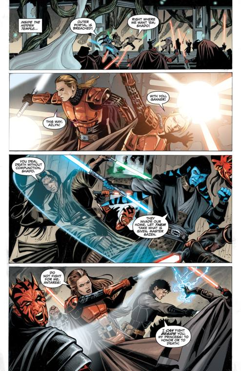
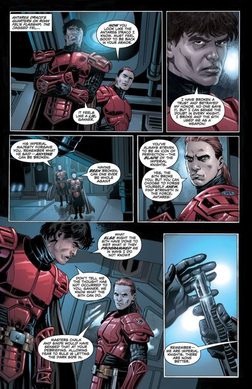
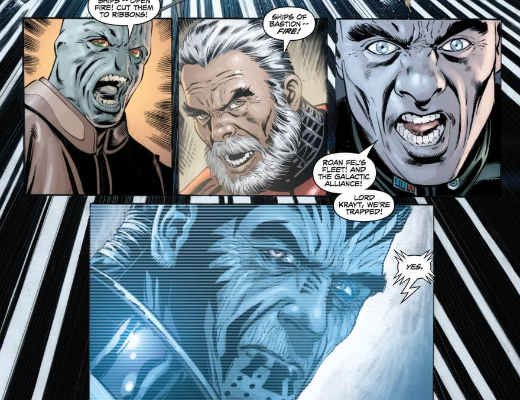
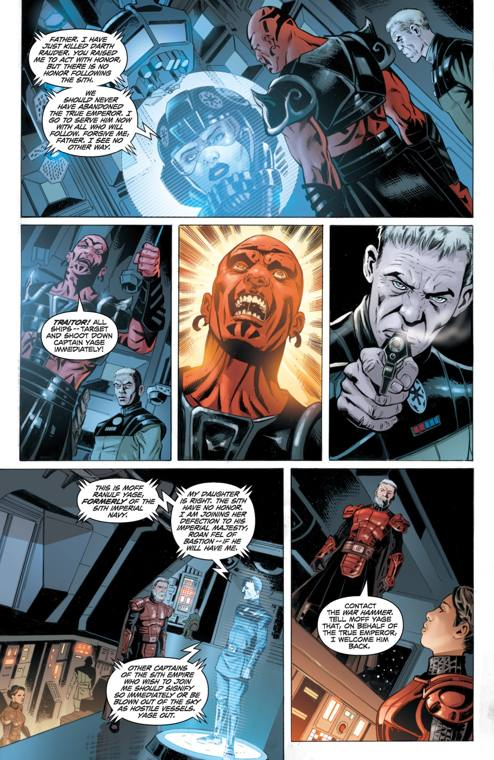
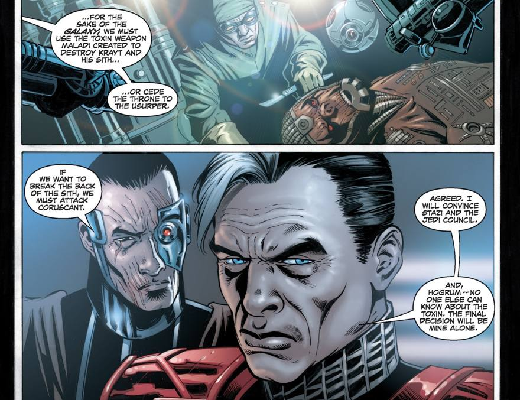
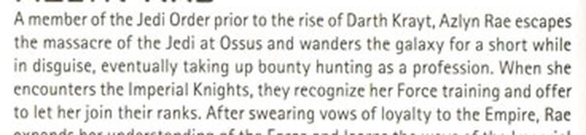
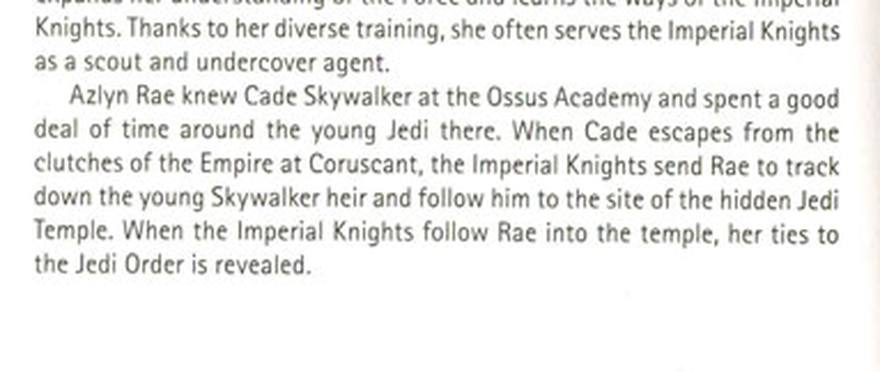
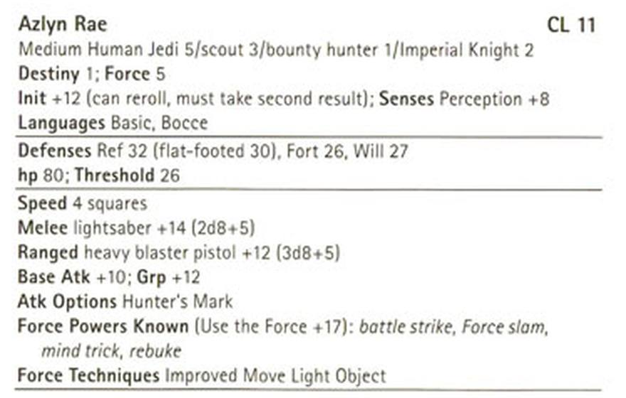

# Azlyn Rae

- **Aliases:** —
- **Era:** —
- **Continuity:** default Legends; entries present for: Legends
- **Research tier:** untiered (not listed as INTRO/DEEP/MASTERY in legends-feats.md)
- **Entries:** 65 (34 with quotations; 1 quotations extended to the full sentence/passage from the source text on file; 53 marked as fragments). Rebuilt 2026-11-17 from 95 old entries; old file: `characters/_bak/azlyn-rae.md.bak-20261117`.
- **How to read:** each entry is the quotation in full (block quote), then its source and point of view. "Note" lines are summaries from our notes, not quotations. `[fragment — full passage not on file]` means the source text is not on the box, so only the words in our notes are shown. Debate and forum material is in the last section and is unverified.

# LEGENDS (Legends / EU — main focus)

## Sourcebooks/Legacy Era Campaign Guide.pdf [Star Wars Roleplaying Game Saga Edition (2007)] (scan pages 1–60)

- Note (summary from our notes, not a quotation): Page contents: Table of contents (species, heroic traits, Force-users in the Legacy era, Imperial Knights, Force-using traditions, vehicles and starships, campaign, planets, Galactic Alliance, Empire, Jedi remnants, Underworld, personalities incl. Cade Skywalker, Darth Krayt, Darth Talon, Darth Wyyrlok, Antares Draco, Marasiah Fel, Azlyn Rae). (hand-read)
  — Source: Sourcebooks/Legacy Era Campaign Guide.pdf [Star Wars Roleplaying Game Sag.
Our notes: `notes/materials/037-sw-d20-folder/719-legacy-era-campaign-guide-scan-001-060.md:25`

- Note (summary from our notes, not a quotation): Page contents: Caption "ANTARES DRACO, IMPERIAL KNIGHT"; Table 3-2 Imperial Knight; Examples of Imperial Knights in Star Wars: Sigel Dare, Antares Draco, Marasiah Fel, Mohrgan Fel, Roan Fel, Ganner Krieg, Azlyn Rae, Treis Sinde, Elke Vetter; requirements; game rule information. (hand-read)
  — Source: Sourcebooks/Legacy Era Campaign Guide.pdf [Star Wars Roleplaying Game Sag.
Our notes: `notes/materials/037-sw-d20-folder/719-legacy-era-campaign-guide-scan-001-060.md:322`

## Sourcebooks/Legacy Era Campaign Guide.pdf [Star Wars Roleplaying Game Saga Edition (2007)] (scan pages 121–180)

> permanent bird's-eye view of the battlefield.
> [fragment — full passage not on file]
— Source: Sourcebooks/Legacy Era Campaign Guide.pdf [Star Wars Roleplaying Game Sag.
Note (our notes, around the quote): Page contents: Caption: "ORON JAEGER." Oron Jaeger: Roan Fel loyalist; cybernetically enhanced Human commanding the 501st Legion; "permanent bird's-eye view of the battlefield." Stat block CL 12 (soldier 10/officer 2). Azlyn Rae introduction. (hand-read)
Our notes: `notes/materials/037-sw-d20-folder/719-legacy-era-campaign-guide-scan-121-180.md:497`

- Note (summary from our notes, not a quotation): Page contents: Caption: "AZLYN RAE." Azlyn Rae stat block CL 11 (Jedi 5/scout 3/bounty hunter 1/Imperial Knight 2). Konrad Rus: head of the Imperial Mission; soft-spoken member of the Council of Moffs; outwardly supports Darth Krayt; a pragmatist. Stat block CL 10 (noble 10). (hand-read)
  — Source: Sourcebooks/Legacy Era Campaign Guide.pdf [Star Wars Roleplaying Game Sag.
Our notes: `notes/materials/037-sw-d20-folder/719-legacy-era-campaign-guide-scan-121-180.md:507`

## Star Wars: Legacy (Dark Horse, 2006–2010) single issues #20–#50, hand-read

> "I DON'T MIND CRIME LORDS, BUT I PURELY HATE STUPID ONES!"
>
> — Bantha Rawk, Star Wars: Legacy #23, p. 21
> [fragment — full passage not on file]
— Source: Star Wars: Legacy #23 — "Loyalties" (Dark Horse, May 2008). POV: Bantha Rawk, about Azlyn Rae.
Context: p19–23: The Mynock reaches Rawk's Nest on Ilego (Extrictarium Nebula) in the middle of a Black Sun attack. Bantha Rawk, Droo, Ahnah, Micah and Skeeto drive it off with the Mynock's help.
Our notes: `notes/materials/039-legacy-2006/legacy-23.md:80`

> "CODE JAMPAHR. HAVE PURSUED SKYWALKER TO GROUND. HE'S ENTERING A COMPOUND. TRANSMITTING COORDINATES." · "LOCKED. I'LL KEEP HIM IN MY SIGHTS AND AWAIT FURTHER INSTRUCTIONS." · "AZLYN RAE -- OUT."
>
> — Azlyn Rae, Star Wars: Legacy #23, p. 24
> [fragment — full passage not on file]
— Source: Star Wars: Legacy #23 — "Loyalties" (Dark Horse, May 2008). POV: Azlyn Rae.
Context: p14/p18: a homing beacon on the Mynock. p19/p24: a masked hunter follows the ship and, at the end, identifies herself:
Our notes: `notes/materials/039-legacy-2006/legacy-23.md:84`

- Note (summary from our notes, not a quotation): (She stands over dead Black Sun fighters on p24, so she has evidently killed some of them.)
  — Source: Star Wars: Legacy #23 — "Loyalties" (Dark Horse, May 2008).
Our notes: `notes/materials/039-legacy-2006/legacy-23.md:88`

> "THIS IS MY TURF AND PEOPLE COME BY INVITE ONLY -- WHICH YOU AIN'T GOT." · "YOU, BANTHA RAWK, DO LIVE UP TO YOUR REP." (Azlyn)
> [fragment — full passage not on file]
>
> — Bantha Rawk
>
> Azlyn Rae, Star Wars: Legacy #24, p. 14
> [fragment — full passage not on file]
>
> "SOMEONE TAUGHT YOU A TRICK OR TWO, GAL. MAYBE GOT SITH TATS UNDER THAT MASK?" · "NOPE. JUST SOME TRICKS I PICKED UP HERE AND THERE. YOU KNOW HOW IT IS, OLD MAN." (Azlyn) · "YOUTH AND SKILL, OLD TIMER --" (Azlyn)
> [fragment — full passage not on file]
>
> — Star Wars: Legacy #24, p. 15
> [fragment — full passage not on file]
>
> "...AIN'T GOT NOTHING ON MY EXPERIENCE." · "I WAS CHECKING THE LONG-RANGE SENSORS WHEN I FELT SOMETHING IN THE FORCE. FIRST YOU, THEN HER. SHE'S PURTY GOOD."
> [fragment — full passage not on file]
>
> — Bantha Rawk, Star Wars: Legacy #24, p. 16
> [fragment — full passage not on file]
— Source: Star Wars: Legacy #24 — "Loyalties, Part Two" (Dark Horse, May 2008). POV: Bantha Rawk, about Azlyn Rae.
Context: 3. Beats Azlyn Rae in a Force-and-lightsaber fight. He senses her coming in the Force. p14–16
Our notes: `notes/materials/039-legacy-2006/legacy-24.md:26`

> — Azlyn Rae, Star Wars: Legacy #24, p. 14
> [fragment — full passage not on file]
>
> "I KNOW YOU... MASTER SKYWALKER AND CADE...WELL, YOU GAVE ME UP FOR DEAD, DIDN'T YOU, CADE?"
> [fragment — full passage not on file]
>
> — Azlyn Rae, Star Wars: Legacy #24, p. 16
> [fragment — full passage not on file]
>
> "...SO AFTER THE SITH ATTACKED THE JEDI TEMPLE ON CORUSCANT, I WAS SEPARATED FROM MY MASTER, RASI TUUM." · "I WANDERED FOR A WHILE, DOING WHATEVER ODD JOBS I COULD GET AND EVENTUALLY FOUND BEING A BOUNTY HUNTER WAS WHAT I DID BEST." · "CAN ONLY BE ONE CADE SKYWALKER IN THE GALAXY -- THE ONE I KNEW WHEN WE WERE APPRENTICES ON OSSUS." · "I THOUGHT YOU DIED ON OSSUS...ALONG WITH YOUR FATHER."
> [fragment — full passage not on file]
>
> — Azlyn Rae, Star Wars: Legacy #24, p. 17
> [fragment — full passage not on file]
— Source: Star Wars: Legacy #24 — "Loyalties, Part Two" (Dark Horse, May 2008). POV: Azlyn Rae.
Context: > "HUH. CADE SKYWALKER. SITH HAVE A HUGE PRICE ON YOUR HEAD. CAN'T SEE WHY. OR WHY YOU HAVE SUCH A BIG REP..."
Our notes: `notes/materials/039-legacy-2006/legacy-24.md:83`

> "MAYBE THEY WERE TRYING TO SELL YOU WHAT YOU WERE WILLING TO BUY, CAPTAIN. MY LICENSE IS IN ORDER WITH THE BOUNTY HUNTERS' GUILD."
>
> — Azlyn Rae, Star Wars: Legacy #24, p. 19
> [fragment — full passage not on file]
— Source: Star Wars: Legacy #24 — "Loyalties, Part Two" (Dark Horse, May 2008). POV: Azlyn Rae.
Context: p19–20: she takes a beating from the Imperial captain and lies to protect Cade.
Our notes: `notes/materials/039-legacy-2006/legacy-24.md:92`

> "EVIDENTLY, THE JEDI HIGH COUNCIL SECRETLY ORDERED THE CREATION OF THIS HIDDEN TEMPLE WHEN THE SITH IMPERIAL WAR BEGAN -- JUST IN CASE. RAWK HELPED FIND A LOCATION FOR IT." · "HE'S TAKING SKYWALKER AND HIS CREW THERE AND I'VE BEEN ALLOWED TO JOIN." · "JAMDHAR OUT."
>
> — Azlyn Rae, Star Wars: Legacy #24, p. 24
> [fragment — full passage not on file]
>
> "POSSIBLE. AZLYN RAE WAS A JEDI APPRENTICE BEFORE SHE JOINED THE KNIGHTS TO COMPLETE HER TRAINING. CONFLICTED LOYALTIES WOULDN'T BE SURPRISING." (red-armored Knight, ponytail — likely Ganner Krieg) · "IF NOT, THE IMPERIAL KNIGHTS HAVE WAYS OF FINDING TRAITORS IN OUR MIDST -- AND DEALING WITH THEM." (Marasiah Fel)
> [fragment — full passage not on file]
>
> — Star Wars: Legacy #24, p. 24
> [fragment — full passage not on file]
— Source: Star Wars: Legacy #24 — "Loyalties, Part Two" (Dark Horse, May 2008). POV: Azlyn Rae.
Context: Twist: she is an Imperial Knight agent ("Jamdhar") reporting to Bastion. p24
Our notes: `notes/materials/039-legacy-2006/legacy-24.md:96`

> I KNOW AZLYN. I'M CONFIDENT HER FIRST LOYALTY IS TO THE FEL EMPIRE AND OUR EMPEROR.
— Source: Star Wars: Legacy #24 — "Loyalties, Part Two" (Dark Horse, May 2008); (The receiving officer signs off "SEFU OUT." The line.
Note (our notes, around the quote): (The receiving officer signs off "SEFU OUT." The line "I KNOW AZLYN. I'M CONFIDENT HER FIRST LOYALTY IS TO THE FEL EMPIRE AND OUR EMPEROR." comes from the ship exterior, so the speaker isn't certain. Probably Antares Draco.)
Our notes: `notes/materials/039-legacy-2006/legacy-24.md:103`

> "NO WAY THEY CAME ON IT BY ACCIDENT. NO WAY THEY SIMPLY FOLLOWED US IN. SOMEONE GUIDED THEM IN. HOMING BEACON, I'M GUESSING." · "HOW MANY CREDS DID THE IMPS PAY YOU TO SELL US OUT, HUH, AZLYN?!" · "IT WASN'T ABOUT CREDS, CADE..." (Azlyn)
> [fragment — full passage not on file]
>
> — Cade Skywalker
>
> Azlyn Rae, Star Wars: Legacy #25, p. 10
> [fragment — full passage not on file]
— Source: Star Wars: Legacy #25 — "The Hidden Temple" (Dark Horse, June 2008).
Context: 2. Works out that Azlyn betrayed them. p10
Our notes: `notes/materials/039-legacy-2006/legacy-25.md:37`

> — Azlyn Rae
>
> Rasi Tuum, Star Wars: Legacy #25, p. 19
> [fragment — full passage not on file]
>
> "I UNDERSTAND YOUR JOINING THE IMPERIAL KNIGHTS. THEY FOUND YOU AT A TIME WHEN IT SEEMED THAT ALL THE JEDI MUST BE DEAD" · "BUT WHAT NOW? DO YOU NOT ALSO HAVE A LOYALTY TO THE JEDI? WHERE IS YOUR HEART, AZLYN RAE -- OR DO YOU KNOW?"
>
> — Rasi Tuum, Star Wars: Legacy #25, p. 19
> [fragment — full passage not on file]
— Source: Star Wars: Legacy #25 — "The Hidden Temple" (Dark Horse, June 2008). POV: Rasi Tuum, about Azlyn Rae.
Context: > "RASI TUUM?! MASTER?!" · "I THOUGHT YOU HAD DIED ON CORUSCANT! I RAN LIKE YOU TOLD ME -- THEN YOU WERE GONE, IN THE BLASTS AND SMOKE!" (Azlyn) · "AHN DIED BY THE HAND OF THE SITH, BUT ZHO STILL LIVES. HE IS CURRENTLY OUT IN THE GALAXY, SEARCHING FOR OTHER JEDI TO BRING HERE." (Rasi)
Our notes: `notes/materials/039-legacy-2006/legacy-25.md:97`

> — Marasiah Fel, Star Wars: Legacy #26, p. 16
> [fragment — full passage not on file]
>
> "THE EMPIRE TOOK ME IN TO FINISH MY TRAINING AND WHEN I BECAME A KNIGHT I SWORE THE OATHS...AND YET..." · "BUT HAS NO IMPERIAL KNIGHT EVER WALKED AWAY?"
> [fragment — full passage not on file]
>
> — Azlyn Rae, Star Wars: Legacy #26, p. 16
> [fragment — full passage not on file]
— Source: Star Wars: Legacy #26 — "The Hidden Temple, Part Two" (Dark Horse, July 2008). POV: Marasiah Fel, about Azlyn Rae.
Context: > "I'M SENSING SOME AMBIVALENCE IN YOU, AZLYN." · "THOSE OATHS WERE FOR LIFE, MASTER RAE. THERE IS NO WALKING AWAY FROM THAT." · "ONLY ONE. HIS OATHS WERE ALSO FOR LIFE AND HIS LIFE PROVED SHORT. ONE WAY OR ANOTHER, HIS OATHS WERE HONORED."
Our notes: `notes/materials/039-legacy-2006/legacy-26.md:89`

> — Deliah Blue, Star Wars: Legacy #28, p. 5
> [fragment — full passage not on file]
>
> "WE'RE BETTER, GANNER." · "BECAUSE WE'RE IMPERIAL KNIGHTS?" (Krieg) · "YES." (Draco) · "HE ISN'T ONE OF US, KRIEG. HE WOULD NEVER BE ONE OF US. HE LACKS DISCIPLINE." (Draco, of Shado Vao)
> [fragment — full passage not on file]
>
> — Antares Draco
>
> Ganner Krieg, Star Wars: Legacy #28, p. 6
> [fragment — full passage not on file]
>
> "A PIRATE RESCUED YOU! THAT'S WHAT YOU BECAME! AN IMPERIAL KNIGHT RESCUED ME. THEY FINISHED MY TRAINING -- I OWE THEM..."
> [fragment — full passage not on file]
>
> — Azlyn Rae, Star Wars: Legacy #28, p. 7
> [fragment — full passage not on file]
>
> "I SENSE MORE THAN JUST THAT. THERE'S A JEDI ON THAT SHIP, I THINK. OR A SITH." (Cade) · "WHICH DID YOU SENSE -- JEDI OR SITH? ... IT HAS TO BE ONE OR THE OTHER. CAN'T BE BOTH." (Draco) · "OH, YOU MEAN LIKE ME." (Cade)
> [fragment — full passage not on file]
>
> — Star Wars: Legacy #28, p. 12
> [fragment — full passage not on file]
— Source: Star Wars: Legacy #28 — "Vector, Part 9 of 12" (Dark Horse, September 2008). POV: Deliah Blue, about Azlyn Rae.
Context: > "IS IT JUST ME, SYN, OR IS CADE'S PLAN -- TO LURE DARTH KRAYT TO HAD ABBADON SO WE CAN KILL HIM -- CRAZY?"
Our notes: `notes/materials/039-legacy-2006/legacy-28.md:42`

> — Star Wars: Legacy #29, p. 11
> [fragment — full passage not on file]
>
> "I WAS TAUGHT THAT AN IMPERIAL KNIGHT SERVES THE FORCE AS EMBODIED BY THE EMPEROR! HE SHOULD NEVER, MUST NEVER, ASK US TO DO ANYTHING DISHONORABLE -- AND THIS IS! THE MUUR TALISMAN IS A FOUL SITH DEVICE!"
>
> — Azlyn Rae, Star Wars: Legacy #29, p. 11
> [fragment — full passage not on file]
>
> "IT IS NOT ACCEPTABLE. IF AZLYN WILL NOT OBEY -- WORSE, IF SHE SPEAKS OF WHAT SHE KNOWS -- I MAY HAVE TO KILL HER." (Draco) · "YOU'LL HAVE TO KILL ME FIRST." (Krieg)
> [fragment — full passage not on file]
>
> — Star Wars: Legacy #29, p. 12
> [fragment — full passage not on file]
>
> "AS IMPERIAL KNIGHTS, WE OBEY THE EMPEROR BUT ONLY AS LONG AS THE EMPEROR SERVES THE LIGHT SIDE OF THE FORCE. SHOULD HE EVER TURN TO THE DARK SIDE, OUR DUTY IS TO BRING HIM BACK TO THE LIGHT OR TO REMOVE HIM. IT IS TO THE FORCE THAT WE ULTIMATELY OWE OUR ALLEGIANCE, DRACO."
>
> — Ganner Krieg, Star Wars: Legacy #29, p. 12
> [fragment — full passage not on file]
— Source: Star Wars: Legacy #29 — "Vector, Part 10 of 12" (Dark Horse, October 2008). POV: Azlyn Rae.
Context: > "IF WE SUCCEED IN THIS, NOTHING WILL STAND IN THE WAY OF A UNION BETWEEN PRINCESS SIA AND MYSELF." (Draco) · "THE STORMTROOPERS WE SAW IT USED ON WERE IMPERIAL TROOPS WHO ONCE SERVED THE SAME EMPEROR WE SERVE!" (Azlyn) · "THEY SERVED KRAYT AND THAT MAKES THEM TRAITORS! AS IMPERIAL KNIGHTS, WE SERVE THE EMPEROR'S WILL!" (Draco)
Our notes: `notes/materials/039-legacy-2006/legacy-29.md:38`

> — Star Wars: Legacy #29, p. 18
> [fragment — full passage not on file]
>
> "THE TALISMAN IS AN ABOMINATION! IT WILL POISON US ALL! IT HAS POISONED HER! ... I CAN'T LET HER JUST TURN THEM INTO RAKGHOULS! I HAVE TO TAKE IT FROM HER!" · "CELESTE MORNE IS EVIL AND SHE MUST DIE -- EVEN IF I HAVE TO TAKE THE TALISMAN ON MYSELF!"
> [fragment — full passage not on file]
>
> — Azlyn Rae, Star Wars: Legacy #29, p. 19
> [fragment — full passage not on file]
>
> "ALWAYS LOVED YOU, CADE -- ALWAYS HOPED SOMEDAY... AND THEN THE MASSACRE ON OSSUS HAPPENED AND YOU WERE GONE. ... WHEN YOU HEALED ME, IT ALL CAME FLOODING BACK."
> [fragment — full passage not on file]
>
> — Azlyn Rae, Star Wars: Legacy #29, p. 20
> [fragment — full passage not on file]
>
> "IT'S THAT VOICE AGAIN! DON'T YOU HEAR IT?!" (Azlyn) · "YEAH. LIKE SAND ON METAL -- HEARD IT EVER SINCE WE TOOK CELESTE ABOARD THE MYNOCK." (Cade)
> [fragment — full passage not on file]
>
> — Star Wars: Legacy #29, p. 21
> [fragment — full passage not on file]
— Source: Star Wars: Legacy #29 — "Vector, Part 10 of 12" (Dark Horse, October 2008). POV: Azlyn Rae.
Context: > "DON'T YOU GET IT?! MORNE -- THAT TALISMAN -- IS MORE DANGEROUS THAN DARTH KRAYT CAN EVER BE! SHE MUST BE KILLED!" (Azlyn) · "BESIDES, KILLING SOMEONE IN COLD BLOOD -- NOT SOMETHING A JEDI WOULD DO." (Cade)
Our notes: `notes/materials/039-legacy-2006/legacy-29.md:70`

> BASTION, IMPERIAL KNIGHTS QUARTERS, PRACTICE ROOM... *(caption)*
> [fragment — full passage not on file]
>
> SON OF A RUSKAKK! GANNER! STOP GOING SO EASY! LET MASTER RAE TEST THE ARMOR! IF IT'S A PIECE OF CHIZK, BETTER TO KNOW NOW THAN WHEN SHE'S FACING SOME SITH NEK! *(bearded Imperial Knight — unnamed, flag)*
>
> DON'T...HOLD BACK, GANNER! I HAVE TO KNOW... WHAT THIS ARMOR ...CAN DO! *(Azlyn Rae)*
> [fragment — full passage not on file]
>
> WHAT MAKES YOU THINK...I'M HOLDING BACK, AZLYN?! *(Ganner Krieg)*
> [fragment — full passage not on file]
— Source: Star Wars: Legacy #43 — "Monster, Part One" (Dec 2009). POV: Azlyn Rae.
Note (our notes, around the quote): > "BASTION, IMPERIAL KNIGHTS QUARTERS, PRACTICE ROOM..." (caption) / "SON OF A RUSKAKK! GANNER! STOP GOING SO EASY! LET MASTER RAE TEST THE ARMOR! IF IT'S A PIECE OF CHIZK, BETTER TO KNOW NOW THAN WHEN SHE'S FACING SOME SITH NEK!" (bearded Imperial Knight — unnamed, flag) / "DON'T...HOLD BACK, GANNER! I HAVE TO KNOW... WHAT THIS ARMOR ...CAN DO!" (Azlyn Rae) / "WHAT MAKES YOU THINK...I'M HOLDING BACK, AZLYN?!" (Ganner Krieg)
Our notes: `notes/materials/039-legacy-2006/legacy-43.md:149`

- Note (summary from our notes, not a quotation): (Feat: Azlyn Rae, in a full new armored suit (replacing Rawk's crude life-support), spars with Ganner Krieg at full strength (p21). Lore: Hogrum Chalk, cyborg former Imperial Knight, is the Knights' master armorer.)
  — Source: Star Wars: Legacy #43 — "Monster, Part One" (Dec 2009).
Our notes: `notes/materials/039-legacy-2006/legacy-43.md:155`

> "THEY HAVE HER. THE SITH HAVE PRINCESS MARASIAH! I FAILED MY DUTY, MASTER RASI TUUM!" (Azlyn Rae)
>
> "IT IS THE WILL OF THE FORCE, AZLYN RAE. JUST AS IT IS THE WILL OF THE FORCE THAT YOUR ARMOR PROTECTED YOU. AS IT IS THAT WE FOUND THIS SHIP." (Rasi Tuum)
>
> "THEN IT IS THE WILL OF THE FORCE THAT WE FIND THE PRINCESS AND RESCUE HER! IF YOU CAN EVEN WALK."
>
> "I...CAN WALK..." (Azlyn)
>
> "...BUT TO LOCATE THE PRINCESS WILL BE ALMOST IMPOSSIBLE, AZLYN -- LET ALONE RESCUE HER! BETTER TO GET TO BASTION. TELL YOUR EMPEROR ABOUT THE PRINCESS SO THAT HE KNOWS." (Rasi Tuum)
> [fragment — full passage not on file]
— Source: Star Wars: Legacy #48 — "Extremes, Part One" (May 2010). POV: Azlyn Rae.
Context: — Star Wars: Legacy #48, p. 6
Our notes: `notes/materials/039-legacy-2006/legacy-48.md:39`

- Note (summary from our notes, not a quotation): Feat: Draco disguised in Sith tattoos, masks his presence with anger to pass as Sith on Korriban; "captives" = Azlyn Rae and a pale masked companion (Ganner Krieg? flag) plus a blue-skinned figure (T'ra Saa? flag, p17 middle).
  — Source: Star Wars: Legacy #49 — "Extremes, Part Two" (Jun 2010).
Our notes: `notes/materials/039-legacy-2006/legacy-49.md:151`

## Star Wars: Legacy—War #1–6 (2010–11): power-scaling notes with panels

- Note (summary from our notes, not a quotation): Imperial Knights Ganner Krieg, Azlyn Rae, Sigel (Dare), Treis Sinde and Rand Ko.
  — Source: Legacy—War #1–6 (2010–11): power-scaling notes with panels.
Context: Fel Empire:
Our notes: `notes/materials/010-legacy-war.md:62`

- Note (summary from our notes, not a quotation): p67: "THIS WAY, AZLYN!" / Azlyn: "WITH YOU, GANNER!"
  — Source: Legacy—War #1–6 (2010–11): power-scaling notes with panels.
Context: Ganner Krieg:

Our notes: `notes/materials/010-legacy-war.md:737`

> THAT GOT IT, AZLYN!
> [fragment — full passage not on file]
— Source: Legacy—War #1–6 (2010–11): power-scaling notes with panels.
Note (our notes, around the quote): p72: with Azlyn, downs a walker/droid with saber and Force burst: "THAT GOT IT, AZLYN!"
Context: Ganner Krieg:
Our notes: `notes/materials/010-legacy-war.md:738`

> YES, THE SITH BROKE YOU, BUT YOU CAN CHOOSE TO FORGE YOURSELF ANEW. FIND STRENGTH IN THE FORCE, ANTARES!
>
> MASTERS CHALK AND SINDE WOULD HAVE SENSED THAT AT YOUR DEBRIEFING. ALLOWING FEAR TO RULE IS LETTING THE DARK SIDE IN.
>
> REMEMBER -- WE ARE IMPERIAL KNIGHTS. THERE ARE NONE BETTER.
— Source: Legacy—War #1–6 (2010–11): power-scaling notes with panels; p98.
Context: Ganner Krieg:

Our notes: `notes/materials/010-legacy-war.md:739`

> SHIPS OF BASTION -- FIRE!
> [fragment — full passage not on file]
— Source: Legacy—War #1–6 (2010–11): power-scaling notes with panels; p69.
Note (our notes, around the quote): p69: "SHIPS OF BASTION -- FIRE!" The intro-tier speaker is right; this is not Fel.
Context: Treis Sinde:

Our notes: `notes/materials/010-legacy-war.md:741`

> WE DON'T HAVE THEM YET, ADMIRAL STAZI.
— Source: Legacy—War #1–6 (2010–11): power-scaling notes with panels; p71.
Context: Treis Sinde:
Our notes: `notes/materials/010-legacy-war.md:742`

> AND SOMEBODY TELL ME WHAT WE'RE UP AGAINST!
— Source: Legacy—War #1–6 (2010–11): power-scaling notes with panels; p76.
Context: Treis Sinde:
Our notes: `notes/materials/010-legacy-war.md:743`

> CONTACT THE WAR HAMMER. TELL MOFF YAGE THAT, ON BEHALF OF THE TRUE EMPEROR, I WELCOME HIM BACK.
— Source: Legacy—War #1–6 (2010–11): power-scaling notes with panels; p83.
Context: Treis Sinde:

Our notes: `notes/materials/010-legacy-war.md:744`

> MASTER DRACO IS RIGHT -- THIS IS DARK SIDE. PLEASE. STEP AWAY, OLD FRIEND.
— Source: Legacy—War #1–6 (2010–11): power-scaling notes with panels; p120.
Note (our notes, around the quote): p120: "MASTER DRACO IS RIGHT -- THIS IS DARK SIDE. PLEASE. STEP AWAY, OLD FRIEND." He is then pushed through glass with Marasiah.
Context: Treis Sinde:

Our notes: `notes/materials/010-legacy-war.md:745`

> We could not rescue her from there if we had a thousand ships! *(W)*
— Source: Legacy—War #1–6 (2010–11): power-scaling notes with panels; Not found.
Label in our notes: W
Context: Treis Sinde:
Our notes: `notes/materials/010-legacy-war.md:746`

- Note (summary from our notes, not a quotation): Sigel (Dare): p111, "SIGEL!". She is impaled through the chest by a red saber in the tunnel melee. Her fate is not shown on later pages (Wookieepedia: she survived).
  — Source: Legacy—War #1–6 (2010–11): power-scaling notes with panels.
Our notes: `notes/materials/010-legacy-war.md:747`

- Note (summary from our notes, not a quotation): Defence centre (p101–102):
  — Source: Legacy—War #1–6 (2010–11): power-scaling notes with panels.
Our notes: `notes/materials/010-legacy-war.md:748`

- Note (summary from our notes, not a quotation): A ponytailed female Knight is beside the maned Jedi when officers are Force-blasted (p101).
  — Source: Legacy—War #1–6 (2010–11): power-scaling notes with panels.
Context: Defence centre (p101–102):
Our notes: `notes/materials/010-legacy-war.md:749`

- Note (summary from our notes, not a quotation): A blonde-ponytailed Knight slices consoles (p102).
  — Source: Legacy—War #1–6 (2010–11): power-scaling notes with panels.
Context: Defence centre (p101–102):
Our notes: `notes/materials/010-legacy-war.md:750`

- Note (summary from our notes, not a quotation): A brown-haired female Knight has lightning crackling around her raised hand (p102). Whether it is her own lightning or deflected is UNCLEAR. Don't cite it as an Imperial Knight lightning feat.
  — Source: Legacy—War #1–6 (2010–11): power-scaling notes with panels.
Context: Defence centre (p101–102):
Our notes: `notes/materials/010-legacy-war.md:751`

> Tuum and Rae blast technicians with telekinesis
> [fragment — full passage not on file]
— Source: Legacy—War #1–6 (2010–11): power-scaling notes with panels; Wookieepedia's.
Note (our notes, around the quote): Wookieepedia's "Tuum and Rae blast technicians with telekinesis": the page shows a maned Jedi with violet-glowing hands blasting officers, with a female Knight beside him. Neither is named on the page.
Context: Defence centre (p101–102):
Our notes: `notes/materials/010-legacy-war.md:752`

- Note (summary from our notes, not a quotation): Rand Ko: p32, a holo from the lost Borosk front.
  — Source: Legacy—War #1–6 (2010–11): power-scaling notes with panels.
Our notes: `notes/materials/010-legacy-war.md:753`

- Note (summary from our notes, not a quotation): p12: Bastion intelligence head.
  — Source: Legacy—War #1–6 (2010–11): power-scaling notes with panels.
Context: Hogrum Chalk:

Our notes: `notes/materials/010-legacy-war.md:755`

> NYNA CALIXTE IS ROAN FEL'S SPY ON CORUSCANT.
— Source: Legacy—War #1–6 (2010–11): power-scaling notes with panels; p38: Veed's informant (.
Context: Hogrum Chalk:

Our notes: `notes/materials/010-legacy-war.md:756`

- Note (summary from our notes, not a quotation): p34: argues for Omega Red.
  — Source: Legacy—War #1–6 (2010–11): power-scaling notes with panels.
Context: Hogrum Chalk:
Our notes: `notes/materials/010-legacy-war.md:757`

> THE PURITY OF ITS HATE!
> [fragment — full passage not on file]
— Source: Legacy—War #1–6 (2010–11): power-scaling notes with panels; p95.
Context: Hogrum Chalk:

Our notes: `notes/materials/010-legacy-war.md:758`

- Note (summary from our notes, not a quotation): p132: the cyborg official giving Fel's eulogy matches Chalk's cyborg look. He is not named on that page; Wookieepedia says Chalk.
  — Source: Legacy—War #1–6 (2010–11): power-scaling notes with panels.
Context: Hogrum Chalk:

Our notes: `notes/materials/010-legacy-war.md:759`

> WE ARE IMPERIAL KNIGHTS. THERE ARE NONE BETTER.
— Source: Legacy—War #1–6 (2010–11): power-scaling notes with panels; ![p98 Krieg.
Note (our notes, around the quote): 
(*Panel: p98 — `p098-krieg-none-better.jpg`*)
Our notes: `notes/materials/010-legacy-war.md:761`

- Note (summary from our notes, not a quotation): Roan Fel, Marasiah, Draco, Krieg, Azlyn Rae, Sigel, Sinde and Chalk.
  — Source: Legacy—War #1–6 (2010–11): power-scaling notes with panels.
Context: Covers:
Our notes: `notes/materials/010-legacy-war.md:1142`

## Star Wars Saga Edition: *Legacy Era Campaign Guide* (WotC 2009): power-scaling notes with panels

- Note (summary from our notes, not a quotation): | 13 | Azlyn Rae | p180 | 11 | Jedi 5 / scout 3 / bounty hunter 1 / IK 2 | +17 | 32 (ff 30) / 26 / 27 | 80 (26) | — | 1 / 5 | +14 (2d8+5) |
  — Source: *Legacy Era Campaign Guide* (WotC 2009): power-scaling notes with panels.
Context: | # | Character | Page | CL | Classes | UtF | Ref / Fort / Will | HP (Thr.) | DSS | Destiny / FP | Best lightsaber line |
Our notes: `notes/materials/011-legacy-era-campaign-guide.md:128`

> A member of the Jedi Order prior to the rise of Darth Krayt, Azlyn Rae escapes the massacre of the Jedi at Ossus… eventually taking up bounty hunting as a profession. When she encounters the Imperial Knights, they recognize her Force training and offer to let her join their ranks.
> [fragment — full passage not on file]
— Source: *Legacy Era Campaign Guide* (WotC 2009): power-scaling notes with panels.
Context: Bio:

Our notes: `notes/materials/011-legacy-era-campaign-guide.md:519`

> Thanks to her diverse training, she often serves the Imperial Knights as a scout and undercover agent.
— Source: *Legacy Era Campaign Guide* (WotC 2009): power-scaling notes with panels.
Context: Bio:

Our notes: `notes/materials/011-legacy-era-campaign-guide.md:521`

- Note (summary from our notes, not a quotation): CL 11; Jedi 5/scout 3/bounty hunter 1/IK 2. Destiny 1; Force 5.
  — Source: *Legacy Era Campaign Guide* (WotC 2009): power-scaling notes with panels.
Context: Stat (p180):

Our notes: `notes/materials/011-legacy-era-campaign-guide.md:524`

- Note (summary from our notes, not a quotation): Ref 32 (ff 30), Fort 26, Will 27. hp 80.
  — Source: *Legacy Era Campaign Guide* (WotC 2009): power-scaling notes with panels.
Context: Stat (p180):
Our notes: `notes/materials/011-legacy-era-campaign-guide.md:525`

- Note (summary from our notes, not a quotation): lightsaber +14 (2d8+5).
  — Source: *Legacy Era Campaign Guide* (WotC 2009): power-scaling notes with panels.
Context: Stat (p180):
Our notes: `notes/materials/011-legacy-era-campaign-guide.md:526`

- Note (summary from our notes, not a quotation): Force Powers (UtF +17): battle strike, Force slam, mind trick, rebuke.
  — Source: *Legacy Era Campaign Guide* (WotC 2009): power-scaling notes with panels.
Context: Stat (p180):

Our notes: `notes/materials/011-legacy-era-campaign-guide.md:527`

- Note (summary from our notes, not a quotation): 
  — Source: *Legacy Era Campaign Guide* (WotC 2009): power-scaling notes with panels.
(*Panel: p179 Azlyn Rae bio — `p179-azlyn-rae-bio.jpg`*)
Our notes: `notes/materials/011-legacy-era-campaign-guide.md:529`

- Note (summary from our notes, not a quotation): 
  — Source: *Legacy Era Campaign Guide* (WotC 2009): power-scaling notes with panels.
(*Panel: p180 Azlyn Rae CL 11 — `p180-azlyn-rae-stat.jpg`*)
Our notes: `notes/materials/011-legacy-era-campaign-guide.md:532`

- Note (summary from our notes, not a quotation): Fel Empire: Emperor Roan Fel (CL20), Antares Draco (CL15), Azlyn Rae (CL11), Marasiah Fel (CL10), the generic Imperial Knight (CL11), Knighthunter (CL7).
  — Source: *Legacy Era Campaign Guide* (WotC 2009): power-scaling notes with panels.
Our notes: `notes/materials/011-legacy-era-campaign-guide.md:1102`

## https://starwars.fandom.com/wiki/Cade_Skywalker

- Note (summary from our notes, not a quotation): Cade used the power to cure himself and Azlyn Rae of the Rakghoul plague, impressing Celeste Morne and Karness Muur. [27]
  — Source: UNSOURCED on Wookieepedia (sentence found in "Cade Skywalker" rev 15549841 but it has no inline citation in its paragraph; approximate match 0.74, verify) — Cade Skywalker — article extraction — https://starwars.fandom.com/wiki/Cade_Skywalker.
(Source: UNSOURCED on Wookieepedia (sentence found in "Cade Skywalker" rev 15549841 but it has no inline citation in its paragraph; approximate match 0.74, verify))
Our notes: `external/mega-notes/cade-skywalker-quotes.txt:41`

## https://starwars.fandom.com/wiki/Darth_Krayt

> However, during a skirmish on Had Abbadon, Krayt was stabbed, electrocuted, and sent hurtling off a cliff. The Sith Lord's powers proved strong, however, when they saved his life.
— Source: UNSOURCED on Wookieepedia (sentence found in "Darth Krayt" rev 15688608 but it has no inline citation in its paragraph; exact text match) — Darth Krayt — feat/statement extraction from Wookieepedia — https://starwars.fandom.com/wiki/Darth_Krayt.
Note (our notes, around the quote): [Pre-rebirth feat] Section: opening biography. “However, during a skirmish on Had Abbadon, Krayt was stabbed, electrocuted, and sent hurtling off a cliff. The Sith Lord's powers proved strong, however, when they saved his life.” Scaling/context: this is before the later murder and resurrection; the detailed account says he cushioned the fall with the Force after Azlyn Rae’s stab and Morne/Muur’s lightning and Force-push.
(Source: UNSOURCED on Wookieepedia (sentence found in "Darth Krayt" rev 15688608 but it has no inline citation in its paragraph; exact text match))
Our notes: `external/mega-notes/krayt-legends-quotes.txt:14`

> At the bottom of the cliff, Darth Wyyrlok, having landed his shuttle nearby, approached the Emperor's body, declaring that he would be taken to the tomb of the Sith on Korriban. To his surprise, Krayt woke, having cushioned his fall with the Force.
— Source: Legacy (2006) 31 [per Wookieepedia "Darth Krayt" rev 15688608, ref 2; exact text match]; per Wookieepedia "Darth Krayt" rev 15688608, ref 2; exact text match — Darth Krayt — feat/statement extraction from Wookieepedia — https://starwars.fandom.com/wiki/Darth_Krayt.
Note (our notes, around the quote): [Pre-rebirth combat / survival feat] Section: Betrayer of the dream. “At the bottom of the cliff, Darth Wyyrlok, having landed his shuttle nearby, approached the Emperor's body, declaring that he would be taken to the tomb of the Sith on Korriban. To his surprise, Krayt woke, having cushioned his fall with the Force.” Scaling/context: this followed Azlyn Rae’s stab, Morne/Muur’s lightning and Force-push, and the cliff fall; Wyyrlok then electrocuted him.
(Source: Legacy (2006) 31 [per Wookieepedia "Darth Krayt" rev 15688608, ref 2; exact text match])
Our notes: `external/mega-notes/krayt-legends-quotes.txt:138`

> The Dark Lord was able to hold his own against Karness Muur, who was one of the founding members of the Sith Order, supposedly comperable to Darth Sidious, and who claimed to have easily killed other Sith Lords who were stronger than Krayt.
— Source: Legacy (2006) 31 ; Dark Times 12 [per Wookieepedia "Darth Krayt" rev 15688608, ref 2,69; exact text match]; per Wookieepedia "Darth Krayt" rev 15688608, ref 2,69; exact text match — Darth Krayt — feat/statement extraction from Wookieepedia — https://starwars.fandom.com/wiki/Darth_Krayt.
Note (our notes, around the quote): [Pre-rebirth feat] Section: Lightsaber and Martial Arts Skills. “The Dark Lord was able to hold his own against Karness Muur, who was one of the founding members of the Sith Order, supposedly comperable to Darth Sidious, and who claimed to have easily killed other Sith Lords who were stronger than Krayt.” Scaling/context: the article says Muur’s spirit was joined with Celeste Morne and that Krayt was not harmed until Azlyn Rae’s backstab broke his focus.
(Source: Legacy (2006) 31 ; Dark Times 12 [per Wookieepedia "Darth Krayt" rev 15688608, ref 2,69; exact text match])
Our notes: `external/mega-notes/krayt-legends-quotes.txt:228`

# Debate and forum claims (unverified)

Forum posts, Suspect Insight debates and Discord debates, respect threads, and verdicts. These are posters' arguments or quotations they typed; none is checked against the book here unless the entry says so.

## https://comicvine.gamespot.com/forums/gen-discussion-1/emperor-krayt-respect-thread-1684455/

> It doesn’t mean Muur was more powerful than Krayt, merely that he ”outshone” everyone else when he blasted Krayt off the cliff: “But a third Force-user possessed powers that outshone them both. Karness Muur, an ancient Sith spirit, blasted Krayt with overpowering energy, sending him over a cliff to the rocks below.” *(Insider #113; comic Legacy #?, Vector arc, issue not given in thread)*
— Source: CITED EXTRACTION: "Emperor Krayt Respect Thread" (Comic Vine, NewGuy12, 6/19/2015, marked INCOMPLETE) — https://comicvine.gamespot.com/forums/gen-discussion-1/emperor-krayt-respect-thread-1684455/.
(Full sentence/passage taken from the source text on file: `research_suspect_insight_raw_threads_002_txt`.)
Note (our notes, around the quote): F: before the cliff: stabbed by Azlyn Rae, hit by Karness Muur's lightning, thrown off a cliff, still conscious; downed only by Wyyrlok's betrayal. "Karness Muur... blasted Krayt with overpowering energy, sending him over a cliff" (Insider #113; comic Legacy #?, Vector arc, issue not given in thread)
Posted by: not named in our notes (see thread/notes link).
Our notes: `external/mega-notes/krayt-comicvine-respect.txt:21`

- Note (summary from our notes, not a quotation): While suffering from a terminal illness, Darth Krayt is stabbed stabbed by Azlyn Rae, blasted by Karness Muur’s Force Lightning Storm, and then thrown off of a  (issue unknown (source not named in thread)) [panel: panels/krayt/krayt-suffering-terminal-illness-darth-krayt-stabbed-stabbed-1.png; panels/krayt/krayt-suffering-terminal-illness-darth-krayt-stabbed-stabbed-2.png; panels/krayt/krayt-suffering-terminal-illness-darth-krayt-stabbed-stabbed-3.png; panels/krayt/krayt-suffering-terminal-illness-darth-krayt-stabbed-stabbed-4.png]
  — Source: CITED EXTRACTION: "Emperor Krayt Respect Thread" (Comic Vine, NewGuy12, 6/19/2015, marked INCOMPLETE) — https://comicvine.gamespot.com/forums/gen-discussion-1/emperor-krayt-respect-thread-1684455/.
Posted by: not named in our notes (see thread/notes link).
Our notes: `external/mega-notes/krayt-comicvine-respect.txt:43`

## Vong Krayt (Azronger) vs Darth Tyranus (HP_Legend)

- Note (summary from our notes, not a quotation): Krayt vs Karness Muur (Legacy #31-33): Krayt had been ignoring the coral seeds for 7 years; Morne+Muur combined power; Krayt never drew his second saber; Azlyn Rae stabbed Krayt while Morne-Muur blasted him off a cliff, yet he survived; the solicitation only "proposes a possibility".
  — Source: Vong Krayt (Azronger) vs Darth Tyranus (HP_Legend) — https://www.suspectinsightforums.com/t14-ss-the-tyrannical-ten-darth-krayt-azronger-vs-darth-tyranus-arkhamasylum3.
Posted by: not named in our notes (see thread/notes link).
Our notes: `suspect-insight/debates/002-vong-krayt-vs-darth-tyranus.md:38`

## Cade Skywalker Respect Thread (Updated 2017) — respect-thread notes

- Note (summary from our notes, not a quotation): Cade Skywalker uses Dark Transfer to heal himself and Azlyn Rae of the Rakghoul plague:
  — Source: SI respect-thread directory: Cade Skywalker Respect Thread (Updated 2017) — https://web.archive.org/web/20190902075103/https://comicvine.gamespot.com/profile/darthant66/blog/cade-skywalker-respect-thread-updated-2017/97726/.
Posted by: not named in our notes (see thread/notes link).
Our notes: `suspect-insight/respect-threads/cade-skywalker.md:281`

- Note (summary from our notes, not a quotation): [image: data:image/gif;base64,R0lGODlhAQABAAAAACH5BAEKAAEALAAAAAABAAEAAAICTAEAOw==]
  — Source: SI respect-thread directory: Cade Skywalker Respect Thread (Updated 2017) — https://web.archive.org/web/20190902075103/https://comicvine.gamespot.com/profile/darthant66/blog/cade-skywalker-respect-thread-updated-2017/97726/.
Posted by: not named in our notes (see thread/notes link).
Context: Cade Skywalker uses Dark Transfer to heal himself and Azlyn Rae of the Rakghoul plague:
Our notes: `suspect-insight/respect-threads/cade-skywalker.md:282`
