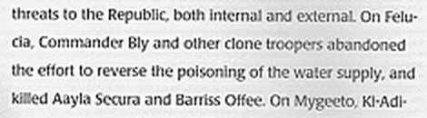

# Barriss Offee

- **Aliases:** Barriss
- **Era:** Clone Wars
- **Continuity:** default Legends; entries present for: Legends
- **Research tier:** untiered (not listed as INTRO/DEEP/MASTERY in legends-feats.md)
- **Entries:** 58 (20 with quotations; 0 quotations extended to the full sentence/passage from the source text on file; 10 marked as fragments; 11 before the 2026-11-17 fragment fill). Rebuilt 2026-11-17 from 73 old entries; old file: `characters/_bak/barriss-offee.md.bak-20261117`.
- **How to read:** each entry is the quotation in full (block quote), then its source and point of view. "Note" lines are summaries from our notes, not quotations. `[fragment — full passage not on file]` means the source text is not on the box, so only the words in our notes are shown. Debate and forum material is in the last section and is unverified.

# LEGENDS (Legends / EU — main focus)

## Star Wars: The New Essential Chronology (Del Rey, 2005): power-scaling and lore notes

> Barriss Offee discovered that the bota acted as a Force magnifier for her Jedi perceptions, and briefly flirted with an addiction to the medicinal mold.
— Source: Part Two: The Fall of the Republic; Barriss Offee — bota as Force magnifier.
Note (our notes, around the quote): Barriss Offee — bota as Force magnifier: "Barriss Offee discovered that the bota acted as a Force magnifier for her Jedi perceptions, and briefly flirted with an addiction to the medicinal mold." Source: The New Essential Chronology, p.74
Our notes: `notes/materials/027-new-essential-chronology/02-part-two-fall-of-the-republic.md:396`

> On Felucia, Commander Bly and other clone troopers abandoned the effort to reverse the poisoning of the water supply, and killed Aayla Secura and Barriss Offee.
— Source: Part Two: The Fall of the Republic.
Note (our notes, around the quote): Aayla Secura; Barriss Offee; Ki-Adi-Mundi; Plo Koon; Stass Allie; Obi-Wan Kenobi; Yoda — Order 66: "On Felucia, Commander Bly and other clone troopers abandoned the effort to reverse the poisoning of the water supply, and killed Aayla Secura and Barriss Offee." Source: The New Essential Chronology, p.84

Our notes: `notes/materials/027-new-essential-chronology/02-part-two-fall-of-the-republic.md:518`

## The Complete Star Wars Encyclopedia, Vol. II (H–O)

> At the height of the Clone Wars, Separatist forces tried to capture Ilum and destroy the crystal mines, but they were defeated by Jedi Masters Yoda and Luminara Unduli, along with Barriss Offee and Padmé Amidala.
— Source: scan pages 81–120; Yoda; Luminara Unduli; Barriss Offee; Padmé Amidala.
Note (our notes, around the quote): Yoda; Luminara Unduli; Barriss Offee; Padmé Amidala: "At the height of the Clone Wars, Separatist forces tried to capture Ilum and destroy the crystal mines, but they were defeated by Jedi Masters Yoda and Luminara Unduli, along with Barriss Offee and Padmé Amidala." Source: The Complete Star Wars Encyclopedia, Vol. II, p.84
Our notes: `notes/materials/031-complete-star-wars-encyclopedia-vol-2/02-v2-scan-081-120.md:69`

> Clone troopers led by Jedi Luminara Unduli and Barriss Offee were able to defeat the Separatist forces and free the settlers.
— Source: scan pages 361–400; Luminara Unduli; Barriss Offee.
Note (our notes, around the quote): Luminara Unduli; Barriss Offee: "Clone troopers led by Jedi Luminara Unduli and Barriss Offee were able to defeat the Separatist forces and free the settlers." Source: The Complete Star Wars Encyclopedia, Vol. II, p.355
Our notes: `notes/materials/031-complete-star-wars-encyclopedia-vol-2/09-v2-scan-361-400.md:18`

- Note (summary from our notes, not a quotation): Page contents: 1215 words, 32 paragraphs | headings/entries: Odosk, General; Odovrera, Joon; Odrion, Mors; Odryn; ODT; Odumin; Off-Canau; Off Chance; Offdurmin, Bescat; Offee, Barriss
  — Source: scan pages 401–440.
Our notes: `notes/materials/031-complete-star-wars-encyclopedia-vol-2/10-v2-scan-401-440.md:71`

> She was killed by an AT-TE when the clone troopers under her command carried out Order 66.
— Source: scan pages 401–440; Barriss Offee — entry/section: Offee, Barriss.
Note (our notes, around the quote): Barriss Offee — entry/section: Offee, Barriss: "She was killed by an AT-TE when the clone troopers under her command carried out Order 66." Source: The Complete Star Wars Encyclopedia, Vol. II, p.404
Our notes: `notes/materials/031-complete-star-wars-encyclopedia-vol-2/10-v2-scan-401-440.md:75`

## Power of the Jedi Sourcebook (d20, 2002)

- Note (summary from our notes, not a quotation): Page contents: 984 words, 32 paragraphs | headings/entries: M42 ER ie; Barriss Offee, Jedi Padawan; Force Skills: Affect Mind +6, Battlemind +6,; The Last of the Jedi; Obi-Wan Kenobi, Force Spirit
  — Source: Chapter Six: Jedi traditions and famous Jedi.
Our notes: `notes/materials/033-power-of-the-jedi-sourcebook/06-ch6-jedi-traditions.md:262`

## The New Essential Guide to Characters (2002)

- Note (summary from our notes, not a quotation): Page contents: 382 words, 19 paragraphs | headings/entries: Jie. vers; Kit Fisto; Barriss Offee; Shaak Ti
  — Source: scan pages 61–90.
Our notes: `notes/materials/034-new-essential-guide-to-characters/02-negc-scan-061-090.md:190`

## Characters/Hutts/Soergg and Gargonn.pdf [Star Wars Roleplaying Game Revised Core (d20, 2002)]

- Note (summary from our notes, not a quotation): Page contents: Intro; Soergg and the Ansion secession plot, Barriss Offee, Ogomoor; Soergg stats (hand-read)
  — Source: Characters/Hutts/Soergg and Gargonn.pdf [Star Wars Roleplaying Game Revis.
Our notes: `notes/materials/037-sw-d20-folder/089-soergg-and-gargonn.md:10`

> The Hutt gangster, known as a "legitimate businessman" on the planet Ansion, saw great profit in supporting the pro­ secessionists. He plotted with Separatist leaders to force Ansion over to their side, and if not for the timely intervention of a Jedi task force, that grassland­covered world would probably have become the first system to secede from the Republic. Soergg's plan would have prevented the unification of Ansion's two major cultures ­­ one living on the prairies, the others in an urban environment ­­ but he was foiled by the Jedi and was eventually forced to take the life of one of his most trusted lieutenants to wriggle out of the situation. Soergg's mistake was kidnapping the Jedi Padawan Barriss Offee, which alerted the Jedi delegation to the plot. The team eventually helped make the unification of the prairie­dwelling Alwari and the urban Ansionians a reality, preventing Ansion from joining the secessionists. The Hutt escaped prosecution in the incident when authorities laid blame at the feet of the late Ogomoor, Soergg's majordomo. Soergg shot Ogomoor himself ­­ the Hutt is a master marksman ­­ claiming the Ansionian was brandishing a weapon and had been a "troubled former associate" who had obviously been behind all the trouble. Soergg remained on Ansion and continued to do business, legitimate and otherwise.
— Source: Characters/Hutts/Soergg and Gargonn.pdf [Star Wars Roleplaying Game Revis; Barriss Offee — entry/section: Soergg kidnaps Barriss Offee.
(Excerpt widened 2026-11-17 to the relevant passage, word for word from research primary sw d20 folder files Star Wars Roleplaying Game Revised Core Characters Hutts Soergg and Gargonn (text copy `research_primary_sw_d20_folder_files_Star_Wars_Roleplaying_Game_Revised_Core_Characters_Hutts_Soergg_and_Gargonn_pdf_ac89d8292d`).)
(Excerpt widened 2026-11-17 to the relevant passage, word for word from research primary sw d20 folder files Star Wars Roleplaying Game Revised Core Characters Hutts Soergg and Gargonn (text copy `research_primary_sw_d20_folder_files_Star_Wars_Roleplaying_Game_Revised_Core_Characters_Hutts_Soergg_and_Gargonn_pdf_ac89d8292d`).)
Note (our notes, around the quote): Barriss Offee — entry/section: Soergg kidnaps Barriss Offee: "Soergg's mistake was kidnapping the Jedi Padawan Barriss Offee, which alerted the Jedi delegation to the plot. The team eventually helped make the unification of the prairie-dwelling Alwari and the urban Ansionians a reality, preventing Ansion from joining the secessionists." Source: *Soergg and Gargonn* (SWRPG d20 Revised Core), scan p.1
Our notes: `notes/materials/037-sw-d20-folder/089-soergg-and-gargonn.md:14`

## Characters/Miniatures/Champions of the Force Preview 2.pdf [Star Wars Roleplaying Game Revised Core (d20, 2002)]

- Note (summary from our notes, not a quotation): Page contents: Katarn-class armor; DC-17m attachments; Barriss Offee history (Luminara, Ilum, healer, Zonder, Felucia, Order 66); tactics; card (hand-read)
  — Source: Characters/Miniatures/Champions of the Force Preview 2.pdf [Star Wars Rol.
Our notes: `notes/materials/037-sw-d20-folder/101-champions-of-the-force-preview-2.md:21`

> At the start of the Clone Wars, Barriss Offee was apprenticed to Master Luminara Unduli, a fellow Mirialan. The Padawan fought extremely well with her Master, using an uncommon tandem style made possible though the Force. Among other actions, the two defended the Jedi-crystal caverns on Ilum from Separatist chameleon droids (as shown in Chapter Fourteen of the Star Wars: Clone Wars micro series).
— Source: Characters/Miniatures/Champions of the Force Preview 2.pdf [Star Wars Rol.
Note (our notes, around the quote): Barriss Offee; Luminara Unduli — entry/section: Barriss and Luminara's tandem style: "At the start of the Clone Wars, Barriss Offee was apprenticed to Master Luminara Unduli, a fellow Mirialan. The Padawan fought extremely well with her Master, using an uncommon tandem style made possible though the Force. Among other actions, the two defended the Jedi-crystal caverns on Ilum from Separatist chameleon droids (as shown in Chapter Fourteen of the Star Wars: Clone Wars micro series)." Source: *Champions of the Force Preview 2* (SWRPG d20 Revised Core), scan p.2
Our notes: `notes/materials/037-sw-d20-folder/101-champions-of-the-force-preview-2.md:23`

> Barriss was considered curious, reckless, and overconfident at times. She often depended on the Force to get her out of trouble, a habit that did not sit well with her Master. Barriss became a skilled healer, working with Stass Allie and joining the Circle of Jedi Healers.
— Source: Characters/Miniatures/Champions of the Force Preview 2.pdf [Star Wars Rol; Barriss Offee; Stass Allie — entry/section: Barriss the healer.
Note (our notes, around the quote): Barriss Offee; Stass Allie — entry/section: Barriss the healer: "Barriss was considered curious, reckless, and overconfident at times. She often depended on the Force to get her out of trouble, a habit that did not sit well with her Master. Barriss became a skilled healer, working with Stass Allie and joining the Circle of Jedi Healers." Source: *Champions of the Force Preview 2* (SWRPG d20 Revised Core), scan p.2
Our notes: `notes/materials/037-sw-d20-folder/101-champions-of-the-force-preview-2.md:25`

> Barriss eventually became a Jedi Knight. In the final days of the Clone Wars, she and her Padawan, a Selonian called Zonder, fought on Felucia with Jedi Master Stass Allie. In the midst of battle, a massive Republic AT-TE blasted Barris, making her yet another casualty of Order 66.
— Source: Characters/Miniatures/Champions of the Force Preview 2.pdf [Star Wars Rol.
Note (our notes, around the quote): Barriss Offee; Stass Allie — entry/section: Barriss's death in Order 66: "Barriss eventually became a Jedi Knight. In the final days of the Clone Wars, she and her Padawan, a Selonian called Zonder, fought on Felucia with Jedi Master Stass Allie. In the midst of battle, a massive Republic AT-TE blasted Barris, making her yet another casualty of Order 66." Source: *Champions of the Force Preview 2* (SWRPG d20 Revised Core), scan p.2
Our notes: `notes/materials/037-sw-d20-folder/101-champions-of-the-force-preview-2.md:27`

- Note (summary from our notes, not a quotation): Page contents: Barriss card abilities and RPG stats (Jedi Guardian 7/Jedi Healer 1); author bios (hand-read)
  — Source: Characters/Miniatures/Champions of the Force Preview 2.pdf [Star Wars Rol.
Our notes: `notes/materials/037-sw-d20-folder/101-champions-of-the-force-preview-2.md:32`

## Jedi Counselling/Jedi Counseling 96.pdf [Star Wars Roleplaying Game Revised Core (d20, 2002)]

- Note (summary from our notes, not a quotation): Luminara Unduli; Barriss Offee — entry/section: Mirialans: "Q: I want to create a Mirialan character, but I don't see that species in Ultimate Alien Anthology, though they are in Power of the Jedi. (We see the species represented by Luminara Unduli and Barriss Offee, but no one else as far as I know.) Where can I find information about Mirialan commoners, their home planet, and so on?
  — Source: Jedi Counselling/Jedi Counseling 96.pdf [Star Wars Roleplaying Game Revis.
Our notes: `notes/materials/037-sw-d20-folder/267-jedi-counseling-96.md:21`

## Star Wars Insider #62 (2002)

> What's He Smiling About?
> [fragment — full passage not on file]
— Source: Star Wars Insider #62 (2002); Page contents: Who's Who cont.: Kit Fisto (box.
Note (our notes, around the quote): Page contents: Who's Who cont.: Kit Fisto (box "What's He Smiling About?": Dermot Power's design began as a Sith apprentice; set guard Zachariah Jensen), Barriss Offee (box "Nalini Krishan"), Aayla Secura (box "Twist of Fate": added after Dark Horse's Star Wars #33 cover caught Lucas' eye; Amy Allen, Gillian Libbert); sidebar "Chasing Aayla" by Dave Gross on Amy Allen. (hand-read)
Our notes: `notes/materials/038-star-wars-insider/062-ins062.md:189`

## Star Wars Insider #83 (2005)

- Note (summary from our notes, not a quotation): Page contents: Fiction opener: "MedStar: Intermezzo" by Michael Reaves and Steve Perry (byline as printed), illustrations by Randy Martinez — Jos Vondar in surgery with Barriss Offee behind him. (hand-read)
  — Source: Star Wars Insider #83 (2005).
Our notes: `notes/materials/038-star-wars-insider/083-ins083.md:398`

- Note (summary from our notes, not a quotation): Page contents: MedStar: Intermezzo — Jos and Tolk's reconciliation; The Silent; reporter Den Dhur in the cantina with Doc Vondar; Barriss Offee arrives. (hand-read)
  — Source: Star Wars Insider #83 (2005).
Our notes: `notes/materials/038-star-wars-insider/083-ins083.md:408`

- Note (summary from our notes, not a quotation): Page contents: MedStar: Intermezzo — Barriss wonders why Luminara Unduli sent her to Drongar; I-Five; bota as a panacea; Den and Jos talk. (hand-read)
  — Source: Star Wars Insider #83 (2005).
Our notes: `notes/materials/038-star-wars-insider/083-ins083.md:413`

- Note (summary from our notes, not a quotation): Page contents: MedStar: Intermezzo — Barriss senses a dark rage in Jos; Omant is revealed as the commander of the strike force directly responsible for Zan's death. (hand-read)
  — Source: Star Wars Insider #83 (2005).
Our notes: `notes/materials/038-star-wars-insider/083-ins083.md:428`

- Note (summary from our notes, not a quotation): Page contents: MedStar: Intermezzo — Barriss tells Jos the patient's prognosis; she reflects on the limits of healing through the Force; Omant taunts "Doctor Smoothskin." (hand-read)
  — Source: Star Wars Insider #83 (2005).
Our notes: `notes/materials/038-star-wars-insider/083-ins083.md:433`

- Note (summary from our notes, not a quotation): Page contents: MedStar: Intermezzo concluded — Merit asks what Zan would do; Barriss keeps the Zabrak stable with the Force; Jos remembers Zan's "intermezzo" and asks for forceps. (hand-read)
  — Source: Star Wars Insider #83 (2005).
Our notes: `notes/materials/038-star-wars-insider/083-ins083.md:443`

- Note (summary from our notes, not a quotation): Page contents: Jabba's Collection continued: Hasbro's 500th 3¾-inch figure, Special Edition Darth Vader in his meditation chamber; Gentle Giant Clone Wars maquettes series 2 (General Grievous, Anakin Skywalker with scar, Barriss Offee and Luminara Unduli). (hand-read)
  — Source: Star Wars Insider #83 (2005).
Our notes: `notes/materials/038-star-wars-insider/083-ins083.md:457`

## Star Wars Insider #87 (2006)

- Note (summary from our notes, not a quotation): Page contents: Incident reports 890-E Luminara Unduli (Commander Faie, Kashyyyk) and 890-F Barriss Offee (Lieutenant Galle, Felucia) (hand-read)
  — Source: Star Wars Insider #87 (2006).
Our notes: `notes/materials/038-star-wars-insider/087-ins087.md:193`

## Star Wars Insider #115 (2010)

- Note (summary from our notes, not a quotation): Page contents: Cover (Insider 115, March 2010): Barriss Offee speaks out; Mandalorians; exclusive Empire storyboards; Dave Filoni, Ashley Eckstein, Anthony Daniels; Dark Horse Comics. (hand-read)
  — Source: Star Wars Insider #115 (2010).
Our notes: `notes/materials/038-star-wars-insider/115-ins115.md:10`

- Note (summary from our notes, not a quotation): Page contents: Editor's Welcome (Jonathan Wilkins): the Mandalorians' long-awaited debut in The Clone Wars; Leland Y. Chee charts their history; Dave Filoni on the Mandos; Barriss Offee (Meredith Salenger); Empire storyboards; Star Wars: In Concert; Celebration V. (hand-read)
  — Source: Star Wars Insider #115 (2010).
Our notes: `notes/materials/038-star-wars-insider/115-ins115.md:20`

> War is the Mandalorian way of life.
— Source: Star Wars Insider #115 (2010).
Note (our notes, around the quote): Page contents: Contents (features): Mandalorians p13, Dave Filoni p20, Barriss Offee p26, Dark Horse p32, Retro (Boba Fett collectibles) p38, Hoth storyboards p40, Jedi Archive p48, In Concert/Anthony Daniels p50. Epigraph "War is the Mandalorian way of life." attributed to Gnost-Dural. (hand-read)
Our notes: `notes/materials/038-star-wars-insider/115-ins115.md:29`

- Note (summary from our notes, not a quotation): Page contents: Barriss Offee feature art (full-page portrait of Barriss with lightsaber). (hand-read)
  — Source: Star Wars Insider #115 (2010).
Our notes: `notes/materials/038-star-wars-insider/115-ins115.md:161`

- Note (summary from our notes, not a quotation): Page contents: Barriss Offee feature opener: the Padawan is voiced by American actress Meredith Salenger (words: Jonathan Wilkins). (hand-read)
  — Source: Star Wars Insider #115 (2010).
Our notes: `notes/materials/038-star-wars-insider/115-ins115.md:166`

- Note (summary from our notes, not a quotation): Page contents: Meredith Salenger interview: childhood Star Wars memories; voice acting for about three years; Filoni gave her Expanded Universe books on Barriss; English accent; Olivia d'Abo (Luminara Unduli) "She's my Master!"; full-cast recording day. (hand-read)
  — Source: Star Wars Insider #115 (2010).
Our notes: `notes/materials/038-star-wars-insider/115-ins115.md:171`

> Barriss follows the rules and does what her Master tells her. She studies hard and learns everything. When obstacles arise that aren't in the playbook, she doesn't really know what to do because she hasn't learned to rely on her instincts the way Ahsoka has. I think they really do complement each other, because she's learning so much from Ahsoka.
— Source: Star Wars Insider #115 (2010).
Note (our notes, around the quote): Barriss Offee; Ahsoka Tano — entry/section: Salenger on Barriss versus Ahsoka: ""Barriss follows the rules and does what her Master tells her. She studies hard and learns everything. When obstacles arise that aren't in the playbook, she doesn't really know what to do because she hasn't learned to rely on her instincts the way Ahsoka has. I think they really do complement each other, because she's learning so much from Ahsoka." —Meredith Salenger, Star Wars Insider 115, pp. 29-30" Source: *Star Wars Insider #115* (2010), scan p.29
Our notes: `notes/materials/038-star-wars-insider/115-ins115.md:178`

> they still have to be rescued by their Masters...but they would have gotten out somehow!
> [fragment — full passage not on file]
— Source: Star Wars Insider #115 (2010).
Note (our notes, around the quote): Page contents: Salenger: girls as role models; "they still have to be rescued by their Masters...but they would have gotten out somehow!"; looking forward to a Barriss action figure. (hand-read)
Our notes: `notes/materials/038-star-wars-insider/115-ins115.md:183`

> I like that she is becoming less rigid in her thinking. She's so brave and willing to sacrifice herself for the good of everybody else, and I think that's a really good quality. I think that as she grows and spends more time with Ahsoka, she'll learn that there are other ways to get out of situations, that not everything has to be done the way she's been taught.
— Source: Star Wars Insider #115 (2010).
Note (our notes, around the quote): Barriss Offee — entry/section: Salenger on Barriss' self-sacrifice and growth: ""I like that she is becoming less rigid in her thinking. She's so brave and willing to sacrifice herself for the good of everybody else, and I think that's a really good quality. I think that as she grows and spends more time with Ahsoka, she'll learn that there are other ways to get out of situations, that not everything has to be done the way she's been taught." —Meredith Salenger, Star Wars Insider 115, p. 30" Source: *Star Wars Insider #115* (2010), scan p.30
Our notes: `notes/materials/038-star-wars-insider/115-ins115.md:185`

## Star Wars Insider #121 (2010)

- Note (summary from our notes, not a quotation): Page contents: Ask Lobot (Leland Y. Chee): Jedi build lightsabers on Ilum, crystals determine blade color; Barriss Offee assembling hers through the Force under Luminara; Ahsoka went to Ilum before getting a Master; Darth Caedus pronounced KIE-duss (reader names omitted). (hand-read)
  — Source: Star Wars Insider #121 (2010).
Our notes: `notes/materials/038-star-wars-insider/121-ins121.md:354`

## Star Wars Insider #127 (2011)

- Note (summary from our notes, not a quotation): Page contents: Incoming (Chris Spitale): Hasbro vintage figures wave 3 (Barriss Offee, Bespin Han, Logray, ARC Trooper Commander, Rebel fleet trooper, Bom Vimdin). (hand-read)
  — Source: Star Wars Insider #127 (2011).
Our notes: `notes/materials/038-star-wars-insider/127-ins127.md:449`

- Note (summary from our notes, not a quotation): Page contents: Ad: Hasbro vintage collection Barriss Offee (product copy). (hand-read)
  — Source: Star Wars Insider #127 (2011).
Our notes: `notes/materials/038-star-wars-insider/127-ins127.md:529`

## Star Wars Insider #132 (2012)

- Note (summary from our notes, not a quotation): Page contents: My Star Wars: Meredith Salenger (Barriss Offee) interview (James Burns and Mark Newbold); first saw Star Wars in 1977. (hand-read)
  — Source: Star Wars Insider #132 (2012).
Our notes: `notes/materials/038-star-wars-insider/132-ins132.md:117`

## Star Wars Insider #140 (2013)

- Note (summary from our notes, not a quotation): Page contents: Feature opener (viewed): a Dave Filoni interview on Season 5, Ahsoka and Barriss Offee (Jonathan Wilkins); photo of Filoni holding a clone helmet; spoiler warning. (hand-read)
  — Source: Star Wars Insider #140 (2013).
Our notes: `notes/materials/038-star-wars-insider/140-ins140.md:75`

- Note (summary from our notes, not a quotation): Page contents: "Jedi No More?": the Ahsoka finale arc. The opener at Cato Neimoidia shows her "in her prime" saving Anakin (crop-verified); the Jedi Temple bombing and her framing; the Council plays politics; Barriss Offee revealed as the head conspirator, believing the Order corrupt; Tarkin's military rises; the Republic courtroom mirrors the Death Star. (hand-read)
  — Source: Star Wars Insider #140 (2013). POV: Page contents, about Barriss Offee.
Our notes: `notes/materials/038-star-wars-insider/140-ins140.md:100`

> The reason that Barriss is the head conspirator with these people that have been protesting the Jedi Order is because she believes the Order is corrupt, and are following a corrupt senate. She thinks they have lost their way and that the only thing the Council reacts to or believes in anymore is violence. And she's right, everything she says is true, but her reaction to the situation is wrong and it's devastating to Ahsoka.
— Source: Star Wars Insider #140 (2013); Barriss Offee — entry/section: Filoni on Barriss's motive.
Note (our notes, around the quote): Barriss Offee — entry/section: Filoni on Barriss's motive: ""The reason that Barriss is the head conspirator with these people that have been protesting the Jedi Order is because she believes the Order is corrupt, and are following a corrupt senate. She thinks they have lost their way and that the only thing the Council reacts to or believes in anymore is violence. And she's right, everything she says is true, but her reaction to the situation is wrong and it's devastating to Ahsoka." —Dave Filoni, Star Wars Insider 140, p. 19" Source: *Star Wars Insider #140* (2013), scan p.19
Our notes: `notes/materials/038-star-wars-insider/140-ins140.md:104`

## Star Wars Insider #142 (2013)

- Note (summary from our notes, not a quotation): Page contents: Season Five, continued: "All Good Things..." on Ahsoka leaving the Order; Anakin's attachment (the Geonosis "Weapons Factory" rubble); Barriss Offee's confession to the Temple bombing and to framing Ahsoka; public backlash against the Jedi. (hand-read)
  — Source: Star Wars Insider #142 (2013).
Our notes: `notes/materials/038-star-wars-insider/142-ins142.md:94`

## Star Wars Insider #150 (2014)

- Note (summary from our notes, not a quotation): Page contents: Bounty Hunters: reader encounters with Carrie Fisher, Jeremy Bulloch, Nalini Krishan (Barriss Offee), Mike Quinn (Nien Nunb) and Ashley Eckstein (reader names omitted); call for submissions. (hand-read)
  — Source: Star Wars Insider #150 (2014).
Our notes: `notes/materials/038-star-wars-insider/150-ins150.md:523`

## Star Wars Insider Special Edition (2014)

- Note (summary from our notes, not a quotation): Page contents: Dave Filoni interview continued: Ahsoka and Barriss arc discussion (production, S only). (hand-read)
  — Source: Star Wars Insider Special Edition (2014).
Our notes: `notes/materials/038-star-wars-insider/160-insspecial2014.md:367`

## Star Wars Visual Dictionaries, Episodes I–VI (DK, 1998–2005) + The Phantom Menace Expanded Visual Dictionary (DK, 2012)

> Padawan learner of Luminara Unduli, Barriss specializes in tandem fighting. She uses the Force to harmonize her actions perfectly with her partner, making for a pair that is more powerful than the sum of its parts.
>
> increased her joints' flexibility to easily allow extreme lightsaber moves that are impossible for ordinary humanoids.
> [fragment — full passage not on file]
>
> fights at her best in group combat
> [fragment — full passage not on file]
>
> Jedi in battle must resist the temptation to use the evil power of hate and anger, even against Sith enemies.
— Source: Star Wars Attack of the Clones: The Visual Dictionary (DK, 2002): hand-read notes.
Note (our notes, around the quote): p61 Kit Fisto/Bultar Swan/Plo Koon lightsabers. Barriss Offee [KEY]: "Padawan learner of Luminara Unduli, Barriss specializes in tandem fighting. She uses the Force to harmonize her actions perfectly with her partner, making for a pair that is more powerful than the sum of its parts." Luminara Unduli: "increased her joints' flexibility to easily allow extreme lightsaber moves that are impossible for ordinary humanoids." Shaak Ti: "fights at her best in group combat"; montrals "sense space ultrasonically". "Jedi in battle must resist the temptation to use the evil power of hate and anger, even against Sith enemies." DATA FILE: non-humanoid disciplines (360-degree vision).
Our notes: `notes/materials/047-visual-dictionaries/vd2-ep2.md:63`

## https://starwars.fandom.com/wiki/Ahsoka_Tano/Legends

> going toe-to-toe with Dark Jedi such as Barriss Offee.
> [fragment — full passage not on file]
— Source: UNSOURCED on Wookieepedia (sentence found in "Ahsoka Tano/Legends" rev 15641706 but it has no inline citation in its paragraph; exact text match) — AHSOKA TANO (LEGENDS) — RESEARCH EXTRACTION — https://starwars.fandom.com/wiki/Ahsoka_Tano/Legends.
Note (our notes, around the quote): Concrete scaling statement: the article says that even early in the Clone Wars she could handle a trio of MagnaGuards, and by the end she was “going toe-to-toe with Dark Jedi such as Barriss Offee.” [Powers and abilities > Lightsaber training]
(Source: UNSOURCED on Wookieepedia (sentence found in "Ahsoka Tano/Legends" rev 15641706 but it has no inline citation in its paragraph; exact text match))
Our notes: `external/mega-notes/ahsoka-quotes.txt:14`

- Note (summary from our notes, not a quotation): Second Battle of Geonosis — Barriss Offee (brain-worm infection)
  — Source: AHSOKA TANO (LEGENDS) — RESEARCH EXTRACTION — https://starwars.fandom.com/wiki/Ahsoka_Tano/Legends.
Our notes: `external/mega-notes/ahsoka-quotes.txt:41`

- Note (summary from our notes, not a quotation): Ahsoka and Barriss defeated two brain-worm-infected clones. After Barriss became infected, she attacked Ahsoka; during their duel Ahsoka ruptured the ship's coolant system and killed the worm emerging from Barriss rather than killing Barriss. [Biography > Clone Wars > Invasion on a supply ship; 46]
  — Source: UNRESOLVED (sentence not found in current Wookieepedia article revision; primary source not identified) — AHSOKA TANO (LEGENDS) — RESEARCH EXTRACTION — https://starwars.fandom.com/wiki/Ahsoka_Tano/Legends.
(Source: UNRESOLVED (sentence not found in current Wookieepedia article revision; primary source not identified))
Our notes: `external/mega-notes/ahsoka-quotes.txt:42`

- Note (summary from our notes, not a quotation): Duel and Capture — Barriss Offee
  — Source: AHSOKA TANO (LEGENDS) — RESEARCH EXTRACTION — https://starwars.fandom.com/wiki/Ahsoka_Tano/Legends.
Our notes: `external/mega-notes/ahsoka-quotes.txt:61`

- Note (summary from our notes, not a quotation): The disguised attacker was Barriss Offee. In the abandoned building, Ahsoka fought her through an explosion; Barriss disarmed Ahsoka and kicked her through a wooden floor. Ahsoka was then stunned by Commander Wolffe and the clones. This outcome is distinct from the article's broader “toe-to-toe” characterization in the Lightsaber training section. [Biography > Clone Wars > Duel and Capture; 76]
  — Source: UNRESOLVED (sentence not found in current Wookieepedia article revision; primary source not identified) — AHSOKA TANO (LEGENDS) — RESEARCH EXTRACTION — https://starwars.fandom.com/wiki/Ahsoka_Tano/Legends.
(Source: UNRESOLVED (sentence not found in current Wookieepedia article revision; primary source not identified))
Our notes: `external/mega-notes/ahsoka-quotes.txt:62`

- Note (summary from our notes, not a quotation): It says her mechanics knowledge helped save her and Barriss after the Geonosis droid factory collapse, and that she repaired the Mortis shuttle. [Powers and abilities > Other abilities; 45, 53]
  — Source: Star Wars: The Clone Wars — "Weapons Factory" ; Star Wars: The Clone Wars — "Ghosts of Mortis" [per Wookieepedia "Ahsoka Tano/Legends" rev 15641706, ref 45,53; approximate match 0.61, verify]; per Wookieepedia "Ahsoka Tano/Legends" rev 15641706, ref 45,53; approximate match 0.61, verify — AHSOKA TANO (LEGENDS) — RESEARCH EXTRACTION — https://starwars.fandom.com/wiki/Ahsoka_Tano/Legends.
(Source: Star Wars: The Clone Wars — "Weapons Factory" ; Star Wars: The Clone Wars — "Ghosts of Mortis" [per Wookieepedia "Ahsoka Tano/Legends" rev 15641706, ref 45,53; approximate match 0.61, verify])
Our notes: `external/mega-notes/ahsoka-quotes.txt:116`

# Debate and forum claims (unverified)

Forum posts, Suspect Insight debates and Discord debates, respect threads, and verdicts. These are posters' arguments or quotations they typed; none is checked against the book here unless the entry says so.

## https://starwars.fandom.com/wiki/Yoda/Legends

- Note (summary from our notes, not a quotation): On Ilum, Yoda sensed Luminara Unduli and Barriss Offee were in peril and destroyed dozens of chameleon droids before rescuing them. [33]
  — Source: [Cross-link 2026-10-12] DEEP layer: yoda-comicvine-respect.txt (Aurbere CV RT, sourced) + debates-yoda-mace-sidious.md (SI). Verdicts in verdicts.md. — https://starwars.fandom.com/wiki/Yoda/Legends.
Posted by: not named in our notes (see thread/notes link).
Our notes: `external/mega-notes/yoda-legends-quotes.txt:42`

## T'ra Saa Respect Thread — respect-thread notes

- Note (summary from our notes, not a quotation): -> T'ra Saa TKs a bunch of trees to protect her, Barriss and her soldiers from the fires of Null.
  — Source: SI respect-thread directory: T'ra Saa Respect Thread — https://www.suspectinsightforums.com/t4367-t-ra-saa-respect-thread.
Posted by: not named in our notes (see thread/notes link).
Our notes: `suspect-insight/respect-threads/t-ra-saa.md:108`

- Note (summary from our notes, not a quotation): [image: https://media.discordapp.net/attachments/686903902201053184/825385633408876644/TK.1.jpg]
  — Source: SI respect-thread directory: T'ra Saa Respect Thread — https://www.suspectinsightforums.com/t4367-t-ra-saa-respect-thread.
Posted by: not named in our notes (see thread/notes link).
Context: -> T'ra Saa TKs a bunch of trees to protect her, Barriss and her soldiers from the fires of Null.
Our notes: `suspect-insight/respect-threads/t-ra-saa.md:109`

- Note (summary from our notes, not a quotation): [image: https://media.discordapp.net/attachments/686903902201053184/825386011366260826/Confirmation.1.jpg]
  — Source: SI respect-thread directory: T'ra Saa Respect Thread — https://www.suspectinsightforums.com/t4367-t-ra-saa-respect-thread.
Posted by: not named in our notes (see thread/notes link).
Context: -> T'ra Saa TKs a bunch of trees to protect her, Barriss and her soldiers from the fires of Null.
Our notes: `suspect-insight/respect-threads/t-ra-saa.md:110`

## The Fringe(Legends) respect thread. — respect-thread notes

What it shows (our notes): Barriss recalls that Phow Ji, defeated Jedi Knight Joclad Danva in a Teras Kasi tournament, the latter even without The Force aiding him at all was noted of a person with considerable skill, yet Phow Ji defeated him. He is also noted as the local Teras Kasi champion from Bunduki.
> As they watched, the two fighters circled, watching each other. Cley kept his left side facing his opponent, his legs wide in a bantha-riding pose, left hand high, right hand low, fingers formed into loose fists.
>
> Ji stood aslant to Cley, his right foot leading, his arms held wide, hands open. He looked vulnerable, but the in-vitation was false, Barriss knew.
>
> Ji stood aslant to Cley, his right foot leading, his arms held wide, hands open. He looked vulnerable, but the invitation was false, Barriss knew. They were a step and a half apart, and Barriss recognized this as knife-fighting distance—just outside the range of a short blade.
>
> They kept circling. Cley was too wary to fall for the obvious trap. It looked more like a jetz match than a fight, the delicate balance between them holding as one man shifted, ever so slightly, and the other responded with an equally subtle move.
>
> The onlookers rumbled uncertainly, aware something was going on, but not sure what.
>
> Then Cley made his move. He lunged, driven by powerful legs churning hard, and he was very fast. He launched a two-punch combination, a left and a right, low and high, and either would have been enough to end the fight, had they landed.
>
> Then Cley made his move. He lunged, driven by pow-erful legs churning hard, and he was very fast. He launched a two-punch combination, a left and a right, low and high, and either would have been enough to end the fight, had they landed.
>
> Ji didn't back away, but instead stepped in to meet the attack. His own punch crossed the centerline and de-flected Cley's highline strike a hair, just enough so that his hit missed. Then Ji's punch caught Cley flush on the nose, but that wasn't the end of it.
>
> He continued his step in, put his right leg behind Cley's leading foot, caught the man's throat in the V of his thumb and fore-finger, and swept him, shoving him down onto the mat hard enough to momentarily imprint Cley's form into the resilient foam. Then he dropped into a deep squat and drove the elbow of that same arm into Cley's solar plexus. Cley's breath burst out in a rush.
>
> Ji stood, turned his back to the fallen man, and walked away. Cley lay on his back, trying to regain his wind, unable to rise.
>
> Just like that, the fight was over. Once the attack had been launched, the entire sequence had taken maybe three seconds, total.
>
> “Sweet soalie!” Jos said. “What did he do?”
>
> “Looks like he just cost you ten credits, Captain Vondar,” Barriss said.
>
> "Looks like he just cost you ten credits, Captain Von-dar," Barriss said.
>
> Jos watched as the fight medic checked Cley over and decided that the man wasn’t hurt badly enough to need more than first aid. He had never seen anything like that before—a fighter as experienced as Cley getting floored so fast and so easily. Phow Ji was good.
>
> - Taken from Medstar 1: Battle Surgeons**
> [fragment — full passage not on file]
— Source: SI respect-thread directory: The Fringe(Legends) respect thread. — https://www.suspectinsightforums.com/t1546-the-fringelegends-respect-thread.
(Excerpt widened 2026-11-17 to the relevant passage, word for word from Battle Surgeons (Michael Reaves) (text copy `MEGA_Legend_The_Clone_Wars_Series_The_Medstar_Duology_Star_Wars_Clone_Wars_17_Medstar_01_Battle_Surgeons_Michael_Reaves_Steve_Perry_epub`).)
(Excerpt widened 2026-11-17 to the relevant passage, word for word from Battle Surgeons (Michael Reaves) (text copy `MEGA_Legend_The_Clone_Wars_Series_The_Medstar_Duology_Star_Wars_Clone_Wars_17_Medstar_01_Battle_Surgeons_Michael_Reaves_Steve_Perry_epub`).)
(Fragment completed 2026-11-17: full sentence/passage matched word for word in the source text on file: `MEGA_Legend_The_Clone_Wars_Series_The_Medstar_Duology_Star_Wars_Clone_Wars_17_Medstar_01_Battle_Surgeons_Michael_Reaves_Steve_Perry_epub`.)
Posted by: not named in our notes (see thread/notes link).
Our notes: `suspect-insight/respect-threads/thread-the-fringe-legends-respect-thread.md:36`

What it shows (our notes): It should be noted, that mercenaries in Star Wars have a ton of combat experience on a number of different worlds, so they aren't slouches in fighting.
> **Ji smiled and spread his hands in a gesture of inno-cence. "I was unarmed, one against three, on a battle-field in a war, my dear Padawan. I was but utilizing the skills that I am paid to utilize. I'm a soldier. It is not considered murder to kill the enemy."
> [fragment — full passage not on file]
>
> Barriss had stopped stretching; now she stood, arms folded against her chest, looking at the Bunduki master. “You’re an expert fighter, and your hands and feet are as much weapons as a vibroblade or a stun baton,” she told him. “Those men had no more chance than they would have had you used a blaster on them. Pretending otherwise is disingenuous.”
>
> - Taken from Medstar 1: Battle Surgeons**
> [fragment — full passage not on file]
— Source: SI respect-thread directory: The Fringe(Legends) respect thread. — https://www.suspectinsightforums.com/t1546-the-fringelegends-respect-thread.
(Excerpt widened 2026-11-17 to the relevant passage, word for word from Battle Surgeons (Michael Reaves), Chapter 16 (text copy `MEGA_Legend_The_Clone_Wars_Series_The_Medstar_Duology_Star_Wars_Clone_Wars_17_Medstar_01_Battle_Surgeons_Michael_Reaves_Steve_Perry_epub`).)
Posted by: not named in our notes (see thread/notes link).
Our notes: `suspect-insight/respect-threads/thread-the-fringe-legends-respect-thread.md:68`

What it shows (our notes): Barriss notes that Ji's hands and feet are as much weapons as a Vibroblade or Stun Baton.
> **Second, Bleyd's plans to redeem his family's honor were still paramount, and a physical squabble with an-other officer, for whatever reasons, would draw un-wanted attention from uplevels. He did not want to risk that.
> [fragment — full passage not on file]
>
> Third—and this reason came hard, but he could not deny it—he wasn’t at all sure he could beat Phow Ji in a fair match. There was no doubt that he was stronger and faster, but the human was a combat champion, and his skills had been honed in dozens of matches, some of which had been to the death. Size and strength and speed all mattered, of course, but an opponent with enough skill could level that field. When two fully grown saber-fangs fought, the winner and the loser both came away bloody, and which was the victor was sometimes difficult to tell. Bleyd was a predator, and as such was willing to risk death, but smart killers did so only when the reward was worth the risk. Bragging rights for beating a combat champion did not fall into that category—at least, not on this day, and not in this place.
>
> - Taken from Medstar 1: Battle Surgeons**
> [fragment — full passage not on file]
— Source: SI respect-thread directory: The Fringe(Legends) respect thread. — https://www.suspectinsightforums.com/t1546-the-fringelegends-respect-thread.
(Excerpt widened 2026-11-17 to the relevant passage, word for word from Battle Surgeons (Michael Reaves), Chapter 22 (text copy `MEGA_Legend_The_Clone_Wars_Series_The_Medstar_Duology_Star_Wars_Clone_Wars_17_Medstar_01_Battle_Surgeons_Michael_Reaves_Steve_Perry_epub`).)
Posted by: not named in our notes (see thread/notes link).
Our notes: `suspect-insight/respect-threads/thread-the-fringe-legends-respect-thread.md:74`
