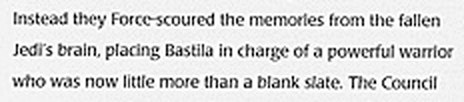

# Bastila Shan

- **Aliases:** Bastila
- **Era:** KOTOR
- **Continuity:** default Legends; entries present for: Legends
- **Research tier:** DEEP
- **Entries:** 541 (415 with quotations; 49 quotations extended to the full sentence/passage from the source text on file; 95 marked as fragments; 150 before the 2026-11-17 fragment fill). Rebuilt 2026-11-17 from 715 old entries; old file: `characters/_bak/bastila-shan.md.bak-20261117`.
- **How to read:** each entry is the quotation in full (block quote), then its source and point of view. "Note" lines are summaries from our notes, not quotations. `[fragment — full passage not on file]` means the source text is not on the box, so only the words in our notes are shown. Debate and forum material is in the last section and is unverified.

# LEGENDS (Legends / EU — main focus)

## KOTOR I, KOTOR II and The Old Republic: Revan: notes from the other agent (reference copy, reviewed)

- Note (summary from our notes, not a quotation): On the light path, turns Bastila back through the bond.
  — Source: KOTOR 1: super-deep character write-ups (Oct 19, 2026).
Our notes: `notes/materials/023-kotor-and-revan/kotor-1-characters.md:38`

- Note (summary from our notes, not a quotation): | vs Bastila | K1/Star_Forge | Light path: redeem her or win the fight. |
  — Source: KOTOR 1: super-deep character write-ups (Oct 19, 2026).
Context: | Fight | Page | Outcome and context |
Our notes: `notes/materials/023-kotor-and-revan/kotor-1-characters.md:50`

- Note (summary from our notes, not a quotation): In the Hangar, deflects Carth's bolts, Force Pushes him, and puts Bastila and Carth in stasis (narration) [K1/Hangar].
  — Source: K1/Hangar — KOTOR 1: super-deep character write-ups (Oct 19, 2026).
Our notes: `notes/materials/023-kotor-and-revan/kotor-1-characters.md:11130`

- Note (summary from our notes, not a quotation): Turns Bastila to the dark side (her own boast about it is in [K1/Command_Center]).
  — Source: K1/Command_Center — KOTOR 1: super-deep character write-ups (Oct 19, 2026).
Our notes: `notes/materials/023-kotor-and-revan/kotor-1-characters.md:11132`

> I've always struggled for control over my passions.
>
> Maybe it's the bond we share.
>
> you wanted to taste the dark side for yourself!
> [fragment — full passage not on file]
— Source: K1/Bastila; K1/Hangar — KOTOR 1: super-deep character write-ups (Oct 19, 2026); She is proud and quick to anger.
Note (our notes, around the quote): She is proud and quick to anger: «I've always struggled for control over my passions.» [K1/Bastila]. She is duty-bound to guide Revan, and she is drawn to Revan through the bond: «Maybe it's the bond we share.» [K1/Bastila]. Malak accuses her of wanting the dark side: «you wanted to taste the dark side for yourself!» [K1/Hangar].
Our notes: `notes/materials/023-kotor-and-revan/kotor-1-characters.md:11717`

> she can swing the tide of nearly any battle
> [fragment — full passage not on file]
— Source: K1/Jedi_Enclave — KOTOR 1: super-deep character write-ups (Oct 19, 2026). POV: speaker not named in our notes.
Note (our notes, around the quote): Battle Meditation, a strategic morale and coordination effect on whole fleets: «she can swing the tide of nearly any battle» [K1/Jedi_Enclave].
Our notes: `notes/materials/023-kotor-and-revan/kotor-1-characters.md:11733`

- Note (summary from our notes, not a quotation): Lightsaber combat. Uses Throw Lightsaber (narration, Temple fight).
  — Source: KOTOR 1: super-deep character write-ups (Oct 19, 2026).
Our notes: `notes/materials/023-kotor-and-revan/kotor-1-characters.md:11734`

- Note (summary from our notes, not a quotation): Turns key battles for the Republic (Dorak) [K1/Jedi_Enclave].
  — Source: K1/Jedi_Enclave — KOTOR 1: super-deep character write-ups (Oct 19, 2026).
Our notes: `notes/materials/023-kotor-and-revan/kotor-1-characters.md:11737`

- Note (summary from our notes, not a quotation): Part of Revan's capture [K1/Bastila].
  — Source: K1/Bastila — KOTOR 1: super-deep character write-ups (Oct 19, 2026).
Our notes: `notes/materials/023-kotor-and-revan/kotor-1-characters.md:11738`

- Note (summary from our notes, not a quotation): Saved Revan's life through the bond.
  — Source: KOTOR 1: super-deep character write-ups (Oct 19, 2026).
Our notes: `notes/materials/023-kotor-and-revan/kotor-1-characters.md:11739`

- Note (summary from our notes, not a quotation): Holds off Malak long enough for the escape [K1/Hangar].
  — Source: K1/Hangar — KOTOR 1: super-deep character write-ups (Oct 19, 2026).
Our notes: `notes/materials/023-kotor-and-revan/kotor-1-characters.md:11740`

- Note (summary from our notes, not a quotation): Coordinates the whole Star Forge battle [K1/Command_Center].
  — Source: K1/Command_Center — KOTOR 1: super-deep character write-ups (Oct 19, 2026).
Our notes: `notes/materials/023-kotor-and-revan/kotor-1-characters.md:11741`

- Note (summary from our notes, not a quotation): | vs Malak | K1/Hangar | A delaying action; she is captured. |
  — Source: KOTOR 1: super-deep character write-ups (Oct 19, 2026).
Context: | Fight | Page | Outcome and context |
Our notes: `notes/materials/023-kotor-and-revan/kotor-1-characters.md:11748`

- Note (summary from our notes, not a quotation): | vs Revan | K1/Temple_Summit / Star_Forge | She loses or is redeemed. |
  — Source: KOTOR 1: super-deep character write-ups (Oct 19, 2026).
Context: | Fight | Page | Outcome and context |
Our notes: `notes/materials/023-kotor-and-revan/kotor-1-characters.md:11749`

> So, Bastila, I heard a rumor that the Vulkars captured you without much of a struggle. It must be embarrassing to be bested by a handful of street thugs.
— Source: K1/Bastila — KOTOR 1: super-deep character write-ups (Oct 19, 2026); Canderous. POV: Canderous, about Bastila Shan.
Note (our notes, around the quote): Canderous: «So, Bastila, I heard a rumor that the Vulkars captured you without much of a struggle. It must be embarrassing to be bested by a handful of street thugs.» [K1/Bastila] *(+1 exact-duplicate / he-she variant line(s) merged)*
Our notes: `notes/materials/023-kotor-and-revan/kotor-1-characters.md:12603`

> Whatever you say. All I know is that if we had more Jedi like Bastila fighting against us in the Mandalorian Wars, my side might not have lost.
— Source: K1/Bastila — KOTOR 1: super-deep character write-ups (Oct 19, 2026); Canderous. POV: Canderous, about Bastila Shan.
Note (our notes, around the quote): Canderous: «Whatever you say. All I know is that if we had more Jedi like Bastila fighting against us in the Mandalorian Wars, my side might not have lost.» [K1/Bastila] *(+1 exact-duplicate / he-she variant line(s) merged)*
Our notes: `notes/materials/023-kotor-and-revan/kotor-1-characters.md:12604`

> Bastila, did you ever think about joining all the Jedi who were running off to follow Revan and Malak when they went to fight the Mandalorians?
— Source: K1/Bastila — KOTOR 1: super-deep character write-ups (Oct 19, 2026); Carth. POV: Carth, about Bastila Shan.
Note (our notes, around the quote): Carth: «Bastila, did you ever think about joining all the Jedi who were running off to follow Revan and Malak when they went to fight the Mandalorians?» [K1/Bastila] *(+1 exact-duplicate / he-she variant line(s) merged)*
Our notes: `notes/materials/023-kotor-and-revan/kotor-1-characters.md:12606`

> Hey, Bastila. You ever just use the Force for fun? You know, a little jolt of the Force to trip some jerk who's ticking you off?
— Source: K1/Bastila — KOTOR 1: super-deep character write-ups (Oct 19, 2026); Mission. POV: Mission, about Bastila Shan.
Note (our notes, around the quote): Mission: «Hey, Bastila. You ever just use the Force for fun? You know, a little jolt of the Force to trip some jerk who's ticking you off?» [K1/Bastila] *(+1 exact-duplicate / he-she variant line(s) merged)*
Our notes: `notes/materials/023-kotor-and-revan/kotor-1-characters.md:12607`

> Are you sure about this? I mean, I want to get Bastila back... but taking contracts to kill people is a bit much. Even if it is just more biker scum.
> [fragment — full passage not on file]
— Source: K1/Black_Vulkar_Base_(Garage) — KOTOR 1: super-deep character write-ups (Oct 19, 2026); Carth. POV: Carth, about Bastila Shan.
Label in our notes: [K1/Black_Vulkar_Base_(Garage)]
Our notes: `notes/materials/023-kotor-and-revan/kotor-1-characters.md:12610`

> Their slow, ponderous ship could not turn to face us without being overwhelmed. Their command vessels were destroyed in seconds. Their ranks were thrown into chaos. It was most amusing to watch the surviving ships scatter and flee. Several even tried to dive through the plane of the rings to escape us! They were shredded by the rings, or crashed into rocks, or were destroyed by our forces as we pursued them. Warriors do not flee from a battle if they are losing. They fight to the end! As we did against your Jedi Revan. Another time maybe I'll tell you about how the war with the Republic went. For now let's just get on with things. Is there something else you want to know?
— Source: K1/Canderous — KOTOR 1: super-deep character write-ups (Oct 19, 2026). POV: Canderous, about Bastila Shan.
Label in our notes: [K1/Canderous]
Our notes: `notes/materials/023-kotor-and-revan/kotor-1-characters.md:12620`

> True. Bastila is as powerful as they say... she's the one who defeated Darth Revan, after all. Hmm. I guess that no Jedi ability, no matter how powerful, makes up for being completely surprised and outmatched.
> [fragment — full passage not on file]
— Source: K1/Carth — KOTOR 1: super-deep character write-ups (Oct 19, 2026). POV: Carth, about Bastila Shan.
Label in our notes: [K1/Carth]
Our notes: `notes/materials/023-kotor-and-revan/kotor-1-characters.md:12635`; `notes/materials/023-kotor-and-revan/kotor-1-characters.md:11744`

> We lost the ship and a lot of good people... and for what? On the hope that Jedi powers would save us, somehow. Not that Bastila had much opportunity to act.
> [fragment — full passage not on file]
— Source: K1/Carth — KOTOR 1: super-deep character write-ups (Oct 19, 2026). POV: Carth, about Bastila Shan.
Label in our notes: [K1/Carth]
Our notes: `notes/materials/023-kotor-and-revan/kotor-1-characters.md:12636`

> No. Well... maybe. Don't get me wrong, it just seems odd that someone Bastila's party specifically requested to transfer aboard happened to survive.
> [fragment — full passage not on file]
— Source: K1/Carth — KOTOR 1: super-deep character write-ups (Oct 19, 2026). POV: Carth, about Bastila Shan.
Label in our notes: [K1/Carth]
Our notes: `notes/materials/023-kotor-and-revan/kotor-1-characters.md:12638`

> It's not just you. It's Bastila, as well. She's so... intense. I don't pretend to know much about the Force... but I know evil.
> [fragment — full passage not on file]
— Source: K1/Carth — KOTOR 1: super-deep character write-ups (Oct 19, 2026). POV: Carth, about Bastila Shan.
Label in our notes: [K1/Carth]
Our notes: `notes/materials/023-kotor-and-revan/kotor-1-characters.md:12646`

> Neither you nor Bastila are fully trained on how to handle your power. I'm just concerned at what might come.
— Source: K1/Carth — KOTOR 1: super-deep character write-ups (Oct 19, 2026). POV: Carth, about Bastila Shan.
Label in our notes: [K1/Carth]
Our notes: `notes/materials/023-kotor-and-revan/kotor-1-characters.md:12647`

> I know that, and Bastila says the same thing. You're both incredible women. I'm just... I'm just not sure this is the kind of thing you can defeat.
> [fragment — full passage not on file]
— Source: K1/Carth — KOTOR 1: super-deep character write-ups (Oct 19, 2026). POV: Carth, about Bastila Shan.
Label in our notes: [K1/Carth]
Our notes: `notes/materials/023-kotor-and-revan/kotor-1-characters.md:12648`

> The Force is bringing us towards a confrontation with my old master. The Star Forge has drawn our enemies together so they may all die in a single, glorious day! You must kill Revan to prove yourself worthy of being my apprentice, Bastila. You must finish what began in the Rakatan Temple.
— Source: K1/Command_Center — KOTOR 1: super-deep character write-ups (Oct 19, 2026); Darth Malak. POV: Darth Malak, about Bastila Shan.
Label in our notes: [K1/Command_Center]
Our notes: `notes/materials/023-kotor-and-revan/kotor-1-characters.md:12653`

> I sense your fear, Bastila. But it is unfounded. The power of the Star Forge will feed the dark side within you, it will give you the strength you need to defeat my old master. Stay here in the command center while you use your Battle Meditation against the Republic fleet. Revan will find you here in due time. It is inevitable.
— Source: K1/Command_Center — KOTOR 1: super-deep character write-ups (Oct 19, 2026); Darth Malak. POV: Darth Malak, about Bastila Shan.
Label in our notes: [K1/Command_Center]
Our notes: `notes/materials/023-kotor-and-revan/kotor-1-characters.md:12654`

> Bastila has betrayed me. I must select a new successor to be my apprentice; one who will one day take the mantle of Sith Lord away from me. Of all the Dark Jedi that have sworn allegiance to me, you three are the strongest. One of you will have the honor of becoming my new apprentice... if you prove yourself worthy.
> [fragment — full passage not on file]
— Source: K1/Command_Center — KOTOR 1: super-deep character write-ups (Oct 19, 2026); Darth Malak. POV: Darth Malak, about Bastila Shan.
Label in our notes: [K1/Command_Center]
Our notes: `notes/materials/023-kotor-and-revan/kotor-1-characters.md:12655`

> Bastila's the commanding officer on the Endar Spire. Well, not an officer, really. But she's the one in charge of this mission. One of our primary duties is to guarantee her survival in the event of enemy attack! You swore an oath just like everyone else on this mission. Now it's time to make good on that oath!
— Source: K1/Command_Module — KOTOR 1: super-deep character write-ups (Oct 19, 2026); Trask. POV: Trask, about Bastila Shan.
Label in our notes: [K1/Command_Module]
Our notes: `notes/materials/023-kotor-and-revan/kotor-1-characters.md:12664`

> I heard what everyone's saying about you: you've explored the farthest reaches of the galaxy, you've visited planets I've never even heard of. People with your skills and abilities are hard to find; it's no wonder the Republic recruited you for this mission. But now's the time to prove yourself! I know you're a scout and not a soldier, but Bastila needs all troops at her side during this attack!
— Source: K1/Command_Module — KOTOR 1: super-deep character write-ups (Oct 19, 2026); Trask. POV: Trask, about Bastila Shan.
Label in our notes: [K1/Command_Module]
Our notes: `notes/materials/023-kotor-and-revan/kotor-1-characters.md:12667`

> I know all about your reputation, how you used to smuggle spice and blasters along the Corellian Run. I guess the Republic figured since they couldn't catch you, they might as well hire you. And I'll admit, the Republic is in desperate need of someone with your kind of skills. Desperate enough to overlook your shady past. But now that you've signed on for this mission you're part of the Republic fleet. And Bastila needs all troops at her side during this attack!
— Source: K1/Command_Module — KOTOR 1: super-deep character write-ups (Oct 19, 2026); Trask. POV: Trask, about Bastila Shan.
Label in our notes: [K1/Command_Module]
Our notes: `notes/materials/023-kotor-and-revan/kotor-1-characters.md:12668`

> That was Carth contacting us on our portable communicators. He's one of the Republic's best pilots! He's seen more combat than the rest of the Endar Spire's crew put together. If he says things are bad, you better believe it. We have to get to the bridge to help defend Bastila! There's a map of the Endar Spire and a copy of Carth's message in your electronic journal, just in case we get separated.
— Source: K1/Command_Module — KOTOR 1: super-deep character write-ups (Oct 19, 2026); Trask. POV: Trask, about Bastila Shan.
Label in our notes: [K1/Command_Module]
Our notes: `notes/materials/023-kotor-and-revan/kotor-1-characters.md:12670`

> So you're the one Roland has got to help us interrogate this prisoner. I hope your Jedi powers will come in useful, this one has been most resistant. He's a Sith spy we picked up a little while ago snooping around outside trying to get in. We thought he was suspicious and brought him inside when the Selkath weren't looking. But it seems the Sith have done a pretty good job of conditioning this guy, and we haven't been able to break him yet.
— Source: K1/East_Central — KOTOR 1: super-deep character write-ups (Oct 19, 2026); Intelligence Officer. POV: Intelligence Officer, about Bastila Shan.
Label in our notes: [K1/East_Central]
Our notes: `notes/materials/023-kotor-and-revan/kotor-1-characters.md:12688`

> How you survived the final battle is a mystery to me. Perhaps you should ask Bastila; after all, she was part of the Jedi strike team that captured you!
— Source: K1/Hangar — KOTOR 1: super-deep character write-ups (Oct 19, 2026); Darth Malak. POV: Darth Malak, about Bastila Shan.
Label in our notes: [K1/Hangar]
Our notes: `notes/materials/023-kotor-and-revan/kotor-1-characters.md:12696`

> Tell the truth, Bastila, you wanted to taste the dark side for yourself! You knew the only way the Council would permit you to explore the Sith's power was through Revan's lost memories!
— Source: K1/Hangar — KOTOR 1: super-deep character write-ups (Oct 19, 2026); Darth Malak. POV: Darth Malak, about Bastila Shan.
Label in our notes: [K1/Hangar]
Our notes: `notes/materials/023-kotor-and-revan/kotor-1-characters.md:12699`

> No, Bastila, he's too strong! NO!!
— Source: K1/Hangar — KOTOR 1: super-deep character write-ups (Oct 19, 2026); Carth. POV: Carth, about Bastila Shan.
Label in our notes: [K1/Hangar]
Our notes: `notes/materials/023-kotor-and-revan/kotor-1-characters.md:12700`

> Bastila doesn't stand a chance against Malak, but we can't help her. Not here. We have to get off this ship and find the Star Forge. That's the key to beating the Dark Lord! Bastila sacrificed herself so we could get away. We can't let her sacrifice be in vain! Come on!
— Source: K1/Hangar — KOTOR 1: super-deep character write-ups (Oct 19, 2026); Carth. POV: Carth, about Bastila Shan.
Label in our notes: [K1/Hangar]
Our notes: `notes/materials/023-kotor-and-revan/kotor-1-characters.md:12701`

> No, it's no joke. The Jedi Council captured Revan and erased the Dark Lord's mind, programming in a new identity. Saul Karath told me on the Leviathan and Bastila confirmed it!
— Source: K1/Hangar — KOTOR 1: super-deep character write-ups (Oct 19, 2026); Carth. POV: Carth, about Bastila Shan.
Label in our notes: [K1/Hangar]
Our notes: `notes/materials/023-kotor-and-revan/kotor-1-characters.md:12705`

> Objection: But I would have tried, master! I could have killed the Jedi, Bastila, I am sure of it. That would have been most fun.
— Source: K1/Hangar — KOTOR 1: super-deep character write-ups (Oct 19, 2026); HK-47. POV: HK-47, about Bastila Shan.
Label in our notes: [K1/Hangar]
Our notes: `notes/materials/023-kotor-and-revan/kotor-1-characters.md:12707`

> I suppose I could tell you what I know. It's not like it could do any harm to me or my gang... but it might cause problems for the Vulkars, and that's okay in my book. The Vulkars stripped those pods clean within hours after they landed. It's too bad we didn't get there first, considering what my spies reported the Vulkars found. A female Republic officer named Bastila survived the crash. We Beks don't believe in intergalactic slavery, but the Vulkars aren't so picky. They took her prisoner.
> [fragment — full passage not on file]
— Source: K1/Hidden_Bek_Base — KOTOR 1: super-deep character write-ups (Oct 19, 2026); Gadon Thek. POV: Gadon Thek, about Bastila Shan.
Note (our notes, around the quote): Gadon Thek: «I suppose I could tell you what I know. It's not like it could do any harm to me or my gang... but it might cause problems for the Vulkars, and that's okay in my book. The Vulkars stripped those pods clean within hours after they landed. It's too bad we didn't get there first, considering what my spies reported the Vulkars found. A female Republic officer named Bastila survived the crash. We Beks don't believe in intergalactic slavery, but the Vulkars aren't so picky. They took her prisoner.» [K1/Hidden_Bek_Base] *(+1 exact-duplicate / he-she variant line(s) merged)*
Our notes: `notes/materials/023-kotor-and-revan/kotor-1-characters.md:12710`

> So how do you propose we go about rescuing Bastila, then? We can't fight all the gangs.
— Source: K1/Hidden_Bek_Base — KOTOR 1: super-deep character write-ups (Oct 19, 2026); Carth. POV: Carth, about Bastila Shan.
Note (our notes, around the quote): Carth: «So how do you propose we go about rescuing Bastila, then? We can't fight all the gangs.» [K1/Hidden_Bek_Base] *(+1 exact-duplicate / he-she variant line(s) merged)*
Our notes: `notes/materials/023-kotor-and-revan/kotor-1-characters.md:12712`

> Bastila? I have heard of her. They say she has already mastered the art of Battle Meditation, remarkable in one so young. Though I have heard she has a foolish pride in her own talents. But as for you... you claim you are not a Padawan? I find this hard to believe. The Force is strong within you. I can feel its presence. If this is some type of jest, it is in very poor taste. The Jedi Order is not a subject for jokes.
> [fragment — full passage not on file]
— Source: K1/Jedi_Enclave — KOTOR 1: super-deep character write-ups (Oct 19, 2026); Belaya. POV: Belaya, about Bastila Shan.
Label in our notes: [K1/Jedi_Enclave]
Our notes: `notes/materials/023-kotor-and-revan/kotor-1-characters.md:12724`

> Darth Malak seeks to destroy the Jedi Order. Our most effective weapon, perhaps our only hope, is Bastila's skill with Battle Meditation. With this power she can swing the tide of nearly any battle in our favour. Which is why Malak was seeking her so fervently.
— Source: K1/Jedi_Enclave — KOTOR 1: super-deep character write-ups (Oct 19, 2026); Vandar Tokare. POV: Vandar Tokare, about Bastila Shan.
Label in our notes: [K1/Jedi_Enclave]
Our notes: `notes/materials/023-kotor-and-revan/kotor-1-characters.md:12726`

> We need Bastila in our fight against the Sith. Indeed, we need every Jedi we can muster, since the Sith have been hunting us down at every opportunity. Which brings us to you...
> [fragment — full passage not on file]
— Source: K1/Jedi_Enclave — KOTOR 1: super-deep character write-ups (Oct 19, 2026); Zhar Lestin. POV: Zhar Lestin, about Bastila Shan.
Label in our notes: [K1/Jedi_Enclave]
Our notes: `notes/materials/023-kotor-and-revan/kotor-1-characters.md:12727`

> Bastila tells us you are strong in the Force. We are considering you for Jedi training.
— Source: K1/Jedi_Enclave — KOTOR 1: super-deep character write-ups (Oct 19, 2026); Zhar Lestin. POV: Zhar Lestin, about Bastila Shan.
Label in our notes: [K1/Jedi_Enclave]
Our notes: `notes/materials/023-kotor-and-revan/kotor-1-characters.md:12728`

> We both know there is no luck. There is only the Force. We all feel the power in Bastila's companion, though it is wild and untamed. Now that this power has begun to manifest itself, can we safely ignore it?
— Source: K1/Jedi_Enclave — KOTOR 1: super-deep character write-ups (Oct 19, 2026); Zhar Lestin. POV: Zhar Lestin, about Bastila Shan.
Label in our notes: [K1/Jedi_Enclave]
Our notes: `notes/materials/023-kotor-and-revan/kotor-1-characters.md:12729`

> Bastila has described this shared dream to the Council in great detail. We feel it is more than a dream. It is a vision. The Force is acting through you as it acts through Bastila.
— Source: K1/Jedi_Enclave — KOTOR 1: super-deep character write-ups (Oct 19, 2026); Vandar Tokare. POV: Vandar Tokare, about Bastila Shan.
Label in our notes: [K1/Jedi_Enclave]
Our notes: `notes/materials/023-kotor-and-revan/kotor-1-characters.md:12733`

> You and Bastila share a powerful connection to the Force... and each other. This is not unheard of. Connections often form between Master and student, but rarely does a bond develop so quickly.
> [fragment — full passage not on file]
— Source: K1/Jedi_Enclave — KOTOR 1: super-deep character write-ups (Oct 19, 2026); Zhar Lestin. POV: Zhar Lestin, about Bastila Shan.
Label in our notes: [K1/Jedi_Enclave]
Our notes: `notes/materials/023-kotor-and-revan/kotor-1-characters.md:12734`

> For two years the Sith were all but invincible. Fortunately, Bastila and her Battle Meditation allowed the Republic to win a few key victories and kept the Sith from total triumph. In desperation we set a trap for the Dark Lord. Bastila was with the strike team that tried to capture Revan, as you probably know. She was there at Revan's end. That was nearly a year ago, but things have not improved. Malak has stepped in and assumed the mantle of Dark Lord for himself, though he is far from Revan's equal in strategy or tactics. Still, his fleet continues to grow in both ships and soldiers. If we do not find some way to stop the Sith soon, Malak will overwhelm us with sheer numbers.
— Source: K1/Jedi_Enclave — KOTOR 1: super-deep character write-ups (Oct 19, 2026); Dorak. POV: Dorak, about Bastila Shan.
Label in our notes: [K1/Jedi_Enclave]
Our notes: `notes/materials/023-kotor-and-revan/kotor-1-characters.md:12739`

> Bastila will be a great Jedi someday. Even among the Masters and the Council it is rare to find one so skilled in the art of Battle Meditation. Bastila was there when Revan was slain. Did you know that?
— Source: K1/Jedi_Enclave — KOTOR 1: super-deep character write-ups (Oct 19, 2026); Vandar Tokare. POV: Vandar Tokare, about Bastila Shan.
Label in our notes: [K1/Jedi_Enclave]
Our notes: `notes/materials/023-kotor-and-revan/kotor-1-characters.md:12740`

> Bastila herself does not like to talk about it. She was accompanying the strike team that confronted Revan when the Dark Lord was destroyed. Her role in the death of such a promising young Jedi as Revan upset her greatly. But Bastila knew she had to set her personal feelings aside for the sake of the galaxy and the Republic. The Force is strong with her now, and without her skill in Battle Meditation we would have lost this war long ago.
— Source: K1/Jedi_Enclave — KOTOR 1: super-deep character write-ups (Oct 19, 2026); Vandar Tokare. POV: Vandar Tokare, about Bastila Shan.
Label in our notes: [K1/Jedi_Enclave]
Our notes: `notes/materials/023-kotor-and-revan/kotor-1-characters.md:12741`

> Revan was always the leader, the more powerful of the pair. When Revan fell we had hoped the Sith threat was ended. But Malak quickly assumed Revan's role, and embraced the dark side power as fully as his old master ever did. Now Malak leads the Sith armada against the Republic. Hate and vengeance for his master's death draw Malak ever further down the path of the dark side, fueling his powers until they surpass those of his old master. Only you and Bastila together can stop Malak now.
— Source: K1/Jedi_Enclave — KOTOR 1: super-deep character write-ups (Oct 19, 2026); Vandar Tokare. POV: Vandar Tokare, about Bastila Shan.
Label in our notes: [K1/Jedi_Enclave]
Our notes: `notes/materials/023-kotor-and-revan/kotor-1-characters.md:12742`

> The way ahead will be difficult for young Bastila... and for you. But you must draw strength from each other. May the Force be with you.
> [fragment — full passage not on file]
— Source: K1/Jedi_Enclave — KOTOR 1: super-deep character write-ups (Oct 19, 2026); Vandar Tokare. POV: Vandar Tokare, about Bastila Shan.
Note (our notes, around the quote): Vandar Tokare: «The way ahead will be difficult for young Bastila... and for you. But you must draw strength from each other. May the Force be with you.» [K1/Jedi_Enclave] *(+1 exact-duplicate / he-she variant line(s) merged)*
Our notes: `notes/materials/023-kotor-and-revan/kotor-1-characters.md:12744`

> Bastila? The young Jedi holds great promise... and great danger. She can do much for both the Republic and the Council. Without her skill in Battle Meditation the Sith armada would have conquered the galaxy long ago. But despite her command of the Force Bastila is still young. She is a Jedi, but she has not attained the rank of Master. The Council would do well to remember this before we lay the fate of the galaxy on her slender shoulders.
> [fragment — full passage not on file]
— Source: K1/Jedi_Enclave — KOTOR 1: super-deep character write-ups (Oct 19, 2026); Vrook Lamar. POV: Vrook Lamar, about Bastila Shan.
Label in our notes: [K1/Jedi_Enclave]
Our notes: `notes/materials/023-kotor-and-revan/kotor-1-characters.md:12745`

> Taris! It was Taris that the Sith destroyed to try to kill you and your precious Bastila! Taris, my homeworld!
— Source: K1/Juhani — KOTOR 1: super-deep character write-ups (Oct 19, 2026). POV: Juhani, about Bastila Shan.
Label in our notes: [K1/Juhani]
Our notes: `notes/materials/023-kotor-and-revan/kotor-1-characters.md:12750`

> Oh yes, I have been told all about her vaunted powers with the Force. Her Battle Meditation that can turn the tide of any conflict. Well if it could, then why could Taris not have been saved?
— Source: K1/Juhani — KOTOR 1: super-deep character write-ups (Oct 19, 2026). POV: Juhani, about Bastila Shan.
Label in our notes: [K1/Juhani]
Our notes: `notes/materials/023-kotor-and-revan/kotor-1-characters.md:12751`

> If it were not for you and Bastila, the Sith would have never had reason to destroy that world! It was your fault for being there, and your fault for rescuing Bastila! Without your intervention the Sith would have had no cause to lay waste to my childhood!
— Source: K1/Juhani — KOTOR 1: super-deep character write-ups (Oct 19, 2026). POV: Juhani, about Bastila Shan.
Label in our notes: [K1/Juhani]
Our notes: `notes/materials/023-kotor-and-revan/kotor-1-characters.md:12752`

> THE Revan. The Jedi who turned to the dark side, became the Dark Lord of the Sith and was defeated by Bastila and her strike team. I do not know what happened in the wars with the Mandalorians that turned Revan and Malak, or what they sought with these Star Maps, but the Jedi I knew was a paragon of the Order. I am sorry, if this seems wrong to you, but to understand you must realize that Revan was as great as a Jedi could be. Whatever turned Revan must be terrible indeed. I wonder if what we find at the end of our journey will turn us as well...
> [fragment — full passage not on file]
— Source: K1/Juhani — KOTOR 1: super-deep character write-ups (Oct 19, 2026). POV: Juhani, about Bastila Shan.
Label in our notes: [K1/Juhani]
Our notes: `notes/materials/023-kotor-and-revan/kotor-1-characters.md:12754`

> Secrecy is our best defense against the Sith, but it would be foolish to send you on this quest without someone to aid you, young Padawan. Bastila will accompany you, for there is a powerful connection between you two... a connection that might be the key to unravelling the mysteries uncovered by Revan.
> [fragment — full passage not on file]
— Source: K1/Quest_for_the_Star_Forge — KOTOR 1: super-deep character write-ups (Oct 19, 2026); Vandar Tokare. POV: Vandar Tokare, about Bastila Shan.
Note (our notes, around the quote): Vandar Tokare: «Secrecy is our best defense against the Sith, but it would be foolish to send you on this quest without someone to aid you, young Padawan. Bastila will accompany you, for there is a powerful connection between you two... a connection that might be the key to unravelling the mysteries uncovered by Revan.» [K1/Quest_for_the_Star_Forge]
Our notes: `notes/materials/023-kotor-and-revan/kotor-1-characters.md:12771`

> You must not fail in your mission, young Padawan. Find the Star Maps that lead to the Star Forge. This is the only way to stop Malak and his Sith followers. You and Bastila are the galaxy's last, desperate hope. May the Force be with you in this quest.
— Source: K1/Quest_for_the_Star_Forge — KOTOR 1: super-deep character write-ups (Oct 19, 2026); Vandar Tokare. POV: Vandar Tokare, about Bastila Shan.
Note (our notes, around the quote): Vandar Tokare: «You must not fail in your mission, young Padawan. Find the Star Maps that lead to the Star Forge. This is the only way to stop Malak and his Sith followers. You and Bastila are the galaxy's last, desperate hope. May the Force be with you in this quest.» [K1/Quest_for_the_Star_Forge]
Our notes: `notes/materials/023-kotor-and-revan/kotor-1-characters.md:12774`

> You have a mission to attend to, Padawan. And as much as I may wish it otherwise, you are our only hope. The Council has placed the fate of the galaxy within your hands. I pray both you and Bastila are able to emerge from this ordeal as servants of the light. May the Force be with you, young Padawan.
— Source: K1/Quest_for_the_Star_Forge — KOTOR 1: super-deep character write-ups (Oct 19, 2026); Vrook Lamar. POV: Vrook Lamar, about Bastila Shan.
Note (our notes, around the quote): Vrook Lamar: «You have a mission to attend to, Padawan. And as much as I may wish it otherwise, you are our only hope. The Council has placed the fate of the galaxy within your hands. I pray both you and Bastila are able to emerge from this ordeal as servants of the light. May the Force be with you, young Padawan.» [K1/Quest_for_the_Star_Forge]
Our notes: `notes/materials/023-kotor-and-revan/kotor-1-characters.md:12775`

> Your training is now complete, young Padawan. And perhaps now it is time we dealt with the matter of the dream you and Bastila shared. When we heard of the ruins in your dreams, Master Dorak recognized it as one of a series of ancient structures here on Dantooine. This one in particular lies to the east of this Enclave. We sent a Jedi to investigate... but he has not returned. Perhaps sending him in the first place was a mistake. The Force is guiding you through your visions; it may be that exploring the ruins is a task tied to your destiny. That is why the Council has now decided you should be the one to investigate this. The secrets to stopping Malak may be hidden within those ruins. You must investigate them and find what Revan and Malak were looking for.
> [fragment — full passage not on file]
— Source: K1/Ruins — KOTOR 1: super-deep character write-ups (Oct 19, 2026); Vandar Tokare. POV: Vandar Tokare, about Bastila Shan.
Label in our notes: [K1/Ruins]
Our notes: `notes/materials/023-kotor-and-revan/kotor-1-characters.md:12783`

> Be sure to bring Bastila with you. There is a powerful link between you, and you will need to draw strength from each other during the trials ahead.
— Source: K1/Ruins — KOTOR 1: super-deep character write-ups (Oct 19, 2026); Vandar Tokare. POV: Vandar Tokare, about Bastila Shan.
Label in our notes: [K1/Ruins]
Our notes: `notes/materials/023-kotor-and-revan/kotor-1-characters.md:12784`

> Bastila's power could help you win this battle, Admiral, but it will mean nothing if Malak escapes. Destroying the Star Forge is secondary to stopping the Sith threat once and for all.
— Source: K1/Star_Forge — KOTOR 1: super-deep character write-ups (Oct 19, 2026); Vandar. POV: Vandar, about Bastila Shan.
Label in our notes: [K1/Star_Forge]
Our notes: `notes/materials/023-kotor-and-revan/kotor-1-characters.md:12792`

> I'll order the fleet to press the attack and provide some cover for your fighters.  But what of Bastila and her Battle Meditation?
— Source: K1/Star_Forge — KOTOR 1: super-deep character write-ups (Oct 19, 2026); Admiral Dodonna. POV: Admiral Dodonna, about Bastila Shan.
Label in our notes: [K1/Star_Forge]
Our notes: `notes/materials/023-kotor-and-revan/kotor-1-characters.md:12793`

> Bastila, you and... the Padawan... should join us.  We will need the combined strength of our entire Order to defeat Malak.
> [fragment — full passage not on file]
— Source: K1/Star_Forge — KOTOR 1: super-deep character write-ups (Oct 19, 2026); Vandar. POV: Vandar, about Bastila Shan.
Label in our notes: [K1/Star_Forge]
Our notes: `notes/materials/023-kotor-and-revan/kotor-1-characters.md:12794`

> Such resolve in your words, but I see the truth in your heart. The dark side calls to you, Bastila. You hunger to taste it. Become my apprentice, and all its power can be yours!
— Source: K1/Star_Forge_System — KOTOR 1: super-deep character write-ups (Oct 19, 2026); Darth Malak. POV: Darth Malak, about Bastila Shan.
Label in our notes: [K1/Star_Forge_System]
Our notes: `notes/materials/023-kotor-and-revan/kotor-1-characters.md:12798`

> I only hope we're not too late. Bastila has been Malak's prisoner for a long time. If he can turn her to the dark side she will join him and the Sith will be invincible.
— Source: K1/Star_Forge_System — KOTOR 1: super-deep character write-ups (Oct 19, 2026); Juhani. POV: Juhani, about Bastila Shan.
Label in our notes: [K1/Star_Forge_System]
Our notes: `notes/materials/023-kotor-and-revan/kotor-1-characters.md:12800`

> I just hope we're not too late. Bastila's been Malak's prisoner for a long time. If he turns her to the dark side she'll join him and the Sith will become invincible.
— Source: K1/Star_Forge_System — KOTOR 1: super-deep character write-ups (Oct 19, 2026); Jolee. POV: Jolee, about Bastila Shan.
Label in our notes: [K1/Star_Forge_System]
Our notes: `notes/materials/023-kotor-and-revan/kotor-1-characters.md:12801`

> I fear Bastila will find the lure of the dark side difficult to resist. She is strong in the Force, but she is also impulsive, willful and proud - as you once were, Revan.
— Source: K1/Star_Forge_System — KOTOR 1: super-deep character write-ups (Oct 19, 2026); Jolee. POV: Jolee, about Bastila Shan.
Label in our notes: [K1/Star_Forge_System]
Our notes: `notes/materials/023-kotor-and-revan/kotor-1-characters.md:12802`

> This is Carth Onasi on your personal communicator. I'm tracking your position through the Endar Spire's life support systems. Bastila's escape pod is away – you're the last surviving crew member of the Endar Spire! I can't wait for you much longer; you have to get to the escape pods!
— Source: K1/Starboard_Section — KOTOR 1: super-deep character write-ups (Oct 19, 2026); Carth. POV: Carth, about Bastila Shan.
Label in our notes: [K1/Starboard_Section]
Our notes: `notes/materials/023-kotor-and-revan/kotor-1-characters.md:12808`

> That smack to your head did more damage than I thought. Bastila's a Jedi. She was with the strike team that killed Darth Revan, Malak's Sith master. Bastila is the key to the whole Republic war effort. The Sith must have found out she was on the Endar Spire and set an ambush for us in this system. I believe Bastila was on one of the escape pods that crashed down here on Taris. For the sake of the Republic war effort, we have to try and find her.
— Source: K1/Taris — KOTOR 1: super-deep character write-ups (Oct 19, 2026); Carth. POV: Carth, about Bastila Shan.
Label in our notes: [K1/Taris]
Our notes: `notes/materials/023-kotor-and-revan/kotor-1-characters.md:12820`

> I don't. But Bastila's young, and she has a powerful command of the Force. We survived the crash landing, so I'm willing to bet she may have, too. Besides, what's the alternative? I mean, if she's dead, then no one can stop Malak and his Sith from wiping out the Republic. And I'd rather operate on the assumption that she survived.
— Source: K1/Taris — KOTOR 1: super-deep character write-ups (Oct 19, 2026); Carth. POV: Carth, about Bastila Shan.
Label in our notes: [K1/Taris]
Our notes: `notes/materials/023-kotor-and-revan/kotor-1-characters.md:12822`

> Bastila's going to need our help. Many of Darth Malak's followers can use the dark side of the Force, and the Sith have already killed more than their share of Jedi in this war. I doubt anyone's specifically looking for us anymore: we're not that important. But if we're careful we can move about the planet without attracting notice; a luxury Bastila won't have. She's going to have half the Sith fleet looking for her. They know how vital she is to the war effort.
— Source: K1/Taris — KOTOR 1: super-deep character write-ups (Oct 19, 2026); Carth. POV: Carth, about Bastila Shan.
Label in our notes: [K1/Taris]
Our notes: `notes/materials/023-kotor-and-revan/kotor-1-characters.md:12823`

> Through the Force Bastila can inspire her allies with confidence and make her enemies lose their will to fight. Often, that's all it takes to tip the balance in a battle. Of course, there are limits to what she can do. From what I understand of her ability, it requires great concentration and focus to maintain her Battle Meditation. The attack on the Endar Spire happened so fast she probably never even had a chance to use her power. I'm guessing she barely got out alive, and now she's trapped here just as we are.
— Source: K1/Taris — KOTOR 1: super-deep character write-ups (Oct 19, 2026); Carth. POV: Carth, about Bastila Shan.
Label in our notes: [K1/Taris]
Our notes: `notes/materials/023-kotor-and-revan/kotor-1-characters.md:12825`

> Oh, I get it. Never mind that the Sith will destroy the Republic and ravage the galaxy. You're only in this for the credits. Don't worry. The Republic pays its mercenaries well. You help me find Bastila and they'll make it more than worth your while, I'm sure. Plus, it might be your only chance to get off Taris.
— Source: K1/Taris — KOTOR 1: super-deep character write-ups (Oct 19, 2026); Carth. POV: Carth, about Bastila Shan.
Label in our notes: [K1/Taris]
Our notes: `notes/materials/023-kotor-and-revan/kotor-1-characters.md:12827`

> While you were out I did some scouting around. There are reports of a couple escape pods crashing down into the Undercity. That's probably a good place to start. But the Undercity is a dangerous place. We don't want to go in there unprepared. It won't do Bastila any good if we go and get ourselves killed.
— Source: K1/Taris — KOTOR 1: super-deep character write-ups (Oct 19, 2026); Carth. POV: Carth, about Bastila Shan.
Label in our notes: [K1/Taris]
Our notes: `notes/materials/023-kotor-and-revan/kotor-1-characters.md:12828`

> Malak and Revan were once both part of the Jedi Order, but they were young and headstrong. And against the wishes of the Council they went to battle the Mandalorians on the Outer Rim. Something happened out there. Something corrupted them and drew them over to the dark side. Or maybe there was something rotten inside them all along. I don't know. They formed an army of ex-Republic soldiers and Jedi who had fallen to the dark side, with Revan at their head... until Revan was killed by Bastila's Jedi strike team. But even that didn't slow the Sith down. Malak just stepped in and assumed Revan's role. He took control of the Sith armada and resumed the bloody conquest of the Outer Worlds.
> [fragment — full passage not on file]
— Source: K1/Taris — KOTOR 1: super-deep character write-ups (Oct 19, 2026); Carth. POV: Carth, about Bastila Shan.
Label in our notes: [K1/Taris]
Our notes: `notes/materials/023-kotor-and-revan/kotor-1-characters.md:12829`

> Good idea. We can use this abandoned apartment as a base, and we can probably get some equipment and supplies here in the Upper City. Just remember to keep a low profile. I've heard some grim stories about the Dark Jedi interrogation techniques. They say the Force can do terrible things to a mind. It can wipe away your memories and destroy your very identity! But I figure if we don't do anything stupid we should be okay. I mean, after all, they're... they're looking for Bastila, not a couple of grunts like us. Alright, soldier, let's move out.
> [fragment — full passage not on file]
— Source: K1/Taris — KOTOR 1: super-deep character write-ups (Oct 19, 2026); Carth. POV: Carth, about Bastila Shan.
Label in our notes: [K1/Taris]
Our notes: `notes/materials/023-kotor-and-revan/kotor-1-characters.md:12831`

> Bastila, it is not too late for you to be saved. The teachings of the Jedi can lead you from the dark side back into the light and a true understanding of the Force.
— Source: K1/Temple_Summit — KOTOR 1: super-deep character write-ups (Oct 19, 2026); Juhani. POV: Juhani, about Bastila Shan.
Label in our notes: [K1/Temple_Summit]
Our notes: `notes/materials/023-kotor-and-revan/kotor-1-characters.md:12839`

> It's not to late for you, Bastila. The dark side is evil but it isn't all powerful. You can still fight against it. Don't let it consume you.
— Source: K1/Temple_Summit — KOTOR 1: super-deep character write-ups (Oct 19, 2026); Jolee. POV: Jolee, about Bastila Shan.
Label in our notes: [K1/Temple_Summit]
Our notes: `notes/materials/023-kotor-and-revan/kotor-1-characters.md:12840`

> She was always in danger of being seduced by the dark side, Carth. Bastila was strong, but she was always impatient and headstrong. Malak preyed upon her weaknesses. This planet is a tainted place, the Star Forge and the Temple have twisted the Force into an instrument of evil - just as Malak has twisted Bastila into a servant of the Sith.
— Source: K1/Temple_Summit — KOTOR 1: super-deep character write-ups (Oct 19, 2026); Jolee. POV: Jolee, about Bastila Shan.
Label in our notes: [K1/Temple_Summit]
Our notes: `notes/materials/023-kotor-and-revan/kotor-1-characters.md:12844`

> Malak has a strong hold on Bastila now - it will be difficult for her to break free of his influence. Especially considering her long association with you.
— Source: K1/Temple_Summit — KOTOR 1: super-deep character write-ups (Oct 19, 2026); Jolee. POV: Jolee, about Bastila Shan.
Label in our notes: [K1/Temple_Summit]
Our notes: `notes/materials/023-kotor-and-revan/kotor-1-characters.md:12845`

> I am tempted to try and capture you alive, Revan. Then I could break your will and bind you to me as my apprentice, as I did Bastila. You would be a far greater asset to me than even Bastila and her Battle Meditation, if I could control you. But is it worth the risk? Perhaps you are too powerful to be my apprentice. I betrayed you when I realized my own strength was greater than yours; in time you might try to do the same to me.
— Source: K1/Viewing_Platform — KOTOR 1: super-deep character write-ups (Oct 19, 2026); Darth Malak. POV: Darth Malak, about Bastila Shan.
Label in our notes: [K1/Viewing_Platform]
Our notes: `notes/materials/023-kotor-and-revan/kotor-1-characters.md:12859`

> I cannot deny your resilience. You survived my first betrayal, thanks to Bastila's inteference. You escaped the destruction of Taris and you escaped me on the Leviathan. You even survived my attempt to destroy you with the Star Forge itself. Fate and destiny have conspired to keep you alive despite all my efforts.
— Source: K1/Viewing_Platform — KOTOR 1: super-deep character write-ups (Oct 19, 2026); Darth Malak. POV: Darth Malak, about Bastila Shan.
Label in our notes: [K1/Viewing_Platform]
Our notes: `notes/materials/023-kotor-and-revan/kotor-1-characters.md:12860`

- Note (summary from our notes, not a quotation): Endar Spire (Command Module, Starboard Section): the Republic ship is attacked over Taris. Bastila is aboard. The player (an amnesiac "soldier") escapes with Carth.
  — Source: Star Wars: Knights of the Old Republic (KOTOR 1): power-scaling notes (Oct 19, 2026).
Our notes: `notes/materials/023-kotor-and-revan/kotor-1-notes.md:6`

> The search for Bastila is taking too long. We cannot risk her escaping Taris. Destroy the entire planet.
>
> Wipe this pathetic planet from the face of the galaxy. *(K1/Davik's_Estate)*
— Source: Star Wars: Knights of the Old Republic (KOTOR 1): power-scaling notes (Oct 19, 2026). POV: speaker not named in our notes.
Note (our notes, around the quote): Taris (Upper/Lower City, Undercity, Sewers, Black Vulkar Base, Davik's Estate): the player rescues Bastila via a swoop race and allies with Mission, Zaalbar and Canderous, then steals the Ebon Hawk from Davik Kang. Calo Nord is buried by rubble during the escape. Malak orders Taris destroyed: «The search for Bastila is taking too long. We cannot risk her escaping Taris. Destroy the entire planet.» and «Wipe this pathetic planet from the face of the galaxy.» (K1/Davik's_Estate).
Our notes: `notes/materials/023-kotor-and-revan/kotor-1-notes.md:7`; `notes/materials/023-kotor-and-revan/kotor-1-characters.md:12681`

> Come back out alive. Don’t believe everything you see. Remember, the pull of the dark side is strong in this place – don’t give in. Once they’ve done everything they want to do here, the heroes are free to enter the Sith fortress. Music Recommendation for entering the Sith fortress: Track 10, The Phantom Menace soundtrack: “Passage Through the Planet Core” IMPORTANT NOTE TO THE JUDGE: Running Encounters 3-5 There are at least two options the heroes have when making their way into the Sith fortress.
— Source: Star Wars: Knights of the Old Republic (KOTOR 1): power-scaling notes (Oct 19, 2026). POV: Malak, about Bastila Shan.
(Fragment completed 2026-11-17 with the full excerpt, word for word from iles Star Wars Roleplaying Game Revised Core Living Force Campaign Adventures Among the Stars Year 4 414 A Mon Alone (text copy `iles_Star_Wars_Roleplaying_Game_Revised_Core_Living_Force_Campaign_Adventures_Among_the_Stars_Year_4_414_A_Mon_Alone_pdf_0c73110a63`), which is not the work named in the citation above; check the citation.)
Note text that was attached to the quote line: – I can feel its power!... Are the secrets of the Star Forge so valuable? *(Malak, K1/Jedi_Enclave)*
Note (our notes, around the quote): Dantooine (Jedi Enclave, Grove, Ruins): the Council (Vandar, Vrook, Zhar, Dorak) retrains the player. Trial: the fallen Juhani in the Grove, the player's first lightsaber duel; she is slain or redeemed. The ruins hold the first Star Map, seen in a dream the player shares with Bastila of Revan and Malak there. Vision line: «The dark side is strong in this place – I can feel its power!... Are the secrets of the Star Forge so valuable?» (Malak, K1/Jedi_Enclave).
Our notes: `notes/materials/023-kotor-and-revan/kotor-1-notes.md:8`

- Note (summary from our notes, not a quotation): Leviathan (Prison Block, Command Deck, Bridge, Hangar): the party is captured. Admiral Saul Karath is defeated on the bridge. In the hangar Malak reveals the player is Revan; the player duels him, and Bastila holds Malak off while the party escapes. She is captured.
  — Source: Star Wars: Knights of the Old Republic (KOTOR 1): power-scaling notes (Oct 19, 2026).
Our notes: `notes/materials/023-kotor-and-revan/kotor-1-notes.md:15`

- Note (summary from our notes, not a quotation): Star Forge System (Rakatan beaches, Temple of the Ancients): on the Temple Summit, a dark-sided Bastila confronts Revan. This is the light/dark choice point.
  — Source: Star Wars: Knights of the Old Republic (KOTOR 1): power-scaling notes (Oct 19, 2026).
Our notes: `notes/materials/023-kotor-and-revan/kotor-1-notes.md:16`

- Note (summary from our notes, not a quotation): Light side: Bastila flees to the Star Forge.
  — Source: Star Wars: Knights of the Old Republic (KOTOR 1): power-scaling notes (Oct 19, 2026).
Context: Star Forge System (Rakatan beaches, Temple of the Ancients): on the Temple Summit, a dark-sided Bastila confronts Revan. This is the light/dark choice point.
Our notes: `notes/materials/023-kotor-and-revan/kotor-1-notes.md:17`

- Note (summary from our notes, not a quotation): Dark side: Bastila joins Revan, who then kills Jolee and/or Juhani and possibly others (K1/Temple_Summit).
  — Source: Star Wars: Knights of the Old Republic (KOTOR 1): power-scaling notes (Oct 19, 2026).
Context: Star Forge System (Rakatan beaches, Temple of the Ancients): on the Temple Summit, a dark-sided Bastila confronts Revan. This is the light/dark choice point.
Our notes: `notes/materials/023-kotor-and-revan/kotor-1-notes.md:18`

- Note (summary from our notes, not a quotation): Command Center: Revan faces Bastila again, who is redeemed or killed.
  — Source: Star Wars: Knights of the Old Republic (KOTOR 1): power-scaling notes (Oct 19, 2026).
Context: Star Forge (Deck 1, Deck 2, Command Center, Viewing Platform):
Our notes: `notes/materials/023-kotor-and-revan/kotor-1-notes.md:20`

- Note (summary from our notes, not a quotation): Viewing Platform: Revan kills Malak. Light ending: the Republic fleet destroys the Star Forge. Dark ending: Revan is Dark Lord, with Bastila addressing the Sith (K1/Viewing_Platform).
  — Source: Star Wars: Knights of the Old Republic (KOTOR 1): power-scaling notes (Oct 19, 2026).
Context: Star Forge (Deck 1, Deck 2, Command Center, Viewing Platform):
Our notes: `notes/materials/023-kotor-and-revan/kotor-1-notes.md:21`

> Even though you are only a shell of your former self, you are still a formidable opponent. I can't even imagine the power you must have wielded when you were the Dark Lord. *(K1/Command_Center)*
— Source: Star Wars: Knights of the Old Republic (KOTOR 1): power-scaling notes (Oct 19, 2026); Bastila (dark, Command Center). POV: Bastila.
Label in our notes: K1/Command_Center
Our notes: `notes/materials/023-kotor-and-revan/kotor-1-notes.md:36`

- Note (summary from our notes, not a quotation): | Malak #1 (Leviathan hangar) | K1/Hangar | Malak deflects Carth's bolts and stasis-locks Bastila and Carth, then duels the player alone. After the player inflicts >1/3 of his Vitality, Malak stasis-locks them too, and Bastila holds him off so the others can escape. Outcome: Malak wins / Revan escapes. This is early, low-level Revan. |
  — Source: Star Wars: Knights of the Old Republic (KOTOR 1): power-scaling notes (Oct 19, 2026).
Context: | Fight | Page | Outcome / notes |
Our notes: `notes/materials/023-kotor-and-revan/kotor-1-notes.md:51`

- Note (summary from our notes, not a quotation): | Bastila (Temple Summit) | K1/Temple_Summit | Bastila is reduced to 50%, then uses Force Wave and the dialog resumes. Light: she flees. Dark: she joins Revan, who then kills Jolee/Juhani. |
  — Source: Star Wars: Knights of the Old Republic (KOTOR 1): power-scaling notes (Oct 19, 2026).
Context: | Fight | Page | Outcome / notes |
Our notes: `notes/materials/023-kotor-and-revan/kotor-1-notes.md:52`

- Note (summary from our notes, not a quotation): | Three dark Jedi + Bastila (Command Center) | K1/Command_Center | Light: Bastila is beaten and redeemed (or killed). |
  — Source: Star Wars: Knights of the Old Republic (KOTOR 1): power-scaling notes (Oct 19, 2026).
Context: | Fight | Page | Outcome / notes |
Our notes: `notes/materials/023-kotor-and-revan/kotor-1-notes.md:53`

> swing the tide of nearly any battle *(Vandar)*
> [fragment — full passage not on file]
— Source: Star Wars: Knights of the Old Republic (KOTOR 1): power-scaling notes (Oct 19, 2026); Bastila's Battle Meditation. It can. POV: Vandar, about Bastila Shan.
Note (our notes, around the quote): Bastila's Battle Meditation. It can "swing the tide of nearly any battle" (Vandar). It is used against Dodonna's fleet from the Star Forge (K1/Command_Center, K1/Star_Forge).
Context: Story-level abilities, which carry more lore weight than the gameplay list:
Our notes: `notes/materials/023-kotor-and-revan/kotor-1-notes.md:62`

- Note (summary from our notes, not a quotation): The Force bond between Revan and Bastila. They share dreams and visions (K1/Jedi_Enclave, K1/Bastila).
  — Source: Star Wars: Knights of the Old Republic (KOTOR 1): power-scaling notes (Oct 19, 2026).
Context: Story-level abilities, which carry more lore weight than the gameplay list:
Our notes: `notes/materials/023-kotor-and-revan/kotor-1-notes.md:63`

- Note (summary from our notes, not a quotation): Beats Bastila twice and kills Bandon, Uthar or Yuthura, Calo Nord and Karath.
  — Source: Star Wars: Knights of the Old Republic (KOTOR 1): power-scaling notes (Oct 19, 2026).
Context: Feats:
Our notes: `notes/materials/023-kotor-and-revan/kotor-1-notes.md:76`

> only a shell of your former self... still a formidable opponent
> [fragment — full passage not on file]
— Source: Star Wars: Knights of the Old Republic (KOTOR 1): power-scaling notes (Oct 19, 2026); Bastila (dark). POV: Bastila.
Context: Statements:
Our notes: `notes/materials/023-kotor-and-revan/kotor-1-notes.md:83`

> You are strong, child. But I will break you.
— Source: Star Wars: Knights of the Old Republic (KOTOR 1): power-scaling notes (Oct 19, 2026). POV: speaker not named in our notes.
Note (our notes, around the quote): Broke Bastila to the dark side (K1/Star_Forge_System torture scene: «You are strong, child. But I will break you.»).
Context: Feats:
Our notes: `notes/materials/023-kotor-and-revan/kotor-1-notes.md:91`

- Note (summary from our notes, not a quotation): Battle Meditation swings fleet battles.
  — Source: Star Wars: Knights of the Old Republic (KOTOR 1): power-scaling notes (Oct 19, 2026).
Context: Feats:
Our notes: `notes/materials/023-kotor-and-revan/kotor-1-notes.md:99`

> due to my Battle Meditation, I was with the Jedi strike team that boarded Revan's ship
> [fragment — full passage not on file]
— Source: Star Wars: Knights of the Old Republic (KOTOR 1): power-scaling notes (Oct 19, 2026); Was on the strike team that captured Revan (K1/Bastila. POV: Bastila; about Bastila Shan.
Context: Feats:
Our notes: `notes/materials/023-kotor-and-revan/kotor-1-notes.md:100`

- Note (summary from our notes, not a quotation): Holds Malak off long enough for the party to escape (K1/Hangar).
  — Source: Star Wars: Knights of the Old Republic (KOTOR 1): power-scaling notes (Oct 19, 2026).
Context: Feats:
Our notes: `notes/materials/023-kotor-and-revan/kotor-1-notes.md:101`

- Note (summary from our notes, not a quotation): Dark Bastila fights Revan twice (summit and Command Center) and loses both times.
  — Source: Star Wars: Knights of the Old Republic (KOTOR 1): power-scaling notes (Oct 19, 2026).
Context: Feats:
Our notes: `notes/materials/023-kotor-and-revan/kotor-1-notes.md:102`

- Note (summary from our notes, not a quotation): Arc: proud Padawan → Malak's apprentice → redeemed (light side) or Revan's apprentice (dark side).
  — Source: Star Wars: Knights of the Old Republic (KOTOR 1): power-scaling notes (Oct 19, 2026).
Our notes: `notes/materials/023-kotor-and-revan/kotor-1-notes.md:104`

- Note (summary from our notes, not a quotation): K1 NPC stat blocks use a different template from K2, so boss stats came from the prose (Malak only). Bastila's and the Uthar/Yuthura numbers were not extracted.
  — Source: Star Wars: Knights of the Old Republic (KOTOR 1): power-scaling notes (Oct 19, 2026).
Our notes: `notes/materials/023-kotor-and-revan/kotor-1-notes.md:151`

> I ordered my own ships to fire on your bridge.
>
> The Jedi set a trap. They lured us into battle against a small Republic fleet.
>
> It was Malak who turned on his own master, firing upon Revan's ship while we were still on board it.
— Source: K1/Hangar; K1/Bastila — Star Wars: Knights of the Old Republic (KOTOR 1): power-scaling notes (Oct 19, 2026); The ambush. Malak. POV: Malak; Bastila; about Bastila Shan.
Note (our notes, around the quote): The ambush. Malak: «I ordered my own ships to fire on your bridge.» [K1/Hangar]. He also tells how the Jedi strike team took Revan: «The Jedi set a trap. They lured us into battle against a small Republic fleet.» [K1/Hangar]. Bastila: «It was Malak who turned on his own master, firing upon Revan's ship while we were still on board it.» [K1/Bastila].
Our notes: `notes/materials/023-kotor-and-revan/kotor-1-notes.md:165`

- Note (summary from our notes, not a quotation): Taris. On the Leviathan, Karath and Malak watch the blockade. The party works through the Upper and Lower City, Javyar's Cantina (Calo Nord counts «One.» «Two.» «Three.» [K1/Javyar's_Cantina]), the Undercity and the Vulkar base, and wins the swoop race to free Bastila. The dueling ring includes Bendak Starkiller. On Davik's estate Calo Nord threatens to blow everyone up with a thermal detonator [K1/Davik's_Estate]. The Leviathan bombards Taris as the party escapes on the Ebon Hawk.
  — Source: K1/Javyar's_Cantina; K1/Davik's_Estate — Star Wars: Knights of the Old Republic (KOTOR 1): power-scaling notes (Oct 19, 2026).
Our notes: `notes/materials/023-kotor-and-revan/kotor-1-notes.md:172`

> The only thing you taught me was betrayal and death, Saul.
— Source: K1/Bridge — Star Wars: Knights of the Old Republic (KOTOR 1): power-scaling notes (Oct 19, 2026); Leviathan. The party is captured. Carth faces Karath. POV: speaker not named in our notes.
Note (our notes, around the quote): Leviathan. The party is captured. Carth faces Karath: «The only thing you taught me was betrayal and death, Saul.» [K1/Bridge]. In the Hangar, Malak reveals Revan's identity. Bastila is captured.
Our notes: `notes/materials/023-kotor-and-revan/kotor-1-notes.md:178`

- Note (summary from our notes, not a quotation): Unknown World (Rakata Prime). Elder and One factions; the Temple of the Ancients; at the Temple Summit, Bastila tempts the player toward the dark side.
  — Source: Star Wars: Knights of the Old Republic (KOTOR 1): power-scaling notes (Oct 19, 2026).
Our notes: `notes/materials/023-kotor-and-revan/kotor-1-notes.md:179`

> flanked by two choking Jedi knights behind him. As you watch, he throws his lightsaber at the one on the right then uses Force Lightning on the one on the left, killing them both
> [fragment — full passage not on file]
>
> play no part until Darth Malak's Vitality or Force has been sufficiently reduced, at which point he drains one to restore both to maximum.
> [fragment — full passage not on file]
— Source: K1/Viewing_Platform — Star Wars: Knights of the Old Republic (KOTOR 1): power-scaling notes (Oct 19, 2026); Star Forge. Malak shows force. POV: speaker not named in our notes.
Note (our notes, around the quote): Star Forge. Malak shows force: "flanked by two choking Jedi knights behind him. As you watch, he throws his lightsaber at the one on the right then uses Force Lightning on the one on the left, killing them both". Bastila holds the Command Center with Battle Meditation, fighting the Republic fleet if she has fallen, or aiding it on the light path. The Viewing Platform duel follows: Captive Jedi "play no part until Darth Malak's Vitality or Force has been sufficiently reduced, at which point he drains one to restore both to maximum." There are eight captives in electrical prisons [K1/Viewing_Platform].
Our notes: `notes/materials/023-kotor-and-revan/kotor-1-notes.md:180`

- Note (summary from our notes, not a quotation): Endings. On the light path Revan defeats Malak, the Star Forge is destroyed, and there is a medal ceremony. On the dark path Revan reclaims the Dark Lord title with Bastila.
  — Source: Star Wars: Knights of the Old Republic (KOTOR 1): power-scaling notes (Oct 19, 2026).
Our notes: `notes/materials/023-kotor-and-revan/kotor-1-notes.md:181`

- Note (summary from our notes, not a quotation): Shows lightsaber throw plus Force Lightning (kills two Jedi knights), Force Push, and deflecting Carth's bolts; places Bastila and Carth in stasis (narration) [K1/Hangar].
  — Source: K1/Hangar — Star Wars: Knights of the Old Republic (KOTOR 1): power-scaling notes (Oct 19, 2026).
Our notes: `notes/materials/023-kotor-and-revan/kotor-1-notes.md:193`

- Note (summary from our notes, not a quotation): Bastila (Battle Meditation)
  — Source: Star Wars: Knights of the Old Republic (KOTOR 1): power-scaling notes (Oct 19, 2026).
Our notes: `notes/materials/023-kotor-and-revan/kotor-1-notes.md:195`

- Note (summary from our notes, not a quotation): Bastila Shan. Battle Meditation is her strategic hax. She was on the strike team that captured Revan. She falls to the dark side and is redeemed on the light path. Uses Throw Lightsaber in the Temple fight (narration). Verdict: support/hax tier, mid-level duelist.
  — Source: Star Wars: Knights of the Old Republic (KOTOR 1): power-scaling notes (Oct 19, 2026).
Our notes: `notes/materials/023-kotor-and-revan/kotor-1-notes.md:205`

> restores himself to maximum
> [fragment — full passage not on file]
— Source: Star Wars Knights of the Old Republic II: The Sith Lords (KOTOR 2): power-scaling notes (Oct 19, 2026). POV: speaker not named in our notes.
Note (our notes, around the quote): Korriban: Sith Academy, Shyrack Cave, Secret Tomb. Sion appears at the academy hub. The Exile fights him. Sion «restores himself to maximum», Kreia orders a retreat, and the party flees (K2/Sith_Academy). The Secret Tomb holds visions of Malak, Bastila and others (K2/Secret_Tomb).
Context: The four Master worlds (any order):
Our notes: `notes/materials/023-kotor-and-revan/kotor-2-notes.md:16`

> a war on another front
> [fragment — full passage not on file]
— Source: Star Wars Knights of the Old Republic II: The Sith Lords (KOTOR 2): power-scaling notes (Oct 19, 2026). POV: speaker not named in our notes.
Note (our notes, around the quote): Revan (absent). Has no on-screen role in K2, but Kreia, Mandalore, G0-T0, Atton and the Handmaiden all scale Revan to the top. Revan left known space for "a war on another front". The scenes of Bastila joining Carth and Lt. Grenn depend on the Revan choices.
Our notes: `notes/materials/023-kotor-and-revan/kotor-2-notes.md:292`

> Betraying his allies had not altered the inevitable outcome; the Emperor would have won regardless. At least this way Scourge was still alive to carry on their cause.
>
> A dozen bolts of purple lightning arced from the Emperor toward him. Revan tried to draw them in and contain them, but the Emperor was infinitely more powerful than Darth Nyriss had ever been.
— Source: L6001 — The Old Republic: Revan (novel, read in full): feats, scaling, quotes and story notes.
(Excerpt widened 2026-11-17 to the relevant passage, word for word from Revan (Drew Karpyshyn) (text copy `MEGA_Legend_The_Old_Republic_Series_Star_Wars_Old_Republic_03_Revan_Drew_Karpyshyn_epub`).)
(Excerpt widened 2026-11-17 to the relevant passage, word for word from Revan (Drew Karpyshyn) (text copy `MEGA_Legend_The_Old_Republic_Series_Star_Wars_Old_Republic_03_Revan_Drew_Karpyshyn_epub`).)
(Fragment completed 2026-11-17: full sentence/passage matched word for word in the source text on file: `MEGA_Legend_The_Old_Republic_Series_Star_Wars_Old_Republic_03_Revan_Drew_Karpyshyn_epub`.)
(Fragment completed 2026-11-17: full sentence/passage matched word for word in the source text on file: `MEGA_Legend_The_Old_Republic_Series_Star_Wars_Old_Republic_03_Revan_Drew_Karpyshyn_epub`.)
Note text that was attached to the quote line: *(L6001)*
Note (our notes, around the quote): Feat vs. statement: Section 3 is what the narration *shows* (FEAT). Section 4 is what characters say or think (STATEMENT). Karpyshyn writes in rotating tight third person: Revan, Scourge, Meetra and Bastila each get scenes (the POV map is in §1b). So a lot of "narration" is that character's perception or estimate, and it is marked *(POV X)*. One distinction matters for scaling. POV *perception* (what someone senses) is fairly reliable. POV *self-assessment* or *prediction* («Alone, probably not», L5861; «the Emperor would have won regardless», L6129) is that character's opinion, not authorial fact. Karpyshyn does sometimes give an omniscient-style line inside a POV, e.g. «the Emperor was infinitely more powerful than Darth Nyriss had ever been» (L6001). I treat those as near-authorial because they explain an on-page result.
Our notes: `notes/materials/023-kotor-and-revan/revan-novel-notes.md:10`

- Note (summary from our notes, not a quotation): Prologue Revan · Ch1-2 Scourge · Ch3 Revan · Ch4 Scourge · Ch5 Revan · Ch6 Scourge · Ch7 Revan · Ch8 Scourge · Ch9 Revan · Ch10 Scourge · Ch11 Revan · Ch12 Scourge · Ch13-14 Revan · Ch15 Scourge (L3167-3301), Revan (L3309-3333) · Ch16 Scourge, Revan (L3405-3445), Scourge (L3453+) · Ch17 Bastila · Ch18 Meetra · Ch19 Scourge, Revan (L3929-3955), Scourge (L3963-4001), Revan (L4009+) · Ch20 Meetra · Ch21 Scourge, Meetra (L4465-4543), Scourge (L4551+) · Ch22 Scourge, Meetra (L4807+) · Ch23 Scourge · Ch24 Meetra, Revan (L5219-5351), Scourge (L5359+) · Ch25 Meetra, Scourge (L5557+) · Ch26 Scourge · Ch27 Revan, Scourge (L5939+) · Ch28 Revan (L5977-6019), Scourge (L6027+) · Ch29 Scourge, Meetra-spirit (L6171-6181), Revan (L6189+) · Epilogue Bastila.
  — Source: L3167-3301; L3309-3333; L3405-3445; L3929-3955 — The Old Republic: Revan (novel, read in full): feats, scaling, quotes and story notes.
Our notes: `notes/materials/023-kotor-and-revan/revan-novel-notes.md:66`

> Bastila nodded at the compliment. She wasn’t sure what to make of the woman before her. Meetra had short brown hair, pale white skin, and piercing blue eyes. She was taller than Bastila, and almost a decade older, though she would still be considered beautiful by any empirical measure. She possessed a presence and confidence, along with an enviable natural grace. She was clad in the simple robes of a Jedi Master, but somehow she managed to make even the drab brown cloth seem stylish.
— Source: Ch17 · L3523 — The Old Republic: Revan (novel, read in full): feats, scaling, quotes and story notes; | MS4 | Ch17 · L3523 | Bastila POV | PK2 |.
(Excerpt widened 2026-11-17 to the relevant passage, word for word from Revan (Drew Karpyshyn), Chapter Seventeen (text copy `MEGA_Legend_The_Old_Republic_Series_Star_Wars_Old_Republic_03_Revan_Drew_Karpyshyn_epub`).)
(Fragment completed 2026-11-17: full sentence/passage matched word for word in the source text on file: `MEGA_Legend_The_Old_Republic_Series_Star_Wars_Old_Republic_03_Revan_Drew_Karpyshyn_epub`.)
Context: | # | Ch · L | Speaker / POV | Version | Quote |
Our notes: `notes/materials/023-kotor-and-revan/revan-novel-notes.md:467`

> “You didn’t tell them because you’re afraid they would agree with me,” Canderous countered. “Revan is not our enemy. Not now. Without him, Clan Jendri would have slaughtered us. Without him, we would never have found Mandalore’s Mask. Revan has proved himself to be our brother; and what you are doing brings dishonor on our clan!”
>
> I am Mandalore the Preserver, and I will restore the honor and glory of my people! *(L3143)*
— Source: L2949; L3143 — The Old Republic: Revan (novel, read in full): feats, scaling, quotes and story notes; Canderous.
(Excerpt widened 2026-11-17 to the relevant passage, word for word from Revan (Drew Karpyshyn) (text copy `MEGA_Legend_The_Old_Republic_Series_Star_Wars_Old_Republic_03_Revan_Drew_Karpyshyn_epub`).)
(Fragment completed 2026-11-17: full sentence/passage matched word for word in the source text on file: `MEGA_Legend_The_Old_Republic_Series_Star_Wars_Old_Republic_03_Revan_Drew_Karpyshyn_epub`.)
Note text that was attached to the quote line: *(L2949)*
Label in our notes: L2949). (L3143
Our notes: `notes/materials/023-kotor-and-revan/revan-novel-notes.md:507`

What it shows (our notes): L1119). (L1115). (L1105
> “I haven’t spoken to her since her trial,” Atris answered through gritted teeth, and Revan knew she was telling the truth. “I do not know where she went, and I hope I never see her again. The Exile betrayed the Order, as did you.
>
> Atris snorted in contempt. “That is the difference between us. I live for the Force. You live for yourself.”
>
> “A chalarax can’t change its spots,” she muttered under her breath.
>
> Revan was too busy trying to process all he had learned to react to her comment. If Meetra was cut off from the Force, that would explain why he hadn’t been able to sense her presence. That meant she could still be alive somewhere; she might still know something that could help him understand the meaning of his vision.
— Source: L1119; L1115; L1105 — The Old Republic: Revan (novel, read in full): feats, scaling, quotes and story notes; Atris.
(Excerpt widened 2026-11-17 to the relevant passage, word for word from Revan (Drew Karpyshyn) (text copy `MEGA_Legend_The_Old_Republic_Series_Star_Wars_Old_Republic_03_Revan_Drew_Karpyshyn_epub`).)
(Excerpt widened 2026-11-17 to the relevant passage, word for word from Revan (Drew Karpyshyn) (text copy `MEGA_Legend_The_Old_Republic_Series_Star_Wars_Old_Republic_03_Revan_Drew_Karpyshyn_epub`).)
(Fragment completed 2026-11-17: full sentence/passage matched word for word in the source text on file: `MEGA_Legend_The_Old_Republic_Series_Star_Wars_Old_Republic_03_Revan_Drew_Karpyshyn_epub`.)
Note text that was attached to the quote line: *(L1119)*
Note text that was attached to the quote line: *(L1115)*
Note text that was attached to the quote line: *(L1105)*
Our notes: `notes/materials/023-kotor-and-revan/revan-novel-notes.md:508`

What it shows (our notes): HK-47: Revan: «HK's a little too trigger-happy to bring on this mission. Things tend to get bloody when he's around» (L1389). «HK stormed off, swearing he would track Revan down on his own» (L3629, Bastila).
> “Good point,” Revan replied. “HK’s a little too trigger-happy to bring on this mission. Things tend to get bloody when he’s around.”
>
> “HK stormed off, swearing he would track Revan down on his own,” Bastila continued. “That was the last I heard of him until he showed up again with you.”
— Source: L1389 — The Old Republic: Revan (novel, read in full): feats, scaling, quotes and story notes; HK-47: Revan.
(Excerpt widened 2026-11-17 to the relevant passage, word for word from Revan (Drew Karpyshyn) (text copy `MEGA_Legend_The_Old_Republic_Series_Star_Wars_Old_Republic_03_Revan_Drew_Karpyshyn_epub`).)
(Fragment completed 2026-11-17: full sentence/passage matched word for word in the source text on file: `MEGA_Legend_The_Old_Republic_Series_Star_Wars_Old_Republic_03_Revan_Drew_Karpyshyn_epub`.)
Note text that was attached to the quote line: *(L1389)*
(Fragment completed 2026-11-17: full sentence/passage matched word for word in the source text on file: `MEGA_Legend_The_Old_Republic_Series_Star_Wars_Old_Republic_03_Revan_Drew_Karpyshyn_epub`.)
Note text that was attached to the quote line: *(L3629, Bastila)*
Our notes: `notes/materials/023-kotor-and-revan/revan-novel-notes.md:509`

- Note (summary from our notes, not a quotation): Arc: amnesiac post-KOTOR hero → seeker (Rekkiad, Nathema) → captive (three years drugged) → Revan Reborn via the mask, who integrates his Darth-era memories into a gray balance (L5803) → defeated → a jailer's prisoner who fights a mental war to keep the Emperor from invading (Ch29). Bastila's mask gift is the hinge: she accepts his past as part of him (L3707).
  — Source: L5803; L3707 — The Old Republic: Revan (novel, read in full): feats, scaling, quotes and story notes.
Our notes: `notes/materials/023-kotor-and-revan/revan-novel-notes.md:517`

- Note (summary from our notes, not a quotation): Bastila: wife and the emotional anchor.
  — Source: The Old Republic: Revan (novel, read in full): feats, scaling, quotes and story notes.
Context: Relationships:
Our notes: `notes/materials/023-kotor-and-revan/revan-novel-notes.md:519`

> still looking for redemption
> [fragment — full passage not on file]
— Source: L5521; L4555 — The Old Republic: Revan (novel, read in full): feats, scaling, quotes and story notes; Personality: Calm, warm, guilt-haunted (.
Note (our notes, around the quote): Personality: Calm, warm, guilt-haunted («still looking for redemption», L3613). Devoted to Revan (L5521). Diplomatic with Bastila. Merciful, with emotions «at arm's length» (L4555). Practical: she sells gems, uses disguises, mind-tricks officials.
Our notes: `notes/materials/023-kotor-and-revan/revan-novel-notes.md:579`

- Note (summary from our notes, not a quotation): Arc: Bastila's interlocutor → Nathema investigator → Dromund Kaas infiltrator → rescuer → co-fighter vs Nyriss and the Emperor → killed by Scourge → a spirit sustaining Revan.
  — Source: The Old Republic: Revan (novel, read in full): feats, scaling, quotes and story notes.
Our notes: `notes/materials/023-kotor-and-revan/revan-novel-notes.md:580`

What it shows (our notes): Arc: the Prologue, where she urges Revan toward the Council («"Maybe you should speak to the Jedi Council," Bastila suggested.», L103) → left behind with their son (L3843) → POV for Part Two's opening, where she gives Meetra the mask and T3 → the Epilogue, where she is old and still waiting.
> “Maybe you should speak to the Jedi Council,” Bastila suggested. “They might be able to help.”
>
> “You want me to ask the Council for help?” he echoed. “You must have had too much of that Corellian wine at dinner.”
— Source: L3843 — The Old Republic: Revan (novel, read in full): feats, scaling, quotes and story notes; Arc: the Prologue, where she urges Revan toward the Council (.
(Excerpt widened 2026-11-17 to the relevant passage, word for word from Revan (Drew Karpyshyn) (text copy `MEGA_Legend_The_Old_Republic_Series_Star_Wars_Old_Republic_03_Revan_Drew_Karpyshyn_epub`).)
(Excerpt widened 2026-11-17 to the relevant passage, word for word from Revan (Drew Karpyshyn) (text copy `MEGA_Legend_The_Old_Republic_Series_Star_Wars_Old_Republic_03_Revan_Drew_Karpyshyn_epub`).)
Our notes: `notes/materials/023-kotor-and-revan/revan-novel-notes.md:601`

What it shows (our notes): Relationships: Revan (wife; he hoped to reach her through the Force from his cell, and «the drugs and the vast distance of an entire galaxy must have stopped her from sensing his need», L3935); Meetra (rival claimant to Revan's trust, L3525); Vaner (son).
> He had tried reaching out to Bastila with the Force, but the drugs and the vast distance of an entire galaxy must have stopped her from sensing his need. He had almost given up once he realized there would be no rescue; his situation seemed hopeless. And then his muddled mind seized on the Sith interrogator.
— Source: The Old Republic: Revan (novel, read in full): feats, scaling, quotes and story notes.
(Excerpt widened 2026-11-17 to the relevant passage, word for word from Revan (Drew Karpyshyn), Chapter Nineteen (text copy `MEGA_Legend_The_Old_Republic_Series_Star_Wars_Old_Republic_03_Revan_Drew_Karpyshyn_epub`).)
(Fragment completed 2026-11-17: full sentence/passage matched word for word in the source text on file: `MEGA_Legend_The_Old_Republic_Series_Star_Wars_Old_Republic_03_Revan_Drew_Karpyshyn_epub`.)
Our notes: `notes/materials/023-kotor-and-revan/revan-novel-notes.md:602`

What it shows (our notes): Limits: no combat on-page. She would have «eagerly fought by his side» (L3513) but stays home.
> Had Revan returned to face this new threat, Bastila would have eagerly fought by his side. Together they might have been able to quell the uprising, ending it before the horrors of war enveloped the Republic and millions lost their lives. But she had heard nothing of her husband since he had set off with Canderous four years earlier.
— Source: L3513 — The Old Republic: Revan (novel, read in full): feats, scaling, quotes and story notes; Limits: no combat on-page. She would have.
(Excerpt widened 2026-11-17 to the relevant passage, word for word from Revan (Drew Karpyshyn), Chapter Seventeen (text copy `MEGA_Legend_The_Old_Republic_Series_Star_Wars_Old_Republic_03_Revan_Drew_Karpyshyn_epub`).)
(Fragment completed 2026-11-17: full sentence/passage matched word for word in the source text on file: `MEGA_Legend_The_Old_Republic_Series_Star_Wars_Old_Republic_03_Revan_Drew_Karpyshyn_epub`.)
Note text that was attached to the quote line: *(L3513)*
Our notes: `notes/materials/023-kotor-and-revan/revan-novel-notes.md:604`

- Note (summary from our notes, not a quotation): Every quote: see Appendix Q · Bastila Shan (108 entries), plus the pronoun lines in Q.0.
  — Source: The Old Republic: Revan (novel, read in full): feats, scaling, quotes and story notes.
Our notes: `notes/materials/023-kotor-and-revan/revan-novel-notes.md:605`

- Note (summary from our notes, not a quotation): Scaling implications: a weak sensing feat only. Nothing about her KOTOR-era Battle Meditation is shown.
  — Source: The Old Republic: Revan (novel, read in full): feats, scaling, quotes and story notes.
Our notes: `notes/materials/023-kotor-and-revan/revan-novel-notes.md:606`

What it shows (our notes): Role: left behind as «a little too trigger-happy» (L1389). «"HK stormed off, swearing he would track Revan down on his own," Bastila continued.» (L3629). T3 found «the disassembled pieces of HK-47, abandoned on a remote and nameless world» (L3617). Left under the new Council's supervision (L3635), then missing.
> “Good point,” Revan replied. “HK’s a little too trigger-happy to bring on this mission. Things tend to get bloody when he’s around.”
>
> “HK stormed off, swearing he would track Revan down on his own,” Bastila continued. “That was the last I heard of him until he showed up again with you.”
>
> It was during this time that the little astromech droid stumbled across the disassembled pieces of HK-47, abandoned on a remote and nameless world. Recognizing his old companion, the little droid gathered up the pieces and stored them on the Ebon Hawk.
— Source: L1389; L3629; L3617; L3635 — The Old Republic: Revan (novel, read in full): feats, scaling, quotes and story notes; Role: left behind as.
(Excerpt widened 2026-11-17 to the relevant passage, word for word from Revan (Drew Karpyshyn) (text copy `MEGA_Legend_The_Old_Republic_Series_Star_Wars_Old_Republic_03_Revan_Drew_Karpyshyn_epub`).)
(Excerpt widened 2026-11-17 to the relevant passage, word for word from Revan (Drew Karpyshyn) (text copy `MEGA_Legend_The_Old_Republic_Series_Star_Wars_Old_Republic_03_Revan_Drew_Karpyshyn_epub`).)
(Fragment completed 2026-11-17: full sentence/passage matched word for word in the source text on file: `MEGA_Legend_The_Old_Republic_Series_Star_Wars_Old_Republic_03_Revan_Drew_Karpyshyn_epub`.)
Note text that was attached to the quote line: *(L1389)*
(Fragment completed 2026-11-17: full sentence/passage matched word for word in the source text on file: `MEGA_Legend_The_Old_Republic_Series_Star_Wars_Old_Republic_03_Revan_Drew_Karpyshyn_epub`.)
Note text that was attached to the quote line: *(L3629)*
Note text that was attached to the quote line: *(L3617)*
Our notes: `notes/materials/023-kotor-and-revan/revan-novel-notes.md:626`

What it shows (our notes): Role: «"But I called him Vaner."» (L5505, Revan). In the Epilogue he is a politician: «Vote Vaner Shan for Supreme Chancellor!"» (L6243); «"I guess it skips a generation," Vaner said with a soft laugh.» (L6269).
> “I know we didn’t discuss names before you left,” Bastila said. “But I called him Vaner.”
>
> Revan smiled, realizing it was an anagram of his own name.
>
> Vote Vaner Shan for Supreme Chancellor!" *(L6243)*
>
> "I guess it skips a generation," Vaner said with a soft laugh. *(L6269)*
— Source: L6243; L6269 — The Old Republic: Revan (novel, read in full): feats, scaling, quotes and story notes; Role.
(Excerpt widened 2026-11-17 to the relevant passage, word for word from Revan (Drew Karpyshyn) (text copy `MEGA_Legend_The_Old_Republic_Series_Star_Wars_Old_Republic_03_Revan_Drew_Karpyshyn_epub`).)
(Excerpt widened 2026-11-17 to the relevant passage, word for word from Revan (Drew Karpyshyn) (text copy `MEGA_Legend_The_Old_Republic_Series_Star_Wars_Old_Republic_03_Revan_Drew_Karpyshyn_epub`).)
(Fragment completed 2026-11-17: full sentence/passage matched word for word in the source text on file: `MEGA_Legend_The_Old_Republic_Series_Star_Wars_Old_Republic_03_Revan_Drew_Karpyshyn_epub`.)
Note text that was attached to the quote line: *(L5505, Revan)*
Our notes: `notes/materials/023-kotor-and-revan/revan-novel-notes.md:698`; `notes/materials/023-kotor-and-revan/revan-novel-notes.md:4965`

- Note (summary from our notes, not a quotation): Every quote: Appendix Q · Vaner (20 entries).
  — Source: The Old Republic: Revan (novel, read in full): feats, scaling, quotes and story notes.
Our notes: `notes/materials/023-kotor-and-revan/revan-novel-notes.md:699`

- Note (summary from our notes, not a quotation): Scaling implications: none. Not Force-sensitive.
  — Source: The Old Republic: Revan (novel, read in full): feats, scaling, quotes and story notes.
Our notes: `notes/materials/023-kotor-and-revan/revan-novel-notes.md:700`

What it shows (our notes): Revan's storm nightmare, 3rd night; Bastila (wife) on balcony. Council stripped memories (L111). He & Malak "had found something" beyond Outer Rim, "a threat far greater than the Mandalorians or the Star Forge" (L151). Official story: corrupted by Star Forge (L147).
> He and Malak had found something. He couldn’t remember what it was, or where it was, but he feared it on a deep, primal level. Somehow he knew that whatever the terrible secret might be, it was a threat far greater than the Mandalorians or the Star Forge. And Revan was convinced it was still out there.
— Source: L111; L151; L147 — The Old Republic: Revan (novel, read in full): feats, scaling, quotes and story notes.
(Excerpt widened 2026-11-17 to the relevant passage, word for word from Revan (Drew Karpyshyn) (text copy `MEGA_Legend_The_Old_Republic_Series_Star_Wars_Old_Republic_03_Revan_Drew_Karpyshyn_epub`).)
(Fragment completed 2026-11-17: full sentence/passage matched word for word in the source text on file: `MEGA_Legend_The_Old_Republic_Series_Star_Wars_Old_Republic_03_Revan_Drew_Karpyshyn_epub`.)
Note text that was attached to the quote line: *(L151)*
Our notes: `notes/materials/023-kotor-and-revan/revan-novel-notes.md:958`

> It was ironic that Canderous was sharing all this with the architect of the Mandalorians’ greatest defeat. Almost a decade earlier, Revan had been one of the few willing to take action against the invading clans. But he was not the same person he was back then. He no longer clung to the simplistic ideals of right and wrong or good and evil. He understood better than anyone that dark and light were intertwined in strange and complex ways. And on some primal level, he knew this was all somehow connected to his visions of a dark, storm-swept world.
>
> “I’m not doing this for the Republic,” he explained. “I’m not doing it for you. I’m not even doing it for me. I’m doing it for our child. And our child’s children. We might never live to see the horrors that are coming, but they will.” He tightened his arm around her. “We have to protect the Republic for them. We have to risk our chance at happiness so they can have a life we might never know.”
— Source: L1327-1345; L1335; L1359; L1369-1393 — The Old Republic: Revan (novel, read in full): feats, scaling, quotes and story notes.
(Excerpt widened 2026-11-17 to the relevant passage, word for word from Revan (Drew Karpyshyn), Chapter Seven (text copy `MEGA_Legend_The_Old_Republic_Series_Star_Wars_Old_Republic_03_Revan_Drew_Karpyshyn_epub`).)
(Fragment completed 2026-11-17: full sentence/passage matched word for word in the source text on file: `MEGA_Legend_The_Old_Republic_Series_Star_Wars_Old_Republic_03_Revan_Drew_Karpyshyn_epub`.)
Note text that was attached to the quote line: *(L1359)*
Note text that was attached to the quote line: *(L1483)*
Note (our notes, around the quote): Clans gathering at Rekkiad hunting Mandalore's Mask (L1327-1345); Revan's memory flash of glacier with Malak (L1335). Revan "no longer clung to the simplistic ideals of right and wrong" (L1359). Team: Revan, Canderous, T3 (excludes Juhani/Jolee/Mission/Zaalbar/HK) (L1369-1393). Revan lies that Meetra "still a Jedi" (L1407). Bastila pregnant (L1445); Revan senses the life once told (L1455). "doing it for our child" (L1483). Ebon Hawk leaves.
Our notes: `notes/materials/023-kotor-and-revan/revan-novel-notes.md:977`

> Alone, she dared not challenge Darth Traya and her followers. Instead, she had focused on keeping her son alive. It had been the Exile—Meetra Surik—who had taken up the fight against the rogue Jedi. Three years after Revan’s unsuccessful attempt to locate her, she had emerged on her own to oppose and eventually defeat Darth Traya. Like Revan before her, she became the savior of the galaxy. And also as with Revan, there were many who felt her recent actions could not atone for the sins of her past.
>
> Foolish as it was, Bastila couldn’t help but feel some hint of jealousy. Meetra had known Revan long before Bastila; she had answered his call to go to war against the Mandalorians, and in doing so she became one of his most trusted advisers and closest friends. Bastila knew they had shared a special bond not unlike that of Padawan and Master. Worst of all, Meetra was an integral part of Revan’s lost past—a past he had felt compelled to go in search of, even though it meant leaving his pregnant wife behind.
— Source: L3511; L3515; L3523; L3525 — The Old Republic: Revan (novel, read in full): feats, scaling, quotes and story notes.
(Excerpt widened 2026-11-17 to the relevant passage, word for word from Revan (Drew Karpyshyn), Chapter Seventeen (text copy `MEGA_Legend_The_Old_Republic_Series_Star_Wars_Old_Republic_03_Revan_Drew_Karpyshyn_epub`).)
(Fragment completed 2026-11-17: full sentence/passage matched word for word in the source text on file: `MEGA_Legend_The_Old_Republic_Series_Star_Wars_Old_Republic_03_Revan_Drew_Karpyshyn_epub`.)
Note text that was attached to the quote line: *(L3525)*
Note (our notes, around the quote): KOTOR II recap: Kreia/Darth Traya rogue Jedi purge (L3511); Meetra emerged "Three years after Revan's unsuccessful attempt to locate her" and defeated Traya (L3515). Meetra: short brown hair, blue eyes, ~decade older than Bastila, Jedi Master robes (L3523). "special bond not unlike that of Padawan and Master" (L3525). Bastila hid with son (L3515). T3 recorded Scourge (L3589). Canderous aided Exile (L3567).
Our notes: `notes/materials/023-kotor-and-revan/revan-novel-notes.md:1009`

> “I think our path is clear,” Meetra declared. “I will go to Nathema and see if I can learn Revan’s fate.”
>
> I don't care... Not if that power helps bring him back to me. *(L3711)*
> [fragment — full passage not on file]
— Source: L3615; L3617; L3623; L3635 — The Old Republic: Revan (novel, read in full): feats, scaling, quotes and story notes.
(Fragment completed 2026-11-17: full sentence/passage matched word for word in the source text on file: `MEGA_Legend_The_Old_Republic_Series_Star_Wars_Old_Republic_03_Revan_Drew_Karpyshyn_epub`.)
Note text that was attached to the quote line: *(L3659)*
Note (our notes, around the quote): T3 repaired Hawk nearly a year on Nathema (L3615), found disassembled HK-47 (L3617); Meetra repaired HK, memory core damaged (L3623); HK left with new Jedi Council, disappeared, likely seeking Revan (L3635). Meetra: "I will go to Nathema" (L3659). Bastila gives Revan's mask; she led strike team and took it (L3697-3707). Bastila: "I don't care... Not if that power helps bring him back to me." (L3711).
Our notes: `notes/materials/023-kotor-and-revan/revan-novel-notes.md:1010`; `notes/materials/023-kotor-and-revan/revan-novel-notes.md:504`

> He struggled to his feet, battling the mind-numbing effects of the chemicals coursing through his veins. Had his mind been able to focus, he could have purged them from his system. But of course, the entire point of the drugs was to keep him from drawing on the Force.
>
> On that you have my word as a Jedi.” *(L5245)*
>
> Revan spun Meetra to the side and stepped in front of her, an instinctive but foolish move. Meetra was a Jedi; she knew how to handle herself. And unarmed he was no match for the Sith.
> [fragment — full passage not on file]
>
> He unwrapped the cloth to reveal the masked helmet he had worn during his campaigns against the Mandalorians and the Republic. In an instant, all his lost memories came flooding back to him.
— Source: L5223; L5241-5285; L5245; L5331 — The Old Republic: Revan (novel, read in full): feats, scaling, quotes and story notes.
(Fragment completed 2026-11-17 with the full excerpt, word for word from Revan (Drew Karpyshyn) (text copy `MEGA_Legend_The_Old_Republic_Series_Star_Wars_Old_Republic_03_Revan_Drew_Karpyshyn_epub`).)
(Fragment completed 2026-11-17 with the full excerpt, word for word from Revan (Drew Karpyshyn) (text copy `MEGA_Legend_The_Old_Republic_Series_Star_Wars_Old_Republic_03_Revan_Drew_Karpyshyn_epub`).)
(Fragment completed 2026-11-17 with the full excerpt, word for word from Revan (Drew Karpyshyn) (text copy `MEGA_Legend_The_Old_Republic_Series_Star_Wars_Old_Republic_03_Revan_Drew_Karpyshyn_epub`).)
(Excerpt widened 2026-11-17 to the relevant passage, word for word from Revan (Drew Karpyshyn) (text copy `MEGA_Legend_The_Old_Republic_Series_Star_Wars_Old_Republic_03_Revan_Drew_Karpyshyn_epub`).)
(Full sentence/passage taken from the source text on file: `cw_novels_tmp_gambit_siege_FULL_txt`.)
(Fragment completed 2026-11-17: full sentence/passage matched word for word in the source text on file: `MEGA_Legend_The_Old_Republic_Series_Star_Wars_Old_Republic_03_Revan_Drew_Karpyshyn_epub`.)
Note text that was attached to the quote line: *(L5223)*
Note text that was attached to the quote line: *(L5307, Revan POV under drugs)*
Note (our notes, around the quote): Revan drugged; "Had his mind been able to focus, he could have purged them" (L5223); Force-amplifies guard's fear and talks him down (L5241-5285), "my word as a Jedi" (L5245); "unarmed he was no match for the Sith" (L5307, Revan POV under drugs). Unconsciously suppressed drugs then collapsed (L5331). Scourge injects antidote (L5335). Revan's mask from Bastila -> "all his lost memories came flooding back"; collapses (L5349-5351).
Our notes: `notes/materials/023-kotor-and-revan/revan-novel-notes.md:1034`

> He went to stop it, and I know he succeeded. *(L6279)*
— Source: L6259; L6279 — The Old Republic: Revan (novel, read in full): feats, scaling, quotes and story notes.
Note (our notes, around the quote): Bastila old; son Vaner Shan, possible Chancellor; Force skips to grandkids Reesa, Bress. Bastila senses Revan sometimes (L6259). "He went to stop it, and I know he succeeded." (L6279).
Our notes: `notes/materials/023-kotor-and-revan/revan-novel-notes.md:1064`

> “Do you ever wish he had stayed with you instead?”
>
> “I miss your father every day of my life,” she said, “but I never once thought that.”
— Source: The Old Republic: Revan (novel, read in full): feats, scaling, quotes and story notes; Epilogue L6275 [PRONOUN/EPITHET] [Bastila, elderly (Epilogue)].
(Excerpt widened 2026-11-17 to the relevant passage, word for word from Revan (Drew Karpyshyn), Epilogue (text copy `MEGA_Legend_The_Old_Republic_Series_Star_Wars_Old_Republic_03_Revan_Drew_Karpyshyn_epub`).)
Our notes: `notes/materials/023-kotor-and-revan/revan-novel-notes.md:1194`

What it shows (our notes): Prologue · L115 · POV Revan · NARRATION · POST-KOTOR Revan (~3,954 BBY): «Bastila brought her hand up and put it gently but firmly over Revan's lips.»
> Bastila brought her hand up and put it gently but firmly over Revan’s lips.
>
> “Don’t talk like that. They can’t blame you for what happened. Not anymore. You’re not the same man you were. The Revan I know is a hero. A champion of the light. You redeemed me after Malak turned me to the dark side.”
— Source: The Old Republic: Revan (novel, read in full): feats, scaling, quotes and story notes. POV: narrator (POV Revan), about Bastila Shan.
(Excerpt widened 2026-11-17 to the relevant passage, word for word from Revan (Drew Karpyshyn) (text copy `MEGA_Legend_The_Old_Republic_Series_Star_Wars_Old_Republic_03_Revan_Drew_Karpyshyn_epub`).)
(Excerpt widened 2026-11-17 to the relevant passage, word for word from Revan (Drew Karpyshyn) (text copy `MEGA_Legend_The_Old_Republic_Series_Star_Wars_Old_Republic_03_Revan_Drew_Karpyshyn_epub`).)
Our notes: `notes/materials/023-kotor-and-revan/revan-novel-notes.md:1233`; `notes/materials/023-kotor-and-revan/revan-novel-notes.md:3312`

> Bastila turned away, and Revan instantly regretted his words. He knew she was ashamed of her involvement in his capture and her role in erasing his memory.
— Source: The Old Republic: Revan (novel, read in full): feats, scaling, quotes and story notes. POV: narrator (POV Revan), about Bastila Shan.
Note (our notes, around the quote): Prologue · L121 · POV Revan · NARRATION · POST-KOTOR Revan (~3,954 BBY): «Bastila turned away, and Revan instantly regretted his words. He knew she was ashamed of her involvement in his capture and her role in erasing his memory.»
Our notes: `notes/materials/023-kotor-and-revan/revan-novel-notes.md:1236`; `notes/materials/023-kotor-and-revan/revan-novel-notes.md:3313`

What it shows (our notes): Prologue · L141 · POV Revan · NARRATION · POST-KOTOR Revan (~3,954 BBY): «Twenty minutes later Bastila was fast asleep, but Revan lay on the bed with his eyes open, staring at the ceiling.»
> Twenty minutes later Bastila was fast asleep, but Revan lay on the bed with his eyes open, staring at the ceiling.
>
> He was thinking about what Bastila had said about the Council taking his identity. As his mind had healed, many of his memories had returned, along with his sense of self. But he knew parts were still missing, possibly gone forever.
— Source: The Old Republic: Revan (novel, read in full): feats, scaling, quotes and story notes. POV: narrator (POV Revan), about Bastila Shan.
(Excerpt widened 2026-11-17 to the relevant passage, word for word from Revan (Drew Karpyshyn) (text copy `MEGA_Legend_The_Old_Republic_Series_Star_Wars_Old_Republic_03_Revan_Drew_Karpyshyn_epub`).)
(Excerpt widened 2026-11-17 to the relevant passage, word for word from Revan (Drew Karpyshyn) (text copy `MEGA_Legend_The_Old_Republic_Series_Star_Wars_Old_Republic_03_Revan_Drew_Karpyshyn_epub`).)
Our notes: `notes/materials/023-kotor-and-revan/revan-novel-notes.md:1241`; `notes/materials/023-kotor-and-revan/revan-novel-notes.md:3314`

> Their marriage further exacerbated the situation. The Jedi Order opposed emotional attachments, believing they were a stepping-stone to destruction. They taught that love begat jealousy, which led to the dark side. But Revan had seen its redemptive powers firsthand. It was his love that had brought Bastila back to the light; their emotional bond had wrought salvation for both of them.
— Source: Ch5 · L975 — The Old Republic: Revan (novel, read in full): feats, scaling, quotes and story notes. POV: narrator (POV Revan), about Bastila Shan.
Note (our notes, around the quote): Ch5 · L975 · POV Revan · NARRATION · POST-KOTOR Revan (~3,954 BBY): «Their marriage further exacerbated the situation. The Jedi Order opposed emotional attachments, believing they were a stepping-stone to destruction. They taught that love begat jealousy, which led to the dark side. But Revan had seen its redemptive powers firsthand. It was his love that had brought Bastila back to the light; their emotional bond had wrought salvation for both of them.»
Our notes: `notes/materials/023-kotor-and-revan/revan-novel-notes.md:1276`; `notes/materials/023-kotor-and-revan/revan-novel-notes.md:3318`

> In the end a compromise was reached. The Jedi would not speak out against his marriage to Bastila. Officially, both would still be recognized as Jedi in good standing, with all corresponding rights and privileges. In exchange, Revan promised not to spread his heresy to other members of the Order.
— Source: Ch5 · L989 — The Old Republic: Revan (novel, read in full): feats, scaling, quotes and story notes. POV: narrator (POV Revan), about Bastila Shan.
Note (our notes, around the quote): Ch5 · L989 · POV Revan · NARRATION · POST-KOTOR Revan (~3,954 BBY): «In the end a compromise was reached. The Jedi would not speak out against his marriage to Bastila. Officially, both would still be recognized as Jedi in good standing, with all corresponding rights and privileges. In exchange, Revan promised not to spread his heresy to other members of the Order.»
Our notes: `notes/materials/023-kotor-and-revan/revan-novel-notes.md:1282`; `notes/materials/023-kotor-and-revan/revan-novel-notes.md:3319`

> At first, Bastila wanted to reject their terms. But Revan convinced her that an ideological war with the Jedi Council served no purpose. They had done their part; it was time for them to fade from history and live out the rest of their days in peace.
— Source: Ch5 · L991 — The Old Republic: Revan (novel, read in full): feats, scaling, quotes and story notes. POV: narrator (POV Revan), about Bastila Shan.
Note (our notes, around the quote): Ch5 · L991 · POV Revan · NARRATION · POST-KOTOR Revan (~3,954 BBY) + PAST-ERA REF (MW/Darth Revan) - check: «At first, Bastila wanted to reject their terms. But Revan convinced her that an ideological war with the Jedi Council served no purpose. They had done their part; it was time for them to fade from history and live out the rest of their days in peace.»
Our notes: `notes/materials/023-kotor-and-revan/revan-novel-notes.md:1283`; `notes/materials/023-kotor-and-revan/revan-novel-notes.md:3320`; `notes/materials/023-kotor-and-revan/revan-novel-notes.md:4194`

> Revan rose from his chair and turned to face the speaker. She wore the traditional robes of a Jedi Archivist, though Revan knew she was in fact a Jedi Master. She was young for the position, about Bastila's age, but her hair was platinum white. She had cold blue eyes, and a pale complexion that spoke of a life spent inside the Archives, well sheltered from the rays of the sun.
— Source: Ch5 · L1045 — The Old Republic: Revan (novel, read in full): feats, scaling, quotes and story notes. POV: narrator (POV Revan), about Bastila Shan.
Note (our notes, around the quote): Ch5 · L1045 · POV Revan · NARRATION · POST-KOTOR Revan (~3,954 BBY): «Revan rose from his chair and turned to face the speaker. She wore the traditional robes of a Jedi Archivist, though Revan knew she was in fact a Jedi Master. She was young for the position, about Bastila's age, but her hair was platinum white. She had cold blue eyes, and a pale complexion that spoke of a life spent inside the Archives, well sheltered from the rays of the sun.»
Our notes: `notes/materials/023-kotor-and-revan/revan-novel-notes.md:1297`; `notes/materials/023-kotor-and-revan/revan-novel-notes.md:3321`

What it shows (our notes): Ch7 · L1413 · POV Revan · OWN LINE (attribution) · POST-KOTOR Revan (~3,954 BBY): «"Don't forget Bastila," Revan added.»
> “Don’t forget Bastila,” Revan added.
>
> “I thought you wanted to leave the Jedi out of this.”
>
> “She’s my wife,” Revan answered. “I’m not going to abandon her.”
— Source: Ch7 · L1413 — The Old Republic: Revan (novel, read in full): feats, scaling, quotes and story notes. POV: Bastila Shan.
(Excerpt widened 2026-11-17 to the relevant passage, word for word from Revan (Drew Karpyshyn) (text copy `MEGA_Legend_The_Old_Republic_Series_Star_Wars_Old_Republic_03_Revan_Drew_Karpyshyn_epub`).)
(Excerpt widened 2026-11-17 to the relevant passage, word for word from Revan (Drew Karpyshyn) (text copy `MEGA_Legend_The_Old_Republic_Series_Star_Wars_Old_Republic_03_Revan_Drew_Karpyshyn_epub`).)
(Fragment completed 2026-11-17: full sentence/passage matched word for word in the source text on file: `MEGA_Legend_The_Old_Republic_Series_Star_Wars_Old_Republic_03_Revan_Drew_Karpyshyn_epub`.)
Our notes: `notes/materials/023-kotor-and-revan/revan-novel-notes.md:1343`

> Bastila was sitting in the living room when he got home, watching holovids while she waited for him to return. Revan wondered if she'd been waiting long.
— Source: Ch7 · L1429 — The Old Republic: Revan (novel, read in full): feats, scaling, quotes and story notes. POV: narrator (POV Revan), about Bastila Shan.
Note (our notes, around the quote): Ch7 · L1429 · POV Revan · NARRATION · POST-KOTOR Revan (~3,954 BBY): «Bastila was sitting in the living room when he got home, watching holovids while she waited for him to return. Revan wondered if she'd been waiting long.»
Our notes: `notes/materials/023-kotor-and-revan/revan-novel-notes.md:1346`; `notes/materials/023-kotor-and-revan/revan-novel-notes.md:3323`

> Revan couldn't believe he hadn't noticed Bastila's pregnancy earlier. Though there were no visible physical signs of her condition, it should have been obvious. The instant she'd told him, he'd clearly sensed the life growing inside her through the Force.
— Source: Ch7 · L1455 — The Old Republic: Revan (novel, read in full): feats, scaling, quotes and story notes. POV: narrator (POV Revan), about Bastila Shan.
Note (our notes, around the quote): Ch7 · L1455 · POV Revan · NARRATION · POST-KOTOR Revan (~3,954 BBY): «Revan couldn't believe he hadn't noticed Bastila's pregnancy earlier. Though there were no visible physical signs of her condition, it should have been obvious. The instant she'd told him, he'd clearly sensed the life growing inside her through the Force.»
Our notes: `notes/materials/023-kotor-and-revan/revan-novel-notes.md:1348`; `notes/materials/023-kotor-and-revan/revan-novel-notes.md:3324`

> It was still too early to tell if it was a boy or a girl, but it didn't matter to Revan either way. He and Bastila were going to have a child; it was the happiest day of his life. There was just one small problem.
— Source: Ch7 · L1461 — The Old Republic: Revan (novel, read in full): feats, scaling, quotes and story notes. POV: narrator (POV Revan), about Bastila Shan.
Note (our notes, around the quote): Ch7 · L1461 · POV Revan · NARRATION · POST-KOTOR Revan (~3,954 BBY): «It was still too early to tell if it was a boy or a girl, but it didn't matter to Revan either way. He and Bastila were going to have a child; it was the happiest day of his life. There was just one small problem.»
Our notes: `notes/materials/023-kotor-and-revan/revan-novel-notes.md:1349`; `notes/materials/023-kotor-and-revan/revan-novel-notes.md:3326`

> Bastila reached two fingers up and pressed them gently against Revan's lips. "If I say you're right," she whispered, "will you please shut up?"
— Source: Ch7 · L1491 — The Old Republic: Revan (novel, read in full): feats, scaling, quotes and story notes.
Note (our notes, around the quote): Ch7 · L1491 · POV Revan · DIALOGUE · POST-KOTOR Revan (~3,954 BBY): «Bastila reached two fingers up and pressed them gently against Revan's lips. "If I say you're right," she whispered, "will you please shut up?"»
Our notes: `notes/materials/023-kotor-and-revan/revan-novel-notes.md:1351`; `notes/materials/023-kotor-and-revan/revan-novel-notes.md:3331`

> Bastila accompanied Revan and T3 to the spaceport. Canderous was already there, loading supplies onto the Ebon Hawk.
— Source: Ch7 · L1505 — The Old Republic: Revan (novel, read in full): feats, scaling, quotes and story notes. POV: narrator (POV Revan), about Bastila Shan.
Note (our notes, around the quote): Ch7 · L1505 · POV Revan · NARRATION · POST-KOTOR Revan (~3,954 BBY): «Bastila accompanied Revan and T3 to the spaceport. Canderous was already there, loading supplies onto the Ebon Hawk.»
Our notes: `notes/materials/023-kotor-and-revan/revan-novel-notes.md:1353`; `notes/materials/023-kotor-and-revan/revan-novel-notes.md:3636`; `notes/materials/023-kotor-and-revan/revan-novel-notes.md:3332`; `notes/materials/023-kotor-and-revan/revan-novel-notes.md:3431`

> They didn't need to say anything else; they'd said their true goodbyes in private the previous night. Bastila's years of Jedi training had left her uncomfortable with public displays of emotion, but she stood up on her toes and planted a long, hard kiss on Revan's lips. Then she turned away and quickly left the spaceport.
— Source: Ch7 · L1515 — The Old Republic: Revan (novel, read in full): feats, scaling, quotes and story notes. POV: narrator (POV Revan), about Bastila Shan.
Note (our notes, around the quote): Ch7 · L1515 · POV Revan · NARRATION · POST-KOTOR Revan (~3,954 BBY): «They didn't need to say anything else; they'd said their true goodbyes in private the previous night. Bastila's years of Jedi training had left her uncomfortable with public displays of emotion, but she stood up on her toes and planted a long, hard kiss on Revan's lips. Then she turned away and quickly left the spaceport.»
Our notes: `notes/materials/023-kotor-and-revan/revan-novel-notes.md:1355`; `notes/materials/023-kotor-and-revan/revan-novel-notes.md:3334`

> They didn't speak again, but Revan couldn't help noticing the irony. When he'd left his wife behind to come here, he'd never imagined that Canderous would be reuniting with his own. He didn't begrudge Canderous his happiness, but it made him miss Bastila all the more.
— Source: Ch11 · L2361 — The Old Republic: Revan (novel, read in full): feats, scaling, quotes and story notes. POV: narrator (POV Revan), about Bastila Shan.
Note (our notes, around the quote): Ch11 · L2361 · POV Revan · NARRATION · POST-KOTOR Revan (~3,954 BBY): «They didn't speak again, but Revan couldn't help noticing the irony. When he'd left his wife behind to come here, he'd never imagined that Canderous would be reuniting with his own. He didn't begrudge Canderous his happiness, but it made him miss Bastila all the more.»
Our notes: `notes/materials/023-kotor-and-revan/revan-novel-notes.md:1460`; `notes/materials/023-kotor-and-revan/revan-novel-notes.md:3716`; `notes/materials/023-kotor-and-revan/revan-novel-notes.md:3335`

What it shows (our notes): Ch17 · L3505 · POV Bastila · NARRATION · CAPTIVE Revan (drugged, amnesiac; ~3,951 BBY): «His eyes were closed now, but she knew they were dark and brooding—just like Revan's.»
> BASTILA TUCKED HER SON into bed and leaned down to kiss him on the cheek. At the door of his room she turned and looked back at him, marveling at how much the three-year-old boy already looked like his father. He had the same dark, shoulder-length hair and the thin, angular face. His eyes were closed now, but she knew they were dark and brooding … just like Revan’s. And though he was already drifting off to sleep, his expression was still unusually serious and intense for a child his age.
— Source: Ch17 · L3505 — The Old Republic: Revan (novel, read in full): feats, scaling, quotes and story notes. POV: narrator (POV Bastila), about Bastila Shan.
(Excerpt widened 2026-11-17 to the relevant passage, word for word from Revan (Drew Karpyshyn), Chapter Seventeen (text copy `MEGA_Legend_The_Old_Republic_Series_Star_Wars_Old_Republic_03_Revan_Drew_Karpyshyn_epub`).)
Our notes: `notes/materials/023-kotor-and-revan/revan-novel-notes.md:1609`

What it shows (our notes): Ch17 · L3511 · POV Bastila · NARRATION · CAPTIVE Revan (drugged, amnesiac; ~3,951 BBY) + PAST-ERA REF (MW/Darth Revan) - check: «Led by a woman named Kreia, the rogue Jedi turned to the dark side teachings uncovered by Malak and Revan.»
> Led by a woman named Kreia, the rogue Jedi turned to the dark side teachings uncovered by Malak and Revan. Kreia took the name Darth Traya, and her followers called themselves the Sith after the long-lost species that had invaded the Republic a millennium before. They began a systemic purge of the galaxy, hunting down those who still held fast to the Jedi Code, killing them by the tens of thousands. Their relentless pursuit virtually wiped out the Order, and only those few who managed to flee or hide survived.
— Source: Ch17 · L3511 — The Old Republic: Revan (novel, read in full): feats, scaling, quotes and story notes. POV: narrator (POV Bastila), about Bastila Shan.
(Excerpt widened 2026-11-17 to the relevant passage, word for word from Revan (Drew Karpyshyn), Chapter Seventeen (text copy `MEGA_Legend_The_Old_Republic_Series_Star_Wars_Old_Republic_03_Revan_Drew_Karpyshyn_epub`).)
Our notes: `notes/materials/023-kotor-and-revan/revan-novel-notes.md:1610`; `notes/materials/023-kotor-and-revan/revan-novel-notes.md:4324`; `notes/materials/023-kotor-and-revan/revan-novel-notes.md:4937`

> Had Revan returned to face this new threat, Bastila would have eagerly fought by his side. Together they might have been able to quell the uprising, ending it before the horrors of war enveloped the Republic and millions lost their lives. But she had heard nothing of her husband since he had set off with Canderous four years earlier.
— Source: Ch17 · L3513 — The Old Republic: Revan (novel, read in full): feats, scaling, quotes and story notes. POV: narrator (POV Bastila), about Bastila Shan.
Note (our notes, around the quote): Ch17 · L3513 · POV Bastila · NARRATION · CAPTIVE Revan (drugged, amnesiac; ~3,951 BBY) + PAST-ERA REF (MW/Darth Revan) - check: «Had Revan returned to face this new threat, Bastila would have eagerly fought by his side. Together they might have been able to quell the uprising, ending it before the horrors of war enveloped the Republic and millions lost their lives. But she had heard nothing of her husband since he had set off with Canderous four years earlier.»
Our notes: `notes/materials/023-kotor-and-revan/revan-novel-notes.md:1611`; `notes/materials/023-kotor-and-revan/revan-novel-notes.md:3807`; `notes/materials/023-kotor-and-revan/revan-novel-notes.md:3339`

What it shows (our notes): Ch17 · L3515 · POV Bastila · NARRATION · CAPTIVE Revan (drugged, amnesiac; ~3,951 BBY): «Three years after Revan's unsuccessful attempt to locate her, she had emerged on her own to oppose and eventually defeat Darth Traya.»
> Alone, she dared not challenge Darth Traya and her followers. Instead, she had focused on keeping her son alive. It had been the Exile—Meetra Surik—who had taken up the fight against the rogue Jedi. Three years after Revan’s unsuccessful attempt to locate her, she had emerged on her own to oppose and eventually defeat Darth Traya. Like Revan before her, she became the savior of the galaxy. And also as with Revan, there were many who felt her recent actions could not atone for the sins of her past.
— Source: Ch17 · L3515 — The Old Republic: Revan (novel, read in full): feats, scaling, quotes and story notes. POV: narrator (POV Bastila), about Bastila Shan.
(Excerpt widened 2026-11-17 to the relevant passage, word for word from Revan (Drew Karpyshyn), Chapter Seventeen (text copy `MEGA_Legend_The_Old_Republic_Series_Star_Wars_Old_Republic_03_Revan_Drew_Karpyshyn_epub`).)
Our notes: `notes/materials/023-kotor-and-revan/revan-novel-notes.md:1612`; `notes/materials/023-kotor-and-revan/revan-novel-notes.md:4940`

What it shows (our notes): Ch17 · L3515 · POV Bastila · NARRATION · CAPTIVE Revan (drugged, amnesiac; ~3,951 BBY): «Like Revan before her, she became the savior of the galaxy.»
> Alone, she dared not challenge Darth Traya and her followers. Instead, she had focused on keeping her son alive. It had been the Exile—Meetra Surik—who had taken up the fight against the rogue Jedi. Three years after Revan’s unsuccessful attempt to locate her, she had emerged on her own to oppose and eventually defeat Darth Traya. Like Revan before her, she became the savior of the galaxy. And also as with Revan, there were many who felt her recent actions could not atone for the sins of her past.
— Source: Ch17 · L3515 — The Old Republic: Revan (novel, read in full): feats, scaling, quotes and story notes. POV: narrator (POV Bastila), about Bastila Shan.
(Excerpt widened 2026-11-17 to the relevant passage, word for word from Revan (Drew Karpyshyn), Chapter Seventeen (text copy `MEGA_Legend_The_Old_Republic_Series_Star_Wars_Old_Republic_03_Revan_Drew_Karpyshyn_epub`).)
Our notes: `notes/materials/023-kotor-and-revan/revan-novel-notes.md:1613`; `notes/materials/023-kotor-and-revan/revan-novel-notes.md:466`

What it shows (our notes): Ch17 · L3515 · POV Bastila · NARRATION · CAPTIVE Revan (drugged, amnesiac; ~3,951 BBY): «And also as with Revan, there were many who felt her recent actions could not atone for the sins of her past.»
> Alone, she dared not challenge Darth Traya and her followers. Instead, she had focused on keeping her son alive. It had been the Exile—Meetra Surik—who had taken up the fight against the rogue Jedi. Three years after Revan’s unsuccessful attempt to locate her, she had emerged on her own to oppose and eventually defeat Darth Traya. Like Revan before her, she became the savior of the galaxy. And also as with Revan, there were many who felt her recent actions could not atone for the sins of her past.
— Source: Ch17 · L3515 — The Old Republic: Revan (novel, read in full): feats, scaling, quotes and story notes. POV: narrator (POV Bastila), about Bastila Shan.
(Excerpt widened 2026-11-17 to the relevant passage, word for word from Revan (Drew Karpyshyn), Chapter Seventeen (text copy `MEGA_Legend_The_Old_Republic_Series_Star_Wars_Old_Republic_03_Revan_Drew_Karpyshyn_epub`).)
Our notes: `notes/materials/023-kotor-and-revan/revan-novel-notes.md:1614`

What it shows (our notes): Ch17 · L3525 · POV Bastila · NARRATION · CAPTIVE Revan (drugged, amnesiac; ~3,951 BBY) + PAST-ERA REF (MW/Darth Revan) - check: «Meetra had known Revan long before Bastila; she had answered his call to go to war against the Mandalorians, and in doing so she became one of his most trusted advisers and closest friends.»
> Foolish as it was, Bastila couldn’t help but feel some hint of jealousy. Meetra had known Revan long before Bastila; she had answered his call to go to war against the Mandalorians, and in doing so she became one of his most trusted advisers and closest friends. Bastila knew they had shared a special bond not unlike that of Padawan and Master. Worst of all, Meetra was an integral part of Revan’s lost past—a past he had felt compelled to go in search of, even though it meant leaving his pregnant wife behind.
— Source: Ch17 · L3525 — The Old Republic: Revan (novel, read in full): feats, scaling, quotes and story notes. POV: narrator (POV Bastila), about Bastila Shan.
(Excerpt widened 2026-11-17 to the relevant passage, word for word from Revan (Drew Karpyshyn), Chapter Seventeen (text copy `MEGA_Legend_The_Old_Republic_Series_Star_Wars_Old_Republic_03_Revan_Drew_Karpyshyn_epub`).)
Our notes: `notes/materials/023-kotor-and-revan/revan-novel-notes.md:1615`; `notes/materials/023-kotor-and-revan/revan-novel-notes.md:1989`; `notes/materials/023-kotor-and-revan/revan-novel-notes.md:3345`

What it shows (our notes): Ch17 · L3525 · POV Bastila · NARRATION · CAPTIVE Revan (drugged, amnesiac; ~3,951 BBY): «Worst of all, Meetra was an integral part of Revan's lost past—a past he had felt compelled to go in search of, even though it meant leaving his pregnant wife behind.»
> Foolish as it was, Bastila couldn’t help but feel some hint of jealousy. Meetra had known Revan long before Bastila; she had answered his call to go to war against the Mandalorians, and in doing so she became one of his most trusted advisers and closest friends. Bastila knew they had shared a special bond not unlike that of Padawan and Master. Worst of all, Meetra was an integral part of Revan’s lost past—a past he had felt compelled to go in search of, even though it meant leaving his pregnant wife behind.
— Source: Ch17 · L3525 — The Old Republic: Revan (novel, read in full): feats, scaling, quotes and story notes. POV: narrator (POV Bastila), about Bastila Shan.
(Excerpt widened 2026-11-17 to the relevant passage, word for word from Revan (Drew Karpyshyn), Chapter Seventeen (text copy `MEGA_Legend_The_Old_Republic_Series_Star_Wars_Old_Republic_03_Revan_Drew_Karpyshyn_epub`).)
Our notes: `notes/materials/023-kotor-and-revan/revan-novel-notes.md:1616`; `notes/materials/023-kotor-and-revan/revan-novel-notes.md:1990`

> The last time Bastila had seen T3-M4 he had been boarding the Ebon Hawk with Revan and Canderous. Her husband was still missing, but the droid had returned. Clearly he had latched on to Meetra, following at her heel as he had once followed Revan—one more small detail to feed Bastila's irrational jealousy.
— Source: Ch17 · L3533 — The Old Republic: Revan (novel, read in full): feats, scaling, quotes and story notes. POV: narrator (POV Bastila), about Bastila Shan.
Note (our notes, around the quote): Ch17 · L3533 · POV Bastila · NARRATION · CAPTIVE Revan (drugged, amnesiac; ~3,951 BBY): «The last time Bastila had seen T3-M4 he had been boarding the Ebon Hawk with Revan and Canderous. Her husband was still missing, but the droid had returned. Clearly he had latched on to Meetra, following at her heel as he had once followed Revan—one more small detail to feed Bastila's irrational jealousy.»
Our notes: `notes/materials/023-kotor-and-revan/revan-novel-notes.md:1617`; `notes/materials/023-kotor-and-revan/revan-novel-notes.md:1992`; `notes/materials/023-kotor-and-revan/revan-novel-notes.md:3808`; `notes/materials/023-kotor-and-revan/revan-novel-notes.md:3348`; `notes/materials/023-kotor-and-revan/revan-novel-notes.md:3462`

> Bastila smiled faintly. "I gave him special instructions the night before he left with Revan. I told Tee-Three if they ever became separated, he had to come find me. I programmed him so he wouldn't tell anyone else what had happened until I heard it first."
— Source: Ch17 · L3537 — The Old Republic: Revan (novel, read in full): feats, scaling, quotes and story notes.
Note (our notes, around the quote): Ch17 · L3537 · POV Bastila · SPEECH BY Bastila Shan · CAPTIVE Revan (drugged, amnesiac; ~3,951 BBY): «Bastila smiled faintly. "I gave him special instructions the night before he left with Revan. I told Tee-Three if they ever became separated, he had to come find me. I programmed him so he wouldn't tell anyone else what had happened until I heard it first."»
Our notes: `notes/materials/023-kotor-and-revan/revan-novel-notes.md:1618`; `notes/materials/023-kotor-and-revan/revan-novel-notes.md:3349`; `notes/materials/023-kotor-and-revan/revan-novel-notes.md:3463`

> "Fortunately he found me," Meetra said. "I guess he thought I was the next best thing, given my history with Revan."
— Source: Ch17 · L3545 — The Old Republic: Revan (novel, read in full): feats, scaling, quotes and story notes.
Note (our notes, around the quote): Ch17 · L3545 · POV Bastila · SPEECH BY Meetra Surik (the Exile) · CAPTIVE Revan (drugged, amnesiac; ~3,951 BBY): «"Fortunately he found me," Meetra said. "I guess he thought I was the next best thing, given my history with Revan."»
Our notes: `notes/materials/023-kotor-and-revan/revan-novel-notes.md:1619`; `notes/materials/023-kotor-and-revan/revan-novel-notes.md:1995`

> She'd often wondered if Revan was still alive. She'd always imagined their love would let her sense him through the Force, even across the breadth of an entire galaxy. Once he left, she learned that wasn't true. Some nights she would dream of him, but she was never sure if these were true visions or merely manifestations of the loneliness she'd felt since he'd gone.
— Source: Ch17 · L3557 — The Old Republic: Revan (novel, read in full): feats, scaling, quotes and story notes. POV: narrator (POV Bastila), about Bastila Shan.
Note (our notes, around the quote): Ch17 · L3557 · POV Bastila · NARRATION · CAPTIVE Revan (drugged, amnesiac; ~3,951 BBY): «She'd often wondered if Revan was still alive. She'd always imagined their love would let her sense him through the Force, even across the breadth of an entire galaxy. Once he left, she learned that wasn't true. Some nights she would dream of him, but she was never sure if these were true visions or merely manifestations of the loneliness she'd felt since he'd gone.»
Our notes: `notes/materials/023-kotor-and-revan/revan-novel-notes.md:1620`

> Still, she believed she would have sensed a disturbance in the Force if he had died. Clinging to that gave her hope. Now, however, her belief might be exposed as a mere illusion if T3 told her that Revan was dead. She wanted to hear the truth, of course, but she was determined to hang on to the fantasy for just a few seconds longer.
— Source: Ch17 · L3559 — The Old Republic: Revan (novel, read in full): feats, scaling, quotes and story notes. POV: narrator (POV Bastila), about Bastila Shan.
Note (our notes, around the quote): Ch17 · L3559 · POV Bastila · NARRATION · CAPTIVE Revan (drugged, amnesiac; ~3,951 BBY): «Still, she believed she would have sensed a disturbance in the Force if he had died. Clinging to that gave her hope. Now, however, her belief might be exposed as a mere illusion if T3 told her that Revan was dead. She wanted to hear the truth, of course, but she was determined to hang on to the fantasy for just a few seconds longer.»
Our notes: `notes/materials/023-kotor-and-revan/revan-novel-notes.md:1621`; `notes/materials/023-kotor-and-revan/revan-novel-notes.md:3465`

> It was clear the request had caught Meetra off guard, but she quickly regained her composure. "I understand you want to be cautious," she said sympathetically, "but Canderous told me all about Revan and his search for the storm-covered world."
— Source: Ch17 · L3565 — The Old Republic: Revan (novel, read in full): feats, scaling, quotes and story notes.
Note (our notes, around the quote): Ch17 · L3565 · POV Bastila · DIALOGUE · CAPTIVE Revan (drugged, amnesiac; ~3,951 BBY): «It was clear the request had caught Meetra off guard, but she quickly regained her composure. "I understand you want to be cautious," she said sympathetically, "but Canderous told me all about Revan and his search for the storm-covered world."»
Our notes: `notes/materials/023-kotor-and-revan/revan-novel-notes.md:1622`; `notes/materials/023-kotor-and-revan/revan-novel-notes.md:1998`; `notes/materials/023-kotor-and-revan/revan-novel-notes.md:3809`

> "I would never intentionally keep any knowledge of Revan from you," Meetra assured her earnestly. "You are his wife; you have more right to the truth than anyone."
— Source: Ch17 · L3575 — The Old Republic: Revan (novel, read in full): feats, scaling, quotes and story notes.
Note (our notes, around the quote): Ch17 · L3575 · POV Bastila · SPEECH BY Meetra Surik (the Exile) · CAPTIVE Revan (drugged, amnesiac; ~3,951 BBY): «"I would never intentionally keep any knowledge of Revan from you," Meetra assured her earnestly. "You are his wife; you have more right to the truth than anyone."»
Our notes: `notes/materials/023-kotor-and-revan/revan-novel-notes.md:1624`; `notes/materials/023-kotor-and-revan/revan-novel-notes.md:2001`

> Bastila swallowed hard, suddenly ashamed. "You have the same right," she said. "You stood by Revan's side at the beginning; he had no truer friend. Whatever Tee-Three has to say, we should hear it together."
— Source: Ch17 · L3577 — The Old Republic: Revan (novel, read in full): feats, scaling, quotes and story notes.
Note (our notes, around the quote): Ch17 · L3577 · POV Bastila · DIALOGUE · CAPTIVE Revan (drugged, amnesiac; ~3,951 BBY): «Bastila swallowed hard, suddenly ashamed. "You have the same right," she said. "You stood by Revan's side at the beginning; he had no truer friend. Whatever Tee-Three has to say, we should hear it together."»
Our notes: `notes/materials/023-kotor-and-revan/revan-novel-notes.md:1625`; `notes/materials/023-kotor-and-revan/revan-novel-notes.md:3358`; `notes/materials/023-kotor-and-revan/revan-novel-notes.md:3468`

> In a series of beeps, chimes, and holorecordings T3 relayed his story. He began with Revan returning to the Ebon Hawk on Rekkiad. He told them how he and Revan had left Canderous behind and journeyed to Nathema alone. He described the unexpected attack on the Ebon Hawk and the near-fatal crash landing on Nathema's surface.
— Source: Ch17 · L3585 — The Old Republic: Revan (novel, read in full): feats, scaling, quotes and story notes. POV: narrator (POV Bastila), about Bastila Shan.
Note (our notes, around the quote): Ch17 · L3585 · POV Bastila · NARRATION · CAPTIVE Revan (drugged, amnesiac; ~3,951 BBY): «In a series of beeps, chimes, and holorecordings T3 relayed his story. He began with Revan returning to the Ebon Hawk on Rekkiad. He told them how he and Revan had left Canderous behind and journeyed to Nathema alone. He described the unexpected attack on the Ebon Hawk and the near-fatal crash landing on Nathema's surface.»
Our notes: `notes/materials/023-kotor-and-revan/revan-novel-notes.md:1626`; `notes/materials/023-kotor-and-revan/revan-novel-notes.md:3811`; `notes/materials/023-kotor-and-revan/revan-novel-notes.md:3469`

What it shows (our notes): Ch17 · L3587 · POV Bastila · NARRATION · CAPTIVE Revan (drugged, amnesiac; ~3,951 BBY): «He explained how he had checked on the unconscious Revan to make sure he was still alive, then been forced to hide when someone else boarded the ship.»
> He explained how he had checked on the unconscious Revan to make sure he was still alive, then been forced to hide when someone else boarded the ship.
>
> When he played the holorecording he’d made of the red-skinned man who’d taken Revan off the ship, Bastila gasped.
— Source: Ch17 · L3587 — The Old Republic: Revan (novel, read in full): feats, scaling, quotes and story notes. POV: narrator (POV Bastila), about Bastila Shan.
(Excerpt widened 2026-11-17 to the relevant passage, word for word from Revan (Drew Karpyshyn) (text copy `MEGA_Legend_The_Old_Republic_Series_Star_Wars_Old_Republic_03_Revan_Drew_Karpyshyn_epub`).)
(Excerpt widened 2026-11-17 to the relevant passage, word for word from Revan (Drew Karpyshyn) (text copy `MEGA_Legend_The_Old_Republic_Series_Star_Wars_Old_Republic_03_Revan_Drew_Karpyshyn_epub`).)
Our notes: `notes/materials/023-kotor-and-revan/revan-novel-notes.md:1627`

What it shows (our notes): Ch17 · L3589 · POV Bastila · NARRATION · CAPTIVE Revan (drugged, amnesiac; ~3,951 BBY): «When he played the holorecording he'd made of the red-skinned man who'd taken Revan off the ship, Bastila gasped.»
> He explained how he had checked on the unconscious Revan to make sure he was still alive, then been forced to hide when someone else boarded the ship.
>
> When he played the holorecording he’d made of the red-skinned man who’d taken Revan off the ship, Bastila gasped.
— Source: Ch17 · L3589 — The Old Republic: Revan (novel, read in full): feats, scaling, quotes and story notes. POV: narrator (POV Bastila), about Bastila Shan.
(Excerpt widened 2026-11-17 to the relevant passage, word for word from Revan (Drew Karpyshyn) (text copy `MEGA_Legend_The_Old_Republic_Series_Star_Wars_Old_Republic_03_Revan_Drew_Karpyshyn_epub`).)
(Excerpt widened 2026-11-17 to the relevant passage, word for word from Revan (Drew Karpyshyn) (text copy `MEGA_Legend_The_Old_Republic_Series_Star_Wars_Old_Republic_03_Revan_Drew_Karpyshyn_epub`).)
Our notes: `notes/materials/023-kotor-and-revan/revan-novel-notes.md:1628`; `notes/materials/023-kotor-and-revan/revan-novel-notes.md:3360`

What it shows (our notes): Ch17 · L3599 · POV Bastila · SPEECH BY Meetra Surik (the Exile) · CAPTIVE Revan (drugged, amnesiac; ~3,951 BBY): «"The only way you could help Revan was by making it back in one piece," Meetra added.»
> “The only way you could help Revan was by making it back in one piece,” Meetra added.
>
> Mollified, T3 continued his story. He told them how Revan was taken onto a waiting shuttle and whisked away. With his master gone, returning to Bastila became the astromech’s primary purpose, as per her last-minute instructions before they’d left Coruscant.
— Source: Ch17 · L3599 — The Old Republic: Revan (novel, read in full): feats, scaling, quotes and story notes.
(Excerpt widened 2026-11-17 to the relevant passage, word for word from Revan (Drew Karpyshyn) (text copy `MEGA_Legend_The_Old_Republic_Series_Star_Wars_Old_Republic_03_Revan_Drew_Karpyshyn_epub`).)
(Excerpt widened 2026-11-17 to the relevant passage, word for word from Revan (Drew Karpyshyn) (text copy `MEGA_Legend_The_Old_Republic_Series_Star_Wars_Old_Republic_03_Revan_Drew_Karpyshyn_epub`).)
Also noted as: Ch17 · L3599 · POV Bastila · OWN LINE (attribution) · POST-KOTOR II Meetra (~3,951 BBY): «"The only way you could help Revan was by making it back in one piece," Meetra added.»
Our notes: `notes/materials/023-kotor-and-revan/revan-novel-notes.md:1629`; `notes/materials/023-kotor-and-revan/revan-novel-notes.md:2004`

> Mollified, T3 continued his story. He told them how Revan was taken onto a waiting shuttle and whisked away. With his master gone, returning to Bastila became the astromech's primary purpose, as per her last-minute instructions before they'd left Coruscant.
— Source: Ch17 · L3601 — The Old Republic: Revan (novel, read in full): feats, scaling, quotes and story notes. POV: narrator (POV Bastila), about Bastila Shan.
Note (our notes, around the quote): Ch17 · L3601 · POV Bastila · NARRATION · CAPTIVE Revan (drugged, amnesiac; ~3,951 BBY): «Mollified, T3 continued his story. He told them how Revan was taken onto a waiting shuttle and whisked away. With his master gone, returning to Bastila became the astromech's primary purpose, as per her last-minute instructions before they'd left Coruscant.»
Our notes: `notes/materials/023-kotor-and-revan/revan-novel-notes.md:1630`; `notes/materials/023-kotor-and-revan/revan-novel-notes.md:3363`; `notes/materials/023-kotor-and-revan/revan-novel-notes.md:3471`

> Meetra shifted uncomfortably in her seat, and Bastila knew she was thinking back to her role in the massacre of Malachor V. She felt a sudden burst of empathy for the other woman. Bastila didn't condone what she had done, but she understood what it was like to be ashamed of acts in your past. She herself had let Malak turn her to the dark side; only the power of Revan's love had redeemed her.
— Source: Ch17 · L3611 — The Old Republic: Revan (novel, read in full): feats, scaling, quotes and story notes. POV: narrator (POV Bastila), about Bastila Shan.
Note (our notes, around the quote): Ch17 · L3611 · POV Bastila · NARRATION · CAPTIVE Revan (drugged, amnesiac; ~3,951 BBY) + PAST-ERA REF (MW/Darth Revan) - check: «Meetra shifted uncomfortably in her seat, and Bastila knew she was thinking back to her role in the massacre of Malachor V. She felt a sudden burst of empathy for the other woman. Bastila didn't condone what she had done, but she understood what it was like to be ashamed of acts in your past. She herself had let Malak turn her to the dark side; only the power of Revan's love had redeemed her.»
Our notes: `notes/materials/023-kotor-and-revan/revan-novel-notes.md:1631`; `notes/materials/023-kotor-and-revan/revan-novel-notes.md:2006`; `notes/materials/023-kotor-and-revan/revan-novel-notes.md:3365`; `notes/materials/023-kotor-and-revan/revan-novel-notes.md:4325`

> Bastila shrugged. "When he found out Revan had left, HK decided to go after him. But I refused to tell him where my husband had gone."
— Source: Ch17 · L3625 — The Old Republic: Revan (novel, read in full): feats, scaling, quotes and story notes.
Note (our notes, around the quote): Ch17 · L3625 · POV Bastila · SPEECH BY Bastila Shan · CAPTIVE Revan (drugged, amnesiac; ~3,951 BBY): «Bastila shrugged. "When he found out Revan had left, HK decided to go after him. But I refused to tell him where my husband had gone."»
Our notes: `notes/materials/023-kotor-and-revan/revan-novel-notes.md:1632`; `notes/materials/023-kotor-and-revan/revan-novel-notes.md:3369`; `notes/materials/023-kotor-and-revan/revan-novel-notes.md:3577`

> "A wise move," Meetra said. "The last thing Revan needed while helping Canderous and the Mandalorians was a homicidal droid following him around."
— Source: Ch17 · L3627 — The Old Republic: Revan (novel, read in full): feats, scaling, quotes and story notes.
Note (our notes, around the quote): Ch17 · L3627 · POV Bastila · SPEECH BY Meetra Surik (the Exile) · CAPTIVE Revan (drugged, amnesiac; ~3,951 BBY): «"A wise move," Meetra said. "The last thing Revan needed while helping Canderous and the Mandalorians was a homicidal droid following him around."»
Our notes: `notes/materials/023-kotor-and-revan/revan-novel-notes.md:1633`; `notes/materials/023-kotor-and-revan/revan-novel-notes.md:3812`; `notes/materials/023-kotor-and-revan/revan-novel-notes.md:2009`

> "HK stormed off, swearing he would track Revan down on his own," Bastila continued. "That was the last I heard of him until he showed up again with you."
— Source: Ch17 · L3629 — The Old Republic: Revan (novel, read in full): feats, scaling, quotes and story notes.
Note (our notes, around the quote): Ch17 · L3629 · POV Bastila · SPEECH BY Bastila Shan · CAPTIVE Revan (drugged, amnesiac; ~3,951 BBY): «"HK stormed off, swearing he would track Revan down on his own," Bastila continued. "That was the last I heard of him until he showed up again with you."»
Our notes: `notes/materials/023-kotor-and-revan/revan-novel-notes.md:1634`; `notes/materials/023-kotor-and-revan/revan-novel-notes.md:3370`; `notes/materials/023-kotor-and-revan/revan-novel-notes.md:3578`

> "There must be some part of his programming that compels him to seek Revan out," Meetra muttered. "If I had known that, I would have been more careful."
— Source: Ch17 · L3631 — The Old Republic: Revan (novel, read in full): feats, scaling, quotes and story notes.
Note (our notes, around the quote): Ch17 · L3631 · POV Bastila · SPEECH BY Meetra Surik (the Exile) · CAPTIVE Revan (drugged, amnesiac; ~3,951 BBY): «"There must be some part of his programming that compels him to seek Revan out," Meetra muttered. "If I had known that, I would have been more careful."»
Our notes: `notes/materials/023-kotor-and-revan/revan-novel-notes.md:1635`; `notes/materials/023-kotor-and-revan/revan-novel-notes.md:2010`

> "I left HK under the supervision of the new Jedi Council. I didn't think it was safe to have him roaming the galaxy, and I assumed he would be content to stay with the Jedi, awaiting further orders. But he disappeared soon after I left. Now I realize he's probably gone in search of Revan again."
— Source: Ch17 · L3635 — The Old Republic: Revan (novel, read in full): feats, scaling, quotes and story notes.
Note (our notes, around the quote): Ch17 · L3635 · POV Bastila · SPEECH BY Meetra Surik (the Exile) · CAPTIVE Revan (drugged, amnesiac; ~3,951 BBY): «"I left HK under the supervision of the new Jedi Council. I didn't think it was safe to have him roaming the galaxy, and I assumed he would be content to stay with the Jedi, awaiting further orders. But he disappeared soon after I left. Now I realize he's probably gone in search of Revan again."»
Our notes: `notes/materials/023-kotor-and-revan/revan-novel-notes.md:1636`; `notes/materials/023-kotor-and-revan/revan-novel-notes.md:2011`; `notes/materials/023-kotor-and-revan/revan-novel-notes.md:3579`; `notes/materials/023-kotor-and-revan/revan-novel-notes.md:4250`

> Suddenly worried, Bastila asked, "Is there any chance he'll find him?" She directed her question to T3. "Did you tell him anything about what happened to Revan?"
— Source: Ch17 · L3637 — The Old Republic: Revan (novel, read in full): feats, scaling, quotes and story notes.
Note (our notes, around the quote): Ch17 · L3637 · POV Bastila · SPEECH BY Bastila Shan · CAPTIVE Revan (drugged, amnesiac; ~3,951 BBY): «Suddenly worried, Bastila asked, "Is there any chance he'll find him?" She directed her question to T3. "Did you tell him anything about what happened to Revan?"»
Our notes: `notes/materials/023-kotor-and-revan/revan-novel-notes.md:1637`; `notes/materials/023-kotor-and-revan/revan-novel-notes.md:3372`; `notes/materials/023-kotor-and-revan/revan-novel-notes.md:3476`

> After finding the disassembled bits of HK-47, he fell in with Meetra, joining her as he had joined Revan many years before. By the time he learned Bastila was alive, he was once again caught up in a battle for the Republic's survival. Despite his instructions, he knew he couldn't abandon Meetra until the safety of the Republic was secured.
— Source: Ch17 · L3651 — The Old Republic: Revan (novel, read in full): feats, scaling, quotes and story notes. POV: narrator (POV Bastila), about Bastila Shan.
Note (our notes, around the quote): Ch17 · L3651 · POV Bastila · NARRATION · CAPTIVE Revan (drugged, amnesiac; ~3,951 BBY): «After finding the disassembled bits of HK-47, he fell in with Meetra, joining her as he had joined Revan many years before. By the time he learned Bastila was alive, he was once again caught up in a battle for the Republic's survival. Despite his instructions, he knew he couldn't abandon Meetra until the safety of the Republic was secured.»
Our notes: `notes/materials/023-kotor-and-revan/revan-novel-notes.md:1638`; `notes/materials/023-kotor-and-revan/revan-novel-notes.md:2013`; `notes/materials/023-kotor-and-revan/revan-novel-notes.md:3375`; `notes/materials/023-kotor-and-revan/revan-novel-notes.md:3582`

> His confession caused Bastila to feel another surge of bitterness. T3 had chosen to help Meetra instead of following Bastila's instructions. He'd put the Exile's mission above his loyalty to Revan.
— Source: Ch17 · L3653 — The Old Republic: Revan (novel, read in full): feats, scaling, quotes and story notes. POV: narrator (POV Bastila), about Bastila Shan.
Note (our notes, around the quote): Ch17 · L3653 · POV Bastila · NARRATION · CAPTIVE Revan (drugged, amnesiac; ~3,951 BBY): «His confession caused Bastila to feel another surge of bitterness. T3 had chosen to help Meetra instead of following Bastila's instructions. He'd put the Exile's mission above his loyalty to Revan.»
Our notes: `notes/materials/023-kotor-and-revan/revan-novel-notes.md:1639`; `notes/materials/023-kotor-and-revan/revan-novel-notes.md:2014`; `notes/materials/023-kotor-and-revan/revan-novel-notes.md:3376`; `notes/materials/023-kotor-and-revan/revan-novel-notes.md:3480`

> The emotion passed quickly, replaced by guilt and shame. Bastila's love for Revan had once again momentarily blinded her to logic and reason. Her husband was one man; it was foolish to value his life against the fate of millions. If Revan had been standing in the room, he would have congratulated the droid for putting the greater good above personal wants and desires.
— Source: Ch17 · L3655 — The Old Republic: Revan (novel, read in full): feats, scaling, quotes and story notes. POV: narrator (POV Bastila), about Bastila Shan.
Note (our notes, around the quote): Ch17 · L3655 · POV Bastila · NARRATION · CAPTIVE Revan (drugged, amnesiac; ~3,951 BBY): «The emotion passed quickly, replaced by guilt and shame. Bastila's love for Revan had once again momentarily blinded her to logic and reason. Her husband was one man; it was foolish to value his life against the fate of millions. If Revan had been standing in the room, he would have congratulated the droid for putting the greater good above personal wants and desires.»
Our notes: `notes/materials/023-kotor-and-revan/revan-novel-notes.md:1640`; `notes/materials/023-kotor-and-revan/revan-novel-notes.md:3377`

What it shows (our notes): Ch17 · L3657 · POV Bastila · DIALOGUE · CAPTIVE Revan (drugged, amnesiac; ~3,951 BBY): «"Revan would be proud of you," she told the little droid. "I'm proud of you, too."»
> “Revan would be proud of you,” she told the little droid. “I’m proud of you, too.”
>
> “I think our path is clear,” Meetra declared. “I will go to Nathema and see if I can learn Revan’s fate.”
— Source: Ch17 · L3657 — The Old Republic: Revan (novel, read in full): feats, scaling, quotes and story notes.
(Excerpt widened 2026-11-17 to the relevant passage, word for word from Revan (Drew Karpyshyn) (text copy `MEGA_Legend_The_Old_Republic_Series_Star_Wars_Old_Republic_03_Revan_Drew_Karpyshyn_epub`).)
(Excerpt widened 2026-11-17 to the relevant passage, word for word from Revan (Drew Karpyshyn) (text copy `MEGA_Legend_The_Old_Republic_Series_Star_Wars_Old_Republic_03_Revan_Drew_Karpyshyn_epub`).)
Our notes: `notes/materials/023-kotor-and-revan/revan-novel-notes.md:1641`

> "I think our path is clear," Meetra declared. "I will go to Nathema and see if I can learn Revan's fate."
— Source: Ch17 · L3659 — The Old Republic: Revan (novel, read in full): feats, scaling, quotes and story notes.
Note (our notes, around the quote): Ch17 · L3659 · POV Bastila · SPEECH BY Meetra Surik (the Exile) · CAPTIVE Revan (drugged, amnesiac; ~3,951 BBY): «"I think our path is clear," Meetra declared. "I will go to Nathema and see if I can learn Revan's fate."»
Our notes: `notes/materials/023-kotor-and-revan/revan-novel-notes.md:1642`; `notes/materials/023-kotor-and-revan/revan-novel-notes.md:2015`

> "What has changed since Revan left?" Meetra asked softly. "You stayed behind to care for your son. Are you prepared to leave him behind now?"
— Source: Ch17 · L3663 — The Old Republic: Revan (novel, read in full): feats, scaling, quotes and story notes.
Note (our notes, around the quote): Ch17 · L3663 · POV Bastila · SPEECH BY Meetra Surik (the Exile) · CAPTIVE Revan (drugged, amnesiac; ~3,951 BBY): «"What has changed since Revan left?" Meetra asked softly. "You stayed behind to care for your son. Are you prepared to leave him behind now?"»
Our notes: `notes/materials/023-kotor-and-revan/revan-novel-notes.md:1643`; `notes/materials/023-kotor-and-revan/revan-novel-notes.md:2016`; `notes/materials/023-kotor-and-revan/revan-novel-notes.md:4952`

What it shows (our notes): Ch17 · L3667 · POV Bastila · NARRATION · CAPTIVE Revan (drugged, amnesiac; ~3,951 BBY): «Revan had left because he believed there was something in the Unknown Regions that was a far greater threat than any the Republic had ever faced.»
> Revan had left because he believed there was something in the Unknown Regions that was a far greater threat than any the Republic had ever faced. Guided by his visions of a storm-covered world, he thought his journey was the only way to protect the future of his family. Following in his footsteps might expose their son to the very threat Revan was trying to stop; it would be a betrayal of the very principles that had sent him on his journey in the first place, and it would endanger their child.
— Source: Ch17 · L3667 — The Old Republic: Revan (novel, read in full): feats, scaling, quotes and story notes. POV: narrator (POV Bastila), about Bastila Shan.
(Excerpt widened 2026-11-17 to the relevant passage, word for word from Revan (Drew Karpyshyn), Chapter Seventeen (text copy `MEGA_Legend_The_Old_Republic_Series_Star_Wars_Old_Republic_03_Revan_Drew_Karpyshyn_epub`).)
Our notes: `notes/materials/023-kotor-and-revan/revan-novel-notes.md:1644`

What it shows (our notes): Ch17 · L3667 · POV Bastila · NARRATION · CAPTIVE Revan (drugged, amnesiac; ~3,951 BBY): «Following in his footsteps might expose their son to the very threat Revan was trying to stop; it would be a betrayal of the very principles that had sent him on his journey in the first place, and it would endanger their child.»
> Revan had left because he believed there was something in the Unknown Regions that was a far greater threat than any the Republic had ever faced. Guided by his visions of a storm-covered world, he thought his journey was the only way to protect the future of his family. Following in his footsteps might expose their son to the very threat Revan was trying to stop; it would be a betrayal of the very principles that had sent him on his journey in the first place, and it would endanger their child.
— Source: Ch17 · L3667 — The Old Republic: Revan (novel, read in full): feats, scaling, quotes and story notes. POV: narrator (POV Bastila), about Bastila Shan.
(Excerpt widened 2026-11-17 to the relevant passage, word for word from Revan (Drew Karpyshyn), Chapter Seventeen (text copy `MEGA_Legend_The_Old_Republic_Series_Star_Wars_Old_Republic_03_Revan_Drew_Karpyshyn_epub`).)
Our notes: `notes/materials/023-kotor-and-revan/revan-novel-notes.md:1645`; `notes/materials/023-kotor-and-revan/revan-novel-notes.md:4953`

> "I will do everything in my power to find Revan," Meetra promised. "If he is still alive, I will do whatever it takes to bring him back to you."
— Source: Ch17 · L3675 — The Old Republic: Revan (novel, read in full): feats, scaling, quotes and story notes.
Note (our notes, around the quote): Ch17 · L3675 · POV Bastila · SPEECH BY Meetra Surik (the Exile) · CAPTIVE Revan (drugged, amnesiac; ~3,951 BBY): «"I will do everything in my power to find Revan," Meetra promised. "If he is still alive, I will do whatever it takes to bring him back to you."»
Our notes: `notes/materials/023-kotor-and-revan/revan-novel-notes.md:1646`; `notes/materials/023-kotor-and-revan/revan-novel-notes.md:2018`

What it shows (our notes): Ch17 · L3691 · POV Bastila · DIALOGUE · CAPTIVE Revan (drugged, amnesiac; ~3,951 BBY): «"Give these to Revan," she said, placing the items in Meetra's hands.»
> “Give these to Revan,” she said, placing the items in Meetra’s hands.
>
> The first was a holorecording she had made of their son’s last birthday celebration. The second was a heavy object wrapped in a swath of black cloth.
— Source: Ch17 · L3691 — The Old Republic: Revan (novel, read in full): feats, scaling, quotes and story notes.
(Excerpt widened 2026-11-17 to the relevant passage, word for word from Revan (Drew Karpyshyn) (text copy `MEGA_Legend_The_Old_Republic_Series_Star_Wars_Old_Republic_03_Revan_Drew_Karpyshyn_epub`).)
(Excerpt widened 2026-11-17 to the relevant passage, word for word from Revan (Drew Karpyshyn) (text copy `MEGA_Legend_The_Old_Republic_Series_Star_Wars_Old_Republic_03_Revan_Drew_Karpyshyn_epub`).)
Also noted as: Ch17 · L3691 · POV Bastila · DIALOGUE · POST-KOTOR II Meetra (~3,951 BBY): «"Give these to Revan," she said, placing the items in Meetra's hands.»
Our notes: `notes/materials/023-kotor-and-revan/revan-novel-notes.md:1647`; `notes/materials/023-kotor-and-revan/revan-novel-notes.md:2022`

> "Revan's mask!" Meetra gasped. "I thought it was lost when he was captured by the Jedi strike team."
— Source: Ch17 · L3697 — The Old Republic: Revan (novel, read in full): feats, scaling, quotes and story notes.
Note (our notes, around the quote): Ch17 · L3697 · POV Bastila · SPEECH BY Meetra Surik (the Exile) · CAPTIVE Revan (drugged, amnesiac; ~3,951 BBY): «"Revan's mask!" Meetra gasped. "I thought it was lost when he was captured by the Jedi strike team."»
Our notes: `notes/materials/023-kotor-and-revan/revan-novel-notes.md:1648`; `notes/materials/023-kotor-and-revan/revan-novel-notes.md:2024`

> "I led that strike team," Bastila reminded her. "I don't know why, but I took it when Revan fell. Perhaps even then I sensed our fates were intertwined. I never told anyone. Not the Council. Not even him."
— Source: Ch17 · L3699 — The Old Republic: Revan (novel, read in full): feats, scaling, quotes and story notes.
Note (our notes, around the quote): Ch17 · L3699 · POV Bastila · SPEECH BY Bastila Shan · CAPTIVE Revan (drugged, amnesiac; ~3,951 BBY): «"I led that strike team," Bastila reminded her. "I don't know why, but I took it when Revan fell. Perhaps even then I sensed our fates were intertwined. I never told anyone. Not the Council. Not even him."»
Our notes: `notes/materials/023-kotor-and-revan/revan-novel-notes.md:1649`; `notes/materials/023-kotor-and-revan/revan-novel-notes.md:3386`; `notes/materials/023-kotor-and-revan/revan-novel-notes.md:4251`

> Bastila hesitated, then decided Meetra deserved to know the truth. "Revan wore the mask during the Mandalorian Wars, and during his time as Darth Revan. To me, it symbolizes his dark past—a relic from a time before he became the man I loved. I was afraid that if I showed it to him, it might trigger something inside his mind. It might awaken some dormant evil, rekindle the spark of the dark side."
— Source: Ch17 · L3703 — The Old Republic: Revan (novel, read in full): feats, scaling, quotes and story notes.
Note (our notes, around the quote): Ch17 · L3703 · POV Bastila · SPEECH BY Bastila Shan · CAPTIVE Revan (drugged, amnesiac; ~3,951 BBY) + PAST-ERA REF (MW/Darth Revan) - check: «Bastila hesitated, then decided Meetra deserved to know the truth. "Revan wore the mask during the Mandalorian Wars, and during his time as Darth Revan. To me, it symbolizes his dark past—a relic from a time before he became the man I loved. I was afraid that if I showed it to him, it might trigger something inside his mind. It might awaken some dormant evil, rekindle the spark of the dark side."»
Our notes: `notes/materials/023-kotor-and-revan/revan-novel-notes.md:1650`; `notes/materials/023-kotor-and-revan/revan-novel-notes.md:2026`; `notes/materials/023-kotor-and-revan/revan-novel-notes.md:3387`; `notes/materials/023-kotor-and-revan/revan-novel-notes.md:503`

> "I tried to keep Revan's past at bay, but now I understand that was wrong. I was being selfish. His past is a part of him, whether I like it or not." She looked away from the mask. "When you find him, give him the mask. It might mean nothing to him now, but there's a chance it will bring back some of what he has lost. Seeing it might restore crucial memories that will help you return safely."
— Source: Ch17 · L3707 — The Old Republic: Revan (novel, read in full): feats, scaling, quotes and story notes.
Note (our notes, around the quote): Ch17 · L3707 · POV Bastila · DIALOGUE · CAPTIVE Revan (drugged, amnesiac; ~3,951 BBY) + PAST-ERA REF (MW/Darth Revan) - check: «"I tried to keep Revan's past at bay, but now I understand that was wrong. I was being selfish. His past is a part of him, whether I like it or not." She looked away from the mask. "When you find him, give him the mask. It might mean nothing to him now, but there's a chance it will bring back some of what he has lost. Seeing it might restore crucial memories that will help you return safely."»
Our notes: `notes/materials/023-kotor-and-revan/revan-novel-notes.md:1651`; `notes/materials/023-kotor-and-revan/revan-novel-notes.md:600`

> Revan had left Bastila behind because he feared the greatest threat to the Republic's survival was lurking in the Unknown Regions. The reemergence of the Sith Empire certainly qualified.
— Source: Ch18 · L3843 — The Old Republic: Revan (novel, read in full): feats, scaling, quotes and story notes. POV: narrator (POV Meetra), about Bastila Shan.
Note (our notes, around the quote): Ch18 · L3843 · POV Meetra · NARRATION · CAPTIVE Revan (drugged, amnesiac; ~3,951 BBY): «Revan had left Bastila behind because he feared the greatest threat to the Republic's survival was lurking in the Unknown Regions. The reemergence of the Sith Empire certainly qualified.»
Our notes: `notes/materials/023-kotor-and-revan/revan-novel-notes.md:1655`; `notes/materials/023-kotor-and-revan/revan-novel-notes.md:3389`

> For most prisoners this would have been an effective tool, but Revan was able to endure the long periods alone by meditating on the Force. At times like these he would try to reach out to Bastila, hoping at least to let her know he was still alive.
— Source: Ch19 · L4057 — The Old Republic: Revan (novel, read in full): feats, scaling, quotes and story notes. POV: narrator (POV Revan), about Bastila Shan.
Note (our notes, around the quote): Ch19 · L4057 · POV Revan · NARRATION · CAPTIVE Revan (drugged, amnesiac; ~3,951 BBY): «For most prisoners this would have been an effective tool, but Revan was able to endure the long periods alone by meditating on the Force. At times like these he would try to reach out to Bastila, hoping at least to let her know he was still alive.»
Our notes: `notes/materials/023-kotor-and-revan/revan-novel-notes.md:1703`; `notes/materials/023-kotor-and-revan/revan-novel-notes.md:3392`

> Meetra remembered what Bastila had said to her when she had given her the mask. She said she had hidden it from Revan for all those years because she feared what it represented. She feared it would change him. Now Meetra understood what she meant.
— Source: Ch25 · L5467 — The Old Republic: Revan (novel, read in full): feats, scaling, quotes and story notes. POV: narrator (POV Meetra), about Bastila Shan.
Note (our notes, around the quote): Ch25 · L5467 · POV Meetra · NARRATION · REVAN REBORN (memories restored, ~3,951 BBY): «Meetra remembered what Bastila had said to her when she had given her the mask. She said she had hidden it from Revan for all those years because she feared what it represented. She feared it would change him. Now Meetra understood what she meant.»
Our notes: `notes/materials/023-kotor-and-revan/revan-novel-notes.md:1800`; `notes/materials/023-kotor-and-revan/revan-novel-notes.md:2156`; `notes/materials/023-kotor-and-revan/revan-novel-notes.md:3395`

> Maybe Bastila was right; maybe Revan needed to become what he once had been to survive this. He had easily bested Darth Nyriss, but the Emperor was a much greater opponent. And yet she couldn't help but feel some small tinge of regret knowing the man Bastila loved might have been swallowed up by the weight of Revan's own past.
— Source: Ch25 · L5471 — The Old Republic: Revan (novel, read in full): feats, scaling, quotes and story notes. POV: narrator (POV Meetra), about Bastila Shan.
Note (our notes, around the quote): Ch25 · L5471 · POV Meetra · NARRATION · REVAN REBORN (memories restored, ~3,951 BBY): «Maybe Bastila was right; maybe Revan needed to become what he once had been to survive this. He had easily bested Darth Nyriss, but the Emperor was a much greater opponent. And yet she couldn't help but feel some small tinge of regret knowing the man Bastila loved might have been swallowed up by the weight of Revan's own past.»
Our notes: `notes/materials/023-kotor-and-revan/revan-novel-notes.md:1802`; `notes/materials/023-kotor-and-revan/revan-novel-notes.md:2419`; `notes/materials/023-kotor-and-revan/revan-novel-notes.md:3396`; `notes/materials/023-kotor-and-revan/revan-novel-notes.md:4151`

What it shows (our notes): Ch25 · L5493 · POV Meetra · NARRATION · REVAN REBORN (memories restored, ~3,951 BBY): «The droid rolled up beside them, projecting a thirty-centimeter-tall image of Bastila cooing over Revan's three-year-old son.»
> The droid rolled up beside them, projecting a thirty-centimeter-tall image of Bastila cooing over Revan’s three-year-old son.
>
> “I don’t know if you’ll ever see this,” Bastila said, adjusting a lock of hair on the boy’s head as she spoke to the holorecorder. “But I have to believe you’ll return someday. And when you do, I thought you’d want to share your son’s birthday.”
— Source: Ch25 · L5493 — The Old Republic: Revan (novel, read in full): feats, scaling, quotes and story notes. POV: narrator (POV Meetra), about Bastila Shan.
(Excerpt widened 2026-11-17 to the relevant passage, word for word from Revan (Drew Karpyshyn) (text copy `MEGA_Legend_The_Old_Republic_Series_Star_Wars_Old_Republic_03_Revan_Drew_Karpyshyn_epub`).)
(Excerpt widened 2026-11-17 to the relevant passage, word for word from Revan (Drew Karpyshyn) (text copy `MEGA_Legend_The_Old_Republic_Series_Star_Wars_Old_Republic_03_Revan_Drew_Karpyshyn_epub`).)
Our notes: `notes/materials/023-kotor-and-revan/revan-novel-notes.md:1805`; `notes/materials/023-kotor-and-revan/revan-novel-notes.md:3397`; `notes/materials/023-kotor-and-revan/revan-novel-notes.md:4955`

> As the holovid continued to play, she lingered near the back of the cave. She couldn't help but overhear Bastila say, "I love you, Revan," as the recording came to an end.
— Source: Ch25 · L5517 — The Old Republic: Revan (novel, read in full): feats, scaling, quotes and story notes.
Note (our notes, around the quote): Ch25 · L5517 · POV Meetra · DIALOGUE · REVAN REBORN (memories restored, ~3,951 BBY): «As the holovid continued to play, she lingered near the back of the cave. She couldn't help but overhear Bastila say, "I love you, Revan," as the recording came to an end.»
Our notes: `notes/materials/023-kotor-and-revan/revan-novel-notes.md:1811`; `notes/materials/023-kotor-and-revan/revan-novel-notes.md:3402`

> Meetra shifted her feet uncomfortably at the exchange. She wasn't jealous of Bastila; Meetra loved Revan, but not in that way. She'd never had romantic feelings for her mentor. Rather, she regarded him with deep admiration and intense devotion.
— Source: Ch25 · L5521 — The Old Republic: Revan (novel, read in full): feats, scaling, quotes and story notes. POV: narrator (POV Meetra), about Bastila Shan.
Note (our notes, around the quote): Ch25 · L5521 · POV Meetra · NARRATION · REVAN REBORN (memories restored, ~3,951 BBY): «Meetra shifted her feet uncomfortably at the exchange. She wasn't jealous of Bastila; Meetra loved Revan, but not in that way. She'd never had romantic feelings for her mentor. Rather, she regarded him with deep admiration and intense devotion.»
Our notes: `notes/materials/023-kotor-and-revan/revan-novel-notes.md:1813`; `notes/materials/023-kotor-and-revan/revan-novel-notes.md:2162`; `notes/materials/023-kotor-and-revan/revan-novel-notes.md:3403`

> At this moment, however, she was acutely aware that Bastila and Revan shared a relationship that went far deeper than what Meetra shared with him. She knew she shouldn't begrudge them that, but some small part of her couldn't help but feel her reunion with Revan had been preempted by a holovid.
— Source: Ch25 · L5523 — The Old Republic: Revan (novel, read in full): feats, scaling, quotes and story notes. POV: narrator (POV Meetra), about Bastila Shan.
Note (our notes, around the quote): Ch25 · L5523 · POV Meetra · NARRATION · REVAN REBORN (memories restored, ~3,951 BBY): «At this moment, however, she was acutely aware that Bastila and Revan shared a relationship that went far deeper than what Meetra shared with him. She knew she shouldn't begrudge them that, but some small part of her couldn't help but feel her reunion with Revan had been preempted by a holovid.»
Our notes: `notes/materials/023-kotor-and-revan/revan-novel-notes.md:1814`; `notes/materials/023-kotor-and-revan/revan-novel-notes.md:2163`; `notes/materials/023-kotor-and-revan/revan-novel-notes.md:3404`

> "Would you like to see the holovid of Bastila and my son?" he asked, offering her his hand. "It would mean more to watch it with a friend at my side."
— Source: Ch25 · L5547 — The Old Republic: Revan (novel, read in full): feats, scaling, quotes and story notes. POV: Bastila Shan.
Note (our notes, around the quote): Ch25 · L5547 · POV Meetra · OWN LINE (alternation) · REVAN REBORN (memories restored, ~3,951 BBY): «"Would you like to see the holovid of Bastila and my son?" he asked, offering her his hand. "It would mean more to watch it with a friend at my side."»
Our notes: `notes/materials/023-kotor-and-revan/revan-novel-notes.md:1819`; `notes/materials/023-kotor-and-revan/revan-novel-notes.md:3405`; `notes/materials/023-kotor-and-revan/revan-novel-notes.md:4958`

> "Revan knew there was something out there—something that threatened the Republic. Maybe something that threatened the entire galaxy. He went to stop it, and I know he succeeded."
— Source: The Old Republic: Revan (novel, read in full): feats, scaling, quotes and story notes.
Note (our notes, around the quote): Epilogue · L6279 · POV Bastila · DIALOGUE · remembered by Bastila, ~50 yrs later: «"Revan knew there was something out there—something that threatened the Republic. Maybe something that threatened the entire galaxy. He went to stop it, and I know he succeeded."»
Our notes: `notes/materials/023-kotor-and-revan/revan-novel-notes.md:1953`; `notes/materials/023-kotor-and-revan/revan-novel-notes.md:506`

> “How can you know that?”
>
> “Because you and I are here talking about this,” she said. “We haven’t been wiped out by war, or turned into refugees. The galaxy hasn’t come to some kind of horrific end. Whatever Revan did, he made it possible for you and me to live our lives without fear and hardship. And for that, I will always be grateful.”
— Source: The Old Republic: Revan (novel, read in full): feats, scaling, quotes and story notes.
(Excerpt widened 2026-11-17 to the relevant passage, word for word from Revan (Drew Karpyshyn) (text copy `MEGA_Legend_The_Old_Republic_Series_Star_Wars_Old_Republic_03_Revan_Drew_Karpyshyn_epub`).)
(Excerpt widened 2026-11-17 to the relevant passage, word for word from Revan (Drew Karpyshyn) (text copy `MEGA_Legend_The_Old_Republic_Series_Star_Wars_Old_Republic_03_Revan_Drew_Karpyshyn_epub`).)
Note (our notes, around the quote): Epilogue · L6283 · POV Bastila · DIALOGUE · remembered by Bastila, ~50 yrs later + PAST-ERA REF (MW/Darth Revan) - check: «"Because you and I are here talking about this," she said. "We haven't been wiped out by war, or turned into refugees. The galaxy hasn't come to some kind of horrific end. Whatever Revan did, he made it possible for you and me to live our lives without fear and hardship. And for that, I will always be grateful."»
Our notes: `notes/materials/023-kotor-and-revan/revan-novel-notes.md:1954`

> Her son headed off to the guest room in the back, and Bastila closed her eyes, quickly drifting into sleep. As always, she dreamed of Revan.
— Source: The Old Republic: Revan (novel, read in full): feats, scaling, quotes and story notes. POV: narrator (POV Bastila), about Bastila Shan.
Note (our notes, around the quote): Epilogue · L6291 · POV Bastila · NARRATION · remembered by Bastila, ~50 yrs later: «Her son headed off to the guest room in the back, and Bastila closed her eyes, quickly drifting into sleep. As always, she dreamed of Revan.»
Our notes: `notes/materials/023-kotor-and-revan/revan-novel-notes.md:1955`; `notes/materials/023-kotor-and-revan/revan-novel-notes.md:3416`; `notes/materials/023-kotor-and-revan/revan-novel-notes.md:4967`

What it shows (our notes): Ch17 · L3521 · POV Bastila · OWN LINE (attribution) · POST-KOTOR II Meetra (~3,951 BBY): «"He's beautiful," Meetra answered, adding, "He looks like his father."»
> “He’s beautiful,” Meetra answered, adding, “He looks like his father.”
>
> Bastila nodded at the compliment. She wasn’t sure what to make of the woman before her. Meetra had short brown hair, pale white skin, and piercing blue eyes. She was taller than Bastila, and almost a decade older, though she would still be considered beautiful by any empirical measure. She possessed a presence and confidence, along with an enviable natural grace. She was clad in the simple robes of a Jedi Master, but somehow she managed to make even the drab brown cloth seem stylish.
— Source: Ch17 · L3521 — The Old Republic: Revan (novel, read in full): feats, scaling, quotes and story notes. POV: Bastila Shan.
(Excerpt widened 2026-11-17 to the relevant passage, word for word from Revan (Drew Karpyshyn) (text copy `MEGA_Legend_The_Old_Republic_Series_Star_Wars_Old_Republic_03_Revan_Drew_Karpyshyn_epub`).)
(Excerpt widened 2026-11-17 to the relevant passage, word for word from Revan (Drew Karpyshyn) (text copy `MEGA_Legend_The_Old_Republic_Series_Star_Wars_Old_Republic_03_Revan_Drew_Karpyshyn_epub`).)
Our notes: `notes/materials/023-kotor-and-revan/revan-novel-notes.md:1987`

What it shows (our notes): Ch17 · L3523 · POV Bastila · NARRATION · POST-KOTOR II Meetra (~3,951 BBY): «Meetra had short brown hair, pale white skin, and piercing blue eyes.»
> Bastila nodded at the compliment. She wasn’t sure what to make of the woman before her. Meetra had short brown hair, pale white skin, and piercing blue eyes. She was taller than Bastila, and almost a decade older, though she would still be considered beautiful by any empirical measure. She possessed a presence and confidence, along with an enviable natural grace. She was clad in the simple robes of a Jedi Master, but somehow she managed to make even the drab brown cloth seem stylish.
— Source: Ch17 · L3523 — The Old Republic: Revan (novel, read in full): feats, scaling, quotes and story notes. POV: narrator (POV Bastila), about Bastila Shan.
(Excerpt widened 2026-11-17 to the relevant passage, word for word from Revan (Drew Karpyshyn), Chapter Seventeen (text copy `MEGA_Legend_The_Old_Republic_Series_Star_Wars_Old_Republic_03_Revan_Drew_Karpyshyn_epub`).)
Our notes: `notes/materials/023-kotor-and-revan/revan-novel-notes.md:1988`

> "I wasn't sure if we should come," Meetra admitted. "I understand this might be difficult for you. But Tee-Three insisted." She reached out and patted the little astromech accompanying her on the head.
— Source: Ch17 · L3531 — The Old Republic: Revan (novel, read in full): feats, scaling, quotes and story notes. POV: Bastila Shan.
Note (our notes, around the quote): Ch17 · L3531 · POV Bastila · OWN LINE (attribution) · POST-KOTOR II Meetra (~3,951 BBY): «"I wasn't sure if we should come," Meetra admitted. "I understand this might be difficult for you. But Tee-Three insisted." She reached out and patted the little astromech accompanying her on the head.»
Our notes: `notes/materials/023-kotor-and-revan/revan-novel-notes.md:1991`; `notes/materials/023-kotor-and-revan/revan-novel-notes.md:3461`

What it shows (our notes): Ch17 · L3535 · POV Bastila · OWN LINE (attribution) · POST-KOTOR II Meetra (~3,951 BBY): «"As much as I tried, I couldn't get him to tell me anything," Meetra added.»
> “As much as I tried, I couldn’t get him to tell me anything,” Meetra added.
>
> Bastila smiled faintly. “I gave him special instructions the night before he left with Revan. I told Tee-Three if they ever became separated, he had to come find me. I programmed him so he wouldn’t tell anyone else what had happened until I heard it first.”
— Source: Ch17 · L3535 — The Old Republic: Revan (novel, read in full): feats, scaling, quotes and story notes. POV: Bastila Shan.
(Excerpt widened 2026-11-17 to the relevant passage, word for word from Revan (Drew Karpyshyn) (text copy `MEGA_Legend_The_Old_Republic_Series_Star_Wars_Old_Republic_03_Revan_Drew_Karpyshyn_epub`).)
(Excerpt widened 2026-11-17 to the relevant passage, word for word from Revan (Drew Karpyshyn) (text copy `MEGA_Legend_The_Old_Republic_Series_Star_Wars_Old_Republic_03_Revan_Drew_Karpyshyn_epub`).)
Our notes: `notes/materials/023-kotor-and-revan/revan-novel-notes.md:1993`

> Meetra nodded. "A wise move. We've both experienced enough betrayal to understand you never know whom to trust."
— Source: Ch17 · L3539 — The Old Republic: Revan (novel, read in full): feats, scaling, quotes and story notes. POV: Bastila Shan.
Note (our notes, around the quote): Ch17 · L3539 · POV Bastila · OWN LINE (action beat) · POST-KOTOR II Meetra (~3,951 BBY): «Meetra nodded. "A wise move. We've both experienced enough betrayal to understand you never know whom to trust."»
Our notes: `notes/materials/023-kotor-and-revan/revan-novel-notes.md:1994`

What it shows (our notes): Ch17 · L3549 · POV Bastila · OWN LINE (attribution) · POST-KOTOR II Meetra (~3,951 BBY): «"Or maybe he just knew I'd need his help," Meetra added quickly, perhaps aware she had in some way offended her host.»
> “Or maybe he just knew I’d need his help,” Meetra added quickly, perhaps aware she had in some way offended her host.
>
> “The little guy does have a knack for joining up with galactic saviors,” Bastila remarked, trying to keep her voice neutral.
— Source: Ch17 · L3549 — The Old Republic: Revan (novel, read in full): feats, scaling, quotes and story notes. POV: Bastila Shan.
(Excerpt widened 2026-11-17 to the relevant passage, word for word from Revan (Drew Karpyshyn) (text copy `MEGA_Legend_The_Old_Republic_Series_Star_Wars_Old_Republic_03_Revan_Drew_Karpyshyn_epub`).)
(Excerpt widened 2026-11-17 to the relevant passage, word for word from Revan (Drew Karpyshyn) (text copy `MEGA_Legend_The_Old_Republic_Series_Star_Wars_Old_Republic_03_Revan_Drew_Karpyshyn_epub`).)
Our notes: `notes/materials/023-kotor-and-revan/revan-novel-notes.md:1996`

> "Take your time," Meetra said. "I know this is difficult. Tee-Three's waited three years for this; he can wait a little while longer."
— Source: Ch17 · L3561 — The Old Republic: Revan (novel, read in full): feats, scaling, quotes and story notes. POV: Bastila Shan.
Note (our notes, around the quote): Ch17 · L3561 · POV Bastila · OWN LINE (attribution) · POST-KOTOR II Meetra (~3,951 BBY): «"Take your time," Meetra said. "I know this is difficult. Tee-Three's waited three years for this; he can wait a little while longer."»
Our notes: `notes/materials/023-kotor-and-revan/revan-novel-notes.md:1997`; `notes/materials/023-kotor-and-revan/revan-novel-notes.md:3466`

> Bastila grimaced. She'd heard rumors that a Mandalorian had aided the Exile in her battle against Darth Traya.
— Source: Ch17 · L3567 — The Old Republic: Revan (novel, read in full): feats, scaling, quotes and story notes. POV: narrator (POV Bastila), about Bastila Shan.
Note (our notes, around the quote): Ch17 · L3567 · POV Bastila · NARRATION · POST-KOTOR II Meetra (~3,951 BBY): «Bastila grimaced. She'd heard rumors that a Mandalorian had aided the Exile in her battle against Darth Traya.»
Our notes: `notes/materials/023-kotor-and-revan/revan-novel-notes.md:1999`; `notes/materials/023-kotor-and-revan/revan-novel-notes.md:3355`; `notes/materials/023-kotor-and-revan/revan-novel-notes.md:4941`

What it shows (our notes): Ch17 · L3571 · POV Bastila · OWN LINE (action beat) · POST-KOTOR II Meetra (~3,951 BBY): «Meetra nodded. "Revan helped him find Mandalore's Mask before continuing on alone."»
> Meetra nodded. “Revan helped him find Mandalore’s Mask before continuing on alone.”
>
> “What else do you know that I don’t?” Bastila asked, trying to keep the bitterness out of her voice.
— Source: Ch17 · L3571 — The Old Republic: Revan (novel, read in full): feats, scaling, quotes and story notes. POV: Bastila Shan.
(Excerpt widened 2026-11-17 to the relevant passage, word for word from Revan (Drew Karpyshyn) (text copy `MEGA_Legend_The_Old_Republic_Series_Star_Wars_Old_Republic_03_Revan_Drew_Karpyshyn_epub`).)
(Excerpt widened 2026-11-17 to the relevant passage, word for word from Revan (Drew Karpyshyn) (text copy `MEGA_Legend_The_Old_Republic_Series_Star_Wars_Old_Republic_03_Revan_Drew_Karpyshyn_epub`).)
Also noted as: Ch17 · L3571 · POV Bastila · SPEECH BY Meetra Surik (the Exile) · CAPTIVE Revan (drugged, amnesiac; ~3,951 BBY): «Meetra nodded. "Revan helped him find Mandalore's Mask before continuing on alone."»
Our notes: `notes/materials/023-kotor-and-revan/revan-novel-notes.md:2000`; `notes/materials/023-kotor-and-revan/revan-novel-notes.md:1623`

What it shows (our notes): Ch17 · L3579 · POV Bastila · NARRATION · POST-KOTOR II Meetra (~3,951 BBY): «Meetra nodded her appreciation, but didn't speak.»
> Meetra nodded her appreciation, but didn’t speak.
>
> Taking a deep breath, Bastila sat down on the living room chair, facing her guests. She folded her hands in her lap, mentally bracing herself for what was to come.
— Source: Ch17 · L3579 — The Old Republic: Revan (novel, read in full): feats, scaling, quotes and story notes. POV: narrator (POV Bastila), about Bastila Shan.
(Excerpt widened 2026-11-17 to the relevant passage, word for word from Revan (Drew Karpyshyn) (text copy `MEGA_Legend_The_Old_Republic_Series_Star_Wars_Old_Republic_03_Revan_Drew_Karpyshyn_epub`).)
(Excerpt widened 2026-11-17 to the relevant passage, word for word from Revan (Drew Karpyshyn) (text copy `MEGA_Legend_The_Old_Republic_Series_Star_Wars_Old_Republic_03_Revan_Drew_Karpyshyn_epub`).)
Our notes: `notes/materials/023-kotor-and-revan/revan-novel-notes.md:2002`

What it shows (our notes): Ch17 · L3591 · POV Bastila · OWN LINE (attribution) · POST-KOTOR II Meetra (~3,951 BBY): «"I guess the Sith aren't as extinct as the Jedi thought," Meetra said.»
> “I guess the Sith aren’t as extinct as the Jedi thought,” Meetra said.
>
> “The Order is wrong again,” Bastila muttered. “Big surprise.”
— Source: Ch17 · L3591 — The Old Republic: Revan (novel, read in full): feats, scaling, quotes and story notes. POV: Bastila Shan.
(Excerpt widened 2026-11-17 to the relevant passage, word for word from Revan (Drew Karpyshyn) (text copy `MEGA_Legend_The_Old_Republic_Series_Star_Wars_Old_Republic_03_Revan_Drew_Karpyshyn_epub`).)
(Excerpt widened 2026-11-17 to the relevant passage, word for word from Revan (Drew Karpyshyn) (text copy `MEGA_Legend_The_Old_Republic_Series_Star_Wars_Old_Republic_03_Revan_Drew_Karpyshyn_epub`).)
Our notes: `notes/materials/023-kotor-and-revan/revan-novel-notes.md:2003`

What it shows (our notes): Ch17 · L3605 · POV Bastila · OWN LINE (attribution) · POST-KOTOR II Meetra (~3,951 BBY): «"And you never saw anyone during that time?" Meetra asked. "No refugees? No looters?"»
> “And you never saw anyone during that time?” Meetra asked. “No refugees? No looters?”
>
> T3 chirped out a confirmation.
— Source: Ch17 · L3605 — The Old Republic: Revan (novel, read in full): feats, scaling, quotes and story notes. POV: Bastila Shan.
(Excerpt widened 2026-11-17 to the relevant passage, word for word from Revan (Drew Karpyshyn) (text copy `MEGA_Legend_The_Old_Republic_Series_Star_Wars_Old_Republic_03_Revan_Drew_Karpyshyn_epub`).)
(Excerpt widened 2026-11-17 to the relevant passage, word for word from Revan (Drew Karpyshyn) (text copy `MEGA_Legend_The_Old_Republic_Series_Star_Wars_Old_Republic_03_Revan_Drew_Karpyshyn_epub`).)
Our notes: `notes/materials/023-kotor-and-revan/revan-novel-notes.md:2005`

> Bastila sensed that despite all Meetra had done to stop Darth Traya, she was haunted by guilt and remorse. She was still looking for redemption.
— Source: Ch17 · L3613 — The Old Republic: Revan (novel, read in full): feats, scaling, quotes and story notes. POV: narrator (POV Bastila), about Bastila Shan.
Note (our notes, around the quote): Ch17 · L3613 · POV Bastila · NARRATION · POST-KOTOR II Meetra (~3,951 BBY): «Bastila sensed that despite all Meetra had done to stop Darth Traya, she was haunted by guilt and remorse. She was still looking for redemption.»
Our notes: `notes/materials/023-kotor-and-revan/revan-novel-notes.md:2007`; `notes/materials/023-kotor-and-revan/revan-novel-notes.md:3366`; `notes/materials/023-kotor-and-revan/revan-novel-notes.md:4942`

> Meetra shook her head, answering on behalf of the droid. "His memory core was damaged. Even after I repaired him, he was unable to recall anything. Actually," she admitted, "I had hoped you might be able to tell me what had happened to him."
— Source: Ch17 · L3623 — The Old Republic: Revan (novel, read in full): feats, scaling, quotes and story notes.
Note (our notes, around the quote): Ch17 · L3623 · POV Bastila · DIALOGUE · POST-KOTOR II Meetra (~3,951 BBY): «Meetra shook her head, answering on behalf of the droid. "His memory core was damaged. Even after I repaired him, he was unable to recall anything. Actually," she admitted, "I had hoped you might be able to tell me what had happened to him."»
Our notes: `notes/materials/023-kotor-and-revan/revan-novel-notes.md:2008`

What it shows (our notes): Ch17 · L3645 · POV Bastila · OWN LINE (attribution) · POST-KOTOR II Meetra (~3,951 BBY): «"The Jedi are already searching for HK," Meetra assured her. "Don't worry about him."»
> “The Jedi are already searching for HK,” Meetra assured her. “Don’t worry about him.”
>
> Bastila nodded. “Tee-Three,” she said. “Tell us the rest of your story. What happened next?”
— Source: Ch17 · L3645 — The Old Republic: Revan (novel, read in full): feats, scaling, quotes and story notes. POV: Bastila Shan.
(Excerpt widened 2026-11-17 to the relevant passage, word for word from Revan (Drew Karpyshyn) (text copy `MEGA_Legend_The_Old_Republic_Series_Star_Wars_Old_Republic_03_Revan_Drew_Karpyshyn_epub`).)
(Excerpt widened 2026-11-17 to the relevant passage, word for word from Revan (Drew Karpyshyn) (text copy `MEGA_Legend_The_Old_Republic_Series_Star_Wars_Old_Republic_03_Revan_Drew_Karpyshyn_epub`).)
Our notes: `notes/materials/023-kotor-and-revan/revan-novel-notes.md:2012`; `notes/materials/023-kotor-and-revan/revan-novel-notes.md:3581`

> "I can only imagine how you've suffered," Meetra replied gently. "I wish I could say it will get easier. But I fear that may not be the case. We all have burdens to bear, and this is yours."
— Source: Ch17 · L3671 — The Old Republic: Revan (novel, read in full): feats, scaling, quotes and story notes. POV: Bastila Shan.
Note (our notes, around the quote): Ch17 · L3671 · POV Bastila · OWN LINE (attribution) · POST-KOTOR II Meetra (~3,951 BBY): «"I can only imagine how you've suffered," Meetra replied gently. "I wish I could say it will get easier. But I fear that may not be the case. We all have burdens to bear, and this is yours."»
Our notes: `notes/materials/023-kotor-and-revan/revan-novel-notes.md:2017`

What it shows (our notes): Ch17 · L3679 · POV Bastila · OWN LINE (attribution) · POST-KOTOR II Meetra (~3,951 BBY): «"I would be honored if you came," Meetra told him, "as long as Bastila doesn't object."»
> “I would be honored if you came,” Meetra told him, “as long as Bastila doesn’t object.”
>
> Bastila wanted T3 to stay with her; his holorecordings and data banks were all she had left of her husband. But she was thinking rationally now.
— Source: Ch17 · L3679 — The Old Republic: Revan (novel, read in full): feats, scaling, quotes and story notes. POV: Bastila Shan.
(Excerpt widened 2026-11-17 to the relevant passage, word for word from Revan (Drew Karpyshyn) (text copy `MEGA_Legend_The_Old_Republic_Series_Star_Wars_Old_Republic_03_Revan_Drew_Karpyshyn_epub`).)
(Excerpt widened 2026-11-17 to the relevant passage, word for word from Revan (Drew Karpyshyn) (text copy `MEGA_Legend_The_Old_Republic_Series_Star_Wars_Old_Republic_03_Revan_Drew_Karpyshyn_epub`).)
Our notes: `notes/materials/023-kotor-and-revan/revan-novel-notes.md:2019`; `notes/materials/023-kotor-and-revan/revan-novel-notes.md:3382`

What it shows (our notes): Ch17 · L3685 · POV Bastila · OWN LINE (attribution) · POST-KOTOR II Meetra (~3,951 BBY): «"Then we must leave as soon as possible," Meetra declared, rising to her feet.»
> “You’re going to need his help,” she said. “He spent months exploring Nathema while searching for parts to repair the Hawk.”
>
> “Then we must leave as soon as possible,” Meetra declared, rising to her feet.
— Source: Ch17 · L3685 — The Old Republic: Revan (novel, read in full): feats, scaling, quotes and story notes. POV: Bastila Shan.
(Excerpt widened 2026-11-17 to the relevant passage, word for word from Revan (Drew Karpyshyn), Chapter Seventeen (text copy `MEGA_Legend_The_Old_Republic_Series_Star_Wars_Old_Republic_03_Revan_Drew_Karpyshyn_epub`).)
Our notes: `notes/materials/023-kotor-and-revan/revan-novel-notes.md:2020`

> Leaving Meetra and T3 to in the living room, she rushed into the bedchamber and opened the wooden chest tucked away in the back of her closet. She grabbed two items, then returned to her waiting guests.
— Source: Ch17 · L3689 — The Old Republic: Revan (novel, read in full): feats, scaling, quotes and story notes. POV: narrator (POV Bastila), about Bastila Shan.
Note (our notes, around the quote): Ch17 · L3689 · POV Bastila · NARRATION · POST-KOTOR II Meetra (~3,951 BBY): «Leaving Meetra and T3 to in the living room, she rushed into the bedchamber and opened the wooden chest tucked away in the back of her closet. She grabbed two items, then returned to her waiting guests.»
Our notes: `notes/materials/023-kotor-and-revan/revan-novel-notes.md:2021`; `notes/materials/023-kotor-and-revan/revan-novel-notes.md:3483`

> Meetra glanced at her, silently asking permission to unwrap it. Bastila answered with a subtle nod. Meetra unwound the cloth carefully, revealing a worn and scarred metal helmet with a red-and-gray faceplate.
— Source: Ch17 · L3695 — The Old Republic: Revan (novel, read in full): feats, scaling, quotes and story notes. POV: narrator (POV Bastila), about Bastila Shan.
Note (our notes, around the quote): Ch17 · L3695 · POV Bastila · NARRATION · POST-KOTOR II Meetra (~3,951 BBY): «Meetra glanced at her, silently asking permission to unwrap it. Bastila answered with a subtle nod. Meetra unwound the cloth carefully, revealing a worn and scarred metal helmet with a red-and-gray faceplate.»
Our notes: `notes/materials/023-kotor-and-revan/revan-novel-notes.md:2023`; `notes/materials/023-kotor-and-revan/revan-novel-notes.md:3385`

- Note (summary from our notes, not a quotation): Ch17 · L3701 · POV Bastila · OWN LINE (alternation) · POST-KOTOR II Meetra (~3,951 BBY): «"Why not?"»
  — Source: Ch17 · L3701 — The Old Republic: Revan (novel, read in full): feats, scaling, quotes and story notes. POV: Bastila Shan.
Our notes: `notes/materials/023-kotor-and-revan/revan-novel-notes.md:2025`

> "What if your fears are right?" Meetra asked, her voice grim. "The mask could bring back his memories. But what if it does more? What if it unleashes the power of the dark side in him?"
— Source: Ch17 · L3709 — The Old Republic: Revan (novel, read in full): feats, scaling, quotes and story notes. POV: Bastila Shan.
Note (our notes, around the quote): Ch17 · L3709 · POV Bastila · OWN LINE (attribution) · POST-KOTOR II Meetra (~3,951 BBY) + PAST-ERA REF: «"What if your fears are right?" Meetra asked, her voice grim. "The mask could bring back his memories. But what if it does more? What if it unleashes the power of the dark side in him?"»
Our notes: `notes/materials/023-kotor-and-revan/revan-novel-notes.md:2027`

> As a Jedi, her words were blasphemy. She half expected Meetra to throw the mask to the ground in disgust. Instead the other woman rewrapped it in the cloth and tucked it safely away beneath her robes without saying a word.
— Source: Ch17 · L3713 — The Old Republic: Revan (novel, read in full): feats, scaling, quotes and story notes. POV: narrator (POV Bastila), about Bastila Shan.
Note (our notes, around the quote): Ch17 · L3713 · POV Bastila · NARRATION · POST-KOTOR II Meetra (~3,951 BBY): «As a Jedi, her words were blasphemy. She half expected Meetra to throw the mask to the ground in disgust. Instead the other woman rewrapped it in the cloth and tucked it safely away beneath her robes without saying a word.»
Our notes: `notes/materials/023-kotor-and-revan/revan-novel-notes.md:2028`

What it shows (our notes): Ch24 · L5337 · POV Revan · OWN LINE (attribution) · POST-KOTOR II Meetra (~3,951 BBY): «"I have something else," Meetra told him. "Bastila asked me to give it to you."»
> “I have something else,” Meetra told him. “Bastila asked me to give it to you.”
>
> She nodded at Scourge, who pulled a package from the large pouch on his hip. He tossed it to Revan, who didn’t even try to catch it, but just picked it up off the floor.
— Source: Ch24 · L5337 — The Old Republic: Revan (novel, read in full): feats, scaling, quotes and story notes. POV: Bastila Shan.
(Excerpt widened 2026-11-17 to the relevant passage, word for word from Revan (Drew Karpyshyn) (text copy `MEGA_Legend_The_Old_Republic_Series_Star_Wars_Old_Republic_03_Revan_Drew_Karpyshyn_epub`).)
(Excerpt widened 2026-11-17 to the relevant passage, word for word from Revan (Drew Karpyshyn) (text copy `MEGA_Legend_The_Old_Republic_Series_Star_Wars_Old_Republic_03_Revan_Drew_Karpyshyn_epub`).)
Our notes: `notes/materials/023-kotor-and-revan/revan-novel-notes.md:2141`; `notes/materials/023-kotor-and-revan/revan-novel-notes.md:3393`

> He turned his head at the sound of Bastila’s voice behind him.
>
> She stood at the threshold of the balcony door, the bedsheet draped around her shoulders to ward off the night’s chill. Her long brown hair—normally pulled back up from her forehead into a bun on top and a short ponytail below—hung loose and sleep-tousled. Her face was only partially illuminated by the glow of the city below, yet he could see her lips pressed into a wry smile. Despite her joking words, he could see real concern etched on her features.
— Source: The Old Republic: Revan (novel, read in full): feats, scaling, quotes and story notes; Prologue · L97 · POV Revan · NARRATION. POV: narrator (POV Revan), about Bastila Shan.
(Excerpt widened 2026-11-17 to the relevant passage, word for word from Revan (Drew Karpyshyn) (text copy `MEGA_Legend_The_Old_Republic_Series_Star_Wars_Old_Republic_03_Revan_Drew_Karpyshyn_epub`).)
(Excerpt widened 2026-11-17 to the relevant passage, word for word from Revan (Drew Karpyshyn) (text copy `MEGA_Legend_The_Old_Republic_Series_Star_Wars_Old_Republic_03_Revan_Drew_Karpyshyn_epub`).)
Our notes: `notes/materials/023-kotor-and-revan/revan-novel-notes.md:3309`

> “Maybe you should speak to the Jedi Council,” Bastila suggested. “They might be able to help.”
>
> “You want me to ask the Council for help?” he echoed. “You must have had too much of that Corellian wine at dinner.”
— Source: The Old Republic: Revan (novel, read in full): feats, scaling, quotes and story notes; Prologue · L103 · POV Revan · OWN LINE (attribution). POV: Bastila Shan.
(Excerpt widened 2026-11-17 to the relevant passage, word for word from Revan (Drew Karpyshyn) (text copy `MEGA_Legend_The_Old_Republic_Series_Star_Wars_Old_Republic_03_Revan_Drew_Karpyshyn_epub`).)
(Excerpt widened 2026-11-17 to the relevant passage, word for word from Revan (Drew Karpyshyn) (text copy `MEGA_Legend_The_Old_Republic_Series_Star_Wars_Old_Republic_03_Revan_Drew_Karpyshyn_epub`).)
Our notes: `notes/materials/023-kotor-and-revan/revan-novel-notes.md:3310`; `notes/materials/023-kotor-and-revan/revan-novel-notes.md:4168`

> "They owe you," Bastila insisted. "If it weren't for you, Darth Malak would have destroyed the Republic, eliminated the Council, and all but wiped out the Jedi. They owe you everything!"
— Source: The Old Republic: Revan (novel, read in full): feats, scaling, quotes and story notes; Prologue · L107 · POV Revan · OWN LINE (attribution). POV: Bastila Shan.
Our notes: `notes/materials/023-kotor-and-revan/revan-novel-notes.md:3311`; `notes/materials/023-kotor-and-revan/revan-novel-notes.md:4170`; `notes/materials/023-kotor-and-revan/revan-novel-notes.md:4280`; `notes/materials/023-kotor-and-revan/revan-novel-notes.md:501`

> He was thinking about what Bastila had said about the Council taking his identity. As his mind had healed, many of his memories had returned, along with his sense of self. But he knew parts were still missing, possibly gone forever.
— Source: The Old Republic: Revan (novel, read in full): feats, scaling, quotes and story notes; Prologue · L143 · POV Revan · NARRATION. POV: narrator (POV Revan), about Bastila Shan.
Our notes: `notes/materials/023-kotor-and-revan/revan-novel-notes.md:3315`; `notes/materials/023-kotor-and-revan/revan-novel-notes.md:4176`

> "You look like death warmed over," Canderous said by way of greeting. "Is being married to Bastila really that bad?"
— Source: Ch3 · L635 — The Old Republic: Revan (novel, read in full): feats, scaling, quotes and story notes.
Note (our notes, around the quote): Ch3 · L635 · POV Revan · SPEECH BY Canderous Ordo / Mandalore the Preserver: «"You look like death warmed over," Canderous said by way of greeting. "Is being married to Bastila really that bad?"»
Our notes: `notes/materials/023-kotor-and-revan/revan-novel-notes.md:3316`; `notes/materials/023-kotor-and-revan/revan-novel-notes.md:3588`

> The Council had offered to find a suitable Master to retrain him in the proper ways of the Jedi—an offer he had flatly refused. Revan had learned too much about the Force, both the light side and the dark, to take instruction like some common Padawan. His contrariness might have been overlooked had Bastila not chosen a similar path. At one time she had been the Order’s bright young star. But Malak had temporarily turned her to the dark side, and the Council believed that she also needed to be retrained. When she refused, some of them saw a familiar pattern: Revan leading a promising young Jedi away from the accepted teachings of the Order.
— Source: Ch5 · L973 — The Old Republic: Revan (novel, read in full): feats, scaling, quotes and story notes; Ch5 · L973 · POV Revan · NARRATION. POV: narrator (POV Revan), about Bastila Shan.
(Excerpt widened 2026-11-17 to the relevant passage, word for word from Revan (Drew Karpyshyn), Chapter Five (text copy `MEGA_Legend_The_Old_Republic_Series_Star_Wars_Old_Republic_03_Revan_Drew_Karpyshyn_epub`).)
Our notes: `notes/materials/023-kotor-and-revan/revan-novel-notes.md:3317`

> “Don’t forget Bastila,” Revan added.
>
> “I thought you wanted to leave the Jedi out of this.”
>
> “She’s my wife,” Revan answered. “I’m not going to abandon her.”
— Source: Ch7 · L1413 — The Old Republic: Revan (novel, read in full): feats, scaling, quotes and story notes; Ch7 · L1413 · POV Revan · SPEECH BY Revan.
(Excerpt widened 2026-11-17 to the relevant passage, word for word from Revan (Drew Karpyshyn) (text copy `MEGA_Legend_The_Old_Republic_Series_Star_Wars_Old_Republic_03_Revan_Drew_Karpyshyn_epub`).)
(Excerpt widened 2026-11-17 to the relevant passage, word for word from Revan (Drew Karpyshyn) (text copy `MEGA_Legend_The_Old_Republic_Series_Star_Wars_Old_Republic_03_Revan_Drew_Karpyshyn_epub`).)
(Fragment completed 2026-11-17: full sentence/passage matched word for word in the source text on file: `MEGA_Legend_The_Old_Republic_Series_Star_Wars_Old_Republic_03_Revan_Drew_Karpyshyn_epub`.)
Our notes: `notes/materials/023-kotor-and-revan/revan-novel-notes.md:3322`

> “You’ve had a lot on your mind,” Bastila reminded him. “And you haven’t been sleeping much.”
>
> It was still too early to tell if it was a boy or a girl, but it didn’t matter to Revan either way. He and Bastila were going to have a child; it was the happiest day of his life. There was just one small problem.
— Source: Ch7 · L1459 — The Old Republic: Revan (novel, read in full): feats, scaling, quotes and story notes; Ch7 · L1459 · POV Revan · OWN LINE (attribution). POV: Bastila Shan.
(Excerpt widened 2026-11-17 to the relevant passage, word for word from Revan (Drew Karpyshyn) (text copy `MEGA_Legend_The_Old_Republic_Series_Star_Wars_Old_Republic_03_Revan_Drew_Karpyshyn_epub`).)
(Excerpt widened 2026-11-17 to the relevant passage, word for word from Revan (Drew Karpyshyn) (text copy `MEGA_Legend_The_Old_Republic_Series_Star_Wars_Old_Republic_03_Revan_Drew_Karpyshyn_epub`).)
Our notes: `notes/materials/023-kotor-and-revan/revan-novel-notes.md:3325`

> “Talk about bad timing,” Bastila murmured, echoing his own sentiments.
>
> Once he’d gotten over the joyful shock of her news, he’d told her about his meeting with Canderous.
— Source: Ch7 · L1463 — The Old Republic: Revan (novel, read in full): feats, scaling, quotes and story notes; Ch7 · L1463 · POV Revan · OWN LINE (attribution). POV: Bastila Shan.
(Excerpt widened 2026-11-17 to the relevant passage, word for word from Revan (Drew Karpyshyn) (text copy `MEGA_Legend_The_Old_Republic_Series_Star_Wars_Old_Republic_03_Revan_Drew_Karpyshyn_epub`).)
(Excerpt widened 2026-11-17 to the relevant passage, word for word from Revan (Drew Karpyshyn) (text copy `MEGA_Legend_The_Old_Republic_Series_Star_Wars_Old_Republic_03_Revan_Drew_Karpyshyn_epub`).)
Our notes: `notes/materials/023-kotor-and-revan/revan-novel-notes.md:3327`

> "What if you don't find out?" Bastila countered. "Your nightmares are fading. Maybe in a few months they'll stop."
— Source: Ch7 · L1469 — The Old Republic: Revan (novel, read in full): feats, scaling, quotes and story notes; Ch7 · L1469 · POV Revan · OWN LINE (attribution). POV: Bastila Shan.
Our notes: `notes/materials/023-kotor-and-revan/revan-novel-notes.md:3328`

> "Haven't you done enough already?" Bastila asked, her voice rising slightly. "You saved the Republic from the Mandalorians. You saved the Republic from Malak. And in return, you had your identity destroyed and were ostracized by the Council."
— Source: Ch7 · L1473 — The Old Republic: Revan (novel, read in full): feats, scaling, quotes and story notes; Ch7 · L1473 · POV Revan · OWN LINE (attribution). POV: Bastila Shan.
Our notes: `notes/materials/023-kotor-and-revan/revan-novel-notes.md:3329`; `notes/materials/023-kotor-and-revan/revan-novel-notes.md:4233`; `notes/materials/023-kotor-and-revan/revan-novel-notes.md:4300`; `notes/materials/023-kotor-and-revan/revan-novel-notes.md:502`

> Bastila didn't answer. Instead she leaned against him, resting her head on his shoulder, and he knew she felt the same way.
— Source: Ch7 · L1485 — The Old Republic: Revan (novel, read in full): feats, scaling, quotes and story notes; Ch7 · L1485 · POV Revan · NARRATION. POV: narrator (POV Revan), about Bastila Shan.
Our notes: `notes/materials/023-kotor-and-revan/revan-novel-notes.md:3330`

> “Be careful out there,” Bastila said.
>
> “I always am,” he answered with a smile, wiping a single tear from the corner of her eye.
— Source: Ch7 · L1511 — The Old Republic: Revan (novel, read in full): feats, scaling, quotes and story notes; Ch7 · L1511 · POV Revan · OWN LINE (attribution). POV: Bastila Shan.
(Excerpt widened 2026-11-17 to the relevant passage, word for word from Revan (Drew Karpyshyn) (text copy `MEGA_Legend_The_Old_Republic_Series_Star_Wars_Old_Republic_03_Revan_Drew_Karpyshyn_epub`).)
(Excerpt widened 2026-11-17 to the relevant passage, word for word from Revan (Drew Karpyshyn) (text copy `MEGA_Legend_The_Old_Republic_Series_Star_Wars_Old_Republic_03_Revan_Drew_Karpyshyn_epub`).)
Our notes: `notes/materials/023-kotor-and-revan/revan-novel-notes.md:3333`

> BASTILA TUCKED HER SON into bed and leaned down to kiss him on the cheek. At the door of his room she turned and looked back at him, marveling at how much the three-year-old boy already looked like his father. He had the same dark, shoulder-length hair and the thin, angular face. His eyes were closed now, but she knew they were dark and brooding … just like Revan’s. And though he was already drifting off to sleep, his expression was still unusually serious and intense for a child his age.
— Source: Ch17 · L3505 — The Old Republic: Revan (novel, read in full): feats, scaling, quotes and story notes; Ch17 · L3505 · POV Bastila · NARRATION. POV: narrator (POV Bastila), about Bastila Shan.
(Excerpt widened 2026-11-17 to the relevant passage, word for word from Revan (Drew Karpyshyn), Chapter Seventeen (text copy `MEGA_Legend_The_Old_Republic_Series_Star_Wars_Old_Republic_03_Revan_Drew_Karpyshyn_epub`).)
Our notes: `notes/materials/023-kotor-and-revan/revan-novel-notes.md:3336`; `notes/materials/023-kotor-and-revan/revan-novel-notes.md:4948`

> She sighed and turned away. Bastila often worried about the effect her son's turbulent childhood would have on him. Growing up without a father was difficult enough, but the first few years of his life had been scarred by war and terror.
— Source: Ch17 · L3507 — The Old Republic: Revan (novel, read in full): feats, scaling, quotes and story notes; Ch17 · L3507 · POV Bastila · NARRATION. POV: narrator (POV Bastila), about Bastila Shan.
Our notes: `notes/materials/023-kotor-and-revan/revan-novel-notes.md:3337`; `notes/materials/023-kotor-and-revan/revan-novel-notes.md:4949`

> After Malak had been defeated, Bastila, like most other citizens of the Republic, had hoped to enjoy many decades of peace. Instead, a group of rogue Jedi had broken away from the Order, plunging the galaxy once more into civil war.
— Source: Ch17 · L3509 — The Old Republic: Revan (novel, read in full): feats, scaling, quotes and story notes; Ch17 · L3509 · POV Bastila · NARRATION. POV: narrator (POV Bastila), about Bastila Shan.
Our notes: `notes/materials/023-kotor-and-revan/revan-novel-notes.md:3338`; `notes/materials/023-kotor-and-revan/revan-novel-notes.md:4323`

> And now this woman—hero to some, villain to so many others—was sitting in the living room of Bastila's apartment, patiently waiting for her to finish putting her son to bed.
— Source: Ch17 · L3517 — The Old Republic: Revan (novel, read in full): feats, scaling, quotes and story notes; Ch17 · L3517 · POV Bastila · NARRATION. POV: narrator (POV Bastila), about Bastila Shan.
Our notes: `notes/materials/023-kotor-and-revan/revan-novel-notes.md:3340`; `notes/materials/023-kotor-and-revan/revan-novel-notes.md:4951`

> “He’s asleep,” Bastila said as she returned, speaking softly.
>
> “He’s beautiful,” Meetra answered, adding, “He looks like his father.”
— Source: Ch17 · L3519 — The Old Republic: Revan (novel, read in full): feats, scaling, quotes and story notes; Ch17 · L3519 · POV Bastila · OWN LINE (attribution). POV: Bastila Shan.
(Excerpt widened 2026-11-17 to the relevant passage, word for word from Revan (Drew Karpyshyn) (text copy `MEGA_Legend_The_Old_Republic_Series_Star_Wars_Old_Republic_03_Revan_Drew_Karpyshyn_epub`).)
(Excerpt widened 2026-11-17 to the relevant passage, word for word from Revan (Drew Karpyshyn) (text copy `MEGA_Legend_The_Old_Republic_Series_Star_Wars_Old_Republic_03_Revan_Drew_Karpyshyn_epub`).)
Our notes: `notes/materials/023-kotor-and-revan/revan-novel-notes.md:3341`

> Bastila nodded at the compliment. She wasn’t sure what to make of the woman before her. Meetra had short brown hair, pale white skin, and piercing blue eyes. She was taller than Bastila, and almost a decade older, though she would still be considered beautiful by any empirical measure. She possessed a presence and confidence, along with an enviable natural grace. She was clad in the simple robes of a Jedi Master, but somehow she managed to make even the drab brown cloth seem stylish.
— Source: Ch17 · L3523 — The Old Republic: Revan (novel, read in full): feats, scaling, quotes and story notes; Ch17 · L3523 · POV Bastila · NARRATION. POV: narrator (POV Bastila), about Bastila Shan.
(Excerpt widened 2026-11-17 to the relevant passage, word for word from Revan (Drew Karpyshyn), Chapter Seventeen (text copy `MEGA_Legend_The_Old_Republic_Series_Star_Wars_Old_Republic_03_Revan_Drew_Karpyshyn_epub`).)
(Fragment completed 2026-11-17: full sentence/passage matched word for word in the source text on file: `MEGA_Legend_The_Old_Republic_Series_Star_Wars_Old_Republic_03_Revan_Drew_Karpyshyn_epub`.)
Our notes: `notes/materials/023-kotor-and-revan/revan-novel-notes.md:3342`

> Bastila nodded at the compliment. She wasn’t sure what to make of the woman before her. Meetra had short brown hair, pale white skin, and piercing blue eyes. She was taller than Bastila, and almost a decade older, though she would still be considered beautiful by any empirical measure. She possessed a presence and confidence, along with an enviable natural grace. She was clad in the simple robes of a Jedi Master, but somehow she managed to make even the drab brown cloth seem stylish.
— Source: Ch17 · L3523 — The Old Republic: Revan (novel, read in full): feats, scaling, quotes and story notes; Ch17 · L3523 · POV Bastila · NARRATION. POV: narrator (POV Bastila), about Bastila Shan.
(Excerpt widened 2026-11-17 to the relevant passage, word for word from Revan (Drew Karpyshyn), Chapter Seventeen (text copy `MEGA_Legend_The_Old_Republic_Series_Star_Wars_Old_Republic_03_Revan_Drew_Karpyshyn_epub`).)
Our notes: `notes/materials/023-kotor-and-revan/revan-novel-notes.md:3343`

> Foolish as it was, Bastila couldn’t help but feel some hint of jealousy. Meetra had known Revan long before Bastila; she had answered his call to go to war against the Mandalorians, and in doing so she became one of his most trusted advisers and closest friends. Bastila knew they had shared a special bond not unlike that of Padawan and Master. Worst of all, Meetra was an integral part of Revan’s lost past—a past he had felt compelled to go in search of, even though it meant leaving his pregnant wife behind.
— Source: Ch17 · L3525 — The Old Republic: Revan (novel, read in full): feats, scaling, quotes and story notes; Ch17 · L3525 · POV Bastila · NARRATION. POV: narrator (POV Bastila), about Bastila Shan.
(Excerpt widened 2026-11-17 to the relevant passage, word for word from Revan (Drew Karpyshyn), Chapter Seventeen (text copy `MEGA_Legend_The_Old_Republic_Series_Star_Wars_Old_Republic_03_Revan_Drew_Karpyshyn_epub`).)
Our notes: `notes/materials/023-kotor-and-revan/revan-novel-notes.md:3344`

> Foolish as it was, Bastila couldn’t help but feel some hint of jealousy. Meetra had known Revan long before Bastila; she had answered his call to go to war against the Mandalorians, and in doing so she became one of his most trusted advisers and closest friends. Bastila knew they had shared a special bond not unlike that of Padawan and Master. Worst of all, Meetra was an integral part of Revan’s lost past—a past he had felt compelled to go in search of, even though it meant leaving his pregnant wife behind.
— Source: Ch17 · L3525 — The Old Republic: Revan (novel, read in full): feats, scaling, quotes and story notes; Ch17 · L3525 · POV Bastila · NARRATION. POV: narrator (POV Bastila), about Bastila Shan.
(Excerpt widened 2026-11-17 to the relevant passage, word for word from Revan (Drew Karpyshyn), Chapter Seventeen (text copy `MEGA_Legend_The_Old_Republic_Series_Star_Wars_Old_Republic_03_Revan_Drew_Karpyshyn_epub`).)
Our notes: `notes/materials/023-kotor-and-revan/revan-novel-notes.md:3346`; `notes/materials/023-kotor-and-revan/revan-novel-notes.md:468`

> “You said we needed to speak,” Bastila said.
>
> “I wasn’t sure if we should come,” Meetra admitted. “I understand this might be difficult for you. But Tee-Three insisted.” She reached out and patted the little astromech accompanying her on the head.
— Source: Ch17 · L3529 — The Old Republic: Revan (novel, read in full): feats, scaling, quotes and story notes; Ch17 · L3529 · POV Bastila · OWN LINE (attribution). POV: Bastila Shan.
(Excerpt widened 2026-11-17 to the relevant passage, word for word from Revan (Drew Karpyshyn) (text copy `MEGA_Legend_The_Old_Republic_Series_Star_Wars_Old_Republic_03_Revan_Drew_Karpyshyn_epub`).)
(Excerpt widened 2026-11-17 to the relevant passage, word for word from Revan (Drew Karpyshyn) (text copy `MEGA_Legend_The_Old_Republic_Series_Star_Wars_Old_Republic_03_Revan_Drew_Karpyshyn_epub`).)
Our notes: `notes/materials/023-kotor-and-revan/revan-novel-notes.md:3347`

> "I never imagined I'd be in hiding when he returned," Bastila continued. "I'm sorry about that, Tee-Three. If I'd known you were back, I would have tried to contact you."
— Source: Ch17 · L3541 — The Old Republic: Revan (novel, read in full): feats, scaling, quotes and story notes; Ch17 · L3541 · POV Bastila · OWN LINE (attribution). POV: Bastila Shan.
Our notes: `notes/materials/023-kotor-and-revan/revan-novel-notes.md:3350`; `notes/materials/023-kotor-and-revan/revan-novel-notes.md:3464`

> Bastila bit her lip to keep from saying anything. She knew her feelings of resentment were neither justified nor fair, but even her Jedi training couldn't quell her emotions.
— Source: Ch17 · L3547 — The Old Republic: Revan (novel, read in full): feats, scaling, quotes and story notes; Ch17 · L3547 · POV Bastila · NARRATION. POV: narrator (POV Bastila), about Bastila Shan.
Our notes: `notes/materials/023-kotor-and-revan/revan-novel-notes.md:3351`

> “The little guy does have a knack for joining up with galactic saviors,” Bastila remarked, trying to keep her voice neutral.
>
> The droid beeped in agitation.
— Source: Ch17 · L3551 — The Old Republic: Revan (novel, read in full): feats, scaling, quotes and story notes; Ch17 · L3551 · POV Bastila · OWN LINE (attribution). POV: Bastila Shan.
(Excerpt widened 2026-11-17 to the relevant passage, word for word from Revan (Drew Karpyshyn) (text copy `MEGA_Legend_The_Old_Republic_Series_Star_Wars_Old_Republic_03_Revan_Drew_Karpyshyn_epub`).)
(Excerpt widened 2026-11-17 to the relevant passage, word for word from Revan (Drew Karpyshyn) (text copy `MEGA_Legend_The_Old_Republic_Series_Star_Wars_Old_Republic_03_Revan_Drew_Karpyshyn_epub`).)
Our notes: `notes/materials/023-kotor-and-revan/revan-novel-notes.md:3352`; `notes/materials/023-kotor-and-revan/revan-novel-notes.md:510`

> "I'm sorry," Bastila said again. "You're right. You've been very patient so far. I'm just not sure I'm ready to hear what you have to tell me."
— Source: Ch17 · L3555 — The Old Republic: Revan (novel, read in full): feats, scaling, quotes and story notes; Ch17 · L3555 · POV Bastila · OWN LINE (attribution). POV: Bastila Shan.
Our notes: `notes/materials/023-kotor-and-revan/revan-novel-notes.md:3353`

> Her words were meant as comfort, but they had the opposite effect. "Maybe this would be easier if Tee-Three and I spoke in private," Bastila said.
— Source: Ch17 · L3563 — The Old Republic: Revan (novel, read in full): feats, scaling, quotes and story notes; Ch17 · L3563 · POV Bastila · OWN LINE (attribution). POV: Bastila Shan.
Our notes: `notes/materials/023-kotor-and-revan/revan-novel-notes.md:3354`; `notes/materials/023-kotor-and-revan/revan-novel-notes.md:3467`

> "What else do you know that I don't?" Bastila asked, trying to keep the bitterness out of her voice.
— Source: Ch17 · L3573 — The Old Republic: Revan (novel, read in full): feats, scaling, quotes and story notes; Ch17 · L3573 · POV Bastila · OWN LINE (attribution). POV: Bastila Shan.
Our notes: `notes/materials/023-kotor-and-revan/revan-novel-notes.md:3357`

> Taking a deep breath, Bastila sat down on the living room chair, facing her guests. She folded her hands in her lap, mentally bracing herself for what was to come.
— Source: Ch17 · L3581 — The Old Republic: Revan (novel, read in full): feats, scaling, quotes and story notes; Ch17 · L3581 · POV Bastila · NARRATION. POV: narrator (POV Bastila), about Bastila Shan.
Our notes: `notes/materials/023-kotor-and-revan/revan-novel-notes.md:3359`

> “The Order is wrong again,” Bastila muttered. “Big surprise.”
>
> T3 let out a low whistle, apologizing for his cowardice, but Bastila shook her head.
— Source: Ch17 · L3593 — The Old Republic: Revan (novel, read in full): feats, scaling, quotes and story notes; Ch17 · L3593 · POV Bastila · OWN LINE (attribution). POV: Bastila Shan.
(Excerpt widened 2026-11-17 to the relevant passage, word for word from Revan (Drew Karpyshyn) (text copy `MEGA_Legend_The_Old_Republic_Series_Star_Wars_Old_Republic_03_Revan_Drew_Karpyshyn_epub`).)
(Excerpt widened 2026-11-17 to the relevant passage, word for word from Revan (Drew Karpyshyn) (text copy `MEGA_Legend_The_Old_Republic_Series_Star_Wars_Old_Republic_03_Revan_Drew_Karpyshyn_epub`).)
Our notes: `notes/materials/023-kotor-and-revan/revan-novel-notes.md:3361`

> T3 let out a low whistle, apologizing for his cowardice, but Bastila shook her head.
>
> “That wasn’t cowardice,” she told the little droid. “If you hadn’t hid, they’d have captured you, too. Or turned you into scrap.”
— Source: Ch17 · L3595 — The Old Republic: Revan (novel, read in full): feats, scaling, quotes and story notes; Ch17 · L3595 · POV Bastila · NARRATION. POV: narrator (POV Bastila), about Bastila Shan.
(Excerpt widened 2026-11-17 to the relevant passage, word for word from Revan (Drew Karpyshyn) (text copy `MEGA_Legend_The_Old_Republic_Series_Star_Wars_Old_Republic_03_Revan_Drew_Karpyshyn_epub`).)
(Excerpt widened 2026-11-17 to the relevant passage, word for word from Revan (Drew Karpyshyn) (text copy `MEGA_Legend_The_Old_Republic_Series_Star_Wars_Old_Republic_03_Revan_Drew_Karpyshyn_epub`).)
Our notes: `notes/materials/023-kotor-and-revan/revan-novel-notes.md:3362`; `notes/materials/023-kotor-and-revan/revan-novel-notes.md:3470`

> Bastila blinked in surprise. "No animals? No insects? Not even any plants? How could the entire population of an entire world just be wiped out?"
— Source: Ch17 · L3609 — The Old Republic: Revan (novel, read in full): feats, scaling, quotes and story notes; Ch17 · L3609 · POV Bastila · OWN LINE (action beat). POV: Bastila Shan.
Our notes: `notes/materials/023-kotor-and-revan/revan-novel-notes.md:3364`

> Unaware of the awkward tension in the room, the droid continued his tale. After nearly a year he was finally able to get the Ebon Hawk airborne again, though its hyperdrive core was only operating at minimal efficiency. The Hawk limped back to Republic space; by the time it arrived, Traya and her followers had all but wiped out the Jedi. Bastila was gone; T3 didn’t know where to search for her, or whether she was even alive.
— Source: Ch17 · L3615 — The Old Republic: Revan (novel, read in full): feats, scaling, quotes and story notes; Ch17 · L3615 · POV Bastila · NARRATION. POV: narrator (POV Bastila), about Bastila Shan.
(Excerpt widened 2026-11-17 to the relevant passage, word for word from Revan (Drew Karpyshyn), Chapter Seventeen (text copy `MEGA_Legend_The_Old_Republic_Series_Star_Wars_Old_Republic_03_Revan_Drew_Karpyshyn_epub`).)
Our notes: `notes/materials/023-kotor-and-revan/revan-novel-notes.md:3367`; `notes/materials/023-kotor-and-revan/revan-novel-notes.md:3473`

> The chance encounter was the kind of coincidence that Bastila would have chalked up to the influence of the Force had T3 been an organic being.
>
> “Do you have any idea how he got there?” she asked. “I always wondered what happened to him after he disappeared.”
— Source: Ch17 · L3619 — The Old Republic: Revan (novel, read in full): feats, scaling, quotes and story notes; Ch17 · L3619 · POV Bastila · NARRATION. POV: narrator (POV Bastila), about Bastila Shan.
(Excerpt widened 2026-11-17 to the relevant passage, word for word from Revan (Drew Karpyshyn) (text copy `MEGA_Legend_The_Old_Republic_Series_Star_Wars_Old_Republic_03_Revan_Drew_Karpyshyn_epub`).)
(Excerpt widened 2026-11-17 to the relevant passage, word for word from Revan (Drew Karpyshyn) (text copy `MEGA_Legend_The_Old_Republic_Series_Star_Wars_Old_Republic_03_Revan_Drew_Karpyshyn_epub`).)
Our notes: `notes/materials/023-kotor-and-revan/revan-novel-notes.md:3368`; `notes/materials/023-kotor-and-revan/revan-novel-notes.md:3475`

> "What do you mean?"
> [fragment — full passage not on file]
— Source: Ch17 · L3633 — The Old Republic: Revan (novel, read in full): feats, scaling, quotes and story notes; Ch17 · L3633 · POV Bastila · OWN LINE (alternation). POV: Bastila Shan.
Our notes: `notes/materials/023-kotor-and-revan/revan-novel-notes.md:3371`

> Relieved, Bastila muttered, "Someone should try to track him down. Find and disable him before he hurts anyone else."
— Source: Ch17 · L3641 — The Old Republic: Revan (novel, read in full): feats, scaling, quotes and story notes; Ch17 · L3641 · POV Bastila · OWN LINE (attribution). POV: Bastila Shan.
Our notes: `notes/materials/023-kotor-and-revan/revan-novel-notes.md:3373`

> Bastila nodded. “Tee-Three,” she said. “Tell us the rest of your story. What happened next?”
>
> The astromech continued his tale.
— Source: Ch17 · L3647 — The Old Republic: Revan (novel, read in full): feats, scaling, quotes and story notes; Ch17 · L3647 · POV Bastila · DIALOGUE.
(Excerpt widened 2026-11-17 to the relevant passage, word for word from Revan (Drew Karpyshyn) (text copy `MEGA_Legend_The_Old_Republic_Series_Star_Wars_Old_Republic_03_Revan_Drew_Karpyshyn_epub`).)
(Excerpt widened 2026-11-17 to the relevant passage, word for word from Revan (Drew Karpyshyn) (text copy `MEGA_Legend_The_Old_Republic_Series_Star_Wars_Old_Republic_03_Revan_Drew_Karpyshyn_epub`).)
Our notes: `notes/materials/023-kotor-and-revan/revan-novel-notes.md:3374`; `notes/materials/023-kotor-and-revan/revan-novel-notes.md:3478`

> "You?" Bastila said, her voice showing more anger and surprise than she intended. "What about me? You expect me to just sit here and wait, not even knowing if he's alive or dead?"
— Source: Ch17 · L3661 — The Old Republic: Revan (novel, read in full): feats, scaling, quotes and story notes; Ch17 · L3661 · POV Bastila · OWN LINE (attribution). POV: Bastila Shan.
Our notes: `notes/materials/023-kotor-and-revan/revan-novel-notes.md:3378`

> "Of course not!" Bastila spat. She almost added, I'll bring him with me, but at the last second she realized how reckless and ridiculous that would be.
— Source: Ch17 · L3665 — The Old Republic: Revan (novel, read in full): feats, scaling, quotes and story notes; Ch17 · L3665 · POV Bastila · OWN LINE (attribution). POV: Bastila Shan.
Our notes: `notes/materials/023-kotor-and-revan/revan-novel-notes.md:3379`

> "I'm sorry," Bastila whispered. "I didn't mean to—I just—I miss him. I feel so helpless. So useless. All I do is wait. You don't understand how hard it's been."
— Source: Ch17 · L3669 — The Old Republic: Revan (novel, read in full): feats, scaling, quotes and story notes; Ch17 · L3669 · POV Bastila · OWN LINE (attribution). POV: Bastila Shan.
Our notes: `notes/materials/023-kotor-and-revan/revan-novel-notes.md:3380`

> Her words offered little comfort, but Bastila appreciated her honesty.
>
> “I will do everything in my power to find Revan,” Meetra promised. “If he is still alive, I will do whatever it takes to bring him back to you.”
— Source: Ch17 · L3673 — The Old Republic: Revan (novel, read in full): feats, scaling, quotes and story notes; Ch17 · L3673 · POV Bastila · NARRATION. POV: narrator (POV Bastila), about Bastila Shan.
(Excerpt widened 2026-11-17 to the relevant passage, word for word from Revan (Drew Karpyshyn) (text copy `MEGA_Legend_The_Old_Republic_Series_Star_Wars_Old_Republic_03_Revan_Drew_Karpyshyn_epub`).)
(Excerpt widened 2026-11-17 to the relevant passage, word for word from Revan (Drew Karpyshyn) (text copy `MEGA_Legend_The_Old_Republic_Series_Star_Wars_Old_Republic_03_Revan_Drew_Karpyshyn_epub`).)
Our notes: `notes/materials/023-kotor-and-revan/revan-novel-notes.md:3381`

> Bastila wanted T3 to stay with her; his holorecordings and data banks were all she had left of her husband. But she was thinking rationally now.
— Source: Ch17 · L3681 — The Old Republic: Revan (novel, read in full): feats, scaling, quotes and story notes; Ch17 · L3681 · POV Bastila · NARRATION. POV: narrator (POV Bastila), about Bastila Shan.
Our notes: `notes/materials/023-kotor-and-revan/revan-novel-notes.md:3383`; `notes/materials/023-kotor-and-revan/revan-novel-notes.md:3482`

> “Please, wait just a moment longer,” Bastila said.
>
> Leaving Meetra and T3 to in the living room, she rushed into the bedchamber and opened the wooden chest tucked away in the back of her closet. She grabbed two items, then returned to her waiting guests.
— Source: Ch17 · L3687 — The Old Republic: Revan (novel, read in full): feats, scaling, quotes and story notes; Ch17 · L3687 · POV Bastila · OWN LINE (attribution). POV: Bastila Shan.
(Excerpt widened 2026-11-17 to the relevant passage, word for word from Revan (Drew Karpyshyn) (text copy `MEGA_Legend_The_Old_Republic_Series_Star_Wars_Old_Republic_03_Revan_Drew_Karpyshyn_epub`).)
(Excerpt widened 2026-11-17 to the relevant passage, word for word from Revan (Drew Karpyshyn) (text copy `MEGA_Legend_The_Old_Republic_Series_Star_Wars_Old_Republic_03_Revan_Drew_Karpyshyn_epub`).)
Our notes: `notes/materials/023-kotor-and-revan/revan-novel-notes.md:3384`

> “I don’t care,” Bastila said defiantly. “Not if that power helps bring him back to me.”
>
> As a Jedi, her words were blasphemy. She half expected Meetra to throw the mask to the ground in disgust. Instead the other woman rewrapped it in the cloth and tucked it safely away beneath her robes without saying a word.
— Source: Ch17 · L3711 — The Old Republic: Revan (novel, read in full): feats, scaling, quotes and story notes; Ch17 · L3711 · POV Bastila · OWN LINE (attribution). POV: Bastila Shan.
(Excerpt widened 2026-11-17 to the relevant passage, word for word from Revan (Drew Karpyshyn) (text copy `MEGA_Legend_The_Old_Republic_Series_Star_Wars_Old_Republic_03_Revan_Drew_Karpyshyn_epub`).)
(Excerpt widened 2026-11-17 to the relevant passage, word for word from Revan (Drew Karpyshyn) (text copy `MEGA_Legend_The_Old_Republic_Series_Star_Wars_Old_Republic_03_Revan_Drew_Karpyshyn_epub`).)
Our notes: `notes/materials/023-kotor-and-revan/revan-novel-notes.md:3388`

> He had tried reaching out to Bastila with the Force, but the drugs and the vast distance of an entire galaxy must have stopped her from sensing his need. He had almost given up once he realized there would be no rescue; his situation seemed hopeless. And then his muddled mind seized on the Sith interrogator.
— Source: Ch19 · L3935 — The Old Republic: Revan (novel, read in full): feats, scaling, quotes and story notes; Ch19 · L3935 · POV Revan · NARRATION. POV: narrator (POV Revan), about Bastila Shan.
Our notes: `notes/materials/023-kotor-and-revan/revan-novel-notes.md:3391`

> “You spoke with Bastila?” he asked. “You saw her?”
>
> Meetra nodded. “And your son. They’re both well.”
>
> Revan smiled. His mind felt like it was floating blissfully away, but he wasn’t sure if the euphoria was triggered by thoughts of his family or the drugs still working their way out of his system.
— Source: Ch24 · L5343 — The Old Republic: Revan (novel, read in full): feats, scaling, quotes and story notes; Ch24 · L5343 · POV Revan · DIALOGUE.
(Excerpt widened 2026-11-17 to the relevant passage, word for word from Revan (Drew Karpyshyn) (text copy `MEGA_Legend_The_Old_Republic_Series_Star_Wars_Old_Republic_03_Revan_Drew_Karpyshyn_epub`).)
(Excerpt widened 2026-11-17 to the relevant passage, word for word from Revan (Drew Karpyshyn) (text copy `MEGA_Legend_The_Old_Republic_Series_Star_Wars_Old_Republic_03_Revan_Drew_Karpyshyn_epub`).)
Our notes: `notes/materials/023-kotor-and-revan/revan-novel-notes.md:3394`

> "I don't know if you'll ever see this," Bastila said, adjusting a lock of hair on the boy's head as she spoke to the holorecorder. "But I have to believe you'll return someday. And when you do, I thought you'd want to share your son's birthday."
— Source: Ch25 · L5495 — The Old Republic: Revan (novel, read in full): feats, scaling, quotes and story notes; Ch25 · L5495 · POV Meetra · OWN LINE (attribution). POV: Bastila Shan.
Our notes: `notes/materials/023-kotor-and-revan/revan-novel-notes.md:3398`; `notes/materials/023-kotor-and-revan/revan-novel-notes.md:4956`

> “Wave to Daddy,” Bastila said, pointing in the direction of the recorder. “Say, ‘We miss you!’ ”
>
> The boy did as instructed, waving his tiny arm vigorously as he repeated Bastila’s words.
— Source: Ch25 · L5499 — The Old Republic: Revan (novel, read in full): feats, scaling, quotes and story notes; Ch25 · L5499 · POV Meetra · OWN LINE (attribution). POV: Bastila Shan.
(Excerpt widened 2026-11-17 to the relevant passage, word for word from Revan (Drew Karpyshyn) (text copy `MEGA_Legend_The_Old_Republic_Series_Star_Wars_Old_Republic_03_Revan_Drew_Karpyshyn_epub`).)
(Excerpt widened 2026-11-17 to the relevant passage, word for word from Revan (Drew Karpyshyn) (text copy `MEGA_Legend_The_Old_Republic_Series_Star_Wars_Old_Republic_03_Revan_Drew_Karpyshyn_epub`).)
(Fragment completed 2026-11-17: full sentence/passage matched word for word in the source text on file: `MEGA_Legend_The_Old_Republic_Series_Star_Wars_Old_Republic_03_Revan_Drew_Karpyshyn_epub`.)
Our notes: `notes/materials/023-kotor-and-revan/revan-novel-notes.md:3399`

> The boy did as instructed, waving his tiny arm vigorously as he repeated Bastila’s words.
>
> To Meetra’s relief, Revan reached up and removed his mask as the holovid continued to play, setting it down on the ground beside him.
— Source: Ch25 · L5501 — The Old Republic: Revan (novel, read in full): feats, scaling, quotes and story notes; Ch25 · L5501 · POV Meetra · NARRATION. POV: narrator (POV Meetra), about Bastila Shan.
(Excerpt widened 2026-11-17 to the relevant passage, word for word from Revan (Drew Karpyshyn) (text copy `MEGA_Legend_The_Old_Republic_Series_Star_Wars_Old_Republic_03_Revan_Drew_Karpyshyn_epub`).)
(Excerpt widened 2026-11-17 to the relevant passage, word for word from Revan (Drew Karpyshyn) (text copy `MEGA_Legend_The_Old_Republic_Series_Star_Wars_Old_Republic_03_Revan_Drew_Karpyshyn_epub`).)
Our notes: `notes/materials/023-kotor-and-revan/revan-novel-notes.md:3400`

> “I know we didn’t discuss names before you left,” Bastila said. “But I called him Vaner.”
>
> Revan smiled, realizing it was an anagram of his own name.
— Source: Ch25 · L5505 — The Old Republic: Revan (novel, read in full): feats, scaling, quotes and story notes; Ch25 · L5505 · POV Meetra · OWN LINE (attribution). POV: Bastila Shan.
(Excerpt widened 2026-11-17 to the relevant passage, word for word from Revan (Drew Karpyshyn) (text copy `MEGA_Legend_The_Old_Republic_Series_Star_Wars_Old_Republic_03_Revan_Drew_Karpyshyn_epub`).)
(Excerpt widened 2026-11-17 to the relevant passage, word for word from Revan (Drew Karpyshyn) (text copy `MEGA_Legend_The_Old_Republic_Series_Star_Wars_Old_Republic_03_Revan_Drew_Karpyshyn_epub`).)
Our notes: `notes/materials/023-kotor-and-revan/revan-novel-notes.md:3401`; `notes/materials/023-kotor-and-revan/revan-novel-notes.md:4957`

> He clung to this certainty; it gave him hope. He knew there was no chance of escape from his prison. He knew it was inevitable that one day the Emperor would win their endless battle of wills.
>
> But if he managed to delay him for fifty years, Bastila might never have to experience the horrors of another galactic war. A hundred and his son could live his whole life in an era of peace, never knowing the fear of facing utter annihilation.
— Source: Ch29 · L6207 — The Old Republic: Revan (novel, read in full): feats, scaling, quotes and story notes; Ch29 · L6207 · POV Revan · NARRATION. POV: narrator (POV Revan), about Bastila Shan.
(Excerpt widened 2026-11-17 to the relevant passage, word for word from Revan (Drew Karpyshyn), Chapter Twenty-Nine (text copy `MEGA_Legend_The_Old_Republic_Series_Star_Wars_Old_Republic_03_Revan_Drew_Karpyshyn_epub`).)
Our notes: `notes/materials/023-kotor-and-revan/revan-novel-notes.md:3406`

> “WHY IS YOUR HAIR ALL GRAY?” Reesa, the youngest of Bastila’s grandchildren, asked.
>
> “Because I’m an old, old woman,” Bastila replied.
— Source: The Old Republic: Revan (novel, read in full): feats, scaling, quotes and story notes; Epilogue · L6219 · POV Bastila · DIALOGUE.
(Excerpt widened 2026-11-17 to the relevant passage, word for word from Revan (Drew Karpyshyn) (text copy `MEGA_Legend_The_Old_Republic_Series_Star_Wars_Old_Republic_03_Revan_Drew_Karpyshyn_epub`).)
(Excerpt widened 2026-11-17 to the relevant passage, word for word from Revan (Drew Karpyshyn) (text copy `MEGA_Legend_The_Old_Republic_Series_Star_Wars_Old_Republic_03_Revan_Drew_Karpyshyn_epub`).)
Our notes: `notes/materials/023-kotor-and-revan/revan-novel-notes.md:3407`; `notes/materials/023-kotor-and-revan/revan-novel-notes.md:5004`

> “WHY IS YOUR HAIR ALL GRAY?” Reesa, the youngest of Bastila’s grandchildren, asked.
>
> “Because I’m an old, old woman,” Bastila replied.
— Source: The Old Republic: Revan (novel, read in full): feats, scaling, quotes and story notes; Epilogue · L6221 · POV Bastila · OWN LINE (attribution). POV: Bastila Shan.
(Excerpt widened 2026-11-17 to the relevant passage, word for word from Revan (Drew Karpyshyn) (text copy `MEGA_Legend_The_Old_Republic_Series_Star_Wars_Old_Republic_03_Revan_Drew_Karpyshyn_epub`).)
(Excerpt widened 2026-11-17 to the relevant passage, word for word from Revan (Drew Karpyshyn) (text copy `MEGA_Legend_The_Old_Republic_Series_Star_Wars_Old_Republic_03_Revan_Drew_Karpyshyn_epub`).)
Our notes: `notes/materials/023-kotor-and-revan/revan-novel-notes.md:3408`

> She hustled the kids out of the living room, leaving Bastila alone with her son.
>
> “I’m glad you came today,” Bastila said. “It means a lot to me.”
— Source: The Old Republic: Revan (novel, read in full): feats, scaling, quotes and story notes; Epilogue · L6227 · POV Bastila · NARRATION. POV: narrator (POV Bastila), about Bastila Shan.
(Excerpt widened 2026-11-17 to the relevant passage, word for word from Revan (Drew Karpyshyn) (text copy `MEGA_Legend_The_Old_Republic_Series_Star_Wars_Old_Republic_03_Revan_Drew_Karpyshyn_epub`).)
(Excerpt widened 2026-11-17 to the relevant passage, word for word from Revan (Drew Karpyshyn) (text copy `MEGA_Legend_The_Old_Republic_Series_Star_Wars_Old_Republic_03_Revan_Drew_Karpyshyn_epub`).)
Our notes: `notes/materials/023-kotor-and-revan/revan-novel-notes.md:3409`; `notes/materials/023-kotor-and-revan/revan-novel-notes.md:4959`

> “I’m glad you came today,” Bastila said. “It means a lot to me.”
>
> Vaner reached out to wrap his hand around his mother’s fingers and gave her a reassuring squeeze. “I know this is a tough time for you,” he said. “You always get down when your anniversary comes around. Have you been thinking about him?”
— Source: The Old Republic: Revan (novel, read in full): feats, scaling, quotes and story notes; Epilogue · L6229 · POV Bastila · OWN LINE (attribution). POV: Bastila Shan.
(Excerpt widened 2026-11-17 to the relevant passage, word for word from Revan (Drew Karpyshyn) (text copy `MEGA_Legend_The_Old_Republic_Series_Star_Wars_Old_Republic_03_Revan_Drew_Karpyshyn_epub`).)
(Excerpt widened 2026-11-17 to the relevant passage, word for word from Revan (Drew Karpyshyn) (text copy `MEGA_Legend_The_Old_Republic_Series_Star_Wars_Old_Republic_03_Revan_Drew_Karpyshyn_epub`).)
Our notes: `notes/materials/023-kotor-and-revan/revan-novel-notes.md:3410`

> “He’d tell you he was proud of you,” Bastila assured him.
>
> “You don’t think he’d be disappointed that I never joined the Jedi Order?”
— Source: The Old Republic: Revan (novel, read in full): feats, scaling, quotes and story notes; Epilogue · L6237 · POV Bastila · OWN LINE (attribution). POV: Bastila Shan.
(Excerpt widened 2026-11-17 to the relevant passage, word for word from Revan (Drew Karpyshyn) (text copy `MEGA_Legend_The_Old_Republic_Series_Star_Wars_Old_Republic_03_Revan_Drew_Karpyshyn_epub`).)
(Excerpt widened 2026-11-17 to the relevant passage, word for word from Revan (Drew Karpyshyn) (text copy `MEGA_Legend_The_Old_Republic_Series_Star_Wars_Old_Republic_03_Revan_Drew_Karpyshyn_epub`).)
Our notes: `notes/materials/023-kotor-and-revan/revan-novel-notes.md:3411`

> Bastila shook her head. "You've done too much in your life to have those kinds of regrets," she told him. "The Jedi are guardians and protectors of the galaxy, but these past fifty years we've needed so much more. The Republic had to rebuild. We needed leaders to unite us, to help us work together. You saw that need, and you filled it."
— Source: The Old Republic: Revan (novel, read in full): feats, scaling, quotes and story notes; Epilogue · L6241 · POV Bastila · DIALOGUE.
Our notes: `notes/materials/023-kotor-and-revan/revan-novel-notes.md:3412`

> Bastila shook her head. “You joke, but if you wanted that post you could have it.”
>
> “I’ll get back to you on that.”
— Source: The Old Republic: Revan (novel, read in full): feats, scaling, quotes and story notes; Epilogue · L6245 · POV Bastila · OWN LINE (action beat). POV: Bastila Shan.
(Excerpt widened 2026-11-17 to the relevant passage, word for word from Revan (Drew Karpyshyn) (text copy `MEGA_Legend_The_Old_Republic_Series_Star_Wars_Old_Republic_03_Revan_Drew_Karpyshyn_epub`).)
(Excerpt widened 2026-11-17 to the relevant passage, word for word from Revan (Drew Karpyshyn) (text copy `MEGA_Legend_The_Old_Republic_Series_Star_Wars_Old_Republic_03_Revan_Drew_Karpyshyn_epub`).)
Our notes: `notes/materials/023-kotor-and-revan/revan-novel-notes.md:3413`

> "I don't know," Bastila admitted. "If he is, why didn't he come back? On the other hand, there are times when I think I can still sense his presence, like he's reaching out to me from somewhere far away."
— Source: The Old Republic: Revan (novel, read in full): feats, scaling, quotes and story notes; Epilogue · L6259 · POV Bastila · OWN LINE (attribution). POV: Bastila Shan.
Our notes: `notes/materials/023-kotor-and-revan/revan-novel-notes.md:3414`; `notes/materials/023-kotor-and-revan/revan-novel-notes.md:603`; `notes/materials/023-kotor-and-revan/revan-novel-notes.md:505`

> After a few more minutes of silence he spoke again; it was a question Bastila had expected to hear for many years.
>
> “Do you ever wish he had stayed with you instead?”
— Source: The Old Republic: Revan (novel, read in full): feats, scaling, quotes and story notes; Epilogue · L6271 · POV Bastila · NARRATION. POV: narrator (POV Bastila), about Bastila Shan.
(Excerpt widened 2026-11-17 to the relevant passage, word for word from Revan (Drew Karpyshyn) (text copy `MEGA_Legend_The_Old_Republic_Series_Star_Wars_Old_Republic_03_Revan_Drew_Karpyshyn_epub`).)
(Excerpt widened 2026-11-17 to the relevant passage, word for word from Revan (Drew Karpyshyn) (text copy `MEGA_Legend_The_Old_Republic_Series_Star_Wars_Old_Republic_03_Revan_Drew_Karpyshyn_epub`).)
Our notes: `notes/materials/023-kotor-and-revan/revan-novel-notes.md:3415`

> T3 chirped out a confirmation.
>
> Bastila blinked in surprise. “No animals? No insects? Not even any plants? How could the entire population of an entire world just be wiped out?”
— Source: Ch17 · L3607 — The Old Republic: Revan (novel, read in full): feats, scaling, quotes and story notes; Ch17 · L3607 · POV Bastila · NARRATION. POV: narrator (POV Bastila), about Bastila Shan.
(Excerpt widened 2026-11-17 to the relevant passage, word for word from Revan (Drew Karpyshyn) (text copy `MEGA_Legend_The_Old_Republic_Series_Star_Wars_Old_Republic_03_Revan_Drew_Karpyshyn_epub`).)
(Excerpt widened 2026-11-17 to the relevant passage, word for word from Revan (Drew Karpyshyn) (text copy `MEGA_Legend_The_Old_Republic_Series_Star_Wars_Old_Republic_03_Revan_Drew_Karpyshyn_epub`).)
(Fragment completed 2026-11-17: full sentence/passage matched word for word in the source text on file: `MEGA_Legend_The_Old_Republic_Series_Star_Wars_Old_Republic_03_Revan_Drew_Karpyshyn_epub`.)
Our notes: `notes/materials/023-kotor-and-revan/revan-novel-notes.md:3472`

> It was during this time that the little astromech droid stumbled across the disassembled pieces of HK-47, abandoned on a remote and nameless world. Recognizing his old companion, the little droid gathered up the pieces and stored them on the Ebon Hawk.
— Source: Ch17 · L3617 — The Old Republic: Revan (novel, read in full): feats, scaling, quotes and story notes; Ch17 · L3617 · POV Bastila · NARRATION. POV: narrator (POV Bastila), about Bastila Shan.
Our notes: `notes/materials/023-kotor-and-revan/revan-novel-notes.md:3474`; `notes/materials/023-kotor-and-revan/revan-novel-notes.md:3576`

> T3 responded with a negative buzz that sounded almost offended. Clearly the astromech felt the same reservations about involving the hunter-killer droid as his human counterparts.
— Source: Ch17 · L3639 — The Old Republic: Revan (novel, read in full): feats, scaling, quotes and story notes; Ch17 · L3639 · POV Bastila · NARRATION. POV: narrator (POV Bastila), about Bastila Shan.
Our notes: `notes/materials/023-kotor-and-revan/revan-novel-notes.md:3477`

> The astromech continued his tale.
>
> After finding the disassembled bits of HK-47, he fell in with Meetra, joining her as he had joined Revan many years before. By the time he learned Bastila was alive, he was once again caught up in a battle for the Republic’s survival. Despite his instructions, he knew he couldn’t abandon Meetra until the safety of the Republic was secured.
— Source: Ch17 · L3649 — The Old Republic: Revan (novel, read in full): feats, scaling, quotes and story notes; Ch17 · L3649 · POV Bastila · NARRATION. POV: narrator (POV Bastila), about Bastila Shan.
(Excerpt widened 2026-11-17 to the relevant passage, word for word from Revan (Drew Karpyshyn) (text copy `MEGA_Legend_The_Old_Republic_Series_Star_Wars_Old_Republic_03_Revan_Drew_Karpyshyn_epub`).)
(Excerpt widened 2026-11-17 to the relevant passage, word for word from Revan (Drew Karpyshyn) (text copy `MEGA_Legend_The_Old_Republic_Series_Star_Wars_Old_Republic_03_Revan_Drew_Karpyshyn_epub`).)
(Fragment completed 2026-11-17: full sentence/passage matched word for word in the source text on file: `MEGA_Legend_The_Old_Republic_Series_Star_Wars_Old_Republic_03_Revan_Drew_Karpyshyn_epub`.)
Our notes: `notes/materials/023-kotor-and-revan/revan-novel-notes.md:3479`

- Note (summary from our notes, not a quotation): Ch17 · L3677 · POV Bastila · NARRATION: «T3 beeped twice.»
  — Source: Ch17 · L3677 — The Old Republic: Revan (novel, read in full): feats, scaling, quotes and story notes. POV: narrator (POV Bastila), about Bastila Shan.
Our notes: `notes/materials/023-kotor-and-revan/revan-novel-notes.md:3481`

> There was little conviction behind her words; as dangerous as HK was, he was only one droid. She had more important things on her mind. Her husband was still missing, and for the first time in years, she was on the verge of being able to do something about it.
— Source: Ch17 · L3643 — The Old Republic: Revan (novel, read in full): feats, scaling, quotes and story notes; Ch17 · L3643 · POV Bastila · NARRATION. POV: narrator (POV Bastila), about Bastila Shan.
Our notes: `notes/materials/023-kotor-and-revan/revan-novel-notes.md:3580`

What it shows (our notes): Ch17 · L3569 · POV Bastila · SPEECH BY Bastila Shan · Mandalore the Preserver: «"Is it true?" Bastila asked. "Is Canderous the new Mandalore?"»
> “Is it true?” Bastila asked. “Is Canderous the new Mandalore?”
>
> Meetra nodded. “Revan helped him find Mandalore’s Mask before continuing on alone.”
— Source: Ch17 · L3569 — The Old Republic: Revan (novel, read in full): feats, scaling, quotes and story notes.
(Excerpt widened 2026-11-17 to the relevant passage, word for word from Revan (Drew Karpyshyn) (text copy `MEGA_Legend_The_Old_Republic_Series_Star_Wars_Old_Republic_03_Revan_Drew_Karpyshyn_epub`).)
(Excerpt widened 2026-11-17 to the relevant passage, word for word from Revan (Drew Karpyshyn) (text copy `MEGA_Legend_The_Old_Republic_Series_Star_Wars_Old_Republic_03_Revan_Drew_Karpyshyn_epub`).)
Our notes: `notes/materials/023-kotor-and-revan/revan-novel-notes.md:3810`; `notes/materials/023-kotor-and-revan/revan-novel-notes.md:3356`

> In the first few months he had hoped that someone would come for him: Canderous, or T3-M4, or maybe even Bastila, drawn to him by the Force. But as time passed, his drug-addled brain finally realized he was truly alone.
— Source: Ch19 · L3933 — The Old Republic: Revan (novel, read in full): feats, scaling, quotes and story notes; Ch19 · L3933 · POV Revan · NARRATION · Mandalore the Preserver. POV: narrator (POV Revan), about Bastila Shan.
Our notes: `notes/materials/023-kotor-and-revan/revan-novel-notes.md:3814`; `notes/materials/023-kotor-and-revan/revan-novel-notes.md:3390`; `notes/materials/023-kotor-and-revan/revan-novel-notes.md:3505`

> Led by a woman named Kreia, the rogue Jedi turned to the dark side teachings uncovered by Malak and Revan. Kreia took the name Darth Traya, and her followers called themselves the Sith after the long-lost species that had invaded the Republic a millennium before. They began a systemic purge of the galaxy, hunting down those who still held fast to the Jedi Code, killing them by the tens of thousands. Their relentless pursuit virtually wiped out the Order, and only those few who managed to flee or hide survived.
— Source: Ch17 · L3511 — The Old Republic: Revan (novel, read in full): feats, scaling, quotes and story notes; Ch17 · L3511 · POV Bastila · NARRATION. POV: narrator (POV Bastila), about Bastila Shan.
(Excerpt widened 2026-11-17 to the relevant passage, word for word from Revan (Drew Karpyshyn), Chapter Seventeen (text copy `MEGA_Legend_The_Old_Republic_Series_Star_Wars_Old_Republic_03_Revan_Drew_Karpyshyn_epub`).)
Our notes: `notes/materials/023-kotor-and-revan/revan-novel-notes.md:4938`

> Unaware of the awkward tension in the room, the droid continued his tale. After nearly a year he was finally able to get the Ebon Hawk airborne again, though its hyperdrive core was only operating at minimal efficiency. The Hawk limped back to Republic space; by the time it arrived, Traya and her followers had all but wiped out the Jedi. Bastila was gone; T3 didn’t know where to search for her, or whether she was even alive.
— Source: Ch17 · L3615 — The Old Republic: Revan (novel, read in full): feats, scaling, quotes and story notes; Ch17 · L3615 · POV Bastila · NARRATION. POV: narrator (POV Bastila), about Bastila Shan.
(Excerpt widened 2026-11-17 to the relevant passage, word for word from Revan (Drew Karpyshyn), Chapter Seventeen (text copy `MEGA_Legend_The_Old_Republic_Series_Star_Wars_Old_Republic_03_Revan_Drew_Karpyshyn_epub`).)
Our notes: `notes/materials/023-kotor-and-revan/revan-novel-notes.md:4943`

> The first was a holorecording she had made of their son's last birthday celebration. The second was a heavy object wrapped in a swath of black cloth.
— Source: Ch17 · L3693 — The Old Republic: Revan (novel, read in full): feats, scaling, quotes and story notes; Ch17 · L3693 · POV Bastila · NARRATION. POV: narrator (POV Bastila), about Bastila Shan.
Our notes: `notes/materials/023-kotor-and-revan/revan-novel-notes.md:4954`

> Vaner reached out to wrap his hand around his mother's fingers and gave her a reassuring squeeze. "I know this is a tough time for you," he said. "You always get down when your anniversary comes around. Have you been thinking about him?"
— Source: The Old Republic: Revan (novel, read in full): feats, scaling, quotes and story notes; Epilogue · L6231 · POV Bastila · DIALOGUE.
Our notes: `notes/materials/023-kotor-and-revan/revan-novel-notes.md:4960`

> “I think about him a lot,” she answered.
>
> “So do I,” her son admitted. “I wonder what he’d say to me if we ever meet.”
— Source: The Old Republic: Revan (novel, read in full): feats, scaling, quotes and story notes; Epilogue · L6235 · POV Bastila · DIALOGUE.
(Excerpt widened 2026-11-17 to the relevant passage, word for word from Revan (Drew Karpyshyn) (text copy `MEGA_Legend_The_Old_Republic_Series_Star_Wars_Old_Republic_03_Revan_Drew_Karpyshyn_epub`).)
(Excerpt widened 2026-11-17 to the relevant passage, word for word from Revan (Drew Karpyshyn) (text copy `MEGA_Legend_The_Old_Republic_Series_Star_Wars_Old_Republic_03_Revan_Drew_Karpyshyn_epub`).)
Our notes: `notes/materials/023-kotor-and-revan/revan-novel-notes.md:4961`

> Her son laughed. “You sound like my campaign manager. Vote Vaner Shan for Supreme Chancellor!”
>
> Bastila shook her head. “You joke, but if you wanted that post you could have it.”
— Source: The Old Republic: Revan (novel, read in full): feats, scaling, quotes and story notes; Epilogue · L6243 · POV Bastila · DIALOGUE.
(Excerpt widened 2026-11-17 to the relevant passage, word for word from Revan (Drew Karpyshyn) (text copy `MEGA_Legend_The_Old_Republic_Series_Star_Wars_Old_Republic_03_Revan_Drew_Karpyshyn_epub`).)
(Excerpt widened 2026-11-17 to the relevant passage, word for word from Revan (Drew Karpyshyn) (text copy `MEGA_Legend_The_Old_Republic_Series_Star_Wars_Old_Republic_03_Revan_Drew_Karpyshyn_epub`).)
Our notes: `notes/materials/023-kotor-and-revan/revan-novel-notes.md:4962`

> They were quiet for a few more minutes before Vaner asked another question. "Do you think he's still alive?"
— Source: The Old Republic: Revan (novel, read in full): feats, scaling, quotes and story notes; Epilogue · L6257 · POV Bastila · OWN LINE (attribution). POV: Bastila Shan.
Our notes: `notes/materials/023-kotor-and-revan/revan-novel-notes.md:4963`

> Vaner smiled, but didn’t say anything.
>
> “You think your old mother’s going senile, don’t you?”
>
> “Sometimes the Force is a little hard to understand.”
— Source: The Old Republic: Revan (novel, read in full): feats, scaling, quotes and story notes; Epilogue · L6261 · POV Bastila · NARRATION. POV: narrator (POV Bastila), about Bastila Shan.
(Excerpt widened 2026-11-17 to the relevant passage, word for word from Revan (Drew Karpyshyn) (text copy `MEGA_Legend_The_Old_Republic_Series_Star_Wars_Old_Republic_03_Revan_Drew_Karpyshyn_epub`).)
(Excerpt widened 2026-11-17 to the relevant passage, word for word from Revan (Drew Karpyshyn) (text copy `MEGA_Legend_The_Old_Republic_Series_Star_Wars_Old_Republic_03_Revan_Drew_Karpyshyn_epub`).)
Our notes: `notes/materials/023-kotor-and-revan/revan-novel-notes.md:4964`

> She reached out and placed a wrinkled hand on each of her son’s cheeks, pulling him in close and kissing him softly on the head.
>
> “I better go check on Emess and the kids,” he said, standing up.
— Source: The Old Republic: Revan (novel, read in full): feats, scaling, quotes and story notes; Epilogue · L6285 · POV Bastila · NARRATION. POV: narrator (POV Bastila), about Bastila Shan.
(Excerpt widened 2026-11-17 to the relevant passage, word for word from Revan (Drew Karpyshyn) (text copy `MEGA_Legend_The_Old_Republic_Series_Star_Wars_Old_Republic_03_Revan_Drew_Karpyshyn_epub`).)
(Excerpt widened 2026-11-17 to the relevant passage, word for word from Revan (Drew Karpyshyn) (text copy `MEGA_Legend_The_Old_Republic_Series_Star_Wars_Old_Republic_03_Revan_Drew_Karpyshyn_epub`).)
Our notes: `notes/materials/023-kotor-and-revan/revan-novel-notes.md:4966`

> “Is that why you’re all wrinkly, too?” her brother Bress asked.
>
> “Come on, you two,” their mother said, scooping them up in her arms. “I think it’s time for bed.”
— Source: The Old Republic: Revan (novel, read in full): feats, scaling, quotes and story notes; Epilogue · L6223 · POV Bastila · DIALOGUE.
(Excerpt widened 2026-11-17 to the relevant passage, word for word from Revan (Drew Karpyshyn) (text copy `MEGA_Legend_The_Old_Republic_Series_Star_Wars_Old_Republic_03_Revan_Drew_Karpyshyn_epub`).)
(Excerpt widened 2026-11-17 to the relevant passage, word for word from Revan (Drew Karpyshyn) (text copy `MEGA_Legend_The_Old_Republic_Series_Star_Wars_Old_Republic_03_Revan_Drew_Karpyshyn_epub`).)
Our notes: `notes/materials/023-kotor-and-revan/revan-novel-notes.md:5005`

> “Besides,” she added after a moment’s thought, “if you were a Jedi you never could have married Emess.”
>
> “When we first met, you said she was too young for me,” he reminded her.
— Source: The Old Republic: Revan (novel, read in full): feats, scaling, quotes and story notes; Epilogue · L6249 · POV Bastila · DIALOGUE.
(Excerpt widened 2026-11-17 to the relevant passage, word for word from Revan (Drew Karpyshyn) (text copy `MEGA_Legend_The_Old_Republic_Series_Star_Wars_Old_Republic_03_Revan_Drew_Karpyshyn_epub`).)
(Excerpt widened 2026-11-17 to the relevant passage, word for word from Revan (Drew Karpyshyn) (text copy `MEGA_Legend_The_Old_Republic_Series_Star_Wars_Old_Republic_03_Revan_Drew_Karpyshyn_epub`).)
Our notes: `notes/materials/023-kotor-and-revan/revan-novel-notes.md:5006`

> “I better go check on Emess and the kids,” he said, standing up.
>
> “Of course,” she said, waving her hand. “Go, go. I’ll just stay here on the couch and have a little nap.”
— Source: The Old Republic: Revan (novel, read in full): feats, scaling, quotes and story notes; Epilogue · L6287 · POV Bastila · DIALOGUE.
(Excerpt widened 2026-11-17 to the relevant passage, word for word from Revan (Drew Karpyshyn) (text copy `MEGA_Legend_The_Old_Republic_Series_Star_Wars_Old_Republic_03_Revan_Drew_Karpyshyn_epub`).)
(Excerpt widened 2026-11-17 to the relevant passage, word for word from Revan (Drew Karpyshyn) (text copy `MEGA_Legend_The_Old_Republic_Series_Star_Wars_Old_Republic_03_Revan_Drew_Karpyshyn_epub`).)
Our notes: `notes/materials/023-kotor-and-revan/revan-novel-notes.md:5007`

## Star Wars: The Old Republic Encyclopedia (DK, 2012): power-scaling and lore notes

> During the Jedi Civil War, the Jedi Knight Bastila Shan used a rare and powerful ability known as battle meditation to inspire, coordinate, and strengthen whole legions of Republic soldiers.
— Source: The Jedi Order; Bastila Shan — Path of the Light Side.
Note (our notes, around the quote): Bastila Shan — Path of the Light Side: "During the Jedi Civil War, the Jedi Knight Bastila Shan used a rare and powerful ability known as battle meditation to inspire, coordinate, and strengthen whole legions of Republic soldiers." Source: The Old Republic Encyclopedia, p.64
Our notes: `notes/materials/025-tor-encyclopedia/03-jedi-order.md:18`

> Under the command of the powerful Jedi Bastila Shan, the strike team attacked Revan's flagship, boarded his vessel, and confronted the mighty Sith.
— Source: The Jedi Order; Bastila Shan; Revan — Revan's Rebirth.
Note (our notes, around the quote): Bastila Shan; Revan — Revan's Rebirth: "Under the command of the powerful Jedi Bastila Shan, the strike team attacked Revan's flagship, boarded his vessel, and confronted the mighty Sith." Source: The Old Republic Encyclopedia, p.71, sidebar
Our notes: `notes/materials/025-tor-encyclopedia/03-jedi-order.md:63`

> It was there that the Jedi healed not only Revan's wounded body, but the scars and traumas that wracked his mind. Their combined power erased Revan's memories of his dark past.
— Source: The Jedi Order; Revan; Bastila Shan — Revan's Rebirth.
Note (our notes, around the quote): Revan; Bastila Shan — Revan's Rebirth: "It was there that the Jedi healed not only Revan's wounded body, but the scars and traumas that wracked his mind. Their combined power erased Revan's memories of his dark past." Source: The Old Republic Encyclopedia, p.71, sidebar
Our notes: `notes/materials/025-tor-encyclopedia/03-jedi-order.md:67`

> By reaching out with the Force, Bastila could unite entire armies, boosting their morale and coordinating their attack. Darth Malak desired such power.
— Source: The Jedi Order; Bastila Shan; Darth Malak — Taris Bombarded.
Note (our notes, around the quote): Bastila Shan; Darth Malak — Taris Bombarded: "By reaching out with the Force, Bastila could unite entire armies, boosting their morale and coordinating their attack. Darth Malak desired such power." Source: The Old Republic Encyclopedia, p.71, sidebar
Our notes: `notes/materials/025-tor-encyclopedia/03-jedi-order.md:69`

> Revan dueled Malak until Bastila sacrificed herself to aid Revan's escape.
— Source: The Jedi Order; Revan; Darth Malak; Bastila Shan — Facing the Past.
Note (our notes, around the quote): Revan; Darth Malak; Bastila Shan — Facing the Past: "Revan dueled Malak until Bastila sacrificed herself to aid Revan's escape." Source: The Old Republic Encyclopedia, p.72
Our notes: `notes/materials/025-tor-encyclopedia/03-jedi-order.md:78`

> Revan boarded the station—but his progress was blocked by Bastila Shan, now corrupted as Malak's apprentice. Revan overpowered Bastila and saved her from Malak's insidious influence, thus restoring her to the path of the light side.
— Source: The Jedi Order; Revan; Bastila Shan — Battle of Rakata Prime.
Note (our notes, around the quote): Revan; Bastila Shan — Battle of Rakata Prime: "Revan boarded the station—but his progress was blocked by Bastila Shan, now corrupted as Malak's apprentice. Revan overpowered Bastila and saved her from Malak's insidious influence, thus restoring her to the path of the light side." Source: The Old Republic Encyclopedia, p.72
Our notes: `notes/materials/025-tor-encyclopedia/03-jedi-order.md:80`

> AGE: 300+ (prolonged by Sith alchemy) TITLES: The Revanchist, Darth Revan HONORS: Cross of Glory (Jedi Civil War) FAMILY: Bastila Shan (wife), Vaner Shan (son), Satele Shan (distant descendant)
> [fragment — full passage not on file]
— Source: The Jedi Order; Revan — Revan data box.
Note (our notes, around the quote): Revan — Revan data box: "AGE: 300+ (prolonged by Sith alchemy) TITLES: The Revanchist, Darth Revan HONORS: Cross of Glory (Jedi Civil War) FAMILY: Bastila Shan (wife), Vaner Shan (son), Satele Shan (distant descendant)" Source: The Old Republic Encyclopedia, p.73, sidebar
Our notes: `notes/materials/025-tor-encyclopedia/03-jedi-order.md:92`

> Darth Malak tortured the Jedi Bastila Shan for days before she finally succumbed and became his apprentice.
— Source: The Sith; Darth Malak; Bastila Shan — Resisting Temptation.
Note (our notes, around the quote): Darth Malak; Bastila Shan — Resisting Temptation: "Darth Malak tortured the Jedi Bastila Shan for days before she finally succumbed and became his apprentice." Source: The Old Republic Encyclopedia, p.148
Our notes: `notes/materials/025-tor-encyclopedia/05-sith.md:47`

## Star Wars: The New Essential Chronology (Del Rey, 2005): power-scaling and lore notes

> The Jedi Knight Bastila Shan, a master of Battle Meditation, helped prevent the Republic's defeat
> [fragment — full passage not on file]
— Source: Part One: Tales of the Ancient Republic; Bastila Shan; Revan; Darth Malak — Bastila captures Revan.
Note (our notes, around the quote): Bastila Shan; Revan; Darth Malak — Bastila captures Revan: "The Jedi Knight Bastila Shan, a master of Battle Meditation, helped prevent the Republic's defeat" Source: The New Essential Chronology, p.24
Our notes: `notes/materials/027-new-essential-chronology/01-part-one-ancient-republic.md:200`

> Instead they Force-scoured the memories from the fallen Jedi's brain, placing Bastila in charge of a powerful warrior who was now little more than a blank slate.
— Source: Part One: Tales of the Ancient Republic; Revan; Bastila Shan — memory wipe.
Note (our notes, around the quote): Revan; Bastila Shan — memory wipe: "Instead they Force-scoured the memories from the fallen Jedi's brain, placing Bastila in charge of a powerful warrior who was now little more than a blank slate." Source: The New Essential Chronology, p.24

Our notes: `notes/materials/027-new-essential-chronology/01-part-one-ancient-republic.md:202`

## The Complete Star Wars Encyclopedia, Vol. I (A–G)

> Malak dispatched Bandon to stop the mindwiped Revan and Bastila Shan's search for the Star Forge, and Revan slew Bandon.
— Source: scan pages 41–80.
Note (our notes, around the quote): Darth Bandon; Darth Malak; Revan; Bastila Shan — entry/section: Bandon, Darth: "Malak dispatched Bandon to stop the mindwiped Revan and Bastila Shan's search for the Star Forge, and Revan slew Bandon." Source: The Complete Star Wars Encyclopedia, Vol. I, p.57
Our notes: `notes/materials/030-complete-star-wars-encyclopedia-vol-1/01-v1-scan-041-080.md:255`

> Davik would joke that it was the best thing he had ever stolen, though it wasn't clear how he came into pos­ session of the Ebon Hawk. The ship's primary systems were modified so many times that the original classification as a Core Systems Dynamic-class freighter was difficult to spot.
>
> The interior of the Ebon Hawk comprised sev­ eral sections, including a cockpit, crew quarters, medical center, tactical battle station, cargo hold, and even a makeshift garage to store swoop bikes and modify equipment. Its weaponry con­ sisted of a gunnery station with dual turbolasers, as well as other "secret" armaments.
>
> Ownership of the Ebon Hawk changed hands to the rehabilitated Revan and Carth Onasi after Davik was killed in an altercation following the rescue of Bastila Shan, shortly before Taris was destroyed by Darth Malak. Revan and crew then used the Ebon Hawk to move from world to world searching for pieces of the missing Star Map.
>
> Ownership of the Ebon Hawk changed hands to the rehabilitated Revan and Carth Onasi after Davik was killed in an altercation following the rescue of Bastila Shan, shortly before Taris was destroyed by Darth Malak. Revan and crew then used the Ebon Hawk to move from world to world searching for pieces of the missing Star Map. After the destruction of the Star Forge, the Ebon Hawk eventually came under the com­ mand of the Jedi Exile, who used it as a transport in a quest to stop the Sith Triumvirate of Darths Nihilus, Sion, and Traya. ebonite The desk and floor of Chancellor Palpatine's private office were made of this luxurious substance.
— Source: scan pages 201–240; Revan; Bastila Shan; Darth Malak.
(Excerpt widened 2026-11-17 to the relevant passage, word for word from research audit work src m030 (text copy `research_audit_work_src_m030_txt_69ea9f4a41`).)
(Excerpt widened 2026-11-17 to the relevant passage, word for word from research audit work src m030 (text copy `research_audit_work_src_m030_txt_69ea9f4a41`).)
Note (our notes, around the quote): Revan; Bastila Shan; Darth Malak: "Ownership of the Ebon Hawk changed hands to the rehabilitated Revan and Carth Onasi after Davik was killed in an altercation following the rescue of Bastila Shan, shortly before Taris was destroyed by Darth Malak." Source: The Complete Star Wars Encyclopedia, Vol. I, p.224
Our notes: `notes/materials/030-complete-star-wars-encyclopedia-vol-1/05-v1-scan-201-240.md:310`

## The Complete Star Wars Encyclopedia, Vol. II (H–O)

> He dogged Bastila Shan, Carth Onasi, and the Jedi Knights who were searching for the Star Forge along with Darth Malak, and was believed to have been killed on Taris.
— Source: scan pages 361–400; Bastila Shan; Darth Malak.
Note (our notes, around the quote): Bastila Shan; Darth Malak: "He dogged Bastila Shan, Carth Onasi, and the Jedi Knights who were searching for the Star Forge along with Darth Malak, and was believed to have been killed on Taris." Source: The Complete Star Wars Encyclopedia, Vol. II, p.389
Our notes: `notes/materials/031-complete-star-wars-encyclopedia-vol-2/09-v2-scan-361-400.md:280`

> He found himself unable to trust anyone, particularly the inscrutable Jedi he was often teamed with during his missions, He still carried out his duty, escaping from the Endar Spire over Taris and freeing the captive Jedi Bastila Shan before that world was also destroyed by the Sith.
— Source: scan pages 401–440; Bastila Shan. POV: Bastila Shan.
Note (our notes, around the quote): Bastila Shan: "He found himself unable to trust anyone, particularly the inscrutable Jedi he was often teamed with during his missions, He still carried out his duty, escaping from the Endar Spire over Taris and freeing the captive Jedi Bastila Shan before that world was also destroyed by the Sith." Source: The Complete Star Wars Encyclopedia, Vol. II, p.412
Our notes: `notes/materials/031-complete-star-wars-encyclopedia-vol-2/10-v2-scan-401-440.md:141`

## The Complete Star Wars Encyclopedia, Vol. III (P–Z)

- Note (summary from our notes, not a quotation): Page contents: 1071 words, 25 paragraphs | headings/entries: Shan, Bastila; Shan, Deena; Shana; Shannador's Revenge; Shashay; Shattered Moon
  — Source: scan pages 121–160.
Our notes: `notes/materials/032-complete-star-wars-encyclopedia-vol-3/03-v3-scan-121-160.md:239`

> Shan, Bastila A skilled Jedi from Talravin who specialized in Jedi battle meditation during the years of the Jedi Civil War.
— Source: scan pages 121–160; Bastila Shan — entry/section: Shan, Bastila.
Note (our notes, around the quote): Bastila Shan — entry/section: Shan, Bastila: "Shan, Bastila A skilled Jedi from Talravin who specialized in Jedi battle meditation during the years of the Jedi Civil War." Source: The Complete Star Wars Encyclopedia, Vol. III, p.144
Our notes: `notes/materials/032-complete-star-wars-encyclopedia-vol-3/03-v3-scan-121-160.md:241`

> Bastila Shan was brash and impulsive, turning every fiber of her being toward defeating the Sith menace and proving herself to the leading Jedi.
— Source: scan pages 121–160; Bastila Shan — entry/section: Shan, Bastila.
Note (our notes, around the quote): Bastila Shan — entry/section: Shan, Bastila: "Bastila Shan was brash and impulsive, turning every fiber of her being toward defeating the Sith menace and proving herself to the leading Jedi." Source: The Complete Star Wars Encyclopedia, Vol. III, p.144
Our notes: `notes/materials/032-complete-star-wars-encyclopedia-vol-3/03-v3-scan-121-160.md:243`

> During his search for Bastila Shan, Darth Malak ordered an orbital bombardment of Taris that devastated the planet's cities and killed billions.
— Source: scan pages 201–240; Bastila Shan; Darth Malak.
Note (our notes, around the quote): Bastila Shan; Darth Malak: "During his search for Bastila Shan, Darth Malak ordered an orbital bombardment of Taris that devastated the planet's cities and killed billions." Source: The Complete Star Wars Encyclopedia, Vol. III, p.220
Our notes: `notes/materials/032-complete-star-wars-encyclopedia-vol-3/05-v3-scan-201-240.md:235`

## Characters/Miniatures/Champions of the Force Preview 1.pdf [Star Wars Roleplaying Game Revised Core (d20, 2002)]

> In truth, HK-47 was an assassin droid owned by the Sith Lord Darth Revan, and he'd been modified to function as a translator during Revan's search for the long-lost Star Forge. Revan altered HK-47's memory core to hide all references to himself, leaving the secret information in heavily protected files until he could later regain control of the droid. But the Sith Lord’s plan was complicated by the fact that his own memories were wiped clean during the capture spearheaded by Bastila Shan. Only when Revan's true identity reemerged was HK-47 able to reactivate all of his old programming.
— Source: Characters/Miniatures/Champions of the Force Preview 1.pdf [Star Wars Rol.
Note (our notes, around the quote): HK-47; Revan; Bastila Shan — entry/section: HK-47 and Darth Revan's locked memories: "In truth, HK-47 was an assassin droid owned by the Sith Lord Darth Revan, and he'd been modified to function as a translator during Revan's search for the long-lost Star Forge. Revan altered HK-47's memory core to hide all references to himself, leaving the secret information in heavily protected files until he could later regain control of the droid. But the Sith Lord’s plan was complicated by the fact that his own memories were wiped clean during the capture spearheaded by Bastila Shan. Only when Revan's true identity reemerged was HK-47 able to reactivate all of his old programming." Source: *Champions of the Force Preview 1* (SWRPG d20 Revised Core), scan p.1
Our notes: `notes/materials/037-sw-d20-folder/100-champions-of-the-force-preview-1.md:14`

## Characters/Miniatures/Champions of the Force Preview 6.pdf [Star Wars Roleplaying Game Revised Core (d20, 2002)]

- Note (summary from our notes, not a quotation): Page contents: Intro and spoiler warning; Bastila's Battle Meditation, capture of Revan, Star Forge, fall to Malak; tactics; card; RPG stats begin (hand-read)
  — Source: Characters/Miniatures/Champions of the Force Preview 6.pdf [Star Wars Rol.
Our notes: `notes/materials/037-sw-d20-folder/105-champions-of-the-force-preview-6.md:10`

> She also has Lightsaber Sweep and Lightsaber Deflect, again nicely fitting this second-tier niche.
— Source: Characters/Miniatures/Champions of the Force Preview 6.pdf [Star Wars Rol; Bastila Shan — entry/section: Bastila Shan.
Note (our notes, around the quote): Bastila Shan — entry/section: Bastila Shan: "She also has Lightsaber Sweep and Lightsaber Deflect, again nicely fitting this second-tier niche." Source: *Champions of the Force Preview 6* (SWRPG d20 Revised Core), scan p.1
Our notes: `notes/materials/037-sw-d20-folder/105-champions-of-the-force-preview-6.md:16`

> Bastila's real strength, of course, is in Force Valor and Battle Meditation, both of which allow her to assume a commander effect for the remainder of the skirmish.
— Source: Characters/Miniatures/Champions of the Force Preview 6.pdf [Star Wars Rol; Bastila Shan — entry/section: Bastila Shan.
Note (our notes, around the quote): Bastila Shan — entry/section: Bastila Shan: "Bastila's real strength, of course, is in Force Valor and Battle Meditation, both of which allow her to assume a commander effect for the remainder of the skirmish." Source: *Champions of the Force Preview 6* (SWRPG d20 Revised Core), scan p.1
Our notes: `notes/materials/037-sw-d20-folder/105-champions-of-the-force-preview-6.md:18`

> In fact, Battle Meditation allows Bastila to neutralize (and effectively steal) Darth Malak's commander effect, thus making her a very good match for the Sith Lord in a skirmish.
— Source: Characters/Miniatures/Champions of the Force Preview 6.pdf [Star Wars Rol; Bastila Shan; Darth Malak — entry/section: Bastila Shan.
Note (our notes, around the quote): Bastila Shan; Darth Malak — entry/section: Bastila Shan: "In fact, Battle Meditation allows Bastila to neutralize (and effectively steal) Darth Malak's commander effect, thus making her a very good match for the Sith Lord in a skirmish." Source: *Champions of the Force Preview 6* (SWRPG d20 Revised Core), scan p.1
Our notes: `notes/materials/037-sw-d20-folder/105-champions-of-the-force-preview-6.md:20`

- Note (summary from our notes, not a quotation): Page contents: Bastila stats end (from image: SV Fort +12, Ref +13, Will +13; FP 6; DSP 2; Rep +6; Challenge Code G), skills, Force skills, feats; Crab Droid (Muckrackers, Utapau) description, tactics, card, RPG stats (hand-read)
  — Source: Characters/Miniatures/Champions of the Force Preview 6.pdf [Star Wars Rol.
Our notes: `notes/materials/037-sw-d20-folder/105-champions-of-the-force-preview-6.md:29`

## Jedi Counselling/Jedi Counseling 81.pdf [Star Wars Roleplaying Game Revised Core (d20, 2002)]

- Note (summary from our notes, not a quotation): Page contents: Stealth field cost; Juhani; Lightning Stealth errata; Bastila; Mandalorian iron (hand-read)
  — Source: Jedi Counselling/Jedi Counseling 81.pdf [Star Wars Roleplaying Game Revis.
Our notes: `notes/materials/037-sw-d20-folder/251-jedi-counseling-81.md:37`

- Note (summary from our notes, not a quotation): Bastila Shan; Meetra Surik — entry/section: Bastila's battle meditation: "Q: It's always seemed to me that the Battle Meditation feat (Power of the Jedi Sourcebook) doesn't accurately represent the "battle meditation" used by Bastila; for example, it only has a range of 10 meters, but Bastila uses it to change the outcome of entire space battles! Am I missing something?
  — Source: Jedi Counselling/Jedi Counseling 81.pdf [Star Wars Roleplaying Game Revis.
Our notes: `notes/materials/037-sw-d20-folder/251-jedi-counseling-81.md:44`

- Note (summary from our notes, not a quotation): A: Yes. Bastila isn't using just the Battle Meditation feat. In space battles, she would actually be using Inspire (a Force skill that requires Battle Meditation), which can potentially affect allies throughout an entire sector. For close-range battles, she (or the Jedi exile in Knights of the Old Republic II) may instead use Battle Meditation to aid allies or the Battle Influence skill (also requiring Battle Meditation feat) to confuse enemies. All of these are found in the Power of the Jedi Sourcebook." Source: *Jedi Counseling 81* (SWRPG d20 Revised Core), scan p.4
  — Source: Jedi Counselling/Jedi Counseling 81.pdf [Star Wars Roleplaying Game Revis.
Our notes: `notes/materials/037-sw-d20-folder/251-jedi-counseling-81.md:45`

## Jedi Counselling/Jedi Counseling 95.pdf [Star Wars Roleplaying Game Revised Core (d20, 2002)]

- Note (summary from our notes, not a quotation): Page contents: Scope answer; Force Spirit stacking; Master Speed; Bastila Battle Meditation stacking; follower status (hand-read)
  — Source: Jedi Counselling/Jedi Counseling 95.pdf [Star Wars Roleplaying Game Revis.
Our notes: `notes/materials/037-sw-d20-folder/266-jedi-counseling-95.md:23`

> (Move Faster is an exception to the normal stacking rules.) Q: Here's the situation: Bastila Shan has activated Battle Meditation and Force Valor. Old Republic Soldier A is within 6 squares (and thus subject to the commander effect created by Force Valor), but Old Republic Soldier B is not. If Old Republic Soldier A makes an attack and Old Republic Soldier B combines fire with him, will the +2 Attack from the Force Valor commander effect stack with the additional +2 Attack that B provides when combining fire (from the Battle Meditation commander effect)? A: Yes. The commander effect provided by Battle Meditation increases the bonus a character provides by combining fire, but it is not providing a bonus to the attacker himself. Thus, Old Republic Soldier A would get +2 from the Force Valor commander effect and +6 from Soldier B combining fire, for a total bonus of +8 to his Attack. Q: Okay, but what if there are two Old Republic Soldiers, B and C, combining fire with A? Would both B and C provide the extra +2 when combining fire, or would only one of them provide the bonus? A: Both B and C would provide the extra +2 Attack when combining fire, yielding a bonus of +6 from each of them (+12 for both together).
— Source: Jedi Counselling/Jedi Counseling 95.pdf [Star Wars Roleplaying Game Revis.
(Excerpt widened 2026-11-17 to the relevant passage, word for word from research primary sw d20 folder files Star Wars Roleplaying Game Revised Core Jedi Counselling Jedi Counseling 95 (text copy `research_primary_sw_d20_folder_files_Star_Wars_Roleplaying_Game_Revised_Core_Jedi_Counselling_Jedi_Counseling_95_pdf_ef621a1b3b`).)
(Excerpt widened 2026-11-17 to the relevant passage, word for word from research primary sw d20 folder files Star Wars Roleplaying Game Revised Core Jedi Counselling Jedi Counseling 95 (text copy `research_primary_sw_d20_folder_files_Star_Wars_Roleplaying_Game_Revised_Core_Jedi_Counselling_Jedi_Counseling_95_pdf_ef621a1b3b`).)
Note (our notes, around the quote): Bastila Shan — entry/section: Bastila's Battle Meditation and Force Valor stack: "A: Yes. The commander effect provided by Battle Meditation increases the bonus a character provides by combining fire, but it is not providing a bonus to the attacker himself. Thus, Old Republic Soldier A would get +2 from the Force Valor commander effect and +6 from Soldier B combining fire, for a total bonus of +8 to his Attack." Source: *Jedi Counseling 95* (SWRPG d20 Revised Core), scan p.2
Our notes: `notes/materials/037-sw-d20-folder/266-jedi-counseling-95.md:30`

> Q: Okay, but what if there are two Old Republic Soldiers, B and C, combining fire with A? Would both B and C provide the extra +2 when combining fire, or would only one of them provide the bonus? A: Both B and C would provide the extra +2 Attack when combining fire, yielding a bonus of +6 from each of them (+12 for both together). As before, this would still stack with the Force Valor commander effect, so A would get a total of +14 to his Attack. Q: If Bastila Shan has not activated either Force Valor or Battle Meditation, is she considered a follower? A: Yes, Bastila is considered a follower as long as she has not activated either Force Valor or Battle Meditation. Once she activates either of these Force powers, of course, she is considered a commander. Q: If Bastila Shan activates Battle Meditation, can enemy characters within 6 squares of Thrawn (and thus affected by Ysalamiri) still combine fire? A: No. Even though Battle Meditation itself is a Force power, it creates a commander effect once it is activated. Ysalamiri does nothing to stop commander effects.
— Source: Jedi Counselling/Jedi Counseling 95.pdf [Star Wars Roleplaying Game Revis.
(Excerpt widened 2026-11-17 to the relevant passage, word for word from research primary sw d20 folder files Star Wars Roleplaying Game Revised Core Jedi Counselling Jedi Counseling 95 (text copy `research_primary_sw_d20_folder_files_Star_Wars_Roleplaying_Game_Revised_Core_Jedi_Counselling_Jedi_Counseling_95_pdf_ef621a1b3b`).)
(Excerpt widened 2026-11-17 to the relevant passage, word for word from research primary sw d20 folder files Star Wars Roleplaying Game Revised Core Jedi Counselling Jedi Counseling 95 (text copy `research_primary_sw_d20_folder_files_Star_Wars_Roleplaying_Game_Revised_Core_Jedi_Counselling_Jedi_Counseling_95_pdf_ef621a1b3b`).)
Note (our notes, around the quote): Bastila Shan — entry/section: Bastila is a follower until she activates: "A: Yes, Bastila is considered a follower as long as she has not activated either Force Valor or Battle Meditation. Once she activates either of these Force powers, of course, she is considered a commander." Source: *Jedi Counseling 95* (SWRPG d20 Revised Core), scan p.2
Our notes: `notes/materials/037-sw-d20-folder/266-jedi-counseling-95.md:32`

> A: Yes. Q: If a character with Master Speed gains Force Spirit, allowing Force points to be spent twice, would the character be able to use Master Speed twice to move 18 and attack? This works with Move Faster. A: No, the normal stacking rules apply ­­ you can't apply Master Speed twice at the same time. (Move Faster is an exception to the normal stacking rules.) Q: Here's the situation: Bastila Shan has activated Battle Meditation and Force Valor. Old Republic Soldier A is within 6 squares (and thus subject to the commander effect created by Force Valor), but Old Republic Soldier B is not. If Old Republic Soldier A makes an attack and Old Republic Soldier B combines fire with him, will the +2 Attack from the Force Valor commander effect stack with the additional +2 Attack that B provides when combining fire (from the Battle Meditation commander effect)? A: Yes. The commander effect provided by Battle Meditation increases the bonus a character provides by combining fire, but it is not providing a bonus to the attacker himself.
— Source: Jedi Counselling/Jedi Counseling 95.pdf [Star Wars Roleplaying Game Revis; Bastila Shan. POV: Bastila Shan.
(Excerpt widened 2026-11-17 to the relevant passage, word for word from research primary sw d20 folder files Star Wars Roleplaying Game Revised Core Jedi Counselling Jedi Counseling 95 (text copy `research_primary_sw_d20_folder_files_Star_Wars_Roleplaying_Game_Revised_Core_Jedi_Counselling_Jedi_Counseling_95_pdf_ef621a1b3b`).)
(Excerpt widened 2026-11-17 to the relevant passage, word for word from research primary sw d20 folder files Star Wars Roleplaying Game Revised Core Jedi Counselling Jedi Counseling 95 (text copy `research_primary_sw_d20_folder_files_Star_Wars_Roleplaying_Game_Revised_Core_Jedi_Counselling_Jedi_Counseling_95_pdf_ef621a1b3b`).)
Note (our notes, around the quote): Bastila Shan: "Q: Here's the situation: Bastila Shan has activated Battle Meditation and Force Valor." Source: *Jedi Counseling 95* (SWRPG d20 Revised Core), scan p.2
Our notes: `notes/materials/037-sw-d20-folder/266-jedi-counseling-95.md:34`

> Thus, Old Republic Soldier A would get +2 from the Force Valor commander effect and +6 from Soldier B combining fire, for a total bonus of +8 to his Attack. Q: Okay, but what if there are two Old Republic Soldiers, B and C, combining fire with A? Would both B and C provide the extra +2 when combining fire, or would only one of them provide the bonus? A: Both B and C would provide the extra +2 Attack when combining fire, yielding a bonus of +6 from each of them (+12 for both together). As before, this would still stack with the Force Valor commander effect, so A would get a total of +14 to his Attack. Q: If Bastila Shan has not activated either Force Valor or Battle Meditation, is she considered a follower? A: Yes, Bastila is considered a follower as long as she has not activated either Force Valor or Battle Meditation. Once she activates either of these Force powers, of course, she is considered a commander. Q: If Bastila Shan activates Battle Meditation, can enemy characters within 6 squares of Thrawn (and thus affected by Ysalamiri) still combine fire? A: No.
— Source: Jedi Counselling/Jedi Counseling 95.pdf [Star Wars Roleplaying Game Revis; Bastila Shan. POV: Bastila Shan.
(Excerpt widened 2026-11-17 to the relevant passage, word for word from research primary sw d20 folder files Star Wars Roleplaying Game Revised Core Jedi Counselling Jedi Counseling 95 (text copy `research_primary_sw_d20_folder_files_Star_Wars_Roleplaying_Game_Revised_Core_Jedi_Counselling_Jedi_Counseling_95_pdf_ef621a1b3b`).)
(Excerpt widened 2026-11-17 to the relevant passage, word for word from research primary sw d20 folder files Star Wars Roleplaying Game Revised Core Jedi Counselling Jedi Counseling 95 (text copy `research_primary_sw_d20_folder_files_Star_Wars_Roleplaying_Game_Revised_Core_Jedi_Counselling_Jedi_Counseling_95_pdf_ef621a1b3b`).)
Note (our notes, around the quote): Bastila Shan: "Q: If Bastila Shan has not activated either Force Valor or Battle Meditation, is she considered a follower?" Source: *Jedi Counseling 95* (SWRPG d20 Revised Core), scan p.2
Our notes: `notes/materials/037-sw-d20-folder/266-jedi-counseling-95.md:36`

- Note (summary from our notes, not a quotation): Bastila Shan; Grand Admiral Thrawn — entry/section: Battle Meditation vs Ysalamiri: "Q: If Bastila Shan activates Battle Meditation, can enemy characters within 6 squares of Thrawn (and thus affected by Ysalamiri) still combine fire?
  — Source: Jedi Counselling/Jedi Counseling 95.pdf [Star Wars Roleplaying Game Revis.
Our notes: `notes/materials/037-sw-d20-folder/266-jedi-counseling-95.md:43`

## Sourcebooks/Knights of the Old Rebuplic Campaign Guide.pdf [Star Wars Roleplaying Game Saga Edition (2007)] (scan pages 1–60)

> Malak turns on his master, and Revan is struck down, only to be saved by a young Jedi named Bastila Shan.
— Source: Sourcebooks/Knights of the Old Rebuplic Campaign Guide.pdf [Star Wars Rol; Darth Malak; Revan; Bastila Shan. POV: Bastila Shan; about Bastila Shan.
Note (our notes, around the quote): Darth Malak; Revan; Bastila Shan: "Malak turns on his master, and Revan is struck down, only to be saved by a young Jedi named Bastila Shan." Source: *Knights of the Old Rebuplic Campaign Guide* (SWRPG Saga Edition), scan p.8
Our notes: `notes/materials/037-sw-d20-folder/718-knights-of-the-old-rebuplic-campaign-guide-scan-001-060.md:65`

## Sourcebooks/Knights of the Old Rebuplic Campaign Guide.pdf [Star Wars Roleplaying Game Saga Edition (2007)] (scan pages 121–180)

> A Jedi strike team, led by legendary Jedi Knight Bastila Shan, lands on Darth Revan's flagship, captures him, and brings him back to the Republic.
— Source: Sourcebooks/Knights of the Old Rebuplic Campaign Guide.pdf [Star Wars Rol. POV: speaker not named in our notes.
Note (our notes, around the quote): Bastila Shan; Revan — entry/section: Knights of the Old Republic Campaign Guide (Saga): "A Jedi strike team, led by legendary Jedi Knight Bastila Shan, lands on Darth Revan's flagship, captures him, and brings him back to the Republic." Source: *Knights of the Old Rebuplic Campaign Guide* (SWRPG Saga Edition), scan p.131
Our notes: `notes/materials/037-sw-d20-folder/718-knights-of-the-old-rebuplic-campaign-guide-scan-121-180.md:72`

- Note (summary from our notes, not a quotation): Page contents: Caption "LUCIEN DRAAY AND BASTILA SHAN"; Bastila Shan bio and stats (Jedi Civil War; Human Jedi 10/Jedi Knight 7, CL 17; talents incl. Battle Meditation, Improved Battle Meditation, Telepathic Link; feats incl. Dual Weapon Mastery I–III, Withdrawal Strike). (hand-read)
  — Source: Sourcebooks/Knights of the Old Rebuplic Campaign Guide.pdf [Star Wars Rol. POV: speaker not named in our notes.
Our notes: `notes/materials/037-sw-d20-folder/718-knights-of-the-old-rebuplic-campaign-guide-scan-121-180.md:155`

> This sweeping Force power, which infuses allies with hope while simultaneously strangling enemy morale, has in the past reversed whole wars, and as the Jedi Civil War engulfs the galaxy, Bastila hopes to turn the tide toward Jedi favor.
— Source: Sourcebooks/Knights of the Old Rebuplic Campaign Guide.pdf [Star Wars Rol; Bastila Shan. POV: Bastila Shan.
Note (our notes, around the quote): Bastila Shan: "This sweeping Force power, which infuses allies with hope while simultaneously strangling enemy morale, has in the past reversed whole wars, and as the Jedi Civil War engulfs the galaxy, Bastila hopes to turn the tide toward Jedi favor." Source: *Knights of the Old Rebuplic Campaign Guide* (SWRPG Saga Edition), scan p.138
Our notes: `notes/materials/037-sw-d20-folder/718-knights-of-the-old-rebuplic-campaign-guide-scan-121-180.md:157`

> Revan asks her to come back from the dark side for both their sakes, and after witnessing Revan's compassion, Bastila returns to the light, going on to use her invaluable battle meditation to help defeat the Sith Empire.
— Source: Sourcebooks/Knights of the Old Rebuplic Campaign Guide.pdf [Star Wars Rol; Revan; Bastila Shan. POV: Bastila Shan; about Bastila Shan.
Note (our notes, around the quote): Revan; Bastila Shan: "Revan asks her to come back from the dark side for both their sakes, and after witnessing Revan's compassion, Bastila returns to the light, going on to use her invaluable battle meditation to help defeat the Sith Empire." Source: *Knights of the Old Rebuplic Campaign Guide* (SWRPG Saga Edition), scan p.138
Our notes: `notes/materials/037-sw-d20-folder/718-knights-of-the-old-rebuplic-campaign-guide-scan-121-180.md:159`

## Sourcebooks/Saga Edition Core Rulebook.pdf [Star Wars Roleplaying Game Saga Edition (2007)] (scan pages 61–120)

- Note (summary from our notes, not a quotation): Page contents: Dramatic heroism examples: Vader's sacrifice at Endor; Kyp Durron destroying the Sun Crusher; Bastila Shan turning the Republic fleet against Darth Malak with Battle Meditation. (hand-read)
  — Source: Sourcebooks/Saga Edition Core Rulebook.pdf [Star Wars Roleplaying Game Sa.
Our notes: `notes/materials/037-sw-d20-folder/723-saga-edition-core-rulebook-scan-061-120.md:222`

> Kyp Durron (in the expanded Star Wors universe) performed act of dramatic heroism by destroying the Sun Crusher, a super ote Additionally, Jedi history tells of a Jedi named Bastila n Knights of the Old Republic) falling to the dark side, but in an amatic heroism she turned the Republic fleet against Darth Malak ful form of Battie Meditation. accepts the act as being appropriately heroic, dramatic, and Cheracter's Dark Side Score drops to 1, and he clears all but on his Dark Side Score tracker (so that he has a number equal to one less than his Wisdom score).
— Source: Sourcebooks/Saga Edition Core Rulebook.pdf [Star Wars Roleplaying Game Sa; Kyp Durron; Sun Crusher (superweapon); Bastila Shan; Darth Malak.
Note (our notes, around the quote): Kyp Durron; Sun Crusher (superweapon); Bastila Shan; Darth Malak: "Kyp Durron (in the expanded Star Wors universe) performed act of dramatic heroism by destroying the Sun Crusher, a super ote Additionally, Jedi history tells of a Jedi named Bastila n Knights of the Old Republic) falling to the dark side, but in an amatic heroism she turned the Republic fleet against Darth Malak ful form of Battie Meditation. accepts the act as being appropriately heroic, dramatic, and Cheracter's Dark Side Score drops to 1, and he clears all but on his Dark Side Score tracker (so that he has a number equal to one less than his Wisdom score)." Source: *Saga Edition Core Rulebook* (SWRPG Saga Edition), scan p.103
Our notes: `notes/materials/037-sw-d20-folder/723-saga-edition-core-rulebook-scan-061-120.md:224`

## Web Articles.pdf [Star Wars Roleplaying Game Saga Edition (2007)] (scan pages 61–120)

> Thus, commander effects provided by Battle Meditation and Control Minds do stack. Baron Fel's commander effect is not the same as the Control Minds commander effect. Instead of adding +X Attack to a character combining fire, it actually changes the combined fire mechanic for all followers within 6 squares, providing a bonus of +6 instead of +4. Thus, in the strictest sense, it doesn't grant a bonus -- it changes how the rule works. Thus, Control Minds stacks with Baron Fel's commander effect. Still, even though these two commander effects stack with the Control Minds commander effect, others that fit the "+X Attack when combining fire" pattern do not stack. 81 Q: The commander effect for Princess Leia, Hoth Commander says, "Whenever a non-Unique ally would be defeated, with a save of 16, it instead immediately returns to play with full Hit Points." I have a few questions about this wording. First, if an opponent defeats one of Leia's non-Unique allies, and the ally makes the save, does the opponent still score points for defeating that character? A: No.
— Source: Web Articles.pdf [Star Wars Roleplaying Game Saga Edition (2007)] (scan p.
(Excerpt widened 2026-11-17 to the relevant passage, word for word from research primary sw d20 folder files Star Wars Roleplaying Game Saga Edition Web Articles (text copy `research_primary_sw_d20_folder_files_Star_Wars_Roleplaying_Game_Saga_Edition_Web_Articles_pdf_6187a774ab`).)
(Excerpt widened 2026-11-17 to the relevant passage, word for word from research primary sw d20 folder files Star Wars Roleplaying Game Saga Edition Web Articles (text copy `research_primary_sw_d20_folder_files_Star_Wars_Roleplaying_Game_Saga_Edition_Web_Articles_pdf_6187a774ab`).)
(Full sentence/passage taken from the source text on file: `research_primary_sw_d20_folder_files_Star_Wars_Roleplaying_Game_Saga_Edition_Web_Articles_pdf`.)
Note (our notes, around the quote): Page contents: Jedi Counseling 104 cont.: Saga Edition is not a ploy to sell miniatures; rules can be abstracted; squares used because most use grids, avoids redundant units, convert as preferred; Minis: Komari Vosa's Control Minds (+2 Attack to combined fire) stacks with Bastila Shan's Battle Meditation (explicitly stacks) and Baron Fel's commander effect (changes combined fire to +6) but not other "+X Attack when combining fire" effects. (hand-read)
Our notes: `notes/materials/037-sw-d20-folder/732-web-articles-scan-061-120.md:145`

## Star Wars Insider #67 (2003)

- Note (summary from our notes, not a quotation): Page contents: KotOR preview continued (Bastila Shan, Taris). (hand-read)
  — Source: Star Wars Insider #67 (2003).
Our notes: `notes/materials/038-star-wars-insider/067-ins067.md:441`

## Star Wars Insider #84 (2005)

- Note (summary from our notes, not a quotation): Page contents: Comlink cont. (letter-writer names omitted): Indiana Jones coverage; a clone trooper guide arrives this issue, Mandalorian features coming; video-game EU moments (Revan's identity, Bastila) missing from the 20 Most Memorable list; Ton Phanan's death correction (X-Wing: Iron Fist) and Luke and Mara's wedding in Star Wars: Union; Episode III DVD on November 1; top-right box with the Comlink mailing and email address (hand-read)
  — Source: Star Wars Insider #84 (2005).
Our notes: `notes/materials/038-star-wars-insider/084-ins084.md:50`

## Star Wars Insider #89 (2006)

- Note (summary from our notes, not a quotation): Page contents: Ad: Star Wars Miniatures Champions of the Force "He Made His Choice" (Solo twins, Darth Nihilus, Bastila Shan) (hand-read)
  — Source: Star Wars Insider #89 (2006).
Our notes: `notes/materials/038-star-wars-insider/089-ins089.md:482`

## Star Wars Insider #129 (2011)

- Note (summary from our notes, not a quotation): Page contents: Launchpad: Hasbro Fans' Choice poll; previous winner Bastila Shan (Vintage Wave 5); Derryl DePriest interview on poll history and the EU share of votes. (hand-read)
  — Source: Star Wars Insider #129 (2011).
Our notes: `notes/materials/038-star-wars-insider/129-ins129.md:45`

- Note (summary from our notes, not a quotation): Page contents: Incoming: Clone Wars Ultimate Gift Set; Prototype Armor Boba Fett mail-away; Revenge of the Jedi vintage-style carded figures (incl. Bastila Shan, Keyan Farlander); Transformers Darth Vader to Star Destroyer. (hand-read)
  — Source: Star Wars Insider #129 (2011).
Our notes: `notes/materials/038-star-wars-insider/129-ins129.md:386`

## Star Wars Insider #144 (2013)

- Note (summary from our notes, not a quotation): Page contents: KOTOR key art (Revan, Bastila, HK-47) in a TV-frame layout. (hand-read)
  — Source: Star Wars Insider #144 (2013).
Our notes: `notes/materials/038-star-wars-insider/144-ins144.md:242`

- Note (summary from our notes, not a quotation): Page contents: KOTOR, "Enter BioWare": Casey Hudson made project lead; Baldur's Gate's morality system; caption: BioWare team, Bastila Shan, and Darth Revan and Darth Malak as characters who became popular in their own right. Real-world. (hand-read)
  — Source: Star Wars Insider #144 (2013).
Our notes: `notes/materials/038-star-wars-insider/144-ins144.md:252`

> Where Do We Begin?
> [fragment — full passage not on file]
— Source: Star Wars Insider #144 (2013); Page contents: KOTOR.
Note (our notes, around the quote): Page contents: KOTOR, "Where Do We Begin?": the team (Ohlen, Watts, Falkner, Brockington, Gilmour, Karpyshyn); choosing the Old Republic era after Tales of the Jedi; caption: Karpyshyn at Celebration VI, HK-47, Darth Malak, Malak confronts Bastila Shan (caption crop-verified). Real-world. (hand-read)
Our notes: `notes/materials/038-star-wars-insider/144-ins144.md:257`

> Tatooine as ancestral human home
> [fragment — full passage not on file]
>
> didn't make it into official Star Wars lore.
> [fragment — full passage not on file]
— Source: Star Wars Insider #144 (2013).
Note (our notes, around the quote): Page contents: KOTOR, "Building the Galaxy": Aurora toolset and the d20 rules; HK-47 named after Karpyshyn's billiards team and the AK-47; Zaalbar, Carth, Bastila, Canderous and Mission came from Ohlen's WEG campaign; Taris was once to be named Sleheyron; levels scaled down 30%; Ohlen says the Rakatan "Tatooine as ancestral human home" strand "didn't make it into official Star Wars lore." Real-world. (hand-read)
Our notes: `notes/materials/038-star-wars-insider/144-ins144.md:262`

## Prima *Star Wars Knights of the Old Republic II: The Sith Lords* Official Game Guide (2004)

> Malak himself appears, along with a group of his most loyal companions: Bastila, Nisotsa, Cariaga Sin, and two other random Jedi
> [fragment — full passage not on file]
— Source: Prima *KOTOR II* guide, part 3: Dxun, Onderon, Dantooine, Korriban, Galactic Tour (PDF pp. 135–193).
Context: The secret tomb (pp. 178, 181–182):
Our notes: `notes/materials/058-prima-kotor2/kt-03.md:60`

> Darth Revan's appearance depends on your dialogue with Atton back on Peragus.
>
> Revan is only a ghost and can't fight at full strength.
— Source: Prima *KOTOR II* guide, part 3: Dxun, Onderon, Dantooine, Korriban, Galactic Tour (PDF pp. 135–193); Revan. POV: Revan, about Bastila Shan.
Note (our notes, around the quote): Revan: "Darth Revan's appearance depends on your dialogue with Atton back on Peragus." Also, "Revan is only a ghost and can't fight at full strength." The ghost drops "Bastila's lightsaber".
Context: The secret tomb (pp. 178, 181–182):
Our notes: `notes/materials/058-prima-kotor2/kt-03.md:63`

- Note (summary from our notes, not a quotation): The guide spells Bastila "Bastilla" throughout.
  — Source: Prima *KOTOR II* guide, part 5: Appendices I–XII and "Paths of Destiny" (PDF pp. 213–304).
Context: T3-M4's holograms (p. 293): What T3 shows depends on how you set up Revan:
Our notes: `notes/materials/058-prima-kotor2/kt-05.md:47`

## "SWTOR Scaling - A New Perspective (2024)" (DarthAnt66)

> When he's torturing Revan for centuries, there's some influence from Revan back on him. Slowing his plans, perhaps. One of the last things we see from Revan in that story is thinking of Bastila back home. **That may have also influenced Vitiate's transition to Valkorion**, to wonder what it would be like, and that might be the [unclear] he sought out as a result of that.
— Source: //www.suspectinsightforums.com/t4526-swtor-scaling-a-new-perspective-2024. POV: speaker not named in our notes.
Context: A21. Source as labelled by blogger: Charles Boyd (raw thread.txt line 634)
Our notes: `notes/materials/003-swtor-scaling-a-new-perspective-2024.md:336`

## https://starwars.fandom.com/wiki/Revan/Legends

> Amid the confusion, Shan rushed forward and delivered a Force push to the Sith Lord’s chest, sending him flying,[15] Revan was critically injured in the explosions and the fighting that followed.
— Source: Jedi vs. Sith: The Essential Guide to the Force ; Star Wars: Knights of the Old Republic [per Wookieepedia "Revan/Legends" rev 15723634, ref 15,10; exact text match; agrees with the entry's own ref marker]; per Wookieepedia "Revan/Legends" rev 15723634, ref 15,10; exact text match; agrees with the entry's own ref marker — REVAN (LEGENDS) — FEAT / CITED-STATEMENT EXTRACTION — https://starwars.fandom.com/wiki/Revan/Legends.
(Scaling/connection: Bastila Shan’s Force push and Malak’s attack critically injure Revan; this is an explicit loss/anti-feat.)
(Source: Jedi vs. Sith: The Essential Guide to the Force ; Star Wars: Knights of the Old Republic [per Wookieepedia "Revan/Legends" rev 15723634, ref 15,10; exact text match; agrees with the entry's own ref marker])
Our notes: `external/mega-notes/revan-legends-quotes.txt:150`

> When she was driven back and wounded, Shan stopped and spoke of her belief that Revan had drawn on the dark side to defeat her—but when Revan told her otherwise, she spoke contemptuously of their bond and how she could sense his darkness.[10]
> [fragment — full passage not on file]
— Source: Star Wars: Knights of the Old Republic [per Wookieepedia "Revan/Legends" rev 15723634, ref 10; exact text match; agrees with the entry's own ref marker]; per Wookieepedia "Revan/Legends" rev 15723634, ref 10; exact text match; agrees with the entry's own ref marker — REVAN (LEGENDS) — FEAT / CITED-STATEMENT EXTRACTION — https://starwars.fandom.com/wiki/Revan/Legends.
(Scaling/connection: Revan defeats Bastila Shan in their first Temple duel; Shan is a battle-meditation-capable Jedi and later becomes Malak’s apprentice.)
(Source: Star Wars: Knights of the Old Republic [per Wookieepedia "Revan/Legends" rev 15723634, ref 10; exact text match; agrees with the entry's own ref marker])
Our notes: `external/mega-notes/revan-legends-quotes.txt:339`

## Legends Feats & Quotes (Star Wars Legends / EU)

- Note (summary from our notes, not a quotation): KOTOR: holds off Darth Malak in a lightsaber duel long enough for Revan and Carth to escape on the Leviathan; withstands Malak's torture lightning for days (debate #78)
  — Source: (debate #78) — Legends Feats & Quotes (Star Wars Legends / EU).
Our notes: `legends-feats.md:575`

> Bastila tanked Malak’s lightning for days.
— Source: Legends Feats & Quotes (Star Wars Legends / EU).
Label in our notes: Cheth
Context: KOTOR: holds off Darth Malak in a lightsaber duel long enough for Revan and Carth to escape on the Leviathan; withstands Malak's torture lightning for days (debate #78)
Our notes: `legends-feats.md:577`; `suspect-insight/debates/078-darth-malgus-vs-bastila-shan.md:51`

- Note (summary from our notes, not a quotation): Fought through the Star Forge droid army/Dark Jedi and defeated Bastila then Malak; KOTOR Prima Guide 'Combat is fraught and frantic, but [ends with Revan's] victory' (quoted inline by DB77) (debate #6)
  — Source: (debate #6) — Legends Feats & Quotes (Star Wars Legends / EU).
Our notes: `legends-feats.md:1902`

# Debate and forum claims (unverified)

Forum posts, Suspect Insight debates and Discord debates, respect threads, and verdicts. These are posters' arguments or quotations they typed; none is checked against the book here unless the entry says so.

## KOTOR I, KOTOR II and The Old Republic: Revan: notes from the other agent (reference copy, reviewed)

- Note (summary from our notes, not a quotation): Battle Meditation: a strategic hax that does not translate to duels.
  — Source: KOTOR 1: super-deep character write-ups (Oct 19, 2026).
Posted by: not named in our notes (see thread/notes link).
Our notes: `notes/materials/023-kotor-and-revan/kotor-1-characters.md:11751`

- Note (summary from our notes, not a quotation): Duelist rating: mid-tier. Clearly below Revan and Malak; roughly comparable to Uthar or Yuthura.
  — Source: KOTOR 1: super-deep character write-ups (Oct 19, 2026).
Posted by: not named in our notes (see thread/notes link).
Our notes: `notes/materials/023-kotor-and-revan/kotor-1-characters.md:11752`

- Note (summary from our notes, not a quotation): Confidence: medium.
  — Source: KOTOR 1: super-deep character write-ups (Oct 19, 2026).
Posted by: not named in our notes (see thread/notes link).
Our notes: `notes/materials/023-kotor-and-revan/kotor-1-characters.md:11753`

- Note (summary from our notes, not a quotation): Verdict impact: a support-power outlier whose Battle Meditation matters at army scale. In a duel she is a clear tier below Revan and Malak.
  — Source: Star Wars: Knights of the Old Republic (KOTOR 1): power-scaling notes (Oct 19, 2026).
Posted by: not named in our notes (see thread/notes link).
Our notes: `notes/materials/023-kotor-and-revan/kotor-1-notes.md:105`

## https://comicvine.gamespot.com/profile/shootingnova/blog/kreia-darth-traya-respect-thread/96587/

- Note (summary from our notes, not a quotation): [5] Section: Power
  — Source: KREIA / DARTH TRAYA RESPECT THREAD — QUOTED-EVIDENCE EXTRACTION — https://comicvine.gamespot.com/profile/shootingnova/blog/kreia-darth-traya-respect-thread/96587/.
Posted by: not named in our notes (see thread/notes link).
(Type: Accolade / cited statement)
(Page claim/scaling context: Bastila dared not challenge Darth Traya or her followers:)
(Actual quoted evidence:)
(Alone, she dared not challenge Darth Traya and her followers. Instead, she had focused on keeping her son alive. It had been the Exile—Meetra Surik—who had taken up the fight against the rogue Jedi.)
(Source: The Old Republic: Revan)
(Named source: The Old Republic: Revan)
Our notes: `external/mega-notes/kreia-respect-quotes.txt:43`; `notes/materials/023-kotor-and-revan/revan-novel-notes.md:1986`; `notes/materials/023-kotor-and-revan/revan-novel-notes.md:4939`; `notes/materials/023-kotor-and-revan/revan-novel-notes.md:4950`

## https://comicvine.gamespot.com/profile/darthant66/blog/darth-malak-respect-thread-2017/97104/ ; https://comicvine.gamespot.com/darth-malak/4005-47892/forums/darth-malak-respect-thread-1549693/

> make himself virtually invulnerable against any Force attacks *(gameplay; boss resistances)*
> [fragment — full passage not on file]
— Source: Darth Malak (Legends): respect-thread layer, read 2026-10-19 — https://comicvine.gamespot.com/profile/darthant66/blog/darth-malak-respect-thread-2017/97104/ ; https://comicvine.gamespot.com/darth-malak/4005-47892/forums/darth-malak-respect-thread-1549693/; F [SF] Force immunity.
Note (our notes, around the quote): F [SF] Force immunity: "make himself virtually invulnerable against any Force attacks" (gameplay; boss resistances) - UNVERIFIED as narrative
Posted by: not named in our notes (see thread/notes link).
(F [SF] Force lightning kills Jedi instantly (KOTOR 1 Star Forge cutscene: lightning + saber throw kill two Jedi; CONFIRMED in kotor-1-notes.md DEEP PASS))
(F [SF] Force choke on two Jedi Masters at once, walking with them still held (cutscene; UNVERIFIED text))
(F Force stun: holds Revan and Bastila in stasis (KOTOR 1, Leviathan bridge; CONFIRMED by walkthrough K1/Leviathan))
(F [SF] Force drain on chained Jedi (CONFIRMED: drains up to 8 captives, K1/Viewing_Platform))
(F [AC] Force whirlwind, Force scream (gameplay powers))
(F Blocks "hordes of blaster fire" (gameplay))
(F Pain resistance under Demagol's torture as Alek ("The Secret Journal of Doctor Demagol", Hyperspace short story) - source named, text not quoted)
(F Lore (Wookieepedia, not RT): near-killed Revan in a pre-KOTOR duel when he challenged him; Revan severed his jaw (SI t1528 MP; source = Wookieepedia/Visual Guide - text NOT verified))
(W Lore: Malak was beaten by Jarael? (SI t1377 CuckedCurry, JOKE - ignore; KotOR comic Malak is Alek in a Mandalorian-war arc))
Our notes: `external/mega-notes/malak-comicvine-respect.txt:25`

## https://comicvine.gamespot.com/profile/darthant66/blog/revan-respect-thread/95278/ ; https://comicvine.gamespot.com/forums/gen-discussion-1/revan-respect-thread-1554556/

- Note (summary from our notes, not a quotation): [10]
  — Source: REVAN COMICVINE RESPECT THREAD - NOTE — https://comicvine.gamespot.com/profile/darthant66/blog/revan-respect-thread/95278/ ; https://comicvine.gamespot.com/forums/gen-discussion-1/revan-respect-thread-1554556/; Source named in post: none.
Posted by: not named in our notes (see thread/notes link).
(Type: poster opinion)
(Post: #1 (OP, Penderor))
(Quote: "Ufortunately for him, Revan and Malak broke free of his control and started acting as they desired. After capturing the ancient factory known as Star Forge, they started the new war with the Republic known as the Jedi Civil War. After two years of his rule as the Sith Lord he was ambushed by the Jedi strike team. Revan swiftly prepared for fight but he was betrayed by the Malak who has tried to kill him with firing on the Revan's flagship. However, Revan was saved by the Jedi Padawan, Bastila Shan. Jedi Council brainwashed his mind and gave him new identity.")
(Label: Unclear)
(Scaling stated by quote: None stated)
Our notes: `external/mega-notes/revan-comicvine-respect.txt:118`

- Note (summary from our notes, not a quotation): [16]
  — Source: REVAN COMICVINE RESPECT THREAD - NOTE — https://comicvine.gamespot.com/profile/darthant66/blog/revan-respect-thread/95278/ ; https://comicvine.gamespot.com/forums/gen-discussion-1/revan-respect-thread-1554556/; Source named in post: none.
Posted by: not named in our notes (see thread/notes link).
(Type: poster opinion)
(Post: #1 (OP, Penderor))
(Quote: "Revan was able to to convince the two Sith, Ajunta Pall and Bastila Shan to turn back to the light from the Darkness of the Force. Earning respect of his crew on the Ebon Hawk, Revan was believed by the Canderous Ordo (later new Mandalore) as the greatest warrior he ever knew.")
(Label: Unclear)
(Scaling stated by quote: None stated)
Our notes: `external/mega-notes/revan-comicvine-respect.txt:170`

## Verdicts and rankings (living file)

- Note (summary from our notes, not a quotation): Weak spots: on the Leviathan an early, underleveled Revan loses to Malak and is saved by Bastila (K1/Hangar). Malak's claims of having "surpassed" Revan are self-serving and come before the amnesia arc ends. The gameplay outcome depends on the player's build.
  — Source: Verdicts and rankings (living file).
Posted by: verdict file (verdicts.md).
Our notes: `external/mega-notes/verdicts.md:300`

## Vong Krayt (Azronger) vs Revan (DarthBane77)

- Note (summary from our notes, not a quotation): Stamina: DB77 — Revan fought armies + Bastila + Malak without noted exhaustion vs Krayt tired after four Imperial Knights; Az — Krayt only tired after the duels; adrenaline.
  — Source: Vong Krayt (Azronger) vs Revan (DarthBane77) — https://www.suspectinsightforums.com/t489-ss-the-tyrannical-ten-darth-krayt-azronger-vs-revan-darthbane77.
Posted by: not named in our notes (see thread/notes link).
Our notes: `suspect-insight/debates/006-vong-krayt-vs-revan.md:30`

> - **Revan vs Malak vs Exar Kun**: Established Kun scaling based off of Revan’s fight against Malak on the SF. Revan also fought through an army on the SF and defeated Bastila before confronting Malak. Didn’t really establish the potency of the army that he fought through besides them the Dark Jedi that he fights being “masters” of battlefield combat and “highly skilled” duelists. DB states that this is a better showing than Krayt’s Imperial Knight showing.
— Source: Vong Krayt (Azronger) vs Revan (DarthBane77) — https://www.suspectinsightforums.com/t489-ss-the-tyrannical-ten-darth-krayt-azronger-vs-revan-darthbane77.
(Full sentence/passage taken from the source text on file: `research_suspect_insight_raw_threads_006_txt`.)
Context: Q81 — Source: (inline bold passage)
Posted by: not named in our notes (see thread/notes link).
Our notes: `suspect-insight/debates/006-vong-krayt-vs-revan.md:448`

> I’ve been made aware by Ant that Chee has said blurbs are subjective in nature, thus not making them definitive. That said, I want to point a couple things out about your blurbs. Firstly, your blurbs about Bane are not addressing anything in-universe, they are OOU and address the reader, and have no bearing on the characters’ skills or power in universe. Secondly, they are directly contradicted by numerous quotes for other Sith (namely Palpatine) stating they are the most powerful Sith in history. So even if the blurbs weren’t subjective, your examples here are all inherently false, whereas the one I provided was not contradicted in any way by any other sources. So your examples wouldn’t help your argument in the slightest. Ultimately, my blurb was not a detriment to my argument, but those you provided have numerous significant contradictions. Bad counter is bad.
>
> ------------ **100 Meter Dash: Stamina Expanded**
>
> I want to delve more into Revan’s stamina here, opposed to Krayt’s. Specifically Revan’s run through the Star Forge.
>
> First, Revan faces an “army” of the Star Forge’s dark side infused droids. Two separate quotes from Malak verify that this was an “army.”
>
> **"Send the Star Forge's battle droids to deal with them."**
>
> **"Lord Malak, forgive me, but how can mere droids be a match for the Jedi?"**
>
> **"You underestimate the power of the Star Forge's droid army. Dispatch the droids."**
>
> **Source: Darth Malak and Dark Jedi Master, Star Wars Knights of the Old Republic**
>
> **"I have news, Lord Malak. About the Jedi."**
>
> **"Ah, the Jedi. Did my droids pass their test? Did they destroy our enemies?"**
>
> **"No, Lord Malak. The droids could not stop them."**
>
> **"Strange. I did not think there were any among the Order who could survive an attack by an army of the Star Forrge's battle droids."**
>
> **"It - it was Revan. Your old master is with the Jedi, here on the Star Forge!"**
>
> **"Yes, that would explain why the droids failed."**
>
> **Source: Dark Jedi Master and Darth Malak, Star Wars Knights of the Old Republic**
>
> After Revan succeeds in defeating the droids, Malak sends “countless” Dark Jedi and troopers to confront Revan, they also fail.
>
> **Darth Malak requests a progress report from his retainer. He then learns that his former master is among the strike teams currently invading the Star Forge, and he’s about to arrange a surprise for Darth Revan. For now though, he orders all his apprentices into battle against you!**
>
> **The next hour is spent frantically blasting, swiping, and crushing countless Dark Jedi and Sith heavy weapons and elite troopers on your way through the decks of the space station . . . Here you encounter a large number of Dark Jedi crowding this thin, lit walkway. Wade into the fray and execute a number of techniques of your choosing, cutting a swath through the assembled troops until all have fallen.**
>
> **Once on Deck 2, take another slog through countless groups of Sith troopers and Dark Jedi. Continue with the melee fighting as you round a corner, and fight to a lower ramp and the rejoining of the two exterior corridors into a pathway leading directly south. Slash and blast through more foes, open another huge blast door, and repel yet more of Malak’s troops before entering the tunnel and emerging into a gigantic central chamber . . . However, you should be more concerned with the heavy Sith guard in the vicinity. Stay at the entrance until all of them have been dispatched, and then make a left turn, heading directly east. When the turrets have been disarmed, you need to worry about only the humanoid foes . . .**
>
> **The command deck looks very much like the previous decks you’ve battled through. Start by fighting to the large main walkway, and continue down it to the first doorway. Enter it, heading east, open another doorway, then follow the ramp northward and up, then east to another door. During this time, Sith apprentices, Dark Jedi, and the finest Sith shock troops are waiting to demolish your party.**
>
> **Source: Star Wars Knights of the Old Republic - Prima's Official Strategy Guide**
>
> Revan essentially fights of three armies worth of Malak’s forces, a directly stated “army” of droids, and “countless” Dark Jedi and troops. As stated earlier, Revan does this while he is notably weakened by the Star Forge’s Dark Side nexus. He then goes on to fight Bastila, who previously was able to briefly contend with himself, Juhani, and Jolee Bindo. Upon defeating her, he fights more of the Forge’s droids, and then fights a super-amped Darth Malak, who continually rejuvenates himself by draining the life essence from a series of dead Jedi.
>
> Note that the droids that Revan fought following his defeat of Bastila, were the same defenses that Malak had been preparing since the start of the attack on the Star Forge, preparing them for Revan specifically. Saying that the Dark Jedi and soldiers would “slow Revan down” until he had time to fully prepare the Forge’s defenses.
>
> **"That will give me the time I need to fully prepare the Star Forge's defenses. I am curious to see the true extent of this space station's capabilities. One as my old master will make an interesting test subject."**
— Source: Vong Krayt (Azronger) vs Revan (DarthBane77) — https://www.suspectinsightforums.com/t489-ss-the-tyrannical-ten-darth-krayt-azronger-vs-revan-darthbane77.
Context: I1 — Source line: Source: Darth Malak, Star Wars Knights of the Old Republic
Posted by: not named in our notes (see thread/notes link).
Our notes: `suspect-insight/debates/006-vong-krayt-vs-revan.md:482`

## Arcann (XSupremeSkillzX) vs Vong Krayt (Azronger)

> Maybe Bastila was right; maybe Revan needed to become what he had once been to survive this. He had easily bested Darth Nyriss, but the Emperor was a much greater opponent.
— Source: Arcann (XSupremeSkillzX) vs Vong Krayt (Azronger) — https://www.suspectinsightforums.com/t2899-ss-the-tyrannical-ten-arcann-xsupremeskillz-vs-darth-krayt-azronger.
Context: Q19 — Source: [source not stated adjacent] (preceding line: "<<END QUOTE>>")
Posted by: not named in our notes (see thread/notes link).
Our notes: `suspect-insight/debates/008-arcann-vs-vong-krayt.md:436`

## Arcann (Mentor: XSupremeSkillzX, Students: KingofBlades and Praxis) vs Darth Tyranus (Mentor: DarthAnt66, Students: Blade_of_Dorin and Cheth)

> among the most powerful Jedi masters of their era
> [fragment — full passage not on file]
>
> It is a great technique that you have learned. Gifted only to the highest of Jedi Masters - and the Sith - this technique makes your Force powers more difficult to resist... *(Q1, KOTOR II dialogue)*
>
> Even the Sith would think twice before attacking Dantooine… several of the most powerful Mas[ters]
> [fragment — full passage not on file]
>
> You know, your cage won't hold him. He's an elite Jedi Master.
>
> well above your average Jedi masters
> [fragment — full passage not on file]
— Source: Arcann (Mentor: XSupremeSkillzX, Students: KingofBlades and Praxis) vs Darth Tyranus (Mentor: DarthAnt66, Students: Blade_of_Dorin and Cheth) — https://www.suspectinsightforums.com/t2224-ss-the-apprenticeship-tournament-arcann-xsupremeskillz-vs-darth-tyranus-darthant66; KOTOR II masters: Vrook, Kavar, Zez-Kai Ell.
(Full sentence/passage taken from the source text on file: `research_suspect_insight_raw_threads_055_txt`.)
Note (our notes, around the quote): KOTOR II masters: Vrook, Kavar, Zez-Kai Ell "among the most powerful Jedi masters of their era". Quoted: Force-focus technique "Gifted only to the highest of Jedi Masters – and the Sith" (Q1, KOTOR II dialogue); Bastila: "Even the Sith would think twice before attacking Dantooine… several of the most powerful Mas[ters]"; heading quote "You know, your cage won't hold him. He's an elite Jedi Master." → these three are "well above your average Jedi masters".
Posted by: not named in our notes (see thread/notes link).
Our notes: `suspect-insight/debates/010-arcann-vs-darth-tyranus.md:21`

## Darth Angral (Darth Plagueis the Wise) vs K’Kruhk (AaylaSecuraFan)

> Plag did enough… in a game of probability the idea that Satele is stronger than Bastila is more likely than the inverse.
> [fragment — full passage not on file]
— Source: Darth Angral (Darth Plagueis the Wise) vs K’Kruhk (AaylaSecuraFan) — https://www.suspectinsightforums.com/t4395-stomper-showdown-r4-2-darth-angral-darth-plagueis-the-wise-vs-k-kruhk-aaylasecurafan; Satele vs Bastila. POV: Satele vs Bastila.
Posted by: not named in our notes (see thread/notes link).
Context: Shan scaling:
Our notes: `suspect-insight/debates/028-darth-angral-vs-k-kruhk.md:27`

> Anyway, this is really where Aayla falls short, imo. The ambiguity placed onto Plag's not so concrete arguments was solid, but ultimately meaningless given the lack of connectivity in the initial chain - the fact is that scaling over Bastila has very little to do with a fight against Angral given that they weren't even shown to be in the same league. It was only later that any sort of proper connectivity was formed, but in the end it was too little too late, and Plag's replies were good enough that I don't think that a victory there was properly cemented.
>
> @Darth Rymrgand rather than @shame… Aayla's lack of solid offensive very much sealed the deal.
> [fragment — full passage not on file]
— Source: Darth Angral (Darth Plagueis the Wise) vs K’Kruhk (AaylaSecuraFan) — https://www.suspectinsightforums.com/t4395-stomper-showdown-r4-2-darth-angral-darth-plagueis-the-wise-vs-k-kruhk-aaylasecurafan; Aayla's case.
(Full sentence/passage taken from the source text on file: `research_suspect_insight_raw_threads_028_txt`.)
Label in our notes: Vote
Posted by: not named in our notes (see thread/notes link).
Context: Guest judge (P15, Sep 4 2021; deleted account, identity unknown) → Plag. "Given that it's in the best interests of Kira wank, I vote for Plag." [joke opener]. Section by section:
Our notes: `suspect-insight/debates/028-darth-angral-vs-k-kruhk.md:31`

- Note (summary from our notes, not a quotation): Satele inherits Bastila's and Revan's power and has more war experience.
  — Source: Darth Angral (Darth Plagueis the Wise) vs K’Kruhk (AaylaSecuraFan) — https://www.suspectinsightforums.com/t4395-stomper-showdown-r4-2-darth-angral-darth-plagueis-the-wise-vs-k-kruhk-aaylasecurafan.
Posted by: not named in our notes (see thread/notes link).
Context: Stats:
Our notes: `suspect-insight/debates/028-darth-angral-vs-k-kruhk.md:44`

- Note (summary from our notes, not a quotation): Chain: "Angral > ToC Satele >> Bastila Shan > Kol Skywalker >~ K'Kruhk".
  — Source: Darth Angral (Darth Plagueis the Wise) vs K’Kruhk (AaylaSecuraFan) — https://www.suspectinsightforums.com/t4395-stomper-showdown-r4-2-darth-angral-darth-plagueis-the-wise-vs-k-kruhk-aaylasecurafan.
Posted by: not named in our notes (see thread/notes link).
Context: Stats:
Our notes: `suspect-insight/debates/028-darth-angral-vs-k-kruhk.md:46`

- Note (summary from our notes, not a quotation): Satele has nearly 30 more years of growth than Bastila.
  — Source: Darth Angral (Darth Plagueis the Wise) vs K’Kruhk (AaylaSecuraFan) — https://www.suspectinsightforums.com/t4395-stomper-showdown-r4-2-darth-angral-darth-plagueis-the-wise-vs-k-kruhk-aaylasecurafan.
Posted by: not named in our notes (see thread/notes link).
Context: R1:
Our notes: `suspect-insight/debates/028-darth-angral-vs-k-kruhk.md:53`

- Note (summary from our notes, not a quotation): Kol trained longer than Anakin but sits below him, so potential and time ≠ surpassing (relevant to Satele vs Bastila).
  — Source: Darth Angral (Darth Plagueis the Wise) vs K’Kruhk (AaylaSecuraFan) — https://www.suspectinsightforums.com/t4395-stomper-showdown-r4-2-darth-angral-darth-plagueis-the-wise-vs-k-kruhk-aaylasecurafan.
Posted by: not named in our notes (see thread/notes link).
Context: R1 (P4):
Our notes: `suspect-insight/debates/028-darth-angral-vs-k-kruhk.md:75`

> Grand Master K’Kruhk >> NJO K’Kruhk >> ROTS K’Kruhk > Mid-War K’Kruhk >~ Asajj Ventress > DS Bastila >> LS Bastila < HoT > Darth Angral
— Source: Darth Angral (Darth Plagueis the Wise) vs K’Kruhk (AaylaSecuraFan) — https://www.suspectinsightforums.com/t4395-stomper-showdown-r4-2-darth-angral-darth-plagueis-the-wise-vs-k-kruhk-aaylasecurafan; Chain: **.
Posted by: not named in our notes (see thread/notes link).
Context: R1 (P4):
Our notes: `suspect-insight/debates/028-darth-angral-vs-k-kruhk.md:78`

- Note (summary from our notes, not a quotation): Bastila's stats are outdated: the Saga CL cap is 20.
  — Source: Darth Angral (Darth Plagueis the Wise) vs K’Kruhk (AaylaSecuraFan) — https://www.suspectinsightforums.com/t4395-stomper-showdown-r4-2-darth-angral-darth-plagueis-the-wise-vs-k-kruhk-aaylasecurafan.
Posted by: not named in our notes (see thread/notes link).
Context: R2:
Our notes: `suspect-insight/debates/028-darth-angral-vs-k-kruhk.md:85`

- Note (summary from our notes, not a quotation): Aayla's chain lacked any connection between Bastila and Angral.
  — Source: Darth Angral (Darth Plagueis the Wise) vs K’Kruhk (AaylaSecuraFan) — https://www.suspectinsightforums.com/t4395-stomper-showdown-r4-2-darth-angral-darth-plagueis-the-wise-vs-k-kruhk-aaylasecurafan.
Posted by: not named in our notes (see thread/notes link).
Our notes: `suspect-insight/debates/028-darth-angral-vs-k-kruhk.md:107`

> "A Jedi strike team assembled to capture Revan--and redeem him, if possible. Under the command of the powerful Jedi Bastila Shan, the strike team attacked Revan's flagship, boarded his vessel, and confronted the mighty Sith."
— Source: Darth Angral (Darth Plagueis the Wise) vs K’Kruhk (AaylaSecuraFan) — https://www.suspectinsightforums.com/t4395-stomper-showdown-r4-2-darth-angral-darth-plagueis-the-wise-vs-k-kruhk-aaylasecurafan.
Context: Q7 — Source: SWTOR Encyclopedia | <<QUOTE SWTOR Encyclopedia wrote:>>
Posted by: not named in our notes (see thread/notes link).
Our notes: `suspect-insight/debates/028-darth-angral-vs-k-kruhk.md:142`

> "Bastila's unique power of battle meditation soon drew Darth Malak's attention. By reaching out with the Force, Bastila could unite entire armies, boosting their morale and coordinating their attack. Darth Malak desired such power. And if Bastila refused to join him, Malak would simply destroy her."
— Source: Darth Angral (Darth Plagueis the Wise) vs K’Kruhk (AaylaSecuraFan) — https://www.suspectinsightforums.com/t4395-stomper-showdown-r4-2-darth-angral-darth-plagueis-the-wise-vs-k-kruhk-aaylasecurafan.
Context: Q8 — Source: SWTOR Encyclopedia | <<QUOTE KOTOR Campaign Guide wrote:>>
Posted by: not named in our notes (see thread/notes link).
Our notes: `suspect-insight/debates/028-darth-angral-vs-k-kruhk.md:145`

> "Her ability to affect minds blossoms with astounding speed and scope, and she becomes one of the youngest Jedi ever to master battle meditation. This sweeping Force power, which infuses allies with hope while simultaneously strangling enemy morale, has in the past reversed whole wars, and as the Jedi Civil War engulfs the galaxy, Bastila hopes to turn the tide toward the Jedi favor."
— Source: Darth Angral (Darth Plagueis the Wise) vs K’Kruhk (AaylaSecuraFan) — https://www.suspectinsightforums.com/t4395-stomper-showdown-r4-2-darth-angral-darth-plagueis-the-wise-vs-k-kruhk-aaylasecurafan.
Context: Q10 — Source: KOTOR Campaign Guide | <<QUOTE KOTOR Campaign Guide wrote:>>
Posted by: not named in our notes (see thread/notes link).
Our notes: `suspect-insight/debates/028-darth-angral-vs-k-kruhk.md:151`

> " and Bastila uses the Force to keep Revan alive, establishing a telepathic bond between them. Upon returning to the Jedi Council with her Sith prize, she helps concoct an audacious plan. After using the Force to temporarily wipe Revan's memories, Bastila coaxes him into revealing priceless intelligence about the Sith enemy. The scheme is controversial at best. Mind-wiping is considered an immoral Force application, and there is no telling how Bastila's Force bond would affect her.
— Source: Darth Angral (Darth Plagueis the Wise) vs K’Kruhk (AaylaSecuraFan) — https://www.suspectinsightforums.com/t4395-stomper-showdown-r4-2-darth-angral-darth-plagueis-the-wise-vs-k-kruhk-aaylasecurafan.
Context: Q11 — Source: KOTOR Campaign Guide | <<QUOTE KOTOR Campaign Guide wrote:>>
Posted by: not named in our notes (see thread/notes link).
Our notes: `suspect-insight/debates/028-darth-angral-vs-k-kruhk.md:154`

> “Grand Master of the Jedi Order and leader of the Jedi Council, Satele Shan was born on the Core World of Brentaal Four and is descended from legendary Jedi Bastila Shan.”
— Source: Darth Angral (Darth Plagueis the Wise) vs K’Kruhk (AaylaSecuraFan) — https://www.suspectinsightforums.com/t4395-stomper-showdown-r4-2-darth-angral-darth-plagueis-the-wise-vs-k-kruhk-aaylasecurafan.
Context: Q15 — Source: SWTOR Codex: Satele Shan | <<QUOTE SWTOR Codex: Satele Shan wrote:>>
Posted by: not named in our notes (see thread/notes link).
Our notes: `suspect-insight/debates/028-darth-angral-vs-k-kruhk.md:166`

> "Bastila had already mastered fighting styles and one of the most difficult Force techniques by her Padawan years, and only grew with time after becoming a Jedi Knight, she isn’t less masterful than Satele, as she had already showed a natural affinity with the Force and mastered several techniques by that point."
— Source: Darth Angral (Darth Plagueis the Wise) vs K’Kruhk (AaylaSecuraFan) — https://www.suspectinsightforums.com/t4395-stomper-showdown-r4-2-darth-angral-darth-plagueis-the-wise-vs-k-kruhk-aaylasecurafan.
Context: Q43 — Source: AaylaSecuraFan87
Posted by: not named in our notes (see thread/notes link).
Our notes: `suspect-insight/debates/028-darth-angral-vs-k-kruhk.md:254`

> "So Bastila isn’t far below Satele Shan. There is no definitive proof that binds Bastila below Satele."
— Source: Darth Angral (Darth Plagueis the Wise) vs K’Kruhk (AaylaSecuraFan) — https://www.suspectinsightforums.com/t4395-stomper-showdown-r4-2-darth-angral-darth-plagueis-the-wise-vs-k-kruhk-aaylasecurafan.
Context: Q50 — Source: AaylaSecuraFan87
Posted by: not named in our notes (see thread/notes link).
Our notes: `suspect-insight/debates/028-darth-angral-vs-k-kruhk.md:275`

> Asajj Ventress, of all enemies ever faced by the Jedi, was second only to Dooku. That caps DS Bastila, who was way more powerful than her LS self (TK throwing Jolee, Juhani and Revan on Rakata Prime).
— Source: Darth Angral (Darth Plagueis the Wise) vs K’Kruhk (AaylaSecuraFan) — https://www.suspectinsightforums.com/t4395-stomper-showdown-r4-2-darth-angral-darth-plagueis-the-wise-vs-k-kruhk-aaylasecurafan.
(Full sentence/passage taken from the source text on file: `research_suspect_insight_raw_threads_028_txt`.)
Context: Q51 — Source: AaylaSecuraFan87
Posted by: not named in our notes (see thread/notes link).
Our notes: `suspect-insight/debates/028-darth-angral-vs-k-kruhk.md:278`; `suspect-insight/debates/028-darth-angral-vs-k-kruhk.md:76`

> It is unclear whether Satele surpasses Bastila or not, as the former is seen as a legendary figure by SWTOR’s time, but Bastila is certainly capped by the HoT, who defeated Angral in combat.
— Source: Darth Angral (Darth Plagueis the Wise) vs K’Kruhk (AaylaSecuraFan) — https://www.suspectinsightforums.com/t4395-stomper-showdown-r4-2-darth-angral-darth-plagueis-the-wise-vs-k-kruhk-aaylasecurafan.
(Full sentence/passage taken from the source text on file: `research_suspect_insight_raw_threads_028_txt`.)
Context: Q56 — Source: AaylaSecuraFan87
Posted by: not named in our notes (see thread/notes link).
Our notes: `suspect-insight/debates/028-darth-angral-vs-k-kruhk.md:293`

> Within the S-canon realm, Bastila's stats are well above both K'kruhk and Asajj Ventress.
— Source: Darth Angral (Darth Plagueis the Wise) vs K’Kruhk (AaylaSecuraFan) — https://www.suspectinsightforums.com/t4395-stomper-showdown-r4-2-darth-angral-darth-plagueis-the-wise-vs-k-kruhk-aaylasecurafan.
Context: Q78 — Source: Plag
Posted by: not named in our notes (see thread/notes link).
Our notes: `suspect-insight/debates/028-darth-angral-vs-k-kruhk.md:547`

> "Bastila’s stats are outdated. The character level in Saga never surpasses 20, as those that are in that level are “the most powerful”; and WOTC never showed any hint to change this. So, had Saga extended to SWTOR, characters’ stats would be changed to accommodate the new additions, Bastila’s stats should only count to 2009"
— Source: Darth Angral (Darth Plagueis the Wise) vs K’Kruhk (AaylaSecuraFan) — https://www.suspectinsightforums.com/t4395-stomper-showdown-r4-2-darth-angral-darth-plagueis-the-wise-vs-k-kruhk-aaylasecurafan.
Context: Q111 — Source: AaylaSecuraFan87
Posted by: not named in our notes (see thread/notes link).
Our notes: `suspect-insight/debates/028-darth-angral-vs-k-kruhk.md:671`

> This does not mean that Bastila's stats are outdated.
— Source: Darth Angral (Darth Plagueis the Wise) vs K’Kruhk (AaylaSecuraFan) — https://www.suspectinsightforums.com/t4395-stomper-showdown-r4-2-darth-angral-darth-plagueis-the-wise-vs-k-kruhk-aaylasecurafan.
Context: Q137 — Source: Plagsus
Posted by: not named in our notes (see thread/notes link).
Our notes: `suspect-insight/debates/028-darth-angral-vs-k-kruhk.md:753`

> Clearly you don't understand my point. Her status as an alchemist and creator means squat for power within the One Sith.
>
> Nat being worse than Kol doesn't make Kol a god. None of the quotes that you've provided are relevant to my point. The vast majority of Kol's life, training, experience is an unknown, and likewise we hear squat about his war participation.
>
> This doesn't change the fact that KOTOR as an era is being written as > Legacy as an era, and thus if we lowered KOTOR we would also lower Legacy. This is not a change that would exclusively impact KOTOR.
>
> None of this is relevant to the accolades that Sidious has granted Malgus. Likewise, this isn't evidence that Ventress is > a world eater, Malak, Revan, Bastila, etc. Even
— Source: Darth Angral (Darth Plagueis the Wise) vs K’Kruhk (AaylaSecuraFan) — https://www.suspectinsightforums.com/t4395-stomper-showdown-r4-2-darth-angral-darth-plagueis-the-wise-vs-k-kruhk-aaylasecurafan.
Context: Q165 — Source: (inline bold passage)
Posted by: not named in our notes (see thread/notes link).
>  [IMG: https://media.discordapp.net/attachments/759157167474606211/873015575255875676/image0.jpg]
Our notes: `suspect-insight/debates/028-darth-angral-vs-k-kruhk.md:872`

> None of this is relevant to the accolades that Sidious has granted Malgus. Likewise, this isn't evidence that Ventress is > a world eater, Malak, Revan, Bastila, etc. Even LEGO respects the power of Malgus!
— Source: Darth Angral (Darth Plagueis the Wise) vs K’Kruhk (AaylaSecuraFan) — https://www.suspectinsightforums.com/t4395-stomper-showdown-r4-2-darth-angral-darth-plagueis-the-wise-vs-k-kruhk-aaylasecurafan.
Context: Q225 — Source: Sub-Maw
Posted by: not named in our notes (see thread/notes link).
Our notes: `suspect-insight/debates/028-darth-angral-vs-k-kruhk.md:1199`

## Darth Traya (MasterCilghal) vs Jaina Solo (Xolthol)

- Note (summary from our notes, not a quotation): Later posts: SF Bastila scaling, Kreia vs the Jedi masters, and "Traya and Visas Marr" (power feat).
  — Source: Darth Traya (MasterCilghal) vs Jaina Solo (Xolthol) — https://www.suspectinsightforums.com/t110-ss-darth-traya-mastercilghal-vs-jaina-solo-xolthol.
Posted by: not named in our notes (see thread/notes link).
Our notes: `suspect-insight/debates/055-darth-traya-vs-jaina-solo.md:43`

> Even the Sith would think twice before attacking Dantooine. There are many Jedi here, including several of the most powerful Masters of the Order. There is great strength within this place.
— Source: Darth Traya (MasterCilghal) vs Jaina Solo (Xolthol) — https://www.suspectinsightforums.com/t110-ss-darth-traya-mastercilghal-vs-jaina-solo-xolthol.
Context: Q41 — Source: Bastila, Knights of the Old Republic
Posted by: not named in our notes (see thread/notes link).
Our notes: `suspect-insight/debates/055-darth-traya-vs-jaina-solo.md:303`

> The Dark Side has made me stronger than I ever was before! I have a greater command of the Force than all but the most powerful Jedi masters.
— Source: Darth Traya (MasterCilghal) vs Jaina Solo (Xolthol) — https://www.suspectinsightforums.com/t110-ss-darth-traya-mastercilghal-vs-jaina-solo-xolthol.
Context: Q42 — Source: Bastila, Knights of the Old Republic
Posted by: not named in our notes (see thread/notes link).
Our notes: `suspect-insight/debates/055-darth-traya-vs-jaina-solo.md:306`; `notes/materials/023-kotor-and-revan/kotor-1-notes.md:37`; `notes/materials/023-kotor-and-revan/kotor-1-notes.md:103`; `notes/materials/023-kotor-and-revan/kotor-1-characters.md:11743`; `notes/materials/023-kotor-and-revan/kotor-1-notes.md:197`

> Kreia’s own comment on the lightsaber form (which MP has already presented) explains this fairly well:
>
> Only individuals with great skill and power in the force can learn the technique (take for example Maul, Windu, Bane and so on).
>
> If they can teach the technique i would assume they can also use it themselves…
— Source: Darth Traya (MasterCilghal) vs Jaina Solo (Xolthol) — https://www.suspectinsightforums.com/t110-ss-darth-traya-mastercilghal-vs-jaina-solo-xolthol.
Context: Q105 — Source: (inline bold passage) | - SF Bastila scaling**
Posted by: not named in our notes (see thread/notes link).
Our notes: `suspect-insight/debates/055-darth-traya-vs-jaina-solo.md:732`

> We do have proof for that. First of all, Bastila was not necessarily referring to jedi masters that were alive. For instance, if you say “I have created better pieces than all but the greatest composers” you are not necessarily referring to composers that are alive. Secondly, i do think at least Vrook was among those “most powerful jedi masters” she mentioned, as he was one of the masters of the council that she met when she brought Revan to the Jedi:
>
> https://youtu.be/1fp-yR7P790
>
> And note that this was almost immediately after she mentioned that some for the most powerful jedi lived there. Add that to the fact that, the masters are implied to be on the same level by Kreia herself:
>
> as the quote MP utilized clearly applies to those three as well. Now, why is it impressive? Well, that version of Bastila was able to give Revan a moderate fight:
>
> Of course I don’t believe the masters would be able to replicate Revan’s feat, because Bastila would be continually drawing on the SF to empower herself, but they would certainly put up a worthy struggle.
— Source: Darth Traya (MasterCilghal) vs Jaina Solo (Xolthol) — https://www.suspectinsightforums.com/t110-ss-darth-traya-mastercilghal-vs-jaina-solo-xolthol.
Context: Q108 — Source: (inline bold passage) | - Kreia vs Jedi masters**
Posted by: not named in our notes (see thread/notes link).
Our notes: `suspect-insight/debates/055-darth-traya-vs-jaina-solo.md:749`

> So you just have a quote explaining that before Malak attack, there was powerful jedi masters. You have no proofs:
>
> - that after the attack this "most powerful jedi masters" are still alive
>
> - that  this jedi who are dead are include in Bastila claim
>
> - that the three jedi masters are part of "the most powerful jedi masters"
— Source: Darth Traya (MasterCilghal) vs Jaina Solo (Xolthol) — https://www.suspectinsightforums.com/t110-ss-darth-traya-mastercilghal-vs-jaina-solo-xolthol.
Context: Q109 — Source: [source not stated adjacent] (preceding line: "- SF Bastila scaling")
Posted by: not named in our notes (see thread/notes link).
Our notes: `suspect-insight/debates/055-darth-traya-vs-jaina-solo.md:764`

> Combat is fraught and frantic, but [ends with Revan's] victory."
>
> ―Star Wars: Knights of the Old Republic Prima Guide
> [fragment — full passage not on file]
— Source: Darth Traya (MasterCilghal) vs Jaina Solo (Xolthol) — https://www.suspectinsightforums.com/t110-ss-darth-traya-mastercilghal-vs-jaina-solo-xolthol.
Context: Q111 — Source: [source not stated adjacent] (preceding line: "as the quote MP utilized clearly applies to those three as well. Now, why is it impressive? Well, that version of Bastila was able to give Revan a moderate fight:")
Posted by: not named in our notes (see thread/notes link).
Our notes: `suspect-insight/debates/055-darth-traya-vs-jaina-solo.md:778`

> - that after the attack this "most powerful jedi masters" are still alive
>
> - that  this jedi who are dead are include in Bastila claim
>
> - that the three jedi masters are part of "the most powerful jedi masters"
>
> The scaling chain that you've tried to create just failed here...
— Source: Darth Traya (MasterCilghal) vs Jaina Solo (Xolthol) — https://www.suspectinsightforums.com/t110-ss-darth-traya-mastercilghal-vs-jaina-solo-xolthol.
Context: I5 — Source line: ~JEDI vs TRAYA~
Posted by: not named in our notes (see thread/notes link).
Our notes: `suspect-insight/debates/055-darth-traya-vs-jaina-solo.md:1235`

> I think that is mainly based on the quote from Bastila Shan explaining that: "There is great strength within this place." Obviously this is a misconception. Here the great strenght isn't some sort of LS nexus but the jedi academy of Dantooine with its pretty huge defensive system. You didn't give any other proof for your theory of the LS nexus, so clearly none have any reason to trust you this theory.
— Source: Darth Traya (MasterCilghal) vs Jaina Solo (Xolthol) — https://www.suspectinsightforums.com/t110-ss-darth-traya-mastercilghal-vs-jaina-solo-xolthol.
Context: I7 — Source line: ~Conclusion~
Posted by: not named in our notes (see thread/notes link).
Our notes: `suspect-insight/debates/055-darth-traya-vs-jaina-solo.md:1246`

## Darth Sidious (The Ellimist) vs Valkorion (Valkorion)

> Valkorion is much above Vitiate who beats Revan who oneshots Nyriss who utterly dominates Meetra who dominates on DS nexus Traya who oneshots several Jedi council members who dominate Bastila…
> [fragment — full passage not on file]
— Source: Darth Sidious (The Ellimist) vs Valkorion (Valkorion) — https://www.suspectinsightforums.com/t711-ss-darth-sidious-the-ellimist-vs-valkorion-valkorion.
Posted by: not named in our notes (see thread/notes link).
Context: TOR chains (verbatim excerpts):
Our notes: `suspect-insight/debates/062-darth-sidious-vs-valkorion.md:28`

## Meetra Surik (IdrisianGraecus) vs Nomi Sunrider (Xolthol)

> Meetra >>> Trayus Meetra > Trayus Traya >>> Traya >>> the three masters >>> (any of them, but for example) Vrook on his own > SF Bastila << SF Malak >>> Malak >>> Kun >>>> Nomi.
>
> if Bastila is at Kun's tier… then Meetra >> Kun.
> [fragment — full passage not on file]
— Source: Meetra Surik (IdrisianGraecus) vs Nomi Sunrider (Xolthol) — https://www.suspectinsightforums.com/t1421-ss-meetra-surik-ig-vs-nomi-sunrider-xolthol; P51 chain (verbatim): **.
Label in our notes: P51 chain (verbatim):   Also
Posted by: not named in our notes (see thread/notes link).
Our notes: `suspect-insight/debates/068-meetra-surik-vs-nomi-sunrider.md:32`

- Note (summary from our notes, not a quotation): This is a chain-versus-chain debate between the KOTOR and TOTJ eras. The weak links are Bastila ↔ Kun on Meetra's side and Amanoa's mass domination on Nomi's side.
  — Source: Meetra Surik (IdrisianGraecus) vs Nomi Sunrider (Xolthol) — https://www.suspectinsightforums.com/t1421-ss-meetra-surik-ig-vs-nomi-sunrider-xolthol.
Posted by: not named in our notes (see thread/notes link).
Our notes: `suspect-insight/debates/068-meetra-surik-vs-nomi-sunrider.md:53`

> Meetra's martial ability is compared to the likes of Revan by Canderous Ordo:
> [fragment — full passage not on file]
>
> Meetra also masters all 7 forms of saber combat, and her mastery of Juyo specifically is amazing, given that it takes mastery of multiple forms, in addition to the fact that only the most skilled force wielders can learn it.
>
> Most impressive about Meetra's skill in combat however, is perhaps the fact that she manages to defeat Kreia, alternatively known as Darth Traya, on a ridiculously powerful dark side nexus, despite Traya's superiority in raw strength.
>
> Traya is also vastly impressive, being able to dominate the likes of Zez Kai Ell, Vrook Lamar, and Kavar without a gesture, and any one of them is more powerful than Bastila on the Star Forge. Bastila is said to be able to give Revan a "frantic" fight.
>
> So with this, we are left with this scaling chain.
>
> Meetra >>>> Malachor tired Meetra > Malachor Traya >>>> Traya >>>>> The three masters, who individually are > SF Bastila > giving a frantic battle to KOTOR Revan. KOTOR Revan > SF Malak >>>> Malak >> Kun, etc, etc.
— Source: Meetra Surik (IdrisianGraecus) vs Nomi Sunrider (Xolthol) — https://www.suspectinsightforums.com/t1421-ss-meetra-surik-ig-vs-nomi-sunrider-xolthol.
Context: Q16 — Source: (inline bold passage)
Posted by: not named in our notes (see thread/notes link).
Our notes: `suspect-insight/debates/068-meetra-surik-vs-nomi-sunrider.md:146`; `suspect-insight/debates/068-meetra-surik-vs-nomi-sunrider.md:30`

## Darth Caedus (EmperorCaedus) vs Revan (IdrisianGraecus)

> KOTOR Revan >>> SF Revan > SF Tired Revan >>> SF Malak >>> SF Bastila >>> SF LS Bastila > BMing a fleet >> Caedus *(Caedus used battle meditation at Fondor)*
— Source: Darth Caedus (EmperorCaedus) vs Revan (IdrisianGraecus) — https://www.suspectinsightforums.com/t1727p50-ss-darth-caedus-emperorcaedus-vs-revan-ig.
(Full sentence/passage taken from the source text on file: `research_suspect_insight_raw_threads_069_txt`.)
Note (our notes, around the quote): "…>>> SF Malak >>> SF Bastila >>> SF LS Bastila > BMing a fleet >> Caedus" (Caedus used battle meditation at Fondor).
Posted by: not named in our notes (see thread/notes link).
Context: P22 chains (verbatim):
Our notes: `suspect-insight/debates/069-darth-caedus-vs-revan.md:46`

> "Combat is fraught and frantic, but [ends with Revan's] victory."
— Source: Darth Caedus (EmperorCaedus) vs Revan (IdrisianGraecus) — https://www.suspectinsightforums.com/t1727p50-ss-darth-caedus-emperorcaedus-vs-revan-ig.
Context: Q78 — Source: Star Wars: The Knights of the Old Republic Prima Guide | <<QUOTE Star Wars Databanks: Bastila Shan wrote:>>
Posted by: not named in our notes (see thread/notes link).
Our notes: `suspect-insight/debates/069-darth-caedus-vs-revan.md:669`

> Defeating droids? How exactly is that feat comparable in anyway to what I’ve mentioned above.
>
> IG wrote:
> [fragment — full passage not on file]
>
> Revan's defeat of Malak, while a close fight does categotize as a stomp because Malak is constantly revitalizing himselv, and Revan literally beats him 8 times.
>
> Malak did not defeat Malak 8 times. In the duel, Malak used the Force to drain the life force from the one of the Jedi, transferring it to himself. But Revan freed all of the Jedi spirits that we're held captive, thus shortening Malak's supply of energy and allowing them to become one with the force. So instead of facing 8 Malaks, he was releasing the Jedi spirits instead. If faced against 8 Malak’s, all drawing from the full power of the Star Forge, he would have certainly been defeated.
>
> IG wrote:
> [fragment — full passage not on file]
>
> Revan then goes on to fight Bastila on one of the most potent nexuses ever, while she is constantly regenerating her power.
>
> Bastilla is quite literally fodder. None of her feats are comparable to Caedus.
>
> <<QUOTE Star Wars: The Knights of the Old Republic Prima Guide wrote:>>
>
> "Combat is fraught and frantic, but [ends with Revan's] victory."
>
> <<QUOTE Star Wars Databanks: Bastila Shan wrote:>>
>
> "The next time Revan encountered Bastila, she was a dark warrior filled with rage."
>
> The battle was described as intense and climatic between the two fighters, which is really low for Revan.
— Source: Darth Caedus (EmperorCaedus) vs Revan (IdrisianGraecus) — https://www.suspectinsightforums.com/t1727p50-ss-darth-caedus-emperorcaedus-vs-revan-ig.
(Full sentence/passage taken from the source text on file: `research_suspect_insight_raw_threads_069_txt`.)
Context: Q100 — Source: EC
Posted by: not named in our notes (see thread/notes link).
Our notes: `suspect-insight/debates/069-darth-caedus-vs-revan.md:827`

## Darth Malgus (BreakofDawn) vs Bastila Shan (Cheth)

- Note (summary from our notes, not a quotation): Raw full-thread text (all pages): raw/threads/078.txt
  — Source: Darth Malgus (BreakofDawn) vs Bastila Shan (Cheth) — https://www.suspectinsightforums.com/t2832-ss-darth-malgus-bod-vs-bastila-shan-nute_chethray.
Posted by: not named in our notes (see thread/notes link).
Our notes: `suspect-insight/debates/078-darth-malgus-vs-bastila-shan.md:6`

- Note (summary from our notes, not a quotation): Darth Malgus (end of *Deceived*), argued by BreakofDawn ("BoD"), vs Bastila Shan (Star Forge, KOTOR), argued by Nute_Chethray ("Cheth"). Legends.
  — Source: Darth Malgus (BreakofDawn) vs Bastila Shan (Cheth) — https://www.suspectinsightforums.com/t2832-ss-darth-malgus-bod-vs-bastila-shan-nute_chethray.
Posted by: end of *Deceived*.
Our notes: `suspect-insight/debates/078-darth-malgus-vs-bastila-shan.md:10`

- Note (summary from our notes, not a quotation): Malgus beat Kao only late, while enraged and with Kao exhausted.
  — Source: Darth Malgus (BreakofDawn) vs Bastila Shan (Cheth) — https://www.suspectinsightforums.com/t2832-ss-darth-malgus-bod-vs-bastila-shan-nute_chethray.
Posted by: not named in our notes (see thread/notes link).
Our notes: `suspect-insight/debates/078-darth-malgus-vs-bastila-shan.md:30`

> could still hold him onehanded while tearing apart a large tree
> [fragment — full passage not on file]
— Source: Darth Malgus (BreakofDawn) vs Bastila Shan (Cheth) — https://www.suspectinsightforums.com/t2832-ss-darth-malgus-bod-vs-bastila-shan-nute_chethray; Satele.
Posted by: not named in our notes (see thread/notes link).
Our notes: `suspect-insight/debates/078-darth-malgus-vs-bastila-shan.md:31`

- Note (summary from our notes, not a quotation): The pillar-shattering was a Force scream driven by rage at Eleena being hurt.
  — Source: Darth Malgus (BreakofDawn) vs Bastila Shan (Cheth) — https://www.suspectinsightforums.com/t2832-ss-darth-malgus-bod-vs-bastila-shan-nute_chethray.
Posted by: not named in our notes (see thread/notes link).
Our notes: `suspect-insight/debates/078-darth-malgus-vs-bastila-shan.md:32`

> But he felt no pain. He felt only anger. Hate *(wounds may have amped him)*
>
> He was baiting him, Malgus realised. Feigning weakness.
— Source: Darth Malgus (BreakofDawn) vs Bastila Shan (Cheth) — https://www.suspectinsightforums.com/t2832-ss-darth-malgus-bod-vs-bastila-shan-nute_chethray; Insider quotes. POV: Insider quotes.
Note (our notes, around the quote): Insider quotes: "But he felt no pain. He felt only anger. Hate" (wounds may have amped him), and "He was baiting him, Malgus realised. Feigning weakness."
Posted by: not named in our notes (see thread/notes link).
Our notes: `suspect-insight/debates/078-darth-malgus-vs-bastila-shan.md:33`

- Note (summary from our notes, not a quotation): The buildings dropped on Malgus were already ruined.
  — Source: Darth Malgus (BreakofDawn) vs Bastila Shan (Cheth) — https://www.suspectinsightforums.com/t2832-ss-darth-malgus-bod-vs-bastila-shan-nute_chethray.
Posted by: not named in our notes (see thread/notes link).
Our notes: `suspect-insight/debates/078-darth-malgus-vs-bastila-shan.md:34`

> in an empire of countless sith that still could mean there are dozens if not hundreds in the same category
> [fragment — full passage not on file]
— Source: Darth Malgus (BreakofDawn) vs Bastila Shan (Cheth) — https://www.suspectinsightforums.com/t2832-ss-darth-malgus-bod-vs-bastila-shan-nute_chethray.
Posted by: not named in our notes (see thread/notes link).
Our notes: `suspect-insight/debates/078-darth-malgus-vs-bastila-shan.md:35`

> testing… in a pure blade lock
> [fragment — full passage not on file]
— Source: Darth Malgus (BreakofDawn) vs Bastila Shan (Cheth) — https://www.suspectinsightforums.com/t2832-ss-darth-malgus-bod-vs-bastila-shan-nute_chethray.
Note (our notes, around the quote): Growth was modest: Zallow beat Adraas in a single Force attack, and the first Malgus–Adraas encounter was only "testing… in a pure blade lock".
Posted by: not named in our notes (see thread/notes link).
Our notes: `suspect-insight/debates/078-darth-malgus-vs-bastila-shan.md:36`

- Note (summary from our notes, not a quotation): She was described as a Jedi exemplar:
  — Source: Darth Malgus (BreakofDawn) vs Bastila Shan (Cheth) — https://www.suspectinsightforums.com/t2832-ss-darth-malgus-bod-vs-bastila-shan-nute_chethray.
Posted by: not named in our notes (see thread/notes link).
Our notes: `suspect-insight/debates/078-darth-malgus-vs-bastila-shan.md:40`

> Even in the dark halls where the Sith Lords gather, young Bastila is whispered to be a J[edi]…
> [fragment — full passage not on file]
— Source: Darth Malgus (BreakofDawn) vs Bastila Shan (Cheth) — https://www.suspectinsightforums.com/t2832-ss-darth-malgus-bod-vs-bastila-shan-nute_chethray; KOTOR prima guide. POV: KOTOR prima guide, about Bastila Shan.
Posted by: not named in our notes (see thread/notes link).
Context: She was described as a Jedi exemplar:
Our notes: `suspect-insight/debates/078-darth-malgus-vs-bastila-shan.md:44`

- Note (summary from our notes, not a quotation): She escaped Darth Bandon plus his boarding party. Bandon was the Shadow Hand, "second only to" Malak, and above Uthar Wynn.
  — Source: Darth Malgus (BreakofDawn) vs Bastila Shan (Cheth) — https://www.suspectinsightforums.com/t2832-ss-darth-malgus-bod-vs-bastila-shan-nute_chethray.
Posted by: not named in our notes (see thread/notes link).
Our notes: `suspect-insight/debates/078-darth-malgus-vs-bastila-shan.md:46`

> Malak is the strongest of us, and the strongest always rules.
— Source: Darth Malgus (BreakofDawn) vs Bastila Shan (Cheth) — https://www.suspectinsightforums.com/t2832-ss-darth-malgus-bod-vs-bastila-shan-nute_chethray.
Note (our notes, around the quote): She held off Malak in sabers long enough for Revan and Carth to escape (https://www.youtube.com/watch?v=mLjd0XNsa4A at ~9 min). Yuthara: "Malak is the strongest of us, and the strongest always rules."
Posted by: not named in our notes (see thread/notes link).
Our notes: `suspect-insight/debates/078-darth-malgus-vs-bastila-shan.md:47`

> Malgus is physically stronger. But Bastila has fought stronger opponents before.
— Source: Darth Malgus (BreakofDawn) vs Bastila Shan (Cheth) — https://www.suspectinsightforums.com/t2832-ss-darth-malgus-bod-vs-bastila-shan-nute_chethray.
Posted by: not named in our notes (see thread/notes link).
Our notes: `suspect-insight/debates/078-darth-malgus-vs-bastila-shan.md:50`

> Bastila held off Malak in a duel (despite him being superior)… All this is just a heavily hindered LS Bastila.
> [fragment — full passage not on file]
— Source: Darth Malgus (BreakofDawn) vs Bastila Shan (Cheth) — https://www.suspectinsightforums.com/t2832-ss-darth-malgus-bod-vs-bastila-shan-nute_chethray.
Posted by: not named in our notes (see thread/notes link).
Our notes: `suspect-insight/debates/078-darth-malgus-vs-bastila-shan.md:52`

- Note (summary from our notes, not a quotation): Bastila's case relies on statements about her era and on the Malak hold-off. Malgus's case is about physicality and growth.
  — Source: Darth Malgus (BreakofDawn) vs Bastila Shan (Cheth) — https://www.suspectinsightforums.com/t2832-ss-darth-malgus-bod-vs-bastila-shan-nute_chethray.
Posted by: not named in our notes (see thread/notes link).
Our notes: `suspect-insight/debates/078-darth-malgus-vs-bastila-shan.md:55`

> “Every time I try to call on all my teachings to calm myself, they fail me.”
>
> “I need to be away from this bond of ours. I need to weaken it.”
>
> “But Malak must be stopped, my own feelings are nothing compared to that. Yet I know this could affect the sake of our mission if not resolved - I can’t let that happen.”
>
> “Malak has to be stopped. How can I do that if I let myself be blinded by my feelings for you?”
— Source: Darth Malgus (BreakofDawn) vs Bastila Shan (Cheth) — https://www.suspectinsightforums.com/t2832-ss-darth-malgus-bod-vs-bastila-shan-nute_chethray.
Context: Q21 — Source: Bastila Shan said
Posted by: not named in our notes (see thread/notes link).
Our notes: `suspect-insight/debates/078-darth-malgus-vs-bastila-shan.md:143`; `suspect-insight/debates/078-darth-malgus-vs-bastila-shan.md:39`

> Bastila Shan: A brash, impulsive, and powerful Jedi,
> [fragment — full passage not on file]
— Source: Darth Malgus (BreakofDawn) vs Bastila Shan (Cheth) — https://www.suspectinsightforums.com/t2832-ss-darth-malgus-bod-vs-bastila-shan-nute_chethray.
Context: Q26 — Source: Champions of the Force Preview 6 | <<QUOTE SWTOR: Encyclopedia wrote wrote:>>
Posted by: not named in our notes (see thread/notes link).
Our notes: `suspect-insight/debates/078-darth-malgus-vs-bastila-shan.md:164`

> Renowned for her wisdom and powerful connection to the Force, Master Satele Shan is the voice and conscience of the Jedi Order. **She is a direct descendant of Bastila Shan, the legendary Jedi who battled Darth Revan centuries ago.**
> [fragment — full passage not on file]
— Source: Darth Malgus (BreakofDawn) vs Bastila Shan (Cheth) — https://www.suspectinsightforums.com/t2832-ss-darth-malgus-bod-vs-bastila-shan-nute_chethray.
Context: Q28 — Source: SWTOR Codex wrote | <<QUOTE Knights of the Old Republic prima guide wrote wrote:>>
Posted by: not named in our notes (see thread/notes link).
Our notes: `suspect-insight/debates/078-darth-malgus-vs-bastila-shan.md:170`

## Darth Caedus (HelloThere) vs Kyle Katarn and Mara Jade (Fated Xtasy)

> Shan was gifted in art of Jedi Battle Meditation, a rare ability usually only accessible to the most skilled and wizened Jedi Masters. Through sheer force of will, she could influence the course of massive battles. She could bolster the courage of one side of a battle, while draining the resolve of another. It is an exhausting feat, but Bastila proved extremely valuable in crucial engagements during Darth Malak's campaigns against the Republic.
— Source: Darth Caedus (HelloThere) vs Kyle Katarn and Mara Jade (Fated Xtasy) — https://www.suspectinsightforums.com/t4441-darth-caedus-hellothere-vs-kyle-katarn-and-mara-jade-fated-xtasy.
Context: Q22 — Source: Databank: Bastila Shan | <<QUOTE Databank: Oppo Rancisiss wrote:>>
Posted by: not named in our notes (see thread/notes link).
Our notes: `suspect-insight/debates/111-darth-caedus-vs-kyle-katarn-and-mara-jade.md:247`

## Revan (chum) vs Yoda (Darth Durin's Baneling)

> "Everyday the Star Forge adds more ships to our fleet, it is operating at nearly 300% of our projections. The fleet is assembling around the Star Forge, and awaits your instructions." "Patience, Commander. My new apprentice is nearly ready. Once Bastila joins her Battle Meditation to our enormous fleet, we shall be invincible. Then we shall begin our final conquest of the Core Worlds, and the Republic will be crushed forever."
>
> - Knights of the Old Republic
> [fragment — full passage not on file]
— Source: Revan (chum) vs Yoda (Darth Durin's Baneling) — https://www.suspectinsightforums.com/t4495-ss-revan-chum-vs-yoda-darth-durin-s-baneling.
Context: Q15 — Source: [source not stated adjacent] (preceding line: "By this point in time, Darth Malak has pushed the Star Forge to 300%, and if we look back at the exiles, Ajunta Pall calls the Star Map’s power blinding, which the exiles were powered by. The Star Maps in scale is only a component of the larger Star ")
Posted by: not named in our notes (see thread/notes link).
Our notes: `suspect-insight/debates/129-revan-vs-yoda.md:124`; `notes/materials/023-kotor-and-revan/kotor-1-characters.md:12834`

## Bastila Shan Respect Thread — respect-thread notes

- Note (summary from our notes, not a quotation): Continuity (from the thread title/directory label): Legends unless the post says otherwise
  — Source: SI respect-thread directory: Bastila Shan Respect Thread — https://web.archive.org/web/20160529120931/http://comicvine.gamespot.com/profile/darthant66/blog/bastila-shan-respect-thread/102982.
Posted by: not named in our notes (see thread/notes link).
Our notes: `suspect-insight/respect-threads/bastila-shan.md:6`

- Note (summary from our notes, not a quotation): # Bastila Shan Respect Thread — respect-thread notes
  — Source: SI respect-thread directory: Bastila Shan Respect Thread — https://web.archive.org/web/20160529120931/http://comicvine.gamespot.com/profile/darthant66/blog/bastila-shan-respect-thread/102982.
Posted by: not named in our notes (see thread/notes link).
Our notes: `suspect-insight/respect-threads/bastila-shan.md:11`

> **This is the largest collection of Bastila Shan feats and accolades. Respect the companion.**
> [fragment — full passage not on file]
— Source: SI respect-thread directory: Bastila Shan Respect Thread — https://web.archive.org/web/20160529120931/http://comicvine.gamespot.com/profile/darthant66/blog/bastila-shan-respect-thread/102982.
Context: "I'm Bastila Shan, a member of the Jedi Order and a fleet commander for the Republic." ―Bastila Shan
Posted by: not named in our notes (see thread/notes link).
Our notes: `suspect-insight/respect-threads/bastila-shan.md:19`

- Note (summary from our notes, not a quotation): NOTE: For optimal experience, view this respect thread in its blog format . Additionally, please do not view this thread on a mobile or tablet device - use a laptop or personal computer. May the Force be with you.
  — Source: SI respect-thread directory: Bastila Shan Respect Thread — https://web.archive.org/web/20160529120931/http://comicvine.gamespot.com/profile/darthant66/blog/bastila-shan-respect-thread/102982.
Posted by: not named in our notes (see thread/notes link).
Our notes: `suspect-insight/respect-threads/bastila-shan.md:22`

- Note (summary from our notes, not a quotation): [image: http://static3.comicvine.com/uploads/original/11114/111140132/4419874-0641947324-360px.jpg]
  — Source: SI respect-thread directory: Bastila Shan Respect Thread — https://web.archive.org/web/20160529120931/http://comicvine.gamespot.com/profile/darthant66/blog/bastila-shan-respect-thread/102982.
Posted by: not named in our notes (see thread/notes link).
Context: NOTE: For optimal experience, view this respect thread in its blog format . Additionally, please do not view this thread on a mobile or tablet device - use a laptop or personal computer. May the Force be with you.
Our notes: `suspect-insight/respect-threads/bastila-shan.md:23`

> "Master Satele is heir to a line of powerful Jedi. She claims to be a descendant of the once-fallen hero Revan, and Bastila Shan, whose battle meditation skills were peerless. Though there is immense power in the Shan bloodline, there is also a streak of unorthodoxy."
>
> When The Old Republic was first announced in 2008, the entertainment site [http://www.ign.com IGN] mistakenly reported that the identity of the Sith Emperor was Naga Sadow, though the official website was more vague on the subject. Comments by Daniel Erickson, one of the lead writers for the game, led many to believe that the Emperor had in fact been Emperor during the Great Hyperspace War, though this was later debunked and the Emperor's backstory explained in the 2011 novel The Old Republic: Revan. Written by Drew Karpyshyn, the book revealed the Emperor had been born Tenebrae on the planet Medriaas, and explained both Tenebrae's rise to power as Lord Vitiate and the origins of Vitiate's Empire. The 2012 reference guide Star Wars: The Old Republic Encyclopedia gave further information on the Sith Emperor, revealing that the position of Emperor's Voice and the creation of the Children were results of Revan's attack on the Emperor. It also gave more information on the early Empire, and referred to the Emperor as "Darth Vitiate." The Essential Reader's Companion said that the Emperor was Human, though his original body was that of a pure Sith,
>
> "Bastila Shan is the quintessential Jedi: trained from a very young age and gifted with a natural ability with the Force that has given her both renown and considerable pride.
>
>
> "Maybe the most heroic Jedi of her time, Bastila Shan was a Jedi exemplar. The dark side, however, erodes even the purest lights. Born on Talravin, at an early age Bastila exhibits an independent streak and a startling Force acuity that inevitably leads to Jedi life. "
>
> **Source: Star Wars Knights of the Old Republic Campaign Guide**
>
> "No one doubts that she will one day be a great Jedi... but at what cost? Bastila possesses all the qualities that separate those special few destined to leave their mark on history, but her very youth and determination may be what ultimately consumes her. She has much to learn, and little time to learn it as the Sith menace continues to gather its strength. Even in the dark halls where the Sith Lords gather, young Bastila is whispered to be a Jedi of note. Who knows the terrible cost of such dark praise?"
> [fragment — full passage not on file]
>
>
> "She is strong in the Force, but she is also impulsive, willful and proud - as you once were, Revan."
>
> ―Jolee Bindo (Star Wars: Knights of the Old Republic)
> [fragment — full passage not on file]
>
> "Oh yes, I have been told all about her vaunted powers with the Force."
>
> <<QUOTE Juhani, Star Wars Knights of the Old Republic wrote:>>
>
> "But Bastila's young, and she has a powerful command of the Force."
>
> <<QUOTE Carth Onasi, Star Wars Knights of the Old Republic wrote:>>
>
> "She is a direct descendant of Bastila Shan, the legendary Jedi who battled Darth Revan centuries ago."
>
> ―Star Wars: The Old Republic Official Website
> [fragment — full passage not on file]
— Source: SI respect-thread directory: Bastila Shan Respect Thread — https://web.archive.org/web/20160529120931/http://comicvine.gamespot.com/profile/darthant66/blog/bastila-shan-respect-thread/102982. POV: Jolee Bindo, about Bastila Shan.
(Full sentence/passage taken from the source text on file: `research_suspect_insight_respect_threads_raw_132_revan_txt`.)
(Fragment completed 2026-11-17 with the full excerpt, word for word from research primary swtor jedi knight raw wiki Vitiate (text copy `research_primary_swtor_jedi_knight_raw_wiki_Vitiate_txt_3b71edb18e`), which is not the work named in the citation above; check the citation.)
(A fragment line was removed 2026-11-17: its words appear word for word inside the full excerpt in this entry.)
(Fragment completed 2026-11-17 from the forum thread text on file, not from the book itself: `research_suspect_insight_raw_threads_006_txt_26f68e2d3d`.)
Context: "Master Satele is heir to a line of powerful Jedi. She claims to be a descendant of the once-fallen hero Revan, and Bastila Shan, whose battle meditation skills were peerless. Though there is immense power in the Shan bloodline, there is also a streak of unorthodoxy."
Posted by: not named in our notes (see thread/notes link).
Our notes: `suspect-insight/respect-threads/bastila-shan.md:27`; `notes/materials/025-tor-encyclopedia/03-jedi-order.md:194`; `suspect-insight/debates/078-darth-malgus-vs-bastila-shan.md:167`; `suspect-insight/debates/028-darth-angral-vs-k-kruhk.md:160`; `suspect-insight/debates/028-darth-angral-vs-k-kruhk.md:204`; `suspect-insight/debates/078-darth-malgus-vs-bastila-shan.md:173`; `suspect-insight/debates/028-darth-angral-vs-k-kruhk.md:207`

> "Bastila could be thought of as a second-tier Jedi. She's clearly not as capable as characters such as Mace Windu, Jedi Master; Yoda, Jedi Master; or Darth Vader, Jedi Hunter; but she's roughly on par with Obi-Wan Kenobi, Jedi Master or Darth Tyranus."
>
> ―Wizards of the Coast: Champions of the Force Preview 6
> [fragment — full passage not on file]
— Source: SI respect-thread directory: Bastila Shan Respect Thread — https://web.archive.org/web/20160529120931/http://comicvine.gamespot.com/profile/darthant66/blog/bastila-shan-respect-thread/102982.
Context: Bastila Shan was said to be a peer with Obi-Wan Kenobi and Dooku in combat.
Posted by: not named in our notes (see thread/notes link).
Our notes: `suspect-insight/respect-threads/bastila-shan.md:47`

> "Combat is fraught and frantic, but [ends with Revan's] victory."
>
> ―Star Wars: Knights of the Old Republic Prima Guide
> [fragment — full passage not on file]
>
> "The next time Revan encountered Bastila, she was a dark warrior filled with rage."
>
> ―Star Wars Databanks: Bastila Shan
— Source: SI respect-thread directory: Bastila Shan Respect Thread — https://web.archive.org/web/20160529120931/http://comicvine.gamespot.com/profile/darthant66/blog/bastila-shan-respect-thread/102982.
Context: Bastila Shan, drawing on the power of the Star Forge, held her own against Revan  himself before succumbing in combat. The battle was described as intense and climatic between the two fighters.
Posted by: not named in our notes (see thread/notes link).
Our notes: `suspect-insight/respect-threads/bastila-shan.md:51`; `suspect-insight/debates/069-darth-caedus-vs-revan.md:672`

- Note (summary from our notes, not a quotation): [EMBED: //cdn.embedly.com/widgets/media.html?src=http%3A%2F%2Fwww.youtube.com%2Fembed%2FlUT7hPGGFEE%3Fwmode%3Dopaque%26feature%3Doembed&wmode=opaque&url=https%3A%2F%2Fwww.youtube.com%2Fwatch%3Fv%3DlUT7hPGGFEE&image=http%3A%2F%2Fi.ytimg.com%2Fvi%2FlUT7hPGGFEE%2Fhqdefault.jpg&key=6efca6e5ad9640f180f14146a0bc1392&type=text%2Fhtml&schema=youtube]
  — Source: SI respect-thread directory: Bastila Shan Respect Thread — https://web.archive.org/web/20160529120931/http://comicvine.gamespot.com/profile/darthant66/blog/bastila-shan-respect-thread/102982.
Posted by: not named in our notes (see thread/notes link).
Our notes: `suspect-insight/respect-threads/bastila-shan.md:57`; `suspect-insight/respect-threads/bastila-shan.md:61`

- Note (summary from our notes, not a quotation): Bastila Shan held her own against Revan , Jolee Bindo, and Juhani on Rakata Prime before abruptly ending the fight via a telekinetic burst. Still armed with her lightsaber, she tried to tempt Revan  to the dark.
  — Source: SI respect-thread directory: Bastila Shan Respect Thread — https://web.archive.org/web/20160529120931/http://comicvine.gamespot.com/profile/darthant66/blog/bastila-shan-respect-thread/102982.
Posted by: not named in our notes (see thread/notes link).
Our notes: `suspect-insight/respect-threads/bastila-shan.md:59`

> "When this occurs, a blast door bursts open, and Bastila charges in, attacking Malak and allowing you and Carth to escape. Her sacrifice will not be in vain! Run east of the corridor, looking for the hangar bay doors, and head on through. You appear inside the hangar; sprint for the Ebon Hawk. The ship blasts off and away from the Leviathan under heavy laser fire."
>
> ―Star Wars: Knights of the Old Republic Prima Guide
> [fragment — full passage not on file]
>
> "Revan dueled Malak until Bastila sacrificed herself to aid Revan's escape."
>
> When The Old Republic was first announced in 2008, the entertainment site [http://www.ign.com IGN] mistakenly reported that the identity of the Sith Emperor was Naga Sadow, though the official website was more vague on the subject. Comments by Daniel Erickson, one of the lead writers for the game, led many to believe that the Emperor had in fact been Emperor during the Great Hyperspace War, though this was later debunked and the Emperor's backstory explained in the 2011 novel The Old Republic: Revan. Written by Drew Karpyshyn, the book revealed the Emperor had been born Tenebrae on the planet Medriaas, and explained both Tenebrae's rise to power as Lord Vitiate and the origins of Vitiate's Empire. The 2012 reference guide Star Wars: The Old Republic Encyclopedia gave further information on the Sith Emperor, revealing that the position of Emperor's Voice and the creation of the Children were results of Revan's attack on the Emperor. It also gave more information on the early Empire, and referred to the Emperor as "Darth Vitiate." The Essential Reader's Companion said that the Emperor was Human, though his original body was that of a pure Sith,
— Source: SI respect-thread directory: Bastila Shan Respect Thread — https://web.archive.org/web/20160529120931/http://comicvine.gamespot.com/profile/darthant66/blog/bastila-shan-respect-thread/102982.
(Fragment completed 2026-11-17 with the full excerpt, word for word from research primary swtor jedi knight raw wiki Vitiate (text copy `research_primary_swtor_jedi_knight_raw_wiki_Vitiate_txt_3b71edb18e`).)
Context: Bastila Shan held her own against Darth Malak , one of the most powerful Sith Lords in history, long enough for Revan  and Carth Onasi to escape from the Leviathan and blast off in the Ebon Hawk.
Posted by: not named in our notes (see thread/notes link).
Our notes: `suspect-insight/respect-threads/bastila-shan.md:63`

- Note (summary from our notes, not a quotation): [image: http://static6.comicvine.com/uploads/original/11114/111140132/4420497-8419014045-y4Yl1.gif]
  — Source: SI respect-thread directory: Bastila Shan Respect Thread — https://web.archive.org/web/20160529120931/http://comicvine.gamespot.com/profile/darthant66/blog/bastila-shan-respect-thread/102982.
Posted by: not named in our notes (see thread/notes link).
Context: Bastila Shan held her own against Darth Malak , one of the most powerful Sith Lords in history, long enough for Revan  and Carth Onasi to escape from the Leviathan and blast off in the Ebon Hawk.
Our notes: `suspect-insight/respect-threads/bastila-shan.md:68`

> "The many wars of this era compel large numbers of Jedi to become experts in lightsaber and Force-related combat. Some become masters on the battlefield; others become highly skilled duelists, able to battle dark Jedi and Sith in single combat."
>
> **Source: Star Wars Knights of the Old Republic Campaign Guide**
— Source: SI respect-thread directory: Bastila Shan Respect Thread — https://web.archive.org/web/20160529120931/http://comicvine.gamespot.com/profile/darthant66/blog/bastila-shan-respect-thread/102982.
(Fragment completed 2026-11-17 from the forum thread text on file, not from the book itself: `research_suspect_insight_raw_threads_006_txt_26f68e2d3d`.)
Context: Bastila Shan defeated a Dark Jedi in combat far before her prime, demonstrating she is a "highly skilled duelist." It can also be assumed Bastila Shan fought through even more Dark Jedi on her way to his bridge.
Posted by: not named in our notes (see thread/notes link).
Our notes: `suspect-insight/respect-threads/bastila-shan.md:70`

- Note (summary from our notes, not a quotation): [image: data:image/gif;base64,R0lGODlhAQABAAAAACH5BAEKAAEALAAAAAABAAEAAAICTAEAOw==]
  — Source: SI respect-thread directory: Bastila Shan Respect Thread — https://web.archive.org/web/20160529120931/http://comicvine.gamespot.com/profile/darthant66/blog/bastila-shan-respect-thread/102982.
Posted by: not named in our notes (see thread/notes link).
Context: Bastila Shan defeated a Dark Jedi in combat far before her prime, demonstrating she is a "highly skilled duelist." It can also be assumed Bastila Shan fought through even more Dark Jedi on her way to his bridge.
Our notes: `suspect-insight/respect-threads/bastila-shan.md:73`; `suspect-insight/respect-threads/bastila-shan.md:80`; `suspect-insight/respect-threads/bastila-shan.md:83`; `suspect-insight/respect-threads/bastila-shan.md:86`; `suspect-insight/respect-threads/bastila-shan.md:91`; `suspect-insight/respect-threads/bastila-shan.md:96`; `suspect-insight/respect-threads/bastila-shan.md:101`; `suspect-insight/respect-threads/bastila-shan.md:104`; `suspect-insight/respect-threads/bastila-shan.md:109`; `suspect-insight/respect-threads/bastila-shan.md:114`; `suspect-insight/respect-threads/bastila-shan.md:119`; `suspect-insight/respect-threads/bastila-shan.md:124`; `suspect-insight/respect-threads/bastila-shan.md:165`; `suspect-insight/respect-threads/bastila-shan.md:196`; `suspect-insight/respect-threads/bastila-shan.md:203`; `suspect-insight/respect-threads/bastila-shan.md:222`; `suspect-insight/respect-threads/bastila-shan.md:229`; `suspect-insight/respect-threads/bastila-shan.md:236`; `suspect-insight/respect-threads/bastila-shan.md:249`; `suspect-insight/respect-threads/bastila-shan.md:254`; `suspect-insight/respect-threads/bastila-shan.md:257`; `suspect-insight/respect-threads/bastila-shan.md:266`; `suspect-insight/respect-threads/bastila-shan.md:285`; `suspect-insight/respect-threads/bastila-shan.md:292`; `suspect-insight/respect-threads/bastila-shan.md:301`; `suspect-insight/respect-threads/bastila-shan.md:324`; `suspect-insight/respect-threads/bastila-shan.md:342`; `suspect-insight/respect-threads/darth-malak.md:227`; `suspect-insight/respect-threads/darth-malak.md:265`

> "During the battle, one of the crippled space craft jettisons Jedi Bastila Shan, after fighting valiantly against a boarding party including Malak's new apprentice, Darth Bandon."
>
> <<QUOTE Star Wars Chronicles of the Old Republic wrote:>>
— Source: SI respect-thread directory: Bastila Shan Respect Thread — https://web.archive.org/web/20160529120931/http://comicvine.gamespot.com/profile/darthant66/blog/bastila-shan-respect-thread/102982.
(Full sentence/passage taken from the source text on file: `research_suspect_insight_respect_threads_raw_132_revan_txt`.)
Context: Bastila Shan held her own against a Sith ambush boarding party which included Darth Bandon .
Posted by: not named in our notes (see thread/notes link).
Our notes: `suspect-insight/respect-threads/bastila-shan.md:75`

- Note (summary from our notes, not a quotation): Bastila Shan proved to be a superior combatant to Revan during the early stages of his retraining.
  — Source: SI respect-thread directory: Bastila Shan Respect Thread — https://web.archive.org/web/20160529120931/http://comicvine.gamespot.com/profile/darthant66/blog/bastila-shan-respect-thread/102982.
Posted by: not named in our notes (see thread/notes link).
Our notes: `suspect-insight/respect-threads/bastila-shan.md:79`

- Note (summary from our notes, not a quotation): Bastila Shan's double-lightsaber can split into two - allowing her to use Jar'Kai in combat.
  — Source: SI respect-thread directory: Bastila Shan Respect Thread — https://web.archive.org/web/20160529120931/http://comicvine.gamespot.com/profile/darthant66/blog/bastila-shan-respect-thread/102982.
Posted by: not named in our notes (see thread/notes link).
Our notes: `suspect-insight/respect-threads/bastila-shan.md:82`

- Note (summary from our notes, not a quotation): Bastila Shan is stated to be masterful in double-bladed lightsaber combat.
  — Source: SI respect-thread directory: Bastila Shan Respect Thread — https://web.archive.org/web/20160529120931/http://comicvine.gamespot.com/profile/darthant66/blog/bastila-shan-respect-thread/102982.
Posted by: not named in our notes (see thread/notes link).
Our notes: `suspect-insight/respect-threads/bastila-shan.md:85`

- Note (summary from our notes, not a quotation): Bastila Shan unleashed a Force blast that hurled back Revan , Jolee Bindo, and Juhani, on Rakata Prime.
  — Source: SI respect-thread directory: Bastila Shan Respect Thread — https://web.archive.org/web/20160529120931/http://comicvine.gamespot.com/profile/darthant66/blog/bastila-shan-respect-thread/102982.
Posted by: not named in our notes (see thread/notes link).
Our notes: `suspect-insight/respect-threads/bastila-shan.md:90`

> "This door is held closed by some great power."
>
> ―Star Wars Knights of the Old Republic)
> [fragment — full passage not on file]
— Source: SI respect-thread directory: Bastila Shan Respect Thread — https://web.archive.org/web/20160529120931/http://comicvine.gamespot.com/profile/darthant66/blog/bastila-shan-respect-thread/102982.
Context: Bastila Shan shut a massive Star Forge door with the Force, locking out Revan 's two companions.
Posted by: not named in our notes (see thread/notes link).
Our notes: `suspect-insight/respect-threads/bastila-shan.md:93`

> "What? Impossible! You were restrained by a neural disruptor! How could you have possibly summoned the will to free yourself?"
>
> ―Brejik (Star Wars: Knights of the Old Republic)
> [fragment — full passage not on file]
— Source: SI respect-thread directory: Bastila Shan Respect Thread — https://web.archive.org/web/20160529120931/http://comicvine.gamespot.com/profile/darthant66/blog/bastila-shan-respect-thread/102982.
Context: Bastila Shan, hindered by a neural disruptor, pulled a Black Vulkar with such force her cage opens.
Posted by: not named in our notes (see thread/notes link).
Our notes: `suspect-insight/respect-threads/bastila-shan.md:98`

- Note (summary from our notes, not a quotation): Bastila Shan telekinetically threw a lightsaber a great distance, injuring Darth Malak .
  — Source: SI respect-thread directory: Bastila Shan Respect Thread — https://web.archive.org/web/20160529120931/http://comicvine.gamespot.com/profile/darthant66/blog/bastila-shan-respect-thread/102982.
Posted by: not named in our notes (see thread/notes link).
Our notes: `suspect-insight/respect-threads/bastila-shan.md:103`

- Note (summary from our notes, not a quotation): Bastila Shan telekinetically triped Mission Vao without a gesture.
  — Source: SI respect-thread directory: Bastila Shan Respect Thread — https://web.archive.org/web/20160529120931/http://comicvine.gamespot.com/profile/darthant66/blog/bastila-shan-respect-thread/102982.
Posted by: not named in our notes (see thread/notes link).
Our notes: `suspect-insight/respect-threads/bastila-shan.md:108`

> "[Bastila Shan can] pound one or more creatures with the Force."
>
> Thus, the best source of information on the Sarlacc Project seems to be one of the most heavily guarded planets in the galaxy. With this knowledge in hand, the heroes return to the Resurgence. What You Need The First to Strike is designed for use with the Star Wars Roleplaying Game Saga Edition Core Rulebook and Starships of the Galaxy. However, Starships of the Galaxy is relevant only for the first combat encounter (in Part 2: Into the Jaws) and even so, it’s not absolutely necessary. The encounter uses ships and rules from that book, but this adventure includes enough of the rules to allow you to run the encounter without having a copy of Starships of the Galaxy.
— Source: SI respect-thread directory: Bastila Shan Respect Thread — https://web.archive.org/web/20160529120931/http://comicvine.gamespot.com/profile/darthant66/blog/bastila-shan-respect-thread/102982.
(Fragment completed 2026-11-17 with the full excerpt, word for word from imary sw d20 folder files Star Wars Roleplaying Game Saga Edition Adventures Dawn of Defiance 05 The First to Strike (text copy `imary_sw_d20_folder_files_Star_Wars_Roleplaying_Game_Saga_Edition_Adventures_Dawn_of_Defiance_05_The_First_to_Strike_pdf_97ea3d6aa0`).)
Context: Bastila Shan was stated to be masterful in Force Slam.
Posted by: not named in our notes (see thread/notes link).
Our notes: `suspect-insight/respect-threads/bastila-shan.md:111`

> "[Bastila Shan can] call upon the Force to surround an enemy in a swirling vortex of Force energy. The whirlwind lifts them about a half a meter off of the ground, spinning them in the air and buffeting them with Force energy."
>
> **Source: Star Wars Knights of the Old Republic Campaign Guide**
— Source: SI respect-thread directory: Bastila Shan Respect Thread — https://web.archive.org/web/20160529120931/http://comicvine.gamespot.com/profile/darthant66/blog/bastila-shan-respect-thread/102982.
(Fragment completed 2026-11-17 from the forum thread text on file, not from the book itself: `research_suspect_insight_raw_threads_006_txt_26f68e2d3d`.)
Context: Bastila Shan was stated to be proficient in Force Whirlwind.
Posted by: not named in our notes (see thread/notes link).
Our notes: `suspect-insight/respect-threads/bastila-shan.md:116`

> "[Bastila Shan can] use the Force to choke or crush [her] enemy."
>
> Thus, the best source of information on the Sarlacc Project seems to be one of the most heavily guarded planets in the galaxy. With this knowledge in hand, the heroes return to the Resurgence. What You Need The First to Strike is designed for use with the Star Wars Roleplaying Game Saga Edition Core Rulebook and Starships of the Galaxy. However, Starships of the Galaxy is relevant only for the first combat encounter (in Part 2: Into the Jaws) and even so, it’s not absolutely necessary. The encounter uses ships and rules from that book, but this adventure includes enough of the rules to allow you to run the encounter without having a copy of Starships of the Galaxy.
— Source: SI respect-thread directory: Bastila Shan Respect Thread — https://web.archive.org/web/20160529120931/http://comicvine.gamespot.com/profile/darthant66/blog/bastila-shan-respect-thread/102982.
(Fragment completed 2026-11-17 with the full excerpt, word for word from imary sw d20 folder files Star Wars Roleplaying Game Saga Edition Adventures Dawn of Defiance 05 The First to Strike (text copy `imary_sw_d20_folder_files_Star_Wars_Roleplaying_Game_Saga_Edition_Adventures_Dawn_of_Defiance_05_The_First_to_Strike_pdf_97ea3d6aa0`).)
Context: Bastila Shan was stated to be proficient in Force Choke.
Posted by: not named in our notes (see thread/notes link).
Our notes: `suspect-insight/respect-threads/bastila-shan.md:121`

> "Her Battle Meditation that can turn the tide of any conflict."
>
> <<QUOTE Juhani, Star Wars Knights of the Old Republic wrote:>>
>
> "Bastila Shan, whose battle meditation skills were peerless."
>
>
> "Now you and Carth Onasi must find Bastila - the only person capable of stopping the Sith from conquering the galaxy."
>
>
> "Bastila will be a great Jedi someday. Even among the Masters and the Council it is rare to find one so skilled in the art of Battle Meditation."
>
> <<QUOTE Vandar Tokare, Star Wars Knights of the Old Republic wrote:>>
>
> "Shan was gifted in art of Jedi Battle Meditation, a rare ability usually only accessible to the most skilled and wizened Jedi Masters. Through sheer force of will, she could influence the course of massive battles. She could bolster the courage of one side of a battle, while draining the resolve of another."
>
> ―Star Wars Databanks: Bastila Shan
>
> "Her ability to affect minds blossoms with astounding speed and scope, and she becomes one of the youngest Jedi ever to master battle meditation. This sweeping Force power, which infuses allies with hope while simultaneously strangling enemy morale, has in the past reversed whole wars, and as the Jedi Civil War engulfs the galaxy, Bastila hopes to turn the tide toward Jedi favor."
>
> **Source: Star Wars Knights of the Old Republic Campaign Guide**
> [fragment — full passage not on file]
>
> "Bastila is no ordinary Jedi. She has a rare gift the Jedi call Battle Meditation. Bastila's power can influence entire armies. Through the Force Bastila can inspire her allies with confidence and make her enemies lose their will to fight. Often, that's all it takes to tip the balance in a battle."
>
> <<QUOTE Carth Onasi, Star Wars Knights of the Old Republic wrote:>>
>
> "They say she has already mastered the art of Battle Meditation, remarkable in one so young. "
>
> ―Belaya (Star Wars: Knights of the Old Republic)
> [fragment — full passage not on file]
>
> "Despite her youth, Bastila is skilled in the rare art of Battle Meditation. Through sheer force of will she can influence the course of a battle. One side is given courage and strength while the other is sapped of will. This ability alone has put Bastila into the forefront of the Republic’s plan to defeat the Sith."
>
> ―Star Wars: Knights of the Old Republic Prima Guide
> [fragment — full passage not on file]
>
> "A brash, impulsive, and powerful Jedi, Bastila Shan was gifted with the rare art of Battle Meditation. By concentrating on the lives around her, she could bolster the resolve of her allies while disheartening her enemies."
>
> ―Wizards of the Coast: Champions of the Force Preview 6
> [fragment — full passage not on file]
>
> "During the Jedi Civil War, the Jedi Knight Bastila Shan used a rare and powerful ability known as battle meditation to inspire, coordinate, and strengthen whole legions of Republic soldiers... However, Bastila's unique power of battle meditation soon drew Darth Malak's attention. By reaching out with the Force, Bastila could unite entire armies, boosting their morale and coordinating their attack. Darth Malak desired such power."
> [fragment — full passage not on file]
>
>
> "Bastila? The young Jedi holds great promise, and great danger. She can do much for both the Republic and the Council. Without her skill in Battle Meditation the Sith armada would have conquered the galaxy long ago."
>
> <<QUOTE Vrook Lamar, Star Wars Knights of the Old Republic wrote:>>
>
> "Bastila is the key to the whole Republic war effort."
>
> <<QUOTE Carth Onasi, Star Wars Knights of the Old Republic wrote:>>
>
> "Malak now controls the Sith fleet. He is hunting Bastila tirelessly, fearing her Battle Meditation."
>
— Source: SI respect-thread directory: Bastila Shan Respect Thread — https://web.archive.org/web/20160529120931/http://comicvine.gamespot.com/profile/darthant66/blog/bastila-shan-respect-thread/102982. POV: Juhani, about Bastila Shan.
(Full sentence/passage taken from the source text on file: `research_suspect_insight_respect_threads_raw_132_revan_txt`.)
(A fragment line was removed 2026-11-17: its words appear word for word inside the full excerpt in this entry.)
(Fragment completed 2026-11-17 from the forum thread text on file, not from the book itself: `research_suspect_insight_raw_threads_006_txt_26f68e2d3d`.)
Context: Bastila Shan was the greatest user of Battle Meditation during the Jedi Civil War. Bolstering her allies strengths and powers while draining the resolve of her enemies, she mastered it to the point where she changed the course of the entire conflict with such intensity that Darth Malak  razed entire worlds in an effort to capture and subdue her. This, and all other feats with this power, is also a display of Telepathy.
Posted by: not named in our notes (see thread/notes link).
Our notes: `suspect-insight/respect-threads/bastila-shan.md:128`; `notes/materials/023-kotor-and-revan/kotor-1-characters.md:12824`; `suspect-insight/debates/078-darth-malgus-vs-bastila-shan.md:43`; `suspect-insight/debates/078-darth-malgus-vs-bastila-shan.md:42`

> "I was able to use my Battle Meditation to allow the Republic to break through the Sith fleet. The capital ships are in bombardment range!"
>
> <<QUOTE Bastila Shan, Star Wars Knights of the Old Republic wrote:>>
>
> "Green squadron's through! We've broken their lines! Red squadron into the breach! Capital ships - reinforce their position! Bastila is no longer using her Battle Meditation against us. The tide has turned!The Sith fleet is in disarray!"
>
>
> "You have to attack the Star Forge now, otherwise the Sith will use its power to destroy the Republic. I'll try to press the attack but we can't hold out much longer. Not unless you can use your Battle Meditation to turn the tide."
>
— Source: SI respect-thread directory: Bastila Shan Respect Thread — https://web.archive.org/web/20160529120931/http://comicvine.gamespot.com/profile/darthant66/blog/bastila-shan-respect-thread/102982. POV: Bastila Shan.
(Full sentence/passage taken from the source text on file: `research_suspect_insight_respect_threads_raw_132_revan_txt`.)
(A fragment line was removed 2026-11-17: its words appear word for word inside the full excerpt in this entry.)
Context: Bastila Shan used her Battle Meditation to overcome a vastly superior and larger Sith armada, which included the Star Forge, that was described as the Sith Order's greatest defeat.
Posted by: not named in our notes (see thread/notes link).
Our notes: `suspect-insight/respect-threads/bastila-shan.md:158`

> "The tide of the battle is turning against us. The entire Sith fleet reacts instantly to our every strategy. Every fighter and capital ship attack in perfect unison. I've never seen such military precision!"
>
> <<QUOTE Vandar Tokare, Star Wars Knights of the Old Republic wrote:>>
>
> "Once Bastila joins her Battle Meditation to our enormous fleet, we shall be invincible. Then we shall begin our final conquest of the Core Worlds, and the Republic will be crushed forever. "
>
> **Source: Dark Jedi Master and Darth Malak, Star Wars Knights of the Old Republic**
>
> "If Bastila is using her power to augment the Sith then Malak's fleet is invincible. Our only hope is to somehow stop Bastila from using her Battle Meditation."
>
> <<QUOTE Vandar Tokare, Star Wars Knights of the Old Republic wrote:>>
>
> "Master, why have you summoned me? Without my Battle Meditation there is a chance the Republic capital ships could break through and attack the Star Forge itself!"
>
> <<QUOTE Bastila Shan, Star Wars Knights of the Old Republic wrote:>>
>
> "She fled to the Star Forge, where she will use her battle meditation to destroy the Republic fleet unless you find a way to get onto the Star Forge and stop her."
>
>
> "The Republic is on its way, but if you don't get to the Star Forge and stop Bastila from using her Battle Meditation against them, the fleet is doomed."
>
> <<QUOTE Carth Onasi, Star Wars Knights of the Old Republic wrote:>>
— Source: SI respect-thread directory: Bastila Shan Respect Thread — https://web.archive.org/web/20160529120931/http://comicvine.gamespot.com/profile/darthant66/blog/bastila-shan-respect-thread/102982. POV: Vandar Tokare, about Bastila Shan.
(Full sentence/passage taken from the source text on file: `research_suspect_insight_respect_threads_raw_132_revan_txt`.)
(A fragment line was removed 2026-11-17: its words appear word for word inside the full excerpt in this entry.)
Context: Bastila Shan used her Battle Meditation to wreak absolute havoc on the Republic fleet while bolstering the Sith fleet with peerless military precision. The Republic armada would have been utterly crushed if she had not been redeemed by Revan  and turned her telepathic powers onto the Sith Empire.
Posted by: not named in our notes (see thread/notes link).
Our notes: `suspect-insight/respect-threads/bastila-shan.md:167`; `notes/materials/023-kotor-and-revan/kotor-1-characters.md:12788`

> "They amassed an even greater fleet and might have brought the Republic to its knees but for the efforts of the Jedi Knight Bastila Shan, a master of battle meditation. Bastila subdued and captured Revan, and the Jedi Council Force-scoured his memories to learn the location of the Star Forge."
>
> ―Darth Sidious, Jedi vs Sith: The Essential Guide to the Force
>
> "In disarray, the Jedi Council quickly gathers a small band of Jedi warriors together under the command of Jedi Bastila Shan with an imperative and almost suicidal mission; to capture Darth Revan, demoralize his troops, and strangle the insurrection."
>
> <<QUOTE Star Wars Chronicles of the Old Republic wrote:>>
>
> "The Jedi Knight Bastila Shan, a master of Battle Meditation, helped prevent the Republic's defeat, and soon the Jedi arranged a trap for Darth Revan."
>
> ―The New Essential Chronology
> [fragment — full passage not on file]
>
> "Under the command of the powerful Jedi Bastila Shan, the strike team attacked Revan's flagshipped, boarded his vessel, and confronted the mighty Sith."
>
> When The Old Republic was first announced in 2008, the entertainment site [http://www.ign.com IGN] mistakenly reported that the identity of the Sith Emperor was Naga Sadow, though the official website was more vague on the subject. Comments by Daniel Erickson, one of the lead writers for the game, led many to believe that the Emperor had in fact been Emperor during the Great Hyperspace War, though this was later debunked and the Emperor's backstory explained in the 2011 novel The Old Republic: Revan. Written by Drew Karpyshyn, the book revealed the Emperor had been born Tenebrae on the planet Medriaas, and explained both Tenebrae's rise to power as Lord Vitiate and the origins of Vitiate's Empire. The 2012 reference guide Star Wars: The Old Republic Encyclopedia gave further information on the Sith Emperor, revealing that the position of Emperor's Voice and the creation of the Children were results of Revan's attack on the Emperor. It also gave more information on the early Empire, and referred to the Emperor as "Darth Vitiate." The Essential Reader's Companion said that the Emperor was Human, though his original body was that of a pure Sith,
>
> "To fight Darth Revan, the Jedi used Bastila's Battle Meditation to board the Sith flagship."
>
> ―Star Wars: Knights of the Old Republic
> [fragment — full passage not on file]
>
> "The technique is exhausting and difficult, but Bastila proved invaluable in several critical battles against Darth Revan and Darth Malak. In fact, she led the attack on Revan's flagship that resulted in the Sith Lord's capture and memory wipe."
>
> ―Wizards of the Coast: Champions of the Force Preview 6
> [fragment — full passage not on file]
— Source: SI respect-thread directory: Bastila Shan Respect Thread — https://web.archive.org/web/20160529120931/http://comicvine.gamespot.com/profile/darthant66/blog/bastila-shan-respect-thread/102982.
(Full sentence/passage taken from the source text on file: `research_suspect_insight_raw_threads_004_txt`.)
(Fragment completed 2026-11-17 with the full excerpt, word for word from research primary swtor jedi knight raw wiki Vitiate (text copy `research_primary_swtor_jedi_knight_raw_wiki_Vitiate_txt_3b71edb18e`).)
Context: Bastila Shan used her Battle Meditation to overcome Darth Revan 's fleet, board his command ship, and capture the Dark Lord (with the aid of Darth Malak ). This is credited as her greatest accomplishment given Revan  is both one of the greatest military tacticians of all time, as well as one of the most powerful Force users in galactic history. Revan  was additionally a master of the art of Battle Precognition.
Posted by: not named in our notes (see thread/notes link).
Our notes: `suspect-insight/respect-threads/bastila-shan.md:181`

- Note (summary from our notes, not a quotation): Bastila Shan is stated to be masterful in Battle Meditation.
  — Source: SI respect-thread directory: Bastila Shan Respect Thread — https://web.archive.org/web/20160529120931/http://comicvine.gamespot.com/profile/darthant66/blog/bastila-shan-respect-thread/102982.
Posted by: not named in our notes (see thread/notes link).
Our notes: `suspect-insight/respect-threads/bastila-shan.md:195`

- Note (summary from our notes, not a quotation): The content in the next section reflects the power(s) of Stasis Field also known as Force Stun.
  — Source: SI respect-thread directory: Bastila Shan Respect Thread — https://web.archive.org/web/20160529120931/http://comicvine.gamespot.com/profile/darthant66/blog/bastila-shan-respect-thread/102982.
Posted by: not named in our notes (see thread/notes link).
Our notes: `suspect-insight/respect-threads/bastila-shan.md:200`

- Note (summary from our notes, not a quotation): Bastila Shan incapacitated Canderous Ordo and another of Revan 's companions on the Star Forge.
  — Source: SI respect-thread directory: Bastila Shan Respect Thread — https://web.archive.org/web/20160529120931/http://comicvine.gamespot.com/profile/darthant66/blog/bastila-shan-respect-thread/102982.
Posted by: not named in our notes (see thread/notes link).
Our notes: `suspect-insight/respect-threads/bastila-shan.md:202`

> "Our fates are linked, and for two as strong as we are in the Force that amounts to a near-physical bond."
>
> <<QUOTE Bastila Shan, Star Wars Knights of the Old Republic wrote:>>
>
> "You and Bastila share a powerful connection to the Force, and each other. This is not unheard of. Connections often form between Master and student, but rarely does a bond develop so quickly. Whatever dangers may lie ahead, we cannot ignore the destiny that has brought you and Bastila here to us. Together. You and she are linked, as is your fate to hers."
>
> <<QUOTE Zhar Lestin, Star Wars Knights of the Old Republic wrote:>>
>
> "Our bond is not easily broken, Revan. Even when your mind was destroyed and reprogrammed with a new identity the bond between us endured."
>
> <<QUOTE Bastila Shan, Star Wars Knights of the Old Republic wrote:>>
>
> "Our fates are strongly connected; so connected that a literal bond has been forged between us."
>
> <<QUOTE Bastila Shan, Star Wars Knights of the Old Republic wrote:>>
>
> "Remember the bond that was forged between you when she rekindled the spark that was your life. Through that bond she touched your memories, and also the echo of the dark taint within you."
>
> ―Jolee Bindo (Star Wars: Knights of the Old Republic)
> [fragment — full passage not on file]
>
> "Bastila uses the Force to keep Revan alive, establishing a telepathic bond between them."
>
> **Source: Star Wars Knights of the Old Republic Campaign Guide**
— Source: SI respect-thread directory: Bastila Shan Respect Thread — https://web.archive.org/web/20160529120931/http://comicvine.gamespot.com/profile/darthant66/blog/bastila-shan-respect-thread/102982. POV: Bastila Shan.
(Full sentence/passage taken from the source text on file: `research_suspect_insight_respect_threads_raw_132_revan_txt`.)
(Fragment completed 2026-11-17 from the forum thread text on file, not from the book itself: `research_suspect_insight_raw_threads_006_txt_26f68e2d3d`.)
Context: Bastila Shan formed an immensely powerful Force-bond with Revan  that connected them telepathically and nearly physically, and failed to break even after Revan 's mind-wipe by the Jedi Council.
Posted by: not named in our notes (see thread/notes link).
Our notes: `suspect-insight/respect-threads/bastila-shan.md:207`

- Note (summary from our notes, not a quotation): Bastila Shan is stated to be proficient in creating Telepathic Links.
  — Source: SI respect-thread directory: Bastila Shan Respect Thread — https://web.archive.org/web/20160529120931/http://comicvine.gamespot.com/profile/darthant66/blog/bastila-shan-respect-thread/102982.
Posted by: not named in our notes (see thread/notes link).
Our notes: `suspect-insight/respect-threads/bastila-shan.md:221`

> "[Bastila Shan can] can block another Force-user’s access to the Force."
>
> Thus, the best source of information on the Sarlacc Project seems to be one of the most heavily guarded planets in the galaxy. With this knowledge in hand, the heroes return to the Resurgence. What You Need The First to Strike is designed for use with the Star Wars Roleplaying Game Saga Edition Core Rulebook and Starships of the Galaxy. However, Starships of the Galaxy is relevant only for the first combat encounter (in Part 2: Into the Jaws) and even so, it’s not absolutely necessary. The encounter uses ships and rules from that book, but this adventure includes enough of the rules to allow you to run the encounter without having a copy of Starships of the Galaxy.
— Source: SI respect-thread directory: Bastila Shan Respect Thread — https://web.archive.org/web/20160529120931/http://comicvine.gamespot.com/profile/darthant66/blog/bastila-shan-respect-thread/102982.
(Fragment completed 2026-11-17 with the full excerpt, word for word from imary sw d20 folder files Star Wars Roleplaying Game Saga Edition Adventures Dawn of Defiance 05 The First to Strike (text copy `imary_sw_d20_folder_files_Star_Wars_Roleplaying_Game_Saga_Edition_Adventures_Dawn_of_Defiance_05_The_First_to_Strike_pdf_97ea3d6aa0`).)
Context: Bastila Shan was stated to be proficient in Sever Force.
Posted by: not named in our notes (see thread/notes link).
Our notes: `suspect-insight/respect-threads/bastila-shan.md:226`

> "[Bastila Shan can] slow [her] targets as if they are encumbered by an extremely heavy load, making it difficult for them to move."
>
> **Source: Star Wars Knights of the Old Republic Campaign Guide**
— Source: SI respect-thread directory: Bastila Shan Respect Thread — https://web.archive.org/web/20160529120931/http://comicvine.gamespot.com/profile/darthant66/blog/bastila-shan-respect-thread/102982.
(Fragment completed 2026-11-17 from the forum thread text on file, not from the book itself: `research_suspect_insight_raw_threads_006_txt_26f68e2d3d`.)
Context: Bastila Shan was stated to be proficient in Force Slow.
Posted by: not named in our notes (see thread/notes link).
Our notes: `suspect-insight/respect-threads/bastila-shan.md:233`

> "I used my Force powers to heal you on that bridge; we share a bond. I convinced the Council I could use our bond to draw out your memories and lead us to the Star Forge."
>
> <<QUOTE Bastila Shan, Star Wars Knights of the Old Republic wrote:>>
>
> "Remember the bond that was forged between you when she rekindled the spark that was your life. Through that bond she touched your memories, and also the echo of the dark taint within you."
>
> ―Jolee Bindo (Star Wars: Knights of the Old Republic)
> [fragment — full passage not on file]
— Source: SI respect-thread directory: Bastila Shan Respect Thread — https://web.archive.org/web/20160529120931/http://comicvine.gamespot.com/profile/darthant66/blog/bastila-shan-respect-thread/102982. POV: Bastila Shan.
(Full sentence/passage taken from the source text on file: `research_suspect_insight_respect_threads_raw_132_revan_txt`.)
Context: Bastila Shan healed Revan  back from the brink of death after he was betrayed by Darth Malak .
Posted by: not named in our notes (see thread/notes link).
Our notes: `suspect-insight/respect-threads/bastila-shan.md:240`

> "[Bastila Shan can] use own life force to heal another living creature, using the Force as a conduit."
>
> **Source: Star Wars Knights of the Old Republic Campaign Guide**
— Source: SI respect-thread directory: Bastila Shan Respect Thread — https://web.archive.org/web/20160529120931/http://comicvine.gamespot.com/profile/darthant66/blog/bastila-shan-respect-thread/102982.
(Fragment completed 2026-11-17 from the forum thread text on file, not from the book itself: `research_suspect_insight_raw_threads_006_txt_26f68e2d3d`.)
Context: Bastila Shan was stated to be proficient in Vital Transfer.
Posted by: not named in our notes (see thread/notes link).
Our notes: `suspect-insight/respect-threads/bastila-shan.md:246`

> "[Bastila Shan can] call upon the strength of the Force, reaching out to an ally and sharing [her] strength with them."
>
> **Source: Star Wars Knights of the Old Republic Campaign Guide**
— Source: SI respect-thread directory: Bastila Shan Respect Thread — https://web.archive.org/web/20160529120931/http://comicvine.gamespot.com/profile/darthant66/blog/bastila-shan-respect-thread/102982.
(Fragment completed 2026-11-17 from the forum thread text on file, not from the book itself: `research_suspect_insight_raw_threads_006_txt_26f68e2d3d`.)
Context: Bastila Shan was stated to be proficient in Force Valor.
Posted by: not named in our notes (see thread/notes link).
Our notes: `suspect-insight/respect-threads/bastila-shan.md:251`

- Note (summary from our notes, not a quotation): Bastila Shan is stated to be proficient in Force Healing.
  — Source: SI respect-thread directory: Bastila Shan Respect Thread — https://web.archive.org/web/20160529120931/http://comicvine.gamespot.com/profile/darthant66/blog/bastila-shan-respect-thread/102982.
Posted by: not named in our notes (see thread/notes link).
Our notes: `suspect-insight/respect-threads/bastila-shan.md:256`

- Note (summary from our notes, not a quotation): The content in the next section reflects the power(s) of Tutaminis, also known as Force Absorption .
  — Source: SI respect-thread directory: Bastila Shan Respect Thread — https://web.archive.org/web/20160529120931/http://comicvine.gamespot.com/profile/darthant66/blog/bastila-shan-respect-thread/102982.
Posted by: not named in our notes (see thread/notes link).
Our notes: `suspect-insight/respect-threads/bastila-shan.md:261`

> "[Bastila Shan can] harmlessly absorb or deflect [some Force attacks] used against [her], perhaps even turning it against its creator."
>
> **Source: Star Wars Knights of the Old Republic Campaign Guide**
— Source: SI respect-thread directory: Bastila Shan Respect Thread — https://web.archive.org/web/20160529120931/http://comicvine.gamespot.com/profile/darthant66/blog/bastila-shan-respect-thread/102982.
(Fragment completed 2026-11-17 from the forum thread text on file, not from the book itself: `research_suspect_insight_raw_threads_006_txt_26f68e2d3d`.)
Context: Bastila Shan was stated to be proficient in Tutaminis and Force Deflection.
Posted by: not named in our notes (see thread/notes link).
Our notes: `suspect-insight/respect-threads/bastila-shan.md:263`

> "Did you feel that? A disturbance in the Force. The Admiral has sent his message, the Dark Lord knows we are here now. Malak is coming."
>
> <<QUOTE Bastila Shan, Star Wars Knights of the Old Republic wrote:>>
— Source: SI respect-thread directory: Bastila Shan Respect Thread — https://web.archive.org/web/20160529120931/http://comicvine.gamespot.com/profile/darthant66/blog/bastila-shan-respect-thread/102982. POV: Bastila Shan.
(Full sentence/passage taken from the source text on file: `research_suspect_insight_respect_threads_raw_132_revan_txt`.)
Context: Bastila Shan sensed a disturbance in the Force - Darth Malak's being notified of the Ebon Hawk's crew capture by Admiral Saul Karath - even across entire hundreds of star systems of space.
Posted by: not named in our notes (see thread/notes link).
Our notes: `suspect-insight/respect-threads/bastila-shan.md:270`

> "We better get moving. I can feel the darkness of Malak's presence approaching."
>
> <<QUOTE Bastila Shan, Star Wars Knights of the Old Republic wrote:>>
>
> "He speaks the truth, Carth. I can feel the Dark Lord's presence approaching."
>
> <<QUOTE Bastila Shan, Star Wars Knights of the Old Republic wrote:>>
— Source: SI respect-thread directory: Bastila Shan Respect Thread — https://web.archive.org/web/20160529120931/http://comicvine.gamespot.com/profile/darthant66/blog/bastila-shan-respect-thread/102982. POV: Bastila Shan.
(Full sentence/passage taken from the source text on file: `research_suspect_insight_respect_threads_raw_132_revan_txt`.)
Context: Bastia Shan sensed Darth Malak's presence from across entire hundreds of star systems of space.
Posted by: not named in our notes (see thread/notes link).
Our notes: `suspect-insight/respect-threads/bastila-shan.md:274`

> "I can feel the power of the Force within you, old man, but I do not sense the taint of the dark side. I think you are a servant of the light, despite what you claim."
>
> <<QUOTE Bastila Shan, Star Wars Knights of the Old Republic wrote:>>
— Source: SI respect-thread directory: Bastila Shan Respect Thread — https://web.archive.org/web/20160529120931/http://comicvine.gamespot.com/profile/darthant66/blog/bastila-shan-respect-thread/102982. POV: Bastila Shan.
(Full sentence/passage taken from the source text on file: `research_suspect_insight_respect_threads_raw_132_revan_txt`.)
Context: Bastila Shan sensed the power of the Force and alignment of Jolee Bindo.
Posted by: not named in our notes (see thread/notes link).
Our notes: `suspect-insight/respect-threads/bastila-shan.md:280`

- Note (summary from our notes, not a quotation): Bastila Shan is stated to be masterful in Force Sense.
  — Source: SI respect-thread directory: Bastila Shan Respect Thread — https://web.archive.org/web/20160529120931/http://comicvine.gamespot.com/profile/darthant66/blog/bastila-shan-respect-thread/102982.
Posted by: not named in our notes (see thread/notes link).
Our notes: `suspect-insight/respect-threads/bastila-shan.md:284`

> "You felt it, yes Another vision? The Force continues to work through us; showing us the Star Maps unearthed by Revan and Malak."
>
> <<QUOTE Bastila Shan, Star Wars Knights of the Old Republic wrote:>>
— Source: SI respect-thread directory: Bastila Shan Respect Thread — https://web.archive.org/web/20160529120931/http://comicvine.gamespot.com/profile/darthant66/blog/bastila-shan-respect-thread/102982. POV: Bastila Shan.
(Full sentence/passage taken from the source text on file: `research_suspect_insight_respect_threads_raw_132_revan_txt`.)
Context: Bastila Shan experienced visions of the locations of the Star Maps across the galaxy. Bastila Shan was able to resurrect these visions at will and then mentally show them to Revan - a display of Telepathy.
Posted by: not named in our notes (see thread/notes link).
Our notes: `suspect-insight/respect-threads/bastila-shan.md:289`

- Note (summary from our notes, not a quotation): The content in the next section reflects the umbrella title of Pain Resistance, including Control Pain, Endurance, Stamina, Pain Tolerance, and Durability.
  — Source: SI respect-thread directory: Bastila Shan Respect Thread — https://web.archive.org/web/20160529120931/http://comicvine.gamespot.com/profile/darthant66/blog/bastila-shan-respect-thread/102982.
Posted by: not named in our notes (see thread/notes link).
Our notes: `suspect-insight/respect-threads/bastila-shan.md:296`

> "Darth Malak tortured the Jedi Bastila Shan for days before she finally succumbed and became his apprentice."
>
> When The Old Republic was first announced in 2008, the entertainment site [http://www.ign.com IGN] mistakenly reported that the identity of the Sith Emperor was Naga Sadow, though the official website was more vague on the subject. Comments by Daniel Erickson, one of the lead writers for the game, led many to believe that the Emperor had in fact been Emperor during the Great Hyperspace War, though this was later debunked and the Emperor's backstory explained in the 2011 novel The Old Republic: Revan. Written by Drew Karpyshyn, the book revealed the Emperor had been born Tenebrae on the planet Medriaas, and explained both Tenebrae's rise to power as Lord Vitiate and the origins of Vitiate's Empire. The 2012 reference guide Star Wars: The Old Republic Encyclopedia gave further information on the Sith Emperor, revealing that the position of Emperor's Voice and the creation of the Children were results of Revan's attack on the Emperor. It also gave more information on the early Empire, and referred to the Emperor as "Darth Vitiate." The Essential Reader's Companion said that the Emperor was Human, though his original body was that of a pure Sith,
— Source: SI respect-thread directory: Bastila Shan Respect Thread — https://web.archive.org/web/20160529120931/http://comicvine.gamespot.com/profile/darthant66/blog/bastila-shan-respect-thread/102982.
(Fragment completed 2026-11-17 with the full excerpt, word for word from research primary swtor jedi knight raw wiki Vitiate (text copy `research_primary_swtor_jedi_knight_raw_wiki_Vitiate_txt_3b71edb18e`).)
Context: Bastila Shan resisted Darth Malak 's gruesome tortures for a week before succumbing. This is also a display of Force Resistance since Darth Malak  unleashed barrages of powerful Force Lightning onto her.
Posted by: not named in our notes (see thread/notes link).
Our notes: `suspect-insight/respect-threads/bastila-shan.md:298`

> "Karath asks you a series of questions, using electrical discharge beams to fry your Jedi friend Bastila (whose Force powers are enough to withstand the barrage) if your character is male."
>
> ―Star Wars: Knights of the Old Republic Prima Guide
> [fragment — full passage not on file]
>
> "I am surprised she did no pass out sooner. Rarely have I seen someone withstand such punishment and remain conscious."
>
> <<QUOTE Saul Karath, Star Wars Knights of the Old Republic wrote:>>
— Source: SI respect-thread directory: Bastila Shan Respect Thread — https://web.archive.org/web/20160529120931/http://comicvine.gamespot.com/profile/darthant66/blog/bastila-shan-respect-thread/102982. POV: Saul Karath, about Bastila Shan.
(Full sentence/passage taken from the source text on file: `research_suspect_insight_respect_threads_raw_132_revan_txt`.)
Context: Bastila Shan resisted Admiral Karath's torture through the power of the Force.
Posted by: not named in our notes (see thread/notes link).
Our notes: `suspect-insight/respect-threads/bastila-shan.md:303`

- Note (summary from our notes, not a quotation): The content in the next section reflects the power(s) of Mental Resistance, also known as Telepathic Resistance, Force Resistance, Willpower, Mental Fortitude, and Psychological Resilience.
  — Source: SI respect-thread directory: Bastila Shan Respect Thread — https://web.archive.org/web/20160529120931/http://comicvine.gamespot.com/profile/darthant66/blog/bastila-shan-respect-thread/102982.
Posted by: not named in our notes (see thread/notes link).
Our notes: `suspect-insight/respect-threads/bastila-shan.md:311`

> "The Jedi Order is imperiled by an ancient plague--one that warps the minds of even the wisest of Masters and turns them to the dark side. This young Jedi has stepped forward in search of a way to help his ailing Master and save the Jedi Order. But he can't do it without our help. Millennium ago, a powerful ritual was developed to shield the Jedi from the power of the ancient plague. The ritual cut off the plague master from his victims, but it exacted a great price from the healer when he wielded it. It is once again necessary for someone to use the ritual. The ritual is a difficult one to learn, Jedi, and will take many hours of deep meditation and study. Open your mind, and we will teach you."
>
> ―Masters of the Noetikon of Secrets (Star Wars: The Old Republic)
> [fragment — full passage not on file]
— Source: SI respect-thread directory: Bastila Shan Respect Thread — https://web.archive.org/web/20160529120931/http://comicvine.gamespot.com/profile/darthant66/blog/bastila-shan-respect-thread/102982.
Context: Bastila Shan, along with all other members of the Noetikon of Secrets, knew how to form resistance against an ancient plague that could corrupt even the greatest of Jedi Masters. They then taught the technique to a powerful Jedi Consular named the Barsen'thor to combat the insane and powerful Lord Vivicar..
Posted by: not named in our notes (see thread/notes link).
Our notes: `suspect-insight/respect-threads/bastila-shan.md:313`

> "Having succumbed to the lure of the dark side, we have greater respect for its pull. We would not claim to be immune, but we have come out stronger for our trials."
>
> ―Bastila Shan (Star Wars: The Old Republic)
> [fragment — full passage not on file]
— Source: SI respect-thread directory: Bastila Shan Respect Thread — https://web.archive.org/web/20160529120931/http://comicvine.gamespot.com/profile/darthant66/blog/bastila-shan-respect-thread/102982. POV: Bastila Shan.
Context: Since she already fell to the dark side, Bastila Shan falling to temptation again would be unlikely.
Posted by: not named in our notes (see thread/notes link).
Our notes: `suspect-insight/respect-threads/bastila-shan.md:317`

- Note (summary from our notes, not a quotation): Bastila Shan used a kick to instantly kill a fully armored Black Vulkar.
  — Source: SI respect-thread directory: Bastila Shan Respect Thread — https://web.archive.org/web/20160529120931/http://comicvine.gamespot.com/profile/darthant66/blog/bastila-shan-respect-thread/102982.
Posted by: not named in our notes (see thread/notes link).
Our notes: `suspect-insight/respect-threads/bastila-shan.md:323`

> "You reach an intersection and find Bastila carrying a dark-robed body over her shoulder and a few Jedi following behind her."
>
> ―Star Wars: Betrayal of Darth Revan
> [fragment — full passage not on file]
— Source: SI respect-thread directory: Bastila Shan Respect Thread — https://web.archive.org/web/20160529120931/http://comicvine.gamespot.com/profile/darthant66/blog/bastila-shan-respect-thread/102982.
Context: Bastila Shan carried an unconscious Darth Revan over her shoulder while his ship exploded around them.
Posted by: not named in our notes (see thread/notes link).
Our notes: `suspect-insight/respect-threads/bastila-shan.md:326`

> "Maybe the most heroic Jedi of her time, Bastila Shan was a Jedi exemplar. The dark side, however, erodes even the purest lights."
>
> Born on Talravin, at an early age Bastila exhibits an independent streak and a startling Force acuity that inevitably leads to Jedi life. Her ability to affect minds blossoms with astounding speed and scope, and she becomes one of the youngest Jedi ever to master battle meditation. This sweeping Force power, which infuses allies with hope while simultaneously strangling enemy morale, has in the past reversed whole wars, and as the Jedi Civil War engulfs the galaxy, Bastila hopes to turn the tide toward Jedi favor.
>
> She does that, in the most direct way possible. Storming Darth Revan's own command ship, Bastila's Jedi strike team captures the Dark Lord. Thanks to Revan's treasonous apprentice Darth Malak, a turbolaser blast aimed at Revan's ship knocks him comatose, and Bastila uses the Force to keep Revan alive, establishing a telepathic bond between them. Upon returning to the Jedi Council with her Sith prize, she helps to concoct an audacious plan. After using the Force to temporarily wipe Revan's memories, Bastila coaxes him into revealing priceless intelligence about the Sith enemy. The scheme is controversial at best. Mind-wiping is considered an immoral Force application, and there is no telling how Bastila's Force bond with the Dark Lord would affect her. Yet, with trepidation, the Council proceeds.
>
> In the end, they fail to account for two distinct possibilities: that Bastila would fall in love with Revan; and that Bastila, purest of Jedi, would fall to the dark side. As Bastila watches Revan for Sithlike reversion, she becomes enamored of his unexpectedly compassionate nature. Amid this emotional turmoil, she is captured by Darth Malak, who twists her into his apprentice.
>
> With the roles of Sith and Jedi reversed, Bastila confronts Revan on the Star Forge. Revan asks her to come back from the dark side for both their sakes, and after witnessing Revan's compassion, Bastila returns to the light, going on to use her invaluable battle meditation to help defeat the Sith Empire."
>
> **Source: Star Wars Knights of the Old Republic Campaign Guide**
>
> "Bastila Shan: A brash, impulsive, and powerful Jedi, Bastila Shan was gifted with the rare art of Battle Meditation. By concentrating on the lives around her, she could bolster the resolve of her allies while disheartening her enemies. The technique is exhausting and difficult, but Bastila proved invaluable in several critical battles against Darth Revan and Darth Malak. In fact, she led the attack on Revan's flagship that resulted in the Sith Lord's capture and memory wipe.
>
> Revan was given a new persona and paired with Bastila in the search for the Star Forge, the mysterious source of the Sith Lords' seemingly limitless armada. Bastila shepherded Revan through his rediscovery of his Force abilities, keeping a watchful eye on him for any sign of the dark side. Unfortunately, this intense awareness of the dark side, paired with her reckless nature, ultimately led to her being drawn into Darth Malak's control as his new apprentice. In the end, her fate was in the hands of Revan when he confronted her on the Star Forge."
>
> ―Wizards of the Coast: Champions of the Force Preview 6
> [fragment — full passage not on file]
— Source: SI respect-thread directory: Bastila Shan Respect Thread — https://web.archive.org/web/20160529120931/http://comicvine.gamespot.com/profile/darthant66/blog/bastila-shan-respect-thread/102982.
(Fragment completed 2026-11-17 from the forum thread text on file, not from the book itself: `research_suspect_insight_raw_threads_006_txt_26f68e2d3d`.)
Context: (quoted passage)
Posted by: not named in our notes (see thread/notes link).
Our notes: `suspect-insight/respect-threads/bastila-shan.md:332`; `notes/materials/037-sw-d20-folder/105-champions-of-the-force-preview-6.md:14`; `notes/materials/037-sw-d20-folder/105-champions-of-the-force-preview-6.md:12`; `suspect-insight/debates/111-darth-caedus-vs-kyle-katarn-and-mara-jade.md:244`; `suspect-insight/debates/028-darth-angral-vs-k-kruhk.md:148`; `suspect-insight/debates/078-darth-malgus-vs-bastila-shan.md:155`; `suspect-insight/debates/078-darth-malgus-vs-bastila-shan.md:161`; `suspect-insight/debates/078-darth-malgus-vs-bastila-shan.md:41`

## Darth Malak Respect Thread (Updated 2017) — respect-thread notes

> "I should stay here, though. If we face Malak, I am afraid his dark presence will overwhelm me. It would not be wise to expose myself to such temptation."
>
> <<QUOTE Bastila Shan, Star Wars Knights of the Old Republic wrote:>>
— Source: SI respect-thread directory: Darth Malak Respect Thread (Updated 2017) — https://web.archive.org/web/20210308082126/https://comicvine.gamespot.com/profile/darthant66/blog/darth-malak-respect-thread-updated-2017/97104/. POV: Bastila Shan.
(Full sentence/passage taken from the source text on file: `research_suspect_insight_respect_threads_raw_132_revan_txt`.)
Context: After being redeemed, Bastila Shan  feared that, if she were to join Revan  in his confrontation with Darth Malak, the Sith's presence would overwhelm and corrupt her back to the dark-side. This description is similiar to statements made about the Sith Emperor Vitiate, who likewise had such power.
Posted by: not named in our notes (see thread/notes link).
Our notes: `suspect-insight/respect-threads/darth-malak.md:37`; `suspect-insight/respect-threads/darth-malak.md:242`

> "Did you feel that? A disturbance in the Force. The Admiral has sent is message, the Dark Lord knows we are here now. Malak is coming... We better get moving. I can feel the darkness of Malak's presence approaching, and I don't want to be here when he arrives. None of us is a match for the Sith Lord."
> [fragment — full passage not on file]
>
> <<QUOTE Bastila Shan, Star Wars Knights of the Old Republic wrote:>>
— Source: SI respect-thread directory: Darth Malak Respect Thread (Updated 2017) — https://web.archive.org/web/20210308082126/https://comicvine.gamespot.com/profile/darthant66/blog/darth-malak-respect-thread-updated-2017/97104/. POV: Bastila Shan.
(Full sentence/passage taken from the source text on file: `research_suspect_insight_respect_threads_raw_132_revan_txt`.)
Context: Darth Malak was so powerful that his thoughts radiated out disturbances in the Force when directed at his victims, and his dark-side presence could be felt thousands of light-years away as it approached.
Posted by: not named in our notes (see thread/notes link).
Our notes: `suspect-insight/respect-threads/darth-malak.md:57`; `suspect-insight/respect-threads/darth-malak.md:238`

> "But not even the three of you together can stand against my power!"
>
> **Source: Dark Jedi Master and Darth Malak, Star Wars Knights of the Old Republic**
>
> "The power of the Dark Lord is strong enough to destroy any of us... even you. It would be suicide to face Malak here."
> [fragment — full passage not on file]
>
> <<QUOTE Bastila Shan, Star Wars Knights of the Old Republic wrote:>>
>
> "We ran into Malak. He would have killed us, but Bastila sacrificed herself so we could get away."
>
> <<QUOTE Carth Onasi, Star Wars Knights of the Old Republic wrote:>>
>
> "Malak will destroy you, but if you throw down your weapons now, I will ask my Master to be merciful."
>
> <<QUOTE Saul Karath, Star Wars Knights of the Old Republic wrote:>>
— Source: SI respect-thread directory: Darth Malak Respect Thread (Updated 2017) — https://web.archive.org/web/20210308082126/https://comicvine.gamespot.com/profile/darthant66/blog/darth-malak-respect-thread-updated-2017/97104/. POV: Darth Malak, about Bastila Shan.
(Full sentence/passage taken from the source text on file: `research_suspect_insight_raw_threads_006_txt`.)
Context: Darth Malak casually defeated and incapacitated Revan  as of his capture on the Leviathan, who was still the most powerful Jedi in the galaxy with impressive combat showings, such as destroying armies of Sith on Manaan. Darth Malak would even have been capable of easily defeating the combined force of Revan , Bastila Shan , and Carth Onasi, according to both the group and Darth Malak.
Posted by: not named in our notes (see thread/notes link).
Our notes: `suspect-insight/respect-threads/darth-malak.md:103`; `notes/materials/023-kotor-and-revan/kotor-1-characters.md:12704`

> "Bastila Shan is the quintessential Jedi: trained from a very young age and gifted with a natural ability with the Force that has given her both renown and considerable pride.
>
> ―Star Wars: Knights of the Old Republic Prima Guide
> [fragment — full passage not on file]
>
> "Bastila doesn't stand a chance against Malak."
>
> <<QUOTE Carth Onasi, Star Wars Knights of the Old Republic wrote:>>
>
> "No Bastila, he is too strong! NO!"
>
> <<QUOTE Carth Onasi, Star Wars Knights of the Old Republic wrote:>>
— Source: SI respect-thread directory: Darth Malak Respect Thread (Updated 2017) — https://web.archive.org/web/20210308082126/https://comicvine.gamespot.com/profile/darthant66/blog/darth-malak-respect-thread-updated-2017/97104/. POV: Carth Onasi, about Bastila Shan.
(Full sentence/passage taken from the source text on file: `research_suspect_insight_respect_threads_raw_132_revan_txt`.)
Context: Darth Malak defeated Bastila Shan , a very powerful Jedi Knight, in a matter of seconds. The game's mission logs show us that she was captured by Darth Malak by the time Revan and Carth Onasi stopped planning their escape, which was under twenty seconds. They fought for a mere six seconds before that.
Posted by: not named in our notes (see thread/notes link).
Our notes: `suspect-insight/respect-threads/darth-malak.md:113`

- Note (summary from our notes, not a quotation): Darth Malak temporarily incapacitated Revan  in Force Stasis with a mere gesture for over twenty seconds. He was able to maintain the field even after withstanding a lightsaber blow from Bastila Shan . Only once he fully engaged in combat with Bastila Shan  was Revan able to free himself and escape.
  — Source: SI respect-thread directory: Darth Malak Respect Thread (Updated 2017) — https://web.archive.org/web/20210308082126/https://comicvine.gamespot.com/profile/darthant66/blog/darth-malak-respect-thread-updated-2017/97104/.
Posted by: not named in our notes (see thread/notes link).
Our notes: `suspect-insight/respect-threads/darth-malak.md:221`

> "Malak's incredible power incapacitates both Carth and Bastila..."
> [fragment — full passage not on file]
>
> ―Star Wars Knights of the Old Republic Prima Guide
> [fragment — full passage not on file]
— Source: SI respect-thread directory: Darth Malak Respect Thread (Updated 2017) — https://web.archive.org/web/20210308082126/https://comicvine.gamespot.com/profile/darthant66/blog/darth-malak-respect-thread-updated-2017/97104/.
Context: Darth Malak temporarily incapacitated both Bastila Shan  and Carth Onasi instantly.
Posted by: not named in our notes (see thread/notes link).
Our notes: `suspect-insight/respect-threads/darth-malak.md:224`

> "[Darth Revan and Darth Malak] were strong enough in the Force to leave a trace"
> [fragment — full passage not on file]
>
> <<QUOTE Bastila Shan, Star Wars Knights of the Old Republic wrote:>>
>
> "Revan and Malak were here before us - I feel their dark presence."
>
> <<QUOTE Bastila Shan, Star Wars Knights of the Old Republic wrote:>>
— Source: SI respect-thread directory: Darth Malak Respect Thread (Updated 2017) — https://web.archive.org/web/20210308082126/https://comicvine.gamespot.com/profile/darthant66/blog/darth-malak-respect-thread-updated-2017/97104/. POV: Bastila Shan.
(Full sentence/passage taken from the source text on file: `research_suspect_insight_respect_threads_raw_132_revan_txt`.)
Context: Darth Malak and Revan  left behind traces of their dark power wherever they walked.
Posted by: not named in our notes (see thread/notes link).
Our notes: `suspect-insight/respect-threads/darth-malak.md:246`

- Note (summary from our notes, not a quotation): Darth Malak tortured Bastila Shan  with Force Lightning, making her scream in pain.
  — Source: SI respect-thread directory: Darth Malak Respect Thread (Updated 2017) — https://web.archive.org/web/20210308082126/https://comicvine.gamespot.com/profile/darthant66/blog/darth-malak-respect-thread-updated-2017/97104/.
Posted by: not named in our notes (see thread/notes link).
Our notes: `suspect-insight/respect-threads/darth-malak.md:264`

> "We should have felt a disturbance in the Force when the attack came. The fact that we did not is a bad sign. I fear the dark side is growing stronger, casting shadows our vision cannot piece."
>
> <<QUOTE Bastila Shan, Star Wars Knights of the Old Republic wrote:>>
— Source: SI respect-thread directory: Darth Malak Respect Thread (Updated 2017) — https://web.archive.org/web/20210308082126/https://comicvine.gamespot.com/profile/darthant66/blog/darth-malak-respect-thread-updated-2017/97104/. POV: Bastila Shan.
(Full sentence/passage taken from the source text on file: `research_suspect_insight_respect_threads_raw_132_revan_txt`.)
Context: Darth Malak and the growing threat of the dark side was powerful enough to shield a disturbance in the Force - the mass death of dozens of Jedi - from the senses of even Revan  and Bastila Shan .
Posted by: not named in our notes (see thread/notes link).
Our notes: `suspect-insight/respect-threads/darth-malak.md:346`

> "There is no one left with the power to control the Forge, though many have tried. I have watched them be devoured, their life drained from them as they attempt to tap into its power. Knowing what we do of the Builders and their fate, I'm convinced that Revan did not intend us to keep the Star Forge - to use it would mean the end of the Sith... the end of the Force."
>
> ―Bastila Shan *(Star Wars: Knights of the Old Republic 2: The Sith Lords)*
> [fragment — full passage not on file]
>
> "In your terminology, the Star Forge is a tool of the dark side. It corrupts those who use it so that it can generate greater and greater amounts of negative energy to fuel itself. The Builders thought they were strong enough to control this effect, but they were wrong. They became victims of their own creation, and eventually their hatred turned them against each other. Civil war destroyed the Infinite Empire - a lesson to remember. Only one who is immensely strong in mind can harness the power of the Star Forge without suffering a similar fate."
>
> ―Ancient Rakata Computer (Star Wars: Knights of the Old Republic)
> [fragment — full passage not on file]
>
> "We were not the first to fall to the dark side. But we had more power than those before us. It came from elsewhere - our oldest secret. Only we would know, we lords. Only we would know where our power came from. It is a secret of so long ago. I no longer remember. So much power, it is blinding. You must find this place, or have you? Or did you? Or will you? Oh, so many images. I see your heart, human Jedi. I see your power, your pride. You, you will find the old place, the dark place, and you will regret it."
>
> <<QUOTE Ajunta Pall, Star Wars Knights of the Old Republic wrote:>>
>
> "The Star Forge was an enormous space-station/factory that harnessed the power of an entire star. Within its hull was a vast, intricate network of automated machines designed to mass-produce weaponry, droids, and starships. However, it was more than merely a metal construct. Its shadowed cavities were infused with the dark side of Force, endowing it with evil, breathing life."
>
> ―Star Wars Databanks: The Star Forge
> [fragment — full passage not on file]
— Source: SI respect-thread directory: Darth Malak Respect Thread (Updated 2017) — https://web.archive.org/web/20210308082126/https://comicvine.gamespot.com/profile/darthant66/blog/darth-malak-respect-thread-updated-2017/97104/. POV: Bastila Shan.
(Full sentence/passage taken from the source text on file: `research_suspect_insight_respect_threads_raw_132_revan_txt`.)
Context: Darth Malak was capable of calling upon the power of the Star Forge to create anything his will desired, without being devoured by its power, something no individual in the entire Sith Order or Rakata civilization besides Revan  himself could do. He even had greater command over the Star Forge than even his former master, pushing its production to 300% its expected amount. The corruption of the Star Forge is so great that it is attributed to the end of the Rakata Infinite Empire, and the mere Star Maps were capable of causing the downfall of Ajunta Paul's Sith Order and the mass corruption of Kashyyk and Tatooine wildlife. Since he resisted its immense draining energies, whereas all other Dark Jedi were consumed, this is also a display of Force Barrier, also known as Force Protection Bubble, Force Aura, and Force Shield.
Posted by: not named in our notes (see thread/notes link).
Our notes: `suspect-insight/respect-threads/darth-malak.md:433`; `suspect-insight/debates/123-exar-kun-vs-darth-sidious.md:1071`

## Exar Kun Supreme Respect Thread (NEW UPDATE 8/28/2022) — respect-thread notes

- Note (summary from our notes, not a quotation): Notice the bottom part? That was a significant reason as to why Darth Malak became so powerful on Star Forge. And if it weren't for timely intervention of the now redeemed Revan, Darth Malak would have continued to grow in power by the day. Bastila Shan pointed out as much.
  — Source: SI respect-thread directory: Exar Kun Supreme Respect Thread (NEW UPDATE 8/28/2022) — https://www.suspectinsightforums.com/t822-exar-kun-supreme-respect-thread-new-update-8-28-2022.
Posted by: not named in our notes (see thread/notes link).
Our notes: `suspect-insight/respect-threads/exar-kun--exar-kun-ancient-power.md:1661`

## Jedi Exile Meetra Surik: Chronological Respect Thread (2019) — respect-thread notes

> She had visited Malachor V years after the cataclysm of the mass-shadow generator. Traversing its surface had been agony. Mentally, she had still sensed the anguish of all who had lost their lives there. Physically, the intense gravity of the world had held her in its crushing grip, leaving her gasping for breath. It had been the most awful and horrific experience of her life … until now.
>
> On Malachor she’d felt the echoes of unimaginable pain and suffering—but at least she’d felt something. Here on Nathema, there was only a cold emptiness. It was unnatural; abhorrent. On Malachor she had felt the echo of great destruction; here there was only the unbearable void of annihilation.
>
> Her body reacted with a revulsion so strong she felt physically ill. Her mind briefly tried to imagine what had happened to cause such an abomination, then recoiled from the answers. Her mind went blank and her body numb.
>
> She stood motionless for several minutes, or maybe it was several hours; time had no meaning here. But the incessant squawking of T3 eventually roused her from her stupor.
>
> Drawing on the mental focusing techniques she had learned as a Padawan, she forced herself to concentrate on something—anything—besides the inescapable nonpresence of the Force.
>
> You’ve come here to find Revan, she thought. There has to be some clue as to where the Sith might have taken him.
>
> The entire process took less than five minutes, but for Meetra it might as well have been an eternity. She had managed to keep busy up until this point, but while waiting idly by for T3 to finish she began to notice the absence of the Force once more.
>
> She could feel the Void pressing in on her from all sides. At the same time it was pulling on her, trying to rip away the very essence of her existence. Nature abhors a vacuum; the emptiness was trying to fill itself with her energy. For an instant she felt as if she were going to become undone, her physical body discorporating into trillions of subatomic particles that would scatter across the entire surface of Nathema.
>
> No! she screamed in her mind. The Void will not take me! I am more than just a collection of random matter and particles! I am a living being. I am Meetra Surik!
>
> The affirmation of her own existence seemed to push the Void back, at least for the moment. But Meetra knew she couldn’t hold out against it much longer. As much as she tried to ignore what she felt—or, more precisely, didn’t feel—all around her, she knew it was only a matter of time until the horrors of Nathema stripped away her sanity.
— Source: SI respect-thread directory: Jedi Exile Meetra Surik: Chronological Respect Thread (2019) — https://www.suspectinsightforums.com/t171-jedi-exile-meetra-surik-chronological-respect-thread-2019.
(Excerpt widened 2026-11-17 to the relevant passage, word for word from Revan (Drew Karpyshyn) (text copy `MEGA_Legend_The_Old_Republic_Series_Star_Wars_Old_Republic_03_Revan_Drew_Karpyshyn_epub`).)
(Excerpt widened 2026-11-17 to the relevant passage, word for word from Revan (Drew Karpyshyn) (text copy `MEGA_Legend_The_Old_Republic_Series_Star_Wars_Old_Republic_03_Revan_Drew_Karpyshyn_epub`).)
(Fragment completed 2026-11-17: full sentence/passage matched word for word in the source text on file: `MEGA_Legend_The_Old_Republic_Series_Star_Wars_Old_Republic_03_Revan_Drew_Karpyshyn_epub`.)
Context: The Exile discovers that T3-M4 had a hidden recording revealing what had happened to Revan meant for Bastila Shan. After deliberating, Meetra Surik travelled to Nathema where she experiences the Void. It is stated that it was fully capable of driving her insane and that it was the worst trauma she had ever suffered, worse than revisiting Malachor V which was worse than the spirit-emptying pain and guilt of an entire planet caused by her activation of the Mass-Shadow Generator, which remained in her psyche well over a decade after and massively crippled her mentally:
Posted by: not named in our notes (see thread/notes link).
(Source (as named in the post's quote header): The Old Republic: Revan wrote:)
Our notes: `suspect-insight/respect-threads/meetra-surik.md:416`

## How Powerful is Revan? | Revan Respect Thread (2020) — respect-thread notes

- Note (summary from our notes, not a quotation): Revan was demonstrably far more powerful than Darth Malak on the Star Forge, defeating him multiple times consecutively after fighting through armies and Bastila Shan to face him. Also, Revan was likely weakened by the dark side nexus that empowered Darth Malak and further grew in power after the battle. Therefore, Revan possessed "powers far greater" than Darth Malak - and double that compared to Exar Kun.
  — Source: SI respect-thread directory: How Powerful is Revan? | Revan Respect Thread (2020) — https://www.suspectinsightforums.com/t4463-how-powerful-is-revan-revan-respect-thread-2020.
Posted by: not named in our notes (see thread/notes link).
Our notes: `suspect-insight/respect-threads/revan.md:59`

> "Revan and Malak were here before us. I feel their dark presence . . . [They] were strong enough in the Force to leave a trace."
>
> "I sense that Revan once passed through here, leaving a strong impression behind in the crystals."
— Source: SI respect-thread directory: How Powerful is Revan? | Revan Respect Thread (2020) — https://www.suspectinsightforums.com/t4463-how-powerful-is-revan-revan-respect-thread-2020.
Context: (UR) Revan passively left dark side impressions in the area around him.
Posted by: not named in our notes (see thread/notes link).
(Source (as named in the post's quote header): Bastila Shan, Star Wars Knights of the Old Republic wrote:)
(Source (as named in the post's quote header): Kreia, Star Wars Knights of the Old Republic 2 - The Sith Lords wrote:)
Our notes: `suspect-insight/respect-threads/revan.md:105`

> There is no one left with the power to control the Forge, though many have tried. I have watched them be devoured, their life drained from them as they attempt to tap into its power. Knowing what we do of the Builders and their fate, I'm convinced that Revan did not intend us to keep the Star Forge - to use it would mean the end of the Sith, the end of the Force.
— Source: SI respect-thread directory: How Powerful is Revan? | Revan Respect Thread (2020) — https://www.suspectinsightforums.com/t4463-how-powerful-is-revan-revan-respect-thread-2020.
Context: **(JCW)** Revan resisted the drain life effects of the Star Forge, which devoured lesser beings.
Posted by: not named in our notes (see thread/notes link).
(Source (as named in the post's quote header): Bastila Shan, Star Wars Knights of the Old Republic 2 - The Sith Lords wrote:)
Our notes: `suspect-insight/respect-threads/revan.md:416`

> "In your terminology, the Star Forge is a tool of the dark side. It corrupts those who use it so that it can generate greater and greater amounts of negative energy to fuel itself. The Builders thought they were strong enough to control this effect, but they were wrong. They became victims of their own creation, and eventually their hatred turned them against each other. Civil war destroyed the Infinite Empire - a lesson to remember. Only one who is immensely strong in mind can harness the power of the Star Forge without suffering a similar fate."
>
> "There is no one left with the power to control the Forge, though many have tried. I have watched them be devoured, their life drained from them as they attempt to tap into its power."
— Source: SI respect-thread directory: How Powerful is Revan? | Revan Respect Thread (2020) — https://www.suspectinsightforums.com/t4463-how-powerful-is-revan-revan-respect-thread-2020.
Context: (JCW) **Revan reactivated and controlled the Star Forge, a semi-sentient dark side nexus that corrupted and consumed inferior beings, to produce an infinite armada (see also: I/Combat_abilities/JCW/3).
Posted by: not named in our notes (see thread/notes link).
(Source (as named in the post's quote header): Rakata Computer, Star Wars Knights of the Old Republic wrote:)
(Source (as named in the post's quote header): Bastila Shan, Star Wars Knights of the Old Republic 2: The Sith Lords wrote:)
Our notes: `suspect-insight/respect-threads/revan.md:486`

- Note (summary from our notes, not a quotation): AL (After the Leviathan) - Revan escaped the Leviathan, destroyed the Korriban Sith Academy, and located the Star Forge, but Darth Malak captured and corrupted his lover Bastila Shan (3956 BBY).
  — Source: SI respect-thread directory: How Powerful is Revan? | Revan Respect Thread (2020) — https://www.suspectinsightforums.com/t4463-how-powerful-is-revan-revan-respect-thread-2020.
Posted by: not named in our notes (see thread/notes link).
Our notes: `suspect-insight/respect-threads/revan.md:522`

- Note (summary from our notes, not a quotation): SF (Star Forge) - Revan assaulted the Star Forge, defeated armies of dark side warriors and battle droids, redeemed Bastila Shan, and killed Darth Malak, saving the galaxy (3956 BBY).
  — Source: SI respect-thread directory: How Powerful is Revan? | Revan Respect Thread (2020) — https://www.suspectinsightforums.com/t4463-how-powerful-is-revan-revan-respect-thread-2020.
Posted by: not named in our notes (see thread/notes link).
Our notes: `suspect-insight/respect-threads/revan.md:524`

> "You're stronger than I am, and there's no point in telling me otherwise. You will be a great Jedi, I think. I hope. I can't deny that there are parts of you I am drawn to. Your power, your will. You are so much stronger than I am. In some ways you make me feel weak, like I am caught up in the wake of our destiny. But at the same time, you make me feel stronger, more alive."
— Source: SI respect-thread directory: How Powerful is Revan? | Revan Respect Thread (2020) — https://www.suspectinsightforums.com/t4463-how-powerful-is-revan-revan-respect-thread-2020.
Context: (BL) Revan became far stronger than Bastila Shan, the greatest Force prodigy of her generation.
Posted by: not named in our notes (see thread/notes link).
(Source (as named in the post's quote header): Bastila Shan, Star Wars Knights of the Old Republic wrote:)
Our notes: `suspect-insight/respect-threads/revan.md:546`

> "Here on the Star Forge the power of the dark side is at its strongest. This time you will not defeat me."
>
> [Revan and Bastila fight. Revan wins.]
>
> "No, Revan. It is you who are doomed!" (ABR)
>
> [Revan and Bastila fight. Revan wins.]
>
> "The light side is failing you while the power of the Star Forge re-energizes me. Soon this will all be over."
>
> "I have not faltered, Bastila. You have been misled by the dark side."
>
> "The dark side will always triumph over the light! Malak has assured me of victory! You can't defeat me here on the Star Forge! You can't!"
>
> [Revan and Bastila fight. Revan wins.]
>
> "No, this is not possible! You have rejected the dark side, you are a weak and pathetic servant of the light! How can you still stand against me? Why can't I defeat you?"
>
> "Now you see the dark side is not stronger than the light."
>
> "Yes, I see you speak the truth. I am no match for you."
>
> > Bastila Shan is the quintessential Jedi: trained from a very young age and gifted with a natural ability with the Force that has given her both renown and considerable pride.
— Source: SI respect-thread directory: How Powerful is Revan? | Revan Respect Thread (2020) — https://www.suspectinsightforums.com/t4463-how-powerful-is-revan-revan-respect-thread-2020.
Context: Then, Revan easily defeated Bastila Shan, the greatest Force prodigy of her generation, three consecutive times since her life force was continually replenished by the Star Forge's dark side energies.
Posted by: not named in our notes (see thread/notes link).
(Source (as named in the post's quote header): Bastila Shan and Revan, Star Wars Knights of the Old Republic wrote:)
(Source (as named in the post's quote header): Star Wars Knights of the Old Republic - Prima's Official Strategy Guide wrote:)
Our notes: `suspect-insight/respect-threads/revan.md:676`

> "That will give me the time I need to fully prepare the Star Forge's defenses. I am curious to see the true extent of this space station's capabilities. One as my old master will make an interesting test subject."
>
> "Perhaps you will triumph, Bastila. But even if you fail it will give me the time I need to complete my preparations of the station's defenses. And then we shall see if Revan can stand against the full fury of the Star Forge!"
>
> "I have unleashed the full potential of this Rakatan factory! . . . And now, my old master, I will let the Star Forge itself destroy you!"
— Source: SI respect-thread directory: How Powerful is Revan? | Revan Respect Thread (2020) — https://www.suspectinsightforums.com/t4463-how-powerful-is-revan-revan-respect-thread-2020.
Context: Finally, Darth Malak unleashed the full potential of the Star Forge's defenses upon Revan, summoning an "infinite army" of battle droids. Malak prepared the force during the entirety of Revan's assault on the Star Forge, believing the threat it posed exceeded armies of Sith or Bastila Shan. After Revan deactivated the droids, Darth Malak was so impressed that he abruptly changed his belief that Revan was a shadow of his former self and "an insignificant speak beneath [his] notice" to admitting, "You are stronger than I thought; stronger than you ever were during your reign as the Dark Lord. I did not think that was possible."
Posted by: not named in our notes (see thread/notes link).
(Source (as named in the post's quote header): Darth Malak, Star Wars Knights of the Old Republic wrote:)
(Source (as named in the post's quote header): Darth Malak, Star Wars Knights of the Old Republic wrote:)
(Source (as named in the post's quote header): Darth Malak, Star Wars Knights of the Old Republic wrote:)
Our notes: `suspect-insight/respect-threads/revan.md:692`

> The next hour is spent frantically blasting, swiping, and crushing countless Dark Jedi and Sith heavy weapons and elite troopers on your way through the decks of the space station.
— Source: SI respect-thread directory: How Powerful is Revan? | Revan Respect Thread (2020) — https://www.suspectinsightforums.com/t4463-how-powerful-is-revan-revan-respect-thread-2020.
Context: (SF) Revan fought armies on the Star Forge for over an hour before even confronting Bastila Shan.
Posted by: not named in our notes (see thread/notes link).
(Source (as named in the post's quote header): Star Wars Knights of the Old Republic - Prima's Official Strategy Guide wrote:)
Our notes: `suspect-insight/respect-threads/revan.md:1110`

## Satele Shan Respect Thread — respect-thread notes

> "She does have the gift, Master Zym, just like Bastila did. I'm sure of it."
>
> ―Dar'nala (Star Wars: The Old Republic: Threat of Peace)
> [fragment — full passage not on file]
— Source: SI respect-thread directory: Satele Shan Respect Thread — https://web.archive.org/web/20170124123156/http://comicvine.gamespot.com/profile/darthant66/blog/satele-shan-respect-thread/103104/.
Context: Like the famous Bastila Shan , Satele Shan had the rare gift of Battle Meditation.
Posted by: not named in our notes (see thread/notes link).
Our notes: `suspect-insight/respect-threads/satele-shan.md:162`

## Matchup Verdicts — Research Log

- Note (summary from our notes, not a quotation): What could flip it: A sound Bastila/Malak-to-Kun link, or discrediting the Amanoa mass-domination reading.
  — Source: Matchup Verdicts — Research Log.
Posted by: verdict file (verdicts.md).
Our notes: `verdicts.md:1383`

- Note (summary from our notes, not a quotation): Date compiled: 2026-10-20
  — Source: Matchup Verdicts — Research Log.
Posted by: verdict file (verdicts.md).
Our notes: `verdicts.md:1512`

- Note (summary from our notes, not a quotation): Versions/conditions: End-of-Deceived Malgus vs Star Forge (KOTOR) Bastila
  — Source: Matchup Verdicts — Research Log.
Posted by: verdict file (verdicts.md).
Our notes: `verdicts.md:1513`

- Note (summary from our notes, not a quotation): Forum result (FORUM OPINION): Draw (Inconclusive): BoD never replied to Cheth's opener; BoD's own opener is unreadable in the scrape.
  — Source: Matchup Verdicts — Research Log.
Posted by: FORUM OPINION.
Our notes: `verdicts.md:1514`

> "Bastila held off Malak in a duel (despite him being superior), and of fighting Bandon + an army. I don’t see why Malgus would be any worse." — Cheth
> [fragment — full passage not on file]
>
> "Even more so than in the Clone Wars, these are the days of the Jedi in their prime." — KOTOR Campaign Guide (quoted by Cheth)
> [fragment — full passage not on file]
— Source: Matchup Verdicts — Research Log.
Context: Key reasoning: BoD (via quotes): Malgus's physicality (overwhelming Satele and Kao), durability, lightning, growth after Eleena. Cheth: Malgus's growth is exaggerated; Bastila held off Malak in sabers, escaped Bandon plus a boarding party, 'tanked Malak's lightning for days', and KOTOR-era Jedi were 'in their prime'.
Posted by: verdict file (verdicts.md).
Our notes: `verdicts.md:1515`; `suspect-insight/debates/078-darth-malgus-vs-bastila-shan.md:45`

- Note (summary from our notes, not a quotation): What could flip it: BoD's missing rebuttal on Malgus's post-Eleena growth.
  — Source: Matchup Verdicts — Research Log.
Posted by: verdict file (verdicts.md).
Our notes: `verdicts.md:1521`

- Note (summary from our notes, not a quotation): Deep notes: suspect-insight/debates/078-darth-malgus-vs-bastila-shan.md
  — Source: Matchup Verdicts — Research Log.
Posted by: verdict file (verdicts.md).
Our notes: `verdicts.md:1522`

## Verdict pointers

- `verdicts.md:954` — #35 — Bastila Shan and Jacen Solo (Ssj0) vs Lord Scourge, Darth Maladi, and Even Piell (Janix)
- `verdicts.md:1511` — #78 — Darth Malgus (BreakofDawn) vs Bastila Shan (Cheth)
- `suspect-insight/debates/035-bastila-shan-and-jacen-solo-vs-lord-scourge-darth-maladi-and-even-piell.md` — SI debate #35: Bastila Shan and Jacen Solo (Ssj0) vs Lord Scourge, Darth Maladi, and Even Piell (Janix) — Result (FORUM OPINION): 
- `suspect-insight/debates/078-darth-malgus-vs-bastila-shan.md` — SI debate #78: Darth Malgus (BreakofDawn) vs Bastila Shan (Cheth) — Result (FORUM OPINION): **Directory: "Draw (Inconclusive)"** (Mar 21, 2020–).
