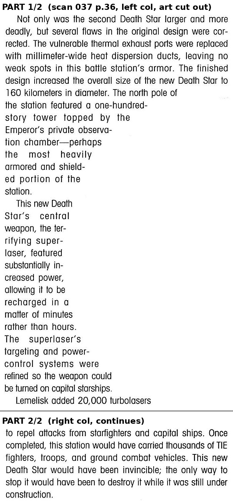

# Bevel Lemelisk

- **Aliases:** Lemelisk
- **Era:** GCW
- **Continuity:** default Legends; entries present for: Legends
- **Research tier:** untiered (not listed as INTRO/DEEP/MASTERY in legends-feats.md)
- **Entries:** 3 (1 with quotations; 0 quotations extended to the full sentence/passage from the source text on file; 6 marked as fragments). Rebuilt 2026-11-17 from 3 old entries; old file: `characters/_bak/bevel-lemelisk.md.bak-20261117`.
- **How to read:** each entry is the quotation in full (block quote), then its source and point of view. "Note" lines are summaries from our notes, not quotations. `[fragment — full passage not on file]` means the source text is not on the box, so only the words in our notes are shown. Debate and forum material is in the last section and is unverified.

# LEGENDS (Legends / EU — main focus)

## Star Wars: The Ultimate Visual Guide (Ryder Windham, DK 2005)

> Measuring 120 kilometers (75 miles) in diameter ... exceed a million beings, not including a security force of more than 25,000 stormtroopers and a support 'crew' of more than 400,000 droids. Weaponry includes 10,000 turbolasers and heavy turbolasers, 2,500 laser cannons, 2,500 ion cannons, and 768 long-range tractor beams.
> [fragment — full passage not on file]
>
> over 700 tractor beam generators
> [fragment — full passage not on file]
>
> former Lieutenant Governor of Eriadu ... Tarkin believes that humans are superior to aliens ... Tarkin Doctrine: 'Rule through fear of force rather than by force itself.'
> [fragment — full passage not on file]
>
> eight combined beams ... more firepower than half of the Imperial fleet ... recharge period of 24 standard hours
> [fragment — full passage not on file]
>
> previously helped the Geonosians produce their attack craft and also designed the Death Star's prototype, the first weapon ever to wield a superlaser ... When it is eventually discovered that the Death Star has a major design flaw, the Emperor will hold Lemelisk responsible.
> [fragment — full passage not on file]
>
> reusable durasheet scrolls ... would fade away and disappear after a short period.
> [fragment — full passage not on file]
— Source: Star Wars: The Ultimate Visual Guide (DK, 2005): The Clone Wars and The Dark Times (pp. 50–71), hand-read notes; p70-71 The Death Star (19–0 BBY).
Note (our notes, around the quote): p70-71 The Death Star (19–0 BBY): "Measuring 120 kilometers (75 miles) in diameter ... exceed a million beings, not including a security force of more than 25,000 stormtroopers and a support 'crew' of more than 400,000 droids. Weaponry includes 10,000 turbolasers and heavy turbolasers, 2,500 laser cannons, 2,500 ion cannons, and 768 long-range tractor beams." [Note: p16 says "over 700 tractor beam generators".] Tarkin "former Lieutenant Governor of Eriadu ... Tarkin believes that humans are superior to aliens ... Tarkin Doctrine: 'Rule through fear of force rather than by force itself.'" Destroyer of Worlds: "eight combined beams ... more firepower than half of the Imperial fleet ... recharge period of 24 standard hours". Officers: Tagge, Motti. Turbolaser defenses. IMPERIAL ENGINEER: Bevel Lemelisk "previously helped the Geonosians produce their attack craft and also designed the Death Star's prototype, the first weapon ever to wield a superlaser ... When it is eventually discovered that the Death Star has a major design flaw, the Emperor will hold Lemelisk responsible." Caption: blueprints on "reusable durasheet scrolls ... would fade away and disappear after a short period."
Our notes: `notes/materials/048-ultimate-visual-guide/uvg-02-clone-wars-dark-times.md:16`

## Essential Guide to Vehicles and Vessels (1996)

- Note (summary from our notes, not a quotation): The Sun Crusher was an Imperial superweapon designed at the Maw Installation, an Imperial military think tank that had been secretly established by Grand Moff Tarkin. The Maw Installation was hidden in the heart of the Maw, a cluster of black holes near the infamous spice world of Kessel. The original Death Star superlaser was invented at the Maw Installation by Imperial Engineer Bevel Lemelisk and a top design team that included an Omwati female named Qui Xux [sic]. After Tarkin and Lemelisk departed to build the Death Star, Tarkin left Admiral Daala in command and ordered Qui Xux [sic] to create a new Imperial superweapon.
  — Source: The Essential Guide to Vehicles and Vessels (Bill Smith, Del Rey, 1996), printed p.162, scan p.100. This 1996 printing spells the name Qui Xux. The character file remains Qwi Xux. The spelling is not normalized. These are the 1996 guide’s statements, not a power feat..
Our notes: `notes/materials/148-essential-guide-to-vehicles-vessels-1996/egvv-starlight-through-swoop.md`

- Note (summary from our notes, not a quotation): This new Death Star's central weapon, the terrifying superlaser, featured substantially increased power, allowing it to be recharged in a matter of minutes rather than hours. The superlaser's targeting and power-control systems were refined so the weapon could be turned on capital starships. Lemelisk added 20,000 turbolasers to repel attacks from starfighters and capital ships.
  — Source: The Essential Guide to Vehicles and Vessels (Bill Smith, Del Rey, 1996), printed p.36, scan p.037. The crop prints Lemelisk. It does not print Bevel in this sentence. The prototype crop on printed p.38 names no character, so Tarkin, Tol Sivron, the Maw, Despayre, and the Sun Crusher are not cited from that image..
Our notes: `notes/materials/148-essential-guide-to-vehicles-vessels-1996/egvv-chariot-through-enforcer.md`

# Debate and forum claims (unverified)

Forum posts, Suspect Insight debates and Discord debates, respect threads, and verdicts. These are posters' arguments or quotations they typed; none is checked against the book here unless the entry says so.

_None in our notes._
