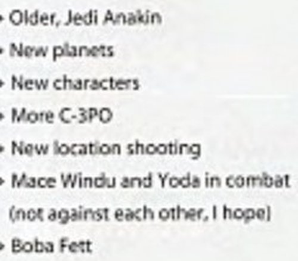

# Boba Fett

- **Aliases:** Boba
- **Era:** GCW
- **Continuity:** default Legends; entries present for: Canon, Legends
- **Research tier:** untiered (not listed as INTRO/DEEP/MASTERY in legends-feats.md)
- **Entries:** 1038 (408 with quotations; 29 quotations extended to the full sentence/passage from the source text on file; 295 marked as fragments; 318 before the 2026-11-17 fragment fill). Rebuilt 2026-11-17 from 1219 old entries; old file: `characters/_bak/boba-fett.md.bak-20261117`. Added 2026-11-20: 9 entries from Young Jedi Knights 7: Shards of Alderaan (full read).
- **How to read:** each entry is the quotation in full (block quote), then its source and point of view. "Note" lines are summaries from our notes, not quotations. `[fragment — full passage not on file]` means the source text is not on the box, so only the words in our notes are shown. Debate and forum material is in the last section and is unverified.

# LEGENDS (Legends / EU — main focus)

## Legacy of the Force 1–9: novel notes from the other agent (reference copy)

- Note (summary from our notes, not a quotation): Structure: Prologue (Fett, first person), then Chapters 1–23. Each chapter opens with an in-universe epigraph (news reports, memoirs, messages). The POVs alternate between Jacen, Luke, Ben, Han/Leia, and Boba Fett. Karen Traviss gives Fett and the Mandalorians about a third of the book.
  — Source: Legacy of the Force 2: Bloodlines (novel), feats and scaling notes.
Our notes: `notes/materials/021-legacy-of-the-force/lotf-2-bloodlines-notes.md:9`

What it shows (our notes): Fathers and legacies: Jango/Boba/Ailyn/Mirta mirror Anakin/Jacen and Luke/Ben. The epigraph at L5371 reads «Train your sons to be strong but your daughters to be stronger.»
> Ke barjurir gar’ade, jagyc’ade kot’la a dalyc’ade kotla’shya.
>
> Train your sons to be strong but your daughters to be stronger.
— Source: Legacy of the Force 2: Bloodlines (novel), feats and scaling notes.
(Excerpt widened 2026-11-17 to the relevant passage, word for word from Bloodlines (Karen Traviss), Chapter Fourteen (text copy `MEGA_Legend_The_Legacy_of_the_Force_Series_Star_Wars_Legacy_of_the_Force_02_Bloodlines_Karen_Traviss_epub`).)
Our notes: `notes/materials/021-legacy-of-the-force/lotf-2-bloodlines-notes.md:206`

- Note (summary from our notes, not a quotation): Role/arc: a reluctant, dying Mand'alor (71, L503) who finds a granddaughter.
  — Source: Legacy of the Force 2: Bloodlines (novel), feats and scaling notes.
Our notes: `notes/materials/021-legacy-of-the-force/lotf-2-bloodlines-notes.md:302`

> could see through walls *(Ch10–11, L3909)*
> [fragment — full passage not on file]
>
> In a second Slave I accelerated from a few thousand kilometers per hour to half the speed of light, and then decelerated again. *(Ch14, L5699–5703)*
— Source: Ch10–11, L3909; Ch14, L5699–5703; Ch18, L7165 — Legacy of the Force 2: Bloodlines (novel), feats and scaling notes.
(Full sentence/passage taken from the source text on file: `novels_tmp_bloodlines_bloodlines_epub`.)
Note (our notes, around the quote): Key feats: cuts open a Z-95 canopy with his gauntlet laser (Prologue, L111). Roof infiltration with terahertz radar that «could see through walls» (Ch10–11, L3909). Hyperspace micro-jump through the blockade at «half the speed of light» (Ch14, L5699–5703). Collapses an escape tunnel with a jetpack missile (Ch18, L7165).
Our notes: `notes/materials/021-legacy-of-the-force/lotf-2-bloodlines-notes.md:303`

> He has a Mandalorian army that could take on the Yuuzhan Vong. Avoid him for as long as you can. *(L7853)*
>
> Vader had been the master of causing pain and death without so much as a touch of his finger. *(L8013)*
— Source: L7853; L8013 — Legacy of the Force 2: Bloodlines (novel), feats and scaling notes; Statements: Jacen's POV.
Note (our notes, around the quote): Statements: Jacen's POV: «He has a Mandalorian army that could take on the Yuuzhan Vong. Avoid him for as long as you can.» (L7853). Fett on Vader: «Vader had been the master of causing pain and death without so much as a touch of his finger.» (L8013).
Our notes: `notes/materials/021-legacy-of-the-force/lotf-2-bloodlines-notes.md:304`

> It hurts deep in my stomach. I don't let anyone see that. *(L113)*
>
> Jedi always take everything from me. *(L8419)*
>
> “You should learn to shoot first, Solo,” said Fett. *(L7001)*
— Source: L113; L8419; L7001 — Legacy of the Force 2: Bloodlines (novel), feats and scaling notes; Notable quotes.
(Full sentence/passage taken from the source text on file: `novels_tmp_bloodlines_bloodlines_epub`.)
Label in our notes: L113). (L8419). (L7001
Our notes: `notes/materials/021-legacy-of-the-force/lotf-2-bloodlines-notes.md:305`

- Note (summary from our notes, not a quotation): Fights/results: beats Han (Ch16). Takes part in Thrackan's execution (Ch17).
  — Source: Legacy of the Force 2: Bloodlines (novel), feats and scaling notes.
Our notes: `notes/materials/021-legacy-of-the-force/lotf-2-bloodlines-notes.md:306`

- Note (summary from our notes, not a quotation): Scaling: the top non-Force fighter in the book, though dying. His threat to Jacen is his army, not personal combat.
  — Source: Legacy of the Force 2: Bloodlines (novel), feats and scaling notes.
Our notes: `notes/materials/021-legacy-of-the-force/lotf-2-bloodlines-notes.md:307`

- Note (summary from our notes, not a quotation): Role/arc: goes from dying to cured by Jaing and Venku: «I'm back.» (L7598).
  — Source: L7598 — Legacy of the Force 5: Sacrifice (novel, read in full): feats, scaling and story notes.
Our notes: `notes/materials/021-legacy-of-the-force/lotf-5-sacrifice-notes.md:495`

- Note (summary from our notes, not a quotation): Feats: a left hook on a barkeep reaching for a disruptor (Ch3, L1434–1436). Loops the gangster Fraig over a balcony on fibercord (Ch4, L2297).
  — Source: Ch3, L1434–1436; Ch4, L2297 — Legacy of the Force 5: Sacrifice (novel, read in full): feats, scaling and story notes.
Our notes: `notes/materials/021-legacy-of-the-force/lotf-5-sacrifice-notes.md:496`

- Note (summary from our notes, not a quotation): Scaling: non-Force. Matters for Revelation (Mando anti-Jedi gear).
  — Source: Legacy of the Force 5: Sacrifice (novel, read in full): feats, scaling and story notes.
Our notes: `notes/materials/021-legacy-of-the-force/lotf-5-sacrifice-notes.md:497`

What it shows (our notes): Final line: Jaina leaves «Toward an act of last resort. / Toward her teacher.» (L7065–7067), setting up her training with Boba Fett in *Revelation*.
> “I know; you said that.”
>
> “But now I know where. I need to make some preparations. Don’t worry: I’ll say good-bye before I leave.”
>
> She turned away from his baffled expression and headed back to the outpost. Toward her mission.
>
> She turned away from his baffled expression and headed back to the outpost. Toward her mission. Toward an act of last resort.
>
> Toward her teacher. acknowledgments Thanks go to:
>
> Karen Traviss and Troy Denning, my partners in crime; Shelly Shapiro, Sue Rostoni, Keith Clayton, and Leland Chee, for making things work right; My Eagle-Eyes (Chris Cassidy, Kelly Frieders, Helen Keier, Beth Loubet, Bob Quinlan, Roxanne Quinlan, and Luray Richmond), for helping keep my errors down to a necessary minimum; My agent, Russ Galen; and Dr. James Dooner, without whose skill and generosity I might not have retained enough vision to finish this book.
>
> Toward her teacher. *(L7065–7067)*
— Source: L7065–7067 — Legacy of the Force 7: Fury (novel, read in full): feats, scaling and story notes; Final line: Jaina leaves.
(Excerpt widened 2026-11-17 to the relevant passage, word for word from Fury (Aaron Allston) (text copy `MEGA_Legend_The_Legacy_of_the_Force_Series_Star_Wars_Legacy_of_the_Force_07_Fury_Aaron_Allston_epub`).)
(Excerpt widened 2026-11-17 to the relevant passage, word for word from Fury (Aaron Allston) (text copy `MEGA_Legend_The_Legacy_of_the_Force_Series_Star_Wars_Legacy_of_the_Force_07_Fury_Aaron_Allston_epub`).)
Our notes: `notes/materials/021-legacy-of-the-force/lotf-7-fury-notes.md:433`

- Note (summary from our notes, not a quotation): Headline: the Mandalorian training / Mara-evidence book. Jaina goes to Boba Fett and is trained in anti-Jedi thinking (Fett, Beviin, Mirta, ex-Jedi Bardan Jusik). Ben and Shevu prove Jacen killed Mara (her hair in his StealthX; his recorded confession). Luke beats Caedus in a StealthX duel at Fondor, ripping his fighter apart with the Force, but lets him escape rather than kill civilians. Caedus brings down Fondor's planetary shield by mass mind-influence and bombs Oridin City. Niathal relieves him; the GA splits. Tahiri murders Pellaeon and becomes Caedus's apprentice. Daala returns. On *Bloodfin*, Mirta and Jaina gut Tahiri, Jaina breaks Caedus's Force choke, and a Mandalorian kneecaps Caedus. Jaina resolves to kill her brother «out of love».
  — Source: Legacy of the Force 8: Revelation (novel, read in full): feats, scaling and story notes.
Our notes: `notes/materials/021-legacy-of-the-force/lotf-8-revelation-notes.md:11`

- Note (summary from our notes, not a quotation): Boba Fett: father/grandfather arc (Sintas, Mirta, Ailyn); principled refusal to kill Jacen himself (L7681); professional respect for Jaina (L7359).
  — Source: L7681; L7359 — Legacy of the Force 8: Revelation (novel, read in full): feats, scaling and story notes.
Our notes: `notes/materials/021-legacy-of-the-force/lotf-8-revelation-notes.md:145`

- Note (summary from our notes, not a quotation): Role/arc: trains Jaina, contracts with Daala, and refuses to kill Jacen himself (L7681).
  — Source: L7681 — Legacy of the Force 8: Revelation (novel, read in full): feats, scaling and story notes.
Our notes: `notes/materials/021-legacy-of-the-force/lotf-8-revelation-notes.md:342`

What it shows (our notes): Feats: sucker-punches Jaina, and her slash leaves only «a scorch mark» on his beskar (L2909–2913). He is «a blank slate in the Force» to her (L2867).
> “He could get rich on that.” Fett didn’t sound as if he were mocking. In fact, he felt totally neutral to her; a blank slate in the Force, nothing to read. “Why does he need spies and secret police if he can eavesdrop wherever he wants?”
— Source: L2909–2913; L2867 — Legacy of the Force 8: Revelation (novel, read in full): feats, scaling and story notes.
(Excerpt widened 2026-11-17 to the relevant passage, word for word from Revelation (Karen Traviss), Chapter Seven (text copy `MEGA_Legend_The_Legacy_of_the_Force_Series_Star_Wars_Legacy_of_the_Force_08_Revelation_Karen_Traviss_epub`).)
(Full sentence/passage taken from the source text on file: `lotf_tmp_b8_epub`.)
Our notes: `notes/materials/021-legacy-of-the-force/lotf-8-revelation-notes.md:343`

> Winning isn't about being better. It's finding your opponent's weakness and ex-ploiting it. *(L2961)*
>
> It's not about their powers. It's about their attitude. *(L6577)*
>
> “That’s a barve who nearly got his backside handed to him by Skywalker’s wife. *(L7669)*
— Source: L2961; L6577; L7669 — Legacy of the Force 8: Revelation (novel, read in full): feats, scaling and story notes; Statements/quotes.
(Full sentence/passage taken from the source text on file: `lotf_tmp_b8_epub`.)
Label in our notes: L2961). (L6577). On Caedus: (L7669
Our notes: `notes/materials/021-legacy-of-the-force/lotf-8-revelation-notes.md:344`

- Note (summary from our notes, not a quotation): Scaling: non-Force, but the architect of the anti-Caedus method.
  — Source: Legacy of the Force 8: Revelation (novel, read in full): feats, scaling and story notes.
Our notes: `notes/materials/021-legacy-of-the-force/lotf-8-revelation-notes.md:345`

- Note (summary from our notes, not a quotation): Boba Fett / Mandalorians: Fett stays outside the duel; Roegr and Vatok die; Mirta paralyzed; Fett and Mirta exiled from Mandalore by the nanokiller (L5848). Fett's lessons pay off in Jaina's beskad cut and commitment.
  — Source: L5848 — Legacy of the Force 9: Invincible (novel, read in full): feats, scaling and story notes.
Our notes: `notes/materials/021-legacy-of-the-force/lotf-9-invincible-notes.md:150`

- Note (summary from our notes, not a quotation): Role: stays out of the duel. His lessons pay off in Jaina's beskad cut.
  — Source: Legacy of the Force 9: Invincible (novel, read in full): feats, scaling and story notes.
Our notes: `notes/materials/021-legacy-of-the-force/lotf-9-invincible-notes.md:290`

> Not like your brother. Not anyone that powerful. *(L229)*
— Source: L229 — Legacy of the Force 9: Invincible (novel, read in full): feats, scaling and story notes; Statement: on Jedi he has killed.
Note (our notes, around the quote): Statement: on Jedi he has killed: «Not like your brother. Not anyone that powerful.» (L229).
Our notes: `notes/materials/021-legacy-of-the-force/lotf-9-invincible-notes.md:291`

- Note (summary from our notes, not a quotation): Scaling: non-Force. The anti-Jedi method rather than raw power.
  — Source: Legacy of the Force 9: Invincible (novel, read in full): feats, scaling and story notes.
Our notes: `notes/materials/021-legacy-of-the-force/lotf-9-invincible-notes.md:292`

## Star Wars: The New Essential Chronology (Del Rey, 2005): power-scaling and lore notes

> Jango bested Obi-Wan in combat and escaped with Boba in Slave I.
— Source: Part Two: The Fall of the Republic.
Note (our notes, around the quote): Jango Fett; Obi-Wan Kenobi — Jango bests Obi-Wan on Kamino: "Jango bested Obi-Wan in combat and escaped with Boba in Slave I." Source: The New Essential Chronology, p.52
Our notes: `notes/materials/027-new-essential-chronology/02-part-two-fall-of-the-republic.md:208`

> Although Boba Fett succeeded in penetrating Tambor's citadel, General Grievous humiliated Boba in combat and ensured the escape of the Separatist leader.
— Source: Part Two: The Fall of the Republic; General Grievous; Boba Fett — Grievous humiliates Boba.
Note (our notes, around the quote): General Grievous; Boba Fett — Grievous humiliates Boba: "Although Boba Fett succeeded in penetrating Tambor's citadel, General Grievous humiliated Boba in combat and ensured the escape of the Separatist leader." Source: The New Essential Chronology, p.80
Our notes: `notes/materials/027-new-essential-chronology/02-part-two-fall-of-the-republic.md:466`

> Their dis- * maneuverings would Inevitably be replaced by deadly On Nar Shaddaa, the Smugglers’ Moon, Han Solo and acca were introduced to illicit Hult activitles by © Spince, Han’s old friend from the Academy. As the ‘enths passed, the new partners met dozens of offbeat “meividuals, such as Shug Ninx, Salla Zend, and Xaverrl.
>
> “They visited hideaways and hellholes like Smuggler’s Run mc Kessel, and Han learned how to fly the dangerous Sessel Run cargo route by skirting the Maw black-hole ‘Sester. Han's piloting skills caught the attention of Jabba Se Hutt, and soon Han was making regular smuggling "sams for the Desiliji¢ clan.
>
> Rubbing elbows with high-level Hutts was a risky game, ‘=pexially since Han still had a price on his head from the evel Besadii clan. On Ylesia, the colony's High Priest uncov- red astonishing evidence that Vyyk Drago-reported dead ‘Sve years earlier—had resurfaced under the name “Han Solo.”
>
> Rubbing elbows with high-level Hutts was a risky game, ‘=pexially since Han still had a price on his head from the evel Besadii clan. On Ylesia, the colony's High Priest uncov- red astonishing evidence that Vyyk Drago-reported dead ‘Sve years earlier—had resurfaced under the name “Han Solo.” The galaxy’s best bounty hunter was hired to bring in Solo’s hide.
>
> Boba Fett tracked Han to Nar Shaddaa, but his cap- Sre was spoiled with an impromptu rescue by a charming Swanger: Lando Calrissian, pilot of a banged-up YT-1300 Seighter called Mitennium Falcon, which he had won In a secent sabacc game. Han taught his rescuer the basics of fly- ‘&& and Calrissian soon headed off in the Falcon for the Rafa system and some adventuring of his own.
— Source: Part Four: Profiles in History; Boba Fett; Han Solo — galaxy's best bounty hunter.
(Excerpt widened 2026-11-17 to the relevant passage, word for word from research primary new essential chronology nec paged (text copy `research_primary_new_essential_chronology_nec_paged_txt_88b808b5bc`).)
(Excerpt widened 2026-11-17 to the relevant passage, word for word from research primary new essential chronology nec paged (text copy `research_primary_new_essential_chronology_nec_paged_txt_88b808b5bc`).)
Note (our notes, around the quote): Boba Fett; Han Solo — galaxy's best bounty hunter: "The galaxy's best bounty hunter was hired to bring in Solo's hide." Source: The New Essential Chronology, p.93
Our notes: `notes/materials/027-new-essential-chronology/04-part-four-profiles-in-history.md:40`

> The galaxy's most notorious bounty hunters assemble for the funeral of Greedo.
— Source: Part Four: Profiles in History; Boba Fett — art caption.
Note (our notes, around the quote): Boba Fett — art caption: "The galaxy's most notorious bounty hunters assemble for the funeral of Greedo." Source: The New Essential Chronology, p.97, caption
Our notes: `notes/materials/027-new-essential-chronology/04-part-four-profiles-in-history.md:68`

> Han Passed on the information to Tharen’s surviving family.
>
> With his first love dead, one chapter of Han Solo’s life closed forever. But a new one was about to begin. The Corel _ lian smuggler strode into the smoky darkness of the Mos Eisley cantina for a fateful rendezvous with two local desert dwellers who needed passage to Alderaan. player, and one of the best star jockeys in all of Hutt space.
>
> He caught up with Han at just the right time. The bounty hunter Boba Fett had Han at gunpoint, but Lando Inter cepted the pair and turned the tables on Fett He injected the bounty hunter with an obedience drug and ordered him to fly off to the Rim of the galaxy.
>
> He caught up with Han at just the right time. The bounty hunter Boba Fett had Han at gunpoint, but Lando Inter cepted the pair and turned the tables on Fett He injected the bounty hunter with an obedience drug and ordered him to fly off to the Rim of the galaxy. A grateful Han offered to teach Lando how to pilot, at no charge.
>
> THE SHARU AWAKEN 4BB.Y.
>
> | ando was 4 quick study, but learning to single-pilot a
>
> «freighter was a iikky proposition.
— Source: Part Four: Profiles in History; Lando Calrissian; Boba Fett — Lando drugs Fett.
(Excerpt widened 2026-11-17 to the relevant passage, word for word from research primary new essential chronology nec paged (text copy `research_primary_new_essential_chronology_nec_paged_txt_88b808b5bc`).)
(Excerpt widened 2026-11-17 to the relevant passage, word for word from research primary new essential chronology nec paged (text copy `research_primary_new_essential_chronology_nec_paged_txt_88b808b5bc`).)
Note (our notes, around the quote): Lando Calrissian; Boba Fett — Lando drugs Fett: "He injected the bounty hunter with an obedience drug and ordered him to fly off to the Rim of the galaxy." Source: The New Essential Chronology, p.98
Our notes: `notes/materials/027-new-essential-chronology/04-part-four-profiles-in-history.md:75`

> Boba Fett, now the most notorious bounty hunter in the galaxy, was hired to be the agent of the guild's destruction.
— Source: Part Five: The Galactic Civil War; Boba Fett — Bounty Hunter Wars.
Note (our notes, around the quote): Boba Fett — Bounty Hunter Wars: "Boba Fett, now the most notorious bounty hunter in the galaxy, was hired to be the agent of the guild's destruction." Source: The New Essential Chronology, p.111
Our notes: `notes/materials/027-new-essential-chronology/05-part-five-galactic-civil-war.md:60`

> Before the Battle of Yavin, Fett had recovered the severed head of an Icarii prophetess on the Dark Lord's behalf, a contest in which each player had exhibited his full depth of skill.
— Source: Part Five: The Galactic Civil War; Boba Fett; Darth Vader (Anakin Skywalker) — Fett and Vader.
Note (our notes, around the quote): Boba Fett; Darth Vader (Anakin Skywalker) — Fett and Vader: "Before the Battle of Yavin, Fett had recovered the severed head of an Icarii prophetess on the Dark Lord's behalf, a contest in which each player had exhibited his full depth of skill." Source: The New Essential Chronology, p.118
Our notes: `notes/materials/027-new-essential-chronology/05-part-five-galactic-civil-war.md:121`

> There, Han Solo received help from the last man he ever expected—Boba Fett, flanked by a new squad of Mandalorian Supercommandos. The armored warriors put the fear of Mandalore into the attacking Yuuzhan Vong, and Han escaped the station with a newfound respect for the veteran hunter.
— Source: Part Twelve: The New Jedi Order; Boba Fett; Han Solo — Fett's Mandalorians at Caluula.
Note (our notes, around the quote): Boba Fett; Han Solo — Fett's Mandalorians at Caluula: "There, Han Solo received help from the last man he ever expected—Boba Fett, flanked by a new squad of Mandalorian Supercommandos. The armored warriors put the fear of Mandalore into the attacking Yuuzhan Vong, and Han escaped the station with a newfound respect for the veteran hunter." Source: The New Essential Chronology, p.225
Our notes: `notes/materials/027-new-essential-chronology/12-part-twelve-new-jedi-order.md:209`

## The Complete Star Wars Encyclopedia, Vol. I (A–G)

> A thousand BL units armed with AAP-II blaster boxes fought in the front lines, and most were destroyed at Norval IL BL-17 was a Battle Legionnaire that served Boba Fett in the Empire's early days.
— Source: scan pages 41–80; Boba Fett. POV: Boba Fett.
Note (our notes, around the quote): Boba Fett: "A thousand BL units armed with AAP-II blaster boxes fought in the front lines, and most were destroyed at Norval IL BL-17 was a Battle Legionnaire that served Boba Fett in the Empire's early days." Source: The Complete Star Wars Encyclopedia, Vol. I, p.64
Our notes: `notes/materials/030-complete-star-wars-encyclopedia-vol-1/01-v1-scan-041-080.md:312`

> The death escalated tensions and resulted in a civil war that lasted a year. Blessings A Dreadnaught in Nil Spaar's Black Eleven Fleet. Bleyd,TarneseSakiyan commander of a MedStar medical frigate who was secretly working to double-cross Black Sun during the Clone Wars. He hoped to profit off bota taken from Drongar, thereby bringing honor back to his family lost by an earlier dealing with the criminal syndicate. Black Sun agent Kaird killed Bleyd. Bley-sanThe owner of a cantina on Tatoo­ ine, she owed a favor to Ygabba Hise, one of the children under the control of Gilramos Libkath.
>
> Black Sun agent Kaird killed Bleyd.
>
> He hoped to profit off bota taken from Drongar, thereby bringing honor back to his family lost by an earlier dealing with the criminal syndicate.
>
> Black Sun agent Kaird killed Bleyd.
>
> Bley-san The owner of a cantina on Tatoo­ ine, she owed a favor to Ygabba Hise, one of the children under the control of Gilramos Libkath. After Boba Fett killed Libkath, Ygabba believed that Bley-san could help the children find their families.
>
> Bllm, Lieutenant GeH An Imperial of­ ficer, he was Carnor Jax's personal assistant and, secretly, his chief assassin. Slim's timid, awkward bearing was a front, meant to make him appear incompetent or weak to others.
>
> Bllm, Lieutenant GeH An Imperial of­ ficer, he was Carnor Jax's personal assistant and, secretly, his chief assassin. Slim's timid, awkward bearing was a front, meant to make him appear incompetent or weak to others.
— Source: scan pages 81–120; Boba Fett. POV: Boba Fett.
(Excerpt widened 2026-11-17 to the relevant passage, word for word from research primary cse vol1 (text copy `research_primary_cse_vol1_pdf_45a954be6d`).)
(Excerpt widened 2026-11-17 to the relevant passage, word for word from research audit work src m030 (text copy `research_audit_work_src_m030_txt_69ea9f4a41`).)
(Excerpt widened 2026-11-17 to the relevant passage, word for word from research audit work src m030 (text copy `research_audit_work_src_m030_txt_69ea9f4a41`).)
Note (our notes, around the quote): Boba Fett: "After Boba Fett killed Libkath, Ygabba believed that Bley-san could help the children find their families." Source: The Complete Star Wars Encyclopedia, Vol. I, p.79
Our notes: `notes/materials/030-complete-star-wars-encyclopedia-vol-1/02-v1-scan-081-120.md:105`

> The open cockpit allowed him to leap directly from the vehicle and into combat.
>
> B1oodfln (2) One of the first new Turbulent­ class Star Destroyers unveiled by the Imperial Remnant following the Swarm War. A crest with an image of the Bastion terrestrial blood­ fin adorned the main bridge, depicting the creature trampling its rider. Gilad Pellaeon, the Bloodjin's first commander, explained to Tahiri Veila that the crest was a reminder to Imperials that they needed to rule without cruelty or carelessness, lest the people turn on them, just like a bloodfin would attack a cruel rider. During the Second Battle of Fondor, Tahiri coldly assassinated Pellaeon after he ordered the Imperial fleet to break off its at­ tack and obey only the orders of Admiral Cha Niathal, not those of Tahiri's master, Darth Caedus. The treacherous Imperial Moffs at­ tempted to take control, but Pellaeon's loyal crew mutinied, forcing the Moffs to lock themselves in the ship's command center in order to regroup. They were then wiped out by Boba Fett's Mandalorian supercommandos.
>
> Blood Razors This swoop gang originated on the planet Biivren. Despite their fearsome name, the Blood Razors were formed to assist those inhabitants who were outcast when the big corporations took over the planet.
— Source: scan pages 81–120; Boba Fett. POV: Boba Fett.
(Excerpt widened 2026-11-17 to the relevant passage, word for word from research audit work src m030 (text copy `research_audit_work_src_m030_txt_69ea9f4a41`).)
(Excerpt widened 2026-11-17 to the relevant passage, word for word from research audit work src m030 (text copy `research_audit_work_src_m030_txt_69ea9f4a41`).)
Note (our notes, around the quote): Boba Fett: "They were then wiped out by Boba Fett's Mandalorian supercommandos." Source: The Complete Star Wars Encyclopedia, Vol. I, p.80
Our notes: `notes/materials/030-complete-star-wars-encyclopedia-vol-1/02-v1-scan-081-120.md:118`

> Boz A short Lizling, he vowed revenge on Boba Fett after the bounty hunter killed his friend Ry-Kooda.
— Source: scan pages 81–120; Boba Fett. POV: Boba Fett.
Note (our notes, around the quote): Boba Fett: "Boz A short Lizling, he vowed revenge on Boba Fett after the bounty hunter killed his friend Ry-Kooda." Source: The Complete Star Wars Encyclopedia, Vol. I, p.90
Our notes: `notes/materials/030-complete-star-wars-encyclopedia-vol-1/02-v1-scan-081-120.md:202`

> Ealewon Electronics A company that manufactured encryption devices. Ean A Mon Calamari, he was a member of Wedge Antilles's command crew on the Y avin, a New Republic star cruiser. Earl of Vis A historical figure on Naboo, cousin to an ancient king, who built a large banquet rotunda in the city of Theed. earworm A Corellian slang term for any nuisance or pest. East DistrictTrail A travel route on Lu­ cazec, little more than a dirt road. Eastgate One of the largest commer­ cial and warehouse districts of the Upper City of Taris, prior to its devastation by Darth Malak. East Minor A residential borough on Coruscant's southern hemisphere, home to the famous Traphill Gardens. East Platform The landing platform used by Boba Fett on Cloud City when he took possession of the carbon-frozen Han Solo. EastportOne ofthe three largest space­ E522 Assassin was extensively damaged during the Yuuzhan Vong invasion and subsequent transforma­ tion of the capital world. Easy Spacer A popular ho­ lovid starring Isriner Korosson, re­ leased prior to the Clone Wars. Eater of Fire Creepers A Qom Jha Bargainer who welcomed Luke Skywalker to Nirauan. However, he resented the presence ofMara Jade because of her former allegiance to the Empire.
— Source: scan pages 201–240; Boba Fett; Han Solo.
(Excerpt widened 2026-11-17 to the relevant passage, word for word from research primary cse vol1 (text copy `research_primary_cse_vol1_pdf_45a954be6d`).)
(Excerpt widened 2026-11-17 to the relevant passage, word for word from research primary cse vol1 (text copy `research_primary_cse_vol1_pdf_45a954be6d`).)
Note (our notes, around the quote): Boba Fett; Han Solo: "East Platform The landing platform used by Boba Fett on Cloud City when he took possession of the carbon-frozen Han Solo." Source: The Complete Star Wars Encyclopedia, Vol. I, p.224
Our notes: `notes/materials/030-complete-star-wars-encyclopedia-vol-1/05-v1-scan-201-240.md:308`

- Note (summary from our notes, not a quotation): Page contents: 1138 words, 36 paragraphs | headings/entries: Feswin, Chau; Fett, Boba
  — Source: scan pages 281–320.
Our notes: `notes/materials/030-complete-star-wars-encyclopedia-vol-1/07-v1-scan-281-320.md:10`

> He was a legendary bounty hunter, accepting warrants from both the Empire and the criminal underworld.
— Source: scan pages 281–320; Boba Fett — entry/section: Fett, Boba.
Note (our notes, around the quote): Boba Fett — entry/section: Fett, Boba: "He was a legendary bounty hunter, accepting warrants from both the Empire and the criminal underworld." Source: The Complete Star Wars Encyclopedia, Vol. I, p.266
Our notes: `notes/materials/030-complete-star-wars-encyclopedia-vol-1/07-v1-scan-281-320.md:12`

> A doctor gave him just a year or two to live; there was no help this time from Taun We, since she had disappeared. Fett decided to locate his daughter Ailyn, who had been born during a three-year marriage to bounty hunter Sintas Vel. But Ailyn had vanished, secretly taking on Corellian secessionist Thrackan Sal-Solo's bounty on the heads of Han and Leia. Ailyn's daughter Mirta Gev approached Fett without revealing that she was his granddaughter to enlist him in the search for her mother. She Fett,Cassus Q accompanied the 71-year-old Fett when he took on the job of assassinating Thrackan, fir­ ing the first three shots into Sal-Solo's head. It was then that they learned that Ailyn had been captured, tortured, and killed by Jacen Solo. After confronting the animosity his grand­ daughter held toward him, Fett realized that it was time he reclaimed his Mandalorian roots. Fett and Gev journeyed to Mandalore and Fett resumed his role as leader, although he felt undeserving. Fett was able to obtain a serum that rapidly restored his health, and he helped Mandalore return as a power in the galaxy. It was with great trepidation that Fett dis­ covered that Sintas Vel, his former wife and grandmother of Mirta Gev, was still alive.
— Source: scan pages 281–320; Boba Fett; Jacen Solo (Darth Caedus) — entry/section: Fett, Boba.
(Excerpt widened 2026-11-17 to the relevant passage, word for word from research primary cse vol1 (text copy `research_primary_cse_vol1_pdf_45a954be6d`).)
(Excerpt widened 2026-11-17 to the relevant passage, word for word from research primary cse vol1 (text copy `research_primary_cse_vol1_pdf_45a954be6d`).)
Note (our notes, around the quote): Boba Fett; Jacen Solo (Darth Caedus) — entry/section: Fett, Boba: "It was then that they learned that Ailyn had been captured, tortured, and killed by Jacen Solo." Source: The Complete Star Wars Encyclopedia, Vol. I, p.267
Our notes: `notes/materials/030-complete-star-wars-encyclopedia-vol-1/07-v1-scan-281-320.md:21`

> It proved to be incredibly successful and served as the model for future cities built in the Genarius's atmosphere. frog-dog A reptilian species with prehen­ sile tongues and bulbous purple eyes atop a Sise Fromm green head, they were intelligent, but rarely let others know that. Instead, frog-dogs such as Bubo chose to work as spies and mercenar­ ies. Most regarded them as common pets. Fromm, Sise An old yet powerful crime boss, he operated out of a strong­ hold on the planet Annoo during the early days of the Empire. An Annoo­ dat, he ran a legitimate import­ export business that was a front for extortion, kidnapping, and blaster­ running. He controlled most of the world by fear, having sent the Trigon One weap­ ons satellite into orbit around the planet. He wanted Thall Joben and his friends killed for angering him, and so he employed Boba Fett to kill them in the speeder races on Boonta. Fromm, covering all his bases, also planted a bomb on Joben's speeder. When Fett made his attempt on Joben dur­ ing the races, he activated a magnet in order to draw Joben nearer. However, the mag­ net dislodged Fromm's bomb, and Fett was nearly destroyed. In his anger, Fett captured Sise Fromm and his entire gang, and turned them over to Jabba the Hutt.
— Source: scan pages 281–320; Boba Fett. POV: Boba Fett.
(Excerpt widened 2026-11-17 to the relevant passage, word for word from research primary cse vol1 (text copy `research_primary_cse_vol1_pdf_45a954be6d`).)
(Excerpt widened 2026-11-17 to the relevant passage, word for word from research primary cse vol1 (text copy `research_primary_cse_vol1_pdf_45a954be6d`).)
Note (our notes, around the quote): Boba Fett: "He wanted Thall Joben and his friends killed for angering him, and so he employed Boba Fett to kill them in the speeder races on Boonta." Source: The Complete Star Wars Encyclopedia, Vol. I, p.297
Our notes: `notes/materials/030-complete-star-wars-encyclopedia-vol-1/07-v1-scan-281-320.md:237`

> Gann (2) A human male member of Nevo's assassin unit, he was killed by Boba Fett in a photo booth on Starstation 12.
— Source: scan pages 321–360; Boba Fett. POV: Boba Fett.
Note (our notes, around the quote): Boba Fett: "Gann (2) A human male member of Nevo's assassin unit, he was killed by Boba Fett in a photo booth on Starstation 12." Source: The Complete Star Wars Encyclopedia, Vol. I, p.321
Our notes: `notes/materials/030-complete-star-wars-encyclopedia-vol-1/08-v1-scan-321-360.md:111`

> Grakouine The site of a Rebel Alliance storage base, it was where the New Republic parked Boba Fett's ship, Slave I, after the bounty hunter was presumed killed by the Sarlacc on Tatooine.
— Source: scan pages 361–398; Boba Fett. POV: Boba Fett.
Note (our notes, around the quote): Boba Fett: "Grakouine The site of a Rebel Alliance storage base, it was where the New Republic parked Boba Fett's ship, Slave I, after the bounty hunter was presumed killed by the Sarlacc on Tatooine." Source: The Complete Star Wars Encyclopedia, Vol. I, p.357
Our notes: `notes/materials/030-complete-star-wars-encyclopedia-vol-1/09-v1-scan-361-398.md:99`

> Greglik A former Rebel Alliance pilot, he captained an ore hauler used to transport ma­ terial following the Battle ofHoth. Greglik was addicted to various drugs, and that habit killed not only him but also 17 other Alliance pilots in a collision with an asteroid. Grejic the Hutt The president of the Hutt Grand Council in the century leading up to the Battle of Yavin, he decided that clan Besadii should be punished for rais­ ing the price of raw spice in the aftermath of the Battle of Nar Shaddaa. The punish­ ment was one million credits, to be divided among those clans that had lost resources in the battle. GreJJAn Imperial lieutenant, he commanded an AT-AT walker stationed at the garrison on Vryssa. Like Lieutenant Byrga, Grejj was killed when Boba Fett came to the planet to recover Rivo Xarran. Fett had acquired control of an AT-AT from Byrga and used it to destroy Grejj's vehicle. Grek-class troop shuttle Designed and manufactured by the Corellian Engineering Corporation, this 30-meter-long shuttle found use aboard Imperial Nebulon-B frigates as well as other local navies. The Grek-class shuttle re­ quired a pilot and copilot, and could transport up to 50 troops and minimal cargo. Itwas armed with a computer-controlled laser cannon.
— Source: scan pages 361–398; Boba Fett. POV: Boba Fett.
(Excerpt widened 2026-11-17 to the relevant passage, word for word from research primary cse vol1 (text copy `research_primary_cse_vol1_pdf_45a954be6d`).)
(Excerpt widened 2026-11-17 to the relevant passage, word for word from research primary cse vol1 (text copy `research_primary_cse_vol1_pdf_45a954be6d`).)
Note (our notes, around the quote): Boba Fett: "Like Lieutenant Byrga, Grejj was killed when Boba Fett came to the planet to recover Rivo Xarran." Source: The Complete Star Wars Encyclopedia, Vol. I, p.367
Our notes: `notes/materials/030-complete-star-wars-encyclopedia-vol-1/09-v1-scan-361-398.md:175`

## The Complete Star Wars Encyclopedia, Vol. II (H–O)

> Jango Fett established one for his son Boba before he was killed on Geonosis.
— Source: scan pages 41–80; Jango Fett; Boba Fett.
Note (our notes, around the quote): Jango Fett; Boba Fett: "Jango Fett established one for his son Boba before he was killed on Geonosis." Source: The Complete Star Wars Encyclopedia, Vol. II, p.41
Our notes: `notes/materials/031-complete-star-wars-encyclopedia-vol-2/01-v2-scan-041-080.md:56`

> Fifteen years before the Battle of Hoth, Boba Fett killed a spice dealer named Hallolar Voors on Jubilar.
— Source: scan pages 161–200; Boba Fett. POV: Boba Fett.
Note (our notes, around the quote): Boba Fett: "Fifteen years before the Battle of Hoth, Boba Fett killed a spice dealer named Hallolar Voors on Jubilar." Source: The Complete Star Wars Encyclopedia, Vol. II, p.176
Our notes: `notes/materials/031-complete-star-wars-encyclopedia-vol-2/04-v2-scan-161-200.md:163`

> Young Boba stole his miter-like hat and fled the ship with the children, while Durge set out to destroy Libkath.
— Source: scan pages 241–280; Boba Fett. POV: Boba Fett.
Note (our notes, around the quote): Boba Fett: "Young Boba stole his miter-like hat and fled the ship with the children, while Durge set out to destroy Libkath." Source: The Complete Star Wars Encyclopedia, Vol. II, p.253
Our notes: `notes/materials/031-complete-star-wars-encyclopedia-vol-2/06-v2-scan-241-280.md:174`

> In the wake of the Galactic Civil War, Boba Fett took on the role of Mandalor for the scattered Mandalorians who survived throughout the galaxy, although he was never regarded as a true Mandalorian.
— Source: scan pages 281–320; Boba Fett. POV: Boba Fett.
Note (our notes, around the quote): Boba Fett: "In the wake of the Galactic Civil War, Boba Fett took on the role of Mandalor for the scattered Mandalorians who survived throughout the galaxy, although he was never regarded as a true Mandalorian." Source: The Complete Star Wars Encyclopedia, Vol. II, p.283
Our notes: `notes/materials/031-complete-star-wars-encyclopedia-vol-2/07-v2-scan-281-320.md:78`

> Mit, N'haz Boba Fett tracked Mit to the planet Necropolis, where he killed him.
— Source: scan pages 321–360; Boba Fett. POV: Boba Fett.
Note (our notes, around the quote): Boba Fett: "Mit, N'haz Boba Fett tracked Mit to the planet Necropolis, where he killed him." Source: The Complete Star Wars Encyclopedia, Vol. II, p.320
Our notes: `notes/materials/031-complete-star-wars-encyclopedia-vol-2/08-v2-scan-321-360.md:43`

> Murthé was later hunted down and killed by Boba Fett, who had been hired by Slique Brighteyes to avenge the Gulmarids.
— Source: scan pages 321–360; Boba Fett. POV: Boba Fett.
Note (our notes, around the quote): Boba Fett: "Murthé was later hunted down and killed by Boba Fett, who had been hired by Slique Brighteyes to avenge the Gulmarids." Source: The Complete Star Wars Encyclopedia, Vol. II, p.343
Our notes: `notes/materials/031-complete-star-wars-encyclopedia-vol-2/08-v2-scan-321-360.md:206`

> Shug Ninx and Salla Zend left the spaceport after Han Solo accidentally destroyed one of their prized cruisers escaping from Boba Fett, and after Zasm Katth and Baddon Fass had ransacked the garage.
— Source: scan pages 361–400; Han Solo; Boba Fett.
Note (our notes, around the quote): Han Solo; Boba Fett: "Shug Ninx and Salla Zend left the spaceport after Han Solo accidentally destroyed one of their prized cruisers escaping from Boba Fett, and after Zasm Katth and Baddon Fass had ransacked the garage." Source: The Complete Star Wars Encyclopedia, Vol. II, p.383
Our notes: `notes/materials/031-complete-star-wars-encyclopedia-vol-2/09-v2-scan-361-400.md:238`

## The Complete Star Wars Encyclopedia, Vol. III (P–Z)

> Sintas Vel and Boba Fett confronted Pizztov, and Fett killed him.
— Source: scan pages 1–40; Boba Fett. POV: Boba Fett.
Note (our notes, around the quote): Boba Fett: "Sintas Vel and Boba Fett confronted Pizztov, and Fett killed him." Source: The Complete Star Wars Encyclopedia, Vol. III, p.28
Our notes: `notes/materials/032-complete-star-wars-encyclopedia-vol-3/00-v3-scan-001-040.md:249`

> Led by Vitor Reige, the crew forced the Moffs to lock themselves in the ship's command center, where they were wiped out by Boba Fett and his Mandalorian supercommandos.
— Source: scan pages 41–80; Boba Fett. POV: Boba Fett.
Note (our notes, around the quote): Boba Fett: "Led by Vitor Reige, the crew forced the Moffs to lock themselves in the ship's command center, where they were wiped out by Boba Fett and his Mandalorian supercommandos." Source: The Complete Star Wars Encyclopedia, Vol. III, p.64
Our notes: `notes/materials/032-complete-star-wars-encyclopedia-vol-3/01-v3-scan-041-080.md:231`

> Boba Fett used a robot scoop to carry away the body of his father, Jango Fett, from the arena where he was beheaded by Mace Windu.
— Source: scan pages 81–120; Boba Fett; Jango Fett; Mace Windu.
Note (our notes, around the quote): Boba Fett; Jango Fett; Mace Windu: "Boba Fett used a robot scoop to carry away the body of his father, Jango Fett, from the arena where he was beheaded by Mace Windu." Source: The Complete Star Wars Encyclopedia, Vol. III, p.103
Our notes: `notes/materials/032-complete-star-wars-encyclopedia-vol-3/02-v3-scan-081-120.md:228`

> Boba Fett tracked him there and killed Karda.
— Source: scan pages 121–160; Boba Fett. POV: Boba Fett.
Note (our notes, around the quote): Boba Fett: "Boba Fett tracked him there and killed Karda." Source: The Complete Star Wars Encyclopedia, Vol. III, p.136
Our notes: `notes/materials/032-complete-star-wars-encyclopedia-vol-3/03-v3-scan-121-160.md:169`

> When Gev described the man to Boba Fett, the bounty hunter became intensely interested in finding him: He would have been one of the few clones to have survived the rapid aging that had been genetically coded into their cells.
— Source: scan pages 161–200; Boba Fett. POV: Boba Fett.
Note (our notes, around the quote): Boba Fett: "When Gev described the man to Boba Fett, the bounty hunter became intensely interested in finding him: He would have been one of the few clones to have survived the rapid aging that had been genetically coded into their cells." Source: The Complete Star Wars Encyclopedia, Vol. III, p.159
Our notes: `notes/materials/032-complete-star-wars-encyclopedia-vol-3/04-v3-scan-161-200.md:40`

> Jaina trained under Boba Fett, learning Mandalorian combat techniques to effectively surprise and defeat Jacen.
— Source: scan pages 161–200.
Note (our notes, around the quote): Jacen Solo (Darth Caedus); Jaina Solo; Boba Fett — entry/section: Solo, Jacen: "Jaina trained under Boba Fett, learning Mandalorian combat techniques to effectively surprise and defeat Jacen." Source: The Complete Star Wars Encyclopedia, Vol. III, p.176
Our notes: `notes/materials/032-complete-star-wars-encyclopedia-vol-3/04-v3-scan-161-200.md:251`

> Tawr, Vatok One of the few Mandalorian commandos who accompanied Boba Fett to the Nickel One asteroid, in the wake of the Second Battle of Fondor, to drive off the forces of the Imperial Remnant that had taken control of the asteroid and enslaved the native Verpine.
— Source: scan pages 201–240; Boba Fett. POV: Boba Fett.
Note (our notes, around the quote): Boba Fett: "Tawr, Vatok One of the few Mandalorian commandos who accompanied Boba Fett to the Nickel One asteroid, in the wake of the Second Battle of Fondor, to drive off the forces of the Imperial Remnant that had taken control of the asteroid and enslaved the native Verpine." Source: The Complete Star Wars Encyclopedia, Vol. III, p.225
Our notes: `notes/materials/032-complete-star-wars-encyclopedia-vol-3/05-v3-scan-201-240.md:272`

> When Teroenza's role in the death of Aruk the Hutt came to light, Boba Fett killed him and claimed the bounty by removing his horn as proof.
— Source: scan pages 201–240; Boba Fett. POV: Boba Fett.
Note (our notes, around the quote): Boba Fett: "When Teroenza's role in the death of Aruk the Hutt came to light, Boba Fett killed him and claimed the bounty by removing his horn as proof." Source: The Complete Star Wars Encyclopedia, Vol. III, p.231
Our notes: `notes/materials/032-complete-star-wars-encyclopedia-vol-3/05-v3-scan-201-240.md:330`

> He died sometime after the Battle of Endor when Boba Fett destroyed his ship.
— Source: scan pages 241–280; Boba Fett. POV: Boba Fett.
Note (our notes, around the quote): Boba Fett: "He died sometime after the Battle of Endor when Boba Fett destroyed his ship." Source: The Complete Star Wars Encyclopedia, Vol. III, p.255
Our notes: `notes/materials/032-complete-star-wars-encyclopedia-vol-3/06-v3-scan-241-280.md:192`

> A group of Mandalorians led by Boba Fett infiltrated the ship and killed the Moffs, and Veila was stabbed in the leg by Mirta Gev.
— Source: scan pages 281–320; Boba Fett. POV: Boba Fett.
Note (our notes, around the quote): Boba Fett: "A group of Mandalorians led by Boba Fett infiltrated the ship and killed the Moffs, and Veila was stabbed in the leg by Mirta Gev." Source: The Complete Star Wars Encyclopedia, Vol. III, p.300
Our notes: `notes/materials/032-complete-star-wars-encyclopedia-vol-3/07-v3-scan-281-320.md:199`

> Voors, Hallolar A young spice-trading entrepreneur on Jubilar, he was killed by Boba Fett because he dared to try to break a Hutt cartel's monopoly on black-market spice.
— Source: scan pages 281–320; Boba Fett. POV: Boba Fett.
Note (our notes, around the quote): Boba Fett: "Voors, Hallolar A young spice-trading entrepreneur on Jubilar, he was killed by Boba Fett because he dared to try to break a Hutt cartel's monopoly on black-market spice." Source: The Complete Star Wars Encyclopedia, Vol. III, p.311
Our notes: `notes/materials/032-complete-star-wars-encyclopedia-vol-3/07-v3-scan-281-320.md:302`

## The New Essential Guide to Characters (2002)

> To restore his reputation, Boba Fett wiped out an entire Imperial garrison on Vryssa in order to nab a bounty who'd hidden there for protection.
— Source: scan pages 31–60; Boba Fett. POV: Boba Fett.
Note (our notes, around the quote): Boba Fett: "To restore his reputation, Boba Fett wiped out an entire Imperial garrison on Vryssa in order to nab a bounty who'd hidden there for protection." Source: The New Essential Guide to Characters, p.67
Our notes: `notes/materials/034-new-essential-guide-to-characters/01-negc-scan-031-060.md:205`

- Note (summary from our notes, not a quotation): Page contents: 764 words, 13 paragraphs | headings/entries: STAR WARS:; The galaxy at large thought Boba; THE New ESSENTIAL GUIDE TO CHARACTERS
  — Source: scan pages 61–90.
Our notes: `notes/materials/034-new-essential-guide-to-characters/02-negc-scan-061-090.md:10`

> When Jodo Kast threatened to blow his cover by encouraging people to believe that he was Boba Fett, Fett ambushed Kast and killed him.
— Source: scan pages 61–90; Boba Fett. POV: Boba Fett.
Note (our notes, around the quote): Boba Fett: "When Jodo Kast threatened to blow his cover by encouraging people to believe that he was Boba Fett, Fett ambushed Kast and killed him." Source: The New Essential Guide to Characters, p.68
Our notes: `notes/materials/034-new-essential-guide-to-characters/02-negc-scan-061-090.md:14`

> Rival hunter Boba Fett outsmarted and humiliated them both.
— Source: scan pages 181–210; Boba Fett. POV: Boba Fett.
Note (our notes, around the quote): Boba Fett: "Rival hunter Boba Fett outsmarted and humiliated them both." Source: The New Essential Guide to Characters, p.206
Our notes: `notes/materials/034-new-essential-guide-to-characters/06-negc-scan-181-210.md:132`

## Adventures/Tempest feud.pdf [Star Wars Roleplaying Game (d20, 2000)] (scan pages 1–60)

- Note (summary from our notes, not a quotation): Page contents: Vago's third punishment: hire an expert bounty hunter such as Boba Fett, IG-88, or Bossk. (hand-read)
  — Source: Adventures/Tempest feud.pdf [Star Wars Roleplaying Game (d20, 2000)] (sca.
Our notes: `notes/materials/037-sw-d20-folder/030-tempest-feud-scan-001-060.md:134`

## Sourcebooks/Rebellion Era Sourcebook.pdf [Star Wars Roleplaying Game (d20, 2000)] (scan pages 61–120)

- Note (summary from our notes, not a quotation): Page contents: Bounty Hunters' Wars (multi-column, no clean crop): 'At the urging of Prince Xizor, crime lord of the Black Sun syndicate, and over Vader's objections, the Emperor approves a plan to destroy the Bounty Hunters' Guild. The Empire hires the infamous Boba Fett to serve as the agent of the Guild's destruction.' (hand-read)
  — Source: Sourcebooks/Rebellion Era Sourcebook.pdf [Star Wars Roleplaying Game (d20.
Our notes: `notes/materials/037-sw-d20-folder/043-rebellion-era-sourcebook-scan-061-120.md:45`

> In an effort to end the threat of the bounty hunters, the leader of Black Sun, Prince Xizor of Falleen, convinced the Emperor to disenfranchise the Bounty Hunters' Guild. The Emperor contracted Boba Fett to engineer the downfall of the guild.
— Source: Sourcebooks/Rebellion Era Sourcebook.pdf [Star Wars Roleplaying Game (d20.
Note (our notes, around the quote): Prince Xizor; Palpatine (Darth Sidious); Boba Fett — entry/section: Xizor got the Guild disbanded; Fett engineered its downfall: "In an effort to end the threat of the bounty hunters, the leader of Black Sun, Prince Xizor of Falleen, convinced the Emperor to disenfranchise the Bounty Hunters' Guild. The Emperor contracted Boba Fett to engineer the downfall of the guild." Source: *Rebellion Era Sourcebook* (SWRPG d20), scan p.99
Our notes: `notes/materials/037-sw-d20-folder/043-rebellion-era-sourcebook-scan-061-120.md:251`

- Note (summary from our notes, not a quotation): Page contents: IG-88 (OCR '1G-88', no crop): 'Because of inadequate safety protocols, the programmers at Holowan were systematically slaughtered by their creations—a handful of unstoppable killing machines, led by the calculating and cunning IG-88. Since gaining his freedom, IG-88 has carried out his programming as an efficient killer. He answers to no one, making him an independent bounty hunter comparable in skill to Boba Fett.' (hand-read)
  — Source: Sourcebooks/Rebellion Era Sourcebook.pdf [Star Wars Roleplaying Game (d20.
Our notes: `notes/materials/037-sw-d20-folder/043-rebellion-era-sourcebook-scan-061-120.md:256`

> It was ultimately Boba Fett who second-guessed Han Solo and followed the Millennium Falcon to Bespin. Once he realized Solo's destination, he alerted Vader, and the Imperials arrived at Cloud City ahead of the Falcon.
— Source: Sourcebooks/Rebellion Era Sourcebook.pdf [Star Wars Roleplaying Game (d20.
Note (our notes, around the quote): Boba Fett; Han Solo; Darth Vader (Anakin Skywalker) — entry/section: Fett second-guessed Han Solo: "It was ultimately Boba Fett who second-guessed Han Solo and followed the Millennium Falcon to Bespin. Once he realized Solo's destination, he alerted Vader, and the Imperials arrived at Cloud City ahead of the Falcon." Source: *Rebellion Era Sourcebook* (SWRPG d20), scan p.100
Our notes: `notes/materials/037-sw-d20-folder/043-rebellion-era-sourcebook-scan-061-120.md:258`

- Note (summary from our notes, not a quotation): Page contents: Double Bounty letter (Calk Fen to Jabba): Han Solo has cost Jabba more than 1.3 million credits; 'I am betting on Boba Fett to bring him back to Tatooine' (hand-read)
  — Source: Sourcebooks/Rebellion Era Sourcebook.pdf [Star Wars Roleplaying Game (d20.
Our notes: `notes/materials/037-sw-d20-folder/043-rebellion-era-sourcebook-scan-061-120.md:273`

> Known as the most ruthless bounty hunter in the galaxy, Boba Fett has completed an extraordinary number of successful missions.
— Source: Sourcebooks/Rebellion Era Sourcebook.pdf [Star Wars Roleplaying Game (d20.
Note (our notes, around the quote): Boba Fett — entry/section: Most ruthless bounty hunter in the galaxy: "Known as the most ruthless bounty hunter in the galaxy, Boba Fett has completed an extraordinary number of successful missions." Source: *Rebellion Era Sourcebook* (SWRPG d20), scan p.101
Our notes: `notes/materials/037-sw-d20-folder/043-rebellion-era-sourcebook-scan-061-120.md:275`

> In addition, Solo blasted your humble servant, Greedo, and has eluded or ended the careers of more bounty hunters than I care to list since he departed Tatooine with a false promise of paying what he owed with interest.
— Source: Sourcebooks/Rebellion Era Sourcebook.pdf [Star Wars Roleplaying Game (d20.
Note (our notes, around the quote): Han Solo; Boba Fett — entry/section: The Double Bounty: Solo's toll on hunters: "In addition, Solo blasted your humble servant, Greedo, and has eluded or ended the careers of more bounty hunters than I care to list since he departed Tatooine with a false promise of paying what he owed with interest." Source: *Rebellion Era Sourcebook* (SWRPG d20), scan p.101
Our notes: `notes/materials/037-sw-d20-folder/043-rebellion-era-sourcebook-scan-061-120.md:277`

- Note (summary from our notes, not a quotation): Page contents: Han Solo escaped a Star Destroyer amid jettisoned rubbish 'though he didn't fool Boba Fett, who knew the trick as well' (hand-read)
  — Source: Sourcebooks/Rebellion Era Sourcebook.pdf [Star Wars Roleplaying Game (d20.
Our notes: `notes/materials/037-sw-d20-folder/043-rebellion-era-sourcebook-scan-061-120.md:291`

> Han Solo escaped from an Imperial Star Destroyer amid the rubbish the ship cast off before its jump to hyperspace (though he didn't fool Boba Fett, who knew the trick as well).
— Source: Sourcebooks/Rebellion Era Sourcebook.pdf [Star Wars Roleplaying Game (d20; Han Solo; Boba Fett.
Note (our notes, around the quote): Han Solo; Boba Fett: "Han Solo escaped from an Imperial Star Destroyer amid the rubbish the ship cast off before its jump to hyperspace (though he didn't fool Boba Fett, who knew the trick as well)." Source: *Rebellion Era Sourcebook* (SWRPG d20), scan p.103
Our notes: `notes/materials/037-sw-d20-folder/043-rebellion-era-sourcebook-scan-061-120.md:293`

> Luke would spend some time , ' +3, Far ' Boba Fett. one of the bounty hunters employed by Darth : in a bacta tank to heal his wounds, but he had survived. s nae : Force + vader t help find the Falcon, tracked So to Cloud City i The Empire, meanwhile, had discovered the location of the Feat : and alerted Vader and his troops { base.
— Source: Sourcebooks/Rebellion Era Sourcebook.pdf [Star Wars Roleplaying Game (d20; Luke Skywalker; Boba Fett; Darth Vader (Anakin Skywalker).
Note (our notes, around the quote): Luke Skywalker; Boba Fett; Darth Vader (Anakin Skywalker): "Luke would spend some time , ' +3, Far ' Boba Fett. one of the bounty hunters employed by Darth : in a bacta tank to heal his wounds, but he had survived. s nae : Force + vader t help find the Falcon, tracked So to Cloud City i The Empire, meanwhile, had discovered the location of the Feat : and alerted Vader and his troops { base." Source: *Rebellion Era Sourcebook* (SWRPG d20), scan p.113
Our notes: `notes/materials/037-sw-d20-folder/043-rebellion-era-sourcebook-scan-061-120.md:351`

## Sourcebooks/Rebellion Era Sourcebook.pdf [Star Wars Roleplaying Game (d20, 2000)] (scan pages 121–161)

- Note (summary from our notes, not a quotation): Page contents: Rescue of Han Solo: Luke 'attempted to use the Force against Jabba, but the crime lord simply laughed him off. The Hutt was not some weak-minded fool like Fortuna'; Luke dropped the portcullis on the rancor, 'It died instantly'; Sarlacc consumed Boba Fett—'or so they thought' (hand-read)
  — Source: Sourcebooks/Rebellion Era Sourcebook.pdf [Star Wars Roleplaying Game (d20.
Our notes: `notes/materials/037-sw-d20-folder/043-rebellion-era-sourcebook-scan-121-161.md:93`

> Lando, meanwhile, : Sé j \fter d Ti it } reat post by Prince Xiz and the i f # inally took action as well, A confusing battle ensued, When types walker and his compan . ver, the Sarlace had consumed Boba Fett and many quard a oY ent on to rescue Han Solo from the clutches of the A : ; of Jabba's quards, Leia had strangled Jabba with the chair his h ile ¢ qstcr iba the Hutt ¢ complex plat put Land t that bound her to the Hutt, and Luke had destroyed the ' mask Calrissian into Jabba's palace, where he disquised himself as : ; : : massive sail barge, The companions were free, Jabba wi : f ne of ba ) ce quards.
— Source: Sourcebooks/Rebellion Era Sourcebook.pdf [Star Wars Roleplaying Game (d20.
Note (our notes, around the quote): Lando Calrissian; Boba Fett; Han Solo; Leia Organa Solo; Luke Skywalker: "Lando, meanwhile, : Sé j \fter d Ti it } reat post by Prince Xiz and the i f # inally took action as well, A confusing battle ensued, When types walker and his compan . ver, the Sarlace had consumed Boba Fett and many quard a oY ent on to rescue Han Solo from the clutches of the A : ; of Jabba's quards, Leia had strangled Jabba with the chair his h ile ¢ qstcr iba the Hutt ¢ complex plat put Land t that bound her to the Hutt, and Luke had destroyed the ' mask Calrissian into Jabba's palace, where he disquised himself as : ; : : massive sail barge, The companions were free, Jabba wi : f ne of ba ) ce quards." Source: *Rebellion Era Sourcebook* (SWRPG d20), scan p.131
Our notes: `notes/materials/037-sw-d20-folder/043-rebellion-era-sourcebook-scan-121-161.md:95`

> Then the dr 5s R2-D2 and ( ' dead, and Boba Fett was defeated—or so thev thought.
— Source: Sourcebooks/Rebellion Era Sourcebook.pdf [Star Wars Roleplaying Game (d20; Boba Fett. POV: Boba Fett.
Note (our notes, around the quote): Boba Fett: "Then the dr 5s R2-D2 and ( ' dead, and Boba Fett was defeated—or so thev thought." Source: *Rebellion Era Sourcebook* (SWRPG d20), scan p.131
Our notes: `notes/materials/037-sw-d20-folder/043-rebellion-era-sourcebook-scan-121-161.md:97`

## Sourcebooks/Secrets of Tatooine.pdf [Star Wars Roleplaying Game (d20, 2000)] (scan pages 1–60)

> The bounty was finally claimed by the infamous bounty hunter Boba Fett, who managed to increase the sum even further by suggesting that Han Solo (now frozen in carbonite) could be considered not just a bounty, but a piece of artwork—created by none other than the Dark Lord of the Sith, Darth Vader. Amused at the notion, Jabba paid Boba Fett 250,000 credits for Solo.
— Source: Sourcebooks/Secrets of Tatooine.pdf [Star Wars Roleplaying Game (d20, 200.
Note (our notes, around the quote): Han Solo; Jabba the Hutt; Boba Fett; Darth Vader (Anakin Skywalker) — entry/section: Jabba the Hutt: "The bounty was finally claimed by the infamous bounty hunter Boba Fett, who managed to increase the sum even further by suggesting that Han Solo (now frozen in carbonite) could be considered not just a bounty, but a piece of artwork—created by none other than the Dark Lord of the Sith, Darth Vader. Amused at the notion, Jabba paid Boba Fett 250,000 credits for Solo." Source: *Secrets of Tatooine* (SWRPG d20), scan p.55
Our notes: `notes/materials/037-sw-d20-folder/045-secrets-of-tatooine-scan-001-060.md:346`

## Sourcebooks/Star Wars Roleplaying Game Core Rulebook.pdf [Star Wars Roleplaying Game (d20, 2000)] (scan pages 181–240)

> Laser Gauntlet: Boba Fett's right wrist gauntlet is capable of firing a wicked laser beam (see below).
— Source: Sourcebooks/Star Wars Roleplaying Game Core Rulebook.pdf [Star Wars Rolep; Boba Fett. POV: Boba Fett.
Note (our notes, around the quote): Boba Fett: "Laser Gauntlet: Boba Fett's right wrist gauntlet is capable of firing a wicked laser beam (see below)." Source: *Star Wars Roleplaying Game Core Rulebook* (SWRPG d20), scan p.239
Our notes: `notes/materials/037-sw-d20-folder/046-star-wars-roleplaying-game-core-rulebook-scan-181-240.md:420`

> On a successful hit, the target must attempt a Reflex save, with a DC equal to Boba Fett's attack roll.
— Source: Sourcebooks/Star Wars Roleplaying Game Core Rulebook.pdf [Star Wars Rolep; Boba Fett. POV: Boba Fett.
Note (our notes, around the quote): Boba Fett: "On a successful hit, the target must attempt a Reflex save, with a DC equal to Boba Fett's attack roll." Source: *Star Wars Roleplaying Game Core Rulebook* (SWRPG d20), scan p.239
Our notes: `notes/materials/037-sw-d20-folder/046-star-wars-roleplaying-game-core-rulebook-scan-181-240.md:422`

- Note (summary from our notes, not a quotation): Page contents: 628 words, 33 paragraphs | headings/entries: Boba Fett, Bounty Hunter; Skills: Astrogate; Darth Vader, Dark Lord of the Sith; WeOltll tll at ml Hl i wl; ERAS OF PLAY EREEEEERE ET; Emperor does not share; LORD DARTH VADER
  — Source: Sourcebooks/Star Wars Roleplaying Game Core Rulebook.pdf [Star Wars Rolep.
Our notes: `notes/materials/037-sw-d20-folder/046-star-wars-roleplaying-game-core-rulebook-scan-181-240.md:431`

## Sourcebooks/Star Wars Roleplaying Game Core Rulebook.pdf [Star Wars Roleplaying Game (d20, 2000)] (scan pages 241–300)

> Through a series of wild adventures—including kidnapping Leia Organa to prevent her from marrying a handsome rival, evading continued pursuit by the bounty hunter Boba Fett, and helping to defeat the rebom Emperor—Han has remained much the same wry adventurer he was when he first met Luke Skywalker on Tatooine.
— Source: Sourcebooks/Star Wars Roleplaying Game Core Rulebook.pdf [Star Wars Rolep; Leia Organa Solo; Boba Fett; Luke Skywalker.
Note (our notes, around the quote): Leia Organa Solo; Boba Fett; Luke Skywalker: "Through a series of wild adventures—including kidnapping Leia Organa to prevent her from marrying a handsome rival, evading continued pursuit by the bounty hunter Boba Fett, and helping to defeat the rebom Emperor—Han has remained much the same wry adventurer he was when he first met Luke Skywalker on Tatooine." Source: *Star Wars Roleplaying Game Core Rulebook* (SWRPG d20), scan p.243
Our notes: `notes/materials/037-sw-d20-folder/046-star-wars-roleplaying-game-core-rulebook-scan-241-300.md:44`

- Note (summary from our notes, not a quotation): Page contents: 734 words, 99 paragraphs | headings/entries: Defense: Speed: vP/WP: Attacks:; Damage:; Special Qualities:; Saves: Challenge Code: force Points:; Dark Side Points:; Reputation:; Skills:; Feats:; Equipment:; Boba Fett and; Aurra Sing. Note; Scoundrel 4; Fort +1, Ref +5, Will +3; Cc; Str 8, Dex 13, Con 10,; Int 12, Wis 14, Cha 16; Alertness, Low Profile; Con Artist; Crimelord; Scoundrel 6/Noble 2; Unarmed +4 melee; Hold-out blaster +6 ranged Unarmed 1d3-1; Hold-out blaster 3d4; Fort +2, Ref +9, Will +7; D; Str 8, Dex 14, Con 10,; SAAA; Scoundrel 8/Noble 4; Hold-out blaster 3d4; Command; Fort +3, Ref +10, Will +8; E; Str 8, Dex 14, Con 10,; Int 13, Wis 14, Cha 16; Dark Jedi; ALLIES AND OPPONENTS; CHAPTER four
  — Source: Sourcebooks/Star Wars Roleplaying Game Core Rulebook.pdf [Star Wars Rolep.
Our notes: `notes/materials/037-sw-d20-folder/046-star-wars-roleplaying-game-core-rulebook-scan-241-300.md:178`

## Sourcebooks/Starships Of The Galaxy.pdf [Star Wars Roleplaying Game (d20, 2000)] (scan pages 61–114)

> The most famous Firespray-31 is doubtless Slave I, the personal vessel of bounty hunter Boba Fett. Slave I has been heavily modified to Fett's specifications, including a concealed turret with proton torpedoes and a tractor beam, a HoloNet transceiver, and extensive internal security systems. It also has an amazing sensor mask, increasing the DC of any Computer Use check to find Slave I with sensors by +8.
— Source: Sourcebooks/Starships Of The Galaxy.pdf [Star Wars Roleplaying Game (d20,; Boba Fett — entry/section: Slave I.
Note (our notes, around the quote): Boba Fett — entry/section: Slave I: "The most famous Firespray-31 is doubtless Slave I, the personal vessel of bounty hunter Boba Fett. Slave I has been heavily modified to Fett's specifications, including a concealed turret with proton torpedoes and a tractor beam, a HoloNet transceiver, and extensive internal security systems. It also has an amazing sensor mask, increasing the DC of any Computer Use check to find Slave I with sensors by +8." Source: *Starships Of The Galaxy* (SWRPG d20), scan p.82
Our notes: `notes/materials/037-sw-d20-folder/047-starships-of-the-galaxy-scan-061-114.md:135`

## Star Wars Gamer/Star Wars Gamer 01.pdf [Star Wars Roleplaying Game (d20, 2000)] (scan pages 61–100)

- Note (summary from our notes, not a quotation): Page contents: Demolition: Jabba's illegal vehicular combat tournament between ESB and ROTJ; Boba Fett reigning champion; Lando as Tamtel Skreej; Malakili rides the rancor (hand-read)
  — Source: Star Wars Gamer/Star Wars Gamer 01.pdf [Star Wars Roleplaying Game (d20,.
Our notes: `notes/materials/037-sw-d20-folder/050-star-wars-gamer-01-scan-061-100.md:185`

## Star Wars Gamer/Star Wars Gamer 02.pdf [Star Wars Roleplaying Game (d20, 2000)] (scan pages 1–60)

> “My usual client doesn’t have the vision to see that new precautions are in order considering recent events,” Dogder eventually said, returning her file to her pocket. Odd that a small time operator like Dogder and an ambitious smuggler like Karrde were both worried about the same thing. Maybe she was still just trying to convince herself, but Fen repeated what she had told Karrde, “Skywalker is just one Jedi.” “One Jedi who took out the Emperor, Darth Vader, Boba Fett, and a criminal organization that was centuries old. Imagine what more of them might do.” Dogder sighed and stared out at the Socorran stars. “Jedi protect the galaxy from people like us.
— Source: Star Wars Gamer/Star Wars Gamer 02.pdf [Star Wars Roleplaying Game (d20,.
(Excerpt widened 2026-11-17 to the relevant passage, word for word from 04ABY: A Credit for Your Thoughts (Tish Eggleton Pahl) (text copy `MEGA_All_Short_Stories_04ABY_A_Credit_for_Your_Thoughts_Tish_Eggleton_Pahl_Chris_Cassidy_epub`).)
Note (our notes, around the quote): Luke Skywalker — entry/section: Fen Nabon fiction: Ghitsa Dogder on Skywalker: "“One Jedi who took out the Emperor, Darth Vader, Boba Fett, and a criminal organization that was centuries old. Imagine what more of them might do.”" Source: *Star Wars Gamer 02* (SWRPG d20), scan p.19
Our notes: `notes/materials/037-sw-d20-folder/051-star-wars-gamer-02-scan-001-060.md:104`

## Star Wars Gamer/Star Wars Gamer 03.pdf [Star Wars Roleplaying Game (d20, 2000)] (scan pages 61–104)

> Jodo Kast, who the heroes should be encouraged to mistake for the infamous Boba Fett, targets one of the heroes with his last guided missile,
> [fragment — full passage not on file]
— Source: Star Wars Gamer/Star Wars Gamer 03.pdf [Star Wars Roleplaying Game (d20,; Jodo Kast; Boba Fett — entry/section: Cloud Cover.
Note (our notes, around the quote): Jodo Kast; Boba Fett — entry/section: Cloud Cover: "Jodo Kast, who the heroes should be encouraged to mistake for the infamous Boba Fett, targets one of the heroes with his last guided missile," Source: *Star Wars Gamer 03* (SWRPG d20), scan p.84
Our notes: `notes/materials/037-sw-d20-folder/052-star-wars-gamer-03-scan-061-104.md:143`

> She lets the heroes believe that Boba Fett is her partner (if they mention that name), or otherwise simply calls her associate The Bounty Hunter.
— Source: Star Wars Gamer/Star Wars Gamer 03.pdf [Star Wars Roleplaying Game (d20,; Zardra; Boba Fett — entry/section: Cloud Cover.
Note (our notes, around the quote): Zardra; Boba Fett — entry/section: Cloud Cover: "She lets the heroes believe that Boba Fett is her partner (if they mention that name), or otherwise simply calls her associate The Bounty Hunter." Source: *Star Wars Gamer 03* (SWRPG d20), scan p.85
Our notes: `notes/materials/037-sw-d20-folder/052-star-wars-gamer-03-scan-061-104.md:157`

## Star Wars Gamer/Star Wars Gamer 05.pdf [Star Wars Roleplaying Game (d20, 2000)] (scan pages 1–60)

- Note (summary from our notes, not a quotation): Page contents: Seeds of Villainy (Jeff Grubb) GM article: villain archetypes - thugs, The One That Got Away, organized thugs, ringleader (Bib Fortuna 'not the hand that holds the blaster, but rather the eye that aims it'), good bad-guy (Boba Fett), bad good-guy (young Lando), bureaucrat (Watto) (hand-read)
  — Source: Star Wars Gamer/Star Wars Gamer 05.pdf [Star Wars Roleplaying Game (d20,.
Our notes: `notes/materials/037-sw-d20-folder/054-star-wars-gamer-05-scan-001-060.md:278`

## Star Wars Gamer/Star Wars Gamer 05.pdf [Star Wars Roleplaying Game (d20, 2000)] (scan pages 61–118)

- Note (summary from our notes, not a quotation): Page contents: Talnar's Rescue stats: Imperial patrol, PX-7 tracked troop transport, biker scouts; Mitrinomon Z-6 jet pack (Boba Fett's model) rules; LLS-3 landspeeder, QL-2a speeder truck (hand-read)
  — Source: Star Wars Gamer/Star Wars Gamer 05.pdf [Star Wars Roleplaying Game (d20,.
Our notes: `notes/materials/037-sw-d20-folder/054-star-wars-gamer-05-scan-061-118.md:157`

## Star Wars Gamer/Star Wars Gamer 06.pdf [Star Wars Roleplaying Game (d20, 2000)] (scan pages 1–60)

- Note (summary from our notes, not a quotation): Page contents: 542 words, 47 paragraphs | headings/entries: Gays; Punishing One—Dengars modified; One step behind Boba Fett, Dengar; Ing city's Casing; Hutt; Ve; Hi. my name is Dengar; Hi Dengart; Teeth of Tatooine. Manaroo, for
  — Source: Star Wars Gamer/Star Wars Gamer 06.pdf [Star Wars Roleplaying Game (d20,.
Our notes: `notes/materials/037-sw-d20-folder/055-star-wars-gamer-06-scan-001-060.md:123`

## Star Wars Gamer/Star Wars Gamer 07.pdf [Star Wars Roleplaying Game (d20, 2000)] (scan pages 61–108)

- Note (summary from our notes, not a quotation): Page contents: 641 words, 48 paragraphs | headings/entries: Deatm Stare & Stag Desteovers; Masoe Mitticn, 2 Teoorers & Dewsack Parrot; Step2; Step 3; Step 4; Tear This Ship Apart & Your; Star Destroyer This deck isn't; CHaracters (29) 2 Admiral Mott + Fleet; Admiral; AF-19 + Quick Draw; Boba Fett + Relentless Hunter; Major Millich + Security Chief; Conquest; Devastator Stalker; VOLUME 2 NUMBER!; Events (25); Imperial Precision, Blaster Rifle & Trooper; Keep The Local Systems In Une; Local Trouble; Pick Up Some Power Converters; Sim Powers + Vaoen (6)
  — Source: Star Wars Gamer/Star Wars Gamer 07.pdf [Star Wars Roleplaying Game (d20,.
Our notes: `notes/materials/037-sw-d20-folder/056-star-wars-gamer-07-scan-061-108.md:203`

## Star Wars Gamer/Star Wars Gamer 10.pdf [Star Wars Roleplaying Game (d20, 2000)] (scan pages 1–60)

- Note (summary from our notes, not a quotation): Page contents: Board-game strategy: Epic Duels decks for Luke and Leia, Mace Windu (Battlemind scales with hand size), Anakin and Padme (Anakin's Wrath instantly defeats an evil supporting character), and Boba Fett and Greedo; The Game of Life: A Jedi's Path, where three Dark Paths make you a Sith (hand-read)
  — Source: Star Wars Gamer/Star Wars Gamer 10.pdf [Star Wars Roleplaying Game (d20,.
Our notes: `notes/materials/037-sw-d20-folder/059-star-wars-gamer-10-scan-001-060.md:325`

## Star Wars Gamer/Star Wars Gamer 10.pdf [Star Wars Roleplaying Game (d20, 2000)] (scan pages 61–120)

- Note (summary from our notes, not a quotation): Page contents: Star Wars Bounty Hunter preview by Eric Bratcher (PS2/GameCube): you play Jango Fett about ten years before Attack of the Clones; Darth Sidious charges his new right-hand man with destroying a cult, and he hires bounty hunters to kill its leader; Kenner's mail-away Boba Fett and Bossk figures (hand-read)
  — Source: Star Wars Gamer/Star Wars Gamer 10.pdf [Star Wars Roleplaying Game (d20,.
Our notes: `notes/materials/037-sw-d20-folder/059-star-wars-gamer-10-scan-061-120.md:285`

- Note (summary from our notes, not a quotation): Page contents: Star Wars Galaxies update by Haden Blackman (PC MMO, Fall 2002): a ranged-combat focus, sniper skills, and bounty hunter careers like Aurra Sing or Boba Fett (hand-read)
  — Source: Star Wars Gamer/Star Wars Gamer 10.pdf [Star Wars Roleplaying Game (d20,.
Our notes: `notes/materials/037-sw-d20-folder/059-star-wars-gamer-10-scan-061-120.md:367`

## Adventures/Talnar's Rescue.pdf [Star Wars Roleplaying Game Revised Core (d20, 2002)]

- Note (summary from our notes, not a quotation): Page contents: Oquan stats; Mitrinomon Z-6 jet pack (Boba Fett's model) (hand-read)
  — Source: Adventures/Talnar's Rescue.pdf [Star Wars Roleplaying Game Revised Core (.
Our notes: `notes/materials/037-sw-d20-folder/079-talnars-rescue.md:40`

> Challenge Code C. Equipment: Combat jumpsuit, blaster pistol, knife, Mitrinomon Z-6 jet pack (see below). Skills: Computer Use +8, Gather Information +6, Hide +9, Intimidate +2, Listen +8, Move Silently +9, Pilot +9, Read/Write Basic, Search +4, Speak Basic, Spot +8. Feats: Armor Proficiency (light), Improved Initiative, Quick Draw, Track, Weapon Group Proficiencies (blaster pistols, blaster rifles, simple weapons). Mitrinomon Z-6 Jet Pack The Mitrinomon Z-6 jet pack is perhaps best known as the model used by the infamous bounty hunter Boba Fett. Though inexpensive to purchase, the Z-6 is costly to keep fueled. The Z-6 has enough lift to carry the user plus an additional 100 kg. A fully charged fuel cell provides either 20 short bursts or enough fuel to travel 500 meters. One burst can carry the user up to 30 meters straight up or up to 60 meters horizontally as a full-round action. Multiple bursts can be used to sustain movement in the same direction or hover in place, both of which are move actions that use a burst of fuel.
— Source: Adventures/Talnar's Rescue.pdf [Star Wars Roleplaying Game Revised Core (; Boba Fett — entry/section: Boba Fett's jet pack model.
(Excerpt widened 2026-11-17 to the relevant passage, word for word from research primary sw d20 folder files Star Wars Roleplaying Game Revised Core Adventures Talnar s Rescue (text copy `research_primary_sw_d20_folder_files_Star_Wars_Roleplaying_Game_Revised_Core_Adventures_Talnar_s_Rescue_pdf_92b1551689`).)
(Excerpt widened 2026-11-17 to the relevant passage, word for word from research primary sw d20 folder files Star Wars Roleplaying Game Revised Core Adventures Talnar s Rescue (text copy `research_primary_sw_d20_folder_files_Star_Wars_Roleplaying_Game_Revised_Core_Adventures_Talnar_s_Rescue_pdf_92b1551689`).)
Note (our notes, around the quote): Boba Fett — entry/section: Boba Fett's jet pack model: "The Mitrinomon Z-6 jet pack is perhaps best known as the model used by the infamous bounty hunter Boba Fett. Though inexpensive to purchase, the Z-6 is costly to keep fueled." Source: *Talnar's Rescue* (SWRPG d20 Revised Core), scan p.7
Our notes: `notes/materials/037-sw-d20-folder/079-talnars-rescue.md:42`

## Characters/Hutts/Hutt! Hutt! Hutt!.pdf [Star Wars Roleplaying Game Revised Core (d20, 2002)]

- Note (summary from our notes, not a quotation): Page contents: Zorba stats; Gorga, Anachro, Boba Fett hired three times; Gorga stats (hand-read)
  — Source: Characters/Hutts/Hutt! Hutt! Hutt!.pdf [Star Wars Roleplaying Game Revise.
Our notes: `notes/materials/037-sw-d20-folder/087-hutt-hutt-hutt.md:22`

> Gorga was forced to hire the infamous Boba Fett to eliminate Bar-Kooda, an enemy of Anachro's father, Orko the H'uun, to help secure the bride's hand. When Gorga served up Bar-Kooda as dinner in a great feast in the old H'uun's honor, Orko could not refuse.
— Source: Characters/Hutts/Hutt! Hutt! Hutt!.pdf [Star Wars Roleplaying Game Revise; Boba Fett — entry/section: Gorga hires Boba Fett.
Note (our notes, around the quote): Boba Fett — entry/section: Gorga hires Boba Fett: "Gorga was forced to hire the infamous Boba Fett to eliminate Bar-Kooda, an enemy of Anachro's father, Orko the H'uun, to help secure the bride's hand. When Gorga served up Bar-Kooda as dinner in a great feast in the old H'uun's honor, Orko could not refuse." Source: *Hutt! Hutt! Hutt!* (SWRPG d20 Revised Core), scan p.2
Our notes: `notes/materials/037-sw-d20-folder/087-hutt-hutt-hutt.md:24`

> The bounty hunter rescued Anachro in typically violent fashion and charged Gorga still more of his small fortune.
— Source: Characters/Hutts/Hutt! Hutt! Hutt!.pdf [Star Wars Roleplaying Game Revise; Boba Fett — entry/section: Fett rescues Anachro.
Note (our notes, around the quote): Boba Fett — entry/section: Fett rescues Anachro: "The bounty hunter rescued Anachro in typically violent fashion and charged Gorga still more of his small fortune." Source: *Hutt! Hutt! Hutt!* (SWRPG d20 Revised Core), scan p.2
Our notes: `notes/materials/037-sw-d20-folder/087-hutt-hutt-hutt.md:26`

> Gorga hired Fett one last time for a hit on his father-in-law Orko. But Anachro was heavier than usual with offspring, and Gorga immediately regretted the decision when he realized the stress on his spouse might hurt the embryonic Hutt. Before he could stop Fett, Ry-Kooda, Bar-Kooda's vengeful brother, killed Orko himself, Fett killed the Koodan, and Anachro gave birth to a healthy baby Huttlet in an explosion of chaos.
— Source: Characters/Hutts/Hutt! Hutt! Hutt!.pdf [Star Wars Roleplaying Game Revise; Boba Fett — entry/section: Gorga's last hire of Fett.
Note (our notes, around the quote): Boba Fett — entry/section: Gorga's last hire of Fett: "Gorga hired Fett one last time for a hit on his father-in-law Orko. But Anachro was heavier than usual with offspring, and Gorga immediately regretted the decision when he realized the stress on his spouse might hurt the embryonic Hutt. Before he could stop Fett, Ry-Kooda, Bar-Kooda's vengeful brother, killed Orko himself, Fett killed the Koodan, and Anachro gave birth to a healthy baby Huttlet in an explosion of chaos." Source: *Hutt! Hutt! Hutt!* (SWRPG d20 Revised Core), scan p.2
Our notes: `notes/materials/037-sw-d20-folder/087-hutt-hutt-hutt.md:28`

## Characters/Miniatures/Bounty Hunters Preview 1.pdf [Star Wars Roleplaying Game Revised Core (d20, 2002)]

> First, Sterling Hershey explains why you wouldn't want to meet a Trandoshan with a flamethrower in a dark alley. Then Gary Sarli dodges shock whips to uncover the secrets of the Mistryl Shadow Guard. Bossk, Bounty Hunter In almost every Star Wars movie, bounty hunters play significant and sometimes pivotal roles in the fate of the galaxy. Their very presence ­­ and how different they all look ­­ hints at the depth and variety of the universe. The reptilian Bossk first appeared on screen in The Empire Strikes Back as one of the elite bounty hunters personally invited by Darth Vader to pursue the Millennium Falcon. He didn't manage to capture the Falcon, or steal the frozen Han Solo from Boba Fett. But Bossk maintained a long rivalry with Chewbacca before and after the incident. Bossk is a Trandoshan, which is one of the native species of the Kashyyyk system and a longtime enemy of the Wookiees. In the Star Wars Miniatures Game, Bossk, Bounty Hunter is an upgraded version of the Bossk miniature originally issued in the Rebel Storm set. For a cost increase of only 8 points, Bossk, Bounty Hunter has many more special abilities, plus slightly increased Hit Points and Attack scores. Some of his new abilities are typical Trandoshan traits, such as Regeneration and Rend.
— Source: Characters/Miniatures/Bounty Hunters Preview 1.pdf [Star Wars Roleplaying.
(Excerpt widened 2026-11-17 to the relevant passage, word for word from h primary sw d20 folder files Star Wars Roleplaying Game Revised Core Characters Miniatures Bounty Hunters Preview 1 (text copy `h_primary_sw_d20_folder_files_Star_Wars_Roleplaying_Game_Revised_Core_Characters_Miniatures_Bounty_Hunters_Preview_1_pdf_74bca44ee0`).)
(Excerpt widened 2026-11-17 to the relevant passage, word for word from h primary sw d20 folder files Star Wars Roleplaying Game Revised Core Characters Miniatures Bounty Hunters Preview 1 (text copy `h_primary_sw_d20_folder_files_Star_Wars_Roleplaying_Game_Revised_Core_Characters_Miniatures_Bounty_Hunters_Preview_1_pdf_74bca44ee0`).)
Note (our notes, around the quote): Bossk; Chewbacca; Boba Fett — entry/section: Bossk's screen history and rivalry with Chewbacca: "The reptilian Bossk first appeared on screen in The Empire Strikes Back as one of the elite bounty hunters personally invited by Darth Vader to pursue the Millennium Falcon. He didn't manage to capture the Falcon, or steal the frozen Han Solo from Boba Fett. But Bossk maintained a long rivalry with Chewbacca before and after the incident. Bossk is a Trandoshan, which is one of the native species of the Kashyyyk system and a longtime enemy of the Wookiees." Source: *Bounty Hunters Preview 1* (SWRPG d20 Revised Core), scan p.1
Our notes: `notes/materials/037-sw-d20-folder/093-bounty-hunters-preview-1.md:12`

## Characters/Miniatures/Bounty Hunters Preview 3.pdf [Star Wars Roleplaying Game Revised Core (d20, 2002)]

> Shortly afterward, he downloaded his consciousness into three other prototypes of the same design, and IG­88A, B, C, and D set forth on a plan of galactic domination. While IG­88A took over the massive droid factories on Mechis III and began planting "accomplices" on countless planets, IG­88B began working as a bounty hunter to draw attention away from the larger plot. By the time IG­88B answered Vader's call for hunters to track down the Millennium Falcon, he had already killed over 150 beings and was subject to a "dismantle on sight" order in 40 different star systems. Over the next year, IG­88's reign came to an end. First, IG­88B confronted Boba Fett on Cloud City in an attempt to get the Han Solo bounty for himself, but Fett destroyed him and left his wreckage to the Ugnaughts in the city's smelting chambers. Later, IG­ 88C confronted Fett in orbit over Tatooine, but Fett's Slave I managed to destroy IG­ 88C's starship, IG­2000. IG­88D was reportedly destroyed by Dash Rendar on Ord Mantell. And IG­88A, who had downloaded his corrupt programming into the computer core that was installed on the second Death Star, was destroyed along with the battle station at the Battle of Endor. In the Star Wars Miniatures Game, the new IG­88, Bounty Hunter figure is a significant step up in power over the original IG­88 from Rebel Storm.
— Source: Characters/Miniatures/Bounty Hunters Preview 3.pdf [Star Wars Roleplaying.
(Excerpt widened 2026-11-17 to the relevant passage, word for word from h primary sw d20 folder files Star Wars Roleplaying Game Revised Core Characters Miniatures Bounty Hunters Preview 3 (text copy `h_primary_sw_d20_folder_files_Star_Wars_Roleplaying_Game_Revised_Core_Characters_Miniatures_Bounty_Hunters_Preview_3_pdf_ce4ae6d933`).)
(Excerpt widened 2026-11-17 to the relevant passage, word for word from h primary sw d20 folder files Star Wars Roleplaying Game Revised Core Characters Miniatures Bounty Hunters Preview 3 (text copy `h_primary_sw_d20_folder_files_Star_Wars_Roleplaying_Game_Revised_Core_Characters_Miniatures_Bounty_Hunters_Preview_3_pdf_ce4ae6d933`).)
Note (our notes, around the quote): IG-88; Boba Fett; Dash Rendar — entry/section: The end of the four IG-88s: "Over the next year, IG-88's reign came to an end. First, IG-88B confronted Boba Fett on Cloud City in an attempt to get the Han Solo bounty for himself, but Fett destroyed him and left his wreckage to the Ugnaughts in the city's smelting chambers. Later, IG-88C confronted Fett in orbit over Tatooine, but Fett's Slave I managed to destroy IG-88C's starship, IG-2000. IG-88D was reportedly destroyed by Dash Rendar on Ord Mantell. And IG-88A, who had downloaded his corrupt programming into the computer core that was installed on the second Death Star, was destroyed along with the battle station at the Battle of Endor." Source: *Bounty Hunters Preview 3* (SWRPG d20 Revised Core), scan p.1
Our notes: `notes/materials/037-sw-d20-folder/095-bounty-hunters-preview-3.md:16`

## Characters/Miniatures/We Don't Need That Scum.pdf [Star Wars Roleplaying Game Revised Core (d20, 2002)]

- Note (summary from our notes, not a quotation): Page contents: Intro (stats match skirmish game, lower levels); 4-LOM (Diplomat 3/Scoundrel 5/Soldier 2/Bounty Hunter 1, CC E); Boba Fett (Soldier 6/Scoundrel 1/Bounty Hunter 3, CC E, Con raised vs RCR p315) (hand-read)
  — Source: Characters/Miniatures/We Don't Need That Scum.pdf [Star Wars Roleplaying.
Our notes: `notes/materials/037-sw-d20-folder/115-we-dont-need-that-scum.md:10`

> Skills: Appraise +7, Bluff +7, Computer Use +9, Demolitions +8, Disable Device +8, Diplomacy +4, Gather Information +18, Hide +6, Intimidate +11, Knowledge (criminal organizations) +8, Knowledge (cultures) +7, Knowledge (streetwise) +8, Knowledge (systems) +7, Listen +7, Move Silently +6, Profession (bounty hunter) +5, Profession (bureaucrat) +3, Read/Write Basic, Repair +8, Search +10, Sense Motive +6, Slight of Hand +2, Speak Basic, Speak Binary, Speak Huttese, Speak Ryl, Spot +7, Survival +7. Feats: Alertness, Ambidexterity, Armor Proficiency (light), Infamy, Point Blank Shot, Sharp­Eyed, Skill Emphasis (Gather Information), Track, Trustworthy, Weapon Group Proficiency (blaster pistols, blaster rifles, heavy weapons, simple weapons, vibro weapons). Boba Fett The most famous hunter is the dreaded Boba Fett. This alternate version could represent a version of Boba from slightly before Episode IV. His Constitution has been increased slightly from the version on page 315 of the Revised Core Rulebook to match the hit points in the skirmish game. Boba Fett: Male Human Soldier 6/Scoundrel 1/Bounty Hunter 3; Init +3 (+3 Dex); Defense 20 (+7 class, +3 Dex); DR 4; Spd 8 m; VP/WP 90/16; Atk +11/+6 melee (1d4+2, knife) or +12/+7 ranged (3d8/19–20, blaster rifle) or +12/+7 ranged (2d4, laser gauntlet) or +12 ranged (2d6, flamethrower gauntlet) or +10 ranged (2d6, rocket dart) or +12 ranged (DC 15/12, stun grenade) or +12 ranged (5d6/3d6, missile) or +12 ranged (special, whipcord); SQ Illicit barter, target bonus +2, sneak attack +1d6; SV Fort +10, Ref +9, Will +5; SZ M; FP 2; DSP 7; Rep +4; Str 14, Dex 16, Con 16, Int 11, Wis 13, Cha 13.
— Source: Characters/Miniatures/We Don't Need That Scum.pdf [Star Wars Roleplaying; Boba Fett — entry/section: Boba Fett, the dreaded hunter.
(Excerpt widened 2026-11-17 to the relevant passage, word for word from ch primary sw d20 folder files Star Wars Roleplaying Game Revised Core Characters Miniatures We Don t Need That Scum (text copy `ch_primary_sw_d20_folder_files_Star_Wars_Roleplaying_Game_Revised_Core_Characters_Miniatures_We_Don_t_Need_That_Scum_pdf_5d79f2f39d`).)
(Excerpt widened 2026-11-17 to the relevant passage, word for word from ch primary sw d20 folder files Star Wars Roleplaying Game Revised Core Characters Miniatures We Don t Need That Scum (text copy `ch_primary_sw_d20_folder_files_Star_Wars_Roleplaying_Game_Revised_Core_Characters_Miniatures_We_Don_t_Need_That_Scum_pdf_5d79f2f39d`).)
Note (our notes, around the quote): Boba Fett — entry/section: Boba Fett, the dreaded hunter: "The most famous hunter is the dreaded Boba Fett. This alternate version could represent a version of Boba from slightly before Episode IV." Source: *We Don't Need That Scum* (SWRPG d20 Revised Core), scan p.1
Our notes: `notes/materials/037-sw-d20-folder/115-we-dont-need-that-scum.md:14`

- Note (summary from our notes, not a quotation): Page contents: Boba skills/feats; Bossk (Scout 1/Soldier 3, CC C, early career, Hound's Tooth); Dengar (Soldier 2/Scoundrel 4, CC D, Punishing One); Greedo intro (hand-read)
  — Source: Characters/Miniatures/We Don't Need That Scum.pdf [Star Wars Roleplaying.
Our notes: `notes/materials/037-sw-d20-folder/115-we-dont-need-that-scum.md:24`

## Characters/Boba Fett (NJO Era).pdf [Star Wars Roleplaying Game Revised Core (d20, 2002)]

- Note (summary from our notes, not a quotation): Source: Wizards of the Coast Star Wars Roleplaying Game books, web enhancements, Living Force campaign modules and articles (2000–2010), from the owner's "Star Wars D20" Drive folder (only the three edition subfolders; "General" was not read, as instructed). Secondary source (licensed Legends reference). Scan OCR'd on the box; the scan stays box-only and is not published.
  — Source: ** Wizards of the Coast Star Wars Roleplaying Game books, web enhancements, Living Force campaign modules and articles (2000–2010), from the owner's "Star Wars D20" Drive folder (only the three edition subfolders; "General" was not read, as instructed). Secondary source (licensed Legends reference). — Owner Material 037 — Star Wars D20 Drive folder (Core, Revised Core and Saga Edition): Characters/Boba Fett (NJO Era).pdf [Star Wars Roleplaying Game Revised Co.
Our notes: `notes/materials/037-sw-d20-folder/135-boba-fett-njo-era.md:3`

- Note (summary from our notes, not a quotation): Page contents: Boba Fett returns in NJO era with Mandalorian hunters, aids Han and Leia against Yuuzhan Vong; usually with 4-6 Mandalorians, Firespray ship, Gladiator fighter escorts; NJO stats and equipment (hand-read)
  — Source: Characters/Boba Fett (NJO Era).pdf [Star Wars Roleplaying Game Revised Co.
Our notes: `notes/materials/037-sw-d20-folder/135-boba-fett-njo-era.md:10`

> Long thought dead by many, Boba Fett -- possibly the last surviving clone of Jango -- has survived many brushes with death over the years. As the Yuuzhan Vong invade the galaxy, Fett mysteriously reappears with a band of Mandalorian hunters at his side. Fett and his team aid Han Solo and Princess Leia against the Yuuzhan Vong, though as always, Fett's true motivations are unclear. Is he bent merely on hunting the Vong? Or will he join the shattered forces of the Republic and the Jedi he has hated for so long?
— Source: Characters/Boba Fett (NJO Era).pdf [Star Wars Roleplaying Game Revised Co.
Note (our notes, around the quote): Boba Fett; Jango Fett; Han Solo; Leia Organa Solo — entry/section: Boba Fett in the NJO era: "Long thought dead by many, Boba Fett -- possibly the last surviving clone of Jango -- has survived many brushes with death over the years. As the Yuuzhan Vong invade the galaxy, Fett mysteriously reappears with a band of Mandalorian hunters at his side. Fett and his team aid Han Solo and Princess Leia against the Yuuzhan Vong, though as always, Fett's true motivations are unclear. Is he bent merely on hunting the Vong? Or will he join the shattered forces of the Republic and the Jedi he has hated for so long?" Source: *Boba Fett (NJO Era)* (SWRPG d20 Revised Core), scan p.1
Our notes: `notes/materials/037-sw-d20-folder/135-boba-fett-njo-era.md:12`

> Heroes encountering Boba Fett during this era will usually find him with four to six other Mandalorians with similar armament, though he alone carries a jet pack. Older and wiser, Boba Fett remains as dangerous as ever. He flies a familiar Firespray-class attack/patrol ship modified to his personal specifications, usually flanked by at least four Mandalorians in Gladiator fighters. Though unpredictable, he may help the heroes if his objectives coincide with his own -- and if the heroes are not Yuuzhan Vong.
— Source: Characters/Boba Fett (NJO Era).pdf [Star Wars Roleplaying Game Revised Co; Boba Fett — entry/section: Encountering Boba Fett (NJO).
Note (our notes, around the quote): Boba Fett — entry/section: Encountering Boba Fett (NJO): "Heroes encountering Boba Fett during this era will usually find him with four to six other Mandalorians with similar armament, though he alone carries a jet pack. Older and wiser, Boba Fett remains as dangerous as ever. He flies a familiar Firespray-class attack/patrol ship modified to his personal specifications, usually flanked by at least four Mandalorians in Gladiator fighters. Though unpredictable, he may help the heroes if his objectives coincide with his own -- and if the heroes are not Yuuzhan Vong." Source: *Boba Fett (NJO Era)* (SWRPG d20 Revised Core), scan p.1
Our notes: `notes/materials/037-sw-d20-folder/135-boba-fett-njo-era.md:14`

## Characters/Cydon Prax.pdf [Star Wars Roleplaying Game Revised Core (d20, 2002)]

- Note (summary from our notes, not a quotation): Page contents: Cydon Prax: Dooku's new right-hand man after Jango's death, watches young Boba; armor with augmented shoulder-mounted blaster negates cold-blooded penalties; tangled with Anakin Skywalker; stats; New Species: The Chistori (Desann noted); Chistori Commoner stats (hand-read)
  — Source: Characters/Cydon Prax.pdf [Star Wars Roleplaying Game Revised Core (d20,.
Our notes: `notes/materials/037-sw-d20-folder/136-cydon-prax.md:10`

> With the death of Jango Fett at the Battle of Geonosis, Count Dooku was left without a right-hand man. Although Jango's son Boba, who had found his way to Dooku's lair, would one day grow into a fierce warrior in his own right, Dooku needed another strongman, and quickly. The Sith apprentice found that strongman in Cydon Prax, an armored, reptilian Chistori with a heart of ice. In addition to giving him other missions, Dooku charged Prax with keeping an eye on young Boba, though the cold-blooded warrior was a poor substitute for the young clone's lost father.
— Source: Characters/Cydon Prax.pdf [Star Wars Roleplaying Game Revised Core (d20,.
Note (our notes, around the quote): Cydon Prax; Count Dooku; Jango Fett; Boba Fett — entry/section: Dooku's new strongman: "With the death of Jango Fett at the Battle of Geonosis, Count Dooku was left without a right-hand man. Although Jango's son Boba, who had found his way to Dooku's lair, would one day grow into a fierce warrior in his own right, Dooku needed another strongman, and quickly. The Sith apprentice found that strongman in Cydon Prax, an armored, reptilian Chistori with a heart of ice. In addition to giving him other missions, Dooku charged Prax with keeping an eye on young Boba, though the cold-blooded warrior was a poor substitute for the young clone's lost father." Source: *Cydon Prax* (SWRPG d20 Revised Core), scan p.1
Our notes: `notes/materials/037-sw-d20-folder/136-cydon-prax.md:12`

## Jedi Counselling/Jedi Counseling 16 - New Rules?.pdf [Star Wars Roleplaying Game Revised Core (d20, 2002)]

- Note (summary from our notes, not a quotation): Jango Fett; Boba Fett — entry/section: Flamethrowers cannot be deflected: "A: That's basically correct: The burst of flame from a flamethrower cannot be deflected. But remember that some nonblaster attacks can also be deflected (like slugthrowers, for example). The deciding factor should be whether or not the attacker makes an attack roll, and flamethrowers generally require a Reflex save, rather than making an attack roll. (This would mean that the flamethrower gauntlet on the armor worn by Jango and Boba Fett is in error; ignore the number in the "Critical" column.)" Source: *Jedi Counseling 16 - New Rules?* (SWRPG d20 Revised Core), scan p.2
  — Source: Jedi Counselling/Jedi Counseling 16 - New Rules?.pdf [Star Wars Roleplayi.
Our notes: `notes/materials/037-sw-d20-folder/179-jedi-counseling-16-new-rules.md:17`

## Jedi Counselling/Jedi Counseling 34 - Shifty Shi'ido.pdf [Star Wars Roleplaying Game Revised Core (d20, 2002)]

- Note (summary from our notes, not a quotation): Darth Vader (Anakin Skywalker); Jango Fett; Boba Fett — entry/section: Why armor is less useful (Vader, Jango, Boba): "A: The design team deliberately made armor less attractive to characters because we had observed that the heroes in the Star Wars movies didn't wear armor. So, in order to preserve the flavor of Star Wars, we made armor less useful than it is in, say Dungeons & Dragons. Characters like Darth Vader, Jango Fett, and Boba Fett all have their own reasons for wearing armor, and they've mostly adapted to it. Otherwise, armor is usually reserved for the "grunts": clone troopers and stormtroopers, and a little bit of armor padding worn by Rebel troops." Source: *Jedi Counseling 34 - Shifty Shi'ido* (SWRPG d20 Revised Core), scan p.2
  — Source: Jedi Counselling/Jedi Counseling 34 - Shifty Shi'ido.pdf [Star Wars Rolep.
Our notes: `notes/materials/037-sw-d20-folder/199-jedi-counseling-34-shifty-shiido.md:19`

## Jedi Counselling/Jedi Counseling 57.pdf [Star Wars Roleplaying Game Revised Core (d20, 2002)]

- Note (summary from our notes, not a quotation): Darth Vader (Anakin Skywalker); Darth Maul; Jango Fett; Boba Fett — entry/section: Mixing eras: Vader vs Maul, Jango and Boba side by side: "A: Technically, no, because this would be impossible within Star Wars continuity. That said, there's nothing wrong with "what if" scenarios that feature Darth Vader fighting Darth Maul, and you'll find that the minis are completely compatible. Therefore, the answer is that you can mix minis from the original trilogy and prequel trilogy, but only if everyone in the game agrees to do so.
  — Source: Jedi Counselling/Jedi Counseling 57.pdf [Star Wars Roleplaying Game Revis.
Our notes: `notes/materials/037-sw-d20-folder/224-jedi-counseling-57.md:17`

- Note (summary from our notes, not a quotation): However, you may freely use Fringe characters from either set in your squads. (It's therefore possible for Jango and Boba Fett to fight side by side.)" Source: *Jedi Counseling 57* (SWRPG d20 Revised Core), scan p.2
  — Source: Jedi Counselling/Jedi Counseling 57.pdf [Star Wars Roleplaying Game Revis.
Our notes: `notes/materials/037-sw-d20-folder/224-jedi-counseling-57.md:18`

## Jedi Counselling/Jedi Counseling 75.pdf [Star Wars Roleplaying Game Revised Core (d20, 2002)]

- Note (summary from our notes, not a quotation): Page contents: Imposters and bidding house rule; eras; Boba Fett Disintegration; author bio (hand-read)
  — Source: Jedi Counselling/Jedi Counseling 75.pdf [Star Wars Roleplaying Game Revis.
Our notes: `notes/materials/037-sw-d20-folder/244-jedi-counseling-75.md:27`

> The player with the lower bid replaces the Unique character's points as necessary with other characters, as normal. (One advantage of losing is that you get to add characters after seeing your opponent's squad!) In the event of a tie, both players must make a new bid, higher than their last one, and repeat the process. If you continue to have a tie even when all available points are accounted for (in other words, when the Unique figure's cost + bid equals 100 points), then neither player can use that figure in that skirmish. (Alternatively, you may settle ties by simply rolling a die.) Q: What about cases where you have characters from different eras showing up in the same squad? For example, Jango Fett and Boba Fett (as an adult, from Rebel Storm) could be in the same Separatist squad, and clone troopers and stormtroopers could be in the same Imperial squad (if you have Emperor Palpatine, Sith Lord, anyway). Is there any way around this? A: Again, there's no official, sanctioned way to avoid this ­­ it's perfectly acceptable in the published rules. Unlike the case of two players wanting to use the same Unique character, this can't be solved by bidding. It simply has to be a mutual ruling made by all players. For example, you could say, "We're playing in the Clone Wars era.
— Source: Jedi Counselling/Jedi Counseling 75.pdf [Star Wars Roleplaying Game Revis.
(Excerpt widened 2026-11-17 to the relevant passage, word for word from research primary sw d20 folder files Star Wars Roleplaying Game Revised Core Jedi Counselling Jedi Counseling 75 (text copy `research_primary_sw_d20_folder_files_Star_Wars_Roleplaying_Game_Revised_Core_Jedi_Counselling_Jedi_Counseling_75_pdf_b7dab592ce`).)
(Excerpt widened 2026-11-17 to the relevant passage, word for word from research primary sw d20 folder files Star Wars Roleplaying Game Revised Core Jedi Counselling Jedi Counseling 75 (text copy `research_primary_sw_d20_folder_files_Star_Wars_Roleplaying_Game_Revised_Core_Jedi_Counselling_Jedi_Counseling_75_pdf_b7dab592ce`).)
Note (our notes, around the quote): Jango Fett; Boba Fett; Palpatine (Darth Sidious) — entry/section: Mixing eras in one squad: "Q: What about cases where you have characters from different eras showing up in the same squad? For example, Jango Fett and Boba Fett (as an adult, from Rebel Storm) could be in the same Separatist squad, and clone troopers and stormtroopers could be in the same Imperial squad (if you have Emperor Palpatine, Sith Lord, anyway). Is there any way around this?" Source: *Jedi Counseling 75* (SWRPG d20 Revised Core), scan p.3
Our notes: `notes/materials/037-sw-d20-folder/244-jedi-counseling-75.md:29`

> Furthermore, you might require Princess Leia, Rebel Hero instead of Princess Leia, Senator or Princess Leia, Captive. This is much more arbitrary than the earlier bidding suggestion, so use it with caution (and only with mutual agreement), or you might remove all competitive characters from one squad without realizing it! Truthfully, the best way to handle these sorts of "historical" scenarios is to use the various Ultimate Missions books. They outline specific figures for use by each squad, and each scenario represents a specific event in Star Wars continuity. Q: Speaking of Boba Fett, why doesn't he have Disintegration? Vader's line to him in The Empire Strikes Back ("And I want them alive . . . [pointing to Fett] no disintegrations!") certainly implies he's done this before. Does he not have the ability just because it didn't exist when Rebel Storm came out? If so, could it be added? A: Actually, Boba Fett is not known for disintegrating his targets. That's actually bad form for a bounty hunter because it's very hard to verify that the contract has been fulfilled (at least compared to capturing the target alive or in a recognizable form).
— Source: Jedi Counselling/Jedi Counseling 75.pdf [Star Wars Roleplaying Game Revis.
(Excerpt widened 2026-11-17 to the relevant passage, word for word from research primary sw d20 folder files Star Wars Roleplaying Game Revised Core Jedi Counselling Jedi Counseling 75 (text copy `research_primary_sw_d20_folder_files_Star_Wars_Roleplaying_Game_Revised_Core_Jedi_Counselling_Jedi_Counseling_75_pdf_b7dab592ce`).)
(Excerpt widened 2026-11-17 to the relevant passage, word for word from research primary sw d20 folder files Star Wars Roleplaying Game Revised Core Jedi Counselling Jedi Counseling 75 (text copy `research_primary_sw_d20_folder_files_Star_Wars_Roleplaying_Game_Revised_Core_Jedi_Counselling_Jedi_Counseling_75_pdf_b7dab592ce`).)
Note (our notes, around the quote): Boba Fett; Darth Vader (Anakin Skywalker) — entry/section: Why Boba Fett doesn't have Disintegration: "Q: Speaking of Boba Fett, why doesn't he have Disintegration? Vader's line to him in The Empire Strikes Back ("And I want them alive . . . [pointing to Fett] no disintegrations!") certainly implies he's done this before. Does he not have the ability just because it didn't exist when Rebel Storm came out? If so, could it be added?
Our notes: `notes/materials/037-sw-d20-folder/244-jedi-counseling-75.md:33`

- Note (summary from our notes, not a quotation): A: Actually, Boba Fett is not known for disintegrating his targets. That's actually bad form for a bounty hunter because it's very hard to verify that the contract has been fulfilled (at least compared to capturing the target alive or in a recognizable form). In Star Wars history, Vader was referring to a specific incident -- one time that Boba Fett apparently went a bit over the line. But he certainly didn't make a habit of it, so it wouldn't really fit his background for him to have the Disintegration ability.
  — Source: Jedi Counselling/Jedi Counseling 75.pdf [Star Wars Roleplaying Game Revis.
(If you insist on trying it, though, add the following ability at the cost of +3 points: "Disruptor (replaces turn; this character may make a single attack, and he gains the benefits of Disintegration on this attack)." This is just one idea, so feel free to experiment with it." Source: *Jedi Counseling 75* (SWRPG d20 Revised Core), scan p.3)
Our notes: `notes/materials/037-sw-d20-folder/244-jedi-counseling-75.md:34`

## Jedi Counselling/Jedi Counseling 89.pdf [Star Wars Roleplaying Game Revised Core (d20, 2002)]

- Note (summary from our notes, not a quotation): Boba Fett — entry/section: Boba Fett and the Probe Droid's Self Destruct: "1. The Fringe player activates Boba Fett and attacks and defeats the Probe Droid, earning 8 points.
  — Source: Jedi Counselling/Jedi Counseling 89.pdf [Star Wars Roleplaying Game Revis.
Our notes: `notes/materials/037-sw-d20-folder/259-jedi-counseling-89.md:39`

## Jedi Counselling/Jedi Counseling 91.pdf [Star Wars Roleplaying Game Revised Core (d20, 2002)]

> However, Leia Organa would receive a +10 bonus on her check because she's intimately familiar with Han. In addition, you can't use the other character's Reputation score to attract followers. Any attempt to do so requires such high­profile activity that you invariably draw the attention of the imitated character. It works the same way even if you use the Sympathy rules from the Hero's Guide. Just add the imitated character's Reputation and Sympathy scores together when determining someone's Spot bonus to see through the disguise. You can't use the imitated character's Sympathy score to qualify for faction prestige classes. Finally, keep in mind that this tactic can be very dangerous ­­ eventually, the imitated character is likely to learn about the fake appearances. The bounty hunter Jodo Kast, who disguised himself as Boba Fett to better intimidate his targets, found this out the hard way when Fett finally caught up with him. Star Wars Miniatures Questions Q: In Jedi Counseling 82, you described how card text and glossary text interact, but I'm still a little confused. What, exactly, do you mean when you say that card text "trumps" glossary text? When does this come into play? When it doesn't, how do you apply the effects of the card and glossary text?
— Source: Jedi Counselling/Jedi Counseling 91.pdf [Star Wars Roleplaying Game Revis.
(Excerpt widened 2026-11-17 to the relevant passage, word for word from research primary sw d20 folder files Star Wars Roleplaying Game Revised Core Jedi Counselling Jedi Counseling 91 (text copy `research_primary_sw_d20_folder_files_Star_Wars_Roleplaying_Game_Revised_Core_Jedi_Counselling_Jedi_Counseling_91_pdf_66e081e827`).)
(Excerpt widened 2026-11-17 to the relevant passage, word for word from research primary sw d20 folder files Star Wars Roleplaying Game Revised Core Jedi Counselling Jedi Counseling 91 (text copy `research_primary_sw_d20_folder_files_Star_Wars_Roleplaying_Game_Revised_Core_Jedi_Counselling_Jedi_Counseling_91_pdf_66e081e827`).)
Note (our notes, around the quote): Jodo Kast; Boba Fett — entry/section: Jodo Kast found out the hard way: "Finally, keep in mind that this tactic can be very dangerous -- eventually, the imitated character is likely to learn about the fake appearances. The bounty hunter Jodo Kast, who disguised himself as Boba Fett to better intimidate his targets, found this out the hard way when Fett finally caught up with him." Source: *Jedi Counseling 91* (SWRPG d20 Revised Core), scan p.3
Our notes: `notes/materials/037-sw-d20-folder/262-jedi-counseling-91.md:28`

## Jedi Counselling/Jedi Counseling 99.pdf [Star Wars Roleplaying Game Revised Core (d20, 2002)]

- Note (summary from our notes, not a quotation): Boba Fett; Jango Fett — entry/section: Boba and Jango Fett and the Mandalorian tradition: "A: It is absolutely true that Boba and Jango Fett are closely linked to the Mandalorian tradition. This was described in detail in the article "The History of the Mandalorians" in Star Wars Insider #80 (March/April 2005). In fact, the word "Mandalorian" was first used in reference to Boba Fett's armor. As such, I can understand how this might be confusing." Source: *Jedi Counseling 99* (SWRPG d20 Revised Core), scan p.2
  — Source: Jedi Counselling/Jedi Counseling 99.pdf [Star Wars Roleplaying Game Revis.
Our notes: `notes/materials/037-sw-d20-folder/270-jedi-counseling-99.md:28`

> The Mandalorians in the Bounty Hunters set hail from the ranks of the Mandalorian Crusaders and Neo­Crusaders during the Old Sith Wars, a series of conflicts that includes the Great Sith War, the Cleansing of the Nine Houses, the Mandalorian Wars, and the War of the Star Forge. All of these conflicts occurred thousands of years before the events portrayed in the Star Wars trilogies, and as such they're almost a "prehistory" of how the Star Wars universe came to be. In the following millennia, Mandalorians were most often mercenaries (including a few bounty hunters), at least until the Mandalorian Civil War between the True Mandalorians under Jaster Mareel and the Death Watchmen led by Vizsla. That being the case, the Mandalorian faction, as depicted in the Star Wars Miniatures Game, has little in common with post­Mandalorian Civil War notables such as Boba and Jango Fett. Despite being a part of the same lineage and cultural heritage, the gulf of time between them is simply too vast. Thus, Boba and Jango Fett are not members of the Mandalorian faction for the same reason that Darth Vader is not a member of the Sith faction. Although he is indeed a Sith, he has no real connection to the ancient Sith of a nigh­forgotten age. Q: When Boba Fett, Bounty Hunter uses Flamethrower 20, does Twin Attack apply? A: No.
— Source: Jedi Counselling/Jedi Counseling 99.pdf [Star Wars Roleplaying Game Revis.
(Excerpt widened 2026-11-17 to the relevant passage, word for word from research primary sw d20 folder files Star Wars Roleplaying Game Revised Core Jedi Counselling Jedi Counseling 99 (text copy `research_primary_sw_d20_folder_files_Star_Wars_Roleplaying_Game_Revised_Core_Jedi_Counselling_Jedi_Counseling_99_pdf_5f5ad9c03e`).)
(Excerpt widened 2026-11-17 to the relevant passage, word for word from research primary sw d20 folder files Star Wars Roleplaying Game Revised Core Jedi Counselling Jedi Counseling 99 (text copy `research_primary_sw_d20_folder_files_Star_Wars_Roleplaying_Game_Revised_Core_Jedi_Counselling_Jedi_Counseling_99_pdf_5f5ad9c03e`).)
Note (our notes, around the quote): Boba Fett; Jango Fett; Darth Vader (Anakin Skywalker) — entry/section: Fetts not Mandalorian faction, as Vader is not Sith faction: "That being the case, the Mandalorian faction, as depicted in the Star Wars Miniatures Game, has little in common with post-Mandalorian Civil War notables such as Boba and Jango Fett. Despite being a part of the same lineage and cultural heritage, the gulf of time between them is simply too vast. Thus, Boba and Jango Fett are not members of the Mandalorian faction for the same reason that Darth Vader is not a member of the Sith faction. Although he is indeed a Sith, he has no real connection to the ancient Sith of a nigh-forgotten age." Source: *Jedi Counseling 99* (SWRPG d20 Revised Core), scan p.3
Our notes: `notes/materials/037-sw-d20-folder/270-jedi-counseling-99.md:37`

- Note (summary from our notes, not a quotation): Boba Fett — entry/section: Boba Fett's Flamethrower and Twin Attack: "Q: When Boba Fett, Bounty Hunter uses Flamethrower 20, does Twin Attack apply?
  — Source: Jedi Counselling/Jedi Counseling 99.pdf [Star Wars Roleplaying Game Revis.
Our notes: `notes/materials/037-sw-d20-folder/270-jedi-counseling-99.md:39`

## Locations/Planet Hoppers/Zeltros - Pleasure Planet/Part 2 - The King and Queen of Hearts.pdf [Star Wars Roleplaying Game Revised Core (d20, 2002)]

- Note (summary from our notes, not a quotation): Page contents: Arno's feats; Leonie stats (Noble 12; from the image: Str 11, Dex 20, Con 10, Int 18, Wis 14, Cha 23, CL F); 1.2 million pairs of shoes; skills; feats; Part Three teaser ("Just a Cafarel"); Boba Fett Expanded Universe plug (hand-read)
  — Source: Locations/Planet Hoppers/Zeltros - Pleasure Planet/Part 2 - The King and.
Our notes: `notes/materials/037-sw-d20-folder/634-part-2-the-king-and-queen-of.md:15`

## Sourcebooks/Arms and Equipment Guide.pdf [Star Wars Roleplaying Game Revised Core (d20, 2002)] (scan pages 1–60)

- Note (summary from our notes, not a quotation): Page contents: Wrist rocket ammunition sidebar (K26, Lumablast, Vac Attack); wrist flamer (Boba Fett). (hand-read)
  — Source: Sourcebooks/Arms and Equipment Guide.pdf [Star Wars Roleplaying Game Revi.
Our notes: `notes/materials/037-sw-d20-folder/663-arms-and-equipment-guide-scan-001-060.md:148`

> Boba Fett, famous for his many kills, was known to have a small flamer mounted on his wrist rocket launcher in addition to his other weapons,
> [fragment — full passage not on file]
— Source: Sourcebooks/Arms and Equipment Guide.pdf [Star Wars Roleplaying Game Revi; Boba Fett — entry/section: Boba Fett's wrist flamer.
Note (our notes, around the quote): Boba Fett — entry/section: Boba Fett's wrist flamer: "Boba Fett, famous for his many kills, was known to have a small flamer mounted on his wrist rocket launcher in addition to his other weapons," Source: *Arms and Equipment Guide* (SWRPG d20 Revised Core), scan p.27
Our notes: `notes/materials/037-sw-d20-folder/663-arms-and-equipment-guide-scan-001-060.md:150`

- Note (summary from our notes, not a quotation): Page contents: BlasTech Tees launcher; other weapons and systems; CZ wrist rig (Boba Fett); flame projectors CR-24, C-22. (hand-read)
  — Source: Sourcebooks/Arms and Equipment Guide.pdf [Star Wars Roleplaying Game Revi.
Our notes: `notes/materials/037-sw-d20-folder/663-arms-and-equipment-guide-scan-001-060.md:190`

> Boba Fett has seriously modified his CZ, stripping off the housing and incorporating it into his Kelvarek MM9 wrist rocket system, as well as hooking up the firing mechanism to his internal computer link.
— Source: Sourcebooks/Arms and Equipment Guide.pdf [Star Wars Roleplaying Game Revi; Boba Fett — entry/section: Boba Fett's modified CZ.
Note (our notes, around the quote): Boba Fett — entry/section: Boba Fett's modified CZ: "Boba Fett has seriously modified his CZ, stripping off the housing and incorporating it into his Kelvarek MM9 wrist rocket system, as well as hooking up the firing mechanism to his internal computer link." Source: *Arms and Equipment Guide* (SWRPG d20 Revised Core), scan p.35
Our notes: `notes/materials/037-sw-d20-folder/663-arms-and-equipment-guide-scan-001-060.md:192`

## Sourcebooks/Galactic Campaign Guide.pdf [Star Wars Roleplaying Game Revised Core (d20, 2002)] (scan pages 1–60)

- Note (summary from our notes, not a quotation): Page contents: Opening crawl; Cut Scenes (Boba Fett follows the Falcon to Cloud City and alerts Vader, who set a trap) (hand-read)
  — Source: Sourcebooks/Galactic Campaign Guide.pdf [Star Wars Roleplaying Game Revis.
Our notes: `notes/materials/037-sw-d20-folder/666-galactic-campaign-guide-scan-001-060.md:178`

> Boba Fett might follow the Millennium Falcon to Cloud City, but the audience doesn’t know that he has alerted Darth Vader—let alone that Vader got there first and has set a trap.
— Source: Sourcebooks/Galactic Campaign Guide.pdf [Star Wars Roleplaying Game Revis.
Note (our notes, around the quote): Boba Fett; Darth Vader (Anakin Skywalker) — entry/section: Vader's trap at Cloud City: "Boba Fett might follow the Millennium Falcon to Cloud City, but the audience doesn’t know that he has alerted Darth Vader—let alone that Vader got there first and has set a trap." Source: *Galactic Campaign Guide* (SWRPG d20 Revised Core), scan p.31
Our notes: `notes/materials/037-sw-d20-folder/666-galactic-campaign-guide-scan-001-060.md:180`

## Sourcebooks/Geonosis and the Outer Rim Worlds.pdf [Star Wars Roleplaying Game Revised Core (d20, 2002)] (scan pages 61–120)

- Note (summary from our notes, not a quotation): Page contents: Kamino: Malio Preserve Units; Derem City Ruins and map; technology - pocker (Jango Fett makes young Boba turn off the sights). (hand-read)
  — Source: Sourcebooks/Geonosis and the Outer Rim Worlds.pdf [Star Wars Roleplaying.
Our notes: `notes/materials/037-sw-d20-folder/667-geonosis-and-the-outer-rim-worlds-scan-061-120.md:114`

> (Jango Fett, for example, makes young Boba turn off the sighting mechanisms so that Boba develops his natural instincts and doesn't learn to rely on technology to survive.)
— Source: Sourcebooks/Geonosis and the Outer Rim Worlds.pdf [Star Wars Roleplaying. POV: Jango Fett, about Boba Fett.
Note (our notes, around the quote): Jango Fett; Boba Fett — entry/section: Jango trains Boba with a pocker: "(Jango Fett, for example, makes young Boba turn off the sighting mechanisms so that Boba develops his natural instincts and doesn't learn to rely on technology to survive.)" Source: *Geonosis and the Outer Rim Worlds* (SWRPG d20 Revised Core), scan p.77
Our notes: `notes/materials/037-sw-d20-folder/667-geonosis-and-the-outer-rim-worlds-scan-061-120.md:116`

- Note (summary from our notes, not a quotation): Page contents: Kamino: Merr-Sonn pocker stats; hooks Deep Research - Part II (Qalsneek the Bull holocron in Derem City) and Not Suitable For Cloning (Yuuzhan Vong amphistaff; Kina Ha); Taun We (ministerial assistant to Lama Su; tutors Boba Fett; Female Kaminoan Noble 10); Ko Sai biography begins. (hand-read)
  — Source: Sourcebooks/Geonosis and the Outer Rim Worlds.pdf [Star Wars Roleplaying.
Our notes: `notes/materials/037-sw-d20-folder/667-geonosis-and-the-outer-rim-worlds-scan-061-120.md:121`

> She serves as the Project Coordinator for the Republic clone army, and she helps rear and tutor young Boba Fett when his father Jango is away on “business.”
— Source: Sourcebooks/Geonosis and the Outer Rim Worlds.pdf [Star Wars Roleplaying; Boba Fett; Jango Fett — entry/section: Taun We tutors Boba.
Note (our notes, around the quote): Boba Fett; Jango Fett — entry/section: Taun We tutors Boba: "She serves as the Project Coordinator for the Republic clone army, and she helps rear and tutor young Boba Fett when his father Jango is away on “business.”" Source: *Geonosis and the Outer Rim Worlds* (SWRPG d20 Revised Core), scan p.78
Our notes: `notes/materials/037-sw-d20-folder/667-geonosis-and-the-outer-rim-worlds-scan-061-120.md:123`

## Sourcebooks/Hero's Guide.pdf [Star Wars Roleplaying Game Revised Core (d20, 2002)] (scan pages 61–120)

- Note (summary from our notes, not a quotation): Page contents: Bounty Hunters' Guild description (Boba Fett never joined; Tresario, Mantis, Ragnar guilds); Sympathy; Joining. (hand-read)
  — Source: Sourcebooks/Hero's Guide.pdf [Star Wars Roleplaying Game Revised Core (d2.
Our notes: `notes/materials/037-sw-d20-folder/668-heros-guide-scan-061-120.md:141`

> Not all bounty hunters are members of the Guild, but many of the best and brightest are. The infamous Boba Fett never joined the Guild, but several of Lord Vader's other preferred bounty hunters did.
— Source: Sourcebooks/Hero's Guide.pdf [Star Wars Roleplaying Game Revised Core (d2.
Note (our notes, around the quote): Boba Fett; Darth Vader (Anakin Skywalker) — entry/section: Boba Fett never joined the Guild: "Not all bounty hunters are members of the Guild, but many of the best and brightest are. The infamous Boba Fett never joined the Guild, but several of Lord Vader's other preferred bounty hunters did." Source: *Hero's Guide* (SWRPG d20 Revised Core), scan p.86
Our notes: `notes/materials/037-sw-d20-folder/668-heros-guide-scan-061-120.md:143`

## Sourcebooks/Revised Core Rulebook.pdf [Star Wars Roleplaying Game Revised Core (d20, 2002)] (scan pages 301–360)

> Han’s philosophy is to never doubt his own abilities, but io also respect the abilities of his opponents. Fortunately, he farely encounters an enemy whose abilities exceed his own. (ne such foe is Boba Fett, a crafty bounty hunter who racks the Millennium Falcon to the Bespin system and jlerts the Empire.
— Source: Sourcebooks/Revised Core Rulebook.pdf [Star Wars Roleplaying Game Revised.
Note (our notes, around the quote): Han Solo; Boba Fett — entry/section: Han Solo (Revised Core Rulebook, Ch13): "Han’s philosophy is to never doubt his own abilities, but io also respect the abilities of his opponents. Fortunately, he farely encounters an enemy whose abilities exceed his own. (ne such foe is Boba Fett, a crafty bounty hunter who racks the Millennium Falcon to the Bespin system and jlerts the Empire." Source: *Revised Core Rulebook* (SWRPG d20 Revised Core), scan p.307
Our notes: `notes/materials/037-sw-d20-folder/671-revised-core-rulebook-scan-301-360.md:88`

> The most feared bounty hunter of his time, Boba Fett racks up an unheard-of number of successful bounties that earns him a reputation as a force to be reckoned with.
— Source: Sourcebooks/Revised Core Rulebook.pdf [Star Wars Roleplaying Game Revised; Boba Fett — entry/section: Boba Fett (Revised Core Rulebook, Ch13).
Note (our notes, around the quote): Boba Fett — entry/section: Boba Fett (Revised Core Rulebook, Ch13): "The most feared bounty hunter of his time, Boba Fett racks up an unheard-of number of successful bounties that earns him a reputation as a force to be reckoned with." Source: *Revised Core Rulebook* (SWRPG d20 Revised Core), scan p.317
Our notes: `notes/materials/037-sw-d20-folder/671-revised-core-rulebook-scan-301-360.md:225`

- Note (summary from our notes, not a quotation): Page contents: Sidebar "Equipment of Jango and Boba Fett": full gadget list (jet pack 500 m flight, missile launcher 5d6+2, flamethrower 2d6, whipcord, rocket darts, Boba's laser gauntlet, sonic beam, spiked boots, Jango's wrist rocket launcher, sabredarts with kouhun venom, wrist blades). (hand-read)
  — Source: Sourcebooks/Revised Core Rulebook.pdf [Star Wars Roleplaying Game Revised.
Our notes: `notes/materials/037-sw-d20-folder/671-revised-core-rulebook-scan-301-360.md:234`

> At the Battle of Geonosis, 10-year-old Boba is orphaned When Jedi Master Mace Windu kills his father.
— Source: Sourcebooks/Revised Core Rulebook.pdf [Star Wars Roleplaying Game Revised.
Note (our notes, around the quote): Boba Fett; Mace Windu; Jango Fett — entry/section: Boba Fett (Revised Core Rulebook, Ch13): "At the Battle of Geonosis, 10-year-old Boba is orphaned When Jedi Master Mace Windu kills his father." Source: *Revised Core Rulebook* (SWRPG d20 Revised Core), scan p.319
Our notes: `notes/materials/037-sw-d20-folder/671-revised-core-rulebook-scan-301-360.md:241`

## Sourcebooks/Ultimate Adversaries.pdf [Star Wars Roleplaying Game Revised Core (d20, 2002)] (scan pages 1–60)

> You will never find a more wretched hive of scum and villainy. —Obi-Wan Kenobi This is how Ben Kenobi described Mos Eisley Spaceport to Luke Skywalker at the beginning of their epic journey. This book contains many of the dangerous foes that Luke and Ben may have encountered during their time there, as well as a host of other challenges for heroes across the galaxy. You will not find many familiar faces within this book—such luminary villains as Boba Fett and Darth Vader have already been covered in the Star Wars Roleplaying Game and other sourcebooks.
— Source: Sourcebooks/Ultimate Adversaries.pdf [Star Wars Roleplaying Game Revised.
Note (our notes, around the quote): Obi-Wan Kenobi; Luke Skywalker; Boba Fett; Darth Vader (Anakin Skywalker) — entry/section: Introduction: "You will never find a more wretched hive of scum and villainy. —Obi-Wan Kenobi This is how Ben Kenobi described Mos Eisley Spaceport to Luke Skywalker at the beginning of their epic journey. This book contains many of the dangerous foes that Luke and Ben may have encountered during their time there, as well as a host of other challenges for heroes across the galaxy. You will not find many familiar faces within this book—such luminary villains as Boba Fett and Darth Vader have already been covered in the Star Wars Roleplaying Game and other sourcebooks." Source: *Ultimate Adversaries* (SWRPG d20 Revised Core), scan p.6
Our notes: `notes/materials/037-sw-d20-folder/672-ultimate-adversaries-scan-001-060.md:37`

> Darth Vader, Boba Fett, and Jabba the Hutt all opposed Luke Skywalker in his quest to reestablish the Jedi Order. Darth Sidious, Darth Maul, and Count Dooku worked to eliminate the Jedi and establish dominion over all the worlds of the Old Republic.
— Source: Sourcebooks/Ultimate Adversaries.pdf [Star Wars Roleplaying Game Revised.
Note (our notes, around the quote): Darth Vader (Anakin Skywalker); Boba Fett; Jabba the Hutt; Luke Skywalker; Palpatine (Darth Sidious); Darth Maul; Count Dooku — entry/section: Chapter One: Villains: "Darth Vader, Boba Fett, and Jabba the Hutt all opposed Luke Skywalker in his quest to reestablish the Jedi Order. Darth Sidious, Darth Maul, and Count Dooku worked to eliminate the Jedi and establish dominion over all the worlds of the Old Republic." Source: *Ultimate Adversaries* (SWRPG d20 Revised Core), scan p.8
Our notes: `notes/materials/037-sw-d20-folder/672-ultimate-adversaries-scan-001-060.md:49`

> Bossk jumped at the chance to hunt one of his longtime nemeses, the Wookiee Chewbacca. He had started his career as a bounty hunter by hunting down escaped Wookiee slaves; during one of his expeditions, he ran afoul of Chewbacca. The Wookiee defeated the bounty hunter, tearing off one of his arms at the elbow during the intense battle that followed their meeting. His constant defeats only made Bossk obsessed with catching the Wookiee, and he has been known to turn down lucrative jobs in order to pursue the one prey he has not been able to capture. His best chance came when Chewbacca and his allies were captured by Boba Fett on Cloud City, but the bounty hunter refused to release Chewbacca to Bossk since his intention was to deliver the Wookiee to Jabba the Hutt on Tatooine. This infuriated Bossk, who harbored resentment toward Boba Fett until the bounty hunter's fall into the Sarlacc Pit.
— Source: Sourcebooks/Ultimate Adversaries.pdf [Star Wars Roleplaying Game Revised.
Note (our notes, around the quote): Bossk; Chewbacca; Boba Fett; Jabba the Hutt — entry/section: Bossk and Chewbacca: "Bossk jumped at the chance to hunt one of his longtime nemeses, the Wookiee Chewbacca. He had started his career as a bounty hunter by hunting down escaped Wookiee slaves; during one of his expeditions, he ran afoul of Chewbacca. The Wookiee defeated the bounty hunter, tearing off one of his arms at the elbow during the intense battle that followed their meeting. His constant defeats only made Bossk obsessed with catching the Wookiee, and he has been known to turn down lucrative jobs in order to pursue the one prey he has not been able to capture. His best chance came when Chewbacca and his allies were captured by Boba Fett on Cloud City, but the bounty hunter refused to release Chewbacca to Bossk since his intention was to deliver the Wookiee to Jabba the Hutt on Tatooine. This infuriated Bossk, who harbored resentment toward Boba Fett until the bounty hunter's fall into the Sarlacc Pit." Source: *Ultimate Adversaries* (SWRPG d20 Revised Core), scan p.12
Our notes: `notes/materials/037-sw-d20-folder/672-ultimate-adversaries-scan-001-060.md:75`

> Bossk is well known among bounty hunters, and his experience has helped him garner several large and ongoing contracts. Lesser bounty hunters often pay Bossk to complete a particularly challenging bounty that they have failed to accomplish, a task he does in return for later favors. In this way, Bossk has managed to accumulate a vast network of resources at his disposal. He is also known to feud with those who displease him, such as when Boba Fett refused to turn over Chewbacca after capturing he and Han Solo in Cloud City.
— Source: Sourcebooks/Ultimate Adversaries.pdf [Star Wars Roleplaying Game Revised; Bossk; Boba Fett; Chewbacca; Han Solo — entry/section: Bossk: Affiliations.
Note (our notes, around the quote): Bossk; Boba Fett; Chewbacca; Han Solo — entry/section: Bossk: Affiliations: "Bossk is well known among bounty hunters, and his experience has helped him garner several large and ongoing contracts. Lesser bounty hunters often pay Bossk to complete a particularly challenging bounty that they have failed to accomplish, a task he does in return for later favors. In this way, Bossk has managed to accumulate a vast network of resources at his disposal. He is also known to feud with those who displease him, such as when Boba Fett refused to turn over Chewbacca after capturing he and Han Solo in Cloud City." Source: *Ultimate Adversaries* (SWRPG d20 Revised Core), scan p.13
Our notes: `notes/materials/037-sw-d20-folder/672-ultimate-adversaries-scan-001-060.md:86`

## Sourcebooks/Galaxy at War.pdf [Star Wars Roleplaying Game Saga Edition (2007)] (scan pages 61–120)

- Note (summary from our notes, not a quotation): Page contents: Mandalorian Protectors continued: Tobbi Dala sacrificed himself to destroy the City of Bone; Shysa aids Princess Leia Organa against the Nagai and Tofs, ousts Grand Admiral Takel, and in 5 ABY aids General Luke Skywalker against Lord Shadowspawn; Shysa dies on Shogun in 21 ABY and Boba Fett succeeds him as Mandalore. Methods: jet packs drop into the heart of an enemy camp; Spar's knowledge of clone trooper operations; post-war insurgents with no BL droids. Missions; rank structure (verd'ika private, alor'uus corporal, ruus'alor sergeant, ver'alor lieutenant, alor'ad captain, al'verde commander; all officers alor); membership requires the Six Actions (resol'nare) and the Supercommando Codex; all take orders from Mandalore (Spar during the Clone Wars, Fenn Shysa until 21 ABY). (hand-read)
  — Source: Sourcebooks/Galaxy at War.pdf [Star Wars Roleplaying Game Saga Edition (2.
Our notes: `notes/materials/037-sw-d20-folder/715-galaxy-at-war-scan-061-120.md:397`

## Sourcebooks/Knights of the Old Rebuplic Campaign Guide.pdf [Star Wars Roleplaying Game Saga Edition (2007)] (scan pages 181–226)

> WITH STAR WARS MINIATURES AND ROLEPLAYING GAMES, ANYTHING'S POSSIBLE!
>
> TREMBLE, CADE SKYWALKER, BEFORE THE TERRIBLE POWER OF I, DARTH KRAYT, WHO ALONG WITH DARTH TALON AND DARTH NIHL, WILL BRING YOU TO YOUR KNEES!
>
> HA! IT IS YOU WHO SHOULD TREMBLE BEFORE ME, FOR I AM A TOUGH AS NAILS BOUNTY HUNTER!
>
> I'M A BOUNTY HUNTER TOO! AND YOU, CADE SKYWALKER, ARE MY BOUNTY!
>
> AND I GUESS I'LL TAKE THE PINK GIRL TOO.
>
> STAY AWAY FROM MY GREAT-GRANDSON!
>
> EH, HOW'D YOU GET HERE!
> [fragment — full passage not on file]
>
> I SHOULD ASK YOU THE SAME THING!
>
> SILENCE! LET'S BRING IT BACK TO ME! FOR I, DARTH KRAYT, WILL--URKK!
>
> YAHOO! YOU'RE ALL CLEAR, KID!
> [fragment — full passage not on file]
>
> SOMEONE TELL ME HOW THIS IS HAPPENING! *(hand-read)*
— Source: Sourcebooks/Knights of the Old Rebuplic Campaign Guide.pdf [Star Wars Rol; Page contents: Star Wars Miniatures advertisement comic (. POV: Cade; Deliah Blue; Boba Fett; Luke; Krayt; Han Solo; about Boba Fett.
Note (our notes, around the quote): Page contents: Star Wars Miniatures advertisement comic ("WITH STAR WARS MINIATURES AND ROLEPLAYING GAMES, ANYTHING'S POSSIBLE!"). Dialogue verbatim: Krayt: "TREMBLE, CADE SKYWALKER, BEFORE THE TERRIBLE POWER OF I, DARTH KRAYT, WHO ALONG WITH DARTH TALON AND DARTH NIHL, WILL BRING YOU TO YOUR KNEES!" Cade: "HA! IT IS YOU WHO SHOULD TREMBLE BEFORE ME, FOR I AM A TOUGH AS NAILS BOUNTY HUNTER!" Deliah Blue: "HE'S TOUGH!" Boba Fett: "I'M A BOUNTY HUNTER TOO! AND YOU, CADE SKYWALKER, ARE MY BOUNTY!" "AND I GUESS I'LL TAKE THE PINK GIRL TOO." Luke: "STAY AWAY FROM MY GREAT-GRANDSON!" "EH, HOW'D YOU GET HERE!" "I SHOULD ASK YOU THE SAME THING!" Krayt: "SILENCE! LET'S BRING IT BACK TO ME! FOR I, DARTH KRAYT, WILL--URKK!" Han Solo: "YAHOO! YOU'RE ALL CLEAR, KID!" Cade: "SOMEONE TELL ME HOW THIS IS HAPPENING!" (hand-read)
Our notes: `notes/materials/037-sw-d20-folder/718-knights-of-the-old-rebuplic-campaign-guide-scan-181-226.md:417`

## Sourcebooks/Legacy Era Campaign Guide.pdf [Star Wars Roleplaying Game Saga Edition (2007)] (scan pages 61–120)

- Note (summary from our notes, not a quotation): Page contents: Sample heirloom items: Boba Fett's Mandalorian Armor; Chewbacca's Bowcaster; Emperor Palpatine's Lightsaber; Han Solo's Heavy Blaster Pistol (BlasTech DL-44); Luke Skywalker's Lightsaber. (hand-read)
  — Source: Sourcebooks/Legacy Era Campaign Guide.pdf [Star Wars Roleplaying Game Sag.
Our notes: `notes/materials/037-sw-d20-folder/719-legacy-era-campaign-guide-scan-061-120.md:315`

> Reassembling Boba Fett's armor might be the subject of a personal quest undertaken by a hero in a Legacy era campaign, or the reassembled suit could be worn by an enemy wishing to capitalize on the armor's legendary status.
— Source: Sourcebooks/Legacy Era Campaign Guide.pdf [Star Wars Roleplaying Game Sag; Boba Fett — entry/section: Boba Fett's Mandalorian Armor.
Note (our notes, around the quote): Boba Fett — entry/section: Boba Fett's Mandalorian Armor: "Reassembling Boba Fett's armor might be the subject of a personal quest undertaken by a hero in a Legacy era campaign, or the reassembled suit could be worn by an enemy wishing to capitalize on the armor's legendary status." Source: *Legacy Era Campaign Guide* (SWRPG Saga Edition), scan p.99
Our notes: `notes/materials/037-sw-d20-folder/719-legacy-era-campaign-guide-scan-061-120.md:321`

## Sourcebooks/Official Errata October 2008.pdf [Star Wars Roleplaying Game Saga Edition (2007)]

- Note (summary from our notes, not a quotation): Page contents: Chewbacca skills (Climb +10, Endurance +15, Initiative +11, Mechanics +11, Perception +10, Persuasion +5, Pilot +11, Use Computer +11); Extra Rage removed, Shake It Off added. R2-D2 electroshock probe +9, ranged +8. C-3PO Int 13, Wis 13, Cha 15; Deception +10, Persuasion +15. Yoda languages (Basic, Cerean, Shyriiwook (understand only)) and lightsaber +19/+19/+19 (2d8+16) with Triple Attack. Boba Fett Ref 36 (33 flat-footed). General Grievous Ref 35 (31 flat-footed), final melee line +9. Nonheroic gains Ride; Clone Trooper Perception +9 and Coordinated Attack; ARC Trooper defenses and delay damage. (hand-read)
  — Source: Sourcebooks/Official Errata October 2008.pdf [Star Wars Roleplaying Game.
Our notes: `notes/materials/037-sw-d20-folder/720-official-errata-october-2008.md:90`

## Sourcebooks/Official FAQ and Errata Compilation.pdf [Star Wars Roleplaying Game Saga Edition (2007)] (scan pages 1–60)

- Note (summary from our notes, not a quotation): Page contents: E19 Main Character Stat Changes (Errata) for chapter 15 characters (Reflex Defenses of Darth Vader, Luke Skywalker, Boba Fett, General Grievous; Vader BAB; Han Solo; Grievous; R2-D2). E20 Mechanics untrained (official optional rule: no take 10/20; failure moves object -1 step or destroys if disabled). E21 Noble BAB +10/+11/+12 at 14th-16th. E22 ARC Trooper Reflex 23 (flat-footed 21) and Delay Damage. E23 readying is a standard action. E24 Ride armor check penalty only for fast mount/dismount. (hand-read)
  — Source: Sourcebooks/Official FAQ and Errata Compilation.pdf [Star Wars Roleplayin.
Our notes: `notes/materials/037-sw-d20-folder/721-official-faq-and-errata-compilation-scan-001-060.md:251`

## Sourcebooks/Official FAQ and Errata Compilation.pdf [Star Wars Roleplaying Game Saga Edition (2007)] (scan pages 61–75)

- Note (summary from our notes, not a quotation): Page contents: Yoda lightsaber +19/+19/+19 (2d8+16) with Triple Attack. Boba Fett Ref 36 (33). General Grievous Ref 35 (31), final melee +9. Nonheroic Ride class skill. Clone Trooper Perception +9 and Coordinated Attack. ARC Trooper Ref 23 (21), hp 57, DR 1, Threshold 24, delay damage. Bounty Hunter Perception +14, Survival +12. Dark Side Marauder loses Tough as Nails. Yuuzhan Vong treat the amphistaff as a simple weapon. (hand-read)
  — Source: Sourcebooks/Official FAQ and Errata Compilation.pdf [Star Wars Roleplayin.
Our notes: `notes/materials/037-sw-d20-folder/721-official-faq-and-errata-compilation-scan-061-075.md:40`

## Sourcebooks/Rebellion Era Campaign Guide.pdf [Star Wars Roleplaying Game Saga Edition (2007)] (scan pages 121–161)

- Note (summary from our notes, not a quotation): Page contents: IG-88 stat block (CL 14). Dengar biography (swoop crash with Han Solo, Imperial assassin, Holy Children of Asrat, Hoth, Manaroo, Jabba's palace, partnership with Boba Fett). Pull quote (Han Solo). (hand-read)
  — Source: Sourcebooks/Rebellion Era Campaign Guide.pdf [Star Wars Roleplaying Game.
Our notes: `notes/materials/037-sw-d20-folder/722-rebellion-era-campaign-guide-scan-121-161.md:188`

## Sourcebooks/Saga Edition Core Rulebook.pdf [Star Wars Roleplaying Game Saga Edition (2007)] (scan pages 241–295)

> The most feared bounty hunter of his time, Boba Fett racks up an unheard-of
> [fragment — full passage not on file]
— Source: Sourcebooks/Saga Edition Core Rulebook.pdf [Star Wars Roleplaying Game Sa.
Note (our notes, around the quote): Boba Fett — entry/section: Boba Fett (Saga Edition Core Rulebook, Ch16): "The most feared bounty hunter of his time, Boba Fett racks up an unheard-of" Source: *Saga Edition Core Rulebook* (SWRPG Saga Edition), scan p.278
Our notes: `notes/materials/037-sw-d20-folder/723-saga-edition-core-rulebook-scan-241-295.md:258`

## Sourcebooks/Scum and Villany.pdf [Star Wars Roleplaying Game Saga Edition (2007)] (scan pages 1–60)

- Note (summary from our notes, not a quotation): Page contents: Front cover: Star Wars Roleplaying Game, Scum and Villainy; authors Gary Astleford, Robert J. Schwalb, Owen K.C. Stephens, Rodney Thompson, JD Wiker (sheet-viewed; cover art of Han, Boba Fett, Jabba and others). (hand-read)
  — Source: Sourcebooks/Scum and Villany.pdf [Star Wars Roleplaying Game Saga Edition.
Our notes: `notes/materials/037-sw-d20-folder/725-scum-and-villany-scan-001-060.md:10`

- Note (summary from our notes, not a quotation): Page contents: Chapter intro: antiheroes such as Lando, Han Solo and Boba Fett. Species: Species Characteristics; Table 1-1 Species Ability Adjustments (Blood Carver, Clawdite, Falleen, Gand, Jawa, Ryn, Toydarian, Ubese). (hand-read)
  — Source: Sourcebooks/Scum and Villany.pdf [Star Wars Roleplaying Game Saga Edition.
Our notes: `notes/materials/037-sw-d20-folder/725-scum-and-villany-scan-001-060.md:35`

## Sourcebooks/Scum and Villany.pdf [Star Wars Roleplaying Game Saga Edition (2007)] (scan pages 61–120)

- Note (summary from our notes, not a quotation): Page contents: Jodo Kast (Rebel commando turned bounty hunter; Feskitt Bobb on Goratak III; impersonated Boba Fett; Zardra and Puggles Trodd; Lambda-class shuttle Foxcatch; killed in Fett's death trap on Nal Hutta). Stat block (Medium Human soldier 3/scout 4/gunslinger 3). Jorj Car'das begins (captured by Thrawn; Kinman Doriana; spy ring for Darth Sidious). (hand-read)
  — Source: Sourcebooks/Scum and Villany.pdf [Star Wars Roleplaying Game Saga Edition.
Our notes: `notes/materials/037-sw-d20-folder/725-scum-and-villany-scan-061-120.md:300`

> Kast also realized that Boba Fett’s reputation was so great that anyone mistaken for the legendary bounty hunter would have an advantage in the world of freelance blasters-for-hire.
— Source: Sourcebooks/Scum and Villany.pdf [Star Wars Roleplaying Game Saga Edition; Boba Fett — entry/section: Scum and Villainy (Saga).
Note (our notes, around the quote): Boba Fett — entry/section: Scum and Villainy (Saga): "Kast also realized that Boba Fett’s reputation was so great that anyone mistaken for the legendary bounty hunter would have an advantage in the world of freelance blasters-for-hire." Source: *Scum and Villany* (SWRPG Saga Edition), scan p.110
Our notes: `notes/materials/037-sw-d20-folder/725-scum-and-villany-scan-061-120.md:302`

> Zuckuss (right) and 4-LOM
> [fragment — full passage not on file]
— Source: Sourcebooks/Scum and Villany.pdf [Star Wars Roleplaying Game Saga Edition.
Note (our notes, around the quote): Page contents: Zardra stat block (Medium Human scout 5/scoundrel 2/bounty hunter 1). Zuckuss (Gand Findsman; "The Uncanny One"; Crimson Nova chapter of the Bounty Hunter's Guild; partner 4-LOM; split personality; rivalry with Boba Fett; New Republic bounties; detention on Coruscant). Art caption (image-read): "Zuckuss (right) and 4-LOM". (hand-read)
Our notes: `notes/materials/037-sw-d20-folder/725-scum-and-villany-scan-061-120.md:379`

> Although the Gand was not as feared as Boba Fett or as well known as Dengar or Bossk, Zuckuss nevertheless duilt a reputation in shadowports and underworld sanctuaries as one of the best trackers in the galaxy.
— Source: Sourcebooks/Scum and Villany.pdf [Star Wars Roleplaying Game Saga Edition; Boba Fett; Dengar; Bossk — entry/section: Scum and Villainy (Saga).
Note (our notes, around the quote): Boba Fett; Dengar; Bossk — entry/section: Scum and Villainy (Saga): "Although the Gand was not as feared as Boba Fett or as well known as Dengar or Bossk, Zuckuss nevertheless duilt a reputation in shadowports and underworld sanctuaries as one of the best trackers in the galaxy." Source: *Scum and Villany* (SWRPG Saga Edition), scan p.116
Our notes: `notes/materials/037-sw-d20-folder/725-scum-and-villany-scan-061-120.md:381`

## Sourcebooks/Star Wars Gamemaster Screen.pdf [Star Wars Roleplaying Game Saga Edition (2007)]

- Note (summary from our notes, not a quotation): Page contents: Player-side art panel (no text; image-viewed): armed woman scoundrel, Boba Fett and Slave I, Han Solo firing a blaster, Leia in the slave outfit, Jabba's sail barge, planets. (hand-read)
  — Source: Sourcebooks/Star Wars Gamemaster Screen.pdf [Star Wars Roleplaying Game S.
Our notes: `notes/materials/037-sw-d20-folder/726-star-wars-gamemaster-screen.md:40`

## Sourcebooks/Starships of the Galaxy.pdf [Star Wars Roleplaying Game Saga Edition (2007)] (scan pages 61–120)

- Note (summary from our notes, not a quotation): Page contents: Firespray-31 cont. (favorite of bounty hunters; 3 unused emplacement points). Original Prototypes (six prototype blueprints; Jango Fett's stolen prototype; black-market blueprints). Slave I (Boba Fett's ship, formerly Jango's; combat thrusters; proton tracking devices) stat block CL 17. (hand-read)
  — Source: Sourcebooks/Starships of the Galaxy.pdf [Star Wars Roleplaying Game Saga.
Our notes: `notes/materials/037-sw-d20-folder/727-starships-of-the-galaxy-scan-061-120.md:173`

## Sourcebooks/The Clone Wars Campaign Guide.pdf [Star Wars Roleplaying Game Saga Edition (2007)] (scan pages 61–120)

- Note (summary from our notes, not a quotation): Page contents: KR-TB Doomtreader cont. (Hell's Anvil taken by Montross; solar ionization cannons; Montross killed by Jango Fett; stat block). Art caption: A Pursuer-class enforcement ship chases down a Barloz-class freighter. Pursuer-class Enforcement Ship (MandalMotors; Mandalorian Protectors; Boba Fett's Slave II, nearly destroyed at Byss). (hand-read)
  — Source: Sourcebooks/The Clone Wars Campaign Guide.pdf [Star Wars Roleplaying Game.
Our notes: `notes/materials/037-sw-d20-folder/728-the-clone-wars-campaign-guide-scan-061-120.md:143`

> With his Firespray-31, S/ave /, in impound, Boba Feti uses of a modified Pursuer-class, dubbing it Slave ff The ship serves him well until it is nearly destroyed at Byss.
— Source: Sourcebooks/The Clone Wars Campaign Guide.pdf [Star Wars Roleplaying Game; Boba Fett — entry/section: The Clone Wars Campaign Guide (Saga).
Note (our notes, around the quote): Boba Fett — entry/section: The Clone Wars Campaign Guide (Saga): "With his Firespray-31, S/ave /, in impound, Boba Feti uses of a modified Pursuer-class, dubbing it Slave ff The ship serves him well until it is nearly destroyed at Byss." Source: *The Clone Wars Campaign Guide* (SWRPG Saga Edition), scan p.80
Our notes: `notes/materials/037-sw-d20-folder/728-the-clone-wars-campaign-guide-scan-061-120.md:145`

## Sourcebooks/The Clone Wars Campaign Guide.pdf [Star Wars Roleplaying Game Saga Edition (2007)] (scan pages 181–225)

- Note (summary from our notes, not a quotation): Page contents: Influential Figures (Fringe). Boba Fett (Episode III) description and stat block (CL 7). Cavik Toth (Sabaoth Squadron founder; allied with Dooku; foes Nym, Lok Revenants, Adi Gallia) and stat block (CL 11). (hand-read)
  — Source: Sourcebooks/The Clone Wars Campaign Guide.pdf [Star Wars Roleplaying Game.
Our notes: `notes/materials/037-sw-d20-folder/728-the-clone-wars-campaign-guide-scan-181-225.md:286`

## Sourcebooks/Threats of the Galaxy.pdf [Star Wars Roleplaying Game Saga Edition (2007)] (scan pages 1–60)

- Note (summary from our notes, not a quotation): Page contents: Chapter I Characters opener art: Darth Sidious, Darth Vader, Boba Fett, General Grievous. (hand-read)
  — Source: Sourcebooks/Threats of the Galaxy.pdf [Star Wars Roleplaying Game Saga Ed.
Our notes: `notes/materials/037-sw-d20-folder/731-threats-of-the-galaxy-scan-001-060.md:62`

## Web Articles.pdf [Star Wars Roleplaying Game Saga Edition (2007)] (scan pages 61–120)

- Note (summary from our notes, not a quotation): Page contents: Jedi Counseling 99 cont.: Hero's Guide sympathy-adjusted Reputation formula (example 6 - 2 + 5 = 9); illegal bounties about half; under 500 credits not worth posting; Minis: Boba Fett, Bounty Hunter's Flamethrower 20 does not get Twin Attack (only literal attacks); Penetration 10 does not apply to Droid Starfighter in Walking Mode's Missiles 40; Boushh is not Princess Leia for Unique purposes. (hand-read)
  — Source: Web Articles.pdf [Star Wars Roleplaying Game Saga Edition (2007)] (scan p.
Our notes: `notes/materials/037-sw-d20-folder/732-web-articles-scan-061-120.md:44`

## Web Articles.pdf [Star Wars Roleplaying Game Saga Edition (2007)] (scan pages 181–240)

- Note (summary from our notes, not a quotation): Page contents: Skirmish cont.: surprise round (R2-D2 fires Luke's lightsaber, Luke kills a Klatoonian thug, Lando grabs the Nikto pilot); Round 1 (Luke's Double Attack kills Human and Weequay thugs, Boba Fett to the sail barge, Nikto misses Lando); Round 2 (Luke frees Chewbacca, Chewbacca frees Han, sail barge gunner's natural 20 vs. Lando, Destiny Point, splash half damage, Nikto drags Lando over the side, Boba Fett jetpacks to the skiff, Lando recover and failed Climb, Han finds a vibro-axe). (hand-read)
  — Source: Web Articles.pdf [Star Wars Roleplaying Game Saga Edition (2007)] (scan p.
Our notes: `notes/materials/037-sw-d20-folder/732-web-articles-scan-181-240.md:131`

> Since the DC to make the 2square jump was an 18, Luke makes it -- but only barely. Rather than risk losing a chance to attack some of the thugs, Luke readies an action to use his lightsaber to attack any thug that comes within his threatened area. Chewbacca begins moving across the skiff toward Lando while still protecting Han and warning him about Boba Fett. Boba Fett drops prone to gain a +5 bonus to Reflex Defense against the attacks coming from the Sail Barge's blaster cannon, and uses two swift actions to begin the recover action. Lando continues to call for help, hoping that Han or Chewie will use the aid another action to help him climb. Han picks up a vibro-axe. "Boba Fett? Boba Fett? Where?" More thugs fire at Luke, but his lightsaber blade whirls to fend off attacks, so none comes close enough to harm him. One thug attempts to get close enough to grab Luke. This triggers Luke's readied action, and he rolls a 19 on his attack roll (for a total of 33) and a 22 for damage, killing the thug and sending him into the Great Pit of Carkoon.
— Source: Web Articles.pdf [Star Wars Roleplaying Game Saga Edition (2007)] (scan p.
(Excerpt widened 2026-11-17 to the relevant passage, word for word from research primary sw d20 folder files Star Wars Roleplaying Game Saga Edition Web Articles (text copy `research_primary_sw_d20_folder_files_Star_Wars_Roleplaying_Game_Saga_Edition_Web_Articles_pdf_6187a774ab`).)
(Excerpt widened 2026-11-17 to the relevant passage, word for word from research primary sw d20 folder files Star Wars Roleplaying Game Saga Edition Web Articles (text copy `research_primary_sw_d20_folder_files_Star_Wars_Roleplaying_Game_Saga_Edition_Web_Articles_pdf_6187a774ab`).)
(Full sentence/passage taken from the source text on file: `research_primary_sw_d20_folder_files_Star_Wars_Roleplaying_Game_Saga_Edition_Web_Articles_pdf`.)
Note (our notes, around the quote): Page contents: Skirmish cont.: Round 3 (Luke's natural 20 destroys Boba Fett's blaster carbine; Chewie shields Han; Fett's whipcord grabs Luke; Lando recovers; Luke redirects the blaster cannon shot with a Force point into Fett for 87 damage; second skiff arrives); Round 4 (Luke's Jump to the second skiff and readied attack; Chewbacca moves; Fett prone and recovering; Han picks up a vibro-axe, "Boba Fett? Boba Fett? Where?"; thug grab attempt killed). (hand-read)
Our notes: `notes/materials/037-sw-d20-folder/732-web-articles-scan-181-240.md:154`

> Boba Fett uses his jetpack to fly from the sail barge to the skiff. Lando uses two swift actions to begin the recover action, then attempts a Climb check to pull himself up onto the skiff. Lando rolls a 9, for a total of 14, just shy of the DC 15 needed to pull himself back up. Han makes a Perception check to search for some kind of weapon he can use. He rolls a 12, for a total of 24, locating a vibro-axe that has been discarded on the deck of the skiff. 27 R2-D2 27 Luke Skywalker 25 Chewbacca 24 Boba Fett 20 Lando Calrissian 19 Han Solo (–2, persistent) 16 Thugs 27 Luke Skywalker 25 Chewbacca 25 Sail Barge Gunner 24 Boba Fett 20 Lando Calrissian 19 Han Solo (–2, persistent) 197 Round 3 Initiative Table Luke swings his lightsaber in an attempt to destroy Boba Fett's blaster carbine. He rolls a natural 20, automatically striking the weapon and dealing double damage. The 44 points of damage he deals is more than enough to destroy the weapon even without the lightsaber's ability to ignore DR, slicing it neatly in half. A blaster shot from the Sail Barge strikes Chewie, dealing 12 points of damage to the Wookiee. Chewbacca attempts to protect his friend by knocking him prone.
— Source: Web Articles.pdf [Star Wars Roleplaying Game Saga Edition (2007)] (scan p; Luke Skywalker; Boba Fett.
(Excerpt widened 2026-11-17 to the relevant passage, word for word from research primary sw d20 folder files Star Wars Roleplaying Game Saga Edition Web Articles (text copy `research_primary_sw_d20_folder_files_Star_Wars_Roleplaying_Game_Saga_Edition_Web_Articles_pdf_6187a774ab`).)
(Excerpt widened 2026-11-17 to the relevant passage, word for word from research primary sw d20 folder files Star Wars Roleplaying Game Saga Edition Web Articles (text copy `research_primary_sw_d20_folder_files_Star_Wars_Roleplaying_Game_Saga_Edition_Web_Articles_pdf_6187a774ab`).)
Note (our notes, around the quote): Luke Skywalker; Boba Fett: "Luke swings his lightsaber in an attempt to destroy Boba Fett's blaster carbine." Source: *Web Articles* (SWRPG Saga Edition), scan p.197
Our notes: `notes/materials/037-sw-d20-folder/732-web-articles-scan-181-240.md:156`

- Note (summary from our notes, not a quotation): Page contents: Skirmish cont.: Round 5 (Chewbacca fights defensively; Fett's wrist blaster misses; Lando's Fortune's Favor; Han spends a Destiny Point for an automatic critical with the vibro-axe killing Boba Fett, jetpack misfire into the Sarlacc, EU note that Fett survived as "somewhat indigestible"; Luke's kick); Round 6 (Chewbacca and Han aid Lando's Climb, Lando's natural 1 saved by Fortune's Favor; Luke kills a Weequay thug). (hand-read)
  — Source: Web Articles.pdf [Star Wars Roleplaying Game Saga Edition (2007)] (scan p.
Our notes: `notes/materials/037-sw-d20-folder/732-web-articles-scan-181-240.md:177`

- Note (summary from our notes, not a quotation): Page contents: Encounter Design 101 cont.: dark side marauders, dark Force adept and thralls on speeder bikes; base/minor/major difference rule of thumb; Altering Challenge Through Gear (E-Web in a stormtrooper's hands; grenade launcher, flamethrower; Boba Fett-style gear on a bounty hunter; +1 CL if equipment raises attack, damage or Reflex by 50%; E-Web area attack); Step 2: Determine Locale (irregular shapes, multiple rooms, altitudes, evocative details; outdoor terrain, alien flora and fauna, snow lizard lair, giant fireflies shifting concealment); Environmental Hazards: conditional (alarm and blast door). (hand-read)
  — Source: Web Articles.pdf [Star Wars Roleplaying Game Saga Edition (2007)] (scan p.
Our notes: `notes/materials/037-sw-d20-folder/732-web-articles-scan-181-240.md:445`

## Web Articles.pdf [Star Wars Roleplaying Game Saga Edition (2007)] (scan pages 301–360)

- Note (summary from our notes, not a quotation): Page contents: Han Solo, Galactic Hero (LotF Preview 4 cont.): background (40 ABY, Corellia secession, Luke and Jacen, Galactic Alliance Guard) and miniatures tactics (Disruptive, Never Tell Me The Odds vs Thrawn; compared with Boba Fett, Bounty Hunter; Greater Mobile Attack bullet tactics; Talon Karrde initiative control) - T records (bullets rendered "•"; "does"/"rarely" marked [sic]); stat card (New Republic; cost 50; HP 90; Def 19; Atk +10; Dmg 20; Unique, Accurate Shot, Cunning Attack, Disruptive, Double Attack, Evade, Greater Mobile Attack, Never Tell Me The Odds); Saga stats Han Solo (early Legacy Era) CL 19 Medium Human scoundrel 5/soldier 3/ace pilot 5/gunslinger 5/officer 1 (Destiny 3; Force 7; Dark Side 2; Init +20; Basic, Huttese, Rodese, Shyriiwook; Ref 34, Fort 31, Will 35; hp 98; heavy blaster pistol +17 (3d8+13) with Rapid Shot/Double Attack options; quad laser cannons; concussion missiles; Combined Fire, Deceptive Shot, Draw Fire, Fool's Luck, Full Throttle, Keep It Together; maneuvers angle deflector shields, overwhelming assault, skim the surface; trusty sidearm +2, vehicle dodge +2; possessions heavy blaster pistol with targeting scope, tool kit, modified YT-1300 (Millennium Falcon)); footnote "Described in Starships of the Galaxy". (hand-read)
  — Source: Web Articles.pdf [Star Wars Roleplaying Game Saga Edition (2007)] (scan p.
Our notes: `notes/materials/037-sw-d20-folder/732-web-articles-scan-301-360.md:150`

> The galaxy is hurtling toward a terrible future that relives the worst of the past, and Han once more dons the mantle of the reluctant hero, trying to stand for what is right. But now, more than ever, what is "right" is not so easy to see. In the Star Wars Miniatures Game, Han Solo, Galactic Hero is potentially game-changing for the New Republic faction. Disruptive and Never Tell Me The Odds are not new abilities, but they have the same devastating effect on enemy squads featuring Grand Admiral Thrawn. Even better, this version of Han is one of the best nonmelee followers in the game -- not the equal of Boba Fett, Bounty Hunter, but a fair match for almost anyone else. Greater Mobile Attack is outstanding. It allows Han to make two attacks every round even while moving in and out of line of sight.  First, find a corner that is fairly defensible. An intersection of two hallways with a good line of sight over the middle of the map is ideal, especially if there is no other way to break line of sight within 6 squares of Han's sniping position.  On Han's turn, move up to get line of sight on an enemy, attack twice with Double Attack, and then use your remaining movement to pull back out of line of sight.
— Source: Web Articles.pdf [Star Wars Roleplaying Game Saga Edition (2007)] (scan p; Boba Fett. POV: Boba Fett.
(Excerpt widened 2026-11-17 to the relevant passage, word for word from research primary sw d20 folder files Star Wars Roleplaying Game Saga Edition Web Articles (text copy `research_primary_sw_d20_folder_files_Star_Wars_Roleplaying_Game_Saga_Edition_Web_Articles_pdf_6187a774ab`).)
(Excerpt widened 2026-11-17 to the relevant passage, word for word from research primary sw d20 folder files Star Wars Roleplaying Game Saga Edition Web Articles (text copy `research_primary_sw_d20_folder_files_Star_Wars_Roleplaying_Game_Saga_Edition_Web_Articles_pdf_6187a774ab`).)
Note (our notes, around the quote): Boba Fett: "Even better, this version of Han is one of the best nonmelee followers in the game -- not the equal of Boba Fett, Bounty Hunter, but a fair match for almost anyone else." Source: *Web Articles* (SWRPG Saga Edition), scan p.315
Our notes: `notes/materials/037-sw-d20-folder/732-web-articles-scan-301-360.md:152`

> 270 – Boba Fett Stat Block Reflex Defense should be 36 (33 flat-footed). p. 271 – General Grievous Stat Block Reflex Defense should be 35 (31 flat-footed). Attack bonuses on final Melee line should be +9, not +11. p. 278 – Nonheroic Class Skills Add the Ride skill to the list of Class Skills for the nonheroic character, below Table 3-3. p. 281 – Clone Trooper Perception skill bonus should be +9 and should have the Coordinated Attack feat. p. 282 – ARC Trooper On the Defenses line, the text after Ref should be “23 (21 flat-footed).” Replace the line that starts with “hp” with the following: “hp 57; DR 1Threshold 24; delay damage” Add the following line below the Abilities line: Special Qualities delay damage. p. 283 – Bounty Hunter Replace the bounty hunter’s skills with the following: Perception +14, Survival +12. Add the “H” superscript after Perception. p. 284 – Dark Side Marauder Remove “Tough as Nails” from the Special Actions line. p. 285 – Yuuzhan Vong Species Traits Change the Weapon Familiarity line to say the following: Weapon Familiarity: Yuuzhan Vong treat the amphistaff as a simple weapon instead of an exotic weapon.
— Source: Web Articles.pdf [Star Wars Roleplaying Game Saga Edition (2007)] (scan p.
(Excerpt widened 2026-11-17 to the relevant passage, word for word from  primary sw d20 folder files Star Wars Roleplaying Game Saga Edition Sourcebooks Official FAQ and Errata Compilation (text copy `_primary_sw_d20_folder_files_Star_Wars_Roleplaying_Game_Saga_Edition_Sourcebooks_Official_FAQ_and_Errata_Compilation_pdf_53330b085c`).)
(Excerpt widened 2026-11-17 to the relevant passage, word for word from  primary sw d20 folder files Star Wars Roleplaying Game Saga Edition Sourcebooks Official FAQ and Errata Compilation (text copy `_primary_sw_d20_folder_files_Star_Wars_Roleplaying_Game_Saga_Edition_Sourcebooks_Official_FAQ_and_Errata_Compilation_pdf_53330b085c`).)
(Full sentence/passage taken from the source text on file: `research_primary_sw_d20_folder_files_Star_Wars_Roleplaying_Game_Saga_Edition_Web_Articles_pdf`.)
Note (our notes, around the quote): Page contents: Saga Edition errata cont.: Luke SQ Vehicle dodge +1, add Elusive Dogfighter; p265 Han Solo (heavy blaster pistol +12 not +14); p266 Chewbacca (skills Climb +10, Endurance +15, Initiative +11, Mechanics +11, Perception +10, Persuasion +5, Pilot +11, Use Computer +11; remove Extra Rage, add Shake It Off); p267 R2-D2 (electroshock probe +9 not +10; ranged +8 not +14); p268 C-3PO ("C-3P0" as printed; Int 13, Wis 13, Cha 15; Deception +10, Persuasion +15 ["+15." on next line, restored from OCR]); p268 Yoda (Languages Basic, Cerean, Shyriiwook (understand only); lightsaber +19/+19/+19 (2d8+16) Triple Attack); p270 Boba Fett (Reflex 36 (33 flat-footed)); p271 General Grievous (Reflex 35 (31 flat-footed); final melee +9 not +11); p278 Nonheroic class skills add Ride; p281 Clone Trooper (Perception +9, Coordinated Attack); p282 ARC Trooper (Ref 23 (21 flat-footed); "hp 57; DR 1Threshold 24; delay damage" [sic, verified on image]; SQ delay damage); p283 Bounty Hunter (Perception +14 H, Survival +12); p284 Dark Side Marauder (remove Tough as Nails). Star Wars Saga Edition - Official Clarifications intro; p27 Gungan Weapon Familiarity (atlatl, cesta); p32 Wookiee Weapon Familiarity (bowcasters as rifles); p36 Class Level vs. Character Level sidebar; p40 Force Persuasion and Force Intuition; p41 New Sidebar (Dark Side Score) - continues p347. Stat errata for named characters kept as S per stats policy. (hand-read)
Our notes: `notes/materials/037-sw-d20-folder/732-web-articles-scan-301-360.md:425`

## The Lucasfilm Fan Club Magazine #1 (1987)

- Note (summary from our notes, not a quotation): Page contents: Convention photo page (viewed): 3PO and R2 present Lucas with a fan-signed birthday card; Lucas meeting Gene Roddenberry; the Lucasfilm room with film miniatures and the Raiders ark; Vader, Boba Fett and R2-D2 line art. Real-world. (hand-read)
  — Source: The Lucasfilm Fan Club Magazine #1 (1987).
Our notes: `notes/materials/038-star-wars-insider/001-lfc001.md:60`

## The Lucasfilm Fan Club Magazine #9 (1989)

- Note (summary from our notes, not a quotation): Page contents: "Collections: The Ultimate Collection" by Adam Schultz on the Lucasfilm Archives and archivist Don Bies (a former R2-D2 operator): mattes, costumes (Luke Jedi outfits, Vaders, Chewbacca suits, C-3POs, R2 units), 300+ models, 350+ props, the ROTJ Vader helmet, Boba Fett and carbonite Han. Real-world. (hand-read)
  — Source: The Lucasfilm Fan Club Magazine #9 (1989). POV: Page contents, about Boba Fett.
Our notes: `notes/materials/038-star-wars-insider/009-lfc009.md:20`

## The Lucasfilm Fan Club Magazine #11 (1990)

- Note (summary from our notes, not a quotation): Page contents: "Inside ILM" by John S. Davis: model maker Lorne Peterson on ESB's roughly 150 models; the Executor model (Joe Johnston design, about 8 ft long, honeycombed aluminum, neon lighting, cost over $100,000, seven weeks); Boba Fett's ship; model cooling fans. Real-world model facts, not in-universe dimensions. (hand-read)
  — Source: The Lucasfilm Fan Club Magazine #11 (1990). POV: Page contents, about Boba Fett.
Our notes: `notes/materials/038-star-wars-insider/011-lfc011.md:105`

## The Lucasfilm Fan Club Magazine #16 (1992)

- Note (summary from our notes, not a quotation): Page contents: Dark Empire feature, continued: Lucy Wilson (Lucasfilm) on the Zahn novel's success and the cross-publisher continuity team; Veitch on creative freedom; editor Barbara Kesel; Veitch on bringing back the Emperor (Vader was ruled out); Boba Fett and Dengar return; Han and Leia's two children; Lando and Wedge defend Calamari. (hand-read)
  — Source: The Lucasfilm Fan Club Magazine #16 (1992).
Our notes: `notes/materials/038-star-wars-insider/016-lfc016.md:94`

## The Lucasfilm Fan Club Magazine #21 (1994)

> Exclusive Feature: Battle the Empire in Your Own Living Room with Rebel Assault
> [fragment — full passage not on file]
>
> Behind-the-Scenes with Star Wars' Boba Fett...
> [fragment — full passage not on file]
— Source: The Lucasfilm Fan Club Magazine #21 (1994).
Note (our notes, around the quote): Page contents: Cover (viewed): The Lucasfilm Fan Club Issue #21 (Winter 94), $2.50-U.S., $3.00-CAN; Boba Fett painting; "Exclusive Feature: Battle the Empire in Your Own Living Room with Rebel Assault"; "Behind-the-Scenes with Star Wars' Boba Fett..."; "The Latest on Lucasfilm's Upcoming Projects". This starwarsarchives.com scan is partial (16 pages); the article pages are numbered 1-6 and 31, and the full Radioland Murders feature it refers to is not included. (hand-read)
Our notes: `notes/materials/038-star-wars-insider/021-lfc021.md:10`

- Note (summary from our notes, not a quotation): Page contents: Salman A. Nensi, Boba Fett actor Jeremy Bulloch interview (Exclusive): drama school; his first professional job at 12 was a cereal commercial for television. On The Empire Strikes Back at Elstree he met Lucas and Irvin Kershner; Lucas told him the "hair" on the costume was a Wookiee scalp meant to be tied to the belt. Fan mail arrived via Lucasfilm. Children's names omitted (family). (hand-read)
  — Source: The Lucasfilm Fan Club Magazine #21 (1994).
Our notes: `notes/materials/038-star-wars-insider/021-lfc021.md:25`

- Note (summary from our notes, not a quotation): Page contents: Sansweet continued: the missile-firing Boba Fett; Kenner never shipped one, and only pre-production "first shots" exist (perhaps 50-100), with doctored fakes selling for $350-$500. "Galactic Sightings" product box (image-read): Lewis Galoob, Just Toys, CUI, Topps, Rawcliffe, Franklin Mint, Ertl, Hollywood Pins, Applause. Indiana Jones gag cartoon. (hand-read)
  — Source: The Lucasfilm Fan Club Magazine #21 (1994).
Our notes: `notes/materials/038-star-wars-insider/021-lfc021.md:60`

## Star Wars Insider #24 (1995)

- Note (summary from our notes, not a quotation): Page contents: Star News (Jon Bradley Snyder): Tarik the black bear, used for Ben Burtt's Wookiee grunts, died; Topps Widevision Star Wars cards; Dark Horse one-shots announced: Jabba the Hutt (Jim Woodring script, Steve Bissette pencils, March '95) and Boba Fett (John Wagner with Cam Kennedy, Nov '95); QVC special in February; Japanese-influence article noting Charles Lippincott on Vader's samurai-styled helmet; reader notes on favorite trilogy moments. (hand-read)
  — Source: Star Wars Insider #24 (1995).
Our notes: `notes/materials/038-star-wars-insider/024-ins024.md:55`

> Merchandise Mysteries... and Menace!
> [fragment — full passage not on file]
— Source: Star Wars Insider #24 (1995); Page contents: Stephen J. Sansweet, Scouting the Galaxy.
Note (our notes, around the quote): Page contents: Stephen J. Sansweet, Scouting the Galaxy "Merchandise Mysteries... and Menace!", pp62-63: bootlegs and fakes (fake posters, the missile-firing Boba Fett prototype, vinyl-cape Jawa fakes, a supposed BG-J38 prototype that proved to be a garage kit). Screamin' vinyl model kit and Micro Machines ads. (hand-read)
Our notes: `notes/materials/038-star-wars-insider/024-ins024.md:319`

## Star Wars Insider #25 (1995)

- Note (summary from our notes, not a quotation): Page contents: Cooper continued: X-Wing Rogue Squadron (Stackpole plot, Baron scripts, Allen Nunis art, July 1995; Wedge and Rogue Squadron after Truce at Bakura), River of Chaos (Simonson/Brigman), Heir to the Empire adaptation (Baron, Vatine & Blanchard), Boba Fett one-shot (Wagner/Kennedy), Splinter of the Mind's Eye (Austin/Sprouse), Shadows of the Empire (Plunkett, 1996), Droids collection (Daniels intro), DLotS collections, Indiana Jones Spear of Destiny and Sargasso Pirates. Thanks to Ryder Windham and Michael Martens. (hand-read)
  — Source: Star Wars Insider #25 (1995).
Our notes: `notes/materials/038-star-wars-insider/025-ins025.md:60`

- Note (summary from our notes, not a quotation): Page contents: Rolling Thunder Graphics Dave Dorman prints ad (Smuggler's Moon, Dark Empire II, Boba Fett: Bounty Hunter). (hand-read)
  — Source: Star Wars Insider #25 (1995).
Our notes: `notes/materials/038-star-wars-insider/025-ins025.md:392`

## Star Wars Insider #26 (1995)

- Note (summary from our notes, not a quotation): Page contents: Jawa Trader: art spread (Boba Fett, C-3PO, ships; image-read; no OCR; catalog art). (hand-read)
  — Source: Star Wars Insider #26 (1995).
Our notes: `notes/materials/038-star-wars-insider/026-ins026.md:285`

## Star Wars Insider #28 (1996)

- Note (summary from our notes, not a quotation): Page contents: Stephen J. Sansweet Scouting the Galaxy (pp65-66): Christmas in the Stars album, Action Masters, glow-in-the-dark Anakin myth, Froot Loops Han, rocket-firing Boba Fett, Death Squad Commander. Questioners omitted. (hand-read)
  — Source: Star Wars Insider #28 (1996).
Our notes: `notes/materials/038-star-wars-insider/028-ins028.md:392`

## Star Wars Insider #29 (1996)

> Boba Fett rides again *(Shadows comic)*
> [fragment — full passage not on file]
— Source: Star Wars Insider #29 (1996).
Note (our notes, around the quote): Page contents: Cover (image-read): Star Wars Insider #29; teasers exclusive on-location scouting for the prequels, Shadows of the Empire, Steve Perry interviewed, "Boba Fett rides again" (Shadows comic), Darth Vader on a dirt bike (magazines), Star Wars in the classroom. (hand-read)
Our notes: `notes/materials/038-star-wars-insider/029-ins029.md:10`

## Star Wars Insider #30 (1996)

- Note (summary from our notes, not a quotation): Page contents: Table of contents (printed 2): Jeremy Bulloch interview p48, Boba Fett roundtable p51, American Graffiti p18; departments; correction that Brian Daley's Del Rey editor was Owen Lock. Real-world. (hand-read)
  — Source: Star Wars Insider #30 (1996).
Our notes: `notes/materials/038-star-wars-insider/030-ins030.md:40`

What it shows (our notes): Page contents: Kevin Fitzpatrick "American Graffiti" retrospective (pp23-25, continued pp50-52, printed 18-20 and 45-47): production history, "Where Are They Now?" cast sidebar, "Top 6 Similarities" humour sidebar (Bob Falfa/Boba Fett, THX 1138). Real-world, S only. (hand-read)
> After this event, Scott Ross was scheming to overthrow Doug Norby and Norby was looking for an excuse to fire Scott. I had inherited a huge office that held my editing gear, my desk, and some really comfortable chairs that Marcia Lucas had commissioned. People used to drop by my office once in a while just to hide out from the pressure-cooker demands of their jobs. Mine was a quiet refuge, with old black-and-white panoramic photos of World War I soldiers and movie books galore. I had a whole set of “Where Are They Now?” books about forgotten people that were once famous, especially old Hollywood stars. There was also a very large movie library of not only our films, but also every interesting film on tape I could get my hands on.
— Source: Star Wars Insider #30 (1996).
(Excerpt widened 2026-11-17 to the relevant passage, word for word from Inside the Star Wars Empire (Bill Kimberlin) (text copy `novels_tmp_lucas_bts_kimberlin_inside_the_star_wars_empire_epub_0d4920d9fb`).)
(Full sentence/passage taken from the source text on file: `novels_tmp_lucas_bts_kimberlin_inside_the_star_wars_empire_epub`.)
Our notes: `notes/materials/038-star-wars-insider/030-ins030.md:120`

> produced in association with Phil Edgerly Design
> [fragment — full passage not on file]
— Source: Star Wars Insider #30 (1996); Page contents: Tsuneo Sanda Boba Fett artwork (.
Note (our notes, around the quote): Page contents: Tsuneo Sanda Boba Fett artwork ("produced in association with Phil Edgerly Design"), image-only. S only. (hand-read)
Our notes: `notes/materials/038-star-wars-insider/030-ins030.md:291`

- Note (summary from our notes, not a quotation): Page contents: Jon Bradley Snyder "Boba Fett: From Obscure Villain to Cultural Icon" roundtable (pp56-60, printed 51-55): Dave Dorman, Jeremy Bulloch, Steve Sansweet, Steve Perry, Anthony Daniels, Tom Veitch, Kathy Tyers, Kevin J. Anderson, Irvin Kershner; "Boba Fett in Prime Time" sidebar on the NewsRadio episode. Real-world apart from the T lines. (hand-read)
  — Source: Star Wars Insider #30 (1996).
Our notes: `notes/materials/038-star-wars-insider/030-ins030.md:296`

- Note (summary from our notes, not a quotation): Page contents: 744 words, 36 paragraphs | headings/entries: Steve Sansweet; Author/Collector; Steve Perry Author; Sat Why Boba Fett?; Maybe it is because Boba Fett; What Makes Them So Appealing?
  — Source: Star Wars Insider #30 (1996).
Our notes: `notes/materials/038-star-wars-insider/030-ins030.md:310`

## Star Wars Insider #31 (1996)

- Note (summary from our notes, not a quotation): Page contents: Jawa Trader merchandise catalog and order form (pp25-48): Boba Fett helmet, maquettes, talking banks, posters, film frames, apparel, standups, models, RPG books, audio, Dark Horse comics. Catalog copy, S only. (hand-read)
  — Source: Star Wars Insider #31 (1996).
Our notes: `notes/materials/038-star-wars-insider/031-ins031.md:139`

## Star Wars Insider #32 (1997)

- Note (summary from our notes, not a quotation): Page contents: Prequel Update with Rick McCallum by Dan Madsen (pp9-10, printed 7-8): Frank Darabont not involved; Boba Fett added to the A New Hope Special Edition and archivist Don Bies in the Jedi SE musical number; restoration team (Leon Briggs, Tom Christopher, Pete Comandini, Phil Feiner, Ted Gagliano; ILM's Tom Kennedy, Dave Carson, Paul Huston, Alex Seiden); Leavesden Studios; first glimpse of Coruscant at the end of the Return of the Jedi SE; prequels probably up to 1,500 effects shots; Lucas directing; Young Indiana Jones Chronicles re-edited into 22 feature-length films. Real-world. (hand-read)
  — Source: Star Wars Insider #32 (1997).
Our notes: `notes/materials/038-star-wars-insider/032-ins032.md:50`

- Note (summary from our notes, not a quotation): Page contents: 638 words, 42 paragraphs | headings/entries: Chris Stavrakis, Pittsburgh PA; You Write John Steinman, San Francisco CA; Special Offer! SOON!; BOOK OF THE; Randy W. McKee, Muncie IN; MILLE NKIUM CAL B; DARTH VADER; MY FAVORITE THING; T INCLUDED); I was struck dy mena (metaphori-; Then there wae; Margaret McNickic. Houston TX; John Markowski, Langhorne PA; P. Ryan Pettus, Sanibel FL; THIS W oay C OPENS OUTWARDS; Cuisine; Guest Special No. 312; Boba Fett Ucine; Derek Richardson's: unpopular; Satacious Cuumb Cake
  — Source: Star Wars Insider #32 (1997).
Our notes: `notes/materials/038-star-wars-insider/032-ins032.md:105`

- Note (summary from our notes, not a quotation): Page contents: 394 words, 28 paragraphs | headings/entries: Ze; A Slavel; P42 Slave :$15,00; A George Lucas: Creative Impulse; P44 George Lucas: $15,00; EXCLUSIVE ITEMS & POSTERS; Vv Yoda; LP45 = Yoda: $15.00; A Millennium Falcon by Tsuneo Sanda; Luke Skywalker Bespin Jacket, Han Solo Vest; P38) Boba Fett:$95.00; UK2X% Luke Skywalker Bespin Jacket: X-Large UK1X; Han Salo Vest: X-large $59.95 each
  — Source: Star Wars Insider #32 (1997).
Our notes: `notes/materials/038-star-wars-insider/032-ins032.md:202`

- Note (summary from our notes, not a quotation): Page contents: 273 words, 16 paragraphs | headings/entries: Ze; DELUXE COLLECTIBLES; Kallywood studio, L26K $1,100.00; Deluxe Boba Fett Helmet; TRILOGY; LLC? = $75.00; Jabba the Hutt Maquette; LLC3 $239.00
  — Source: Star Wars Insider #32 (1997).
Our notes: `notes/materials/038-star-wars-insider/032-ins032.md:212`

- Note (summary from our notes, not a quotation): Page contents: 68 words, 15 paragraphs | headings/entries: WEARABLES; Chewbacca; Ze; Creatures and Aliens Galactic Empire; Rebel Alliance; Star Wars T-Shirts Star Wars Stipple Shirts; LTS24 Rebel Alliance LTS10 Boba Fett; LTS25 Creatures and Aliens LTS1? Princess Leia; LTS26 Galactic Empire LTS12 Chewbacca; LTS1@ Yoda L1S22 ¢-3P0; LT1S23 Stormtrooper $15,00 each
  — Source: Star Wars Insider #32 (1997).
Our notes: `notes/materials/038-star-wars-insider/032-ins032.md:242`

- Note (summary from our notes, not a quotation): Page contents: 165 words, 29 paragraphs | headings/entries: New Star Wars Ties; Star Wars Masks; These fantastic replicas from the; Star Wars saga can be proudly; L26A; L266; L26H; L26L; Darth Vader (plastic) $58.00; Stormtrooper (plastic) $72.00; Boba Fett (plastic) $72.00; Emperce's Royal Guard $70.00; WEARABLES
  — Source: Star Wars Insider #32 (1997).
Our notes: `notes/materials/038-star-wars-insider/032-ins032.md:247`

- Note (summary from our notes, not a quotation): Page contents: 192 words, 33 paragraphs | headings/entries: STAND-UPS; Luke; Princess Leia ® —; Stormtrooper 4 ' Bobs Fett 7; Boba Fett Vinyl Model Figure Kit; L164K Bobs Fett 1/6 scale $46.00; Star Wars; Life-Size Stand-ups; Lsus Princess Leta; LSU6 f2-D2 Lsu7 Darth Vader Lsus Yoda; Lsu9 Chewbacca; LSUID ~—- Boba Fett; LSU12 ss Darth Vader with Lightsaber; Lsu13 Jawa; LSUI4 ~—s Imperial Royal Guard; LSU1G6 = Admiral Ackbar; LSU17 ~—s Princess Leia Slave Outfit; Ackbar Princess Lota Slave Outfit
  — Source: Star Wars Insider #32 (1997).
Our notes: `notes/materials/038-star-wars-insider/032-ins032.md:252`

## Star Wars Insider #33 (1997)

- Note (summary from our notes, not a quotation): Page contents: Scott Chernoff "Star Wars World Premiere" and press conference (pp22-26, printed 20-24): Lucas, Mark Hamill, Carrie Fisher, Kershner, Burtt, Dennis Muren, John Williams attend; Boba Fett and Greeata costumes; "Jedi Rocks" replaces "Lapti Nek"; Dave Carson at the press conference; Lucas on maybe never doing Episodes 7-9; Lucas relates most to Luke and maybe Vader. T lines for prequel-arc and Greedo statements. (hand-read)
  — Source: Star Wars Insider #33 (1997).
Our notes: `notes/materials/038-star-wars-insider/033-ins033.md:115`

- Note (summary from our notes, not a quotation): Page contents: 361 words, 19 paragraphs | headings/entries: DELUXE COLLECTIBLES; Limited Edition Boba Fett; Cloisonné Pin Collection; LPN32 $30.00; Shipping in May 1997, Taking pre-orders now,; LAPP2S $60,00; X-Wing Prop Replica Limited Edition of 1,977; Deluxe Boba Fett Helmet; L26M $995.00; Deluxe Darth Vader Mask; L26K $1,100.00
  — Source: Star Wars Insider #33 (1997).
Our notes: `notes/materials/038-star-wars-insider/033-ins033.md:190`

- Note (summary from our notes, not a quotation): Page contents: 208 words, 25 paragraphs | headings/entries: EE; BOBA FETT BACKPACK; SOBA FETT BELTBAG; VADER / TIE FIGHTER INTERACTIVE BACKPACK; High Tech Nylon Backpacks; LBP4 Boba Fett L8P3 = Darth Vader; LBPS Stormtrooper LBP2 Yoda $24.95 each; High Tech Nylon Beltbags; DARTH VADER BACKPACK; DARTH VADER BELTBAG; LUKE / X-WING INTERACTIVE BACKPACK; Interactive Backpacks; STORMTROOPER BELTBAG; STORMTROOPER BACKPACK; BACKPACK; YODA BELTBAG; DARTH VADER INTERACTIVE BACKPACK; LBP? = Darth Vader Sreathing: $17.98
  — Source: Star Wars Insider #33 (1997).
Our notes: `notes/materials/038-star-wars-insider/033-ins033.md:225`

- Note (summary from our notes, not a quotation): Page contents: 153 words, 25 paragraphs | headings/entries: New Star Wars Ties; LT14 = Darth Vader fine art; LT18 Death Star Rising $13.00 each; Star Wars Masks; L26H Boba Fett (plastic) $72.00; L26L Emperor's Royal Guard $86.00; WEARABLES; THEMS- HE Oey QAZEE-RBLAB-OO8-1t IVDO Hsaaqao OL
  — Source: Star Wars Insider #33 (1997).
Our notes: `notes/materials/038-star-wars-insider/033-ins033.md:230`

- Note (summary from our notes, not a quotation): Page contents: 240 words, 24 paragraphs | headings/entries: The Empire Strikes Back WideVision Trading Cards; Return of the Jedi WideVision Trading Cards; MOCE LS; The Art Of Ralph McQuarrie; Metal Collector's Cards; LTC34 $49.95; LTC30 «$65.00; Dark Empire ll; Metal Collector Cards; Speeder Bike Model Kit LMK11 $20.95; Boba Fett Vinyl Model Figure Kit
  — Source: Star Wars Insider #33 (1997).
Our notes: `notes/materials/038-star-wars-insider/033-ins033.md:245`

- Note (summary from our notes, not a quotation): Page contents: 281 words, 28 paragraphs | headings/entries: L25P Battle of Hoth Action Scene: $13.20; L250 Mivennium Fofcon: $17.20; LMK4 Boba Fett's Slave $15.95; L25N Shuttle Jydirium: $12.95; Obi-Wan Pre-Painted Vinyl Kit; LIGSH $34.95; Princess Leia Pre-Painted Vinyl Kit; LI64L $29.50; Vinyl Figure Kits; MODELS; Cutaway Millennium Falcon; LIAKS §=$28.95; Encounter with Yoda Action Scene Model Kit; UMKS §=$14,95; UMK? = $14.95; Jsbba and His Throne Room; WWvw3 aeaaqgaodo OL; IPSS fOr sapoyyunoyN OQEZEE-BLEB-O008-1
  — Source: Star Wars Insider #33 (1997).
Our notes: `notes/materials/038-star-wars-insider/033-ins033.md:250`

- Note (summary from our notes, not a quotation): Page contents: 104 words, 20 paragraphs | headings/entries: BOoOgagA FETT; Action Figure Sets; R2-D2 & C-3PO0; LKN23 Han & Chewie; LKN24 Luke Dagobah & Yoda; LKN22 R2-D2&C-3PO $13.95 each set; Star Wars Vinyl Dolls; Add each of these highly; LAPP19 Boba Fett; LAPP20 Tusken Aaider; LAPP21 Leia in Endor Gear $17.00 cach; I1v090 Husqguo0 OL; UHHS+ES-C0E-1OlsApIOXYUOINA QZEE-BLB-OOB-L
  — Source: Star Wars Insider #33 (1997).
Our notes: `notes/materials/038-star-wars-insider/033-ins033.md:280`

- Note (summary from our notes, not a quotation): Page contents: 242 words, 26 paragraphs | headings/entries: Star Wars Hologram Watches; YW Yoda $35,00; L110 = DarthVader $35.00; LHW2 Boba Fett $35,00; LHW1 X-wing Fighter $35,00; Darth Vader THX Watch; Ee; Star Wars Full-Color Clock; LI0S $34.00; Star Wars Keychains And Pins; LPN1 = imperial Emblem: $6.00; LPEN] $15.00
  — Source: Star Wars Insider #33 (1997).
Our notes: `notes/materials/038-star-wars-insider/033-ins033.md:285`

## Star Wars Insider #34 (1997)

- Note (summary from our notes, not a quotation): Page contents: Dark Horse Comics/Randy Bowen Boba Fett bronze statue ad. Ad copy only. (hand-read)
  — Source: Star Wars Insider #34 (1997).
Our notes: `notes/materials/038-star-wars-insider/034-ins034.md:15`

- Note (summary from our notes, not a quotation): Page contents: 329 words, 27 paragraphs | headings/entries: DELUXE GOLLECTISLES; Limited Edition Boba Fett; LAPP25 $60.00; LAPP29 $60.00; CrerS COE sAPOMIUMN SZEE-BLB-008-l WWVI yaGHO OL; Le; LAPP2B $17.00; Limited Edition of UK2M Medium; Photo imaging process. Card comes
  — Source: Star Wars Insider #34 (1997).
Our notes: `notes/materials/038-star-wars-insider/034-ins034.md:193`

- Note (summary from our notes, not a quotation): Page contents: 445 words, 25 paragraphs | headings/entries: MODELS / BOOKS / AUDIO 17; LAPP26 $17.00; Speeder Bike Model Kit LMKI1 $20.95; Action Scene Model Kit; Boba Fett Vinyl Model Figure Kits; Add to your collection with these new; LBK42 $18.00
  — Source: Star Wars Insider #34 (1997).
Our notes: `notes/materials/038-star-wars-insider/034-ins034.md:243`

- Note (summary from our notes, not a quotation): Page contents: Scott Chernoff and Jon Bradley Snyder "Dack Attack!" interview with John Fass Morton (pp62-65, printed 58-61; P63 illustration): A Bridge Too Far, The Shining (Empire snow reused), dendritic salt snow headaches, Steve Lanning, doubled for Boba Fett for two days when Jeremy Bulloch was away, Treat Williams as a Rebel extra, defense journalism. T for Dak. Auto-cand p62 replaced by verified T; auto-cand p64 (snowspeeder destruction memory) real-world, S only. Family details omitted. (hand-read)
  — Source: Star Wars Insider #34 (1997).
Our notes: `notes/materials/038-star-wars-insider/034-ins034.md:328`

## Star Wars Insider #35 (1997)

- Note (summary from our notes, not a quotation): Page contents: 231 words, 23 paragraphs | headings/entries: DELUXE COLLECTIBLES; R2-D2 Collectible Phone; LPHONE! $59.95; Yoda Stein; LMUG10 $90.00; Deluxe Collectibles & Exclusive Items; Posters; Standups / Pewter; Boba Fett Stein; LMUGI1 $90.00; LAPP30 $70.00
  — Source: Star Wars Insider #35 (1997).
Our notes: `notes/materials/038-star-wars-insider/035-ins035.md:214`

- Note (summary from our notes, not a quotation): Page contents: 324 words, 37 paragraphs | headings/entries: FAX 24 HOURS: 1-303-574-9442; LPIsS Small (Kid's size 8); LPJ3M = Macliurm {Kil's size 10); LPI3L Large (Kid's stze 12); LPJIS Small (Kid's size 8); LPJITA = Meecliuum (Kid's size 10); LPJIL Large (Kid's size 12); LPJIX = X-Large (Kid's size 14) $16.50; LPIZS = Small (Kid's sizo 4); LPJ2M —s Medium (Kid's size 5); LPI2L Large (Kicl's size 6); LPJ2% XeLarge (Kiki's size 7) $13.50; UMK12 = $17.95; Wedge Speeder Bike Model Kit; Antilles LMK11 $20.95; LAPP26 = 317,00; LAPP28 $17.00; A Star Wars Masks; L264 Darth Vader (plastic) $58.00; L208 Stormtrooper (plastic) $72.00; L26H Boba Fett (plastic) $72.00; L26L Emperor's Royal Guard (plastic) $66.00; NuMBER 35 Jawa Trader Catalog 11
  — Source: Star Wars Insider #35 (1997).
Our notes: `notes/materials/038-star-wars-insider/035-ins035.md:259`

- Note (summary from our notes, not a quotation): Page contents: 229 words, 23 paragraphs | headings/entries: OPERATORS ARE STANDING BY; TOLL FREE! 1-800-878-3326; Action Figure Sets; LKN25 Boba Fett LKENSO Garindan; LKN44 AT-ST Driver LKNS2 Panda Babs; LKN42 Bossk $46.95 each; HOTH REREL DEATH STAR AT-ST SOLDICR GUNNER; GARINDAN PONDA BABA LKNS4 = $79.95; Carry Case; LANSS = $24.95; WEEQUAY SKIFF GUARD VADER
  — Source: Star Wars Insider #35 (1997).
Our notes: `notes/materials/038-star-wars-insider/035-ins035.md:284`

## Star Wars Insider #36 (1998)

- Note (summary from our notes, not a quotation): Page contents: Fossil limited edition Boba Fett watch ad. Ad copy only. (hand-read)
  — Source: Star Wars Insider #36 (1998).
Our notes: `notes/materials/038-star-wars-insider/036-ins036.md:50`

- Note (summary from our notes, not a quotation): Page contents: Boba Fett poster ad (Insider exclusive). Ad copy only. (hand-read)
  — Source: Star Wars Insider #36 (1998).
Our notes: `notes/materials/038-star-wars-insider/036-ins036.md:172`

## Star Wars Insider #37 (1998)

- Note (summary from our notes, not a quotation): Page contents: Legends in Three Dimensions busts ad (Boba Fett, Greedo, Palpatine; Greg Aronowitz). Ad copy only. (hand-read)
  — Source: Star Wars Insider #37 (1998).
Our notes: `notes/materials/038-star-wars-insider/037-ins037.md:20`

- Note (summary from our notes, not a quotation): Page contents: Boba Fett poster ad. Ad copy only. (hand-read)
  — Source: Star Wars Insider #37 (1998).
Our notes: `notes/materials/038-star-wars-insider/037-ins037.md:25`; `notes/materials/038-star-wars-insider/038-ins038.md:25`; `notes/materials/038-star-wars-insider/039-ins039.md:168`

- Note (summary from our notes, not a quotation): Page contents: Jawa Trader: deluxe collectibles (Boba Fett lithograph, Dewback Patrol). Catalog only. (hand-read)
  — Source: Star Wars Insider #37 (1998).
Our notes: `notes/materials/038-star-wars-insider/037-ins037.md:208`

## Star Wars Insider #38 (1998)

- Note (summary from our notes, not a quotation): Page contents: Legends in Three Dimensions busts ad (Boba Fett, Greedo, Emperor). Ad copy only. (hand-read)
  — Source: Star Wars Insider #38 (1998).
Our notes: `notes/materials/038-star-wars-insider/038-ins038.md:20`

- Note (summary from our notes, not a quotation): Page contents: Fossil Boba Fett watch ad. Ad copy only. (hand-read)
  — Source: Star Wars Insider #38 (1998).
Our notes: `notes/materials/038-star-wars-insider/038-ins038.md:188`

- Note (summary from our notes, not a quotation): Page contents: Poll ranks 5-2: Leia, Vader, Luke, Boba Fett. Fan quotes S only. (hand-read)
  — Source: Star Wars Insider #38 (1998).
Our notes: `notes/materials/038-star-wars-insider/038-ins038.md:407`

- Note (summary from our notes, not a quotation): Page contents: Poll #1 Han Solo; Boba Fett tops the Movie Lines/Popularity Index; Mara Jade #20 highest non-film character; Greedo 29th, Lobot tied 47th. Tina Tweedale contributed to tabulation. Real-world. (hand-read)
  — Source: Star Wars Insider #38 (1998).
Our notes: `notes/materials/038-star-wars-insider/038-ins038.md:412`

## Star Wars Insider #39 (1998)

> is definitely going to play a part in Episode II
> [fragment — full passage not on file]
>
> a real story point
> [fragment — full passage not on file]
>
> the most ruthless and relentless schedule
> [fragment — full passage not on file]
— Source: Star Wars Insider #39 (1998); Page contents: Prequel Update (crop-verified): McCallum says Boba Fett.
Note (our notes, around the quote): Page contents: Prequel Update (crop-verified): McCallum says Boba Fett "is definitely going to play a part in Episode II" because of "a real story point", not popularity; R2-D2 will be in the next film, C-3PO likely; ILM on "the most ruthless and relentless schedule"; Fox distribution; Episode II shooting not until the end of 2000. Captions: Trevor Coop and George Lucas at a Leavesden plaza set; Ric Olie (actor Ralph Brown) at the helm of an exotic spacecraft with young Anakin. Real-world. (hand-read)
Our notes: `notes/materials/038-star-wars-insider/039-ins039.md:60`

- Note (summary from our notes, not a quotation): Page contents: Jake Lloyd concluded: Shadows of the Empire N64 Boba Fett fight; wants to be a scientist. Friends and family omitted. Real-world. (hand-read)
  — Source: Star Wars Insider #39 (1998).
Our notes: `notes/materials/038-star-wars-insider/039-ins039.md:163`

- Note (summary from our notes, not a quotation): Page contents: Jawa Trader: Tomart guide, Magic of Myth invitations, Boba Fett deluxe replica. Ad copy only. (hand-read)
  — Source: Star Wars Insider #39 (1998).
Our notes: `notes/materials/038-star-wars-insider/039-ins039.md:193`

- Note (summary from our notes, not a quotation): Page contents: Jawa Trader: Boba Fett mini helmet, Leia doll, Oola & Salacious Crumb, Scrapbook, gold cards. Ad copy only. (hand-read)
  — Source: Star Wars Insider #39 (1998).
Our notes: `notes/materials/038-star-wars-insider/039-ins039.md:198`

## Star Wars Insider #40 (1998)

- Note (summary from our notes, not a quotation): Page contents: John Taylor Dismukes Vader/Boba Fett lithographs ad. Ad copy only. (hand-read)
  — Source: Star Wars Insider #40 (1998).
Our notes: `notes/materials/038-star-wars-insider/040-ins040.md:293`

- Note (summary from our notes, not a quotation): Page contents: Music history: rap/dance references; Boba Fett Youth. Real-world. (hand-read)
  — Source: Star Wars Insider #40 (1998).
Our notes: `notes/materials/038-star-wars-insider/040-ins040.md:392`

## Star Wars Insider #41 (1998)

- Note (summary from our notes, not a quotation): Page contents: Jawa Trader: posters and art (Dorman Jabba print, Boba Fett print signed by Jeremy Bulloch). Ad copy only. (hand-read)
  — Source: Star Wars Insider #41 (1998).
Our notes: `notes/materials/038-star-wars-insider/041-ins041.md:182`

- Note (summary from our notes, not a quotation): Page contents: Jawa Trader: toys (electronic Darth Vader, Boba Fett skateboard). Ad copy only. (hand-read)
  — Source: Star Wars Insider #41 (1998).
Our notes: `notes/materials/038-star-wars-insider/041-ins041.md:242`

## Star Wars Insider #42 (1999)

- Note (summary from our notes, not a quotation): Page contents: Jawa Trader: John Taylor Dismukes lithos; Dorman Leia and Boba Fett prints; Sanda Vader; photomosaics. Ad copy only. (hand-read)
  — Source: Star Wars Insider #42 (1999).
Our notes: `notes/materials/038-star-wars-insider/042-ins042.md:213`

- Note (summary from our notes, not a quotation): Page contents: Jawa Trader: Legends in 3-D busts (Boba Fett, Greedo, Emperor). Ad copy only. (hand-read)
  — Source: Star Wars Insider #42 (1999).
Our notes: `notes/materials/038-star-wars-insider/042-ins042.md:223`

- Note (summary from our notes, not a quotation): Page contents: Jawa Trader: books and comics (Warrior Princess, Crimson Empire, Jabba: Art of the Deal, Boba Fett: Death, Lies and Treachery, Action Figure Archive, Visual Dictionary, Cross-Sections, Tomart's guide). Ad copy only. (hand-read)
  — Source: Star Wars Insider #42 (1999).
Our notes: `notes/materials/038-star-wars-insider/042-ins042.md:238`

- Note (summary from our notes, not a quotation): Page contents: Insider exclusive posters ad (Hugh Fleming "Star Wars Rocks", Sanda Boba Fett, Vader & Palpatine). Ad copy only. (hand-read)
  — Source: Star Wars Insider #42 (1999).
Our notes: `notes/materials/038-star-wars-insider/042-ins042.md:273`

- Note (summary from our notes, not a quotation): Page contents: Peet Janes, From the Horse's Mouth: Boba Fett: Enemy of the Empire (John Wagner, Ian Gibson) and Vader's Quest (Darko Macan, Dave Gibbons, Angus McKie; Feb 12) (crop-verified). See T. (hand-read)
  — Source: Star Wars Insider #42 (1999).
Our notes: `notes/materials/038-star-wars-insider/042-ins042.md:394`

- Note (summary from our notes, not a quotation): Page contents: Rebel Rumblings concluded: Episode I expected PG; Boba Fett line count. Letter writers omitted. Real-world. (hand-read)
  — Source: Star Wars Insider #42 (1999).
Our notes: `notes/materials/038-star-wars-insider/042-ins042.md:452`

## Star Wars Insider #43 (1999)

- Note (summary from our notes, not a quotation): Page contents: Spencer Gifts collectibles ad (Han in carbonite, Vader, Jabba, Boba Fett maquettes). Ad copy only. (hand-read)
  — Source: Star Wars Insider #43 (1999).
Our notes: `notes/materials/038-star-wars-insider/043-ins043.md:50`

- Note (summary from our notes, not a quotation): Page contents: Jawa Trader (image-read): Don Post masks and helmets (Vader, X-wing pilot, stormtrooper, TIE pilot, Royal Guard, Boba Fett, scout trooper). Product copy only. (hand-read)
  — Source: Star Wars Insider #43 (1999).
Our notes: `notes/materials/038-star-wars-insider/043-ins043.md:224`

## Star Wars Insider #44 (1999)

- Note (summary from our notes, not a quotation): Page contents: Prequel Update: Rick McCallum interview (Episode II pre-production, Jar Jar/Ahmed Best on-set process, Boba Fett in Ep II). Behind the scenes only. (hand-read)
  — Source: Star Wars Insider #44 (1999).
Our notes: `notes/materials/038-star-wars-insider/044-ins044.md:55`

## Star Wars Insider #45 (1999)

- Note (summary from our notes, not a quotation): Page contents: Insider subscription/Boba Fett Pez offer. Ad copy only. (hand-read)
  — Source: Star Wars Insider #45 (1999).
Our notes: `notes/materials/038-star-wars-insider/045-ins045.md:182`

## Star Wars Insider #46 (1999)

- Note (summary from our notes, not a quotation): Page contents: Feature: Return of the Ewok, David Tomblin's 1982 16mm home movie starring Warwick Davis; Boba Fett "hunting Ewok" framing is parody. Behind-the-scenes, non-canon. (hand-read)
  — Source: Star Wars Insider #46 (1999).
Our notes: `notes/materials/038-star-wars-insider/046-ins046.md:151`

- Note (summary from our notes, not a quotation): Page contents: Photo-comic cont.: Elstree dressing rooms (Ford, Fisher, Hamill), Jabba's palace, Boba Fett (Bulloch) chase, Throne Room. Parody, non-canon. (hand-read)
  — Source: Star Wars Insider #46 (1999).
Our notes: `notes/materials/038-star-wars-insider/046-ins046.md:166`

## Star Wars Insider #47 (1999)

> He outran a fleet of bounty hunters from Boba Fett to Bossk, survived the battles of Yavin, Hoth, and Endor, and nearly walked the plank at the Great Pit of Carkoon—yet for all his powers, the mighty Wookiee Chewbacca could not elude the editors at Del Rey Books.
— Source: Star Wars Insider #47 (1999); Chewbacca — entry/section: Peter Mayhew interview intro (Scott Chernoff).
Note (our notes, around the quote): Chewbacca — entry/section: Peter Mayhew interview intro (Scott Chernoff): "He outran a fleet of bounty hunters from Boba Fett to Bossk, survived the battles of Yavin, Hoth, and Endor, and nearly walked the plank at the Great Pit of Carkoon—yet for all his powers, the mighty Wookiee Chewbacca could not elude the editors at Del Rey Books." Source: *Star Wars Insider #47* (1999), scan p.27
Our notes: `notes/materials/038-star-wars-insider/047-ins047.md:144`

> One word, Kevin: fashion
> [fragment — full passage not on file]
— Source: Star Wars Insider #47 (1999).
Note (our notes, around the quote): Page contents: Letters: original theatrical versions plea; Aurra Sing/Boba Fett speculation; Fett confirmed for Episode II; stormtrooper armor ("One word, Kevin: fashion"). Ownership statement. (hand-read)
Our notes: `notes/materials/038-star-wars-insider/047-ins047.md:444`

## Star Wars Insider #48 (2000)

- Note (summary from our notes, not a quotation): Page contents: Prequel Update cont.: Yoda lightsaber fight "still the plan"; Boba Fett still in the movie (production talk, no feat). (hand-read)
  — Source: Star Wars Insider #48 (2000).
Our notes: `notes/materials/038-star-wars-insider/048-ins048.md:60`

## Star Wars Insider #49 (2000)

> People will know a lot more about Boba Fett after this film
> [fragment — full passage not on file]
— Source: Star Wars Insider #49 (2000); Page contents: Prequel Update cont.: McCallum; Gavin Bocquet (.
Label in our notes: hand-read
Our notes: `notes/materials/038-star-wars-insider/049-ins049.md:60`

- Note (summary from our notes, not a quotation): Page contents: Prequel Update: Jonathan Hales joins Episode II; Bocquet cont. (Boba Fett's ship and apartment). (hand-read)
  — Source: Star Wars Insider #49 (2000).
Our notes: `notes/materials/038-star-wars-insider/049-ins049.md:65`

- Note (summary from our notes, not a quotation): Page contents: Bounty hunters feature intro: Piett's "scum" line; Dengar, Zuckuss, Boba Fett, Bossk, 4-LOM, IG-88. (hand-read)
  — Source: Star Wars Insider #49 (2000).
Our notes: `notes/materials/038-star-wars-insider/049-ins049.md:97`

- Note (summary from our notes, not a quotation): Page contents: Jason Wingreen, voice of Boba Fett (recorded in 20 minutes; Yoda audition). (hand-read)
  — Source: Star Wars Insider #49 (2000).
Our notes: `notes/materials/038-star-wars-insider/049-ins049.md:107`

- Note (summary from our notes, not a quotation): Page contents: Alan Harris (Bossk; Boba Fett costume flame-thrower made practical then dropped). (hand-read)
  — Source: Star Wars Insider #49 (2000).
Our notes: `notes/materials/038-star-wars-insider/049-ins049.md:112`

## Star Wars Insider #50 (2000)

- Note (summary from our notes, not a quotation): Page contents: Bocquet on new planets, Naboo, personal environments, Boba Fett's "apartment" set (p17), 2001 as inspiration. (hand-read)
  — Source: Star Wars Insider #50 (2000).
Our notes: `notes/materials/038-star-wars-insider/050-ins050.md:89`

- Note (summary from our notes, not a quotation): Page contents: Rebel Rumblings letters: Artoo's Arroyo road trip, Empire cut near-kiss scene (Luke 'stronger than a Gundark'), Boba Fett voice (Jason Wingreen), Episode I Easter eggs, Vader shadow in Watto's shop (pp. 78-80). (hand-read)
  — Source: Star Wars Insider #50 (2000).
Our notes: `notes/materials/038-star-wars-insider/050-ins050.md:421`

## Star Wars Insider #51 (2000)

- Note (summary from our notes, not a quotation): Page contents: Contents and editor's desk (Snyder): TPM vs ESB unfair comparison; Ep II recap list incl. older Jedi Anakin, Mace Windu and Yoda in combat, Boba Fett. (hand-read)
  — Source: Star Wars Insider #51 (2000).
Our notes: `notes/materials/038-star-wars-insider/051-ins051.md:40`

- Note (summary from our notes, not a quotation): » New planets
  — Source: Star Wars Insider #51 (2000).
(» New characters)
(» More C-3PO)
(» New location shooting)
(» Mace Windu and Yoda in combat)
((not against each other, I hope))
(» Boba Fett" Source: *Star Wars Insider #51* (2000), scan p.7)

Our notes: `notes/materials/038-star-wars-insider/051-ins051.md:43`

> The Emperor's Hand and the Rebel agent
> [fragment — full passage not on file]
— Source: Star Wars Insider #51 (2000).
Note (our notes, around the quote): Page contents: Jawa Trader: Boba Fett, Kyle Katarn & Mara Jade figure set ("The Emperor's Hand and the Rebel agent"), international figures. (hand-read)
Our notes: `notes/materials/038-star-wars-insider/051-ins051.md:230`

- Note (summary from our notes, not a quotation): Page contents: Letters: ESB Notebook, probe droid search-and-destroy, Mara/Lando, Boba Fett Harley, Lando appreciation (hand-read)
  — Source: Star Wars Insider #51 (2000).
Our notes: `notes/materials/038-star-wars-insider/051-ins051.md:427`

## Star Wars Insider #52 (2000)

> So you're going to find that there's a lot of similarity between what Anakin goes through and what Luke goes through. They follow the same path. And it's a similar situation with some of the other characters, such as Boba Fett.
— Source: Star Wars Insider #52 (2000).
Note (our notes, around the quote): anakin-skywalker; Luke Skywalker; Boba Fett — entry/section: George Lucas set interview, printed p. 29: "So you're going to find that there's a lot of similarity between what Anakin goes through and what Luke goes through. They follow the same path. And it's a similar situation with some of the other characters, such as Boba Fett." Source: *Star Wars Insider #52* (2000), scan p.29
Our notes: `notes/materials/038-star-wars-insider/052-ins052.md:156`

- Note (summary from our notes, not a quotation): Page contents: Onion feature: Star Wars headlines ("Death Star to Open Day Care Center", "University Cuts Jedi Studies Program", Boba Fett Renaissance Man); Tim Harrod. (hand-read)
  — Source: Star Wars Insider #52 (2000).
Our notes: `notes/materials/038-star-wars-insider/052-ins052.md:283`

> Dengar was the best man at Boba Fett's wedding *(from the books)*
> [fragment — full passage not on file]
— Source: Star Wars Insider #52 (2000).
Note (our notes, around the quote): Page contents: Onion: obscure references (Het Nik, 1138, Lady Valarian); Harrod: "Dengar was the best man at Boba Fett's wedding" (from the books). Behind-the-scenes, not logged. (hand-read)
Our notes: `notes/materials/038-star-wars-insider/052-ins052.md:293`

- Note (summary from our notes, not a quotation): Page contents: Dark Horse Boba Fett: Agent of Doom ad. (hand-read)
  — Source: Star Wars Insider #52 (2000).
Our notes: `notes/materials/038-star-wars-insider/052-ins052.md:342`

> the peerless Boba Fett
> [fragment — full passage not on file]
— Source: Star Wars Insider #52 (2000).
Note (our notes, around the quote): Page contents: Tyers cont.: Luke as married man, Jacen's struggles with the nature of the Force; Firebird trilogy; Aurra Sing: Dawn of the Bounty Hunters masterpiece edition ("the peerless Boba Fett"). (hand-read)
Our notes: `notes/materials/038-star-wars-insider/052-ins052.md:352`

## Star Wars Insider #54 (2001)

- Note (summary from our notes, not a quotation): Page contents: Sanchez cont.: Super 8 storyboarding, Miami Vice riffs ("Shrimp Fried Vice"); childhood play inventing further adventures of Boba Fett; pull quote about card condition and prices. Real-world; no in-universe statements. (hand-read)
  — Source: Star Wars Insider #54 (2001).
Our notes: `notes/materials/038-star-wars-insider/054-ins054.md:381`

## Star Wars Insider #55 (2001)

- Note (summary from our notes, not a quotation): Page contents: Jedi Knights TCG interview cont. (magazine p. 61): "The Cardface Deciphered!" diagram on a Boba Fett card; "Character" and "Theme" boxes (first four Theme cards Han, Luke, Vader and Tarkin); Gamorrean guard and Han Solo theme card images (card text too small to read). (hand-read)
  — Source: Star Wars Insider #55 (2001).
Our notes: `notes/materials/038-star-wars-insider/055-ins055.md:356`

- Note (summary from our notes, not a quotation): Page contents: Jedi Knights TCG interview cont. (magazine p. 62): "Starship", "Force" and "Locations (Sites & Systems)" boxes; worked combat example with Boba Fett attacking Obi-Wan while a Jawa and a Stormtrooper support; why the game plays fast. (hand-read)
  — Source: Star Wars Insider #55 (2001).
Our notes: `notes/materials/038-star-wars-insider/055-ins055.md:365`

- Note (summary from our notes, not a quotation): Page contents: Comics Link: "Top 10 Reasons to Try the Tales" by Lee Dawson (magazine p. 74; the scan jumps from magazine p. 63 to p. 74): Star Wars Tales as a non-continuity comic; reasons 1-4 (Tales #1 with Vader hunting the Dark Woman and "Skippy the Jedi Droid"; the Tales #6 cover of Vader holding C-3PO's head; Boba Fett in love in Tales #7; Kevin Rubio's "A Death Star Is Born" and "Force Fiction" with Yoda and Mace Windu). (hand-read)
  — Source: Star Wars Insider #55 (2001).
Our notes: `notes/materials/038-star-wars-insider/055-ins055.md:375`

## Star Wars Insider #56 (2001)

> Comlink: Welcome to 'Community Link,' or 'Comlink' for short *(magazine p. 22)*
> [fragment — full passage not on file]
— Source: Star Wars Insider #56 (2001); Page contents: Star News.
Note (our notes, around the quote): Page contents: Star News "Comlink: Welcome to 'Community Link,' or 'Comlink' for short" (magazine p. 22): Star Wars Weekends at Disney-MGM Studios, Orlando - actors Kenny Baker, Carrie Fisher, Peter Mayhew, Jeremy Bulloch, Warwick Davis, Phil Brown signing autographs and leaving handprints; costumed motorcade (Emperor, Vader, Boba Fett, Tusken Raiders, Jawas, stormtroopers); Bulloch comment on the event; Doug Chiang; photo gag captions about fans and costumed characters (editorial jokes). (hand-read)
Our notes: `notes/materials/038-star-wars-insider/056-ins056.md:92`

> Help Celebrate a Scouting Anniversary!
> [fragment — full passage not on file]
— Source: Star Wars Insider #56 (2001); Page contents. POV: Page contents, about Boba Fett.
Note (our notes, around the quote): Page contents: "Help Celebrate a Scouting Anniversary!" by Steve Sansweet (Scouting the Galaxy, magazine p. 74): Hasbro's Special Edition 300th figure Boba Fett with firing rocket; milestone figures No. 1 (1978 Luke Skywalker), No. 100 (1985 Han Solo in Carbonite), No. 200 (1998 Mara Jade); 12-inch Luke Skywalker Action Collection 100th figure; history of the Lucasfilm Fan Club Magazine (issue #21, Winter 1994, Boba Fett cover) and its renaming to Star Wars Insider; caption on the Boba Fett figure. (hand-read)
Our notes: `notes/materials/038-star-wars-insider/056-ins056.md:332`

## Star Wars Insider #57 (2001)

> Bad Company - Behind the Masks of Jango Fett, Zam Wesell, Boba Fett
> [fragment — full passage not on file]
>
> Plus: Aurra Sing's Convention Diary p. 60; Darth Vader's Bounty Hunters p. 80
> [fragment — full passage not on file]
— Source: Star Wars Insider #57 (2001).
Note (our notes, around the quote): Page contents: Cover: Star Wars Insider (issue 57, US $5.99) "Bounty Hunter Special - Countdown to Attack of the Clones"; "Bad Company - Behind the Masks of Jango Fett, Zam Wesell, Boba Fett"; Jango Fett and Zam Wesell with blasters; "Who's Who in the New Jedi Order"; "Plus: Aurra Sing's Convention Diary p. 60; Darth Vader's Bounty Hunters p. 80". (hand-read)
Our notes: `notes/materials/038-star-wars-insider/057-ins057.md:10`

> Who Was That Masked Man? Which characters appear in all the Star Wars movies?
— Source: Star Wars Insider #57 (2001); Page contents: Departments list and editorial.
Note (our notes, around the quote): Page contents: Departments list and editorial "Who Was That Masked Man? Which characters appear in all the Star Wars movies?" by editor-in-chief Dave Gross (magazine p. 5): top-right "Anti-Hero Worship" box (staff joke about the editor's Vader fixation, photo of him in a Vader mask); editorial argues Darth Vader is the third figure in all films and that mystery (Vader's mask, Boba Fett's helmet, Jango Fett, the veiled Zam Wesell) is the power of the best Star Wars villains. Staff opinion, no in-universe text. (hand-read)
Our notes: `notes/materials/038-star-wars-insider/057-ins057.md:20`

- Note (summary from our notes, not a quotation): Page contents: "Birth of the Bounty Hunter" opener photo page (magazine p. 26): Jango Fett (Temuera Morrison) in the cockpit and young Boba Fett (Daniel Logan). No other text. (hand-read)
  — Source: Star Wars Insider #57 (2001). POV: Page contents, about Boba Fett.
Our notes: `notes/materials/038-star-wars-insider/057-ins057.md:109`

> Boba Fett & Jango Fett - The Truth Is Finally Revealed in Star Wars: Episode II Attack of the Clones
> [fragment — full passage not on file]
>
> the Fett in Attack of the Clones who will remind fans most of the Fett they know
> [fragment — full passage not on file]
— Source: Star Wars Insider #57 (2001); Page contents. POV: Page contents, about Boba Fett.
Note (our notes, around the quote): Page contents: "Boba Fett & Jango Fett - The Truth Is Finally Revealed in Star Wars: Episode II Attack of the Clones" by Scott Chernoff (magazine p. 27): descriptive headers (lurking in the darkness, macrobinocular viewplate, battle-scarred helmet, jet pack); Boba Fett's mystery since the classic films; Episode II unmasks him: Daniel Logan, 14, plays young Boba, Temuera Morrison plays his father Jango Fett, "the Fett in Attack of the Clones who will remind fans most of the Fett they know". (hand-read)
Our notes: `notes/materials/038-star-wars-insider/057-ins057.md:114`

- Note (summary from our notes, not a quotation): Page contents: Morrison interview (magazine p. 30): top-right "Test Your Knowledge" trivia box (General Rieekan's "death mark", the Sarlacc's thousand years, Boushh's 35,000 credits, IG-88, Khetanna; answers printed upside down, verified on crop); caption on Morrison (Jango Fett) and Daniel Logan (Boba Fett); Morrison on getting character from the costume, only receiving his own script pages, and learning he was Boba Fett's father. (hand-read)
  — Source: Star Wars Insider #57 (2001).
Our notes: `notes/materials/038-star-wars-insider/057-ins057.md:129`

> When Robin called to tell me, I wasn't quite sure who it was. She said, 'You're playing Jango Fett, Boba Fett's father,' and I just said, 'Great! Beautiful! That sounds good!' Then, when I hung up, I said, 'Who the hell is that?'
— Source: Star Wars Insider #57 (2001).
Note (our notes, around the quote): Jango Fett; Boba Fett — entry/section: Temuera Morrison on learning he was cast as Jango Fett: ""When Robin called to tell me, I wasn't quite sure who it was. She said, 'You're playing Jango Fett, Boba Fett's father,' and I just said, 'Great! Beautiful! That sounds good!' Then, when I hung up, I said, 'Who the hell is that?'" —Temuera Morrison, Star Wars Insider 57, pp. 30-31" Source: *Star Wars Insider #57* (2001), scan p.24
Our notes: `notes/materials/038-star-wars-insider/057-ins057.md:133`

> What rival did Boba Fett outduel in space above Tatooine to deliver Han Solo to Jabba the Hutt?
— Source: Star Wars Insider #57 (2001); Boba Fett; Han Solo — entry/section: Quiz question.
Note (our notes, around the quote): Boba Fett; Han Solo — entry/section: Quiz question: "What rival did Boba Fett outduel in space above Tatooine to deliver Han Solo to Jabba the Hutt?" Source: *Star Wars Insider #57* (2001), scan p.24
Our notes: `notes/materials/038-star-wars-insider/057-ins057.md:135`

> More than just any old bad guy, Jango Fett is the bounty hunting bad guy who is the progenitor of legendary mercenary Boba Fett.
— Source: Star Wars Insider #57 (2001); Jango Fett; Boba Fett.
Note (our notes, around the quote): Jango Fett; Boba Fett: "More than just any old bad guy, Jango Fett is the bounty hunting bad guy who is the progenitor of legendary mercenary Boba Fett." Source: *Star Wars Insider #57* (2001), scan p.24
Our notes: `notes/materials/038-star-wars-insider/057-ins057.md:137`

- Note (summary from our notes, not a quotation): Page contents: Morrison interview (magazine p. 31): friends told him Boba Fett "was the coolest"; pull quote on cursing under the helmet; his singing family (Sir Howard Morrison), Maori culture in Rotorua, journalism and radio career; caption on Morrison and Daniel Logan with George Lucas and assistant director James McTeigue. (hand-read)
  — Source: Star Wars Insider #57 (2001).
Our notes: `notes/materials/038-star-wars-insider/057-ins057.md:146`

> I'm the original bounty hunter. Whatever Boba Fett is, he takes it from me.
— Source: Star Wars Insider #57 (2001).
Note (our notes, around the quote): Boba Fett; Jango Fett — entry/section: Temuera Morrison on playing Boba Fett's father: ""I asked around, and everybody said, 'Boba Fett—he was the coolest! Everybody had a Boba Fett toy.' Now I know that Boba Fett was one of the most popular characters in the Star Wars saga. With Fett, I'm fortunate to have such a dynamic role, to be playing the father of one of the popular characters from the earlier trilogy. "I'm the original bounty hunter. Whatever Boba Fett is, he takes it from me." —Temuera Morrison, Star Wars Insider 57, p. 31" Source: *Star Wars Insider #57* (2001), scan p.25
Our notes: `notes/materials/038-star-wars-insider/057-ins057.md:148`

- Note (summary from our notes, not a quotation): Page contents: Morrison interview conclusion (magazine p. 34): only shining when the helmet comes off; rain fight scenes and stunt coordinator Nick Gillard; green-screen work; Once Were Warriors co-star Rena Owen standing in for the CG Taun We; facing Samuel L. Jackson's Mace Windu; pull quote on the buzz of film running through a camera; Jeremy Bulloch at his favorite L.A. restaurant; Jango vs. Boba. Photo of Jango Fett. (hand-read)
  — Source: Star Wars Insider #57 (2001).
Our notes: `notes/materials/038-star-wars-insider/057-ins057.md:164`

> We always kept copies of these reels to show potential clients our work and also to screen for visiting big shots who were getting a tour. My favorite to show people was the one from The Empire Strikes Back. That one always impressed people. It was exciting and contained great work. The funny thing is that almost no one has ever seen these reels and they are amazing because they were all of the “wow” scenes from major effects films cut into a nonstop reel of action.
>
> the guy who used to play Boba Fett, Jeremy Bulloch, goes to one of my favorite restaurants in L.A. all the time, and every time I turn up there, they go, 'Oh, your son was just in here'—which is funny because he's about 20 years older than me. I'm going to tell the guys at the restaurant to tell me when he's coming back, and I'll come in. I need to meet my son, Boba Fett!
> [fragment — full passage not on file]
— Source: Star Wars Insider #57 (2001).
(Excerpt widened 2026-11-17 to the relevant passage, word for word from Inside the Star Wars Empire (Bill Kimberlin) (text copy `novels_tmp_lucas_bts_kimberlin_inside_the_star_wars_empire_epub_0d4920d9fb`).)
(Full sentence/passage taken from the source text on file: `novels_tmp_lucas_bts_kimberlin_inside_the_star_wars_empire_epub`.)
Note (our notes, around the quote): Boba Fett; Jango Fett — entry/section: Temuera Morrison on Jeremy Bulloch, his "son": ""The funny thing is," he said, "the guy who used to play Boba Fett, Jeremy Bulloch, goes to one of my favorite restaurants in L.A. all the time, and every time I turn up there, they go, 'Oh, your son was just in here'—which is funny because he's about 20 years older than me. I'm going to tell the guys at the restaurant to tell me when he's coming back, and I'll come in. I need to meet my son, Boba Fett!" —Temuera Morrison, Star Wars Insider 57, p. 34" Source: *Star Wars Insider #57* (2001), scan p.27
Our notes: `notes/materials/038-star-wars-insider/057-ins057.md:172`

> I feel like Jango Fett is a little cooler than Boba Fett,
> [fragment — full passage not on file]
— Source: Star Wars Insider #57 (2001).
Note (our notes, around the quote): Jango Fett; Boba Fett — entry/section: Temuera Morrison comparing Jango and Boba: ""I feel like Jango Fett is a little cooler than Boba Fett," the actor said. —Temuera Morrison, Star Wars Insider 57, p. 34" Source: *Star Wars Insider #57* (2001), scan p.27
Our notes: `notes/materials/038-star-wars-insider/057-ins057.md:174`

- Note (summary from our notes, not a quotation): Page contents: "Daniel Logan: Logan's Run" opener (magazine p. 36): the 14-year-old New Zealand newcomer plays Boba Fett; two June days alone in green screen shooting 82 effects shots under visual effects supervisor Pablo Helman and an ILM crew; full-page photo of Logan in costume. (hand-read)
  — Source: Star Wars Insider #57 (2001). POV: Page contents, about Boba Fett.
Our notes: `notes/materials/038-star-wars-insider/057-ins057.md:179`

> The young Boba Fett gives indication that he will fully fill his father's shoes
> [fragment — full passage not on file]
— Source: Star Wars Insider #57 (2001); Page contents: Logan feature (magazine p. 37): caption.
Note (our notes, around the quote): Page contents: Logan feature (magazine p. 37): caption "The young Boba Fett gives indication that he will fully fill his father's shoes"; Logan prefers imagining his green-screen action; the shot will last four seconds; driving golf buggies at Fox Studios Australia. (hand-read)
Our notes: `notes/materials/038-star-wars-insider/057-ins057.md:184`

> The best thing about it,
> [fragment — full passage not on file]
>
> is I got to drive those golf buggies [on the Fox Studios Australia lot]. I was driving everyone around. I was like the chauffeur—it was so fun!
> [fragment — full passage not on file]
— Source: Star Wars Insider #57 (2001).
Note (our notes, around the quote): Boba Fett — entry/section: Daniel Logan on the perks of playing Boba Fett: "Not that there aren't fringe benefits to being Boba Fett. "The best thing about it," he said, "is I got to drive those golf buggies [on the Fox Studios Australia lot]. I was driving everyone around. I was like the chauffeur—it was so fun!" —Daniel Logan, Star Wars Insider 57, p. 37" Source: *Star Wars Insider #57* (2001), scan p.29
Our notes: `notes/materials/038-star-wars-insider/057-ins057.md:186`

> The Fett Effect: Boba Fett's Steady Rise from Concept Art to Cult Anti-Hero
> [fragment — full passage not on file]
— Source: Star Wars Insider #57 (2001).
Note (our notes, around the quote): Page contents: Logan feature (magazine p. 39): Logan's earlier Hercules demon role, rugby commercial with Michael Jones, Shortland Street, Falling Sparrows, Tamoro; caption: Logan listens as George Lucas explains the next scene. Timeline "The Fett Effect: Boba Fett's Steady Rise from Concept Art to Cult Anti-Hero" part 2: 1995 Boba Fett Superstar (Dark Horse one-shot and Enemy of the Empire); 1996 Insider #30 article "Boba Fett: From Obscure Villain to Cultural Icon"; 1997 Special Edition cameos (ILM's Mark Austin, Don Bies, Nelson Hall); 1999 Rick McCallum announces Boba in Episode II; 2002 Boba Fett and Jango Fett in Attack of the Clones. Photo of Slave I concept art and Special Edition still. (hand-read)
Our notes: `notes/materials/038-star-wars-insider/057-ins057.md:200`

- Note (summary from our notes, not a quotation): Page contents: Logan feature (magazine p. 40): pull quote about his mom taking him out of the business if he got big-headed; his Darth Vader coin bank ("Impressive, most impressive"); won the role after one audition; secrecy (told kids he played a baby Ewok or baby Chewbacca); Lucas on why fans can't let Boba go; Logan on Boba's appeal and on Jango. (hand-read)
  — Source: Star Wars Insider #57 (2001).
Our notes: `notes/materials/038-star-wars-insider/057-ins057.md:205`

> George said that even though he was a mysterious person, heaps of people knew him,
> [fragment — full passage not on file]
>
> He said, 'You know how Boba Fett falls down that hole and they think he's dead? People don't think he's dead, they think he's coming back. They can't let him go.'
— Source: Star Wars Insider #57 (2001).
Note (our notes, around the quote): Boba Fett — entry/section: Daniel Logan relaying what George Lucas told him about Boba Fett: ""George said that even though he was a mysterious person, heaps of people knew him," Logan said of his bounty-hunting alter ego. "He said, 'You know how Boba Fett falls down that hole and they think he's dead? People don't think he's dead, they think he's coming back. They can't let him go.'" —Daniel Logan, Star Wars Insider 57, p. 40" Source: *Star Wars Insider #57* (2001), scan p.32
Our notes: `notes/materials/038-star-wars-insider/057-ins057.md:209`

> He's a strong guy,
> [fragment — full passage not on file]
>
> He always sticks up for himself. I think he didn't have anything against the Jedi, and he didn't have anything against the bad guys. He was just in the middle.
— Source: Star Wars Insider #57 (2001); Boba Fett — entry/section: Daniel Logan on Boba Fett's character.
Note (our notes, around the quote): Boba Fett — entry/section: Daniel Logan on Boba Fett's character: ""He's a strong guy," he said. "He always sticks up for himself. I think he didn't have anything against the Jedi, and he didn't have anything against the bad guys. He was just in the middle." —Daniel Logan, Star Wars Insider 57, p. 40" Source: *Star Wars Insider #57* (2001), scan p.32
Our notes: `notes/materials/038-star-wars-insider/057-ins057.md:211`

> It's because he gets to fight the Jedi, and he's so strong and mighty, and the way he's set up—his helmet—he's got all those things!
— Source: Star Wars Insider #57 (2001).
Note (our notes, around the quote): Boba Fett — entry/section: Daniel Logan on Boba Fett's appeal: "The appeal of the character can also be explained more simply, he said: "It's because he gets to fight the Jedi, and he's so strong and mighty, and the way he's set up—his helmet—he's got all those things!" —Daniel Logan, Star Wars Insider 57, p. 40" Source: *Star Wars Insider #57* (2001), scan p.32
Our notes: `notes/materials/038-star-wars-insider/057-ins057.md:213`

> I think people are going to be attracted to Jango Fett because of Boba Fett,
> [fragment — full passage not on file]
>
> They're probably going to think Jango Fett is Boba Fett. They'll be like, 'Yeah! Boba Fett!' And then this little guy comes in. They'll say, 'Hey, who's that? Did Boba Fett have a son?'
— Source: Star Wars Insider #57 (2001).
Note (our notes, around the quote): Jango Fett; Boba Fett — entry/section: Daniel Logan predicting audiences' reaction to Jango Fett: ""I think people are going to be attracted to Jango Fett because of Boba Fett," Daniel said. "They're probably going to think Jango Fett is Boba Fett. They'll be like, 'Yeah! Boba Fett!' And then this little guy comes in. They'll say, 'Hey, who's that? Did Boba Fett have a son?'" —Daniel Logan, Star Wars Insider 57, p. 40" Source: *Star Wars Insider #57* (2001), scan p.32
Our notes: `notes/materials/038-star-wars-insider/057-ins057.md:215`

> He's always with his dad,
> [fragment — full passage not on file]
>
> He does things with his dad, lives with his dad, loves his dad, and is always there for his dad. Jango Fett is his idol.
— Source: Star Wars Insider #57 (2001).
Note (our notes, around the quote): Boba Fett; Jango Fett — entry/section: Daniel Logan on Boba Fett and his father: ""He's always with his dad," Daniel said. "He does things with his dad, lives with his dad, loves his dad, and is always there for his dad. Jango Fett is his idol." —Daniel Logan, Star Wars Insider 57, pp. 40-41" Source: *Star Wars Insider #57* (2001), scan p.32
Our notes: `notes/materials/038-star-wars-insider/057-ins057.md:217`

> Just a normal 14-year-old... bounty hunter hanging around the set on his day off *(T-shirt shows his heroes)*
> [fragment — full passage not on file]
— Source: Star Wars Insider #57 (2001).
Note (our notes, around the quote): Page contents: Logan feature conclusion (magazine p. 41): Logan on the light side and dark side, Lucas's imagination and double-bladed lightsabers, action movies (Van Damme, Bruce Lee), imagining a Boba Fett video game and action figure, being scanned for a toy, and his mom keeping him grounded; caption "Just a normal 14-year-old... bounty hunter hanging around the set on his day off" (T-shirt shows his heroes). Photo of Logan on set. (hand-read)
Our notes: `notes/materials/038-star-wars-insider/057-ins057.md:222`

- Note (summary from our notes, not a quotation): Page contents: Walsman feature (magazine p. 43): plays bounty hunter Zam Wesell, who mixes it up with Obi-Wan Kenobi and Anakin Skywalker; calls the character "a baddie"; joins villains like Darth Vader, Darth Maul and Boba Fett; "Hunting for the Perfect Part" - drama troupe, old black-and-white movies with her childhood carer. Portrait photo. (hand-read)
  — Source: Star Wars Insider #57 (2001).
Our notes: `notes/materials/038-star-wars-insider/057-ins057.md:232`

> even the small characters still get attention
> [fragment — full passage not on file]
>
> Zam Wesell has the coolest accessories and outfit since Boba Fett.
— Source: Star Wars Insider #57 (2001).
Note (our notes, around the quote): Page contents: Walsman feature (magazine p. 45): end of "The Price of Fame" sidebar (premiere, conventions, "even the small characters still get attention"); theater career; La Dispute directed by Benedict Andrews; caption "Zam Wesell has the coolest accessories and outfit since Boba Fett." Photo of Zam Wesell in helmet. (hand-read)
Our notes: `notes/materials/038-star-wars-insider/057-ins057.md:248`

- Note (summary from our notes, not a quotation): Page contents: Walsman feature conclusion (magazine p. 50; p. 49 not in scan): Australian crew; no lightsaber but a great gun; "Setting Her Sights on the Future" - whether Zam Wesell will rival Darth Maul or Boba Fett, fan mail, Old Masters, Hollywood agent; pull quote on wanting lead roles like Audrey Hepburn's; sidebar "Guises and Disguises" credits list 1996-2001 (Blackrock through Farscape and Old Masters). (hand-read)
  — Source: Star Wars Insider #57 (2001).
Our notes: `notes/materials/038-star-wars-insider/057-ins057.md:278`

- Note (summary from our notes, not a quotation): Page contents: Set Piece cont. (magazine p. 83): labelled prop-weapon callouts on the bounty hunter line-up (verified on crop): IG-88's blaster is an altered Hoth Rebel Trooper rifle prop (see Insider #55); Boba Fett's gun is a WWI British Webley flare gun with an antique camera-flash handle and scope; Bossk's rifle a modified British Schermuly anti-riot gun; Dengar's blaster a German MG42 machine gun; 4-LOM's an unmodified German MG34; Zuckuss's insect-like eyes are bubble-wrap packing material over the mask eyeholes. Caption: down this corridor lies Lord Vader's meditation chamber and his direct line to the Emperor. (hand-read)
  — Source: Star Wars Insider #57 (2001).
Our notes: `notes/materials/038-star-wars-insider/057-ins057.md:486`

- Note (summary from our notes, not a quotation): Page contents: Scouting cont. (magazine p. 86): the "poster" is a cutting of ICI Star Wars vinyl wallpaper worth $25-$30; "Leia Leanings" follow-up; "Maybe If You Drop a '0'" - mint boxed 12-inch Leia $225-$250, Luke $375-$400, not $3,000 each; "No Lost Treasure Here" - Sigma Bib Fortuna figurine stamped Boba Fett has no added worth; submission address. Letter-writer names omitted. (hand-read)
  — Source: Star Wars Insider #57 (2001).
Our notes: `notes/materials/038-star-wars-insider/057-ins057.md:505`

- Note (summary from our notes, not a quotation): Page contents: "Title Shock" crossword by Mike Selinker (magazine p. 88), clues and grid (answers on p. 90). Gag cartoon "Boba Fetish" (Kovalic): Boba Fett "As you wish." / Vader "Heeeey... nice shoes..." - humor, not logged as T. (hand-read)
  — Source: Star Wars Insider #57 (2001). POV: Page contents, about Boba Fett.
Our notes: `notes/materials/038-star-wars-insider/057-ins057.md:510`

- Note (summary from our notes, not a quotation): Page contents: Rebel Rumblings cont. (magazine p. 90): "Sore Losers" box - an Imperial loyalist's complaint of New Republic bias, with an editor reply; letter-writing tips cont.; "Never Trust a Jedi" (Tusken accuracy vs. Obi-Wan's blast-point remark); "Hunting for the Hunter" (where is Boba Fett - pointed to Star Wars: Underworld and The Bounty Hunter Wars). Editor replies summarized only; letter-writer names omitted. (hand-read)
  — Source: Star Wars Insider #57 (2001).
Our notes: `notes/materials/038-star-wars-insider/057-ins057.md:520`

What it shows (our notes): Page contents: Full-page illustration by Stan Shaw (magazine p. 96): Boba Fett reading "The Galactic Inquirer" tabloid ("Hutt Love! Exclusive", "Where Are They Now!?" with Luke, Leia and Han, "Bizarre Gungan Love Cult!"). (hand-read)
> After this event, Scott Ross was scheming to overthrow Doug Norby and Norby was looking for an excuse to fire Scott. I had inherited a huge office that held my editing gear, my desk, and some really comfortable chairs that Marcia Lucas had commissioned. People used to drop by my office once in a while just to hide out from the pressure-cooker demands of their jobs. Mine was a quiet refuge, with old black-and-white panoramic photos of World War I soldiers and movie books galore. I had a whole set of “Where Are They Now?” books about forgotten people that were once famous, especially old Hollywood stars. There was also a very large movie library of not only our films, but also every interesting film on tape I could get my hands on.
>
> Bizarre Gungan Love Cult!
> [fragment — full passage not on file]
— Source: Star Wars Insider #57 (2001).
(Excerpt widened 2026-11-17 to the relevant passage, word for word from Inside the Star Wars Empire (Bill Kimberlin) (text copy `novels_tmp_lucas_bts_kimberlin_inside_the_star_wars_empire_epub_0d4920d9fb`).)
(Full sentence/passage taken from the source text on file: `novels_tmp_lucas_bts_kimberlin_inside_the_star_wars_empire_epub`.)
Our notes: `notes/materials/038-star-wars-insider/057-ins057.md:551`

## Star Wars Insider #58 (2002)

- Note (summary from our notes, not a quotation): Page contents: AotC Update cont. (magazine p. 10): "Title Treatment" - McCallum defends the Attack of the Clones title as a nod to old-time serials; "Finishing Touches" - five days of pick-ups in England at end of September. Captions on Watto, Jango/Boba on Kamino, Anakin on a swoop. (hand-read)
  — Source: Star Wars Insider #58 (2002).
Our notes: `notes/materials/038-star-wars-insider/058-ins058.md:44`

> desperate for roles in Episode III
> [fragment — full passage not on file]
— Source: Star Wars Insider #58 (2002). POV: Page contents, about Boba Fett.
Note (our notes, around the quote): Page contents: "The Fighting 501st" cont. (magazine p. 60): the fictional regiment backstory - named after units like the 101st Airborne, imagined as Darth Vader's elite troops; Rules of Engagement (one rule: own a professional-grade Imperial costume; no dues; Garrisons, Squads, Outposts; "TK designation" homage to TK-421). Photo captions name costumers (omitted): trooper at a birthday party, a Jango and Boba pair "desperate for roles in Episode III", biker scouts in Atlanta. (hand-read)
Our notes: `notes/materials/038-star-wars-insider/058-ins058.md:328`

> I really like Zam, her look, her costume. But Jango has the armor, which I've loved for two decades. That's a big appeal.
— Source: Star Wars Insider #58 (2002). POV: Page contents, about Boba Fett.
Note (our notes, around the quote): Page contents: "Bounty Hunters" ends (magazine p. 81): Ted Naifeh (Zam Wesell artist; his sample female hunter resembled Zam); Tom Fowler (Jango Fett artist, fully painted; first thought he'd been hired for a Boba Fett book); Marz and Fowler on seeing Star Wars as kids. Pull quote: "I really like Zam, her look, her costume. But Jango has the armor, which I've loved for two decades. That's a big appeal." —Ted Naifeh. (hand-read)
Our notes: `notes/materials/038-star-wars-insider/058-ins058.md:411`

> Jango has a really sleek look to him as opposed to Boba. His armor is newer, all blue and silver. With Boba I always got the impression he was patched together. Jango is like the James Bond of Star Wars. —Tom Fowler, Star Wars Insider 58, p. 81
> [fragment — full passage not on file]
— Source: Star Wars Insider #58 (2002).
Note (our notes, around the quote): Jango Fett; Boba Fett — entry/section: Tom Fowler on Jango vs. Boba: "Jango has a really sleek look to him as opposed to Boba. His armor is newer, all blue and silver. With Boba I always got the impression he was patched together. Jango is like the James Bond of Star Wars. —Tom Fowler, Star Wars Insider 58, p. 81" Source: *Star Wars Insider #58* (2002), scan p.64
Our notes: `notes/materials/038-star-wars-insider/058-ins058.md:415`

- Note (summary from our notes, not a quotation): Page contents: Star Wars Q&A: "Answers to Your Star Wars Questions" with Pablo Hidalgo, Internet Content Provider for starwars.com (magazine p. 96): no official in-universe calendar (BBY used by fans; Zahn's "pre-Empire" dating; the Empire's founding in Episode III would be the logical zero); why only two Sith; why droids have personalities (Luke never memory-wiped R2-D2, giving a near-symbiotic link to his X-wing); Boba Fett's death; Han and Luke on the Falcon ladder (gunnery wells' artificial gravity canted 90 degrees); Hutt gender begins. (hand-read)
  — Source: Star Wars Insider #58 (2002).
Our notes: `notes/materials/038-star-wars-insider/058-ins058.md:478`

> I could probably dig up some plausible explanation, but when you get right down to it, karma doesn't care how hot a bounty hunter you are. —Pablo Hidalgo, Star Wars Insider 58, p. 96
> [fragment — full passage not on file]
— Source: Star Wars Insider #58 (2002); Boba Fett — entry/section: Pablo Hidalgo on Boba Fett's death.
Note (our notes, around the quote): Boba Fett — entry/section: Pablo Hidalgo on Boba Fett's death: "I could probably dig up some plausible explanation, but when you get right down to it, karma doesn't care how hot a bounty hunter you are. —Pablo Hidalgo, Star Wars Insider 58, p. 96" Source: *Star Wars Insider #58* (2002), scan p.75
Our notes: `notes/materials/038-star-wars-insider/058-ins058.md:482`

## Star Wars Insider #59 (2002)

- Note (summary from our notes, not a quotation): Page contents: Auction for America items cont. (magazine p. 22): Darth Maul stunt lightsaber used by Ray Park ($45,111.56); ILM-made Jedi lightsaber; customized ILM model kits (Millennium Falcon $8,688.50, STAP with battle droid, Luke's X-wing, Anakin's Podracer, Trade Federation AAT, Slave I, snowspeeder, Boba Fett, R2-D2 and C-3PO, Princess Leia, AT-AT) with opening and winning bids. (hand-read)
  — Source: Star Wars Insider #59 (2002).
Our notes: `notes/materials/038-star-wars-insider/059-ins059.md:136`

- Note (summary from our notes, not a quotation): Page contents: Jawa Trader catalog cont.: Star Wars Celebration pass set (with Ahmed Best-signed exhibitor pass), Episode I hardbound novel special edition signed by Terry Brooks (5,000 copies), Attakus Collection porcelain statues (Slave Leia, Darth Maul, Boba Fett, R2-D2, Han in Carbonite, Yoda), and Star Wars Insider back issues #54-#58 with contents. (hand-read)
  — Source: Star Wars Insider #59 (2002).
Our notes: `notes/materials/038-star-wars-insider/059-ins059.md:580`

> quality by Lucasfilm Ltd.
> [fragment — full passage not on file]
— Source: Star Wars Insider #59 (2002).
Note (our notes, around the quote): Page contents: Scouting the Galaxy cont. (magazine p. 90): trailer frames not worth cutting up; "Flying Cans: Priceless" (Episode I Pepsi can mobile - cash value zip); "Going Offline" (Star Cases by Protech); "At a Loss for Words" (Applause Boba Fett figural mug with a truncated certificate of authenticity - "quality by Lucasfilm Ltd." dropped in a layout change); address for questions. (hand-read)
Our notes: `notes/materials/038-star-wars-insider/059-ins059.md:657`

> Apology Accepted, Captain Needa?
> [fragment — full passage not on file]
— Source: Star Wars Insider #59 (2002). POV: Page contents, about Boba Fett.
Note (our notes, around the quote): Page contents: "Rebel Rumblings" letters (continued from p. 6; writers' names omitted): a reader new to the novels asks where to start - Sue Rostoni recommends the Thrawn Trilogy, then NJO (Vector Prime, Dark Tide, Agents of Chaos), filling in with Shadows of the Empire and The Truce at Bakura; "There's a Reason He Wears That Helmet" (Jaster Mereel vs. Daniel Logan's Boba Fett, begins); "Apology Accepted, Captain Needa?" (correction from #58 - Michael Culver as Needa, Julian Glover as Veers - and Star Wars actors in Flash Gordon: Boss Nass's actor as Voltan, Lobot's actor, Kenny Baker, Deep Roy, Max von Sydow; Angus MacInnes as Gold Leader). (hand-read)
Our notes: `notes/materials/038-star-wars-insider/059-ins059.md:677`

- Note (summary from our notes, not a quotation): Page contents: Rebel Rumblings cont. (magazine p. 96; writers' names omitted): Boba Fett/Jaster Mereel continuity reply (hunters are shifty with names; films need not obey the EU); "Love Is a Four-Letter Word" (romance in the novels; reply notes Jag Fel and Jaina in Dark Journey); "Love Laws" (Jedi and love; reply offers three theories); crossword answers; Index of Advertisers. (hand-read)
  — Source: Star Wars Insider #59 (2002).
Our notes: `notes/materials/038-star-wars-insider/059-ins059.md:687`

## Star Wars Insider #60 (2002)

- Note (summary from our notes, not a quotation): Page contents: Star News continued (magazine p. 21): Fox TV previewed the Attack of the Clones trailer on March 10 between Malcolm in the Middle and The X-Files (Lucasfilm VP Jim Ward to Entertainment Weekly), fan reactions (names omitted), trailer shown again before Ice Age on March 15; Fossil Attack of the Clones collectible watches ($85, limited to 2,500) and a Boba Fett watch ($105, limited to 2,000); "Collector's Dream Come True": the Taco Bell "Feel the Force" Star Wars Hummer from 1997. (hand-read)
  — Source: Star Wars Insider #60 (2002).
Our notes: `notes/materials/038-star-wars-insider/060-ins060.md:148`

> Oh Be-have, Obi-Wan!
> [fragment — full passage not on file]
— Source: Star Wars Insider #60 (2002).
Note (our notes, around the quote): Page contents: McGregor interview continued (magazine p. 32): the Star Wars world as "retrospective future"; "Laugh It Up, Fuzzball": coaching Daniel Logan (teenage Boba Fett), Anthony Daniels' cameo as Lieutenant Faytonni, working with R2-D2. Sidebar "Oh Be-have, Obi-Wan!": McGregor filmography 1994-2005 (Shallow Grave through Star Wars: Episode III). Caption: Obi-Wan searches for information after landing on Geonosis. (hand-read)
Our notes: `notes/materials/038-star-wars-insider/060-ins060.md:225`

> When Daniel opened the door and saw me for the first time, George wanted him to look very suspicious of me. I just told him to pretend like I'd done a really bad fart. Surprise and bad smells register a similar expression in the face. He was brilliant.
— Source: Star Wars Insider #60 (2002).
Note (our notes, around the quote): Boba Fett — entry/section: Ewan McGregor on Daniel Logan's Boba Fett: "Recalled McGregor, "When Daniel opened the door and saw me for the first time, George wanted him to look very suspicious of me. I just told him to pretend like I'd done a really bad fart. Surprise and bad smells register a similar expression in the face. He was brilliant." —Ewan McGregor, Star Wars Insider 60, p. 32" Source: *Star Wars Insider #60* (2002), scan p.32
Our notes: `notes/materials/038-star-wars-insider/060-ins060.md:229`

> I'm free to be as creative in whatever way I want to be—which means that if I make mistakes, they are my own mistakes.
— Source: Star Wars Insider #60 (2002).
Note (our notes, around the quote): Page contents: Lucas interview continued (magazine p. 57), section "Six Chapters, One Story": returning to make the backstory; ILM's effects giving him a novelist's freedom; Boba Fett's added role via Jango Fett; the prequels as character-driven backstory; Anakin's turn to evil. Pull quote: "I'm free to be as creative in whatever way I want to be—which means that if I make mistakes, they are my own mistakes." Captions identify Obi-Wan on Geonosis, Padmé and Anakin at Padmé's lake retreat, Lucas and McCallum with C-3PO and R2-D2, and Mace Windu and other Jedi arriving on Geonosis. (hand-read)
Our notes: `notes/materials/038-star-wars-insider/060-ins060.md:412`

> He is a background character, but I needed a device, a bounty hunter to do things. That particular bounty hunter had become a rather popular character, and even though people were writing all kinds of things about where he came from, in my mind he was always connected to the stormtroopers. I realized I could use Jango Fett as the bounty hunter, and he would be Boba's father, and then it all fell into place. But even if he wasn't a popular character, it probably would have fallen into place. There are lots of little stories going on in this one, sidebars of how things came to be. Some of it was written back then, mainly the main characters. But all the secondary characters, like Boba Fett, were added later.
— Source: Star Wars Insider #60 (2002).
Note (our notes, around the quote): Boba Fett; Jango Fett — entry/section: George Lucas on Boba Fett and Jango Fett: ""Probably not," Lucas said. "He is a background character, but I needed a device, a bounty hunter to do things. That particular bounty hunter had become a rather popular character, and even though people were writing all kinds of things about where he came from, in my mind he was always connected to the stormtroopers. I realized I could use Jango Fett as the bounty hunter, and he would be Boba's father, and then it all fell into place. But even if he wasn't a popular character, it probably would have fallen into place. There are lots of little stories going on in this one, sidebars of how things came to be. Some of it was written back then, mainly the main characters. But all the secondary characters, like Boba Fett, were added later." —George Lucas, Star Wars Insider 60, p. 57" Source: *Star Wars Insider #60* (2002), scan p.57
Our notes: `notes/materials/038-star-wars-insider/060-ins060.md:414`

> Subscribe! 6 issues only $19.95, see offer p. 121
> [fragment — full passage not on file]
— Source: Star Wars Insider #60 (2002).
Note (our notes, around the quote): Page contents: Jawa Trader: Miscellaneous — Episode I hardbound novel special edition signed by Terry Brooks (5,000 copies), limited edition Princess Leia cookie jar (1,000), Star Wars Celebration pass set (with Ahmed Best–signed Exhibitor Pass), Star Wars bobbleheads (Boba Fett, R2-D2 & C-3PO, Darth Vader; 4,000 each), Star Wars Insider back issues #52–#59 with contents; "Subscribe! 6 issues only $19.95, see offer p. 121". (hand-read)
Our notes: `notes/materials/038-star-wars-insider/060-ins060.md:769`

> Huck Finn meets Batman
> [fragment — full passage not on file]
— Source: Star Wars Insider #60 (2002).
Note (our notes, around the quote): Page contents: Bookshelf: "Dark Duo — Boys Will Be Boys" by Jason Fry. Scholastic's two new young-reader series: Jedi Quest (Jude Watson; The Way of the Apprentice, The Trail of the Jedi; editor David Levithan; Anakin's rivalry with Ferus, friend Tru, Padawan Darra) and Boba Fett (Terry Bisson; The Fight to Survive; "Huck Finn meets Batman"). Covers of Jedi Quest books. (hand-read)
Our notes: `notes/materials/038-star-wars-insider/060-ins060.md:851`

> It's certainly dark, though not so dark that we will alienate our young readers.
— Source: Star Wars Insider #60 (2002).
Note (our notes, around the quote): Page contents: Dark Duo end: Boba Fett series intersects the Clone Wars, old Fett back story no longer applies, moral quandaries; pull quote "It's certainly dark, though not so dark that we will alienate our young readers." —David Levithan, series editor. Photos: Obi-Wan and Anakin in speeder, young Boba Fett; Boba Fett book cover. (hand-read)
Also cited as: Star Wars Insider #60 (2002); Boba Fett — entry/section: Levithan on Boba Fett series tone.
Also noted as: Boba Fett — entry/section: Levithan on Boba Fett series tone: ""It's certainly dark, though not so dark that we will alienate our young readers," he says. —David Levithan, Star Wars Insider 60, p. 111" Source: *Star Wars Insider #60* (2002), scan p.111
Our notes: `notes/materials/038-star-wars-insider/060-ins060.md:862`; `notes/materials/038-star-wars-insider/060-ins060.md:864`

> at least we know he redeems himself in the very end.
> [fragment — full passage not on file]
— Source: Star Wars Insider #60 (2002).
Note (our notes, around the quote): Boba Fett; Darth Vader (Anakin Skywalker) — entry/section: Levithan: Anakin redeems himself: "Levithan points out one key difference between Boba Fett and Anakin Skywalker: With Anakin, "at least we know he redeems himself in the very end." —David Levithan, Star Wars Insider 60, p. 111" Source: *Star Wars Insider #60* (2002), scan p.111
Our notes: `notes/materials/038-star-wars-insider/060-ins060.md:866`

## Star Wars Insider #61 (2002)

- Note (summary from our notes, not a quotation): Page contents: Official Star Wars Fan Club online store catalog (swfan.wizards.com): contents, keyword search, member pricing; limited-edition Bobblehead Set Series One (Darth Vader, Boba Fett, C-3PO with R2-D2). (hand-read)
  — Source: Star Wars Insider #61 (2002).
Our notes: `notes/materials/038-star-wars-insider/061-ins061.md:372`

- Note (summary from our notes, not a quotation): Page contents: Fan Club online store catalog: Attack of the Clones action figures (Zam Wesell, Obi-Wan Kenobi, Battle Droid, Boba Fett, Padmé Amidala, Captain Typho, Jango Fett and others); exclusive carbon-freezing chamber playset with Bespin security guard; Stormtrooper Troop Builder Set. (hand-read)
  — Source: Star Wars Insider #61 (2002).
Our notes: `notes/materials/038-star-wars-insider/061-ins061.md:377`

- Note (summary from our notes, not a quotation): Page contents: Marvel feature cont.: Michelinie's #68 Boba Fett origin as a Mandalorian Protector, continuity limits (no Han Solo, no Luke–Vader confrontation), the second Death Star story; Duffy on shared-universe writing; Shira Brie/Lumiya created by Michelinie and Duffy. Sidebar "Marvel Madness": ten wacky and memorable issues (#8, #17, #24, #28, #38, #52, #68, #80, #96, #107). (hand-read)
  — Source: Star Wars Insider #61 (2002).
Our notes: `notes/materials/038-star-wars-insider/061-ins061.md:529`

## Star Wars Insider #62 (2002)

- Note (summary from our notes, not a quotation): Page contents: Jawa Trader cont.: Attack of the Clones one-sheet poster (Drew Struzan), Fan Club bobblehead set (Vader, Boba Fett, C-3PO with R2-D2), Ki-Adi-Mundi 12" figure, Princess Leia cookie jar, Hardware Wars DVD. (hand-read)
  — Source: Star Wars Insider #62 (2002).
Our notes: `notes/materials/038-star-wars-insider/062-ins062.md:495`

> In Other Book News...
> [fragment — full passage not on file]
— Source: Star Wars Insider #62 (2002).
Note (our notes, around the quote): Page contents: Walter Jon Williams cont.: Vergere's story, his historical and SF novels, Dread Empire's Fall, a planned Destiny's Way tie-in e-book; box "In Other Book News..." (Star By Star with Recovery, Force Heretic trilogy, Jody Duncan's Mythmaking, Jedi Quest, Boba Fett: Crossfire, The Star Wars Party Book). (hand-read)
Our notes: `notes/materials/038-star-wars-insider/062-ins062.md:604`

## Star Wars Insider #63 (2002)

- Note (summary from our notes, not a quotation): Page contents: Scouting the Galaxy cont.: pewter X-wing value, MPC kit, Decipher CCG cards, Don Post life-size Boba Fett, Al Williamson portraits. (hand-read)
  — Source: Star Wars Insider #63 (2002).
Our notes: `notes/materials/038-star-wars-insider/063-ins063.md:540`

## Star Wars Insider #64 (2002)

- Note (summary from our notes, not a quotation): Page contents: Gift Guide: LEGO UCS Star Destroyer, Bounty Hunter game, Boba Fett watch, Playskool Falcon. (hand-read)
  — Source: Star Wars Insider #64 (2002).
Our notes: `notes/materials/038-star-wars-insider/064-ins064.md:412`

- Note (summary from our notes, not a quotation): Page contents: Books: Boba Fett chronicles (The Fight to Survive, Crossfire) and Fett's EU history. (hand-read)
  — Source: Star Wars Insider #64 (2002).
Our notes: `notes/materials/038-star-wars-insider/064-ins064.md:442`

## Star Wars Insider #65 (2003)

- Note (summary from our notes, not a quotation): Page contents: Meet the Makers: director Jon Knoles on creating Bounty Hunter and the Jango/Boba backstory. (hand-read)
  — Source: Star Wars Insider #65 (2003).
Our notes: `notes/materials/038-star-wars-insider/065-ins065.md:104`

- Note (summary from our notes, not a quotation): Page contents: Comics Link: Boba Fett's silence in "Sacrifice" (John Wagner, Cam Kennedy), Star Wars: Empire #7. (hand-read)
  — Source: Star Wars Insider #65 (2003).
Our notes: `notes/materials/038-star-wars-insider/065-ins065.md:432`

## Star Wars Insider #66 (2003)

- Note (summary from our notes, not a quotation): Page contents: Q&A with Pablo Hidalgo: Yaddle and Yarael Poof, Leia's memories of Padmé, Jango's motives, Boba not a Jedi, Jedi vanishing. (hand-read)
  — Source: Star Wars Insider #66 (2003).
Our notes: `notes/materials/038-star-wars-insider/066-ins066.md:509`

## Star Wars Insider #67 (2003)

- Note (summary from our notes, not a quotation): Page contents: Q&A: Answers to Your Star Wars Questions with Pablo Hidalgo (Jango's vs. Boba's helmet; afterlife; Beggar's Canyon; other questions). (hand-read)
  — Source: Star Wars Insider #67 (2003).
Our notes: `notes/materials/038-star-wars-insider/067-ins067.md:566`

## Star Wars Insider #69 (2003)

- Note (summary from our notes, not a quotation): Page contents: Scouting the Galaxy collectibles column: Boba Fett collection showdown (reader names omitted). (hand-read)
  — Source: Star Wars Insider #69 (2003).
Our notes: `notes/materials/038-star-wars-insider/069-ins069.md:401`

## Star Wars Insider #70 (2003)

- Note (summary from our notes, not a quotation): Page contents: Star Wars Q&A ends: Jedi timeline, how Boba Fett beat the Falcon to Bespin, Leia's reaction, Mace Windu's purple lightsaber. (hand-read)
  — Source: Star Wars Insider #70 (2003).
Our notes: `notes/materials/038-star-wars-insider/070-ins070.md:433`

## Star Wars Insider #71 (2003)

> It's about the Stories
> [fragment — full passage not on file]
— Source: Star Wars Insider #71 (2003); Page contents: Editorial.
Note (our notes, around the quote): Page contents: Editorial "It's about the Stories": collecting stories (a Kenner proof card's traveling owner list, a stick-and-bark Ewok Village mock-up, Mos Eisley Cantina barware, a Boba Fett figure that restarted a collection, a Princess Leia ceremony necklace found in Steve Sansweet's collection). (hand-read)
Our notes: `notes/materials/038-star-wars-insider/071-ins071.md:20`

- Note (summary from our notes, not a quotation): Page contents: From the World of Lucasfilm: Comic-Con International; Fan Club-exclusive silver Boba Fett figure; Jeremy Bulloch signing; LucasArts games, Hyperspace, Tartakovsky and Rudish signing a Clone Wars poster. (hand-read)
  — Source: Star Wars Insider #71 (2003).
Our notes: `notes/materials/038-star-wars-insider/071-ins071.md:60`

- Note (summary from our notes, not a quotation): Page contents: Holiday gift guide opens (75 products): Fernandes Yoda and Boba Fett Retrorocket guitars; Fossil watches. (hand-read)
  — Source: Star Wars Insider #71 (2003).
Our notes: `notes/materials/038-star-wars-insider/071-ins071.md:104`

- Note (summary from our notes, not a quotation): Page contents: Gift guide: The Unifying Force and NJO boxed set; Clone Wars Victories and Sacrifices and the Count Dooku one-shot; New Essential Guide to Vehicles and Vessels; Indiana Jones DVDs; Scholastic Boba Fett and Jedi Quest books. (hand-read)
  — Source: Star Wars Insider #71 (2003).
Our notes: `notes/materials/038-star-wars-insider/071-ins071.md:124`

- Note (summary from our notes, not a quotation): Page contents: Sansweet collection tour: entrance with a life-size Vader (mostly original Empire costume), carbonite Han and a Don Post Boba Fett prototype; models from the classic films. (hand-read)
  — Source: Star Wars Insider #71 (2003).
Our notes: `notes/materials/038-star-wars-insider/071-ins071.md:149`

- Note (summary from our notes, not a quotation): Page contents: Sansweet collection tour ends: the library and magazines, the arcade (German Vader slot machine), the art gallery (Larry Noble bronze Yoda, Joe Johnston Boba Fett sketches), Cantina doors, Leia necklace. (hand-read)
  — Source: Star Wars Insider #71 (2003).
Our notes: `notes/materials/038-star-wars-insider/071-ins071.md:169`

- Note (summary from our notes, not a quotation): Page contents: Collector's Challenge continued: Canadian Pit of Carkoon Boba Fett, U.K. Episode II Monopoly, metal lunch box, Australian stamp sheet, sealed Poster Painting Set, Asian mini Naboo fighter; a completist's Kane County Toy Show finds (Cheerios die-cast racecar, Palitoy stormtrooper, Data East Vader pinball topper). (hand-read)
  — Source: Star Wars Insider #71 (2003).
Our notes: `notes/materials/038-star-wars-insider/071-ins071.md:184`

- Note (summary from our notes, not a quotation): Page contents: Collecting column: Comic-Con and the Mexican Fan Club's first authorized collectors' convention, signing the silver Boba Fett exclusive; reader Q&A on Weingeroff Enterprises' 1977 metal jewelry (Vader head, R2-D2, C-3PO necklaces). (hand-read)
  — Source: Star Wars Insider #71 (2003).
Our notes: `notes/materials/038-star-wars-insider/071-ins071.md:364`

> New style. New scale. New attitude.
— Source: Star Wars Insider #71 (2003); Page contents: Hasbro ad: Star Wars Unleashed Boba Fett (.
Label in our notes: hand-read
Our notes: `notes/materials/038-star-wars-insider/071-ins071.md:458`

## Star Wars Insider #72 (2003)

> diamond in the rough
> [fragment — full passage not on file]
— Source: Star Wars Insider #72 (2003).
Note (our notes, around the quote): Page contents: Fan Film Awards continued: aiming for the George Lucas Selects award, which Lucas described as recognizing a "diamond in the rough"; the 2002 winner "Christmas Tauntauns"; the core themes of the saga; brainstorming premises such as Boba Fett going grocery shopping. (hand-read)
Our notes: `notes/materials/038-star-wars-insider/072-ins072.md:147`

- Note (summary from our notes, not a quotation): Page contents: Fan Film Awards winners feature continued: Scott Roesch on letting in rough films with a spark of creativity; early favorites "Jedi Hunter" (Boba Fett as the "Crocodile Hunter") and "Pink Five"; family members helping make fan films (fan-filmmaker names omitted). (hand-read)
  — Source: Star Wars Insider #72 (2003).
Our notes: `notes/materials/038-star-wars-insider/072-ins072.md:260`

- Note (summary from our notes, not a quotation): Page contents: Fan Film Awards winners feature continued: "TIE TV Spot" (Boba Fett dancing while Vader flies), two Apple "Switch" parodies including the Dark Side campaign built around Darth Vader's change of heart, Flash animation; plans for next year's films (fan names omitted). (hand-read)
  — Source: Star Wars Insider #72 (2003).
Our notes: `notes/materials/038-star-wars-insider/072-ins072.md:285`

## Star Wars Insider #73 (2004)

- Note (summary from our notes, not a quotation): Page contents: Nelvana history continued: The Story of the Faithful Wookiee introduces Boba Fett; Nelvana's series experience leads to the Droids and Ewoks Adventure Hour (ABC, September 1985, 13 episodes each plus "The Great Heep"); sidebar on Droids connections to the prequels. (hand-read)
  — Source: Star Wars Insider #73 (2004).
Our notes: `notes/materials/038-star-wars-insider/073-ins073.md:189`

- Note (summary from our notes, not a quotation): Page contents: Letters (writer names omitted): a fan's convention story of Mark Hamill declining to sign a Star Wars poster because of eBay scalpers; a mock personals ad in reply to issue 71's "Desperately Seeking Bruce" letter; praise for issue 71's Episode III photos; a Farscape fan on the Creature Shop's Dave and Lou Elsey; a 13-year-old's homemade Boba Fett costume. (hand-read)
  — Source: Star Wars Insider #73 (2004).
Our notes: `notes/materials/038-star-wars-insider/073-ins073.md:491`

- Note (summary from our notes, not a quotation): Page contents: Collectors' stories from readers (names omitted): winning a Target-exclusive LEGO Yoda display by entering over 100 guesses; a public-radio Star Wars poster; a Jeremy Bulloch-signed Boba Fett figure from a collectors' group; a book-focused collection. (hand-read)
  — Source: Star Wars Insider #73 (2004).
Our notes: `notes/materials/038-star-wars-insider/073-ins073.md:501`

## Star Wars Insider #75 (2004)

- Note (summary from our notes, not a quotation): Page contents: Romo on painting humans vs. nonhumans and the Peter Cushing bust; Toy Fair 2004 plans: eight mini-busts a year, 12-inch statues (Boba Fett, Darth Vader), 6-inch environments, 8-inch Clone Wars statues (Asajj Ventress), Bust-Ups micro-busts, and the "Armory Collection" of die-cast helmets. (hand-read)
  — Source: Star Wars Insider #75 (2004).
Our notes: `notes/materials/038-star-wars-insider/075-ins075.md:369`

- Note (summary from our notes, not a quotation): Page contents: "Scouting the Galaxy" collecting column: the new Hasbro Clone Wars animated figures recall Kenner's 1985 Ewoks and Droids Adventure Hour line (the unproduced second wave, the rare Brazilian Vlix) and Boba Fett's animated Holiday Special debut; reader question on Galoob mini transforming head playsets. (hand-read)
  — Source: Star Wars Insider #75 (2004). POV: Page contents, about Boba Fett.
Our notes: `notes/materials/038-star-wars-insider/075-ins075.md:508`

- Note (summary from our notes, not a quotation): Page contents: Scouting the Galaxy: Galoob made nine mini-head sets, the last five not carried by U.S. retailers (sets V–IX listed); Hallmark's 1998 Boba Fett ornament has the Mandalorian skull upside-down on all units (no value effect, about its $14.95 retail); follow-up from readers on figures in fish tanks. (hand-read)
  — Source: Star Wars Insider #75 (2004).
Our notes: `notes/materials/038-star-wars-insider/075-ins075.md:513`

- Note (summary from our notes, not a quotation): Page contents: Hasbro's Original Trilogy Collection (OTC) for the September 2004 trilogy DVD release: black-and-silver retro cards; Dagobah wave (handstanding Luke, Yoda, spirit of Obi-Wan, screaming R2-D2) and Bespin wave (Leia, cloud-car pilot, Lobot); vintage-card figures; 12-inch Luke, Boba Fett and stormtrooper; the Millennium Falcon returns. (hand-read)
  — Source: Star Wars Insider #75 (2004).
Our notes: `notes/materials/038-star-wars-insider/075-ins075.md:528`

- Note (summary from our notes, not a quotation): Page contents: "Answers to Your Star Wars Questions" with Pablo Hidalgo (starwars.com): why Tuskens charged Anakin; Boba Fett's old Jaster Mereel backstory replaced by Jango Fett: Open Seasons and The New Essential Guide to Characters; why Vader stopped Fett shooting Chewbacca; Obi-Wan's Episode III lightsaber belt clip. Questioner names omitted. (hand-read)
  — Source: Star Wars Insider #75 (2004). POV: Page contents, about Boba Fett.
Our notes: `notes/materials/038-star-wars-insider/075-ins075.md:588`

## Star Wars Insider #76 (2004)

- Note (summary from our notes, not a quotation): Page contents: Contents, Features: Prequel Update (Jane Irene Kelly; Rick McCallum back in Australia for Episode III's Wookiee scene); Blue Sky Minds (Jenny Scott; Episode III concept artists); Looks Good on Paper (Christopher Alexander; origami); The Old Master (Ron Magid; Ralph McQuarrie); Feng Shmi (Sandy Clark; decorating); Changing Seasons Part 1: Guardian of the People (Timothy Zahn; Obi-Wan). Departments: Rebel Rumblings, Star News, Star Sightings, The Best of Hyperspace, HoloNet News (Duro), Set Piece (Hoth), Bookshelf (young Boba Fett), Comics Link (Clone Wars). Cover by concept artists Ryan Church, Mike Murnane, Yanick Dusseault, Erik Tiemens, Iain McCaig and Derek Thompson. (hand-read)
  — Source: Star Wars Insider #76 (2004).
Our notes: `notes/materials/038-star-wars-insider/076-ins076.md:25`

- Note (summary from our notes, not a quotation): Page contents: Origami: step-by-step diagrams for Boba Fett's helmet. (hand-read)
  — Source: Star Wars Insider #76 (2004).
Our notes: `notes/materials/038-star-wars-insider/076-ins076.md:229`

- Note (summary from our notes, not a quotation): Page contents: Origami: Boba Fett's helmet, final steps, with a profile of Fett (armor weapons, beating the Falcon to Cloud City). (hand-read)
  — Source: Star Wars Insider #76 (2004).
Our notes: `notes/materials/038-star-wars-insider/076-ins076.md:234`

> Hunter's Bounty: Elizabeth Hand Takes on Young Boba Fett's Adventures *(Jason Fry)*
> [fragment — full passage not on file]
— Source: Star Wars Insider #76 (2004); Page contents. POV: Page contents, about Boba Fett.
Note (our notes, around the quote): Page contents: "Hunter's Bounty: Elizabeth Hand Takes on Young Boba Fett's Adventures" (Jason Fry): Scholastic's Boba Fett series (Terry Bisson's first two books, then Hand); April's A New Threat sends Boba after Wat Tambor on Xagobah and offers a first look at General Grievous. (hand-read)
Our notes: `notes/materials/038-star-wars-insider/076-ins076.md:439`

> In A New Threat, Jabba gives Boba his first big assignment: to capture Wat Tambor. Fans will remember Wat Tambor as one of the Separatist conspirators who meets with Dooku in Episode II. After escaping a Republic prison, Tambor has fled to Xagobah, a strange, fogbound world covered with toxic fungi and dominated by the eerie Mazariyan Citadel.
— Source: Star Wars Insider #76 (2004).
Note (our notes, around the quote): Boba Fett; Wat Tambor; Jabba the Hutt; Count Dooku — entry/section: Boba's first big assignment: "In A New Threat, Jabba gives Boba his first big assignment: to capture Wat Tambor. Fans will remember Wat Tambor as one of the Separatist conspirators who meets with Dooku in Episode II. After escaping a Republic prison, Tambor has fled to Xagobah, a strange, fogbound world covered with toxic fungi and dominated by the eerie Mazariyan Citadel." Source: *Star Wars Insider #76* (2004), scan p.76
Our notes: `notes/materials/038-star-wars-insider/076-ins076.md:441`

> We are a Boba Fett family. *(hand-read)*
— Source: Star Wars Insider #76 (2004).
Note (our notes, around the quote): Page contents: Hunter's Bounty continued: Hand's novelizations (The X-Files: Fight the Future, Twelve Monkeys); she sees Boba as an antihero, with Anakin as a mirror; her son's Boba Fett helmet; "We are a Boba Fett family." (hand-read)
Our notes: `notes/materials/038-star-wars-insider/076-ins076.md:446`

> As a reader but also as a writer, I tend to be drawn to dark subjects and to dark characters,
> [fragment — full passage not on file]
>
> Part of what a writer does – hopefully – is to enable readers to identify with a character, even a flawed character.
>
> Very few kids stand out as evil people. Hannibal Lecter might have been a very nice kid.
— Source: Star Wars Insider #76 (2004); Boba Fett — entry/section: Hand on Boba.
Note (our notes, around the quote): Boba Fett — entry/section: Hand on Boba: ""As a reader but also as a writer, I tend to be drawn to dark subjects and to dark characters," Hand muses. "Part of what a writer does – hopefully – is to enable readers to identify with a character, even a flawed character." … As Hand observes, "Very few kids stand out as evil people. Hannibal Lecter might have been a very nice kid." —Elizabeth Hand, Star Wars Insider 76, p. 77" Source: *Star Wars Insider #76* (2004), scan p.77
Our notes: `notes/materials/038-star-wars-insider/076-ins076.md:448`

> A Boba Fett family
> [fragment — full passage not on file]
>
> He asked, 'Do you know about Boba Fett?' And I said, 'I know all about Boba Fett. We are a Boba Fett family.'
— Source: Star Wars Insider #76 (2004); Boba Fett — entry/section.
Note (our notes, around the quote): Boba Fett — entry/section: "A Boba Fett family": ""He asked, 'Do you know about Boba Fett?' And I said, 'I know all about Boba Fett. We are a Boba Fett family.'" —Elizabeth Hand, Star Wars Insider 76, p. 77" Source: *Star Wars Insider #76* (2004), scan p.77
Our notes: `notes/materials/038-star-wars-insider/076-ins076.md:450`

- Note (summary from our notes, not a quotation): Page contents: Scouting the Galaxy continued: a Jeremy Bulloch–signed Silver Convention Exclusive Boba Fett (the bubble will yellow before the ink harms the card; whether autographs help value); an uncredited poster is almost certainly a $5–$10 reprint; a correction that a sabacc deck came in West End Games' Crisis on Cloud City. (hand-read)
  — Source: Star Wars Insider #76 (2004).
Our notes: `notes/materials/038-star-wars-insider/076-ins076.md:485`

## Star Wars Insider #77 (2004)

- Note (summary from our notes, not a quotation): Page contents: Bantha Tracks Art Galaxy: fan illustrations of Jawas, a bantha and rider, Boba Fett, and Bib Fortuna with R2-D2; Star Wars fan films 2002–2004 at starwars.atomfilms.com (fan artist names omitted). (hand-read)
  — Source: Star Wars Insider #77 (2004).
Our notes: `notes/materials/038-star-wars-insider/077-ins077.md:84`

- Note (summary from our notes, not a quotation): Page contents: Scouting the Galaxy (Steve Sansweet), "Elliott Finds My Holy Grail": the column under IDG Entertainment, a new "Pick of the Letter" feature, a Tiger 12-inch Boba Fett room alarm, and collecting pins on eBay (letter-writer names omitted). (hand-read)
  — Source: Star Wars Insider #77 (2004).
Our notes: `notes/materials/038-star-wars-insider/077-ins077.md:486`

- Note (summary from our notes, not a quotation): Page contents: OTC continued: a Toys "R" Us Vader TIE fighter and Y-wing with Gold Leader; a Target Slave I with Boba Fett; DVD-themed multipacks; a Kay Bee 12-inch Chewbacca. (hand-read)
  — Source: Star Wars Insider #77 (2004).
Our notes: `notes/materials/038-star-wars-insider/077-ins077.md:511`

- Note (summary from our notes, not a quotation): Page contents: StarWarsShop catalog: patches, Hasbro 12-inch figures, pins, a Jedi robe, a Luke lightsaber replica, an Obi-Wan maquette, a Jango/Boba mug set, the Thermos R2-D2 lunch kit. (hand-read)
  — Source: Star Wars Insider #77 (2004).
Our notes: `notes/materials/038-star-wars-insider/077-ins077.md:640`

## Star Wars Insider #78 (2004)

- Note (summary from our notes, not a quotation): Page contents: McQuarrie continued: the tauntaun's evolution; Joe Johnston's AT-AT; McQuarrie's idea for the snowspeeder; the probot design; the single-eye-slit helmet that became Boba Fett. (hand-read)
  — Source: Star Wars Insider #78 (2004).
Our notes: `notes/materials/038-star-wars-insider/078-ins078.md:352`

> I did this helmet with a single eye slit, and George said, 'Let's make him a bounty hunter,'
> [fragment — full passage not on file]
— Source: Star Wars Insider #78 (2004).
Note (our notes, around the quote): Boba Fett; Han Solo — entry/section: Let's make him a bounty hunter: ""I did this helmet with a single eye slit, and George said, 'Let's make him a bounty hunter,'" recalls McQuarrie... —Ralph McQuarrie, Star Wars Insider 78, p. 56" Source: *Star Wars Insider #78* (2004), scan p.56
Our notes: `notes/materials/038-star-wars-insider/078-ins078.md:356`

- Note (summary from our notes, not a quotation): Page contents: McQuarrie continued: Boba Fett's final Johnston helmet; the sinister-looking medical droid Too-Onebee; Yoda's look and Stuart Freeborn's Einstein-like face; Yoda's mud-hut house; pull quote on Vader in the all-white dining room. (hand-read)
  — Source: Star Wars Insider #78 (2004).
Our notes: `notes/materials/038-star-wars-insider/078-ins078.md:361`

- Note (summary from our notes, not a quotation): Page contents: Scouting continued: no licensed photos yet (planned); no current Star Wars bedding; the two versions of Greg Aronowitz's Boba Fett bust (Jedi vs. Empire backpack colors). (hand-read)
  — Source: Star Wars Insider #78 (2004).
Our notes: `notes/materials/038-star-wars-insider/078-ins078.md:475`

- Note (summary from our notes, not a quotation): Page contents: Bantha Tracks "Celebrating a Star Wars Halloween" (all fan, trooper and child names omitted): introduction on Star Wars costuming since 1977; a 501st "KISS Troopers" group photo; a child's Boba Fett costume on a school-fair Darth Vader's knee (1980). (hand-read)
  — Source: Star Wars Insider #78 (2004).
Our notes: `notes/materials/038-star-wars-insider/078-ins078.md:571`

## Star Wars Insider #80 (2005)

- Note (summary from our notes, not a quotation): Page contents: Mandalorian title art by Joe Corroney (Jango Fett, Boba Fett, Slave I, and others). (hand-read)
  — Source: Star Wars Insider #80 (2005).
Our notes: `notes/materials/038-star-wars-insider/080-ins080.md:176`

- Note (summary from our notes, not a quotation): Page contents: Profiles: Feskitt Bobb, Jodo Kast (impersonated Boba Fett); Mandalorian shock trooper armor (Crusader armor, Zim Systems rocket pack, Mitrinomon Z-6 jetpack). (hand-read)
  — Source: Star Wars Insider #80 (2005).
Our notes: `notes/materials/038-star-wars-insider/080-ins080.md:208`

> It looked too slick. I needed something a little rougher than that but still reminiscent of the stormtroopers.
— Source: Star Wars Insider #80 (2005).
Note (our notes, around the quote): Jango Fett; Boba Fett — entry/section: Lucas on Jango's armor: "Lucas soon felt that white still wasn't right for Jango in this film: "It looked too slick. I needed something a little rougher than that but still reminiscent of the stormtroopers." —George Lucas, Star Wars Insider 80, p. 32" Source: *Star Wars Insider #80* (2005), scan p.32
Our notes: `notes/materials/038-star-wars-insider/080-ins080.md:219`

- Note (summary from our notes, not a quotation): Page contents: Fan art continued: an Original Trilogy collage painting, envelope art of Boba Fett, and a painted Episode III Anakin ("Soon We Will Have Revenge"). (hand-read)
  — Source: Star Wars Insider #80 (2005).
Our notes: `notes/materials/038-star-wars-insider/080-ins080.md:468`

- Note (summary from our notes, not a quotation): Page contents: StarWarsShop.com: Unleashed wave 1 case, KotOR II: The Sith Lords (Xbox), Fossil droids watch, Episode II lunchbox, cartoon mug, Clone Wars Padmé maquette (1,000), 6'2" Boba Fett standee, LEGO pens. (hand-read)
  — Source: Star Wars Insider #80 (2005).
Our notes: `notes/materials/038-star-wars-insider/080-ins080.md:513`

## Star Wars Insider #81 (2005)

- Note (summary from our notes, not a quotation): Page contents: Hyperspace continued: McCallum and Lucas on McGregor; Nick Gillard Hyperspace Q&A; Photoreceptor archive photos (Koo Stark as Camie; Vader's spectral helmet; the Fixer [Tony Forrest]; Mandalorian sigils on early Boba Fett helmet; Paploo [Kenny Baker]); crossword solutions. (hand-read)
  — Source: Star Wars Insider #81 (2005).
Our notes: `notes/materials/038-star-wars-insider/081-ins081.md:549`

- Note (summary from our notes, not a quotation): Page contents: Photoreceptor photos 1–6 (Camie, Vader helmet in Dagobah cave, Anchorhead group, an embrace beside a landspeeder ("Uh, Move Along"), Boba Fett helmet, Paploo on speeder bike) (mag p. 81). (hand-read)
  — Source: Star Wars Insider #81 (2005).
Our notes: `notes/materials/038-star-wars-insider/081-ins081.md:566`

## Star Wars Insider #82 (2005)

> As the Shroud of the Dark Side Falls... New Hope Dawns *(volunteer and fan names omitted)*
> [fragment — full passage not on file]
— Source: Star Wars Insider #82 (2005).
Note (our notes, around the quote): Page contents: Celebration III report continued: tattoo art display and Sunday Star Wars Tattoo Show, life-size X-wing, Xbox arena, Stormtrooper Olympics (501st Legion), Droidyard 500 races; Autograph Hall (Official Pix) guests incl. Michonne Bourriague (Aurra Sing), Kenny Baker (R2-D2), Amy Allen (Aayla Secura), Peter Mayhew (Chewbacca), David Prowse (Darth Vader), Jeremy Bulloch (Boba Fett and Captain Colton), Leeanna Walsman (Zam Wesell), Billy Dee Williams (Lando Calrissian) and more than 30 others; R2-D2 Builders' Room (volunteer effort; Don Bies brought Lucas and McCallum to visit); Lucasfilm Archive Exhibit "As the Shroud of the Dark Side Falls... New Hope Dawns" (volunteer and fan names omitted). (hand-read)
Our notes: `notes/materials/038-star-wars-insider/082-ins082.md:103`

## Star Wars Insider #83 (2005)

- Note (summary from our notes, not a quotation): Page contents: 20 Most Memorable Moments continued: Anakin hurls Ventress into the abyss (Clone Wars); the artistic fate of Grand Admiral Thrawn (The Last Command); Boba Fett escapes the Sarlacc (Marvel #81, "A Barve Like That"); Jacen Solo descends into the rings of hell (Traitor). (hand-read)
  — Source: Star Wars Insider #83 (2005).
Our notes: `notes/materials/038-star-wars-insider/083-ins083.md:264`

## Star Wars Insider #84 (2005)

> Are the Fetts A Cursed Family, or What?
>
> sometimes Sith just happens
> [fragment — full passage not on file]
— Source: Star Wars Insider #84 (2005); Page contents: Comlink letters (letter-writer names omitted).
Note (our notes, around the quote): Page contents: Comlink letters (letter-writer names omitted), "Are the Fetts A Cursed Family, or What?": jetpack malfunctions doom Jango and Boba; request for a prequel top-10 list; pop-culture program track at Celebration III; three versus four ellipses in Return of the Jedi's opening crawl ("sometimes Sith just happens"); correction box "Incoming Transmission" on misspelling author Michael Reaves' name in MedStar: Intermezzo (hand-read)
Our notes: `notes/materials/038-star-wars-insider/084-ins084.md:45`

> It's really going to be a terrific celebration of the entire saga. *(hand-read)*
— Source: Star Wars Insider #84 (2005).
Note (our notes, around the quote): Page contents: Skywalking cont.: Gentle Giant (Boba Fett, Darth Maul, Luke on tauntaun, Lando bust), Code 3 (Vader TIE, Revenge of the Jedi mini poster); Game On!: Battlefront II, Empire at War; "Get Your Revenge on DVD": November 1 DVD features, Jim Ward quotes, Battlefront II's 501st story; pull quote "It's really going to be a terrific celebration of the entire saga." (hand-read)
Our notes: `notes/materials/038-star-wars-insider/084-ins084.md:71`

## Star Wars Insider #85 (2006)

- Note (summary from our notes, not a quotation): Page contents: Art of ROTS: Boba Fett's Revenge: The Death of Mace Windu (Warren Fu), Separatist Cruiser Throne Room Key (T.J. Frame), Lizard Saddle (Iain McCaig) (hand-read)
  — Source: Star Wars Insider #85 (2006).
Our notes: `notes/materials/038-star-wars-insider/085-ins085.md:229`

- Note (summary from our notes, not a quotation): Page contents: Posters of Episode V: "Gone with the Wind" Style "A" (Roger Kastel; Boba Fett replaced IG-88) (hand-read)
  — Source: Star Wars Insider #85 (2006).
Our notes: `notes/materials/038-star-wars-insider/085-ins085.md:428`

- Note (summary from our notes, not a quotation): Page contents: StarWarsShop: Holiday Gift Ideas: Monopoly Saga Edition, Darth Vader Voice Changer, 12-inch Vader, R2-D2, Clone Wars Volume Two DVD, M&M figures, Boba Fett cookie jar, holiday Vader (hand-read)
  — Source: Star Wars Insider #85 (2006).
Our notes: `notes/materials/038-star-wars-insider/085-ins085.md:558`

## Star Wars Insider #86 (2006)

- Note (summary from our notes, not a quotation): Page contents: Cover, Issue 86, March/April 2006: "Yoda's Right Arm"; World Exclusive "Untold Origin of General Grievous"; "The Clans of Boba Fett"; "A New Order"; "The Posters of Episode VI"; online content and Bantha Tracks (hand-read)
  — Source: Star Wars Insider #86 (2006).
Our notes: `notes/materials/038-star-wars-insider/086-ins086.md:10`

- Note (summary from our notes, not a quotation): Page contents: Ask the Master continued: Boba Fett unaltered clone; Death Star attack speed; Maul and Dooku turned to the dark side; Amidala's death cover story (hand-read)
  — Source: Star Wars Insider #86 (2006).
Our notes: `notes/materials/038-star-wars-insider/086-ins086.md:241`

## Star Wars Insider #88 (2006)

- Note (summary from our notes, not a quotation): Page contents: Jabba's Collection "At Last They Will Have Their Revenge": Sideshow 12-inch Darth Maul, probe droids, Medicom VSD figures, Gentle Giant animated Boba Fett maquette (hand-read)
  — Source: Star Wars Insider #88 (2006).
Our notes: `notes/materials/038-star-wars-insider/088-ins088.md:404`

## Star Wars Insider #89 (2006)

- Note (summary from our notes, not a quotation): Page contents: Cover, Issue 89, Sep/Oct 2006: Han Solo "Our Kind of Scum"; Boba Fett fiction excerpt from Bloodlines; The Art of War (Legacy); A Long Time Ago... original trilogy on DVD; Force in Effect games; Pirates 2, MI: III, Poseidon (hand-read)
  — Source: Star Wars Insider #89 (2006).
Our notes: `notes/materials/038-star-wars-insider/089-ins089.md:10`

- Note (summary from our notes, not a quotation): Page contents: Skywalking: Kerner continued; Boba Fett: A Practical Man eBook (Karen Traviss); Ray Harryhausen and Ralph McQuarrie visit ILM; Ian McDiarmid wins Tony (Faith Healer); MTV votes Hayden Christensen Best Villain box; Carrie Fisher's Wishful Drinking (hand-read)
  — Source: Star Wars Insider #89 (2006).
Our notes: `notes/materials/038-star-wars-insider/089-ins089.md:60`

- Note (summary from our notes, not a quotation): Page contents: Legacy of the Force: Bloodlines excerpt (Karen Traviss), prologue: Boba Fett hunts H'buk at Atzerri (hand-read)
  — Source: Star Wars Insider #89 (2006).
Our notes: `notes/materials/038-star-wars-insider/089-ins089.md:88`

- Note (summary from our notes, not a quotation): Page contents: Jabba's Collection "Han Shoots Fir- Ah, You Know": Mos Eisley Cantina bookends (Gentle Giant), Rancor statue, Premium Format Boba Fett (Sideshow) (hand-read)
  — Source: Star Wars Insider #89 (2006).
Our notes: `notes/materials/038-star-wars-insider/089-ins089.md:153`

- Note (summary from our notes, not a quotation): Page contents: Underworld illustration (Xizor, Jabba, Han, Boba Fett, underworld figures) (hand-read)
  — Source: Star Wars Insider #89 (2006).
Our notes: `notes/materials/038-star-wars-insider/089-ins089.md:218`

- Note (summary from our notes, not a quotation): Page contents: StarWarsShop What's New: coaster set, Indiana Jones cap, General Grievous watch, Super Deformed Boba Fett, Boba Fett T-shirt (hand-read)
  — Source: Star Wars Insider #89 (2006).
Our notes: `notes/materials/038-star-wars-insider/089-ins089.md:457`

## Star Wars Insider #90 (2006)

- Note (summary from our notes, not a quotation): Page contents: StarWarsShop #14 "Tosche Station": Boba Fett Deluxe Timepiece by GSX Japan (500 pieces) (hand-read)
  — Source: Star Wars Insider #90 (2006).
Our notes: `notes/materials/038-star-wars-insider/090-ins090.md:459`

- Note (summary from our notes, not a quotation): Page contents: StarWarsShop: Celebrate the Trilogy (coasters, Boba Fett vinyl, DVD trilogy, LEGO Star Wars II, Hugh Fleming iPod case) (hand-read)
  — Source: Star Wars Insider #90 (2006).
Our notes: `notes/materials/038-star-wars-insider/090-ins090.md:479`

## Star Wars Insider #91 (2007)

- Note (summary from our notes, not a quotation): Page contents: Comic Marvels cont.: Anticipation: The Tarkin (issue 51), Always Look for the Body (issue 81, "Jawas of Doom", Boba Fett escapes the Sarlacc), Threats from Beyond (issue 96, the Nagai and the Tofs), A Redhead with a Past (issue 56, Shira Brie; Domina Tagge), Brainstorming a Title! (issue 18, "The Empire Strikes!") (hand-read)
  — Source: Star Wars Insider #91 (2007).
Our notes: `notes/materials/038-star-wars-insider/091-ins091.md:392`

- Note (summary from our notes, not a quotation): Page contents: Comic Marvels cont.: Continuity 101: Jabba! You've Lost Weight! (issue 2, Howard Chaykin; walrus-faced Jabba; issue 28), Count the Jedi (Annual 1, Chris Claremont; Majestrix of Skye; S'kytri), Won't Someone Please Think of the Children? (issue 68, Fenn Shysa and 211 Mandalorian supercommandos under chief officer Boba Fett) (hand-read)
  — Source: Star Wars Insider #91 (2007).
Our notes: `notes/materials/038-star-wars-insider/091-ins091.md:402`

- Note (summary from our notes, not a quotation): Page contents: Bantha Tracks cont.: Best Breakfast (Official Star Wars Fan Club breakfast at Comic-Con; Hasbro exclusive 501st figure; Daniel Logan greeted fans), Best Envelope (Boba Fett envelope art), Happiest Baby in Costume (names omitted); new address c/o Mary Franklin (hand-read)
  — Source: Star Wars Insider #91 (2007).
Our notes: `notes/materials/038-star-wars-insider/091-ins091.md:488`

- Note (summary from our notes, not a quotation): Page contents: Star Wars Shop: More Must Haves (Darth Vader 500th figure, Vader hockey jersey, animated C-3PO with Jawa, Gentle Giant Boba Fett statue, Playskool Spudtrooper, Lucas Family action figure set) (hand-read)
  — Source: Star Wars Insider #91 (2007).
Our notes: `notes/materials/038-star-wars-insider/091-ins091.md:533`

## Star Wars Insider #92 (2007)

- Note (summary from our notes, not a quotation): Page contents: Comics cont.: full reprint schedule March 2007-February 2008; Marshall and Randy Stradley quotes; Rebellion Volume 1: My Brother, My Enemy (Janek "Tank" Sunber) and Boba Fett: Man with a Mission trade paperbacks (hand-read)
  — Source: Star Wars Insider #92 (2007).
Our notes: `notes/materials/038-star-wars-insider/092-ins092.md:125`

- Note (summary from our notes, not a quotation): Page contents: StarWarsShop What's New: Imperial Briefing Room 7-pack $34.99; GSX C-3PO watch $549.99 limited to 1,977 pieces; ESB Boba Fett vinyl doll $49.99; Real Action Hero Shadow Stormtrooper $129.99; LEGO Stormtrooper maquette $64.99 (hand-read)
  — Source: Star Wars Insider #92 (2007).
Our notes: `notes/materials/038-star-wars-insider/092-ins092.md:568`

- Note (summary from our notes, not a quotation): Page contents: StarWarsShop More Must Haves: Vintage Action Figures book, C-3PO helmet, Trilogy DVD, ROTJ Boba Fett vinyl, Sidious standee, Attakus Obi-Wan and Vader, Lucas family figures, Kotobukiya Slave Leia (hand-read)
  — Source: Star Wars Insider #92 (2007).
Our notes: `notes/materials/038-star-wars-insider/092-ins092.md:587`

## Star Wars Insider #93 (2007)

> Jedi Master's New Look Revealed!
> [fragment — full passage not on file]
— Source: Star Wars Insider #93 (2007); Page contents: Com-Scan.
Note (our notes, around the quote): Page contents: Com-Scan "Jedi Master's New Look Revealed!": first image of Yoda for the CGI Clone Wars TV series (between Episodes II and III); Gail Currey; Frank Oz involved; Rob Coleman says 15 episodes in production, directing five of the first 26; Lucas at the Paley Festival: new female Padawan "Osoka", possible young Boba Fett, 100 episodes, story of the Skywalkers completed; premiere expected 2008 (hand-read)
Our notes: `notes/materials/038-star-wars-insider/093-ins093.md:30`

- Note (summary from our notes, not a quotation): Page contents: Jawa's Corner Books "Sacrificial Writes" (words: Jason Fry): Karen Traviss discusses Sith Lords, grim choices and men in armor (Spoiler Alert); Legacy of the Force 5: Sacrifice (Del Rey, $25.95/Century, £17.99); Jacen's passage into Sith mastery; psychology of motivation; Ben Skywalker, Boba Fett returns to Mandalore; Sacrifice cover and author photo (hand-read)
  — Source: Star Wars Insider #93 (2007).
Our notes: `notes/materials/038-star-wars-insider/093-ins093.md:337`

> by which I mean clones, stormies, Mandalorians, the Fetts and Vader.
> [fragment — full passage not on file]
— Source: Star Wars Insider #93 (2007).
Note (our notes, around the quote): Boba Fett; Darth Vader (Anakin Skywalker) — entry/section: Anything in armor: "Dream projects? "Anything in armor," Traviss says, "by which I mean clones, stormies, Mandalorians, the Fetts and Vader." —Karen Traviss, Star Wars Insider 93, p. 42" Source: *Star Wars Insider #93* (2007), scan p.42
Our notes: `notes/materials/038-star-wars-insider/093-ins093.md:356`

> Toy Invasion! Hasbro leads the 30th anniversary Star Wars celebrations *(words: Frank Parisi)*
> [fragment — full passage not on file]
— Source: Star Wars Insider #93 (2007); Page contents: Jawa's Corner Toys.
Note (our notes, around the quote): Page contents: Jawa's Corner Toys "Toy Invasion! Hasbro leads the 30th anniversary Star Wars celebrations" (words: Frank Parisi): 2007 3 3/4" Figures Wave Four (Elis Helrot, M'iiyoom Onith, Jedi Luke, CZ-4, Umpass-stay with gong, animated Boba Fett, McQuarrie concept Vader); Dengar Mini Bust (Gentle Giant, 8.75-inch, July, ~$50); V-Wing Starfighter and Sith Infiltrator (hand-read)
Our notes: `notes/materials/038-star-wars-insider/093-ins093.md:391`

## Star Wars Insider #94 (2007)

> This Time, He Is the Bounty!
>
> These Are the Droids You're Looking For!
— Source: Star Wars Insider #94 (2007); Page contents: Com-Scan "Celebration Exclusives".
Note (our notes, around the quote): Page contents: Com-Scan "Celebration Exclusives": "This Time, He Is the Bounty!" (Gentle Giant Droids-style Boba Fett maquette, 1,000 pieces, ~700 at CIV); "These Are the Droids You're Looking For!" (McQuarrie concept R2-D2 & C-3PO figure two-pack with CIV and CE coins; badge-punch purchase limits); "Another Ralph Rarity" (McQuarrie Signature Series Luke Skywalker); "Coining It In" (24 coins commemorating the first 12 Kenner figures) (hand-read)
Our notes: `notes/materials/038-star-wars-insider/094-ins094.md:93`

> “We must not let arrogance, pride, fear, or foolishness spur us to take action where action is not needed, to flaunt our prowess where it is not wanted, to impose our will, or even what we believe is the will of the Force. That way lies the path to the Dark Side. *(hand-read)*
— Source: Star Wars Insider #94 (2007).
(Full sentence/passage taken from the source text on file: `playing_Game_Revised_Core_Living_Force_Campaign_Adventures_Among_the_Stars_Year_4_402_Jedi_Code_The_Way_of_the_Force_pdf`.)
Note (our notes, around the quote): Page contents: Empire Strikes Fact items 1–9: A Tale of Two Worlds (Tatooine/Utapau naming), An Admirable Role (Kenneth Colley), An American Anakin (Jake Lloyd), Artoo Dee-Tune (Kenny Baker's harmonica), A Rose by Any Other Name (Peter Cushing), Boba's Bopping Past (Jeremy Bulloch), Veering to the Dark Side (Julian Glover), Near a Jedi Junction (Grabowiec street), Blowing His Own Trumpet? (Jar Jar and Gunga Din); photo caption "That way lies the path to the Dark Side..." (hand-read)
Our notes: `notes/materials/038-star-wars-insider/094-ins094.md:565`

- Note (summary from our notes, not a quotation): Page contents: Q&A cont.: Wiorkettle the Snivvian on Cloud City (Snaggletooth/"The Colonel" masks; King Ozz retcon, Planet Dreams, Inc.), sabacc vs. Pazaak, Jedi Temple holobooks, Jango's two jetpacks; photos Snivvian, Jango and Boba jetpacks; reader questions (names omitted) (hand-read)
  — Source: Star Wars Insider #94 (2007).
Our notes: `notes/materials/038-star-wars-insider/094-ins094.md:716`

- Note (summary from our notes, not a quotation): Page contents: Scouting letters cont. (names omitted): A Price on His Head? (vintage Boba Fett figure, $1,199.99; advice on deposits), Comic Capers (Marvel vs. Whitman treasury editions), The Phantom Piece (jigsaw puzzle missing pieces); contact box [email omitted], [postal address omitted]; photos carded Kenner Boba Fett, Marvel Special Edition comics (photos by Anne Neumann) (hand-read)
  — Source: Star Wars Insider #94 (2007).
Our notes: `notes/materials/038-star-wars-insider/094-ins094.md:755`

- Note (summary from our notes, not a quotation): Page contents: Comlink cont. (names omitted): Secret Stormtrooper (1977 memories, Holiday Special), The Real Darth Vader (1977 mall promotional tour with Vader and Chewbacca); call for memories; new "Bounty Hunters" feature — reader photos with Star Wars celebrities: a 1977 meeting with Mark Hamill at a sci-fi store (The Galactic Players), and a 2004 New York meeting with Ewan McGregor at the end of his Long Way Round motorcycle trip; Boba Fett art (hand-read)
  — Source: Star Wars Insider #94 (2007).
Our notes: `notes/materials/038-star-wars-insider/094-ins094.md:901`

## Star Wars Insider #95 (2007)

> We Are Buying Toys!!!
> [fragment — full passage not on file]
— Source: Star Wars Insider #95 (2007).
Note (our notes, around the quote): Page contents: Advertisement: Brian's Toys cont.: Vintage Star Wars AFA-graded carded figures (12-back Vader, Boba Fett, Princess Leia Organa), Imperial Shuttle AFA 80 $1,099.99, Millennium Falcon AFA 75 $2,999.99, Top 10 Deals (30th Anniversary figures, Celebration II Jorg Sacul $25.99, Droids 5-pack), Master Replicas clearance lightsabers and blasters, "We Are Buying Toys!!!", Fountain City, WI address, catalog offer (hand-read)
Our notes: `notes/materials/038-star-wars-insider/095-ins095.md:20`

> Star Wars moment of the day
> [fragment — full passage not on file]
— Source: Star Wars Insider #95 (2007).
Note (our notes, around the quote): Page contents: Celebration IV diary "Los Angeles, California - May 24 - May 28, 2007", Fri May 25: 9:30am journey to the venue; 12pm Jay Laga'aia hosts creature creators Dave and Lou Elsey with Bruce Spence (U.S. convention debut, Tion Medon); 1:30pm Carrie Fisher to a capacity crowd, recites the hologram speech; 2:30pm Scott Chernoff hosts the Imperial bad guys (Ken Colley, Richard LeParmentier, Julian Glover, George Roubicek, Barrie Holland, David Prowse); 7pm Opening Ceremony (marching band, stormtrooper battalion, birthday cake, Boba Fett blasting off, Steve Sansweet as an Ewok, two Lucas video appearances, Mayor Villaraigosa, In Memoriam montage); 10:30pm pizza behind Darth Maul and a Lucas look-alike; "Star Wars moment of the day" box (Fisher sings Life Day song); photos (Fisher with Laga'aia, Fett jetpack, Slave Leia costume) (hand-read)
Our notes: `notes/materials/038-star-wars-insider/095-ins095.md:204`

> I've had my faith restored!
> [fragment — full passage not on file]
>
> Star Wars moment of the day
> [fragment — full passage not on file]
>
> How long to Celebration Europe?
> [fragment — full passage not on file]
— Source: Star Wars Insider #95 (2007).
Note (our notes, around the quote): Page contents: Celebration IV diary, Sun May 27: R2 Builders room; 11am Darth Vader helmet gallery; 1:30pm Star Wars: The Clone Wars panel with Dave Filoni and Catherine Winder (Boba Fett look-alike "I've had my faith restored!"; Anthony Daniels pops in); 3:30pm costume pageant (Aunt Beru, Gamorrean Guard, Spidey-stormtrooper; winner a towering Chewbacca); "Star Wars moment of the day" box (kid in a Vader costume called Anakin); Mon May 28: 10am dealers room, Jay Laga'aia luggage; 1:30pm bellydancing lesson, "How long to Celebration Europe?"; photos (Lawrence Noble sculpts Obi-Wan, young Leia, Artoo and Threepio "The Early Years", lightsabers, Boba Fett) (hand-read)
Our notes: `notes/materials/038-star-wars-insider/095-ins095.md:251`

- Note (summary from our notes, not a quotation): Page contents: Toys cont.: 12-inch Obi-Wan Kenobi (Sideshow, $59.99, training remote, exclusive Leia hologram); Ralph McQuarrie Series Obi-Wan Kenobi and Yoda Two-Pack (Comic-Con exclusive); Shadow Scout with Speederbike; Gentle Giant Classic and Mini-Busts (Boba Fett, Kit Fisto, TIE Fighter Pilot, Vader ESB statue, Emperor's Royal Guard and Senate Guard) (hand-read)
  — Source: Star Wars Insider #95 (2007).
Our notes: `notes/materials/038-star-wars-insider/095-ins095.md:612`

> You Say Zuckuss, But I Say 4-LOM — Dusting off an old mistake... and other items; more Padawans and a Boba Fett stumper
> [fragment — full passage not on file]
>
> Zuckuss versus 4-LOM - and who's Tuckuss?
— Source: Star Wars Insider #95 (2007); Page contents: Scouting the Galaxy.
Note (our notes, around the quote): Page contents: Scouting the Galaxy: "You Say Zuckuss, But I Say 4-LOM — Dusting off an old mistake... and other items; more Padawans and a Boba Fett stumper", words by Steve Sansweet (letter writers omitted): intro three weeks before Celebration IV and two months before Celebration Europe; "Zuckuss versus 4-LOM - and who's Tuckuss?"; photos of Zuckuss and 4-LOM (hand-read)
Our notes: `notes/materials/038-star-wars-insider/095-ins095.md:645`

- Note (summary from our notes, not a quotation): Page contents: Scouting the Galaxy cont.: "Revenge or Bust, and Finding an Unknown Fett" (1982 Variety Revenge of the Jedi supplement, alternate-color 12-inch Boba Fett, ILM Chewbacca bust); "Dust, Buster!" (collection dust care); submission addresses box; photos (two 12-inch Boba Fetts, Chewbacca bust, Revenge of the Jedi supplement) (hand-read)
  — Source: Star Wars Insider #95 (2007).
Our notes: `notes/materials/038-star-wars-insider/095-ins095.md:666`

> Presuming it has not been altered by a previous owner, it appears to me to be bits and pieces of a first-shot or mold test that has been assembled either by the factory or by someone at Kenner headquarters, which was then in Cincinnati.
— Source: Star Wars Insider #95 (2007); Boba Fett — entry/section: Alternate Fett.
Note (our notes, around the quote): Boba Fett — entry/section: Alternate Fett: ""Presuming it has not been altered by a previous owner, it appears to me to be bits and pieces of a first-shot or mold test that has been assembled either by the factory or by someone at Kenner headquarters, which was then in Cincinnati." —Steve Sansweet, Star Wars Insider 95, p. 62" Source: *Star Wars Insider #95* (2007), scan p.62
Our notes: `notes/materials/038-star-wars-insider/095-ins095.md:670`

- Note (summary from our notes, not a quotation): Page contents: The Anthony Grandio Company ad "Celebrate 30 Years of Star Wars Everyday": checks, address labels, checkbook covers (Star Wars Characters, Armada, Alliance; Boba Fett cover autographed by Jeremy Bulloch; 30th Anniversary LE cover; Darth Vader cover); order form (YSI094) (hand-read)
  — Source: Star Wars Insider #95 (2007).
Our notes: `notes/materials/038-star-wars-insider/095-ins095.md:675`

- Note (summary from our notes, not a quotation): Page contents: Bantha Tracks "The Best of Celebration IV" photo awards 1-3, 5, 10-11: Best New Jedi, Loudest Fett (a rocket-flying Boba Fett at the Opening Ceremonies), Most Helpful Clone, etc. (fan names and fan photo credits omitted) (hand-read)
  — Source: Star Wars Insider #95 (2007).
Our notes: `notes/materials/038-star-wars-insider/095-ins095.md:759`

## Star Wars Insider #96 (2007)

> For every Jedi costume at a Star Wars event, there are often two or three Darth Vaders, Darth Mauls, or Boba Fetts.
— Source: Star Wars Insider #96 (2007).
Note (our notes, around the quote): Darth Vader (Anakin Skywalker); Darth Maul; Boba Fett — entry/section: Villain costumes: ""For every Jedi costume at a Star Wars event, there are often two or three Darth Vaders, Darth Mauls, or Boba Fetts." —Brian J. Robb, Star Wars Insider 96, p. 5" Source: *Star Wars Insider #96* (2007), scan p.5
Our notes: `notes/materials/038-star-wars-insider/096-ins096.md:34`

- Note (summary from our notes, not a quotation): Page contents: Strangers Among Us cont.: Sly Moore (Umbaran aide; Sei Taria; Sate Pestage, Kinman Doriana; may have impersonated Darth Sidious); The Army Builders: the Kaminoans (Sifo-Dyas, Order 66, Kaminoan rebel clones quashed by the 501st led by Boba Fett) (hand-read)
  — Source: Star Wars Insider #96 (2007).
Our notes: `notes/materials/038-star-wars-insider/096-ins096.md:264`

- Note (summary from our notes, not a quotation): Page contents: StarWarsShop cont.: Exclusive The Empire Strikes Back Boba Fett VCD (Medicom Super-Deformed, $44.99), approx. 8.5 inches, removable blaster rifle and pistol (hand-read)
  — Source: Star Wars Insider #96 (2007).
Our notes: `notes/materials/038-star-wars-insider/096-ins096.md:671`

## Star Wars Insider #97 (2007)

- Note (summary from our notes, not a quotation): Page contents: Ad: Entertainment Earth exclusive Elite Forces of the Republic (14 figures incl. Omega Squad, Isabet Reau; $66.99); Holiday Special Boba Fett bobble head (hand-read)
  — Source: Star Wars Insider #97 (2007).
Our notes: `notes/materials/038-star-wars-insider/097-ins097.md:25`

> He sure seemed friendly enough *(Luke Skywalker, Boba Fett, CZ-4; Holiday Special reference)*
> [fragment — full passage not on file]
— Source: Star Wars Insider #97 (2007). POV: Luke Skywalker, about Boba Fett.
Note (our notes, around the quote): Page contents: Ad: Hasbro 30th Anniversary Basic Figure Collection with coins — "He sure seemed friendly enough" (Luke Skywalker, Boba Fett, CZ-4; Holiday Special reference) (hand-read)
Our notes: `notes/materials/038-star-wars-insider/097-ins097.md:61`

- Note (summary from our notes, not a quotation): Page contents: Bantha Tracks Vol. 28 "By the Fans, for the Fans": "Bantha Tracks Celebrates 30 Years of Star Wars Inspiration" (fan art of Boba Fett and C-3PO; submission guidelines box) — fan names omitted (hand-read)
  — Source: Star Wars Insider #97 (2007).
Our notes: `notes/materials/038-star-wars-insider/097-ins097.md:583`

- Note (summary from our notes, not a quotation): Page contents: Bantha Tracks cont.: fan artwork (Leia/Luke/Han montage, Vader & Sidious, Anakin, Chewbacca, X-wing replica, stormtrooper heart, Boba Fett) and a fan costuming-group pull quote — fan names omitted (hand-read)
  — Source: Star Wars Insider #97 (2007).
Our notes: `notes/materials/038-star-wars-insider/097-ins097.md:588`

## Star Wars Insider #98 (2008)

> A Trilogy of Great Exclusives!
> [fragment — full passage not on file]
— Source: Star Wars Insider #98 (2008); Page contents: Ad: Entertainment Earth.
Note (our notes, around the quote): Page contents: Ad: Entertainment Earth "A Trilogy of Great Exclusives!" — Elite Forces of the Republic (14 figures), Family Guy Darth Stewie character key (Blue Harvest), Holiday Special Boba Fett bobble head (Funko) (hand-read)
Our notes: `notes/materials/038-star-wars-insider/098-ins098.md:247`

> In the Next Issue... Bounty Hunters Special — Meet the Fetts: exclusive interviews with Jeremy Bulloch, Daniel Logan, and Temuera Morrison; Mandalorians: Who are the Mandalorians?; Boba Begins! Creating the ultimate hunter!
> [fragment — full passage not on file]
— Source: Star Wars Insider #98 (2008); Page contents: Next-issue ad.
Note (our notes, around the quote): Page contents: Next-issue ad: "In the Next Issue... Bounty Hunters Special — Meet the Fetts: exclusive interviews with Jeremy Bulloch, Daniel Logan, and Temuera Morrison; Mandalorians: Who are the Mandalorians?; Boba Begins! Creating the ultimate hunter!"; UK newsstands January 15, US newsstands January 17 (hand-read)
Our notes: `notes/materials/038-star-wars-insider/098-ins098.md:668`

## Star Wars Insider #99 (2008)

> Bounty Hunters — Enigmatic! Mysterious! Iconic! Meet Star Wars' villains for hire!
>
> No Disintegrations
>
> Bounty Hunters Special!
> [fragment — full passage not on file]
>
> The Fett Family: Jeremy Bulloch & Daniel Logan interviewed; Crafting Kotobuyika [sic] collectibles; Ben Burtt's talking Wookiee; The origins of Boba Fett; Plus all your regular favorites; The Bounty Hunters' Guild Handbook
> [fragment — full passage not on file]
— Source: Star Wars Insider #99 (2008); Page contents: Cover, Issue #99 March 2008, $5.99.
Note (our notes, around the quote): Page contents: Cover, Issue #99 March 2008, $5.99: "Bounty Hunters — Enigmatic! Mysterious! Iconic! Meet Star Wars' villains for hire!"; top strip "No Disintegrations / Bounty Hunters Special!", "Boba Begins! Creating Boba Fett", "Young Indy Speaks: Sean Patrick Flanery"; "The Fett Family: Jeremy Bulloch & Daniel Logan interviewed; Crafting Kotobuyika [sic] collectibles; Ben Burtt's talking Wookiee; The origins of Boba Fett; Plus all your regular favorites; The Bounty Hunters' Guild Handbook"; Boba Fett cover art, Aurra Sing inset (hand-read)
Our notes: `notes/materials/038-star-wars-insider/099-ins099.md:10`

- Note (summary from our notes, not a quotation): Page contents: Contents. News: 07 Com-Scan (Rick McCallum on the live-action TV series). Features: 12 Tales of the Bounty Hunters; 20 Meet the Fetts (Jeremy Bulloch, Daniel Logan); 27 Bounty Hunters' Handbook; 32 Feat of Clay: Inside Kotobuyika; 38 Boba Begins; 44 May the Sound Be With You! (Ben Burtt); 48 First Crack of the Whip! (Rick McCallum, Sean Patrick Flanery, Young Indy). Departments: 05 Editor's Welcome; 53 Jawa's Corner; 54 Books: Mad About Star Wars; 56 Comics: Rebellion; 58 Games: Renegade Squadron; 60 Toys: Unconventional to Classic; 62 Star Wars Q&A; 64 Scouting the Galaxy; 68 International Collecting; 70 Set Piece: The Invisible Hand; 72 Padawan's Corner; 74 The Indy Vault; 76 Comlink (special edition, [fan couple name omitted]) (hand-read)
  — Source: Star Wars Insider #99 (2008).
Our notes: `notes/materials/038-star-wars-insider/099-ins099.md:20`

> Bounty hunters? We don't need that scum.... *(Brian J. Robb, Editor)*
> [fragment — full passage not on file]
— Source: Star Wars Insider #99 (2008); Page contents: Editor's Welcome.
Note (our notes, around the quote): Page contents: Editor's Welcome: "Bounty hunters? We don't need that scum...." (Brian J. Robb, Editor); Boba Fett costume photo; contact/letters box; masthead (Editor Brian J. Robb; Lucasfilm: Carol Roeder, Frank Parisi, Steve Sansweet, Troy Alders, Mary Franklin; contributors incl. Daniel Wallace, Pete Vilmur, Pat Jankiewicz, Jason Fry, Jeremy Beckett, Leland Y. Chee, Steve Sansweet, Gus Lopez, Chris Trevas, Cynthia Cummens, J.W. Rinzler, Jon Freel); Star Wars Insider #99 March 2008 (hand-read)
Our notes: `notes/materials/038-star-wars-insider/099-ins099.md:35`

> We Could Go On Forever!
> [fragment — full passage not on file]
— Source: Star Wars Insider #99 (2008); Page contents: Com-Scan.
Note (our notes, around the quote): Page contents: Com-Scan: "We Could Go On Forever!" — Rick McCallum predicts big things for the live action Star Wars TV show! "Hundreds of hours" of new Star Wars possible.... and Boba Fett will be "instrumental!" Words: Patrice Girod, Ian Spelling; interview recorded at Reunion II in Paris and in the U.S.; McCallum photo, Boba Fett figure (hand-read)
Our notes: `notes/materials/038-star-wars-insider/099-ins099.md:50`

- Note (summary from our notes, not a quotation): Page contents: Com-Scan cont.: McCallum interview (viewers' expectations; Boba Fett in the series; fan reviews; technology; music scores; Internet stories; action sequences; broadcaster; favorite TV; George's non-Star Wars films; Joseph Losey bookcase anecdote); photos of young Boba Fett (Daniel Logan) and McCallum on set (hand-read)
  — Source: Star Wars Insider #99 (2008).
Our notes: `notes/materials/038-star-wars-insider/099-ins099.md:63`

> Two words: Boba Fett! The series will be about brand new characters, a group of people that we haven't seen yet, except Boba Fett, who will be an instrumental part of it. The series will also showcase other bounty hunters.
— Source: Star Wars Insider #99 (2008); Boba Fett — entry/section: Two words: Boba Fett!.
Note (our notes, around the quote): Boba Fett — entry/section: Two words: Boba Fett!: ""Two words: Boba Fett! The series will be about brand new characters, a group of people that we haven't seen yet, except Boba Fett, who will be an instrumental part of it. The series will also showcase other bounty hunters." —Rick McCallum, Star Wars Insider 99, p. 8" Source: *Star Wars Insider #99* (2008), scan p.8
Our notes: `notes/materials/038-star-wars-insider/099-ins099.md:67`

> Home of the World's Largest Selection of Star Wars and G.I. Joe Toys and Collectibles from 1977 to Present
> [fragment — full passage not on file]
— Source: Star Wars Insider #99 (2008); Page contents: Brian's Toys ad (.
Note (our notes, around the quote): Page contents: Brian's Toys ad ("Home of the World's Largest Selection of Star Wars and G.I. Joe Toys and Collectibles from 1977 to Present"): 30th Anniversary waves, Comic 2-Packs, Saga II/30th Anniversary/Episode III exclusives, McQuarrie figures, Mighty Muggs, Master Replicas FX lightsabers, studio-scale helmets and signature-edition blasters, Vintage Star Wars (SW Boba Fett 21-back B AFA 85, POTF Nikto 92 back AFA 85Y); briantoys.com (hand-read)
Our notes: `notes/materials/038-star-wars-insider/099-ins099.md:89`

- Note (summary from our notes, not a quotation): Page contents: "Tales of the Bounty Hunters" opener: full-page painting of Zuckuss, IG-88, Boba Fett and Bossk (magazine p. 12) (hand-read)
  — Source: Star Wars Insider #99 (2008). POV: Page contents, about Boba Fett.
Our notes: `notes/materials/038-star-wars-insider/099-ins099.md:99`

> This spread: Being a bounty hunter can lead to a short life span—just ask Boba Fett, Greedo or IG-88!
— Source: Star Wars Insider #99 (2008).
Note (our notes, around the quote): Page contents: Tales of the Bounty Hunters cont.: "By the Book" (Shadows of the Empire, Boushh/Snoova, K.W. Jeter's Bounty Hunter Wars); "In the Frame" (Marvel's Valance; Archie Goodwin & Al Williamson newspaper strips); photos of Boushh, Boba Fett, Bossk, IG-88; caption "This spread: Being a bounty hunter can lead to a short life span—just ask Boba Fett, Greedo or IG-88!"; pull quote by Lucas Licensing Executive Editor Sue Rostoni (hand-read)
Our notes: `notes/materials/038-star-wars-insider/099-ins099.md:154`

- Note (summary from our notes, not a quotation): Page contents: Tales of the Bounty Hunters concl. (Daniel Wallace): Dark Horse's Boba Fett (Dark Empire; Death, Lies, and Treachery by John Wagner & Cam Kennedy; Underworld drawn by Carlos Meglia, series editor Dave Land); "Big Screen Bounty" (prequel hunters, TV series); Greedo, 4-LOM/Zuckuss, IG-88 and comic Boba Fett images; pull quote by Star Wars producer Rick McCallum (hand-read)
  — Source: Star Wars Insider #99 (2008).
Our notes: `notes/materials/038-star-wars-insider/099-ins099.md:165`

> Ever since Han Solo faced off with Greedo, bounty hunters have been some of the most intriguing characters in the Star Wars galaxy. They have no rules to follow, they get the coolest weapons, and they're always living in a moral gray zone—which makes them endlessly fascinating. When we first caught sight of Boba Fett and his awesome armor, it was obvious there was a whole side of Star Wars that the movies couldn't explore. So, it was great to be able to incorporate some bounty hunters into the prequels.
— Source: Star Wars Insider #99 (2008).
Note (our notes, around the quote): Han Solo; Greedo; Boba Fett — entry/section: McCallum on prequel hunters: ""Ever since Han Solo faced off with Greedo, bounty hunters have been some of the most intriguing characters in the Star Wars galaxy. They have no rules to follow, they get the coolest weapons, and they're always living in a moral gray zone—which makes them endlessly fascinating. When we first caught sight of Boba Fett and his awesome armor, it was obvious there was a whole side of Star Wars that the movies couldn't explore. So, it was great to be able to incorporate some bounty hunters into the prequels." —Rick McCallum, Star Wars Insider 99, p. 19" Source: *Star Wars Insider #99* (2008), scan p.19
Our notes: `notes/materials/038-star-wars-insider/099-ins099.md:169`

- Note (summary from our notes, not a quotation): Page contents: "The Ultimate Hunter" opener (Jeremy Bulloch interview, Jonathan Wilkins): full-page close-up of Boba Fett's battle-damaged helmet; title lettering "ULTIMATE HUNTER" begins across spread (hand-read)
  — Source: Star Wars Insider #99 (2008). POV: Page contents, about Boba Fett.
Our notes: `notes/materials/038-star-wars-insider/099-ins099.md:178`

> Although he's enjoyed a varied and prolific career over 40 years, Jeremy Bulloch is still best known as Star Wars bounty hunter Boba Fett.
— Source: Star Wars Insider #99 (2008); Page contents: "The Ultimate Hunter" title spread concl.: standfirst. POV: Page contents, about Boba Fett.
Note (our notes, around the quote): Page contents: "The Ultimate Hunter" title spread concl.: standfirst "Although he's enjoyed a varied and prolific career over 40 years, Jeremy Bulloch is still best known as Star Wars bounty hunter Boba Fett." Words: Jonathan Wilkins; Fett blaster art (hand-read)
Our notes: `notes/materials/038-star-wars-insider/099-ins099.md:183`

- Note (summary from our notes, not a quotation): Page contents: Jeremy Bulloch interview (Jonathan Wilkins) pt 1: casting, Holiday Special, movements, success, helmet; photos of Vader, Lando, Boba Fett on Cloud City; Fett on Cloud City set photo (hand-read)
  — Source: Star Wars Insider #99 (2008).
Our notes: `notes/materials/038-star-wars-insider/099-ins099.md:188`

> To keep the mystique he shouldn't take the helmet off. You see Darth Vader unveiled, but with Fett I feel it would be best if you never see his face.
>
> He may be best know [sic] as Boba Fett...
> [fragment — full passage not on file]
— Source: Star Wars Insider #99 (2008); Page contents: Bulloch interview cont.: pull quote.
Note (our notes, around the quote): Page contents: Bulloch interview cont.: pull quote "To keep the mystique he shouldn't take the helmet off. You see Darth Vader unveiled, but with Fett I feel it would be best if you never see his face." —Jeremy Bulloch; box "Jeremy Bulloch: Films Without Fett" ("He may be best know [sic] as Boba Fett..."): Peter Sellers on Hoffman, Lindsay Anderson on O Lucky Man!, The Spy Who Loved Me; Fett, Jabba's palace hunters images (hand-read)
Our notes: `notes/materials/038-star-wars-insider/099-ins099.md:193`

- Note (summary from our notes, not a quotation): Page contents: Bulloch interview concl. (new Fetts, voice dubbing, Episode III cameo, legacy); box "Daniel Logan: Being Boba" (Logan at Celebration Europe: acting start, becoming young Boba, George Lucas, discovering Fett); images of Boba Fett, Temuera Morrison, Logan, Jango Fett, Bulloch in ROTS (hand-read)
  — Source: Star Wars Insider #99 (2008).
Our notes: `notes/materials/038-star-wars-insider/099-ins099.md:202`

> People often ask me about the voice, which wasn't mine to start with. It was dubbed by an American actor named Jason Wingreen. On the new DVD versions it was re-dubbed by Temuera. I understand why they did it. It was originally raspy, but now has the New Zealand stress on different words. They've done it so there is strong continuity between films.
— Source: Star Wars Insider #99 (2008); Boba Fett; Jango Fett — entry/section: Fett's voice.
Note (our notes, around the quote): Boba Fett; Jango Fett — entry/section: Fett's voice: ""People often ask me about the voice, which wasn't mine to start with. It was dubbed by an American actor named Jason Wingreen. On the new DVD versions it was re-dubbed by Temuera. I understand why they did it. It was originally raspy, but now has the New Zealand stress on different words. They've done it so there is strong continuity between films." —Jeremy Bulloch, Star Wars Insider 99, p. 24" Source: *Star Wars Insider #99* (2008), scan p.24
Our notes: `notes/materials/038-star-wars-insider/099-ins099.md:204`

> I've done a lot of work, but at least I'll be remembered as Boba Fett. People will always remember Star Wars even in 50 years time. Hopefully people will remember the theatre plays and television, but to be known for being part of the Star Wars saga, it's a part of history.
— Source: Star Wars Insider #99 (2008); Boba Fett — entry/section: Remembered as Boba Fett.
Note (our notes, around the quote): Boba Fett — entry/section: Remembered as Boba Fett: ""I've done a lot of work, but at least I'll be remembered as Boba Fett. People will always remember Star Wars even in 50 years time. Hopefully people will remember the theatre plays and television, but to be known for being part of the Star Wars saga, it's a part of history." —Jeremy Bulloch, Star Wars Insider 99, p. 24" Source: *Star Wars Insider #99* (2008), scan p.24
Our notes: `notes/materials/038-star-wars-insider/099-ins099.md:206`

> I got you an audition for Star Wars!
>
> Alright. Is that another little movie in New Zealand, or something?
>
> —Daniel Logan, Star Wars Insider 99, p. 24
> [fragment — full passage not on file]
— Source: Star Wars Insider #99 (2008).
Note (our notes, around the quote): Boba Fett — entry/section: Logan's audition: ""My agent called and screamed "I got you an audition for Star Wars!" I go "Alright. Is that another little movie in New Zealand, or something?" I really didn't know!" —Daniel Logan, Star Wars Insider 99, p. 24" Source: *Star Wars Insider #99* (2008), scan p.24
Our notes: `notes/materials/038-star-wars-insider/099-ins099.md:208`

> Dead or Alive! (Extra bounty if delivered frozen in carbonite!)
— Source: Star Wars Insider #99 (2008).
Note (our notes, around the quote): Page contents: Guild Handbook cont.: "Bounty Alert" WANTED poster (Han Solo and Chewbacca, "Dead or Alive! (Extra bounty if delivered frozen in carbonite!)", contact Bib Fortuna at Jabba's palace, Tatooine; reward courtesy of Jabba the Hutt; small warning text illegible even zoomed); "Intel" Zuckuss stat box with Zuckuss image; "Download" Slave I schematic with Boba Fett quote; "Data" Guild Leaders box (hand-read)
Our notes: `notes/materials/038-star-wars-insider/099-ins099.md:245`

- Note (summary from our notes, not a quotation): Page contents: Kotobukiya feature opener: "Bounty Hunter Series" logo (Imperial crest, Japanese text); Kotobukiya Boba Fett statue firing blaster; concept sketches of 4-LOM-like/Zuckuss and IG-88 figures; Interviews & Translations: Shingo Nakagawa, Mariko Kawamura; "Thanks to" credit line (names omitted); Images: Courtesy Kotobukiya (hand-read)
  — Source: Star Wars Insider #99 (2008).
Our notes: `notes/materials/038-star-wars-insider/099-ins099.md:287`

> Star Wars Insider gets a truly inside view of the process of creating Kotobukiya's brand new Bounty Hunters Series
> [fragment — full passage not on file]
— Source: Star Wars Insider #99 (2008). POV: Page contents, about Boba Fett.
Note (our notes, around the quote): Page contents: "Feat of Clay" (Kotobukiya Bounty Hunter Series, tilted layout): standfirst "Star Wars Insider gets a truly inside view of the process of creating Kotobukiya's brand new Bounty Hunters Series"; unpainted prototype sculpts of 4-LOM, Zuckuss, Boba Fett, Bossk; intro text (hand-read)
Our notes: `notes/materials/038-star-wars-insider/099-ins099.md:292`

- Note (summary from our notes, not a quotation): Page contents: Feat of Clay cont.: Ryouichi Itou, sculptor of IG-88; IG-88 sketch and prototypes (with/without guns); Boba Fett sketch and painted Boba Fett statue (hand-read)
  — Source: Star Wars Insider #99 (2008).
Our notes: `notes/materials/038-star-wars-insider/099-ins099.md:325`

- Note (summary from our notes, not a quotation): Page contents: Feat of Clay concl.: Shunji Hagii, sculptor of Boba Fett; Boba Fett painted statue close-up, sketch/prototype photos, workshop photo with early statue; design-change captions (hand-read)
  — Source: Star Wars Insider #99 (2008).
Our notes: `notes/materials/038-star-wars-insider/099-ins099.md:336`

> I put lots of effort into Fett's pose, trying to recreate his dynamic movements from the films. It's as if he is just about to fly away using his jet pack. I try to embody the ideas or images of the character. I would like to make a sculpt of an early clone trooper model, like the one which was made as a mock-up for the film. I really love the style and pose.
— Source: Star Wars Insider #99 (2008); Boba Fett — entry/section: Hagii on sculpting Fett.
Note (our notes, around the quote): Boba Fett — entry/section: Hagii on sculpting Fett: ""I put lots of effort into Fett's pose, trying to recreate his dynamic movements from the films. It's as if he is just about to fly away using his jet pack. I try to embody the ideas or images of the character. I would like to make a sculpt of an early clone trooper model, like the one which was made as a mock-up for the film. I really love the style and pose." —Shunji Hagii, Star Wars Insider 99, p. 37" Source: *Star Wars Insider #99* (2008), scan p.37
Our notes: `notes/materials/038-star-wars-insider/099-ins099.md:338`

> I often exaggerate the original sketch somewhat, trying to make my sculpt more impressive than the original sketch suggested. Generally it takes between one-and-a-half months to two months. It depends on how much time the approval process takes.
— Source: Star Wars Insider #99 (2008); Boba Fett — entry/section: Hagii's method.
Note (our notes, around the quote): Boba Fett — entry/section: Hagii's method: ""I often exaggerate the original sketch somewhat, trying to make my sculpt more impressive than the original sketch suggested. Generally it takes between one-and-a-half months to two months. It depends on how much time the approval process takes." —Shunji Hagii, Star Wars Insider 99, p. 37" Source: *Star Wars Insider #99* (2008), scan p.37
Our notes: `notes/materials/038-star-wars-insider/099-ins099.md:340`

- Note (summary from our notes, not a quotation): Page contents: StarWars.com logo; "Boba Begins" opener spread left: collage art of Boba Fett firing blaster against pink Mandalorian skull emblem graffiti, mirrored stencil lettering lower left (hand-read)
  — Source: Star Wars Insider #99 (2008).
Our notes: `notes/materials/038-star-wars-insider/099-ins099.md:350`

> True to his enigmatic nature, facts about Boba Fett remain as shifty as the sands of the Dune Sea. You may think Fett was first revealed in the infamous 1978 Star Wars Holiday Special, but the history of Proto-Fett tells a very different story.
— Source: Star Wars Insider #99 (2008); Page contents: "Boba Begins" title (Words: Pete Vilmur); standfirst. POV: Page contents, about Boba Fett.
Note (our notes, around the quote): Page contents: "Boba Begins" title (Words: Pete Vilmur); standfirst "True to his enigmatic nature, facts about Boba Fett remain as shifty as the sands of the Dune Sea. You may think Fett was first revealed in the infamous 1978 Star Wars Holiday Special, but the history of Proto-Fett tells a very different story."; Boba Fett image with pink Mandalorian emblem (hand-read)
Our notes: `notes/materials/038-star-wars-insider/099-ins099.md:355`

> Even outer space bad guys swelter in Marin
> [fragment — full passage not on file]
>
> This page: Boba Fett's first appearances, in person and in animation from 1978. Opposite page: Ben Burtt introduces Boba Fett in a Lucasfilm screentest.
— Source: Star Wars Insider #99 (2008).
Note (our notes, around the quote): Page contents: Boba Begins pt 1 (Pete Vilmur): San Anselmo parade photos (Vader and Fett), Independent Journal clipping "Even outer space bad guys swelter in Marin", Holiday Special cartoon stills, animation model sheets; caption "This page: Boba Fett's first appearances, in person and in animation from 1978. Opposite page: Ben Burtt introduces Boba Fett in a Lucasfilm screentest."; pull quote George Lucas (hand-read)
Our notes: `notes/materials/038-star-wars-insider/099-ins099.md:360`

- Note (summary from our notes, not a quotation): Page contents: Boba Begins cont.: "Costume Design" section; white Fett prototype costume photos (front/side/back), Ben Burtt with Fett screentest, test-shoot stills, Joe Johnston Fett sketch with serape (hand-read)
  — Source: Star Wars Insider #99 (2008).
Our notes: `notes/materials/038-star-wars-insider/099-ins099.md:370`

> This page: Duwayne Dunham becomes Boba Fett for a screentest shot on the grounds of an early Lucasfilm office.
— Source: Star Wars Insider #99 (2008); Page contents: Boba Begins concl.: caption.
Note (our notes, around the quote): Page contents: Boba Begins concl.: caption "This page: Duwayne Dunham becomes Boba Fett for a screentest shot on the grounds of an early Lucasfilm office."; white Fett screentest photo, signed-photo image, Fett helmet drawings, Fett with Lucas photo; Holiday Special, publicity tour, Bantha Tracks, Kenner figure, Empire release (hand-read)
Our notes: `notes/materials/038-star-wars-insider/099-ins099.md:380`

- Note (summary from our notes, not a quotation): Page contents: Burtt feature art spread: Ben Burtt photo; "Ben Burtt!" lettering; cartoon Vader "HUUHGH HAWWWWW..." with Emperor and Boba Fett; pull quote (hand-read)
  — Source: Star Wars Insider #99 (2008).
Our notes: `notes/materials/038-star-wars-insider/099-ins099.md:414`

> The 'Chunkies' are ready to take their place in your collection!
>
> Han Solo comes showing off his trusty blaster weapon – and a single chest hair!
— Source: Star Wars Insider #99 (2008).
Note (our notes, around the quote): Page contents: StarWarsShop.com #23 ad, "Presents Tosche Station": Hasbro's Star Wars Mighty Muggs ("The 'Chunkies' are ready to take their place in your collection!"), $12.99 each: Stormtrooper, Darth Maul, Darth Vader, Boba Fett, Chewbacca, Han Solo ("Han Solo comes showing off his trusty blaster weapon – and a single chest hair!") (hand-read)
Our notes: `notes/materials/038-star-wars-insider/099-ins099.md:700`

## Star Wars Insider #100 (2008)

- Note (summary from our notes, not a quotation): Page contents: Mimoco ad: mimobot Designer USB Flash Drives — "Mimobot Series 2 Joins Forces with Mimobot Series 1"; Luke X-wing pilot, stormtrooper, Darth Vader, Boba Fett, Luke, Leia, Han, Chewbacca, R2-D2 drives; www.mimobot.com; starwars.com/fan; official Star Wars fan club logo (hand-read)
  — Source: Star Wars Insider #100 (2008).
Our notes: `notes/materials/038-star-wars-insider/100-ins100.md:63`

> About Star Wars... Ever!
> [fragment — full passage not on file]
>
> As voted by you! One of the most popular sections of starwars.com is the Star Wars Galaxy Databank. Based on your page views throughout 2007, here are your 100 favorite Star Wars characters, vehicles, and locations!
— Source: Star Wars Insider #100 (2008); Page contents: Opening spread (right).
Note (our notes, around the quote): Page contents: Opening spread (right): "About Star Wars... Ever!" — "As voted by you! One of the most popular sections of starwars.com is the Star Wars Galaxy Databank. Based on your page views throughout 2007, here are your 100 favorite Star Wars characters, vehicles, and locations!" Databank entries and commentary by Pablo Hidalgo; condensed from starwars.com by Paul Simpson. Montage: Obi-Wan, R2-D2, C-3PO, Chewbacca, Ben Kenobi, Luke, Leia, young Anakin, Boba Fett, Slave I, Naboo fighter (hand-read)
Our notes: `notes/materials/038-star-wars-insider/100-ins100.md:138`

- Note (summary from our notes, not a quotation): Page contents: Top 100: 16 Boba Fett (full costume photo) (hand-read)
  — Source: Star Wars Insider #100 (2008).
Our notes: `notes/materials/038-star-wars-insider/100-ins100.md:574`

> Some guests charge Autograph Fees
> [fragment — full passage not on file]
— Source: Star Wars Insider #100 (2008).
Note (our notes, around the quote): Page contents: Ad: Calgary Comic & Entertainment Expo, April 26–27, Roundup Centre Hall D @ Stampede Park, 20 Roundup Way SE, Calgary AB; "Meet Amy Allen (Who Played Aayla Secura)" and "Daniel Logan (Who Played Young Boba Fett)"; also appearing: George Takei, Michael Rosenbaum, Kevin Sorbo, Bob Bowen, Doug Jones, Carolyn Lawrence, Laura Bailey, Vic Mignogna, Mark Waid; "Some guests charge Autograph Fees"; www.calgaryexpo.com; non-profit organization; sponsors listed (hand-read)
Our notes: `notes/materials/038-star-wars-insider/100-ins100.md:630`

- Note (summary from our notes, not a quotation): Page contents: Bantha Tracks (cont.): 2 fan baby photos with lightsabers (captions with fan names omitted); Bantha Tracks Submission Guidelines box ([email omitted]; Bantha Tracks c/o Mary Franklin, [postal address omitted]; submitter must be a member of the Official Star Wars Fan Club); Bounty Hunters section sponsored by Kotobukiya (Boba Fett and clone trooper statue art; "Past" star); fan letter "A Winner at Last" (1977-era Vader costume contest with David Prowse and Anthony Daniels attending; writer omitted) (hand-read)
  — Source: Star Wars Insider #100 (2008).
Our notes: `notes/materials/038-star-wars-insider/100-ins100.md:991`

- Note (summary from our notes, not a quotation): Page contents: Premier Collectible Auctions ad (Brian Semling of Brian's Toys, endorsement of Tom Derby of Collectible Investment Brokerage, formerly of Cloud City; first live auction July 24–26, 2008, San Diego, near Comic-Con); prototype vs production carded Rocket Firing Boba Fett; film-strip of carded Star Wars and G.I. Joe figures; right edge of copy cut off at scan gutter (hand-read)
  — Source: Star Wars Insider #100 (2008).
Our notes: `notes/materials/038-star-wars-insider/100-ins100.md:1001`

> With the Star Wars Miniatures Game, anything's possible!
— Source: Star Wars Insider #100 (2008).
Note (our notes, around the quote): Page contents: Wizards of the Coast Star Wars Miniatures comic ad: Darth Krayt, Darth Talon and Darth Nihl confront Cade Skywalker and Deliah Blue; Boba Fett, Luke Skywalker and Han Solo (kicks Krayt) appear; tagline "With the Star Wars Miniatures Game, anything's possible!"; Legacy of the Force set; wizards.com/starwars (hand-read)
Our notes: `notes/materials/038-star-wars-insider/100-ins100.md:1042`

## Star Wars Insider #101 (2008)

> Cometh the Hour, Cometh the Man! It's AT-ST driver Lt. Watts
> [fragment — full passage not on file]
— Source: Star Wars Insider #101 (2008).
Note (our notes, around the quote): Page contents: Big Interview: Robert Watts pt. 5 (end); Expanded Universe box "Name & Rank"; photos: Watts as AT-ST driver ("Cometh the Hour, Cometh the Man! It's AT-ST driver Lt. Watts"), Boba Fett; pull quote (hand-read)
Our notes: `notes/materials/038-star-wars-insider/101-ins101.md:261`

> mimobot Designer USB Flash Drives — Mimobot Series 2 joins forces with Mimobot Series 1
> [fragment — full passage not on file]
— Source: Star Wars Insider #101 (2008); Page contents: Mimoco ad.
Note (our notes, around the quote): Page contents: Mimoco ad: "mimobot Designer USB Flash Drives — Mimobot Series 2 joins forces with Mimobot Series 1" (Luke X-wing pilot, stormtrooper, Darth Vader, Boba Fett, Luke, Leia, Han Solo, Chewbacca, R2-D2 figures); www.mimobot.com; Official Star Wars Fan Club logo, starwars.com/fan[club] (bracketed text cut off at scan edge) (hand-read)
Our notes: `notes/materials/038-star-wars-insider/101-ins101.md:306`

> Collect all six Bounty Hunters and assemble Darth Vader!
— Source: Star Wars Insider #101 (2008).
Note (our notes, around the quote): Page contents: Kotobukiya ad: Bounty Hunter Series Boba Fett ArtFX Statue ("Collect all six Bounty Hunters and assemble Darth Vader!"; Bossk, IG-88, 4-LOM; "Direct from Japan"; approximately 11" tall; each stands approximately 12 inches tall and requires limited assembly); www.KotoStarWars.com; Kotobukiya ArtFX Statues strip (hand-read)
Our notes: `notes/materials/038-star-wars-insider/101-ins101.md:372`

- Note (summary from our notes, not a quotation): Page contents: Essential EU: Novels (Must Read: Thrawn trilogy; Don't Overlook: New Jedi Order: Traitor) and Comics (Must Read: Dark Empire; Don't Overlook: Star Wars Legacy); covers: Heir to the Empire, Dark Force Rising, The Last Command, Traitor (Matthew Stover), Marvel Star Wars, Boba Fett comic art (hand-read)
  — Source: Star Wars Insider #101 (2008).
Our notes: `notes/materials/038-star-wars-insider/101-ins101.md:419`

> Indiana Jones is coming to Entertainment Earth
> [fragment — full passage not on file]
— Source: Star Wars Insider #101 (2008).
Note (our notes, around the quote): Page contents: Entertainment Earth ad "Bring Hollywood Home!": Star Wars Darth Maul and Bloodfin Sith Speeder Statue GE8130 $199.99 (Gentle Giant, limited edition of 2,250); EE Exclusive Star Trek Original Series Communicator Replica DC17711 $29.99; Star Wars Boba Fett Kotobukiya Statue DH15199 $124.99; "Indiana Jones is coming to Entertainment Earth"; [phone number omitted] (hand-read)
Our notes: `notes/materials/038-star-wars-insider/101-ins101.md:591`

## Star Wars Insider #102 (2008)

> What's Cool and What's Cold in this month's Star Wars popularity stakes?
— Source: Star Wars Insider #102 (2008).
Note (our notes, around the quote): Page contents: Launch Pad (cont.): Robot Chicken interview conclusion (stills: Boba Fett figure, Ackbar eating cereal, cantina dancers with Max Rebo puppet); Expanded Universe box "Robot Chicken: Star Wars Special DVD from July 22"; "Speeder News in Brief" box (scout trooper on speeder bike art); bottom strip "What's Cool and What's Cold in this month's Star Wars popularity stakes?" (Picnicing on Naboo / Podracing on Tatooine / Red Hot on Mustafar; Captain Rex, Kenny Baker photo, PROXY droid) (hand-read)
Our notes: `notes/materials/038-star-wars-insider/102-ins102.md:113`

> New Star Wars Prints to Grace Your ID-Wall! *(dark box)*
>
> Win Print #1 from ID-Wall!
>
> Auction Offers Rare Star Wars Collectibles—At a Price!
— Source: Star Wars Insider #102 (2008).
Note (our notes, around the quote): Page contents: Launch Pad: "Steampunk Star Wars!" (photo of steampunk custom figures incl. boiler R2-D2 and Obi-Wan with powerpack lightsaber; Eric Poulton clockwork Death Star rendering); "New Star Wars Prints to Grace Your ID-Wall!" (dark box) with "Win Print #1 from ID-Wall!" contest box (TIE-fighter manga print image); yellow column "Auction Offers Rare Star Wars Collectibles—At a Price!" (carded Rocket Firing Boba Fett prototype photo; nine vintage Special Action Figure Set three-packs); Expanded Universe boxes (hand-read)
Our notes: `notes/materials/038-star-wars-insider/102-ins102.md:129`

- Note (summary from our notes, not a quotation): Page contents: Full-page ad: Kotobukiya Star Wars ARTFX Bounty Hunter Series statues (IG-88 large; Darth Vader, Zuckuss, Boba Fett, Bossk, 4-LOM); "Direct from Japan" top-right box; Bounty Hunter Series seal; Kotobukiya ARTFX Statues footer strip with stormtroopers/clone troopers (hand-read)
  — Source: Star Wars Insider #102 (2008).
Our notes: `notes/materials/038-star-wars-insider/102-ins102.md:418`

- Note (summary from our notes, not a quotation): Page contents: Full-page Mimoco ad: Star Wars Mimobot designer USB flash drives — Luke Skywalker X-wing pilot (large), stormtrooper, Darth Vader, Boba Fett, Luke Skywalker, Princess Leia, Han Solo, Chewbacca, R2-D2; Official Star Wars Fan Club logo (hand-read)
  — Source: Star Wars Insider #102 (2008).
Our notes: `notes/materials/038-star-wars-insider/102-ins102.md:617`

- Note (summary from our notes, not a quotation): Page contents: Blaster section cover (pull-out section): Asajj Ventress 12" figure; Bounty Hunters roundel (Boba Fett), Bantha Tracks roundel (bantha), Fozzie Bear as Chewbacca, Last of the Jedi: Reckoning book cover, armored creature figure from comics (hand-read)
  — Source: Star Wars Insider #102 (2008).
Our notes: `notes/materials/038-star-wars-insider/102-ins102.md:626`

> Can You Go One Better?
> [fragment — full passage not on file]
— Source: Star Wars Insider #102 (2008).
Note (our notes, around the quote): Page contents: Bounty Hunters (sponsored by Kotobukiya; Boba Fett art header, Kotobukiya Vader-vs-Luke statue): reader photo submission with Anthony Daniels at Celebration IV; "Bounty Winner!" badge; "Can You Go One Better?" strip. Reader's name and photos' subject not identified (hand-read)
Our notes: `notes/materials/038-star-wars-insider/102-ins102.md:751`

> Not a Hyperspace Member? What are You Waiting For? Hyperspace Fan Club Kit pictured below
> [fragment — full passage not on file]
>
> U.S. Hyperspace Membership $14.95; International Hyperspace Membership $19.95 ($14.95 without kit)
> [fragment — full passage not on file]
>
> See exclusive Clone Wars Hyperspace documentaries before anyone else!
>
> Read original Star Wars fiction by John Jackson Miller (Knights of the Old Republic comic series)
> [fragment — full passage not on file]
>
> Read original Star Wars source material that expands the universe
> [fragment — full passage not on file]
>
> Download and print the exclusive Bantha Tracks PDF newsletter
> [fragment — full passage not on file]
>
> ORDER ONLINE AT STARWARSSHOP.COM – MORE PRODUCT. MORE EXCLUSIVES. *(hand-read)*
— Source: Star Wars Insider #102 (2008).
Note (our notes, around the quote): Page contents: StarWarsShop.com catalog p.2 "Hyperspace Membership Has Its Rewards": "Not a Hyperspace Member? What are You Waiting For? Hyperspace Fan Club Kit pictured below" (kit: posters incl. The Force Unleashed, Boba Fett Japanese poster, Mighty Muggs magnets, Star Wars comic, bookmark, etc.); "U.S. Hyperspace Membership $14.95; International Hyperspace Membership $19.95 ($14.95 without kit)"; bullets "See exclusive Clone Wars Hyperspace documentaries before anyone else!", "Read original Star Wars fiction by John Jackson Miller (Knights of the Old Republic comic series)", "Read original Star Wars source material that expands the universe", "Download and print the exclusive Bantha Tracks PDF newsletter"; items A Hyperspace Exclusive Adult T-Shirt: "Star Wars: The Solution to Everything" $16.99; B Hyperspace Exclusive Holiday Animation Boba Fett Character Key $29.99; C Hyperspace Exclusive "Sith Circus" Poster with Concept Sketch Print $19.99; D Hyperspace Exclusive Star Wars: The Clone Wars Ahsoka Adult T-Shirt $16.99 (back/front shown); footer "ORDER ONLINE AT STARWARSSHOP.COM – MORE PRODUCT. MORE EXCLUSIVES." (hand-read)
Our notes: `notes/materials/038-star-wars-insider/102-ins102.md:843`

> Save 10% at StarWarsShop.com. Simply Use the PROMO Code [promo code] by July 1, 2008.
>
> ORDER ONLINE AT STARWARSSHOP.COM – MORE PRODUCT. MORE EXCLUSIVES. *(hand-read)*
— Source: Star Wars Insider #102 (2008).
Note (our notes, around the quote): Page contents: StarWarsShop.com catalog p.3 "Bargain Bay – Home of the Steal on StarWarsShop" (header "Save 10% at StarWarsShop.com. Simply Use the PROMO Code [promo code] by July 1, 2008."): A Exclusive 6-Inch Shadow Stormtrooper Wacky Wobbler Sale Price: $11.99 (You save 23%); B Exclusive The Empire Strikes Back Super-Deformed Boba Fett Sale Price: $25.00 (You save 50%); C Kotobukiya Bespin Luke Skywalker Sale Price: $59.99 (You save 40%); D Exclusive Gray Star Wars Celebration Europe Logo Tee Sale Price: $11.99 (You save 40%); E Limited Edition Black Chrome Anakin Skywalker Mini Lightsaber Sale Price: $25.00 (You save 29%); F Worldwide Exclusive Lucas Family Action Figure Collector Set Sale Price: $10.00 (You save 71%); G Exclusive 12" x 18" Padmé Amidala 3-D Animation Lenticular Poster Sale Price: $15.00 (You save 50%); H Limited Edition Star Wars: Revenge of the Sith 24 Medallionz Box Set Sale Price: $25.99 (You save 48%); footer "ORDER ONLINE AT STARWARSSHOP.COM – MORE PRODUCT. MORE EXCLUSIVES." (hand-read)
Our notes: `notes/materials/038-star-wars-insider/102-ins102.md:848`

- Note (summary from our notes, not a quotation): Page contents: Ad: Star Wars Miniatures Legacy of the Force set (Wizards of the Coast; wizards.com/starwars; booster pack images; © 2008 Lucasfilm Ltd. & TM fine print) as a comic strip: Darth Krayt, Darth Talon, Darth Nihl vs Cade Skywalker, Deliah Blue, Boba Fett, Luke Skywalker's spirit, Han Solo (hand-read)
  — Source: Star Wars Insider #102 (2008).
Our notes: `notes/materials/038-star-wars-insider/102-ins102.md:862`

## Star Wars Insider #103 (2008)

- Note (summary from our notes, not a quotation): Page contents: Bounty Hunters reader-photo section (folio "70 INSIDER"): Boba Fett art header with Kotobukiya statue; three reader photos with actors/industry guests; "Bounty Winner!" badge (hand-read)
  — Source: Star Wars Insider #103 (2008).
Our notes: `notes/materials/038-star-wars-insider/103-ins103.md:553`

- Note (summary from our notes, not a quotation): Page contents: Bantha Tracks Vol. 34 (folio "72 INSIDER"): "By the Fans, For the Fans" header with bantha art; reader photos: origami landspeeder with family, hand-painted Darth Maul/Boba Fett "MAUL-FETT" jacket, scratch-built Chiss Clawcraft model; Bantha Tracks submission guidelines box (email and postal address not transcribed); "Get in Tracks!" tag (hand-read)
  — Source: Star Wars Insider #103 (2008).
Our notes: `notes/materials/038-star-wars-insider/103-ins103.md:566`

## Star Wars Insider #104 (2008)

> A Prototype Battle Droid? *(Sarcos XOS exoskeleton)*
> [fragment — full passage not on file]
— Source: Star Wars Insider #104 (2008).
Note (our notes, around the quote): Page contents: Science of Star Wars cont. (folio 37, words David Hawksett): Rocketbelt thrust; Schlund flew as Boba Fett at Celebration IV (May 25, 2007); Fett's Z-6 jetpack compared; "Rise of the Clones" (U.K. hybrid-embryo vote, May 2008); "Video Calls Go 3-D"; "A Prototype Battle Droid?" (Sarcos XOS exoskeleton) (hand-read)
Our notes: `notes/materials/038-star-wars-insider/104-ins104.md:190`

> “I died a long time ago.
— Source: Star Wars Insider #104 (2008).
(Full sentence/passage taken from the source text on file: `cw_novels_tmp_clone_wars_traviss_epub`.)
Note (our notes, around the quote): Page contents: The Big Event cont. (folio 45): "Attack of the Clone" (Battlestar Galactica lawsuit); "A Long Time Ago..." real-world 1978 events; "Boba Fett's Debut" (Nelvana cartoon in the Holiday Special; Fett first appears astride a dinosaur-like beast, seemingly helping a stranded Luke but secretly working for Vader; 2006 Hasbro figure); "Month by Month 1978" timeline (Marvel's "The Hunter" introduces Valance; Leigh Brackett's first Empire draft) (hand-read)
Our notes: `notes/materials/038-star-wars-insider/104-ins104.md:233`

- Note (summary from our notes, not a quotation): Page contents: Next Time preview (Jedi at 25; The Clone Wars; The Force Unleashed hints; Ken Ralston; Maris Brood model Adrienne Wilkinson; Versus: Boba Fett vs Durge) (hand-read)
  — Source: Star Wars Insider #104 (2008).
Our notes: `notes/materials/038-star-wars-insider/104-ins104.md:449`

## Star Wars Insider #105 (2008)

- Note (summary from our notes, not a quotation): Page contents: 1996 month by month: Tales from Jabba's Palace; X-Wing Rogue Squadron comic "The Phantom Affair"; Before the Storm (Luke searches for his mother, finds an imposter); Shadows of the Empire novel, sourcebook, toys and N64 game (Dash vs IG-88 and Boba Fett); Golden Age of the Sith #0 (5,000 years before the films); The Krytos Trap (plague on newly captured Coruscant); Dark Forces PlayStation. (hand-read)
  — Source: Star Wars Insider #105 (2008).
Our notes: `notes/materials/038-star-wars-insider/105-ins105.md:206`

## Star Wars Insider #106 (2009)

- Note (summary from our notes, not a quotation): Page contents: Holiday Special: Ben Burtt's Wookiee voices (bear recordings), Stan Winston/Burman costumes, Nelvana animated segment (Boba Fett's debut), Kenner toy concepts, Mickey Morton and Patty Maloney; out-of-universe. (hand-read)
  — Source: Star Wars Insider #106 (2009).
Our notes: `notes/materials/038-star-wars-insider/106-ins106.md:169`

- Note (summary from our notes, not a quotation): Page contents: Blaster section cover: Heroes for Sale! Han Solo collectibles; Classic Scene: Boba Fett; Encyclopedia; Ask Lobot; Bantha Tracks; Bounty Hunters. (hand-read)
  — Source: Star Wars Insider #106 (2009).
Our notes: `notes/materials/038-star-wars-insider/106-ins106.md:301`

- Note (summary from our notes, not a quotation): Page contents: Classic Moment (Words: Brian J. Robb): Star Wars Holiday Special 1978 script "Boba Fett Encounter"; What They Said quotes from George Lucas, Jeremy Bulloch, Pete Vilmur (out-of-universe); Did You Know box on "The Frozen World of Ota" strip; Next Time: The Death of Mara Jade. (hand-read)
  — Source: Star Wars Insider #106 (2009).
Our notes: `notes/materials/038-star-wars-insider/106-ins106.md:395`

## Star Wars Insider #107 (2009)

- Note (summary from our notes, not a quotation): Page contents: Making the A List: waves, refreshes and carry-forwards; A/B/C grading (only 12 A characters; Luke in Jedi or pilot gear, Boba and Jango, clone troopers and stormtroopers; R2-D2 but not C-3PO, Han or Leia). Captions: Yuuzhan Vong warrior, Anakin pieces, Kyle Katarn. Out-of-universe. (hand-read)
  — Source: Star Wars Insider #107 (2009).
Our notes: `notes/materials/038-star-wars-insider/107-ins107.md:70`

## Star Wars Insider #108 (2009)

- Note (summary from our notes, not a quotation): Page contents: Books timeline cont.: Red Harvest-era list to 2011 (Blood Oath? with Zekk leaving in his StealthX after Invincible; Crosscurrent with Jaden Korr; Alex Irvine novel starring Nomi Sunrider; Traviss novel featuring Boba Fett; Reaves/Bohnhoff holostar novel). Sidebar: a young reader's top 10 lightsaber battles (name omitted). Out-of-universe. (hand-read)
  — Source: Star Wars Insider #108 (2009).
Our notes: `notes/materials/038-star-wars-insider/108-ins108.md:55`

- Note (summary from our notes, not a quotation): Page contents: Toys cont.: Rubies costumes (Boba Fett, shadow stormtrooper, Jabba). Ask Lobot: how the rancor got into the pit — Inside the Worlds of the Star Wars Trilogy adds a heavy-duty doorway to a secondary pen for creatures like Caridan combat arachnids pitted against the rancor (Tales from Jabba's Palace); Malakili could walk the rancor outside. Questioner names omitted. (hand-read)
  — Source: Star Wars Insider #108 (2009).
Our notes: `notes/materials/038-star-wars-insider/108-ins108.md:329`

## Star Wars Insider #109 (2009)

- Note (summary from our notes, not a quotation): Page contents: Expanded Menace: Emissaries to Malastare, Quinlan Vos and Aayla Secura, Stark Hyperspace War, Jedi Council: Acts of War (Saesee Tiin flying), Star Wars Tales ("Yaddle's Tale"); Aurra Sing as failed Padawan turned assassin, later teaming with young Boba Fett, hunting Jedi post-ROTS and bedeviling Han and Leia in Legacy of the Force. (hand-read)
  — Source: Star Wars Insider #109 (2009).
Our notes: `notes/materials/038-star-wars-insider/109-ins109.md:267`

## Star Wars Insider #110 (2009)

- Note (summary from our notes, not a quotation): Page contents: Tom Kane feature: taking over Yoda from Frank Oz after goofing around in a LucasArts session; Yoda in Jedi Power Battles, Galactic Battlegrounds, Battlefront I/II, ROTS game, Clone Wars micro-series; other Star Wars voices (Lobot, Ackbar, C-3PO, Nien Nunb, Bib Fortuna, Boba Fett, Tarkin); non-Star Wars voice work. (hand-read)
  — Source: Star Wars Insider #110 (2009).
Our notes: `notes/materials/038-star-wars-insider/110-ins110.md:89`

- Note (summary from our notes, not a quotation): Page contents: Incoming cont.: Acme Archives art prints (Waggoner "Stormtrooper", Sanda "Jango & Boba Fett", Silvers "Destiny Awaits", Vader's TIE); F-toys 1/144 vehicles wave two (secret Y-wing with coverings). (hand-read)
  — Source: Star Wars Insider #110 (2009).
Our notes: `notes/materials/038-star-wars-insider/110-ins110.md:392`

- Note (summary from our notes, not a quotation): Page contents: Next issue: Kenny Baker, Corey Burton, Kevin Kiner, classic props, Versus Cad Bane vs. Boba Fett. (hand-read)
  — Source: Star Wars Insider #110 (2009).
Our notes: `notes/materials/038-star-wars-insider/110-ins110.md:477`

## Star Wars Insider #111 (2009)

> a series of almosts
> [fragment — full passage not on file]
— Source: Star Wars Insider #111 (2009).
Note (our notes, around the quote): Page contents: Robot Chicken interview cont.: Harrison Ford welcome; Emperor/Vader/Luke dynamic; Breckin Meyer's Boba Fett; C-3PO hardest to write; Tom Kane's Yoda singing; Abe Benrubi's Vader "a series of almosts"; Billy Dee Williams. Parody, out-of-universe. (hand-read)
Our notes: `notes/materials/038-star-wars-insider/111-ins111.md:143`

> the coolest guy on the planet
> [fragment — full passage not on file]
— Source: Star Wars Insider #111 (2009).
Note (our notes, around the quote): Page contents: Robot Chicken: Breckin Meyer box (Boba Fett, Admiral Ackbar voices; "The Emperor's Phone Call" sketch; cut Ackbar skits; Boba Fett "the coolest guy on the planet"); 15 minutes of new footage and 90 minutes of bonus features. Parody, out-of-universe. (hand-read)
Our notes: `notes/materials/038-star-wars-insider/111-ins111.md:148`

> Boba Fett is a ladies man
> [fragment — full passage not on file]
>
> one very long day
> [fragment — full passage not on file]
— Source: Star Wars Insider #111 (2009).
Note (our notes, around the quote): Page contents: Ngoh cont.: Lucas directing the Special Edition footage; singing alien dialogue; Rystáll catches Boba Fett's attention ("Boba Fett is a ladies man"); shot over "one very long day". Out-of-universe. (hand-read)
Our notes: `notes/materials/038-star-wars-insider/111-ins111.md:232`

- Note (summary from our notes, not a quotation): Page contents: Incoming: Gentle Giant McQuarrie concept Boba Fett mini-bust, pink Vader helmet charity edition, shadow stormtrooper statue, life-size Captain Rex monument, Rebel/Imperial seal rings. Out-of-universe merchandise. (hand-read)
  — Source: Star Wars Insider #111 (2009).
Our notes: `notes/materials/038-star-wars-insider/111-ins111.md:323`

- Note (summary from our notes, not a quotation): Page contents: Incoming: Gentle Giant Boba Fett with Han in carbonite statue, wampa statue, Hoth Luke/Han mini-busts, Garindan "Long Snoot" mini-bust. Out-of-universe merchandise. (hand-read)
  — Source: Star Wars Insider #111 (2009).
Our notes: `notes/materials/038-star-wars-insider/111-ins111.md:328`

## Star Wars Insider #112 (2009)

- Note (summary from our notes, not a quotation): Page contents: Newspaper strips history: L.A. Times Syndicate strip from February 1979; Russ Manning's "Gambler's World"; Archie Goodwin (as Russ Helm) and Alfredo Alcala's "Planet of Kadril" and Han Solo at Star's End; Goodwin/Williamson from 1981 ("The Bounty Hunter of Ord Mantell") with Dengar, Ackbar and Boba Fett before his film debut; cancelled 1984. Strip panels with Vader and a Ben Kenobi impostor ("actor"). Out-of-universe article. (hand-read)
  — Source: Star Wars Insider #112 (2009).
Our notes: `notes/materials/038-star-wars-insider/112-ins112.md:233`

> Bring Me the Children,
> [fragment — full passage not on file]
>
> This change fits with Nejaa Halcyon’s relationship with Slayke—Halcyon’s prewar pursuit of Slayke is more of a fresh memory for the Jedi rather than an event nearly three years past.
>
> Much of the setting for Jedi Trial is pieced together from earlier Expanded Universe material. Praesitlyn and its communications center were first mentioned in Heir to the Empire (1991), while Nejaa Halcyon was first introduced as part of Corran Horn’s backstory from X-Wing: Rogue Squadron (1996). Freedom’s Sons and Daughters is a very old reference to a glancing mention of Freedom’s Sons in Han Solo at Stars’ End (1979).
>
> In a Republic command center on Praesitlyn, Anakin Skywalker commands Erk H’arman and Odie Subu, for whom he will perform marriage services in a rare moment of calm in the Clone Wars.
— Source: Star Wars Insider #112 (2009).
(Excerpt widened 2026-11-17 to the relevant passage, word for word from The Essential Reader’s Companion: Star Wars (Pablo Hidalgo) (text copy `primary_essential_guides_eg_readers_companion_2012_Star_Wars_The_Essential_Readers_Companion_Pablo_Hidalgo_8O9y2bib_epub_e20384df21`).)
(Excerpt widened 2026-11-17 to the relevant passage, word for word from The Essential Reader’s Companion: Star Wars (Pablo Hidalgo) (text copy `primary_essential_guides_eg_readers_companion_2012_Star_Wars_The_Essential_Readers_Companion_Pablo_Hidalgo_8O9y2bib_epub_e20384df21`).)
(Full sentence/passage taken from the source text on file: `primary_essential_guides_eg_readers_companion_2012_Star_Wars_The_Essential_Readers_Companion_Pablo_Hidalgo_8O9y2bib_epub`.)
Note (our notes, around the quote): Page contents: Classic Star Wars ran 20 issues; Al Williamson's involvement and cover artists. Strip Teasers box: "The Kashyyyk Depths" (Manning, never reprinted, sureggi), "Tatooine Sojourn," "Princess Leia, Imperial Servant" (undercover as slave to Grand Moff Tarkin's widow), "Bring Me the Children," "The Frozen World of Ota" (Boba Fett guest appearance), "Han Solo at Stars' End." Out-of-universe. (hand-read)
Our notes: `notes/materials/038-star-wars-insider/112-ins112.md:247`

- Note (summary from our notes, not a quotation): Page contents: Funko Yoda and Boba Fett bobble sitters; Sideshow Imperial shock trooper 12-inch figure. Out-of-universe merchandise. (hand-read)
  — Source: Star Wars Insider #112 (2009).
Our notes: `notes/materials/038-star-wars-insider/112-ins112.md:405`

## Star Wars Insider #113 (2009)

- Note (summary from our notes, not a quotation): Page contents: Upcoming: Grand Moff Tarkin and Count Dooku (announced SDCC), then armored figures—Vader, stormtroopers, clone troopers, Boba Fett; Dave Dorman packaging murals; vinyl bank line. (hand-read)
  — Source: Star Wars Insider #113 (2009).
Our notes: `notes/materials/038-star-wars-insider/113-ins113.md:473`

- Note (summary from our notes, not a quotation): Page contents: Bantha Tracks fan art and poem: Leia and Jabba, a Mythosaur skull tattoo, "Vader Grunge", a Vader poem, a Boba Fett/sarlacc cartoon. Fan names omitted. (hand-read)
  — Source: Star Wars Insider #113 (2009).
Our notes: `notes/materials/038-star-wars-insider/113-ins113.md:584`

- Note (summary from our notes, not a quotation): Page contents: Bounty Hunters: reader photos with Irvin Kershner (Adventurecon 2007), Jeremy Bulloch in Boba Fett gear, and Mark Hamill (Celebration Europe 2007). Reader names omitted. (hand-read)
  — Source: Star Wars Insider #113 (2009).
Our notes: `notes/materials/038-star-wars-insider/113-ins113.md:594`

## Star Wars Insider #114 (2010)

- Note (summary from our notes, not a quotation): Page contents: Launch Pad: Clone Wars Easter eggs (Season Two homages—Anakin's hands-behind-back exit in "Cargo of Doom" echoes Vader in ESB; Cad Bane in stormtrooper disguise; holographic crib mobile of colo claw fish, opee sea killer and sando aqua monster in "Children of the Force"; Sidious' separate Mustafar installation; Bane's wrist-launched lariat like Jango's and Boba's in "Holocron Heist"); 1,000 Collectibles giveaway; new Titan UK Clone Wars comic (Tom DeFalco, Robin Etherington, Rik Hoskin). (hand-read)
  — Source: Star Wars Insider #114 (2010).
Our notes: `notes/materials/038-star-wars-insider/114-ins114.md:45`

- Note (summary from our notes, not a quotation): Page contents: Full-page "Scene of the Crime" artwork by Joe Corroney: Cad Bane with a Holocron projecting holograms of classic characters (Boba Fett among them). Out-of-universe art. (hand-read)
  — Source: Star Wars Insider #114 (2010).
Our notes: `notes/materials/038-star-wars-insider/114-ins114.md:180`

- Note (summary from our notes, not a quotation): Page contents: Incoming: Clone Wars figure wave (Padmé, IG-86, Matchstick, tank gunner), Resurgence of the Jedi Battle Pack, Galactic Heroes Cinema Scenes (Slave I with Boba Fett, Endor Attack). Out-of-universe merchandise. (hand-read)
  — Source: Star Wars Insider #114 (2010).
Our notes: `notes/materials/038-star-wars-insider/114-ins114.md:344`

> the evil of the Empire and Anakin's struggle to maintain his goodness.
> [fragment — full passage not on file]
— Source: Star Wars Insider #114 (2010).
Note (our notes, around the quote): Page contents: Classic Moment: AOTC Scene 076, Obi-Wan meets Jango Fett in his Tipoca City apartment; Jango as unaltered-clone "father" of Boba and progenitor of the clone army; Obi-Wan investigating Sifo-Dyas; "hissing politeness." George Lucas (LA Daily News, May 2002) on Episode II descending into "the evil of the Empire and Anakin's struggle to maintain his goodness." Film script material. (hand-read)
Our notes: `notes/materials/038-star-wars-insider/114-ins114.md:433`

> I'm the original bounty hunter
> [fragment — full passage not on file]
>
> With Fett, I'm fortunate to have such a dynamic role, to be playing the father of one of the popular characters from the earlier trilogy. I'm the original bounty hunter. Whatever Boba Fett is, he takes it from me.
— Source: Star Wars Insider #114 (2010); Jango Fett — entry/section: Temuera Morrison.
Note (our notes, around the quote): Jango Fett — entry/section: Temuera Morrison: "I'm the original bounty hunter": ""With Fett, I'm fortunate to have such a dynamic role, to be playing the father of one of the popular characters from the earlier trilogy. I'm the original bounty hunter. Whatever Boba Fett is, he takes it from me." —Temuera Morrison (Jango Fett), quoted from Star Wars Insider #57, Star Wars Insider 114, p. 79" Source: *Star Wars Insider #114* (2010), scan p.79
Our notes: `notes/materials/038-star-wars-insider/114-ins114.md:440`

## Star Wars Insider #115 (2010)

> War is the Mandalorian way of life.
— Source: Star Wars Insider #115 (2010).
Note (our notes, around the quote): Page contents: Contents (features): Mandalorians p13, Dave Filoni p20, Barriss Offee p26, Dark Horse p32, Retro (Boba Fett collectibles) p38, Hoth storyboards p40, Jedi Archive p48, In Concert/Anthony Daniels p50. Epigraph "War is the Mandalorian way of life." attributed to Gnost-Dural. (hand-read)
Our notes: `notes/materials/038-star-wars-insider/115-ins115.md:29`

> because it was there
> [fragment — full passage not on file]
— Source: Star Wars Insider #115 (2010).
Note (our notes, around the quote): Page contents: Insider Loves: caricature artist Jake (first memories, Boba Fett favorite, "Wookiee Season" print); erratum crediting the tauntaun cake; Hardware Wars director Ernie Fosselius interview (spoofed it "because it was there"; 16mm pre-digital production); The Force Unleashed II announced for 2010 (Starkiller, Vader's secret apprentice; TFU fastest-selling Star Wars game at nearly seven million units); masthead. (hand-read)
Our notes: `notes/materials/038-star-wars-insider/115-ins115.md:54`

- Note (summary from our notes, not a quotation): Page contents: Mandalorian timeline: Empire Strikes Back Sketchbook (June 1980) first use of "Mandalore" (Boba Fett costume originally intended for a squad of supercommandos from the Mandalore system with weapons built into their suits); Joe Johnston helmet concepts; The Art of The Empire Strikes Back. Out-of-universe history. (hand-read)
  — Source: Star Wars Insider #115 (2010).
Our notes: `notes/materials/038-star-wars-insider/115-ins115.md:79`

- Note (summary from our notes, not a quotation): Page contents: Editorial note: Attack of the Clones (May 2002) revealed Boba Fett as Jango Fett's clone, negating the possibility of Boba having fought in the Clone Wars alongside the Mandalorians as depicted in the Marvel comics; Lucasfilm created a Mandalorian alphabet for Slave I displays. (hand-read)
  — Source: Star Wars Insider #115 (2010).
Our notes: `notes/materials/038-star-wars-insider/115-ins115.md:84`

- Note (summary from our notes, not a quotation): Page contents: KOTOR (June 2003) established the Mandalorian Wars against the Republic; Star Wars Tales #18 "Revenants" (Dec 2003) showed Boba Fett leading a resurgent Mandalorian army in the NJO era pursuing Han Solo. (hand-read)
  — Source: Star Wars Insider #115 (2010).
Our notes: `notes/materials/038-star-wars-insider/115-ins115.md:95`

- Note (summary from our notes, not a quotation): Page contents: Retro: Boba Fett collectibles (Gus Lopez): Joe Johnston white-armored concept lithographs (wrist flamethrower later used by Jango); Ben Cooper costume; Holiday Special animated segment (Fett befriends Luke while secretly working for the Empire); Gentle Giant animated maquette; Kenner rocket-firing prototype. (hand-read)
  — Source: Star Wars Insider #115 (2010).
Our notes: `notes/materials/038-star-wars-insider/115-ins115.md:230`

- Note (summary from our notes, not a quotation): Page contents: Jedi Archive (Boba Fett): Fett's gauntlet and glove, Gary Kurtz with a Boba Fett toy, Boba's helmet; George Lucas with Temuera Morrison on the AOTC set. (hand-read)
  — Source: Star Wars Insider #115 (2010).
Our notes: `notes/materials/038-star-wars-insider/115-ins115.md:280`

- Note (summary from our notes, not a quotation): Page contents: Jedi Archive continued: rarely seen Lucasfilm archive images (Daniel Logan as young Boba, Temuera Morrison). (hand-read)
  — Source: Star Wars Insider #115 (2010).
Our notes: `notes/materials/038-star-wars-insider/115-ins115.md:285`

- Note (summary from our notes, not a quotation): Page contents: Bantha Tracks: library lightsaber photos; a Boba Fett costumer's "Imperial takeover" of the Star Trek exhibit Enterprise bridge at the Franklin Institute; a costume squad escorting a band onstage in Little Rock; a custom clone helmet for NASCAR driver Marcos Ambrose (#59 Star Wars car); submission guidelines. Fan names omitted. (hand-read)
  — Source: Star Wars Insider #115 (2010).
Our notes: `notes/materials/038-star-wars-insider/115-ins115.md:448`

## Star Wars Insider #116 (2010)

- Note (summary from our notes, not a quotation): Page contents: Filoni on the Mandalorian trooper design: blue and black so they would not look like clones; Death Watch symbol instead of the Boba Fett symbol on Pre Vizsla's back; Kilian Plunkett stretched the helmet; McQuarrie/Johnston Boba Fett concepts. (hand-read)
  — Source: Star Wars Insider #116 (2010).
Our notes: `notes/materials/038-star-wars-insider/116-ins116.md:129`

- Note (summary from our notes, not a quotation): Page contents: Filoni on Mandalore: Lucas wanted a desolate white-sand planet with cube-like buildings, a domed capital (Moebius influence) and layers of glass; Boba Fett armor shapes embedded in the architecture. (hand-read)
  — Source: Star Wars Insider #116 (2010).
Our notes: `notes/materials/038-star-wars-insider/116-ins116.md:144`

- Note (summary from our notes, not a quotation): Page contents: Baker: Yoda's "fortune-telling" readings of the clones in "Ambush"; favorites "Rookies" and "Innocents of Ryloth"; Season Two Geonosis episodes; other roles (Boba Fett in TFU Ultimate Sith Edition, Gollum, Nightcrawler). (hand-read)
  — Source: Star Wars Insider #116 (2010).
Our notes: `notes/materials/038-star-wars-insider/116-ins116.md:221`

- Note (summary from our notes, not a quotation): Page contents: Comics: Star Wars: Jedi (John Jackson Miller), set a thousand years before Episode I in the Dark Age of the Republic before Darth Bane's Rule of Two; Kerra Holt, 18-year-old protegee of Vannar Treece, alone in Sith space; Sith siblings Lord Odion and Lord Daiman; tie-in Del Rey novel in 2011. Boba Fett Omnibus contents (Death, Lies, and Treachery; Man with a Mission; Enemy of the Empire, Fett vs. Vader; Twin Engines of Destruction vs. Jodo Kast; The Yavin Vassilika). (hand-read)
  — Source: Star Wars Insider #116 (2010).
Our notes: `notes/materials/038-star-wars-insider/116-ins116.md:385`

- Note (summary from our notes, not a quotation): Page contents: Art: Boba Fett Omnibus cover art. (hand-read)
  — Source: Star Wars Insider #116 (2010).
Our notes: `notes/materials/038-star-wars-insider/116-ins116.md:394`

- Note (summary from our notes, not a quotation): Page contents: Classic Moment script: Aurra Sing snipes Senate guards from a tower; Bane shoots the remaining guards; team of bounty hunters (Weequay, fish guy, assassin droids, Ziro's battle droids). Filoni on Bane as Lee Van Cleef counterpoint to Boba Fett; Duros sidebar; rocket boots modeled after R2-D2's side rockets. (hand-read)
  — Source: Star Wars Insider #116 (2010).
Our notes: `notes/materials/038-star-wars-insider/116-ins116.md:494`

## Star Wars Insider #117 (2010)

> The Return of Boba Fett: Ready for Revenge! *(young Boba with Jango's helmet, Bossk, Aurra Sing)*
— Source: Star Wars Insider #117 (2010); Page contents: Cover.
Note (our notes, around the quote): Page contents: Cover: "The Return of Boba Fett: Ready for Revenge!" (young Boba with Jango's helmet, Bossk, Aurra Sing); "On Your Trail! Creating the Bounty Hunters"; "Romancing a Jedi! Satine's Story Revealed". Issue #117, May/June 2010. (hand-read)
Our notes: `notes/materials/038-star-wars-insider/117-ins117.md:10`

> Bounty hunters. We don't need their scum.
— Source: Star Wars Insider #117 (2010).
Note (our notes, around the quote): Page contents: Editor's welcome (Jonathan Wilkins) with Admiral Piett epigraph from ESB ("Bounty hunters. We don't need their scum."); Boba Fett facts teaser for p. 80; contact details. (hand-read)
Our notes: `notes/materials/038-star-wars-insider/117-ins117.md:20`

- Note (summary from our notes, not a quotation): Page contents: Contents: Daniel Logan p13, Bounty Hunters concept art with Filoni p22, David Acord p28, Anna Graves p32, ESB storyboards p40, Boba Fett history p50, Alan Ruscoe p56; Jango Fett AOTC epigraph. (hand-read)
  — Source: Star Wars Insider #117 (2010).
Our notes: `notes/materials/038-star-wars-insider/117-ins117.md:25`

- Note (summary from our notes, not a quotation): Page contents: News: Celebration V (Orlando, August 12-15) Official Pix autograph plans; making of the cover with Lucasfilm Animation Image Unit (Rob Gianino; pose artist Tu-Anh Nguyen; Boba Fett, Aurra Sing and Bossk). (hand-read)
  — Source: Star Wars Insider #117 (2010).
Our notes: `notes/materials/038-star-wars-insider/117-ins117.md:45`

- Note (summary from our notes, not a quotation): Page contents: Interrogation Droid: humorous Q&A with Jeremy Bulloch about Boba Fett (Slave I's interior, Wookiee braids, Sarlacc). Parody, not in-universe. (hand-read)
  — Source: Star Wars Insider #117 (2010).
Our notes: `notes/materials/038-star-wars-insider/117-ins117.md:55`

> Boba Fett Is Back!
> [fragment — full passage not on file]
— Source: Star Wars Insider #117 (2010); Page contents: Daniel Logan interview (Jonathan Wilkins).
Label in our notes: title page. (hand-read
Our notes: `notes/materials/038-star-wars-insider/117-ins117.md:70`

> I'm no soldier, I'm no clone!
— Source: Star Wars Insider #117 (2010); Page contents: Logan: Boba refuses to accept the clones (.
Note (our notes, around the quote): Page contents: Logan: Boba refuses to accept the clones ("I'm no soldier, I'm no clone!"); recording with Dave Filoni; Takapu voice work. (hand-read)
Our notes: `notes/materials/038-star-wars-insider/117-ins117.md:85`

- Note (summary from our notes, not a quotation): Page contents: Logan: favorite toy (young Boba LEGO); would play Boba again. (hand-read)
  — Source: Star Wars Insider #117 (2010).
Our notes: `notes/materials/038-star-wars-insider/117-ins117.md:95`

- Note (summary from our notes, not a quotation): Page contents: Filoni on bounty hunter costumes (colorful gear, "NASCAR-effect" logos, Boba Fett's armor colors); paying off Rise of the Bounty Hunters. (hand-read)
  — Source: Star Wars Insider #117 (2010).
Our notes: `notes/materials/038-star-wars-insider/117-ins117.md:120`

- Note (summary from our notes, not a quotation): Page contents: "Boba Fett: A Bounty Hunter's Journey" (Leland Y. Chee), title spread with Boba Fett photo. (hand-read)
  — Source: Star Wars Insider #117 (2010). POV: Page contents, about Boba Fett.
Our notes: `notes/materials/038-star-wars-insider/117-ins117.md:265`

- Note (summary from our notes, not a quotation): Page contents: Boba Fett history intro: messy EU continuity (Journeyman Protector from Concord Dawn back-story, rewritten after AOTC); Holiday Special cartoon (Nelvana); Kenner mail-away rocket-firing figure. (hand-read)
  — Source: Star Wars Insider #117 (2010).
Our notes: `notes/materials/038-star-wars-insider/117-ins117.md:270`

- Note (summary from our notes, not a quotation): Page contents: Boba Fett history: ESB debut (four lines); "The Frozen World of Ota" newspaper strip; Marvel Star Wars #68 link to the Mandalorian supercommandos; Droids "Race to the Finish" (Sise Fromm hires Fett); Galaxy Series 7 Dan Brereton card. (hand-read)
  — Source: Star Wars Insider #117 (2010).
Our notes: `notes/materials/038-star-wars-insider/117-ins117.md:275`

- Note (summary from our notes, not a quotation): Page contents: Boba Fett history: Tales of the Bounty Hunters (Jaster Mereel past, a man convicted of murder; views on Leia as a gift); Special Edition shots; Essential Guide to Characters (Journeyman Protector from Concord Dawn); Rebel Dawn (news of Shira Brie's death); Bounty Hunter Wars (D'harhan, a bounty hunter with a blaster for a head); datafile (Mandalorian battle armor, Slave I). (hand-read)
  — Source: Star Wars Insider #117 (2010).
Our notes: `notes/materials/038-star-wars-insider/117-ins117.md:280`

> Outbid but Never Outgunned *(Sintas; daughter Ailyn Vel, later in Bloodlines)*
> [fragment — full passage not on file]
— Source: Star Wars Insider #117 (2010). POV: Sintas, about Boba Fett.
Note (our notes, around the quote): Page contents: Boba Fett history: Underworld (Fett protects the competitors for the Yavin Vassilika); Jango Fett and Zam Wesell one-shots; post-AOTC overhaul (Jango born on Concord Dawn, Jaster Mereel adopted Jango); "Outbid but Never Outgunned" (Sintas; daughter Ailyn Vel, later in Bloodlines); Scholastic Boba Fett series (Aurra Sing tutelage, vendetta against Mace Windu, knows Dooku is Tyranus). (hand-read)
Our notes: `notes/materials/038-star-wars-insider/117-ins117.md:289`

- Note (summary from our notes, not a quotation): Page contents: Incoming: Sideshow 12-inch Greedo, Mos Eisley cantina environment, Boba Fett life-size bust. (hand-read)
  — Source: Star Wars Insider #117 (2010).
Our notes: `notes/materials/038-star-wars-insider/117-ins117.md:371`

## Star Wars Insider #118 (2010)

- Note (summary from our notes, not a quotation): Page contents: Incoming (Chris Spitale): Hasbro ESB 30th anniversary vintage figure re-launch (AT-AT commander, Dengar, Hoth Leia, Boba Fett, etc.), Snowspeeder, Bespin Cloud Car, Super Deluxe AT-AT. (hand-read)
  — Source: Star Wars Insider #118 (2010).
Our notes: `notes/materials/038-star-wars-insider/118-ins118.md:345`

> What is a Jumbo Machinder?
> [fragment — full passage not on file]
— Source: Star Wars Insider #118 (2010).
Note (our notes, around the quote): Page contents: Super7: 24-inch figure with Rocket Punch fist and E-11 blaster; Boba Fett next; "What is a Jumbo Machinder?" sidebar (Mazinger Z, 1973). (hand-read)
Our notes: `notes/materials/038-star-wars-insider/118-ins118.md:370`

## Star Wars Insider #119 (2010)

- Note (summary from our notes, not a quotation): Page contents: Kenny Baker: Empire his favorite, darkest of the first three; Harrison Ford and Mark Hamill "Peaches and Cream" anecdote. "The Ultimate Bounty Hunter": Jeremy Bulloch got the Boba Fett role via half-brother Robert Watts because the one costume fit. (hand-read)
  — Source: Star Wars Insider #119 (2010).
Our notes: `notes/materials/038-star-wars-insider/119-ins119.md:196`

- Note (summary from our notes, not a quotation): Page contents: "Many Parts for the Empire": Alan Harris (Mark Newbold interview): Boba Fett costume built around him (wrist flamethrower scare); C-3PO stand-in for five months; Bossk costume; Bespin guard escorting carbon-frozen Han and body for the carbonite cast; stormtrooper, Rebel soldier, stand-in for Ford, Michael Culver and Julian Glover. (hand-read)
  — Source: Star Wars Insider #119 (2010). POV: Page contents, about Boba Fett.
Our notes: `notes/materials/038-star-wars-insider/119-ins119.md:221`

- Note (summary from our notes, not a quotation): Page contents: Hasbro vintage cont.: PVC sculpts; new Dack Ralter, Cloud Car Pilot, AT-AT Commander; C-3PO with removable plating; mail-away rocket-firing Boba Fett in the original Kenner style (DePriest sent for six as a kid); three new vehicles. (hand-read)
  — Source: Star Wars Insider #119 (2010).
Our notes: `notes/materials/038-star-wars-insider/119-ins119.md:321`

> insignificant next to the power of the Force
> [fragment — full passage not on file]
— Source: Star Wars Insider #119 (2010).
Note (our notes, around the quote): Page contents: Comics: Blood Ties (Daniel Wallace), "Double Your Fett": four-issue series of interlocking Jango and Boba tales by Tom Taylor and Chris Scalf. Ask Lobot on EU examples supporting Vader's "insignificant next to the power of the Force". (hand-read)
Our notes: `notes/materials/038-star-wars-insider/119-ins119.md:401`

> But unlike Vader who is doing evil and knows it, or Palpatine who is doing evil and loves it, with Boba (or Jango) it's all business. He may know that by taking you in for the bounty on your head that he's ruining the lives of your entire family, but it's never personal. He neither regrets nor relishes the fallout from his actions. He's really more of an anti-hero than a true bad guy.
— Source: Star Wars Insider #119 (2010).
Note (our notes, around the quote): Boba Fett; Jango Fett; Darth Vader (Anakin Skywalker); Palpatine (Darth Sidious) — entry/section: Stradley on the Fetts' appeal: ""But unlike Vader who is doing evil and knows it, or Palpatine who is doing evil and loves it, with Boba (or Jango) it's all business. He may know that by taking you in for the bounty on your head that he's ruining the lives of your entire family, but it's never personal. He neither regrets nor relishes the fallout from his actions. He's really more of an anti-hero than a true bad guy." —Randy Stradley, Star Wars Insider 119, p. 79" Source: *Star Wars Insider #119* (2010), scan p.79
Our notes: `notes/materials/038-star-wars-insider/119-ins119.md:413`

- Note (summary from our notes, not a quotation): Page contents: "It's Mandalorian Season": Dark Horse Fett releases (Stradley on Fett's helmet second only to Vader's): Omnibus: Boba Fett, Blood Ties, Adventures: Boba Fett and the Vault of Terror (Jeremy Barlow, Daxiong). (hand-read)
  — Source: Star Wars Insider #119 (2010). POV: Page contents, about Boba Fett.
Our notes: `notes/materials/038-star-wars-insider/119-ins119.md:422`

- Note (summary from our notes, not a quotation): Page contents: Hallmark cont.: Lando ornament, Boba Fett and Han in carbonite minis, Yoda and Captain Rex, K-3PO and R-3PO Comic-Con set; 2011 preview. (hand-read)
  — Source: Star Wars Insider #119 (2010).
Our notes: `notes/materials/038-star-wars-insider/119-ins119.md:457`

## Star Wars Insider #120 (2010)

- Note (summary from our notes, not a quotation): Page contents: Joel Aron: Sang Lee painted ocean; "Landing at Point Rain" and the Zillo Beast; Boba Fett trilogy environments; "Lethal Trackdown" lighting; Joel's Challenge. (hand-read)
  — Source: Star Wars Insider #120 (2010).
Our notes: `notes/materials/038-star-wars-insider/120-ins120.md:90`

> Sith all the way
> [fragment — full passage not on file]
— Source: Star Wars Insider #120 (2010); Page contents: My Star Wars: Curry is.
Note (our notes, around the quote): Page contents: My Star Wars: Curry is "Sith all the way"; Slave Leia vs. female TIE pilot costume; Boba Fett reality show joke. (hand-read)
Our notes: `notes/materials/038-star-wars-insider/120-ins120.md:110`

- Note (summary from our notes, not a quotation): Page contents: Filoni: Kamino water planet with Joel Aron; bigger battles after "Landing at Point Rain"; more lightsaber fights in Season Three; Dooku's story will change; favorite proverbs from the Boba Fett trilogy and "Lethal Trackdown". (hand-read)
  — Source: Star Wars Insider #120 (2010).
Our notes: `notes/materials/038-star-wars-insider/120-ins120.md:214`

- Note (summary from our notes, not a quotation): Page contents: Filoni: Yoda's home planet unrevealed; Boba Fett modeled on "Man With No Name"; "Rookies" follow-up with Echo and Fives; ARC troopers; Commander Wolffe; designing Ahsoka with Henry Gilroy. (hand-read)
  — Source: Star Wars Insider #120 (2010).
Our notes: `notes/materials/038-star-wars-insider/120-ins120.md:224`

- Note (summary from our notes, not a quotation): Page contents: Al Williamson: Goodwin on Williamson as the best Star Wars artist; early Boba Fett, Ackbar and Dengar in comics; ROTJ adaptation, Classic Star Wars covers, inks on TPM and ANH SE; tributes by Grant Gould and Tom Hodges. (hand-read)
  — Source: Star Wars Insider #120 (2010).
Our notes: `notes/materials/038-star-wars-insider/120-ins120.md:244`

- Note (summary from our notes, not a quotation): Page contents: Comics: TFU II comic (Haden Blackman) follows Boba Fett hunting Starkiller. (hand-read)
  — Source: Star Wars Insider #120 (2010).
Our notes: `notes/materials/038-star-wars-insider/120-ins120.md:331`

- Note (summary from our notes, not a quotation): Page contents: Comics: TFU II as a single trade paperback; Fett's new partner and Kamino; artist Omar Francia on drawing Boba Fett and Vader. (hand-read)
  — Source: Star Wars Insider #120 (2010).
Our notes: `notes/materials/038-star-wars-insider/120-ins120.md:336`

## Star Wars Insider #121 (2010)

- Note (summary from our notes, not a quotation): Page contents: Ad: Official Pix Boba Fett Metallix photo set (Bulloch, John Morton, Dickey Beer, Jason Wingreen signature edition). (hand-read)
  — Source: Star Wars Insider #121 (2010).
Our notes: `notes/materials/038-star-wars-insider/121-ins121.md:158`

- Note (summary from our notes, not a quotation): Page contents: Hasbro: 2001 Rebel Fleet Trooper boot cut joints (Dave Vennemeyer); 200th-figure Boba Fett; ANH 25th anniversary two-packs. (hand-read)
  — Source: Star Wars Insider #121 (2010).
Our notes: `notes/materials/038-star-wars-insider/121-ins121.md:248`

- Note (summary from our notes, not a quotation): Page contents: Incoming: Acme Archives prints ("Power & Glory Forever", "Replica" Boba Fett, "Shadows of Tatooine", "Victory is Imminent"); LEGO Obi-Wan's Jedi Starfighter UCS. (hand-read)
  — Source: Star Wars Insider #121 (2010).
Our notes: `notes/materials/038-star-wars-insider/121-ins121.md:364`

## Star Wars Insider #122 (2011)

- Note (summary from our notes, not a quotation): Page contents: Bounty Hunters: reader photos with Boba Fett and Darth Vader costumed appearance, Ashley Eckstein, Peter Mayhew and Daniel Logan (reader names, children and charity details omitted). (hand-read)
  — Source: Star Wars Insider #122 (2011).
Our notes: `notes/materials/038-star-wars-insider/122-ins122.md:523`

## Star Wars Insider #123 (2011)

- Note (summary from our notes, not a quotation): Page contents: (printed p. 62) Comics: Star Wars Adventures: Boba Fett and the Ship of Fear (Barlow/Daxiong) — Fett hunts a relic aboard the starliner Reverie. (hand-read)
  — Source: Star Wars Insider #123 (2011).
Our notes: `notes/materials/038-star-wars-insider/123-ins123.md:361`

- Note (summary from our notes, not a quotation): Page contents: (printed p. 74) Bantha Tracks vol. 54, "Cosplay and Effect": fan costumes (a Boba Fett parody). Fan names omitted. (hand-read)
  — Source: Star Wars Insider #123 (2011).
Our notes: `notes/materials/038-star-wars-insider/123-ins123.md:431`

## Star Wars Insider #124 (2011)

- Note (summary from our notes, not a quotation): Page contents: Interrogation Droid: Daniel Logan (young Boba Fett) in comic answers. He jokes Boba would beat young Anakin in a playground fight, that Boba ignored his jet pack lessons, and that Bossk is the best father figure. Humor, not a feat claim. (hand-read)
  — Source: Star Wars Insider #124 (2011).
Our notes: `notes/materials/038-star-wars-insider/124-ins124.md:69`

- Note (summary from our notes, not a quotation): Page contents: Ad: StarWarsShop.com exclusives (Boba Fett tattoo shirt, ESB clapper, lightsaber bottle opener, Falcon sun shade, space slug oven mitt, lightsaber chopsticks, garden Jawa, Darth Vader toaster). (hand-read)
  — Source: Star Wars Insider #124 (2011).
Our notes: `notes/materials/038-star-wars-insider/124-ins124.md:443`

## Star Wars Insider #125 (2011)

- Note (summary from our notes, not a quotation): Page contents: Comics: Blood Ties – A Tale of Jango and Boba Fett (Tom Taylor, Chris Scalf). Ask Lobot (questioner omitted): unselected Initiates go to the four Jedi Service Corps branches; Obi-Wan was headed for the Agricultural Corps. (hand-read)
  — Source: Star Wars Insider #125 (2011).
Our notes: `notes/materials/038-star-wars-insider/125-ins125.md:449`

- Note (summary from our notes, not a quotation): Page contents: Incoming: ACME "Knight of Passage" and "Resurrection" (Boba Fett escaping the Sarlacc) giclées; Gentle Giant Darth Talon statue and jumbo vintage figures. (hand-read)
  — Source: Star Wars Insider #125 (2011).
Our notes: `notes/materials/038-star-wars-insider/125-ins125.md:469`

## Star Wars Insider #126 (2011)

- Note (summary from our notes, not a quotation): Page contents: Erickson interview: ESB as their bible; Smuggler (Han Solo/Indiana Jones), Sith Warrior (Shakespearean), Bounty Hunter (Westerns, Boba Fett); dark/light side from actions not words. (hand-read)
  — Source: Star Wars Insider #126 (2011).
Our notes: `notes/materials/038-star-wars-insider/126-ins126.md:187`

- Note (summary from our notes, not a quotation): Page contents: Her Universe: jewelry, the "Boba Fett-ish" set, Star Wars Weekends; designer profile: Katie Cook ("Daddy's Little Girl" shirt). (hand-read)
  — Source: Star Wars Insider #126 (2011).
Our notes: `notes/materials/038-star-wars-insider/126-ins126.md:382`

## Star Wars Insider #127 (2011)

- Note (summary from our notes, not a quotation): Page contents: Kenner prototypes: Rocket-Firing Boba Fett (L-slot and J-slot), canceled over safety concerns. (hand-read)
  — Source: Star Wars Insider #127 (2011).
Our notes: `notes/materials/038-star-wars-insider/127-ins127.md:328`

- Note (summary from our notes, not a quotation): Page contents: Classic Moment: 1980 script text (Bossk, Zuckuss, Dengar, IG-88, 4-LOM, Boba Fett); dialogue "No disintegrations." / "As you wish."; Lucas DVD commentary on bringing the bounty hunters back. (hand-read)
  — Source: Star Wars Insider #127 (2011).
Our notes: `notes/materials/038-star-wars-insider/127-ins127.md:400`

## Star Wars Insider #128 (2011)

- Note (summary from our notes, not a quotation): Page contents: Radio Drama: Daley's unused opening; John Whitman's rewrite puts Luke in Ben's home tuning adegan crystals, gives many of Fett's lines to Jabba's dancer "Arica" (Mara Jade), and alludes to Threepio flying the Falcon over Coruscant (Shadows of the Empire); the 1996 cast (Joshua Fardon as Luke, Arye Gross as Lando, Ed Begley Jr. as Boba Fett, Ed Asner as Jabba, Anthony Daniels). (hand-read)
  — Source: Star Wars Insider #128 (2011).
Our notes: `notes/materials/038-star-wars-insider/128-ins128.md:177`

- Note (summary from our notes, not a quotation): Page contents: Incoming: Playskool Jedi Force Millennium Falcon; Uncle Milton Boba Fett Launch Lab. (hand-read)
  — Source: Star Wars Insider #128 (2011).
Our notes: `notes/materials/038-star-wars-insider/128-ins128.md:373`

## Star Wars Insider #129 (2011)

- Note (summary from our notes, not a quotation): Page contents: Five Facts: Boba Fett's costume originally designed for Alan Harris (Bossk); Dengar's head cloth inspired by Morris Bush's bandage; 4-LOM missing from Glut's ESB novelization. (hand-read)
  — Source: Star Wars Insider #129 (2011).
Our notes: `notes/materials/038-star-wars-insider/129-ins129.md:166`

> Fringers make everything better
> [fragment — full passage not on file]
— Source: Star Wars Insider #129 (2011).
Note (our notes, around the quote): Page contents: Rogues' Gallery: Tatooine as the fringe capital (Jabba, Gardulla, Jawas); bounty hunters as "just business" (Boba Fett works for whoever pays); Principle #5 "Fringers make everything better" (Marn Hierogryph, Vilmarh Grahrk, HK-47, TOR smuggler and bounty hunter classes). (hand-read)
Our notes: `notes/materials/038-star-wars-insider/129-ins129.md:298`

- Note (summary from our notes, not a quotation): Page contents: Incoming: Clone Wars Ultimate Gift Set; Prototype Armor Boba Fett mail-away; Revenge of the Jedi vintage-style carded figures (incl. Bastila Shan, Keyan Farlander); Transformers Darth Vader to Star Destroyer. (hand-read)
  — Source: Star Wars Insider #129 (2011).
Our notes: `notes/materials/038-star-wars-insider/129-ins129.md:386`

## Star Wars Insider #130 (2012)

- Note (summary from our notes, not a quotation): Page contents: Year in Review, July–Sept.: Blu-ray Early Access app; Joe Johnston wants to make a Boba Fett movie; Celebration VI in Orlando; LEGO The Padawan Menace; Niue legal-tender coins; TPM 3D conversion finished; Heir to the Empire 20th Anniversary Edition; Blu-ray sales records (Kayleen Walters quote); BT Tower lightsaber; TOR release date. (hand-read)
  — Source: Star Wars Insider #130 (2012).
Our notes: `notes/materials/038-star-wars-insider/130-ins130.md:64`

- Note (summary from our notes, not a quotation): Page contents: Art (Ann Hanson), "On the Hunt": Boba Fett riding Boga as a Western bounty hunter; an early idea had Fett on an exotic horse-like creature. (hand-read)
  — Source: Star Wars Insider #130 (2012).
Our notes: `notes/materials/038-star-wars-insider/130-ins130.md:214`

## Star Wars Insider #131 (2012)

- Note (summary from our notes, not a quotation): Page contents: Fry essay: Vader slapping down Boba Fett's gun; David Prowse's stride; in ROTJ Luke beats the Emperor by refusing Obi-Wan and Yoda's advice and reaching Anakin; the prequels follow Anakin, mirroring Luke's story and doubling characters (Amidala and her handmaidens; Palpatine/Sidious). (hand-read)
  — Source: Star Wars Insider #131 (2012).
Our notes: `notes/materials/038-star-wars-insider/131-ins131.md:223`

- Note (summary from our notes, not a quotation): Page contents: "Iconic villains" by Brian J. Robb: how Boba Fett, Darth Maul and Grievous became icons from minutes of screen time; Vader's entrance set the template (taciturn, mysterious, in charge). (hand-read)
  — Source: Star Wars Insider #131 (2012). POV: Page contents, about Boba Fett.
Our notes: `notes/materials/038-star-wars-insider/131-ins131.md:354`

## Star Wars Insider #132 (2012)

> literally full of holes, and that's after the flamethrower
> [fragment — full passage not on file]
— Source: Star Wars Insider #132 (2012).
Note (our notes, around the quote): Page contents: Comics: Blood Ties—Boba Fett is Dead (Tom Taylor, art by Chris Scalf). Fett is killed on page one by a hit squad ("literally full of holes, and that's after the flamethrower"), and someone avenges him. (hand-read)
Our notes: `notes/materials/038-star-wars-insider/132-ins132.md:355`

> You add in the fact that you know this silent cowboy can take out the entire saloon of gunmen as soon as he walks in the doors, and you have yourself one of the coolest characters in the galaxy.
— Source: Star Wars Insider #132 (2012); Boba Fett — entry/section: Tom Taylor on Fett's reputation.
Note (our notes, around the quote): Boba Fett — entry/section: Tom Taylor on Fett's reputation: ""You add in the fact that you know this silent cowboy can take out the entire saloon of gunmen as soon as he walks in the doors, and you have yourself one of the coolest characters in the galaxy." —Tom Taylor, Star Wars Insider 132, p. 66" Source: *Star Wars Insider #132* (2012), scan p.66
Our notes: `notes/materials/038-star-wars-insider/132-ins132.md:357`

## Star Wars Insider #133 (2012)

- Note (summary from our notes, not a quotation): Page contents: Dunham: Lucas's intercutting; sidebar "First Fett!" (Dunham wore the all-white Boba Fett prototype costume for Lucas in ESB preproduction). (hand-read)
  — Source: Star Wars Insider #133 (2012).
Our notes: `notes/materials/038-star-wars-insider/133-ins133.md:278`

## Star Wars Insider #134 (2012)

- Note (summary from our notes, not a quotation): Page contents: Launch Pad: The Complete Saga Blu-ray wins five Home Media Magazine awards; Boston Pops John Williams 80th-birthday concert (August 18). Mon Mothma's Facts: the fake is #2 (IG-88 in the cantina; a drinks dispenser was used as his head in the scene). Other facts: Bossk threw Zuckuss at Boba Fett; Aurra Sing was described as "Babe Fett"; Wuher made Greedo's body into a liqueur; Cad Bane's inmate number is 22. (hand-read)
  — Source: Star Wars Insider #134 (2012).
Our notes: `notes/materials/038-star-wars-insider/134-ins134.md:55`

- Note (summary from our notes, not a quotation): Page contents: Nilo Rodis-Jamero interview (J.W. Rinzler): he moved from designing tanks and cars (GM) to working for Lucas; Lucas asked whether he liked science fiction books, science fiction movies, and movies ("No" each time), then hired him. Slave I and Boba Fett art. (hand-read)
  — Source: Star Wars Insider #134 (2012).
Our notes: `notes/materials/038-star-wars-insider/134-ins134.md:281`

- Note (summary from our notes, not a quotation): Page contents: Rogues Gallery (Leland Y. Chee): Jabba's court #1–16 (Hermi Odle, Klaatu, Mosep Binneed, Ree-Yees, Bossk, Boba Fett, Amanaman, Ortugg, Nysad, Snipp Nkik, Herat, Yarna d'al' Gargan, Yoxgit, Rayc Ryjerd, J'Quille). (hand-read)
  — Source: Star Wars Insider #134 (2012).
Our notes: `notes/materials/038-star-wars-insider/134-ins134.md:306`

## Star Wars Insider #137 (2012)

- Note (summary from our notes, not a quotation): Page contents: Awards: Favorite movie villain went to Vader, ahead of Boba Fett 18.2%, Maul 15.1%, Palpatine 11.2%, Grievous 7.6% (popularity poll, not scaling). (hand-read)
  — Source: Star Wars Insider #137 (2012).
Our notes: `notes/materials/038-star-wars-insider/137-ins137.md:155`

> Boba Fett is slowly digested in the stomach of the Sarlacc. Art by Jeff Carlisle. *(hand-read)*
— Source: Star Wars Insider #137 (2012); Page contents: Art (viewed, caption crop-verified).
Label in our notes: hand-read
Our notes: `notes/materials/038-star-wars-insider/137-ins137.md:235`

- Note (summary from our notes, not a quotation): Page contents: Comics: Agent of the Empire—Hard Targets (Ostrander, Davide Fabbri, Stéphane Roux covers): Jahan Cross on Alderaan at a Bail Organa celebration for the current Count Dooku; Leia and Boba Fett appear. (hand-read)
  — Source: Star Wars Insider #137 (2012).
Our notes: `notes/materials/038-star-wars-insider/137-ins137.md:358`

## Star Wars Insider #138 (2013)

- Note (summary from our notes, not a quotation): Page contents: Cover: Harrison Ford on becoming Han Solo; Lucas and Kennedy on the future; plus Boba Fett, Timothy Zahn, Celebration VI. (hand-read)
  — Source: Star Wars Insider #138 (2013).
Our notes: `notes/materials/038-star-wars-insider/138-ins138.md:10`

- Note (summary from our notes, not a quotation): Page contents: My Star Wars (viewed): Bulloch's favorite film is ESB (his first appearance); Olly Moss–style ESB Boba Fett poster art; www.jeremybulloch.com. (hand-read)
  — Source: Star Wars Insider #138 (2013).
Our notes: `notes/materials/038-star-wars-insider/138-ins138.md:110`

- Note (summary from our notes, not a quotation): Page contents: Full-page Tsuneo Sanda art (OCR empty; viewed): Boba Fett with Slave I. (hand-read)
  — Source: Star Wars Insider #138 (2013).
Our notes: `notes/materials/038-star-wars-insider/138-ins138.md:185`

## Star Wars Insider #139 (2013)

- Note (summary from our notes, not a quotation): Page contents: Episode guide: "Weapons Factory", "Legacy of Terror", "Senate Murders", "Lightsaber Lost", "Brain Invaders", "Grievous Intrigue" (Eeth Koth tortured), "Duchess of Mandalore", "Death Trap" (Boba Fett targets Mace Windu), "Holocron Heist", "The Mandalore Plot" (Jon Favreau as Pre Vizsla), "R2 Come Home". (hand-read)
  — Source: Star Wars Insider #139 (2013).
Our notes: `notes/materials/038-star-wars-insider/139-ins139.md:90`

- Note (summary from our notes, not a quotation): Page contents: Smuggler's Gambit poster art by Paul Bateman (OCR empty; viewed): Chewbacca, Boba Fett, Xizor, Bib Fortuna-type figure, Han. (hand-read)
  — Source: Star Wars Insider #139 (2013).
Our notes: `notes/materials/038-star-wars-insider/139-ins139.md:140`

- Note (summary from our notes, not a quotation): Page contents: The cast: David Collins (Han), Eckstein (Ryder Thorne), Witwer (Ro Kurota), Lanter (Luke), Dee Bradley Baker (Xizor, Sweeper), Clare Grant (Leia), Matthew Wood (Bib Fortuna, Rebel lieutenant), Daniel Logan (Boba Fett), Tom Kane (narrator); about 2,000 fans, no retakes; the final mix is on StarWars.com. (hand-read)
  — Source: Star Wars Insider #139 (2013).
Our notes: `notes/materials/038-star-wars-insider/139-ins139.md:165`

- Note (summary from our notes, not a quotation): Page contents: Comics: Blood Ties Volume 2—Boba Fett Is Dead TPB (Tom Taylor, Chris Scalf, cover David Palumbo); Connor Freeman, son of one of Jango's original clones; January 23. (hand-read)
  — Source: Star Wars Insider #139 (2013).
Our notes: `notes/materials/038-star-wars-insider/139-ins139.md:323`

- Note (summary from our notes, not a quotation): Page contents: Incoming: Sideshow Boba Fett Mythos statue (19"; pose from the EU, going after his 239th bounty, a Bith); fourth Mythos statue after Ben Kenobi, Darth Maul and the Gamorrean Guard. (hand-read)
  — Source: Star Wars Insider #139 (2013).
Our notes: `notes/materials/038-star-wars-insider/139-ins139.md:359`

- Note (summary from our notes, not a quotation): Page contents: Red Five (Jason Fry), cliffhangers: "The Last One Standing" by Daniel Keys Moran (an older Han vs. an older Boba Fett standoff, no ending); Star by Star (Anakin Solo dies, Jacen captured, Coruscant falls to the Vong); Marvel Star Wars #18 "The Empire Strikes" by Archie Goodwin (personal anecdote details omitted). (hand-read)
  — Source: Star Wars Insider #139 (2013).
Our notes: `notes/materials/038-star-wars-insider/139-ins139.md:424`

## Star Wars Insider #140 (2013)

> Fate of a Jedi?
> [fragment — full passage not on file]
— Source: Star Wars Insider #140 (2013); Page contents: Cover (OCR empty; viewed).
Note (our notes, around the quote): Page contents: Cover (OCR empty; viewed): "Fate of a Jedi?" Ahsoka Tano; Return of the Jedi unseen photos; Russ Manning ("Rebel Rouser"); Dave Filoni on Ahsoka and Season 5; Dawn of the Jedi, LEGO Star Wars, Boba Fett. (hand-read)
Our notes: `notes/materials/038-star-wars-insider/140-ins140.md:10`

- Note (summary from our notes, not a quotation): Page contents: "Master of Apprentices": Manning wrote and drew Tarzan; assistants Mike Royer and Bill Stout; a perfectionist taskmaster; quote from former assistant Rick Hoberg (strip panels: Boba Fett). (hand-read)
  — Source: Star Wars Insider #140 (2013). POV: Page contents, about Boba Fett.
Our notes: `notes/materials/038-star-wars-insider/140-ins140.md:299`

> Master and Mistress Tan Skywalker,
> [fragment — full passage not on file]
>
> The Frozen World of Ota,
> [fragment — full passage not on file]
— Source: Star Wars Insider #140 (2013). POV: Page contents, about Boba Fett.
Note (our notes, around the quote): Page contents: "From the Jungle to the Stars": Lucasfilm barred him from the Empire storyline and from killing lead characters; the strip began March 11, 1979, in 215 papers with the Sunday "The Constancia Affair" (C-3PO narrating to Mnemos; Luke's parents given as "Master and Mistress Tan Skywalker," later revised); the daily "Gambler's World" (Vorzyd V; the villain Blackhole); hand-off to Hoberg, Stevens and Alcala ("The Frozen World of Ota," Boba Fett's first comics appearance); Goodwin and Williamson ran the strip until March 11, 1984; Manning died in 1981 (medical details left out). (hand-read)
Our notes: `notes/materials/038-star-wars-insider/140-ins140.md:304`

- Note (summary from our notes, not a quotation): Page contents: Books: Star Wars Thumb Doodles (Klutz); Star Wars: Mega Models (DK, April 15; Boba Fett helmet, TIE fighter, Anakin's lightsaber hilt, Yoda). (hand-read)
  — Source: Star Wars Insider #140 (2013).
Our notes: `notes/materials/038-star-wars-insider/140-ins140.md:395`

- Note (summary from our notes, not a quotation): Page contents: Red Five: "Jeremy Bulloch's Five Favorite Rogues" (Mark Newbold); No. 1 "The Man With No Name" (Clint Eastwood, compared to Boba Fett); Boba Fett art (viewed). (hand-read)
  — Source: Star Wars Insider #140 (2013).
Our notes: `notes/materials/038-star-wars-insider/140-ins140.md:500`

> could go to the dark side quite easily if the money was right
> [fragment — full passage not on file]
— Source: Star Wars Insider #140 (2013); Page contents: Bulloch's rogues, continued: Han Solo (.
Note (our notes, around the quote): Page contents: Bulloch's rogues, continued: Han Solo ("could go to the dark side quite easily if the money was right"; he and Boba as friends who fell out), Madmartigan, Jodo Kast ("an unproven rogue"), Indiana Jones; his website. (hand-read)
Our notes: `notes/materials/038-star-wars-insider/140-ins140.md:505`

## Star Wars Insider #142 (2013)

- Note (summary from our notes, not a quotation): Page contents: Launch Pad: J. W. Rinzler previews the enhanced eBooks of The Making of Star Wars/ESB/ROTJ (dailies, BTS footage, Boba Fett's San Anselmo parade debut). (hand-read)
  — Source: Star Wars Insider #142 (2013).
Our notes: `notes/materials/038-star-wars-insider/142-ins142.md:35`

## Star Wars Insider #143 (2013)

- Note (summary from our notes, not a quotation): Page contents: Launch Pad: Celebration Artists' Alley (Brian Rood on Boba Fett; Joe Corroney on an EU Fett/Slave Leia piece; Chris Trevas on Vader's off-screen search for the droids and the Lars' fate). Art commentary, no feats. (hand-read)
  — Source: Star Wars Insider #143 (2013).
Our notes: `notes/materials/038-star-wars-insider/143-ins143.md:65`

> He commands without even saying anything
> [fragment — full passage not on file]
— Source: Star Wars Insider #143 (2013).
Note (our notes, around the quote): Page contents: Jabba's palace oral history: Jeremy Bulloch on playing Boba Fett in the palace ("He commands without even saying anything"). (hand-read)
Our notes: `notes/materials/038-star-wars-insider/143-ins143.md:180`

- Note (summary from our notes, not a quotation): Page contents: Incoming (James Burns): Hasbro Black Series 6-inch launch, SDCC Boba Fett exclusive. Merchandise. (hand-read)
  — Source: Star Wars Insider #143 (2013).
Our notes: `notes/materials/038-star-wars-insider/143-ins143.md:433`

## Star Wars Insider #145 (2013)

- Note (summary from our notes, not a quotation): Page contents: Incoming: Gentle Giant jumbo Hoth snowtrooper; Her Universe "Everyday Cosplay" dresses; Holiday Special animated Boba Fett maquette. (hand-read)
  — Source: Star Wars Insider #145 (2013).
Our notes: `notes/materials/038-star-wars-insider/145-ins145.md:391`

## Star Wars Insider #146 (2014)

- Note (summary from our notes, not a quotation): Page contents: Full-page Boba Fett art by Chris Trevas (no text). (hand-read)
  — Source: Star Wars Insider #146 (2014).
Our notes: `notes/materials/038-star-wars-insider/146-ins146.md:70`

- Note (summary from our notes, not a quotation): Page contents: McQuarrie Revisited text: ESB snowtrooper designs with Joe Johnston; the samurai snowtrooper general evolved into Boba Fett; Imperial armored ground vehicle thumbnails; dedicated to the 501st. About Paul Bateman. (hand-read)
  — Source: Star Wars Insider #146 (2014).
Our notes: `notes/materials/038-star-wars-insider/146-ins146.md:243`

- Note (summary from our notes, not a quotation): Page contents: Incoming (merch): Her Universe Boba Fett dresses, Gentle Giant jumbo Hoth Rebel and life-size stormtrooper. (hand-read)
  — Source: Star Wars Insider #146 (2014).
Our notes: `notes/materials/038-star-wars-insider/146-ins146.md:416`

- Note (summary from our notes, not a quotation): Page contents: Bantha Tracks: fan photos incl. the four Boba/Jango Fett actors panel. Fan names omitted. (hand-read)
  — Source: Star Wars Insider #146 (2014).
Our notes: `notes/materials/038-star-wars-insider/146-ins146.md:461`

## Star Wars Insider #147 (2014)

- Note (summary from our notes, not a quotation): Page contents: Merch: Diamond Darth Maul bust bank, Boba Fett bottle opener; Funko Pop wave 4; Kotobukiya light-up lightsaber chopsticks. (hand-read)
  — Source: Star Wars Insider #147 (2014).
Our notes: `notes/materials/038-star-wars-insider/147-ins147.md:435`

## Star Wars Insider #148 (2014)

- Note (summary from our notes, not a quotation): Page contents: Bantha Tracks fan art (Yoda, Inquisitor piece shared with Dave Filoni, Boba Fett) (fan names and ages omitted). (hand-read)
  — Source: Star Wars Insider #148 (2014).
Our notes: `notes/materials/038-star-wars-insider/148-ins148.md:521`

- Note (summary from our notes, not a quotation): Page contents: Bantha Tracks fan art (Jabba and rancor, female Royal Guard, C-3PO, Boba Fett) and submission guidelines (fan names omitted). (hand-read)
  — Source: Star Wars Insider #148 (2014).
Our notes: `notes/materials/038-star-wars-insider/148-ins148.md:526`

## Star Wars Insider #149 (2014)

> best bounty hunter we'd met before Boba Fett.
> [fragment — full passage not on file]
— Source: Star Wars Insider #149 (2014).
Note (our notes, around the quote): Page contents: Red Five: John Jackson Miller's five favorite EU characters (interview by Mark Newbold). 1 Valance, created by Archie Goodwin in Marvel #16 (OCR "416" crop-verified as #16); "best bounty hunter we'd met before Boba Fett." 2 Borsk Fey'lya, the poster child for political shenanigans in Zahn's Heir to the Empire era. (hand-read)
Our notes: `notes/materials/038-star-wars-insider/149-ins149.md:465`

## Star Wars Insider #150 (2014)

- Note (summary from our notes, not a quotation): Page contents: LEGO facts 5-7 (viewed): faces changed from yellow to flesh in 2005 for ROTS; first LEGO Star Wars videogame in 2005; Boba Fett from the Cloud City set (#10123) one of the rarest minifigures (over $1,500 mint; $100 in 2003). (hand-read)
  — Source: Star Wars Insider #150 (2014).
Our notes: `notes/materials/038-star-wars-insider/150-ins150.md:360`

- Note (summary from our notes, not a quotation): Page contents: Incoming: Sideshow life-sized Boba Fett figure (2015, price TBD). (hand-read)
  — Source: Star Wars Insider #150 (2014).
Our notes: `notes/materials/038-star-wars-insider/150-ins150.md:443`

- Note (summary from our notes, not a quotation): Page contents: Bantha Tracks: Catherine Taber (Padmé) on Clone Wars fans and premieres (private/medical details of a young fan omitted); Daniel Logan (young Boba Fett) at a convention (fan names omitted). (hand-read)
  — Source: Star Wars Insider #150 (2014).
Our notes: `notes/materials/038-star-wars-insider/150-ins150.md:498`

## Star Wars Insider #151 (2014)

- Note (summary from our notes, not a quotation): Page contents: Photo (viewed): Temuera Morrison and Daniel Logan (Jango and Boba Fett) aboard the Slave I set (Sue Adler, Episode II, July 31, 2000). (hand-read)
  — Source: Star Wars Insider #151 (2014).
Our notes: `notes/materials/038-star-wars-insider/151-ins151.md:248`

## Star Wars Insider #153 (2014)

- Note (summary from our notes, not a quotation): Page contents: Classic Moment (Neil Edwards): Agent of the Empire (John Ostrander, December 2011) as a Bond-style spy story; appearances by Boba Fett, Han, Chewbacca and the Falcon; Ostrander quote. (hand-read)
  — Source: Star Wars Insider #153 (2014).
Our notes: `notes/materials/038-star-wars-insider/153-ins153.md:309`

- Note (summary from our notes, not a quotation): Page contents: Incoming: Gentle Giant life-size vintage Boba Fett monument ($2,750); Hot Wheels Darth Maul and C-3PO character cars. (hand-read)
  — Source: Star Wars Insider #153 (2014).
Our notes: `notes/materials/038-star-wars-insider/153-ins153.md:384`

## Star Wars Insider Best Buy Exclusive Collector's Issue (2004)

- Note (summary from our notes, not a quotation): Page contents: Bounty Hunters: IG-88 and Boba Fett entries (viewed; OCR garbled the Fett entry). (hand-read)
  — Source: Star Wars Insider Best Buy Exclusive Collector's Issue.
Our notes: `notes/materials/038-star-wars-insider/154-insbestbuy2004.md:247`

## Star Wars Insider Special Edition (2010)

- Note (summary from our notes, not a quotation): Page contents: Han Solo: The Early Years: Shrike's gang, Dewlanna, Dengar swoop rivalry, Vykk Draygo, Imperial Academy and Chewbacca rescue, Boba Fett on Nar Shaddaa, Battle of Nar Shaddaa vs. Soontir Fel, winning the Falcon; profile box. (hand-read)
  — Source: Star Wars Insider Special Edition (2010).
Our notes: `notes/materials/038-star-wars-insider/157-insspecial2010.md:105`

- Note (summary from our notes, not a quotation): Page contents: Han Solo feature concluded (text block viewed; OCR garbled): Ylesia/Bria Tharen, Kessel Run for Jabba and dumped shipment, Boba Fett tells Solo Bria died for the Death Star plans; sources list. (hand-read)
  — Source: Star Wars Insider Special Edition (2010).
Our notes: `notes/materials/038-star-wars-insider/157-insspecial2010.md:151`

- Note (summary from our notes, not a quotation): Page contents: Advertisement (viewed): StarWars.com Boba Fett art. (hand-read)
  — Source: Star Wars Insider Special Edition (2010).
Our notes: `notes/materials/038-star-wars-insider/157-insspecial2010.md:295`

- Note (summary from our notes, not a quotation): Page contents: "Boba Begins" by Pete Vilmur, title page (viewed). (hand-read)
  — Source: Star Wars Insider Special Edition (2010). POV: Page contents, about Boba Fett.
Our notes: `notes/materials/038-star-wars-insider/157-insspecial2010.md:300`

- Note (summary from our notes, not a quotation): Page contents: Boba Begins: Boba Fett's design origins (production history, S only). (hand-read)
  — Source: Star Wars Insider Special Edition (2010).
Our notes: `notes/materials/038-star-wars-insider/157-insspecial2010.md:305`

- Note (summary from our notes, not a quotation): Page contents: Boba Begins: Joe Johnston costume design (production, S only). (hand-read)
  — Source: Star Wars Insider Special Edition (2010).
Our notes: `notes/materials/038-star-wars-insider/157-insspecial2010.md:310`

- Note (summary from our notes, not a quotation): Page contents: Boba Begins: Holiday Special color scheme (production, S only). (hand-read)
  — Source: Star Wars Insider Special Edition (2010).
Our notes: `notes/materials/038-star-wars-insider/157-insspecial2010.md:315`

- Note (summary from our notes, not a quotation): Page contents: ROTJ visual commentary: second Death Star, Jerjerrod, Dengar and Boba Fett, Hermi Odle, B'omarr, Bib Fortuna, Amanin. (hand-read)
  — Source: Star Wars Insider Special Edition (2010).
Our notes: `notes/materials/038-star-wars-insider/157-insspecial2010.md:423`

## Star Wars Insider Special Edition (2013)

- Note (summary from our notes, not a quotation): Page contents: Contents, part 1: Boba Fett, Dark Horse, Chewbacca collectibles, Palpatine and features. (hand-read)
  — Source: Star Wars Insider Special Edition (2013).
Our notes: `notes/materials/038-star-wars-insider/159-insspecial2013.md:25`

- Note (summary from our notes, not a quotation): Page contents: Boba Fett feature title image (viewed): Boba Fett close-up; no body text. (hand-read)
  — Source: Star Wars Insider Special Edition (2013).
Our notes: `notes/materials/038-star-wars-insider/159-insspecial2013.md:35`

- Note (summary from our notes, not a quotation): Page contents: "The Tangled Past of Boba Fett" opener: how messy Expanded Universe continuity can be (S only). (hand-read)
  — Source: Star Wars Insider Special Edition (2013). POV: Page contents, about Boba Fett.
Our notes: `notes/materials/038-star-wars-insider/159-insspecial2013.md:40`

- Note (summary from our notes, not a quotation): Page contents: Boba Fett continuity history: 1978 Holiday Special debut, Empire Strikes Back, Marvel comics (publication history, S only). (hand-read)
  — Source: Star Wars Insider Special Edition (2013).
Our notes: `notes/materials/038-star-wars-insider/159-insspecial2013.md:45`

- Note (summary from our notes, not a quotation): Page contents: Boba Fett continuity: Tales of the Bounty Hunters (Jaster Mereel identity), Essential Guide to Characters (Concord Dawn), Special Editions, Shadows of the Empire, Rebel Dawn, Bounty Hunter Wars (D'harhan). (hand-read)
  — Source: Star Wars Insider Special Edition (2013).
Our notes: `notes/materials/038-star-wars-insider/159-insspecial2013.md:50`

- Note (summary from our notes, not a quotation): Page contents: Boba Fett continuity: Enemy of the Empire, Attack of the Clones retcon (Jango from Concord Dawn, Jaster Mereel separate), Underworld, Sintas and Ailyn Vel, Scholastic junior novels. (hand-read)
  — Source: Star Wars Insider Special Edition (2013).
Our notes: `notes/materials/038-star-wars-insider/159-insspecial2013.md:59`

- Note (summary from our notes, not a quotation): Page contents: Boba Fett continuity: Infinities, Episode II Adventures (Cradossk/Bossk vs. Jango/Boba), Empire "Betrayal", Last of the Jedi (Fett and D'harhan hunting Jedi), Clone Wars concept art. (hand-read)
  — Source: Star Wars Insider Special Edition (2013).
Our notes: `notes/materials/038-star-wars-insider/159-insspecial2013.md:68`

- Note (summary from our notes, not a quotation): Page contents: Interrogation Droid: Daniel Logan (young Boba Fett) humor Q&A by Chris Spitale (real-world, S only). (hand-read)
  — Source: Star Wars Insider Special Edition (2013).
Our notes: `notes/materials/038-star-wars-insider/159-insspecial2013.md:165`

- Note (summary from our notes, not a quotation): Page contents: Kenner prototypes: rocket-firing Boba Fett (toy, S only). (hand-read)
  — Source: Star Wars Insider Special Edition (2013).
Our notes: `notes/materials/038-star-wars-insider/159-insspecial2013.md:674`

## Star Wars Insider Special Edition (2014)

- Note (summary from our notes, not a quotation): Page contents: Boba Fett collectibles by Gus Lopez (collectibles, S only). (hand-read)
  — Source: Star Wars Insider Special Edition (2014).
Our notes: `notes/materials/038-star-wars-insider/160-insspecial2014.md:195`

- Note (summary from our notes, not a quotation): Page contents: Boba Fett collectibles concluded (S only). (hand-read)
  — Source: Star Wars Insider Special Edition (2014).
Our notes: `notes/materials/038-star-wars-insider/160-insspecial2014.md:200`

## Legacy of the Force, own full read (Betrayal, Revelation, Invincible)

- Note (summary from our notes, not a quotation): prl–c03: Jaina decides to train with Boba Fett so she can stop Jacen. Ben doubts that Alema killed Mara and goes to Coruscant to work the case with GAG captain Lon Shevu. Niathal, shaken by Tebut's killing, starts feeding Luke information. Caedus sends Tahiri to court Pellaeon. Fett recovers his ex-wife Sintas Vel, blind and amnesiac, from carbonite.
  — Source: Legacy of the Force 8: Revelation (Karen Traviss, 2008) — own full read.
Our notes: `notes/materials/040-lotf-own-read/lotf-8-revelation.md:6`

- Note (summary from our notes, not a quotation): Boba Fett: trains Jaina in thinking, not power (S22). His beskar stops both a lightsaber (D1) and a point-blank blaster [c17 ¶18]. He deliberately leaves Jacen to Jaina [c18 ¶24; c19 ¶84].
  — Source: Legacy of the Force 8: Revelation (Karen Traviss, 2008) — own full read.
Our notes: `notes/materials/040-lotf-own-read/lotf-8-revelation.md:92`

> Jacen Solo; joint Chief of State, Galactic Alliance, and Sith Lord (male human)
>
> Ben Skywalker; Jedi apprentice
> [fragment — full passage not on file]
>
> Leia Organa Solo; Jedi Knight and copilot, Millennium Falcon (female human)
>
> Tahiri Veila; Galactic Alliance lieutenant, Jedi Knight (female human)
>
> Boba Fett; Mandalorian bounty hunter, Mand’alor (male human)
— Source: Legacy of the Force 8: Revelation (Karen Traviss, 2008) — own full read; Dramatis personae: present. Power-relevant labels.
(Full sentence/passage taken from the source text on file: `lotf_tmp_b8_epub`.)
Note (our notes, around the quote): Dramatis personae: present. Power-relevant labels: "Jacen Solo; joint Chief of State, Galactic Alliance, and Sith Lord"; "Ben Skywalker; Jedi apprentice"; "Jaina Solo; Jedi Knight"; "Luke Skywalker; Jedi Grand Master"; "Leia Organa Solo; Jedi Knight and copilot, Millennium Falcon"; "Tahiri Veila; Galactic Alliance lieutenant, Jedi Knight"; "Boba Fett; Mandalorian bounty hunter, Mand'alor".
Our notes: `notes/materials/040-lotf-own-read/lotf-8-revelation.md:115`

What it shows (our notes): Boba Fett: non-Force. "Your brother kills you." [c01 ¶217]. Beskar stops Jaina's reflex strike (F3). Exiled from Mandalore by the nanokiller [epl ¶22–27].
> “Your brother kills you.” Fett hopped to his feet as lightly as any unarmored Jedi apprentice, then added, “Some things are worse than death. I know that better than anyone, except for maybe Sintas—and Han Solo. Send your father my sympathies.”
— Source: Legacy of the Force 9: Invincible (Troy Denning, 2008) — own full read.
(Excerpt widened 2026-11-17 to the relevant passage, word for word from Invincible (Troy Denning) (text copy `MEGA_Legend_The_Legacy_of_the_Force_Series_Star_Wars_Legacy_of_the_Force_09_Invincible_Troy_Denning_epub`).)
Our notes: `notes/materials/040-lotf-own-read/lotf-9-invincible.md:119`

## Star Wars: Dark Empire (1991–92), Dark Empire II (1994–95), Empire's End (1995), single issues, hand-read

> "But the highest clan of Hutts, brothers of the dead gangster Jabba, have placed a fabulous price on the heads of Han and Leia... a price that attracts the attention of an old enemy: Boba Fett!"
> [fragment — full passage not on file]
— Source: Star Wars: Dark Empire #4 — "Book 4: Confrontation on the Smugglers' Moon" (Jun 1992).
Context: — Star Wars: Dark Empire #4, p. 3
Our notes: `notes/materials/041-dark-empire/de1-04.md:9`

> THE SARLACC FOUND ME SOMEWHAT INDIGESTIBLE, SOLO. *(Fett)*
— Source: Star Wars: Dark Empire #4 — "Book 4: Confrontation on the Smugglers' Moon" (Jun 1992); > "GREETINGS, SOLO." (Fett) / "BOBA FETT!" (Han) / "BUT YOU'RE DEAD!" (Leia) /.
Label in our notes: Fett
Our notes: `notes/materials/041-dark-empire/de1-04.md:17`

> "A LOT OF PEOPLE WOULD PAY TO SEE YOU DEAD, SOLO. BUT THE HUTTS ARE PAYING MORE FOR YOU ALIVE."
>
> "THEY WANT TO WATCH YOU DIE." (Fett)
> [fragment — full passage not on file]
— Source: Star Wars: Dark Empire #4 — "Book 4: Confrontation on the Smugglers' Moon" (Jun 1992).
Context: — Star Wars: Dark Empire #4, p. 4
Our notes: `notes/materials/041-dark-empire/de1-04.md:18`

> "BOBA FETT AND DENGAR CHASE THEIR PREY ACROSS THE CROWDED SPACEPORT, INDIFFERENT TO EVERYTHING THAT GETS IN THEIR WAY--" (caption)
> [fragment — full passage not on file]
— Source: Star Wars: Dark Empire #4 — "Book 4: Confrontation on the Smugglers' Moon" (Jun 1992).
Context: — Star Wars: Dark Empire #4, p. 4
Our notes: `notes/materials/041-dark-empire/de1-04.md:21`

> "UNEXPECTEDLY, ONE OF FETT'S WRIST ROCKETS HITS A FLOATER THAT'S CARRYING A FAT HUTT CRIME BOSS--"
>
> "UTTERING AN UGLY CRY OF FEAR, THE HUTT CATAPULTS INTO THE ABYSS..." (captions)
>
> "NICE SHOT, BOBA. THE ALLIANCE WILL SEND YOU A MEDAL." (Leia)
> [fragment — full passage not on file]
— Source: Star Wars: Dark Empire #4 — "Book 4: Confrontation on the Smugglers' Moon" (Jun 1992). POV: Leia, about Boba Fett.
Context: — Star Wars: Dark Empire #4, p. 6
Our notes: `notes/materials/041-dark-empire/de1-04.md:24`

- Note (summary from our notes, not a quotation): — Star Wars: Dark Empire #4, p. 7
  — Source: Star Wars: Dark Empire #4 — "Book 4: Confrontation on the Smugglers' Moon" (Jun 1992).
Our notes: `notes/materials/041-dark-empire/de1-04.md:27`

- Note (summary from our notes, not a quotation): Fight: the shootout runs p5–8. Han and Leia return fire, and the droid Zee-Zee is caught in the crossfire (p5). Fett's wrist rocket misses and knocks a Hutt off a floater (p7). Han steals a floater (p8), and the party escapes in the *Starlight Intruder* with the *Falcon* in its hold (p9). Statement: Fett boasts that "SLAVE II'S FASTER THAN THAT JUNKER" (p9). Fett survived the Sarlacc, and that is all the comic says about it.
  — Source: Star Wars: Dark Empire #4 — "Book 4: Confrontation on the Smugglers' Moon" (Jun 1992).
Our notes: `notes/materials/041-dark-empire/de1-04.md:29`

- Note (summary from our notes, not a quotation): Some years after Luke's masters "PASSED ON" (DE #1; no exact date is printed), a Force storm on Imperial City carries Luke to Byss (DE #1–2). There he meets a reborn Emperor living in a string of clone bodies, and he kneels to learn the dark side from within (DE #2–4). Leia, guided by Vima-Da-Boda's lightsaber, goes after him. Han is hunted by Boba Fett on Nar Shaddaa (DE #3–4). Luke secretly sabotages the World Devastators and hides their master codes in R2 (DE #4–6). The Emperor moves into a fifteen-year-old clone and beats Luke in a duel (DE #5, DE #6 p3). Leia talks Luke back from the dark side, and Luke beats the clone with a saber. The twins, with Leia's unborn child, turn the Emperor's own Force storm back on him, and it destroys his ten-mile flagship (DE #6 p19–27).
  — Source: Star Wars: Dark Empire (#1–6, Dec 1991–Oct 1992): series summary and scaling notes.
Our notes: `notes/materials/041-dark-empire/de1-summary.md:7`

- Note (summary from our notes, not a quotation): Leia/Han vs. Boba Fett and Dengar on Nar Shaddaa (DE #4 p5–9): a running shootout. Nobody is hurt, and the heroes escape.
  — Source: Star Wars: Dark Empire (#1–6, Dec 1991–Oct 1992): series summary and scaling notes.
Our notes: `notes/materials/041-dark-empire/de1-summary.md:55`

- Note (summary from our notes, not a quotation): Boba Fett: Survived the Sarlacc (DE #4). In the Nar Shaddaa shootout his wrist rocket misses. No standout feats.
  — Source: Star Wars: Dark Empire (#1–6, Dec 1991–Oct 1992): series summary and scaling notes.
Our notes: `notes/materials/041-dark-empire/de1-summary.md:68`

- Note (summary from our notes, not a quotation): File: 2 cover variants (same art: Boba Fett firing, Chewbacca behind) + p2–27. Page numbers: p1 = covers, p2 = credits, p3 = crawl, p4–27 story.
  — Source: Star Wars: Dark Empire II #2 (Jan 1995).
Our notes: `notes/materials/041-dark-empire/de2-02.md:4`

> AS HAN SPEAKS THESE FATEFUL WORDS, THE NOTORIOUS BOUNTY HUNTER IS BEING BULLIED BY ZASM KATTH AND BADDON FASS, TWO IMPERIAL DARK-SIDE WARRIORS. *(caption)*
— Source: Star Wars: Dark Empire II #2 (Jan 1995).
Label in our notes: > (caption
Our notes: `notes/materials/041-dark-empire/de2-02.md:17`

> "WE KNOW YOU WERE AN IMPERIAL STORMTROOPER. WE HAVE PROOF YOU MURDERED YOUR SUPERIOR OFFICER." (Darksider)
>
> "VADER AND ME HAD AN UNDERSTANDING--HE PAID ME WELL, I GOT THE JOB DONE." (Fett)
> [fragment — full passage not on file]
— Source: Star Wars: Dark Empire II #2 (Jan 1995).
Context: — Star Wars: Dark Empire II #2, p. 6
Our notes: `notes/materials/041-dark-empire/de2-02.md:18`

> "VADER'S AUTHORITY HAS PASSED TO US, BOUNTY HUNTER." (Darksider)
>
> "KAK!... SHOULD HAVE GUESSED... DARK SIDE POWER--" (Fett)
> [fragment — full passage not on file]
— Source: Star Wars: Dark Empire II #2 (Jan 1995).
Context: — Star Wars: Dark Empire II #2, p. 6
Our notes: `notes/materials/041-dark-empire/de2-02.md:21`

- Note (summary from our notes, not a quotation): — Star Wars: Dark Empire II #2, p. 6
  — Source: Star Wars: Dark Empire II #2 (Jan 1995).
Our notes: `notes/materials/041-dark-empire/de2-02.md:24`

- Note (summary from our notes, not a quotation): Fett draws on the two Darksiders ("BACK OFF--", p6).
  — Source: Star Wars: Dark Empire II #2 (Jan 1995).
Our notes: `notes/materials/041-dark-empire/de2-02.md:27`

> SHALL I KILL HIM, SIRE?
> [fragment — full passage not on file]
>
> NO... WE NEED HIS UNDERWORLD CONNECTIONS. *(p6)*
> [fragment — full passage not on file]
— Source: Star Wars: Dark Empire II #2 (Jan 1995).
Note (our notes, around the quote): One Darksider raises a hand. Fett's blaster flies from his grip and he is held in a glow, gasping "KAK!" (p6). A trooper asks: "SHALL I KILL HIM, SIRE?" The answer is: "NO... WE NEED HIS UNDERWORLD CONNECTIONS." (p6).
Our notes: `notes/materials/041-dark-empire/de2-02.md:28`

> NUH...UNH... IMPERIAL SCUM... WON'T WORK FOR... YOU.
> [fragment — full passage not on file]
— Source: Star Wars: Dark Empire II #2 (Jan 1995); Fett, on his knees and still choking (.
Note (our notes, around the quote): Fett, on his knees and still choking ("NUH...UNH... IMPERIAL SCUM... WON'T WORK FOR... YOU."), fires a wrist rocket and blaster (p7). The blast hits the armored trooper beside them (art).
Our notes: `notes/materials/041-dark-empire/de2-02.md:29`

> EVEN A DARKSIDER SHOULD KNOW BETTER THAN TO HARASS A FULLY ARMED BOUNTY HUNTER LIKE BOBA FETT! *(caption, p7)*
>
> LET FETT RUN. WE'LL DEAL WITH HIM LATER. *(p7)*
— Source: Star Wars: Dark Empire II #2 (Jan 1995).
Note (our notes, around the quote): "EVEN A DARKSIDER SHOULD KNOW BETTER THAN TO HARASS A FULLY ARMED BOUNTY HUNTER LIKE BOBA FETT!" (caption, p7). Fett runs for *Slave I*. The Darksiders let him go when a comlink reports the *Falcon* is found: "LET FETT RUN. WE'LL DEAL WITH HIM LATER." (p7).
Our notes: `notes/materials/041-dark-empire/de2-02.md:30`

> ANTIQUE, YES... BUT ENERGIZED BY THE FALCON'S POWER PLANT, A VERY EFFECTIVE WEAPON!
> [fragment — full passage not on file]
>
> ONCE AGAIN BOBA FETT UNDERESTIMATES HAN SOLO'S ABILITIES... AND HIS LUCK!
> [fragment — full passage not on file]
>
> WITH ALL ITS SYSTEMS SHORTED OUT AND ITS NEW REACTOR AT CRITICAL MASS, SLAVE I SPINS OUT OF CONTROL INTO THE RADIO-ACTIVE GAS CLOUD!
— Source: Star Wars: Dark Empire II #5 (Apr 1995).
Our notes: `notes/materials/041-dark-empire/de2-05.md:67`

- Note (summary from our notes, not a quotation): — Star Wars: Dark Empire II #5, p. 20
  — Source: Star Wars: Dark Empire II #5 (Apr 1995).
Our notes: `notes/materials/041-dark-empire/de2-05.md:68`

> THIS TIME I'VE GOT YOU!
> [fragment — full passage not on file]
>
> I GOT A FEELIN' WE'LL NEVER SEE HIM AGAIN! *(p20)*
— Source: Star Wars: Dark Empire II #5 (Apr 1995); Fight: Fett ambushes the *Falcon* as it leaves the cloud (.
Note (our notes, around the quote): Fight: Fett ambushes the *Falcon* as it leaves the cloud ("THIS TIME I'VE GOT YOU!", p19). Han fires Brand's lightning gun, which shorts out *Slave I*, and Fett spins into the cloud. Han: "I GOT A FEELIN' WE'LL NEVER SEE HIM AGAIN!" (p20). (ANALYSIS) Fett is not confirmed dead on the page.
Our notes: `notes/materials/041-dark-empire/de2-05.md:70`

- Note (summary from our notes, not a quotation): | 3 | Darksider (Zasm Katth or Baddon Fass) | One-handed telekinetic disarm and hold on a fully armored Boba Fett | DE II #2 p6–7 | Fett still fires through it. The darksiders choose to let him go |
  — Source: Star Wars: Dark Empire II (#1–6, Dec 1994–May 1995): series summary and scaling notes.
Context: | # | Who | Feat | Where | Conditions / caveats |
Our notes: `notes/materials/041-dark-empire/de2-summary.md:14`

- Note (summary from our notes, not a quotation): Zasm Katth and Baddon Fass vs. Boba Fett (DE II #2 p6–7): telekinetic disarm and hold. Fett shoots back and runs, and the darksiders let him go. No result.
  — Source: Star Wars: Dark Empire II (#1–6, Dec 1994–May 1995): series summary and scaling notes.
Our notes: `notes/materials/041-dark-empire/de2-summary.md:61`

- Note (summary from our notes, not a quotation): Chewbacca vs. Boba Fett (DE II #2 p22–24): Chewie is shot, then rips off the helmet and launches Fett into the roof. A Chewbacca win.
  — Source: Star Wars: Dark Empire II (#1–6, Dec 1994–May 1995): series summary and scaling notes.
Our notes: `notes/materials/041-dark-empire/de2-summary.md:63`

- Note (summary from our notes, not a quotation): Boba Fett: Endures a Force hold and shoots back (#2 p6–7). Beaten by an unarmed, wounded Chewbacca (#2 p22–24). Lost in the gas cloud (#5 p20). Fate not shown.
  — Source: Star Wars: Dark Empire II (#1–6, Dec 1994–May 1995): series summary and scaling notes.
Our notes: `notes/materials/041-dark-empire/de2-summary.md:81`

- Note (summary from our notes, not a quotation): R2-D2 catches the technician Jenks fitting "AN IMPERIAL HOMING BEACON" to the *Falcon*'s navicomputer (p11–12). Jenks fires at Han and Chewbacca tackles him (p12). (ANALYSIS) Brand's line is the only EE reference to Boba Fett: it credits Brand's lightning gun with getting Fett and gives no further fate.
  — Source: Star Wars: Empire's End #1 (Oct 1995).
Our notes: `notes/materials/041-dark-empire/ee-01.md:66`

## Dark Empire Sourcebook (West End Games, 1993), hand-read

> "Those of you who have prior Star Wars sourcebooks may notice that some characters have lower Force Point and Character Point totals than in prior publications. This is accurate - many of these characters have had to spend many, many points during their adventures in the Timothy Zahn novels and the Dark Empire comic series." — p. 2
> [fragment — full passage not on file]
— Source: Dark Empire Sourcebook (WEG 40071, 1993) — chunk 1: front matter, Prologue, Chapter One part A (printed pp. 1–17).
Context: > "Set only days after the events of Dark Empire, this sourcebook provides detailed information on the elements of this saga. How did the Emperor survive his “death” at Endor? How do the World Devastators function? What is Byss like? How did Boba Fett escape the Sarlacc?" — Dark Empire Sourcebook, p. 2
Our notes: `notes/materials/043-dark-empire-sourcebook/01-front-and-new-republic-a.md:7`

- Note (summary from our notes, not a quotation): Read 2026-11-03 CST, all text: Deppo, Sate Pestage, Imperial Dungeoneers (Ch. 2 end, pp. 40–42); Ch. 3 overview, Deep Core Haulers, Spice Trade, Mako Spince + expulsion-hearing transcript, Salla Zend, Shug Ninx, Lo Khan, Luwingo, Jak Sazz & Grivooga, Romort Raort, Bounty Hunters, Boba Fett + battle armor sidebar, "The Ordeal of Boba Fett", Dengar, Dyyz Nataz & Goa, Scavengers (Rivoche Tarkin report), Typical Scavenger, Nek battle dogs (pp. 43–60).
  — Source: Dark Empire Sourcebook — chunk 3: Chapter Two part B, Chapter Three "The Fringe" (printed pp. 39–60).
Our notes: `notes/materials/043-dark-empire-sourcebook/03-empire-reborn-b-and-fringe.md:3`

> "*Some of Boba Fett’s skills have been reduced because of the Sarlacc’s neurotoxins. It is unknown how long this effect will last. Force Points: 5 Dark Side Points: 7 Character Points: 26" — p. 53
> [fragment — full passage not on file]
>
> "Basic Suit: Provides +4D to Strength for physical attacks, +3D for energy attacks. Covers head, torso and arms. No Dexterity penalties." — p. 53 (Boba Fett's Battle Armor)
> [fragment — full passage not on file]
>
> "Wrist Lasers. 5D damage ... Rocket Dart launcher: 6D damage ... poison tipped (causes 5D damage for five rounds). ... Flame Projector 5D damage ... Concussion Grenade Launcher: Grenades cause 6D damage over a five meter blast radius. ... magazine carries 20 grenades. Jet Pack: Has a Move of 100 meters horizontally. 70 meters vertically." — p. 54
> [fragment — full passage not on file]
>
> "Little is known of Boba Fett’s armor, save that it is probably the most lethal set of personal battle armor in the galaxy. It is based on the armor of a group of Mandalorian warriors, but no one knows if it is authentic or a replica." — p. 54
> [fragment — full passage not on file]
— Source: Dark Empire Sourcebook — chunk 3: Chapter Two part B, Chapter Three "The Fringe" (printed pp. 39–60).
Context: Stats (D6), "Type: Bounty Hunter" (p. 53): DEX 4D — armor weapons 6D, blaster 9D, brawling parry 5D*, dodge 6D*, grenade 6D+1*, melee combat 5D+2*, missile weapons 6D+2, vehicle blasters 7D. KNO — intimidation 8D+1, willpower 7D+2. MEC — jet pack operation 6D+1, starship gunnery 8D. PER — investigation 9D+2, search 8D+2. STR 3D+2 — brawling 5D*.
Our notes: `notes/materials/043-dark-empire-sourcebook/03-empire-reborn-b-and-fringe.md:21`

> "“I thought nobody had ever gotten out of that thing. . .” “They all tried the obvious way out. I didn’t. They all went for the opening: I made an exit.”" — p. 56
> [fragment — full passage not on file]
>
> "Three kilotons was excessive, even by Dengar’s standards, but it was good to see Fett being vindictive" — p. 56 (Fett bombs the Sarlacc pit on the way out)
> [fragment — full passage not on file]
— Source: Dark Empire Sourcebook — chunk 3: Chapter Two part B, Chapter Three "The Fringe" (printed pp. 39–60).
Context: > "No question, Boba had been swallowed by the Sarlacc itself. ... The trouble was an allergic reaction to foreign blood types in his system combined with an industrial-grade neuro-toxin." — p. 56
Our notes: `notes/materials/043-dark-empire-sourcebook/03-empire-reborn-b-and-fringe.md:31`

What it shows (our notes): Lore: Fett was found blistered near the pit, "covered with some sort of knotted fibrous material"; one month in a coma (p. 55–56). Sarlacc blood exchange keeps victims alive while digesting them; genetic samples in Fett's blood "matched guys Jabba had iced years ago" (p. 56).
> Revving the engines, he skimmed over and saw... Boba Fett. 56 Well, he guessed it was Boba, never having seen him without armor or clothes. The way he looked now, that was a habit to keep. “Boba, what happened here?” “...never ... call ... me ... enhhhhhh...” That was Fett all right, near the lip of a crevasse. He looked awful, blistered and covered with some sort of knotted fibrous material, like tile inside of a wyykmelon. As Dengar clambered on the ledge, for a second he thought he saw Fett’s helmet disappear down a hole over the ledge. Fett was still clutching some kind of flare gun, nothing Dengar recognized though. Out just beyond the ledge and a few hundred meters down was a pile of metal shards. Must he a Jawa dumping ground, if there was such a thing.
>
> The trouble was an allergic reaction to foreign blood types in his system combined with an industrial-grade neuro-toxin. He asked the droid about the blood shifting. The only theory it had was the Sarlacc couldn’t digest its own food without help, so it fed its blood into the victims, and the blood slowly broke down their proteins, before re-entering the Sarlacc. Somehow, the blood fed the victims enough nutrients to keep them alive, so the Sarlacc had a constant food source. Meanwhile, the poor victims rolled around and got slowly dissolved. Dengar shivered as the droid droned on, thinking about the genetic samples in Boba’s blood. Some of it matched guys Jabba had iced years ago. All that “digested in the belly of the Sarlacc for a thousand years” yakkity yak was true, and Boba had been in the middle of it. It gave him the chills. A month later, Fett came out of his coma. Dengar didn’t want to think about it when he could hear him discussing escape plans with guys ten years dead.
— Source: Dark Empire Sourcebook — chunk 3: Chapter Two part B, Chapter Three "The Fringe" (printed pp. 39–60); Lore: Fett was found blistered near the pit.
(Excerpt widened 2026-11-17 to the relevant passage, word for word from WEG40071 Star Wars Dark Empire Sourcebook pdf x.txt (text copy `MEGA_WEG40071_Star_Wars_Dark_Empire_Sourcebook_pdf_x`).)
(Excerpt widened 2026-11-17 to the relevant passage, word for word from WEG40071 Star Wars Dark Empire Sourcebook pdf x.txt (text copy `MEGA_WEG40071_Star_Wars_Dark_Empire_Sourcebook_pdf_x`).)
(Fragment completed 2026-11-17: full sentence/passage matched word for word in the source text on file: `MEGA_WEG40071_Star_Wars_Dark_Empire_Sourcebook_pdf_x`.)
Note text that was attached to the quote line: *(p. 56)*
Our notes: `notes/materials/043-dark-empire-sourcebook/03-empire-reborn-b-and-fringe.md:36`

> "Boba Fett is reputed to be one of the most dangerous bounty hunters in the galaxy. The reason Fett is so dangerous is because he always plans ahead. Way ahead." — p. 104
> [fragment — full passage not on file]
— Source: Dark Empire Sourcebook — chunk 6: Chapter Six part B (pp. 100–111), Chapter Seven "The World Devastators" (pp. 112–119).
Context: Hyperspace Marauder: Luwingo gets "+3D to computer programming and security rolls when attempting to take over any opponent’s shipboard computer" (p. 104).
Our notes: `notes/materials/043-dark-empire-sourcebook/06-starships-b-and-world-devastators.md:10`

> Whole companies have sprung into existence to compete for this lucrative market, A Hutt’s floater is a mark of his or her social status — the lowly, undecorated floater indicates a “wage slave” who is simply trying to survive. To Hutts, 126 the gaudier the better, and this is reflected in their floaters. Owning fleets of floaters has become something of a mark of status in their circles. The Nimbus Rider 2000 floater is one of the more “economical” floaters on the market, aimed at the less wealthy members of the Hutt population. While it can only fit one Hutt at a time (thus marking it as a “poor Hutt’s” vehicle), one particular vehicle was more than enough for Han Solo and Princess Leia during their quick escape from Boba Fett. Hutt Floater Craft: Gefferon Nimbus Rider 2000 Type: Hurt Floater Scale: Speeder Length: 4 meters Skill: Repulsorlift operation: Hutt Floater Crew: 1 Crew Skill: Varies according to individual Passengers: None with Hutt; up to four Humansized beings in lieu of Hutt Cargo Capacity: 500 kilograms Cover: 1/4 Altitude Range: Ground level - 30 meters Cost: 25,000 credits (base model) Maneuverability: 2D+1 Move: 25; 70KMH (loaded). 45; 130KMH (unloaded) Body Strength: 1D+2 Amphibions The Sedrians, in their short time with the Republic, have contributed much in terms of aquatic technologies.
— Source: Dark Empire Sourcebook — chunk 7: Chapter Eight "Vehicles" (pp. 120–127), Chapter Nine "Equipment" (pp. 128–133), back page; Hutt floater: one was.
(Excerpt widened 2026-11-17 to the relevant passage, word for word from WEG40071 Star Wars Dark Empire Sourcebook pdf x.txt (text copy `MEGA_WEG40071_Star_Wars_Dark_Empire_Sourcebook_pdf_x`).)
(Excerpt widened 2026-11-17 to the relevant passage, word for word from WEG40071 Star Wars Dark Empire Sourcebook pdf x.txt (text copy `MEGA_WEG40071_Star_Wars_Dark_Empire_Sourcebook_pdf_x`).)
(Fragment completed 2026-11-17: full sentence/passage matched word for word in the source text on file: `MEGA_WEG40071_Star_Wars_Dark_Empire_Sourcebook_pdf_x`.)
Note text that was attached to the quote line: *(p. 126)*
Label in our notes: p. 126
Our notes: `notes/materials/043-dark-empire-sourcebook/07-vehicles-and-equipment.md:10`

What it shows (our notes): Sarlacc escape (Ch. 3
> Also has external speaker. Broad-band Antenna: Can intercept and decode most communications made on standard frequencies. As a result, Boba Fett can patch into shipboard communications. Winch. Capable of lifting 100 kilograms (Fett and his equipment only). Sealed Enviro Filter: Filter system can block out harmful molecules, or in case of insufficient or deadly atmosphere, the suit can completely seal, drawing upon a two hour internal supply of oxygen. Capsule: Little is known of Boba Fett’s armor, save that it is probably the most lethal set of personal battle armor in the galaxy. It is based on the armor of a group of Mandalorian warriors, but no one knows if it is authentic or a replica. Fett has taken advantage of very expensive miniaturization technology, allowing him to construct a set of armor that combines devastating firepower and excellent protection with no hindrance to movement. 55 The Ordeal of Boba Fett Acrid smoke still bled from the wreckage as Dengar clambered near the pit of Carkoon. Picking his way among fragments, he could see just how bad It had gotten.
>
> I made an exit *(Ch. 3)*
> [fragment — full passage not on file]
— Source: Dark Empire Sourcebook (WEG 1993) — summary of power-scaling findings; Boba Fett: blaster 9D, FP 5, armor "+4D/+3D".
(Excerpt widened 2026-11-17 to the relevant passage, word for word from WEG40071 Star Wars Dark Empire Sourcebook pdf x.txt (text copy `MEGA_WEG40071_Star_Wars_Dark_Empire_Sourcebook_pdf_x`).)
(Excerpt widened 2026-11-17 to the relevant passage, word for word from WEG40071 Star Wars Dark Empire Sourcebook pdf x.txt (text copy `MEGA_WEG40071_Star_Wars_Dark_Empire_Sourcebook_pdf_x`).)
(Fragment completed 2026-11-17: full sentence/passage matched word for word in the source text on file: `MEGA_WEG40071_Star_Wars_Dark_Empire_Sourcebook_pdf_x`.)
Our notes: `notes/materials/043-dark-empire-sourcebook/summary.md:14`

## Star Wars Handbook 3: Dark Empire (Dark Horse, 1998) + Star Wars Insider #157–159 "The Making of Dark Empire" (Titan, 2015)

- Note (summary from our notes, not a quotation): p. 001: Boba Fett / Slave II (illustration by John Nadeau and Jordi Ensign; colors by Dave Nestelle).
  — Source: Star Wars Handbook 3: Dark Empire (Dark Horse, 1998), notes part 1: pp. 000–026 (complete handbook).
Our notes: `notes/materials/046-dark-empire-handbook-3/hb3-01.md:6`

> as Fett said, the Sarlacc had found him somewhat indigestible.
> [fragment — full passage not on file]
— Source: Star Wars Handbook 3: Dark Empire (Dark Horse, 1998), notes part 1: pp. 000–026 (complete handbook).
Note (our notes, around the quote): Recap: Fett's reappearance on Nar Shaddaa, "six years past" after the Sarlacc: "as Fett said, the Sarlacc had found him somewhat indigestible."
Context: p. 001: Boba Fett / Slave II (illustration by John Nadeau and Jordi Ensign; colors by Dave Nestelle).
Our notes: `notes/materials/046-dark-empire-handbook-3/hb3-01.md:7`

> slammed into the shield and was significantly damaged
> [fragment — full passage not on file]
>
> ended any ties he had to the Empire when he attacked the dark side warriors and then escaped
> [fragment — full passage not on file]
— Source: Star Wars Handbook 3: Dark Empire (Dark Horse, 1998), notes part 1: pp. 000–026 (complete handbook); *Slave II*.
Note (our notes, around the quote): *Slave II* "slammed into the shield and was significantly damaged" at Byss. Fett broke *Slave I* out of impoundment; dark side adepts Zasm and Fass tried to press him into unpaid service. He "ended any ties he had to the Empire when he attacked the dark side warriors and then escaped".
Context: p. 001: Boba Fett / Slave II (illustration by John Nadeau and Jordi Ensign; colors by Dave Nestelle).
Our notes: `notes/materials/046-dark-empire-handbook-3/hb3-01.md:8`

> Boba Fett was able to wound Chewie, but the Wookiee's strength and tenacity nearly matched the bounty hunter's.
— Source: Star Wars Handbook 3: Dark Empire (Dark Horse, 1998), notes part 1: pp. 000–026 (complete handbook); Vima-Da-Boda rescue. POV: Vima-Da-Boda rescue, about Boba Fett.
Note (our notes, around the quote): Vima-Da-Boda rescue: "Boba Fett was able to wound Chewie, but the Wookiee's strength and tenacity nearly matched the bounty hunter's." Chewbacca tore off Fett's helmet and set off his rocket pack.
Context: p. 001: Boba Fett / Slave II (illustration by John Nadeau and Jordi Ensign; colors by Dave Nestelle).
Our notes: `notes/materials/046-dark-empire-handbook-3/hb3-01.md:9`

- Note (summary from our notes, not a quotation): Empatojayos Brand's "new lightning gun" severely damaged *Slave I* in the gas cloud.
  — Source: Star Wars Handbook 3: Dark Empire (Dark Horse, 1998), notes part 1: pp. 000–026 (complete handbook).
Context: p. 001: Boba Fett / Slave II (illustration by John Nadeau and Jordi Ensign; colors by Dave Nestelle).
Our notes: `notes/materials/046-dark-empire-handbook-3/hb3-01.md:10`

> tore into the keel of the Imperial ship
> [fragment — full passage not on file]
>
> plunged into the surface of the Smugglers' Moon
> [fragment — full passage not on file]
— Source: Star Wars Handbook 3: Dark Empire (Dark Horse, 1998), notes part 1: pp. 000–026 (complete handbook).
Note (our notes, around the quote): Zasm and Fass: their Force powers helped them bully Boba Fett. They lost the *Falcon* when the tractor beam "tore into the keel of the Imperial ship" and the SD "plunged into the surface of the Smugglers' Moon".
Context: p. 003: Dark Side Adepts (illustration by Dusty Abell and Jim Royal; color by Dave Nestelle):
Our notes: `notes/materials/046-dark-empire-handbook-3/hb3-01.md:20`

> The Sarlacc found me somewhat *indigestible*, Solo.
>
> Your friend Mako has been real helpful
> [fragment — full passage not on file]
— Source: Star Wars Insider #157–159 (Titan, 2015): "Of Rebel Dreams and Dark Empires: The Making of a Star Wars Legend" by Michael Kogge, parts 1–3.
Note (our notes, around the quote): Images: Dorman's pencil cover rough for #1; Boba Fett and Dengar ("The Sarlacc found me somewhat *indigestible*, Solo." / "Your friend Mako has been real helpful").
Context: p. 40: Veitch on Jung, "integrating the Shadow". The Byss darksiders were modelled on the Assassins' Guild under Hassan-i Sabbah, Hitler's Gestapo, and "the dark angels serving Satan".
Our notes: `notes/materials/046-dark-empire-handbook-3/insider-making-of-01.md:51`

## Star Wars Visual Dictionaries, Episodes I–VI (DK, 1998–2005) + The Phantom Menace Expanded Visual Dictionary (DK, 2012)

> To young Boba, Jango Fett is father, family, ideal, and hero, the greatest of the Mandalorians and the image of his own destiny.
>
> At age 13, boys had to face the trials of manhood. Although these rites could be fatal, actual deaths were extremely rare
> [fragment — full passage not on file]
>
> protects Jango from enemy sonic weapons
> [fragment — full passage not on file]
— Source: Star Wars Attack of the Clones: The Visual Dictionary (DK, 2002): hand-read notes; p42 Jango and Boba Fett.
Note (our notes, around the quote): p42 Jango and Boba Fett: "To young Boba, Jango Fett is father, family, ideal, and hero, the greatest of the Mandalorians and the image of his own destiny." Like Father, Like Son: "At age 13, boys had to face the trials of manhood. Although these rites could be fatal, actual deaths were extremely rare". Earpiece "protects Jango from enemy sonic weapons"; Kaminoan doorbell; setla lamp; datapad.
Our notes: `notes/materials/047-visual-dictionaries/vd2-ep2.md:46`

> Boba Fett is a perfect, unaltered clone of his father, part of Jango's compensation from the Kaminoans.
>
> Jango knows that Darth Tyranus, who recruited him for the clone-army project, is actually the Separatist leader, Count Dooku.
>
> prototype Kuat Systems Firespray-class interceptor of the kind made for patrolling the prison planet of Oovo IV
> [fragment — full passage not on file]
— Source: Star Wars Attack of the Clones: The Visual Dictionary (DK, 2002): hand-read notes.
Note (our notes, around the quote): p43 Boba Fett: perceptive, intelligent; senses trouble when Obi-Wan appears. DATA FILE [KEY]: "Boba Fett is a perfect, unaltered clone of his father, part of Jango's compensation from the Kaminoans." "Jango knows that Darth Tyranus, who recruited him for the clone-army project, is actually the Separatist leader, Count Dooku." Slave I: "prototype Kuat Systems Firespray-class interceptor of the kind made for patrolling the prison planet of Oovo IV"; Darien lava-skimmer model.
Our notes: `notes/materials/047-visual-dictionaries/vd2-ep2.md:47`

> the real power behind the Confederacy of Independent Systems was the Sith Lord, Darth Sidious
> [fragment — full passage not on file]
>
> to order the murder of his former allies.
> [fragment — full passage not on file]
>
> narrowly escaping an assassination attempt by Boba Fett on Xagobah
> [fragment — full passage not on file]
— Source: Star Wars Revenge of the Sith: The Visual Dictionary (DK, 2005): hand-read notes.
Note (our notes, around the quote): p56 Separatist Council: early in the war Dooku revealed to the Council "the real power behind the Confederacy of Independent Systems was the Sith Lord, Darth Sidious"; placed under Grievous's protection; relocated to Mustafar; "hive mentality" makes it easier for Sidious "to order the murder of his former allies." Wat Tambor (Techno Union; Metalorn; "narrowly escaping an assassination attempt by Boba Fett on Xagobah"; Skako in Republic hands); Passel Argente (Corporate Alliance; subordinates relocating companies to the Tingel Arm/Corporate Sector); Denaria Kee (aide); Shi'ido (aide); Po Nudo (Hyper-Communications Cartel; Ando).
Our notes: `notes/materials/047-visual-dictionaries/vd3-ep3.md:55`

- Note (summary from our notes, not a quotation): p01 half-title: Boba Fett (motion/sound sensor system, macrobinocular viewplate, knee-pad rocket dart launchers, reinforced double-layered flight suit).
  — Source: Star Wars: The Visual Dictionary (DK, 1998; Episodes IV–VI): hand-read notes.
Our notes: `notes/materials/047-visual-dictionaries/vd46-ep4-6.md:9`

> A MYSTERIOUS BOUNTY HUNTER with his own code of honor, Boba Fett wears a customized suit of Mandalorian battle armor from another era – battered, scarred, and still lethally effective
> [fragment — full passage not on file]
>
> Fett takes only certain assignments, but devotes himself to those few with fanatical skill. His cool and calculating ways together with his manifold hidden capabilities have brought in many 'impossible' marks, and earned his reputation as the best bounty hunter in the galaxy.
>
> Boba Fett has worked for Darth Vader on several occasions, enough to have been called Vader's right-hand man. Vader finds Fett an intelligent, ruthless, capable ally
> [fragment — full passage not on file]
>
> aging, heavily-modified police craft
> [fragment — full passage not on file]
>
> Fett is notorious for completely disintegrating those whom he has been hired to track down and kill
> [fragment — full passage not on file]
>
> his honor cannot be bought.
> [fragment — full passage not on file]
— Source: Star Wars: The Visual Dictionary (DK, 1998; Episodes IV–VI): hand-read notes; p50 Boba Fett [KEY].
Note (our notes, around the quote): p50 Boba Fett [KEY]: "A MYSTERIOUS BOUNTY HUNTER with his own code of honor, Boba Fett wears a customized suit of Mandalorian battle armor from another era – battered, scarred, and still lethally effective"; "Fett takes only certain assignments, but devotes himself to those few with fanatical skill. His cool and calculating ways together with his manifold hidden capabilities have brought in many 'impossible' marks, and earned his reputation as the best bounty hunter in the galaxy." "Boba Fett has worked for Darth Vader on several occasions, enough to have been called Vader's right-hand man. Vader finds Fett an intelligent, ruthless, capable ally". Slave I ("aging, heavily-modified police craft"; stolen military sensor masking system). Jet backpack (missile or grappling hook). False touch, false eye, ion limpet homing beacon. DATA FILE: "Fett is notorious for completely disintegrating those whom he has been hired to track down and kill"; as a spy for Vader he first encountered Luke on a moon in the Panna system; "his honor cannot be bought."
Our notes: `notes/materials/047-visual-dictionaries/vd46-ep4-6.md:48`

> Outsmarting all his bounty hunter rivals, Boba Fett tracks Solo to Bespin
> [fragment — full passage not on file]
>
> Energized blast dissipation vest
> [fragment — full passage not on file]
>
> Braided Wookiee scalps attest past hunts
> [fragment — full passage not on file]
>
> Journeyman protector honor sash
> [fragment — full passage not on file]
>
> less susceptible to damper shield effects than a conventional thermal detonator, and capable of tearing a starship engine into fragments.
> [fragment — full passage not on file]
— Source: Star Wars: The Visual Dictionary (DK, 1998; Episodes IV–VI): hand-read notes; p51 Boba Fett cont..
Note (our notes, around the quote): p51 Boba Fett cont.: "Outsmarting all his bounty hunter rivals, Boba Fett tracks Solo to Bespin"; callouts: EE-3 blaster rifle, "Energized blast dissipation vest", "Braided Wookiee scalps attest past hunts", "Journeyman protector honor sash", spring-loaded boot spikes. Survival knife, sonic beam weapon, knee pad rocket darts; anti-security blades. Renewed assignment with Jabba for a bonus on the Han Solo bounty. [KEY] Multi-detonator: "less susceptible to damper shield effects than a conventional thermal detonator, and capable of tearing a starship engine into fragments."
Our notes: `notes/materials/047-visual-dictionaries/vd46-ep4-6.md:49`

> the profession as a whole is distinguished by outstanding slime.
> [fragment — full passage not on file]
>
> one of a set of five identical robots which massacred their constructors moments after activation
> [fragment — full passage not on file]
>
> obsessed with hunting and killing
> [fragment — full passage not on file]
>
> illegal for good reason
> [fragment — full passage not on file]
>
> Head sensors allow IG-88 to see in all directions at once
> [fragment — full passage not on file]
>
> An IG-88 droid tracked Slave I to Cloud City, intending to kill Boba Fett. Fett ambushed it in the scrap processing levels. He paralyzed it with an ion cannon, then finished it off
> [fragment — full passage not on file]
>
> IG-88 droids have attacked Boba Fett several times, badly damaging Slave I but never claiming Fett himself. Fett has now destroyed three of the assassin droids
> [fragment — full passage not on file]
>
> a nearly unfeeling killer
> [fragment — full passage not on file]
— Source: Star Wars: The Visual Dictionary (DK, 1998; Episodes IV–VI): hand-read notes; p52 Bounty Hunters.
Note (our notes, around the quote): p52 Bounty Hunters: "the profession as a whole is distinguished by outstanding slime." IG-88 [KEY]: "one of a set of five identical robots which massacred their constructors moments after activation"; "obsessed with hunting and killing"; assassin droids "illegal for good reason"; "Head sensors allow IG-88 to see in all directions at once"; trion gas dispenser, concussion discs, flamethrower, sonic stunner, pulse cannon, needle dart gun. "An IG-88 droid tracked Slave I to Cloud City, intending to kill Boba Fett. Fett ambushed it in the scrap processing levels. He paralyzed it with an ion cannon, then finished it off". DATA FILE: "IG-88 droids have attacked Boba Fett several times, badly damaging Slave I but never claiming Fett himself. Fett has now destroyed three of the assassin droids"; Rodians/Greedo. Dengar: Imperial assassin; brain surgery replaced his hypothalamus, "a nearly unfeeling killer"; 23 bounties; grudge against Han from swoop racing in the crystal swamps of Agrilat.
Our notes: `notes/materials/047-visual-dictionaries/vd46-ep4-6.md:50`

> Exciting new photography and exhaustive research reveal previously unknown features
> [fragment — full passage not on file]
— Source: Star Wars: The Visual Dictionary (DK, 1998; Episodes IV–VI): hand-read notes; bc Back cover.
Note (our notes, around the quote): bc Back cover: "Exciting new photography and exhaustive research reveal previously unknown features"; See / Discover / Explore blurbs (cut-away lightsaber and stormtrooper helmet; Boba Fett's secret weapons; secrets of Darth Vader's armor); also available Incredible Cross-Sections; protocol droid RA-7; Bith musician; © 1998 Lucasfilm; ISBN 0-7894-3481-4.
Our notes: `notes/materials/047-visual-dictionaries/vd46-ep4-6.md:60`

## Star Wars: The Ultimate Visual Guide (Ryder Windham, DK 2005)

> she is killed by a toxic dart.
> [fragment — full passage not on file]
>
> a well-traveled Besalisk with an extremely retentive memory
> [fragment — full passage not on file]
>
> Using growth-acceleration technology, the Kaminoans are able to produce fully developed human clones within 10 years. By the time of Kenobi's visit, 200,000 clones have matured, and another million are in production. The clones are physically identical to their genetic host, a bounty hunter named Jango Fett, but engineered to be more durable and completely obedient.
>
> killed almost a decade ago
> [fragment — full passage not on file]
>
> On the colony world Concord Dawn, the young Jango Fett was orphaned when his family was killed by the ruthless Death Watch ... Fett eventually became the Mandalorians' leader and destroyed the Death Watch, but two years before the Battle of Naboo, a conflict with the Jedi left him as the sole-surviving Mandalorian warrior.
> [fragment — full passage not on file]
>
> fails to stop Jango and Boba ... but secures a homing device on their ship, Slave I
> [fragment — full passage not on file]
— Source: Star Wars: The Ultimate Visual Guide (DK, 2005): A Galaxy Far, Far Away and The Old Republic (cover to p. 49), hand-read notes. POV: speaker not named in our notes.
Note (our notes, around the quote): p44-45 The Clone Army (22 BBY) [KEY]: Padmé's starship explodes, killing decoy Cordé; kouhuns "deadly arthropods"; chase of Zam Wesell (Clawdite, Koro-2); "she is killed by a toxic dart." Dexter Jettster "a well-traveled Besalisk with an extremely retentive memory" identifies a "saberdart from Kamino". Missing planet erased from the archive. Forbidden love. CLONE SOLDIERS: "Using growth-acceleration technology, the Kaminoans are able to produce fully developed human clones within 10 years. By the time of Kenobi's visit, 200,000 clones have matured, and another million are in production. The clones are physically identical to their genetic host, a bounty hunter named Jango Fett, but engineered to be more durable and completely obedient." Sifo-Dyas "killed almost a decade ago". ORIGIN OF A BOUNTY HUNTER: "On the colony world Concord Dawn, the young Jango Fett was orphaned when his family was killed by the ruthless Death Watch ... Fett eventually became the Mandalorians' leader and destroyed the Death Watch, but two years before the Battle of Naboo, a conflict with the Jedi left him as the sole-surviving Mandalorian warrior." [CONTRADICTION: p28 dates Galidraan to 44 B.B.Y., i.e. 12 years before Naboo.] Clash on Kamino: Obi-Wan "fails to stop Jango and Boba ... but secures a homing device on their ship, Slave I".
Our notes: `notes/materials/048-ultimate-visual-guide/uvg-01-galaxy-old-republic.md:30`

> commonly known as Mimban
> [fragment — full passage not on file]
>
> an old woman who claims to be Force-sensitive. Halla possesses a small splinter of the legendary Kaiburr crystal, which greatly magnifies one's perception of the Force.
> [fragment — full passage not on file]
>
> Vader's limited knowledge of Padmé Amidala's death precludes initial suspicions that Luke is his son.
>
> felled by his merciless blade
> [fragment — full passage not on file]
>
> Despite Luke's lack of formal training in lightsaber combat, he is assisted and enabled by the spirit of Ben Kenobi to defeat Darth Vader. The Dark Lord loses his right arm and topples into a deep, crumbling well, but Luke's instincts tell him Vader survived the fall.
>
> power decreases in direct proportion to its distance from the Temple of Pomojema.
> [fragment — full passage not on file]
>
> to suggest using Solo as bait to capture Skywalker *(comic strip captions 1–3)*
> [fragment — full passage not on file]
— Source: Star Wars: The Ultimate Visual Guide (DK, 2005): The Civil War and A New Era (pp. 72–111), hand-read notes.
Note (our notes, around the quote): p86-87 Encounter on Mimban (2 ABY) [Splinter of the Mind's Eye]: Circarpous V "commonly known as Mimban"; Halla "an old woman who claims to be Force-sensitive. Halla possesses a small splinter of the legendary Kaiburr crystal, which greatly magnifies one's perception of the Force." Monstrous wandrellas, Coway. Caption: "Vader's limited knowledge of Padmé Amidala's death precludes initial suspicions that Luke is his son." Temple of Pomojema. FIGHTING THE DARK LORD: Leia fights Vader, "felled by his merciless blade". Caption [KEY]: "Despite Luke's lack of formal training in lightsaber combat, he is assisted and enabled by the spirit of Ben Kenobi to defeat Darth Vader. The Dark Lord loses his right arm and topples into a deep, crumbling well, but Luke's instincts tell him Vader survived the fall." Healing powers: Kaiburr's "power decreases in direct proportion to its distance from the Temple of Pomojema." From Yavin to Hoth: Skorr; Ord Mantell; Boba Fett meets Vader on Ord Mantell "to suggest using Solo as bait to capture Skywalker" (comic strip captions 1–3).
Our notes: `notes/materials/048-ultimate-visual-guide/uvg-03-civil-war-new-era.md:13`

> after the success of Star Wars [Episode IV] I added another trilogy
> [fragment — full passage not on file]
>
> GL: I have story treatments on all nine. I also have voluminous notes, histories, and other material I've developed for various purposes. Some of it will be used, some not. Originally, when I wrote Star Wars, it developed into an epic on the scale of War and Peace, so big I couldn't possibly make it into a movie. So cut it in half, but it was still to big, so each half into three parts. I then had material for six movies. After the success of Star Wars but to write and finish them. Mostly, it will be a I added another trilogy but stopped there, primarily because reality took over. After all, it takes three years to prepare and make a Star Wars picture. How many years are left? So I'm still left with three trilogies of nine films. At two hours each, that's about eighteen hours of film!
>
> but his more recent revelations contradict this. As guest of honour at the Star Wars: Celebration III convention in 2005, Lucas admitted to an audience that 'to be very honest with you, I never ever thought of anything that happened beyond Episode VI. It's the Darth Vader story.'
> [fragment — full passage not on file]
>
> between the events of Episode II ... and Episode III
> [fragment — full passage not on file]
>
> widely regarded as regrettable ... never aired again or officially released on video (although bootlegs of it do exist), so it has now assumed cult status.
> [fragment — full passage not on file]
>
> Lucasfilm-approved timelines place both stories before the events of Return of the Jedi
> [fragment — full passage not on file]
>
> the Imperials had been there
> [fragment — full passage not on file]
>
> Droids is set 15 years before A New Hope.
— Source: Star Wars: The Ultimate Visual Guide (DK, 2005): Behind the Scenes, Expanding the Universe, Timeline, Index, Acknowledgments, back cover (pp. 112–144 + covers),; p130-131 Continuing the Saga [KEY]: 1979 Lucas.
(Excerpt widened 2026-11-17 to the relevant passage, word for word from Once Upon A Galaxy A Journal of the Making of The Empire Strikes Back (Alan Arnold) (text copy `novels_tmp_lucas_bts_arnold_once_upon_a_galaxy_epub_dc813096f5`).)
(Fragment completed 2026-11-17: full sentence/passage matched word for word in the source text on file: `novels_tmp_lucas_bts_arnold_once_upon_a_galaxy_epub_dc813096f5`.)
Note (our notes, around the quote): p130-131 Continuing the Saga [KEY]: 1979 Lucas "after the success of Star Wars [Episode IV] I added another trilogy" and "story treatments on all nine" films, "but his more recent revelations contradict this. As guest of honour at the Star Wars: Celebration III convention in 2005, Lucas admitted to an audience that 'to be very honest with you, I never ever thought of anything that happened beyond Episode VI. It's the Darth Vader story.'" Announced 3-D animated Clone Wars and live-action series "between the events of Episode II ... and Episode III". Radio dramas (Brian Daley, NPR 1981, John Madden). HOLIDAY SPECIAL: Nov 17, 1978, CBS; animated cartoon introduced Boba Fett; "widely regarded as regrettable ... never aired again or officially released on video (although bootlegs of it do exist), so it has now assumed cult status." Ewok Adventures (1984/1985; "Lucasfilm-approved timelines place both stories before the events of Return of the Jedi"; Thomas G. Smith: walker toy "the Imperials had been there"; Emmy for effects; DVD 2005). Towani family; Teek (Niki Botelho). More Ewoks (Nelvana; Kneesaa). ANIMATED DROIDS: 13 episodes + The Great Heep; Vlix; Boonta Speeder Races; "Droids is set 15 years before A New Hope." Clone Wars 2003, Genndy Tartakovsky, Emmy; introduced Grievous before Ep III.
Our notes: `notes/materials/048-ultimate-visual-guide/uvg-04-behind-scenes-back-matter.md:15`

## The Making of Star Wars: Return of the Jedi (J. W. Rinzler, Del Rey 2013)

What it shows (our notes): Blind Han (Kazanjian's idea). Lucas: "Maybe we could make him drunk, too. The drunk blind man." Han whacks Boba into the pit "like a homerun" (p. 65).
> Lucas: Maybe we could make him drunk, too. The drunk blind man. Cut off his legs, like his
— Source: Making of RotJ: notes part 2, ch. 2 (end) to the story-conference sidebar (pp. 43–70); Blind Han (Kazanjian's idea). Lucas.
(Excerpt widened 2026-11-17 to the relevant passage, word for word from The Making of Star Wars: Return of the Jedi (Enhanced Edition) (J. W. Rinzler), Chapter Three (text copy `MEGA_Star_Wars_Other_The_Making_of_Star_Wars_Return_of_the_Jedi_J_W_Rinzler_Enhanced_Edition_epub`).)
Context: Story conference sidebar (pp. 62–70), all from the transcript:
Our notes: `notes/materials/052-making-of-rotj/rotj-02.md:31`

> A sketch shows the death of Boba Fett, as discussed in the story conference, drawn by an unknown hand at an unknown date.
>
> Marquand: I am surprised at you guys—you spend a lot of time throwing scorn on each other’s
— Source: Making of RotJ: notes part 2, ch. 2 (end) to the story-conference sidebar (pp. 43–70); p. 76: a sketch by an unknown hand of.
(Excerpt widened 2026-11-17 to the relevant passage, word for word from The Making of Star Wars: Return of the Jedi (Enhanced Edition) (J. W. Rinzler) (text copy `MEGA_Star_Wars_Other_The_Making_of_Star_Wars_Return_of_the_Jedi_J_W_Rinzler_Enhanced_Edition_epub`).)
(Excerpt widened 2026-11-17 to the relevant passage, word for word from The Making of Star Wars: Return of the Jedi (Enhanced Edition) (J. W. Rinzler) (text copy `MEGA_Star_Wars_Other_The_Making_of_Star_Wars_Return_of_the_Jedi_J_W_Rinzler_Enhanced_Edition_epub`).)
(Fragment completed 2026-11-17: full sentence/passage matched word for word in the source text on file: `MEGA_Star_Wars_Other_The_Making_of_Star_Wars_Return_of_the_Jedi_J_W_Rinzler_Enhanced_Edition_epub`.)
Our notes: `notes/materials/052-making-of-rotj/rotj-02.md:52`

What it shows (our notes): Fan rumors: Boba Fett was "a beautiful woman, Luke’s father, or, perhaps, Luke’s mother". Rinzler admits he was among those who thought the Emperor was a clone of Ben ("the author included"). Hamill's favorite rumor: "Solo and Vader are somehow fused". Peter Mayhew's fan letter: "‘Don’t you think it’s disgusting that Wookiees don’t wear clothes?’" (p. 89).
> “We were experimenting in creating a bubbling vat for the Emperor’s throne set,” West would say. “We were going to do it on a large scale, on either side of a platform which led up to the Emperor’s throne, but in the end it was designed a different way, so we didn’t use it at all.”
>
> NAKED WOOKIEES While inside Lucasfilm’s modest offices a relatively small group worked long hours on the film, the world at large wondered what they were doing—in particular, what Jedi would reveal after the three-year wait. The Star Wars Fan Club staff dutifully read a nonstop deluge of letters and ranked the rumors therein, the most popular being: Darth Vader kills Luke; Luke turns to the dark side; Luke kills Vader; and Han is rescued, then killed. Fans also thought that the Emperor might kill Luke and that Boba Fett was either a beautiful woman, Luke’s father, or, perhaps, Luke’s mother.
>
> Many surmised that the Emperor was a clone of Ben Kenobi (the author included). Of course, the big questions were: Is Vader really Luke’s father?
>
> Is Vader a clone of Luke’s father? Who is Luke’s mother? What happened to Luke’s lightsaber and how will he get another? Why did Ben lie to Luke about his father? Will Luke see Vader’s face?
>
> “I love the list of rumors,” says Hamill. “One of my favorites is that Solo and Vader are somehow fused, so I can’t kill one without killing the other.”
>
> One laser surgeon wrote to the fan club wanting, seriously, to know how lightsabers work. Many children were convinced that the movies were actually filmed in outer space.
>
> ‘Don’t you think it’s disgusting that Wookiees don’t wear clothes?’ *(p. 89)*
— Source: Making of RotJ: notes part 2, ch. 2 (end) to the story-conference sidebar (pp. 43–70); Fan rumors: Boba Fett was.
(Excerpt widened 2026-11-17 to the relevant passage, word for word from The Making of Star Wars: Return of the Jedi (Enhanced Edition) (J. W. Rinzler) (text copy `MEGA_Star_Wars_Other_The_Making_of_Star_Wars_Return_of_the_Jedi_J_W_Rinzler_Enhanced_Edition_epub`).)
(Excerpt widened 2026-11-17 to the relevant passage, word for word from The Making of Star Wars: Return of the Jedi (Enhanced Edition) (J. W. Rinzler) (text copy `MEGA_Star_Wars_Other_The_Making_of_Star_Wars_Return_of_the_Jedi_J_W_Rinzler_Enhanced_Edition_epub`).)
(Fragment completed 2026-11-17: full sentence/passage matched word for word in the source text on file: `MEGA_Star_Wars_Other_The_Making_of_Star_Wars_Return_of_the_Jedi_J_W_Rinzler_Enhanced_Edition_epub`.)
Our notes: `notes/materials/052-making-of-rotj/rotj-02.md:63`

What it shows (our notes): The picture was locked Dec 4 at "2 hours, 13 minutes, and 13 frames" (Dunham's running 13-frame joke) (p. 264). Dunham: reel four had "an edit every eleventh frame". Lucas, "disappointed with who Boba Fett had become": "‘Just throw him in the pit.’" Lucas: "I had this nagging feeling that we could’ve done better." (p. 264).
> Of course had he actually won an Oscar, I might’ve liked to be off-camera, dubbing David’s acceptance speech.”
>
> On December 4, Lucas locked the picture. “We would be cutting away and it just turned out that George would often either add 13 frames or take away 13 frames,” Dunham would say. “It was weird, because as the days and weeks and months went by, we started joking that it was always 13 frames. Well, when we got to the very, very end, George says, ‘Okay, what’s the running time?’ It was very close anyway, but he says to me, ‘Make it 2, 13, 13.’ So that’s how long Jedi was: 2 hours, 13 minutes, and 13 frames.”
>
> As with any film, those most intimately involved felt that some things worked and a few didn’t. At this point, Jedi was still missing dozens of final optical composites, a soundtrack, and hundreds of adjustments; nevertheless, many scenes were already a known quantity.
>
> When the actors play the characters there’s a certain magic that happens.”
>
> “Each editor ‘died’ in the Sarlacc pit,” Dunham would say of that complex battle.
>
> “That was reel four in Jedi and I remember the negative cutter calling me and saying, ‘What is with this reel four here? There’s more edits in this one reel than in most entire movies!’ It was something like an edit every eleventh frame. It was crazy. And it seemed to me that George was somehow disappointed with who Boba Fett had become; I don’t know whether it was the way it was shot, but Boba didn’t measure up to some standard George had and he was adamant: ‘Just throw him in the pit.’ ”
>
> “I’m not sure we did that battle as well as we could’ve,” Lucas adds. “There are so many characters and we have so many pieces of action that are supposed to be happening at exactly the same moment. You get into a very complex piece of cinema, editing things together that you want people to ‘read,’ but you don’t want to dwell on so long that it drags down a simultaneous moment.
>
> I had this nagging feeling that we could’ve done better. *(p. 264)*
— Source: The Making of Star Wars: Return of the Jedi, part 3: Ch. 7 (end) and Ch. 8 (pp. 171–205); The picture was locked Dec 4 at.
(Excerpt widened 2026-11-17 to the relevant passage, word for word from The Making of Star Wars: Return of the Jedi (Enhanced Edition) (J. W. Rinzler) (text copy `MEGA_Star_Wars_Other_The_Making_of_Star_Wars_Return_of_the_Jedi_J_W_Rinzler_Enhanced_Edition_epub`).)
(Excerpt widened 2026-11-17 to the relevant passage, word for word from The Making of Star Wars: Return of the Jedi (Enhanced Edition) (J. W. Rinzler) (text copy `MEGA_Star_Wars_Other_The_Making_of_Star_Wars_Return_of_the_Jedi_J_W_Rinzler_Enhanced_Edition_epub`).)
(Fragment completed 2026-11-17: full sentence/passage matched word for word in the source text on file: `MEGA_Star_Wars_Other_The_Making_of_Star_Wars_Return_of_the_Jedi_J_W_Rinzler_Enhanced_Edition_epub`.)
Note text that was attached to the quote line: *(Dunham's running 13-frame joke)*
Our notes: `notes/materials/052-making-of-rotj/rotj-03.md:63`

## Prima Official Game Guide: *Star Wars Episode III: Revenge of the Sith* (game)

> Boba Fett versus Anakin.
> [fragment — full passage not on file]
— Source: 053 · Prima ROTS game guide, Part 3: Challenge Missions, Interviews, Appendix, Gallery and Credits (pp. 98–126) plus the cover; A dream fight. POV: A dream fight, about Boba Fett.
Our notes: `notes/materials/053-prima-rots-game/rots-03.md:39`

## *Dark Forces Official Player's Guide* (1995), filed in MEGA's "Prima Guides" folder but not a Prima book

> It’s been said too many times, so I won't wish that the Force be with you. Just keep your powder dry and crouch a lot. And may the gods be with you when you meet Boba Fett. Bon chance.
— Source: *Dark Forces Official Player's Guide* (1995): part 1, front matter, Strategy Briefing and the 14-mission shoot-through; It closes. POV: It closes, about Boba Fett.
Context: "How to Use This Book" (PDF p. 6):
Our notes: `notes/materials/056-prima-dark-forces/df-01.md:20`

> This bounty hunter is Dark
> [fragment — full passage not on file]
— Source: *Dark Forces Official Player's Guide* (1995): part 1, front matter, Strategy Briefing and the 14-mission shoot-through; Boba Fett. POV: Boba Fett.
Note (our notes, around the quote): Boba Fett: "This bounty hunter is Dark" … "Forces’ most formidable" … "foe." The OCR interleaves two columns here; the sentence is whole on the page image.
Context: Enemy ladder, toughest to weakest (PDF pp. 14–17):
Our notes: `notes/materials/056-prima-dark-forces/df-01.md:43`

> This large yellow door adorned with the scowling mug of the Emperor himself conceals an extra life and a revive.
>
> there’s only that leatherneck mercenary Boba Fett looking smug and ready to wipe you off the face of the galaxy.
> [fragment — full passage not on file]
>
> Jan decides to return. You have every right to be upset by her absence, and she gives you a lame excuse.
— Source: *Dark Forces Official Player's Guide* (1995): part 1, front matter, Strategy Briefing and the 14-mission shoot-through; Mission XI (PDF p. 168).
Note (our notes, around the quote): Mission XI (PDF p. 168): "This large yellow door adorned with the scowling mug of the Emperor himself conceals an extra life and a revive." At the end of the mission (PDF p. 176), "there’s only that leatherneck mercenary Boba Fett looking smug and ready to wipe you off the face of the galaxy." Afterwards "Jan decides to return. You have every right to be upset by her absence, and she gives you a lame excuse."
Our notes: `notes/materials/056-prima-dark-forces/df-01.md:81`

> One could write a book about the different ways to defeat the mighty Boba Fett (the most difficult opponent to kill in the game)
> [fragment — full passage not on file]
>
> lure him into the areas
> [fragment — full passage not on file]
>
> play hide and seek. [Although he is better at it than you, tending to find you before you find him.)
> [fragment — full passage not on file]
>
> shoot at Boba Fett through the window with your plasma cannon. Use the rockets (secondary mode) to freeze him, then switch to plasma shells
> [fragment — full passage not on file]
— Source: *Dark Forces Official Player's Guide* (1995): part 1, front matter, Strategy Briefing and the 14-mission shoot-through; Boba Fett (PDF p. 177).
Note (our notes, around the quote): Boba Fett (PDF p. 177): "One could write a book about the different ways to defeat the mighty Boba Fett (the most difficult opponent to kill in the game)". The guide's advice is to "lure him into the areas" beyond the ship and "play hide and seek. [Although he is better at it than you, tending to find you before you find him.)" Its best trick is the secret room above the pad: "shoot at Boba Fett through the window with your plasma cannon. Use the rockets (secondary mode) to freeze him, then switch to plasma shells".
Our notes: `notes/materials/056-prima-dark-forces/df-01.md:94`

> GENERAL MOHC points a pistol at CRIX MADINE, the captured Rebel spy. Darth Vader looks on ominously.
>
> being held at the Imperial Detention Center on Orinackra
> [fragment — full passage not on file]
— Source: *Dark Forces Official Player's Guide* (1995): part 3, Chapter 4 "Dark Forces Script & Conceptual Art" and the back matter (printed pp. 213–234, PDF pp. 235–259); The scene. POV: The scene, about Boba Fett.
Note (our notes, around the quote): The scene: "GENERAL MOHC points a pistol at CRIX MADINE, the captured Rebel spy. Darth Vader looks on ominously." The OCR reads "MOH". The setting is "INT. ARC HAMMER — LAUNCH BAY", yet Jan's briefing on the same page says Madine is "being held at the Imperial Detention Center on Orinackra".
Our notes: `notes/materials/056-prima-dark-forces/df-03.md:29`

> Katarn will not be as easy to deal with. He is very
> [fragment — full passage not on file]
>
> resourceful — more resourceful, it seems, than
> [fragment — full passage not on file]
— Source: *Dark Forces Official Player's Guide* (1995): part 3, Chapter 4 "Dark Forces Script & Conceptual Art" and the back matter (printed pp. 213–234, PDF pp. 235–259); Vader. POV: Vader, about Boba Fett.
Note (our notes, around the quote): Vader: "Katarn will not be as easy to deal with. He is very" "resourceful — more resourceful, it seems, than" "your dark troopers." Part of the line is overprinted by a sketch.
Our notes: `notes/materials/056-prima-dark-forces/df-03.md:30`

> Katarn was once an impressive Imperial officer, but he was weak and gave up on the struggle for our new order.
>
> My new hire will see to that...
> [fragment — full passage not on file]
>
> From the darkness behind Madine emerges BOBA FETT, Jabba the Hutt's hired gun, looking silent and deadly. *(PDF p. 246)*
— Source: *Dark Forces Official Player's Guide* (1995): part 3, Chapter 4 "Dark Forces Script & Conceptual Art" and the back matter (printed pp. 213–234, PDF pp. 235–259); Mohc confirms Kyle's backstory.
Label in our notes: Then: . (PDF p. 246
Our notes: `notes/materials/056-prima-dark-forces/df-03.md:31`

> Imperial Detention Center, Orinackra: Crix Madine’s Fate.
— Source: *Dark Forces Official Player's Guide* (1995): part 3, Chapter 4 "Dark Forces Script & Conceptual Art" and the back matter (printed pp. 213–234, PDF pp. 235–259); The mission is titled.
Note (our notes, around the quote): The mission is titled "Imperial Detention Center, Orinackra: Crix Madine’s Fate." Madine is in "the XX block". (PDF pp. 246–247)
Our notes: `notes/materials/056-prima-dark-forces/df-03.md:32`

> The card is an Imperial military encrypted navigation device that plugs into a decryption key box
> [fragment — full passage not on file]
>
> the Imperial Security Operations building, the center of covert operations and intelligence for the Empire
> [fragment — full passage not on file]
>
> Remember the other mercenary that General Mohc hired a while back? When you try to reach your ship, you won't be alone. *(PDF p. 252)*
— Source: *Dark Forces Official Player's Guide* (1995): part 3, Chapter 4 "Dark Forces Script & Conceptual Art" and the back matter (printed pp. 213–234, PDF pp. 235–259); Mission XI (Imperial City, Coruscant: The Imperial Mask).
Note (our notes, around the quote): Mission XI (Imperial City, Coruscant: The Imperial Mask): "The card is an Imperial military encrypted navigation device that plugs into a decryption key box". The target is "the Imperial Security Operations building, the center of covert operations and intelligence for the Empire". The Boba Fett tease: "Remember the other mercenary that General Mohc hired a while back? When you try to reach your ship, you won't be alone." (PDF p. 252)
Our notes: `notes/materials/056-prima-dark-forces/df-03.md:46`

> AND YOU THOUGHT DARTH VADER WAS TOUGH...
> [fragment — full passage not on file]
>
> They have the firepower. They Know their way around. They have no sense of humor. And they've put Boba Fett on your tail!
>
> Complete level maps for all 14 missions
> [fragment — full passage not on file]
>
> Exclusive Dark Forces cheat codes
> [fragment — full passage not on file]
— Source: *Dark Forces Official Player's Guide* (1995): part 3, Chapter 4 "Dark Forces Script & Conceptual Art" and the back matter (printed pp. 213–234, PDF pp. 235–259); PDF p. 259 is the back cover.
Note (our notes, around the quote): PDF p. 259 is the back cover: "AND YOU THOUGHT DARTH VADER WAS TOUGH..." The dark troopers: "They have the firepower. They Know their way around. They have no sense of humor. And they've put Boba Fett on your tail!" The cover lists "Complete level maps for all 14 missions" and "Exclusive Dark Forces cheat codes", at "$18.95 USA $26.95 Canada".
Our notes: `notes/materials/056-prima-dark-forces/df-03.md:56`

## NJO companion, *Boba Fett: A Practical Man* (Karen Traviss, Del Rey e-book 2006): FULL consecutive re-read (2026-11-16 CST)

What it shows (our notes): Fett hunts Wac Bur: "You can run … But you'll only die tired."; the cloned leg
> Coruscant, 24 A.B.Y.: lowest level, in a quarter where nobody in their right mind would venture at night.
>
> Boba Fett leveled the blaster and sighted up.
>
> “You can run,” he said. “But you’ll only die tired.”
>
> His voice rasped through an amplifier. He never needed to shout: he could always be heard. His target—a Rodian counterfeiter called Wac Bur, who was unusually overweight for his species—had obliged him by running in evermore-desperate maze-like circles in the depths of the quarter and had now found himself in a blind alley.
>
> “You can run,” he said. “But you’ll only die tired.”
>
> His voice rasped through an amplifier. He never needed to shout: he could always be heard. His target—a Rodian counterfeiter called Wac Bur, who was unusually overweight for his species—had obliged him by running in ever-more-desperate maze-like circles in the depths of the quarter and had now found himself in a blind alley.
>
> Wac meant lucky in Rodian. Wac Bur was not a lucky example of his kind, not at all.
>
> Wac meant lucky in Rodian. Wac Bur was not a lucky example of his kind, not at all.
>
> “Dead or alive,” Fett reminded him. The thermal imager of his blaster optics picked out Wac helpfully radiating heat under a pile of discarded packing cases. “Dead’s easier. Come on. I’m a busy man.”
>
> The voice under the cases was muffled and pathetic. “Why are you doing this to me? I’ve never messed with you, Fett.”
>
> “I know,” Fett said. “But you palmed off fake art on Gebbu. Hutts are very touchy about that.”
>
> It was just like old times. His cloned leg, courtesy of his former Kaminoan guardian Taun We, was still holding up fine in the chase. Fett never thought of himself as being in any kind of mood, good or bad, but this was as close to noticeably good as he’d been in a long time. He almost felt as if the future might hold something positive. He hadn’t had that sense of general optimism since childhood.
>
> The alley was fifteen meters wide and stretched twenty meters ahead of him, with no exits: it was just a box with a terrified Rodian rattling loose in it. A quick scan for weapons—there was no point being careless about this—showed that Wac had a hold-out blaster that wouldn’t trouble him. He walked slowly toward the rustling, shivering crates.
>
> “Get a move on,” Fett said, checking the chrono in his HUD.
>
> “You haven’t got a scrap of morality in you.” Wac’s insult was rich coming from a criminal forger. “It’s not like Gebbu’s a victim. Why don’t you go after real criminals?”
>
> “Because Gebbu thinks you’re special. Are you coming with me or not?”
>
> The packing cases rustled. Wac didn’t emerge. It was an answer of sorts.
>
> “Okay, nothing personal,” Fett said, and raised his blaster to concentrate on the thermal-imaging target, hold his breath as he had so many times before, and squeeze …
>
> Bar Jaraniz, Nar Shaddaa: Hutt space, 24 A.B.Y.
>
> The infidels call it preparing the battlefield.
>
> This is the careful, patient work before an attack to ease the path for the army of the faithful that follows. I prepare well: I leave nothing to chance. I’m Nom Anor, executor, and my task is infiltration and destabilization.
>
> “Okay, nothing personal,” Fett said, and raised his blaster to concentrate on the thermal-imaging target, hold his breath as he had so many times before, and squeeze… (PM l.58 Coruscant) — **Fett hunts Wac Bur: "You can run … But you'll only die tired."; the cloned leg**
> [fragment — full passage not on file]
— Source: Boba Fett: A Practical Man (Karen Traviss, Del Rey 2006), PM l.58 Coruscant — 114 Practical Man notes (re-read 2026-11-16).
(Excerpt widened 2026-11-17 to the relevant passage, word for word from Sacrifice (Karen Traviss) (text copy `MEGA_Legend_The_Legacy_of_the_Force_Series_Star_Wars_Legacy_of_the_Force_05_Sacrifice_Karen_Traviss_epub`).)
(Excerpt widened 2026-11-17 to the relevant passage, word for word from Boba Fett (Karen Traviss) (text copy `MEGA_Legend_The_New_Jedi_Order_Series_Star_Wars_Boba_Fett_A_Practical_Man_Karen_Traviss_epub`).)
(Fragment completed 2026-11-17 with the full excerpt, word for word from Sacrifice (Karen Traviss) (text copy `MEGA_Legend_The_Legacy_of_the_Force_Series_Star_Wars_Legacy_of_the_Force_05_Sacrifice_Karen_Traviss_epub`).)
(Excerpt widened 2026-11-17 to the relevant passage, word for word from Sacrifice (Karen Traviss) (text copy `MEGA_Legend_The_Legacy_of_the_Force_Series_Star_Wars_Legacy_of_the_Force_05_Sacrifice_Karen_Traviss_epub`).)
(Excerpt widened 2026-11-17 to the relevant passage, word for word from Boba Fett (Karen Traviss) (text copy `MEGA_Legend_The_New_Jedi_Order_Series_Star_Wars_Boba_Fett_A_Practical_Man_Karen_Traviss_epub`).)
Our notes: `notes/materials/114-njo-00-practical-man/pm-01.md:12`

What it shows (our notes): Fett: "The day you start deciding who's got the moral high ground before you take a bounty, you might as well join the New Republic Army"; "Fett had his moments. And in the next one he'd blow your head off because it was strictly business."
> Nar Shaddaa: Gladiator assault ship Beroya, airspeeder parking lot.
>
> “Losing your nerve?” Fett asked.
>
> The Mandalore, ruler of the clans, was a shimmering blue holoimage floating above the console of Beviin’s assault fighter, cleaning his blaster.
>
> “Losing your nerve?” Fett asked.
>
> The Mandalore, ruler of the clans, was a shimmering blue holoimage floating above the console of Beviin’s assault fighter, cleaning his blaster.
>
> “It’s not my usual contract, killing an opposition politico,” Beviin said.
>
> “What’s bothering you?”
>
> “The civil unrest it’ll cause.”
>
> “Han, what’s bothering you?”
>
> The question startled Han. “Nothing.”
>
> The steadiness of Luke’s gaze was unsettling. “You’re not telling me the truth, Han. Or you’re not telling yourself the truth, I’m not sure which -”
>
> “There’s always civil unrest,” Fett said. “The day you start deciding who’s got the moral high ground before you take a bounty, you might as well join the New Republic Army. And they don’t let you pick and choose your battles there, either.”
>
> Beviin buried his annoyance. Fett had a point: yes, he could be over-picky about contracts and he probably drew too many lines about which assassinations and executions were okay and which weren’t. “But this still feels like something beyond punishment for failing to come good for his paymaster.”
>
> “Go on.”
>
> “It’s too strategic. It’s the timing.”
>
> “It’s a hundred thousand creds. When did you last see that kind of money?”
>
> “Okay, let’s go through this.” From the Gladiator’s cockpit, Beviin noted the nervous glances as passersby took sly glances at the dimly-lit canopy of the fighter and realized not only that it was a Gladiator, but also that it was occupied. When he turned his head they scuttled away, fast. Even in a criminal hot spot like Nar Shaddaa, a cannoned-up assault vessel with a Mando pilot on board was a rare sight in the parking lot. “He doesn’t just want me to do a bit of leg-breaking or whacking. He wants an opposition politician taken out just before the election. That’s not a reminder that his invoice is overdue for payment.”
>
> “So it’s political. So is dealing with Hutts.”
>
> “No, it’s all very … impersonal.” Beviin, one eye still on the trickle of lowlives gawping at the Gladiator, gave the navigation lights a quick blip and sent the sightseers running. “I’ll exercise … prudence.”
>
> Fett was still rolling the EE-3’s scope in one hand, clearly distracted. “You need those credits.”
>
> Beviin realized that he must have sounded as if he was asking for help. “Not the best year I’ve had, no.”
>
> “I get more offers than I can handle at my age.” The hologrammic Fett began clamping the optics back to the blaster’s barrel. “Take a couple off my hands sometime.”
>
> “Mand’alor—”
>
> “Fett out.”
>
> As Beviin walked back to the Jara’ to seal the deal with Udelen, he pondered Fett’s odd blend of scrupulous detachment punctuated by rare acts of what in any other man might have been regarded as pure sentimentality. More offers than he could handle at his age? He was still top of his game. Offering to put work Beviin’s way had nothing to do with the fact that Fett had a fortune and Beviin was struggling most years, no sir. Fett had done a few selfless things—and even if he never admitted it, word got around—because he thought it needed doing.
>
> Because it was right. Fett had his moments. And in the next one he’d blow your head off because it was strictly business. (PM l.254 Nar Shaddaa) — **Fett: "The day you start deciding who's got the moral high ground before you take a bounty, you might as well join the New Republic Army"; "Fett had his moments. And in the next one he'd blow your head off because it was strictly business."**
> [fragment — full passage not on file]
— Source: Boba Fett: A Practical Man (Karen Traviss, Del Rey 2006), PM l.254 Nar Shaddaa — 114 Practical Man notes (re-read 2026-11-16).
(Excerpt widened 2026-11-17 to the relevant passage, word for word from Boba Fett (Karen Traviss) (text copy `MEGA_Legend_The_New_Jedi_Order_Series_Star_Wars_Boba_Fett_A_Practical_Man_Karen_Traviss_epub`).)
(Excerpt widened 2026-11-17 to the relevant passage, word for word from Sacrifice (Karen Traviss) (text copy `MEGA_Legend_The_Legacy_of_the_Force_Series_Star_Wars_Legacy_of_the_Force_05_Sacrifice_Karen_Traviss_epub`).)
(Excerpt widened 2026-11-17 to the relevant passage, word for word from 13BBY-19ABY: The Last One Standing: The Tale of Boba Fett (Daniel Keys Moran) (text copy `MEGA_All_Short_Stories_13BBY_19ABY_The_Last_One_Standing_The_Tale_of_Boba_Fett_Daniel_Keys_Moran_epub`).)
(Fragment completed 2026-11-17 with the full excerpt, word for word from Sacrifice (Karen Traviss) (text copy `MEGA_Legend_The_Legacy_of_the_Force_Series_Star_Wars_Legacy_of_the_Force_05_Sacrifice_Karen_Traviss_epub`).)
(Fragment completed 2026-11-17 with the full excerpt, word for word from 13BBY-19ABY: The Last One Standing: The Tale of Boba Fett (Daniel Keys Moran) (text copy `MEGA_All_Short_Stories_13BBY_19ABY_The_Last_One_Standing_The_Tale_of_Boba_Fett_Daniel_Keys_Moran_epub`).)
(Excerpt widened 2026-11-17 to the relevant passage, word for word from Boba Fett (Karen Traviss) (text copy `MEGA_Legend_The_New_Jedi_Order_Series_Star_Wars_Boba_Fett_A_Practical_Man_Karen_Traviss_epub`).)
(Excerpt widened 2026-11-17 to the relevant passage, word for word from Sacrifice (Karen Traviss) (text copy `MEGA_Legend_The_Legacy_of_the_Force_Series_Star_Wars_Legacy_of_the_Force_05_Sacrifice_Karen_Traviss_epub`).)
(Fragment completed 2026-11-17: full sentence/passage matched word for word in the source text on file: `MEGA_Legend_The_Legacy_of_the_Force_Series_Star_Wars_Legacy_of_the_Force_05_Sacrifice_Karen_Traviss_epub`.)
Our notes: `notes/materials/114-njo-00-practical-man/pm-01.md:20`

> Nom Anor: intelligence report to Prefect Da'Gara, Yuuzhan Vong fleet. Time to invasion: eight standard weeks, 25 A.B.Y. in the infidel calendar.
>
> The Mandalorians appear to be best suited for infiltration, retrieval, assassination, and sabotage. In the year I’ve been using them, they’ve proved reliable. Their small numbers make them worthless as an army, although they might make an excellent enslaved division at a future date.
>
> Goran Beviin did an efficient job of removing B’Leph, and a civil war is still in progress. He recruits equally efficient comrades: even their children are savage fighters.
>
> When I spoke to their leader, the one they call Mandalore—Boba Fett—I feared for a while that he might want more answers than I could give him. But the kind of destabilization and execution they excel at is a normal, everyday occurrence within this corrupt galaxy; he has no reason to wonder why I ask what I do of his people.
>
> He’s seen and fought wars before. Like me, he’s a realist. A practical man. I almost look forward to meeting him.
>
> Mandalore is already on my list as a world that will be harder to subdue. (PM l.332 Nom Anor report, 25 ABY) — **Nom Anor: "even their children are savage fighters"; Fett "A practical man"; "Mandalore is already on my list as a world that will be harder to subdue"**
> [fragment — full passage not on file]
— Source: Boba Fett: A Practical Man (Karen Traviss, Del Rey 2006), PM l.332 Nom Anor report, 25 ABY — 114 Practical Man notes (re-read 2026-11-16).
Context: Nom Anor: "even their children are savage fighters"; Fett "A practical man"; "Mandalore is already on my list as a world that will be harder to subdue"
Our notes: `notes/materials/114-njo-00-practical-man/pm-01.md:22`

What it shows (our notes): Fett meets Udelen/Nom Anor: "A war is coming" / "There's always a war going on somewhere … It's why Mandalorians have never gone out of business"; "I know blackmail when I hear it"; the Kamino-sea smell
> He stood in front of the vessel at a sensible distance and waited for his potential client to come down the ramp.
>
> “I hadn’t expected Mandalore to be so … unspoiled,” said Udelen. “Somehow I thought it would be more industrialized. You even have some dwellings set in trees.”
>
> “We have all kinds of housing,” Fett said. What is he, a tourist? “Some locals still prefer trees to ground level.”
>
> “Who runs your government? Who are the administrators?”
>
> Why do you care? “Mandalorians like things informal and friendly. What did you want to discuss?”
>
> Udelen stopped for a fraction of a heartbeat so barely noticeable that even Fett nearly missed it. Maybe he didn’t like his questions being dismissed. He recovered instantly. “I came to tell you that your people can expect to be busy in the next few months. A war is coming.”
>
> “You must be new in this galaxy,” Fett said, totally unsurprised. “There’s always a war going on somewhere, always has been, always will be. It’s why Mandalorians have never gone out of business.”
>
> “It could escalate.”
>
> “Will it affect the Mandalore sector?”
>
> Udelen paused, and Fett didn’t care for his suddenly satisfied expression. “We can hope that it won’t.”
>
> Don’t play mind-games with me. I know blackmail when I hear it. “Whoever might be thinking of fighting here better hope so, too.”
>
> Fett didn’t think Udelen was quite as ugly as Beviin had described; there was a faint but distinctive smell about him, though. It reminded Fett of the sea spray churned up by the storms on Kamino in his childhood. Smells could always take you back.
>
> “I assume our arrangement extends to mercenary work, then,” Udelen said. “Usual rates.”
>
> “Not all Mandalorians are mercs. They choose the work they take.”
>
> “Then I’ll be asking you and a few troops of your choosing to stand by for rendezvous in two weeks’ time.”
>
> “Better tell me what to expect, so we bring the right tools for the job.” I’m not your army, chum. I’m my own boss. “We reserve the right to decline your offer, as always.”
>
> “You haven’t asked who the combatants will be.”
>
> “You weren’t going to tell me.”
>
> “True.”
>
> “So I’ll assume the worst.”
>
> Udelen almost smiled. Fett didn’t like that, either. Even while the credits kept coming, he decided he’d keep an open mind about his client’s largesse.
>
> The core of Mandalorian bounty hunters and troops Udelen seemed to like to have on call were doing okay financially. That was fine—as long as Udelen understood that the legendary Mandalorian discipline wasn’t dumb obedience. Even a Mandalore had to understand that.
>
> Fett watched the airspeeder lift off and disarmed Slave I’s cannon via his helmet link.
>
> But he knew the spaceport control tower would be tracking it until it left Mandalore’s orbit. Just in case.
>
> But he knew the spaceport control tower would be tracking it until it left Mandalore’s orbit. Just in case. (PM l.376 Keldabe) — **Fett meets Udelen/Nom Anor: "A war is coming"
>
> "There's always a war going on somewhere … It's why Mandalorians have never gone out of business"; "I know blackmail when I hear it"; the Kamino-sea smell**
> [fragment — full passage not on file]
— Source: Boba Fett: A Practical Man (Karen Traviss, Del Rey 2006), PM l.376 Keldabe — 114 Practical Man notes (re-read 2026-11-16).
(Excerpt widened 2026-11-17 to the relevant passage, word for word from Sacrifice (Karen Traviss) (text copy `MEGA_Legend_The_Legacy_of_the_Force_Series_Star_Wars_Legacy_of_the_Force_05_Sacrifice_Karen_Traviss_epub`).)
(Fragment completed 2026-11-17 with the full excerpt, word for word from Sacrifice (Karen Traviss) (text copy `MEGA_Legend_The_Legacy_of_the_Force_Series_Star_Wars_Legacy_of_the_Force_05_Sacrifice_Karen_Traviss_epub`).)
(Excerpt widened 2026-11-17 to the relevant passage, word for word from Sacrifice (Karen Traviss) (text copy `MEGA_Legend_The_Legacy_of_the_Force_Series_Star_Wars_Legacy_of_the_Force_05_Sacrifice_Karen_Traviss_epub`).)
(Fragment completed 2026-11-17: full sentence/passage matched word for word in the source text on file: `MEGA_Legend_The_Legacy_of_the_Force_Series_Star_Wars_Legacy_of_the_Force_05_Sacrifice_Karen_Traviss_epub`.)
Our notes: `notes/materials/114-njo-00-practical-man/pm-01.md:28`

What it shows (our notes): KEY: "I am Nom Anor, executor, and what you see is the vanguard of the Yuuzhan Vong fleet"; "Fett's slight intake of breath. Coming from him, that was a yelp of surprise"; Fett and Beviin enter the warship ("We rally to the Mandalore. This is how we survive.")
> “Mandalorians,” said a familiar voice over the comlink. “We come to free you and your entire galaxy from the heresy of technology and teach you respect for the Great Ones.”
>
> “Udelen…” Beviin said.
>
> “I am Nom Anor, executor, and what you see is the vanguard of the Yuuzhan Vong fleet. It has taken decades to reach here, and now your galaxy will be reformed. Transformed.”
>
> Beviin heard Fett’s slight intake of breath. Coming from him, that was a yelp of surprise.
>
> “I think some people might want to discuss that first.” Fett’s weapons were still locked on. “Depending on what you mean by reformed.”
>
> “You would call this an invasion. And you have the privilege of being among the first infidels to witness our arrival.”
>
> Beviin hung on a frozen second, unsure whether to open fire or wait for Fett’s orders. Yes. It really was a new galaxy that had come to visit. He struggled to take it in. On the open comlink, everyone’s breathing was audible, and it sounded urgent, shallow—afraid.
>
> “Fett, follow these coordinates and enter my ship. We’ll show you the future of your galaxy, and how you’ll play your part in achieving this much-needed transformation.”
>
> Fett’s response would normally have been a well-aimed ion-cannon round and a fast escape. Nothing changed or charged up on the shared HUD display. Beviin heard him swallow before responding.
>
> “I’ll leave my troops to await my safe return, then.”
>
> “No need for you all to enter, I agree. And you’ll vouch for them.”
>
> “Given the size of your fleet, what could a few small ships do anyway?”
>
> “Mand’alor, I’ll escort you,” Beviin interrupted. Planning and thought never came into it. He heard himself react. We rally to the Mandalore. This is how we survive. “I’ll follow you in.”
>
> “When I find out what in means,” said Fett, “then do it.”
>
> Beviin powered down his weapons and swung the Gladiator in behind Slave I as the vessel edged forward toward the giant scarred rock of a warship. “Ke’pare,” he whispered down the comlink. Fett didn’t speak Mando’a, but neither would these Yuuzhan-whoever-they-were. Almost no aruetii did. “Ke baslana meh mhi Kyrayc.”
>
> Stand by, and get out if we don’t make it.
>
> They’d know what to do, and when to do it. It was hardwired and hard-trained into all of them.
>
> They’d know what to do, and when to do it. It was hard-wired and hard-trained into all of them.
>
> The gray asteroid became a mountain range that filled his field of view as he trailed behind Slave I’s thrusters at a safe distance into a mouth-like opening of the warship.
>
> “Oya,” Suvar responded. Go get ’em. And stay alive.
>
> Funny word, oya. It adapted to any situation. Oya. Beviin seized it for courage.
>
> He had the feeling he had seen nothing yet. (PM l.514 rendezvous) — **KEY: "I am Nom Anor, executor, and what you see is the vanguard of the Yuuzhan Vong fleet"; "Fett's slight intake of breath. Coming from him, that was a yelp of surprise"; Fett and Beviin enter the warship ("We rally to the Mandalore. This is how we survive.")**
> [fragment — full passage not on file]
— Source: Boba Fett: A Practical Man (Karen Traviss, Del Rey 2006), PM l.514 rendezvous — 114 Practical Man notes (re-read 2026-11-16).
(Excerpt widened 2026-11-17 to the relevant passage, word for word from Sacrifice (Karen Traviss) (text copy `MEGA_Legend_The_Legacy_of_the_Force_Series_Star_Wars_Legacy_of_the_Force_05_Sacrifice_Karen_Traviss_epub`).)
(Excerpt widened 2026-11-17 to the relevant passage, word for word from Sacrifice (Karen Traviss) (text copy `MEGA_Legend_The_Legacy_of_the_Force_Series_Star_Wars_Legacy_of_the_Force_05_Sacrifice_Karen_Traviss_epub`).)
Our notes: `notes/materials/114-njo-00-practical-man/pm-01.md:34`

What it shows (our notes): Fett aboard the warship ("It was like being back in the Sarlacc"); covert sampling; the amphistaff; Fett "a practical man"
> Yuuzhan Vong miit ro’ik warship.
>
> Beviin couldn’t be heard outside his helmet, but he still whispered as he walked along the living corridor behind Fett into the heart of the ship.
>
> “How was I supposed to know what he was?”
>
> “You weren’t.” That ugly barve Udelen—Nom Anor—had fooled everyone. How he disguised a mutilated face like that was a miracle. Fett had a good look at his real face now. “And better that we find out what we’re dealing with than get a surprise like the rest of the galaxy.”
>
> “This isn’t going to be like the good old Sith and Jedi puppet show, is it?”
>
> “I don’t know. All that matters is if there’s something in it for Mandalorians.”
>
> Fett didn’t expand, not then. He had his father’s nose for trouble, and he smelled it this time like never before. The ship itself was bad enough: for all the vibrant color on every surface and crew member, it was like being in a stinking cave infested with unrecognizable vermin. There wasn’t a smooth, spotless durasteel bulkhead or reassuring piece of normal cleanly-oiled engineering to be seen.
>
> Yes, it had a distinct scent, the smell of damp forest and weed drying on beaches and a hint of blood.
>
> It was like being in something’s guts. It was like being back in the Sarlacc.
>
> And it was the smell of Udelen when he met him at Keldabe spaceport. I didn’t see this coming. I should have. And now I know—well, maybe this is the best position to be in.
>
> Fett ran every recording and analysis device in his helmet as he walked through the ship, from penetrating radar to thermal imaging. Every so often he stopped and touched the—no, not bulkheads, walls. He couldn’t shake the idea of stomach walls. He wiped his fingertips along them, feigning awe and curiosity, and then discreetly transferred whatever organic traces he’d picked up on his gloves to one of the pouches on his belt.
>
> “Samples,” he said quietly. “Anything small—any bits of this thing you can steal—pocket it. Okay?”
>
> “Got you,” said Beviin.
>
> What he needed most of all, though, was a slice of the Yuuzhan Vong invader who walked ahead of him, a snakelike thing coiled up one arm. It was alive.
>
> What he needed most of all, though, was a slice of the Yuuzhan Vong invader who walked ahead of him, a snake-like thing coiled up one arm. It was alive.
>
> “Pet?” he asked. Jabba always kept some weird wildlife that amused him. Maybe Yuuzhan Vong did the same. “A familiar?”
>
> “Weapon,” said Nom Anor. He shook it off his arm in one elegant gesture; it stiffened immediately into a rod before writhing back into coils and slithering back onto the executor’s arm. “A living weapon called an amphistaff.”
>
> Fett had done business with the worst of life-forms, and it never seemed to matter either way who was running the galaxy. Small lives went on in the social undergrowth, a grim quest for daily survival, and the power floated to the top and was misused and sucked dry for advantage. Fett just took his cut and satisfied himself with living by his own code, because he was a practical man and knew what he could and could not change about the galaxy.
>
> But the Yuuzhan Vong seemed to think there was nothing they couldn’t change about it. (PM l.568 miit ro'ik) — **Fett aboard the warship ("It was like being back in the Sarlacc"); covert sampling; the amphistaff; Fett "a practical man"**
> [fragment — full passage not on file]
— Source: Boba Fett: A Practical Man (Karen Traviss, Del Rey 2006), PM l.568 miit ro'ik — 114 Practical Man notes (re-read 2026-11-16).
(Excerpt widened 2026-11-17 to the relevant passage, word for word from Sacrifice (Karen Traviss) (text copy `MEGA_Legend_The_Legacy_of_the_Force_Series_Star_Wars_Legacy_of_the_Force_05_Sacrifice_Karen_Traviss_epub`).)
(Fragment completed 2026-11-17 with the full excerpt, word for word from Sacrifice (Karen Traviss) (text copy `MEGA_Legend_The_Legacy_of_the_Force_Series_Star_Wars_Legacy_of_the_Force_05_Sacrifice_Karen_Traviss_epub`).)
(Excerpt widened 2026-11-17 to the relevant passage, word for word from Sacrifice (Karen Traviss) (text copy `MEGA_Legend_The_Legacy_of_the_Force_Series_Star_Wars_Legacy_of_the_Force_05_Sacrifice_Karen_Traviss_epub`).)
(Fragment completed 2026-11-17: full sentence/passage matched word for word in the source text on file: `MEGA_Legend_The_Legacy_of_the_Force_Series_Star_Wars_Legacy_of_the_Force_05_Sacrifice_Karen_Traviss_epub`.)
Our notes: `notes/materials/114-njo-00-practical-man/pm-01.md:38`

What it shows (our notes): Fett bargains ("it's easier to do it with us than without us"); Nom Anor: "Surrender and obedience … No machines"
> There were millions of planets in the galaxy and someone was always invading and colonizing someone else. It was inevitable. But Fett hadn’t come across anyone with ideas about taking over the whole galaxy before, unless he counted Palpatine. “And you think we’ll help you do it.”
>
> “You have little choice.”
>
> “And you’re going to have to fight your way across this galaxy, a world at a time, and you know it. Why did you recruit us if you thought you could do it alone?”
>
> “Are you asking for more credits?”
>
> Fat lot of good the creds would do us if these things succeed. “Maybe.”
>
> “You attempt to blackmail me?”
>
> “I’m telling you that it’s easier to do it with us than without us.”
>
> “You’re being paid.”
>
> “It’s not enough.”
>
> “You’re in no position to bargain.”
>
> “I think I am.”
>
> Beviin sounded as if he was holding his breath. Fett could see him, arms slightly away from his sides, and he could also see where he was directing his visual scan from the shared icon in his own HUD. Beviin was checking out the deckhead of the ship. Fett reverted to the closed comlink. “Don’t even think about it.”
>
> “It’s not enough.”
>
> “Just checking.”
>
> “Just recce.”
>
> There was a time for shooting your way out of trouble and a time for reasoning an escape. Survival depended on finding out as much about the enemy as you could.
>
> Besides, were these creatures any more of an enemy than a Sith empire or a Jedi republic? He’d done business with a lot worse. Right now, they were still customers—but only just. He could get something out of them.
>
> “I want to know exactly what you want from us,” Fett said, moving his gaze slowly left to right and back again as he walked. The sensors in his helmet range finder and the penetrating radar built up a more detailed three-dimensional plan with each sweep. A med scanner and a mining probe might have done the job better, though. “And what do you want from the galaxy?”
>
> Nom Anor stopped at a ragged opening in the bulkhead and gestured them inside. “I thought I’d made this clear. Surrender and obedience.”
>
> Dream on, barve. “Be specific.”
>
> “We’ll cleanse your galaxy of technology and replace it with ours. Organic technology. Living technology. No machines, no artificial combustion, no artifacts. These are, you’ll come to understand, an abomination and an insult to the Great Ones. To the gods themselves.”
>
> “We’ll cleanse your galaxy of technology and replace it with ours. Organic technology. Living technology. No machines, no artificial combustion, no artifacts. These are, you’ll come to understand, an abomination and an insult to the Great Ones. To the gods themselves.” (PM l.640 miit ro'ik) — **Fett bargains ("it's easier to do it with us than without us"); Nom Anor: "Surrender and obedience … No machines"**
> [fragment — full passage not on file]
— Source: Boba Fett: A Practical Man (Karen Traviss, Del Rey 2006), PM l.640 miit ro'ik — 114 Practical Man notes (re-read 2026-11-16).
(Excerpt widened 2026-11-17 to the relevant passage, word for word from Sacrifice (Karen Traviss) (text copy `MEGA_Legend_The_Legacy_of_the_Force_Series_Star_Wars_Legacy_of_the_Force_05_Sacrifice_Karen_Traviss_epub`).)
(Fragment completed 2026-11-17 with the full excerpt, word for word from Sacrifice (Karen Traviss) (text copy `MEGA_Legend_The_Legacy_of_the_Force_Series_Star_Wars_Legacy_of_the_Force_05_Sacrifice_Karen_Traviss_epub`).)
(Excerpt widened 2026-11-17 to the relevant passage, word for word from Sacrifice (Karen Traviss) (text copy `MEGA_Legend_The_Legacy_of_the_Force_Series_Star_Wars_Legacy_of_the_Force_05_Sacrifice_Karen_Traviss_epub`).)
(Fragment completed 2026-11-17: full sentence/passage matched word for word in the source text on file: `MEGA_Legend_The_Legacy_of_the_Force_Series_Star_Wars_Legacy_of_the_Force_05_Sacrifice_Karen_Traviss_epub`.)
Our notes: `notes/materials/114-njo-00-practical-man/pm-01.md:40`

What it shows (our notes): KEY: Fett: "a threat he might not be able to handle"; his price: "As long as we work for you, you leave the Mandalore sector alone"; "You need us. If only to deal with the Jedi."; "The clans will find a new Mandalore right away, and then they'll fight"
> This was the point at which Nom Anor ceased to be simply unpleasant business and became something Fett hadn’t really seen before: a threat he might not be able to handle.
>
> It was as if the executor changed before his eyes, shifting subtly from just a hideously disfigured face made worse by its few vestiges of normality into something totally alien he had to be able to kill. It felt personal for a moment, and that was anathema. The trick was to understand the enemy without identifying with him. Now he’d name his higher price. He knew exactly what he had to demand.
>
> “As long as we work for you,” Fett said, “you leave the Mandalore sector alone.”
>
> Nom Anor stared into Fett’s visor and Fett stared back, his helmet cam recording, even if the executor couldn’t tell that. The creature’s face was a nightmare, a corpse from a battlefield: nose and lips missing, leaving a hole in the center of his face set above teeth that were every bit as human as his own. His skin was a mass of puckered but regular scars and intricate tattoos. A thick ridge of bone or scar tissue—Fett wasn’t sure which—ran from under his sunken eye sockets to the back of his hairless, scarred, tattooed scalp.
>
> It was just the eyes and the teeth.
>
> They were utterly human, as if someone were trapped in a monstrous suit and trying to get out. The image clicked into place almost like an overlay on a holochart. Fett suddenly imagined what Nom Anor might have looked like with a nose, and a mouth, and regular skin. He imagined what the warriors would look like: because these invaders all had the same terrible faces. They mutilated themselves deliberately.
>
> Fierfek. If that’s what they do to themselves …
>
> “You still try to bargain with me,” said Nom Anor.
>
> “That’s my price. It goes up when I find clients haven’t been totally open with me.” Like not mentioning a galactic invasion. Fett was the one doing the buying now, though: he was buying time. “You’re going to have to fight for every meter of ground here. Thousands of sentient species, countless worlds, and every one will put up a fight. You need us. If only to deal with the Jedi.”
>
> “And I could kill you now, of course.”
>
> “I’m one man. The clans will find a new Mandalore right away, and then they’ll fight. Your call.”
>
> Beviin muttered irritably, “Thanks, ’Alor.” (PM l.724 miit ro'ik) — **KEY: Fett: "a threat he might not be able to handle"; his price: "As long as we work for you, you leave the Mandalore sector alone"; "You need us. If only to deal with the Jedi."; "The clans will find a new Mandalore right away, and then they'll fight"**
> [fragment — full passage not on file]
— Source: Boba Fett: A Practical Man (Karen Traviss, Del Rey 2006), PM l.724 miit ro'ik — 114 Practical Man notes (re-read 2026-11-16).
(Excerpt widened 2026-11-17 to the relevant passage, word for word from Sacrifice (Karen Traviss) (text copy `MEGA_Legend_The_Legacy_of_the_Force_Series_Star_Wars_Legacy_of_the_Force_05_Sacrifice_Karen_Traviss_epub`).)
(Fragment completed 2026-11-17 with the full excerpt, word for word from Sacrifice (Karen Traviss) (text copy `MEGA_Legend_The_Legacy_of_the_Force_Series_Star_Wars_Legacy_of_the_Force_05_Sacrifice_Karen_Traviss_epub`).)
(Excerpt widened 2026-11-17 to the relevant passage, word for word from Sacrifice (Karen Traviss) (text copy `MEGA_Legend_The_Legacy_of_the_Force_Series_Star_Wars_Legacy_of_the_Force_05_Sacrifice_Karen_Traviss_epub`).)
(Fragment completed 2026-11-17: full sentence/passage matched word for word in the source text on file: `MEGA_Legend_The_Legacy_of_the_Force_Series_Star_Wars_Legacy_of_the_Force_05_Sacrifice_Karen_Traviss_epub`.)
Our notes: `notes/materials/114-njo-00-practical-man/pm-01.md:42`

What it shows (our notes): Fett: "Liar … And I'm a liar too, because we don't"; "My word is my bond, and you lied to me"; the Birgis assignment
> Liar. You’ll swarm across the galaxy and when it suits you, you’ll come back for us. You lived a lie among us for eighteen years, so one more lie just rolls off that tongue of yours …
>
> Fett swallowed his revulsion. “Then based on that, we have a deal.”
>
> And I’m a liar too, because we don’t.
>
> No, Fett was keeping his word. It mattered to him to phrase his acceptance carefully so he could thwart these monsters every step of the way and retain his sense of honor. My word is my bond, and you lied to me. Beviin reached down and picked up a fragment of the living coral that had broken off from the dead prisoner, casual as a man gathering firewood.
>
> “Your next task is to secure a landing zone for us at Birgis,” said Nom Anor. He handed Fett a data-chip, and that must have rankled: filthy technology. “Here’s the reconnaissance data we’ve just received, in a format that you can use. We could simply destroy the surface from orbit, because the planet will be reshaped and reengineered to our requirements anyway, but we wish to take the inhabitants alive to work for us.”
>
> “When?” Fett asked.
>
> “Five days’ time.”
>
> “We’d better get moving, then.”
>
> It was hard not to break into a jog down that gullet of a corridor. Beviin strode alongside him, one hand on his belt pouches as if protecting their contents. They split up in the docking bay area and went to their respective vessels, watched by silent Yuuzhan Vong warriors, a forest of grotesque thorn-trees with snakes clinging to them, the cold black future of the galaxy, and suddenly everything he detested.
>
> “We’d better get moving, then.” (PM l.770 miit ro'ik) — **Fett: "Liar … And I'm a liar too, because we don't"; "My word is my bond, and you lied to me"; the Birgis assignment**
> [fragment — full passage not on file]
— Source: Boba Fett: A Practical Man (Karen Traviss, Del Rey 2006), PM l.770 miit ro'ik — 114 Practical Man notes (re-read 2026-11-16).
(Excerpt widened 2026-11-17 to the relevant passage, word for word from Sacrifice (Karen Traviss) (text copy `MEGA_Legend_The_Legacy_of_the_Force_Series_Star_Wars_Legacy_of_the_Force_05_Sacrifice_Karen_Traviss_epub`).)
(Fragment completed 2026-11-17 with the full excerpt, word for word from Sacrifice (Karen Traviss) (text copy `MEGA_Legend_The_Legacy_of_the_Force_Series_Star_Wars_Legacy_of_the_Force_05_Sacrifice_Karen_Traviss_epub`).)
(Excerpt widened 2026-11-17 to the relevant passage, word for word from Sacrifice (Karen Traviss) (text copy `MEGA_Legend_The_Legacy_of_the_Force_Series_Star_Wars_Legacy_of_the_Force_05_Sacrifice_Karen_Traviss_epub`).)
(Fragment completed 2026-11-17: full sentence/passage matched word for word in the source text on file: `MEGA_Legend_The_Legacy_of_the_Force_Series_Star_Wars_Legacy_of_the_Force_05_Sacrifice_Karen_Traviss_epub`.)
Our notes: `notes/materials/114-njo-00-practical-man/pm-01.md:44`

What it shows (our notes): KEY: Fett's double-agent plan ("They fooled us. Now we fool them"); "And death's too final. So we'd better win."; Beviin: "Your father would be proud of you, Bob'ika"; "I'm Mandalore. It's just my job."; "bad, and not even worth counting. It wouldn't have bothered Jango Fett, though."
> It was hard not to break into a jog down that gullet of a corridor. Beviin strode alongside him, one hand on his belt pouches as if protecting their contents. They split up in the docking bay area and went to their respective vessels, watched by silent Yuuzhan Vong warriors, a forest of grotesque thorn-trees with snakes clinging to them, the cold black future of the galaxy, and suddenly everything he detested.
>
> Beviin powered up the Gladiator’s ion drive. Armored warriors stepped back; one stood his ground and watched, arms folded across his chest. Fett tapped Slave I’s console, and the Firespray came alive with a rising whine that settled into a steady note. The Gladiator lifted a few meters clear of the deck and hung back. Beviin was waiting for him to maneuver.
>
> “You first,” said Fett. “We’ve got some planning to do.”
>
> “You can’t believe they’re serious about the deal.” Beviin was loyal to his Mandalore, ever the traditional Mando’ade, but that also meant he reserved the right to tell the Mandalore to go stuff himself if he’d made a visibly suicidal choice. “Not after what we saw.”
>
> “You can’t believe they’re serious about the deal.” Beviin was loyal to his Mandalore, ever the traditional Mando’ad, but that also meant he reserved the right to tell the Mandalore to go stuff himself if he’d made a visibly suicidal choice. “Not after what we saw.”
>
> Fett took Slave I on manual toward the irregular opening that passed for the main hatch. “No. And neither am I, and let’s assume he knows it.”
>
> “If he knows anything about Mandos, he has to realize we’re polar opposites to the crab-boys.” Beviin cleared the bay, the drives flaring faintly violet as he picked up speed. The Gladiator looked like a flattened oval until it climbed steeply, suddenly becoming the characteristic shape of a saber thrust through a shield. “Slaves, caste systems, crazy gods—the shabuir said you were either Yuuzhan Vong or you were dead.”
>
> “I like my armor the way it is. Cold metal.”
>
> Beviin sounded like he was struggling to sound disenchanted rather than consumed by loathing. “Credits don’t matter anymore. Nothing worth buying in a vong’yc galaxy anyway.”
>
> “I know that. So we’re going to spoil their grand plan.”
>
> No Mandalorian would have taken the Yuuzhan Vong credits if they’d known them for what they were. But Fett had done the deal, and now he had to choose: turn on them and fight, as the rest of the galaxy would, or use the precarious inside track they now occupied to do as much damage to the invaders as possible.
>
> “What do you have in mind? It’ll take time to mobilize a whole army on Mandalore.”
>
> “And we’ll take massive casualties if we make a move before we know exactly what we’re dealing with here. This is technology we’ve never seen before.”
>
> “Sit and wait? You must be—”
>
> “They fooled us. Now we fool them. We play nice and look like we’re on their side while we gather intel until we have enough to hit them hard. We pretend to be in it for the money.”
>
> Fett didn’t know how much time they had. In the end, the Yuuzhan Vong would come for Mandalore to remake it as a world of living machines and parasitized slaves like every other planet. It was only a question of when. Fett took off his left gauntlet and ran his fingertips over the smooth composite of Slave I’s console, one of the few original parts of the ship left from his father’s time. Refit after refit had changed her capabilities almost beyond recognition, but if Jango Fett were to return now, he would snap the pilot restraint into a sitting position, check the console for dust and smears like he usually did, and feel right at home. He wouldn’t feel at home in an enslaved galaxy with one brutal culture that had erased any trace of Jaster Mereel’s heritage.
>
> Fett checked his fingertips for dust. Slave I was spotless. She didn’t look like what she really was, either. This was going to be a little war of deception. He hoped Nom Anor appreciated irony.
>
> Beviin was chewing it over. “We still can’t fight the crabs alone. What about the New Republic? They’ll need whatever intel we get.”
>
> “Can’t trust them. We didn’t spot Nom Anor. Those disguises they use mean they could be anybody.”
>
> “We might have to trust them.”
>
> “We could slip them the data we’ve got now. Test the water. Find out the hard way.”
>
> “And if the New Republic blows our cover, for whatever reason, and the Vongese take their revenge on Mandalore—”
>
> “—then we fight to the last, or we go and find those other galaxies the Yuuzhan Vong say are out there.”
>
> “It’s too far.”
>
> “And death’s too final. So we’d better win.”
>
> “Your father would be proud of you, Bob’ika.” Beviin was younger than Fett, but he still called him by the kid’s form of his name. Sometimes it irked Fett and sometimes it didn’t. Right then, it was fine. “For a man who says he doesn’t care about anyone else, you always come good for the Mando’ade when you’re needed.”
>
> It’s too far away, he thought in dismay. A sailbarge might be able to get there in a day, but a jet
>
> “I’m Mandalore. It’s just my job.”
>
> “ ’Course it is,” said Beviin. “I believe you.”
>
> The Aggressors and Gladiators holding position at the rendezvous point looked pathetically small. Behind them, the waves of Yuuzhan Vong ships speckled the void. It was as eloquent a summary of the odds as Fett had ever seen: bad, and not even worth counting.
>
> It wouldn’t have bothered Jango Fett, though. And so it wouldn’t bother him. (PM l.786 departure) — **KEY: Fett's double-agent plan ("They fooled us. Now we fool them"); "And death's too final. So we'd better win."; Beviin: "Your father would be proud of you, Bob'ika"; "I'm Mandalore. It's just my job."; "bad, and not even worth counting. It wouldn't have bothered Jango Fett, though."**
> [fragment — full passage not on file]
— Source: Boba Fett: A Practical Man (Karen Traviss, Del Rey 2006), PM l.786 departure — 114 Practical Man notes (re-read 2026-11-16).
(Excerpt widened 2026-11-17 to the relevant passage, word for word from Sacrifice (Karen Traviss) (text copy `MEGA_Legend_The_Legacy_of_the_Force_Series_Star_Wars_Legacy_of_the_Force_05_Sacrifice_Karen_Traviss_epub`).)
(Fragment completed 2026-11-17 with the full excerpt, word for word from Sacrifice (Karen Traviss) (text copy `MEGA_Legend_The_Legacy_of_the_Force_Series_Star_Wars_Legacy_of_the_Force_05_Sacrifice_Karen_Traviss_epub`).)
(Fragment completed 2026-11-17 with the full excerpt, word for word from Star Wars®: Boba Fett #4: Hunted (Elizabeth Hand) (text copy `MEGA_Boba_Fett_Series_Star_Wars_Clone_Wars_04_Boba_Fett_04_Hunted_Elizabeth_Hand_epub`).)
(Excerpt widened 2026-11-17 to the relevant passage, word for word from Sacrifice (Karen Traviss) (text copy `MEGA_Legend_The_Legacy_of_the_Force_Series_Star_Wars_Legacy_of_the_Force_05_Sacrifice_Karen_Traviss_epub`).)
(Fragment completed 2026-11-17: full sentence/passage matched word for word in the source text on file: `MEGA_Legend_The_Legacy_of_the_Force_Series_Star_Wars_Legacy_of_the_Force_05_Sacrifice_Karen_Traviss_epub`.)
Our notes: `notes/materials/114-njo-00-practical-man/pm-01.md:45`

What it shows (our notes): Beviin charges the pilot (beskar "almost lightsaber-proof"; "the bolt that hit him in the chest plate"); Fett hands the Vong data to the New Republic pilot; Briika: "I want my daughter to have daughters"
> “Now there’s the awkward bit.” Beviin pulled a holo-probe out of his sleeve pocket and edged it cautiously around the angle of the wall. The image it relayed back to their HUDs showed a galley area: tables, stacks of metal trays, a couple of upended chairs, abandoned plates. People had scrambled. This had been a meal-break for aircrew, maybe. They’d have made a run to the airstrip to get the fighters airborne.
>
> Someone was still there, though. He saw a flash of orange movement. Flight suit. Pilot. Pilots could get word out. Pilots needed not to be left too injured or stunned to fly out of here under Vong attack. “Bob’ika, let me reason with him.”
>
> “I can do that myself.”
>
> “Who’s got durasteel armor, and who’s got the beskar version? As in almost lightsaber-proof beskar?”
>
> “If he gets a lucky shot in, that fancy antique won’t save you.”
>
> “I never understood why you didn’t go for beskar,” said Beviin. “But save that for later. In three …”
>
> Beviin jumped to his feet and ran for all he was worth towards the blaster fire. He had a detached moment of thinking that Medrit would go crazy at him for taking such a risk and worrying about that more than the bolt that hit him in the chest plate and sent searing hot air into the breather in his visor. Adrenaline was a wonderful thing. He thought that just as he threw himself on the flurry of orange-suited limbs and was deafened by his own voice yelling, “Drop it! Shut up and listen!”
>
> Armor crashed against his. Dinua and Briika landed on top of him. He was almost at the bottom of a heavy pile subduing one pilot.
>
> “Get off, we’ll crush him—”
>
> “Got his blaster?”
>
> “I got it.”
>
> “Got his arms?”
>
> The pilot yelped. Dinua had certainly grabbed something. That was a trick he hadn’t seen used in quite a while. Beviin eased back and hauled the pilot into a sitting position to find he was in fact a she, an angry-looking blonde with razored hair and now a welt on her right cheekbone that was turning into a black eye.
>
> “Got his blaster?”
>
> “Mandos,” she spat. “You’re fighting for those things? You filthy—”
>
> “Yeah, we love you, too. Now listen to the Mandalore.” Beviin jerked her around to face Fett. “Where’s your helmet? You’ve got some flying to do.”
>
> “Yeah, we love you, too. Now listen to the Mandalore.” Beviin jerked her around to face Fett. “Where’s your helmet? You’ve got some flying to do.”
>
> “Why?” There was a helmet on a nearby table, and it was going to fit her whether she liked it or not. “For you?”
>
> “Get this data to your nearest command,” Fett said. He pulled the data chip from his belt and held it in her face, too close for her to focus. “You need this data on the Vong. Ship layout, some bio-data, and two mission plans that show where they’re headed next and their op orders. It’s whatever we could grab. Just get it to someone who’ll make good use of it. And we don’t have time to do the theatrical gaze of stunned silence. Shift it. Now.”
>
> Fett helped her up and she zipped the chip into the pocket on the thigh of her suit, eyes wide and wary. “So whose side are you on?”
>
> “Ours,” said Briika. “I want my daughter to have daughters. She won’t be doing that with the Vongese running the show.”
>
> “Cham, get her to her fighter or whatever’s still flying, and see her past the Vong,” Fett said, indicating the exit with his blaster. “If there’s nothing airworthy on the strip, purge your Gladiator’s security data and give her the keys. I’ll buy you a new one.”
>
> “Better make it look like we’re pursuing her, then.” Cham handed the pilot her helmet and pushed her ahead of him. “And I’ll be wanting a yellow one to match my plates this time. Custom job.” (PM l.910 Birgis) — **Beviin charges the pilot (beskar "almost lightsaber-proof"; "the bolt that hit him in the chest plate"); Fett hands the Vong data to the New Republic pilot; Briika: "I want my daughter to have daughters"**
> [fragment — full passage not on file]
— Source: Boba Fett: A Practical Man (Karen Traviss, Del Rey 2006), PM l.910 Birgis — 114 Practical Man notes (re-read 2026-11-16).
(Excerpt widened 2026-11-17 to the relevant passage, word for word from Sacrifice (Karen Traviss) (text copy `MEGA_Legend_The_Legacy_of_the_Force_Series_Star_Wars_Legacy_of_the_Force_05_Sacrifice_Karen_Traviss_epub`).)
(Excerpt widened 2026-11-17 to the relevant passage, word for word from Boba Fett (Karen Traviss) (text copy `MEGA_Legend_The_New_Jedi_Order_Series_Star_Wars_Boba_Fett_A_Practical_Man_Karen_Traviss_epub`).)
(Fragment completed 2026-11-17 with the full excerpt, word for word from Sacrifice (Karen Traviss) (text copy `MEGA_Legend_The_Legacy_of_the_Force_Series_Star_Wars_Legacy_of_the_Force_05_Sacrifice_Karen_Traviss_epub`).)
(Fragment completed 2026-11-17 with the full excerpt, word for word from Boba Fett (Karen Traviss) (text copy `MEGA_Legend_The_New_Jedi_Order_Series_Star_Wars_Boba_Fett_A_Practical_Man_Karen_Traviss_epub`).)
(Excerpt widened 2026-11-17 to the relevant passage, word for word from Sacrifice (Karen Traviss) (text copy `MEGA_Legend_The_Legacy_of_the_Force_Series_Star_Wars_Legacy_of_the_Force_05_Sacrifice_Karen_Traviss_epub`).)
(Excerpt widened 2026-11-17 to the relevant passage, word for word from Boba Fett (Karen Traviss) (text copy `MEGA_Legend_The_New_Jedi_Order_Series_Star_Wars_Boba_Fett_A_Practical_Man_Karen_Traviss_epub`).)
(Fragment completed 2026-11-17: full sentence/passage matched word for word in the source text on file: `MEGA_Legend_The_Legacy_of_the_Force_Series_Star_Wars_Legacy_of_the_Force_05_Sacrifice_Karen_Traviss_epub`.)
(Fragment completed 2026-11-17: full sentence/passage matched word for word in the source text on file: `MEGA_Legend_The_New_Jedi_Order_Series_Star_Wars_Boba_Fett_A_Practical_Man_Karen_Traviss_epub`.)
Our notes: `notes/materials/114-njo-00-practical-man/pm-02.md:9`

What it shows (our notes): the miit ro'ik's "dread weapon" scavenging tube ("It reminded Fett of a tornado … inhaled buildings, trees—and people"); "Millions were still going to die either way"
> Shirb system, Outer Rim: New Holgha, three standard months into the invasion.
>
> The Five Holy Cities of New Holgha should have been evacuated by now, but it was clear that the New Republic hadn’t acted on the warning, even though they’d denounced its source.
>
> Could have been worse, Fett thought. They could have lauded us as Republic heroes and spoiled the fun.
>
> With its long-range planetary defense radar sabotaged overnight, New Holgha became another world to fall to the Yuuzhan Vong almost without a struggle. Its troops had been diverted elsewhere, but Fett had the feeling that they would have made very little difference in the long run.
>
> He watched the Yuuzhan Vong warship, another miit ro’ik type, as it moved across the shattered city skyline looking as if it was … feeding.
>
> “Shab, it is,” said Beviin, uncomfortably close to reading his thoughts. “It really is.”
>
> A giant dark-specked tube—at least double the length of the vessel—hung from the ship’s hull and trawled through the city below, sucking up everything in its path. It reminded Fett of a tornado. He watched through his macrobinocular setting as it inhaled buildings, trees—and people. The more he watched, the less he could take in what he was seeing. In a galaxy full of bizarre ways to die, this was a whole new level of the grotesque.
>
> “They’re refueling.” Beviin was transfixed. “The thing is actually digesting everything. Disgusting.”
>
> The Sarlacc parallels were strong. Fett had been convinced he’d shrugged off the nightmare of being digested alive. Now he wasn’t so sure. But if he was appalled in any way by what he was watching, he suspected it was for himself and not for the New Holghans.
>
> “The New Republic didn’t believe us. Well, maybe they’ll believe us now.”
>
> “They redeployed troops to defend Pedd Four,” said Beviin. He had his helmet under one arm and rubbed his forehead with the back of his gauntlet. He looked tired, probably from spending too much time flying back and forth to Mandalore between missions, where he seemed to be making preparations for the worst scenario—that although the “crab-boys” he’d come quickly to hate had pledged to leave the sector alone, they were going to break their word sooner rather than later. “So they think we gave them misinformation.”
>
> Fett realized the New Republic didn’t know as much about Mandalorians as it thought. It’d judged them wrong. “And they’ll think a little bit of accurate intel was lobbed in for effect.” He checked the charge level on his blaster. “I’ll find a better way to convince them. I’m not giving up on the barves yet …”
>
> “How long does it take to evacuate a planet anyway? Where do you put displaced worlds at a few weeks’ notice?”
>
> “I don’t need you to make me feel better about it.”
>
> “Just saying it wouldn’t have made much difference numerically if the Republic had believed the intel we gave them. Millions were still going to die either way.”
>
> Fett thought of the other information he’d handed over to the New Republic, the plans of the warship and analyses and samples of the random scraps of biological material he and Beviin had grabbed. The Republic could have been working on ways to counter the Yuuzhan Vong’s organic technology. But they’d ignore it. He just knew they would.
>
> “We keep handing it over until they get the message.”
>
> “As long as Pretty-Boy Nom doesn’t catch on,” Beviin said. “And sooner or later he’s going to realize we ought to be more efficient and that there should be more of us.”
>
> “As long as Pretty-Boy Nom doesn’t catch on,” Beviin said. “And sooner or later he’s going to realize we ought to be more efficient and that there should be more of us.” (PM l.980 New Holgha) — **the miit ro'ik's "dread weapon" scavenging tube ("It reminded Fett of a tornado … inhaled buildings, trees—and people"); "Millions were still going to die either way"**
> [fragment — full passage not on file]
— Source: Boba Fett: A Practical Man (Karen Traviss, Del Rey 2006), PM l.980 New Holgha — 114 Practical Man notes (re-read 2026-11-16).
(Excerpt widened 2026-11-17 to the relevant passage, word for word from Sacrifice (Karen Traviss) (text copy `MEGA_Legend_The_Legacy_of_the_Force_Series_Star_Wars_Legacy_of_the_Force_05_Sacrifice_Karen_Traviss_epub`).)
(Fragment completed 2026-11-17 with the full excerpt, word for word from Sacrifice (Karen Traviss) (text copy `MEGA_Legend_The_Legacy_of_the_Force_Series_Star_Wars_Legacy_of_the_Force_05_Sacrifice_Karen_Traviss_epub`).)
(Excerpt widened 2026-11-17 to the relevant passage, word for word from Sacrifice (Karen Traviss) (text copy `MEGA_Legend_The_Legacy_of_the_Force_Series_Star_Wars_Legacy_of_the_Force_05_Sacrifice_Karen_Traviss_epub`).)
(Fragment completed 2026-11-17: full sentence/passage matched word for word in the source text on file: `MEGA_Legend_The_Legacy_of_the_Force_Series_Star_Wars_Legacy_of_the_Force_05_Sacrifice_Karen_Traviss_epub`.)
Our notes: `notes/materials/114-njo-00-practical-man/pm-02.md:14`

What it shows (our notes): Subaltern Bur'lorr hunts a Jedi: "He leapt from a high built-thing and was not harmed"; "His light weapon made no impression on my armor"; Fett: "Jedi are my specialty. They killed my father."
> Fett was still pondering a better way to pass intelligence to the New Republic when his comlink chirped.
>
> “Infidel! This is Subaltern Bur’lorr. I need your assistance. I hunt a Jeedai.”
>
> “Jedi?” Fett ignored the warrior’s jibe and clung to the one word he never thought would give him hope. “You sure about that?”
>
> “He has a light weapon. He leapt from a high built-thing and was not harmed.”
>
> “Leave him to me,” said Fett. “Jedi are my specialty. They killed my father.”
>
> Beviin shoved his helmet back on and adjusted his belt, scabbard and sheaths rattling. “Oya. Yes, indeed, oya …”
>
> “I shall drive him toward you,” said the subaltern. “His light weapon made no impression on my armor, which seemed to surprise him.”
>
> I’ll bet. “Send me the coordinates.”
>
> “Have your troops cut him off. Our shapers want a live Jeedai to examine.”
>
> Fett relayed the coordinates to the rest of the squad and switched to the secure comlink channel. “We need him alive more than they do. A Jedi will be able to tell we’re not lying, and he can take the data back.” (PM l.1016 New Holgha) — **Subaltern Bur'lorr hunts a Jedi: "He leapt from a high built-thing and was not harmed"; "His light weapon made no impression on my armor"; Fett: "Jedi are my specialty. They killed my father."**
> [fragment — full passage not on file]
— Source: Boba Fett: A Practical Man (Karen Traviss, Del Rey 2006), PM l.1016 New Holgha — 114 Practical Man notes (re-read 2026-11-16).
(Excerpt widened 2026-11-17 to the relevant passage, word for word from Sacrifice (Karen Traviss) (text copy `MEGA_Legend_The_Legacy_of_the_Force_Series_Star_Wars_Legacy_of_the_Force_05_Sacrifice_Karen_Traviss_epub`).)
(Fragment completed 2026-11-17 with the full excerpt, word for word from Sacrifice (Karen Traviss) (text copy `MEGA_Legend_The_Legacy_of_the_Force_Series_Star_Wars_Legacy_of_the_Force_05_Sacrifice_Karen_Traviss_epub`).)
(Excerpt widened 2026-11-17 to the relevant passage, word for word from Sacrifice (Karen Traviss) (text copy `MEGA_Legend_The_Legacy_of_the_Force_Series_Star_Wars_Legacy_of_the_Force_05_Sacrifice_Karen_Traviss_epub`).)
(Fragment completed 2026-11-17: full sentence/passage matched word for word in the source text on file: `MEGA_Legend_The_Legacy_of_the_Force_Series_Star_Wars_Legacy_of_the_Force_05_Sacrifice_Karen_Traviss_epub`.)
Our notes: `notes/materials/114-njo-00-practical-man/pm-02.md:15`

> Fett hit the burner controls and soared over the scorched wall as the Jedi looked up and went for his weapon. For an injured man, his reflexes were sobering: his lightsaber was humming a heartbeat before Fett dropped into the alleyway and fired the stun round. The projectile streaked past the Jedi’s slashing lightsaber and stuck fast to his chest, sending a disruptive charge through his body. It dropped him instantly and the lightsaber fell to the ground, but he still struggled to reach for his weapon, fingers splayed, hand shaking uncontrollably.
>
> “Don’t push your luck,” Fett said. He kicked the lightsaber hilt into the air with the spiked toecap of his boot and caught it one-handed. “I’m short of a green one for my collection.”
>
> The Jedi wasn’t in any shape right then to use it anyway. Fett beckoned Cham over to give him first aid, but the Jedi tried to fight him off. It took Suvar and Tiroc to hold him down while Cham sprayed bacta over his face and hands. Gratitude wasn’t his strong suit: he brought his knee up hard in Suvar’s groin. Briika stepped in to subdue him with an armlock around his neck. (PM l.1058 New Holgha) — **FEAT: Fett's jetpack drop and stun dart beat the wounded Jedi's lightsaber ("For an injured man, his reflexes were sobering"); "I'm short of a green one for my collection"**
> [fragment — full passage not on file]
— Source: Boba Fett: A Practical Man (Karen Traviss, Del Rey 2006), PM l.1058 New Holgha — 114 Practical Man notes (re-read 2026-11-16).
Context: FEAT: Fett's jetpack drop and stun dart beat the wounded Jedi's lightsaber ("For an injured man, his reflexes were sobering"); "I'm short of a green one for my collection"
Our notes: `notes/materials/114-njo-00-practical-man/pm-02.md:17`

What it shows (our notes): Fett and Kubariet: "Do your magic tricks. See what your precious Force tells you about our intentions"; "the mindlessly heroic last stand is great for holovids but it's not how wars work"; "A few lives against the whole galaxy … Do the math."; "I took the job of protecting Mandalore, and a contract is a contract"
> The Jedi’s burned face managed a sneer. “So you’re Boba Fett. And I didn’t believe that Manda—”
>
> “For once, I need a live Jedi,” Fett interrupted. “You’ll do. Cut the speech and listen up.”
>
> “Shoot me. You know what the Vong will do to me.”
>
> “I said shut up.” Fett squatted over him. “We gave you a heads-up on this attack and Vong technology but your people ignored it. I’m offering again. Set up a secure message system and we’ll supply the intel until our luck runs out.”
>
> Cham, still administering first aid, rammed a one-shot of painkiller into the man’s exposed neck. Fett had to hand it to the Jedi. He didn’t even flinch.
>
> “You’re slipping, Fett,” he said hoarsely. “Feeding us misinformation is amateurish.”
>
> “I’m risking the life of every Mandalorian to get you this, barve-face.” Fett was so exasperated that he pulled open the Jedi’s jacket and stuffed the latest data chip into his belt. “Do your magic tricks. See what your precious Force tells you about our intentions. Now take it and run. We’ll stall the Vong, but get it back to your intel people and don’t blow our cover. We’re traitors, okay? As long as we’re traitors, we can get intel. Keep your source secret.”
>
> The Jedi struggled to prop himself up on his elbow. His nose was millimeters from Fett’s visor. Fett still didn’t like Jedi, not even real soldiers like this one. “But you’re crippling us. You’re killing people. Why not just fight?”
>
> “Because the mindlessly heroic last stand is great for holovids but it’s not how wars work.” Fett hauled the Jedi to his feet. He was a solid man, vividly gray-haired in the way of those who’d once had jet-black curls. Fett pressed the lightsaber into his hand; the hilt seemed dwarfed by it. “The crabs have to believe we’re serious. A few lives against the whole galaxy, including keeping them away from the Mandalore sector. Do the math.”
>
> The Jedi stared at his weapon. “You finally grew a conscience?”
>
> “No. I took the job of protecting Mandalore, and a contract is a contract. There’s no future for any of us if the Vong take over.”
>
> “I never—”
>
> “No speeches. Move it. We’ll get you past the Vong.”
>
> Tiroc nudged him. “Crab approaching, Mand’alor. Check your HUD.”
>
> “I see him. Got a vessel, Jedi?”
>
> “That’s where I was headed.”
>
> “Tiroc, see he gets to it and escort him out of the sector.”
>
> The Jedi stopped dead in the narrow exit from the alley, almost jamming Tiroc in it. He turned his head to Fett.
>
> “Kubariet,” he said. “I’m a Jedi Knight. Kubariet. Only the one name.” Then Tiroc shoved him in the back and they were gone. (PM l.1066 New Holgha) — **Fett and Kubariet: "Do your magic tricks. See what your precious Force tells you about our intentions"; "the mindlessly heroic last stand is great for holovids but it's not how wars work"; "A few lives against the whole galaxy … Do the math."; "I took the job of protecting Mandalore, and a contract is a contract"**
> [fragment — full passage not on file]
— Source: Boba Fett: A Practical Man (Karen Traviss, Del Rey 2006), PM l.1066 New Holgha — 114 Practical Man notes (re-read 2026-11-16).
(Excerpt widened 2026-11-17 to the relevant passage, word for word from Sacrifice (Karen Traviss) (text copy `MEGA_Legend_The_Legacy_of_the_Force_Series_Star_Wars_Legacy_of_the_Force_05_Sacrifice_Karen_Traviss_epub`).)
(Fragment completed 2026-11-17 with the full excerpt, word for word from Sacrifice (Karen Traviss) (text copy `MEGA_Legend_The_Legacy_of_the_Force_Series_Star_Wars_Legacy_of_the_Force_05_Sacrifice_Karen_Traviss_epub`).)
(Excerpt widened 2026-11-17 to the relevant passage, word for word from Sacrifice (Karen Traviss) (text copy `MEGA_Legend_The_Legacy_of_the_Force_Series_Star_Wars_Legacy_of_the_Force_05_Sacrifice_Karen_Traviss_epub`).)
(Fragment completed 2026-11-17: full sentence/passage matched word for word in the source text on file: `MEGA_Legend_The_Legacy_of_the_Force_Series_Star_Wars_Legacy_of_the_Force_05_Sacrifice_Karen_Traviss_epub`.)
Our notes: `notes/materials/114-njo-00-practical-man/pm-02.md:18`

What it shows (our notes): KEY FIGHT: the Mandalorians kill Subaltern Bur'lorr. Beviin severs the villip; the beskad in the jaw; Fett pins the amphistaff with his vibroblade; Briika's vibroblade "skidded off the Vonduun crab armor"; Beviin's crushgaunts ("It's called beskar beats crab-shell"; "a sound like cracking ice"); "It took five Mandos to tackle one Yuuzhan Vong this time"
> “Kubariet,” he said. “I’m a Jedi Knight. Kubariet. Only the one name.” Then Tiroc shoved him in the back and they were gone.
>
> So far, so good. But it couldn’t last, and it didn’t. In the next breath Beviin came in through the rubble-strewn breach in the wall with exaggerated slowness, a custom Merr-Sonn heavy blaster in one fist and the Yuuzhan Vong subaltern on his heels. The creature pushed past Beviin and one of the claws protruding from his armor caught his shoulder plate, scoring a line in the blue paint.
>
> It could have ripped Beviin open like a canister. But his armor was forged from beskar, real Mandalorian iron that even Yuuzhan Vong weapons might not penetrate. He reached into his belt and drew his ancient beskad, a short razor-edged saber forged from the same iron as his armor.
>
> This is going to get ugly fast. There’d be a body, and he’d have to hide it. Fett’s linked icons showed that Cham and the two women had made the same call and started powering their armor-mounted weapons.
>
> “Where is the Jedi?” the warrior demanded. His head weaved from side to side and his amphistaff writhed along his forearm. “He ran in here. I tracked him here.”
>
> “Not here, friend.” Briika stepped between him and Dinua. “Want us to go look for him?”
>
> “What have you done with him? Tell me!”
>
> The warrior wheeled around and nearly hit Beviin with his claw-spiked arm again. The bounty hunter slid his blaster casually into its holster and clasped the leather-wrapped hilt of the beskad.
>
> “Careful, now,” he said. “You could have someone’s eye out with that thing.”
>
> Villips weren’t like comlinks that needed opening and operating. Villips were like being there in person, always on, always watching. The warrior had to be silenced, and fast.
>
> Fett didn’t even have to give the signal.
>
> Beviin went for the villip hooked on the warrior’s shoulder and sliced it across its base with a single sweep, sending it flopping to the ground in a spray of fluid. For a split second the warrior just stared, jaws parted—his lipless mouth seemed permanently open—and then the narrow alley plunged into bedlam.
>
> “Trait—”
>
> It was the last word the warrior said. The living armor shifted before their eyes to protect his neck and head, but Beviin managed to hit him in the jaw with his return swing, and a beskad was a heavy weapon. The blade embedded itself in the warrior’s jaw, leaving him gurgling and thrashing as his amphistaff changed briefly from snake to iron bar. As the warrior dropped to his knees, the amphistaff slipped free and Fett threw himself on it instinctively, punching his glove-mounted vibroblade through it and pinning it to the ground. Its tail thrashed. Suvar rushed over to decapitate it with his own blade.
>
> It was a couple of seconds that felt like hours. The subaltern was still screaming and writhing as Beviin struggled to pull his saber free. Briika leapt on the warrior between the scythe-like claws to drive her vibroblade deep into him but it skidded off the Vonduun crab armor. She let out a grunt and stabbed again. And still he kept struggling.
>
> “Shut him up for fierfek’s sake—”
>
> “Shabla claws. Look out.”
>
> Beviin let go of the saber and grabbed the warrior’s armored throat with his crushgaunts.
>
> “Let’s play a game, shabuir.” He squeezed, and the subaltern’s eyes stared. His mouth opened wide. “It’s called beskar beats crab-shell.”
>
> Crushgaunts had been illegal for centuries. The micronized beskar in them meant they could exert enough pressure to shatter thick bone and maybe more. The shell armor seemed to be putting up a fight, but Beviin—a mild man most of the time, in Fett’s experience—hung on, cursing in completely incomprehensible Mando’a, until there was a sound like cracking ice and the warrior let out a long gurgle. The armor twitched, its claws snapping impotently a couple of times before stopping.
>
> A second’s silence followed.
>
> Beviin, slightly breathless, gazed at his gloves with a distracted smile. “We were crazy to ban these.”
>
> “Remind me to rescind that when I get back,” Fett said.
>
> It was a good thing that nearby cannon barrage had drowned the screams. Beviin struggled to pull the saber out of the body and finally had to put his boot square on the warrior’s chest to do it.
>
> “So the armor dies when the soldier does?” Suvar grabbed the dead amphistaff, sliced chunks off the subaltern and his armor, and stuffed the remains into his pouches and pockets until they bulged. “Bio samples, not trophies, okay? We need to get as much information on these … things as we can.”
>
> Beviin reached over and sliced off some scalp complete with wispy black hair. “Trophy. Now let’s go, shall we?”
>
> It took five Mandos to tackle one Yuuzhan Vong this time. But they’d learned a lot about how to kill them in just that one brief tussle. They’d learn plenty more. (PM l.1104 New Holgha) — **KEY FIGHT: the Mandalorians kill Subaltern Bur'lorr. Beviin severs the villip; the beskad in the jaw; Fett pins the amphistaff with his vibroblade; Briika's vibroblade "skidded off the Vonduun crab armor"; Beviin's crushgaunts ("It's called beskar beats crab-shell"; "a sound like cracking ice"); "It took five Mandos to tackle one Yuuzhan Vong this time"**
> [fragment — full passage not on file]
— Source: Boba Fett: A Practical Man (Karen Traviss, Del Rey 2006), PM l.1104 New Holgha — 114 Practical Man notes (re-read 2026-11-16).
(Excerpt widened 2026-11-17 to the relevant passage, word for word from Sacrifice (Karen Traviss) (text copy `MEGA_Legend_The_Legacy_of_the_Force_Series_Star_Wars_Legacy_of_the_Force_05_Sacrifice_Karen_Traviss_epub`).)
(Fragment completed 2026-11-17 with the full excerpt, word for word from Sacrifice (Karen Traviss) (text copy `MEGA_Legend_The_Legacy_of_the_Force_Series_Star_Wars_Legacy_of_the_Force_05_Sacrifice_Karen_Traviss_epub`).)
(Excerpt widened 2026-11-17 to the relevant passage, word for word from Sacrifice (Karen Traviss) (text copy `MEGA_Legend_The_Legacy_of_the_Force_Series_Star_Wars_Legacy_of_the_Force_05_Sacrifice_Karen_Traviss_epub`).)
(Fragment completed 2026-11-17: full sentence/passage matched word for word in the source text on file: `MEGA_Legend_The_Legacy_of_the_Force_Series_Star_Wars_Legacy_of_the_Force_05_Sacrifice_Karen_Traviss_epub`.)
Our notes: `notes/materials/114-njo-00-practical-man/pm-02.md:19`

What it shows (our notes): KEY: Briika dies ("The crab armor spike went right through her suit"); Beviin adopts Dinua ("Ni kyr'tayl gai sa'ad … I know your name as my child"); Fett remembers Jango's helmet on Geonosis; "Except me … Nobody could ever replace his father."
> “Buir? Buir!” Dinua grabbed her mother’s shoulders and as her arms dropped the dark blood welling from under the armor plate was suddenly visible. It was pooling between her knees. It was all over the dead subaltern. “She’s been stabbed. The crab armor spike went right through her suit. Get her plates off!”
>
> “No, that might be holding her together,” Cham said. “Get her back to Slave I, fast.”
>
> “She’s bleeding out—”
>
> Beviin picked her up in his arms with no apparent effort.
>
> “You promised …” she said.
>
> Fett was about to say something brutally pragmatic but he was wrong, and he knew it. “Faster if we both lift her with jet packs.”
>
> “That’ll take some doing.”
>
> “Do it. Dinua, burn that body. If the Vong find him they’ll know it wasn’t a lightsaber that sliced him up.”
>
> Dinua looked close to protest. But she simply nodded and adjusted the flamethrower on her wrist, then looked back at her mother.
>
> “K’oyacyi, Buir.” Hang in there, Mama.
>
> It was one thing carrying a wounded comrade between two—Fett couldn’t recall ever doing that, of course—but maneuvering a jet pack in addition was hard. He thought she’d die before they touched down: she kept repeating “You promised …” ever more weakly, and when they reached Slave I, she was barely conscious.
>
> Beviin eased off her helmet while Fett activated the emergency med droid that he kept and had never needed to use. The unit, a round-ended cylinder the length of his arm, darted around her like an insect, attaching sensors.
>
> “Transfusion needed,” it announced. “Hypovolemic shock. Stabilize, tie off blood vessels in—”
>
> “Transfuse, then, you hut’uun,” said Beviin. Droids had no bedside manner. “I got you, Briika, it’s okay. You’re fine.”
>
> “You promised,” she said, suddenly very lucid. “Dinua. Gai bal manda.”
>
> “I did,” he said. He took off his helmet. “I swear. Don’t you worry about that. K’oyacyi. Hang in there.”
>
> The med droid slipped catheters into Briika’s arm and neck, and Beviin kept looking to the hatch as if willing Dinua to show up. Fett reflected on the variable nature of penetrating wounds, and how unreliable stabbing was as a method of stopping an enemy. Beviin stood by the hatch, blinking rapidly and occasionally shaking his head as if arguing with himself.
>
> The med droid started bleeping.
>
> “No pulse,” it said. “Unable to resuscitate.”
>
> It hadn’t even started the incision. Beviin didn’t say a word; he simply pushed himself away from the hatch to begin cleaning up the blood that was drying in dark patches on Slave I’s scrupulously clean deck. Dinua arrived at a run, boots clattering in the hatchway, a matter of minutes too late.
>
> “Dinua …” Beviin always kept his word. He caught her by the arm before she got to the body. “Ni kyr’tayl gai sa’ad.” He glanced briefly at Fett, and the translation was for him, not her. “I know your name as my child.”
>
> He didn’t have to say that her mother was dead or that he was sorry. The instant adoption told the girl all she needed to know.
>
> Dinua held her helmet upside down in both hands and gazed into it, eyes fixed and glassy, as if frozen in the act of putting it on. And Fett could suddenly feel hard metal in his own hands: crouched in the shadows, bone-dry red dust stinging his eyes, staring at a silver-and-blue helmet and both utterly destroyed and totally numb at realizing his father was gone forever. He knew better than anyone how she felt, and for a brief moment he experienced a rare connection.
>
> “It’s okay to cry,” Beviin said quietly. “We all cry sooner or later. I have, that’s for sure.”
>
> He was talking to Dinua, but it still made Fett start. She sniffed loudly and flipped the helmet upright between spread fingers.
>
> “I’m ready,” she said.
>
> “That’s my girl.”
>
> There were no orphans in Mandalorian society—not for long, anyway.
>
> “Like they’re not already?” Darman turned as far as he dared to look at her. Fierfek, that’s my girl. I’ve got a girl. I matter to someone in the outside world. The heady sweetness of it distracted him for a moment. “I mean, they’re our brothers, and we love ’em now that we know them better, but when they get that red mist—well, they scare me.”
>
> Except me. Fett was fine with that. Nobody could ever replace his father. It was better that they didn’t try. (PM l.1160 Slave I) — **KEY: Briika dies ("The crab armor spike went right through her suit"); Beviin adopts Dinua ("Ni kyr'tayl gai sa'ad … I know your name as my child"); Fett remembers Jango's helmet on Geonosis; "Except me … Nobody could ever replace his father."**
> [fragment — full passage not on file]
— Source: Boba Fett: A Practical Man (Karen Traviss, Del Rey 2006), PM l.1160 Slave I — 114 Practical Man notes (re-read 2026-11-16).
(Excerpt widened 2026-11-17 to the relevant passage, word for word from Sacrifice (Karen Traviss) (text copy `MEGA_Legend_The_Legacy_of_the_Force_Series_Star_Wars_Legacy_of_the_Force_05_Sacrifice_Karen_Traviss_epub`).)
(Fragment completed 2026-11-17 with the full excerpt, word for word from Sacrifice (Karen Traviss) (text copy `MEGA_Legend_The_Legacy_of_the_Force_Series_Star_Wars_Legacy_of_the_Force_05_Sacrifice_Karen_Traviss_epub`).)
(Fragment completed 2026-11-17 with the full excerpt, word for word from Order 66 (Karen Traviss), Chapter 6 (text copy `MEGA_Legend_The_Republic_Commando_Series_Star_Wars_Clone_Wars_12_Republic_Commando_04_Order_66_Karen_Traviss_epub`).)
(Excerpt widened 2026-11-17 to the relevant passage, word for word from Sacrifice (Karen Traviss) (text copy `MEGA_Legend_The_Legacy_of_the_Force_Series_Star_Wars_Legacy_of_the_Force_05_Sacrifice_Karen_Traviss_epub`).)
(Fragment completed 2026-11-17: full sentence/passage matched word for word in the source text on file: `MEGA_Legend_The_Legacy_of_the_Force_Series_Star_Wars_Legacy_of_the_Force_05_Sacrifice_Karen_Traviss_epub`.)
Our notes: `notes/materials/114-njo-00-practical-man/pm-02.md:21`

What it shows (our notes): Fett: "we're not on your side. We're on our side. The longer the Vong think I'm their pal, the more time I buy for Mandalore"; "we'll show them what Mandos can really do"; "The we slipped out"
> Kubariet looked studiously blank. “My apologies. But now we can at least keep the fleet off your back and put them in the picture.”
>
> “No.”
>
> “But—”
>
> “Every time we meet the New Republic, we’ll remind them we fight for the Vong. It has to be that way for this game to work.”
>
> “But you’re fighting two wars at once. Fighting for the New Republic and defending yourself against us, too.”
>
> “We’ll manage okay.”
>
> “Too proud to admit you’re our ally?”
>
> “No, wary of leaks in your organization that might blow our cover. Nom Anor’s been right here for eighteen years and we never spotted him.” Fett decided he could do business with this Jedi at least. “And we’re not on your side. We’re on our side. The longer the Vong think I’m their pal, the more time I buy for Mandalore.”
>
> “They’ll come for you in the end.”
>
> “I know that.”
>
> “I know that.”
>
> “Then you’ll have to show your hand.”
>
> “I know that, too, and if and when that happens, we’ll show them what Mando’ade can really do. It’ll be a nice surprise for them. They’ll hardly recognize us.”
>
> “I know that.”
>
> “I know that, too, and if and when that happens, we’ll show them what Mandos can really do. It’ll be a nice surprise for them. They’ll hardly recognize us.”
>
> The we slipped out. For a moment Fett wondered about all the times he used I and the very few occasions when he said we, and accepted that he now felt a communal sense of responsibility for Mandalore and whoever passed for Mandalorian. (PM l.1294 Vorpa'ya) — **Fett: "we're not on your side. We're on our side. The longer the Vong think I'm their pal, the more time I buy for Mandalore"; "we'll show them what Mandos can really do"; "The we slipped out"**
> [fragment — full passage not on file]
— Source: Boba Fett: A Practical Man (Karen Traviss, Del Rey 2006), PM l.1294 Vorpa'ya — 114 Practical Man notes (re-read 2026-11-16).
(Excerpt widened 2026-11-17 to the relevant passage, word for word from Sacrifice (Karen Traviss) (text copy `MEGA_Legend_The_Legacy_of_the_Force_Series_Star_Wars_Legacy_of_the_Force_05_Sacrifice_Karen_Traviss_epub`).)
(Fragment completed 2026-11-17 with the full excerpt, word for word from Sacrifice (Karen Traviss) (text copy `MEGA_Legend_The_Legacy_of_the_Force_Series_Star_Wars_Legacy_of_the_Force_05_Sacrifice_Karen_Traviss_epub`).)
(Excerpt widened 2026-11-17 to the relevant passage, word for word from Sacrifice (Karen Traviss) (text copy `MEGA_Legend_The_Legacy_of_the_Force_Series_Star_Wars_Legacy_of_the_Force_05_Sacrifice_Karen_Traviss_epub`).)
(Fragment completed 2026-11-17: full sentence/passage matched word for word in the source text on file: `MEGA_Legend_The_Legacy_of_the_Force_Series_Star_Wars_Legacy_of_the_Force_05_Sacrifice_Karen_Traviss_epub`.)
Our notes: `notes/materials/114-njo-00-practical-man/pm-02.md:27`

> The Mandalorians appear to be best suited for infiltration, retrieval, assassination, and sabotage. In the year I’ve been using them, they’ve proved reliable. Their small numbers make them worthless as an army, although they might make an excellent enslaved division at a future date.
>
> Goran Beviin did an efficient job of removing B’Leph, and a civil war is still in progress. He recruits equally efficient comrades: even their children are savage fighters.
>
> When I spoke to their leader, the one they call Mandalore—Boba Fett—I feared for a while that he might want more answers than I could give him. But the kind of destabilization and execution they excel at is a normal, everyday occurrence within this corrupt galaxy; he has no reason to wonder why I ask what I do of his people.
>
> He’s seen and fought wars before. Like me, he’s a realist. A practical man. I almost look forward to meeting him.
>
> Mandalore is already on my list as a world that will be harder to subdue. (PM l.334 Nom Anor report) — **Nom Anor's assessment of the Mandalorians and Fett**
> [fragment — full passage not on file]
— Source: Boba Fett: A Practical Man (Karen Traviss, Del Rey 2006), PM l.334 Nom Anor report — 114 Practical Man notes (re-read 2026-11-16).
Context: Nom Anor's assessment of the Mandalorians and Fett
Our notes: `notes/materials/114-njo-00-practical-man/summary.md:9`

## https://starwars.fandom.com/wiki/Darth_Bane

- Note (summary from our notes, not a quotation): Type: concrete achievement.
  — Source: Star Wars: The Dark Side ; Star Wars Helmet Collection: Boba Fett Databank A-Z: Alzoc III–Antilles ; Darth Bane in the Encyclopedia (original site is defunct) [per Wookieepedia "Darth Bane" rev 15707280, ref 11,3,2; exact text match]; per Wookieepedia "Darth Bane" rev 15707280, ref 11,3,2; exact text match — Research extraction: Darth Bane | Wookieepedia (Fandom) — https://starwars.fandom.com/wiki/Darth_Bane.
(Article quote: “Believing that the new principle would prevent the power of the dark side from destroying the Sith Order, Bane took on an apprentice of his own, Darth Zannah, and began passing on his knowledge.”)
(Scaling/connection: The article states that Bane’s purpose was to prevent the dark side’s power from destroying the Sith Order.)
(Source: Star Wars: The Dark Side ; Star Wars Helmet Collection: Boba Fett Databank A-Z: Alzoc III–Antilles ; Darth Bane in the Encyclopedia (original site is defunct) [per Wookieepedia "Darth Bane" rev 15707280, ref 11,3,2; exact text match])
Our notes: `external/mega-notes/bane-legends-quotes.txt:95`

- Note (summary from our notes, not a quotation): Type: reported event, not fully certain in-universe.
  — Source: Star Wars: The Dark Side ; Star Wars Helmet Collection: Boba Fett Databank A-Z: Alzoc III–Antilles [per Wookieepedia "Darth Bane" rev 15707280, ref 11,3; exact text match]; per Wookieepedia "Darth Bane" rev 15707280, ref 11,3; exact text match — Research extraction: Darth Bane | Wookieepedia (Fandom) — https://starwars.fandom.com/wiki/Darth_Bane.
(Article quote: “Although historical records were not accurate about the identity of Bane's apprentice or how Bane died, it was rumored that Bane was killed by Zannah in a duel—a pattern that nearly all Sith repeated afterward—which took place on the Inner Rim planet of Ambria.”)
(Scaling/connection: The article says the duel pattern was repeated by nearly all later Sith, but labels Bane’s killing by Zannah a rumor because the records were inaccurate.)
(Source: Star Wars: The Dark Side ; Star Wars Helmet Collection: Boba Fett Databank A-Z: Alzoc III–Antilles [per Wookieepedia "Darth Bane" rev 15707280, ref 11,3; exact text match])
Our notes: `external/mega-notes/bane-legends-quotes.txt:107`

## https://starwars.fandom.com/wiki/Grievous/Legends

- Note (summary from our notes, not a quotation): During the Battle of Xagobah, he easily defeated young Boba Fett and nearly killed him; Fett survived by faking death. [81]
  — Source: Wookieepedia extraction: Grievous (Legends) — https://starwars.fandom.com/wiki/Grievous/Legends.
Our notes: `external/mega-notes/grievous-legends-quotes.txt:79`

- Note (summary from our notes, not a quotation): [81] Boba Fett: A New Threat.
  — Source: Wookieepedia extraction: Grievous (Legends) — https://starwars.fandom.com/wiki/Grievous/Legends.
Our notes: `external/mega-notes/grievous-legends-quotes.txt:143`

## https://starwars.fandom.com/wiki/Jaina_Solo_Fel

- Note (summary from our notes, not a quotation): ALEMA RAR, Boba Fett, AND MANDALORIANS
  — Source: JAINA SOLO FEL — ARTICLE EXTRACTION — https://starwars.fandom.com/wiki/Jaina_Solo_Fel.
Our notes: `external/mega-notes/jaina-solo-quotes.txt:60`

- Note (summary from our notes, not a quotation): Jagged Fel defeated Jaina in a sparring session while wearing Boba Fett’s crushgaunts and beskar plates. Angry, Jaina used the Force to hurl Fel into a tree; the article says the armor prevented a potentially fatal result [14].
  — Source: Legacy of the Force: Fury [per Wookieepedia "Jaina Solo Fel" rev 15688894, ref 14; per-sentence approximate match (2/3 sentences matched, min 0.77), verify; agrees with the entry's own ref marker]; per Wookieepedia "Jaina Solo Fel" rev 15688894, ref 14; per-sentence approximate match (2/3 sentences matched, min 0.77), verify; agrees with the entry's own ref marker — JAINA SOLO FEL — ARTICLE EXTRACTION — https://starwars.fandom.com/wiki/Jaina_Solo_Fel.
(Source: Legacy of the Force: Fury [per Wookieepedia "Jaina Solo Fel" rev 15688894, ref 14; per-sentence approximate match (2/3 sentences matched, min 0.77), verify; agrees with the entry's own ref marker])
Our notes: `external/mega-notes/jaina-solo-quotes.txt:66`

- Note (summary from our notes, not a quotation): Boba Fett surprised and defeated her with a punch during training, and Goran Beviin later defeated her with beskad sabers [89]. These are explicit training losses, not anti-feats to omit.
  — Source: Legacy of the Force: Revelation [per Wookieepedia "Jaina Solo Fel" rev 15688894, ref 89; per-sentence approximate match (1/2 sentences matched, min 0.67), verify; agrees with the entry's own ref marker]; per Wookieepedia "Jaina Solo Fel" rev 15688894, ref 89; per-sentence approximate match (1/2 sentences matched, min 0.67), verify; agrees with the entry's own ref marker — JAINA SOLO FEL — ARTICLE EXTRACTION — https://starwars.fandom.com/wiki/Jaina_Solo_Fel.
(Source: Legacy of the Force: Revelation [per Wookieepedia "Jaina Solo Fel" rev 15688894, ref 89; per-sentence approximate match (1/2 sentences matched, min 0.67), verify; agrees with the entry's own ref marker])
Our notes: `external/mega-notes/jaina-solo-quotes.txt:68`

## https://starwars.fandom.com/wiki/Obi-Wan_Kenobi/Legends

- Note (summary from our notes, not a quotation): [Feat/result] Kenobi attempted to apprehend Jango Fett in a fierce fight while Boba Fett fired on him from Jango’s ship; Jango escaped to Geonosis. The article later says that during the Kamino duel Kenobi was briefly deprived of his lightsaber and fought Jango unarmed (Attack of the Clones).
  — Source: Wookieepedia extraction: Obi-Wan Kenobi/Legends — https://starwars.fandom.com/wiki/Obi-Wan_Kenobi/Legends.
Our notes: `external/mega-notes/obiwan-legends-quotes.txt:34`

## The Force Unleashed II (Sean Williams, novel) — research notes

> Juno stared in shock as a figure dressed entirely in black leapt out of the new hole in the floor, swinging two bright blue blades through the air. The bounty hunter fired at the figure, three precise shots in quick succession. The energy bolts were deflected into the walls, where they discharged with bright flashes. By their light, Juno saw the face of the man running toward her.
— Source: L3707 — The Force Unleashed II (Sean Williams, novel) — research notes; | F8 | Ch14 | L3707 | Boba Fett | Fires.
(Excerpt widened 2026-11-17 to the relevant passage, word for word from The Force Unleashed II (Sean Williams), Chapter 14 (text copy `MEGA_Legend_The_Force_Unleashed_Duology_Star_Wars_Force_Unleashed_02_The_Force_Unleashed_II_Sean_Williams_epub`).)
(Fragment completed 2026-11-17: full sentence/passage matched word for word in the source text on file: `MEGA_Legend_The_Force_Unleashed_Duology_Star_Wars_Force_Unleashed_02_The_Force_Unleashed_II_Sean_Williams_epub`.)
Note text that was attached to the quote line: *(L3707)*
Note (our notes, around the quote): | F8 | Ch14 | L3707 | Boba Fett | Fires «three precise shots in quick succession» (L3707) at Starkiller. All are deflected. |
Context: | # | Ch | Line | Who | Feat |
Our notes: `external/mega-notes/tfu-2-notes.md:18`

> “You returned sooner than I expected, bounty hunter,” said Vader when they were within earshot.
>
> “I work faster than most.” The bounty hunter pushed her forward. “She’s all yours.”
— Source: L4301 — The Force Unleashed II (Sean Williams, novel) — research notes; | S8 | Ch18 | L4301 | Boba Fett |.
(Excerpt widened 2026-11-17 to the relevant passage, word for word from The Force Unleashed II (Sean Williams) (text copy `MEGA_Legend_The_Force_Unleashed_Duology_Star_Wars_Force_Unleashed_02_The_Force_Unleashed_II_Sean_Williams_epub`).)
(Excerpt widened 2026-11-17 to the relevant passage, word for word from The Force Unleashed II (Sean Williams) (text copy `MEGA_Legend_The_Force_Unleashed_Duology_Star_Wars_Force_Unleashed_02_The_Force_Unleashed_II_Sean_Williams_epub`).)
(Fragment completed 2026-11-17: full sentence/passage matched word for word in the source text on file: `MEGA_Legend_The_Force_Unleashed_Duology_Star_Wars_Force_Unleashed_02_The_Force_Unleashed_II_Sean_Williams_epub`.)
Note text that was attached to the quote line: *(L4301)*
Label in our notes: L4301) |
Context: | # | Ch | Line | Speaker | Statement |
Our notes: `external/mega-notes/tfu-2-notes.md:39`

- Note (summary from our notes, not a quotation): | D3 | Ch14 | L3707 | Starkiller vs Boba Fett (*Salvation*) | Fett's shots are deflected (L3707). Fett still escapes with Juno and delivers her (L4301). |
  — Source: L3707; L4301 — The Force Unleashed II (Sean Williams, novel) — research notes.
Context: | # | Ch | Line | Fight | Result |
Our notes: `external/mega-notes/tfu-2-notes.md:54`

- Note (summary from our notes, not a quotation): Role/arc: Appears in Starkiller's cave vision alongside Vader (L2437-2451), then captures Juno and delivers her (S8). Fights: D3. Scaling: Can't harm Starkiller, but completes his objective anyway. A stealth/tactics win, not a power win.
  — Source: L2437-2451 — The Force Unleashed II (Sean Williams, novel) — research notes.
Our notes: `external/mega-notes/tfu-2-notes.md:80`

## https://starwars.fandom.com/wiki/Darth_Zannah ; https://starwars.fandom.com/wiki/Darth_Zannah/Legends

- Note (summary from our notes, not a quotation): Current/canon page: no explicit Zannah power ranking and no sorcery details. It identifies her as Bane's apprentice and successor in the Rule of Two, with the Bane-duel account qualified as “supposedly.”
  — Source: Darth Bane in the Encyclopedia (original site is defunct) ; Star Wars: The Dark Side ; Star Wars Helmet Collection: Boba Fett Databank A-Z: Alzoc III–Antilles [per Wookieepedia "Darth Zannah" rev 15459840, ref 5,6,4; per-sentence approximate match (1/2 sentences matched, min 0.61), verify]; per Wookieepedia "Darth Zannah" rev 15459840, ref 5,6,4; per-sentence approximate match (1/2 sentences matched, min 0.61), verify — Darth Zannah research extraction — https://starwars.fandom.com/wiki/Darth_Zannah ; https://starwars.fandom.com/wiki/Darth_Zannah/Legends.
(Source: Darth Bane in the Encyclopedia (original site is defunct) ; Star Wars: The Dark Side ; Star Wars Helmet Collection: Boba Fett Databank A-Z: Alzoc III–Antilles [per Wookieepedia "Darth Zannah" rev 15459840, ref 5,6,4; per-sentence approximate match (1/2 sentences matched, min 0.61), verify])
Our notes: `external/mega-notes/zannah-quotes.txt:111`

## Young Jedi Knights 7: *Shards of Alderaan* (Kevin J. Anderson & Rebecca Moesta, 1997): FULL consecutive read (2026-11-20 CST)

What it shows (our notes): 'And Boba Fett was the best': no one could elude him; Tarkona: 'you are the best'.
> It would take the best of bounty hunters to find any quarry under such circumstances.
>
> And Boba Fett was the best.
>
> Grim and persistent, Boba Fett studied readings through the narrow T-slit in his Mandalorian helmet. He nodded, but spoke no word into the flight recorder. Bornan Thul was not here. He would have to search elsewhere. The hunt might be long, but in the end no one could elude Boba Fett. No one.
>
> She leaned forward, her mouth opened in a smile that showed off her jagged teeth. “When Darth Vader hired you to find Han Solo, the bounty was quite substantial. I will pay you twice that if you find Bornan Thul and bring me my cargo. A few other bounty hunters will be searching as well—but you are the best, Boba Fett. I expect results from you.”
— Source: Young Jedi Knights 7: Shards of Alderaan (Kevin J. Anderson & Rebecca Moesta, 1997), ch. 4 (p.33–36).
(Full sentence/passage taken from the source text on file: `YJK07 Shards of Alderaan print scan text layer (1997 Boulevard paperback)`; OCR glitches such as split words and misread letters corrected.)
Our notes: `notes/materials/179-yjk-07-shards-of-alderaan/soa-01.md:29`

What it shows (our notes): Fett studies his prey and considers Raynar as a hostage.
> Fett had studied the history and family of Bornan Thul, hoping for clues. Understanding his prey was the best way to catch it. The Alderaan noble had a wife, Aryn, who remained under heavy security on her own fleet of trade ships... a brother, Tyko, who kept himself heavily guarded in his administration facilities on the droid-manufacturing world of Mechis III . . . and one heir, his son. The young man, Raynar, had attended the best schools, studied under the most efficient tutors, and was now enrolled in Skywalker’s Jedi academy. Obviously, Bornan Thul doted on his son and gave the boy everything he desired, with the result that he had worked for nothing in his life.
>
> In fact, Raynar Thul might make a good hostage—if it came to that.
— Source: Young Jedi Knights 7: Shards of Alderaan (Kevin J. Anderson & Rebecca Moesta, 1997), ch. 4 (p.38).
(Full sentence/passage taken from the source text on file: `YJK07 Shards of Alderaan print scan text layer (1997 Boulevard paperback)`; OCR glitches such as split words and misread letters corrected.)
Our notes: `notes/materials/179-yjk-07-shards-of-alderaan/soa-01.md:30`

What it shows (our notes): Fett lets Moorlu ionize his ship as a gamble, then hand-cranks his pneumatic launcher and kills Moorlu with one sight-aimed torpedo dart.
> “I’m not a trophy yet,” Fett muttered. Planning the best way to defeat his overconfident opponent, he took a desperate gamble.
>
> Boba Fett allowed himself to be hit.
>
> The ion blast rippled against the Slave IV’s hull, frying his electrical systems, leaving him dead in space, so that he drifted around the gaseous planet, apparently helpless.
>
> Apparently.
>
> Moorlu didn’t notice the pneumatic launcher mounted at the rear weapons hatch of Slave IV.
>
> Boba Fett cranked the launcher by hand, using mechanical systems only. He waited patiently to take his only chance. At least the comm system had shut down, so he didn’t have to listen to Moorlu’s obnoxious gloating.
>
> When the ambushing bounty hunter’s ship came close enough for a ballistic launch, Fett aimed by sight and triggered the spring release. A torpedo dart filled with concussion explosives flew across space as if spat from a slingshot.
>
> Boba Fett’s aim was true.
>
> The high explosives penetrated Moorlu’s hull, ripping out the fuel pods beneath the pinwheel engines, setting up a detonation that left Moorlu dead in space. Literally dead in space.
>
> Fett despised bounty hunters that were too easy to kill, but he supposed it cleared the playing field of amateurs. . . .
— Source: Young Jedi Knights 7: Shards of Alderaan (Kevin J. Anderson & Rebecca Moesta, 1997), ch. 4 (p.41–43).
(Full sentence/passage taken from the source text on file: `YJK07 Shards of Alderaan print scan text layer (1997 Boulevard paperback)`; OCR glitches such as split words and misread letters corrected.)
Our notes: `notes/materials/179-yjk-07-shards-of-alderaan/soa-01.md:32`

What it shows (our notes): Fett repairs his systems in four hours and works out that Thul planted the wreckage.
> It took Boba Fett four standard hours to realign his electrical systems, power them up again, and purge the bad signals from his memory banks. Moorlu’s ion cannon had done significant, but not irreparable damage.
>
> Finally able to get down to the business of searching for his real quarry, Fett returned to the scraps of hull metal he had found earlier. He used a tractor beam to haul the shrapnel into his cargo bay, then carefully analyzed the burned edges and each outer surface. Surprisingly, the scrap hull plates contained a sequence of identifying serial numbers, enough to prove that this debris had unquestionably come from Bornan Thul’s ship.
>
> No, the amount and the placement of the debris seemed too convenient, too calculated, too easy. He had found only one large piece of metal—and it just happened to contain a crucial serial number? Yes . . . convenient.
>
> Fett analyzed again and found that all the scraps had been carefully removed. Nothing was vital. An engine cowling could easily be replaced, and the bits of exterior hull had no doubt been stripped away from a portion of the vessel that already had double plating, or from some area that could afford to be weakened.
>
> Fett stood up from the pitted pieces of hull metal. Bornan Thul had planted this debris here on purpose, hoping to convince pursuers that his ship had been destroyed in the planetary rim. ... If the ruse had been successful, Nolaa Tarkona would have had no choice but to believe her cargo lost and call off the entire bounty hunt.
>
> Boba Fett crawled forward into the cockpit, quite pleased with himself for unraveling the ruse. This Bornan Thul was proving to be a much more challenging quarry than he had anticipated.
— Source: Young Jedi Knights 7: Shards of Alderaan (Kevin J. Anderson & Rebecca Moesta, 1997), ch. 4 (p.43–44).
(Full sentence/passage taken from the source text on file: `YJK07 Shards of Alderaan print scan text layer (1997 Boulevard paperback)`; OCR glitches such as split words and misread letters corrected.)
Our notes: `notes/materials/179-yjk-07-shards-of-alderaan/soa-01.md:33`

What it shows (our notes): Fett blasts through the rock wall, reasons out the 'meeting' from the intercepted message, decides to use them as bait, and seals the tunnel with his blaster.
> Stone shards exploded into powder at the center of the avalanche wall. Then, as the smoke settled and the incinerated rock cooled, a figure stepped through the opening, holding his blaster out and ready to fire. He wore scratched armor and a helmet like the ancient Mandalorian warriors had once used.
>
> Boba Fett.
>
> “I intercepted your transmission to his son. You reported that your mission was a complete success. Since Bornan Thul was a noble of Alderaan, it makes sense that he might have chosen to hide here. You must have come here to meet him. Where is the man, and where is his cargo? I must find him.”
>
> “You will be bait, then,” Fett said. “Perhaps Han Solo knows where Bornan Thul has gone.”
>
> The armored bounty hunter turned, strode through the small opening he had blasted through the rock wall. Before he disappeared back to his own ship, the bounty hunter fired his blaster at the roof of the small tunnel, bringing down a new rock slide and fusing its core.
— Source: Young Jedi Knights 7: Shards of Alderaan (Kevin J. Anderson & Rebecca Moesta, 1997), ch. 17 (p.172–173).
(Full sentence/passage taken from the source text on file: `YJK07 Shards of Alderaan print scan text layer (1997 Boulevard paperback)`; OCR glitches such as split words and misread letters corrected.)
Our notes: `notes/materials/179-yjk-07-shards-of-alderaan/soa-02.md:48`

What it shows (our notes): Fett fires with brute force; he respects their ingenuity, detected the slicing at once, and stays flexible.
> As if in answer to the little droid’s question, Boba Fett blasted with his laser cannons, flaming through their shields, damaging the Rock Dragon's hull plates. He fired with no finesse this time—just brute force. It seemed that he was through playing games.
>
> They had surprised him with their ingenuity. Given virtually no resources or training, they had freed themselves from the avalanche and repaired their ship. But if they thought they could escape from him . . . then they were much mistaken. He would never allow them to warn Bornan Thul.
>
> If he meant to keep from alerting his quarry to the pursuit, he could not let these others escape with the knowledge they had stolen from his computer banks. He had immediately discovered their scanning and slicing, of course, and they would have to pay the price. No one could hold that much information about Boba Fett and live.
>
> The young Jedi Knights had spoiled his ambush plans and warned Han Solo . . . but Boba Fett was flexible. All good bounty hunters were flexible. He would destroy this small passenger cruiser and cripple the Millennium Falcon as soon as it arrived, then proceed with the next step in his hunt for Bornan Thul.
— Source: Young Jedi Knights 7: Shards of Alderaan (Kevin J. Anderson & Rebecca Moesta, 1997), ch. 19 (p.189–192).
(Full sentence/passage taken from the source text on file: `YJK07 Shards of Alderaan print scan text layer (1997 Boulevard paperback)`; OCR glitches such as split words and misread letters corrected.)
Our notes: `notes/materials/179-yjk-07-shards-of-alderaan/soa-02.md:62`

What it shows (our notes): Han: 'Boba Fett's the best bounty hunter there is.'
> Han nodded. “And Boba Fett’s the best bounty hunter there is.”
— Source: Young Jedi Knights 7: Shards of Alderaan (Kevin J. Anderson & Rebecca Moesta, 1997), ch. 20 (p.204).
(Full sentence/passage taken from the source text on file: `YJK07 Shards of Alderaan print scan text layer (1997 Boulevard paperback)`; OCR glitches such as split words and misread letters corrected.)
Our notes: `notes/materials/179-yjk-07-shards-of-alderaan/soa-02.md:69`

### Limitations and anti-feats (Shards of Alderaan)

What it shows (our notes): LIMITATION / ANTI-FEAT — Caught with his weapons not engaged; 'no chance of evading' Moorlu's pursuit.
> Fett’s weapons systems were not engaged. He mentally cursed himself for not having considered the danger while he’d approached the suspicious debris. If he continued to be so foolish, he deserved to die!
>
> As Boba Fett zipped and dodged, the attacker came on, clearly holding the upper hand. Fett tried to accelerate, ducking in and around the rocks of the planetary ring, but he knew that was merely a delaying tactic. He had no chance of evading pursuit when his attacker was this close.
— Source: Young Jedi Knights 7: Shards of Alderaan (Kevin J. Anderson & Rebecca Moesta, 1997), ch. 4 (p.41).
(Full sentence/passage taken from the source text on file: `YJK07 Shards of Alderaan print scan text layer (1997 Boulevard paperback)`; OCR glitches such as split words and misread letters corrected.)
Our notes: `notes/materials/179-yjk-07-shards-of-alderaan/soa-01.md:31`

What it shows (our notes): LIMITATION / ANTI-FEAT — Surprised by Zekk's attack, damaged and possibly outgunned, Fett withdraws.
> Knowing that the Rock Dragon had no functional weapons systems, Boba Fett had not been expecting an attack from any direction.
>
> Apparently finding himself damaged and possibly even outgunned, Fett turned about, ignited his engines, and flew away into the labyrinth of the asteroid field, where he could hide and do repairs.
— Source: Young Jedi Knights 7: Shards of Alderaan (Kevin J. Anderson & Rebecca Moesta, 1997), ch. 19 (p.193–194).
(Full sentence/passage taken from the source text on file: `YJK07 Shards of Alderaan print scan text layer (1997 Boulevard paperback)`; OCR glitches such as split words and misread letters corrected.)
Our notes: `notes/materials/179-yjk-07-shards-of-alderaan/soa-02.md:63`

# CANON (Disney canon — kept separate)

## Sourcebooks/Star Wars Roleplaying Game Core Rulebook.pdf [Star Wars Roleplaying Game (d20, 2000)] (scan pages 181–240)

> Darth Vader, searching the galaxy for the Rebels and Luke Skywalker, the Rebel pilot who almost single-handedly destroyed the Death Star, came to Bespin, bringing with him a platoon of stormtroopers and a bounty hunter named Boba Fett.
— Source: Sourcebooks/Star Wars Roleplaying Game Core Rulebook.pdf [Star Wars Rolep; Darth Vader (Anakin Skywalker); Luke Skywalker; Boba Fett.
Note (our notes, around the quote): Darth Vader (Anakin Skywalker); Luke Skywalker; Boba Fett: "Darth Vader, searching the galaxy for the Rebels and Luke Skywalker, the Rebel pilot who almost single-handedly destroyed the Death Star, came to Bespin, bringing with him a platoon of stormtroopers and a bounty hunter named Boba Fett." Source: *Star Wars Roleplaying Game Core Rulebook* (SWRPG d20), scan p.238
Our notes: `notes/materials/037-sw-d20-folder/046-star-wars-roleplaying-game-core-rulebook-scan-181-240.md:409`

## Sourcebooks/Rebellion Era Campaign Guide.pdf [Star Wars Roleplaying Game Saga Edition (2007)] (scan pages 121–161)

- Note (summary from our notes, not a quotation): Page contents: Bounty Hunters: Imperial bounties for Rebels; Jedi bounties (often con artists or untrained Force sensitives). Bounty Hunters' Guild shattered by Boba Fett in a plan masterminded by Prince Xizor and ordered by the Emperor; cross-references for Boba Fett, Bossk, Zuckuss. 4-LOM biography. Pull quote (Darth Vader). Caption "Bounty hunters". (hand-read)
  — Source: Sourcebooks/Rebellion Era Campaign Guide.pdf [Star Wars Roleplaying Game.
Our notes: `notes/materials/037-sw-d20-folder/722-rebellion-era-campaign-guide-scan-121-161.md:166`

## Star Wars Insider #23 (1994)

- Note (summary from our notes, not a quotation): Page contents: Holiday Special continued: centers on Chewbacca's family (printed: wife Mala, father Itchy, son Lumpy) trying to celebrate Life Day while Imperial troops search for Rebels; animated segment by Nelvana introduces Boba Fett. (hand-read)
  — Source: Star Wars Insider #23 (1994).
Our notes: `notes/materials/038-star-wars-insider/023-ins023.md:254`

## Star Wars Insider #117 (2010)

- Note (summary from our notes, not a quotation): Page contents: Logan: returning as Boba in The Clone Wars; Boba older and driven by his father's death. Pull quote is TCW episode dialogue. (hand-read)
  — Source: Star Wars Insider #117 (2010).
Our notes: `notes/materials/038-star-wars-insider/117-ins117.md:75`

- Note (summary from our notes, not a quotation): Page contents: Logan: Boba about 12 years old in TCW, voice lower and more serious. Pull quote is TCW dialogue. (hand-read)
  — Source: Star Wars Insider #117 (2010).
Our notes: `notes/materials/038-star-wars-insider/117-ins117.md:80`

- Note (summary from our notes, not a quotation): Page contents: Logan: Takapu; the fans make Boba enduring; Jango and young Boba tattoo. Pull quote is TCW dialogue. (hand-read)
  — Source: Star Wars Insider #117 (2010).
Our notes: `notes/materials/038-star-wars-insider/117-ins117.md:90`

- Note (summary from our notes, not a quotation): Page contents: Boba Fett history: Infinities ESB unhelmeted Fett; Episode II Adventures (Jango and Boba vs. Cradossk and Bossk); Empire #4 "Betrayal" (Boba comes to Vader's aid before ANH); Last of the Jedi (Fett and D'harhan hunt Jedi); TCW Season Two concept art. (hand-read)
  — Source: Star Wars Insider #117 (2010).
Our notes: `notes/materials/038-star-wars-insider/117-ins117.md:298`

## Star Wars Insider #118 (2010)

> period of civil war
> [fragment — full passage not on file]
— Source: Star Wars Insider #118 (2010).
Note (our notes, around the quote): Page contents: TCW trivia: elongated Mandalorian helmets inspired by the Holiday Special Boba Fett model; turbolift teasing echo of AOTC; Jerec's "period of civil war" echoes the ANH crawl; Mon Mothma model; "Cat and Mouse" chronologically precedes all other episodes. (hand-read)
Our notes: `notes/materials/038-star-wars-insider/118-ins118.md:193`

## Star Wars Insider #119 (2010)

- Note (summary from our notes, not a quotation): Page contents: Blood Ties cont.: Jango on a mission for Count Dooku orphans Connor Freeman, who later collides with Boba; Randy Stradley on Boba's psychological scars and clone status. Ask Lobot: Boba's armor color, TCW "Death Trap" helmet bomb, helmet dents, multiple armor sets. (hand-read)
  — Source: Star Wars Insider #119 (2010).
Our notes: `notes/materials/038-star-wars-insider/119-ins119.md:411`

## Star Wars Insider #131 (2012)

- Note (summary from our notes, not a quotation): Page contents: Feature opener photos: Boba Fett, a fan favorite despite brief screen time; his backstory expanded in TCW (captions). (hand-read)
  — Source: Star Wars Insider #131 (2012).
Our notes: `notes/materials/038-star-wars-insider/131-ins131.md:349`

## Star Wars Insider #132 (2012)

- Note (summary from our notes, not a quotation): Page contents: Launch Pad: TCW Season Four finale arc, "Massacre" (Grievous assaults Dathomir; Talzin "far from helpless") and "Bounty" (Ventress joins Boba Fett's syndicate). (hand-read)
  — Source: Star Wars Insider #132 (2012).
Our notes: `notes/materials/038-star-wars-insider/132-ins132.md:35`

## Star Wars Insider #134 (2012)

- Note (summary from our notes, not a quotation): Page contents: TCW top 10: #5, C-21 Highsinger's spinning cannons ("Bounty," Quarzite train; Ventress with Boba Fett's gang). (hand-read)
  — Source: Star Wars Insider #134 (2012).
Our notes: `notes/materials/038-star-wars-insider/134-ins134.md:157`

## Star Wars Insider #145 (2013)

- Note (summary from our notes, not a quotation): Page contents: Next issue: why Boba Fett endures; the Star Wars Rebels team; new Darth Maul fiction "Sith Spawn"; Lucas/Foster part 2. On sale December 10 (US) / December 19 (UK). (hand-read)
  — Source: Star Wars Insider #145 (2013).
Our notes: `notes/materials/038-star-wars-insider/145-ins145.md:456`

## Star Wars Insider #146 (2014)

> Dressed to Kill: why Boba Fett is still the galaxy's greatest bounty hunter!
— Source: Star Wars Insider #146 (2014); Page contents: Cover: Boba Fett.
Note (our notes, around the quote): Page contents: Cover: Boba Fett, "Dressed to Kill: why Boba Fett is still the galaxy's greatest bounty hunter!"; Star Wars Rebels exclusive interview; George Lucas, Chris Claremont, roleplaying games. (hand-read)
Our notes: `notes/materials/038-star-wars-insider/146-ins146.md:10`

> We'll meet again, friends.
> [fragment — full passage not on file]
— Source: Star Wars Insider #146 (2014).
Note (our notes, around the quote): Page contents: Editor's welcome (Jonathan Wilkins), opening with Boba Fett's Holiday Special line "We'll meet again, friends."; Jason Fry on Fett; Athena Portillo and Greg Weisman on Rebels. Masthead. (hand-read)
Our notes: `notes/materials/038-star-wars-insider/146-ins146.md:20`

## The Force Unleashed II (Sean Williams, novel) — research notes

> went mad within months *(L491)*
> [fragment — full passage not on file]
>
> The power of love *(L5781)*
> [fragment — full passage not on file]
— Source: L305; L491; L2323; L4299-4301 — The Force Unleashed II (Sean Williams, novel) — research notes.
Note (our notes, around the quote): Vader has cloned Galen Marek on Kamino to make a loyal apprentice. The protagonist ("Starkiller") is a clone, or possibly the original, and he is haunted by Galen's memories of Juno. He escapes after Vader praises «Thirteen days. Impressive.» (L305) and warns that earlier clones «went mad within months» (L491). He rescues Kota from the Cato Neimoidia arena by killing the Gorog. On Dagobah he meets an unnamed «tiny green creature» (L2323) (Yoda) and sees cave visions. Then a bounty hunter (Boba Fett, named only in the dramatis personae) captures Juno for Vader (L4299-4301). The Rebels assault Kamino. Starkiller steers the wrecked *Salvation* into the shield generators (L4499-4519), cuts through PROXY decoys and failed clones, and defeats Vader on a rooftop. Juno is killed by Vader's push and is brought back by «The power of love» (L5781). Vader is captured, and the Epilogue implies he still has a hold on Starkiller. Themes: identity versus memory, love as the source of power ("not the Force"), and the apprentice outgrowing his maker. The book leaves open whether the protagonist is Galen.
Our notes: `external/mega-notes/tfu-2-notes.md:6`

## https://starwars.fandom.com/wiki/Darth_Zannah ; https://starwars.fandom.com/wiki/Darth_Zannah/Legends

> his apprentice carried on the Rule of Two,
> [fragment — full passage not on file]
>
> supposedly died in a duel with Zannah on the Inner Rim world of Ambria.
> [fragment — full passage not on file]
— Source: Darth Bane in the Encyclopedia (original site is defunct) ; Star Wars Helmet Collection: Boba Fett Databank A-Z: Alzoc III–Antilles [per Wookieepedia "Darth Zannah" rev 15459840, ref 5,4; exact text match]; per Wookieepedia "Darth Zannah" rev 15459840, ref 5,4; exact text match — Darth Zannah research extraction — https://starwars.fandom.com/wiki/Darth_Zannah ; https://starwars.fandom.com/wiki/Darth_Zannah/Legends; After Bane's defeat.
Note (our notes, around the quote): After Bane's defeat, “his apprentice carried on the Rule of Two,” allowing the Sith to survive in secret while the Jedi believed the Sith extinct. The article says historical records were inaccurate about Bane's apprentice and death; Bane “supposedly died in a duel with Zannah on the Inner Rim world of Ambria.” [4–6]
(Source: Darth Bane in the Encyclopedia (original site is defunct) ; Star Wars Helmet Collection: Boba Fett Databank A-Z: Alzoc III–Antilles [per Wookieepedia "Darth Zannah" rev 15459840, ref 5,4; exact text match])
Our notes: `external/mega-notes/zannah-quotes.txt:17`

- Note (summary from our notes, not a quotation): The page says Sidious praised Bane as a great Sith Lord and credited Bane and his apprentice with starting the Rule of Two and ensuring Sith survival. This is Sidious's historical assessment, not a quantified ranking of Zannah.
  — Source: Star Wars: The Secrets of the Sith ; Star Wars Helmet Collection: Boba Fett Databank A-Z: Alzoc III–Antilles [per Wookieepedia "Darth Zannah" rev 15459840, ref 2,4; approximate match 0.73, verify]; per Wookieepedia "Darth Zannah" rev 15459840, ref 2,4; approximate match 0.73, verify — Darth Zannah research extraction — https://starwars.fandom.com/wiki/Darth_Zannah ; https://starwars.fandom.com/wiki/Darth_Zannah/Legends.
(Source: Star Wars: The Secrets of the Sith ; Star Wars Helmet Collection: Boba Fett Databank A-Z: Alzoc III–Antilles [per Wookieepedia "Darth Zannah" rev 15459840, ref 2,4; approximate match 0.73, verify])
Our notes: `external/mega-notes/zannah-quotes.txt:27`

- Note (summary from our notes, not a quotation): The current article says Zannah was first mentioned indirectly in The Clone Wars episode “Sacrifice” and first identified by name in Star Wars Helmet Collection 2. It says her Legends counterpart first appeared in Jedi vs. Sith 1.
  — Source: Star Wars: The Clone Wars — "Sacrifice" ; Star Wars Helmet Collection: Boba Fett Databank A-Z: Alzoc III–Antilles [per Wookieepedia "Darth Zannah" rev 15459840, ref 1,4; approximate match 0.68, verify]; per Wookieepedia "Darth Zannah" rev 15459840, ref 1,4; approximate match 0.68, verify — Darth Zannah research extraction — https://starwars.fandom.com/wiki/Darth_Zannah ; https://starwars.fandom.com/wiki/Darth_Zannah/Legends.
(Source: Star Wars: The Clone Wars — "Sacrifice" ; Star Wars Helmet Collection: Boba Fett Databank A-Z: Alzoc III–Antilles [per Wookieepedia "Darth Zannah" rev 15459840, ref 1,4; approximate match 0.68, verify])
Our notes: `external/mega-notes/zannah-quotes.txt:31`

- Note (summary from our notes, not a quotation): Main-page references consulted: [1] The Clone Wars — “Sacrifice”; [2] The Secrets of the Sith; [3] Darth Bane in the Databank; [4] Star Wars Helmet Collection: Boba Fett Databank A-Z: Alzoc III–Antilles; [5] Darth Bane in the Encyclopedia; [6] The Dark Side; [7] The Phantom Menace novelization; [8] Endnotes for The New Essential Chronology; [9] Jedi vs. Sith 1; [10] Dark Horse's Jedi vs. Sith #1 listing; [11] Build the Millennium Falcon 44.
  — Source: UNRESOLVED (sentence not found in current Wookieepedia article revision; primary source not identified) — Darth Zannah research extraction — https://starwars.fandom.com/wiki/Darth_Zannah ; https://starwars.fandom.com/wiki/Darth_Zannah/Legends.
(Source: UNRESOLVED (sentence not found in current Wookieepedia article revision; primary source not identified))
Our notes: `external/mega-notes/zannah-quotes.txt:33`

> supposedly died in a duel
> [fragment — full passage not on file]
— Source: Star Wars Helmet Collection: Boba Fett Databank A-Z: Alzoc III–Antilles [per Wookieepedia "Darth Zannah" rev 15459840, ref 4; exact text match]; per Wookieepedia "Darth Zannah" rev 15459840, ref 4; exact text match — Darth Zannah research extraction — https://starwars.fandom.com/wiki/Darth_Zannah ; https://starwars.fandom.com/wiki/Darth_Zannah/Legends.
Note (our notes, around the quote): No Sith-sorcery feat, detailed duel sequence, or direct Zannah-vs.-Bane combat exchange appears on the requested current/canon page. The only Bane-vs.-Zannah result stated there is the qualified “supposedly died in a duel” sentence above.
(Source: Star Wars Helmet Collection: Boba Fett Databank A-Z: Alzoc III–Antilles [per Wookieepedia "Darth Zannah" rev 15459840, ref 4; exact text match])
Our notes: `external/mega-notes/zannah-quotes.txt:35`

# Debate and forum claims (unverified)

Forum posts, Suspect Insight debates and Discord debates, respect threads, and verdicts. These are posters' arguments or quotations they typed; none is checked against the book here unless the entry says so.

## Legacy of the Force 1–9: novel notes from the other agent (reference copy)

- Note (summary from our notes, not a quotation): No Kyp, Corran, or Boba Fett data.
  — Source: Legacy of the Force 3: Tempest (novel), feats and scaling notes.
Posted by: not named in our notes (see thread/notes link).
Our notes: `notes/materials/021-legacy-of-the-force/lotf-3-tempest-notes.md:168`

- Note (summary from our notes, not a quotation): No Boba Fett or Tenel Ka. Kyp and Corran have only minor feats.
  — Source: Legacy of the Force 4: Exile (novel), feats and scaling notes.
Posted by: not named in our notes (see thread/notes link).
Our notes: `notes/materials/021-legacy-of-the-force/lotf-4-exile-notes.md:141`

## Star Wars: Dark Empire (1991–92), Dark Empire II (1994–95), Empire's End (1995), single issues, hand-read

- Note (summary from our notes, not a quotation): Result: Fett breaks free and escapes; no Darksider is shown hurt. (ANALYSIS) The text gives a Dark Jedi a one-handed telekinetic disarm and hold on a fully armored Fett. Fett can still act through it, so it is not shown to be fully incapacitating. The disengagement is the Darksiders' choice, so this is not a win for either side.
  — Source: Star Wars: Dark Empire II #2 (Jan 1995).
Posted by: not named in our notes (see thread/notes link).
Our notes: `notes/materials/041-dark-empire/de2-02.md:31`

## Legends feat notes

- Note (summary from our notes, not a quotation): Yoda (unnamed) and Boba Fett (unnamed) appear but give no scaling data against Starkiller.
  — Source: Legends feat notes — https://starwars.fandom.com/wiki/Palpatine/Legends ; https://comicvine.gamespot.com/emperor-palpatine/4005-16164/ ; https://www.suspectinsightforums.com/t1921-darth-krayt-versus-darth-sidious.
Posted by: not named in our notes (see thread/notes link).
Our notes: `external/mega-notes/legends-feats.md:665`

## https://comicvine.gamespot.com/profile/shootingnova/blog/mace-windu-respect-thread/99811/ ; https://comicvine.gamespot.com/profile/erkan12/blog/mace-windu-respect-thread/99305/

- Note (summary from our notes, not a quotation): Boba Fett still remembers Mace Windu. (Legends) (issue unknown (source not named in thread)) [panel: panels/mace/mace-boba-fett-still-remembers-mace-windu-legends-1.jpg]
  — Source: CITED EXTRACTION: Mace Windu respect threads (Comic Vine blogs) — https://comicvine.gamespot.com/profile/shootingnova/blog/mace-windu-respect-thread/99811/ ; https://comicvine.gamespot.com/profile/erkan12/blog/mace-windu-respect-thread/99305/.
Posted by: not named in our notes (see thread/notes link).
Our notes: `external/mega-notes/mace-comicvine-respect.txt:189`

## https://comicvine.gamespot.com/profile/zapan871/blog/darth-vader-respect-thread-part-2/102636/

- Note (summary from our notes, not a quotation): [67] Section: Telepathy | Type: feat (image-only)
  — Source: none | Label: unclear — VADER RESPECT THREAD (PART 2) - CITED EXTRACTION — https://comicvine.gamespot.com/profile/zapan871/blog/darth-vader-respect-thread-part-2/102636/.
Posted by: not named in our notes (see thread/notes link).
(Caption: "Vader twists Boba Fett's thoughts:" [panel: panels/vader/vader-vader-twists-boba-fetts-thoughts-1.jpg])
(Image: 4062962-9170157402-24263.jpg (no image caption))
(Source named: none | Label: unclear)
Our notes: `external/mega-notes/vader-comicvine-respect-part2.txt:509`

## https://comicvine.gamespot.com/profile/zapan871/blog/darth-vader-respect-thread-part-3/127003/

- Note (summary from our notes, not a quotation): [96] Section: Feats | Type: feat
  — Source: DARTH VADER RESPECT THREAD (PART 3) - CITED EXTRACTION — https://comicvine.gamespot.com/profile/zapan871/blog/darth-vader-respect-thread-part-3/127003/; Source named in post: none named.
Posted by: not named in our notes (see thread/notes link).
(Quote: image-only. Caption (poster text): "Comfortably defeating Boba Fett while holding back. This is an impressive feat, because Boba, as a teenager, was capable of giving a decent fight to the likes of Rots Obi-Wan Kenobi, one of the top duelists in the Jedi Order." (The post's note "I'd also recommend reading this blog..." is poster text with no link.) [panel: panels/vader/vader-comfortably-defeating-boba-fett-holding-back-impressive-1.jpg; panels/vader/vader-comfortably-defeating-boba-fett-holding-back-impressive-2.jpg; panels/vader/vader-comfortably-defeating-boba-fett-holding-back-impressive-3.jpg; panels/vader/vader-comfortably-defeating-boba-fett-holding-back-impressive-4.jpg; panels/vader/vader-comfortably-defeating-boba-fett-holding-back-impressive-5.jpg])
(Label: unclear)
(Scaling stated: caption says "while holding back"; "a decent fight to the likes of... Obi-Wan Kenobi" (poster text))
Our notes: `external/mega-notes/vader-comicvine-respect-part3.txt:671`

## Boc Aseca (Ghost of Grievous) vs Tholme (AthaPrime)

> beat up multiple giant lizards with his bare hands
> [fragment — full passage not on file]
>
> the greatest bounty hunter in history
> [fragment — full passage not on file]
>
> start to fall apart
> [fragment — full passage not on file]
— Source: Boc Aseca (Ghost of Grievous) vs Tholme (AthaPrime) — https://www.suspectinsightforums.com/t4374-stomper-showdown-r2-7-boc-aseca-ghost-of-grievous-vs-tholme-athaprime; Opener (P2, "Boc the crude"): Boc matched Kyle Katarn (who.
Note (our notes, around the quote): Opener (P2, "Boc the crude"): Boc matched Kyle Katarn (who "beat up multiple giant lizards with his bare hands" and matched/beat Boba Fett, "the greatest bounty hunter in history") — Tholme's showings "start to fall apart" in comparison.
Posted by: P2.
Our notes: `suspect-insight/debates/016-boc-aseca-vs-tholme.md:20`

## Super Fight III: Darth Vader (Azronger) vs Revan (DarthAnt66)

> You ignored my Boba Fett point.
>
> I never said Galen’s boost “made him powerful enough to telekinetically ragdoll the guy he was just seconds earlier even with.” I was pointing out that is what **you** argued.
— Source: Super Fight III: Darth Vader (Azronger) vs Revan (DarthAnt66) — https://www.suspectinsightforums.com/t49-ss-super-fight-iii-darth-vader-azronger-vs-revan-darthant66.
(Full sentence/passage taken from the source text on file: `research_suspect_insight_raw_threads_052_txt`.)
Context: Q158 — Source: (inline bold passage)
Posted by: not named in our notes (see thread/notes link).
> [IMG: https://static.comicvine.com/uploads/original/11128/111282615/6865697-strawman%20meme%206.jpg]
>  [IMG: https://static.comicvine.com/uploads/original/11128/111282615/6865698-strawman%20meme%207.jpg]
Our notes: `suspect-insight/debates/052-super-fight-iii-darth-vader-vs-revan.md:1002`

## Darth Traya (MasterCilghal) vs Jaina Solo (Xolthol)

- Note (summary from our notes, not a quotation): Jaden beat Boba Fett in Jedi Academy (https://www.youtube.com/embed/r24cS9Jo4W8 at 5:43).
  — Source: Darth Traya (MasterCilghal) vs Jaina Solo (Xolthol) — https://www.suspectinsightforums.com/t110-ss-darth-traya-mastercilghal-vs-jaina-solo-xolthol.
Posted by: not named in our notes (see thread/notes link).
Context: Community clones scaling (Crosscurrent/Riptide):
Our notes: `suspect-insight/debates/055-darth-traya-vs-jaina-solo.md:53`

> I found the Jaden scaling you presented to be very interesting ( although I already knew it since I read the books). However, not only are there a few issues with it, but I also fail to see how it is linked to Jaina herself. I’ll divide this in 3 parts: (1) addressing the issues in the Jaden scaling, (2)addressing the fight between Boba and Vader, and (3) negating Jaina’s involvement in this whole scaling.
— Source: Darth Traya (MasterCilghal) vs Jaina Solo (Xolthol) — https://www.suspectinsightforums.com/t110-ss-darth-traya-mastercilghal-vs-jaina-solo-xolthol.
Context: Q52 — Source: (inline bold passage) | 1-issues in the Jaden scaling **
Posted by: not named in our notes (see thread/notes link).
Our notes: `suspect-insight/debates/055-darth-traya-vs-jaina-solo.md:346`

> 3°) JADEN SKILLS
> [fragment — full passage not on file]
>
> I didn't feel any need to adress what you say about the Vader fight, because I mostly agree on this. Nonetheless, being able to stalemate someone like Vader is still interresting.
>
> In addition to this we have also the fight of Boba against the StarKiller clone and his fight against  Rahm Kota.
>
> Both of them show how impressive is Boba as a fighter and that defeating him require way more than just force power: it require skills.
>
> Yes,  Boba was far older than the version of him that challenged Vader, but just remember that an even older version of Boba with the help of Tahiri Veil (not what we can define as an insanely powerful jedi) was able to destroy one of Abeloth avatar, something really impressive even taken into account the context.
>
> Boba vs Abeloth:
> [fragment — full passage not on file]
>
> Did I not say? Abeloth replied. We are going to be together. The lieutenant’s body is weak. Yours will be strong.
>
> Yours has felt the Force—
>
> The explanation was cut short by the sharp crackle of a mini rocket, its roar rising in pitch as it approached. Tahiri glanced toward the shattered viewing panel and saw Fett standing there, the arm with the launcher still pointed down into the lab.
>
> Then Abeloth twisted away, ripping herself open on Tahiri’s lightsaber blade, and was gone. The mini rocket arrived an eyeblink later, striking the floor in front of Tahiri … and failing to explode. Fett dipped his helmet—as though to say you’re welcome—then spun away and disappeared about two breaths ahead of Abeloth. She sprang through the hole after him, an oily dark fume pouring from the wound in her side.
>
> Then Abeloth twisted away, ripping herself open on Tahiri's lightsaber blade, and was gone. The mini rocket arrived an eyeblink later, striking the floor in front of Tahiri and failing to explode. Fett dipped his helmet-as though to say you're welcome-then spun away and disappeared about two breaths ahead of Abeloth. She sprang through the hole after him, an oily dark fume pouring from the wound in her side.
>
> Fett dipped his helmet—as though to say you’re welcome—then spun away and disappeared about two breaths ahead of Abeloth. She sprang through the hole after him, an oily dark fume pouring from the wound in her side.
>
> Fett dipped his helmet—as though to say you’re welcome—then spun away and disappeared about two breaths ahead of Abeloth. She sprang through the hole after him, an oily dark fume pouring from the wound in her side.
>
> It took a couple of heartbeats for Tahiri to believe she hadn’t lost her mind. It seemed impossible, but Fett had just risked his life to save hers. And he was using himself as bait, when he could have just taken his scientists and fled. Maybe he wasn’t such a bad guy after all—or maybe he just valued his word more than his life.
>
> Either way, Tahiri was not going to waste the time he had just bought her—quite possibly with his life. She pulled two more thermal detonators from her vac suit pockets and armed them both, then set one fuse for twenty seconds and secured this detonator inside a thigh pocket.
>
> Either way, Tahiri was not going to waste the time he had just bought her-quite possibly with his life. She pulled two more thermal detonators from her vac suit pockets and armed them both, then set one fuse for twenty seconds and secured this detonator inside a thigh pocket. The other detonator she kept in her hand, setting the fuse for ten seconds.
>
> By the time Tahiri finished her preparations, brilliant bursts of orange and blue were flashing in the workroom as Fett unloaded his full arsenal into Abeloth. Keeping a silent count in her head, Tahiri Force-leapt through the shattered viewing panel and turned toward the far end of the room, where the two nanotech scientists-Tarm and Yu-were still shackled and cowering in their chairs.
>
> By the time Tahiri finished her preparations, brilliant bursts of orange and blue were flashing in the workroom as Fett unloaded his full arsenal into Abeloth. Keeping a silent count in her head, Tahiri Force-leapt through the shattered viewing panel and turned toward the far end of the room, where the two nanotech scientists—Tarm and Yu—were still shackled and cowering in their chairs.
>
> By the time Tahiri finished her preparations, brilliant bursts of orange and blue were flashing in the workroom as Fett unloaded his full arsenal into Abeloth. Keeping a silent count in her head, Tahiri Force-leapt through the shattered viewing panel and turned toward the far end of the room, where the two nanotech scientists—Tarm and Yu—were still shackled and cowering in their chairs.
>
> Fett was in front of the two scientists, crouching behind the large lab table that filled the middle of the room, firing everything he had at Abeloth. The blasterfire she simply took, her wounded body barely flinching as bolt after bolt burned through.
>
> The flames she stopped with a shield of Force energy that sent tongues of crimson fire licking in every direction but toward her. And the mini rockets she simply Force-nudged off-course, sending them streaking past to explode harmlessly against the wall.
>
> Tahiri’s count reached five. Abeloth was facing away from her.
>
> Tahiri's count reached five. Abeloth was facing away from her. She had leapt up on the table and was walking across it toward Fett.
>
> Abeloth was facing away from her. She had leapt up on the table and was walking across it toward Fett.
>
> Tahiri raised the thermal detonator so Fett would have at least some chance of grasping her plan, then opened her hand and used the Force to float it gently toward Abeloth.
>
> The detonator had traveled barely half the distance when Abeloth pivoted sideways so that she could see both of her enemies, and extended a tentacle. The orb tore free of Tahiri’s Force grasp and went sailing toward Fett.
>
> With only a few seconds left before the first detonator exploded, Tahiri went straight to Plan B, activating her lightsaber and Force-leaping to the attack. She was on Abeloth by the count of eight, hacking through a trio of tentacles—which dropped to the tabletop and promptly slithered around her ankles.
>
> With only a few seconds left before the first detonator exploded, Tahiri went straight to Plan B, activating her lightsaber and Force-leaping to the attack. She was on Abeloth by the count of eight, hacking through a trio of tentacles—which dropped to the tabletop and promptly slithered around her ankles.
>
> A tremendous roar filled the room as Fett activated his jetpack and came streaking toward them, one hand grasping the detonator Abeloth had sent flying toward him—which he had nabbed from the air. He jammed the detonator into the fume-oozing wound in the same instant Tahiri’s count reached nine.
>
> She turned to leap away—then something strong clamped her biceps, and her arm nearly came out of its socket as she was jerked into the air. By the time she realized Fett had politely snagged her on the way past, they were crashing into the front corner of the workroom.
>
> She turned to leap away—then something strong clamped her biceps, and her arm nearly came out of its socket as she was jerked into the air. By the time she realized Fett had politely snagged her on the way past, they were crashing into the front corner of the workroom. Everything went white and loud, and Tahiri feared they had failed to escape the detonator’s blast radius.
>
> That fear vanished an instant later as she hit the floor in an aching heap. Fett came down on top of her, all hard metal and sharp edges, and Tahiri realized that she had actually survived.
>
> Had Abeloth?
> [fragment — full passage not on file]
>
> Being able to defeat Boba Fett, being able to fight the Community is to my point the proof of him being a good fighter.
>
> The fight with master Relin that you put on the table as a low showing is clearly a huge logical error.
>
> We have no information about master Relin (except the fact that he is a jedi master). What you deduce is that Master Relin is a poor fighter so Jaden isn't consistent as a fighter.
>
> I prefer a more logical approach and knowing that Jaden is a good fighter, understand that master Relin, in addition to his fighting style advantage (that he should have because of the fact that he certainly know more figthing style than Korr), must be a good fighter.
>
> CONCLUSION:
> [fragment — full passage not on file]
>
> The Jaden Korr scaling chain still stand perfectly and is far above anything that Traya have demonstrated.
— Source: Darth Traya (MasterCilghal) vs Jaina Solo (Xolthol) — https://www.suspectinsightforums.com/t110-ss-darth-traya-mastercilghal-vs-jaina-solo-xolthol.
(Excerpt widened 2026-11-17 to the relevant passage, word for word from Star Wars: Fate of the Jedi: Apocalypse (Troy Denning) (text copy `MEGA_Legend_The_Fate_of_the_Jedi_Series_Star_Wars_Fate_of_the_Jedi_09_Apocalypse_Troy_Denning_epub`).)
(Fragment completed 2026-11-17 with the full excerpt, word for word from Star Wars: Fate of the Jedi: Apocalypse (Troy Denning) (text copy `MEGA_Legend_The_Fate_of_the_Jedi_Series_Star_Wars_Fate_of_the_Jedi_09_Apocalypse_Troy_Denning_epub`), which is not the work named in the citation above; check the citation.)
(Excerpt widened 2026-11-17 to the relevant passage, word for word from Star Wars: Fate of the Jedi: Apocalypse (Troy Denning) (text copy `MEGA_Legend_The_Fate_of_the_Jedi_Series_Star_Wars_Fate_of_the_Jedi_09_Apocalypse_Troy_Denning_epub`).)
Context: Q80 — Source: (inline bold passage) | ~Clear superiority over Kyle Katarn~**
Posted by: not named in our notes (see thread/notes link).
>  [IMG: https://static.comicvine.com/uploads/square_avatar/11111/111114474/3954639-killing%20starkiller%20clone.jpg]   [IMG: https://static.comicvine.com/uploads/square_avatar/11111/111114474/3954640-killing%20starkiller%20clone2.jpg]   [IMG: https://static.comicvine.com/uploads/square_avatar/11111/111114474/3954641-killing%20starkiller%20clone3.jpg]
>  [IMG: https://static.comicvine.com/uploads/square_avatar/11111/111114474/3954646-vs%20kota.jpg]   [IMG: https://static.comicvine.com/uploads/square_avatar/11111/111114474/3954647-vs%20kota2.jpg]   [IMG: https://static.comicvine.com/uploads/square_avatar/11111/111114474/3954648-vs%20kota3.jpg]   [IMG: https://static.comicvine.com/uploads/square_avatar/11111/111114474/3954649-vs%20kota4.jpg]   [IMG: https://static.comicvine.com/uploads/square_avatar/11111/111114474/3954650-vs%20kota5.jpg]   [IMG: https://static.comicvine.com/uploads/square_avatar/11111/111114474/3954651-vs%20kota6.jpg]
Our notes: `suspect-insight/debates/055-darth-traya-vs-jaina-solo.md:537`; `suspect-insight/respect-threads/boba-fett.md:884`; `suspect-insight/respect-threads/abeloth.md:753`

> Jaina Solo contrary to what my opponent claim have already faced an opponent who have far more knowledge than her. Indeed, Caedus have learned powers far beyond her knowledge :
>
> This included training from Aing-Tii with their famous flow-walking, something that is above the classic Force anticipation.
>
> Despite this and the fact that Jacen is more powerful than her in the force, she succeed to defeat him (granted some advantages). This just show how skilled as a fighter she is.
>
> In addition to this, she also have an intense training with the famous Bounty Hunter Boba Fett that specifically trained her in order to have some advantages over ennemies who are more powerful or have more knowledge:
>
> If you add to this the fact that Jaina is clearly above Traya in term of force power I failed to see in what scenario this won't be a clear stomp...
— Source: Darth Traya (MasterCilghal) vs Jaina Solo (Xolthol) — https://www.suspectinsightforums.com/t110-ss-darth-traya-mastercilghal-vs-jaina-solo-xolthol.
Context: Q83 — Source: (inline bold passage) | ~Conclusion (the real one)~**
Posted by: not named in our notes (see thread/notes link).
Our notes: `suspect-insight/debates/055-darth-traya-vs-jaina-solo.md:586`

## Darth Caedus (DC77) vs Darth Tyranus (Meatpants and greysentinel365)

> Obi-Wan charged, his hood still concealing his identity. He lunged into the teeth of the blaster fire, weaponless. A surprised Boba Fett took a step back. He was too good to stumble, but for the smallest whisper of a second he was slightly off balance. Obi-Wan saw it. Fett’s left side was the vulnerable point.
>
> He leaped. In midair, he twisted, coming down with one boot planted squarely on Boba Fett’s left knee. But to his surprise, Fett didn’t go over. Obi-Wan felt the bounty hunter’s body give, but suddenly Fett reversed direction, planting himself more firmly. Obi-Wan was stopped cold and had the unpleasant sensation of feeling an armored elbow smash into the back of his head, sending him to the ground.
>
> He heard the footsteps approaching. Just as they reached the corner of the dormer, just when there was only a split second before Fett would see him, Obi-Wan leaped out.
>
> But Fett must have been expecting this. Taking barely a second to aim, he fired the concussion missile in his jetpack.
>
> Obi-Wan felt the shock waves reverberate. He was blown off the roof, his body lifting into the air like a scrap of cloth. He slowed down the moment, looking for a way to land that wouldn’t involve smashing into the permacrete rising toward him.
>
> **He reached for the grapnel line on his utility belt. He sent it flying as he fell, the hook catching on the edge of the roof. He bounced in the air, hard, wrenching his shoulder as he quickly swung himself back up. He hit the roof and kept going, charging at Fett, his lightsaber glowing. He severed Fett's blaster rifle in one clean stroke.**
>
> Obi-Wan had nowhere to go as Fett suddenly slammed into him, wrapping his arms around the Jedi’s body, knocking away his lightsaber, and propelling him backward, trying to push him off the roof. Instead of trying to break Fett’s grip, Obi-Wan seized his arms, and the two men shot off the edge, spinning in midair. The crowd below saw them now and gasped.
>
> The two bodies fell through the air for several long seconds before Fett activated his jetpack. As he fired his thrusters, he maneuvered the jetpack so he could slam Obi-Wan against the side of the building repeatedly. Obi-Wan felt the blows shudder through his bones.
>
> Fett reversed and came at the building again. Obi-Wan saw the solid duracrete zooming toward his face. He called on the Force to help. He would need it. At the last moment, he drew his legs up and kicked out. The jolt radiated up through his skull. They spun out, and Obi-Wan used the opportunity to loosen Fett’s hold. He dropped, gathering the Force to ease his landing and recapture his fallen lightsaber.
>
> - TLotJ: Dark Warning**
> [fragment — full passage not on file]
— Source: Darth Caedus (DC77) vs Darth Tyranus (Meatpants and greysentinel365) — https://www.suspectinsightforums.com/t532-ss-darth-caedus-dc77-vs-darth-tyranus-greysentinel365.
(Fragment completed 2026-11-17 with the full excerpt, word for word from Star Wars®: The Last of the Jedi #2: Dark Warning (Jude Watson) (text copy `MEGA_The_Last_Jedi_Series_Star_Wars_Last_of_the_Jedi_02_Dark_Warning_Jude_Watson_epub`), which is not the work named in the citation above; check the citation.)
Context: Q121 — Source: [source not stated adjacent] (preceding line: "To being owned by Boba Fett (who is 13 at the time)")
Posted by: not named in our notes (see thread/notes link).
Our notes: `suspect-insight/debates/058-darth-caedus-vs-darth-tyranus.md:1264`

## Kyle Katarn (RNGesus) vs Mace Windu (HelloThere)

- Note (summary from our notes, not a quotation): Jaden beating Boba shows Katarn's better combat record against similar opponents.
  — Source: Kyle Katarn (RNGesus) vs Mace Windu (HelloThere) — https://www.suspectinsightforums.com/t4428-kyle-katarn-chris-cortosis-vs-mace-windu-hellothere.
Posted by: not named in our notes (see thread/notes link).
Our notes: `suspect-insight/debates/107-kyle-katarn-vs-mace-windu.md:70`

> Lets take a look at a common foe both Mace and Katarn had. The one, the only, the man of Cheth's fantasies: Notable Jedi Killer Boba Fett.
>
> In 19 BBY, at a very young age, Fett and Windu fought. Now Fett ultimately lost but not before putting up a rather good fight. Mace struggled with him. And Boba was able to tag him a couple times:
> [fragment — full passage not on file]
>
> Boba vs Mace:
> [fragment — full passage not on file]
>
> Boba fired. The flechette's missile tore through the air. A nanosecond later it burst open. Hundreds of deadly projectiles spun out.
>
> Faster than thought, Mace Windu leaped aside. The missiles exploded against the wall.
>
> “Who are you?” Mace Windu shouted.
>
> Boba fired again. Another starburst of flechettes exploded through the room.
>
> Again, the Jedi was too fast.
>
> “On Geonosis, you murdered a warrior named Jango Fett,” Boba said.
>
> A flechette smashed against Mace’s shoulder. The Jedi reeled backward. His hand reached for his lightsaber. But before he could touch it Boba struck again, this time the other shoulder. And again!
>
> Before he could strike, Boba drew his dagger with his free hand and charged.
>
> The dagger ripped through Mace’s robes. The Jedi twisted, avoiding the blade.
>
> But Boba's fist followed, smashing into the Jedi's ribs.
>
> "Ah - !"
> [fragment — full passage not on file]
>
> Mace staggered to one side. Before he could dodge, Boba was on him!
>
> BAM!
> [fragment — full passage not on file]
— Source: Kyle Katarn (RNGesus) vs Mace Windu (HelloThere) — https://www.suspectinsightforums.com/t4428-kyle-katarn-chris-cortosis-vs-mace-windu-hellothere.
(Excerpt widened 2026-11-17 to the relevant passage, word for word from Star Wars®: Boba Fett #6: Pursuit (Elizabeth Hand) (text copy `MEGA_Boba_Fett_Series_Star_Wars_Clone_Wars_06_Boba_Fett_06_Pursuit_Elizabeth_Hand_epub`).)
(Fragment completed 2026-11-17 with the full excerpt, word for word from Star Wars®: Boba Fett #6: Pursuit (Elizabeth Hand) (text copy `MEGA_Boba_Fett_Series_Star_Wars_Clone_Wars_06_Boba_Fett_06_Pursuit_Elizabeth_Hand_epub`), which is not the work named in the citation above; check the citation.)
Context: Q43 — Source: (inline bold passage) | -Boba Fett: Pursuit**
Posted by: not named in our notes (see thread/notes link).
Our notes: `suspect-insight/debates/107-kyle-katarn-vs-mace-windu.md:361`

> This isn't exactly an isolated notion. A Clone Wars Infinities story had much similar results. Now again, Boba would have lost ultimately, but it was still described as a "brutal fight"
> [fragment — full passage not on file]
>
> Infinities:
> [fragment — full passage not on file]
>
> Even at the highest level, G canon, the idea of Boba killing Mace was entertained (again it's a bit circumstantial in the artwork depicted here, however the point is the idea was still entertained):
> [fragment — full passage not on file]
>
> Unused Concept:
> [fragment — full passage not on file]
>
> How about Kyle? Well he fought a much better and older Fett to a standstill at one point. And this was before he became a Jedi.
>
> New Essential Guide to Characters:
> [fragment — full passage not on file]
>
> Kyle's own words regarding this encounter:
> [fragment — full passage not on file]
>
> Jedi Academy:
> [fragment — full passage not on file]
>
> Because of the encounter, Boba is more hesitant to cross paths with Kyle:
> [fragment — full passage not on file]
>
> Rebel Agent:
> [fragment — full passage not on file]
>
> Now you may be thinking: "Boba would obviously use different weapons and tactics against Jedi than he would conventional dudes so it's not really a comparable feat."
>
> That is an understandable assessment, however:
> [fragment — full passage not on file]
>
> 1: No matter how you look at it, force users are far more dangerous opponents than non force users. So it's not like he was at some disproportionate advantage against Windu, nor does that mean he had an easier time against him than Kyle. Both Katarn and Windu really pressed Boba. Yet one grows far, far, far, far more after the encounter.
>
> 2: If we were to go with the above explanation, that makes Mace look bad. Shows he can't handle unconventional tactics. (Something which Katarn is more than capable of).
>
> 3: If we want a cleaner comparison, a young Jaden Korr defeats Boba on Ord Mantell. In an environment that's far more favorable to Fett due to its openness. And of course, Jaden as of this point is laughably below Kyle. Remember, it takes DS Jaden in the DS ending for Academy to match/beat Katarn.
>
> To emphasize once again: I am not saying Mace is sub Boba as that is a gross misrepresentation of lore and wrong. However, I am saying that Boba can put up a good fight, even if he'd still definitely lose. And Katarn benefits from this due to his own + Jaden's performance. At the very least, this shows us Katarn's conventional combat skills are extremely impressive.
— Source: Kyle Katarn (RNGesus) vs Mace Windu (HelloThere) — https://www.suspectinsightforums.com/t4428-kyle-katarn-chris-cortosis-vs-mace-windu-hellothere.
Context: Q44 — Source: (inline bold passage)
Posted by: not named in our notes (see thread/notes link).
Our notes: `suspect-insight/debates/107-kyle-katarn-vs-mace-windu.md:392`

## Darth Caedus (HelloThere) vs Kyle Katarn and Mara Jade (Fated Xtasy)

> . He had to assert some sort of authority. Source: Legacy of the Force: Inferno"]
> [fragment — full passage not on file]
>
> And while it is true that Caedus wasn't expecting Luke's attack, it's still made clear from the text that Skywalker is far more powerful than his nephew. Once he tried to fight back, Jacen didn't move at all. His best efforts at resistance were a complete and utter joke. And yet, Luke wasn't even coming close to going all out. The text repeatedly notes that Luke wasn't exerting any effort into dominating Caedus, and that he had pinned his nephew down with a casual demonstration of power. If Caedus' power was really comparable to Luke's here, Caedus' best efforts at resisting Luke's grip wouldn't be annihilated with comical ease. Luke would have been unable to bind him with such little effort.
>
> Later on, when they fight Caedus is near blitzed by Luke, only surviving due to the environment:
> [fragment — full passage not on file]
>
> Luke didn't give Jacen a chance to surrender. He just sprang. Ben's jaw dropped, and Jacen started to spin, snatching his lightsaber from his belt and igniting it in the same motion, bringing the emerald blade around high to protect his heart and head. But Luke was attacking low, striking for the kidney to disable in the most painful way possible. Jacen's eyes widened. He flipped his lightsaber down in the same moment Luke's met flesh. The tip sank a few centimeters, drawing a pained hiss as it touched a kidney, then Jacen's blade made contact and knocked it aside. Even that small wound would have left most humans paralyzed with agony. But Jacen thrived on pain, fed on it to make himself stronger and faster. He simply completed his pivot and landed a rib-crunching roundhouse. Luke stumbled back, his chest filled with fire. Jacen had caught him on the barely healed scar from his first fight with Lumiya, and now his breath was coming in short painful gasps. Good, Luke thought. This was supposed to hurt. [b:2172:
> [fragment — full passage not on file]
>
> Jacen followed the kick with a high slash. Luke blocked and spun inside, landing an elbow smash to the temple that dropped Jacen to his knees. He brought his own knee up under Jacen’s chin, hearing teeth crack—and relishing it. He parried a weak slash at his thighs, then drew his blade up diagonally where his nephew’s chest should have been.
>
> Except Jacen was sliding backward, one hand extended behind him, using the Force to pull himself toward a tendril-draped rack in the far corner of the torture chamber. Luke leapt after him, bringing his lightsaber around in a low, clearing sweep.
>
>
> Yet in Invincible, Caedus, fights Jaina who was amped by Luke. Lets break it down:
> [fragment — full passage not on file]
>
> Initially Jaina has the advantage however Caedus at this point only has one functional arm, which would obviously hinder his overall combative ability:
> [fragment — full passage not on file]
>
> To address the Juke had Caedus dead to right's argument before it shows up - no, she didn't. Juke was beating Caedus because of her unpredictable fighting style - a style which Caedus and and likely no one else ever has encountered before:
> [fragment — full passage not on file]
>
> With Jaina even noting she specifically wanted training from Boba Fett in skills which Caedus wouldn't know how to counter:
> [fragment — full passage not on file]
>
> Which renders Jaina overwhelming and rag dolling Caedus void:
> [fragment — full passage not on file]
>
> [quote="
> [fragment — full passage not on file]
— Source: Darth Caedus (HelloThere) vs Kyle Katarn and Mara Jade (Fated Xtasy) — https://www.suspectinsightforums.com/t4441-darth-caedus-hellothere-vs-kyle-katarn-and-mara-jade-fated-xtasy.
(A fragment line was removed 2026-11-17: its words appear word for word inside the full excerpt in this entry.)
(Excerpt widened 2026-11-17 to the relevant passage, word for word from Inferno (Troy Denning) (text copy `MEGA_Legend_The_Legacy_of_the_Force_Series_Star_Wars_Legacy_of_the_Force_06_Inferno_Troy_Denning_epub`).)
Context: Q4 — Source: (inline bold passage)
Posted by: not named in our notes (see thread/notes link).
Our notes: `suspect-insight/debates/111-darth-caedus-vs-kyle-katarn-and-mara-jade.md:112`

## Lord Hoth (Vaelias) vs Odan-Urr (Darthor)

> Dark Forces II
> [fragment — full passage not on file]
>
> So yes, Kyle is a "novice" at this point lacking any trainings, but his insane raw power and connection to the force more than make up for it. Here's him fighting Boba to a land still  prior to any trainings:
— Source: Lord Hoth (Vaelias) vs Odan-Urr (Darthor) — https://www.suspectinsightforums.com/t4487-ss-lord-hoth-vaelias-vs-odan-urr-darthor.
Context: Q500 — Source: (inline bold passage)
Posted by: not named in our notes (see thread/notes link).
Our notes: `suspect-insight/debates/121-lord-hoth-vs-odan-urr.md:2274`

> The New Essential Guide to Characters
> [fragment — full passage not on file]
>
> The same Boba who was fighting with top-tiers like Mace Kenobi or Durge while vastly pre-prime. It is incredibly unlikely to me personally that Boba would ever be written to lose to random brotherhood members, and Kyle matched him prior to growing significantly. He's objectively a novice at this point but he's also a super-prodigy with insane raw power.
>
> Now let's look at what being a "novice" mean:
>
> Novice refers to explicitly “a person new to or inexperienced in a field or situation”.
— Source: Lord Hoth (Vaelias) vs Odan-Urr (Darthor) — https://www.suspectinsightforums.com/t4487-ss-lord-hoth-vaelias-vs-odan-urr-darthor.
(Full sentence/passage taken from the source text on file: `research_suspect_insight_raw_threads_121_txt`.)
Context: Q501 — Source: (inline bold passage)
Posted by: not named in our notes (see thread/notes link).
Our notes: `suspect-insight/debates/121-lord-hoth-vs-odan-urr.md:2279`

> Novice refers to explicitly “a person new to or inexperienced in a field or situation”.
>
> Experience means "practical contact with and observation of facts or events.". So being a "novice" doesn't necessarily have anything to do with skill, just the lack of experience, which might be why he doesn't know the technique to survive the thought bomb, even though he has the raw power to do so. Kyle is certainly a novice, much like AOTC Anakin and Prologue Hero are novices.
>
> I get that this analysis isn't definitive, but it's the best IU reconcile to a person who matched Boba while pre-prime being sub random brotherhood fodder. The OOU reconcile would just be Drew having a vastly different conception of the brotherhood than Dietz (who wrote DF).
>
> --- B) Marka Ragnos:
> [fragment — full passage not on file]
>
> This argument is a blatant omission of context*. Jaden Korr never fought the full power of Marka, he fought a Marka weakened by the limited physical restrains of Tavion who is **significantly** weaker than his true form, and even then he won the battle under heavy context.
— Source: Lord Hoth (Vaelias) vs Odan-Urr (Darthor) — https://www.suspectinsightforums.com/t4487-ss-lord-hoth-vaelias-vs-odan-urr-darthor.
(Full sentence/passage taken from the source text on file: `research_suspect_insight_raw_threads_121_txt`.)
Context: Q502 — Source: (inline bold passage) | significantly** weaker than his true form, and even then he won the battle under heavy context. The following scans are credited to Rembo.
Posted by: not named in our notes (see thread/notes link).
Our notes: `suspect-insight/debates/121-lord-hoth-vs-odan-urr.md:2288`

## Abeloth Respect Thread — respect-thread notes

What it shows (our notes): Abeloth casually redirected Boba Fett's full arsenal of explosives with the force.
> By the time Tahiri finished her preparations, brilliant bursts of orange and blue were flashing in the workroom as Fett unloaded his full arsenal into Abeloth. Keeping a silent count in her head, Tahiri Force-leapt through the shattered viewing panel and turned toward the far end of the room, where the two nanotech scientists—Tarm and Yu—were still shackled and cowering in their chairs.
>
> Fett was in front of the two scientists, crouching behind the large lab table that filled the middle of the room, firing everything he had at Abeloth. The blasterfire she simply took, her wounded body barely flinching as bolt after bolt burned through.
>
> The flames she stopped with a shield of Force energy that sent tongues of crimson fire licking in every direction but toward her. And the mini rockets she simply Force-nudged off-course, sending them streaking past to explode harmlessly against the wall.
>
> Tahiri’s count reached five. Abeloth was facing away from her.
— Source: SI respect-thread directory: Abeloth Respect Thread — https://comicvine.gamespot.com/profile/emperordmb/blog/abeloth-respect-thread/125991/.
(Excerpt widened 2026-11-17 to the relevant passage, word for word from Star Wars: Fate of the Jedi: Apocalypse (Troy Denning) (text copy `MEGA_Legend_The_Fate_of_the_Jedi_Series_Star_Wars_Fate_of_the_Jedi_09_Apocalypse_Troy_Denning_epub`).)
(Excerpt widened 2026-11-17 to the relevant passage, word for word from Star Wars: Fate of the Jedi: Apocalypse (Troy Denning) (text copy `MEGA_Legend_The_Fate_of_the_Jedi_Series_Star_Wars_Fate_of_the_Jedi_09_Apocalypse_Troy_Denning_epub`).)
Posted by: not named in our notes (see thread/notes link).
(Source (as named in the post's quote header): Fate of the Jedi: Apocalypse)
Our notes: `suspect-insight/respect-threads/abeloth.md:351`

What it shows (our notes): Abeloth blocked Boba Fett's flame throwers with the Force in a weakened avatar body.
> By the time Tahiri finished her preparations, brilliant bursts of orange and blue were flashing in the workroom as Fett unloaded his full arsenal into Abeloth. Keeping a silent count in her head, Tahiri Force-leapt through the shattered viewing panel and turned toward the far end of the room, where the two nanotech scientists—Tarm and Yu—were still shackled and cowering in their chairs.
>
> Fett was in front of the two scientists, crouching behind the large lab table that filled the middle of the room, firing everything he had at Abeloth. The blasterfire she simply took, her wounded body barely flinching as bolt after bolt burned through.
>
> The flames she stopped with a shield of Force energy that sent tongues of crimson fire licking in every direction but toward her. And the mini rockets she simply Force-nudged off-course, sending them streaking past to explode harmlessly against the wall.
>
> Tahiri’s count reached five.
— Source: SI respect-thread directory: Abeloth Respect Thread — https://comicvine.gamespot.com/profile/emperordmb/blog/abeloth-respect-thread/125991/.
(Excerpt widened 2026-11-17 to the relevant passage, word for word from Star Wars: Fate of the Jedi: Apocalypse (Troy Denning) (text copy `MEGA_Legend_The_Fate_of_the_Jedi_Series_Star_Wars_Fate_of_the_Jedi_09_Apocalypse_Troy_Denning_epub`).)
(Excerpt widened 2026-11-17 to the relevant passage, word for word from Star Wars: Fate of the Jedi: Apocalypse (Troy Denning) (text copy `MEGA_Legend_The_Fate_of_the_Jedi_Series_Star_Wars_Fate_of_the_Jedi_09_Apocalypse_Troy_Denning_epub`).)
Posted by: not named in our notes (see thread/notes link).
(Source (as named in the post's quote header): Fate of the Jedi: Apocalypse)
Our notes: `suspect-insight/respect-threads/abeloth.md:388`

## Beilert Valance(Legends) respect thread — respect-thread notes

- Note (summary from our notes, not a quotation): Noted as being the most feared bounty hunter in the galaxy, even Boba Fett trembled at his name. This was early on in the GCW, so it probably doesn't apply later on as much, but it's still noteworthy. He fought during the Clone Wars as a grunt, soon enough he rose through the ranks during the Jedi purge and became one of the fiercest Stormtroopers the Empire produced, this before becoming a cyborg.
  — Source: SI respect-thread directory: Beilert Valance(Legends) respect thread — https://www.suspectinsightforums.com/t1732-beilert-valancelegends-respect-thread.
Posted by: not named in our notes (see thread/notes link).
Our notes: `suspect-insight/respect-threads/beilert-valance.md:31`

## Boba Fett Respect Thread - Gen. Discussion - Comic Vine — respect-thread notes

- Note (summary from our notes, not a quotation): Continuity (from the thread title/directory label): Legends unless the post says otherwise
  — Source: SI respect-thread directory: Boba Fett Respect Thread - Gen. Discussion - Comic Vine — https://comicvine.gamespot.com/forums/gen-discussion-1/boba-fett-respect-thread-1581984/.
Posted by: not named in our notes (see thread/notes link).
Our notes: `suspect-insight/respect-threads/boba-fett.md:6`

- Note (summary from our notes, not a quotation): Respect Boba Fett - The Most Feared Bounty Hunter in the Galaxy
  — Source: SI respect-thread directory: Boba Fett Respect Thread - Gen. Discussion - Comic Vine — https://comicvine.gamespot.com/forums/gen-discussion-1/boba-fett-respect-thread-1581984/.
Posted by: not named in our notes (see thread/notes link).
Our notes: `suspect-insight/respect-threads/boba-fett.md:11`; `suspect-insight/respect-threads/boba-fett.md:803`

> “Likely so.” He felt no pity for the man, who’d brought his troubles upon himself. You hang out with Hutts, he thought, you’d better be careful not to get rolled over on. “But as I said. I do what I get paid for. No more, no less.”
— Source: SI respect-thread directory: Boba Fett Respect Thread - Gen. Discussion - Comic Vine — https://comicvine.gamespot.com/forums/gen-discussion-1/boba-fett-respect-thread-1581984/; [IMG: ].
(Excerpt widened 2026-11-17 to the relevant passage, word for word from The Mandalorian Armor (K.W. Jeter), Chapter 4 (text copy `MEGA_Legend_The_Bounty_Hunter_Wars_Trilogy_Star_Wars_Bounty_Hunter_Wars_01_The_Mandalorian_Armor_K_W_Jeter_epub`).)
Posted by: not named in our notes (see thread/notes link).
Our notes: `suspect-insight/respect-threads/boba-fett.md:13`

- Note (summary from our notes, not a quotation): As a child, Boba was able to rip out the tooth of a Balyeg with his bare hands.
  — Source: SI respect-thread directory: Boba Fett Respect Thread - Gen. Discussion - Comic Vine — https://comicvine.gamespot.com/forums/gen-discussion-1/boba-fett-respect-thread-1581984/.
Posted by: not named in our notes (see thread/notes link).
Our notes: `suspect-insight/respect-threads/boba-fett.md:19`

- Note (summary from our notes, not a quotation): [image: https://web.archive.org/web/20250321214836im_/https://comicvine.gamespot.com/a/uploads/original/11111/111114474/4440148-get%20the%20tooth.jpg]
  — Source: SI respect-thread directory: Boba Fett Respect Thread - Gen. Discussion - Comic Vine — https://comicvine.gamespot.com/forums/gen-discussion-1/boba-fett-respect-thread-1581984/.
Posted by: not named in our notes (see thread/notes link).
Context: As a child, Boba was able to rip out the tooth of a Balyeg with his bare hands.
Our notes: `suspect-insight/respect-threads/boba-fett.md:20`

- Note (summary from our notes, not a quotation): Nonchalantly tosses Bar-Kooda .
  — Source: SI respect-thread directory: Boba Fett Respect Thread - Gen. Discussion - Comic Vine — https://comicvine.gamespot.com/forums/gen-discussion-1/boba-fett-respect-thread-1581984/.
Posted by: not named in our notes (see thread/notes link).
Our notes: `suspect-insight/respect-threads/boba-fett.md:22`

- Note (summary from our notes, not a quotation): Boba's genetic clone, Jango Fett, kicks a durasteel door down with a single strike.
  — Source: SI respect-thread directory: Boba Fett Respect Thread - Gen. Discussion - Comic Vine — https://comicvine.gamespot.com/forums/gen-discussion-1/boba-fett-respect-thread-1581984/.
Posted by: not named in our notes (see thread/notes link).
Our notes: `suspect-insight/respect-threads/boba-fett.md:25`

- Note (summary from our notes, not a quotation): Has debris dropped on him, stands up through it using only his leg strength.
  — Source: SI respect-thread directory: Boba Fett Respect Thread - Gen. Discussion - Comic Vine — https://comicvine.gamespot.com/forums/gen-discussion-1/boba-fett-respect-thread-1581984/.
Posted by: not named in our notes (see thread/notes link).
Our notes: `suspect-insight/respect-threads/boba-fett.md:28`

- Note (summary from our notes, not a quotation): [image: https://web.archive.org/web/20250321214836im_/https://static.comicvine.com/uploads/square_avatar/11111/111114474/4248335-debris%20drop.jpg]
  — Source: SI respect-thread directory: Boba Fett Respect Thread - Gen. Discussion - Comic Vine — https://comicvine.gamespot.com/forums/gen-discussion-1/boba-fett-respect-thread-1581984/.
Posted by: not named in our notes (see thread/notes link).
Context: Gallery
Our notes: `suspect-insight/respect-threads/boba-fett.md:31`

- Note (summary from our notes, not a quotation): Crushes a rock to dust with his bare hand.
  — Source: SI respect-thread directory: Boba Fett Respect Thread - Gen. Discussion - Comic Vine — https://comicvine.gamespot.com/forums/gen-discussion-1/boba-fett-respect-thread-1581984/.
Posted by: not named in our notes (see thread/notes link).
Our notes: `suspect-insight/respect-threads/boba-fett.md:33`

What it shows (our notes): Boba essentially overpowers Bossk  by clutching his fist and grating his bones together with a "durasteel-grip".
> "You've thought a great deal about this." Boba Fett kept his own voice level and free of emotion. "Again-I'm impressed."
>
> "Cut the flattery." The point of Bossk's claw dug a little deeper into Fett's chest. "All I want to know is, are you with me on this one?"
>
> Bossk's eyes widened in surprise as Boba Fett's hand suddenly grabbed the other's fist, squeezing the bones hard enough to grate them together beneath the overlapping scales. Fett slowly and deliberately moved Bossk's captured hand away from himself, like setting a peculiar and unlovely art object at a distance.
>
> “All right.” Fett released his durasteel-hard grip. “I’m with you.”
>
> Sulkily, Bossk rubbed the joints of his hand. “Good,” he said after a moment. “I’ll talk to some of the others. The ones who’ll make the kind of team we need.” He stood up from the stone bench. “I’ll let you know how it’s going.”
— Source: SI respect-thread directory: Boba Fett Respect Thread - Gen. Discussion - Comic Vine — https://comicvine.gamespot.com/forums/gen-discussion-1/boba-fett-respect-thread-1581984/.
(Excerpt widened 2026-11-17 to the relevant passage, word for word from The Mandalorian Armor (K.W. Jeter) (text copy `MEGA_Legend_The_Bounty_Hunter_Wars_Trilogy_Star_Wars_Bounty_Hunter_Wars_01_The_Mandalorian_Armor_K_W_Jeter_epub`).)
(Excerpt widened 2026-11-17 to the relevant passage, word for word from The Mandalorian Armor (K.W. Jeter) (text copy `MEGA_Legend_The_Bounty_Hunter_Wars_Trilogy_Star_Wars_Bounty_Hunter_Wars_01_The_Mandalorian_Armor_K_W_Jeter_epub`).)
Posted by: not named in our notes (see thread/notes link).
Our notes: `suspect-insight/respect-threads/boba-fett.md:45`

What it shows (our notes): Boba resists being strangled by the inhumanly powerful grip of a Shell Hutt encased in durasteel armor, and then slams a metal cylinder into the Hutt's skull hard enough to leave a trench-like dent.
> The added fire gave Boba Fett enough cover that he could turn with the durasteel tube in his arms and sprint toward D’harhan, still howling in impotent rage at the glaring blaster streaks that laced through the reddened clouds of steam. Before he had taken more than a couple of steps away from the dais wreckage, a pair of thin mechanical arms wrapped themselves around Boba Fett’s neck, their crablike claws scrabbling at the visor of his helmet.
>
> Eyes starting from their fat-swaddled sockets, the Shell Hutt Gheeta squealed in maddened rage; blood webbed his broad face as the force of his encasing cylinder’s repulsors knocked Boba Fett off balance. Fett managed to remain standing; for a split second he was lifted almost clear of the red-spattered floor as Gheeta dragged him upward by the neck. Then he twisted around in the Shell Hutt’s sharp-edged grasp and swung the length of the tube-shaped container around into the side of Gheeta’s skull. The impact left a trenchlike dent in the gray, wobbling flesh; Gheeta’s eyes went unfocused as the crablike mechanical hands flopped apart, dropping Boba Fett.
— Source: SI respect-thread directory: Boba Fett Respect Thread - Gen. Discussion - Comic Vine — https://comicvine.gamespot.com/forums/gen-discussion-1/boba-fett-respect-thread-1581984/.
(Excerpt widened 2026-11-17 to the relevant passage, word for word from The Mandalorian Armor (K.W. Jeter), Chapter 16 (text copy `MEGA_Legend_The_Bounty_Hunter_Wars_Trilogy_Star_Wars_Bounty_Hunter_Wars_01_The_Mandalorian_Armor_K_W_Jeter_epub`).)
Posted by: not named in our notes (see thread/notes link).
Our notes: `suspect-insight/respect-threads/boba-fett.md:59`

What it shows (our notes): Boba pushes the repulsor-powered holding cylinder of a Shell Hutt across a battlefield, using the Hutt as a shield from blaster fire, and then shoves the Hutt with enough force to send him careening across the battlefield.
> There wasn’t time, as much as Fett might have wanted, to finish off Gheeta. From the other side of the great reception hall, beyond the erect, howling figure of D’harhan, a volley of blaster fire singed past Fett. With the container tucked under one arm, he grabbed the bolted seams of Gheeta’s floating cylinder, gloved fingertips digging a hold on to the metal. Gheeta’s dazed eyes rolled as Boba Fett shoved the cylinder ahead of himself as a shield. A frightened scream escaped from the Shell Hutt’s mouth as the mercenaries’ laser bolts stung and sparked against the cylinder’s curved flank.
>
> When he reached D’harhan, he shoved Gheeta aside, with enough force to send him bobbing and twisting into the cross fire that filled the center of the reception hall. The immense form of D’harhan reared above Boba Fett, the inert laser cannon shrouded by hissing steam, the heavy arms crucified against the glare of the mercenaries’ rifle fire. Above the cannon’s barrel, the optics of D’harhan’s tracking systems focused upon the helmeted figure stepping within range of the tearing hands.
— Source: SI respect-thread directory: Boba Fett Respect Thread - Gen. Discussion - Comic Vine — https://comicvine.gamespot.com/forums/gen-discussion-1/boba-fett-respect-thread-1581984/.
(Excerpt widened 2026-11-17 to the relevant passage, word for word from The Mandalorian Armor (K.W. Jeter), Chapter 16 (text copy `MEGA_Legend_The_Bounty_Hunter_Wars_Trilogy_Star_Wars_Bounty_Hunter_Wars_01_The_Mandalorian_Armor_K_W_Jeter_epub`).)
Posted by: not named in our notes (see thread/notes link).
Our notes: `suspect-insight/respect-threads/boba-fett.md:64`

> D'harhan managed to get off one more shot of his own before he was cut down. The laser cannon roared, its massive bolt ripping open another section of the flame-scorched walls and scattering one wing of the mercenaries. Metal could have stood up to their fire even longer, but D'harhan's flesh was weaker than that; the torso beneath the laser cannon's housing was now wrapped in bloodied rags. His knees slowly gave way, and he toppled forward. The cannon's barrel struck the floor as though it had been one of the roof pillars giving way, gouging out a meter-long trench.
>
> He was still alive; Boba Fett could see the laboring of D'harhan's heart and lungs, the rise of the blood-smeared chest forcing itself against the curved mount of the laser-cannon housing. The black-gloved hands rose and tore feebly at the wounds, as though death were something that could be plucked from the torn flesh and exposed fragments of breastbone and rib.
>
> The cannon was alive as well; the indicators along the barrel showed an unblinking red, bright through the hissing steam. All it needed was a hand on the triggering mechanism, and the will to fire.
>
> Boba Fett threw away the blaster rifle he had taken from one of the dead mercenaries. Ducking beneath the fiery bolts crisscrossing the reception hall, he stepped behind the massive bulk of the fallen D'harhan; with his own adrenaline-charged strength, he gripped the semiconscious figure beneath the arms and half dragged, half lifted him up against the base of a broken pillar. A sudden gasp sounded from within the other's body as Fett grabbed and yanked loose the thick neural-feed cables that had been connected to D'harhan's spine, the hard-spliced socket just between his shoulder blades. The laser cannon's aiming systems automatically went into manual override status; Boba Fett crouched behind the black metal housing as the barrel swung upward.
>
> And into firing position. A small screen tucked underneath the rear of the housing lit up, with a crosshair grid zeroing in on the mercenaries positioned at the far side of the great reception hall. The barrel turned slightly as Boba Fett's hand jabbed at the controls, seeking a specific target; the grid's lines narrowed in and locked on the one dark-uniformed figure who had taken command of the others. Long-range thermal sensors in the laser cannon's tracking systems gave a clear outline of the mercenary behind a shield of bent and torn plastoid construction material. Enough to hide behind . . . but not enough to protect him. Fett hit the cannon's firing stud. The weapon's recoil trembled the black metal housing, its shock traveling all the way up his arms and into his own chest.
>
> The single bolt from the laser cannon took out most of the remaining mercenaries. When Boba Fett raised his head from behind the housing, he sighted through the clouds of steam, hissing louder now to dissipate the heat from the metal. The far side of the hall was gone now; the violet-tinged light of Circum-tore's skies was framed by twisted structural beams, their ends glowing molten. Across the open plaza beyond the reception hall, the bodies of the mercenary commander and the ones who had died with him were scattered like broken toys. Inside the hall, the few that were left alive had ceased firing, pointing the muzzles of their weapons up toward the ceiling; the brutal effectiveness of the laser cannon had set them to reconsidering their ill-paid devotion to the cause for which Gheeta had hired them. A couple of the mercenaries-the smartest of them, Boba Fett figured-made a show of tossing their blaster rifles onto the debris-covered floor in front of them, then raising their hands above their heads.
>
> "Cowards! Traitors!" A hysterical cry came from behind Boba Fett. With his hands still on the controls of the laser cannon, he turned his head and saw the repulsor-borne cylinder of the Shell Hutt Gheeta come darting forward into the center of the reception hall's ruins. "I paid you for results," shouted Gheeta, "not for you to run away and hide!" The crablike mechanical arms shook in impotent fury. "Get him! Now!" The floating cylinder turned as Gheeta jabbed a claw in Boba Fett's direction. "I order you-"
>
> Gheeta's words broke off as he saw the laser cannon's barrel swiveling toward him. His eyes widened in their fat-heavy sockets as the indicator lights glowed an even brighter red, as though they were points of blood squeezed out by Boba Fett's hands tightening on the black metal.
>
> "No..." Gheeta moaned in sudden fright. The crablike arms fluttered in front of him as the cylinder started to back away. "Don't..." He pulled his head back inside the cylinder's collar, which then began to iris shut.
>
> But not fast enough. Boba Fett pushed forward on the laser cannon's housing; steam hissed between his gloved fingers as he lowered his shoulder and put his weight into the thrust. Dragging the still-breathing body of D'harhan along, the weapon's barrel lurched forward. The black metal muzzle, shimmering with residual heat, slammed into the vacated collar of Gheeta's floating cylinder just as the curved blades of the seal mechanism locked down tight upon it.
>
> Boba Fett shifted his weight, now pushing down upon the rear of the laser-cannon housing. The barrel angled upward, with the Shell Hutt's cylinder attached like a ripe gourdfruit. When the barrel had reached its maximum elevation, Fett struck the firing stud with his fist.
>
> All eyes in the great reception hall-those of the other bounty hunters, the mercenaries left alive, even the other Shell Hutts who were brave enough to unseal the fronts of their cylinders when the fighting had quieted-turned toward the tapered metal shape that for a moment stood aloft on the black stem of the laser cannon. A few of the observers flinched, but continued watching as the weapon sounded its snarling roar, only slightly muffled by the object clamped onto the barrel's muzzle.
>
> The sound of the laser cannon's bolt echoed through the great reception hall, then faded like the last thunder of a storm broken by daylight. Lightning had flashed, contained with the cylinder caught at the end of the cannon's barrel; it had burst through the seams of the bolted durasteel plates, sending a rain of white-hot rivets arcing across the space and landing like sizzling hail on the rubble left by the battle. When the light of the laser-cannon bolt was gone, as quickly as it had flashed into being, the plates of the Shell Hutt's cylinder were singed around their edges; they rattled dully against each other as the cylinder contracted again, the surge of energy that had forced it larger now only an afterimage burned into the observers' eyes.
>
> Boba Fett lowered the laser cannon's barrel, and the cylinder slid off the end of its muzzle. The cylinder fell to the great reception hall's floor with a lifeless clang. Slowly, a red pool formed around it as Gheeta's liquefied corpse seeped through the joins between the plates and out the empty rivet holes.
— Source: SI respect-thread directory: Boba Fett Respect Thread - Gen. Discussion - Comic Vine — https://comicvine.gamespot.com/forums/gen-discussion-1/boba-fett-respect-thread-1581984/.
Context: Boba manages to half-lift, half-drag D'harhan, a massive being encased in durasteel armor who has a built-in laser cannon on his head, across a battlefield and up to a stone pillar. From there, Boba manually operates and fires D'harhan's incredibly powerful laser cannon which was sufficient to take out large chunks of a palace, dealing with the recoil sustained during numerous shots.
Posted by: not named in our notes (see thread/notes link).
Our notes: `suspect-insight/respect-threads/boba-fett.md:69`

- Note (summary from our notes, not a quotation): Dodging blaster bolts, fired from guns ranging from blaster rifles to X and Y-Wing laser cannon fire.
  — Source: SI respect-thread directory: Boba Fett Respect Thread - Gen. Discussion - Comic Vine — https://comicvine.gamespot.com/forums/gen-discussion-1/boba-fett-respect-thread-1581984/.
Posted by: not named in our notes (see thread/notes link).
Our notes: `suspect-insight/respect-threads/boba-fett.md:90`

- Note (summary from our notes, not a quotation): Appearing as a blur to Connor Freeman  - Boba's half brother who inherits some of his and Jango's reflexes - ripping his gun out of his hand before he can even comprehend what has happened.
  — Source: SI respect-thread directory: Boba Fett Respect Thread - Gen. Discussion - Comic Vine — https://comicvine.gamespot.com/forums/gen-discussion-1/boba-fett-respect-thread-1581984/.
Posted by: not named in our notes (see thread/notes link).
Our notes: `suspect-insight/respect-threads/boba-fett.md:98`

> Boba Fett had snapped his blaster rifle up into firing position in less than a heartbeat, as most of Jabba's other guards dived for cover.
— Source: SI respect-thread directory: Boba Fett Respect Thread - Gen. Discussion - Comic Vine — https://comicvine.gamespot.com/forums/gen-discussion-1/boba-fett-respect-thread-1581984/.
Context: Boba draws his blaster rifle faster than a heartbeat.
Posted by: not named in our notes (see thread/notes link).
Our notes: `suspect-insight/respect-threads/boba-fett.md:101`

What it shows (our notes): In just a few seconds, Boba is able to calculate the exact distance between himself and Neelah, as well as the exact angle, speed and direction of the moves necessary to disarm her. He is capable of disarming her in this way before she can react and pull the trigger of the blaster she is pointing at him.
> "Perhaps so," said Boba Fett. "That doesn't mean it was a good idea. You may have some pretty fast moves, but trust me -- they're nothing compared to mine. Before you could press the firing stud on that piece, I'd be out of this chair, and my forearm would be against your throat. And after that, things would get even more unpleasant for you."
>
> "I'm willing to risk it." Neelah shrugged. "What have I got to lose? You're not telling me what I want to know. What I need to know. At least this way, if I get off one good shot, I'll have the satisfaction of getting a good reason for you clamming up on me. Think of it this way: being dead is the perfect excuse."
>
> Boba Fett had already calculated the precise distance between himself and the female, the exact angle, speed, and direction of the moves necessary to get the weapon away from her. He could do it without even getting winged by the one blaster bolt she would be able to fire in that microsecond interval. Better, he told himself, if I don’t have to do that. For one simple reason: a wild shot inside the confines of the ship’s cockpit could have some serious consequences. Even now, the Hound’s Tooth wasn’t in the operational shape he would have preferred; its previous owner’s sloppiness had seen to that. He would be able to repair any structural damage the bolt would cause—the weapon didn’t have enough power to pierce the hull—but if it took out any of the control panel, tracing and patching the unfamiliar circuits would take time. And time was a commodity that was in short supply at the moment. There was business to take care of, a long way from here.
— Source: SI respect-thread directory: Boba Fett Respect Thread - Gen. Discussion - Comic Vine — https://comicvine.gamespot.com/forums/gen-discussion-1/boba-fett-respect-thread-1581984/.
(Excerpt widened 2026-11-17 to the relevant passage, word for word from Slave Ship (K.W. Jeter), Chapter 9 (text copy `MEGA_Legend_The_Bounty_Hunter_Wars_Trilogy_Star_Wars_Bounty_Hunter_Wars_02_Slave_Ship_K_W_Jeter_epub`).)
Posted by: not named in our notes (see thread/notes link).
Our notes: `suspect-insight/respect-threads/boba-fett.md:106`

- Note (summary from our notes, not a quotation): This feat is part speed, part endurance, and part strength, all rolled into one. After Boba escaped from the Sarlacc pit, he was in a state of near-death. His medical droids estimated that he was more likely to die than survive the damage he had sustained from the beast's stomach acid. During his recovery process in Dengar's hideout, him, Denger, and Neelah were nearly buried underground due to bombing runs taking place above them. Dengar had a tunnel system which led up to the great pit of carkoon, aka the Sarlacc, which they believed to of been killed by Boba at this point. They travel through the tunnel system, get to a portion of the Sarlacc's body, and begin to dig upwards.
  — Source: SI respect-thread directory: Boba Fett Respect Thread - Gen. Discussion - Comic Vine — https://comicvine.gamespot.com/forums/gen-discussion-1/boba-fett-respect-thread-1581984/.
Posted by: not named in our notes (see thread/notes link).
Our notes: `suspect-insight/respect-threads/boba-fett.md:115`

> That shifting of weight on the stone, plus the damage to the already precarious walls of the cavern caused by the Sarlacc's convulsive thrashing, was enough to break the outcropping free, a hairline crack just past Dengar's elbow splitting open with a puff of dust. The forward edge of the outcropping shot downward as he scrambled to keep hold of it. His teeth rattled in his head as the narrow point of stone jammed itself against the other side of the crevice, a meter below where the outcropping had been positioned before. The knot of the line fastened to Boba Fett slid down the outcropping and caught at the juncture of the stone and the crevice wall.
>
> The sharp, sudden movement had knocked the blaster free from Dengar's grip. Clutching the stone, he watched helplessly, time expanding into slow motion, as the weapon spun in the air and choking dust near the cavern's ceiling, then fell. Grip and muzzle tumbled end over end, beyond any point where Dengar could have caught it, even if he'd been able to take one of his clawing hands away from the stone.
>
> He saw something else then, something that had come to life as unexpectedly as the buried Sarlacc. The sudden drop of the line had snapped Boba Fett's head back, so that his pale, unhelmeted visage was turned toward Dengar and the daylight spilling into the cavern from above. The bounty hunter appeared dead, as though the medical droids' disregarded warnings had proved true, after all; it might as well have been a corpse that Dengar and Neelah had carried through the underground tunnels, and that now dangled unmoving in midair. . . .
>
> Boba Fett's eyes opened, gazing directly into Dengar's. Slow-motion time stopped entirely as Fett's cold regard pierced the other bounty hunter's spirit.
>
> Then time started up again, slamming into microsecond events. One of Boba Fett's hands raised from his side, shot out and caught the falling blaster, as sharply and deftly as an uncoiling serpent striking its prey. The weapon filled his grasp as though it were an extension of his being, a part of him as much as the bones of his spine.
>
> Fett's gaze broke away. As Dengar watched from above, Boba Fett scanned downward to where the great bulk of the Sarlacc segment held Neelah trapped against the cavern's floor. He extended his arm, the blaster's muzzle on the same direct course as his sight, straight into the massive curved flank of the Sarlacc.
>
> The cavern filled with blade-edged shadows as the blaster erupted into coruscating fire, its explosive touch pulsing at a diagonal across the open space. Its force was enough to deflect the rope line from vertical, like a miniature rocket thrusting Boba Fett away from its flaring burst. Fett kept the blaster's impact pouring into the same spot on the curved surface of the Sarlacc as a burning stench mingled with the thick odor of decay that had already hung in the close, lung-oppressing air.
>
> At the exact same moment the Sarlacc segment reared upward, stung by the blaster's white-hot needle. Bits of broken scales and charred flesh scattered across the cavern; the creature's raw wound, cut deeper by the continuing fire, sizzled beneath an acrid haze of black smoke.
>
> Neelah dug her fingertips into the rubble-strewn cavern floor as more sparks and pieces of blackened tissue rained around her, striking a pool of the Sarlacc's blood with quick, spattering steam. She crawled painfully forward, dragging the leg that had been trapped behind her, as the bright stream from the blaster in Boba Fett's grip continued tearing open a wider and deeper section, like a red doorway being carved into living stone.
>
> A scream of agony, the wordless cry of a wounded beast, sounded from far within the unlit tunnels beyond the cavern space. Louder and shriller, until it was a physical presence, its force shivering the walls and tearing one stone loose from another. Neelah crouched against the side of the cavern, close to the two medical droids, as sections of the cavern's ceiling cracked apart and fell. The broken stones struck the bleeding and charred flank of the Sarlacc segment, then tumbled and rolled to a halt, mounting against the creature.
>
> The cry broke off as a different motion seized what was left visible of the Sarlacc. The rocks piled against it shifted as the segment retracted into the tunnel opening at the farthest edge of the cavern. From above, Dengar had a momentary glimpse of a ragged terminus, gray and scabbed with the segment that had been torn from its connection with the larger creature. Then it was gone, leaving the stones and churning dust behind.
>
> In Boba Fett's hand, the blaster went silent. He looked back toward the light-filled opening and the outcropping precariously slanting across. Dengar could see in the bounty hunter's face that he was burning up the last of his strength, summoned from a reserve deep within him.
>
> “Lower me.…” Fett’s voice rasped, like words spoken within an airless tomb. “Now …”
>
> Dengar managed to brace his feet against the side of the gap, enough to unfasten the line from the outcropping and pay it out hand over hand, gradually dropping Boba Fett toward the floor of the cavern. When the line slackened, Dengar looped it over his shoulder, using his other hand to climb up the vertical opening. He reached the surface, collapsing onto the hot sands of the Dune Sea. Drawing in an exhausted breath, he sat up and clutched the line tight in his fists.
>
> A tug came on the line. Dengar stood up and pulled, grabbing more of the line as he backed step-by-step away from the opening. He could tell from the weight that there was more than just Boba Fett at the other end of the line now.
>
> More muscle . . . than brain, thought Dengar as he brought the line inch by inch over the rocks and sand. He supposed that was why he had a certain place in the bounty-hunter business, and Boba Fett had a different, and much more famous one. He dug in, the line's tautness keeping him from falling over backward, and finally saw one of Fett's arms reach upward from the hole, his hand sinking into the ground and leveraging his chest into view. Boba Fett had his other arm around Neelah, holding her tight against himself; the hole had been widened just enough, between Dengar's efforts and the crashing of the Sarlacc segment, to allow the two close-pressed bodies to scrape through.
>
> The line went slack, dumping Dengar onto his seat, as Boba Fett got Neelah up onto the sand, then with a final push against the sides of the hole, collapsed beside her.
— Source: SI respect-thread directory: Boba Fett Respect Thread - Gen. Discussion - Comic Vine — https://comicvine.gamespot.com/forums/gen-discussion-1/boba-fett-respect-thread-1581984/.
(Excerpt widened 2026-11-17 to the relevant passage, word for word from The Mandalorian Armor (K.W. Jeter) (text copy `MEGA_Legend_The_Bounty_Hunter_Wars_Trilogy_Star_Wars_Bounty_Hunter_Wars_01_The_Mandalorian_Armor_K_W_Jeter_epub`).)
(Excerpt widened 2026-11-17 to the relevant passage, word for word from The Mandalorian Armor (K.W. Jeter) (text copy `MEGA_Legend_The_Bounty_Hunter_Wars_Trilogy_Star_Wars_Bounty_Hunter_Wars_01_The_Mandalorian_Armor_K_W_Jeter_epub`).)
Context: Dengar gets to the surface, and begins pulling the then-unconscious and near-death Boba up with a rope he was tied to. Little did they know the Sarlacc was still alive. It grabbed Neelah and threatened to collapse the cave around all of them. Dengar tried to pull a blaster out and shoot it, but he dropped it from the shaking. At that moment, Boba woke up from unconsciousness, instinctively caught the blaster, shot the Sarlacc's tendril into submission, and then picked up Neelah with one arm and held her as Dengar pulled them to the surface. Pretty incredible for someone who's meant to be dead.
Posted by: not named in our notes (see thread/notes link).
Our notes: `suspect-insight/respect-threads/boba-fett.md:117`

> Whereas Fett might as well be immortal, for all that she could see. He had already survived falling down the gullet of the Sarlacc beast, at the gaping bottom of the Great Pit of Carkoon. The condition in which Neelah had found him, with his skin virtually dissolved from his flesh by the Sarlacc's gastric secretions, would have spelled out death for any other creature. It hadn't destroyed Boba Fett, though, but only seemed to have made him even tougher and more fearsome.
— Source: SI respect-thread directory: Boba Fett Respect Thread - Gen. Discussion - Comic Vine — https://comicvine.gamespot.com/forums/gen-discussion-1/boba-fett-respect-thread-1581984/.
Context: Boba's injuries from being eaten by the Sarlacc were so extensive that they would have killed virtually any other creature.
Posted by: not named in our notes (see thread/notes link).
Our notes: `suspect-insight/respect-threads/boba-fett.md:138`

What it shows (our notes): Boba has mastered every weapon the galaxy has to offer, save for the lightsaber.
> But he’d learned to master every weapon the galaxy had to offer, bar one.
>
> “Me, too,” said Fett, drawing a lightsaber. “We can teach each other some new tricks.”
— Source: SI respect-thread directory: Boba Fett Respect Thread - Gen. Discussion - Comic Vine — https://comicvine.gamespot.com/forums/gen-discussion-1/boba-fett-respect-thread-1581984/.
(Excerpt widened 2026-11-17 to the relevant passage, word for word from Revelation (Karen Traviss) (text copy `MEGA_Legend_The_Legacy_of_the_Force_Series_Star_Wars_Legacy_of_the_Force_08_Revelation_Karen_Traviss_epub`).)
(Excerpt widened 2026-11-17 to the relevant passage, word for word from Revelation (Karen Traviss) (text copy `MEGA_Legend_The_Legacy_of_the_Force_Series_Star_Wars_Legacy_of_the_Force_08_Revelation_Karen_Traviss_epub`).)
Posted by: not named in our notes (see thread/notes link).
Our notes: `suspect-insight/respect-threads/boba-fett.md:145`

What it shows (our notes): Jaina Solo chose to seek Boba out for training in preparation to face her brother, Darth Caedus. She notes that he's hunted and killed Jedi for a lifetime
> I almost expected the things to detonate when Dad opened the package. Since when did Boba Fett ever send my father gifts?
>
> Since his daughter was tortured to death by my brother, actually. We’ve been waiting for Fett’s revenge ever since, but so far … nothing. Just the gift of crushgaunts and armor plate, all made from Mandalorian iron.
>
> So I’m packing for a journey I didn’t think I’d ever make. I’ll give Jag this much: he never said I told you so.
>
> So I’m packing for a journey I didn’t think I’d ever make. I’ll give Jag this much: he never said I told you so. He’s the one who said I needed to learn from someone who had a track record in bringing down Jedi.
>
> If anyone can stop Jacen, then, it’s me. I’m his equal, and I’m the Sword of the Jedi.
>
> If anyone can stop Jacen, then, it's me. I'm his equal, and I'm the Sword of the Jedi. But I just don't have his... training. I've no idea what he learned from Lumiya, let alone what he picked up on his travels during those five years. But he'll make a mistake sooner or later. He's way too cocky not to overestimate himself.
>
> I’m his equal, and I’m the Sword of the Jedi. But I just don’t have his … training. I’ve no idea what he learned from Lumiya, let alone what he picked up on his travels during those five years. But he’ll make a mistake sooner or later. He’s way too cocky not to overestimate himself.
>
> I just hope it’s sooner. And if being a Sith made Jacen invincible, he’d have taken over the galaxy by now.
>
> I have a chance, and Fett’s going to help me make the most of it.
>
> It can’t be that hard to find him.
>
> It can't be that hard to find him. He's a bounty hunter, so I'll hire him like any other client, except I'm not just any other client - I'm Han Solo's daughter, and I'm a Jedi, and Fett has spent a lifetime hunting us.
>
> It can’t be that hard to find him. He’s a bounty hunter, so I’ll hire him like any other client, except I’m not just any other client—I’m Han Solo’s daughter, and I’m a Jedi, and Fett has spent a lifetime hunting us.
>
> And now I’m asking him to train me to hunt and capture my own brother.
>
> For all I know, he’ll laugh in my face—if he ever laughs, that is—and tell me to get lost. But I have to ask him.
>
> For all I know, he’ll laugh in my face—if he ever laughs, that is—and tell me to get lost. But I have to ask him. Swallow pride, eat humble pie, and beg if need be. Dad seems to have thawed a little toward him; I still despise him.
>
> But if he says yes—I swear I’ll be the best pupil he’s ever had. Come on, Fett: show me how it’s done. chapter one When the nation is in its darkest peril, the great warrior-sailor Darakaer shall be summoned from his eternal sleep by a rhythm beaten on his ancient drum. For his final pledge was that he would come to our aid when the drum sounded, and that we should call him when we sailed to meet the foe.
— Source: SI respect-thread directory: Boba Fett Respect Thread - Gen. Discussion - Comic Vine — https://comicvine.gamespot.com/forums/gen-discussion-1/boba-fett-respect-thread-1581984/.
(Excerpt widened 2026-11-17 to the relevant passage, word for word from Revelation (Karen Traviss) (text copy `MEGA_Legend_The_Legacy_of_the_Force_Series_Star_Wars_Legacy_of_the_Force_08_Revelation_Karen_Traviss_epub`).)
(Excerpt widened 2026-11-17 to the relevant passage, word for word from Revelation (Karen Traviss) (text copy `MEGA_Legend_The_Legacy_of_the_Force_Series_Star_Wars_Legacy_of_the_Force_08_Revelation_Karen_Traviss_epub`).)
Posted by: not named in our notes (see thread/notes link).
Our notes: `suspect-insight/respect-threads/boba-fett.md:151`

> Obi-Wan charged, his hood still concealing his identity. He lunged into the teeth of the blaster fire, weaponless. A surprised Boba Fett took a step back. He was too good to stumble, but for the smallest whisper of a second he was slightly off balance. Obi-Wan saw it. Fett's left side was the vulnerable point.
>
> He leaped. In midair, he twisted, coming down with one boot planted squarely on Boba Fett's left knee. But to his surprise, Fett didn't go over. Obi-Wan felt the bounty hunter's body give, but suddenly Fett reversed direction, planting himself more firmly. Obi-Wan was stopped cold and had the unpleasant sensation of feeling an armored elbow smash into the back of his head, sending him to the ground.
>
> He'd seen that move before. The memory of a desperate fight on Kamino came back to him. Jango Fett had taught his son well. If only Obi-Wan had remembered it in time.
— Source: SI respect-thread directory: Boba Fett Respect Thread - Gen. Discussion - Comic Vine — https://comicvine.gamespot.com/forums/gen-discussion-1/boba-fett-respect-thread-1581984/.
Context: At thirteen years old, Boba lands well in a brief exchange with circa-RotS Obi-Wan Kenobi.
Posted by: not named in our notes (see thread/notes link).
Our notes: `suspect-insight/respect-threads/boba-fett.md:165`

- Note (summary from our notes, not a quotation): Kills a man with a single death-strike.
  — Source: SI respect-thread directory: Boba Fett Respect Thread - Gen. Discussion - Comic Vine — https://comicvine.gamespot.com/forums/gen-discussion-1/boba-fett-respect-thread-1581984/.
Posted by: not named in our notes (see thread/notes link).
Our notes: `suspect-insight/respect-threads/boba-fett.md:172`

- Note (summary from our notes, not a quotation): [image: https://web.archive.org/web/20250321214836im_/https://static.comicvine.com/uploads/square_avatar/11111/111114474/3954609-kills%20man%20in%20single%20strike.jpg]
  — Source: SI respect-thread directory: Boba Fett Respect Thread - Gen. Discussion - Comic Vine — https://comicvine.gamespot.com/forums/gen-discussion-1/boba-fett-respect-thread-1581984/.
Posted by: not named in our notes (see thread/notes link).
Context: Gallery
Our notes: `suspect-insight/respect-threads/boba-fett.md:175`

- Note (summary from our notes, not a quotation): Boba was taught martial arts directly from his clone-father, Jango Fett (Aka the guy who killed seven Jedi with his bare hands).
  — Source: SI respect-thread directory: Boba Fett Respect Thread - Gen. Discussion - Comic Vine — https://comicvine.gamespot.com/forums/gen-discussion-1/boba-fett-respect-thread-1581984/.
Posted by: not named in our notes (see thread/notes link).
Our notes: `suspect-insight/respect-threads/boba-fett.md:177`

- Note (summary from our notes, not a quotation): At a young age, Boba was able to steal a Balyeg tooth from the creature in about 30 seconds, while covered in the scent of it's primary food source, with only a jetpack and his bare hands.
  — Source: SI respect-thread directory: Boba Fett Respect Thread - Gen. Discussion - Comic Vine — https://comicvine.gamespot.com/forums/gen-discussion-1/boba-fett-respect-thread-1581984/.
Posted by: not named in our notes (see thread/notes link).
Our notes: `suspect-insight/respect-threads/boba-fett.md:182`

- Note (summary from our notes, not a quotation): [image: https://web.archive.org/web/20250321214836im_/https://static.comicvine.com/uploads/square_avatar/11111/111114474/3956325-boba%20snatches%20tooth.jpg]
  — Source: SI respect-thread directory: Boba Fett Respect Thread - Gen. Discussion - Comic Vine — https://comicvine.gamespot.com/forums/gen-discussion-1/boba-fett-respect-thread-1581984/.
Posted by: not named in our notes (see thread/notes link).
Context: Gallery
Our notes: `suspect-insight/respect-threads/boba-fett.md:185`

What it shows (our notes): At the age of thirteen, Boba gives Obi-Wan Kenobi a hard fight. This is Obi-Wan just months after Revenge of the Sith, although he was holding back on Boba in that he wasn't going to kill him. D'harhan also aided Boba, while Ferus Olin aided Obi-Wan.
> Fett was wearing a jetpack, and he soared above to land on the roof only seconds after Obi-Wan. He advanced cautiously, unable to see the Jedi. Obi-Wan activated his lightsaber. He did it so rarely now that he felt a surge of feelings flood him when he did, something close to pain and joy, a remembrance of what it had once meant to be a Jedi. Once he had traveled freely through the galaxy. Now he had to hide what he was. Now all he knew was secrecy and caution.
>
> Blaster bolts suddenly ripped through the dormer, only centimeters from where he waited. Boba Fett was taking no chances.
>
> Obi-Wan didn’t move, even though he felt the sear of heat on his cheek.
>
> He heard the footsteps approaching. Just as they reached the corner of the dormer, just when there was only a split second before Fett would see him, Obi-Wan leaped out.
>
> But Fett must have been expecting this. Taking barely a second to aim, he fired the concussion missile in his jetpack.
>
> Obi-Wan felt the shock waves reverberate. He was blown off the roof, his body lifting into the air like a scrap of cloth. He slowed down the moment, looking for a way to land that wouldn't involve smashing into the permacrete rising toward him.
>
> He reached for the grapnel line on his utility belt. He sent it flying as he fell, the hook catching on the edge of the roof. He bounced in the air, hard, wrenching his shoulder as he quickly swung himself back up. He hit the roof and kept going, charging at Fett, his lightsaber glowing. He severed Fett's blaster rifle in one clean stroke.
>
> Obi-Wan had nowhere to go as Fett suddenly slammed into him, wrapping his arms around the Jedi's body, knocking away his lightsaber, and propelling him backward, trying to push him off the roof. Instead of trying to break Fett's grip, Obi-Wan seized his arms, and the two men shot off the edge, spinning in midair. The crowd below saw them now and gasped.
>
> The two bodies fell through the air for several long seconds before Fett activated his jetpack. As he fired his thrusters, he maneuvered the jetpack so he could slam Obi-Wan against the side of the building repeatedly. Obi-Wan felt the blows shudder through his bones.
>
> Fett reversed and came at the building again. Obi-Wan saw the solid duracrete zooming toward his face. He called on the Force to help. He would need it. At the last moment, he drew his legs up and kicked out. The jolt radiated up through his skull. They spun out, and Obi-Wan used the opportunity to loosen Fett's hold. He dropped, gathering the Force to ease his landing and recapture his fallen lightsaber.
>
> He didn't injure himself, but the pain that traveled up his legs told him that his push off the wall had cost him. Spectators scattered as he rose to his feet. Boba Fett was coming after him, relentless.
>
> Ferus ran through the crowd. Obi-Wan felt the Force surge in warning as another cannon blast from D'harhan leveled part of the hangar.
>
> Ferus was blown back by the blast. D'harhan kept coming. Boba Fett was gathering himself for another assault. Obi-Wan charged forward, grabbed Ferus, and pulled him to his feet.
>
> “Come on,” Obi-Wan urged. He hadn’t come this far to lose Ferus now.
>
> He helped Ferus stumble past the rubble and leap into the half-demolished hangar. Massive doors were on the other end, firmly shut tight. D’harhan and Boba Fett followed through the opening, blocking any way out.
>
> Obi-Wan and Ferus were trapped.
>
> Fett and D'harhan didn't give them a chance to form a strategy. The bounty hunters were all movement, D'harhan passing Fett a blaster so they could both fire at will. The air filled with debris and smoke.
>
> "I wish I had a lightsaber," Ferus muttered as he and Obi-Wan dived for cover behind a large ship awaiting repair. He had turned in his lightsaber when he'd left the Order. "Now would be an excellent time to draw yours, Obi-Wan."
>
> Still, Obi-Wan waited. He and Ferus settled back against a large repair console filled with tools. He saw the smoke curl from D'harhan's head, and he knew the laser cannons had overheated. Boba Fett's blaster fire couldn't penetrate the ship. They were safe for the moment.
>
> But only for the moment. Obi-Wan scanned the hangar. Despite D'harhan's incredible firepower, he knew Fett was the greater threat. Of the two of them, Fett had the cunning.
>
> Above, struts held the roof in place. A series of arcing flexible durasteel supports crisscrossed the high space. Half of the roof had been blasted off when Fett had fired the concussion missile.
>
> The support arches would be an excellent place to stage a battle. Fett had his jetpack, but D'harhan would be at a disadvantage. He would have to remain on the ground.
>
> Obi-Wan pointed with his chin. “Can you make it?” he asked Ferus, indicating the gridwork above.
>
> Ferus grinned. “Can a bantha fly?”
>
> Ferus grinned. "Can a bantha fly?"
>
> "Actually, no."
> [fragment — full passage not on file]
>
> "You're such a stickler for details, Obi-Wan."
>
> Suddenly, the Force surged, and Obi-Wan heard a slight whine. D'harhan had released another blast from his laser cannon. The cruiser under repair suffered a direct hit. Flames blew back toward Obi-Wan and Ferus, and they leaped to avoid them.
>
> It was just what Boba Fett was waiting for. Obi-Wan's lightsaber danced, deflecting the bounty hunter's blaster fire as Obi-Wan leaped to safety on a strut high above. Ferus landed on a ship next to the now-destroyed cruiser, then used the momentum of his jump to make a second leap, calling on the Force this time. He sailed into the air, his fingertips grazing the lowermost beam. Obi-Wan saw panic in his eyes. He reached down and grabbed Ferus's wrist, then hauled him up.
>
> Boba Fett moved quickly, activating the propellants on his jetpack and zooming into the air, firing as he came. Deflecting the bolts, Obi-Wan took up the rear as he and Ferus raced to the roof opening.
>
> Ferus had his own crude weaponry to employ. He reached into his pocket, then tossed something at Fett, a shining disk that spun in a clean line, straight toward him. Fett dodged, but the disk hit his armor near the shoulder, searing a crack into the surface. Obi-Wan realized that Ferus had filled his pockets with the round laser cutting blades that fit into a servocutter tool. He tossed another and another, and Fett had a hard time dodging them. With every burst from his jetpack, he zoomed perilously close to the beams.
>
> Silently congratulating Ferus for his inventiveness, Obi-Wan reversed course and charged toward the careening Fett, swinging his lightsaber over his head as he ran. He pinpointed the bolts that held the sheets of durasteel in place for the roof, hitting each one with a quick, cutting touch in a careful pattern. Now all D'harhan had to do was cooperate.
>
> The cyborg was nothing if not predictable. Obi-Wan saw his laser cannon revolve as it followed him. The red tracking light began to pulse.
>
> Boba Fett instantly knew what was going to happen. Obi-Wan saw a new urgency in his attempts to dodge Ferus's spinning laser cuttings as he dove down to stop D'harhan.
>
> He was too late. The cannonfire streaked toward them. Obi-Wan had anticipated it and swung on a beam, flying through the air toward the rear of the hangar. Ferus was close on his heels.
>
> The firepower ripped into the roof where Obi-Wan had been. The bolts had all been cut by the lightsaber on this particular panel, and the thin durasteel peeled back like the rind of a fruit, falling toward the floor below.
>
> Boba Fett made it to safety, but D'harhan was caught. The falling durasteel panel hit him squarely on the back, crashing him to the ground and pinning his legs.
>
> Obi-Wan and Ferus dropped to the floor below. Swinging his lightsaber, Obi-Wan advanced on Fett. Ferus took shelter behind the various ships, trying to get behind Boba Fett so they could corner him. With D'harhan temporarily out of commission, this would be their best chance to stop Fett.
>
> Unfortunately the damage had not gone unnoticed by the spaceport security. A fight among pilots was one thing, property damage another. Suddenly speeders soared into the space, piloted by security officers armed with blaster rifles. Fett was their first target, and they headed for him. The bounty hunter now had his hands full as he turned to meet their assault.
>
> With a quick swipe, Obi-Wan destroyed the control panel on D'harhan's laser cannon. The cyborg's usual smile was now a grimace. His expressionless voice was hoarse. "You think you've won, don't you. But we don't lose. One day you'll be another Jedi prisoner on Coruscant. Malorum has his ways."
>
> Blaster fire suddenly ripped into the ground next to them. More security officers had arrived.
>
> “Don’t move,” an amplified voice said.
>
> "Don't move," an amplified voice said.
>
> As Ferus joined them, D’harhan’s grin grew wider. “Now we’ll all be in prison together.”
>
> Ferus leaned down. “We’re not going anywhere with you, you slab of circuit parts.”
>
> Boba Fett had escaped to his ship.
— Source: SI respect-thread directory: Boba Fett Respect Thread - Gen. Discussion - Comic Vine — https://comicvine.gamespot.com/forums/gen-discussion-1/boba-fett-respect-thread-1581984/.
(Excerpt widened 2026-11-17 to the relevant passage, word for word from Star Wars®: The Last of the Jedi #2: Dark Warning (Jude Watson) (text copy `MEGA_The_Last_Jedi_Series_Star_Wars_Last_of_the_Jedi_02_Dark_Warning_Jude_Watson_epub`).)
Posted by: not named in our notes (see thread/notes link).
Our notes: `suspect-insight/respect-threads/boba-fett.md:189`

- Note (summary from our notes, not a quotation): Vs. Deformed Starkiller Clone
  — Source: SI respect-thread directory: Boba Fett Respect Thread - Gen. Discussion - Comic Vine — https://comicvine.gamespot.com/forums/gen-discussion-1/boba-fett-respect-thread-1581984/.
Posted by: not named in our notes (see thread/notes link).
Our notes: `suspect-insight/respect-threads/boba-fett.md:239`

- Note (summary from our notes, not a quotation): [image: https://web.archive.org/web/20250321214836im_/https://static.comicvine.com/uploads/square_avatar/11111/111114474/3954639-killing%20starkiller%20clone.jpg]
  — Source: SI respect-thread directory: Boba Fett Respect Thread - Gen. Discussion - Comic Vine — https://comicvine.gamespot.com/forums/gen-discussion-1/boba-fett-respect-thread-1581984/.
Posted by: not named in our notes (see thread/notes link).
Context: Gallery
Our notes: `suspect-insight/respect-threads/boba-fett.md:242`

- Note (summary from our notes, not a quotation): Manages to react in time to use his flamethrower, and then uses his voice-activated weapons function to launch his jetpack missile, which presumably was guided by Fetts on-boar targetting system, decapitating the crazed Force wielder.
  — Source: SI respect-thread directory: Boba Fett Respect Thread - Gen. Discussion - Comic Vine — https://comicvine.gamespot.com/forums/gen-discussion-1/boba-fett-respect-thread-1581984/.
Posted by: not named in our notes (see thread/notes link).
Our notes: `suspect-insight/respect-threads/boba-fett.md:244`

- Note (summary from our notes, not a quotation): Vs. Rahm Kota, Proxy + Rebel Troops
  — Source: SI respect-thread directory: Boba Fett Respect Thread - Gen. Discussion - Comic Vine — https://comicvine.gamespot.com/forums/gen-discussion-1/boba-fett-respect-thread-1581984/.
Posted by: not named in our notes (see thread/notes link).
Our notes: `suspect-insight/respect-threads/boba-fett.md:246`

- Note (summary from our notes, not a quotation): [image: https://web.archive.org/web/20250321214836im_/https://static.comicvine.com/uploads/square_avatar/11111/111114474/3954646-vs%20kota.jpg]
  — Source: SI respect-thread directory: Boba Fett Respect Thread - Gen. Discussion - Comic Vine — https://comicvine.gamespot.com/forums/gen-discussion-1/boba-fett-respect-thread-1581984/.
Posted by: not named in our notes (see thread/notes link).
Context: Gallery
Our notes: `suspect-insight/respect-threads/boba-fett.md:249`

- Note (summary from our notes, not a quotation): After being injured from a close encounter with that Starkiller clone + narrowly escaping an explosion, Boba takes on a Jedi, a Force User-training droid and some rebel troops. He ices the first few rebels easily enough, floors Kota with a single strike, and then enters a H2H engagement with Proxy, who is using a Jango Fett simulation. Boba is punched down but then activates a sonic emitter, debilitating both Kota and Proxy.
  — Source: SI respect-thread directory: Boba Fett Respect Thread - Gen. Discussion - Comic Vine — https://comicvine.gamespot.com/forums/gen-discussion-1/boba-fett-respect-thread-1581984/.
Posted by: not named in our notes (see thread/notes link).
Our notes: `suspect-insight/respect-threads/boba-fett.md:251`

- Note (summary from our notes, not a quotation): [image: https://web.archive.org/web/20250321214836im_/https://static.comicvine.com/uploads/square_avatar/11111/111114474/3954652-vs%20hunter%20droids.jpg]
  — Source: SI respect-thread directory: Boba Fett Respect Thread - Gen. Discussion - Comic Vine — https://comicvine.gamespot.com/forums/gen-discussion-1/boba-fett-respect-thread-1581984/.
Posted by: not named in our notes (see thread/notes link).
Context: Gallery
Our notes: `suspect-insight/respect-threads/boba-fett.md:256`

- Note (summary from our notes, not a quotation): Dodges blaster bolts and a devastating swing from the huge droid, shoots one droid, gets pummelled against a wall, shoots the other small droid with his fibercord whip, and then swings it into the head of the large droid, taking it out for the count. Talk about using your surroundings.
  — Source: SI respect-thread directory: Boba Fett Respect Thread - Gen. Discussion - Comic Vine — https://comicvine.gamespot.com/forums/gen-discussion-1/boba-fett-respect-thread-1581984/.
Posted by: not named in our notes (see thread/notes link).
Our notes: `suspect-insight/respect-threads/boba-fett.md:258`

- Note (summary from our notes, not a quotation): Vs. Jodo Kast - The Imposter!
  — Source: SI respect-thread directory: Boba Fett Respect Thread - Gen. Discussion - Comic Vine — https://comicvine.gamespot.com/forums/gen-discussion-1/boba-fett-respect-thread-1581984/.
Posted by: not named in our notes (see thread/notes link).
Our notes: `suspect-insight/respect-threads/boba-fett.md:260`

- Note (summary from our notes, not a quotation): Jodo Kast was a bounty hunter who dawned Mandalorian Armor near-identical to Boba Fett's late on in his career, hoping to make a name for himself - or rather make use of someone else's name. Needless to say.. Boba sorts him out..
  — Source: SI respect-thread directory: Boba Fett Respect Thread - Gen. Discussion - Comic Vine — https://comicvine.gamespot.com/forums/gen-discussion-1/boba-fett-respect-thread-1581984/.
Posted by: not named in our notes (see thread/notes link).
Our notes: `suspect-insight/respect-threads/boba-fett.md:262`

- Note (summary from our notes, not a quotation): [image: https://web.archive.org/web/20250321214836im_/https://static.comicvine.com/uploads/square_avatar/11111/111114474/3954665-vs%20imposter.jpg]
  — Source: SI respect-thread directory: Boba Fett Respect Thread - Gen. Discussion - Comic Vine — https://comicvine.gamespot.com/forums/gen-discussion-1/boba-fett-respect-thread-1581984/.
Posted by: not named in our notes (see thread/notes link).
Context: Gallery
Our notes: `suspect-insight/respect-threads/boba-fett.md:265`

- Note (summary from our notes, not a quotation): He makes a brief fight out of it but in the end, he is no match for the original.
  — Source: SI respect-thread directory: Boba Fett Respect Thread - Gen. Discussion - Comic Vine — https://comicvine.gamespot.com/forums/gen-discussion-1/boba-fett-respect-thread-1581984/.
Posted by: not named in our notes (see thread/notes link).
Our notes: `suspect-insight/respect-threads/boba-fett.md:267`

- Note (summary from our notes, not a quotation): [image: https://web.archive.org/web/20250321214836im_/https://static.comicvine.com/uploads/square_avatar/11111/111114474/3954689-vs%20imposter10.jpg]
  — Source: SI respect-thread directory: Boba Fett Respect Thread - Gen. Discussion - Comic Vine — https://comicvine.gamespot.com/forums/gen-discussion-1/boba-fett-respect-thread-1581984/.
Posted by: not named in our notes (see thread/notes link).
Context: Gallery
Our notes: `suspect-insight/respect-threads/boba-fett.md:270`

- Note (summary from our notes, not a quotation): Had to be included at some point. The infamous showdown with Vader. Fett is able to hold him off temporarily and even leaves Vader in a hole at one point.
  — Source: SI respect-thread directory: Boba Fett Respect Thread - Gen. Discussion - Comic Vine — https://comicvine.gamespot.com/forums/gen-discussion-1/boba-fett-respect-thread-1581984/.
Posted by: not named in our notes (see thread/notes link).
Our notes: `suspect-insight/respect-threads/boba-fett.md:274`

- Note (summary from our notes, not a quotation): [image: https://web.archive.org/web/20250321214836im_/https://static.comicvine.com/uploads/square_avatar/11111/111114474/3956336-boba%20vs%20vader.jpg]
  — Source: SI respect-thread directory: Boba Fett Respect Thread - Gen. Discussion - Comic Vine — https://comicvine.gamespot.com/forums/gen-discussion-1/boba-fett-respect-thread-1581984/.
Posted by: not named in our notes (see thread/notes link).
Context: Gallery
Our notes: `suspect-insight/respect-threads/boba-fett.md:277`

- Note (summary from our notes, not a quotation): After tricking Vader into believing he had fallen off the cliff edge, Fett shoots Vader in the helmet and escapes.
  — Source: SI respect-thread directory: Boba Fett Respect Thread - Gen. Discussion - Comic Vine — https://comicvine.gamespot.com/forums/gen-discussion-1/boba-fett-respect-thread-1581984/.
Posted by: not named in our notes (see thread/notes link).
Our notes: `suspect-insight/respect-threads/boba-fett.md:279`

- Note (summary from our notes, not a quotation): [image: https://web.archive.org/web/20250321214836im_/https://static.comicvine.com/uploads/square_avatar/11111/111114474/4402260-boba%20catches%20darth%20vader%20by%20surprise.jpg]
  — Source: SI respect-thread directory: Boba Fett Respect Thread - Gen. Discussion - Comic Vine — https://comicvine.gamespot.com/forums/gen-discussion-1/boba-fett-respect-thread-1581984/.
Posted by: not named in our notes (see thread/notes link).
Context: Gallery
Our notes: `suspect-insight/respect-threads/boba-fett.md:282`

- Note (summary from our notes, not a quotation): [image: https://web.archive.org/web/20250321214836im_/https://static.comicvine.com/uploads/square_avatar/11111/111114474/3956343-vs%20stormtroopers.jpg]
  — Source: SI respect-thread directory: Boba Fett Respect Thread - Gen. Discussion - Comic Vine — https://comicvine.gamespot.com/forums/gen-discussion-1/boba-fett-respect-thread-1581984/.
Posted by: not named in our notes (see thread/notes link).
Context: Gallery
Our notes: `suspect-insight/respect-threads/boba-fett.md:287`; `suspect-insight/respect-threads/boba-fett.md:810`

- Note (summary from our notes, not a quotation): While I am of the belief that Stormtroopers are heavily underrated as combatants, and in particular, marksmen... this really doesn't support that theory.
  — Source: SI respect-thread directory: Boba Fett Respect Thread - Gen. Discussion - Comic Vine — https://comicvine.gamespot.com/forums/gen-discussion-1/boba-fett-respect-thread-1581984/.
Posted by: not named in our notes (see thread/notes link).
Our notes: `suspect-insight/respect-threads/boba-fett.md:289`

- Note (summary from our notes, not a quotation): [image: https://web.archive.org/web/20250321214836im_/https://static.comicvine.com/uploads/square_avatar/11111/111114474/3960303-boba%20vs%20a%20wookiee.jpg]
  — Source: SI respect-thread directory: Boba Fett Respect Thread - Gen. Discussion - Comic Vine — https://comicvine.gamespot.com/forums/gen-discussion-1/boba-fett-respect-thread-1581984/.
Posted by: not named in our notes (see thread/notes link).
Context: Gallery
Our notes: `suspect-insight/respect-threads/boba-fett.md:294`

- Note (summary from our notes, not a quotation): Knocks out a Wookiee with a non-primed rocket.. okay, that and the Stormtrooper one were for pure comedic value. Back to the serious stuff now.
  — Source: SI respect-thread directory: Boba Fett Respect Thread - Gen. Discussion - Comic Vine — https://comicvine.gamespot.com/forums/gen-discussion-1/boba-fett-respect-thread-1581984/.
Posted by: not named in our notes (see thread/notes link).
Our notes: `suspect-insight/respect-threads/boba-fett.md:296`

- Note (summary from our notes, not a quotation): Boba Fett is Never Unarmed
  — Source: SI respect-thread directory: Boba Fett Respect Thread - Gen. Discussion - Comic Vine — https://comicvine.gamespot.com/forums/gen-discussion-1/boba-fett-respect-thread-1581984/.
Posted by: not named in our notes (see thread/notes link).
Our notes: `suspect-insight/respect-threads/boba-fett.md:298`

- Note (summary from our notes, not a quotation): [image: https://web.archive.org/web/20250321214836im_/https://static.comicvine.com/uploads/square_avatar/11111/111114474/4409106-9382772367-44090.jpg]
  — Source: SI respect-thread directory: Boba Fett Respect Thread - Gen. Discussion - Comic Vine — https://comicvine.gamespot.com/forums/gen-discussion-1/boba-fett-respect-thread-1581984/.
Posted by: not named in our notes (see thread/notes link).
Context: Gallery
Our notes: `suspect-insight/respect-threads/boba-fett.md:302`

- Note (summary from our notes, not a quotation): [image: https://web.archive.org/web/20250321214836im_/https://static.comicvine.com/uploads/square_avatar/11111/111114474/3960317-armor%20tank%20fight.jpg]
  — Source: SI respect-thread directory: Boba Fett Respect Thread - Gen. Discussion - Comic Vine — https://comicvine.gamespot.com/forums/gen-discussion-1/boba-fett-respect-thread-1581984/.
Posted by: not named in our notes (see thread/notes link).
Context: Gallery
Our notes: `suspect-insight/respect-threads/boba-fett.md:307`; `suspect-insight/respect-threads/boba-fett.md:493`

- Note (summary from our notes, not a quotation): This isn't a showing of skill. This is Boba Fett walking into a room full of gangsters with blaster weaponry, and them having to resort to dropping debris on him, because they can't penetrate his durasteel armor. Basically, just a demonstration of Boba's ability to shrug off both the damage and impact of high-intensity blaster bolts. Plus he looks cool while doing it.
  — Source: SI respect-thread directory: Boba Fett Respect Thread - Gen. Discussion - Comic Vine — https://comicvine.gamespot.com/forums/gen-discussion-1/boba-fett-respect-thread-1581984/.
Posted by: not named in our notes (see thread/notes link).
Our notes: `suspect-insight/respect-threads/boba-fett.md:309`

- Note (summary from our notes, not a quotation): [image: https://web.archive.org/web/20250321214836im_/https://static.comicvine.com/uploads/square_avatar/11111/111114474/3960333-vs%20tayand.jpg]
  — Source: SI respect-thread directory: Boba Fett Respect Thread - Gen. Discussion - Comic Vine — https://comicvine.gamespot.com/forums/gen-discussion-1/boba-fett-respect-thread-1581984/.
Posted by: not named in our notes (see thread/notes link).
Context: Gallery
Our notes: `suspect-insight/respect-threads/boba-fett.md:314`

- Note (summary from our notes, not a quotation): Tayand is a powerful gang leader, who had a bounty out for Connor Freeman. After Boba found out about him and Freeman's past, he decided that he did not want him to be killed, and was going to pay for his bounty to Tayand. After realizing that Tayand was only accepting death, and nothing else, Boba decided it'd be a good idea to kill him and his entire security force. He does so in impressive fashion, using a Rancor to kill off a big chunk of them, and then using his jetpack to kill the Rancor. Shows some great tactical ingenuity and finesse on the fly.
  — Source: SI respect-thread directory: Boba Fett Respect Thread - Gen. Discussion - Comic Vine — https://comicvine.gamespot.com/forums/gen-discussion-1/boba-fett-respect-thread-1581984/.
Posted by: not named in our notes (see thread/notes link).
Our notes: `suspect-insight/respect-threads/boba-fett.md:316`

What it shows (our notes): Boba teaches Jaina Solo an important lesson in exploiting the weakness of a stronger opponent.
> "I'm no swordsman," Fett said, holding the lightsaber like a hammer as he circled her. Its blade was green. She wondered whose hand he'd taken it from, and how. "And I've never trained anyone. It'll be an education for both of us."
>
> It had to be a trick. Jaina matched his movements, keeping a constant distance from him. She was aware of Beviin as a deep blue blur to her right, watching, and she didn’t feel comfortable. Suspicion emanated from him, but there was a core of … she could only call it good humor. Maybe he felt this was a joke; but palpable malevolence was missing. She found herself mapping him in her Force awareness of the environment anyway, a transponder on a holochart, an enemy vessel not in range but worthy of cautious monitoring.
>
> “I want to learn what Jacen hasn’t,” she said.
>
> Fett stopped and stood with his head slightly tilted. He looked as if he might be smiling under the helmet, and she was ready for that; she thought he’d taunt her, mock her, generally wind her up to see how fast she lost her temper and how many mistakes she could be provoked into making.
>
> "Tell me what he can do," said Fett. "Other than kill un-armed women without touching them."
>
> Jaina felt Beviin move slowly out of her peripheral vision. So Fett didn't want to test her fighting technique. He was distracting her.
>
> “Apart from the academy basics?”
>
> “Apart from the leaping, mind-influencing, throwing rocks around with his mind …”
>
> “Telekinesis.” Jaina took a step back to keep Beviin in physical view. He had a blaster and that short, flat saber, both hanging from his belt. “I’ve known him to move star-ships, deflect ion cannon … even turbolasers. He can hear at huge distances with some Theran Force-listening technique. He can create elaborate Force illusions that feel real, he can walk into the past or future, he can control objects like scanners, and he can mind-rub—he even mind-rubbed Ben.”
>
> “Made him forget.”
>
> "Yes."
> [fragment — full passage not on file]
>
> "He could get rich on that." Fett didn't sound as if he were mocking. In fact, he felt totally neutral to her; a blank slate in the Force, nothing to read. "Why does he need spies and secret police if he can eavesdrop wherever he wants?"
>
> "I... I don't know."
> [fragment — full passage not on file]
>
> "If he can stop turbolasers single-handed, why does he need a fleet?"Jaina looked for the angle. "Again, no idea."
>
> “Why does he need shields on ships when he can create his own?”
>
> She was balanced on the balls of her feet now, ready to leap. It was so instinctive, so ingrained by training, that she couldn’t override it. She felt threatened. In the corner of her eye, the thin strip of light that marked the barn doors expanded into a wider ribbon and someone—several someones—came in. She had an audience.
>
> I’m the cabaret. Okay, Fett. I never thought this would be a stroll anyway.
>
> Fett lowered the lightsaber and held it with its tip just above the dusty floor, kicking up little clouds of particles as he walked slowly toward her. “Anything else?”
>
> “We … can’t sense him in the Force—”
>
> “Welcome to the mundane world.”
>
> “—and he can make himself invisible, sometimes.”
>
> Beviin burst out laughing. “Wayii, gar ori’shukla!”
>
> Jaina almost turned, triggered by the simple instinct to face the source of a sudden sound, but she fought it. Fett was totally relaxed, now a couple of meters from her, lightsaber held loosely in one gloved hand. His armor looked different—cleaner, brighter. Maybe he’d put on his holiday best.
>
> “What’s that mean, Mirta?” Fett said.
>
> One of the Mandalorians who’d come in was a young woman. Jaina remembered. Uh-uh, his granddaughter, the one Mom and Dad met … the one who tried to kill him. I’ve come to the right place. Fett understood family rifts. She could feel anxiety in the girl, but it had nothing to do with her. It was more like a bad memory she was trying to forget.
>
> "Beviin says, 'Oh, dear, you're totally screwed,' Jedi." Mirta moved into her field of view behind Fett, a figure in egg-yolk yellow plates with her helmet under one arm. She felt sharp and bitter now. "Jacen's very clever, isn't he?"
>
> He killed her mother. Oh boy.
>
> Jaina felt them all come to a halt. She was tracking multiple targets in her Force sense, aware now of Beviin, Fett, Mirta, and three other armored figures that stood waiting. Maybe she’d made a terrible misjudgment; maybe they were just going to make her pay for the death of Ailyn Vel, an eye for an eye, a daughter for a daughter. Fett was now within striking distance. But his weight was on one leg, not evenly balanced to ready for a blow, and he exuded calm. He was just tormenting her. He shut down the lightsaber blade and studied the intricately carved hilt. Jaina lowered her lightsaber and then shut it off.
>
> "You've got problems, Solo," Fett said, hooking his thumb in his belt, weight still on his right leg. Jaina didn't need to be told that. "How you going to take him, then?"
>
> She had no answer yet. Fett shrugged, and then—
>
> The next thing she knew, the wind was knocked out of her as he landed a punch in her gut. Her lightsaber was back on and slashing up across Fett’s chest in a split second, unplanned; she snapped straight to instant raw instinct. Fett fell back a couple of steps. Jaina bent almost double, gasping for air as her solar plexus screamed in agonized protest at the punch, but she held her lightsaber out in front of her to ward him off.
>
> “You—” Nobody had ever jumped her like that before. She hadn’t sensed it coming. She struggled for breath. But nobody was mocking her and she’d expected contemptuous laughter. “What’s that—”
>
> "Lesson over, " Fett said, inspecting his chest plate. Jaina's eyes were watering, but she could see a scorch mark across Fett from belly to chin, the green paint burned away in a line that spanned the sections of armor like a careless black brushstroke exposing a streak of bare gray metal beneath. "Hurts, doesn't it?"
>
> Jaina steadied her breathing with a little help from the Force to settle the disrupted nerve impulses. Yes, it hurts, you cretin. She fought to keep her dignity in front of the audience. News of her gullibility would be all over Keldabe in hours.
>
> “And there’s … a point to … all that …,” she said, determined not to show just how painful the blow had been. Fett still held the lightsaber hilt in his right hand. He’d used it like a knuckleduster, and seventy-plus or not, he still had a serious punch on him. “I hope.”
>
> "There is," he said. He was still looking down at the lightsaber scar across his plates. "I'm waiting for you to work it out."
>
> Jaina straightened up and finally decided it was safe to deactivate her lightsaber. If anyone was going to try their luck with her, they'd have done it by now. "So that's beskar armor, is it?"
>
> "Beskar'gam," Beviin said behind her. "It means 'iron skin.' We live in our armor. And if the Mand'alor hadn't been wearing it, I wouldn't have let him get that close to you."
>
> “If I hadn’t been wearing it,” said Fett, “I wouldn’t have tried.”
>
> Beviin, helmet under one arm and a pleasant smile on his face, drew his saber one-handed and held it vertically so that Jaina could look at it. “If you’re willing to spar with me, I’ll assess your technique.”
>
> Fett had psyched her out.
>
> That was it. It had to be. It was all the family baggage, all the stories she’d grown up with about what he’d done to her father, and how he never stopped, never gave up, how he just kept on coming and not even the Sarlacc could kill him. But that wasn’t going to help her defeat Jacen. Now that she could pause to look at her small audience, she found it was a big man in dark gray armor, face obscured by a helmet, a young, blond, bearded man who seemed to be with Mirta, and another older man with magnificent black matted braids strung with gold clips, his ebony skin marked with raised scars. He gave her a knowing wink. If she’d met him in another context, she would have taken an instant liking to him.
>
> “Don’t you get it, Solo?” Fett asked.
>
> “You played on your propaganda, I think.”
>
> “No, I played on your mistakes. You read my body language wrong. You assumed you were safe.”
>
> "It's hard to sense danger from you." Oh, that's clever. You're just confirming how he can kill more Jedi. She gestured with her thumb at Beviin. "I was picking up more from our friend here."
>
> “And you still held back.”
>
> She pointed to the burn across his plates. “Hey, I hit you fair and square.”
>
> “You assumed too much. You’re just training, nobody wants to hurt you, the nice Mando is helping you, he’s standing all wrong to attack … you want to win? Start out to win. Hit first.”
>
> “You’re telling me to fight dirty. I get that.”
>
> “No, I’m telling you this isn’t about lightsaber technique. I’m more than twice your age, no Force powers, and I still got you to drop your guard. Winning isn’t about being better. It’s finding your opponent’s weakness and exploiting it.”
>
> “So what’s Jacen’s?”
>
> "What's yours?"
> [fragment — full passage not on file]
>
> Jaina chewed her lip in thought, aware of Mirta’s gaze. She looked like more trouble than her grandfather. What if I’d just walked in and laid into Fett, no hello, how are you, anything? Just went for him? Could any of them have stopped me? I—
>
> The realization dawned on her. “I use appropriate force. With a small f. I follow the rules of combat.”
>
> "Good." Fett rolled the lightsaber hilt in his palm and then slid it into the dump pouch on the thigh of his pants. "You're learning. Next lesson - Goran will show you how to go crazy with a blade."
>
> “But what about Jacen’s weaknesses?”
>
> "They're yours."
> [fragment — full passage not on file]
>
> “He’s my twin. I know him.”
>
> “And he knows you. Be someone else.”
>
> Jaina clipped her lightsaber to her belt and understood both the simplicity and enormity of her task. The solution was obvious. It was just very hard to achieve. She didn’t need to be fitter, or stronger, or more skilled; she needed to play it so out of character that Jacen wouldn’t be able to counter or anticipate her.
>
> “If I could be that different, Fett, I wouldn’t be a Jedi.”
>
> “There you go,” said Fett, and walked away.
— Source: SI respect-thread directory: Boba Fett Respect Thread - Gen. Discussion - Comic Vine — https://comicvine.gamespot.com/forums/gen-discussion-1/boba-fett-respect-thread-1581984/.
(Excerpt widened 2026-11-17 to the relevant passage, word for word from Revelation (Karen Traviss) (text copy `MEGA_Legend_The_Legacy_of_the_Force_Series_Star_Wars_Legacy_of_the_Force_08_Revelation_Karen_Traviss_epub`).)
(Fragment completed 2026-11-17 with the full excerpt, word for word from Revelation (Karen Traviss) (text copy `MEGA_Legend_The_Legacy_of_the_Force_Series_Star_Wars_Legacy_of_the_Force_08_Revelation_Karen_Traviss_epub`).)
(Excerpt widened 2026-11-17 to the relevant passage, word for word from Revelation (Karen Traviss) (text copy `MEGA_Legend_The_Legacy_of_the_Force_Series_Star_Wars_Legacy_of_the_Force_08_Revelation_Karen_Traviss_epub`).)
(Fragment completed 2026-11-17: full sentence/passage matched word for word in the source text on file: `MEGA_Legend_The_Legacy_of_the_Force_Series_Star_Wars_Legacy_of_the_Force_08_Revelation_Karen_Traviss_epub`.)
Posted by: not named in our notes (see thread/notes link).
Our notes: `suspect-insight/respect-threads/boba-fett.md:320`; `suspect-insight/respect-threads/boba-fett.md:36`; `suspect-insight/respect-threads/boba-fett.md:653`

> She could barely believe what she had just heard. Overheard, actually -- Neelah had tapped into the Hound's Tooth's internal communications system through an access panel in the main personnel quarters aboard ship. The cramped space was furnished in Trandoshan taste, all dark tapestries over the bulkheads and a jumble of thinly padded sleeping pallets. The tapestries were fastened down at their corners, to keep them from drifting and tangling in case the ship's artificial gravity failed; they depicted various great moments in Trandoshan history and legend, all of them violent. Even while she had been fiddling with the comm equipment, with the specific intent of eavesdropping on Dengar and Boba Fett, she had been thanking fate that the Hound's original pilot wasn't still aboard.
>
> Her gratitude faded a bit when she finally managed to listen in on the conversation up in the cockpit area. She was dismayed at the manner in which Boba Fett walked all over Dengar, for no more reason than a simple inquiry as to where they were all heading. He's one, Neelah thought disgustedly, that's not going to be much use to me. If things came down to a split between herself and Boba Fett -- and she could already see how that was becoming increasingly likely -- then having the other bounty hunter Dengar on her side wouldn't make much difference. Fett could eliminate them both, without any inconvenience at all.
— Source: SI respect-thread directory: Boba Fett Respect Thread - Gen. Discussion - Comic Vine — https://comicvine.gamespot.com/forums/gen-discussion-1/boba-fett-respect-thread-1581984/.
Context: After Dengar partners up with Boba, it's made abundantly clear that Boba is the dominant party in the arrangement. Throughout The Mandalorian Armor, Dengar makes clear his apprehension and fear for partnering with Boba, believing his own life to be at stake because of how dangerous he is. In Slave Ship, when Dengar chooses to challenge Boba's authority, he is quickly put in his place, as you'll see in the Quotes section below the thread itself. To quickly sum up, here is an excerpt from Neelah's point of view, after she eavesdropped on Dengar and Boba's discussion, all but confirming that Boba could kill both her and Dengar without any issue - an incredible status to have, considering Dengar is a cybernetically augmented master assassin, and one of the best hunters in the galaxy, among the few chosen by Darth Vader to hunt Han Solo.
Posted by: not named in our notes (see thread/notes link).
Our notes: `suspect-insight/respect-threads/boba-fett.md:388`

What it shows (our notes): Dengar concedes that he is an inferior bounty hunter to Boba Fett.
> “All right,” said Dengar. “I wasn’t there. But other creatures were; the Imperial court is full of eavesdroppers and snoops. Just like Jabba’s palace.” Neelah had told him about how much she had learned in that viewless fortress back on Tatooine. “If you’re not listening, you’re not surviving—that’s how those places are set up. It’s not a matter of spies, so much—though there are always plenty of those, some of ’em talking to the Rebels, some reporting to Black Sun—as it is just sentient creature nature. And I know how to keep my ear to the ground as well, you know.” Dengar pointed with his thumb toward the ship’s cockpit deck above them. “I may not be quite the bounty hunter that Boba Fett is, but I got at least a few of the necessary skills. You can’t get anywhere in this business without being able to work your info sources. I got some lines into the Imperial court and Black Sun—some of them official, the stuff they want you to know, and some of them out the back door.”
— Source: SI respect-thread directory: Boba Fett Respect Thread - Gen. Discussion - Comic Vine — https://comicvine.gamespot.com/forums/gen-discussion-1/boba-fett-respect-thread-1581984/.
(Excerpt widened 2026-11-17 to the relevant passage, word for word from Slave Ship (K.W. Jeter), Chapter 9 (text copy `MEGA_Legend_The_Bounty_Hunter_Wars_Trilogy_Star_Wars_Bounty_Hunter_Wars_02_Slave_Ship_K_W_Jeter_epub`).)
Posted by: not named in our notes (see thread/notes link).
Our notes: `suspect-insight/respect-threads/boba-fett.md:394`

- Note (summary from our notes, not a quotation): Bounty Hunting / Tracking Skill
  — Source: SI respect-thread directory: Boba Fett Respect Thread - Gen. Discussion - Comic Vine — https://comicvine.gamespot.com/forums/gen-discussion-1/boba-fett-respect-thread-1581984/.
Posted by: not named in our notes (see thread/notes link).
Our notes: `suspect-insight/respect-threads/boba-fett.md:399`

What it shows (our notes): When Boba was just thirteen he was already proving to be very skilled at what he does. Inquisitor Malorum hired Boba and his then-partner, D'harhan, to track down and capture Jedi Ferus Olin. Along the way, Boba encountered Obi-Wan Kenobi, who was aiding Ferus at the time, who regarded Fett for his skill as both a tracker and a combatant.
> He was getting closer. Within minutes, he would spot them.
>
> Obi-Wan Kenobi watched from the cockpit of a grounded, dilapidated cruiser as Boba Fett methodically searched the crowded Red Twins spaceport, looking for his prey. The Jedi saw Fett's compact body move down the rows of space cruisers, his helmet turning as he and his surveillance devices took everything in.
>
> Obi-Wan could see that Fett was moving in a pattern that only seemed random. The bounty hunter was cutting over after every third ship to the next line, then skipping a row, moving backward, then moving forward on alternate rows. It was a complex pattern to follow for an ordinary being, but riot for an exceptional tracker like Boba Fett... or a Jedi like Obi-Wan. To an observer, Fett would seem to be ambling in a casual fashion, but within a few minutes he would have checked out every ship in the spaceport. Including the Jedi's.
>
> To an observer, Fett would seem to be ambling in a casual fashion, but within a few minutes he would have checked out every ship in the spaceport. Including the Jedi’s.
>
> Obi-Wan saw his companion, Ferus Olin, watching Fett from the shadows of the cockpit.
>
> “I give us three minutes,” Ferus said.
>
> “Two and a half,” Obi-Wan amended.
>
> "I give us three minutes," Ferus said.
>
> "Two and a half," Obi-Wan amended.
>
> Ferus and Obi-Wan had landed at the Red Twin spaceport just a few minutes before, along with their stowaway, thirteen-year-old Trever Flume. They had tangled with Boba Fett on the planet Bellassa, and were acutely aware of his skills. Plus, he had another bounty hunter with him - D'harhan, a cyborg with an unattractive but lethal laser cannon for a head. Imperial security forces, led by the Inquisitor Malorum, had hired the bounty hunters to catch Ferus, a hero of the resistance movement on Bellassa.
— Source: SI respect-thread directory: Boba Fett Respect Thread - Gen. Discussion - Comic Vine — https://comicvine.gamespot.com/forums/gen-discussion-1/boba-fett-respect-thread-1581984/.
(Excerpt widened 2026-11-17 to the relevant passage, word for word from Star Wars®: The Last of the Jedi #2: Dark Warning (Jude Watson) (text copy `MEGA_The_Last_Jedi_Series_Star_Wars_Last_of_the_Jedi_02_Dark_Warning_Jude_Watson_epub`).)
Posted by: not named in our notes (see thread/notes link).
Our notes: `suspect-insight/respect-threads/boba-fett.md:401`

What it shows (our notes): When Bossk had stood within striking distance of Fett, back when Darth Vader had been giving the job to all the best bounty hunters in the galaxy…
> That’s true wisdom, Bossk assured himself. For a lot of reasons. There had been other sources of anger, other humiliations he had suffered at Boba Fett’s hands. They had just kept piling up, one after another. When Bossk had stood within striking distance of Fett, back when Darth Vader had been giving the job to all the best bounty hunters in the galaxy, to track down and find Han Solo’s Millennium Falcon, it had taken all of his self-control not to leap over and rip out Fett’s throat. And then that last infuriating maneuver, when Fett had outsmarted both him and his partner, Zuckuss, delivering the carbonite-encased form of Han Solo to Jabba’s palace right beneath Bossk’s outstretched claws—that had driven him almost insane with rage.
— Source: SI respect-thread directory: Boba Fett Respect Thread - Gen. Discussion - Comic Vine — https://comicvine.gamespot.com/forums/gen-discussion-1/boba-fett-respect-thread-1581984/.
(Excerpt widened 2026-11-17 to the relevant passage, word for word from The Mandalorian Armor (K.W. Jeter), Chapter 19 (text copy `MEGA_Legend_The_Bounty_Hunter_Wars_Trilogy_Star_Wars_Bounty_Hunter_Wars_01_The_Mandalorian_Armor_K_W_Jeter_epub`).)
Posted by: not named in our notes (see thread/notes link).
Our notes: `suspect-insight/respect-threads/boba-fett.md:420`

> Quickly he ushered Fett through the door in his private apartment that led into his treasure room. "They're right here," he said, having to forcibly stop himself from talking too quickly, almost babbling. Fett moved beside him, his progress as silent and deadly as a poison dart.
— Source: SI respect-thread directory: Boba Fett Respect Thread - Gen. Discussion - Comic Vine — https://comicvine.gamespot.com/forums/gen-discussion-1/boba-fett-respect-thread-1581984/.
Context: Boba can move silently.
Posted by: not named in our notes (see thread/notes link).
Our notes: `suspect-insight/respect-threads/boba-fett.md:425`

> As Teroenza stood watching, Boba Fett turned and walked away. Teroenza strained his excellent hearing, but he could hear nothing. Soundlessly, Fett vanished through the door. The High Priest knew he wouldn’t see him again, until the day he brought Han Solo back to Ylesia, to face a terrible fate.
>
> Soundlessly, Fett vanished through the door.
— Source: SI respect-thread directory: Boba Fett Respect Thread - Gen. Discussion - Comic Vine — https://comicvine.gamespot.com/forums/gen-discussion-1/boba-fett-respect-thread-1581984/.
(Excerpt widened 2026-11-17 to the relevant passage, word for word from The Hutt Gambit (A.C. Crispin) (text copy `MEGA_Legend_The_Han_Solo_Trilogy_Star_Wars_Han_Solo_02_The_Hutt_Gambit_A_C_Crispin_epub`).)
Context: (quoted passage)
Posted by: not named in our notes (see thread/notes link).
Our notes: `suspect-insight/respect-threads/boba-fett.md:430`

- Note (summary from our notes, not a quotation): As a result of being a Jango Fett clone, Boba inherits some of his impressive accuracy, which has been sufficient to kill several Force Users. For example, Connor Freeman is a good marksman by virtue of being the son of a Clone:
  — Source: SI respect-thread directory: Boba Fett Respect Thread - Gen. Discussion - Comic Vine — https://comicvine.gamespot.com/forums/gen-discussion-1/boba-fett-respect-thread-1581984/.
Posted by: not named in our notes (see thread/notes link).
Our notes: `suspect-insight/respect-threads/boba-fett.md:439`

- Note (summary from our notes, not a quotation): Boba outdraws two guards and then disarms his main target, casually.
  — Source: SI respect-thread directory: Boba Fett Respect Thread - Gen. Discussion - Comic Vine — https://comicvine.gamespot.com/forums/gen-discussion-1/boba-fett-respect-thread-1581984/.
Posted by: not named in our notes (see thread/notes link).
Our notes: `suspect-insight/respect-threads/boba-fett.md:442`

- Note (summary from our notes, not a quotation): [image: https://web.archive.org/web/20250321214836im_/https://static.comicvine.com/uploads/square_avatar/11111/111114474/3960384-boba%20fett%20marksmanship.jpg]
  — Source: SI respect-thread directory: Boba Fett Respect Thread - Gen. Discussion - Comic Vine — https://comicvine.gamespot.com/forums/gen-discussion-1/boba-fett-respect-thread-1581984/.
Posted by: not named in our notes (see thread/notes link).
Context: Gallery
Our notes: `suspect-insight/respect-threads/boba-fett.md:445`

- Note (summary from our notes, not a quotation): Triple disarm in quick succession.
  — Source: SI respect-thread directory: Boba Fett Respect Thread - Gen. Discussion - Comic Vine — https://comicvine.gamespot.com/forums/gen-discussion-1/boba-fett-respect-thread-1581984/.
Posted by: not named in our notes (see thread/notes link).
Our notes: `suspect-insight/respect-threads/boba-fett.md:447`

- Note (summary from our notes, not a quotation): Casual disarm from mid-range.
  — Source: SI respect-thread directory: Boba Fett Respect Thread - Gen. Discussion - Comic Vine — https://comicvine.gamespot.com/forums/gen-discussion-1/boba-fett-respect-thread-1581984/.
Posted by: not named in our notes (see thread/notes link).
Our notes: `suspect-insight/respect-threads/boba-fett.md:450`

- Note (summary from our notes, not a quotation): Wasting numerous rebels in quick succession, without even facing some of them.
  — Source: SI respect-thread directory: Boba Fett Respect Thread - Gen. Discussion - Comic Vine — https://comicvine.gamespot.com/forums/gen-discussion-1/boba-fett-respect-thread-1581984/.
Posted by: not named in our notes (see thread/notes link).
Our notes: `suspect-insight/respect-threads/boba-fett.md:453`

- Note (summary from our notes, not a quotation): Cleanly shoots a rock out of the hand of a priest from a pretty fair distance away.
  — Source: SI respect-thread directory: Boba Fett Respect Thread - Gen. Discussion - Comic Vine — https://comicvine.gamespot.com/forums/gen-discussion-1/boba-fett-respect-thread-1581984/.
Posted by: not named in our notes (see thread/notes link).
Our notes: `suspect-insight/respect-threads/boba-fett.md:456`

- Note (summary from our notes, not a quotation): [image: https://web.archive.org/web/20250321214836im_/https://static.comicvine.com/uploads/square_avatar/11111/111114474/3960420-marksmanship%20rock.jpg]
  — Source: SI respect-thread directory: Boba Fett Respect Thread - Gen. Discussion - Comic Vine — https://comicvine.gamespot.com/forums/gen-discussion-1/boba-fett-respect-thread-1581984/.
Posted by: not named in our notes (see thread/notes link).
Context: Gallery
Our notes: `suspect-insight/respect-threads/boba-fett.md:459`

What it shows (our notes): Boba kills a half-dozen casino guards in a matter of seconds.
> Bossk charged down the corridor, rifle clutched in both sets of talons, and into the casino’s accounting room. Or what was left of it: the smoke from the thermal charges’ explosion had lifted enough that the scattered taliputer and vidlink terminals could be seen. Along with the bodies of a half-dozen casino guards—each one had had a laser hole drilled through the chest plate of his uniform with impressive accuracy. And speed, Bossk managed to note. None of the guards had even managed to get his weapon unslung and up into firing position; whoever had taken them out had done so in a matter of seconds.
— Source: SI respect-thread directory: Boba Fett Respect Thread - Gen. Discussion - Comic Vine — https://comicvine.gamespot.com/forums/gen-discussion-1/boba-fett-respect-thread-1581984/.
(Excerpt widened 2026-11-17 to the relevant passage, word for word from The Mandalorian Armor (K.W. Jeter), Chapter 4 (text copy `MEGA_Legend_The_Bounty_Hunter_Wars_Trilogy_Star_Wars_Bounty_Hunter_Wars_01_The_Mandalorian_Armor_K_W_Jeter_epub`).)
Posted by: not named in our notes (see thread/notes link).
Our notes: `suspect-insight/respect-threads/boba-fett.md:461`

> Like his father, Boba dressed in fearsome armor of Mandalorian design. The battle-scarred suit was the latest in a heritage that could be traced back 4,000 years, to the days when clans of Mandalorians fought against the Jedi during the Great Sith War. The Armor was heavily modified with numerous hidden and deadly features. The T-shaped visor set in the helmet incorporated a macrobinocular viewplate. The rest of the helmet featured a temple-mounted broadband antenna, motion and sound sensors, an infrared device, and an internal comlink connected to his ship. The armor was equipped with a rocket pack for fast escapes. His gauntlets contained a flamethrower and a whipcord lanyard launcher. His kneepads concealed rocket dart launchers. Several ominous braids hung from his shoulders - trophies from fallen prey - that underscored his lethality. Fett's weapon of choice was a sawed-off BlasTech EE-3 rifle.
— Source: SI respect-thread directory: Boba Fett Respect Thread - Gen. Discussion - Comic Vine — https://comicvine.gamespot.com/forums/gen-discussion-1/boba-fett-respect-thread-1581984/.
Context: A brief run down of what Boba packs on him.
Posted by: not named in our notes (see thread/notes link).
Our notes: `suspect-insight/respect-threads/boba-fett.md:468`; `suspect-insight/respect-threads/boba-fett.md:516`

What it shows (our notes): Under the influence of a drug that forces one to obey the orders of another against their will, Boba disarmed himself for Han Solo and Lando Calrissian. It took him several minutes...
> "Disarm yourself. Now."
> [fragment — full passage not on file]
>
> Minutes later Han and Lando regarded a largish pile of assorted weaponry of all different kinds that lay before them on the sunlit permacrete. “Minions of Xendor,” Han said, shaking his head, “this guy could have set up shop with just what he had on him. Lookit those Mandalorian wristlets. Bet the darts are poisoned, too.”
— Source: SI respect-thread directory: Boba Fett Respect Thread - Gen. Discussion - Comic Vine — https://comicvine.gamespot.com/forums/gen-discussion-1/boba-fett-respect-thread-1581984/.
(Excerpt widened 2026-11-17 to the relevant passage, word for word from The Hutt Gambit (A.C. Crispin) (text copy `MEGA_Legend_The_Han_Solo_Trilogy_Star_Wars_Han_Solo_02_The_Hutt_Gambit_A_C_Crispin_epub`).)
Posted by: not named in our notes (see thread/notes link).
Our notes: `suspect-insight/respect-threads/boba-fett.md:473`

What it shows (our notes): Even without his blaster, Boba packs enough weaponry to destroy Jabba the Hutt and his guards.
> Realizing that he would never be allowed to approach Jabba carrying his BlasTech EE-3 rifle, Fett carefully laid it down on the bottom step. He was still armed dangerously enough to have killed Jabba and completely destroyed the audience chamber, and Jabba probably knew that, but the Hutt Lord also knew Boba Fett’s reputation for honesty. Jabba had paid him to come here and speak with him, and it would have been a breach of bounty hunter protocol for Fett to accept such a meeting if he’d had an outstanding bounty on Jabba’s grotesque head.
— Source: SI respect-thread directory: Boba Fett Respect Thread - Gen. Discussion - Comic Vine — https://comicvine.gamespot.com/forums/gen-discussion-1/boba-fett-respect-thread-1581984/.
(Excerpt widened 2026-11-17 to the relevant passage, word for word from The Hutt Gambit (A.C. Crispin) (text copy `MEGA_Legend_The_Han_Solo_Trilogy_Star_Wars_Han_Solo_02_The_Hutt_Gambit_A_C_Crispin_epub`).)
Posted by: not named in our notes (see thread/notes link).
Our notes: `suspect-insight/respect-threads/boba-fett.md:480`

- Note (summary from our notes, not a quotation): Boba started out with a set of highly durable durasteel armor that can shrug off blaster bolts and a pile of debris without a problem.
  — Source: SI respect-thread directory: Boba Fett Respect Thread - Gen. Discussion - Comic Vine — https://comicvine.gamespot.com/forums/gen-discussion-1/boba-fett-respect-thread-1581984/.
Posted by: not named in our notes (see thread/notes link).
Our notes: `suspect-insight/respect-threads/boba-fett.md:488`

- Note (summary from our notes, not a quotation): This armor is also completely fireproof.
  — Source: SI respect-thread directory: Boba Fett Respect Thread - Gen. Discussion - Comic Vine — https://comicvine.gamespot.com/forums/gen-discussion-1/boba-fett-respect-thread-1581984/.
Posted by: not named in our notes (see thread/notes link).
Our notes: `suspect-insight/respect-threads/boba-fett.md:495`

- Note (summary from our notes, not a quotation): [image: https://web.archive.org/web/20250321214836im_/https://static.comicvine.com/uploads/square_avatar/11111/111114474/4409029-boba%20uses%20flamethroweron%20self.jpg]
  — Source: SI respect-thread directory: Boba Fett Respect Thread - Gen. Discussion - Comic Vine — https://comicvine.gamespot.com/forums/gen-discussion-1/boba-fett-respect-thread-1581984/.
Posted by: not named in our notes (see thread/notes link).
Context: Gallery
Our notes: `suspect-insight/respect-threads/boba-fett.md:498`

- Note (summary from our notes, not a quotation): It has even allowed Boba to endure being struck and blown up by an anti-vehicle missile. This is an incredible showing not only of energy-resistance, but also of resistance to blunt-trauma; being struck directly by a missile and immediately after pulling yourself out of the ground shows it takes a lot of force to actually render Boba unconscious.
  — Source: SI respect-thread directory: Boba Fett Respect Thread - Gen. Discussion - Comic Vine — https://comicvine.gamespot.com/forums/gen-discussion-1/boba-fett-respect-thread-1581984/.
Posted by: not named in our notes (see thread/notes link).
Our notes: `suspect-insight/respect-threads/boba-fett.md:500`

What it shows (our notes): During 41 ABY, Boba replaced his durasteel armor plating and helmet for a far more durable Beskar'gam set. Beskar, or Mandalorian Iron, is a nigh-indestructible metal that even lightsabers cannot melt through. It also includes band around the neck area in order to prevent decapitation.
> "Might as well make the most of the new beskar deposits." Medrit picked up the breastplate and twirled it between his hands. "I said you should ditch that durasteel armor, didn't I? Here's your proper beskar'gam. Wear it in case the Jedi gets lucky. She'll need to hack away with her jetii'kad for a week to dent this."
>
> “Humor him,” Beviin said. “He made a collar section specially …”
>
> Fett didn’t plan on testing the beskar’gam in earnest, but the collar intrigued him. It was a near-circular band that hinged open and protected the neck between the helmet and gorget plate. If his father had worn one, he would probably have survived Mace Windu’s decapitating lightsaber blow. Fett slipped it on and rolled his head to test the range of movement in it.
>
> "You think I'm going to spend my time fighting Jaina Solo, do you?" Fett submitted to having some plates swapped out. "Plenty more ways to train her to hunt her brother than wearing myself out."
>
> “If I had my way, you’d be wearing greaves, too. You ask for trouble, Mand’alor.”
>
> “It doesn’t look like mine. Too new.”
>
> "Okay, you want your dents in it? I'll paint dents on it if you want to look roughy-toughy. It's beskar. It doesn't dent."
>
> Mirta’s reminder that he was an ungrateful shabuir wormed into his head. “It’s good, Medrit. Thanks.”
>
> Beviin helped him attach the rest of the plates. The new helmet—he’d sort that later, himself. The durasteel one would do for today. He swung his arms a few times and accustomed himself to the extra weight before replacing his jetpack and Wookiee braids, and then set off for the hangar that he’d earmarked as a training area.
— Source: SI respect-thread directory: Boba Fett Respect Thread - Gen. Discussion - Comic Vine — https://comicvine.gamespot.com/forums/gen-discussion-1/boba-fett-respect-thread-1581984/.
(Excerpt widened 2026-11-17 to the relevant passage, word for word from Revelation (Karen Traviss) (text copy `MEGA_Legend_The_Legacy_of_the_Force_Series_Star_Wars_Legacy_of_the_Force_08_Revelation_Karen_Traviss_epub`).)
(Excerpt widened 2026-11-17 to the relevant passage, word for word from Revelation (Karen Traviss) (text copy `MEGA_Legend_The_Legacy_of_the_Force_Series_Star_Wars_Legacy_of_the_Force_08_Revelation_Karen_Traviss_epub`).)
Posted by: not named in our notes (see thread/notes link).
Our notes: `suspect-insight/respect-threads/boba-fett.md:503`

What it shows (our notes): The macrobinocular viewplate that was built into Fett's Mandalorian helmet included infrared vision, plus motion and sound sensors.
> The macrobinocular viewplate that was built into Fett’s Mandalorian helmet included infrared vision, plus motion and sound sensors. The bounty hunter could literally see Jabba tense, and change color. This is important to him, Fett realized, surprised. Most Hutts were such phenomenally selfish beings that he’d never heard of one willing to stick his neck out for anyone.
— Source: SI respect-thread directory: Boba Fett Respect Thread - Gen. Discussion - Comic Vine — https://comicvine.gamespot.com/forums/gen-discussion-1/boba-fett-respect-thread-1581984/.
(Excerpt widened 2026-11-17 to the relevant passage, word for word from The Hutt Gambit (A.C. Crispin) (text copy `MEGA_Legend_The_Han_Solo_Trilogy_Star_Wars_Han_Solo_02_The_Hutt_Gambit_A_C_Crispin_epub`).)
Posted by: not named in our notes (see thread/notes link).
Our notes: `suspect-insight/respect-threads/boba-fett.md:521`

> The blazing sands of Tatooine seemed doubly bright after the darkness of Jabba's throne room, but Boba Fett's Mandalorian helmet automatically filtered out the harmful rays, allowing him to see clearly.
— Source: SI respect-thread directory: Boba Fett Respect Thread - Gen. Discussion - Comic Vine — https://comicvine.gamespot.com/forums/gen-discussion-1/boba-fett-respect-thread-1581984/.
Context: (quoted passage)
Posted by: not named in our notes (see thread/notes link).
Our notes: `suspect-insight/respect-threads/boba-fett.md:526`

- Note (summary from our notes, not a quotation): Boba's helmet can filter out harmful molecules, and when in a lethal atmosphere or space, his helmet can seal entirely, where Boba can access a two hour supply of oxygen.
  — Source: SI respect-thread directory: Boba Fett Respect Thread - Gen. Discussion - Comic Vine — https://comicvine.gamespot.com/forums/gen-discussion-1/boba-fett-respect-thread-1581984/.
Posted by: not named in our notes (see thread/notes link).
Our notes: `suspect-insight/respect-threads/boba-fett.md:531`

What it shows (our notes): Boba's air filters filter out molecules that were driving Shell Hutt's into emotional frenzies, but it's also mentioned that Boba underwent surgery in order to render his own nervous system immune to such effects.
> The others were getting there as well; a sense of panic tinged the air inside the great reception hall as the Shell Hutts’ floating cylinders collided with each other, reversing away from the central dais, then turning and perceiving the armed and ready mercenaries stationed around the perimeter. Some of the Hutts were obviously fuddled enough by the heavy opiatelike scent of the scattered florals to have lost all reasoning ability. That was the main reason that Boba Fett had programmed the air filters in his helmet to catch and expunge those intoxicating molecules; more than that, he had paid hefty amounts to the galaxy’s finest black-market microsurgeons to have the corresponding receptor sites stripped away from the branching ends of his own nervous system. Whatever stimulation to the pleasure centers of his brain that might have been lost thereby was more than compensated for by the control he retained in situations like this; in his business, he couldn’t afford the simpleminded hysteria to which the Shell Hutts were already succumbing.
— Source: SI respect-thread directory: Boba Fett Respect Thread - Gen. Discussion - Comic Vine — https://comicvine.gamespot.com/forums/gen-discussion-1/boba-fett-respect-thread-1581984/.
(Excerpt widened 2026-11-17 to the relevant passage, word for word from The Mandalorian Armor (K.W. Jeter), Chapter 16 (text copy `MEGA_Legend_The_Bounty_Hunter_Wars_Trilogy_Star_Wars_Bounty_Hunter_Wars_01_The_Mandalorian_Armor_K_W_Jeter_epub`).)
Posted by: not named in our notes (see thread/notes link).
Our notes: `suspect-insight/respect-threads/boba-fett.md:536`

What it shows (our notes): Scanners that can detect microscopic bugs and observation devices.
> He'd been in worse places.
>
> This one had the advantage as well of being easily scoured for other bugs, the kind that would report one’s words to Cradossk and his advisers. Fett hadn’t even found it necessary to do a scan on the first room to which the Twi’lek had taken him, to know that the wall hangings had been studded with microscopic listening and observation devices. The old Trandoshan’s welcoming party, complete with drunk act, hadn’t fooled him. They know something’s up, thought Fett. The Bounty Hunters Guild had been a tougher organization in the past; Cradossk hadn’t become its leader by being a complete idiot.
>
> Fett hadn’t survived on his own by being one, either. Cradossk would doubtlessly have expected him to reject the luxury quarters, and have an alternative already prepared. An alternative that would meet Cradossk’s requirements. Boba Fett snapped on the scanning sweeps mounted in his helmet; a precisely calibrated grid snapped into view in the narrow visor.
>
> What do we have here? Just as he’d expected: turning slowly on his boot heel, Fett saw the pulsing red spark in the grid that indicated a miniaturized spy module. He completed his scan, finding two more at varying heights on the opposite stone wall. It would have been easy to have extracted them from their niches and crushed them between his fingertips, the way he had the living bug. Instead, he took from one of his belt pouches a trio of audio drones, already set by him to reproduce the nearly subliminal traces of his breath and other homeostatic functions. He tapped the drones into place, directly on top of the bugs. No other sound would get past them; a signal in his gear would switch them off when he left the space, producing perfect silence.
— Source: SI respect-thread directory: Boba Fett Respect Thread - Gen. Discussion - Comic Vine — https://comicvine.gamespot.com/forums/gen-discussion-1/boba-fett-respect-thread-1581984/.
(Excerpt widened 2026-11-17 to the relevant passage, word for word from The Mandalorian Armor (K.W. Jeter), Chapter 11 (text copy `MEGA_Legend_The_Bounty_Hunter_Wars_Trilogy_Star_Wars_Bounty_Hunter_Wars_01_The_Mandalorian_Armor_K_W_Jeter_epub`).)
Posted by: not named in our notes (see thread/notes link).
Our notes: `suspect-insight/respect-threads/boba-fett.md:541`

> Opening a case, the Ylesian High Priest seized the wristlets. Each contained a spring mechanism that would shoot a profusion of tiny, deadly darts when the wearer moved his fingers in a certain way. "A matched set," Teroenza gabbled. "I was assured they're in perfect working order."
>
> "I'll determine that for myself," Fett said, his voice, as always, flat and emotionless. Sealing the wristlets on, he turned in one smooth, lithe motion, and fired both of them into a thick tapestry that adorned the wall. Teroenza squeaked in protest, but dared not say more.
— Source: SI respect-thread directory: Boba Fett Respect Thread - Gen. Discussion - Comic Vine — https://comicvine.gamespot.com/forums/gen-discussion-1/boba-fett-respect-thread-1581984/.
Context: Boba's gauntlets also contain poison darts, which fire when he moves his fingers a certain way.
Posted by: not named in our notes (see thread/notes link).
Our notes: `suspect-insight/respect-threads/boba-fett.md:558`

What it shows (our notes): Boba at one point had access to poison darts which completely immobilize a being. However, the poisoned being can move when commanded, leaving them at their captors mercy, essentially.
> Without warning, something jabbed him in the right buttock. At first Han thought he'd staggered and bumped his rear against a sharp piece of glassine protruding from the half-ruined building beside him.
>
> Then a rush of strange, tingling warmth engulfed him. His steps faltered, and his vision blurred, then cleared.
>
> What's happening?
> [fragment — full passage not on file]
>
> Steely fingers clamped on to his arm and dragged him into the alley. Han realized, with horror, that he couldn’t fight back. His hands wouldn’t obey the commands of his brain.
>
> Drugged? Oh, no!
> [fragment — full passage not on file]
>
> A flat, inhuman voice spoke to him from just behind his right shoulder. “Stand still, Solo.”
>
> Han discovered that he could do nothing else than stand perfectly still. Inwardly he was raging, his anger as hot and explosive as star-plasma, but outwardly his body was completely obedient to that artificially amplified voice.
>
> "Stand still, Solo."
> [fragment — full passage not on file]
>
> Inwardly he was raging, his anger as hot and explosive as starplasma, but outwardly his body was completely obedient to that artificially amplified voice.
>
> Who's got me? What does he want?
>
> Han concentrated every muscle, every sinew, every neuron of his being into moving his hands, his arms, his legs. Sweat gathered on his forehead, trickled down into his eyes. But he couldn't so much as twitch a finger.
>
> The hand left his arm, went down to his thigh to unfasten the leather strap that held his blaster secure in its holster. Han could feel the weight against his thigh lighten as his attacker disarmed him. Raging, he tried again to move, but he might as well have tried to push a ship into hyperspace using his own muscle power.
>
> He tried to speak, tried to say, "Who are you?" but that proved beyond him, too. All he could do was to breathe, in and out, blink his eyes, and obey.
— Source: SI respect-thread directory: Boba Fett Respect Thread - Gen. Discussion - Comic Vine — https://comicvine.gamespot.com/forums/gen-discussion-1/boba-fett-respect-thread-1581984/.
(Excerpt widened 2026-11-17 to the relevant passage, word for word from The Hutt Gambit (A.C. Crispin) (text copy `MEGA_Legend_The_Han_Solo_Trilogy_Star_Wars_Han_Solo_02_The_Hutt_Gambit_A_C_Crispin_epub`).)
(Excerpt widened 2026-11-17 to the relevant passage, word for word from The Hutt Gambit (A.C. Crispin) (text copy `MEGA_Legend_The_Han_Solo_Trilogy_Star_Wars_Han_Solo_02_The_Hutt_Gambit_A_C_Crispin_epub`).)
Posted by: not named in our notes (see thread/notes link).
Our notes: `suspect-insight/respect-threads/boba-fett.md:564`

What it shows (our notes): In addition, Boba uses "soporific" darts, which induce drowsiness and then sleep.
> Minutes later Han and Lando regarded a largish pile of assorted weaponry of all different kinds that lay before them on the sunlit permacrete. “Minions of Xendor,” Han said, shaking his head, “this guy could have set up shop with just what he had on him. Lookit those Mandalorian wristlets. Bet the darts are poisoned, too.”
>
> “One way to find out,” said Lando. “Boba Fett, answer me. Are these darts poisoned?”
>
> “Some of them,” the bounty hunter replied.
>
> “Some of them,” the bounty hunter replied.
>
> "Some of them," the bounty hunter replied.
>
> "Which ones?"
> [fragment — full passage not on file]
>
> "Left wristlet."
> [fragment — full passage not on file]
>
> "What's on the right wristlet darts?"
>
> "Soporific."
> [fragment — full passage not on file]
— Source: SI respect-thread directory: Boba Fett Respect Thread - Gen. Discussion - Comic Vine — https://comicvine.gamespot.com/forums/gen-discussion-1/boba-fett-respect-thread-1581984/.
(Excerpt widened 2026-11-17 to the relevant passage, word for word from The Hutt Gambit (A.C. Crispin) (text copy `MEGA_Legend_The_Han_Solo_Trilogy_Star_Wars_Han_Solo_02_The_Hutt_Gambit_A_C_Crispin_epub`).)
(Excerpt widened 2026-11-17 to the relevant passage, word for word from The Hutt Gambit (A.C. Crispin) (text copy `MEGA_Legend_The_Han_Solo_Trilogy_Star_Wars_Han_Solo_02_The_Hutt_Gambit_A_C_Crispin_epub`).)
Posted by: not named in our notes (see thread/notes link).
Our notes: `suspect-insight/respect-threads/boba-fett.md:582`

- Note (summary from our notes, not a quotation): [image: https://web.archive.org/web/20250321214836im_/https://static.comicvine.com/uploads/square_avatar/11111/111114474/4020042-blaster%20rifle%20power.jpg]
  — Source: SI respect-thread directory: Boba Fett Respect Thread - Gen. Discussion - Comic Vine — https://comicvine.gamespot.com/forums/gen-discussion-1/boba-fett-respect-thread-1581984/.
Posted by: not named in our notes (see thread/notes link).
Context: Gallery
Our notes: `suspect-insight/respect-threads/boba-fett.md:596`

What it shows (our notes): [image: data:image/gif;base64,R0lGODlhAQABAAAAACH5BAEKAAEALAAAAAABAAEAAAICTAEAOw==]
> Things might be different, Dengar knew, when Boba Fett got his strength back. Fett might not want to repay Dengar with a partnership, for all that he’d done to keep him alive and safe. Dengar’s reward might be a blaster charge right into his chest, leaving a scorched hole big enough to put a humanoid’s fist through. Fett’s obsession with secrecy was notorious in all the scummy dives and watering holes across the galaxy; his past was largely unknown, and was likely to stay that way, given how those who poked into his affairs had a way of turning up dead. That was the real reason Dengar had sent Manaroo away. It was one thing for him to risk Fett’s lethal treachery; he didn’t want the female he loved to wind up facing a blaster muzzle.
— Source: SI respect-thread directory: Boba Fett Respect Thread - Gen. Discussion - Comic Vine — https://comicvine.gamespot.com/forums/gen-discussion-1/boba-fett-respect-thread-1581984/.
(Excerpt widened 2026-11-17 to the relevant passage, word for word from The Mandalorian Armor (K.W. Jeter), Chapter 7 (text copy `MEGA_Legend_The_Bounty_Hunter_Wars_Trilogy_Star_Wars_Bounty_Hunter_Wars_01_The_Mandalorian_Armor_K_W_Jeter_epub`).)
Posted by: not named in our notes (see thread/notes link).
Context: Gallery
Our notes: `suspect-insight/respect-threads/boba-fett.md:597`; `suspect-insight/respect-threads/boba-fett.md:23`; `suspect-insight/respect-threads/boba-fett.md:26`; `suspect-insight/respect-threads/boba-fett.md:34`; `suspect-insight/respect-threads/boba-fett.md:91`; `suspect-insight/respect-threads/boba-fett.md:92`; `suspect-insight/respect-threads/boba-fett.md:93`; `suspect-insight/respect-threads/boba-fett.md:94`; `suspect-insight/respect-threads/boba-fett.md:95`; `suspect-insight/respect-threads/boba-fett.md:96`; `suspect-insight/respect-threads/boba-fett.md:99`; `suspect-insight/respect-threads/boba-fett.md:178`; `suspect-insight/respect-threads/boba-fett.md:299`; `suspect-insight/respect-threads/boba-fett.md:437`; `suspect-insight/respect-threads/boba-fett.md:440`; `suspect-insight/respect-threads/boba-fett.md:448`; `suspect-insight/respect-threads/boba-fett.md:451`; `suspect-insight/respect-threads/boba-fett.md:454`; `suspect-insight/respect-threads/boba-fett.md:501`; `suspect-insight/respect-threads/boba-fett.md:532`; `suspect-insight/respect-threads/boba-fett.md:556`; `suspect-insight/respect-threads/boba-fett.md:627`; `suspect-insight/respect-threads/boba-fett.md:635`; `suspect-insight/respect-threads/boba-fett.md:651`; `suspect-insight/respect-threads/jango-fett.md:34`; `suspect-insight/respect-threads/jango-fett.md:86`

- Note (summary from our notes, not a quotation): (Note that Dengar wears a metal armor breastplate)
  — Source: SI respect-thread directory: Boba Fett Respect Thread - Gen. Discussion - Comic Vine — https://comicvine.gamespot.com/forums/gen-discussion-1/boba-fett-respect-thread-1581984/.
Posted by: not named in our notes (see thread/notes link).
Our notes: `suspect-insight/respect-threads/boba-fett.md:602`

- Note (summary from our notes, not a quotation): XZ Miniature Flame Projector
  — Source: SI respect-thread directory: Boba Fett Respect Thread - Gen. Discussion - Comic Vine — https://comicvine.gamespot.com/forums/gen-discussion-1/boba-fett-respect-thread-1581984/.
Posted by: not named in our notes (see thread/notes link).
Our notes: `suspect-insight/respect-threads/boba-fett.md:604`

- Note (summary from our notes, not a quotation): [image: https://web.archive.org/web/20250321214836im_/https://static.comicvine.com/uploads/square_avatar/11111/111114474/4020050-boba%20fett%20flamethrower%20breaks%20chain.jpg]
  — Source: SI respect-thread directory: Boba Fett Respect Thread - Gen. Discussion - Comic Vine — https://comicvine.gamespot.com/forums/gen-discussion-1/boba-fett-respect-thread-1581984/.
Posted by: not named in our notes (see thread/notes link).
Context: Gallery
Our notes: `suspect-insight/respect-threads/boba-fett.md:607`

- Note (summary from our notes, not a quotation): Jetpack w/ Missile + Flamethrower + Additional Weapons
  — Source: SI respect-thread directory: Boba Fett Respect Thread - Gen. Discussion - Comic Vine — https://comicvine.gamespot.com/forums/gen-discussion-1/boba-fett-respect-thread-1581984/.
Posted by: not named in our notes (see thread/notes link).
Our notes: `suspect-insight/respect-threads/boba-fett.md:609`

- Note (summary from our notes, not a quotation): [image: https://web.archive.org/web/20250321214836im_/https://static.comicvine.com/uploads/square_avatar/11111/111114474/4020050-boba%20fett%20flamethrower%20breaks%20chain.jpg]
  — Source: SI respect-thread directory: Boba Fett Respect Thread - Gen. Discussion - Comic Vine — https://comicvine.gamespot.com/forums/gen-discussion-1/boba-fett-respect-thread-1581984/.
Posted by: not named in our notes (see thread/notes link).
Context: Gallery
Our notes: `suspect-insight/respect-threads/boba-fett.md:612`

- Note (summary from our notes, not a quotation): 1 & 2 - Jetpack escapes explosion.
  — Source: SI respect-thread directory: Boba Fett Respect Thread - Gen. Discussion - Comic Vine — https://comicvine.gamespot.com/forums/gen-discussion-1/boba-fett-respect-thread-1581984/.
Posted by: not named in our notes (see thread/notes link).
Our notes: `suspect-insight/respect-threads/boba-fett.md:614`

- Note (summary from our notes, not a quotation): 3 & 4 - Boba outraces a falling a cage full of animals at point blank, and then moves faster than a man can comprehend, ending up hovering behind him.
  — Source: SI respect-thread directory: Boba Fett Respect Thread - Gen. Discussion - Comic Vine — https://comicvine.gamespot.com/forums/gen-discussion-1/boba-fett-respect-thread-1581984/.
Posted by: not named in our notes (see thread/notes link).
Our notes: `suspect-insight/respect-threads/boba-fett.md:616`

- Note (summary from our notes, not a quotation): [image: https://web.archive.org/web/20250321214836im_/https://static.comicvine.com/uploads/square_avatar/11111/111114474/4020068-boba%20fett%20jetpack%20flamethrower%20from%20behind.jpg]
  — Source: SI respect-thread directory: Boba Fett Respect Thread - Gen. Discussion - Comic Vine — https://comicvine.gamespot.com/forums/gen-discussion-1/boba-fett-respect-thread-1581984/.
Posted by: not named in our notes (see thread/notes link).
Context: Gallery
Our notes: `suspect-insight/respect-threads/boba-fett.md:619`

- Note (summary from our notes, not a quotation): 1 & 2 - Jetpack missile.
  — Source: SI respect-thread directory: Boba Fett Respect Thread - Gen. Discussion - Comic Vine — https://comicvine.gamespot.com/forums/gen-discussion-1/boba-fett-respect-thread-1581984/.
Posted by: not named in our notes (see thread/notes link).
Our notes: `suspect-insight/respect-threads/boba-fett.md:621`

- Note (summary from our notes, not a quotation): [image: https://web.archive.org/web/20250321214836im_/https://static.comicvine.com/uploads/square_avatar/11111/111114474/4020068-boba%20fett%20jetpack%20flamethrower%20from%20behind.jpg]
  — Source: SI respect-thread directory: Boba Fett Respect Thread - Gen. Discussion - Comic Vine — https://comicvine.gamespot.com/forums/gen-discussion-1/boba-fett-respect-thread-1581984/.
Posted by: not named in our notes (see thread/notes link).
Context: Gallery
Our notes: `suspect-insight/respect-threads/boba-fett.md:624`

- Note (summary from our notes, not a quotation): 1, 2 & 3 - Jetpack flamethrower.
  — Source: SI respect-thread directory: Boba Fett Respect Thread - Gen. Discussion - Comic Vine — https://comicvine.gamespot.com/forums/gen-discussion-1/boba-fett-respect-thread-1581984/.
Posted by: not named in our notes (see thread/notes link).
Our notes: `suspect-insight/respect-threads/boba-fett.md:626`

- Note (summary from our notes, not a quotation): [image: https://web.archive.org/web/20250321214836im_/https://static.comicvine.com/uploads/square_avatar/11111/111114474/4020076-a%20thermal%20detonator.jpg]
  — Source: SI respect-thread directory: Boba Fett Respect Thread - Gen. Discussion - Comic Vine — https://comicvine.gamespot.com/forums/gen-discussion-1/boba-fett-respect-thread-1581984/.
Posted by: not named in our notes (see thread/notes link).
Context: Gallery
Our notes: `suspect-insight/respect-threads/boba-fett.md:632`

- Note (summary from our notes, not a quotation): Mini-Concussion Rocket Launcher
  — Source: SI respect-thread directory: Boba Fett Respect Thread - Gen. Discussion - Comic Vine — https://comicvine.gamespot.com/forums/gen-discussion-1/boba-fett-respect-thread-1581984/.
Posted by: not named in our notes (see thread/notes link).
Our notes: `suspect-insight/respect-threads/boba-fett.md:634`

- Note (summary from our notes, not a quotation): [image: https://web.archive.org/web/20250321214836im_/https://static.comicvine.com/uploads/square_avatar/11111/111114474/4020083-boba%20fett%20mini-concussion%20missile%20destroys%20robot.jpg]
  — Source: SI respect-thread directory: Boba Fett Respect Thread - Gen. Discussion - Comic Vine — https://comicvine.gamespot.com/forums/gen-discussion-1/boba-fett-respect-thread-1581984/.
Posted by: not named in our notes (see thread/notes link).
Context: Gallery
Our notes: `suspect-insight/respect-threads/boba-fett.md:638`

- Note (summary from our notes, not a quotation): [image: https://web.archive.org/web/20250321214836im_/https://static.comicvine.com/uploads/square_avatar/11111/111114474/4020090-sonic%20detonator%20%281%29.jpg]
  — Source: SI respect-thread directory: Boba Fett Respect Thread - Gen. Discussion - Comic Vine — https://comicvine.gamespot.com/forums/gen-discussion-1/boba-fett-respect-thread-1581984/.
Posted by: not named in our notes (see thread/notes link).
Context: Gallery
Our notes: `suspect-insight/respect-threads/boba-fett.md:643`

- Note (summary from our notes, not a quotation): Deep Knockout Spray Gas
  — Source: SI respect-thread directory: Boba Fett Respect Thread - Gen. Discussion - Comic Vine — https://comicvine.gamespot.com/forums/gen-discussion-1/boba-fett-respect-thread-1581984/.
Posted by: not named in our notes (see thread/notes link).
Our notes: `suspect-insight/respect-threads/boba-fett.md:645`

- Note (summary from our notes, not a quotation): [image: https://web.archive.org/web/20250321214836im_/https://static.comicvine.com/uploads/square_avatar/11111/111114474/4020090-sonic%20detonator%20%281%29.jpg]
  — Source: SI respect-thread directory: Boba Fett Respect Thread - Gen. Discussion - Comic Vine — https://comicvine.gamespot.com/forums/gen-discussion-1/boba-fett-respect-thread-1581984/.
Posted by: not named in our notes (see thread/notes link).
Context: Gallery
Our notes: `suspect-insight/respect-threads/boba-fett.md:648`

> “Look,” said Zuckuss. He bent down and touched the hole in one guard’s chest plate. “I’m getting a thermal reading here. The plastoid hasn’t cooled-they were all lasered while we were still standing out in the corridor!” The bounty hunter stood and pointed to the room’s far wall. A jagged hole, big enough for Bossk himself to have walked through without stooping, revealed the stacked cylinders of the power converters behind the main casino buildings. “Somebody beat us to it-”
>
> “That’s impossible,” snapped Bossk. “That wall’s monocrystal-chained; we’d have heard any blast powerful enough to get through it. Unless…” A sudden suspicion hit him; he glanced over his shoulder to the opposite wall. A sonic disruptor, the dials on its silvery ovoid surface trembling at the overload point, hung overhead by its automatically extruded gripfeet. The indicators slowly backed away from their red zones as the impact of the wall-breaching explosion was converted into a harmless sibilant whisper.
— Source: SI respect-thread directory: Boba Fett Respect Thread - Gen. Discussion - Comic Vine — https://comicvine.gamespot.com/forums/gen-discussion-1/boba-fett-respect-thread-1581984/.
Context: Boba has access to explosives powerful enough to destroy monocrystalline walls, and also has access to a sonic disruptor which can reduce the sound of such explosives to a whisper.
Posted by: not named in our notes (see thread/notes link).
Our notes: `suspect-insight/respect-threads/boba-fett.md:658`

> What do we have here? Just as he'd expected: turning slowly on his boot heel, Fett saw the pulsing red spark in the grid that indicated a miniaturized spy module. He completed his scan, finding two more at varying heights on the opposite stone wall. It would have been easy to have extracted them from their niches and crushed them between his fingertips, the way he had the living bug. Instead, he took from one of his belt pouches a trio of audio drones, already set by him to reproduce the nearly subliminal traces of his breath and other homeostatic functions. He tapped the drones into place, directly on top of the bugs. No other sound would get past them; a signal in his gear would switch them off when he left the space, producing perfect silence.
— Source: SI respect-thread directory: Boba Fett Respect Thread - Gen. Discussion - Comic Vine — https://comicvine.gamespot.com/forums/gen-discussion-1/boba-fett-respect-thread-1581984/.
Context: Boba has audio drones that he can place over surveillance devices, such as bugs, which can replicate the sound of his breathing while blocking out all other sounds from the room. Then, a signal from his gear will turn the audio drones off, creating perfect silence within the room. This makes Boba pretty much impossible to spy on.
Posted by: not named in our notes (see thread/notes link).
Our notes: `suspect-insight/respect-threads/boba-fett.md:664`

> Click here to be redirected to my list of respect threads. <
— Source: SI respect-thread directory: Boba Fett Respect Thread - Gen. Discussion - Comic Vine — https://comicvine.gamespot.com/forums/gen-discussion-1/boba-fett-respect-thread-1581984/.
Context: (quoted passage)
Posted by: not named in our notes (see thread/notes link).
Our notes: `suspect-insight/respect-threads/boba-fett.md:669`

> "You can run, but you'll only die tired."
— Source: SI respect-thread directory: Boba Fett Respect Thread - Gen. Discussion - Comic Vine — https://comicvine.gamespot.com/forums/gen-discussion-1/boba-fett-respect-thread-1581984/.
Context: Quotes
Posted by: not named in our notes (see thread/notes link).
Our notes: `suspect-insight/respect-threads/boba-fett.md:674`

> "Somebody like Boba Fett survived at this game for as long as he did by stripping those useless emotions out of his heart. To look at Fett, even when he was unconscious on the pallet in the other chamber, was to look at a weapon, an assault rifle fully primed and charged for maximum destruction. Peel away that Mandalorian battle armor of his, and something equally hard and deadly was found beneath. And that, Dengar knew, was the difference―one of them, at least―between himself and the galaxy's most feared bounty hunter."
— Source: SI respect-thread directory: Boba Fett Respect Thread - Gen. Discussion - Comic Vine — https://comicvine.gamespot.com/forums/gen-discussion-1/boba-fett-respect-thread-1581984/.
Context: > "Somebody like Boba Fett survived at this game for as long as he did by stripping those useless emotions out of his heart. To look at Fett, even when he was unconscious on the pallet in the other chamber, was to look at a weapon, an assault rifle fully primed and charged for maximum destruction. Peel away that Mandalorian battle armor of his, and something equally hard and deadly was found beneath. And that, Dengar knew, was the difference―one of them, at least―between himself and the galaxy's most feared bounty hunter."
Posted by: not named in our notes (see thread/notes link).
Our notes: `suspect-insight/respect-threads/boba-fett.md:679`

> "I should not have trusted you."
>
> "That's right. That was your mistake."
— Source: SI respect-thread directory: Boba Fett Respect Thread - Gen. Discussion - Comic Vine — https://comicvine.gamespot.com/forums/gen-discussion-1/boba-fett-respect-thread-1581984/.
Context: (quoted passage)
Posted by: not named in our notes (see thread/notes link).
Our notes: `suspect-insight/respect-threads/boba-fett.md:684`

> "Some things are best accomplished in the dark. There are many who wished me dead, and who tried their best to bring that about. Let's see how they like it... When the dead return..."
— Source: SI respect-thread directory: Boba Fett Respect Thread - Gen. Discussion - Comic Vine — https://comicvine.gamespot.com/forums/gen-discussion-1/boba-fett-respect-thread-1581984/.
Context: "Some things are best accomplished in the dark. There are many who wished me dead, and who tried their best to bring that about. Let's see how they like it... When the dead return..."
Posted by: not named in our notes (see thread/notes link).
Our notes: `suspect-insight/respect-threads/boba-fett.md:690`

> "So..." He tried again to get some useful information. "If we're not heading anywhere that Bossk used to hang out... where exactly is it we're going?"
>
> Boba Fett didn't look around at him. "I prefer keeping that on a need-to-know basis. And right now, you don't need it."
>
> A spark of resentment flared inside Dengar. “I thought we were supposed to be partners.”
>
> “So we are.” Fett’s gloved hands moved across the cockpit controls. “I consider myself bound by the agreement into which we both entered.”
>
> "Doesn't seem like much of a partnership, if you're making all the decisions." Dengar's voice tightened inside his throat. "I had the impression that somehow we were going to be on an equal footing. I guess I got that wrong, huh?"
>
> This time, Boba Fett did swivel the pilot's chair around. The cold, blank gaze of his helmet's narrow visor fastened on Dengar. The rock that had formed in Dengar's throat now turned into a leaden weight, falling past his heart and into the pit of his stomach.
>
> "You might have had some misapprehension along that line." The flatness of Boba Fett's words was scarier than any show of emotion would have been. "But if you continue to believe that we could somehow be equals, then I'm forced to disagree with my partner. There's no way that you and I could be thought of as equals. Not as far as being bounty hunters is concerned."
>
> "Well. . ." The weight in his gut had gone cold, draining all the warmth from Dengar's blood. Boba Fett's hidden gaze seemed to press him downward, like a bug beneath the other's boot. "I didn't mean it exactly like that. . ."
>
> "Good. I'd hate to think I had wrongly estimated my partner's value to me." Boba Fett's voice continued, as mild and threatening as before. "We do have some value to each other, Dengar. Even beyond your having saved my life, when you found me back there in the Dune Sea. But don't think that you're here, and my partner, simply because of gratitude. I assure you**―**I don't feel that kind of emotion."
>
> Or any, thought Dengar. He could feel himself sweating inside his own gear. Already, he had gone beyond wishing that he had ever broached this subject with the other bounty hunter.
>
> "We can," said Boba Fett, "be very useful to each other. That's the only basis I know for a partnership. Of course, if you consider something else to be the case..." Dengar stared back at the helmet's visor, as though hypnotized by the eyes concealed behind it. All words and thoughts had fled from his own skull. "Then perhaps we should think about dissolving the partnership. Is that what you want?"
>
> It took a while for Dengar to force a reply past his tongue. "No..." He shook his head. "That's not what I meant at all..."
>
> "I'd advise you to think about what it is you want, then." Boba Fett leaned slightly forward in the pilot's chair, bringing the pressure of his visored gaze closer to Dengar. "Because if we're not going to be partners**―**our business relationship will be a lot different."
>
> He's playing with me, thought Dengar. It didn't come as a relief to discover that Boba Fett was capable of emotion, or at least of cruelty. He raised his hands, palm outward, as if in surrender. "No," said Dengar hastily, "that's okay. I'm perfectly... satisfied with the way things are. You run the operations however you want, and that's fine by me."
>
> Boba Fett was silent for a moment, then his helmet tilted in the barest nod of acknowledgment. "Very well," he said quietly." There's no confusion now."
>
> “Not in the slightest,” agreed Dengar. He found he could breathe once more.
>
> Boba Fett swiveled the pilot’s chair back toward the cockpit controls. “I’ll make the decisions—and you carry them out.”
>
> The last remark puzzled Dengar. “Just what is it … you want me to do?”
>
> “When the time comes, there’ll be plenty. Don’t worry about keeping up your end of the partnership. But in the meantime, why don’t you just take it easy? Just relax.”
>
> Sure, thought Dengar to himself. As if that’s going to happen anytime soon.
>
> “Enjoy the peace and quiet,” said Boba Fett as he continued his navigational adjustments, “while you can. It might be in short supply where we’re heading.”
>
> “All right.” Dengar stepped back from the cockpit’s hatchway. “You’re the boss.”
>
> “Close enough,” said Boba Fett. “Go below and tell Neelah to strap herself in—you too, for that matter. We’ll be making a jump into hyperspace in a few minutes.”
>
> "Close enough," said Boba Fett.
— Source: SI respect-thread directory: Boba Fett Respect Thread - Gen. Discussion - Comic Vine — https://comicvine.gamespot.com/forums/gen-discussion-1/boba-fett-respect-thread-1581984/.
(Excerpt widened 2026-11-17 to the relevant passage, word for word from Slave Ship (K.W. Jeter) (text copy `MEGA_Legend_The_Bounty_Hunter_Wars_Trilogy_Star_Wars_Bounty_Hunter_Wars_02_Slave_Ship_K_W_Jeter_epub`).)
(Excerpt widened 2026-11-17 to the relevant passage, word for word from Slave Ship (K.W. Jeter) (text copy `MEGA_Legend_The_Bounty_Hunter_Wars_Trilogy_Star_Wars_Bounty_Hunter_Wars_02_Slave_Ship_K_W_Jeter_epub`).)
Context: (quoted passage)
Posted by: not named in our notes (see thread/notes link).
Our notes: `suspect-insight/respect-threads/boba-fett.md:695`

> You have faced the most terrifying thing in the galaxy. Now, no matter how long you live, no matter what you come up against... you know the most fearful thing you will ever face is behind you. You have faced the Balyeg. You need never fear again.
— Source: SI respect-thread directory: Boba Fett Respect Thread - Gen. Discussion - Comic Vine — https://comicvine.gamespot.com/forums/gen-discussion-1/boba-fett-respect-thread-1581984/.
Note (our notes, around the quote): "You have faced the most terrifying thing in the galaxy. Now, no matter how long you live, no matter what you come up against... you know the most fearful thing you will ever face is behind you. You have faced the Balyeg. You need never fear again." - Jango Fett speaking to Boba Fett.
Posted by: not named in our notes (see thread/notes link).
Our notes: `suspect-insight/respect-threads/boba-fett.md:732`

- Note (summary from our notes, not a quotation): @irishx : I always loved that. I was actually planning on putting it in next.
  — Source: SI respect-thread directory: Boba Fett Respect Thread - Gen. Discussion - Comic Vine — https://comicvine.gamespot.com/forums/gen-discussion-1/boba-fett-respect-thread-1581984/.
Posted by: not named in our notes (see thread/notes link).
Our notes: `suspect-insight/respect-threads/boba-fett.md:736`

- Note (summary from our notes, not a quotation): @i_like_swords : Dang! I'm very impressed. I've always meant to get on a Boba Fett Respect Thread myself but I never had the time :/. Still great work! You even have some scans that I've been meaning to scan, but can't due to the retardness of said scanner. But anywho, I'm loving it! Great work!
  — Source: SI respect-thread directory: Boba Fett Respect Thread - Gen. Discussion - Comic Vine — https://comicvine.gamespot.com/forums/gen-discussion-1/boba-fett-respect-thread-1581984/.
Posted by: not named in our notes (see thread/notes link).
Our notes: `suspect-insight/respect-threads/boba-fett.md:740`

- Note (summary from our notes, not a quotation): @fetts : Well, you've read some of his novel stuff, right? Does he have anything impressive from there? If you posted those either just typed or even scanned it'd help out thread a lot.
  — Source: SI respect-thread directory: Boba Fett Respect Thread - Gen. Discussion - Comic Vine — https://comicvine.gamespot.com/forums/gen-discussion-1/boba-fett-respect-thread-1581984/.
Posted by: not named in our notes (see thread/notes link).
Our notes: `suspect-insight/respect-threads/boba-fett.md:748`

- Note (summary from our notes, not a quotation): Thanks man! :D Luckily a lot of it is digital although I did scan a couple of showings. My scanner isn't great but it gets the job done, I guess.
  — Source: SI respect-thread directory: Boba Fett Respect Thread - Gen. Discussion - Comic Vine — https://comicvine.gamespot.com/forums/gen-discussion-1/boba-fett-respect-thread-1581984/.
Posted by: not named in our notes (see thread/notes link).
Our notes: `suspect-insight/respect-threads/boba-fett.md:750`

- Note (summary from our notes, not a quotation): Did you know there was a whole novel series for Boba from after Jango died up to about Revenge of the Sith? I didn't. It seems sort of interesting although I don't think it'd be great for actual showings.
  — Source: SI respect-thread directory: Boba Fett Respect Thread - Gen. Discussion - Comic Vine — https://comicvine.gamespot.com/forums/gen-discussion-1/boba-fett-respect-thread-1581984/.
Posted by: not named in our notes (see thread/notes link).
Our notes: `suspect-insight/respect-threads/boba-fett.md:752`

- Note (summary from our notes, not a quotation): @i_like_swords : Ya, there is. I'm actually currently reading "Star Wars: Tales of Bounty Hunters", and so far there's been some pretty great stuff! I also read the Bounty Hunter Wars series had some ups and downs (downs being PIS), but I might re-read that as well.
  — Source: SI respect-thread directory: Boba Fett Respect Thread - Gen. Discussion - Comic Vine — https://comicvine.gamespot.com/forums/gen-discussion-1/boba-fett-respect-thread-1581984/.
Posted by: not named in our notes (see thread/notes link).
Our notes: `suspect-insight/respect-threads/boba-fett.md:756`

- Note (summary from our notes, not a quotation): Ya I feel like there are some more I could add to those scans. Boba Fett: Omnibus is chalk full of stuff.
  — Source: SI respect-thread directory: Boba Fett Respect Thread - Gen. Discussion - Comic Vine — https://comicvine.gamespot.com/forums/gen-discussion-1/boba-fett-respect-thread-1581984/.
Posted by: not named in our notes (see thread/notes link).
Our notes: `suspect-insight/respect-threads/boba-fett.md:758`

- Note (summary from our notes, not a quotation): Ya I did actually. I read it when I was a kid, but I remembering there being some extreme PIS in it, like a young Boba Fett being able to match Mace Windu.
  — Source: SI respect-thread directory: Boba Fett Respect Thread - Gen. Discussion - Comic Vine — https://comicvine.gamespot.com/forums/gen-discussion-1/boba-fett-respect-thread-1581984/.
Posted by: not named in our notes (see thread/notes link).
Our notes: `suspect-insight/respect-threads/boba-fett.md:760`

- Note (summary from our notes, not a quotation): @fetts : Hmm, well, I look forward to seeing this stuff. I'll need to read the books myself at some point. It's just tracking them down that's difficult, since some of them are pretty old.
  — Source: SI respect-thread directory: Boba Fett Respect Thread - Gen. Discussion - Comic Vine — https://comicvine.gamespot.com/forums/gen-discussion-1/boba-fett-respect-thread-1581984/.
Posted by: not named in our notes (see thread/notes link).
Our notes: `suspect-insight/respect-threads/boba-fett.md:764`

- Note (summary from our notes, not a quotation): @life_without_progress  said:
  — Source: SI respect-thread directory: Boba Fett Respect Thread - Gen. Discussion - Comic Vine — https://comicvine.gamespot.com/forums/gen-discussion-1/boba-fett-respect-thread-1581984/.
Posted by: not named in our notes (see thread/notes link).
Our notes: `suspect-insight/respect-threads/boba-fett.md:766`

- Note (summary from our notes, not a quotation): @i_like_swords : Good work.
  — Source: SI respect-thread directory: Boba Fett Respect Thread - Gen. Discussion - Comic Vine — https://comicvine.gamespot.com/forums/gen-discussion-1/boba-fett-respect-thread-1581984/.
Posted by: not named in our notes (see thread/notes link).
Our notes: `suspect-insight/respect-threads/boba-fett.md:774`

- Note (summary from our notes, not a quotation): IIRC, in a discussion with JXM, he brought up that Boba beat Jaina in a H2H display in his seventies, which may have been in LotF. I can't remember it but I'm looking through LotF for my most recent Lumiya respect thread, so if I find it I'll give it to you.
  — Source: SI respect-thread directory: Boba Fett Respect Thread - Gen. Discussion - Comic Vine — https://comicvine.gamespot.com/forums/gen-discussion-1/boba-fett-respect-thread-1581984/.
Posted by: not named in our notes (see thread/notes link).
Our notes: `suspect-insight/respect-threads/boba-fett.md:776`

- Note (summary from our notes, not a quotation): @shootingnova : Ah yeah. That's one of the showings I need to get my hands on. I'd really appreciate if you got it for me man. Thanks!
  — Source: SI respect-thread directory: Boba Fett Respect Thread - Gen. Discussion - Comic Vine — https://comicvine.gamespot.com/forums/gen-discussion-1/boba-fett-respect-thread-1581984/.
Posted by: not named in our notes (see thread/notes link).
Our notes: `suspect-insight/respect-threads/boba-fett.md:780`

What it shows (our notes): This is what I found. Boba having a lightsaber spar with Jaina, and when her guard is down, punching her in the gut:
> Jaina felt them all come to a halt. She was tracking multiple targets in her Force sense, aware now of Beviin, Fett, Mirta, and three other armored figures that stood waiting. Maybe she’d made a terrible misjudgment; maybe they were just going to make her pay for the death of Ailyn Vel, an eye for an eye, a daughter for a daughter. Fett was now within striking distance. But his weight was on one leg, not evenly balanced to ready for a blow, and he exuded calm. He was just tormenting her. He shut down the lightsaber blade and studied the intricately carved hilt. Jaina lowered her lightsaber and then shut it off.
>
> "You've got problems, Solo, "Fett said, hooking his thumb in his belt, weight still on his right leg. Jaina didn't need to be told that. "How you going to take him, then?"
>
> She had no answer yet. Fett shrugged, and then—
>
> The next thing she knew, the wind was knocked out of her as he landed a punch in her gut. Her lightsaber was back on and slashing up across Fett’s chest in a split second, unplanned; she snapped straight to instant raw instinct. Fett fell back a couple of steps. Jaina bent almost double, gasping for air as her solar plexus screamed in agonized protest at the punch, but she held her lightsaber out in front of her to ward him off.
— Source: Legacy of the Force: Revelation — SI respect-thread directory: Boba Fett Respect Thread - Gen. Discussion - Comic Vine — https://comicvine.gamespot.com/forums/gen-discussion-1/boba-fett-respect-thread-1581984/.
(Excerpt widened 2026-11-17 to the relevant passage, word for word from Revelation (Karen Traviss) (text copy `MEGA_Legend_The_Legacy_of_the_Force_Series_Star_Wars_Legacy_of_the_Force_08_Revelation_Karen_Traviss_epub`).)
(Excerpt widened 2026-11-17 to the relevant passage, word for word from Revelation (Karen Traviss) (text copy `MEGA_Legend_The_Legacy_of_the_Force_Series_Star_Wars_Legacy_of_the_Force_08_Revelation_Karen_Traviss_epub`).)
Posted by: not named in our notes (see thread/notes link).
(Source (as named in the post's quote header): Source: Legacy of the Force: Revelation)
Our notes: `suspect-insight/respect-threads/boba-fett.md:784`

- Note (summary from our notes, not a quotation): @shootingnova : Wait, so there's no actual description of how their spar went? Just Boba sucker punching her?
  — Source: SI respect-thread directory: Boba Fett Respect Thread - Gen. Discussion - Comic Vine — https://comicvine.gamespot.com/forums/gen-discussion-1/boba-fett-respect-thread-1581984/.
Posted by: not named in our notes (see thread/notes link).
Our notes: `suspect-insight/respect-threads/boba-fett.md:793`; `suspect-insight/respect-threads/boba-fett.md:846`

- Note (summary from our notes, not a quotation): @i_like_swords : There is, it was just both of them not seeming to try hard and the fact that there was so much talking just elongated the quote profusely.
  — Source: SI respect-thread directory: Boba Fett Respect Thread - Gen. Discussion - Comic Vine — https://comicvine.gamespot.com/forums/gen-discussion-1/boba-fett-respect-thread-1581984/.
Posted by: not named in our notes (see thread/notes link).
Our notes: `suspect-insight/respect-threads/boba-fett.md:797`

- Note (summary from our notes, not a quotation): I laughed waaay harder than I should have seeing these 2 scans and I find Stormtroopers terribly underrated. XD Although where did that explosion come from? Also you sure that is Boba in those scans?
  — Source: SI respect-thread directory: Boba Fett Respect Thread - Gen. Discussion - Comic Vine — https://comicvine.gamespot.com/forums/gen-discussion-1/boba-fett-respect-thread-1581984/.
Posted by: not named in our notes (see thread/notes link).
Our notes: `suspect-insight/respect-threads/boba-fett.md:812`

- Note (summary from our notes, not a quotation): @wolfrazer : Lol it was pretty funny... The explosion came from the explosives behind the stormies and it is indeed Boba. @shootingnova : Fair enough. I guess I have all the important stuff.
  — Source: SI respect-thread directory: Boba Fett Respect Thread - Gen. Discussion - Comic Vine — https://comicvine.gamespot.com/forums/gen-discussion-1/boba-fett-respect-thread-1581984/.
Posted by: not named in our notes (see thread/notes link).
Our notes: `suspect-insight/respect-threads/boba-fett.md:816`

- Note (summary from our notes, not a quotation): @i_like_swords : Oh wait I see, the grenades there.
  — Source: SI respect-thread directory: Boba Fett Respect Thread - Gen. Discussion - Comic Vine — https://comicvine.gamespot.com/forums/gen-discussion-1/boba-fett-respect-thread-1581984/.
Posted by: not named in our notes (see thread/notes link).
Our notes: `suspect-insight/respect-threads/boba-fett.md:820`

- Note (summary from our notes, not a quotation): Edit: Ok yeah, he took the armor kk.
  — Source: SI respect-thread directory: Boba Fett Respect Thread - Gen. Discussion - Comic Vine — https://comicvine.gamespot.com/forums/gen-discussion-1/boba-fett-respect-thread-1581984/.
Posted by: not named in our notes (see thread/notes link).
Our notes: `suspect-insight/respect-threads/boba-fett.md:822`

- Note (summary from our notes, not a quotation): @i_like_swords : Perhaps add Boba's feats from TCW?
  — Source: SI respect-thread directory: Boba Fett Respect Thread - Gen. Discussion - Comic Vine — https://comicvine.gamespot.com/forums/gen-discussion-1/boba-fett-respect-thread-1581984/.
Posted by: not named in our notes (see thread/notes link).
Our notes: `suspect-insight/respect-threads/boba-fett.md:826`

- Note (summary from our notes, not a quotation): @jacthripper : Nah.. not too fond of TCW. Might add feats from his CW-era novels though, when I get round to reading them, and some of the other novels he's been in.
  — Source: SI respect-thread directory: Boba Fett Respect Thread - Gen. Discussion - Comic Vine — https://comicvine.gamespot.com/forums/gen-discussion-1/boba-fett-respect-thread-1581984/.
Posted by: not named in our notes (see thread/notes link).
Our notes: `suspect-insight/respect-threads/boba-fett.md:830`

- Note (summary from our notes, not a quotation): @i_like_swords : That would work, he had some good fights against Durge as well as almost killing mace windu.
  — Source: SI respect-thread directory: Boba Fett Respect Thread - Gen. Discussion - Comic Vine — https://comicvine.gamespot.com/forums/gen-discussion-1/boba-fett-respect-thread-1581984/.
Posted by: not named in our notes (see thread/notes link).
Our notes: `suspect-insight/respect-threads/boba-fett.md:834`

- Note (summary from our notes, not a quotation): I would suggest reading this series as well (it's a three part series on the OT-Trilogy Boba):
  — Source: SI respect-thread directory: Boba Fett Respect Thread - Gen. Discussion - Comic Vine — https://comicvine.gamespot.com/forums/gen-discussion-1/boba-fett-respect-thread-1581984/.
Posted by: not named in our notes (see thread/notes link).
Our notes: `suspect-insight/respect-threads/boba-fett.md:838`

- Note (summary from our notes, not a quotation): http://www.amazon.com/The-Mandalorian-Armor-Star-Wars/dp/0553578855
  — Source: SI respect-thread directory: Boba Fett Respect Thread - Gen. Discussion - Comic Vine — https://comicvine.gamespot.com/forums/gen-discussion-1/boba-fett-respect-thread-1581984/.
Posted by: not named in our notes (see thread/notes link).
Our notes: `suspect-insight/respect-threads/boba-fett.md:840`

- Note (summary from our notes, not a quotation): Don't forget that he actually managed to sucker-punch a Jedi in the first place! The point he was making was that Mandos could work around their tricky Jedi emotion-sensing skills. Making her effectively on even ground with a non-force user.
  — Source: SI respect-thread directory: Boba Fett Respect Thread - Gen. Discussion - Comic Vine — https://comicvine.gamespot.com/forums/gen-discussion-1/boba-fett-respect-thread-1581984/.
Posted by: not named in our notes (see thread/notes link).
Our notes: `suspect-insight/respect-threads/boba-fett.md:848`

- Note (summary from our notes, not a quotation): Great thread by the way!
  — Source: SI respect-thread directory: Boba Fett Respect Thread - Gen. Discussion - Comic Vine — https://comicvine.gamespot.com/forums/gen-discussion-1/boba-fett-respect-thread-1581984/.
Posted by: not named in our notes (see thread/notes link).
Our notes: `suspect-insight/respect-threads/boba-fett.md:850`

> Boba Fett is never unarmed.
— Source: SI respect-thread directory: Boba Fett Respect Thread - Gen. Discussion - Comic Vine — https://comicvine.gamespot.com/forums/gen-discussion-1/boba-fett-respect-thread-1581984/.
Note (our notes, around the quote): You included one of my favourite sequences: where the thugs corner him in an alley and tell him to drop his blaster so he's 'unarmed'. Then he spends the next few pages listing (and demonstrating) all the goodies packed into his armour. Finishing with "Boba Fett is never unarmed."
Posted by: not named in our notes (see thread/notes link).
Our notes: `suspect-insight/respect-threads/boba-fett.md:852`

- Note (summary from our notes, not a quotation): (Or words to that effect)
  — Source: SI respect-thread directory: Boba Fett Respect Thread - Gen. Discussion - Comic Vine — https://comicvine.gamespot.com/forums/gen-discussion-1/boba-fett-respect-thread-1581984/.
Posted by: not named in our notes (see thread/notes link).
Our notes: `suspect-insight/respect-threads/boba-fett.md:854`

- Note (summary from our notes, not a quotation): The Mandalorian Armour trilogy is a great read, and the amount of Fett feats is pretty impressive.
  — Source: SI respect-thread directory: Boba Fett Respect Thread - Gen. Discussion - Comic Vine — https://comicvine.gamespot.com/forums/gen-discussion-1/boba-fett-respect-thread-1581984/.
Posted by: not named in our notes (see thread/notes link).
Our notes: `suspect-insight/respect-threads/boba-fett.md:856`

- Note (summary from our notes, not a quotation): @cave_duck : @silentbat : Pretty much finished with Book 1 of The Bounty Hunter Wars. Fantastic read.
  — Source: SI respect-thread directory: Boba Fett Respect Thread - Gen. Discussion - Comic Vine — https://comicvine.gamespot.com/forums/gen-discussion-1/boba-fett-respect-thread-1581984/.
Posted by: not named in our notes (see thread/notes link).
Our notes: `suspect-insight/respect-threads/boba-fett.md:860`

- Note (summary from our notes, not a quotation): The thread has been updated with a copious amount of quotes from that novel, as well as other novels and comics. Every section has something new to check out.
  — Source: SI respect-thread directory: Boba Fett Respect Thread - Gen. Discussion - Comic Vine — https://comicvine.gamespot.com/forums/gen-discussion-1/boba-fett-respect-thread-1581984/.
Posted by: not named in our notes (see thread/notes link).
Our notes: `suspect-insight/respect-threads/boba-fett.md:862`

- Note (summary from our notes, not a quotation): That's a great series! You'll enjoy the lot of it, hopefully there will be some new Fett stuff coming out soon, need more Fett books...
  — Source: SI respect-thread directory: Boba Fett Respect Thread - Gen. Discussion - Comic Vine — https://comicvine.gamespot.com/forums/gen-discussion-1/boba-fett-respect-thread-1581984/.
Posted by: not named in our notes (see thread/notes link).
Our notes: `suspect-insight/respect-threads/boba-fett.md:868`

- Note (summary from our notes, not a quotation): Brilliant! This is becoming the go-to Boba Fett Respect Thread.
  — Source: SI respect-thread directory: Boba Fett Respect Thread - Gen. Discussion - Comic Vine — https://comicvine.gamespot.com/forums/gen-discussion-1/boba-fett-respect-thread-1581984/.
Posted by: not named in our notes (see thread/notes link).
Our notes: `suspect-insight/respect-threads/boba-fett.md:872`

- Note (summary from our notes, not a quotation): @i_like_swords  You have scans from The Force Unleashed 2. Why don't you have Boba's fight with the Gorog?
  — Source: SI respect-thread directory: Boba Fett Respect Thread - Gen. Discussion - Comic Vine — https://comicvine.gamespot.com/forums/gen-discussion-1/boba-fett-respect-thread-1581984/.
Posted by: not named in our notes (see thread/notes link).
Our notes: `suspect-insight/respect-threads/boba-fett.md:876`

- Note (summary from our notes, not a quotation): @i_like_swords : Swords... you really need to add this one: Boba Fett manages to hold his own against Mace Windu for a good deal of time:
  — Source: SI respect-thread directory: Boba Fett Respect Thread - Gen. Discussion - Comic Vine — https://comicvine.gamespot.com/forums/gen-discussion-1/boba-fett-respect-thread-1581984/.
Posted by: not named in our notes (see thread/notes link).
Our notes: `suspect-insight/respect-threads/boba-fett.md:903`

> And his pistol was aimed directly at Mace's chest.
>
> "I've waited a long time for this, Jedi Windu - but I'm not waiting anymore!"
>
> Boba fired. The flechette's missile tore through the air. A nanosecond later it burst open. Hundreds of deadly projectiles spun out.
>
> Faster than thought, Mace Windu leaped aside. The missiles exploded against the wall.
>
> "Who are you?" Mace Windu shouted.
>
> Boba fired again. Another starburst of flechettes exploded through the room.
>
> Again, the Jedi was too fast.
>
> "On Geonosis, you murdered a warrior named Jango Fett," Boba said.
>
> FFFFAAMM! He fired again!
>
> "Jango Fett was my father."
>
> "Your father?" Mace raced from the barrage of flechettes. "He had no son! Only clones - "
>
> "He had me!" Boba lunged at Mace. The Jedi fell back, overwhelmed by the young man's rage and power. "And now I'll have you!"
>
> KRACK!
> [fragment — full passage not on file]
>
> A flechette smashed against Mace's shoulder. The Jedi reeled backward. His hand reached for his lightsaber. But before he could touch it Boba struck again, this time the other shoulder. And again!
>
> KRACK! KRACK!
> [fragment — full passage not on file]
>
> With each alternate blow the Jedi fell back. In a moment, Boba would have him pinioned against the wall. And then - he'd go for the kill!
>
> "I had no choice!" Mace's voice was deep, unafraid. Without warning he leaped, springing past Boba as he drew his lightsaber. "Just as you're giving me no choice now!"
>
> The lightsaber glowed deep violet. Its hum filled the room, and Mace Windu swung - and struck! PAM!
>
> Boba staggered back. The lightsaber had skimmed his armor. He recovered immediately, darting off. Mace followed, his robes billowing behind him.
>
> PAM!
> [fragment — full passage not on file]
>
> The lightsaber struck again!
>
> But this time Boba was ready. Or so he thought. Mace's violet blur sliced the flechette pistol cleanly out of his hand. Blinding indigo light flared as Mace Windu drew back, arm raised for another blow.
>
> Before he could strike, Boba drew his dagger with his free hand and charged.
>
> The dagger ripped through Mace's robes. The Jedi twisted, avoiding the blade.
>
> But Boba's fist followed, smashing into the Jedi's ribs.
>
> "Ah - !"
> [fragment — full passage not on file]
>
> Mace staggered to one side. Before he could dodge, Boba was on him!
>
> BAM!
> [fragment — full passage not on file]
>
> Boba lunged the dagger at Mace's head - but the Jedi was too fast! He dropped and rolled, jumping to his feet. The lightsaber rose and fell - And struck.
>
> "Agh!" Boba cried out as the glowing blade smashed against his shoulder. Pain arced through him. Blood seeped from the grievous wound.
>
> "Surrender!" commanded Mace Windu. "Surrender, and I promise you'll receive fair treatment!"
>
> "Surrender?" Boba hesitated, feigning doubt. Unseen he shoved the dagger into his belt, then reached for a cryo-ban grenade.
>
> "You have my word," Mace continued.
>
> "And you have my hatred!" Boba screamed. He fired the grenade! Mace leaped, seeming to fly above Boba's head.
>
> BRRAAANG! Boba flung himself away from the freezing blast. Waves of numbing cold rushed past him as the cryo-blast absorbed heat. The cold could not penetrate Boba's body armor. But Mace Windu had no body armor. The Jedi stumbled, nearly falling as the frigid waves sapped him of energy. Boba picked up his flechette pistol. He towered above the fallen Jedi.He fired.
>
> FAM! Blinding pain lanced Boba's arm as Mace Windu's Lightsaber struck.
>
> "No!" Boba cried. In agony, Boba fell. He rolled, trying to get to his feet.
>
> FAM! The lightsaber crashed against his head. Not even his helmet could absorb the blow. Boba shouted with pain and fury, striking blindly at the figure above him.
>
> "I don't want to kill you," said Mace Windu grimly. "Surrender, or die."
>
> "Never." He swung his dagger. The Jedi's weapon knocked the dagger blade aside.
>
> "You leave me no choice!" Mace cried.
>
> Boba stumbled to his feet. Blood streamed from his wounds. The dagger lay useless and out of reach. And his blasters were on Slave I. But he still had the saberdart. He slid his hand toward his utility belt. His fingers slipped into the familiar configuration of his palm shooter. The poisonous dart was loaded into it. He had only one shot. I won't miss this time. He raised his hand. Mace Windu was just meters away. Boba stared at the Jedi, summoning all his strength. All his hatred. His thumb pressed the trigger. The dart sang from the palm shooter like an enraged hornet. It spun, glittering, through the air, straight for Mace Windu's throat.
>
> I got him! Boba's mind sang in triumph. Mace Windu flinched. His hand shot into the air. Between his fingers the saberdart shivered like a trapped insect.
>
> "No!" groaned Boba. Mace Windu flung the deadly dart into the shadows. He stepped toward Boba, his lightsaber poised to strike. Boba Fett was cornered.
>
> "This is my final offer of surrender," said the Jedi Master.
>
> "No," said Boba in a low voice. He would never surrender. The Jedi took another step toward him. Boba thought of his friends back on Tatooine. Good-bye, Ygabba. Good-bye, Gab'borah. I'll miss you. He thought of his father, fighting until the very last. Boba lifted his head and stared fearlessly at Mace Windu.
>
> "There are worse things than death," the bounty hunter said, raising his flechette pistol.
>
> "There are," the Jedi replied in his powerful voice. "You are brave indeed, stranger. I would have spared your life. But now you leave me no choice - "
>
> His raised his arms. The glowing light blade tore through the air.
>
> "STOP!"
> [fragment — full passage not on file]
— Source: SI respect-thread directory: Boba Fett Respect Thread - Gen. Discussion - Comic Vine — https://comicvine.gamespot.com/forums/gen-discussion-1/boba-fett-respect-thread-1581984/.
Context: Boba's heart was racing. But his voice was cold and utterly calm.
Posted by: not named in our notes (see thread/notes link).
(Source (as named in the post's quote header): Boba Fett: Pursuit)
Our notes: `suspect-insight/respect-threads/boba-fett.md:905`

- Note (summary from our notes, not a quotation): @wollfmyth209 : That source is hilarous lmao. Mace Windu, champion of the Jedi Order, has a difficult time with and is readily willing to kill a teenager. Albeit a highly trained teenager.
  — Source: SI respect-thread directory: Boba Fett Respect Thread - Gen. Discussion - Comic Vine — https://comicvine.gamespot.com/forums/gen-discussion-1/boba-fett-respect-thread-1581984/.
Posted by: not named in our notes (see thread/notes link).
Our notes: `suspect-insight/respect-threads/boba-fett.md:960`

- Note (summary from our notes, not a quotation): I'll maybe update this thread in the future, it's not one of my priorities at the moment, but you've posted it so people can see it at least.
  — Source: SI respect-thread directory: Boba Fett Respect Thread - Gen. Discussion - Comic Vine — https://comicvine.gamespot.com/forums/gen-discussion-1/boba-fett-respect-thread-1581984/.
Posted by: not named in our notes (see thread/notes link).
Our notes: `suspect-insight/respect-threads/boba-fett.md:962`

- Note (summary from our notes, not a quotation): @i_like_swords : Well Mace does appear to be holding back a bit and Boba was enraged... but still a freaking amazing feat and one I could use for a comparison with a certain English colonist Sith Lord *wink* *wink* *nudge* *nudge*
  — Source: SI respect-thread directory: Boba Fett Respect Thread - Gen. Discussion - Comic Vine — https://comicvine.gamespot.com/forums/gen-discussion-1/boba-fett-respect-thread-1581984/.
Posted by: not named in our notes (see thread/notes link).
Our notes: `suspect-insight/respect-threads/boba-fett.md:966`

- Note (summary from our notes, not a quotation): Nah, Windu being the Champion is canon only. :>
  — Source: SI respect-thread directory: Boba Fett Respect Thread - Gen. Discussion - Comic Vine — https://comicvine.gamespot.com/forums/gen-discussion-1/boba-fett-respect-thread-1581984/.
Posted by: not named in our notes (see thread/notes link).
Our notes: `suspect-insight/respect-threads/boba-fett.md:972`

- Note (summary from our notes, not a quotation): @i_like_swords : Han believes there's six, maybe seven people in the entire galaxy that can beat Boba in a fair fight, indicating he believes a good deal of Jedi are sub-Boba:
  — Source: SI respect-thread directory: Boba Fett Respect Thread - Gen. Discussion - Comic Vine — https://comicvine.gamespot.com/forums/gen-discussion-1/boba-fett-respect-thread-1581984/.
Posted by: not named in our notes (see thread/notes link).
Our notes: `suspect-insight/respect-threads/boba-fett.md:976`

- Note (summary from our notes, not a quotation): [image: https://web.archive.org/web/20250321214836im_/https://comicvine.gamespot.com/a/uploads/original/11117/111178634/5524737-5376886127-kaOUCoM2DRQJj5ZC4Qjd-cLtSVGI-Iipob2-bW0moQG8tpnht6L_kcY8QdXLaKiw8zNE8WdCk9mG%3Ds0]
  — Source: SI respect-thread directory: Boba Fett Respect Thread - Gen. Discussion - Comic Vine — https://comicvine.gamespot.com/forums/gen-discussion-1/boba-fett-respect-thread-1581984/.
Posted by: not named in our notes (see thread/notes link).
Context: @i_like_swords : Han believes there's six, maybe seven people in the entire galaxy that can beat Boba in a fair fight, indicating he believes a good deal of Jedi are sub-Boba:
Our notes: `suspect-insight/respect-threads/boba-fett.md:977`

- Note (summary from our notes, not a quotation): Remember that time he fell into a sarlacc pit? What a chump.
  — Source: SI respect-thread directory: Boba Fett Respect Thread - Gen. Discussion - Comic Vine — https://comicvine.gamespot.com/forums/gen-discussion-1/boba-fett-respect-thread-1581984/.
Posted by: not named in our notes (see thread/notes link).
Our notes: `suspect-insight/respect-threads/boba-fett.md:981`

- Note (summary from our notes, not a quotation): @wollfmyth209 : Where dat from? Although a fair fight could mean a lot of things tbh.
  — Source: SI respect-thread directory: Boba Fett Respect Thread - Gen. Discussion - Comic Vine — https://comicvine.gamespot.com/forums/gen-discussion-1/boba-fett-respect-thread-1581984/.
Posted by: not named in our notes (see thread/notes link).
Our notes: `suspect-insight/respect-threads/boba-fett.md:985`

- Note (summary from our notes, not a quotation): @wolfrazer : SW Tales 18: Revenant, or something like that.
  — Source: SI respect-thread directory: Boba Fett Respect Thread - Gen. Discussion - Comic Vine — https://comicvine.gamespot.com/forums/gen-discussion-1/boba-fett-respect-thread-1581984/.
Posted by: not named in our notes (see thread/notes link).
Our notes: `suspect-insight/respect-threads/boba-fett.md:989`

- Note (summary from our notes, not a quotation): @wollfmyth209 : Ah neat, figured it was from one of the Tales.
  — Source: SI respect-thread directory: Boba Fett Respect Thread - Gen. Discussion - Comic Vine — https://comicvine.gamespot.com/forums/gen-discussion-1/boba-fett-respect-thread-1581984/.
Posted by: not named in our notes (see thread/notes link).
Our notes: `suspect-insight/respect-threads/boba-fett.md:993`

- Note (summary from our notes, not a quotation): @wollfmyth209 : That's only people Han knows of, and there are very few Jedi left. That said, there's still plenty of other competition and his list probably includes no-brainers like Vader.
  — Source: SI respect-thread directory: Boba Fett Respect Thread - Gen. Discussion - Comic Vine — https://comicvine.gamespot.com/forums/gen-discussion-1/boba-fett-respect-thread-1581984/.
Posted by: not named in our notes (see thread/notes link).
Our notes: `suspect-insight/respect-threads/boba-fett.md:997`; `suspect-insight/respect-threads/boba-fett.md:1003`

- Note (summary from our notes, not a quotation): Han made this statement during the New Jedi Order, just a few months after Vector Prime. And at the time, Han definitely knew a lot of Jedi, and Vader is dead. I can think of Luke, Jacen, Jaina, Mara, Kyp, Leia and perhaps a Jedi like Corran or Kyle would fit Han's ticket in that description.
  — Source: SI respect-thread directory: Boba Fett Respect Thread - Gen. Discussion - Comic Vine — https://comicvine.gamespot.com/forums/gen-discussion-1/boba-fett-respect-thread-1581984/.
Posted by: not named in our notes (see thread/notes link).
Our notes: `suspect-insight/respect-threads/boba-fett.md:1005`

- Note (summary from our notes, not a quotation): @wollfmyth209 : Oh, I thought that was a canon comic. That's pretty cool then...
  — Source: SI respect-thread directory: Boba Fett Respect Thread - Gen. Discussion - Comic Vine — https://comicvine.gamespot.com/forums/gen-discussion-1/boba-fett-respect-thread-1581984/.
Posted by: not named in our notes (see thread/notes link).
Our notes: `suspect-insight/respect-threads/boba-fett.md:1009`

- Note (summary from our notes, not a quotation): Can you update this RT?
  — Source: SI respect-thread directory: Boba Fett Respect Thread - Gen. Discussion - Comic Vine — https://comicvine.gamespot.com/forums/gen-discussion-1/boba-fett-respect-thread-1581984/.
Posted by: not named in our notes (see thread/notes link).
Our notes: `suspect-insight/respect-threads/boba-fett.md:1015`

## Bossk Respect Thread — respect-thread notes

- Note (summary from our notes, not a quotation): ―Bossk speaking to Boba Fett
  — Source: SI respect-thread directory: Bossk Respect Thread — https://comicvine.gamespot.com/profile/i_like_swords/blog/bossk-respect-thread/118110/.
Posted by: not named in our notes (see thread/notes link).
Our notes: `suspect-insight/respect-threads/bossk.md:30`

> 4. Bossk, The Empire Strikes Back and Star Wars: The Clone Wars
> [fragment — full passage not on file]
>
> Threatening and intimidating, Bossk became a fan favorite after his snarling I-can-hear-you grunt at an Imperial officer in The Empire Strikes Back. As seen in Star Wars: The Clone Wars, he is among the galaxy’s most in-demand bounty hunters, working closely with Boba Fett, and as a Trandoshan, is a natural hunter. His attitude and original character design — no armor, a reptilian appearance, long arms and legs with clawed hands and feet — make him unique in the Star Wars galaxy.
— Source: SI respect-thread directory: Bossk Respect Thread — https://comicvine.gamespot.com/profile/i_like_swords/blog/bossk-respect-thread/118110/.
Context: ―The StarWars.com 10: Best Bounty Hunters
Posted by: not named in our notes (see thread/notes link).
Our notes: `suspect-insight/respect-threads/bossk.md:59`

> The young Boba Fett receives tips on the bounty hunting trade from (left to right) Bossk, Castas, and Aurra Sing, among others.
>
> After the Battle of Hoth, Darth Vader assembles a group of top bounty hunters to find Han Solo's Millennium Falcon.
>
> The Dark Lord hires only the best bounty hunters to track the Millennium Falcon and it's passengers.
>
> Boba joins Bossk, Aurra Sing, and others to learn the tricks of the bounty hunting trade.
— Source: SI respect-thread directory: Bossk Respect Thread — https://comicvine.gamespot.com/profile/i_like_swords/blog/bossk-respect-thread/118110/.
Context: ―Ultimate Star Wars
Posted by: not named in our notes (see thread/notes link).
Our notes: `suspect-insight/respect-threads/bossk.md:75`

- Note (summary from our notes, not a quotation): ―The Bounty Hunter Code: From the Files of Boba Fett
  — Source: SI respect-thread directory: Bossk Respect Thread — https://comicvine.gamespot.com/profile/i_like_swords/blog/bossk-respect-thread/118110/.
Posted by: not named in our notes (see thread/notes link).
Our notes: `suspect-insight/respect-threads/bossk.md:99`; `suspect-insight/respect-threads/bossk.md:384`

> Boba Fett raised his inner estimation of the Trandoshan bounty hunter. He’s going to be trouble, thought Fett. Not just another dumb carnivore. If the time ever did come when Bossk inherited the leadership of the Bounty Hunter's Guild, it might in fact become serious competition for him. But right now Bossk’s smarts and his fierce temper were weapons to be turned against him and the others.
— Source: SI respect-thread directory: Bossk Respect Thread — https://comicvine.gamespot.com/profile/i_like_swords/blog/bossk-respect-thread/118110/.
Context: Boba Fett  regards Bossk with a degree of respect rarely seen from the bounty hunter, musing that he is not only fierce and intelligent, but also capable enough to become serious competition should he ever become the leader of the Bounty Hunter's Guild.
Posted by: not named in our notes (see thread/notes link).
Our notes: `suspect-insight/respect-threads/bossk.md:108`

> "I've had much more experience with Bossk than you have." Boba Fett's voice remained level and unperturbed." He and I go back a long way. And believe me, I'm not concerned about any retribution at his hands."
>
> "Fine for you," grumbled Dengar. "Maybe you can take care of him. I'm just worried about what happens when he comes after me. That guy isn't exactly known for being able to forgive and forget. He wakes up ready to bite other creatures' heads off."
>
> I bet, thought Dengar. He leaned against the side of the hatchway, watching Boba Fett make some final navigation adjustments. He'd had his own encounters with Trandoshans, including the former owner of this ship, and they had all been unpleasant. Bossk had had a reputation for a hot temper even back in the days of the old Bounty Hunters Guild, when he'd had presumably less to gripe about. Cross him, and you were likely to get your head unscrewed from your shoulders like the lid of an emergency rations canister. That was what those claws were suitable for, not highspeed, pinpoint starhopping.
— Source: SI respect-thread directory: Bossk Respect Thread — https://comicvine.gamespot.com/profile/i_like_swords/blog/bossk-respect-thread/118110/.
Context: Dengar, one of the most skilled bounty hunters in the galaxy, a former Imperial assassin who was chosen by Vader himself to track down Han Solo among the other great bounty hunters of the day, finds himself in worry of the prospect of Bossk ever coming after him.
Posted by: not named in our notes (see thread/notes link).
Our notes: `suspect-insight/respect-threads/bossk.md:113`

What it shows (our notes): Boba Fett  states that with news of his apparent death wide-spread, many will begin to regard Bossk as the greatest bounty hunter in the galaxy.
> “No, he won’t.” Boba Fett gave a single shake of his helmeted head. “You are not experienced with basic Trandoshan psychology. They are an egotistical species; the only creature worse in that regard is a Hutt. But then Hutts have more reason to be; they’re considerably smarter than Trandoshans. Bossk is at least intelligent enough to realize that he benefits from a universe-wide belief in my death. With my absence from the scene, many will regard him as being the number-one bounty hunter still working the trade. Merchandise to be located and secured will come his way, and there are the benefits to the ego as well; those have always been a bigger motivation to him. If it’s not credits in my pocket, I’m not interested in it.”
— Source: SI respect-thread directory: Bossk Respect Thread — https://comicvine.gamespot.com/profile/i_like_swords/blog/bossk-respect-thread/118110/.
(Excerpt widened 2026-11-17 to the relevant passage, word for word from Slave Ship (K.W. Jeter) (text copy `MEGA_Legend_The_Bounty_Hunter_Wars_Trilogy_Star_Wars_Bounty_Hunter_Wars_02_Slave_Ship_K_W_Jeter_epub`).)
Posted by: not named in our notes (see thread/notes link).
Our notes: `suspect-insight/respect-threads/bossk.md:121`

> After personally witnessing the elusiveness of his prey, Lord Vader decided to call in some experts: bounty hunters. This was done partly to accomplish the task of finding the Falcon, and partly to demonstrate the his disappointment with the skills of his Imperial crew.
>
> Vader contacted Boba Fett and other hunters, offering a rich bounty to whoever could capture Solo. The response was staggering. Bounty hunters, mercenaries, assassin droids, and blasters-for-hire the galaxy over responded. From the horde of applicants, Vader’s personal staff selected a small number of the specialists particularly suited for the job. Some of the hunters were hired simply because of their reputations, while others had had personal run-ins with Solo in the past and had a grudge to settle.
>
> Vader dispatched the hunters out, but not as a team. The deadliest beings in the galaxy also happened to carry with them the largest egos, and Vader knew this precluded co-operation.
— Source: SI respect-thread directory: Bossk Respect Thread — https://comicvine.gamespot.com/profile/i_like_swords/blog/bossk-respect-thread/118110/.
Context: Bossk was among the company of bounty hunters summoned by Darth Vader to hunt down Han Solo. Vader did this to demonstrate how disappointed he was with his own Imperial resources. Despite the staggering response to Vader's offer for the contract, coming from bounty hunters, mercenaries, assassin droids and more from all over the galaxy, Bossk was among the six chosen, regarded as the best bounty hunters in all the galaxy as a result.
Posted by: not named in our notes (see thread/notes link).
Our notes: `suspect-insight/respect-threads/bossk.md:165`; `suspect-insight/respect-threads/boba-fett.md:412`

What it shows (our notes): Bossk, along with Latts Razzi, Embo, Highsinger and a young Boba Fett, hold off waves of battle droids stationed at Count Dooku's palace in Serenno for fifteen minutes, and in that time also manage to capture Dooku himself.
> He fired a repeating blaster, laughing gleefully as he mowed down battle droids and finally targeted one of the shuttles. It exploded in a very satisfactory manner, leaping flames and oily tendrils of black smoke climbing into the air.
>
> Even the battle droids would notice that, Ventress thought, and sure enough, at least a dozen of them scurried out of the entrance to the palace’s lower levels.
>
> “It’s clear,” Ventress called to Fett. “I’m going in.”
>
> “It’s clear,” Ventress called to Fett. “I’m going in.”
>
> “We’ll hold the droids here,” Fett shouted back. “But you’ve only got fifteen minutes, understand?”
>
> “We’ll hold the droids here,” Fett shouted back. “But you’ve only got fifteen minutes, understand?”
>
> “I’ll be quick,” Ventress said. She sprinted for the open doors.
>
> “Fifteen minutes!” Fett yelled after her.
>
> —
>
> Silently, swiftly, Ventress hastened through the dimly lit hallways.
>
> “Fifteen minutes!” Fett yelled after her.
>
> “There,” she said brokenly.
>
> “That’s your friend?”
>
> Suddenly Vos’s head whipped to the side. Following his gaze, Ventress saw something thoroughly unexpected—Count Dooku, trapped in some sort of webbing, lying on the ground with Bossk’s blaster aimed at his head.
>
> Vos threw Ventress one final, hate-filled glance, then turned and raced to Dooku.
>
> The droids followed Vos obediently, firing at the bounty hunters.
— Source: SI respect-thread directory: Bossk Respect Thread — https://comicvine.gamespot.com/profile/i_like_swords/blog/bossk-respect-thread/118110/.
(Excerpt widened 2026-11-17 to the relevant passage, word for word from Dark Disciple: Star Wars (Christie Golden) (text copy `MEGA_Canon_Star_Wars_Clone_Wars_Legacy_Dark_Disciple_Christie_Golden_epub`).)
Posted by: not named in our notes (see thread/notes link).
Our notes: `suspect-insight/respect-threads/bossk.md:192`

- Note (summary from our notes, not a quotation): Bossk, alongside Boba Fett, fought off many groups of Kage warriors in a small train compartment. These were described as "superb" warriors who after a great deal of fighting eventually kicked Bossk from the train.
  — Source: SI respect-thread directory: Bossk Respect Thread — https://comicvine.gamespot.com/profile/i_like_swords/blog/bossk-respect-thread/118110/.
Posted by: not named in our notes (see thread/notes link).
Our notes: `suspect-insight/respect-threads/bossk.md:263`

- Note (summary from our notes, not a quotation): [image: https://comicvine.gamespot.com/a/uploads/original/11111/111114474/4879904-bossk%20vs%20kage.gif]
  — Source: SI respect-thread directory: Bossk Respect Thread — https://comicvine.gamespot.com/profile/i_like_swords/blog/bossk-respect-thread/118110/.
Posted by: not named in our notes (see thread/notes link).
Context: Bossk, alongside Boba Fett, fought off many groups of Kage warriors in a small train compartment. These were described as "superb" warriors who after a great deal of fighting eventually kicked Bossk from the train.
Our notes: `suspect-insight/respect-threads/bossk.md:264`

What it shows (our notes): Bossk, despite being caught in the immediate radius of a powerful explosion, recovers from it in seconds and begins killing mercenaries. The explosion in question was powerful enough to challenge Boba Fett 's strength, bury Zuckuss, and send durasteel-armored Shell Hutts careening across the courtyard, one impacting a stone pillar hard enough to crack and loosen it from it's foundations.
> Bossk's words were lost in the sudden roar of an explosion. Its force struck Boba Fett, a surge of heat and durasteel-hard pressure full against his chest. He remained upright in the storm, his own weight already braced against its impact. The visor of his helmet flashed darker for a microsecond, to protect his sight from the blinding glare. Sharp-edged pieces of debris struck his shoulders, then were swept on by the billows of smoke that poured out from where the dais and its surrounding steps had been.
>
> The explosion had caught Gheeta unawares—also as Fett had expected—and its force had sent the Shell Hutt’s cylinder tumbling and crashing against one of the hall’s supporting pillars, hard enough to dent one of the riveted plates and bend the column, its top wrenching loose from the vaulted ceiling above. Gheeta’s eyes were dazed, bordering on unconsciousness; a rivulet of blood seeped through the rolls and crevices of his broad face from where the pharmaceutical IV line had been torn out from the vein. The plastoid tube now lay on the rubble-strewn ground like a dead serpent, its single fang weeping drop after drop of a clear liquid.
>
> Some distance behind Boba Fett, the larger cylinder encasing the elder Nullada slowly righted itself, like a planetary oceangoing vessel that had been swamped by a tidal wave. The cylinder rolled from side to side as Nullada groaned in dizzied confusion. The silken lines holding up his face’s obscuring rolls of blubbery tissue had all snapped; his repulsive Huttese features, the large yellowed eyes and slavering lipless mouth, appeared and disappeared as gravity shifted the gray wattles back and forth.
>
> “What … what was …” A gloved hand rose from the tangled, still-smoking rubble directly in front of Boba Fett. The explosion had knocked Zuckuss backward, his breath mask covered with dust and gray flecks of ash. A few broken scraps of construction material, the charred remains of the dais’s top platform, tumbled down his chest as he struggled to raise himself up on his elbows. “I can’t …”
>
> Right now Boba Fett couldn’t give the fallen Zuckuss any assistance. The chaos into which the explosion had plunged the great reception hall was still at a peak—past the settling billows of smoke could be heard the cursing and shouts of the armed mercenaries as the frightened Shell Hutts gibbered and collided with each other and their floating cylinders pushed toward the building’s exits. That wouldn’t last long, Fett knew; even security guards as ill-trained and poorly paid as these would eventually be able to sort things out. He stepped over the struggling body in front of him—one of Zuckuss’s gloved hands reached, but failed to catch hold of Fett’s boot—and strode quickly into the center of the dais’s smoldering wreckage.
>
> Fett quickly turned, his muscles tensing to dive away from the angle of the following shot--there wasn't one. The dark-uniformed mercenary that had come sprinting into the hall's center, rifle lifted, was felled by a long section of rubble swung level into his gilt. His momentum folded him around the improvised weapon; the mercenary then collapsed onto his face as Bossk's clawed fist struck him with a vertebrae-cracking blow to the back of the neck. Bossk threw away the piece of scrap and scooped up the mercenary's blaster rifle. Fett saw a look of fierce delight in the Trandoshan's eyes as Bossk whipped the rifle around, a level arc of bright fire cutting through the smoke and across the other mercenaries who had been foolish enough to move away from the security of the perimeter alcoves.
— Source: SI respect-thread directory: Bossk Respect Thread — https://comicvine.gamespot.com/profile/i_like_swords/blog/bossk-respect-thread/118110/.
(Excerpt widened 2026-11-17 to the relevant passage, word for word from The Mandalorian Armor (K.W. Jeter), Chapter 16 (text copy `MEGA_Legend_The_Bounty_Hunter_Wars_Trilogy_Star_Wars_Bounty_Hunter_Wars_01_The_Mandalorian_Armor_K_W_Jeter_epub`).)
(Fragment completed 2026-11-17: full sentence/passage matched word for word in the source text on file: `MEGA_Legend_The_Bounty_Hunter_Wars_Trilogy_Star_Wars_Bounty_Hunter_Wars_01_The_Mandalorian_Armor_K_W_Jeter_epub`.)
Posted by: not named in our notes (see thread/notes link).
Our notes: `suspect-insight/respect-threads/bossk.md:425`; `suspect-insight/respect-threads/boba-fett.md:550`; `suspect-insight/respect-threads/boba-fett.md:54`

What it shows (our notes): Bossk survives being shot in the chest by a blaster bolt so powerful it left a mercenary as a "broken corpse" upon impact. Not only did Bossk plan to be shot, but he successfully anticipates a quick recovery.
> A few meters away from Boba Fett, a blaster shot went straight toward the reception hall's ceiling; a quick glance to the side showed him that a shot from one of the mercenaries had struck Bossk at one side of his chest, knocking the Trandoshan off his feet and sending him splayed out on the dais's smoldering rubble. Fett swiveled the rifle in his hands and blew away the mercenary, a broken corpse even before he hit the floor.
>
> The door to the private quarters creaked as Zuckuss pulled it farther open, but he didn’t step out to the corridor beyond. He stayed where he was so he could watch what he knew was about to happen.
>
> Which took place within seconds: Cradossk found his way blocked by his offspring Bossk. The younger Trandoshan stood with his arms folded across his chest; a wide smile split his face as he gazed down into his father’s startled eyes.
>
> Which took place within seconds: Cradossk found his way blocked by his offspring Bossk. The younger Trandoshan stood with his arms folded across his chest; a wide smile split his face as he gazed down into his father’s startled eyes.
>
> “But …” Cradossk gaped at his son. “You … you’re supposed to be dead.…”
>
> "I know that was the plan," said Bossk, with feigned mildness. "But I made some changes to it."
>
> Cradossk whirled about, looking back toward the private-quarters door and Zuckuss. “You lied!”
>
> “Not entirely.” Zuckuss gave a small shrug. “Just the bit about him not getting up again after he was shot.”
>
> With a single foreclaw, Bossk pointed to the sterile bandage running diagonally across his chest, from one shoulder and under the opposite arm. "It really hurt," he said, still smiling. "But it didn't kill me. You should know how hard our species is to get rid of. And also--whatever doesn't destroy one of us just makes us that much more pissed off."
— Source: SI respect-thread directory: Bossk Respect Thread — https://comicvine.gamespot.com/profile/i_like_swords/blog/bossk-respect-thread/118110/.
(Excerpt widened 2026-11-17 to the relevant passage, word for word from The Mandalorian Armor (K.W. Jeter) (text copy `MEGA_Legend_The_Bounty_Hunter_Wars_Trilogy_Star_Wars_Bounty_Hunter_Wars_01_The_Mandalorian_Armor_K_W_Jeter_epub`).)
(Excerpt widened 2026-11-17 to the relevant passage, word for word from The Mandalorian Armor (K.W. Jeter) (text copy `MEGA_Legend_The_Bounty_Hunter_Wars_Trilogy_Star_Wars_Bounty_Hunter_Wars_01_The_Mandalorian_Armor_K_W_Jeter_epub`).)
(Fragment completed 2026-11-17: full sentence/passage matched word for word in the source text on file: `MEGA_Legend_The_Bounty_Hunter_Wars_Trilogy_Star_Wars_Bounty_Hunter_Wars_01_The_Mandalorian_Armor_K_W_Jeter_epub`.)
Posted by: not named in our notes (see thread/notes link).
Our notes: `suspect-insight/respect-threads/bossk.md:439`

> From the docking port at the edge of the compound, Boba Fett could hear the shouting and the sound of blaster fire. None of it was aimed his way, so he went on working, recalibrating and tuning Slave I's weapons systems.
>
> There hadn't been time, after he and the rest of the team had lifted off and rendezvoused with the autonomic storage unit in orbit above Circumtore, to get everything fully functional once more. Not if he was going to get Bossk back to the Bounty Hunters Guild in time to lead the breakaway faction's uprising against the elders.
— Source: SI respect-thread directory: Bossk Respect Thread — https://comicvine.gamespot.com/profile/i_like_swords/blog/bossk-respect-thread/118110/.
Context: Additionally, Bossk would have had minimal medical attention for this wound aside from the bandage, as Boba Fett  did not even have time to recalibrate his weapons systems in the time it took him to return Bossk to the bounty hunter's guild.
Posted by: not named in our notes (see thread/notes link).
Our notes: `suspect-insight/respect-threads/bossk.md:451`

> "Bossk had overhead the comment. 'I'm ready to do business with him,' the Trandoshan growled from behind Boba Fett. 'Right now.' His clawed hand hung close to the empty blaster holster at his side. Even without a weapon, Bossk looked ready to take on whatever army the Shell Hutts had assembled, as though he could pull each of the mercenaries apart, limb from limb, with nothing but his own brute strength.
— Source: SI respect-thread directory: Bossk Respect Thread — https://comicvine.gamespot.com/profile/i_like_swords/blog/bossk-respect-thread/118110/.
Context: ―The Mandalorian Armor
Posted by: not named in our notes (see thread/notes link).
Our notes: `suspect-insight/respect-threads/bossk.md:584`

## Calo Nord Respect Thread (Updated 2017) — respect-thread notes

> "Yet the twin blasters on his belt gave a hint as to the true nature beneath his disturbingly expressionless face. And among the criminals and scum inhabiting the Outer Rim four thousand years ago, no name was more feared than that of the galaxy's most notorious bounty hunter: Calo Nord."
>
> ―Star Wars Databanks: Calo Nord
> [fragment — full passage not on file]
>
> "Calo Nord's one of the most famous bounty hunters in the galaxy. He's killed more people than the Iridian Plague! I've seen him kill people just for trying to talk to him!"
>
> ―Mission Vao (Star Wars: Knights of the Old Republic)
> [fragment — full passage not on file]
>
> "Considered by many the galaxy's greatest bounty hunter in the galaxy during the Great Sith War, Calo Nord was an outwardly unassuming man who was known for his deliberate precision in his actions."
>
> ―The Complete Star Wars Encyclopedia
> [fragment — full passage not on file]
>
> "He became a bounty hunter himself, and, in a matter of years, his name was the most feared in the Outer Rim. No one ever disputed the widely held belief that he silenced more people than the Iridian Plague. Rumor had it that Nord was killed on Tatooine, but his legacy cast a wide shadow over the profession of bounty hunting. Centuries later, the Guild continues to have a difficult time convincing civilians that not all hunters are Calo Nord."
>
> ―Boba Fett (Star Wars: The Bounty Hunter Code)
> [fragment — full passage not on file]
>
> "Although Calo Nord’s career is mostly remembered as a footnote to the history of Darth Revan, 4,000 years ago it was said of him that he had “killed more people than the Iridian plague.” More than a gunslinger, Nord was a pure psychopath, with a deep seated enjoyment of killing and a megalomaniacal sense of pride that would induce him to die rather than forfeit his reputation."
>
> ―So Uncivilized: Great Gunslingers in Star Wars
> [fragment — full passage not on file]
>
> "He learns to become a lethal bounty hunter in his own right. Cold, menacing, and unapproachable, Nord fears no one."
>
> **Source: Star Wars Knights of the Old Republic Campaign Guide**
— Source: SI respect-thread directory: Calo Nord Respect Thread (Updated 2017) — https://web.archive.org/web/20210308014213/https://comicvine.gamespot.com/profile/darthant66/blog/calo-nord-respect-thread-updated-2017/103081/. POV: Mission Vao, about Boba Fett.
(Fragment completed 2026-11-17 from the forum thread text on file, not from the book itself: `research_suspect_insight_raw_threads_006_txt_26f68e2d3d`.)
Context: (quoted passage)
Posted by: not named in our notes (see thread/notes link).
Our notes: `suspect-insight/respect-threads/calo-nord.md:27`

> "This ghastly string of killings made him a wanted man. Nord, an uneducated, self-taught survivalist, fled to the Outer Rim and systematically eliminated every bounty hunter that tracked him down, coldly observing their methods and adapting their skills like a murderous idiot savant. When the hunters’ guild officially deemed Nord too risky a quarry and cancelled his bounty, Nord tracked down the parties who had posted the reward and killed them too."
>
> ―So Uncivilized: Great Gunslingers in Star Wars
> [fragment — full passage not on file]
>
> "He toyed with the bounty hunters who came after him, learning all their tricks and techniques before dispatching them with ruthless efficiency. Eventually the attempts on his life stopped, though not before dozens had failed in their efforts to collect the small fortune resting on his head. Those responsible for placing the bounty on him were the next to feel Calo's wrath."
>
> ―Star Wars Databanks: Calo Nord
> [fragment — full passage not on file]
>
> "A bounty was placed on his head, and Nord killed every hunter who came after him. He became a bounty hunter himself, and, in a matter of years, his name was the most feared in the Outer Rim. No one ever disputed the widely held belief that he silenced more people than the Iridian Plague. Rumor had it that Nord was killed on Tatooine, but his legacy cast a wide shadow over the profession of bounty hunting. Centuries later, the Guild continues to have a difficult time convincing civilians that not all hunters are Calo Nord."
>
> ―Boba Fett (Star Wars: The Bounty Hunter Code)
> [fragment — full passage not on file]
>
> "Nord was determined not to be captured, and learned everything he could of the tactics used by the county hunters who pursued him before he killed them all in turn. Eventually, he discovered who had placed the bounty on his head, and executed the man as well."
>
> ―The Complete Star Wars Encyclopedia
> [fragment — full passage not on file]
— Source: SI respect-thread directory: Calo Nord Respect Thread (Updated 2017) — https://web.archive.org/web/20210308014213/https://comicvine.gamespot.com/profile/darthant66/blog/calo-nord-respect-thread-updated-2017/103081/. POV: Boba Fett.
Context: Calo Nord killed every bounty hunter that came after him to such a degree that they ultimately cancelled his bounty, deeming him too risky to quarrel with. He then went and personally killed the numerous bounty hunter parties that put the bounty on his head, eventually becoming the greatest of all the bounty hunters.
Posted by: not named in our notes (see thread/notes link).
Our notes: `suspect-insight/respect-threads/calo-nord.md:43`

> "Scant, surviving records tell us that he was sold into slavery by his own parents at an early age. This staggering betrayal so embittered and hardened Nord that after violently emancipating himself from his abusive owners at the age of 16, his first act as a free man was to return home and murder his parents."
>
> ―So Uncivilized: Great Gunslingers in Star Wars
> [fragment — full passage not on file]
>
> "Bought as a slave while still a young boy, Calo began his life of bloodshed on his sixteenth birthday by butchering his owners -- or so the legend holds. His next victims were the ones who had sold him into a life of servitude, his own parents. It was inevitable such bloody vengeance would bring retribution, and a price was placed on the young man's head."
>
> ―Star Wars: Knights of the Old Republic Prima Guide
> [fragment — full passage not on file]
>
> "As a child, he was sold into slavery by his parents, and managed to kill his masters on his sixteenth birthday. He then set out to execute his parents - an action that earned him a substantial bounty on his head."
>
> ―The Complete Star Wars Encyclopedia
> [fragment — full passage not on file]
>
> "While the Guild was still splintered by mercenary factions, an independent human bounty hunter named Calo Nord came into prominence during the Jedi Civil War. By all accounts, Nord appeared harmless, but he was in fact deadly. Sold into slavery by his own parents, he was only a young man of sixteen when he killed his slavers, then traced his parents down and killed them, too.
>
> ―Boba Fett (Star Wars: The Bounty Hunter Code)
> [fragment — full passage not on file]
— Source: SI respect-thread directory: Calo Nord Respect Thread (Updated 2017) — https://web.archive.org/web/20210308014213/https://comicvine.gamespot.com/profile/darthant66/blog/calo-nord-respect-thread-updated-2017/103081/.
Context: Calo Nord, merely at the age of 16, killed his slave captives and his family out of his lust for revenge. The massacre was such that a large bounty was placed on his head, resulting in many bounty hunter attacks.
Posted by: not named in our notes (see thread/notes link).
Our notes: `suspect-insight/respect-threads/calo-nord.md:68`

## Darth Caedus Respect Thread — respect-thread notes

- Note (summary from our notes, not a quotation): Jacen Solo was too tough of a target for Boba Fett to take down. Boba Fett was one of the greatest bounty hunters in history. He fought powerful warriors, like Jaden Korr and Darth Vader.
  — Source: SI respect-thread directory: Darth Caedus Respect Thread — https://www.suspectinsightforums.com/t3840-darth-caedus-respect-thread.
Posted by: not named in our notes (see thread/notes link).
Our notes: `suspect-insight/respect-threads/darth-caedus.md:145`

## Dengar(Legends) respect thread — respect-thread notes

What it shows (our notes): Dengar kills two Stormtroopers within half a second, with them having their blasters aimed at him.
> The Hutt laughed, a deep and throaty laugh that shook his great belly. "You would deprive me of my amusement? No, I will have the bomb dismantled, and I will make certain that Tessek is with me when it is set to explode. I will enjoy watching him squirm. As for Barada?I will make him wait for a few weeks for his punishment."
>
> “What of Dengar?” Boba Fett asked. “You can’t toy with him. He’s too dangerous.”
>
> Jabba squinted his huge dark eyes and looked narrowly at Boba Fett. “I will leave it to you to punish him, but do not give him an easy death.” Jabba brightened, and his eyes opened wide. “It has been a long time since I let one of my enemies feel the bite of the Teeth of Tatooine!”
>
> - Taken from Payback: The Tale of Dengar
> [fragment — full passage not on file]
— Source: SI respect-thread directory: Dengar(Legends) respect thread — https://www.suspectinsightforums.com/t1746-dengarlegends-respect-thread.
(Excerpt widened 2026-11-17 to the relevant passage, word for word from Tales of the Bounty Hunters (Kevin Anderson) (text copy `MEGA_Legend_The_Tales_from_Series_Star_Wars_Tales_of_the_Bounty_Hunters_Kevin_J_Anderson_epub`).)
(Excerpt widened 2026-11-17 to the relevant passage, word for word from Tales of the Bounty Hunters (Kevin Anderson) (text copy `MEGA_Legend_The_Tales_from_Series_Star_Wars_Tales_of_the_Bounty_Hunters_Kevin_J_Anderson_epub`).)
Posted by: not named in our notes (see thread/notes link).
Our notes: `suspect-insight/respect-threads/dengar.md:87`

> Zekk streaked across the glacial plain, pushing the Lightning Rod's engines to greater speed. He certainly knew of Dengar, one of the most fearsome hunters in the galaxy.
>
> - Taken from Young Jedi Knights: Deliusions of Grandeur
> [fragment — full passage not on file]
— Source: SI respect-thread directory: Dengar(Legends) respect thread — https://www.suspectinsightforums.com/t1746-dengarlegends-respect-thread.
Context: Boba Fett notes that Dengar is too dangerous to be toyed with.
Posted by: not named in our notes (see thread/notes link).
Our notes: `suspect-insight/respect-threads/dengar.md:92`

## Ultimate General Grievous Respect Thread (legends) 2022 — respect-thread notes

- Note (summary from our notes, not a quotation): A young Boba Fett meeting Grievous considers him the most powerful thing he's ever seen (which would include the likes of Durge, windu, his father jango and any other jedi/warriors)
  — Source: SI respect-thread directory: Ultimate General Grievous Respect Thread (legends) 2022 — https://www.suspectinsightforums.com/t4427-ultimate-general-grievous-respect-thread-legends-2022.
Posted by: not named in our notes (see thread/notes link).
Our notes: `suspect-insight/respect-threads/general-grievous--grievous-general-ghost-of-grievous.md:773`

- Note (summary from our notes, not a quotation): [image: https://i.servimg.com/u/f90/20/30/86/34/boba_w12.jpg]
  — Source: SI respect-thread directory: Ultimate General Grievous Respect Thread (legends) 2022 — https://www.suspectinsightforums.com/t4427-ultimate-general-grievous-respect-thread-legends-2022.
Posted by: not named in our notes (see thread/notes link).
Context: A young Boba Fett meeting Grievous considers him the most powerful thing he's ever seen (which would include the likes of Durge, windu, his father jango and any other jedi/warriors)
Our notes: `suspect-insight/respect-threads/general-grievous--grievous-general-ghost-of-grievous.md:774`

## Guri(Legends) respect thread — respect-thread notes

> Some bounty hunters seem destined to earn a fearsome reputation for themselves- one to rival that of Boba Fett- only to have their career cut short by a deadlier foe. One such was Kar Yang.
>
> - Taken from Fact File 74
> [fragment — full passage not on file]
— Source: SI respect-thread directory: Guri(Legends) respect thread — https://www.suspectinsightforums.com/t1667-gurilegends-respect-thread.
Context: Kar Yang was previously able to wreck a whole room full of men with nothing but his bare hands.
Posted by: not named in our notes (see thread/notes link).
Our notes: `suspect-insight/respect-threads/guri.md:135`

- Note (summary from our notes, not a quotation): Yang even had a reputation which rivaled that of Boba Fett.
  — Source: SI respect-thread directory: Guri(Legends) respect thread — https://www.suspectinsightforums.com/t1667-gurilegends-respect-thread.
Posted by: not named in our notes (see thread/notes link).
Our notes: `suspect-insight/respect-threads/guri.md:139`

- Note (summary from our notes, not a quotation): [image: https://comicvine1.cbsistatic.com/uploads/original/12/127594/4365304-7770085675-98_zp.png]
  — Source: SI respect-thread directory: Guri(Legends) respect thread — https://www.suspectinsightforums.com/t1667-gurilegends-respect-thread.
Posted by: not named in our notes (see thread/notes link).
Context: Yang even had a reputation which rivaled that of Boba Fett.
Our notes: `suspect-insight/respect-threads/guri.md:140`

- Note (summary from our notes, not a quotation): [image: https://comicvine1.cbsistatic.com/uploads/original/12/127594/4365306-9454870424-234_z.png]
  — Source: SI respect-thread directory: Guri(Legends) respect thread — https://www.suspectinsightforums.com/t1667-gurilegends-respect-thread.
Posted by: not named in our notes (see thread/notes link).
Context: Yang even had a reputation which rivaled that of Boba Fett.
Our notes: `suspect-insight/respect-threads/guri.md:141`

## Han Solo(Legends) respect thread — respect-thread notes

- Note (summary from our notes, not a quotation): Finally Boba Fett calls it quits and thanks Han for weeding out the Mandalorians who weren't gonna be apart of his army and there were still a bunch of Mandalorians around.
  — Source: SI respect-thread directory: Han Solo(Legends) respect thread — https://www.suspectinsightforums.com/t1762-han-sololegends-respect-thread.
Posted by: not named in our notes (see thread/notes link).
Our notes: `suspect-insight/respect-threads/han-solo.md:528`

## IG-88(Legends) respect thread — respect-thread notes

- Note (summary from our notes, not a quotation): Well we're back! Now we get to look at the deadliest assassin droid in the galaxy and the 2nd best bounty hunter behind Boba Fett himself! IG-88, so let's get to it!
  — Source: SI respect-thread directory: IG-88(Legends) respect thread — https://www.suspectinsightforums.com/t1601-ig-88legends-respect-thread.
Posted by: not named in our notes (see thread/notes link).
Our notes: `suspect-insight/respect-threads/ig-88.md:13`

> IG-88 is known as one of the most feared bounty hunters in the galaxy – second only to Boba Fett himself.
>
> - Taken from Faces of Evil
> [fragment — full passage not on file]
— Source: SI respect-thread directory: IG-88(Legends) respect thread — https://www.suspectinsightforums.com/t1601-ig-88legends-respect-thread.
Context: Straightforward really.
Posted by: not named in our notes (see thread/notes link).
Our notes: `suspect-insight/respect-threads/ig-88.md:75`

- Note (summary from our notes, not a quotation): 4th scan shows him blasting Boba with a missile.
  — Source: SI respect-thread directory: IG-88(Legends) respect thread — https://www.suspectinsightforums.com/t1601-ig-88legends-respect-thread.
Posted by: not named in our notes (see thread/notes link).
Our notes: `suspect-insight/respect-threads/ig-88.md:231`

- Note (summary from our notes, not a quotation): [image: https://comicvine1.cbsistatic.com/uploads/original/12/127594/3952007-5301735339-53_zp.png]
  — Source: SI respect-thread directory: IG-88(Legends) respect thread — https://www.suspectinsightforums.com/t1601-ig-88legends-respect-thread.
Posted by: not named in our notes (see thread/notes link).
Context: 4th scan shows him blasting Boba with a missile.
Our notes: `suspect-insight/respect-threads/ig-88.md:232`

## Agent Jahan Cross(Legends) respect thread — respect-thread notes

- Note (summary from our notes, not a quotation): Just fighting some guys with Boba Fett.
  — Source: SI respect-thread directory: Agent Jahan Cross(Legends) respect thread — https://www.suspectinsightforums.com/t1607-agent-jahan-crosslegends-respect-thread.
Posted by: not named in our notes (see thread/notes link).
Our notes: `suspect-insight/respect-threads/jahan-cross.md:56`

- Note (summary from our notes, not a quotation): [image: https://comicvine1.cbsistatic.com/uploads/original/12/127594/4081132-4978019642-30_zp.png]
  — Source: SI respect-thread directory: Agent Jahan Cross(Legends) respect thread — https://www.suspectinsightforums.com/t1607-agent-jahan-crosslegends-respect-thread.
Posted by: not named in our notes (see thread/notes link).
Context: Just fighting some guys with Boba Fett.
Our notes: `suspect-insight/respect-threads/jahan-cross.md:57`

- Note (summary from our notes, not a quotation): Here Cross had set up Boba Fett, after he wired an Imperial shuttle to blow just as Boba's missile hit the shuttle(which was an Ion one). It having been all apart of his plan, to then get rid of Borgin having manipulated Fett into killing him and have his brother in-law to be Count so the Empire could use him.
  — Source: SI respect-thread directory: Agent Jahan Cross(Legends) respect thread — https://www.suspectinsightforums.com/t1607-agent-jahan-crosslegends-respect-thread.
Posted by: not named in our notes (see thread/notes link).
Our notes: `suspect-insight/respect-threads/jahan-cross.md:83`

## Jango Fett Respect Thread - Gen. Discussion - Comic Vine — respect-thread notes

- Note (summary from our notes, not a quotation): ..and once you're done respecting him, go ahead and show Boba Fett  some love too.
  — Source: SI respect-thread directory: Jango Fett Respect Thread - Gen. Discussion - Comic Vine — https://comicvine.gamespot.com/forums/gen-discussion-1/jango-fett-respect-thread-1557582/.
Posted by: not named in our notes (see thread/notes link).
Our notes: `suspect-insight/respect-threads/jango-fett.md:14`

- Note (summary from our notes, not a quotation): Capable of picking up and flying around with a young Boba.
  — Source: SI respect-thread directory: Jango Fett Respect Thread - Gen. Discussion - Comic Vine — https://comicvine.gamespot.com/forums/gen-discussion-1/jango-fett-respect-thread-1557582/.
Posted by: not named in our notes (see thread/notes link).
Our notes: `suspect-insight/respect-threads/jango-fett.md:33`

- Note (summary from our notes, not a quotation): Jango teaches Boba an important lesson about when to avoid direct confrontation.
  — Source: SI respect-thread directory: Jango Fett Respect Thread - Gen. Discussion - Comic Vine — https://comicvine.gamespot.com/forums/gen-discussion-1/jango-fett-respect-thread-1557582/.
Posted by: not named in our notes (see thread/notes link).
Our notes: `suspect-insight/respect-threads/jango-fett.md:85`

What it shows (our notes): [EMBED: https://web.archive.org/web/20241001123349if_/https://www.youtube-nocookie.com/embed/8tMZdrUx8eM]
> "As Jango swung about, Boba's eyes went wider still. The running figure was their Jedi visitor-and he was drawing his lightsaber and igniting a blue blade that hissed in the downpour. "Get on board!" Jango called to him, but Boba hesitated, watching his father pull out his blaster and fire off a bolt at the charging Jedi. With amazing reflexes, Obi-Wan snapped his lightsaber about, deflecting the bolt harmlessly wide.
>
> "Boba!" Jango yelled, and the boy came out of his trance and scrambled up the ramp and into Slave I.
>
> Obi-Wan launched himself through the air at the bounty hunter. Another blaster shot followed, then another, and the Jedi easily picked them both off, deflecting one and turning the other back at Jango. But as the bolt ricocheted toward him, the bounty hunter leapt away, his rocket pack flaring to life, sending him up to the top of the nearby tower.
>
> Obi-Wan tumbled headlong, turning while he rolled to come around as Jango fired again. Without even thinking of the movement, letting the Force guide his hand, the Jedi brought his lightsaber to the left and down, knocking the energy bolt aside.
>
> “You’re coming with me, Jango,” he called.
>
> The man answered with a series of shots, a line of bolts coming at the Jedi. The lightsaber went alternately left then right, picking off each one, and when Jango altered the pattern, left, right, left, right, then right again, the Force guided Obi-Wan’s hand true.
>
> "Jango!" he started to call out. But then he realized that the bounty hunter's latest shot was not a bolt but an explosive pack, and the next moment he was diving, enhancing his leap with the Force.
>
> All of Slave I recoiled from the explosion outside, and the jolt sent Boba tumbling to the side. "Dad!" he cried. He scrambled to the viewscreen, flicking it on and orienting the cam on the scene below.
>
> He saw his father immediately, and burst out in tears of relief. He calmed himself quickly, though, scanning the area for the enemy Jedi, and saw Obi-Wan coming over from a roll, back to his feet-and blocking another series of bolts with seeming ease.
>
> Boba scanned the panel, trying to remember all his lessons about Slave I, glad that he had been so diligent in his studies. With a wicked grin that would have made his father proud, Boba fired up the energy packs and clicked off the locking mechanism of the main laser.
>
> “Block this, Jedi,” he whispered. He took a bead on Obi-Wan and pulled the trigger.
>
> “You have a lot to answer!” Obi-Wan called to Jango, his voice sounding thin in the thunderous downpour and lashing wind. “It’ll go easier on you, and on your son, if—”
>
> He stopped suddenly, registering the report of a heavy laser somewhere in his subconscious. The Force had him moving instinctively before he even understood what was happening, leaping and flying across the air in a double somersault.
>
> He landed to find the ground shaking violently under his feet, quaking from the thunder of Slave I 's heavy laser cannon, which swung around to follow him.
>
> Obi-Wan had to dive again, but this time the bouncing report sent him sprawling to the ground, his lightsaber skidding from his grasp across the rain-slickened surface.
>
> Fortunately, Slave I’s cannon went quiet, the energy pack depleted for the moment, and Obi-Wan wasted no time leaping to his feet and charging at Jango Fett, who was coming hard his way.
>
> Fortunately, Slave I 's cannon went quiet, the energy pack depleted for the moment, and Obi-Wan wasted no time leaping to his feet and charging at Jango Fett, who was coming hard his way.
>
> A blaster bolt led the bounty hunter in, but Obi-Wan leapt above the streaking line of energy, flying forward and spinning around to snap-kick the weapon from Jango's hand.
>
> The bounty hunter didn't flinch. He charged right into the Jedi as Obi-Wan landed, looping his arms over Obi-Wan's and bearing him backward.
>
> He tried to wrestle Obi-Wan to the ground, but the Jedi's feet were too quick for that, setting him in perfect balance almost immediately. He slid one leg between the bounty hunter's feet and started to twist to the side, weakening Jango's hold on his arms.
>
> Jango smiled wickedly and snapped his forehead into Obi-Wan's face, dazing him for a moment. The bounty hunter pulled a hand free and launched a heavy punch, but realized his mistake immediately as the Jedi ducked the blow and did a tight, stationary somersault right under the swinging arm, double-kicking out as he came over, his feet slamming Jango in the chest and throwing him backward.
>
> Now Obi-Wan had gained the initiative and he used it with a fierce charge, slamming into the stumbling bounty hunter, thinking to bring him down to the ground beneath him, where the encumbering armor the man wore would work against him.
>
> But Jango showed the Jedi why he had been chosen as the basis for the clones. He went with the flow of the tackle for a moment, then suddenly reversed his footing and his momentum, stopping Obi-Wan's progress cold.
>
> Jango launched a left hook. Obi-Wan ducked and snapped out a straight right in response. Jango slipped his head to the side so that the blow barely grazed him. A short rocket burst had him in the air and spinning a circle kick out at Obi-Wan, who dropped to his knees and ducked it, then came up high in a leap, over the second kick as Jango came around again.
>
> Now Obi-Wan snapped off a kick of his own, but Jango accepted the blow against his lowered hip and snapped his left arm down across the Jedi's shin, locking the leg long enough for him to drive a right cross into Obi-Wan's inner thigh.
>
> The Jedi threw his head and torso back, lying flat out and lifting his left leg as he did, kicking Jango under the side of his ribs. A sudden scissor-twist, right leg going down and across, left leg shooting across the other way above it, had Jango and Obi-Wan spinning sidelong. Obi-Wan caught himself with extended arms as he turned facedown, broke his feet from their hold on Jango, and mule-kicked the falling man backward. Then, going down to the platform to launch himself right back up to his feet, he turned about and rushed forward, gaining an advantage on the off-balance and struggling Jango.
>
> A right cross smashed the bounty hunter across the face, followed by a looping left hook that should have laid the man low. But again, with brilliant reflexes, Jango ducked the brunt of that blow and caught the surprised Obi-Wan with a sudden and short, but heavy, left and right in the gut.
>
> The Jedi's right hand waved across between his face and Jango's, and he used a quick Force shove to throw the man back a step until he could straighten and find a defensive posture once more.
>
> Jango came right back in, fiercely, wildly, kicking and punching with abandon.
>
> Obi-Wan’s hands worked vertically before him, hardly moving, amazingly precise, turning blow after blow harmlessly aside. He turned one hand in and down suddenly, taking the momentum from a heavy kick, then came right back up to lift Jango’s jabbing fist up high. Then he snapped his hand straight out, his stiffened fingers smashing against a seam in the bounty hunter’s armor. Jango winced and fell back. Obi-Wan launched himself forward, diving onto the man, going for the victory.
>
> But Jango had an answer, firing his rockets and lifting both himself and the grappling Jedi up into the air. A burst of a side-thruster sent the pair out past the landing pad proper to the sloping skirt of the structure.
>
> Jango's hands worked almost imperceptibly, twisting in and about the Jedi's arms and hands, expertly loosening Obi-Wan's grip. Then he fired his thrusters, left and right, causing a sudden and repeated jerk that broke him free of Obi-Wan's grasp.
>
> Obi-Wan hit the deck hard and slid perilously close to the edge-close enough to hear the great waves breaking against the platform's stilts below him. He caught a hold and reached into the Force, using it to grab his lightsaber, recognizing that he was suddenly vulnerable.
>
> He heard a shot from the side, not the screech of a blaster bolt, but a pfizzt sound, and rolled as far as he could.
>
> But not far enough. He lost his concentration, along with his grasp on his lightsaber, as a thin wire slid under his wrists, then wrapped about them, securing him tightly.
>
> But not far enough. He lost his concentration, along with his grasp on his lightsaber, as a thin wire slid under his wrists, then wrapped about them, securing him tightly.
>
> And then he was sliding, back up the sloping skirt and across the platform, towed by the rocket-man. With reflexes honed by years of intensive training, and with the Force-strength of a Jedi Master, Obi-Wan snap-rolled his body forward, back up over his outstretched arms, tumbling to his feet, then leaping out to the side as the towline again went taut, jerking him along. He rolled about a pylon and came back to his feet again, now having the leverage of the metal pole helping to hold him there.
>
> Reaching deeply in the Force once more, he grounded himself, becoming, for an instant, almost as one with the platform.
>
> Immovable.
> [fragment — full passage not on file]
>
> The wire snapped tightly, but Obi-Wan didn’t budge.
>
> He felt the angle of the pull change dramatically as the rocket-man plunged to the deck, his pack breaking away.
>
> Obi-Wan started around the pole, but stopped and shielded his eyes as Jango Fett’s rocket pack exploded with a burst of light and a tremendous concussion.
>
> “Dad!” Boba Fett cried as the rocket pack blew apart, his face coming right to the viewscreen. But then he saw Jango, off to the side and apparently unharmed, though tugging frantically against the pull of the wire—that was now being controlled by the Jedi.
>
> Boba slapped one hand helplessly against the screen, mouthing "Dad" again, and then he winced as the Jedi slammed into his father, kicking and butting him, and both of them, locked together, went rolling off the back edge of the landing pad, sliding fast down the skirt and toward the raging ocean. Obi-Wan kicked and tried to find his way back to the Force, but Jango punched him repeatedly. He could hardly believe that the bounty hunter would waste the effort, with certain death awaiting them both at the end of the slide and fall. He managed to pull back somewhat and saw Jango lift one forearm, a strange smile on his face. The bounty hunter clenched his fist, and a line of claws popped forth from the armor.
>
> Obi-Wan instinctively recoiled as Jango lifted that arm higher, but then the bounty hunter slammed it down, not on Obi-Wan, but on the platform skirt. At the same time, Jango worked his other hand, releasing the locking mechanism of the wire-launching bracelet, and it slid free of his arm.
>
> He screeched to a halt, and Obi-Wan slid past him. "Catch a roller fish for me," the Jedi heard Jango say, and then he was falling, over the lip and down toward the raging whitecaps."Dad! Oh, Dad!" Boba Fett cried in relief as he spotted his father clambering back over the skirt lip and onto the platform. Jango climbed to his feet and stumbled toward Slave I, and Boba rushed to the hatch, sliding it open and reaching down to help his father aboard.
>
> “Get us out of here,” the dazed and battered Jango said, and Boba grinned and rushed to the control panel, firing up the engines.
>
> “I’ll put her right to lightspeed!”
>
> "Just break atmosphere and take her straight out!" Jango ordered, and his words came out with a growl of pain as he held his bruised side. Then he noticed his son's wounded look. "Get the nav computer on line and have it set the coordinates for the jump," he conceded.
>
> Boba's smile beamed brighter than ever. "Liftoff." he shouted.Obi-Wan used the Force to grab the trailing, loose end of the wire that still held him by the wrists, and he threw that end out, looping it over a crossbeam in the platform structure. His descent stopped with a sudden jerk.
>
> He glanced around, then began to swing, back and forth, gaining momentum until he was far enough out to pull himself free of the bond and drop lightly onto a small service platform, barely above the lashing waves.
>
> He took only a moment to catch his breath, and then opened the door of the service turbolift with a wave of his hand. Even before the door opened at the landing platform, he heard the engines of the bounty hunter's ship roar to life.
>
> He came over the lip, spotting his lightsaber immediately and calling it in to him with the Force.
>
> But he was too late. The ship was already shuddering, ready to blast away.
>
> Obi-Wan pulled a small transmitter from his belt and threw it out long and far at Slave I . The magnetic lock of the tracking device grasped on to the ship's hull just in time.
>
> Rain and steam pouring all about him, Obi-Wan Kenobi stood there for a long while until Slave I disappeared from view.
>
> He looked around at the platform, replaying the battle in his head, his respect for this bounty hunter, Jango Fett, growing considerably. He understood now why Jango had been selected by Sifo-Dyas, or Tyranus, or whoever it was that selected him. The man was good, full of tricks and full of skill.
>
> He had taken Obi-Wan Kenobi, a Jedi Knight, the man who had defeated the Sith Lord Darth Maul, to the very precipice of disaster.
>
> But Obi-Wan was still pleased at the way it had played out. He would track Jango now. Perhaps at the end of the coming journey, he would finally get some answers instead of even more riddles.
>
> "Even the surprise appearance of a Jedi Knight is not enough to overcome Fett's topnotch combat skills. When Obi-Wan Kenobi tries to capture him, Jango is well-prepared and isntantly launches a volley of blasters that would annihilate an ordinary opponent."
>
> "In battle with Kenobi, Fett soon appreciates the seemingly supernatural abilities of the Jedi. Jango must quickly re-assess his tactical situation before Kenobi gains the upper hand."
>
> "Realizing that Kenobi is a formidable opponent, Fett launches his jetpack missile set for explosive charge. The missile can be optionally locked dead as a grappling hook."
— Source: SI respect-thread directory: Jango Fett Respect Thread - Gen. Discussion - Comic Vine — https://comicvine.gamespot.com/forums/gen-discussion-1/jango-fett-respect-thread-1557582/.
(Excerpt widened 2026-11-17 to the relevant passage, word for word from Attack of the Clones (R.A. Salvatore) (text copy `MEGA_Legend_The_Episode_Novelizations_Star_Wars_Episode_II_Attack_of_the_Clones_R_A_Salvatore_epub`).)
(Excerpt widened 2026-11-17 to the relevant passage, word for word from The Prequel Trilogy (Terry Brooks) (text copy `MEGA_Legend_The_Episode_Novelizations_Star_Wars_The_Prequel_Trilogy_Terry_Brooks_R_A_Salvatore_Matthew_Stover_epub`).)
(A fragment line was removed 2026-11-17: its words appear word for word inside the full excerpt in this entry.)
(Fragment completed 2026-11-17 with the full excerpt, word for word from Attack of the Clones (R.A. Salvatore) (text copy `MEGA_Legend_The_Episode_Novelizations_Star_Wars_Episode_II_Attack_of_the_Clones_R_A_Salvatore_epub`).)
(Excerpt widened 2026-11-17 to the relevant passage, word for word from Attack of the Clones (R.A. Salvatore) (text copy `MEGA_Legend_The_Episode_Novelizations_Star_Wars_Episode_II_Attack_of_the_Clones_R_A_Salvatore_epub`).)
(Excerpt widened 2026-11-17 to the relevant passage, word for word from The Prequel Trilogy (Terry Brooks) (text copy `MEGA_Legend_The_Episode_Novelizations_Star_Wars_The_Prequel_Trilogy_Terry_Brooks_R_A_Salvatore_Matthew_Stover_epub`).)
(Fragment completed 2026-11-17: full sentence/passage matched word for word in the source text on file: `MEGA_Legend_The_Episode_Novelizations_Star_Wars_Episode_II_Attack_of_the_Clones_R_A_Salvatore_epub`.)
Posted by: not named in our notes (see thread/notes link).
Our notes: `suspect-insight/respect-threads/jango-fett.md:103`

- Note (summary from our notes, not a quotation): This would mean that Boba Fett inherits his accuracy from Jango too - so I recommend going to my Boba Fett Respect Thread  to look at his accuracy feats, since they should apply to Jango as well.
  — Source: SI respect-thread directory: Jango Fett Respect Thread - Gen. Discussion - Comic Vine — https://comicvine.gamespot.com/forums/gen-discussion-1/jango-fett-respect-thread-1557582/.
Posted by: not named in our notes (see thread/notes link).
Our notes: `suspect-insight/respect-threads/jango-fett.md:191`

- Note (summary from our notes, not a quotation): @whirlwind_33 : Blood Ties - A Tale of Jango and Boba Fett
  — Source: SI respect-thread directory: Jango Fett Respect Thread - Gen. Discussion - Comic Vine — https://comicvine.gamespot.com/forums/gen-discussion-1/jango-fett-respect-thread-1557582/.
Posted by: not named in our notes (see thread/notes link).
Our notes: `suspect-insight/respect-threads/jango-fett.md:414`

- Note (summary from our notes, not a quotation): @i_like_swords : Interesting. When will the Boba one be up?
  — Source: SI respect-thread directory: Jango Fett Respect Thread - Gen. Discussion - Comic Vine — https://comicvine.gamespot.com/forums/gen-discussion-1/jango-fett-respect-thread-1557582/.
Posted by: not named in our notes (see thread/notes link).
Our notes: `suspect-insight/respect-threads/jango-fett.md:434`

- Note (summary from our notes, not a quotation): Btw, man, you need to get on Dark Horse's digital store and get as many Star Wars comics (including these Jango Fett stories) as you can now! Everything is literally quartered in price. I got all of Jango and Boba's comics (save for probably 2-3) for like $40 dollars, maybe less. I dunno. I bought like 2000 pages worth of comics for $55 (or £33 if that's your currency). It's crazy!
  — Source: SI respect-thread directory: Jango Fett Respect Thread - Gen. Discussion - Comic Vine — https://comicvine.gamespot.com/forums/gen-discussion-1/jango-fett-respect-thread-1557582/.
Posted by: not named in our notes (see thread/notes link).
Our notes: `suspect-insight/respect-threads/jango-fett.md:506`

- Note (summary from our notes, not a quotation): @obi_wan__ : Jango got abit hard done by in his fight against Mace, as he went to retreat his jet pack was damaged meaning he was unable to. Led to his death, would of loved Boba to kill Windu because of this, but alas no luck there.
  — Source: SI respect-thread directory: Jango Fett Respect Thread - Gen. Discussion - Comic Vine — https://comicvine.gamespot.com/forums/gen-discussion-1/jango-fett-respect-thread-1557582/.
Posted by: not named in our notes (see thread/notes link).
Our notes: `suspect-insight/respect-threads/jango-fett.md:532`

- Note (summary from our notes, not a quotation): Agreed.. although with the new movies coming I can see Boba Fett becoming a bit of an icon in the coming years. One modern fight scene and he'll have action figures, comics, video games.. well, that's what I hope for, anyway. There's also meant to be a Boba Fett solo movie, I hear, so that's definitely something to look forward to. And yeah, I'm upset about that being cancelled too - game looked awesome. Disney canned a lot of great projects when they took over. There was a Darth Maul game in production too, which was also canned.
  — Source: SI respect-thread directory: Jango Fett Respect Thread - Gen. Discussion - Comic Vine — https://comicvine.gamespot.com/forums/gen-discussion-1/jango-fett-respect-thread-1557582/.
Posted by: not named in our notes (see thread/notes link).
Our notes: `suspect-insight/respect-threads/jango-fett.md:572`

## Kyle Katarn Respect Thread - Updated and Expanded — respect-thread notes

- Note (summary from our notes, not a quotation): Great work! There were several quotes I had never seen before, mainly the ones addressing the Boba Fett duel.
  — Source: SI respect-thread directory: Kyle Katarn Respect Thread - Updated and Expanded — https://www.suspectinsightforums.com/t3044-kyle-katarn-respect-thread-updated-and-expanded.
Posted by: not named in our notes (see thread/notes link).
Our notes: `suspect-insight/respect-threads/kyle-katarn.md:37`

## Respect Plo Koon — respect-thread notes

- Note (summary from our notes, not a quotation): Plo Koon force pushes young Boba Fett.
  — Source: SI respect-thread directory: Respect Plo Koon — https://www.suspectinsightforums.com/t4408-respect-plo-koon.
Posted by: not named in our notes (see thread/notes link).
Our notes: `suspect-insight/respect-threads/plo-koon.md:375`

- Note (summary from our notes, not a quotation): [image: https://qph.fs.quoracdn.net/main-qimg-066ac41293948959e3276dce80693315]
  — Source: SI respect-thread directory: Respect Plo Koon — https://www.suspectinsightforums.com/t4408-respect-plo-koon.
Posted by: not named in our notes (see thread/notes link).
Context: Plo Koon force pushes young Boba Fett.
Our notes: `suspect-insight/respect-threads/plo-koon.md:376`

- Note (summary from our notes, not a quotation): Plo Koon pulls young Boba Fett back to him.
  — Source: SI respect-thread directory: Respect Plo Koon — https://www.suspectinsightforums.com/t4408-respect-plo-koon.
Posted by: not named in our notes (see thread/notes link).
Our notes: `suspect-insight/respect-threads/plo-koon.md:385`

- Note (summary from our notes, not a quotation): [image: https://qph.fs.quoracdn.net/main-qimg-15608b671e4d58f6233ecc0bec3ccae5]
  — Source: SI respect-thread directory: Respect Plo Koon — https://www.suspectinsightforums.com/t4408-respect-plo-koon.
Posted by: not named in our notes (see thread/notes link).
Context: Plo Koon pulls young Boba Fett back to him.
Our notes: `suspect-insight/respect-threads/plo-koon.md:386`; `suspect-insight/respect-threads/plo-koon.md:1259`

- Note (summary from our notes, not a quotation): Plo Koon easily restrains young Boba Fett.
  — Source: SI respect-thread directory: Respect Plo Koon — https://www.suspectinsightforums.com/t4408-respect-plo-koon.
Posted by: not named in our notes (see thread/notes link).
Our notes: `suspect-insight/respect-threads/plo-koon.md:1258`

- Note (summary from our notes, not a quotation): According to Shaak Ti, Plo Koon is capable of handling the Bounty Hunter trio of Boba Fett, Highsinger, and Bossk. Boba Fett (the narrator for the upper-left box) admits that the Plo Koon and Shaak Ti duo is too much for his team to handle.
  — Source: SI respect-thread directory: Respect Plo Koon — https://www.suspectinsightforums.com/t4408-respect-plo-koon.
Posted by: not named in our notes (see thread/notes link).
Our notes: `suspect-insight/respect-threads/plo-koon.md:1779`

- Note (summary from our notes, not a quotation): [image: https://qph.fs.quoracdn.net/main-qimg-6badcb2976a530556b622ee72ea296a1]
  — Source: SI respect-thread directory: Respect Plo Koon — https://www.suspectinsightforums.com/t4408-respect-plo-koon.
Posted by: not named in our notes (see thread/notes link).
Context: According to Shaak Ti, Plo Koon is capable of handling the Bounty Hunter trio of Boba Fett, Highsinger, and Bossk. Boba Fett (the narrator for the upper-left box) admits that the Plo Koon and Shaak Ti duo is too much for his team to handle.
Our notes: `suspect-insight/respect-threads/plo-koon.md:1780`

## Prince Xizor(Legends) respect thread — respect-thread notes

> "Tell your men to back off." Boba Fett used Xizor as a shield, putting the Falleen between himself and the two Black Sun guards that had been just behind in the web's corridor. "I want their blasters on the floor-now."
>
> Xizor seemed more amused than surprised by what had happened. "Very well," he said calmly. "Do as the bounty hunter says." The two scowling guards lowered the blaster pistols they had so quickly unholstered, then tossed them into the center of the space. "You know-" Xizor turned his head, looking back at Boba Fett. "The guards are only a formality. I could kill you in a second. And I'd hardly have to move at all."
>
> "You don't have a second." Boba Fett kept the blaster aimed straight at the prince's skull. "If you want to test your speed against mine, go ahead. But right now you've got a lot more to lose than I do."
>
> - Taken from Star Wars: The Bounty Hunter Wars 3: Hard Merchandise
> [fragment — full passage not on file]
— Source: SI respect-thread directory: Prince Xizor(Legends) respect thread — https://www.suspectinsightforums.com/t1664-prince-xizorlegends-respect-thread.
Context: Noted by Vader as being a dangerous man.
Posted by: not named in our notes (see thread/notes link).
Our notes: `suspect-insight/respect-threads/prince-xizor.md:157`

## The Black Sun(Legends) respect thread — respect-thread notes

> Precisely." Boba Fett pointed toward the viewport. "As you can see, everything Dengar told you about the incident was the truth. Xizor's cleanup crew didn't leave much of Kud'ar Mub'at's web. Black Sun operatives are known for their thoroughness."
>
> - Bounty Hunter Wars 3: Hard Merchandise
> [fragment — full passage not on file]
— Source: SI respect-thread directory: The Black Sun(Legends) respect thread — https://www.suspectinsightforums.com/t1656-the-black-sunlegends-respect-thread.
Context: Leia notes that the Black Sun has a first rate intelligence gathering capability which fits above that they are only 2nd to the Bothan Spynet.
Posted by: not named in our notes (see thread/notes link).
Our notes: `suspect-insight/respect-threads/thread-the-black-sun-legends-respect-thread.md:140`

## Vhonte Tervho Respect Thread — respect-thread notes

- Note (summary from our notes, not a quotation): First off, Vhonte is compared to Gallandro and Boba Fett, as a legend who shun's celebrity, whereas they're famous bounty hunters. This is definetly high praise, as Boba obviously is an incredible gunslinger, and those that don't know Gallandro, can look here: https://www.suspectinsightforums.com/t1721-gallandrolegends-respect-thread?highlight=gallandro  . But long story short, he's Han Solo's superior.
  — Source: SI respect-thread directory: Vhonte Tervho Respect Thread — https://www.suspectinsightforums.com/t4379-vhonte-tervho-respect-thread.
Posted by: not named in our notes (see thread/notes link).
Our notes: `suspect-insight/respect-threads/vhonte-tervho.md:48`

- Note (summary from our notes, not a quotation): Secondly Vhonte is an unsung legend by choice, yet a number of others are noted as failures in comparison to her and Boba/Gallandro. Most notable of these is Jodo Kast, who while not as skilled as Boba (obviously), was skilled enough to pass for him, note that he never misses, and even get a hit on him:
  — Source: SI respect-thread directory: Vhonte Tervho Respect Thread — https://www.suspectinsightforums.com/t4379-vhonte-tervho-respect-thread.
Posted by: not named in our notes (see thread/notes link).
Our notes: `suspect-insight/respect-threads/vhonte-tervho.md:50`
