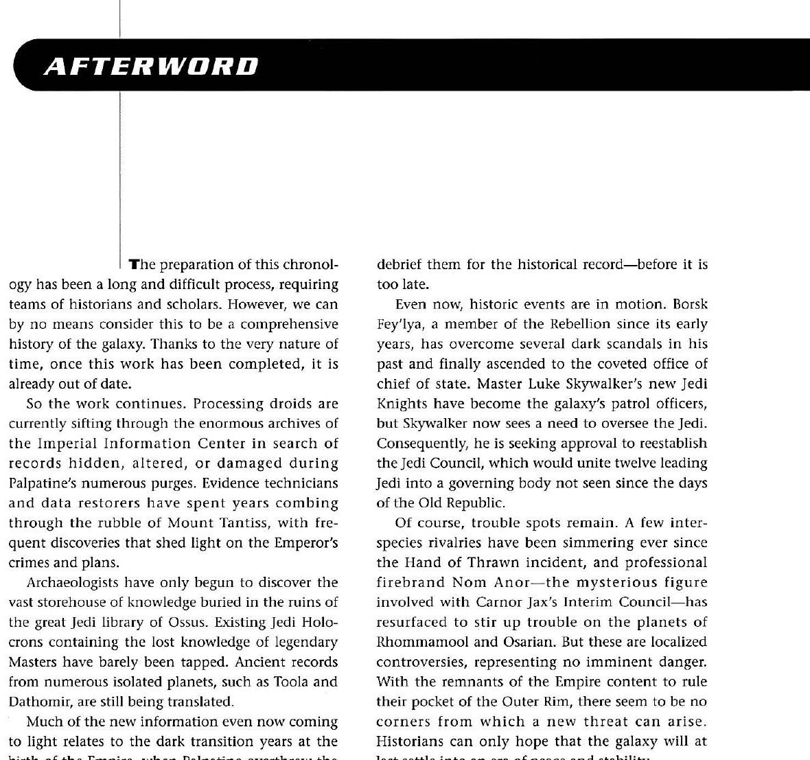

# Borsk Fey'lya

- **Aliases:** —
- **Era:** —
- **Continuity:** default Legends; entries present for: Legends
- **Research tier:** untiered (not listed as INTRO/DEEP/MASTERY in legends-feats.md)
- **Entries:** 64 (49 with quotations; 0 quotations extended to the full sentence/passage from the source text on file; 14 marked as fragments; 46 before the 2026-11-17 fragment fill). Rebuilt 2026-11-17 from 66 old entries; old file: `characters/_bak/borsk-fey-lya.md.bak-20261117`.
- **How to read:** each entry is the quotation in full (block quote), then its source and point of view. "Note" lines are summaries from our notes, not quotations. `[fragment — full passage not on file]` means the source text is not on the box, so only the words in our notes are shown. Debate and forum material is in the last section and is unverified.

# LEGENDS (Legends / EU — main focus)

## Star Wars: The New Essential Chronology (Del Rey, 2005): power-scaling and lore notes

- Note (summary from our notes, not a quotation): art caption: "Borsk Fey'lya" Source: The New Essential Chronology, p.116, caption
  — Source: Part Five: The Galactic Civil War.

Our notes: `notes/materials/027-new-essential-chronology/05-part-five-galactic-civil-war.md:103`

## The New Essential Guide to Characters (2002)

> Despite a political smear campaign orchestrated by Borsk Fey'lya, Ackbar played a key role in the defeat of Thrawn at Bilbringi and Admiral Krennel at Ciutric.
— Source: scan pages 1–30; Admiral Ackbar; Grand Admiral Thrawn.
Note (our notes, around the quote): Admiral Ackbar; Grand Admiral Thrawn: "Despite a political smear campaign orchestrated by Borsk Fey'lya, Ackbar played a key role in the defeat of Thrawn at Bilbringi and Admiral Krennel at Ciutric." Source: The New Essential Guide to Characters, p.17

Our notes: `notes/materials/034-new-essential-guide-to-characters/00-negc-scan-001-030.md:81`

## Sourcebooks/Rebellion Era Sourcebook.pdf [Star Wars Roleplaying Game (d20, 2000)] (scan pages 61–120)

- Note (summary from our notes, not a quotation): Page contents: Bothan SpyNet 'renowned as the best independent intelligence organization in the galaxy'; Borsk Fey'lya allied Clan Alya to the Alliance though he 'sometimes puts his own interests above those of the Alliance'; Fey'lya's operatives gave their lives for the Death Star II plans (hand-read)
  — Source: Sourcebooks/Rebellion Era Sourcebook.pdf [Star Wars Roleplaying Game (d20.
Our notes: `notes/materials/037-sw-d20-folder/043-rebellion-era-sourcebook-scan-061-120.md:400`

## Sourcebooks/The New Jedi Order Sourcebook.pdf [Star Wars Roleplaying Game (d20, 2000)] (scan pages 1–60)

- Note (summary from our notes, not a quotation): Page contents: 847 words, 23 paragraphs | headings/entries: OL ANDO; Z < > ay 0 Z; Coruscant; Borsk Fey'lya, New Republic Chief; The Imperial Remnant; Grand Admiral Gilad Pellaeon
  — Source: Sourcebooks/The New Jedi Order Sourcebook.pdf [Star Wars Roleplaying Game.
Our notes: `notes/materials/037-sw-d20-folder/049-the-new-jedi-order-sourcebook-scan-001-060.md:114`

## Sourcebooks/The New Jedi Order Sourcebook.pdf [Star Wars Roleplaying Game (d20, 2000)] (scan pages 121–162)

- Note (summary from our notes, not a quotation): Page contents: 856 words, 22 paragraphs | headings/entries: The YUH Droid; Borsk Fey'lya's Sacrifice; The Yammosk Jammer
  — Source: Sourcebooks/The New Jedi Order Sourcebook.pdf [Star Wars Roleplaying Game.
Our notes: `notes/materials/037-sw-d20-folder/049-the-new-jedi-order-sourcebook-scan-121-162.md:251`

## Adventures/Rebel Jedi.pdf [Star Wars Roleplaying Game Revised Core (d20, 2002)]

- Note (summary from our notes, not a quotation): Page contents: Background: Dal Konur, ex-SpecForce lieutenant sent to the Jedi Academy on Borsk Fey'lya's advice, wants the Force used to end the war and stows away; era/level adjustment notes; hooks (hand-read)
  — Source: Adventures/Rebel Jedi.pdf [Star Wars Roleplaying Game Revised Core (d20,.
Our notes: `notes/materials/037-sw-d20-folder/072-rebel-jedi.md:15`

## Characters/Miniatures/Furry and Fury.pdf [Star Wars Roleplaying Game Revised Core (d20, 2002)]

- Note (summary from our notes, not a quotation): Page contents: Intro; encounter table (Bothan Spy/Ewok/Jawa A1 B2 C3-4 D5-8 E9-16; Tusken/Wookiee Soldier B1 C2 D3-4 E5-8 F9-16; Wampa C1 D2 E3-4 F5-8, from image); Bothan Spy (Borsk Fey'lya's clan Alya; Expert 2, CC A); Ewok (from image: Male Ewok Expert 2; Defense 12; VP/WP 0/10; spear; CC A) (hand-read)
  — Source: Characters/Miniatures/Furry and Fury.pdf [Star Wars Roleplaying Game Revi.
Our notes: `notes/materials/037-sw-d20-folder/108-furry-and-fury.md:10`

## Living Force Campaign/Articles/Year 4/03:18:04 - Only a Master of Evil.pdf [Star Wars Roleplaying Game Revised Core (d20, 2002)]

- Note (summary from our notes, not a quotation): Page contents: Outwardly evil opponent (Borsk Fey'lya), evil dupe (Anakin), evil pawn (Vader) (hand-read)
  — Source: Living Force Campaign/Articles/Year 4/03:18:04 - Only a Master of Evil.pd.
Our notes: `notes/materials/037-sw-d20-folder/456-03-18-04-only-a-master-of.md:24`

## Sourcebooks/Coruscant and the Core Worlds.pdf [Star Wars Roleplaying Game Revised Core (d20, 2002)] (scan pages 1–60)

- Note (summary from our notes, not a quotation): Page contents: Coruscant History: Dha Werda Verda (Taungs vs Zhell), hyperroutes, Republic City, Sith Empire/Great Hyperspace War, Ulic Qel-Droma and Mandalore ravage Coruscant, Valorum, Palpatine, Imperial Center, Invisec, Krytos virus, reborn Emperor, Yuuzhan Vong conquest, Borsk Fey'lya dies (hand-read)
  — Source: Sourcebooks/Coruscant and the Core Worlds.pdf [Star Wars Roleplaying Game.
Our notes: `notes/materials/037-sw-d20-folder/665-coruscant-and-the-core-worlds-scan-001-060.md:50`

- Note (summary from our notes, not a quotation): Page contents: Imperial Palace (Grand Corridor, Crypt, Imperial Information Center; Borsk Fey'lya suicide bomb kills 20,000 Yuuzhan Vong); Glitannai Esplanade; Galactic Senate Chamber (Vodo Siosk-Baas and Exar Kun battled to the death in old Senate Hall); Jedi Temple; Western Sea (hand-read)
  — Source: Sourcebooks/Coruscant and the Core Worlds.pdf [Star Wars Roleplaying Game.
Our notes: `notes/materials/037-sw-d20-folder/665-coruscant-and-the-core-worlds-scan-001-060.md:62`

> When the Yuuzhan Vong invaded Coruscant, Chief of State Borsk Fey'lya detonated a suicide bomb and took out 20,000 enemy warriors.
— Source: Sourcebooks/Coruscant and the Core Worlds.pdf [Star Wars Roleplaying Game; Borsk Fey'lya — entry/section: Borsk Fey'lya's suicide bomb.
Note (our notes, around the quote): Borsk Fey'lya — entry/section: Borsk Fey'lya's suicide bomb: "When the Yuuzhan Vong invaded Coruscant, Chief of State Borsk Fey'lya detonated a suicide bomb and took out 20,000 enemy warriors." Source: *Coruscant and the Core Worlds* (SWRPG d20 Revised Core), scan p.11

Our notes: `notes/materials/037-sw-d20-folder/665-coruscant-and-the-core-worlds-scan-001-060.md:64`

## Sourcebooks/Geonosis and the Outer Rim Worlds.pdf [Star Wars Roleplaying Game Revised Core (d20, 2002)] (scan pages 61–120)

> When Admiral Ackbar retired from New Republic service following the Emperor’s World Devastator attacks, he researched the Mkbuto region's tectonic plate activity from a floating habitat in the Seatree Preserve. Later, during Borsk Fey'lya’s tenure as chief of state, Ackbar returned to his cozy seapod to complete his memoirs.
— Source: Sourcebooks/Geonosis and the Outer Rim Worlds.pdf [Star Wars Roleplaying.
Note (our notes, around the quote): Admiral Ackbar — entry/section: Ackbar's retreat in the Mkbuto Seatree Preserve: "When Admiral Ackbar retired from New Republic service following the Emperor’s World Devastator attacks, he researched the Mkbuto region's tectonic plate activity from a floating habitat in the Seatree Preserve. Later, during Borsk Fey'lya’s tenure as chief of state, Ackbar returned to his cozy seapod to complete his memoirs." Source: *Geonosis and the Outer Rim Worlds* (SWRPG d20 Revised Core), scan p.99

Our notes: `notes/materials/037-sw-d20-folder/667-geonosis-and-the-outer-rim-worlds-scan-061-120.md:293`

## Sourcebooks/Ultimate Alien Anthology.pdf [Star Wars Roleplaying Game Revised Core (d20, 2002)] (scan pages 1–60)

- Note (summary from our notes, not a quotation): Page contents: Bothan (spynet; example names incl. Borsk Fey'lya); Caamasi begins. (hand-read)
  — Source: Sourcebooks/Ultimate Alien Anthology.pdf [Star Wars Roleplaying Game Revi.
Our notes: `notes/materials/037-sw-d20-folder/673-ultimate-alien-anthology-scan-001-060.md:144`

## Star Wars Insider #59 (2002)

- Note (summary from our notes, not a quotation): Page contents: Who's Who cont. (magazine p. 57), "Rogue Squadron: The Later Years" with line portraits: Pash Cracken, Gavin Darklighter, Corran Horn, Bror Jace (Thyferran, staged his own death), Erisi Dlarit (Thyferran Imperial mole, shot down by Corran at Thyferra), Aril Nunb, Ooryl Qrygg (Gand, "name reduction," declared janwuine), Inyri Forge (sister of Lujayne Forge, shot Zekka Thyne), Asyr Sei'lar (Bothan, resisted Borsk Fey'lya). (hand-read)
  — Source: Star Wars Insider #59 (2002).
Our notes: `notes/materials/038-star-wars-insider/059-ins059.md:413`

## Star Wars Insider #74 (2004)

- Note (summary from our notes, not a quotation): Page contents: NJO: Destiny's Way synopsis; fallen heroes: Chewbacca, Anakin Solo, Ganner Rhysode, Vergere, Elegos A'Kla, Borsk Fey'lya, Ikrit and Admiral Ackbar; Force Heretic I: Remnant synopsis (Nom Anor as the Prophet Yu'shaa). (hand-read)
  — Source: Star Wars Insider #74 (2004).
Our notes: `notes/materials/038-star-wars-insider/074-ins074.md:188`

## Star Wars Insider #83 (2005)

- Note (summary from our notes, not a quotation): Page contents: Memorable Moments continued: Jacen's rebirth; Borsk Fey'lya's noble end (Star by Star); Luke duels Vader for the first time before ESB (Splinter of the Mind's Eye, Alan Dean Foster); Anakin Solo becomes one with the Force (honorable mention). (hand-read)
  — Source: Star Wars Insider #83 (2005).
Our notes: `notes/materials/038-star-wars-insider/083-ins083.md:273`

## Star Wars Insider #126 (2011)

- Note (summary from our notes, not a quotation): Page contents: Comics: Invasion "Revelations" (Tom Taylor): Finn and Kaye Galfridian; their mother Nina exposed as a disguised Yuuzhan Vong agent; Borsk Fey'lya on Coruscant. (hand-read)
  — Source: Star Wars Insider #126 (2011).
Our notes: `notes/materials/038-star-wars-insider/126-ins126.md:347`

## Star Wars Insider #149 (2014)

> best bounty hunter we'd met before Boba Fett.
> [fragment — full passage not on file]
— Source: Star Wars Insider #149 (2014).
Note (our notes, around the quote): Page contents: Red Five: John Jackson Miller's five favorite EU characters (interview by Mark Newbold). 1 Valance, created by Archie Goodwin in Marvel #16 (OCR "416" crop-verified as #16); "best bounty hunter we'd met before Boba Fett." 2 Borsk Fey'lya, the poster child for political shenanigans in Zahn's Heir to the Empire era. (hand-read)
Our notes: `notes/materials/038-star-wars-insider/149-ins149.md:465`

## NJO 5, *Agents of Chaos II: Jedi Eclipse* (James Luceno, Del Rey 2000): FULL consecutive re-read (2026-11-16 CST)

What it shows (our notes): Brand reports to Fey'lya's council on the spice link; the Yald task force; the command staff's conclusion: "Corellia is the target"
> Commodore Brand tried not to be distracted by the traffic that gushed horizontally and vertically past the transparisteel wall of the Advisory Council chambers, or by the cityscape itself, ignited to flickering splendor as that part of Coruscant turned away from the sun. Seated with their backs to the window wall, Chief of State Borsk Fey’lya and the now eight members that made up his council had nothing to focus on but Brand, who stood rigidly at a podium opposite them, reading from a screenful of notes prepared in haste by his staffers after an intelligence briefing on the fall of Tynna.
>
> “What is significant,” Brand continued, “is that the assault was foreseen, and that alone affords provisional corroboration of the Intelligence division’s belief that the Hutts have been supplying us with data. In those systems where the Hutts have curtailed spice operations, the enemy has set its sights on a world. Whether the Hutts were aware of what they were doing in asking for forewarning regarding their smuggling enterprise is presently unknown—though we are looking into the matter—but the fact remains that Tynna, a transshipment point as opposed to an actual market, has not seen a spice vessel since the Hutts forged their pact with the Yuuzhan Vong.”
>
> Fey’lya interjected a transparent snort of ridicule into Brand’s brief pause, then had the gall to offer a pretense of apology.
>
> “I’m sorry, Commodore, but something seems to have become lodged in my throat. Please, carry on with your … report. I know that I speak for everyone in saying that I can scarcely wait to hear the rest.”
>
> Brand refused to be rattled by the sarcasm. “At the moment, the only other systems where spice operations have been suspended are Corellia and Bothawui. It has yet to be ascertained in which order the Yuuzhan Vong mean to strike. But we do expect an attack sooner rather than later. For that reason it is the opinion of Admiral Sovv and the Defense Force that a decision is critical on the matter of the redisposition of New Republic warships.”
>
> Brand activated the holoprojector table adjacent to the podium. Depressing a tile on the console built into the lectern’s sloping desk, he displayed a galactic map, faintly blue in the cone created by the projector’s modulasers.
>
> “The Yuuzhan Vong have established and fortified what amounts to a resupply corridor that stretches from the Outer Rim to Hutt space. Since the battle at Obroa-skai they have been receiving a steady influx of warships and matériel, clearly in anticipation of launching a major offensive—their first since Ithor. Against such a formidable fleet, and without weakening our security in the Core or at Bilbringi, where harassment continues despite holding actions by the Imperial Remnant, we can mobilize and deploy a task force of vessels borrowed from battle groups currently in service at Commenor, Kuat, Ralltiir, and a score of other worlds. Should the Hapes Consortium vote to support New Republic efforts, some of their ships would also be allocated to the task force, which would be led by the heavy cruiser Yald, under my command.”
>
> Brand paused again and planted his large hands on the podium. “Councilors, we have not discounted that the assembled intelligence could be a ploy to keep us from identifying a different target entirely, but at the same time we cannot afford to ignore the evidence.”
>
> “Evidence,” Fey’lya grumbled. “Inferences, suggestions, remote possibilities, but certainly not evidence.” His violet eyes mocked Brand openly. “What has the command staff decided, with regard to this redisposition of naval power?”
>
> Brand motioned to the holograph. “As you know, we have been triaging in all sectors, allowing worlds like Gyndine and now Tynna to fall in order to safeguard others like Kuat, Bilbringi, and Commenor. Our actions—or shall I say inactions—have hardly endeared us to worlds that consider themselves to be in the path of invasion. Regardless, even if we can manage to amass a sizable task force, it will not be of sufficient size to provide adequate protection to both Bothawui and Corellia.”
>
> He straightened to his full height. “After analyzing all available data, it is the conclusion of the command staff that Corellia is the target. Therefore, Admiral Sovv is recommending that all available ships and resources be moved to the Corellian sector as soon as possible.”
— Source: The New Jedi Order: Agents of Chaos II: Jedi Eclipse (James Luceno, Del Rey 2000), JE ch. 17 — 118 Jedi Eclipse notes (re-read 2026-11-16).
(Excerpt widened 2026-11-17 to the relevant passage, word for word from Jedi Eclipse (James Luceno) (text copy `MEGA_Legend_The_New_Jedi_Order_Series_Star_Wars_New_Jedi_Order_05_Agents_of_Chaos_02_Jedi_Eclipse_James_Luceno_epub`).)
(Excerpt widened 2026-11-17 to the relevant passage, word for word from Jedi Eclipse (James Luceno) (text copy `MEGA_Legend_The_New_Jedi_Order_Series_Star_Wars_New_Jedi_Order_05_Agents_of_Chaos_02_Jedi_Eclipse_James_Luceno_epub`).)
(Fragment completed 2026-11-17: full sentence/passage matched word for word in the source text on file: `MEGA_Legend_The_New_Jedi_Order_Series_Star_Wars_New_Jedi_Order_05_Agents_of_Chaos_02_Jedi_Eclipse_James_Luceno_epub`.)
Note text that was attached to the quote line: (JE ch. 17) — **Brand reports to Fey'lya's council on the spice link; the Yald task force; the command staff's conclusion: "Corellia is the target"**
Our notes: `notes/materials/118-njo-05-jedi-eclipse/je-03.md:21`

What it shows (our notes): Fey'lya refuses and attacks the Jedi: "Skywalker's Jedi are not the Jedi Knights of old, but a surreptitious, ambitious new breed"; Omas: "They've done nothing less than lead this fight from the start"; Dravvad defends the Jedi Code
> Fey’lya’s cream-colored fur bristled. “I thought as much,” he said in a flat, menacing voice. “You would, as you say, ‘triage’ Bothawui for the sake of saving Corellia. But I won’t have it.” He shook his head angrily. “I’m sorry, Commodore, but I refuse to authorize such action at this time. Your ‘evidence’ is too scanty.”
>
> “No one said anything about abandoning Bothawui,”Brand rejoined. “The flotilla already there will remain in place. We are only trying to protect Corellia.”
>
> “Protect the sacred Core, you mean.” The Bothan stood to regard his eight peers. “I wish the council to consider closely the source of this spicy intelligence. Commodore Brand would have you believe that it was gathered by the Intelligence division or gleaned through hours of painstaking investigation and analysis. But, in fact, it was brought to the attention of two officers of questionable standing in the intelligence community by a person of even more dubious reputation, who claims to be serving as a kind of ombudsman for the Jedi Knights—Talon Karrde.”
>
> “I fail to see the pertinence of that,” Cal Omas said. “Talon Karrde is well known to this council.”
>
> Fey’lya glared at him. “Well, of course you wouldn’t see the pertinence, Councilor Omas, because you fail to grasp that the Jedi would sooner rid the galaxy of Bothans than do anything to protect them.”
>
> “The Jedi had nothing to do with our decision,” Brand argued.
>
> Fey’lya made a gesture of dismissal. “We all know that the Jedi have been holding back, downplaying their role until such time as they might truly show their hand. With Bothawui defeated, they will do just that.”
>
> “In what way have they been holding back?” Cal Omas interrupted. “They’ve done nothing less than lead this fight from the start, making a stand on Dantooine and Ithor while the senate insisted on thinking of the Yuuzhan Vong as a ‘local problem.’ ”
>
> Fey’lya wasn’t unprepared to defend his accusations. “Consider what the Jedi are said to have accomplished when their little retreat on Yavin 4 was threatened by Imperial admirals Pellaeon and Daala, and how Luke Skywalker all but single-handedly turned the tide against the Yevetha with illusions. Then talk to me about their current contributions.”
>
> He wagged his clawed forefinger at Omas. “Never underestimate what they are capable of, Councilor. Skywalker’s Jedi are not the Jedi Knights of old, but a surreptitious, ambitious new breed. With Bothawui occupied, they would be ready to make their move and take control of the senate.”
>
> Chelch Dravvad of Corellia took on the fight. “The chief of state should learn to keep his private fears to himself. It is against the Jedi Code to spearhead an offensive, on the battlefield or in any other arena. In this the new Jedi are no different from the old. Skywalker and the rest are attempting to do what the Jedi have always done: uphold peace and justice without turning themselves into full-fledged warriors. If there is a growing misunderstanding of them, it owes to a lack of information. Perhaps by isolating themselves on Yavin 4 they are to blame for some of that. Perhaps their time would have been better spent demonstrating what they stand for. Even so, they have all our best interests at heart, and they certainly haven’t singled out the Bothans as their enemy.”
>
> Fey’lya’s voice became higher pitched. “You’re wrong, Councilor. And I say again that, based on Commodore Brand’s data, I will not grant the command staff’s request that Corellia be reinforced.”
>
> “Then I demand that the issue be put to a vote,” Omas said.
>
> Fey’lya held up his hand to silence debate and looked pointedly at Brand. “What do your actual field agents tell you, Commodore? What do your analysts say? What are you hearing from the costly hyperspace probes you’ve sent out? Instead of relying on conjecture, we should be looking to hard data. We’d do just as well to seek the counsel of a fortune-teller as accept as truth what you’ve told us this afternoon.”
>
> “Our findings are based on neither prophesy nor conjecture,” Brand said firmly. “The data supporting our decision are of a highly sensitive nature, but they are available for your perusal whenever you wish.”
>
> Fey’lya sneered. “Oh, I’m certain you’ve concocted an airtight case, Commodore.” He scanned the eight councilors. “For the record, then, who will begin the vote?”
— Source: The New Jedi Order: Agents of Chaos II: Jedi Eclipse (James Luceno, Del Rey 2000), JE ch. 17 — 118 Jedi Eclipse notes (re-read 2026-11-16).
(Excerpt widened 2026-11-17 to the relevant passage, word for word from Jedi Eclipse (James Luceno) (text copy `MEGA_Legend_The_New_Jedi_Order_Series_Star_Wars_New_Jedi_Order_05_Agents_of_Chaos_02_Jedi_Eclipse_James_Luceno_epub`).)
(Excerpt widened 2026-11-17 to the relevant passage, word for word from Jedi Eclipse (James Luceno) (text copy `MEGA_Legend_The_New_Jedi_Order_Series_Star_Wars_New_Jedi_Order_05_Agents_of_Chaos_02_Jedi_Eclipse_James_Luceno_epub`).)
(Fragment completed 2026-11-17: full sentence/passage matched word for word in the source text on file: `MEGA_Legend_The_New_Jedi_Order_Series_Star_Wars_New_Jedi_Order_05_Agents_of_Chaos_02_Jedi_Eclipse_James_Luceno_epub`.)
Note text that was attached to the quote line: (JE ch. 17) — **Fey'lya refuses and attacks the Jedi: "Skywalker's Jedi are not the Jedi Knights of old, but a surreptitious, ambitious new breed"; Omas: "They've done nothing less than lead this fight from the start"; Dravvad defends the Jedi Code**
Our notes: `notes/materials/118-njo-05-jedi-eclipse/je-03.md:22`

## NJO 6.5, *Recovery* (Troy Denning, Del Rey e-book novella 2001): FULL consecutive re-read (2026-11-16 CST)

What it shows (our notes): "You know who you remind me of? … Borsk Fey'lya, claiming all the credit"; "But you're never doing that again, Han. The next time you need help, you won't escape."; "This was the Leia he remembered."; "If you want to do that, you come over here."
> Han wanted to say that wasn’t true, or she couldn’t know what might have happened, or that the Force had brought them back to each other. But all that sounded somehow hollow and not what Leia needed to hear. He needed to give her a jolt, to make her see that they had come through it, if only she would open her heart and eyes and see it.
>
> “You know who you remind me of?” he asked. “Borsk Fey’lya, claiming all the credit for himself.”
>
> Leia’s jaw dropped. “Borsk Fey’lya! How dare . . .” She must have seen the mischief in Han’s face, because she let the sentence trail off and scowled. A hint of the old spark returned to her eye, and she gave him a sideways look. “Borsk! Not really?”
>
> Han half smiled. “Really. You’re taking way too much of this on yourself. You’d have had to chase me across half the galaxy—and drag me out of a thousand tapcafs.”
>
> Leia pondered this, then said, “You know, I am being too hard on myself.” She seemed to shed two years of worry lines in as many seconds, then added, “As you say, you’re the one who shut me out. What was I supposed to do, slap a set of stun cuffs on you and borrow an interrogator droid from NRI?”
>
> “Of course not,” Han said, beginning to wonder who was toying with whom. “But like you said, we both played our parts—”
>
> “No, when you’re right you’re right. I’m not going to argue.” Leia’s smile—not quite a victory smirk—turned as hard as durasteel. “But you’re never doing that again, Han. The next time you need help, you won’t escape.”
>
> Han felt like the spa’s supplemental gravity inducers had reset themselves. He had flutters in his stomach and bells in his ears, and he even felt a little weak in the knees. This was the Leia he remembered. She took his shirt collar and, unable to rise on her toes, began to pull him down so she could kiss him.
>
> “Not so fast.” Han disengaged himself and retreated to the edge of the empty pool. “If you want to do that, you come over here.”
>
> Leia raised her brow. “You’re going to make me work for this?” She looked him up and down, then finally clanked after him. “It had better be good.”
>
> Han gave her his finest smirk. “Oh, it’ll be good.” He waited until she was almost to him, then began to retreat along the pool’s edge toward C-3PO. “Just the way you remember.”
>
> “The way I remember?” Leia echoed. “Taking a lot for granted, aren’t you?”
>
> They were interrupted by an excited cry from C-3PO. “I’ve found something!” He transferred an entry to one of the datapads Han was using, then said, “CorDuro’s vice president of fleets is related to Roxi Barl by marriage, and he has a substantial equity interest in the Kuat Drive Yards corporation.”
— Source: The New Jedi Order: Recovery (Troy Denning, Del Rey e-book 2001), REC ch. 6 — 120 Recovery notes (re-read 2026-11-16).
(Excerpt widened 2026-11-17 to the relevant passage, word for word from Recovery (Troy Denning) (text copy `MEGA_Legend_The_New_Jedi_Order_Series_Star_Wars_New_Jedi_Order_07_Recovery_Troy_Denning_epub`).)
(Excerpt widened 2026-11-17 to the relevant passage, word for word from Recovery (Troy Denning) (text copy `MEGA_Legend_The_New_Jedi_Order_Series_Star_Wars_New_Jedi_Order_07_Recovery_Troy_Denning_epub`).)
(Fragment completed 2026-11-17: full sentence/passage matched word for word in the source text on file: `MEGA_Legend_The_New_Jedi_Order_Series_Star_Wars_New_Jedi_Order_07_Recovery_Troy_Denning_epub`.)
Note text that was attached to the quote line: (REC ch. 6) — **"You know who you remind me of? … Borsk Fey'lya, claiming all the credit"; "But you're never doing that again, Han. The next time you need help, you won't escape."; "This was the Leia he remembered."; "If you want to do that, you come over here."**
Our notes: `notes/materials/120-njo-07-recovery/rec-02.md:23`

What it shows (our notes): Luke's holocube: Shesh leads the Appeasement Vote to outlaw the Jedi, in a deal with Borsk Fey'lya; Leia throws the cube: "That woman is poison."
> Leia waited until C-3PO had shown Eelysa out, then activated the holocube. It played a brief vidnews item describing a new movement in the Senate pushing for an Appeasement Vote to outlaw the Jedi and accept the truce terms put forward by Warmaster Tsavong Lah. Though the sponsors were identified as a coalition of Senators from uncaptured Core worlds, Luke’s image appeared after the report to say that the leader was Viqi Shesh. She had already struck a deal with Borsk Fey’lya to call a vote the following week, so Luke was asking them to send him any information they could about her dealings with CorDuro. He also warned them that Shesh’s chief of staff had quietly arranged to be notified the instant NRI learned their location.
>
> Luke was still signing off when Leia threw the cube into the wall. “That woman is poison. Killing me isn’t enough—now she has to go after all the Jedi!”
>
> Han looked from Leia to the shattered cube. “She’s murder on holocubes, that’s for sure—not that we’ve got anything worth putting on one.”
>
> “She’s corrupt. We know it,” Leia said. “The only question is how corrupt.”
>
> “Does it matter?” Han asked. “We can’t prove it. Short of assassination, there’s no way we’re going to stop her from calling the Appeasement Vote.”
— Source: The New Jedi Order: Recovery (Troy Denning, Del Rey e-book 2001), REC ch. 6 — 120 Recovery notes (re-read 2026-11-16).
(Excerpt widened 2026-11-17 to the relevant passage, word for word from Recovery (Troy Denning) (text copy `MEGA_Legend_The_New_Jedi_Order_Series_Star_Wars_New_Jedi_Order_07_Recovery_Troy_Denning_epub`).)
(Excerpt widened 2026-11-17 to the relevant passage, word for word from Recovery (Troy Denning) (text copy `MEGA_Legend_The_New_Jedi_Order_Series_Star_Wars_New_Jedi_Order_07_Recovery_Troy_Denning_epub`).)
(Fragment completed 2026-11-17: full sentence/passage matched word for word in the source text on file: `MEGA_Legend_The_New_Jedi_Order_Series_Star_Wars_New_Jedi_Order_07_Recovery_Troy_Denning_epub`.)
Note text that was attached to the quote line: (REC ch. 6) — **Luke's holocube: Shesh leads the Appeasement Vote to outlaw the Jedi, in a deal with Borsk Fey'lya; Leia throws the cube: "That woman is poison."**
Our notes: `notes/materials/120-njo-07-recovery/rec-02.md:27`

What it shows (our notes): Borsk Fey'lya announces "the Peace Vote … has failed by a two-to-one ratio"; Jaina slides the doctor aside with the Force; "The repair was fully successful … Your legs are going to be fine."
> For the first time in weeks, her legs did not ache or throb or burn, but she was barely aware of that fact. She was too interested in watching Borsk Fey’lya’s face on the vidscreen, looking for a beard tug or brow twitch that would tell her which way the Appeasement Vote was going.
>
> Leia’s doctor, a distracted-looking human with a permanent squint and perpetually mussed hair, came into the room. If he noticed the Noghri bodyguards flanking him, or was impressed by the sight of so many famous Jedi in one place, he hid it well. He simply began to prod, poke, and tickle Leia’s legs, issuing quiet instructions to move this or wiggle that.
>
> The nervesplicer said something about normal sensation and improving motor control. But Fey’lya raised his brow just then, and Leia missed whatever it was the doctor said next.
>
> “Did you see that?” Han asked. “He’s surprised.”
>
> “That can’t be good,” Jaina said.
>
> “It’s hard to know.” Leia reached out and found Han’s hand. “Nobody has been able to tell what Borsk thinks will happen.”
>
> The doctor stepped into Leia’s line of sight. “Princess Leia, I have some news.”
>
> “In a minute.”
>
> Leia cast an appealing glance at her daughter, who quietly used the Force to slide the doctor out of the way.
>
> Han pulled away. “In a minute.” He continued to glare at the Arcona. “I don’t care if you fly Star Destroyers, you’re not getting on my ship.”
>
> Fey’lya was looking directly into the cam now, his fangs bared in a politician’s meaningless smile.
>
> “It is my duty to announce that the Peace Vote—or the Appeasement Vote, as it has become known in some circles—has failed by a two-to-one ratio.”
>
> “Not even close!” Anakin cried. “How about that?”
>
> The room—and much of the corridor outside—erupted into a chorus of cheering.
>
> The nervesplicer stepped to Leia’s side, his face twisted into a frown. “Princess, are you listening? The repair was fully successful. You can start walking later today. Your legs are going to be fine.”
>
> “I know, Doctor.” Leia pulled the nervesplicer’s face down to hers and kissed his cheek—she had no idea why, other than because she was so happy—then said, “Thank you.”
>
> “Uh, my pleasure.”
> [fragment — full passage not on file]
— Source: The New Jedi Order: Recovery (Troy Denning, Del Rey e-book 2001), REC ch. 8 — 120 Recovery notes (re-read 2026-11-16).
(Excerpt widened 2026-11-17 to the relevant passage, word for word from Recovery (Troy Denning) (text copy `MEGA_Legend_The_New_Jedi_Order_Series_Star_Wars_New_Jedi_Order_07_Recovery_Troy_Denning_epub`).)
(Excerpt widened 2026-11-17 to the relevant passage, word for word from Recovery (Troy Denning) (text copy `MEGA_Legend_The_New_Jedi_Order_Series_Star_Wars_New_Jedi_Order_07_Recovery_Troy_Denning_epub`).)
(Excerpt widened 2026-11-17 to the relevant passage, word for word from Recovery (Troy Denning) (text copy `MEGA_Legend_The_New_Jedi_Order_Series_Star_Wars_New_Jedi_Order_07_Recovery_Troy_Denning_epub`).)
(Excerpt widened 2026-11-17 to the relevant passage, word for word from Recovery (Troy Denning) (text copy `MEGA_Legend_The_New_Jedi_Order_Series_Star_Wars_New_Jedi_Order_07_Recovery_Troy_Denning_epub`).)
(Fragment completed 2026-11-17: full sentence/passage matched word for word in the source text on file: `MEGA_Legend_The_New_Jedi_Order_Series_Star_Wars_New_Jedi_Order_07_Recovery_Troy_Denning_epub`.)
Note text that was attached to the quote line: (REC ch. 8) — **Borsk Fey'lya announces "the Peace Vote … has failed by a two-to-one ratio"; Jaina slides the doctor aside with the Force; "The repair was fully successful … Your legs are going to be fine."**
Our notes: `notes/materials/120-njo-07-recovery/rec-02.md:49`

## *Emissary of the Void* I–VI (Greg Keyes, Star Wars Hyperspace serial, 2002): FULL consecutive re-read (2026-11-16 CST)

What it shows (our notes): (scene break) Thyferra; "Master Skywalker was ordered arrested. He fled Coruscant and went into hiding." / "I knew Borsk Fey'lya was stupid, but that's really stupid."; "That's why they're taking Yag'Dhul even as we speak."
> ***
>
> Uldir began to wonder who the Yuuzhan Vong were fighting exactly -- at the moment he didn't see any ships that weren't enemies. The skips approached firing range. "Got it, boss. Go." He went. * * * Their next reversion was entirely uneventful. They appeared a few hundred thousand clicks from Thyferra -- right on the dot in galactic terms. "There's still no word from Skywalker or anyone else," Vega told him. "Small wonder. There's a war going on." Vega shook her head. "It's more than that.
>
> Vega shook her head. "It's more than that. I did manage to get a news summary from the HoloNet. Master Skywalker was ordered arrested. He fled Coruscant and went into hiding."
>
> Master Skywalker was ordered arrested. He fled Coruscant and went into hiding." Uldir whistled. "I knew Borsk Fey'lya was stupid, but that's really stupid. How does he think the New Republic can possibly win this war without the Jedi?" "The Yuuzhan Vong promised that if all of the Jedi were delivered to them the war would end, remember?" "Yeah, right.
>
> "I knew Borsk Fey'lya was stupid, but that's really stupid. How does he think the New Republic can possibly win this war without the Jedi?" "The Yuuzhan Vong promised that if all of the Jedi were delivered to them the war would end, remember?" "Yeah, right. That's why they're taking Yag'Dhul even as we speak." A light blipped on the console. "The Thyferrans are asking what our business in their system is." Uldir sighed. "Tell them.
>
> Uldir sighed. "Tell them. Give them our highest priority clearance code. If that doesn't work, we go in without them. There's no time to lose. The operative is probably already here." (EOV pt. 6) — **(scene break) Thyferra; "Master Skywalker was ordered arrested. He fled Coruscant and went into hiding."
>
> Master Skywalker was ordered arrested. He fled Coruscant and went into hiding." Uldir whistled. "I knew Borsk Fey'lya was stupid, but that's really stupid. How does he think the New Republic can possibly win this war without the Jedi?" "The Yuuzhan Vong promised that if all of the Jedi were delivered to them the war would end, remember?"
> [fragment — full passage not on file]
— Source: Emissary of the Void (Greg Keyes, Star Wars Hyperspace serial 2002), EOV pt. 6 — 122 Emissary of the Void notes (re-read 2026-11-16).
(Fragment completed 2026-11-17 with the full excerpt, word for word from novels tmp emissary of the void eov 06 emissary (text copy `novels_tmp_emissary_of_the_void_eov_06_emissary_pdf_8e6972240a`).)
Note text that was attached to the quote line: "That's why they're taking Yag'Dhul even as we speak."**
(Excerpt widened 2026-11-17 to the relevant passage, word for word from novels tmp emissary of the void eov 06 emissary (text copy `novels_tmp_emissary_of_the_void_eov_06_emissary_pdf_8e6972240a`).)
(Excerpt widened 2026-11-17 to the relevant passage, word for word from novels tmp emissary of the void eov 06 emissary (text copy `novels_tmp_emissary_of_the_void_eov_06_emissary_pdf_8e6972240a`).)
Our notes: `notes/materials/122-njo-emissary-of-the-void/eov-03.md:47`

## *Edge of Victory II: Rebirth* (Greg Keyes, Del Rey 2001): FULL consecutive re-read (2026-11-16 CST)

What it shows (our notes): Kenth Hamner arrives at dinner: "Borsk Fey'lya has managed to secure an order for your arrest. The warrant will be served about six standard hours from now."
> Luke and Mara ate outside at a table of polished yellow Selonian marble while the blossoms around them chimed a quiet music and released fragrances to complement each course. Luke felt ridiculously pampered and a little guilty, but managed to relax somewhat into the mood.
>
> But the mood was broken during the intermezzo, when the pavilion’s protocol droid interrupted them.
>
> “Master Skywalker,” it said, “an aircar is approaching and requesting admittance through the security perimeter.”
>
> “You have the signal?”
>
> “Most assuredly.”
>
> “Transfer to the holostation on the table.”
>
> “As you wish, sir.”
>
> A hologram of a man’s face appeared above the remains of their meal. It was human, very long, with aristocratic features.
>
> “As you wish, sir,” the gunner replied, sounding puzzled.
>
> “They’re trying for tractor lock,” Shada said.
>
> “Yes. Let them have it.”
>
> “Kenth Hamner,” Luke said, a sense of foreboding pricking up his scalp. “To what do we owe this pleasure?”
>
> The retired colonel smiled briefly. “Nothing important. Just a visit from an old friend. May I come aboard?”
>
> That’s what his words said. His expression, somehow, conveyed something altogether different.
>
> “Of course. Link to the ship’s computer, and it will land you somewhere appropriate. I hope you like grilled nylog.”
>
> “One of my favorites. I’ll see you soon.”
>
> A few moments later, Hamner appeared from one of the several trails leading to the pavilion, accompanied by the droid.
>
> “You two make me wish I was young again,” Hamner said, smiling, looking them over.
>
> “We’re not so young, and you’re not so old,” Mara replied.
>
> Hamner offered her a short bow from the waist. “Mara, you’re looking lovely as ever. And my deepest congratulations on your upcoming event.”
>
> “Thank you, Kenth,” Mara returned graciously.
>
> “Have a seat,” Luke said. “May I have the droid bring you something?”
>
> “A cold drink of a mildly stimulating beverage perhaps? Surprise me.”
>
> Luke sent the droid off with those rather vague instructions and then turned to Hamner, who was now seated.
>
> “You didn’t come here just to congratulate us, did you?”
>
> Hamner nodded sadly. “No. I came to give you a heads-up. Borsk Fey’lya has managed to secure an order for your arrest. The warrant will be served about six standard hours from now.”
— Source: The New Jedi Order: Edge of Victory II: Rebirth (Greg Keyes, Del Rey 2001), RB ch. 1 — 123 notes (re-read 2026-11-16).
(Excerpt widened 2026-11-17 to the relevant passage, word for word from Conquest: Edge of Victory I (Greg Keyes) (text copy `MEGA_Legend_The_New_Jedi_Order_Series_Star_Wars_New_Jedi_Order_08_Edge_of_Victory_01_Conquest_Greg_Keyes_epub`).)
(Excerpt widened 2026-11-17 to the relevant passage, word for word from Conquest: Edge of Victory I (Greg Keyes) (text copy `MEGA_Legend_The_New_Jedi_Order_Series_Star_Wars_New_Jedi_Order_08_Edge_of_Victory_01_Conquest_Greg_Keyes_epub`).)
(A fragment line was removed 2026-11-17: its words appear word for word inside the full excerpt in this entry.)
(Fragment completed 2026-11-17 with the full excerpt, word for word from Conquest: Edge of Victory I (Greg Keyes) (text copy `MEGA_Legend_The_New_Jedi_Order_Series_Star_Wars_New_Jedi_Order_08_Edge_of_Victory_01_Conquest_Greg_Keyes_epub`).)
(Fragment completed 2026-11-17 with the full excerpt, word for word from Star Wars: The New Jedi Order: Edge of Victory II: Rebirth (Greg Keyes) (text copy `MEGA_Legend_The_New_Jedi_Order_Series_Star_Wars_New_Jedi_Order_09_Edge_of_Victory_02_Rebirth_Greg_Keyes_epub`).)
(Fragment completed 2026-11-17 with the full excerpt, word for word from Conquest: Edge of Victory I (Greg Keyes) (text copy `MEGA_Legend_The_New_Jedi_Order_Series_Star_Wars_New_Jedi_Order_08_Edge_of_Victory_01_Conquest_Greg_Keyes_epub`).)
(Excerpt widened 2026-11-17 to the relevant passage, word for word from Conquest: Edge of Victory I (Greg Keyes) (text copy `MEGA_Legend_The_New_Jedi_Order_Series_Star_Wars_New_Jedi_Order_08_Edge_of_Victory_01_Conquest_Greg_Keyes_epub`).)
(Excerpt widened 2026-11-17 to the relevant passage, word for word from Conquest: Edge of Victory I (Greg Keyes) (text copy `MEGA_Legend_The_New_Jedi_Order_Series_Star_Wars_New_Jedi_Order_08_Edge_of_Victory_01_Conquest_Greg_Keyes_epub`).)
(Fragment completed 2026-11-17: full sentence/passage matched word for word in the source text on file: `MEGA_Legend_The_New_Jedi_Order_Series_Star_Wars_New_Jedi_Order_08_Edge_of_Victory_01_Conquest_Greg_Keyes_epub`.)
(Fragment completed 2026-11-17: full sentence/passage matched word for word in the source text on file: `MEGA_Legend_The_New_Jedi_Order_Series_Star_Wars_New_Jedi_Order_09_Edge_of_Victory_02_Rebirth_Greg_Keyes_epub`.)
Note text that was attached to the quote line: (RB ch. 1) — **Kenth Hamner arrives at dinner: "Borsk Fey'lya has managed to secure an order for your arrest. The warrant will be served about six standard hours from now."**
Our notes: `notes/materials/123-njo-09-rebirth/rb-01.md:18`

What it shows (our notes): Luke admits it: "So, yes, I sanctioned his effort"; "And become liars ourselves?"; Shada D'ukal's forged transponder; Hamner: "Fey'lya isn't ready to throw all of the Jedi to the rancors … damage control"
> Mara’s eyes had narrowed to slits. “It’s a lie. None of Karrde’s people would talk. It must be one of the Yuuzhan Vong’s Peace Brigade collaborators, coached in what to say.”
>
> “But it is true, at the bottom of it all?” Hamner said.
>
> Luke nodded tersely. “Yes. After the Yuuzhan Vong warmaster offered to stop with the worlds he had already conquered so long as all of the Jedi were turned over to him, I realized the students at the Jedi academy were in danger. I asked Talon Karrde to evacuate them. When he arrived, the Peace Brigade was already there, trying to capture the students and turn them over to the Yuuzhan Vong as a peace offering. Karrde wouldn’t let them do that. I pleaded with Fey’lya to send New Republic military. He wouldn’t. So, yes, I sanctioned his effort and sent what help I could. What do you think I should have done?”
>
> Hamner’s long face nodded thoughtfully. “I don’t blame you. I only wish you had contacted me.”
>
> “You weren’t around at the time. I talked to Wedge, but it was out of his hands.”
>
> “But their witness is a liar,” Mara interjected. “We can prove that.”
>
> “But their witness is a liar,” Mara interjected. “We can prove that.”
>
> “But their witness is a liar,” Mara interjected. “We can prove that.”
>
> “And become liars ourselves?” Luke replied. “He’s lying about who he is and what he saw, maybe, but most of his accusations are true, if a bit distorted.”
>
> Hamner knotted his fingers together. “There’s more, anyway. Internal security went back over the records of star-ship comings and goings in that period. Of course, they already knew Anakin Solo had faked a clearance, but they also discovered you had had a visit from Shada D’ukal, one of Karrde’s top people. The transponder ID she used to land on Coruscant was a forgery. Finally, it’s clear Jacen and Jaina Solo also left for parts unknown, also circumventing planetary security—in your ship, Mara.”
>
> “Again, Kenth, what would you have done?” Mara asked accusingly. “We couldn’t leave our students to the Yuuzhan Vong just because the New Republic was too cowardly to act.”
>
> “And again, Mara, I’m not arguing with you. I’m just telling you what they have.”
>
> “I knew this was going to come out eventually,” Luke murmured. “I had thought it might be overlooked.”
>
> “The days when Fey’lya might have overlooked Jedi activities are long gone,” Kenth said. “It’s hard enough for him to hold back the tide of representatives who demand he acquiesce to Tsavong Lah’s conditions.”
>
> “You aren’t saying Fey’lya is on our side,” Mara said incredulously.
>
> “Mara, whatever else you might think of him, Fey’lya isn’t ready to throw all of the Jedi to the rancors. That’s part of the reason he’s taking this tack—damage control. By appearing to act against Luke, he can maintain a moderate position regarding more extreme anti-Jedi sentiment.”
— Source: The New Jedi Order: Edge of Victory II: Rebirth (Greg Keyes, Del Rey 2001), RB ch. 5 — 123 notes (re-read 2026-11-16).
(Excerpt widened 2026-11-17 to the relevant passage, word for word from Star Wars: The New Jedi Order: Edge of Victory II: Rebirth (Greg Keyes) (text copy `MEGA_Legend_The_New_Jedi_Order_Series_Star_Wars_New_Jedi_Order_09_Edge_of_Victory_02_Rebirth_Greg_Keyes_epub`).)
(Excerpt widened 2026-11-17 to the relevant passage, word for word from Star Wars: The New Jedi Order: Edge of Victory II: Rebirth (Greg Keyes) (text copy `MEGA_Legend_The_New_Jedi_Order_Series_Star_Wars_New_Jedi_Order_09_Edge_of_Victory_02_Rebirth_Greg_Keyes_epub`).)
(Fragment completed 2026-11-17: full sentence/passage matched word for word in the source text on file: `MEGA_Legend_The_New_Jedi_Order_Series_Star_Wars_New_Jedi_Order_09_Edge_of_Victory_02_Rebirth_Greg_Keyes_epub`.)
Note text that was attached to the quote line: (RB ch. 5) — **Luke admits it: "So, yes, I sanctioned his effort"; "And become liars ourselves?"; Shada D'ukal's forged transponder; Hamner: "Fey'lya isn't ready to throw all of the Jedi to the rancors … damage control"**
Our notes: `notes/materials/123-njo-09-rebirth/rb-01.md:44`

What it shows (our notes): Rogue Squadron blocks the security ships; Gavin Darklighter: "First Corran, now you? Enough is enough. Fey'lya is selling us off to the Yuuzhan Vong a piece at a time."; Luke: "A civil war can only make us weaker." / "Not if we make it quick and painless."
> Luke watched the blockade grow larger.
>
> “Oh, boy,” Mara said.
>
> “No,” Luke murmured, placing his hand on her shoulder. “Don’t you see? They’re no danger to us.”
>
> Jaina’s voice crackled over the comm. “That’s Rogue Squadron! I can’t believe they would—”
>
> She was interrupted by a hail that came simultaneously to the Jade Shadow.
>
> Gavin Darklighter’s image appeared on the Shadow’s display.
>
> “Jade Shadow—it looks like you could use some help.”
>
> “This is unwise, Gavin,” Luke responded carefully. “Those are Coruscant security forces pursuing us.”
>
> “I’ve explained their mistake to them,” Gavin replied. “They won’t trouble you again.”
>
> “They’ll just send for more ships. This could really develop into a situation.”
>
> “Maybe the sort of situation the New Republic needs,” Gavin replied. “First Corran, now you? Enough is enough. Fey’lya is selling us off to the Yuuzhan Vong a piece at a time.”
>
> “No, he’s not. I have my disagreements with him, obviously, but he’s trying to save the New Republic, in his own way. A civil war can only make us weaker.”
>
> “Not if we make it quick and painless. Not if we have real leadership when it’s over, rather than the fractured, squabbling crowd that’s got us sitting on our thumbs.” (RB ch. 11) — **Rogue Squadron blocks the security ships; Gavin Darklighter: "First Corran, now you? Enough is enough. Fey'lya is selling us off to the Yuuzhan Vong a piece at a time."; Luke: "A civil war can only make us weaker."
>
> “Not if we make it quick and painless. Not if we have real leadership when it’s over, rather than the fractured, squabbling crowd that’s got us sitting on our thumbs.”
— Source: The New Jedi Order: Edge of Victory II: Rebirth (Greg Keyes, Del Rey 2001), RB ch. 11 — 123 notes (re-read 2026-11-16).
(Excerpt widened 2026-11-17 to the relevant passage, word for word from Star Wars: The New Jedi Order: Edge of Victory II: Rebirth (Greg Keyes) (text copy `MEGA_Legend_The_New_Jedi_Order_Series_Star_Wars_New_Jedi_Order_09_Edge_of_Victory_02_Rebirth_Greg_Keyes_epub`).)
(Excerpt widened 2026-11-17 to the relevant passage, word for word from Star Wars: The New Jedi Order: Edge of Victory II: Rebirth (Greg Keyes) (text copy `MEGA_Legend_The_New_Jedi_Order_Series_Star_Wars_New_Jedi_Order_09_Edge_of_Victory_02_Rebirth_Greg_Keyes_epub`).)
(Fragment completed 2026-11-17: full sentence/passage matched word for word in the source text on file: `MEGA_Legend_The_New_Jedi_Order_Series_Star_Wars_New_Jedi_Order_09_Edge_of_Victory_02_Rebirth_Greg_Keyes_epub`.)
Our notes: `notes/materials/123-njo-09-rebirth/rb-01.md:100`

What it shows (our notes): "The Yuuzhan Vong are taking a breath"; "That was uncommonly stupid … Even for Fey'lya."; "Don't put words in the Master's mouth"; Kyp will meet Luke, but needs someone on good terms with the military: "Is that still you?"
> Kyp rolled his eyes. “You’re smarter than that, Jaina. The Yuuzhan Vong are taking a breath, that’s all, hoping their collaborators will do some of the work for them. But they’re building up everywhere. And what I’ve found out here—”
>
> “Yes, you mentioned that.”
>
> “First things first, Jaina. Do you mind telling my why you’re here? And, in all seriousness, give me a little hint as to how?”
>
> “Master Skywalker sent me to talk to you.”
>
> “Really? He has something new to say?”
>
> “He and Mara fled Coruscant after Borsk Fey’lya ordered their arrest.”
>
> Kyp blinked, and his brow creased.
>
> “Come in here and sit down,” he said. He ushered her into what was obviously his war room—a portable sensor sweep, a tactical display, and star charts were its furnishings. He pulled up a collapsible chair for Jaina and one for himself.
>
> “That was uncommonly stupid,” he murmured. “Even for Fey’lya. Do you think our chief of state is working with the Peace Brigade?”
>
> “Master Skywalker doesn’t think so. Neither do I.”
>
> “Huh,” Kyp said dubiously. “So what is Master Skywalker doing now?”
>
> “Aunt Mara’s pregnant, you know. It’s not long before her time comes. Uncle Luke’s hiding out with Booster Terrik. He intends to find a planet to build a Jedi base on.”
>
> Kyp’s eyes narrowed. “A base for what?”
>
> “To operate from. A place where endangered Jedi can go, a place for them to strike from.”
>
> “Jaina,” Kyp said, “choose your words carefully. What do you mean by ‘strike’? Don’t put words in the Master’s mouth just because you think I want to hear them.”
>
> Jaina looked down at the floor. “No,” she said, “he’s still not advocating what you’re doing. He’s trying to build a network to pass people and information in and out of Yuuzhan Vong space. A system of places like this, and ships—”
>
> “But no direct action. No bringing the fight home to the Yuuzhan Vong.”
>
> “Not exactly—not the way you mean. But, Kyp, he is doing something, and he needs your help.”
>
> Kyp shook his head. “I think he sent you out here to find out what I’m doing.”
>
> “Partly. But he also sent me to bring you back into the fold.”
>
> Kyp rubbed his jaw thoughtfully for a moment. “I don’t object to what Master Skywalker is doing. I have my bolt-holes and contacts, but they’re limited, scattered, one day at a time. I don’t have the resources or the leisure to build and maintain a stable network. If Luke does, that’s great. I wish he would take a more active hand, but this is more than I was starting to think he would do. He’s right; I can be of help to him, in certain sectors. And I’ll do it—I’ll meet with him. But Jaina, I need something from you in return.” He frowned. “Though this arrest business changes things.” He mulled that over a bit and shrugged. “I’ll lay it out for you anyway. I’m not on good terms with any of the military leaders. I need someone who is. Is that still you?”
— Source: The New Jedi Order: Edge of Victory II: Rebirth (Greg Keyes, Del Rey 2001), RB ch. 13 — 123 notes (re-read 2026-11-16).
(Excerpt widened 2026-11-17 to the relevant passage, word for word from Star Wars: The New Jedi Order: Edge of Victory II: Rebirth (Greg Keyes) (text copy `MEGA_Legend_The_New_Jedi_Order_Series_Star_Wars_New_Jedi_Order_09_Edge_of_Victory_02_Rebirth_Greg_Keyes_epub`).)
(Excerpt widened 2026-11-17 to the relevant passage, word for word from Star Wars: The New Jedi Order: Edge of Victory II: Rebirth (Greg Keyes) (text copy `MEGA_Legend_The_New_Jedi_Order_Series_Star_Wars_New_Jedi_Order_09_Edge_of_Victory_02_Rebirth_Greg_Keyes_epub`).)
(Fragment completed 2026-11-17: full sentence/passage matched word for word in the source text on file: `MEGA_Legend_The_New_Jedi_Order_Series_Star_Wars_New_Jedi_Order_09_Edge_of_Victory_02_Rebirth_Greg_Keyes_epub`.)
Note text that was attached to the quote line: (RB ch. 13) — **"The Yuuzhan Vong are taking a breath"; "That was uncommonly stupid … Even for Fey'lya."; "Don't put words in the Master's mouth"; Kyp will meet Luke, but needs someone on good terms with the military: "Is that still you?"**
Our notes: `notes/materials/123-njo-09-rebirth/rb-02.md:19`

What it shows (our notes): Jaina: "If anyone isn't to be trusted, it's Fey'lya" / "Solo, that's what I just said."; "he isn't a traitor and he's not stupid … Everything he's doing is aimed at buying time"; "No official mission, no"; "Rogue Squadron has resigned from the New Republic before."; take out their major shipyard too
> Kyp bore that silently. Jaina couldn’t.
>
> “Your pardon, General, but that’s absolutely insane. Kyp’s been out there fighting while the senate has dithered, caved to Yuuzhan Vong demands, and ordered the arrest of Master Skywalker. If anyone isn’t to be trusted, it’s Fey’lya and the senate.”
>
> She braced for another salvo from Wedge, but he smiled gently instead. “Solo, that’s what I just said.”
>
> “It is?”
>
> “More or less. Understand this, though—I know you don’t care for Chief Fey’lya. I don’t either. But he isn’t a traitor and he’s not stupid. He doesn’t think the Yuuzhan Vong will keep their word any more than you or I do. But he is a politician, and he thinks he can play that game better than they can. Everything he’s doing is aimed at buying time, and he’s right. Time is what we need, to understand Yuuzhan Vong technology, to digest their tactics, to strengthen our own forces. Fey’lya will never order a strike while the Yuuzhan Vong are quiescent. He’ll maintain the illusion of truce as long as he can.”
>
> “So you’re saying there will be no military mission to take this thing out?” Gavin said, outraged.
>
> “No official mission, no,” Wedge replied.
>
> “Then what are we going to do?” Jaina asked.
>
> “Whatever we do,” Wedge said, “there will be repercussions. Anyone involved in this could easily end up in the same escape pod as Luke.”
>
> “Wouldn’t that be a shame,” Gavin drawled. “Rogue Squadron has resigned from the New Republic before. We can do it again.”
>
> “Rogue Squadron can’t handle that,” Wedge said, waving at the frozen holo of the ship and its trail of starfire. “Can it, Durron?”
>
> Kyp nodded reluctantly. “The Yuuzhan Vong have the Sernpidal system locked up tight. It will take real muscle to get in there. But if we take out that thing, we also take out their major shipyard. You want to buy time, General? That could buy you quite a lot.”
>
> “I see that, Durron. But I’m just a retired adviser to Rogue Squadron. I don’t have the power to send a fleet.”
>
> “General, with all respect,” Jaina said, “you may not have the official power, but you have the influence.”
>
> Wedge folded his arms and regarded her for a long moment. “Solo, do you believe this? Do you believe what Durron has shown us?”
>
> She braced for another salvo from Wedge, but he smiled gently instead. “Solo, that’s what I just said.”
> [fragment — full passage not on file]
— Source: The New Jedi Order: Edge of Victory II: Rebirth (Greg Keyes, Del Rey 2001), RB ch. 26 — 123 notes (re-read 2026-11-16).
(Fragment completed 2026-11-17 with the full excerpt, word for word from Star Wars: The New Jedi Order: Edge of Victory II: Rebirth (Greg Keyes) (text copy `MEGA_Legend_The_New_Jedi_Order_Series_Star_Wars_New_Jedi_Order_09_Edge_of_Victory_02_Rebirth_Greg_Keyes_epub`).)
Note text that was attached to the quote line: "he isn't a traitor and he's not stupid … Everything he's doing is aimed at buying time"; "No official mission, no"; "Rogue Squadron has resigned from the New Republic before."; take out their major shipyard too**
(Excerpt widened 2026-11-17 to the relevant passage, word for word from Star Wars: The New Jedi Order: Edge of Victory II: Rebirth (Greg Keyes) (text copy `MEGA_Legend_The_New_Jedi_Order_Series_Star_Wars_New_Jedi_Order_09_Edge_of_Victory_02_Rebirth_Greg_Keyes_epub`).)
(Excerpt widened 2026-11-17 to the relevant passage, word for word from Star Wars: The New Jedi Order: Edge of Victory II: Rebirth (Greg Keyes) (text copy `MEGA_Legend_The_New_Jedi_Order_Series_Star_Wars_New_Jedi_Order_09_Edge_of_Victory_02_Rebirth_Greg_Keyes_epub`).)
(Fragment completed 2026-11-17: full sentence/passage matched word for word in the source text on file: `MEGA_Legend_The_New_Jedi_Order_Series_Star_Wars_New_Jedi_Order_09_Edge_of_Victory_02_Rebirth_Greg_Keyes_epub`.)
Note text that was attached to the quote line: (RB ch. 26) — **Jaina: "If anyone isn't to be trusted, it's Fey'lya"
Our notes: `notes/materials/123-njo-09-rebirth/rb-03.md:25`

What it shows (our notes): Fey'lya has the arrest order rescinded: "In point of fact, I hope you don't come back."; "the truce was broken because the Yuuzhan Vong very simply want every world in our galaxy"; "I have deniability, Master Skywalker … In time, things may change." / "In time we Jedi may be your only hope."
> Luke warily regarded the holographic image of Borsk Fey’lya, chief of the New Republic.
>
> “So you’re saying I’m free to return to Coruscant?” the Jedi Master asked the cream-colored Bothan’s diminutive image.
>
> “If you wish,” Fey’lya replied. “I want you to understand that the original order for your arrest came from the senate, not from me. It took some time, but I have exerted the pressure necessary to have it rescinded.”
>
> “I appreciate that, Chief. But I seem to remember that it was you who threatened me with arrest a few months ago. How can I be certain that this isn’t just a trick to lure me back?”
>
> “In point of fact,” Fey’lya said, “I hope you don’t come back.”
>
> “Why is that?”
>
> “Don’t take me for a fool, Master Skywalker. I am aware of at least some of your activities. It is perhaps possible that some of them are … useful. However, there are still elements in the senate—powerful elements—who cite you and your Jedi as the cause behind the Yuuzhan Vong breaking their truce. Now, you and I know—whatever I may have said before of political necessity—that the truce was broken because the Yuuzhan Vong very simply want every world in our galaxy. But, though I’ve made the arrest go away, I still am not in a position to actually sanction your rogue activities.”
>
> “In other words, you want deniability.”
>
> “I have deniability, Master Skywalker. I want to keep it that way, for the time being.” He paused. “In time, things may change.”
>
> “I think I understand you, Chief,” Luke said. In time we Jedi may be your only hope. (RB epil.) — **Fey'lya has the arrest order rescinded: "In point of fact, I hope you don't come back."; "the truce was broken because the Yuuzhan Vong very simply want every world in our galaxy"; "I have deniability, Master Skywalker … In time, things may change."
>
> “I think I understand you, Chief,” Luke said. In time we Jedi may be your only hope.
>
> “Good. In that case, I’ll bid you good day—or night, whichever it is, wherever you are. And, Master Skywalker?”
>
— Source: The New Jedi Order: Edge of Victory II: Rebirth (Greg Keyes, Del Rey 2001), RB epil. — 123 notes (re-read 2026-11-16).
(A fragment line was removed 2026-11-17: its words appear word for word inside the full excerpt in this entry.)
(Excerpt widened 2026-11-17 to the relevant passage, word for word from Star Wars: The New Jedi Order: Edge of Victory II: Rebirth (Greg Keyes) (text copy `MEGA_Legend_The_New_Jedi_Order_Series_Star_Wars_New_Jedi_Order_09_Edge_of_Victory_02_Rebirth_Greg_Keyes_epub`).)
(Fragment completed 2026-11-17 with the full excerpt, word for word from Star Wars: The New Jedi Order: Edge of Victory II: Rebirth (Greg Keyes) (text copy `MEGA_Legend_The_New_Jedi_Order_Series_Star_Wars_New_Jedi_Order_09_Edge_of_Victory_02_Rebirth_Greg_Keyes_epub`).)
(Fragment completed 2026-11-17 with the full excerpt, word for word from Star Wars: The New Jedi Order: Edge of Victory II: Rebirth (Greg Keyes) (text copy `MEGA_Legend_The_New_Jedi_Order_Series_Star_Wars_New_Jedi_Order_09_Edge_of_Victory_02_Rebirth_Greg_Keyes_epub`).)
(Excerpt widened 2026-11-17 to the relevant passage, word for word from Star Wars: The New Jedi Order: Edge of Victory II: Rebirth (Greg Keyes) (text copy `MEGA_Legend_The_New_Jedi_Order_Series_Star_Wars_New_Jedi_Order_09_Edge_of_Victory_02_Rebirth_Greg_Keyes_epub`).)
(Fragment completed 2026-11-17: full sentence/passage matched word for word in the source text on file: `MEGA_Legend_The_New_Jedi_Order_Series_Star_Wars_New_Jedi_Order_09_Edge_of_Victory_02_Rebirth_Greg_Keyes_epub`.)
Our notes: `notes/materials/123-njo-09-rebirth/rb-04.md:91`

> Hamner nodded sadly. “No. I came to give you a heads-up. Borsk Fey’lya has managed to secure an order for your arrest. The warrant will be served about six standard hours from now.”
— Source: The New Jedi Order: Edge of Victory II: Rebirth (Greg Keyes, Del Rey 2001), RB ch. 1 — 123 notes (re-read 2026-11-16).
(Fragment completed 2026-11-17: full sentence/passage matched word for word in the source text on file: `MEGA_Legend_The_New_Jedi_Order_Series_Star_Wars_New_Jedi_Order_08_Edge_of_Victory_01_Conquest_Greg_Keyes_epub`.)
Note text that was attached to the quote line: (RB ch. 1) — **"Borsk Fey'lya has managed to secure an order for your arrest"**
Context: "Borsk Fey'lya has managed to secure an order for your arrest"
Our notes: `notes/materials/123-njo-09-rebirth/summary.md:16`

## *Star by Star* (Troy Denning, Del Rey 2001): FULL consecutive re-read (2026-11-16 CST)

What it shows (our notes): Leia: "I haven't exactly been the glue that holds this family together"; "trying to rebuild what I lost when Alderaan was destroyed … I couldn't see that I already had it—here with you and the children."; "You know who you remind me of? … Borsk Fey'lya"; "But you're never doing that again, Han. The next time you need help, you won't escape."; "If you want to do that, you come over here."
> Leia’s eyes brightened with tears. She held his gaze for a moment, then clunked forward. Han reached for her hands, but she surprised him by wrapping her arms around his waist and pressing her cheek against his chest.
>
> “Me, too,” she said. “I’m sorry, too. All these years, I’ve devoted myself to the New Republic and asked you and the children to sacrifice so much.”
>
> “Hey, this is my apology.” Han took her by the shoulders. “And what you did for the New Republic is important.”
>
> “It is—but I had a part in letting this happen,” Leia said. “Without you around, it became very clear that I haven’t exactly been the glue that holds this family together.”
>
> “Your hands were pretty full trying to hold the galaxy together.” Han did not like where this was going; blaming herself for their family problems was not going to make Leia work harder in her braces. “I couldn’t have picked a worse time to leave you on your own.”
>
> “Haven’t my hands always been full? That’s the point. All these years, I think I’ve been trying to rebuild what I lost when Alderaan was destroyed.” Leia placed her fingers over his heart. “I couldn’t see that I already had it—here with you and the children.”
>
> Han was speechless. These days, even his apologies ricocheted.
>
> “If we hadn’t found each other on Duro when we did,” Leia continued, “I would have died alone—a stranger to my own family.”
>
> Han wanted to say that wasn’t true, or she couldn’t know what might have happened, or that the Force had brought them back to each other. But all that sounded somehow hollow and not what Leia needed to hear. He needed to give her a jolt, to make her see that they had come through it, if only she would open her heart and eyes and see it.
>
> “You know who you remind me of?” he asked. “Borsk Fey’lya, claiming all the credit for himself.”
>
> Leia’s jaw dropped. “Borsk Fey’lya! How dare . . .” She must have seen the mischief in Han’s face, because she let the sentence trail off and scowled. A hint of the old spark returned to her eye, and she gave him a sideways look. “Borsk! Not really?”
>
> Han half smiled. “Really. You’re taking way too much of this on yourself. You’d have had to chase me across half the galaxy—and drag me out of a thousand tapcafs.”
>
> Leia pondered this, then said, “You know, I am being too hard on myself.” She seemed to shed two years of worry lines in as many seconds, then added, “As you say, you’re the one who shut me out. What was I supposed to do, slap a set of stun cuffs on you and borrow an interrogator droid from NRI?”
>
> “Of course not,” Han said, beginning to wonder who was toying with whom. “But like you said, we both played our parts—”
>
> “No, when you’re right you’re right. I’m not going to argue.” Leia’s smile—not quite a victory smirk—turned as hard as durasteel. “But you’re never doing that again, Han. The next time you need help, you won’t escape.”
>
> Han felt like the spa’s supplemental gravity inducers had reset themselves. He had flutters in his stomach and bells in his ears, and he even felt a little weak in the knees. This was the Leia he remembered. She took his shirt collar and, unable to rise on her toes, began to pull him down so she could kiss him.
>
> “Not so fast.” Han disengaged himself and retreated to the edge of the empty pool. “If you want to do that, you come over here.”
>
> Leia raised her brow. “You’re going to make me work for this?” She looked him up and down, then finally clanked after him. “It had better be good.”
>
> Han gave her his finest smirk. “Oh, it’ll be good.” He waited until she was almost to him, then began to retreat along the pool’s edge toward C-3PO. “Just the way you remember.”
>
> “The way I remember?” Leia echoed. “Taking a lot for granted, aren’t you?” (SBS Rec. 6) — **Leia: "I haven't exactly been the glue that holds this family together"; "trying to rebuild what I lost when Alderaan was destroyed … I couldn't see that I already had it—here with you and the children."; "You know who you remind me of? … Borsk Fey'lya"; "But you're never doing that again, Han. The next time you need help, you won't escape."; "If you want to do that, you come over here."**
> [fragment — full passage not on file]
— Source: The New Jedi Order: Star by Star (Troy Denning, Del Rey 2001), SBS Rec. 6 — 124 notes (re-read 2026-11-16).
(Excerpt widened 2026-11-17 to the relevant passage, word for word from Recovery (Troy Denning) (text copy `MEGA_Legend_The_New_Jedi_Order_Series_Star_Wars_New_Jedi_Order_07_Recovery_Troy_Denning_epub`).)
(Fragment completed 2026-11-17 with the full excerpt, word for word from Recovery (Troy Denning) (text copy `MEGA_Legend_The_New_Jedi_Order_Series_Star_Wars_New_Jedi_Order_07_Recovery_Troy_Denning_epub`).)
(Excerpt widened 2026-11-17 to the relevant passage, word for word from Recovery (Troy Denning) (text copy `MEGA_Legend_The_New_Jedi_Order_Series_Star_Wars_New_Jedi_Order_07_Recovery_Troy_Denning_epub`).)
(Fragment completed 2026-11-17: full sentence/passage matched word for word in the source text on file: `MEGA_Legend_The_New_Jedi_Order_Series_Star_Wars_New_Jedi_Order_07_Recovery_Troy_Denning_epub`.)
Our notes: `notes/materials/124-njo-10-star-by-star/sbs-01.md:52`

What it shows (our notes): Fey'lya opens the gate himself, "a sure sign of how tenuous his power had become"; "Jacen is here as my bodyguard … It's entirely a SELCORE matter."; Viqi Shesh: "Are they not the reason the Yuuzhan Vong are holding Talfaglion hostages at all?"; Shesh's career and her secret NRMOC seat
> As they advanced, Leia barely glanced at the tactical displays below the mezzanine. There was a less elaborate situation room on Eclipse—kept up to date by a secret feed from a friendly command officer—so she knew the holograms would show several dozen fleets orbiting on-station, as well as an alarming number of pitched space battles. The situation had been much the same for nearly a year, with the Yuuzhan Vong steadily widening their swath of occupied territory while their main advance remained stalled in the Corellian sector.
>
> Leia and Jacen passed a hologram depicting the frantic work at the Bilbringi Shipyards, then a large lift rose into view from behind a minor engagement near Vortex. Borsk Fey’lya himself was on the lift, his feral Bothan features twisted into a snarl of greeting, creamy fur rippling with what Leia had long ago learned to recognize as his species’ way of cringing.
>
> “Princess Leia, you honor us.”
>
> “You could not find room on the agenda for a former chief of state to address the senate in body?” Leia demanded. With the war going badly, Fey’lya’s support was slipping, and she stood to win more allies than she lost by treating him sharply. “Surely, the war isn’t going that poorly?”
>
> Fey’lya’s insincere smile remained frozen on his face. “It’s nice to see you recovered so soon from your fray with the Jedi-killers.” He opened the gate himself—a sure sign of how tenuous his power had become. “We can certainly put you on the agenda if you wish, but NRMOC will consider your request more carefully in closed session. Please come aboard.”
>
> Leia released Jacen’s arm and led the way onto the lift. They descended directly onto the committee’s conferencing balcony, and Leia went straight to the speaker’s rostrum. Several tiers of senators were seated in a semicircle at the opposite end.
>
> “Thank you for coming,” Fey’lya said, joining her. “And welcome to your Jedi companion, as well.”
>
> “Jacen is here as my bodyguard,” Leia said, both explaining her son’s presence and sidestepping any question of why the Jedi had not sent a higher-ranking member. “This has nothing to do with the Jedi. It’s entirely a SELCORE matter.”
>
> “Of course,” Fey’lya said agreeably. “We have studied your report. This is certainly worthy of NRMOC’s attention.”
>
> Wary of the Bothan’s unexpected support, Leia asked, “And?”
>
> “And, unfortunately, this does concern the Jedi,” a honeyed female voice said. “Are they not the reason the Yuuzhan Vong are holding Talfaglion hostages at all?”
>
> Leia turned to see a slender woman with long jet-black hair rising from her seat. A sultry young senator from the shipbuilding world of Kuat, Viqi Shesh had parlayed her world’s importance to the war effort into a position on the Advisory Council and several coveted bottom-tier seats on the senate’s most powerful oversight committees. She had also proven an adept deal maker who traded loyalties with a facility that awed Bothans, and who did not hesitate to use her position for personal gain. Less than a year ago, as the administrating senator of the Senate Select Committee for Refugees—SELCORE—Shesh had not hesitated to strike a deal for her personal gain by diverting vital supplies from the refugee camps on Duro. Leia had been unable to marshal sufficient proof to have the woman removed from the senate, but she had created enough of a stink to have her rotated off the committee. How the unscrupulous senator had managed to win an influential—and highly secret—posting on NRMOC was a mystery, but the Kuati’s opening salvo made clear that Leia had made a powerful enemy for both herself and the Jedi.
— Source: The New Jedi Order: Star by Star (Troy Denning, Del Rey 2001), SBS ch. 6 — 124 notes (re-read 2026-11-16).
(Excerpt widened 2026-11-17 to the relevant passage, word for word from Star by Star (Troy Denning) (text copy `MEGA_Legend_The_New_Jedi_Order_Series_Star_Wars_New_Jedi_Order_10_Star_by_Star_Troy_Denning_epub`).)
(Excerpt widened 2026-11-17 to the relevant passage, word for word from Star by Star (Troy Denning) (text copy `MEGA_Legend_The_New_Jedi_Order_Series_Star_Wars_New_Jedi_Order_10_Star_by_Star_Troy_Denning_epub`).)
(Fragment completed 2026-11-17: full sentence/passage matched word for word in the source text on file: `MEGA_Legend_The_New_Jedi_Order_Series_Star_Wars_New_Jedi_Order_10_Star_by_Star_Troy_Denning_epub`.)
Note text that was attached to the quote line: (SBS ch. 6) — **Fey'lya opens the gate himself, "a sure sign of how tenuous his power had become"; "Jacen is here as my bodyguard … It's entirely a SELCORE matter."; Viqi Shesh: "Are they not the reason the Yuuzhan Vong are holding Talfaglion hostages at all?"; Shesh's career and her secret NRMOC seat**
Our notes: `notes/materials/124-njo-10-star-by-star/sbs-02.md:57`

What it shows (our notes): "Borsk Fey'lya wants to talk, and Viqi Shesh fears he has something to make us listen."; Nom Anor is to return as envoy; Vergere: "The senate would vote him out of office."; "Take that with you, my servant. Consider it a gift."
> Nom Anor sat forward, stifling a cry as the chair’s thorns tore free of his back. “Me, Warmaster?”
>
> Tsavong Lah nodded. “Tell me, do you believe what she says about the Bothan? That he has no interest in talking to us?”
>
> “No more than I believe she persuaded him to ask for an envoy,” Nom Anor said. “Borsk Fey’lya wants to talk, and Viqi Shesh fears he has something to make us listen. She hopes to protect her own position.”
>
> “Our thinking is the same on this, Nom Anor,” the warmaster said. “All the more reason I must command you to return to the infidels.”
>
> “Him?” Vergere asked.
>
> Nom Anor glared fire at the feathery pet. “Who else? Perhaps you were thinking of yourself?”
>
> Vergere lowered her arms. “My objection praises you, Nom Anor. You have caused the New Republic too much damage. Borsk Fey’lya could not talk to you if he wanted to. The senate would vote him out of office.”
>
> “Truly?” Tsavong Lah smiled slyly, then turned to Nom Anor and gestured at the thorn chair. “Take that with you, my servant. Consider it a gift.”
— Source: The New Jedi Order: Star by Star (Troy Denning, Del Rey 2001), SBS ch. 7 — 124 notes (re-read 2026-11-16).
(Excerpt widened 2026-11-17 to the relevant passage, word for word from Star by Star (Troy Denning) (text copy `MEGA_Legend_The_New_Jedi_Order_Series_Star_Wars_New_Jedi_Order_10_Star_by_Star_Troy_Denning_epub`).)
(Excerpt widened 2026-11-17 to the relevant passage, word for word from Star by Star (Troy Denning) (text copy `MEGA_Legend_The_New_Jedi_Order_Series_Star_Wars_New_Jedi_Order_10_Star_by_Star_Troy_Denning_epub`).)
(Fragment completed 2026-11-17: full sentence/passage matched word for word in the source text on file: `MEGA_Legend_The_New_Jedi_Order_Series_Star_Wars_New_Jedi_Order_10_Star_by_Star_Troy_Denning_epub`.)
Note text that was attached to the quote line: (SBS ch. 7) — **"Borsk Fey'lya wants to talk, and Viqi Shesh fears he has something to make us listen."; Nom Anor is to return as envoy; Vergere: "The senate would vote him out of office."; "Take that with you, my servant. Consider it a gift."**
Our notes: `notes/materials/124-njo-10-star-by-star/sbs-02.md:66`

> Nearly a hundred senatorial balconies sat empty in support of the Ithorian boycott. The Wookiees were hurling pieces of their conferencing console at the speaker’s dais, where a hologram of the Thyferran senator offered a nine-point plan to open peace negotiations with the Yuuzhan Vong. The entire consular staff of Talfaglio wandered the walkways shouting—actually shouting—their demand that the Jedi surrender to save the hostages. Balmorra was channel-blasting an offer of free orbital turbolaser platforms to any world that sent a fleet to its defense, and security droids were whirring back and forth through the air, searching in vain for a Dathomiri assassin rumored to be hiding in the chamber.
>
> It was not how Borsk Fey’lya would have liked to meet Tsavong Lah’s envoy. He would have preferred to receive him in the State Reception Hall and, over a decanter of fine Endorian port, quietly work out an acceptable script for their public confrontation. But the emissary had balked at the invitation, suggesting instead that the chief of state greet him as he debarked his ship—a deferential gesture that would have further split the senate and undermined Borsk’s already sagging support. So, unable to reach a compromise, here they were, meeting for the first time in the Grand Convocation Chamber of the New Republic Senate, the whole galaxy watching, and neither one with a clue as to what the other would do or say. It was, as the phrase went, a Great Moment in History, when empires rose or fell on the words of politicians and posterity’s favor was won or lost in a second. Chief of State Fey’lya felt like he was going to throw up.
>
> The Yuuzhan Vong, looking faintly Jedi-like in a hooded cape over scarlet vonduun crab armor, made Borsk wait while he descended three hundred meters of stairs at the pace of a Dagobah swamp sloth. The envoy brought no bodyguards, giving the impression that he needed no protection but his living armor and the long amphistaff in his hands. He paid no attention to the hisses and jeers many senators cast his way, and even less to the fools who stepped forward to suggest private meetings. The only time he looked away was when the Togorians hurled a volley of caf mugs at him, and even then it was only to cast a shadowed glare upon the security droids who intercepted the fusillade.
>
> Borsk suddenly wished he had instructed the sergeant at arms to disarm the Yuuzhan Vong. He had thought facing an armed warrior would make him look brave on the HoloNet, but now he was not so sure. Though the security droids would blast the envoy senseless at the first sign of an attack, Borsk knew himself well enough to realize even holocams would not ease his anxiety.
>
> When the Yuuzhan Vong finally reached the chamber floor, he stopped on one side of the speaker’s rostrum and waited. As their negotiators had agreed, Borsk left the chief of state’s console and came down to stand across from him. He was followed by two members of the Advisory Council, Viqi Shesh of Kuat and Fyor Rodan of Commenor. No one exchanged pleasantries or greetings.
— Source: The New Jedi Order: Star by Star (Troy Denning, Del Rey 2001), SBS ch. 10 — 124 notes (re-read 2026-11-16).
(Fragment completed 2026-11-17: full sentence/passage matched word for word in the source text on file: `MEGA_Legend_The_New_Jedi_Order_Series_Star_Wars_New_Jedi_Order_10_Star_by_Star_Troy_Denning_epub`.)
Note text that was attached to the quote line: (SBS ch. 10) — **the senate in chaos (the Ithorian boycott, Wookiees throwing console pieces, Talfaglion staff shouting); the envoy descends three hundred meters of stairs "at the pace of a Dagobah swamp sloth"; "Chief of State Fey'lya felt like he was going to throw up."**
Context: the senate in chaos (the Ithorian boycott, Wookiees throwing console pieces, Talfaglion staff shouting); the envoy descends three hundred meters of stairs "at the pace of a Dagobah swamp sloth"; "Chief of State Fey'lya felt like he was going to throw up."
Our notes: `notes/materials/124-njo-10-star-by-star/sbs-03.md:4`

What it shows (our notes): "I am Borsk Fey'lya."; the envoy is Nom Anor with a new false eye; "Leia Solo is no longer a representative of this government"; "What a pity the courage of your Jedi does not match that of your bureaucrats."; Borsk on intimidation politics: "they were playing this game against a master"
> “I am Borsk Fey’lya. I have invited you here to discuss the Talfaglion hostages.”
>
> “What is there to discuss?” The envoy reached up and pulled his hood back, revealing the usual wreck of a Yuuzhan Vong face. “My words to Leia Solo were clear enough.”
>
> The uproar in the chamber faded to an electric drone as consular aides scoured data banks for facemap fits and voiceprint matches. Borsk needed no such help. Though he had not stood toe to toe with many invaders—none, actually—he had watched the hologram of Leia’s Bilbringi meeting a hundred times. Nom Anor’s gnarled visage was almost as familiar to him as his own—even with a new false eye fitted in what had been an empty socket on the holo.
>
> “Leia Solo is no longer a representative of this government,” Borsk said. Though his fur was standing on end, his tone was dismissive. “If you have something to say to the New Republic, you must say it to me.”
>
> The envoy glared out of his one good eye, clearly surprised by Borsk’s impudence. “You do not know of our terms?”
>
> An indignant murmur built in the chamber as the consular aides began to inform their masters of the envoy’s identity, and Borsk knew he had to work quickly. Nom Anor’s role in both the Rhommamool-Osarian conflict and the fall of Duro were well documented, and selecting him as an envoy was an open insult.
>
> “I know you have threatened to kill millions of New Republic citizens,” Borsk said. “I summoned you here to provide an explanation.”
>
> The murmur in the chamber rose to a near-din, and the Wookiees whooped in approval. Borsk did nothing to quell the noise, which the Talfaglions correctly interpreted as encouragement and attempted to rebut by urging their allies to shout down the Wookiees. This drew a deafening counterroar from the Jedi-supporters, and it occurred to Borsk that he might have found the way to shore up his support. He locked gazes with Nom Anor and allowed the uproar to continue, until Viqi Shesh finally returned to the Advisory Council’s dais and used the gallery address to plead for quiet. Borsk was not as troubled by the betrayal of his patronage as by how quickly her efforts were rewarded.
>
> When the uproar had died, Nom Anor turned from Borsk and looked directly into the galleries. “What a pity the courage of your Jedi does not match that of your bureaucrats.”
>
> The chorus of jeers was not nearly so loud as Borsk would have liked, and for a moment he worried he was making a mistake. While many of the systems supporting the Jedi were almost fanatical in their loyalties, they tended to be already conquered or separated from the rest of the New Republic by the invasion route. On the other hand, the worlds that favored appeasing the Yuuzhan Vong were mostly rich Core systems, with resources vital to the war effort and political power bases critical to Borsk’s continued tenure as chief of state. The Yuuzhan Vong knew all that, which was why they had sent a notorious spy to represent them in the first place. They were trying to divide the senate between those they could intimidate and those they could not—and Borsk had been in politics long enough to know what happened to those who were easily intimidated.
>
> He waited while Nom Anor’s gaze circled the gallery, passing over those who taunted him with a confident sneer, lingering on the ones who remained quiet until they grew uncomfortable and looked away. Borsk had to admire the envoy’s technique. It was classic intimidation politics, rendered all the more effective by the fact that the Yuuzhan Vong had proven time and again they would not hesitate to carry through even the most unthinkable threat. Fortunately for the New Republic—in the humble opinion of its chief of state, at least—they were playing this game against a master.
— Source: The New Jedi Order: Star by Star (Troy Denning, Del Rey 2001), SBS ch. 10 — 124 notes (re-read 2026-11-16).
(Excerpt widened 2026-11-17 to the relevant passage, word for word from Star by Star (Troy Denning) (text copy `MEGA_Legend_The_New_Jedi_Order_Series_Star_Wars_New_Jedi_Order_10_Star_by_Star_Troy_Denning_epub`).)
(Excerpt widened 2026-11-17 to the relevant passage, word for word from Star by Star (Troy Denning) (text copy `MEGA_Legend_The_New_Jedi_Order_Series_Star_Wars_New_Jedi_Order_10_Star_by_Star_Troy_Denning_epub`).)
(Fragment completed 2026-11-17: full sentence/passage matched word for word in the source text on file: `MEGA_Legend_The_New_Jedi_Order_Series_Star_Wars_New_Jedi_Order_10_Star_by_Star_Troy_Denning_epub`.)
Note text that was attached to the quote line: (SBS ch. 10) — **"I am Borsk Fey'lya."; the envoy is Nom Anor with a new false eye; "Leia Solo is no longer a representative of this government"; "What a pity the courage of your Jedi does not match that of your bureaucrats."; Borsk on intimidation politics: "they were playing this game against a master"**
Our notes: `notes/materials/124-njo-10-star-by-star/sbs-03.md:5`

What it shows (our notes): "The Yuuzhan Vong must be worried about our Jedi indeed, to think a handful worth so many lives." / "Your lives mean nothing to us."; Borsk silences Shesh: "That is not what the chief of state means to say."; "the Yuuzhan Vong are cowards and murderers … go do battle with the Jedi!"
> When Nom Anor’s gaze finally returned to the speaker’s rostrum, Borsk stepped to within a hand’s breadth of the Yuuzhan Vong’s chest. Purposely contrasting his stubby figure against his counterpart’s more massive build, he craned his neck back and stared at the underside of the other’s crooked chin.
>
> “The Yuuzhan Vong must be worried about our Jedi indeed, to think a handful worth so many lives.”
>
> Borsk spoke so softly that the sound droid had to float nearly between them to pick up his words, and, as he had planned, Nom Anor was forced to step back to glare down at him.
>
> “Your lives mean nothing to us.”
>
> “Indeed?” Borsk glanced into the high galleries, searching out the peace-loving senator from Thyferra. “I thought as much.”
>
> A silence fell over the chamber, and the Bothan knew he was succeeding when he heard the rustle of a thousand senatorial backsides shifting in their seats. He was holding his audience rapt; this was not what they had expected, and they barely dared breathe for fear of missing what would happen next.
>
> Then Viqi Shesh stepped over beside them, and Borsk could almost hear the excitement drain from the room.
>
> “What the chief of state means to say, Ambassador, is that the Yuuzhan Vong may not understand the New Republic’s relationship with the Jedi. We lack control—”
>
> “No.” Borsk shot Shesh a look that would have melted durasteel. “That is not what the chief of state means to say.”
>
> Shesh paled, but refused to retreat. “I beg your pardon.”
>
> “The senator from Kuat is welcome to express her opinion in the proper forums, but she may not presume to speak for the chief of state.” Borsk glared at her until she retreated, then he turned back to Nom Anor. “What the chief of state means to say is that the Yuuzhan Vong are cowards and murderers. If they had the courage of the least of their slaves, they would stop hiding behind helpless refugees and go do battle with the Jedi!”
>
> “The senator from Kuat is welcome to express her opinion in the proper forums, but she may not presume to speak for the chief of state.” Borsk glared at her until she retreated, then he turned back to Nom Anor. “What the chief of state means to say is that the Yuuzhan Vong are cowards and murderers. If they had the courage of the least of their slaves, they would stop hiding behind helpless refugees and go do battle with the Jedi!” (SBS ch. 10) — **"The Yuuzhan Vong must be worried about our Jedi indeed, to think a handful worth so many lives."
>
> “Your lives mean nothing to us.”
>
> “Indeed?” Borsk glanced into the high galleries, searching out the peace-loving senator from Thyferra. “I thought as much.”
> [fragment — full passage not on file]
— Source: The New Jedi Order: Star by Star (Troy Denning, Del Rey 2001), SBS ch. 10 — 124 notes (re-read 2026-11-16).
(Fragment completed 2026-11-17 with the full excerpt, word for word from Star by Star (Troy Denning) (text copy `MEGA_Legend_The_New_Jedi_Order_Series_Star_Wars_New_Jedi_Order_10_Star_by_Star_Troy_Denning_epub`).)
Note text that was attached to the quote line: Borsk silences Shesh: "That is not what the chief of state means to say."; "the Yuuzhan Vong are cowards and murderers … go do battle with the Jedi!"**
(Excerpt widened 2026-11-17 to the relevant passage, word for word from Star by Star (Troy Denning) (text copy `MEGA_Legend_The_New_Jedi_Order_Series_Star_Wars_New_Jedi_Order_10_Star_by_Star_Troy_Denning_epub`).)
(Fragment completed 2026-11-17 with the full excerpt, word for word from Star by Star (Troy Denning) (text copy `MEGA_Legend_The_New_Jedi_Order_Series_Star_Wars_New_Jedi_Order_10_Star_by_Star_Troy_Denning_epub`).)
(Excerpt widened 2026-11-17 to the relevant passage, word for word from Star by Star (Troy Denning) (text copy `MEGA_Legend_The_New_Jedi_Order_Series_Star_Wars_New_Jedi_Order_10_Star_by_Star_Troy_Denning_epub`).)
(Fragment completed 2026-11-17: full sentence/passage matched word for word in the source text on file: `MEGA_Legend_The_New_Jedi_Order_Series_Star_Wars_New_Jedi_Order_10_Star_by_Star_Troy_Denning_epub`.)
Our notes: `notes/materials/124-njo-10-star-by-star/sbs-03.md:6`

What it shows (our notes): Shesh drawn to the warmaster's power ("her secret shame"; Kuati telbun mates; "furry little Borsk"); "His arrogance forced Borsk to throw his support to the Jedi."
> The villip everted at last, assuming the likeness of the warmaster’s disfigured visage. Rugged and bold-featured, with pensive eyes and a fringed mouth, it had once been a face Viqi Shesh might have found alluring. Now, laced with devotional scars and rearranged by ritual breakings, the best she could call it was interesting. So how come her stomach fluttered whenever she saw it? Why should she be annoyed that he had taken so long to respond to her villip? It had to be his power. She was drawn to powerful men—well, males. She was not proud of this weakness—it was considered something of a perversion back on Kuat, where women of her station normally purchased telbun servants to serve as their mates—but there it was, her secret shame. For a while—a very brief while—she had even been rather taken with furry little Borsk.
>
> “Viqi, you have something to report?” Tsavong Lah asked.
>
> “Yes.” She liked how he always called her by her first name. It bespoke a certain intimacy he did not share with most others. “It was a surprising session.”
>
> “Nom Anor says successful.”
>
> “Then he saw something I did not,” she replied. “Nom Anor misread the situation from the start. His arrogance forced Borsk to throw his support to the Jedi.”
— Source: The New Jedi Order: Star by Star (Troy Denning, Del Rey 2001), SBS ch. 11 — 124 notes (re-read 2026-11-16).
(Excerpt widened 2026-11-17 to the relevant passage, word for word from Star by Star (Troy Denning) (text copy `MEGA_Legend_The_New_Jedi_Order_Series_Star_Wars_New_Jedi_Order_10_Star_by_Star_Troy_Denning_epub`).)
(Excerpt widened 2026-11-17 to the relevant passage, word for word from Star by Star (Troy Denning) (text copy `MEGA_Legend_The_New_Jedi_Order_Series_Star_Wars_New_Jedi_Order_10_Star_by_Star_Troy_Denning_epub`).)
(Fragment completed 2026-11-17: full sentence/passage matched word for word in the source text on file: `MEGA_Legend_The_New_Jedi_Order_Series_Star_Wars_New_Jedi_Order_10_Star_by_Star_Troy_Denning_epub`.)
Note text that was attached to the quote line: (SBS ch. 11) — **Shesh drawn to the warmaster's power ("her secret shame"; Kuati telbun mates; "furry little Borsk"); "His arrogance forced Borsk to throw his support to the Jedi."**
Our notes: `notes/materials/124-njo-10-star-by-star/sbs-03.md:10`

What it shows (our notes): Shesh's "salvage": the senate splits along Core boundaries, and "those who control the purse strings control the government"; "were Borsk to meet an untimely end"; "You are thinking of murder?"; "Are you not the one who will be elected chief of state when Borsk dies?" / "Then you do it, Viqi."
> “Truly?” The warmaster did not seem all that surprised. “And he assured me he would do so well.”
>
> “I have been all day salvaging the situation.”
>
> “You have?” Tsavong Lah sounded surprised, no doubt because he was not accustomed to underlings showing such initiative. “What have you done?”
>
> “The senate split roughly along Core boundaries,” she explained.
>
> “Those inside the Core—and coincidentally in your invasion path—favored turning against the Jedi. The others support them.”
>
> “That was expected,” Tsavong Lah said impatiently.
>
> Seeing that the significance was lost on the warmaster, Viqi tried a confident tone. “The Core Worlds have most of the resources still available to the New Republic, and those who control the purse strings control the government.”
>
> “Yes?”
>
> “I’ve spent all morning talking to Core senators. We don’t have the votes to win a no-confidence call, but I’m convinced that were Borsk to meet an untimely end, the next chief of state would be less favorably disposed toward the Jedi.”
>
> Tsavong Lah’s brow rose. “You are thinking of murder?”
>
> Viqi was surprised to feel a shudder run down her spine. Murder was such an ugly way to put it, but how like the Yuuzhan Vong to say it in the ghastliest way possible. “Nom Anor was close enough today. He could do it.”
>
> “Nom Anor?” Tsavong Lah echoed. “Are you not the one who will be elected chief of state when Borsk dies?”
>
> Not if, Viqi noted, when. She smiled confidently. “That’s my plan, yes.”
>
> The warmaster scowled. “Then you do it, Viqi.”
>
> The warmaster scowled. “Then you do it, Viqi.” (SBS ch. 11) — **Shesh's "salvage": the senate splits along Core boundaries, and "those who control the purse strings control the government"; "were Borsk to meet an untimely end"; "You are thinking of murder?"; "Are you not the one who will be elected chief of state when Borsk dies?"
>
> Her smile vanished. “Me?” Thoughts swirled through her mind, trying to sort through the possible purposes behind his words. Was he testing her courage? Joking? Perhaps he simply did not understand the ramifications of his suggestion. Yes, that had to be it. “I don’t think politics work the same way in the New Republic as among the Yuuzhan Vong. Were I to murder Borsk, I’d be disgraced and sent to a rehabilitation facility—not elected chief of state.”
— Source: The New Jedi Order: Star by Star (Troy Denning, Del Rey 2001), SBS ch. 11 — 124 notes (re-read 2026-11-16).
(Excerpt widened 2026-11-17 to the relevant passage, word for word from Star by Star (Troy Denning) (text copy `MEGA_Legend_The_New_Jedi_Order_Series_Star_Wars_New_Jedi_Order_10_Star_by_Star_Troy_Denning_epub`).)
(Fragment completed 2026-11-17 with the full excerpt, word for word from Star by Star (Troy Denning) (text copy `MEGA_Legend_The_New_Jedi_Order_Series_Star_Wars_New_Jedi_Order_10_Star_by_Star_Troy_Denning_epub`).)
(Fragment completed 2026-11-17 with the full excerpt, word for word from Star by Star (Troy Denning) (text copy `MEGA_Legend_The_New_Jedi_Order_Series_Star_Wars_New_Jedi_Order_10_Star_by_Star_Troy_Denning_epub`).)
(Excerpt widened 2026-11-17 to the relevant passage, word for word from Star by Star (Troy Denning) (text copy `MEGA_Legend_The_New_Jedi_Order_Series_Star_Wars_New_Jedi_Order_10_Star_by_Star_Troy_Denning_epub`).)
(Fragment completed 2026-11-17: full sentence/passage matched word for word in the source text on file: `MEGA_Legend_The_New_Jedi_Order_Series_Star_Wars_New_Jedi_Order_10_Star_by_Star_Troy_Denning_epub`.)
Our notes: `notes/materials/124-njo-10-star-by-star/sbs-03.md:11`

What it shows (our notes): Tendrando Arms' "Yuuzhan Vong Hunter One"; the skull-faced droid with Lando's "ultradeep, ultramale" voice; "Borsk wouldn't meet with Lando unless you came."; "He's trying to draw me back in."; the Yuuzhandroids; Bel Iblis: "I was just thinking of what the enemy will do when they hear you've begun manufacturing them."
> “The YVH-One is a top-notch war droid with flawless search-and-identify engineering, the heavy-weapons punch of a fourseater blastcar, and, with the optional laminanium layered armor, the durability to survive even the most hazardous postings. Ladies and gentlemen, I give you the ultimate answer to the invasion of the New Republic, Tendrando Arms’ Yuuzhan Vong Hunter One!”
>
> The hulking war droid sprang into view, a skull-headed blur of black-and-gray camouflage bouncing across the floor in a dizzying array of evasive flips and midair twists. It crashed through a ferrocrete wall that had apparently been erected for just that purpose, dived over a hovering landspeeder, and finished by positioning itself precisely at the entrance of the proving facility. It pivoted exactly ninety degrees left and clanged to attention in front of the spectator hoversled, then snapped its blaster-cannon arm against its chest in salute.
>
> With a death’s-head face and red photoreceptors gleaming in socket mountings as deep as a blaster burn, the droid bore a faint but nightmarish resemblance to the enemy it had been built to destroy. Its wedge-shaped torso, the massive proportions of its system-packed limbs, even the way its armor overlapped at the joints reminded Leia of a Yuuzhan Vong warrior trapped in a droid’s shell. She wondered if Lando’s designers had intended the similarity—perhaps to cause judgment lapses by goading their foes into a rage—or if the insult had just been lucky coincidence.
>
> In an ultradeep, ultramale version of Lando Calrissian’s voice, the droid said, “YVH One-One-A reporting all systems functional. Ready to proceed in demonstration mode.”
>
> Leia rolled her eyes at Lando’s characteristic vanity, then looked at Han, who had returned to Coruscant immediately after dropping the voxyn at Eclipse. “I don’t see why I have to be here.”
>
> “Think of it as a favor.” Han nodded toward the front of the hoversled, where Borsk Fey’lya stood flanked by two generals, Garm Bel Iblis and Wedge Antilles. “Borsk wouldn’t meet with Lando unless you came.”
>
> “And why is the chief of state meeting with an arms supplier in the first place?” Leia demanded. “You know what this is.”
>
> Han shrugged. “They’re good droids.”
>
> “As if anyone here were qualified to judge that.” Leia was silent for a moment, then said, “He’s trying to draw me back in.”
>
> “Look, all Lando’s trying to do is sell a few droids and help win the war,” Han said.
>
> “I was talking about Borsk.”
>
> “I know,” Han answered. “But what’s wrong with using him for a change?”
>
> “It’s politics. I’m done with that.”
>
> She fell silent as Lando explained he would be demonstrating the YVH’s capabilities in the most challenging combat environment of all, the urban battleground. YVH 1-1A turned and began to stalk down the simulation maze of a fairly modern glasteel city. The hoversled followed a dozen meters above, where the occupants would have a clear view of the action. Adarakh and Meewalh were still in bacta tanks recovering from their acid burns, or Leia knew they would have insisted on being even farther from the action. Demonstrations of war droids were notorious for going tragically astray.
>
> The first test came when a pair of what looked like Yuuzhan Vong quietly stepped into an alley around the corner from 1-1A. They were armed with amphistaffs and bandoliers of thud bugs.
>
> “There’s nothing to be concerned about,” Lando said. “They’re actually training droids, built off the same frame as the YVH, but programmed with Yuuzhan Vong battle tactics and equipped with emitter packages that mimic enemy heart rates, heat signatures, and odor characteristics.”
>
> “Yuuzhandroids—the ultimate abomination,” Bel Iblis said, grinning. “I admire a man who has confidence in his own product.”
>
> “I have confidence in everything I manufacture,” Lando said, returning the general’s smile. “But why do you find that so admirable … in this case?”
>
> “No particular reason.” Bel Iblis shrugged. “I was just thinking of what the enemy will do when they hear you’ve begun manufacturing them.”
>
> Lando’s smile grew queasy.
>
> The Yuuzhandroids made it only three steps down the alley before 1-1A sprang around the corner to meet them, the servo motors of his repulsor-enhanced legs hissing slightly as they propelled his enormous mass. One Yuuzhandroid made the mistake of raising his amphistaff and was immediately struck down by a green blaster bolt. The other was smarter, making a headlong dive and reaching for his bandolier of thud bugs. He actually had a hand on it before 1-1A’s blaster bolt knocked him senseless.
— Source: The New Jedi Order: Star by Star (Troy Denning, Del Rey 2001), SBS ch. 12 — 124 notes (re-read 2026-11-16).
(Excerpt widened 2026-11-17 to the relevant passage, word for word from Star by Star (Troy Denning) (text copy `MEGA_Legend_The_New_Jedi_Order_Series_Star_Wars_New_Jedi_Order_10_Star_by_Star_Troy_Denning_epub`).)
(Excerpt widened 2026-11-17 to the relevant passage, word for word from Star by Star (Troy Denning) (text copy `MEGA_Legend_The_New_Jedi_Order_Series_Star_Wars_New_Jedi_Order_10_Star_by_Star_Troy_Denning_epub`).)
(Fragment completed 2026-11-17: full sentence/passage matched word for word in the source text on file: `MEGA_Legend_The_New_Jedi_Order_Series_Star_Wars_New_Jedi_Order_10_Star_by_Star_Troy_Denning_epub`.)
Note text that was attached to the quote line: (SBS ch. 12) — **Tendrando Arms' "Yuuzhan Vong Hunter One"; the skull-faced droid with Lando's "ultradeep, ultramale" voice; "Borsk wouldn't meet with Lando unless you came."; "He's trying to draw me back in."; the Yuuzhandroids; Bel Iblis: "I was just thinking of what the enemy will do when they hear you've begun manufacturing them."**
Our notes: `notes/materials/124-njo-10-star-by-star/sbs-03.md:15`

What it shows (our notes): Fey'lya: "What would it take? A million?" / "Three million would be better"; Leia: "The senate you made … I'm no part of that."; "I cannot support the Jedi unless the Jedi support me." / "Do the right thing, and you will have their support"; "I promised she'd come, not what she'd say."; "This baby sells itself."
> As Lando ticked off the options, Fey’lya motioned for him to continue for the generals, then joined Leia and Han in the back.
>
> “Impressive.” He addressed himself to both Leia and Han, as though he were only making casual conversation. “I can see an army of these droids defending the New Republic. What would it take? A million?”
>
> “Three million would be better,” Han answered, immediately slipping into bargaining mode on his friend’s behalf. “There are a lot of Yuuzhan Vong, and these things are bound to make them mad. That’s worth something.”
>
> “Three million?” Fey’lya considered the number, then looked to Leia. “That’s a lot of laminanium. It would require a great deal of support to push through.”
>
> Leia had a hollow feeling in her stomach. She had known this moment was coming since watching the hologram of Fey’lya dressing Nom Anor down in front of the full senate, and—for a change—she was almost eager to give the Bothan what he wanted. After the destruction of the Speed Queen in the battle at Froz, the Jedi were taking more of a battering in the senate than ever. The chief of state’s support would do much to alleviate that, but her feeling as she left the NRMOC situation room that day had been unmistakable. The Force was guiding her away from politics, and she had no doubt that the Bothan hoped to bring her back into the senate as his ally—a move that would both add to his support and give the Jedi an audible voice.
>
> It was a sacrifice she could no longer make. The feeling had been too clear. “I’m sure you’ll find all the support you need, if you truly believe it’s the right thing.”
>
> The fur around Fey’lya’s collar ruffled uncertainly. “What do my beliefs matter? We’re talking about the senate.”
>
> “The senate you made,” Leia said. “You and those like you. I’m no part of that.”
>
> Fey’lya’s ears flattened, and Leia heard her husband mutter something under his breath. They had talked this over before coming. Han was sympathetic to her determination to have no more to do with the senate, but, in typical Han Solo fashion, he thought she simply ought to fake it. To his way of thinking, all she had to do was smile a few times and make a couple of public appearances with Fey’lya. Then the Jedi would be off the hook, Lando would have enough credits to buy an entire sector, and the New Republic would have the finest droid army in a dozen galaxies. Han just could not understand that to play Fey’lya’s game would be to countenance the Bothan’s way of doing things, to become a part of the rot that had made the New Republic such a soft target for the Yuuzhan Vong in the first place.
>
> After a long pause, Fey’lya cast a meaningful glance at the lightsaber hanging from Leia’s belt. “Come now, Princess. You know how this works. I cannot support the Jedi unless the Jedi support me.”
>
> “Do the right thing, and you will have their support,” Leia said. Lando and the generals had given up all pretense of discussing the YVH’s merits and were now openly eavesdropping.
>
> “I am no longer in the business of making behind-the-scenes deals.”
>
> “What a pity, when there is such a need for them to hold the New Republic together.”
>
> Lando’s eyes widened at Fey’lya’s acid tone, and he shot Han a look of appeal.
>
> Han could only shrug. “Sorry, pal. I promised she’d come, not what she’d say.”
>
> The hoversled slowed and began to descend toward the blast tunnel, where several Tendrando technicians were unloading two huge crates of YVH munitions.
>
> Lando rallied with one of his slickest smiles. “No problem, Han. This baby sells itself.” He jerked a thumb toward a squad of big human bodyguards rushing to secure the hoversled’s landing pad. “When the chief of state sees what One-One-A’s depleted baradium pellets do to yorik coral, he’ll want a dozen to replace those jokers.”
>
> Lando rallied with one of his slickest smiles. “No problem, Han. This baby sells itself.” He jerked a thumb toward a squad of big human bodyguards rushing to secure the hoversled’s landing pad. “When the chief of state sees what One-One-A’s depleted baradium pellets do to yorik coral, he’ll want a dozen to replace those jokers.” (SBS ch. 12) — **Fey'lya: "What would it take? A million?"
>
> "Three million would be better"; Leia: "The senate you made … I'm no part of that."; "I cannot support the Jedi unless the Jedi support me."
>
> “Do the right thing, and you will have their support,” Leia said. Lando and the generals had given up all pretense of discussing the YVH’s merits and were now openly eavesdropping.
> [fragment — full passage not on file]
— Source: The New Jedi Order: Star by Star (Troy Denning, Del Rey 2001), SBS ch. 12 — 124 notes (re-read 2026-11-16).
(Fragment completed 2026-11-17 with the full excerpt, word for word from Star by Star (Troy Denning) (text copy `MEGA_Legend_The_New_Jedi_Order_Series_Star_Wars_New_Jedi_Order_10_Star_by_Star_Troy_Denning_epub`).)
Note text that was attached to the quote line: "I promised she'd come, not what she'd say."; "This baby sells itself."**
(Excerpt widened 2026-11-17 to the relevant passage, word for word from Star by Star (Troy Denning) (text copy `MEGA_Legend_The_New_Jedi_Order_Series_Star_Wars_New_Jedi_Order_10_Star_by_Star_Troy_Denning_epub`).)
(Excerpt widened 2026-11-17 to the relevant passage, word for word from Star by Star (Troy Denning) (text copy `MEGA_Legend_The_New_Jedi_Order_Series_Star_Wars_New_Jedi_Order_10_Star_by_Star_Troy_Denning_epub`).)
Our notes: `notes/materials/124-njo-10-star-by-star/sbs-03.md:17`

What it shows (our notes): FEAT: "Time to make a stand." / "Too dangerous! … You go."; 1-1A's stun bolt drops Han; Leia cuts down Borsk's would-be assassin, Force-kicks and throws her lightsaber; the droid crushes the last one: "Blasters ineffectual … Alternate tactics required."
> Seeing the advantage of the situation, Leia ignited her lightsaber. “Time to make a stand.”
>
> “Too dangerous!” The near-panic in Han’s voice surprised Leia. “You go.”
>
> He shoved her after Fey’lya, nearly losing a hand as he reached past her lightsaber, then dropped the nearest Yuuzhan Vong with an impressive under-the-arm shot. Bad timing. A blaster bolt—one of 1-1A’s nonlethal green bolts—caught him in the chest and hurled him into Leia. He dropped, not dead she could tell, but out, really, really out. She caught her balance and stumbled around to meet the last two Yuuzhan Vong, one slashing at her head, the other slipping past after Fey’lya.
>
> Leia dropped to a crouch and tumbled backward, using the Force to carry her along. A flying somersault would have been better, but she was no dueling master. She rolled to her feet and spun, catching Borsk’s would-be assassin across the back. Her ruby blade cleaved him nearly in two, and the smell was sickening.
>
> Leia continued her spin and found the last Yuuzhan Vong where she expected, whipping his amphistaff at her legs, also as expected. She blocked low. He dropped his weapon and reached for his utility pouch.
>
> Something struck at Leia’s knee. She caught it on her blade, saw the amphistaff had reverted to snake form, and flung the thing away. The Yuuzhan Vong’s hand was in his utility pouch. Leia summoned the Force and kicked with everything she had. The blow caught the assassin square and sent him stumbling back all of two steps.
>
> The warrior sneered and withdrew his hand from the utility pouch. Vowing for the thousandth time to spend more time practicing her Jedi skills, Leia hurled her lightsaber at his arm. Still sneering, he pivoted to let it pass … and suddenly found himself folded into 1-1A’s laminanium arms.
>
> The droid crushed the stolen blast armor like an eggshell, squeezing black gore out onto the ground. “Blasters ineffectual,” he said, stunned and confused. “Alternate tactics required.” (SBS ch. 12) — **FEAT: "Time to make a stand."
>
> "Too dangerous! … You go."; 1-1A's stun bolt drops Han; Leia cuts down Borsk's would-be assassin, Force-kicks and throws her lightsaber; the droid crushes the last one: "Blasters ineffectual … Alternate tactics required."**
> [fragment — full passage not on file]
— Source: The New Jedi Order: Star by Star (Troy Denning, Del Rey 2001), SBS ch. 12 — 124 notes (re-read 2026-11-16).
(Excerpt widened 2026-11-17 to the relevant passage, word for word from Star by Star (Troy Denning) (text copy `MEGA_Legend_The_New_Jedi_Order_Series_Star_Wars_New_Jedi_Order_10_Star_by_Star_Troy_Denning_epub`).)
(Fragment completed 2026-11-17 with the full excerpt, word for word from Star by Star (Troy Denning) (text copy `MEGA_Legend_The_New_Jedi_Order_Series_Star_Wars_New_Jedi_Order_10_Star_by_Star_Troy_Denning_epub`).)
(Excerpt widened 2026-11-17 to the relevant passage, word for word from Star by Star (Troy Denning) (text copy `MEGA_Legend_The_New_Jedi_Order_Series_Star_Wars_New_Jedi_Order_10_Star_by_Star_Troy_Denning_epub`).)
(Fragment completed 2026-11-17: full sentence/passage matched word for word in the source text on file: `MEGA_Legend_The_New_Jedi_Order_Series_Star_Wars_New_Jedi_Order_10_Star_by_Star_Troy_Denning_epub`.)
Our notes: `notes/materials/124-njo-10-star-by-star/sbs-03.md:20`

What it shows (our notes): "What should I say, Borsk? I'm sorry?"; "You were only trying to save Kuat."; her secret is safe: "You just can't trust the Yuuzhan Vong."
> Viqi glared vibroblades at him. She checked the protection droids and found them hovering beside Nom Anor less than five meters away; only the certain knowledge that they would stun her before she could shoot kept her from palming her stealth blaster.
>
> “What should I say, Borsk? I’m sorry?”
>
> Fey’lya smiled triumphantly. “An apology is hardly necessary, Senator Shesh. You were only trying to save Kuat.” He glanced in Nom Anor’s direction. “As long as you see your mistake now.”
>
> “My mistake?” Viqi gasped, beginning to comprehend that her secret remained secret.
>
> Perhaps her contact had been killed in the attack, or perhaps Yuuzhan Vong infiltrators were trained to withstand even modern interrogation techniques. It hardly mattered. Fey’lya thought he had defeated her challenge—her political challenge.
>
> Now he wanted to draw her back into the fold and consolidate his support, and he still had no idea what game they were really playing. No idea at all.
>
> Viqi smiled and inclined her head. “I do see my mistake.” She turned to glare at Nom Anor. “You just can’t trust the Yuuzhan Vong.”
— Source: The New Jedi Order: Star by Star (Troy Denning, Del Rey 2001), SBS ch. 18 — 124 notes (re-read 2026-11-16).
(Excerpt widened 2026-11-17 to the relevant passage, word for word from Star by Star (Troy Denning) (text copy `MEGA_Legend_The_New_Jedi_Order_Series_Star_Wars_New_Jedi_Order_10_Star_by_Star_Troy_Denning_epub`).)
(Excerpt widened 2026-11-17 to the relevant passage, word for word from Star by Star (Troy Denning) (text copy `MEGA_Legend_The_New_Jedi_Order_Series_Star_Wars_New_Jedi_Order_10_Star_by_Star_Troy_Denning_epub`).)
(Fragment completed 2026-11-17: full sentence/passage matched word for word in the source text on file: `MEGA_Legend_The_New_Jedi_Order_Series_Star_Wars_New_Jedi_Order_10_Star_by_Star_Troy_Denning_epub`.)
Note text that was attached to the quote line: (SBS ch. 18) — **"What should I say, Borsk? I'm sorry?"; "You were only trying to save Kuat."; her secret is safe: "You just can't trust the Yuuzhan Vong."**
Our notes: `notes/materials/124-njo-10-star-by-star/sbs-03.md:69`

> Nom Anor’s mouth went dry. No words of welcome, no hint of praise. “I am sorry that it took me this long to rejoin the fleet. My journey was delayed by the difficulties of leaving Coruscant.”
>
> “Not an easy thing to do with all of Planetary Defense hunting you, I am sure,” Vergere’s thin voice said. She pushed through the crowd and peered up from between two readers. “You are to be congratulated on your escape. It was most ingenious.”
>
> “Yes, planning is everything.” Nom Anor had difficulty keeping the rage out of his voice, for he was convinced that Vergere lay behind the attempt on Fey’lya’s life. He had considered the matter from every angle, and she had more to gain from it than anyone. “I’m only sorry it was necessary to disappoint you.”
>
> “Why would I be disappointed in your escape?” Vergere spread her arms. “Your value to our cause is well known to all.”
>
> As accustomed as Nom Anor was to the gamesmanship of politics, the subtle mockery of this half-pagan creature was too much. Not only had she interfered with his mission and nearly gotten him imprisoned, now she was ridiculing him before his master and peers.
>
> “There is no need to play the shy bunish, Vergere.” Nom Anor had to struggle to keep his voice icy, and even then his fury was tangible enough to draw a quiet murmur. “You are to be applauded on your ingenuity. I had not thought a mere pet capable of so much cunning—or daring.”
>
> Had Vergere been a Yuuzhan Vong, Nom Anor’s words would have been enough to draw a blood challenge. As it was, the little creature only pricked her antennae. “Do you accuse me of what happened in the senate?”
>
> “A bold attempt to remove a rival,” Nom Anor confirmed. “Whether or not the assassination succeeds, I am blamed by the infidels and the warmaster both.” He shifted his attention to Tsavong Lah. “The fact of my return stands as proof both of my worth to the Great Doctrine and of my faith in the warmaster’s ability to see beyond such primitive ruses.”
>
> Vergere’s beakish mouth opened as though she might hiss, then she caught herself and seemed to calm. “Do not blame me for your failures on Coruscant. It only makes you look more the—”
>
> “Enough.”
>
> Though the warmaster spoke quietly, the mere sound of his voice was enough to silence Vergere—and save her life. Had she uttered the fateful fool, Nom Anor would have been not only within his rights, but expected to kill her on the spot.
>
> “The assassination of Borsk Fey’lya—or the attempt—holds little interest for me.” The shadow of a smile came to Tsavong Lah’s lips. He manipulated something in an arm sack, and the throne’s legs folded, lowering the warmaster to a more comfortable speaking level. “Before you arrived, Nom Anor, we were discussing General Bel Iblis’s pathetic scheme to undermine the morale of our warriors with this nonsense about Jeedai twins. How did he think of such an idea?”
> [fragment — full passage not on file]
— Source: The New Jedi Order: Star by Star (Troy Denning, Del Rey 2001), SBS ch. 20 — 124 notes (re-read 2026-11-16).
(Fragment completed 2026-11-17 with the full excerpt, word for word from Star by Star (Troy Denning) (text copy `MEGA_Legend_The_New_Jedi_Order_Series_Star_Wars_New_Jedi_Order_10_Star_by_Star_Troy_Denning_epub`).)
(Fragment completed 2026-11-17 with the full excerpt, word for word from Star by Star (Troy Denning) (text copy `MEGA_Legend_The_New_Jedi_Order_Series_Star_Wars_New_Jedi_Order_10_Star_by_Star_Troy_Denning_epub`).)
(Fragment completed 2026-11-17 with the full excerpt, word for word from Star by Star (Troy Denning) (text copy `MEGA_Legend_The_New_Jedi_Order_Series_Star_Wars_New_Jedi_Order_10_Star_by_Star_Troy_Denning_epub`).)
(Fragment completed 2026-11-17: full sentence/passage matched word for word in the source text on file: `MEGA_Legend_The_New_Jedi_Order_Series_Star_Wars_New_Jedi_Order_10_Star_by_Star_Troy_Denning_epub`.)
Note text that was attached to the quote line: (SBS ch. 20) — **Nom Anor accuses Vergere of the attempt on Fey'lya: "I had not thought a mere pet capable of so much cunning—or daring."; "Enough." stops her before she says "fool"; "this nonsense about Jeedai twins"**
Context: Nom Anor accuses Vergere of the attempt on Fey'lya: "I had not thought a mere pet capable of so much cunning—or daring."; "Enough." stops her before she says "fool"; "this nonsense about Jeedai twins"
Our notes: `notes/materials/124-njo-10-star-by-star/sbs-04.md:10`

What it shows (our notes): Rogue Squadron detached to the Wild Knights (a whiff of Fey'lya); "It would be an honor to hunt with Colonel Darklighter."; Kyp's Dozen spring the bait; Jedi shadow bombs explained (proton torpedoes with no propellant, packed with baradium and guided by the Force)
> “We’d be willing to detach a squadron to support the Wild Knights on their mission—say Rogue?” Wedge offered. “We want to keep them off the ’Net anyway.”
>
> Though Luke’s bond with his sister, Leia, was not as strong as the one with Mara, it was more than potent enough for him to sense her suspicion. The whole thing was beginning to stink of Borsk Fey’lya’s influence, which automatically raised the question of what the chief wanted in return—and of who else he might have told about their plans. A simple battle was beginning to look very complicated, but Wedge’s offer was too generous to refuse.
>
> “Hisser, what do you think?” Luke asked. “Still want to try for that yammosk?”
>
> “By all meanz,” Saba replied. “It would be an honor to hunt with Colonel Darklighter.”
>
> “You two work out the details,” Luke said. “Everyone else, double-check your jump coordinates, and blast anything that looks like a rock. On your mark, Control.”
>
> “Broadcasting escape route coordinates to Talfaglio now,” Corran said. “Dozen squadron, jump on my mark. Three, two, mark.”
>
> Kyp’s Dozen shot forward in a flash of blue efflux, then vanished into hyperspace. Luke switched his tactical screen back to Talfaglio local and watched as, a minute later, the squadron appeared insystem and streaked toward the yellow shell of Yuuzhan Vong blips trapping the refugee fleet in orbit.
>
> At the far edge of the system, the enemy assault fleet began spreading into attack formation and accelerated, no doubt preparing to make a hyperspace microjump toward the planet. The Talfaglion gravity well would prevent them from jumping directly into battle, but Luke knew Corran would need to time their own fleet’s arrival carefully.
>
> As the Dozen drew near the blockade, Kyp pulled his squadron in tight and angled for the light cruiser. Half a dozen corvette analogs left their blockade posts to defend the larger ship, and long tongues of plasma began to arc out from the cruiser itself. The Dozen merged into a single blip and continued forward, jinking and juking as one, the pilots weaving in front of each other to keep a fresh pair of shields always facing the enemy.
>
> Kyp’s squadron began to pour blue lines of laserfire into the light cruiser. More enemy corvettes accelerated toward the Dozen, abandoning their blockade stations. So far, so good; the Yuuzhan Vong seemed to think this was another rogue operation, a desperate attempt to save the doomed refugees.
>
> A pair of proton torpedoes flashed away from the Dozen and vanished, swallowed by the cruiser’s shielding system. There followed another exchange of laser bolts and plasma balls, then an unexpected spray of static as a Jedi shadow bomb exploded. Basically a variation on the tactic Kyp used to slip his proton torpedoes past enemy shielding crews, shadow bombs were proton torpedoes drained of propellant and packed with baradium instead. They were armed with standard proximity fuses and guided to their targets using the Force. The weapons were far more powerful than a standard torpedo, difficult to detect in the heat of battle, and just one of the new tricks in the Jedi arsenal.
>
> Kyp’s squadron finished off the cruiser with a pair of standard proton torpedoes, then raced through the debris and swung around as though preparing the escape route. A steady flow of refugee vessels began to leave orbit and stream toward the flight corridor. It did not take long for the blockade to collapse inward as Yuuzhan Vong picket ships rushed to respond.
— Source: The New Jedi Order: Star by Star (Troy Denning, Del Rey 2001), SBS ch. 28 — 124 notes (re-read 2026-11-16).
(Excerpt widened 2026-11-17 to the relevant passage, word for word from Star by Star (Troy Denning) (text copy `MEGA_Legend_The_New_Jedi_Order_Series_Star_Wars_New_Jedi_Order_10_Star_by_Star_Troy_Denning_epub`).)
(Excerpt widened 2026-11-17 to the relevant passage, word for word from Star by Star (Troy Denning) (text copy `MEGA_Legend_The_New_Jedi_Order_Series_Star_Wars_New_Jedi_Order_10_Star_by_Star_Troy_Denning_epub`).)
(Fragment completed 2026-11-17: full sentence/passage matched word for word in the source text on file: `MEGA_Legend_The_New_Jedi_Order_Series_Star_Wars_New_Jedi_Order_10_Star_by_Star_Troy_Denning_epub`.)
Note text that was attached to the quote line: (SBS ch. 28) — **Rogue Squadron detached to the Wild Knights (a whiff of Fey'lya); "It would be an honor to hunt with Colonel Darklighter."; Kyp's Dozen spring the bait; Jedi shadow bombs explained (proton torpedoes with no propellant, packed with baradium and guided by the Force)**
Our notes: `notes/materials/124-njo-10-star-by-star/sbs-05.md:7`

What it shows (our notes): "That helps … a lot."; Han's gratitude and envy; Luke in a plain robe senses "something dark and dangerous"; "Chief Fey'lya, Councilors, you asked to speak with me?"; a Wookiee's ovation; Fyor Rodan
> “Thank you.” Leia wiped her eyes and smiled, taking strength from her sister-in-law’s plain words. “That helps … a lot.”
>
> “Yeah, me too.” Han studied Mara, his expression somewhere between gratitude and envy. “Thanks.”
>
> Lando called out that the session was starting. Someone switched the holovid back to the senate feed, where Luke, dressed simply in a plain Jedi robe, was riding an escalator to the speaking rostrum on the chamber floor.
>
> Luke stepped off the escalator beside the speaker’s rostrum, wishing he felt more certain that today he would heal the rift between the Jedi and the New Republic. The senate chamber was awash in good feelings toward him and the Jedi, but there was also anger for taking matters into their own hands, apprehension about Yuuzhan Vong retaliation, and something more sinister—something dark and dangerous that he sensed would soon reveal itself to him. He lowered the cowl of his robe and, facing the long console on the high councilors’ dais, bowed to the Advisory Council.
>
> “Chief Fey’lya, Councilors, you asked to speak with me?”
>
> Somewhere high in the galleries, a Wookiee roared in ovation, and the chamber erupted in cheers and applause. Luke stood calmly, neither acknowledging the outpouring nor discouraging it as he studied the members of the Advisory Council. Most kept their faces carefully neutral, though Fyor Rodan of Commenor sneered in disapproval—no doubt blaming the Jedi for not saving his own planet—and Borsk Fey’lya bared his fangs in a smile that felt surprisingly sincere.
— Source: The New Jedi Order: Star by Star (Troy Denning, Del Rey 2001), SBS ch. 31 — 124 notes (re-read 2026-11-16).
(Excerpt widened 2026-11-17 to the relevant passage, word for word from Star by Star (Troy Denning) (text copy `MEGA_Legend_The_New_Jedi_Order_Series_Star_Wars_New_Jedi_Order_10_Star_by_Star_Troy_Denning_epub`).)
(Excerpt widened 2026-11-17 to the relevant passage, word for word from Star by Star (Troy Denning) (text copy `MEGA_Legend_The_New_Jedi_Order_Series_Star_Wars_New_Jedi_Order_10_Star_by_Star_Troy_Denning_epub`).)
(Fragment completed 2026-11-17: full sentence/passage matched word for word in the source text on file: `MEGA_Legend_The_New_Jedi_Order_Series_Star_Wars_New_Jedi_Order_10_Star_by_Star_Troy_Denning_epub`.)
Note text that was attached to the quote line: (SBS ch. 31) — **"That helps … a lot."; Han's gratitude and envy; Luke in a plain robe senses "something dark and dangerous"; "Chief Fey'lya, Councilors, you asked to speak with me?"; a Wookiee's ovation; Fyor Rodan**
Our notes: `notes/materials/124-njo-10-star-by-star/sbs-05.md:37`

What it shows (our notes): Fey'lya's warm handshake; "Leia is occupied elsewhere"; the Wraiths reined in (Face furious); "it is important to note we did not do this alone."; Viqi Shesh: "Thanks to the HoloNet coverage, so is the whole galaxy"; Luke "went cold between the shoulders"; "how they 'happened' to be in the area?"
> Allowing the applause to continue, the chief of state left his console and descended to stand before Luke. He raised a furry palm and brought the chamber to order with impressive speed, then surprised Luke by clasping his hand warmly.
>
> “Princess Leia was unable to attend?” Fey’lya asked. “The invitation was to you both.”
>
> “Leia is occupied elsewhere,” Luke said.
>
> Fey’lya nodded sagely. “Anakin and the twins, of course.” He lowered his brow in a well-rehearsed expression of concern, then turned slightly toward the hovering sound droid. “Let me assure you, the New Republic is doing everything possible to determine what has become of them—and to find the person responsible.”
>
> That much was certainly true. The Wraiths had been snooping along the war zone for several days now, coming so close to identifying the true delivery ship that Luke had been forced to ask Wedge to rein them in. Reportedly, Garik “Face” Loran was furious.
>
> “I am sure the families of all the missing Jedi appreciate your desire to help,” Luke said. “But we must not forget that the Yuuzhan Vong threaten more than Jedi.”
>
> “The Jedi certainly have not forgotten.” Fey’lya pumped Luke’s hand enthusiastically. “On behalf of the New Republic, let me congratulate you on the Jedi victory at Talfaglio—and thank you for the lives of our citizens.”
>
> “We were glad to be of service,” Luke said. “The Jedi have consolidated their forces and hope to be of more service to the New Republic in the future, but it is important to note we did not do this alone.”
>
> “We are aware of the support provided to you by the Mon Mothma and Elegos A’Kla,” Viqi Shesh said, speaking from her seat on the dais. Though it was hardly necessary, she leaned closer to the sound pickup in her console and looked down at Luke. “Thanks to the HoloNet coverage, so is the whole galaxy—including, no doubt, the Yuuzhan Vong.”
>
> Luke went cold between the shoulders, and he knew he had found the dangerous presence he had been sensing—or rather, it had found him.
>
> “A New Republic task force happened to be in the area, yes,” he answered. “It’s my understanding they suffered no casualties.”
>
> “The galaxy is a vast place, Master Skywalker,” Shesh said coolly. “Perhaps you can explain how they ‘happened’ to be in the area?”
— Source: The New Jedi Order: Star by Star (Troy Denning, Del Rey 2001), SBS ch. 31 — 124 notes (re-read 2026-11-16).
(Excerpt widened 2026-11-17 to the relevant passage, word for word from Star by Star (Troy Denning) (text copy `MEGA_Legend_The_New_Jedi_Order_Series_Star_Wars_New_Jedi_Order_10_Star_by_Star_Troy_Denning_epub`).)
(Excerpt widened 2026-11-17 to the relevant passage, word for word from Star by Star (Troy Denning) (text copy `MEGA_Legend_The_New_Jedi_Order_Series_Star_Wars_New_Jedi_Order_10_Star_by_Star_Troy_Denning_epub`).)
(Fragment completed 2026-11-17: full sentence/passage matched word for word in the source text on file: `MEGA_Legend_The_New_Jedi_Order_Series_Star_Wars_New_Jedi_Order_10_Star_by_Star_Troy_Denning_epub`.)
Note text that was attached to the quote line: (SBS ch. 31) — **Fey'lya's warm handshake; "Leia is occupied elsewhere"; the Wraiths reined in (Face furious); "it is important to note we did not do this alone."; Viqi Shesh: "Thanks to the HoloNet coverage, so is the whole galaxy"; Luke "went cold between the shoulders"; "how they 'happened' to be in the area?"**
Our notes: `notes/materials/124-njo-10-star-by-star/sbs-05.md:38`

What it shows (our notes): Fey'lya defends the generals; Shesh: "The Jedi are famous throughout the galaxy for their mind tricks"; "Hear, hear!" (Rodan); Luke: "It was about alliances and power … No wonder the New Republic was losing the war."; "your selfish antics"; Shesh: "this council must demand that the Jedi disarm"
> Fey’lya raised a hand to stop Luke from answering, then whirled on Shesh, his lips drawn up to show the tips of his fangs.
>
> “We have all read the reports, Councilor. The vessels were on a shakedown cruise. I fail to see the point of your request.”
>
> Shesh continued to glare at Luke. “That is precisely the point of my request, Chief Fey’lya. Wedge Antilles and Garm Bel Iblis are two of our best generals—too experienced to take a ‘shakedown cruise’ into Yuuzhan Vong territory.”
>
> “The last I checked, Senator, the Corellian sector was still in the New Republic,” Fey’lya said, drawing a chorus of pointed laughter. “As for the generals’ experience, I am sure we both agree that they know better than you or I how to shake down a Star Destroyer.”
>
> “Undoubtedly—when they are in possession of their wits,” Shesh retorted.
>
> The chamber filled with murmurs of outrage and speculation, and Luke saw where Shesh was taking her line of questioning.
>
> “If you are suggesting that the generals were in any way influenced—”
>
> “That is exactly what I am suggesting, Master Skywalker.” Leaving her own seat, Shesh stepped over to Fey’lya’s console, using his master controls to override the rostrum’s microphone with her own. “The Jedi are famous throughout the galaxy for their mind tricks, but you have gone too far when you subvert the legitimate orders of a New Republic task force!”
>
> “Hear, hear!” Fyor Rodan said, rising. “The New Republic cannot tolerate this Jedi abuse.”
>
> A surprising number of senators, most from Inner Rim worlds that still hoped to placate the Yuuzhan Vong, rose on cue. The Wookiees and Bothans roared in opposition, and Luke turned slowly, calling upon his Jedi control to keep a calm face. Leia had warned him to be surprised by nothing that happened in the New Republic Senate. Still, he failed to see how intelligent beings could be persuaded that the utter destruction of an enemy fleet and the rescue of a planetful of hostages was a bad thing.
>
> But it was not about the fleet or the hostages, of course. It was about alliances and power, about who had it and who was losing it, who might have it tomorrow and who would share it. No wonder Leia had refused to step foot in the chamber again. No wonder the New Republic was losing the war.
>
> Fey’lya left to reclaim control of his console and found himself delayed when Fyor Rodan blocked his way on the flimsy pretext of discussing some important rule of procedure, and Shesh continued to control the public-address system.
>
> “Master Skywalker, perhaps you fail to realize the damage your selfish antics have caused the New Republic,” she said. “In using new weapons aboard the Mon Mothma and Elegos A ’Kla prematurely, you have alerted the Yuuzhan Vong to the existence of two very powerful technologies we are in the process of deploying—two technologies that we had hoped might turn the tide of the war.”
>
> This drew a fresh outburst from Shesh’s supporters, and the counterprotest began to sound halfhearted. Still finding his way blocked by Fyor Rodan, Fey’lya raised a hand to summon a security droid.
>
> Shesh rushed to press her point home. “Master Skywalker, I am afraid this council must demand that the Jedi disarm and cease their irresponsible activities.”
— Source: The New Jedi Order: Star by Star (Troy Denning, Del Rey 2001), SBS ch. 31 — 124 notes (re-read 2026-11-16).
(Excerpt widened 2026-11-17 to the relevant passage, word for word from Star by Star (Troy Denning) (text copy `MEGA_Legend_The_New_Jedi_Order_Series_Star_Wars_New_Jedi_Order_10_Star_by_Star_Troy_Denning_epub`).)
(Excerpt widened 2026-11-17 to the relevant passage, word for word from Star by Star (Troy Denning) (text copy `MEGA_Legend_The_New_Jedi_Order_Series_Star_Wars_New_Jedi_Order_10_Star_by_Star_Troy_Denning_epub`).)
(Fragment completed 2026-11-17: full sentence/passage matched word for word in the source text on file: `MEGA_Legend_The_New_Jedi_Order_Series_Star_Wars_New_Jedi_Order_10_Star_by_Star_Troy_Denning_epub`.)
Note text that was attached to the quote line: (SBS ch. 31) — **Fey'lya defends the generals; Shesh: "The Jedi are famous throughout the galaxy for their mind tricks"; "Hear, hear!" (Rodan); Luke: "It was about alliances and power … No wonder the New Republic was losing the war."; "your selfish antics"; Shesh: "this council must demand that the Jedi disarm"**
Our notes: `notes/materials/124-njo-10-star-by-star/sbs-05.md:39`

> The tumult finally began to subside, but Fey’lya was staring so raptly at his vidconsole that he failed to notice. Fearing the Yuuzhan Vong were hurling some new disaster at the New Republic—and knowing them well enough to realize they would pick just such a moment—Luke reached out to get some sense of what was consuming the Bothan’s attention. Like any seasoned politician, Fey’lya held his emotions tightly, but what Luke sensed there seemed more surprise than dismay or panic.
>
> Always quick to seize the initiative, Viqi Shesh rose. “I am very concerned about the Jedi problem—so concerned, in fact, that I propose a resolution.”
>
> When Fey’lya remained transfixed by his vidconsole, Luke sent out a gentle Force nudge. The Bothan jerked and turned toward Shesh, but did not interrupt.
>
> She continued, “May it be resolved: that the Jedi are henceforth named dangerous persons to the war effort—”
>
> That was as far she made it before the chamber erupted again. She tried to continue over the din, then turned to Fey’lya, eyes flashing as though he had killed her sound feed.
>
> “Chief Fey’lya, I have every right to make my motion.”
>
> Fey’lya smiled. “By all means—but perhaps you would allow me to make a statement first.”
>
> He flipped something on his console, and a row of holograms appeared on the chamber floor near the speaker’s rostrum. Luke had to step away before he could identify the figures as General Wedge Antilles, General Garm Bel Iblis, Admiral Traest Kre’fey, General Carlist Rieekan, and several other senior commanders. The chamber gradually quieted.
>
> “A surprising number of high officers have contacted me in the past few minutes,” Fey’lya said. “After hearing what they have to say, I am directing—not authorizing, but directing—the New Republic military to cooperate and coordinate with the Jedi.”
>
> The chamber grew even quieter—save for Shesh, who began to stammer, “Y-you can’t do that!”
>
> “I can and I have.” Fey’lya locked his console out, then stepped down to Shesh’s. “If you feel I am exceeding my authority, you may, of course, call for a vote of no confidence at any time. Do you wish to do so now, Senator Shesh?”
>
> Shesh looked into the stunned gallery, trying to gauge whether the Bothan’s autocratic mandate might have cost him enough support to lose such a vote. When even her own supporters could not tear their eyes from the holograms of the angry-looking commanders, she saw that she was the one who had overplayed her hand. She lowered her gaze and shook her head.
>
> “No, and I withdraw my resolution.”
>
> “Good. We’ll talk about your new committee assignments after we finish here.” Fey’lya left the high councilors’ dais and returned to Luke. “Now, where were we—”
>
> “First, I’d like to ask something.” Luke put his hand over the rostrum’s microphone, then used the Force to send the sound droid whisking high into the galleries. “What did the generals say to you?”
>
> “Nothing, actually. The communication was from NRMOC; the Yuuzhan Vong are moving on Borleias.” Fey’lya turned toward the commanders, his fangs bared in what Luke felt certain the Bothan intended to resemble a smile. “These are file holos.”
— Source: The New Jedi Order: Star by Star (Troy Denning, Del Rey 2001), SBS ch. 31 — 124 notes (re-read 2026-11-16).
(Excerpt widened 2026-11-17 to the relevant passage, word for word from Star by Star (Troy Denning) (text copy `MEGA_Legend_The_New_Jedi_Order_Series_Star_Wars_New_Jedi_Order_10_Star_by_Star_Troy_Denning_epub`).)
(Excerpt widened 2026-11-17 to the relevant passage, word for word from Star by Star (Troy Denning) (text copy `MEGA_Legend_The_New_Jedi_Order_Series_Star_Wars_New_Jedi_Order_10_Star_by_Star_Troy_Denning_epub`).)
(Fragment completed 2026-11-17: full sentence/passage matched word for word in the source text on file: `MEGA_Legend_The_New_Jedi_Order_Series_Star_Wars_New_Jedi_Order_10_Star_by_Star_Troy_Denning_epub`.)
Note text that was attached to the quote line: (SBS ch. 31) — **Shesh: "the Jedi are henceforth named dangerous persons to the war effort—"; Fey'lya's holograms of the commanders: "I am directing—not authorizing, but directing—the New Republic military to cooperate and coordinate with the Jedi."; "Do you wish to do so now, Senator Shesh?"; "I withdraw my resolution."; Luke Force-whisks the sound droid away; "the Yuuzhan Vong are moving on Borleias … These are file holos."**
Context: Shesh: "the Jedi are henceforth named dangerous persons to the war effort—"; Fey'lya's holograms of the commanders: "I am directing—not authorizing, but directing—the New Republic military to cooperate and coordinate with the Jedi."; "Do you wish to do so now, Senator Shesh?"; "I withdraw my resolution."; Luke Force-whisks the sound droid away; "the Yuuzhan Vong are moving on Borleias … These are file holos."
Our notes: `notes/materials/124-njo-10-star-by-star/sbs-05.md:41`

What it shows (our notes): Wedge is sitting on the couch; "Borsk bluffed."; Leia: "In politics, it's called misconduct"; "Borsk is the one who sent us to help you at Talfaglio."; "General Bedamyr has lost his pet mynocks again."; "He's solidifying his power base" / "And the Jedi need him … We're in this together." / "That may frighten me more than the Yuuzhan Vong."
> In the Solo apartment, the cheers were still ringing off the sitting room walls, and Gavin Darklighter was already planning joint missions with Saba Sebatyne and Kyp Durron. New Republic pilots were pouring bubblezap all around—and putting C-3PO into a dither by spilling far too much on the sanibuffed floor. Lando and Tendra were on their comlinks lauding the virtues of YVH war droids to suddenly receptive New Republic procurement officers. If anyone noticed that Wedge Antilles, one of the senior command officers supposedly in contact with Borsk Fey’lya, was actually sitting on the couch with Han and Leia, they did not think the matter worth mentioning.
>
> Feeling far less gleeful than her guests, Leia turned to Han. “Am I the only one who noticed?”
>
> Han gave her a crooked smile. “I noticed.” He glanced past her to Wedge, who was continuing to stare at his image on the holovid, his expression somewhere between anger and approval. “Borsk bluffed.”
>
> “In politics, it’s called misconduct,” Leia said. “He had no authority to issue that directive alone.”
>
> “Maybe not, but he did the right thing. I seem to recall your telling him to do that.”
>
> “He didn’t do it because he likes Jedi,” Leia retorted. “Borsk wouldn’t take the risk. He could have lost his post—he still can, if Viqi finds out what he did and stirs up enough outrage.”
>
> “Isn’t going to happen,” Wedge said, finally stirring himself out of his shock. “Borsk is the one who sent us to help you at Talfaglio. None of the commanders you saw on the chamber floor is going to contradict him—at least not to Viqi Shesh.”
>
> A half-dozen comlinks chimed simultaneously, among them Wedge’s. He shut off the audible alarm, then he and several other New Republic officers stood and started for a quiet room.
>
> “You’ll have to excuse us,” he said. “It sounds like General Bedamyr has lost his pet mynocks again.”
>
> Han and Leia laughed dutifully. When he was gone, they looked at each other and shrugged.
>
> “I guess we’ll find out soon enough,” Han said.
>
> Leia’s thoughts had already returned to Fey’lya. “First, he wins the commanders over by sending a task force to Talfaglio, then he gives the credit to us.” She looked back to the holovid, where Fey’lya was making a great show of presenting Luke with an encryption card that would allow him to navigate the planetary mine shell. “He’s solidifying his power base, Han. He needs the Jedi supporters on his side.”
>
> “And the Jedi need him,” Han said. “We’re in this together.”
>
> “I know.” Leia was mortified to find her own purposes aligned with those of Borsk Fey’lya. “That may frighten me more than the Yuuzhan Vong.”
— Source: The New Jedi Order: Star by Star (Troy Denning, Del Rey 2001), SBS ch. 31 — 124 notes (re-read 2026-11-16).
(Excerpt widened 2026-11-17 to the relevant passage, word for word from Star by Star (Troy Denning) (text copy `MEGA_Legend_The_New_Jedi_Order_Series_Star_Wars_New_Jedi_Order_10_Star_by_Star_Troy_Denning_epub`).)
(Fragment completed 2026-11-17 with the full excerpt, word for word from Star by Star (Troy Denning) (text copy `MEGA_Legend_The_New_Jedi_Order_Series_Star_Wars_New_Jedi_Order_10_Star_by_Star_Troy_Denning_epub`).)
(Excerpt widened 2026-11-17 to the relevant passage, word for word from Star by Star (Troy Denning) (text copy `MEGA_Legend_The_New_Jedi_Order_Series_Star_Wars_New_Jedi_Order_10_Star_by_Star_Troy_Denning_epub`).)
(Fragment completed 2026-11-17: full sentence/passage matched word for word in the source text on file: `MEGA_Legend_The_New_Jedi_Order_Series_Star_Wars_New_Jedi_Order_10_Star_by_Star_Troy_Denning_epub`.)
Note text that was attached to the quote line: (SBS ch. 31) — **Wedge is sitting on the couch; "Borsk bluffed."; Leia: "In politics, it's called misconduct"; "Borsk is the one who sent us to help you at Talfaglio."; "General Bedamyr has lost his pet mynocks again."; "He's solidifying his power base"
Our notes: `notes/materials/124-njo-10-star-by-star/sbs-05.md:42`

What it shows (our notes): Fey'lya: "You will not stop the Yuuzhan Vong by nipping at their heels."; "I am not only instructing you to fire through the hostage screen, I am ordering you to."; "Then you are relieved of command, Admiral Sovv."; Sovv's protégés, then Rieekan, Brand and Kre'fey stand with Sovv
> The holovid split into two images, one showing the packed chamber, the other a hologram of Admiral Sovv standing before the high councilor’s console. The Sullustan was demanding that NRMOC confirm his dismissal of General Bel Iblis and a long list of officers who had deserted to serve under his command. Borsk Fey’lya appeared in an inset, his fur tangled and his eyes sunken with stress.
>
> “You have another way to hold the enemy at bay, Admiral Sovv?” Fey’lya asked.
>
> The Sullustan’s hologram continued to stare directly ahead. “Bel Iblis’s mutiny is undermining the command integrity of the whole military.”
>
> “So the answer would be no,” Fey’lya said. “In that case, I suggest that instead of interfering with General Bel Iblis’s efforts, you follow his lead. You will not stop the Yuuzhan Vong by nipping at their heels.”
>
> This caused enough of a tumult in the senate chamber that Ben opened his eyes and began to cry. The TDL nanny droid was instantly at Leia’s side, reaching for the infant with her four synthskin arms. Leia shielded Ben with her body and shooed the droid away. Nobody was taking this child from her.
>
> Apparently speaking to Fey’lya via direct feed and unaware of the uproar in the chamber, Admiral Sovv did not wait for the audio to equalize, and his response was lost in the general tumult.
>
> “I am also aware of how many lives we stand to lose here if you let the enemy drive that refugee fleet into our planetary shields,” Fey’lya said. “Admiral Sovv, as the chairman of NRMOC, I am not only instructing you to fire through the hostage screen, I am ordering you to. If necessary, you are to fire on those ships directly.”
>
> Again, Admiral Sovv did not wait for the audio to equalize, and his reply was lost to the general uproar.
>
> Fey’lya’s response was not. “Then you are relieved of command, Admiral Sovv. I am sure General Bel Iblis understands the necessity of my order.”
>
> This time, the audio could not be adjusted to filter out the din in the chamber. Hundreds of senators stood and began to shout their disdain of the Bothan; a smaller number rose to applaud his courage and decisiveness. Then, one by one, holograms of Sovv’s Sullustan protégés began to appear on the speaking floor beside the admiral. There were the Generals Muun and Yeel, Admiral Rabb, Commander Godt, and a dozen others, all powerful figures in the New Republic military who owed their rise to Admiral Sovv. Fey’lya did not seem all that surprised to see them appearing before him, but his beard fur bristled when General Rieekan, Commodore Brand, and even his fellow Bothan Traest Kre’fey added their holograms to those standing with Admiral Sovv.
— Source: The New Jedi Order: Star by Star (Troy Denning, Del Rey 2001), SBS ch. 47 — 124 notes (re-read 2026-11-16).
(Excerpt widened 2026-11-17 to the relevant passage, word for word from Star by Star (Troy Denning) (text copy `MEGA_Legend_The_New_Jedi_Order_Series_Star_Wars_New_Jedi_Order_10_Star_by_Star_Troy_Denning_epub`).)
(Excerpt widened 2026-11-17 to the relevant passage, word for word from Star by Star (Troy Denning) (text copy `MEGA_Legend_The_New_Jedi_Order_Series_Star_Wars_New_Jedi_Order_10_Star_by_Star_Troy_Denning_epub`).)
(Fragment completed 2026-11-17: full sentence/passage matched word for word in the source text on file: `MEGA_Legend_The_New_Jedi_Order_Series_Star_Wars_New_Jedi_Order_10_Star_by_Star_Troy_Denning_epub`.)
Note text that was attached to the quote line: (SBS ch. 47) — **Fey'lya: "You will not stop the Yuuzhan Vong by nipping at their heels."; "I am not only instructing you to fire through the hostage screen, I am ordering you to."; "Then you are relieved of command, Admiral Sovv."; Sovv's protégés, then Rieekan, Brand and Kre'fey stand with Sovv**
Our notes: `notes/materials/124-njo-10-star-by-star/sbs-07.md:5`

What it shows (our notes): "How about one of Garik Loran's old holodramas?" / "This is fine."; "Don't leave me." / "Never. I'm not going anywhere."; "We know, Goldenrod … We lost a son, not our hearing."; Fey'lya asks for Leia
> “We don’t need to watch this,” Han declared, still trying to shield her from anything upsetting. “How about one of Garik Loran’s old holodramas? Those always used to make you laugh.”
>
> Leia shook her head. “This is fine.”
>
> The disintegration of the New Republic military ought to keep her mind off the empty hurt inside. She signaled the droid for a collapsipack of formula and settled back to feed Ben. Now, if she could get Han to go away and leave her alone, she just might make it through the day.
>
> Fey’lya rose and tried for a while to quiet the chamber. When this resulted only in a louder outburst of shouts, he gave up and returned to his seat, then disappeared behind his instrument console and began to work the controls. Apparently, he noticed that his face was still on the vidfeed, because he scowled and flipped something, and the inset disappeared.
>
> The Solos’ comm unit began to beep for attention. Han frowned and started to rise.
>
> “Han!” Surprised by the alarm in her own voice, Leia caught him by the arm. “Where are you going?”
>
> Han gestured vaguely in the direction of the study. “To answer the comm.”
>
> Leia shook her head and pulled Han back to the couch. “Don’t leave me.”
>
> Han’s face melted. “Never. I’m not going anywhere.”
>
> The comm unit continued to beep. The vidscreen split into three images, one showing the uproar in the senate galleries, another the holograms of Sovv and his supporters, and the third the top of Borsk Fey’lya’s head as he stared at his instrument console.
>
> C-3PO stepped into the door. “Excuse me, Master Han, but the comm unit is requesting attention.”
>
> “We know, Goldenrod,” Han said. “We lost a son, not our hearing.”
>
> C-3PO’s photoreceptors dimmed noticeably. “Oh, of course.” He clumped out of the room. The turmoil in the senate chamber finally began to fade, though there was still too much noise for the sound droid to pick up Admiral Sovv’s voice when his hologram spoke to Fey’lya again.
>
> The chief of state looked up long enough to signal the commanders to wait, then returned his attention to his instruments and spoke briefly.
>
> A moment later, C-3PO walked into the room with a portable comm screen. He glanced at the vidscreen and tipped his head in robotic bewilderment, then turned to the couch.
>
> “I’m sorry to interrupt, but Chief of State Fey’lya is asking to speak with Mistress Leia.” (SBS ch. 47) — **"How about one of Garik Loran's old holodramas?"
>
> "This is fine."; "Don't leave me."
>
> Han’s face melted. “Never. I’m not going anywhere.”
>
> The comm unit continued to beep. The vidscreen split into three images, one showing the uproar in the senate galleries, another the holograms of Sovv and his supporters, and the third the top of Borsk Fey’lya’s head as he stared at his instrument console.
— Source: The New Jedi Order: Star by Star (Troy Denning, Del Rey 2001), SBS ch. 47 — 124 notes (re-read 2026-11-16).
(Fragment completed 2026-11-17 with the full excerpt, word for word from Star by Star (Troy Denning) (text copy `MEGA_Legend_The_New_Jedi_Order_Series_Star_Wars_New_Jedi_Order_10_Star_by_Star_Troy_Denning_epub`).)
Note text that was attached to the quote line: "We know, Goldenrod … We lost a son, not our hearing."; Fey'lya asks for Leia**
(Excerpt widened 2026-11-17 to the relevant passage, word for word from Star by Star (Troy Denning) (text copy `MEGA_Legend_The_New_Jedi_Order_Series_Star_Wars_New_Jedi_Order_10_Star_by_Star_Troy_Denning_epub`).)
(Excerpt widened 2026-11-17 to the relevant passage, word for word from Star by Star (Troy Denning) (text copy `MEGA_Legend_The_New_Jedi_Order_Series_Star_Wars_New_Jedi_Order_10_Star_by_Star_Troy_Denning_epub`).)
Our notes: `notes/materials/124-njo-10-star-by-star/sbs-07.md:6`

What it shows (our notes): "No. Absolutely not."; "General? … You can't be that desperate for line officers."; Fey'lya wants Leia to speak for his government, pointing to the pending droid orders; "Was this what Anakin had given his life for?"; Han: "This time, you're on your own."
> “Me?” Leia’s mind would normally have leapt immediately to speculations as to why Fey’lya would be calling her at such a time, but all she could think of now was that she hadn’t slept or bathed or even brushed her hair since it happened. “No. Absolutely not.”
>
> C-3PO glanced at the vidscreen again, then said, “He said to tell you it was matter of galactic security.”
>
> Leia looked to Han, and she did not even need to say anything. He simply took the comm screen from C-3PO and put it on the couch between them, with the built-in holocam facing him.
>
> “This is Han, Chief Fey’lya. Leia can’t talk right now.”
>
> On the wall screen, Leia watched Fey’lya’s hand run through his head fur. “Yes, I’ve heard that something might have happened to Anakin. If that’s so, I’d like to express not only my own sympathy, but that of the entire New Republic.”
>
> “We appreciate that.” Han glanced at the wall screen and rolled his eyes, then looked back into the comm unit’s holocam. “Now, I’m sure you’ll understand if I sign off.”
>
> Fey’lya’s hand darted out toward his instrument panel. “Wait—there was one other thing, General Solo.”
>
> “General?” Han looked over the comm screen at Leia and cocked an eyebrow. “Don’t tell me you’re reactivating my commission? You can’t be that desperate for line officers.”
>
> It finally occurred to Leia that her husband was playing with the New Republic’s chief of state not for his own amusement, but in an attempt to cheer her up. The effort touched her, even if it failed to come close to drawing a smile.
>
> “Not yet, General Solo.” Fey’lya’s ears twitched, a rare sign of being flustered. “Actually, I was hoping to prevail on Leia to say a few words of support for my government to some of her old friends in the military.”
>
> Han glanced over the comm screen.
>
> Fey’lya seemed to realize Leia was listening in, because he quickly added, “I’m sure Leia realizes how supportive I have been of the Jedi recently, and the military has several sizable droid orders pending approval with Tendrando Arms.”
>
> Leia sighed and stared at the floor. Was this what Anakin had given his life for? The thought was so depressing that she started to sob again.
>
> “Sorry, Chief Fey’lya,” Han said, reaching for the comm screen power switch. “This time, you’re on your own.”
— Source: The New Jedi Order: Star by Star (Troy Denning, Del Rey 2001), SBS ch. 47 — 124 notes (re-read 2026-11-16).
(Excerpt widened 2026-11-17 to the relevant passage, word for word from Star by Star (Troy Denning) (text copy `MEGA_Legend_The_New_Jedi_Order_Series_Star_Wars_New_Jedi_Order_10_Star_by_Star_Troy_Denning_epub`).)
(Excerpt widened 2026-11-17 to the relevant passage, word for word from Star by Star (Troy Denning) (text copy `MEGA_Legend_The_New_Jedi_Order_Series_Star_Wars_New_Jedi_Order_10_Star_by_Star_Troy_Denning_epub`).)
(Fragment completed 2026-11-17: full sentence/passage matched word for word in the source text on file: `MEGA_Legend_The_New_Jedi_Order_Series_Star_Wars_New_Jedi_Order_10_Star_by_Star_Troy_Denning_epub`.)
Note text that was attached to the quote line: (SBS ch. 47) — **"No. Absolutely not."; "General? … You can't be that desperate for line officers."; Fey'lya wants Leia to speak for his government, pointing to the pending droid orders; "Was this what Anakin had given his life for?"; Han: "This time, you're on your own."**
Our notes: `notes/materials/124-njo-10-star-by-star/sbs-07.md:7`

What it shows (our notes): the Imperial Palace lit by the falling Orbital Defense HQ; Dab Hantaq left with Meewalh; Garv Tomas and the comm blackout ("That's sure to help the evacuation"); "We're going to miss him." / "As will the New Republic,"; Fey'lya won't order the data towers destroyed; Leia: "it wouldn't be improper to arm the charges now, would it, General?" / "Not improper at all."
> With the Orbital Defense Headquarters burning like a second sun as it plummeted across Coruscant’s opalescent sky, the tapered spires and delicate towers of the Imperial Palace were bathed in scintillating orange light. As they descended toward the chief of state’s private landing pad, Leia felt like they were dropping into a forest ablaze. Han brought them down less than a meter behind the tailfins of Fey’lya’s garish Kothlis Systems Luxuflier and shut down the fusion unit even before the Falcon settled onto its struts. Leaving Anakin’s look-alike—his true name was Dab Hantaq—aboard under Meewalh’s care, they lowered the boarding ramp and found themselves looking down the barrel of a tripod-mounted G-40 portable cannon.
>
> “Something wrong with the Falcon’s transponder, Garv?” Leia asked, not all that surprised by the cautious reception. “We tried to comm, but couldn’t get through.”
>
> “Just being careful, Princess.” A thin man in the uniform of a New Republic general stepped into view. “Sorry about the comm problem. The Yuuzhan Vong are starting to take out the satellite web, so Chief of State Fey’lya has ordered a blackout on all nonmilitary communications.”
>
> “That’s sure to help the evacuation,” Han said.
>
> Garv—General Tomas to everyone except his superiors and former superiors—responded with an enigmatic half nod. Leia had personally named Garv the commander of palace security, and in all the time she had known him, that was as close to a comment on a superior as she had ever seen from him.
>
> “Garv, we ran into a little sabotage problem with Viqi Shesh,” Leia explained. “Would it be too much to have someone recharge our containment fluid? And I’d like to speak with Chief of State Fey’lya.”
>
> “We can arrange both.” Garv sent a furry-cheeked Bothan aide off to fetch the maintenance crew, then turned back to Leia looking uncharacteristically doubtful. “Forgive me if I’m intruding, but I’ve heard rumors about Anakin. I can’t tell you how sorry I am.”
>
> “Thank you,” Leia said. Knowing she would need to accustom herself to people offering condolences, she laid a hand on Garv’s arm. “That means a great deal to us.”
>
> Han nodded. “We’re going to miss him.”
>
> “As will the New Republic,” Garv said.
>
> “And speaking of the New Republic,” Leia said, glad for an excuse to change the subject, “I noticed the data towers are still intact. Shouldn’t someone be destroying those records?”
>
> “Someone should be,” Garv said. “But Fey’lya refuses to give the order.”
>
> “He thinks he can hold the planet?” Han asked, disbelieving. “The idiot! If the scarheads capture those survey abstracts, there won’t be a safe place in the galaxy to put a base.”
>
> Garv’s expression turned sour. “I have mentioned as much.”
>
> “I’m sure the chief of state will give the order when the time comes,” Leia said. With shafts of turbolaser fire starting to strike at hostile vessels from rooftops all across Coruscant, she felt certain the time had come already—but Garv Tomas was too good an officer to exceed his authority even under these circumstances. “Still, it wouldn’t be improper to arm the charges now, would it, General?”
>
> Garv smiled. “Not improper at all.” (SBS ch. 53) — **the Imperial Palace lit by the falling Orbital Defense HQ; Dab Hantaq left with Meewalh; Garv Tomas and the comm blackout ("That's sure to help the evacuation"); "We're going to miss him."
>
> "As will the New Republic,"; Fey'lya won't order the data towers destroyed; Leia: "it wouldn't be improper to arm the charges now, would it, General?"
>
> Garv smiled. “Not improper at all.”
>
> He keyed the order into a datapad and dispatched an officer to see it carried through, then led the way through the hangar to the chief of state’s towertop office suite. After a brief dispute with an agenda droid, which Garv won by virtue of a security override command, the general admitted them to the restricted chambers and withdrew to continue his duties. They found Fey’lya bereft of his usual gaggle of advisers and sycophants, standing alone in the heart of his opulent office, studying a holographic display of Coruscant’s crumbling defenses.
— Source: The New Jedi Order: Star by Star (Troy Denning, Del Rey 2001), SBS ch. 53 — 124 notes (re-read 2026-11-16).
(Excerpt widened 2026-11-17 to the relevant passage, word for word from Star by Star (Troy Denning) (text copy `MEGA_Legend_The_New_Jedi_Order_Series_Star_Wars_New_Jedi_Order_10_Star_by_Star_Troy_Denning_epub`).)
(Excerpt widened 2026-11-17 to the relevant passage, word for word from Star by Star (Troy Denning) (text copy `MEGA_Legend_The_New_Jedi_Order_Series_Star_Wars_New_Jedi_Order_10_Star_by_Star_Troy_Denning_epub`).)
(Fragment completed 2026-11-17: full sentence/passage matched word for word in the source text on file: `MEGA_Legend_The_New_Jedi_Order_Series_Star_Wars_New_Jedi_Order_10_Star_by_Star_Troy_Denning_epub`.)
Our notes: `notes/materials/124-njo-10-star-by-star/sbs-07.md:74`

What it shows (our notes): Fey'lya alone with the collapsing defenses; "Come to gloat, Princess?" / "I came to apologize."; "If Coruscant falls, so does my government." / "Yeah, wouldn't that be a shame?"; "Of course, dear … Chief Fey'lya can count on us."; "If the military knows you're with me, they'll stand firm behind my government."
> He keyed the order into a datapad and dispatched an officer to see it carried through, then led the way through the hangar to the chief of state’s towertop office suite. After a brief dispute with an agenda droid, which Garv won by virtue of a security override command, the general admitted them to the restricted chambers and withdrew to continue his duties. They found Fey’lya bereft of his usual gaggle of advisers and sycophants, standing alone in the heart of his opulent office, studying a holographic display of Coruscant’s crumbling defenses.
>
> The situation was hopeless. What remained of the New Republic fleets were surrounded or cut off from the planet, sometimes both. Half of the defense platforms were falling out of orbit, the rest blinking with critical damage indicators. The atmospheric security force was fighting fiercely in their V-wings and Howlrunners, but the superiority of their air-dedicated craft could not overcome the enemy’s sheer numbers. Yuuzhan Vong drop ships were already forming up to make their runs, and Leia knew this battle would soon be moving to the rooftops.
>
> It took Fey’lya a minute to notice he had guests. “Come to gloat, Princess?”
>
> Leia forced a warm tone. “Not at all, Chief.” Hoping Han’s face would not betray the opinion of Fey’lya he had expressed earlier, she extended her hands and crossed to the Bothan. “I came to apologize.”
>
> Fey’lya’s ears flattened. “Apologize?”
>
> “For not helping with the military,” she explained. “I’m afraid I was too consumed with grief.”
>
> Fey’lya’s attitude changed instantly, and he took her hands between his paws. “Not at all. I am the one who should apologize—to call upon you at such a time!”
>
> “It must have been important, or you wouldn’t have intruded.” Confident that Fey’lya was already considering how he might use her to bolster his evaporated support, Leia shifted her gaze to the display and let the comment hang. “Our position certainly looks tenuous. Can we hold?”
>
> “We must,” Fey’lya answered. “If Coruscant falls, so does my government.”
>
> “Yeah, wouldn’t that be a shame?” Han said.
>
> Resisting the urge to stomp on his foot, Leia smiled and pretended not to notice the sarcasm. “What my husband means to say, Chief Fey’lya, is that you have our support.” She pulled Han to her side. “Isn’t that right, dear?”
>
> “Of course, dear.” Han sounded sincere—or close enough to draw an accepting nod from Fey’lya. “Chief Fey’lya can count on us.”
>
> Leia put on an earnest look. “If you thought a few words from me would do any good …”
>
> Fey’lya’s smile looked more relieved than appreciative. “What could it hurt? If the military knows you’re with me, they’ll stand firm behind my government. That’s been the problem, you see—all these senators running for home and grabbing a piece of any fleet they can.” (SBS ch. 53) — **Fey'lya alone with the collapsing defenses; "Come to gloat, Princess?"
>
> "I came to apologize."; "If Coruscant falls, so does my government."
>
> “Yeah, wouldn’t that be a shame?” Han said.
>
> Resisting the urge to stomp on his foot, Leia smiled and pretended not to notice the sarcasm. “What my husband means to say, Chief Fey’lya, is that you have our support.” She pulled Han to her side. “Isn’t that right, dear?”
> [fragment — full passage not on file]
— Source: The New Jedi Order: Star by Star (Troy Denning, Del Rey 2001), SBS ch. 53 — 124 notes (re-read 2026-11-16).
(Fragment completed 2026-11-17 with the full excerpt, word for word from Star by Star (Troy Denning) (text copy `MEGA_Legend_The_New_Jedi_Order_Series_Star_Wars_New_Jedi_Order_10_Star_by_Star_Troy_Denning_epub`).)
Note text that was attached to the quote line: "Of course, dear … Chief Fey'lya can count on us."; "If the military knows you're with me, they'll stand firm behind my government."**
(Excerpt widened 2026-11-17 to the relevant passage, word for word from Star by Star (Troy Denning) (text copy `MEGA_Legend_The_New_Jedi_Order_Series_Star_Wars_New_Jedi_Order_10_Star_by_Star_Troy_Denning_epub`).)
(Fragment completed 2026-11-17 with the full excerpt, word for word from Star by Star (Troy Denning) (text copy `MEGA_Legend_The_New_Jedi_Order_Series_Star_Wars_New_Jedi_Order_10_Star_by_Star_Troy_Denning_epub`).)
(Excerpt widened 2026-11-17 to the relevant passage, word for word from Star by Star (Troy Denning) (text copy `MEGA_Legend_The_New_Jedi_Order_Series_Star_Wars_New_Jedi_Order_10_Star_by_Star_Troy_Denning_epub`).)
(Fragment completed 2026-11-17: full sentence/passage matched word for word in the source text on file: `MEGA_Legend_The_New_Jedi_Order_Series_Star_Wars_New_Jedi_Order_10_Star_by_Star_Troy_Denning_epub`.)
Our notes: `notes/materials/124-njo-10-star-by-star/sbs-07.md:75`

What it shows (our notes): Fey'lya with two "brother" guards; "We're kind of busy right now … You might have noticed?" / "It's Luke Skywalker … He seems to be trapped." / "On the planet?"; "These guards will take your station,"
> Borsk Fey’lya chose that moment to appear on the access lift, flanked by a pair of tall Orbital Defense soldiers with sandy hair and square chins. Their other features were also so similar they had to be brothers. In Leia’s time, relatives would never have been permitted to serve in the same unit, but those rules had changed under Fey’lya. Bothans had a different view of family.
>
> “Leia, you have a comm message in my office,” Fey’lya said. His brisk tone suggested he had lifted himself out of the torpor into which he had sunk when her speech failed to bring the deserting senators and their pilfered flotillas back to Coruscant. “You can take it at my desk.”
>
> “We’re kind of busy right now,” Han growled, pouring fire into the first blast boulder. “You might have noticed?”
>
> “It’s Luke Skywalker,” Fey’lya said. “He seems to be trapped.”
>
> Han stopped firing. “On the planet?”
>
> “Over at the Western Sea, if I heard him correctly,” Fey’lya said. “The channel was scratchy.”
>
> Han looked over the cannon at Leia, and she knew he was thinking the same thing. If Luke was on Coruscant, there was no telling where Ben was.
>
> “These guards will take your station,” Fey’lya said, motioning to the brothers.
>
> Leia slipped out of her seat and moved toward the lift. Instead of stepping out of her way as most soldiers would for a former chief of state, this pair stared down at her blank-faced. She knew instantly something was wrong, and confirmed it when she reached out with the Force and felt nothing from them.
>
> "On the planet?"; "These guards will take your station,"**
> [fragment — full passage not on file]
— Source: The New Jedi Order: Star by Star (Troy Denning, Del Rey 2001), SBS ch. 55 — 124 notes (re-read 2026-11-16).
(Excerpt widened 2026-11-17 to the relevant passage, word for word from Star by Star (Troy Denning) (text copy `MEGA_Legend_The_New_Jedi_Order_Series_Star_Wars_New_Jedi_Order_10_Star_by_Star_Troy_Denning_epub`).)
(Excerpt widened 2026-11-17 to the relevant passage, word for word from Star by Star (Troy Denning) (text copy `MEGA_Legend_The_New_Jedi_Order_Series_Star_Wars_New_Jedi_Order_10_Star_by_Star_Troy_Denning_epub`).)
(Fragment completed 2026-11-17: full sentence/passage matched word for word in the source text on file: `MEGA_Legend_The_New_Jedi_Order_Series_Star_Wars_New_Jedi_Order_10_Star_by_Star_Troy_Denning_epub`.)
Note text that was attached to the quote line: (SBS ch. 55) — **Fey'lya with two "brother" guards; "We're kind of busy right now … You might have noticed?"
Our notes: `notes/materials/124-njo-10-star-by-star/sbs-07.md:113`

What it shows (our notes): the turret destroyed; "Luke … Luke, this is your sister …"; she senses he is alive; Garv: "Actually, it's recharged now … I asked Chief Fey'lya to relay that news some time ago." / "They were needed in the cannon turret."; being angry at Fey'lya would be "like being angry at a Wookiee's shedding"; infiltrators pouring in with the disordered troops
> She pushed Han and Fey’lya onto the service lift, then followed. They commed a report to General Tomas’s aide, then emerged ten meters below in the chief of state’s office. An instant later, a series of explosions shook the blast-hardened ceiling, and the cannon turret was gone. Leia saw Garv Tomas coming through the far door, but she removed her artillery helmet and went straight to Fey’lya’s comm center.
>
> “Luke … Luke, this is your sister … Luke?”
>
> There might have been an answer; it was difficult to tell over the battle roar in the background. She stretched out and sensed her brother’s presence somewhere beyond the horizon. Though she was not sensitive enough to guess his condition or situation, Leia could feel that he was alive.
>
> “Luke, if you hear me, we’ll be there as soon as the Falcon’s containment fluid is recharged.”
>
> “Actually, it’s recharged now.”
>
> Leia glanced over her shoulder to find Garv Tomas glowering at Fey’lya.
>
> “I asked Chief Fey’lya to relay that news some time ago.”
>
> Fey’lya shrugged. “They were needed in the cannon turret.”
>
> “Check that, Luke.” Leia was not even angry. Being upset at the Bothan’s selfishness would have been like being angry at a Wookiee’s shedding—and they had been needed in the turret. “The Falcon is ready now. We’ll be coming soon, Luke.”
>
> Again, there was no answer—only a small surge in her sense of her brother. Though Leia hoped it meant Luke had heard her, there was no way to be sure. It could have meant he was trying to find her, thinking about her, going to miss her—anything. Leia stood and turned to find Han already describing the infiltrators to Garv. The general was shaking his head angrily.
>
> “The door guards have epidermal scanners and orders to use them, but disordered troops are pouring in by the tens of thousands, and no one wants to turn away a fellow soldier.” Garv ran his fingers through his hair. “For all I know, they’re all infiltrators.”
>
> Fey’lya shrugged. “They were needed in the cannon turret.”
>
> “Check that, Luke.” Leia was not even angry. Being upset at the Bothan’s selfishness would have been like being angry at a Wookiee’s shedding—and they had been needed in the turret. “The Falcon is ready now. We’ll be coming soon, Luke.”
> [fragment — full passage not on file]
— Source: The New Jedi Order: Star by Star (Troy Denning, Del Rey 2001), SBS ch. 55 — 124 notes (re-read 2026-11-16).
(Fragment completed 2026-11-17 with the full excerpt, word for word from Star by Star (Troy Denning) (text copy `MEGA_Legend_The_New_Jedi_Order_Series_Star_Wars_New_Jedi_Order_10_Star_by_Star_Troy_Denning_epub`).)
Note text that was attached to the quote line: being angry at Fey'lya would be "like being angry at a Wookiee's shedding"; infiltrators pouring in with the disordered troops**
(Excerpt widened 2026-11-17 to the relevant passage, word for word from Star by Star (Troy Denning) (text copy `MEGA_Legend_The_New_Jedi_Order_Series_Star_Wars_New_Jedi_Order_10_Star_by_Star_Troy_Denning_epub`).)
(Fragment completed 2026-11-17 with the full excerpt, word for word from Star by Star (Troy Denning) (text copy `MEGA_Legend_The_New_Jedi_Order_Series_Star_Wars_New_Jedi_Order_10_Star_by_Star_Troy_Denning_epub`).)
(Excerpt widened 2026-11-17 to the relevant passage, word for word from Star by Star (Troy Denning) (text copy `MEGA_Legend_The_New_Jedi_Order_Series_Star_Wars_New_Jedi_Order_10_Star_by_Star_Troy_Denning_epub`).)
(Fragment completed 2026-11-17: full sentence/passage matched word for word in the source text on file: `MEGA_Legend_The_New_Jedi_Order_Series_Star_Wars_New_Jedi_Order_10_Star_by_Star_Troy_Denning_epub`.)
Note text that was attached to the quote line: (SBS ch. 55) — **the turret destroyed; "Luke … Luke, this is your sister …"; she senses he is alive; Garv: "Actually, it's recharged now … I asked Chief Fey'lya to relay that news some time ago."
Our notes: `notes/materials/124-njo-10-star-by-star/sbs-07.md:115`

What it shows (our notes): KEY: "History will blame me for what happened today. Don't try to tell me otherwise." / "There are other ways of serving." / "Perhaps for you, Princess … But not for me. Not for Borsk Fey'lya."
> “What?” Han asked. “If you think you can make some kind of deal—”
>
> “Han, that’s not what the chief is thinking.” Leia held a finger to her lips, then said, “Chief Fey’lya, you can’t accomplish anything here.”
>
> “And what could I accomplish anywhere else? Who would follow me after this?” He waved a hand outside. “History will blame me for what happened today. Don’t try to tell me otherwise.”
>
> Leia did not. Even if she had wanted to lie, Fey’lya was too smart. “There are other ways of serving.”
>
> Fey’lya snorted. “Perhaps for you, Princess.” He turned his back and walked to his desk. “But not for me. Not for Borsk Fey’lya.” (SBS ch. 55) — **KEY: "History will blame me for what happened today. Don't try to tell me otherwise."
>
> "Perhaps for you, Princess … But not for me. Not for Borsk Fey'lya."**
> [fragment — full passage not on file]
— Source: The New Jedi Order: Star by Star (Troy Denning, Del Rey 2001), SBS ch. 55 — 124 notes (re-read 2026-11-16).
(Excerpt widened 2026-11-17 to the relevant passage, word for word from Star by Star (Troy Denning) (text copy `MEGA_Legend_The_New_Jedi_Order_Series_Star_Wars_New_Jedi_Order_10_Star_by_Star_Troy_Denning_epub`).)
(Fragment completed 2026-11-17 with the full excerpt, word for word from Star by Star (Troy Denning) (text copy `MEGA_Legend_The_New_Jedi_Order_Series_Star_Wars_New_Jedi_Order_10_Star_by_Star_Troy_Denning_epub`).)
(Excerpt widened 2026-11-17 to the relevant passage, word for word from Star by Star (Troy Denning) (text copy `MEGA_Legend_The_New_Jedi_Order_Series_Star_Wars_New_Jedi_Order_10_Star_by_Star_Troy_Denning_epub`).)
(Fragment completed 2026-11-17: full sentence/passage matched word for word in the source text on file: `MEGA_Legend_The_New_Jedi_Order_Series_Star_Wars_New_Jedi_Order_10_Star_by_Star_Troy_Denning_epub`.)
Our notes: `notes/materials/124-njo-10-star-by-star/sbs-07.md:117`

> *  *  *
>
> Instead of continuing down into the teeth of Coruscant’s still-plentiful light artillery, the second wave of drop fleets pulled up at two thousand meters and began to disgorge spiraling lines of dark flecks. As they came closer, the flecks resolved into V-shaped wings over tiny dark rectangles, then into Yuuzhan Vong warriors suspended in the grasp of huge, mynocklike creatures. Watching from the privacy of his office balcony, Borsk found himself admiring the way Tsavong Lah built one attack off another, lulling the enemy into believing he was trying one thing while actually doing something else. It was classic cutthroat dejarik strategy, and the warmaster was executing it like one of the old Bothan masters.
>
> Borsk hated him for it. The Yuuzhan Vong were robbing him of all he had spent a lifetime seeking, and they were ensuring that he would be forever remembered as the Bothan who lost Coruscant. For that, Borsk would have liked to teach the kintan strider death gambit to Tsavong Lah; such a coup would certainly have changed how New Republic historians remembered Chief of State Fey’lya.
>
> When the descending warriors began to fling firejellies down on the palace, Borsk took a last gulp from the snifter of Endorian port in his hand, then stood and went to his desk. Not allowing himself to hesitate or tremble, he reached down to his bottom drawer and keyed a code he had never expected to use. He removed a small medkit scanner/transmitter, then depressed the activation switch and held the device next to his heart. When the function light began to beep in time with his pulse, he placed it in the center of the desk and reached down again, this time arming a fuse attached to the proton bomb that filled most of the drawer. The bomb was not huge, but it was large enough to destroy this wing of the palace—and all the secrets within it.
> [fragment — full passage not on file]
— Source: The New Jedi Order: Star by Star (Troy Denning, Del Rey 2001), SBS ch. 55 — 124 notes (re-read 2026-11-16).
(Fragment completed 2026-11-17 with the full excerpt, word for word from Star by Star (Troy Denning) (text copy `MEGA_Legend_The_New_Jedi_Order_Series_Star_Wars_New_Jedi_Order_10_Star_by_Star_Troy_Denning_epub`).)
(Fragment completed 2026-11-17 with the full excerpt, word for word from Star by Star (Troy Denning) (text copy `MEGA_Legend_The_New_Jedi_Order_Series_Star_Wars_New_Jedi_Order_10_Star_by_Star_Troy_Denning_epub`).)
(Fragment completed 2026-11-17 with the full excerpt, word for word from Star by Star (Troy Denning) (text copy `MEGA_Legend_The_New_Jedi_Order_Series_Star_Wars_New_Jedi_Order_10_Star_by_Star_Troy_Denning_epub`).)
(Fragment completed 2026-11-17: full sentence/passage matched word for word in the source text on file: `MEGA_Legend_The_New_Jedi_Order_Series_Star_Wars_New_Jedi_Order_10_Star_by_Star_Troy_Denning_epub`.)
Note text that was attached to the quote line: (SBS ch. 55) — **drop troopers carried by mynocklike creatures; Borsk admires Tsavong Lah's "cutthroat dejarik strategy" and hates him for it — "the Bothan who lost Coruscant"; the kintan strider death gambit: a heart-rate dead-man's switch and the proton bomb in his drawer**
Context: drop troopers carried by mynocklike creatures; Borsk admires Tsavong Lah's "cutthroat dejarik strategy" and hates him for it — "the Bothan who lost Coruscant"; the kintan strider death gambit: a heart-rate dead-man's switch and the proton bomb in his drawer
Our notes: `notes/materials/124-njo-10-star-by-star/sbs-07.md:120`

> By the time he finished, the enemy drop troopers were circling the palace’s burning data towers and fighting their way onto its bitterly defended balconies. Finding no guards outside the chief of state’s office, a squad dropped onto the balcony where he had been sitting. Borsk waited behind his desk and watched as the warriors kicked in a door they could have opened with the touch of a button. The first two raced to his side and thrust amphistaffs toward his throat, but stopped short of killing him when they saw his furred paws resting in plain sight. Several more rushed through the room to secure the doors and equipment, then a heavily tattooed officer came to his desk.
>
> Before the Yuuzhan Vong could ask, Borsk said, “I am Borsk Fey’lya, chief of state of the New Republic. Harm me at your own peril.”
>
> This drew a derisive snort. “It does not look like I have much to fear from you or your New Republic, Borsk Fey’lya.”
>
> “Then from your own warmaster,” Borsk said evenly. “Tsavong Lah will certainly wish to speak with me. You may tell him I will receive him here.”
>
> “You will see the warmaster when and where it pleases him.” The officer glanced at the heart-rate scanner on Borsk’s desk. “What is this abomination?”
>
> “A communications device,” Borsk lied. “I can use it to communicate with all New Republic troops on Coruscant.”
>
> Quicker to see the obvious than the chief of state had dared hope, the officer thrust it at Borsk’s face. “Tell your troops to lay down their arms, and they will be spared.”
>
> “After I have worked out terms with Tsavong Lah.”
>
> The officer slapped his amphistaff across Borsk’s hand. Something sharp penetrated his furry flesh, then the Bothan felt a fiery tide of venom rolling up his veins and noticed the frantic blinking of his heart-rate scanner. Quickly regaining his composure, he reached over with his free hand and pinched the pressure point inside his armpit, then looked up at the officer and shrugged.
>
> “Pump me full of all the poison you wish. It makes no difference to me if you offer your gods a spoiled sacrifice.”
>
> “You assume much in thinking yourself worthy, Fey’lya.”
>
> Despite his words, the officer turned and spoke into the air. One of the villips on his shoulder said something in reply. He nodded curtly and, saying nothing else to his prisoner, stationed his squad at various points around the tower suite. Borsk wished he had thought to bring in the port from the balcony. He felt sure he would die the instant he released the pressure point, but the pain was not bad enough to prevent him from holding the snifter in the poisoned hand—and, judging by his success so far, he could probably have bluffed the officer into letting him finish it.
>
> Outside, Yuuzhan Vong drop troopers continued to swirl around Coruscant’s aeries, trading fire with light artillery emplacements and slowly claiming control of the towertop strongholds. As the cannonfire dwindled, the blast boulders started to venture down again, melting stubborn pockets of resistance into naked skeletons of durasteel. Finally, the drop ships descended, landing whole brigades of reptoid slave-soldiers on captured rooftops. The Yuuzhan Vong might claim to be great warriors, but Borsk knew who would be doing the hard fighting down in the underlevels. (SBS ch. 55) — **KEY: "I am Borsk Fey'lya, chief of state of the New Republic. Harm me at your own peril."; "A communications device," (his lie); poisoned by the amphistaff, he pinches a pressure point to stay alive; "Pump me full of all the poison you wish. It makes no difference to me if you offer your gods a spoiled sacrifice."
>
> “You assume much in thinking yourself worthy, Fey’lya.”
>
> Despite his words, the officer turned and spoke into the air. One of the villips on his shoulder said something in reply. He nodded curtly and, saying nothing else to his prisoner, stationed his squad at various points around the tower suite. Borsk wished he had thought to bring in the port from the balcony. He felt sure he would die the instant he released the pressure point, but the pain was not bad enough to prevent him from holding the snifter in the poisoned hand—and, judging by his success so far, he could probably have bluffed the officer into letting him finish it.
— Source: The New Jedi Order: Star by Star (Troy Denning, Del Rey 2001), SBS ch. 55 — 124 notes (re-read 2026-11-16).
(Fragment completed 2026-11-17 with the full excerpt, word for word from Star by Star (Troy Denning) (text copy `MEGA_Legend_The_New_Jedi_Order_Series_Star_Wars_New_Jedi_Order_10_Star_by_Star_Troy_Denning_epub`).)
Note text that was attached to the quote line: the reptoid slave-soldiers**
(Excerpt widened 2026-11-17 to the relevant passage, word for word from Star by Star (Troy Denning) (text copy `MEGA_Legend_The_New_Jedi_Order_Series_Star_Wars_New_Jedi_Order_10_Star_by_Star_Troy_Denning_epub`).)
(Excerpt widened 2026-11-17 to the relevant passage, word for word from Star by Star (Troy Denning) (text copy `MEGA_Legend_The_New_Jedi_Order_Series_Star_Wars_New_Jedi_Order_10_Star_by_Star_Troy_Denning_epub`).)
Context: KEY: "I am Borsk Fey'lya, chief of state of the New Republic. Harm me at your own peril."; "A communications device," (his lie); poisoned by the amphistaff, he pinches a pressure point to stay alive; "Pump me full of all the poison you wish. It makes no difference to me if you offer your gods a spoiled sacrifice." / "You assume much in thinking yourself worthy, Fey'lya."; the reptoid slave-soldiers
Our notes: `notes/materials/124-njo-10-star-by-star/sbs-07.md:121`

> The detonation flash would have been visible from orbit even without the magnification of the Kratak’s great eye, but through the lens Tsavong Lah saw the white sphere of Borsk Fey’lya’s death bomb flash into existence across a full kilometer. It hung there for many seconds, its heat melting the faces of the surrounding towers and shattering every yorik coral vessel within two hundred meters. In addition to Zqar’s departing command vessel, the blast destroyed two drop ships and at least twenty airskiffs, and the warriors inside a good portion of the Imperial Palace, as well—in all, perhaps twenty-five thousand Yuuzhan Vong.
>
> “I should have had Zqar let him bleed to death,” Tsavong Lah said. “Our losses today are already too heavy.”
>
> “I am glad you are not among them, Warmaster.” Seef was standing next to him at the edge of the great eye, staring down on the world they were conquering. In her hands, she held the villip of the priest Harrar, whom the warmaster had dispatched to Myrkr to consecrate the capture and return of the Solo twins. “Eminence Harrar was wise to advise you not to go.”
>
> Tsavong Lah considered this, then addressed the villip. “Seef praises your wisdom, my friend. She does not think me ready to stand before Yun-Yammka either.”
>
> “It is not a matter of your readiness, Warmaster,” Harrar’s villip said. “It is a matter of what the gods desire. If it was not their wish to take you when the Sunulok was destroyed, it would have been a blasphemy to let the infidel leader slay you.”
>
> The warmaster looked back to the Imperial Palace and watched the fiery sphere contract into its own vacuum, drawing clouds of smoke and rubble and tumbling bodies after it. The blast had annihilated most of what Viqi Shesh’s diagrams identified as the executive and administrative wings of the Imperial Palace. Only the Grand Convocation Chamber and senatorial offices remained more or less intact, and there was no reason to believe they would contain many of the vital records the readers had hoped to capture.
— Source: The New Jedi Order: Star by Star (Troy Denning, Del Rey 2001), SBS ch. 55 — 124 notes (re-read 2026-11-16).
(Fragment completed 2026-11-17: full sentence/passage matched word for word in the source text on file: `MEGA_Legend_The_New_Jedi_Order_Series_Star_Wars_New_Jedi_Order_10_Star_by_Star_Troy_Denning_epub`.)
Note text that was attached to the quote line: (SBS ch. 55) — **DEATH (Borsk Fey'lya): the death bomb, a kilometer-wide flash; about twenty-five thousand Yuuzhan Vong killed, Zqar among them; "I should have had Zqar let him bleed to death"; Seef and Harrar's villip; "it would have been a blasphemy to let the infidel leader slay you."; the executive wings and their records are gone**
Context: DEATH (Borsk Fey'lya): the death bomb, a kilometer-wide flash; about twenty-five thousand Yuuzhan Vong killed, Zqar among them; "I should have had Zqar let him bleed to death"; Seef and Harrar's villip; "it would have been a blasphemy to let the infidel leader slay you."; the executive wings and their records are gone
Our notes: `notes/materials/124-njo-10-star-by-star/sbs-07.md:123`

What it shows (our notes): Fey'lya's last stand
> “Han, that’s not what the chief is thinking.” Leia held a finger to her lips, then said, “Chief Fey’lya, you can’t accomplish anything here.”
>
> “And what could I accomplish anywhere else? Who would follow me after this?” He waved a hand outside. “History will blame me for what happened today. Don’t try to tell me otherwise.”
— Source: The New Jedi Order: Star by Star (Troy Denning, Del Rey 2001), SBS ch. 55 — 124 notes (re-read 2026-11-16).
(Excerpt widened 2026-11-17 to the relevant passage, word for word from Star by Star (Troy Denning) (text copy `MEGA_Legend_The_New_Jedi_Order_Series_Star_Wars_New_Jedi_Order_10_Star_by_Star_Troy_Denning_epub`).)
(Fragment completed 2026-11-17: full sentence/passage matched word for word in the source text on file: `MEGA_Legend_The_New_Jedi_Order_Series_Star_Wars_New_Jedi_Order_10_Star_by_Star_Troy_Denning_epub`.)
Note text that was attached to the quote line: (SBS ch. 55) — **Fey'lya's last stand**
Our notes: `notes/materials/124-njo-10-star-by-star/summary.md:53`

> Before the Yuuzhan Vong could ask, Borsk said, “I am Borsk Fey’lya, chief of state of the New Republic. Harm me at your own peril.”
— Source: The New Jedi Order: Star by Star (Troy Denning, Del Rey 2001), SBS ch. 55 — 124 notes (re-read 2026-11-16).
(Fragment completed 2026-11-17: full sentence/passage matched word for word in the source text on file: `MEGA_Legend_The_New_Jedi_Order_Series_Star_Wars_New_Jedi_Order_10_Star_by_Star_Troy_Denning_epub`.)
Note text that was attached to the quote line: (SBS ch. 55) — **Fey'lya and the Yuuzhan Vong**
Context: Fey'lya and the Yuuzhan Vong
Our notes: `notes/materials/124-njo-10-star-by-star/summary.md:54`

## The Essential Chronology (2000)

- Note (summary from our notes, not a quotation): Borsk Fey'lya, a member of the Rebellion since its early years, has overcome several dark scandals in his past and finally ascended to the coveted office of chief of state.
  — Source: The Essential Chronology (Kevin J. Anderson and Daniel Wallace, Del Rey, 2000), printed p.165, scan p.180. Secondary chronology, not the primary scene and not a power feat. The left column of this crop stops mid-sentence; those fragments are not quoted..
Our notes: `notes/materials/152-essential-chronology-2000/body/11-afterword-map-timeline-index.md`

# Debate and forum claims (unverified)

Forum posts, Suspect Insight debates and Discord debates, respect threads, and verdicts. These are posters' arguments or quotations they typed; none is checked against the book here unless the entry says so.

_None in our notes._
