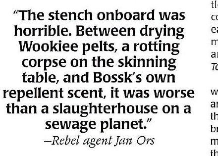

# Bossk

- **Aliases:** —
- **Era:** GCW
- **Continuity:** default Legends; entries present for: Canon, Legends
- **Research tier:** untiered (not listed as INTRO/DEEP/MASTERY in legends-feats.md)
- **Entries:** 226 (118 with quotations; 0 quotations extended to the full sentence/passage from the source text on file; 25 marked as fragments; 33 before the 2026-11-17 fragment fill). Rebuilt 2026-11-17 from 276 old entries; old file: `characters/_bak/bossk.md.bak-20261117`.
- **How to read:** each entry is the quotation in full (block quote), then its source and point of view. "Note" lines are summaries from our notes, not quotations. `[fragment — full passage not on file]` means the source text is not on the box, so only the words in our notes are shown. Debate and forum material is in the last section and is unverified.

# LEGENDS (Legends / EU — main focus)

## The Complete Star Wars Encyclopedia, Vol. I (A–G)

- Note (summary from our notes, not a quotation): Page contents: 1122 words, 35 paragraphs | headings/entries: Bossk; Bostuco, Captain; Botajef; Both, Deneb; Bothan
  — Source: scan pages 81–120.
Our notes: `notes/materials/030-complete-star-wars-encyclopedia-vol-1/02-v1-scan-081-120.md:184`

> Although he managed to corner the pair several times, these encounters always resulted in Bossk's defeat and humiliation.
— Source: scan pages 81–120; Bossk — entry/section: Bossk.
Note (our notes, around the quote): Bossk — entry/section: Bossk: "Although he managed to corner the pair several times, these encounters always resulted in Bossk's defeat and humiliation." Source: The Complete Star Wars Encyclopedia, Vol. I, p.88
Our notes: `notes/materials/030-complete-star-wars-encyclopedia-vol-1/02-v1-scan-081-120.md:186`

> Bossk then spent some time in Jabba's palace, but fled the Hutt's sail barge before Luke Skywalker and Princess Leia destroyed the craft.
— Source: scan pages 81–120; Bossk; Luke Skywalker; Leia Organa Solo — entry/section: Bossk.
Note (our notes, around the quote): Bossk; Luke Skywalker; Leia Organa Solo — entry/section: Bossk: "Bossk then spent some time in Jabba's palace, but fled the Hutt's sail barge before Luke Skywalker and Princess Leia destroyed the craft." Source: The Complete Star Wars Encyclopedia, Vol. I, p.88
Our notes: `notes/materials/030-complete-star-wars-encyclopedia-vol-1/02-v1-scan-081-120.md:188`

## The Complete Star Wars Encyclopedia, Vol. II (H–O)

> Bossk purchased it after the Wookiee Chewbacca and Han Solo destroyed his previous ship on Gandolo IV.
— Source: scan pages 41–80; Bossk; Chewbacca; Han Solo.
Note (our notes, around the quote): Bossk; Chewbacca; Han Solo: "Bossk purchased it after the Wookiee Chewbacca and Han Solo destroyed his previous ship on Gandolo IV." Source: The Complete Star Wars Encyclopedia, Vol. II, p.63
Our notes: `notes/materials/031-complete-star-wars-encyclopedia-vol-2/01-v2-scan-041-080.md:204`

## The New Essential Guide to Characters (2002)

- Note (summary from our notes, not a quotation): Page contents: 474 words, 24 paragraphs | headings/entries: Bossk; PRONUNCIATION Bosk; SPECIES Trandoshan; SEH Male; Hain CoLor None; Eve CoLton Red; HEIGHT 1.9 meters; HomEWOARLD Trandosha (Dosha); A i ES eed tf; Ey
  — Source: scan pages 1–30.
Our notes: `notes/materials/034-new-essential-guide-to-characters/00-negc-scan-001-030.md:152`

> As he prepared to leave Vader's Super Star Destroyer, Bossk ran into Tinian l'att and her Wookiee partner Chenlambec, two hunters who had failed to make Vader's cut.
— Source: scan pages 1–30; Darth Vader (Anakin Skywalker); Bossk.
Note (our notes, around the quote): Darth Vader (Anakin Skywalker); Bossk: "As he prepared to leave Vader's Super Star Destroyer, Bossk ran into Tinian l'att and her Wookiee partner Chenlambec, two hunters who had failed to make Vader's cut." Source: The New Essential Guide to Characters, p.29
Our notes: `notes/materials/034-new-essential-guide-to-characters/00-negc-scan-001-030.md:159`

> During a quick stopover on Corellia, Bossk shot and killed CorSec officer Hal Horn.
— Source: scan pages 1–30; Bossk. POV: Bossk.
Note (our notes, around the quote): Bossk: "During a quick stopover on Corellia, Bossk shot and killed CorSec officer Hal Horn." Source: The New Essential Guide to Characters, p.29
Our notes: `notes/materials/034-new-essential-guide-to-characters/00-negc-scan-001-030.md:161`

> Believing Fett to be a permanent resident in the Sarlacc's belly, Bossk attempted to steal the ship, but was tricked into thinking the Hound's Tooth was wired to explode.
— Source: scan pages 1–30; Bossk. POV: Bossk.
Note (our notes, around the quote): Bossk: "Believing Fett to be a permanent resident in the Sarlacc's belly, Bossk attempted to steal the ship, but was tricked into thinking the Hound's Tooth was wired to explode." Source: The New Essential Guide to Characters, p.30
Our notes: `notes/materials/034-new-essential-guide-to-characters/00-negc-scan-001-030.md:168`

> For the mission Fett stole the freighter Hound's Tooth from his rival Bossk, leaving Slave | behind on Tatooine.
— Source: scan pages 61–90; Bossk. POV: Bossk.
Note (our notes, around the quote): Bossk: "For the mission Fett stole the freighter Hound's Tooth from his rival Bossk, leaving Slave | behind on Tatooine." Source: The New Essential Guide to Characters, p.68
Our notes: `notes/materials/034-new-essential-guide-to-characters/02-negc-scan-061-090.md:12`

## Adventures/Horning In.pdf [Star Wars Roleplaying Game (d20, 2000)]

- Note (summary from our notes, not a quotation): Page contents: Ssorku: 'not as well known as Bossk, but he's no lightweight in the mercenary world'. (hand-read)
  — Source: Adventures/Horning In.pdf [Star Wars Roleplaying Game (d20, 2000)].
Our notes: `notes/materials/037-sw-d20-folder/028-horning-in.md:15`

## Adventures/Tempest feud.pdf [Star Wars Roleplaying Game (d20, 2000)] (scan pages 1–60)

- Note (summary from our notes, not a quotation): Page contents: Vago's third punishment: hire an expert bounty hunter such as Boba Fett, IG-88, or Bossk. (hand-read)
  — Source: Adventures/Tempest feud.pdf [Star Wars Roleplaying Game (d20, 2000)] (sca.
Our notes: `notes/materials/037-sw-d20-folder/030-tempest-feud-scan-001-060.md:134`

## Sourcebooks/Rebellion Era Sourcebook.pdf [Star Wars Roleplaying Game (d20, 2000)] (scan pages 61–120)

> Bossk began his career hunting escaped Wookiee slaves and has a running feud with Han Solo's partner, Chewbacca. Though they have tangled multiple times, it is always Bossk who comes up short—short a limb, generally.
— Source: Sourcebooks/Rebellion Era Sourcebook.pdf [Star Wars Roleplaying Game (d20; Bossk; Chewbacca — entry/section: Bossk's feud with Chewbacca.
Note (our notes, around the quote): Bossk; Chewbacca — entry/section: Bossk's feud with Chewbacca: "Bossk began his career hunting escaped Wookiee slaves and has a running feud with Han Solo's partner, Chewbacca. Though they have tangled multiple times, it is always Bossk who comes up short—short a limb, generally." Source: *Rebellion Era Sourcebook* (SWRPG d20), scan p.100
Our notes: `notes/materials/037-sw-d20-folder/043-rebellion-era-sourcebook-scan-061-120.md:260`

## Star Wars Gamer/Star Wars Gamer 06.pdf [Star Wars Roleplaying Game (d20, 2000)] (scan pages 1–60)

- Note (summary from our notes, not a quotation): Page contents: Zuckuss bio: first Findsman to work offworld, partners with 4-LOM, Bounty Hunters Guild (Cradossk, Bossk, Nil Posondum), lung damage, Nardix bounty, Bright Hope, joins the Alliance, Drawmas Sma'Da (hand-read)
  — Source: Star Wars Gamer/Star Wars Gamer 06.pdf [Star Wars Roleplaying Game (d20,.
Our notes: `notes/materials/037-sw-d20-folder/055-star-wars-gamer-06-scan-001-060.md:139`

## Star Wars Gamer/Star Wars Gamer 07.pdf [Star Wars Roleplaying Game (d20, 2000)] (scan pages 1–60)

> Hound's Tooth The bounty hunter Bossk had the Hounds Tooth built after Han Solo and Chewbacca destroyed his previous ship.
— Source: Star Wars Gamer/Star Wars Gamer 07.pdf [Star Wars Roleplaying Game (d20,; Bossk; Han Solo; Chewbacca.
Note (our notes, around the quote): Bossk; Han Solo; Chewbacca: "Hound's Tooth The bounty hunter Bossk had the Hounds Tooth built after Han Solo and Chewbacca destroyed his previous ship." Source: *Star Wars Gamer 07* (SWRPG d20), scan p.48
Our notes: `notes/materials/037-sw-d20-folder/056-star-wars-gamer-07-scan-001-060.md:320`

## Star Wars Gamer/Star Wars Gamer 10.pdf [Star Wars Roleplaying Game (d20, 2000)] (scan pages 61–120)

- Note (summary from our notes, not a quotation): Page contents: Star Wars Bounty Hunter preview by Eric Bratcher (PS2/GameCube): you play Jango Fett about ten years before Attack of the Clones; Darth Sidious charges his new right-hand man with destroying a cult, and he hires bounty hunters to kill its leader; Kenner's mail-away Boba Fett and Bossk figures (hand-read)
  — Source: Star Wars Gamer/Star Wars Gamer 10.pdf [Star Wars Roleplaying Game (d20,.
Our notes: `notes/materials/037-sw-d20-folder/059-star-wars-gamer-10-scan-061-120.md:285`

## Characters/Hutts/Malta and Quaffug.pdf [Star Wars Roleplaying Game Revised Core (d20, 2002)]

- Note (summary from our notes, not a quotation): Page contents: Intro; Malta, the Vassilika bet with Jabba and Embra, hires Bossk, Dengar, IG-88; Malta stats (hand-read)
  — Source: Characters/Hutts/Malta and Quaffug.pdf [Star Wars Roleplaying Game Revise.
Our notes: `notes/materials/037-sw-d20-folder/088-malta-and-quaffug.md:10`

> Convinced that brute force would seal the deal, Malta hired Bossk, Dengar, and IG-88 to retrieve the object.
— Source: Characters/Hutts/Malta and Quaffug.pdf [Star Wars Roleplaying Game Revise.
Note (our notes, around the quote): Bossk; Dengar; IG-88 — entry/section: Malta hires Bossk, Dengar and IG-88: "Convinced that brute force would seal the deal, Malta hired Bossk, Dengar, and IG-88 to retrieve the object." Source: *Malta and Quaffug* (SWRPG d20 Revised Core), scan p.1
Our notes: `notes/materials/037-sw-d20-folder/088-malta-and-quaffug.md:18`

## Characters/Miniatures/Bounty Hunters Preview 1.pdf [Star Wars Roleplaying Game Revised Core (d20, 2002)]

- Note (summary from our notes, not a quotation): Page contents: Intro; Bossk history and miniatures tactics; stat card; Bossk RPG stats (hand-read)
  — Source: Characters/Miniatures/Bounty Hunters Preview 1.pdf [Star Wars Roleplaying.
Our notes: `notes/materials/037-sw-d20-folder/093-bounty-hunters-preview-1.md:10`

> First, Sterling Hershey explains why you wouldn't want to meet a Trandoshan with a flamethrower in a dark alley. Then Gary Sarli dodges shock whips to uncover the secrets of the Mistryl Shadow Guard. Bossk, Bounty Hunter In almost every Star Wars movie, bounty hunters play significant and sometimes pivotal roles in the fate of the galaxy. Their very presence ­­ and how different they all look ­­ hints at the depth and variety of the universe. The reptilian Bossk first appeared on screen in The Empire Strikes Back as one of the elite bounty hunters personally invited by Darth Vader to pursue the Millennium Falcon. He didn't manage to capture the Falcon, or steal the frozen Han Solo from Boba Fett. But Bossk maintained a long rivalry with Chewbacca before and after the incident. Bossk is a Trandoshan, which is one of the native species of the Kashyyyk system and a longtime enemy of the Wookiees. In the Star Wars Miniatures Game, Bossk, Bounty Hunter is an upgraded version of the Bossk miniature originally issued in the Rebel Storm set. For a cost increase of only 8 points, Bossk, Bounty Hunter has many more special abilities, plus slightly increased Hit Points and Attack scores. Some of his new abilities are typical Trandoshan traits, such as Regeneration and Rend.
— Source: Characters/Miniatures/Bounty Hunters Preview 1.pdf [Star Wars Roleplaying.
(Excerpt widened 2026-11-17 to the relevant passage, word for word from h primary sw d20 folder files Star Wars Roleplaying Game Revised Core Characters Miniatures Bounty Hunters Preview 1 (text copy `h_primary_sw_d20_folder_files_Star_Wars_Roleplaying_Game_Revised_Core_Characters_Miniatures_Bounty_Hunters_Preview_1_pdf_74bca44ee0`).)
(Excerpt widened 2026-11-17 to the relevant passage, word for word from h primary sw d20 folder files Star Wars Roleplaying Game Revised Core Characters Miniatures Bounty Hunters Preview 1 (text copy `h_primary_sw_d20_folder_files_Star_Wars_Roleplaying_Game_Revised_Core_Characters_Miniatures_Bounty_Hunters_Preview_1_pdf_74bca44ee0`).)
Note (our notes, around the quote): Bossk; Chewbacca; Boba Fett — entry/section: Bossk's screen history and rivalry with Chewbacca: "The reptilian Bossk first appeared on screen in The Empire Strikes Back as one of the elite bounty hunters personally invited by Darth Vader to pursue the Millennium Falcon. He didn't manage to capture the Falcon, or steal the frozen Han Solo from Boba Fett. But Bossk maintained a long rivalry with Chewbacca before and after the incident. Bossk is a Trandoshan, which is one of the native species of the Kashyyyk system and a longtime enemy of the Wookiees." Source: *Bounty Hunters Preview 1* (SWRPG d20 Revised Core), scan p.1
Our notes: `notes/materials/037-sw-d20-folder/093-bounty-hunters-preview-1.md:12`

> Bossk, Bounty Hunter is highly effective in close­range combat, with powerful claw attacks and his dangerous, crowd­thinning Flamethrower. His Regeneration ability allows him to regain 10 hit points in any round he doesn't move. This power should help him stay in the fight longer when battling adjacent, non­moving enemies for consecutive rounds. Opponents with few hit points will find Bossk, Bounty Hunter a formidable foe. They won't last long in adjacent fighting, and they can't survive even a single hit from his Flamethrower. Star Wars Miniatures Stat Card Preview Faction: Fringe Cost: 25 Hit Points: 60 Defense: 17 Attack: +8 Damage: 20 Special Abilities: Unique, Bounty Hunter +4, Double Claw Attack, Flamethrower 20, Momentum, Regeneration 10, Rend +10 Star Wars Roleplaying Game Statistics Bossk: Male Trandoshan scout 4/soldier 3/bounty hunter 1; Init +3 (+3 Dex); Defense 22 (+1 natural, + 8 class, +3 Dex); Spd 10 m; VP/WP 66/16; Atk +10/+5, melee (1d3+3, unarmed) or +10/+5 ranged (3d8/19–20, blaster rifle) or +10/+5 ranged (3d6/1d6 stun grenade) or +10/+5 ranged (2d6, flamethrower); SQ darkvision 20 m, trailblazing, heart +1, uncanny dodge, target bonus +1; SV Fort +9, Ref +7, Will +5; SZ M; FP 2; DSP 8; Rep +3; Str 16, Dex 17, Con 16, Int 12, Wis 12, Cha 13. Challenge Code D.
— Source: Characters/Miniatures/Bounty Hunters Preview 1.pdf [Star Wars Roleplaying; Bossk — entry/section: Bossk, Bounty Hunter.
(Excerpt widened 2026-11-17 to the relevant passage, word for word from h primary sw d20 folder files Star Wars Roleplaying Game Revised Core Characters Miniatures Bounty Hunters Preview 1 (text copy `h_primary_sw_d20_folder_files_Star_Wars_Roleplaying_Game_Revised_Core_Characters_Miniatures_Bounty_Hunters_Preview_1_pdf_74bca44ee0`).)
(Excerpt widened 2026-11-17 to the relevant passage, word for word from h primary sw d20 folder files Star Wars Roleplaying Game Revised Core Characters Miniatures Bounty Hunters Preview 1 (text copy `h_primary_sw_d20_folder_files_Star_Wars_Roleplaying_Game_Revised_Core_Characters_Miniatures_Bounty_Hunters_Preview_1_pdf_74bca44ee0`).)
Note (our notes, around the quote): Bossk — entry/section: Bossk, Bounty Hunter: "Opponents with few hit points will find Bossk, Bounty Hunter a formidable foe." Source: *Bounty Hunters Preview 1* (SWRPG d20 Revised Core), scan p.1
Our notes: `notes/materials/037-sw-d20-folder/093-bounty-hunters-preview-1.md:14`

- Note (summary from our notes, not a quotation): Page contents: Bossk skills/feats; Mistryl Shadow Guard background (Emberlene), tactics, card, RPG stats (hand-read)
  — Source: Characters/Miniatures/Bounty Hunters Preview 1.pdf [Star Wars Roleplaying.
Our notes: `notes/materials/037-sw-d20-folder/093-bounty-hunters-preview-1.md:24`

## Characters/Miniatures/We Don't Need That Scum.pdf [Star Wars Roleplaying Game Revised Core (d20, 2002)]

- Note (summary from our notes, not a quotation): Page contents: Boba skills/feats; Bossk (Scout 1/Soldier 3, CC C, early career, Hound's Tooth); Dengar (Soldier 2/Scoundrel 4, CC D, Punishing One); Greedo intro (hand-read)
  — Source: Characters/Miniatures/We Don't Need That Scum.pdf [Star Wars Roleplaying.
Our notes: `notes/materials/037-sw-d20-folder/115-we-dont-need-that-scum.md:24`

> Skills: Astrogate +6, Computer Use +5, Demolitions +6, Disable Device +6, Gather Information +6, Hide +6, Intimidate +8, Knowledge (bureaucracy) +5, Knowledge (streetwise) +6, Listen +3, Move Silently +8, Pilot +10, Profession (bounty hunter) +4, Read/Write basic, Repair +5, Speak Basic, Spot +3, Survival +4. Feats: Armor Proficiency (light, medium, powered), Exotic Weapon Proficiency (whip), Infamy, Martial Artist, Point Blank Shot, Starship Operation (space transport), Track, Weapon Group Proficiency (blaster pistols, blaster rifles, heavy weapons, simple weapons, vibro weapons). Bossk While most bounty hunters summoned by Darth Vader after the battle of Hoth were there to hunt down Han Solo, the Trandoshan Bossk's real target was the Wookiee Chewbacca. After years of skinning and collecting the pelts of Wookiees, he saw Chewbacca as the ultimate prize coat. The version here represents a version of Bossk near the beginning of his career. An alternate version of a more experienced Bossk can be found on page 11 of Ultimate Adversaries.
— Source: Characters/Miniatures/We Don't Need That Scum.pdf [Star Wars Roleplaying.
(Excerpt widened 2026-11-17 to the relevant passage, word for word from ch primary sw d20 folder files Star Wars Roleplaying Game Revised Core Characters Miniatures We Don t Need That Scum (text copy `ch_primary_sw_d20_folder_files_Star_Wars_Roleplaying_Game_Revised_Core_Characters_Miniatures_We_Don_t_Need_That_Scum_pdf_5d79f2f39d`).)
(Excerpt widened 2026-11-17 to the relevant passage, word for word from ch primary sw d20 folder files Star Wars Roleplaying Game Revised Core Characters Miniatures We Don t Need That Scum (text copy `ch_primary_sw_d20_folder_files_Star_Wars_Roleplaying_Game_Revised_Core_Characters_Miniatures_We_Don_t_Need_That_Scum_pdf_5d79f2f39d`).)
Note (our notes, around the quote): Bossk; Darth Vader (Anakin Skywalker); Han Solo; Chewbacca — entry/section: Bossk hunts Chewbacca: "While most bounty hunters summoned by Darth Vader after the battle of Hoth were there to hunt down Han Solo, the Trandoshan Bossk's real target was the Wookiee Chewbacca. After years of skinning and collecting the pelts of Wookiees, he saw Chewbacca as the ultimate prize coat." Source: *We Don't Need That Scum* (SWRPG d20 Revised Core), scan p.2
Our notes: `notes/materials/037-sw-d20-folder/115-we-dont-need-that-scum.md:26`

## Jedi Counselling/Jedi Counseling 82.pdf [Star Wars Roleplaying Game Revised Core (d20, 2002)]

> Of course, as mentioned on both the stat card and rules insert, you may not use Force points to reroll attacks against or saves in response to that enemy. Q: If I have two Rodian Black Sun Vigos in my squad and I roll an 11 for initiative, what happens? Do I get 20 points of Fringe Reserves? 40 points of Fringe Reserves? Two sets of 20 points of Fringe Reserves? A: You get two separate groups of 20 points of Fringe Reserves. For example, you could get Dengar (15 points) with one and Bossk (17 points) with the other, but you could not combine the points to get IG­88 (37 points). Q: I noticed that the Flash Speeder has Speed 12, and its Mobile Attack description omits the phrase "up to a total of 6 squares" (see Gran Raider for an example of this phrase). Was this an intentional change because of the higher speed? Is the definition of Mobile Attack as a whole supposed to change? A: Yes, and yes.
— Source: Jedi Counselling/Jedi Counseling 82.pdf [Star Wars Roleplaying Game Revis.
(Excerpt widened 2026-11-17 to the relevant passage, word for word from research primary sw d20 folder files Star Wars Roleplaying Game Revised Core Jedi Counselling Jedi Counseling 82 (text copy `research_primary_sw_d20_folder_files_Star_Wars_Roleplaying_Game_Revised_Core_Jedi_Counselling_Jedi_Counseling_82_pdf_c8bbba654c`).)
(Excerpt widened 2026-11-17 to the relevant passage, word for word from research primary sw d20 folder files Star Wars Roleplaying Game Revised Core Jedi Counselling Jedi Counseling 82 (text copy `research_primary_sw_d20_folder_files_Star_Wars_Roleplaying_Game_Revised_Core_Jedi_Counselling_Jedi_Counseling_82_pdf_c8bbba654c`).)
Note (our notes, around the quote): Dengar; Bossk; IG-88 — entry/section: Two Rodian Black Sun Vigos and Fringe Reserves: "A: You get two separate groups of 20 points of Fringe Reserves. For example, you could get Dengar (15 points) with one and Bossk (17 points) with the other, but you could not combine the points to get IG-88 (37 points)." Source: *Jedi Counseling 82* (SWRPG d20 Revised Core), scan p.3
Our notes: `notes/materials/037-sw-d20-folder/252-jedi-counseling-82.md:31`

## Sourcebooks/Galactic Campaign Guide.pdf [Star Wars Roleplaying Game Revised Core (d20, 2002)] (scan pages 121–162)

- Note (summary from our notes, not a quotation): Page contents: Table 4-39 Sullustan surnames (Nunb = Teacher); Sullustan Names; Table 4-40 Trandoshan names (Bossk, Cradossk...) (hand-read)
  — Source: Sourcebooks/Galactic Campaign Guide.pdf [Star Wars Roleplaying Game Revis.
Our notes: `notes/materials/037-sw-d20-folder/666-galactic-campaign-guide-scan-121-162.md:65`

## Sourcebooks/Ultimate Adversaries.pdf [Star Wars Roleplaying Game Revised Core (d20, 2002)] (scan pages 1–60)

- Note (summary from our notes, not a quotation): Page contents: Beel Acton era notes (Darth Maul, the Emperor, Luke's Jedi) and stats; Bossk history. (hand-read)
  — Source: Sourcebooks/Ultimate Adversaries.pdf [Star Wars Roleplaying Game Revised.
Our notes: `notes/materials/037-sw-d20-folder/672-ultimate-adversaries-scan-001-060.md:69`

> Although his career as a bounty hunter began long before the Empire, the rise of the Empire provided Bossk with the opportunity he had been waiting for. The Empire needed bounty hunters to bring in “criminals” such as Rebel holdouts and those who did not believe in the sovereignty of the Emperor. Their methods were also appealing to the Trandoshan, who preferred violent methods to peaceful ones and was known to be a cruel keeper to those he brought in alive. Bossk quickly became one of the Empire's most reliable bounty hunters, and he was personally selected by Darth Vader to hunt down Luke Skywalker and his allies after the Battle of Hoth.
— Source: Sourcebooks/Ultimate Adversaries.pdf [Star Wars Roleplaying Game Revised; Bossk; Darth Vader (Anakin Skywalker); Luke Skywalker — entry/section: Bossk.
Note (our notes, around the quote): Bossk; Darth Vader (Anakin Skywalker); Luke Skywalker — entry/section: Bossk: "Although his career as a bounty hunter began long before the Empire, the rise of the Empire provided Bossk with the opportunity he had been waiting for. The Empire needed bounty hunters to bring in “criminals” such as Rebel holdouts and those who did not believe in the sovereignty of the Emperor. Their methods were also appealing to the Trandoshan, who preferred violent methods to peaceful ones and was known to be a cruel keeper to those he brought in alive. Bossk quickly became one of the Empire's most reliable bounty hunters, and he was personally selected by Darth Vader to hunt down Luke Skywalker and his allies after the Battle of Hoth." Source: *Ultimate Adversaries* (SWRPG d20 Revised Core), scan p.12
Our notes: `notes/materials/037-sw-d20-folder/672-ultimate-adversaries-scan-001-060.md:73`

> Bossk jumped at the chance to hunt one of his longtime nemeses, the Wookiee Chewbacca. He had started his career as a bounty hunter by hunting down escaped Wookiee slaves; during one of his expeditions, he ran afoul of Chewbacca. The Wookiee defeated the bounty hunter, tearing off one of his arms at the elbow during the intense battle that followed their meeting. His constant defeats only made Bossk obsessed with catching the Wookiee, and he has been known to turn down lucrative jobs in order to pursue the one prey he has not been able to capture. His best chance came when Chewbacca and his allies were captured by Boba Fett on Cloud City, but the bounty hunter refused to release Chewbacca to Bossk since his intention was to deliver the Wookiee to Jabba the Hutt on Tatooine. This infuriated Bossk, who harbored resentment toward Boba Fett until the bounty hunter's fall into the Sarlacc Pit.
— Source: Sourcebooks/Ultimate Adversaries.pdf [Star Wars Roleplaying Game Revised.
Note (our notes, around the quote): Bossk; Chewbacca; Boba Fett; Jabba the Hutt — entry/section: Bossk and Chewbacca: "Bossk jumped at the chance to hunt one of his longtime nemeses, the Wookiee Chewbacca. He had started his career as a bounty hunter by hunting down escaped Wookiee slaves; during one of his expeditions, he ran afoul of Chewbacca. The Wookiee defeated the bounty hunter, tearing off one of his arms at the elbow during the intense battle that followed their meeting. His constant defeats only made Bossk obsessed with catching the Wookiee, and he has been known to turn down lucrative jobs in order to pursue the one prey he has not been able to capture. His best chance came when Chewbacca and his allies were captured by Boba Fett on Cloud City, but the bounty hunter refused to release Chewbacca to Bossk since his intention was to deliver the Wookiee to Jabba the Hutt on Tatooine. This infuriated Bossk, who harbored resentment toward Boba Fett until the bounty hunter's fall into the Sarlacc Pit." Source: *Ultimate Adversaries* (SWRPG d20 Revised Core), scan p.12
Our notes: `notes/materials/037-sw-d20-folder/672-ultimate-adversaries-scan-001-060.md:75`

- Note (summary from our notes, not a quotation): Page contents: Bossk description, goals, tactics, affiliations, era notes, stats; Hound's Tooth. (hand-read)
  — Source: Sourcebooks/Ultimate Adversaries.pdf [Star Wars Roleplaying Game Revised.
Our notes: `notes/materials/037-sw-d20-folder/672-ultimate-adversaries-scan-001-060.md:80`

> He is at his prime during the Rebellion Era, when his running feud with Chewbacca is at its strongest.
— Source: Sourcebooks/Ultimate Adversaries.pdf [Star Wars Roleplaying Game Revised; Bossk; Chewbacca — entry/section: Ultimate Adversaries (Revised Core).
Note (our notes, around the quote): Bossk; Chewbacca — entry/section: Ultimate Adversaries (Revised Core): "He is at his prime during the Rebellion Era, when his running feud with Chewbacca is at its strongest." Source: *Ultimate Adversaries* (SWRPG d20 Revised Core), scan p.13
Our notes: `notes/materials/037-sw-d20-folder/672-ultimate-adversaries-scan-001-060.md:82`

> Bossk loves being a bounty hunter and can think of nothing he would rather do. He scrounges any piece of information he can get on Chewbacca, and has followed the Wookiee all over the galaxy only to come up empty handed each time they have fought. Bossk no longer wishes to collect the bounty on the Wookiee, instead just wishing to see him dead. Even when he takes jobs in other parts of the galaxy, his arch-nemesis is never far from his mind.
— Source: Sourcebooks/Ultimate Adversaries.pdf [Star Wars Roleplaying Game Revised; Bossk; Chewbacca — entry/section: Bossk: Goals.
Note (our notes, around the quote): Bossk; Chewbacca — entry/section: Bossk: Goals: "Bossk loves being a bounty hunter and can think of nothing he would rather do. He scrounges any piece of information he can get on Chewbacca, and has followed the Wookiee all over the galaxy only to come up empty handed each time they have fought. Bossk no longer wishes to collect the bounty on the Wookiee, instead just wishing to see him dead. Even when he takes jobs in other parts of the galaxy, his arch-nemesis is never far from his mind." Source: *Ultimate Adversaries* (SWRPG d20 Revised Core), scan p.13
Our notes: `notes/materials/037-sw-d20-folder/672-ultimate-adversaries-scan-001-060.md:84`

> Bossk is well known among bounty hunters, and his experience has helped him garner several large and ongoing contracts. Lesser bounty hunters often pay Bossk to complete a particularly challenging bounty that they have failed to accomplish, a task he does in return for later favors. In this way, Bossk has managed to accumulate a vast network of resources at his disposal. He is also known to feud with those who displease him, such as when Boba Fett refused to turn over Chewbacca after capturing he and Han Solo in Cloud City.
— Source: Sourcebooks/Ultimate Adversaries.pdf [Star Wars Roleplaying Game Revised; Bossk; Boba Fett; Chewbacca; Han Solo — entry/section: Bossk: Affiliations.
Note (our notes, around the quote): Bossk; Boba Fett; Chewbacca; Han Solo — entry/section: Bossk: Affiliations: "Bossk is well known among bounty hunters, and his experience has helped him garner several large and ongoing contracts. Lesser bounty hunters often pay Bossk to complete a particularly challenging bounty that they have failed to accomplish, a task he does in return for later favors. In this way, Bossk has managed to accumulate a vast network of resources at his disposal. He is also known to feud with those who displease him, such as when Boba Fett refused to turn over Chewbacca after capturing he and Han Solo in Cloud City." Source: *Ultimate Adversaries* (SWRPG d20 Revised Core), scan p.13
Our notes: `notes/materials/037-sw-d20-folder/672-ultimate-adversaries-scan-001-060.md:86`; `suspect-insight/respect-threads/bossk.md:155`

> Bossk is still a young Trandoshan during the Rise of the Empire era and has not grown into the fearsome bounty hunter that he will become. Still, his attitudes and abilities are not uncommon among his species and the stats provided could be used for any similar Trandoshan. He is at his prime during the Rebellion Era, when his running feud with Chewbacca is at its strongest. During the New Jedi Order period, Bossk is an old and broken figure. He blindly pursues Chewbacca well past the point that his body could handle another encounter with the Wookiee, as they years of injuries have finally caught up to him.
— Source: Sourcebooks/Ultimate Adversaries.pdf [Star Wars Roleplaying Game Revised; Bossk; Chewbacca — entry/section: Bossk: Era Notes.
Note (our notes, around the quote): Bossk; Chewbacca — entry/section: Bossk: Era Notes: "Bossk is still a young Trandoshan during the Rise of the Empire era and has not grown into the fearsome bounty hunter that he will become. Still, his attitudes and abilities are not uncommon among his species and the stats provided could be used for any similar Trandoshan. He is at his prime during the Rebellion Era, when his running feud with Chewbacca is at its strongest. During the New Jedi Order period, Bossk is an old and broken figure. He blindly pursues Chewbacca well past the point that his body could handle another encounter with the Wookiee, as they years of injuries have finally caught up to him." Source: *Ultimate Adversaries* (SWRPG d20 Revised Core), scan p.13
Our notes: `notes/materials/037-sw-d20-folder/672-ultimate-adversaries-scan-001-060.md:88`

- Note (summary from our notes, not a quotation): Page contents: Bossk feats; C-3PX (Darth Maul's modified droid, Olag Greck) history, description, goals, tactics. (hand-read)
  — Source: Sourcebooks/Ultimate Adversaries.pdf [Star Wars Roleplaying Game Revised.
Our notes: `notes/materials/037-sw-d20-folder/672-ultimate-adversaries-scan-001-060.md:97`

## Sourcebooks/Ultimate Alien Anthology.pdf [Star Wars Roleplaying Game Revised Core (d20, 2002)] (scan pages 121–180)

- Note (summary from our notes, not a quotation): Page contents: Trandoshan (example names incl. Bossk, Cradossk) traits; Slavemaster stun carbine; Trianii. (hand-read)
  — Source: Sourcebooks/Ultimate Alien Anthology.pdf [Star Wars Roleplaying Game Revi.
Our notes: `notes/materials/037-sw-d20-folder/673-ultimate-alien-anthology-scan-121-180.md:257`

## Sourcebooks/Scum and Villany.pdf [Star Wars Roleplaying Game Saga Edition (2007)] (scan pages 61–120)

> Although the Gand was not as feared as Boba Fett or as well known as Dengar or Bossk, Zuckuss nevertheless duilt a reputation in shadowports and underworld sanctuaries as one of the best trackers in the galaxy.
— Source: Sourcebooks/Scum and Villany.pdf [Star Wars Roleplaying Game Saga Edition; Boba Fett; Dengar; Bossk — entry/section: Scum and Villainy (Saga).
Note (our notes, around the quote): Boba Fett; Dengar; Bossk — entry/section: Scum and Villainy (Saga): "Although the Gand was not as feared as Boba Fett or as well known as Dengar or Bossk, Zuckuss nevertheless duilt a reputation in shadowports and underworld sanctuaries as one of the best trackers in the galaxy." Source: *Scum and Villany* (SWRPG Saga Edition), scan p.116
Our notes: `notes/materials/037-sw-d20-folder/725-scum-and-villany-scan-061-120.md:381`

## Sourcebooks/Threats of the Galaxy.pdf [Star Wars Roleplaying Game Saga Edition (2007)] (scan pages 1–60)

- Note (summary from our notes, not a quotation): Page contents: Aurra Sing CL 12 stat block (Medium near-Human scoundrel 3/Jedi 2/scout 4/bounty hunter 3; Destiny 1; 5 lightsabers, slugthrower rifle, 2 blaster pistols, Rhen-Orm Biocomputer, ion-repulsorlift swoop, Corellian blockade runner); Bossk introduction. (hand-read)
  — Source: Sourcebooks/Threats of the Galaxy.pdf [Star Wars Roleplaying Game Saga Ed.
Our notes: `notes/materials/037-sw-d20-folder/731-threats-of-the-galaxy-scan-001-060.md:124`

> He failed, and Solo destroyed his ship, stranding the bounty hunter on the wretched planet and leading to the grudge that Bossk would carry for the rest of his days.
— Source: Sourcebooks/Threats of the Galaxy.pdf [Star Wars Roleplaying Game Saga Ed; Bossk. POV: Bossk.
Note (our notes, around the quote): Bossk: "He failed, and Solo destroyed his ship, stranding the bounty hunter on the wretched planet and leading to the grudge that Bossk would carry for the rest of his days." Source: *Threats of the Galaxy* (SWRPG Saga Edition), scan p.18
Our notes: `notes/materials/037-sw-d20-folder/731-threats-of-the-galaxy-scan-001-060.md:126`

- Note (summary from our notes, not a quotation): Page contents: Bossk CL 12 stat block (Medium Trandoshan scout 5/soldier 3/bounty hunter 4; darkvision; limb regeneration; blaster rifle, flamethrower, grenade launcher with stun grenades, sporting blaster pistol, padded flight suit, Hound's Tooth); Hound's Tooth CL 12 stat block (Colossal space transport, quad laser cannons, medium concussion missiles, ion cannon; crew 1 Bossk, 4 prisoners). (hand-read)
  — Source: Sourcebooks/Threats of the Galaxy.pdf [Star Wars Roleplaying Game Saga Ed.
Our notes: `notes/materials/037-sw-d20-folder/731-threats-of-the-galaxy-scan-001-060.md:137`

## Star Wars Insider #35 (1997)

- Note (summary from our notes, not a quotation): Page contents: 229 words, 23 paragraphs | headings/entries: OPERATORS ARE STANDING BY; TOLL FREE! 1-800-878-3326; Action Figure Sets; LKN25 Boba Fett LKENSO Garindan; LKN44 AT-ST Driver LKNS2 Panda Babs; LKN42 Bossk $46.95 each; HOTH REREL DEATH STAR AT-ST SOLDICR GUNNER; GARINDAN PONDA BABA LKNS4 = $79.95; Carry Case; LANSS = $24.95; WEEQUAY SKIFF GUARD VADER
  — Source: Star Wars Insider #35 (1997).
Our notes: `notes/materials/038-star-wars-insider/035-ins035.md:284`

## Star Wars Insider #43 (1999)

- Note (summary from our notes, not a quotation): Page contents: Rebel Rumblings continued (letter writers omitted); WEG out of business; editor's tongue-in-cheek Bossk reply. See T. (hand-read)
  — Source: Star Wars Insider #43 (1999).
Our notes: `notes/materials/038-star-wars-insider/043-ins043.md:431`

## Star Wars Insider #47 (1999)

- Note (summary from our notes, not a quotation): Page contents: Contents cont.; humorous 2-1B guest editorial (claims credit for saving Luke, mocks FX-7, Bossk, 4-LOM). Joke piece, no canon feats. (hand-read)
  — Source: Star Wars Insider #47 (1999).
Our notes: `notes/materials/038-star-wars-insider/047-ins047.md:40`

> He outran a fleet of bounty hunters from Boba Fett to Bossk, survived the battles of Yavin, Hoth, and Endor, and nearly walked the plank at the Great Pit of Carkoon—yet for all his powers, the mighty Wookiee Chewbacca could not elude the editors at Del Rey Books.
— Source: Star Wars Insider #47 (1999); Chewbacca — entry/section: Peter Mayhew interview intro (Scott Chernoff).
Note (our notes, around the quote): Chewbacca — entry/section: Peter Mayhew interview intro (Scott Chernoff): "He outran a fleet of bounty hunters from Boba Fett to Bossk, survived the battles of Yavin, Hoth, and Endor, and nearly walked the plank at the Great Pit of Carkoon—yet for all his powers, the mighty Wookiee Chewbacca could not elude the editors at Del Rey Books." Source: *Star Wars Insider #47* (1999), scan p.27
Our notes: `notes/materials/038-star-wars-insider/047-ins047.md:144`

## Star Wars Insider #49 (2000)

- Note (summary from our notes, not a quotation): Page contents: Bounty hunters feature intro: Piett's "scum" line; Dengar, Zuckuss, Boba Fett, Bossk, 4-LOM, IG-88. (hand-read)
  — Source: Star Wars Insider #49 (2000).
Our notes: `notes/materials/038-star-wars-insider/049-ins049.md:97`

- Note (summary from our notes, not a quotation): Page contents: Alan Harris (Bossk; Boba Fett costume flame-thrower made practical then dropped). (hand-read)
  — Source: Star Wars Insider #49 (2000).
Our notes: `notes/materials/038-star-wars-insider/049-ins049.md:112`

## Star Wars Insider #57 (2001)

> a sweet, lovely boy
> [fragment — full passage not on file]
>
> Darth Vader's right-hand man
> [fragment — full passage not on file]
— Source: Star Wars Insider #57 (2001); Page contents: Logan feature (magazine p. 38): Morrison on Logan (.
Note (our notes, around the quote): Page contents: Logan feature (magazine p. 38): Morrison on Logan ("a sweet, lovely boy" who told Christopher Lee and Samuel Jackson he'd seen them in movies); Logan's family; Morrison as his Maori screen dad who kept calling him "son"; best friend on set Ewan McGregor; pull quote that he told people he plays a baby Ewok. Timeline sidebar "The Fett Effect" part 1: 1978 Ready! Fett! Go! (Joe Johnston's design, he painted Fett's armor himself); 1978 Cartoon Debut (Holiday Special, C-3PO reveals him as "Darth Vader's right-hand man"); 1979 It Figures (mail-away action figure); 1980 It Takes Two to Jango (Jeremy Bulloch in costume, voice by Jason Wingreen; both interviewed in Insider #49); 1983 Return of the Fett-I (Sarlacc fate; editor's aside about Zuckuss, Dengar and Bossk). Photos of Bulloch and Wingreen. (hand-read)
Our notes: `notes/materials/038-star-wars-insider/057-ins057.md:195`

> Imperial Star Destroyer - Help Wanted: Scum and Villainy, Apply Within
> [fragment — full passage not on file]
— Source: Star Wars Insider #57 (2001); Page contents: Set Piece.
Note (our notes, around the quote): Page contents: Set Piece: "Imperial Star Destroyer - Help Wanted: Scum and Villainy, Apply Within" by Chris Reiff & Chris Trevas (magazine p. 82): the Empire bridge set on Stage 5 at Elstree (1979), designed by Norman Reynolds; how Bossk, Dengar, 4-LOM and IG-88 costumes were built from recycled parts. Captions (verified on crop): holographic communications center; wall panels recycled from the Tantive IV hallway set. (hand-read)
Our notes: `notes/materials/038-star-wars-insider/057-ins057.md:475`

- Note (summary from our notes, not a quotation): Page contents: Set Piece cont. (magazine p. 83): labelled prop-weapon callouts on the bounty hunter line-up (verified on crop): IG-88's blaster is an altered Hoth Rebel Trooper rifle prop (see Insider #55); Boba Fett's gun is a WWI British Webley flare gun with an antique camera-flash handle and scope; Bossk's rifle a modified British Schermuly anti-riot gun; Dengar's blaster a German MG42 machine gun; 4-LOM's an unmodified German MG34; Zuckuss's insect-like eyes are bubble-wrap packing material over the mask eyeholes. Caption: down this corridor lies Lord Vader's meditation chamber and his direct line to the Emperor. (hand-read)
  — Source: Star Wars Insider #57 (2001).
Our notes: `notes/materials/038-star-wars-insider/057-ins057.md:486`

## Star Wars Insider #74 (2004)

- Note (summary from our notes, not a quotation): Page contents: Toy Box: 2004 themed Basic and Ultra waves; Wave 5 from the Empire Star Destroyer bridge scene — Dengar with removable backpack, Bossk and Admiral Ozzel. (hand-read)
  — Source: Star Wars Insider #74 (2004).
Our notes: `notes/materials/038-star-wars-insider/074-ins074.md:533`

## Star Wars Insider #89 (2006)

- Note (summary from our notes, not a quotation): Page contents: Forces of Corruption continued: maps, Mirror Mode, Bossk, IG-88 (hand-read)
  — Source: Star Wars Insider #89 (2006).
Our notes: `notes/materials/038-star-wars-insider/089-ins089.md:367`

## Star Wars Insider #93 (2007)

- Note (summary from our notes, not a quotation): Page contents: Toys cont.: LEGO Darth Vader's TIE Advanced Fighter (Collector Series); Vintage Collection (Endor Leia, Imperial snow trooper, Bespin Luke, IG-88, Hoth Han, Bossk; Ultimate Galactic Hunt promotion, Vintage Coin Collection); LEGO Imperial Landing Craft; Clone Wars Yoda on Kybuck Maquette (Gentle Giant, 9.5-inch, $90, July) (hand-read)
  — Source: Star Wars Insider #93 (2007).
Our notes: `notes/materials/038-star-wars-insider/093-ins093.md:402`

## Star Wars Insider #96 (2007)

- Note (summary from our notes, not a quotation): Page contents: Bantha Tracks cont.: Star Wars Weddings (Argentina wedding; R2-D2 wedding cake) and "Bossk Party!" fan art — all fan names omitted (hand-read)
  — Source: Star Wars Insider #96 (2007).
Our notes: `notes/materials/038-star-wars-insider/096-ins096.md:588`

## Star Wars Insider #99 (2008)

- Note (summary from our notes, not a quotation): Page contents: "Tales of the Bounty Hunters" opener: full-page painting of Zuckuss, IG-88, Boba Fett and Bossk (magazine p. 12) (hand-read)
  — Source: Star Wars Insider #99 (2008). POV: Page contents, about Bossk.
Our notes: `notes/materials/038-star-wars-insider/099-ins099.md:99`

- Note (summary from our notes, not a quotation): Page contents: Tales of the Bounty Hunters cont.: group art of hunters (Aurra Sing, Jango Fett, 4-LOM, Cade Skywalker, Bossk, Durge, Zam Wesell); Embo-style caption (hand-read)
  — Source: Star Wars Insider #99 (2008).
Our notes: `notes/materials/038-star-wars-insider/099-ins099.md:124`

> This spread: Being a bounty hunter can lead to a short life span—just ask Boba Fett, Greedo or IG-88!
— Source: Star Wars Insider #99 (2008).
Note (our notes, around the quote): Page contents: Tales of the Bounty Hunters cont.: "By the Book" (Shadows of the Empire, Boushh/Snoova, K.W. Jeter's Bounty Hunter Wars); "In the Frame" (Marvel's Valance; Archie Goodwin & Al Williamson newspaper strips); photos of Boushh, Boba Fett, Bossk, IG-88; caption "This spread: Being a bounty hunter can lead to a short life span—just ask Boba Fett, Greedo or IG-88!"; pull quote by Lucas Licensing Executive Editor Sue Rostoni (hand-read)
Our notes: `notes/materials/038-star-wars-insider/099-ins099.md:154`

> Shoot first, ask questions later. A slow bounty hunter is a dead bounty hunter. Always!
— Source: Star Wars Insider #99 (2008).
Note (our notes, around the quote): Page contents: Guild Handbook: "Download" panel "The Bounty Hunters Creed"; "Intel" panel "Our Kind of Scum: Bossk" stat box; "Incoming Alerts" (Warning! Be Aware re Boussh; "Shoot first, ask questions later. A slow bounty hunter is a dead bounty hunter. Always!") with Greedo crosshair image (hand-read)
Our notes: `notes/materials/038-star-wars-insider/099-ins099.md:232`

> Star Wars Insider gets a truly inside view of the process of creating Kotobukiya's brand new Bounty Hunters Series
> [fragment — full passage not on file]
— Source: Star Wars Insider #99 (2008). POV: Page contents, about Bossk.
Note (our notes, around the quote): Page contents: "Feat of Clay" (Kotobukiya Bounty Hunter Series, tilted layout): standfirst "Star Wars Insider gets a truly inside view of the process of creating Kotobukiya's brand new Bounty Hunters Series"; unpainted prototype sculpts of 4-LOM, Zuckuss, Boba Fett, Bossk; intro text (hand-read)
Our notes: `notes/materials/038-star-wars-insider/099-ins099.md:292`

- Note (summary from our notes, not a quotation): Page contents: Feat of Clay cont.: Keiji Iwakura, sculptor of Bossk; Shinya Akao, sculptor of Dengar; Bossk and Dengar sketches and prototype sculpts with design-change captions (hand-read)
  — Source: Star Wars Insider #99 (2008).
Our notes: `notes/materials/038-star-wars-insider/099-ins099.md:315`

## Star Wars Insider #101 (2008)

> Collect all six Bounty Hunters and assemble Darth Vader!
— Source: Star Wars Insider #101 (2008).
Note (our notes, around the quote): Page contents: Kotobukiya ad: Bounty Hunter Series Boba Fett ArtFX Statue ("Collect all six Bounty Hunters and assemble Darth Vader!"; Bossk, IG-88, 4-LOM; "Direct from Japan"; approximately 11" tall; each stands approximately 12 inches tall and requires limited assembly); www.KotoStarWars.com; Kotobukiya ArtFX Statues strip (hand-read)
Our notes: `notes/materials/038-star-wars-insider/101-ins101.md:372`

## Star Wars Insider #102 (2008)

- Note (summary from our notes, not a quotation): Page contents: Full-page ad: Kotobukiya Star Wars ARTFX Bounty Hunter Series statues (IG-88 large; Darth Vader, Zuckuss, Boba Fett, Bossk, 4-LOM); "Direct from Japan" top-right box; Bounty Hunter Series seal; Kotobukiya ARTFX Statues footer strip with stormtroopers/clone troopers (hand-read)
  — Source: Star Wars Insider #102 (2008).
Our notes: `notes/materials/038-star-wars-insider/102-ins102.md:418`

> NO MATTER WHAT YOU'RE INTO, WE'VE GOT JUST THE THING FOR YOUR COLLECTION!
>
> With hundreds of in-stock Star Wars® products and dozens more being added each month, it's easy to see that Things From Another World has just the thing for your collection!
>
> Hurry over to www.TFAW.com/Offer/Bossk for discounted shipping on your next order!
>
> 400+ PAGES OF COMICS IN EACH VOLUME!
>
> NEW COMICS EVERY MONTH!
> [fragment — full passage not on file]
— Source: Star Wars Insider #102 (2008).
Note (our notes, around the quote): Page contents: Ad: Things From Another World (tfaw.com, "SINCE 1979"; "NO MATTER WHAT YOU'RE INTO, WE'VE GOT JUST THE THING FOR YOUR COLLECTION!"; "With hundreds of in-stock Star Wars® products and dozens more being added each month, it's easy to see that Things From Another World has just the thing for your collection!"; "Hurry over to www.TFAW.com/Offer/Bossk for discounted shipping on your next order!"; Star Wars Omnibus "400+ PAGES OF COMICS IN EACH VOLUME!"; "NEW COMICS EVERY MONTH!"; Kotobukiya Vinyl Statues (Bossk, 4-LOM); Limited Edition Han Solo Statue; Star Wars: Legacy, Dark Times and Knights of the Old Republic comics; logos Star Wars, Kotobukiya, Hasbro, DC, Marvel, Dark Horse; © 2008 Lucasfilm fine print) (hand-read)
Our notes: `notes/materials/038-star-wars-insider/102-ins102.md:800`

## Star Wars Insider #111 (2009)

- Note (summary from our notes, not a quotation): Page contents: Robot Chicken interview: all-new material; bounty hunters tableau from the Executor (4-LOM/Zuckuss sketch, IG-88, Bossk DVD exclusive); Lucasfilm only nervous about Anakin killing the younglings; casting voices; Donald Faison box (Gary the stormtrooper; helped build an Emperor's guard puppet). Parody, out-of-universe. (hand-read)
  — Source: Star Wars Insider #111 (2009).
Our notes: `notes/materials/038-star-wars-insider/111-ins111.md:138`

## Star Wars Insider #114 (2010)

> more like Gandalf the Grey *(Ian McKellen inspiration)*
> [fragment — full passage not on file]
— Source: Star Wars Insider #114 (2010).
Note (our notes, around the quote): Page contents: Filoni on Bossk's fandom; Plo Koon's voice written three ways before settling on Basic, moving from samurai-abrupt to "more like Gandalf the Grey" (Ian McKellen inspiration), James Arnold Taylor among those tried; Lucas gave input on Kit Fisto and the Jedi voices; Obi-Wan developed more in Season Two because the prequels only did what was needed for him to meet up with A New Hope. (hand-read)
Our notes: `notes/materials/038-star-wars-insider/114-ins114.md:80`

## Star Wars Insider #117 (2010)

> The Return of Boba Fett: Ready for Revenge! *(young Boba with Jango's helmet, Bossk, Aurra Sing)*
— Source: Star Wars Insider #117 (2010); Page contents: Cover.
Note (our notes, around the quote): Page contents: Cover: "The Return of Boba Fett: Ready for Revenge!" (young Boba with Jango's helmet, Bossk, Aurra Sing); "On Your Trail! Creating the Bounty Hunters"; "Romancing a Jedi! Satine's Story Revealed". Issue #117, May/June 2010. (hand-read)
Our notes: `notes/materials/038-star-wars-insider/117-ins117.md:10`

- Note (summary from our notes, not a quotation): Page contents: News: Celebration V (Orlando, August 12-15) Official Pix autograph plans; making of the cover with Lucasfilm Animation Image Unit (Rob Gianino; pose artist Tu-Anh Nguyen; Boba Fett, Aurra Sing and Bossk). (hand-read)
  — Source: Star Wars Insider #117 (2010).
Our notes: `notes/materials/038-star-wars-insider/117-ins117.md:45`

## Star Wars Insider #119 (2010)

- Note (summary from our notes, not a quotation): Page contents: "Many Parts for the Empire": Alan Harris (Mark Newbold interview): Boba Fett costume built around him (wrist flamethrower scare); C-3PO stand-in for five months; Bossk costume; Bespin guard escorting carbon-frozen Han and body for the carbonite cast; stormtrooper, Rebel soldier, stand-in for Ford, Michael Culver and Julian Glover. (hand-read)
  — Source: Star Wars Insider #119 (2010). POV: Page contents, about Bossk.
Our notes: `notes/materials/038-star-wars-insider/119-ins119.md:221`

- Note (summary from our notes, not a quotation): Page contents: ESB facts: Nathan Hamill born during the weather vane shoot; Parker Brothers game; Kershner read Vader's temp lines; 32 Norwegian rescue skiers; Dagobah vines in Raiders; Ozzel's first name Kendal (Grange Hill joke); Bossk send-away; Glover and Sheard in Last Crusade. (hand-read)
  — Source: Star Wars Insider #119 (2010).
Our notes: `notes/materials/038-star-wars-insider/119-ins119.md:251`

## Star Wars Insider #121 (2010)

- Note (summary from our notes, not a quotation): Page contents: Bantha Tracks: Celebration V fan photos (speeder bike, Bossk, ESB 30th collectors' club) (fan names omitted). (hand-read)
  — Source: Star Wars Insider #121 (2010).
Our notes: `notes/materials/038-star-wars-insider/121-ins121.md:404`

## Star Wars Insider #124 (2011)

- Note (summary from our notes, not a quotation): Page contents: Interrogation Droid: Daniel Logan (young Boba Fett) in comic answers. He jokes Boba would beat young Anakin in a playground fight, that Boba ignored his jet pack lessons, and that Bossk is the best father figure. Humor, not a feat claim. (hand-read)
  — Source: Star Wars Insider #124 (2011).
Our notes: `notes/materials/038-star-wars-insider/124-ins124.md:69`

- Note (summary from our notes, not a quotation): Page contents: Wookiees vs. Trandoshans: Bossk's origins (Galaxy Guide 3; rivalry with Chewbacca from Gandolo IV; the "blood feud"); "The Prize Pelt"; jagannath points and the Scorekeeper. (hand-read)
  — Source: Star Wars Insider #124 (2011).
Our notes: `notes/materials/038-star-wars-insider/124-ins124.md:99`

- Note (summary from our notes, not a quotation): Page contents: Maquettes (read from the image): he usually gets classic characters (Bossk, Greedo, a Gamorrean, Tarkin); he had long wanted to do Tarkin; Chewie was a surprise. (hand-read)
  — Source: Star Wars Insider #124 (2011).
Our notes: `notes/materials/038-star-wars-insider/124-ins124.md:203`

- Note (summary from our notes, not a quotation): Page contents: Jedi Archive cont.: the masks identified (Greedo, Bossk, Ponda Baba, an Ugnaught, Kabe, a Rodian, and others). (hand-read)
  — Source: Star Wars Insider #124 (2011).
Our notes: `notes/materials/038-star-wars-insider/124-ins124.md:223`

- Note (summary from our notes, not a quotation): Page contents: Bantha Tracks: Wrestling Troopers at a con; tattoos including the Mandalorian proverb "Aliit ori'shya tal'din" from Karen Traviss's books; Bossk collectibles (stone carving). Fan names omitted. (hand-read)
  — Source: Star Wars Insider #124 (2011).
Our notes: `notes/materials/038-star-wars-insider/124-ins124.md:428`

- Note (summary from our notes, not a quotation): Page contents: Bantha Tracks: Hoth backyard toy photos and an Echo Base diorama; Chewbacca/Ewok pillows; Bossk collectibles (Topps 1980 candy head, Cubeecraft, Mini Muggs, a Clone Wars Bossk signed by Dave Filoni); Mary Franklin's sign-off. Fan names omitted. (hand-read)
  — Source: Star Wars Insider #124 (2011).
Our notes: `notes/materials/038-star-wars-insider/124-ins124.md:433`

## Star Wars Insider #127 (2011)

- Note (summary from our notes, not a quotation): Page contents: Classic Moment: 1980 script text (Bossk, Zuckuss, Dengar, IG-88, 4-LOM, Boba Fett); dialogue "No disintegrations." / "As you wish."; Lucas DVD commentary on bringing the bounty hunters back. (hand-read)
  — Source: Star Wars Insider #127 (2011).
Our notes: `notes/materials/038-star-wars-insider/127-ins127.md:400`

## Star Wars Insider #128 (2011)

- Note (summary from our notes, not a quotation): Page contents: Books: Klutz Star Wars Folded Flyers (Pat Murphy). Ask Lobot: Bossk's line to Piett is "Res luk ra'auf" in Dosh (Trandoshan), meaning not yet given (reader name omitted). (hand-read)
  — Source: Star Wars Insider #128 (2011).
Our notes: `notes/materials/038-star-wars-insider/128-ins128.md:334`

## Star Wars Insider #129 (2011)

- Note (summary from our notes, not a quotation): Page contents: Five Facts: Boba Fett's costume originally designed for Alan Harris (Bossk); Dengar's head cloth inspired by Morris Bush's bandage; 4-LOM missing from Glut's ESB novelization. (hand-read)
  — Source: Star Wars Insider #129 (2011).
Our notes: `notes/materials/038-star-wars-insider/129-ins129.md:166`

## Star Wars Insider #132 (2012)

- Note (summary from our notes, not a quotation): Page contents: Windham: "Showdown" (Skorr with Bossk, Dengar, Fett); Scoundrel's Luck (Alfreda Goot); Rebel Mission to Ord Mantell audio (Cypher Bos); Last Stand at Ord Mantell; the Kenner Bossk flyer first named the Executor. (hand-read)
  — Source: Star Wars Insider #132 (2012).
Our notes: `notes/materials/038-star-wars-insider/132-ins132.md:278`

## Star Wars Insider #134 (2012)

- Note (summary from our notes, not a quotation): Page contents: Launch Pad: The Complete Saga Blu-ray wins five Home Media Magazine awards; Boston Pops John Williams 80th-birthday concert (August 18). Mon Mothma's Facts: the fake is #2 (IG-88 in the cantina; a drinks dispenser was used as his head in the scene). Other facts: Bossk threw Zuckuss at Boba Fett; Aurra Sing was described as "Babe Fett"; Wuher made Greedo's body into a liqueur; Cad Bane's inmate number is 22. (hand-read)
  — Source: Star Wars Insider #134 (2012).
Our notes: `notes/materials/038-star-wars-insider/134-ins134.md:55`

- Note (summary from our notes, not a quotation): Page contents: Rogues Gallery (Leland Y. Chee): Jabba's court #1–16 (Hermi Odle, Klaatu, Mosep Binneed, Ree-Yees, Bossk, Boba Fett, Amanaman, Ortugg, Nysad, Snipp Nkik, Herat, Yarna d'al' Gargan, Yoxgit, Rayc Ryjerd, J'Quille). (hand-read)
  — Source: Star Wars Insider #134 (2012).
Our notes: `notes/materials/038-star-wars-insider/134-ins134.md:306`

## Star Wars Insider #135 (2012)

- Note (summary from our notes, not a quotation): Page contents: Bantha Tracks: Mary Franklin's wedding-edition reflections; a formal-attire Bossk (names omitted). (hand-read)
  — Source: Star Wars Insider #135 (2012).
Our notes: `notes/materials/038-star-wars-insider/135-ins135.md:406`

## Star Wars Insider #138 (2013)

> the formidable commander of the Imperial Army
> [fragment — full passage not on file]
— Source: Star Wars Insider #138 (2013).
Note (our notes, around the quote): Page contents: Incoming: Sideshow's Darth Malgus Premium Format figure (1:4, "the formidable commander of the Imperial Army"), C-3PO and R2-D2 Premium Format set ($749.99, January 2013), and Bossk Scum and Villainy Sixth Scale figure (Relby V-10 grenade launcher; editions of 3,000 and 1,250 exclusive; $159.97). (hand-read)
Our notes: `notes/materials/038-star-wars-insider/138-ins138.md:363`

## Star Wars Insider #141 (2013)

- Note (summary from our notes, not a quotation): Page contents: Sideshow Chewbacca Premium Format figure (over 23 in; $284.99); Gentle Giant 12-in Kenner jumbo Bossk ($90); LEGO UCS Red Five X-wing #10240 (1,558 pieces; $199.99). (hand-read)
  — Source: Star Wars Insider #141 (2013).
Our notes: `notes/materials/038-star-wars-insider/141-ins141.md:384`

## Star Wars Insider #147 (2014)

- Note (summary from our notes, not a quotation): Page contents: Bounty Hunters cont.: fan encounters with Billy Dee Williams, Anthony Daniels, Alan Harris (Bossk), Chris Parsons (4-LOM). Fan names omitted. (hand-read)
  — Source: Star Wars Insider #147 (2014).
Our notes: `notes/materials/038-star-wars-insider/147-ins147.md:455`

## Star Wars Insider #151 (2014)

- Note (summary from our notes, not a quotation): Page contents: Bounty Hunters: a reader on stage with Carrie Fisher at Wishful Drinking; a Dublin convention with Alan Harris (Bossk), Alan Ruscoe (Plo Koon), Michael Carter (Bib Fortuna) and Barrie Holland (Lt. Renz) (reader names omitted). (hand-read)
  — Source: Star Wars Insider #151 (2014).
Our notes: `notes/materials/038-star-wars-insider/151-ins151.md:391`

## Star Wars Insider #153 (2014)

- Note (summary from our notes, not a quotation): Page contents: Bantha Tracks: convention mash-up costume (praised by Sam Witwer); a screen-accurate Bossk costume; costumed groups at the Chicago Polar Bear Plunge (fan names omitted). (hand-read)
  — Source: Star Wars Insider #153 (2014).
Our notes: `notes/materials/038-star-wars-insider/153-ins153.md:409`

## Star Wars Insider Best Buy Exclusive Collector's Issue (2004)

- Note (summary from our notes, not a quotation): Page contents: Bounty Hunters: Dengar, 4-LOM, Bossk and Zuckuss entries (viewed; OCR interleaved the columns). (hand-read)
  — Source: Star Wars Insider Best Buy Exclusive Collector's Issue.
Our notes: `notes/materials/038-star-wars-insider/154-insbestbuy2004.md:257`

## Star Wars Insider Special Edition (2012)

- Note (summary from our notes, not a quotation): Page contents: Bounty Hunters Guild Handbook: Bounty Hunters Creed; Bossk dossier (viewed; caps text). (hand-read)
  — Source: Star Wars Insider Special Edition (2012).
Our notes: `notes/materials/038-star-wars-insider/158-insspecial2012.md:472`

## Star Wars Insider Special Edition (2013)

- Note (summary from our notes, not a quotation): Page contents: Boba Fett continuity: Infinities, Episode II Adventures (Cradossk/Bossk vs. Jango/Boba), Empire "Betrayal", Last of the Jedi (Fett and D'harhan hunting Jedi), Clone Wars concept art. (hand-read)
  — Source: Star Wars Insider Special Edition (2013).
Our notes: `notes/materials/038-star-wars-insider/159-insspecial2013.md:68`

## Star Wars Visual Dictionaries, Episodes I–VI (DK, 1998–2005) + The Phantom Menace Expanded Visual Dictionary (DK, 2012)

> tireless tracker and weirdly effective
> [fragment — full passage not on file]
>
> Trandoshans can regenerate lost skin, fingers, and even limbs until they reach adulthood
> [fragment — full passage not on file]
>
> as vile and mean as bounty hunters get
> [fragment — full passage not on file]
>
> Leia's military training served her well
> [fragment — full passage not on file]
— Source: Star Wars: The Visual Dictionary (DK, 1998; Episodes IV–VI): hand-read notes.
Note (our notes, around the quote): p53 4-LOM (degraded protocol droid); Zuckuss (findsman of Gand; "tireless tracker and weirdly effective"); Bossk (Trandoshan; 12 captures; "Trandoshans can regenerate lost skin, fingers, and even limbs until they reach adulthood"; "as vile and mean as bounty hunters get"). Boushh (Leia's Ubese disguise; "Leia's military training served her well"); Boushh's thermal detonator; lance blade and stun attachments.
Our notes: `notes/materials/047-visual-dictionaries/vd46-ep4-6.md:51`

## Prima Official Game Guide: *Star Wars: The Force Unleashed* (2008)

> Defeat 200 Wookiees during the Kashyyyk Prologue level
> [fragment — full passage not on file]
— Source: Prima *The Force Unleashed* guide — part 4: Sith Secrets, Xbox 360 Achievements and the art gallery (printed pp. 93–113); "Bossk" (15).
Context: Joke names (pp. 104–105):
Our notes: `notes/materials/055-prima-force-unleashed/fu-04.md:31`

## *Dark Forces Official Player's Guide* (1995), filed in MEGA's "Prima Guides" folder but not a Prima book

> a dead one gives up 100 power cells
> [fragment — full passage not on file]
— Source: *Dark Forces Official Player's Guide* (1995): part 1, front matter, Strategy Briefing and the 14-mission shoot-through.
Note (our notes, around the quote): The species naming: the guide uses "Bossk" and "Ree-Yees" as the names of whole enemy *types* ("a dead one gives up 100 power cells"), not of the single named characters. This matches the game's own enemy labels.
Our notes: `notes/materials/056-prima-dark-forces/df-01.md:50`

> Bossks brandish concussion rifles that spit a deadly, fiery-blue explosion.
>
> takes a Bossk a second to aim and fire the
> [fragment — full passage not on file]
>
> a maneuver that looks like a hairy rock-and-roll star getting ready to play his guitar
> [fragment — full passage not on file]
— Source: *Dark Forces Official Player's Guide* (1995): part 1, front matter, Strategy Briefing and the 14-mission shoot-through; Bossks (PDF p. 141).
Label in our notes: It rifle
Our notes: `notes/materials/056-prima-dark-forces/df-01.md:95`

## NJO 4, *Agents of Chaos I: Hero's Trial* (James Luceno, Del Rey 2000): FULL consecutive re-read (2026-11-16 CST)

What it shows (our notes): three Trandoshans confront Han ("you taste even more familiar"); Bossk?; Gandolo IV
> Han twisted around to see three Trandoshans moving toward the table, armed with Merr-Sonn and BlasTech blasters and wearing knee-length climate-control coveralls. While two came to a halt on either side of his chair, the largest of the saurian trio—older, by the look of his graying skin—circled the table twice, never taking his black-pupiled, red eyes from Han. Eventually, he took up a position directly across from him.
>
> “Now, you look very familiar,” he rasped. His long tongue emerged from a lipless mouth and wriggled in the air for a moment. “And you taste even more familiar.”
>
> Han forced himself to relax. While the Trandoshan had clearly recognized him, Han wasn’t sure if he and the alien had ever crossed paths. Native to a world in the same star system as Kashyyyk, the brackish-smelling Trandoshans had been instrumental in persuading the Empire to enslave the Wookiees and had often worked as slavers themselves.
>
> “Last time I saw a tongue like that it was hanging in a meat market collecting stink-flies,” Han said.
>
> The Trandoshan’s death trap of a mouth approximated a baleful smile, and he planted his triple-clawed hands on the table. “Now, the human you resemble has since become a very important person, but when I knew him he was just a second-rate smuggler, running spice for Jabba the Hutt and anyone else witless enough to employ him.”
>
> Bossk? Han wondered. Could it possibly be … “Ah, you must have been the cutest little egg at the time,” he goaded.
>
> Conversation at surrounding tables was quieting, as patrons tried to determine if they should stay seated for the rest of the show or seek cover as quickly as possible.
>
> “Among other dishonorable acts, this piece of human filth once interfered with a legitimate slaver operation on Gandolo IV.”
— Source: The New Jedi Order: Agents of Chaos I: Hero’s Trial (James Luceno, Del Rey 2000), HT ch. 11 — 117 Hero’s Trial notes (re-read 2026-11-16).
(Excerpt widened 2026-11-17 to the relevant passage, word for word from Hero's Trial: Agents of Chaos I (James Luceno) (text copy `MEGA_Legend_The_New_Jedi_Order_Series_Star_Wars_New_Jedi_Order_04_Agents_of_Chaos_01_Hero_s_Trial_James_Luceno_epub`).)
(Excerpt widened 2026-11-17 to the relevant passage, word for word from Hero's Trial: Agents of Chaos I (James Luceno) (text copy `MEGA_Legend_The_New_Jedi_Order_Series_Star_Wars_New_Jedi_Order_04_Agents_of_Chaos_01_Hero_s_Trial_James_Luceno_epub`).)
(Fragment completed 2026-11-17: full sentence/passage matched word for word in the source text on file: `MEGA_Legend_The_New_Jedi_Order_Series_Star_Wars_New_Jedi_Order_04_Agents_of_Chaos_01_Hero_s_Trial_James_Luceno_epub`.)
Note text that was attached to the quote line: (HT ch. 11) — **three Trandoshans confront Han ("you taste even more familiar"); Bossk?; Gandolo IV**
Our notes: `notes/materials/117-njo-04-heros-trial/ht-02.md:30`

## The New Essential Guide to Vehicles and Vessels (2003)

> The stench onboard was horrible. Between drying Wookiee pelts, a rotting corpse on the skinning table, and Bossk's own repellent scent, it was worse than a slaughterhouse on a sewage planet.
— Source: The New Essential Guide to Vehicles and Vessels (W. Haden Blackman, Del Rey, 2003), printed p.57, scan p.079. Jan Ors's statement about the Hound's Tooth..
Note (our notes, around the quote): "The stench onboard was horrible. Between drying Wookiee pelts, a rotting corpse on the skinning table, and Bossk's own repellent scent, it was worse than a slaughterhouse on a sewage planet." —Rebel agent Jan Ors.
Our notes: `notes/materials/154-new-essential-guide-to-vehicles-vessels-2003/quotes/QUOTES-INDEX.md`

# CANON (Disney canon — kept separate)

## The Complete Star Wars Encyclopedia, Vol. I (A–G)

> Duel helped the Rebels shake off pursuit from a syndicate of hunters led by Bossk and IG-88.
— Source: scan pages 201–240; Bossk; IG-88.
Note (our notes, around the quote): Bossk; IG-88: "Duel helped the Rebels shake off pursuit from a syndicate of hunters led by Bossk and IG-88." Source: The Complete Star Wars Encyclopedia, Vol. I, p.213
Our notes: `notes/materials/030-complete-star-wars-encyclopedia-vol-1/05-v1-scan-201-240.md:221`

## Sourcebooks/Rebellion Era Campaign Guide.pdf [Star Wars Roleplaying Game Saga Edition (2007)] (scan pages 121–161)

- Note (summary from our notes, not a quotation): Page contents: Bounty Hunters: Imperial bounties for Rebels; Jedi bounties (often con artists or untrained Force sensitives). Bounty Hunters' Guild shattered by Boba Fett in a plan masterminded by Prince Xizor and ordered by the Emperor; cross-references for Boba Fett, Bossk, Zuckuss. 4-LOM biography. Pull quote (Darth Vader). Caption "Bounty hunters". (hand-read)
  — Source: Sourcebooks/Rebellion Era Campaign Guide.pdf [Star Wars Roleplaying Game.
Our notes: `notes/materials/037-sw-d20-folder/722-rebellion-era-campaign-guide-scan-121-161.md:166`

## Star Wars Insider #117 (2010)

- Note (summary from our notes, not a quotation): Page contents: Boba Fett history: Infinities ESB unhelmeted Fett; Episode II Adventures (Jango and Boba vs. Cradossk and Bossk); Empire #4 "Betrayal" (Boba comes to Vader's aid before ANH); Last of the Jedi (Fett and D'harhan hunt Jedi); TCW Season Two concept art. (hand-read)
  — Source: Star Wars Insider #117 (2010).
Our notes: `notes/materials/038-star-wars-insider/117-ins117.md:298`

## Star Wars Insider #121 (2010)

- Note (summary from our notes, not a quotation): Page contents: Ad: Topps TCW Rise of the Bounty Hunters trading cards (Pre Vizsla, Cad Bane, Bossk). (hand-read)
  — Source: Star Wars Insider #121 (2010).
Our notes: `notes/materials/038-star-wars-insider/121-ins121.md:70`

## Star Wars Insider #151 (2014)

- Note (summary from our notes, not a quotation): Page contents: Incoming: Funko Pop! series six (wampa, Hoth Luke, Bossk, Emperor, Hammerhead, biker scout); Comic Images Rebels plush (Ezra, Zeb, Chopper, Inquisitor, stormtrooper). (hand-read)
  — Source: Star Wars Insider #151 (2014).
Our notes: `notes/materials/038-star-wars-insider/151-ins151.md:361`

# Debate and forum claims (unverified)

Forum posts, Suspect Insight debates and Discord debates, respect threads, and verdicts. These are posters' arguments or quotations they typed; none is checked against the book here unless the entry says so.

## Boba Fett Respect Thread - Gen. Discussion - Comic Vine — respect-thread notes

What it shows (our notes): Boba essentially overpowers Bossk  by clutching his fist and grating his bones together with a "durasteel-grip".
> "You've thought a great deal about this." Boba Fett kept his own voice level and free of emotion. "Again-I'm impressed."
>
> "Cut the flattery." The point of Bossk's claw dug a little deeper into Fett's chest. "All I want to know is, are you with me on this one?"
>
> Bossk's eyes widened in surprise as Boba Fett's hand suddenly grabbed the other's fist, squeezing the bones hard enough to grate them together beneath the overlapping scales. Fett slowly and deliberately moved Bossk's captured hand away from himself, like setting a peculiar and unlovely art object at a distance.
>
> “All right.” Fett released his durasteel-hard grip. “I’m with you.”
>
> Sulkily, Bossk rubbed the joints of his hand. “Good,” he said after a moment. “I’ll talk to some of the others. The ones who’ll make the kind of team we need.” He stood up from the stone bench. “I’ll let you know how it’s going.”
— Source: SI respect-thread directory: Boba Fett Respect Thread - Gen. Discussion - Comic Vine — https://comicvine.gamespot.com/forums/gen-discussion-1/boba-fett-respect-thread-1581984/.
(Excerpt widened 2026-11-17 to the relevant passage, word for word from The Mandalorian Armor (K.W. Jeter) (text copy `MEGA_Legend_The_Bounty_Hunter_Wars_Trilogy_Star_Wars_Bounty_Hunter_Wars_01_The_Mandalorian_Armor_K_W_Jeter_epub`).)
(Excerpt widened 2026-11-17 to the relevant passage, word for word from The Mandalorian Armor (K.W. Jeter) (text copy `MEGA_Legend_The_Bounty_Hunter_Wars_Trilogy_Star_Wars_Bounty_Hunter_Wars_01_The_Mandalorian_Armor_K_W_Jeter_epub`).)
Posted by: not named in our notes (see thread/notes link).
Our notes: `suspect-insight/respect-threads/boba-fett.md:45`

What it shows (our notes): Boba kills a half-dozen casino guards in a matter of seconds.
> Bossk charged down the corridor, rifle clutched in both sets of talons, and into the casino’s accounting room. Or what was left of it: the smoke from the thermal charges’ explosion had lifted enough that the scattered taliputer and vidlink terminals could be seen. Along with the bodies of a half-dozen casino guards—each one had had a laser hole drilled through the chest plate of his uniform with impressive accuracy. And speed, Bossk managed to note. None of the guards had even managed to get his weapon unslung and up into firing position; whoever had taken them out had done so in a matter of seconds.
— Source: SI respect-thread directory: Boba Fett Respect Thread - Gen. Discussion - Comic Vine — https://comicvine.gamespot.com/forums/gen-discussion-1/boba-fett-respect-thread-1581984/.
(Excerpt widened 2026-11-17 to the relevant passage, word for word from The Mandalorian Armor (K.W. Jeter), Chapter 4 (text copy `MEGA_Legend_The_Bounty_Hunter_Wars_Trilogy_Star_Wars_Bounty_Hunter_Wars_01_The_Mandalorian_Armor_K_W_Jeter_epub`).)
Posted by: not named in our notes (see thread/notes link).
Our notes: `suspect-insight/respect-threads/boba-fett.md:461`

> “Look,” said Zuckuss. He bent down and touched the hole in one guard’s chest plate. “I’m getting a thermal reading here. The plastoid hasn’t cooled-they were all lasered while we were still standing out in the corridor!” The bounty hunter stood and pointed to the room’s far wall. A jagged hole, big enough for Bossk himself to have walked through without stooping, revealed the stacked cylinders of the power converters behind the main casino buildings. “Somebody beat us to it-”
>
> “That’s impossible,” snapped Bossk. “That wall’s monocrystal-chained; we’d have heard any blast powerful enough to get through it. Unless…” A sudden suspicion hit him; he glanced over his shoulder to the opposite wall. A sonic disruptor, the dials on its silvery ovoid surface trembling at the overload point, hung overhead by its automatically extruded gripfeet. The indicators slowly backed away from their red zones as the impact of the wall-breaching explosion was converted into a harmless sibilant whisper.
— Source: SI respect-thread directory: Boba Fett Respect Thread - Gen. Discussion - Comic Vine — https://comicvine.gamespot.com/forums/gen-discussion-1/boba-fett-respect-thread-1581984/.
Context: Boba has access to explosives powerful enough to destroy monocrystalline walls, and also has access to a sonic disruptor which can reduce the sound of such explosives to a whisper.
Posted by: not named in our notes (see thread/notes link).
Our notes: `suspect-insight/respect-threads/boba-fett.md:658`

> "So..." He tried again to get some useful information. "If we're not heading anywhere that Bossk used to hang out... where exactly is it we're going?"
>
> Boba Fett didn't look around at him. "I prefer keeping that on a need-to-know basis. And right now, you don't need it."
>
> A spark of resentment flared inside Dengar. “I thought we were supposed to be partners.”
>
> “So we are.” Fett’s gloved hands moved across the cockpit controls. “I consider myself bound by the agreement into which we both entered.”
>
> "Doesn't seem like much of a partnership, if you're making all the decisions." Dengar's voice tightened inside his throat. "I had the impression that somehow we were going to be on an equal footing. I guess I got that wrong, huh?"
>
> This time, Boba Fett did swivel the pilot's chair around. The cold, blank gaze of his helmet's narrow visor fastened on Dengar. The rock that had formed in Dengar's throat now turned into a leaden weight, falling past his heart and into the pit of his stomach.
>
> "You might have had some misapprehension along that line." The flatness of Boba Fett's words was scarier than any show of emotion would have been. "But if you continue to believe that we could somehow be equals, then I'm forced to disagree with my partner. There's no way that you and I could be thought of as equals. Not as far as being bounty hunters is concerned."
>
> "Well. . ." The weight in his gut had gone cold, draining all the warmth from Dengar's blood. Boba Fett's hidden gaze seemed to press him downward, like a bug beneath the other's boot. "I didn't mean it exactly like that. . ."
>
> "Good. I'd hate to think I had wrongly estimated my partner's value to me." Boba Fett's voice continued, as mild and threatening as before. "We do have some value to each other, Dengar. Even beyond your having saved my life, when you found me back there in the Dune Sea. But don't think that you're here, and my partner, simply because of gratitude. I assure you**―**I don't feel that kind of emotion."
>
> Or any, thought Dengar. He could feel himself sweating inside his own gear. Already, he had gone beyond wishing that he had ever broached this subject with the other bounty hunter.
>
> "We can," said Boba Fett, "be very useful to each other. That's the only basis I know for a partnership. Of course, if you consider something else to be the case..." Dengar stared back at the helmet's visor, as though hypnotized by the eyes concealed behind it. All words and thoughts had fled from his own skull. "Then perhaps we should think about dissolving the partnership. Is that what you want?"
>
> It took a while for Dengar to force a reply past his tongue. "No..." He shook his head. "That's not what I meant at all..."
>
> "I'd advise you to think about what it is you want, then." Boba Fett leaned slightly forward in the pilot's chair, bringing the pressure of his visored gaze closer to Dengar. "Because if we're not going to be partners**―**our business relationship will be a lot different."
>
> He's playing with me, thought Dengar. It didn't come as a relief to discover that Boba Fett was capable of emotion, or at least of cruelty. He raised his hands, palm outward, as if in surrender. "No," said Dengar hastily, "that's okay. I'm perfectly... satisfied with the way things are. You run the operations however you want, and that's fine by me."
>
> Boba Fett was silent for a moment, then his helmet tilted in the barest nod of acknowledgment. "Very well," he said quietly." There's no confusion now."
>
> “Not in the slightest,” agreed Dengar. He found he could breathe once more.
>
> Boba Fett swiveled the pilot’s chair back toward the cockpit controls. “I’ll make the decisions—and you carry them out.”
>
> The last remark puzzled Dengar. “Just what is it … you want me to do?”
>
> “When the time comes, there’ll be plenty. Don’t worry about keeping up your end of the partnership. But in the meantime, why don’t you just take it easy? Just relax.”
>
> Sure, thought Dengar to himself. As if that’s going to happen anytime soon.
>
> “Enjoy the peace and quiet,” said Boba Fett as he continued his navigational adjustments, “while you can. It might be in short supply where we’re heading.”
>
> “All right.” Dengar stepped back from the cockpit’s hatchway. “You’re the boss.”
>
> “Close enough,” said Boba Fett. “Go below and tell Neelah to strap herself in—you too, for that matter. We’ll be making a jump into hyperspace in a few minutes.”
>
> "Close enough," said Boba Fett.
— Source: SI respect-thread directory: Boba Fett Respect Thread - Gen. Discussion - Comic Vine — https://comicvine.gamespot.com/forums/gen-discussion-1/boba-fett-respect-thread-1581984/.
(Excerpt widened 2026-11-17 to the relevant passage, word for word from Slave Ship (K.W. Jeter) (text copy `MEGA_Legend_The_Bounty_Hunter_Wars_Trilogy_Star_Wars_Bounty_Hunter_Wars_02_Slave_Ship_K_W_Jeter_epub`).)
(Excerpt widened 2026-11-17 to the relevant passage, word for word from Slave Ship (K.W. Jeter) (text copy `MEGA_Legend_The_Bounty_Hunter_Wars_Trilogy_Star_Wars_Bounty_Hunter_Wars_02_Slave_Ship_K_W_Jeter_epub`).)
Context: (quoted passage)
Posted by: not named in our notes (see thread/notes link).
Our notes: `suspect-insight/respect-threads/boba-fett.md:695`

## Bossk Respect Thread — respect-thread notes

- Note (summary from our notes, not a quotation): Continuity (from the thread title/directory label): Legends unless the post says otherwise
  — Source: SI respect-thread directory: Bossk Respect Thread — https://comicvine.gamespot.com/profile/i_like_swords/blog/bossk-respect-thread/118110/.
Posted by: not named in our notes (see thread/notes link).
Our notes: `suspect-insight/respect-threads/bossk.md:6`

- Note (summary from our notes, not a quotation): By deactivated-5e8a1f5fafc4e
  — Source: SI respect-thread directory: Bossk Respect Thread — https://comicvine.gamespot.com/profile/i_like_swords/blog/bossk-respect-thread/118110/.
Posted by: not named in our notes (see thread/notes link).
Our notes: `suspect-insight/respect-threads/bossk.md:13`

- Note (summary from our notes, not a quotation): [image: https://comicvine.gamespot.com/a/uploads/original/11111/111114474/4879179-1464834990-48623.jpg]
  — Source: SI respect-thread directory: Bossk Respect Thread — https://comicvine.gamespot.com/profile/i_like_swords/blog/bossk-respect-thread/118110/.
Posted by: not named in our notes (see thread/notes link).
Context: 20 Comments
Our notes: `suspect-insight/respect-threads/bossk.md:18`

- Note (summary from our notes, not a quotation): "You might fool the others, but you're not fooling me.
  — Source: SI respect-thread directory: Bossk Respect Thread — https://comicvine.gamespot.com/profile/i_like_swords/blog/bossk-respect-thread/118110/.
Posted by: not named in our notes (see thread/notes link).
Our notes: `suspect-insight/respect-threads/bossk.md:20`

- Note (summary from our notes, not a quotation): I don't know what your game is―but I don't worry about you knowing mine.
  — Source: SI respect-thread directory: Bossk Respect Thread — https://comicvine.gamespot.com/profile/i_like_swords/blog/bossk-respect-thread/118110/.
Posted by: not named in our notes (see thread/notes link).
Our notes: `suspect-insight/respect-threads/bossk.md:22`

- Note (summary from our notes, not a quotation): I'll be a brother to you, all right. And I know how, believe me.
  — Source: SI respect-thread directory: Bossk Respect Thread — https://comicvine.gamespot.com/profile/i_like_swords/blog/bossk-respect-thread/118110/.
Posted by: not named in our notes (see thread/notes link).
Our notes: `suspect-insight/respect-threads/bossk.md:24`

- Note (summary from our notes, not a quotation): I had brothers when I was spawned. And you know what?
  — Source: SI respect-thread directory: Bossk Respect Thread — https://comicvine.gamespot.com/profile/i_like_swords/blog/bossk-respect-thread/118110/.
Posted by: not named in our notes (see thread/notes link).
Our notes: `suspect-insight/respect-threads/bossk.md:26`

- Note (summary from our notes, not a quotation): ―Bossk speaking to Boba Fett
  — Source: SI respect-thread directory: Bossk Respect Thread — https://comicvine.gamespot.com/profile/i_like_swords/blog/bossk-respect-thread/118110/.
Posted by: not named in our notes (see thread/notes link).
Our notes: `suspect-insight/respect-threads/bossk.md:30`

- Note (summary from our notes, not a quotation): This has been long overdue, and is a work in progress, however it is for the most part complete, and the majority of the important content is here. The thread will be divided into the categories below in that order, and every category where possible will be divided between Canon and Legends material.
  — Source: SI respect-thread directory: Bossk Respect Thread — https://comicvine.gamespot.com/profile/i_like_swords/blog/bossk-respect-thread/118110/.
Posted by: not named in our notes (see thread/notes link).
Our notes: `suspect-insight/respect-threads/bossk.md:32`

- Note (summary from our notes, not a quotation): Trandoshan Physiology & Hunting Culture
  — Source: SI respect-thread directory: Bossk Respect Thread — https://comicvine.gamespot.com/profile/i_like_swords/blog/bossk-respect-thread/118110/.
Posted by: not named in our notes (see thread/notes link).
Our notes: `suspect-insight/respect-threads/bossk.md:40`

- Note (summary from our notes, not a quotation): Enjoy your read, and be sure to view in blog format for higher quality by clicking this text.
  — Source: SI respect-thread directory: Bossk Respect Thread — https://comicvine.gamespot.com/profile/i_like_swords/blog/bossk-respect-thread/118110/.
Posted by: not named in our notes (see thread/notes link).
Our notes: `suspect-insight/respect-threads/bossk.md:44`

> One of the most feared bounty hunters of the galaxy, Bossk used his natural Trandoshan hunting instincts to capture his prey. A fierce warrior, Bossk has long been surviving -- and excelling -- in the cutthroat world of professional predators.
— Source: SI respect-thread directory: Bossk Respect Thread — https://comicvine.gamespot.com/profile/i_like_swords/blog/bossk-respect-thread/118110/.
Context: Bossk is one of the most feared bounty hunters in the galaxy, and uses his natural Trandoshan hunting instincts to capture his prey. He has long excelled in the extremely competitive profession of bounty hunting.
Posted by: not named in our notes (see thread/notes link).
Our notes: `suspect-insight/respect-threads/bossk.md:50`

- Note (summary from our notes, not a quotation): ―StarWars.com: Encyclopedia
  — Source: SI respect-thread directory: Bossk Respect Thread — https://comicvine.gamespot.com/profile/i_like_swords/blog/bossk-respect-thread/118110/.
Posted by: not named in our notes (see thread/notes link).
Our notes: `suspect-insight/respect-threads/bossk.md:53`

> Welcome to The StarWars.com 10, a feature where StarWars.com’s editorial staff huddles to discuss — in a committee — various topics relating to a galaxy far, far away. Today we’re looking at the top mercenaries of Star Wars.
>
> “Bounty hunters. We don’t need their scum.” So said Admiral Piett in The Empire Strikes Back, though he couldn’t be more wrong. Bounty hunters have played a huge role in Star Wars, often doing the dirty work for the series’ major villains, whether it’s killing a senator or capturing a rogue smuggler. Many have become icons in their own right — sometimes based solely on appearance, leaving it to the audience to imagine what they’re capable of. For this list, we looked at bounty hunters in the Star Wars films and on Star Wars: The Clone Wars, and ranked them according to several factors, including their job success rate, combat ability, and which are the most “fearless and inventive.” Note: No Expanded Universe characters or exploits were considered.
— Source: SI respect-thread directory: Bossk Respect Thread — https://comicvine.gamespot.com/profile/i_like_swords/blog/bossk-respect-thread/118110/.
Context: Bossk was ranked number 4 in StarWars.com's editorial staff's top 10 ranking of bounty hunters, which they based on job success rate, combat ability and which of them are the most fearless and inventive.
Posted by: not named in our notes (see thread/notes link).
Our notes: `suspect-insight/respect-threads/bossk.md:55`

> 4. Bossk, The Empire Strikes Back and Star Wars: The Clone Wars
> [fragment — full passage not on file]
>
> Threatening and intimidating, Bossk became a fan favorite after his snarling I-can-hear-you grunt at an Imperial officer in The Empire Strikes Back. As seen in Star Wars: The Clone Wars, he is among the galaxy’s most in-demand bounty hunters, working closely with Boba Fett, and as a Trandoshan, is a natural hunter. His attitude and original character design — no armor, a reptilian appearance, long arms and legs with clawed hands and feet — make him unique in the Star Wars galaxy.
— Source: SI respect-thread directory: Bossk Respect Thread — https://comicvine.gamespot.com/profile/i_like_swords/blog/bossk-respect-thread/118110/.
Context: ―The StarWars.com 10: Best Bounty Hunters
Posted by: not named in our notes (see thread/notes link).
Our notes: `suspect-insight/respect-threads/bossk.md:59`; `suspect-insight/respect-threads/bossk.md:63`

- Note (summary from our notes, not a quotation): http://www.starwars.com/news/the-starwars-com-10-best-bounty-hunters
  — Source: SI respect-thread directory: Bossk Respect Thread — https://comicvine.gamespot.com/profile/i_like_swords/blog/bossk-respect-thread/118110/.
Posted by: not named in our notes (see thread/notes link).
Our notes: `suspect-insight/respect-threads/bossk.md:65`

> Notorious bounty hunter Bossk teams up with Aurra Sing and Castas to mentor young Boba Fett, who has a vendetta against his father's killer, Jedi Mace Windu.
>
> While imprisoned together on Coruscant for their crime, Bossk acts as Fett's bodyguard.
>
> After they escape, Bossk continues working with Fett.
>
> During the Galactic Civil War, Bossk is one of six bounty hunters hired by Darth Vader to hunt down the Millennium Falcon, but his old partner Boba Fett beats him to the mark.
— Source: SI respect-thread directory: Bossk Respect Thread — https://comicvine.gamespot.com/profile/i_like_swords/blog/bossk-respect-thread/118110/.
Context: Bossk was one of three bounty hunters who had a hand in mentoring Boba Fett, who would go on to become the greatest bounty hunter in the galaxy, after Jango Fett's death. Bossk also acted as Boba's bodyguard and partner throughout later years, and is alongside Fett and the only other four bounty hunters hired by Darth Vader to capture Han Solo.
Posted by: not named in our notes (see thread/notes link).
Our notes: `suspect-insight/respect-threads/bossk.md:67`

> The young Boba Fett receives tips on the bounty hunting trade from (left to right) Bossk, Castas, and Aurra Sing, among others.
>
> After the Battle of Hoth, Darth Vader assembles a group of top bounty hunters to find Han Solo's Millennium Falcon.
>
> The Dark Lord hires only the best bounty hunters to track the Millennium Falcon and it's passengers.
>
> Boba joins Bossk, Aurra Sing, and others to learn the tricks of the bounty hunting trade.
— Source: SI respect-thread directory: Bossk Respect Thread — https://comicvine.gamespot.com/profile/i_like_swords/blog/bossk-respect-thread/118110/.
Context: ―Ultimate Star Wars
Posted by: not named in our notes (see thread/notes link).
Our notes: `suspect-insight/respect-threads/bossk.md:75`

What it shows (our notes): Bossk, as noted by Quinlan Vos, is known for his ability to hunt Wookiee's with a viciousness and thoroughness that surpassed that of most bounty hunters, including those of his own species, who specialize in this field.
> Undaunted, Vos took a seat, nodding to the droid who slid a cup filled with something thick and dark in his direction, and continued. “You gentlemen have any leads on any jobs?”
>
> The Trandoshan (Bossk, Vos recalled: known for hunting Wookiees with a viciousness and thoroughness that surpassed even that of most Trandoshans; member of the Bounty Hunters’ Guild) hissed in either amusement or annoyance—or perhaps both.
>
> “This ain’t no hospitality service, buddy. You’re either in the know, or you ain’t.
— Source: SI respect-thread directory: Bossk Respect Thread — https://comicvine.gamespot.com/profile/i_like_swords/blog/bossk-respect-thread/118110/.
(Excerpt widened 2026-11-17 to the relevant passage, word for word from Dark Disciple: Star Wars (Christie Golden) (text copy `MEGA_Canon_Star_Wars_Clone_Wars_Legacy_Dark_Disciple_Christie_Golden_epub`).)
Posted by: not named in our notes (see thread/notes link).
Our notes: `suspect-insight/respect-threads/bossk.md:86`

> “Historic records indicate various incarnations of the Bounty Hunters Guild over the past 25,000 years. The earliest records date to shortly after the formation of the Galactic Republic, with a guild in the Kashyyyk system. This guild was essentially a social club for Trandoshan hunters and their sons, but Trandoshans take great pride in the fact their Guild was the first.”
>
> “When not hunting and killing, Trandoshans enjoy listening to tales of hunting and killing.”
>
> ―Kenek Weeyo, Chief Custodian of the Bounty Hunters Guild
> [fragment — full passage not on file]
— Source: SI respect-thread directory: Bossk Respect Thread — https://comicvine.gamespot.com/profile/i_like_swords/blog/bossk-respect-thread/118110/. POV: Kenek Weeyo, about Bossk.
Context: Bossk is a member of the Trandoshan race, who have firm roots in the bounty hunting trade; the Bounty Hunter's Guild was started as something of a social club and hunting organization purely for Trandoshans, and it is also recorded that all Trandoshans tend to do when they are not hunting and killing is listen to tales of these same acts.
Posted by: not named in our notes (see thread/notes link).
Our notes: `suspect-insight/respect-threads/bossk.md:93`

- Note (summary from our notes, not a quotation): ―The Bounty Hunter Code: From the Files of Boba Fett
  — Source: SI respect-thread directory: Bossk Respect Thread — https://comicvine.gamespot.com/profile/i_like_swords/blog/bossk-respect-thread/118110/.
Posted by: not named in our notes (see thread/notes link).
Our notes: `suspect-insight/respect-threads/bossk.md:99`; `suspect-insight/respect-threads/bossk.md:384`

What it shows (our notes): Darth Sidious/Emperor Palpatine  himself claims that Bossk is exactly the kind of creature who could be of greatest service to his Empire, due to his ruthlessness and ambition.
> “I see.” The Emperor’s hands lay unmoving upon the throne’s arms. “Reports have come to me that the elder Cradossk was in fact killed by this Bossk.”
>
> "That is indeed the case, my Lord."
>
> "It sounds as if this bounty hunter Bossk is exactly the sort of creature you thought would be of greatest service to the Empire. Ruthless and ambitious, is he not?"
— Source: SI respect-thread directory: Bossk Respect Thread — https://comicvine.gamespot.com/profile/i_like_swords/blog/bossk-respect-thread/118110/.
(Excerpt widened 2026-11-17 to the relevant passage, word for word from Slave Ship (K.W. Jeter), Chapter 8 (text copy `MEGA_Legend_The_Bounty_Hunter_Wars_Trilogy_Star_Wars_Bounty_Hunter_Wars_02_Slave_Ship_K_W_Jeter_epub`).)
Posted by: not named in our notes (see thread/notes link).
Our notes: `suspect-insight/respect-threads/bossk.md:101`

> Boba Fett raised his inner estimation of the Trandoshan bounty hunter. He’s going to be trouble, thought Fett. Not just another dumb carnivore. If the time ever did come when Bossk inherited the leadership of the Bounty Hunter's Guild, it might in fact become serious competition for him. But right now Bossk’s smarts and his fierce temper were weapons to be turned against him and the others.
— Source: SI respect-thread directory: Bossk Respect Thread — https://comicvine.gamespot.com/profile/i_like_swords/blog/bossk-respect-thread/118110/.
Context: Boba Fett  regards Bossk with a degree of respect rarely seen from the bounty hunter, musing that he is not only fierce and intelligent, but also capable enough to become serious competition should he ever become the leader of the Bounty Hunter's Guild.
Posted by: not named in our notes (see thread/notes link).
Our notes: `suspect-insight/respect-threads/bossk.md:108`

> "I've had much more experience with Bossk than you have." Boba Fett's voice remained level and unperturbed." He and I go back a long way. And believe me, I'm not concerned about any retribution at his hands."
>
> "Fine for you," grumbled Dengar. "Maybe you can take care of him. I'm just worried about what happens when he comes after me. That guy isn't exactly known for being able to forgive and forget. He wakes up ready to bite other creatures' heads off."
>
> I bet, thought Dengar. He leaned against the side of the hatchway, watching Boba Fett make some final navigation adjustments. He'd had his own encounters with Trandoshans, including the former owner of this ship, and they had all been unpleasant. Bossk had had a reputation for a hot temper even back in the days of the old Bounty Hunters Guild, when he'd had presumably less to gripe about. Cross him, and you were likely to get your head unscrewed from your shoulders like the lid of an emergency rations canister. That was what those claws were suitable for, not highspeed, pinpoint starhopping.
— Source: SI respect-thread directory: Bossk Respect Thread — https://comicvine.gamespot.com/profile/i_like_swords/blog/bossk-respect-thread/118110/.
Context: Dengar, one of the most skilled bounty hunters in the galaxy, a former Imperial assassin who was chosen by Vader himself to track down Han Solo among the other great bounty hunters of the day, finds himself in worry of the prospect of Bossk ever coming after him.
Posted by: not named in our notes (see thread/notes link).
Our notes: `suspect-insight/respect-threads/bossk.md:113`

What it shows (our notes): Boba Fett  states that with news of his apparent death wide-spread, many will begin to regard Bossk as the greatest bounty hunter in the galaxy.
> “No, he won’t.” Boba Fett gave a single shake of his helmeted head. “You are not experienced with basic Trandoshan psychology. They are an egotistical species; the only creature worse in that regard is a Hutt. But then Hutts have more reason to be; they’re considerably smarter than Trandoshans. Bossk is at least intelligent enough to realize that he benefits from a universe-wide belief in my death. With my absence from the scene, many will regard him as being the number-one bounty hunter still working the trade. Merchandise to be located and secured will come his way, and there are the benefits to the ego as well; those have always been a bigger motivation to him. If it’s not credits in my pocket, I’m not interested in it.”
— Source: SI respect-thread directory: Bossk Respect Thread — https://comicvine.gamespot.com/profile/i_like_swords/blog/bossk-respect-thread/118110/.
(Excerpt widened 2026-11-17 to the relevant passage, word for word from Slave Ship (K.W. Jeter) (text copy `MEGA_Legend_The_Bounty_Hunter_Wars_Trilogy_Star_Wars_Bounty_Hunter_Wars_02_Slave_Ship_K_W_Jeter_epub`).)
Posted by: not named in our notes (see thread/notes link).
Our notes: `suspect-insight/respect-threads/bossk.md:121`

> Born to the cruel Cradossk, leader of the Bounty Hunters Guild on Trandosha, Bossk made a name for himself hunting escaped wookiee slaves, a dangerous profession for just about any species aside from the Trandoshans. Bossk expanded his targets to include non-Wookiees, giving him fame and credibility as a skilled bounty hunter.
— Source: SI respect-thread directory: Bossk Respect Thread — https://comicvine.gamespot.com/profile/i_like_swords/blog/bossk-respect-thread/118110/.
Context: Bossk initially made a name for himself in the bounty hunting trade by hunting escaped wookiee slaves, considered one of the most dangerous targets in the profession. Doing so garnered him fame and credibility as a skilled bounty hunter.
Posted by: not named in our notes (see thread/notes link).
Our notes: `suspect-insight/respect-threads/bossk.md:126`

> Bossk began to specialize in Wookiee hunting - killing or capturing hundreds of the species for the Empire’s slave drivers, and collecting numerous pelts into the bargain. Bossk also successfully captured 12 Wookiees for private employers, delivering his bounties alive.
— Source: SI respect-thread directory: Bossk Respect Thread — https://comicvine.gamespot.com/profile/i_like_swords/blog/bossk-respect-thread/118110/.
Context: Bossk continued to excel in Wookiee hunting late into his career, killing or capturing hundreds of the species for the Empire, and also captured 12 Wookiees for private contractors.
Posted by: not named in our notes (see thread/notes link).
Our notes: `suspect-insight/respect-threads/bossk.md:131`

- Note (summary from our notes, not a quotation): ―Star Wars Fact File: 32
  — Source: SI respect-thread directory: Bossk Respect Thread — https://comicvine.gamespot.com/profile/i_like_swords/blog/bossk-respect-thread/118110/.
Posted by: not named in our notes (see thread/notes link).
Our notes: `suspect-insight/respect-threads/bossk.md:134`; `suspect-insight/respect-threads/bossk.md:678`; `suspect-insight/respect-threads/bossk.md:722`

> “He had hunted wookiees for over sixty standard years. When a blaster or grenade finally killed Bossk, his death would shower hundreds of jagannath points onto the bloodthirsty, eternal Scorekeeper that he worshipped.”
— Source: SI respect-thread directory: Bossk Respect Thread — https://comicvine.gamespot.com/profile/i_like_swords/blog/bossk-respect-thread/118110/.
Context: Bossk has hunted Wookiees for over sixty years, and has killed hundreds of them.
Posted by: not named in our notes (see thread/notes link).
Our notes: `suspect-insight/respect-threads/bossk.md:136`

What it shows (our notes): ―The Prize Pelt: The Tale of Bossk
> Tinian stepped forward. Both Hunters towered over her. “He says that your reputation also precedes you. You have killed dozens of his people.”
>
> ‘Hundreds,’ Bossk corrected her.”
> [fragment — full passage not on file]
— Source: SI respect-thread directory: Bossk Respect Thread — https://comicvine.gamespot.com/profile/i_like_swords/blog/bossk-respect-thread/118110/.
(Excerpt widened 2026-11-17 to the relevant passage, word for word from Tales of the Bounty Hunters (Kevin Anderson) (text copy `MEGA_Legend_The_Tales_from_Series_Star_Wars_Tales_of_the_Bounty_Hunters_Kevin_J_Anderson_epub`).)
Posted by: not named in our notes (see thread/notes link).
Our notes: `suspect-insight/respect-threads/bossk.md:139`

- Note (summary from our notes, not a quotation): ―The Prize Pelt: The Tale of Bossk
  — Source: SI respect-thread directory: Bossk Respect Thread — https://comicvine.gamespot.com/profile/i_like_swords/blog/bossk-respect-thread/118110/.
Posted by: not named in our notes (see thread/notes link).
Our notes: `suspect-insight/respect-threads/bossk.md:143`; `suspect-insight/respect-threads/bossk.md:616`

> Bossk grew up like any typical child on Trandosha, fascinated with martial arts, blasters, and the art of war, both personal and large-scale. He trained in several different Trandoshan disciplines, but soon found that in addition to the great strength that all members of his race possessed, he was much more dexterous and agile than his classmates. He became as interested in the arts of stealth and as much as his combat training, and soon he was considered a very well rounded young warrior. As for Bossk himself, he knew what he would one day become; he looked to the stars each night and dreamed of hunting the galaxy’s most famous criminals.
— Source: SI respect-thread directory: Bossk Respect Thread — https://comicvine.gamespot.com/profile/i_like_swords/blog/bossk-respect-thread/118110/.
Context: Bossk grew up fascinated with martial arts, blasters and the art of war on both small and large scales. He became proficient in numerous Trandoshan disciplines, and found he stood out among his species as not only strong, but much more dexterous and agile as well. He went on to become a stealth expert in addition to his combat training, and was considered a well rounded warrior.
Posted by: not named in our notes (see thread/notes link).
Our notes: `suspect-insight/respect-threads/bossk.md:145`; `suspect-insight/respect-threads/bossk.md:315`

> Bossk stands 1.9 meters tall, on the short end of the range for males of his species. He makes up for his lack of height with a deftness of hand and quickness of eye unusual for Trandoshans. In fact, Bossk is in most ways an above-average member of his species, from his quickness to his natural intelligence and presence of mind. Those who underestimate his intellect or cunning because of his species are often visited by a deadly surprise.
— Source: SI respect-thread directory: Bossk Respect Thread — https://comicvine.gamespot.com/profile/i_like_swords/blog/bossk-respect-thread/118110/.
Context: Bossk is shorter than most Trandoshans but makes up for this with a deftness of hand and quickness of eye unusual of his species; he's considered above-average in comparison to most other Trandoshans in terms of quickness, intelligence and presence of mind. Most who underestimate these qualities in Bossk due to his species are often killed as a result.
Posted by: not named in our notes (see thread/notes link).
Our notes: `suspect-insight/respect-threads/bossk.md:150`

> At the suggestion of his Trandoshan liege lord, young Bossk became a bounty hunter; over the years, he has become a master hunter with a reputation for skill and ruthlessness.
— Source: SI respect-thread directory: Bossk Respect Thread — https://comicvine.gamespot.com/profile/i_like_swords/blog/bossk-respect-thread/118110/.
Context: Bossk is a master hunter with a reputation for skill and ruthlessness.
Posted by: not named in our notes (see thread/notes link).
Our notes: `suspect-insight/respect-threads/bossk.md:160`

- Note (summary from our notes, not a quotation): ―Galaxy Guide 10: Bounty Hunters
  — Source: SI respect-thread directory: Bossk Respect Thread — https://comicvine.gamespot.com/profile/i_like_swords/blog/bossk-respect-thread/118110/.
Posted by: not named in our notes (see thread/notes link).
Our notes: `suspect-insight/respect-threads/bossk.md:163`; `suspect-insight/respect-threads/bossk.md:179`; `suspect-insight/respect-threads/bossk.md:737`; `suspect-insight/respect-threads/bossk.md:743`

> After personally witnessing the elusiveness of his prey, Lord Vader decided to call in some experts: bounty hunters. This was done partly to accomplish the task of finding the Falcon, and partly to demonstrate the his disappointment with the skills of his Imperial crew.
>
> Vader contacted Boba Fett and other hunters, offering a rich bounty to whoever could capture Solo. The response was staggering. Bounty hunters, mercenaries, assassin droids, and blasters-for-hire the galaxy over responded. From the horde of applicants, Vader’s personal staff selected a small number of the specialists particularly suited for the job. Some of the hunters were hired simply because of their reputations, while others had had personal run-ins with Solo in the past and had a grudge to settle.
>
> Vader dispatched the hunters out, but not as a team. The deadliest beings in the galaxy also happened to carry with them the largest egos, and Vader knew this precluded co-operation.
— Source: SI respect-thread directory: Bossk Respect Thread — https://comicvine.gamespot.com/profile/i_like_swords/blog/bossk-respect-thread/118110/.
Context: Bossk was among the company of bounty hunters summoned by Darth Vader to hunt down Han Solo. Vader did this to demonstrate how disappointed he was with his own Imperial resources. Despite the staggering response to Vader's offer for the contract, coming from bounty hunters, mercenaries, assassin droids and more from all over the galaxy, Bossk was among the six chosen, regarded as the best bounty hunters in all the galaxy as a result.
Posted by: not named in our notes (see thread/notes link).
Our notes: `suspect-insight/respect-threads/bossk.md:165`

What it shows (our notes): ―Galaxy Guide 3: Empire Strikes Back Second Edition
> That’s true wisdom, Bossk assured himself. For a lot of reasons. There had been other sources of anger, other humiliations he had suffered at Boba Fett’s hands. They had just kept piling up, one after another. When Bossk had stood within striking distance of Fett, back when Darth Vader had been giving the job to all the best bounty hunters in the galaxy, to track down and find Han Solo’s Millennium Falcon, it had taken all of his self-control not to leap over and rip out Fett’s throat. And then that last infuriating maneuver, when Fett had outsmarted both him and his partner, Zuckuss, delivering the carbonite-encased form of Han Solo to Jabba’s palace right beneath Bossk’s outstretched claws—that had driven him almost insane with rage.
— Source: SI respect-thread directory: Bossk Respect Thread — https://comicvine.gamespot.com/profile/i_like_swords/blog/bossk-respect-thread/118110/.
(Excerpt widened 2026-11-17 to the relevant passage, word for word from The Mandalorian Armor (K.W. Jeter), Chapter 19 (text copy `MEGA_Legend_The_Bounty_Hunter_Wars_Trilogy_Star_Wars_Bounty_Hunter_Wars_01_The_Mandalorian_Armor_K_W_Jeter_epub`).)
Posted by: not named in our notes (see thread/notes link).
Our notes: `suspect-insight/respect-threads/bossk.md:171`; `suspect-insight/respect-threads/boba-fett.md:420`

> The following material is a compilation of data on hunters both major and minor, notable and notorious. Collectively, these hunters have accounted for over one billion Imperial credits in bounties. They are among the most experienced, most successful, and most highly trained of all the galaxy’s countless hunters.
— Source: SI respect-thread directory: Bossk Respect Thread — https://comicvine.gamespot.com/profile/i_like_swords/blog/bossk-respect-thread/118110/.
Context: Bossk, due to being one of those included in Galaxy Guide 10, is among the most experienced, successful and highly trained of the galaxy's countless bounty hunters.
Posted by: not named in our notes (see thread/notes link).
Our notes: `suspect-insight/respect-threads/bossk.md:176`

What it shows (our notes): Bossk casually mows down a group of battle droids and then destroys a shuttle with his repeating blaster.
> In a series of moves that looked more like a dance than a fight, Latts snared one, whipped it around her, and deposited it at the feet of Highsinger. The bounty hunter cheerfully crushed the enemy droid beneath his metal feet.
>
> The air was filled with multicolored bolts. Fett took out a pair of other droids while Bossk scrambled atop one of the shuttles. He fired a repeating blaster, laughing gleefully as he mowed down battle droids and finally targeted one of the shuttles. It exploded in a very satisfactory manner, leaping flames and oily tendrils of black smoke climbing into the air.
>
> Even the battle droids would notice that, Ventress thought, and sure enough, at least a dozen of them scurried out of the entrance to the palace’s lower levels.
>
> “It’s clear,” Ventress called to Fett.
— Source: SI respect-thread directory: Bossk Respect Thread — https://comicvine.gamespot.com/profile/i_like_swords/blog/bossk-respect-thread/118110/.
(Excerpt widened 2026-11-17 to the relevant passage, word for word from Dark Disciple: Star Wars (Christie Golden) (text copy `MEGA_Canon_Star_Wars_Clone_Wars_Legacy_Dark_Disciple_Christie_Golden_epub`).)
Posted by: not named in our notes (see thread/notes link).
Our notes: `suspect-insight/respect-threads/bossk.md:187`

What it shows (our notes): Bossk, along with Latts Razzi, Embo, Highsinger and a young Boba Fett, hold off waves of battle droids stationed at Count Dooku's palace in Serenno for fifteen minutes, and in that time also manage to capture Dooku himself.
> He fired a repeating blaster, laughing gleefully as he mowed down battle droids and finally targeted one of the shuttles. It exploded in a very satisfactory manner, leaping flames and oily tendrils of black smoke climbing into the air.
>
> Even the battle droids would notice that, Ventress thought, and sure enough, at least a dozen of them scurried out of the entrance to the palace’s lower levels.
>
> “It’s clear,” Ventress called to Fett. “I’m going in.”
>
> “It’s clear,” Ventress called to Fett. “I’m going in.”
>
> “We’ll hold the droids here,” Fett shouted back. “But you’ve only got fifteen minutes, understand?”
>
> “We’ll hold the droids here,” Fett shouted back. “But you’ve only got fifteen minutes, understand?”
>
> “I’ll be quick,” Ventress said. She sprinted for the open doors.
>
> “Fifteen minutes!” Fett yelled after her.
>
> —
>
> Silently, swiftly, Ventress hastened through the dimly lit hallways.
>
> “Fifteen minutes!” Fett yelled after her.
>
> “There,” she said brokenly.
>
> “That’s your friend?”
>
> Suddenly Vos’s head whipped to the side. Following his gaze, Ventress saw something thoroughly unexpected—Count Dooku, trapped in some sort of webbing, lying on the ground with Bossk’s blaster aimed at his head.
>
> Vos threw Ventress one final, hate-filled glance, then turned and raced to Dooku.
>
> The droids followed Vos obediently, firing at the bounty hunters.
— Source: SI respect-thread directory: Bossk Respect Thread — https://comicvine.gamespot.com/profile/i_like_swords/blog/bossk-respect-thread/118110/.
(Excerpt widened 2026-11-17 to the relevant passage, word for word from Dark Disciple: Star Wars (Christie Golden) (text copy `MEGA_Canon_Star_Wars_Clone_Wars_Legacy_Dark_Disciple_Christie_Golden_epub`).)
Posted by: not named in our notes (see thread/notes link).
Our notes: `suspect-insight/respect-threads/bossk.md:192`

What it shows (our notes): Bossk guns down three professional assassins easily, despite them being contracted and prepared specifically to kill him.
> Ezra was considering whether he should make a run for the door or reach for his slingshot when he saw a shadowy figure appear in the arched doorway to the left of the bar.
>
> The figure stepped forward, and Ezra saw it was Bossk.
>
> Bossk held his mortar gun close to his body, with the barrel aimed straight in front of him. He opened fire, blasting the Nikto who held the disruptor rifle. As the Nikto fell, his finger clenched the rifle’s trigger, causing the weapon to blast a wide hole in the ceiling just above the bar. Debris came crashing down. The second Nikto drew his blaster pistols and spun fast but Bossk fired again, and the second Nikto collapsed, knocking over the table beside him.
>
> Ezra dropped to one knee and held his arm up protectively over his eyes while the bartender ducked down behind the bar. The Duros pushed himself away from the bar, fell back across the floor, and tugged his own blaster free from its holster as he rolled behind the table beside the dead Nikto.
>
> The Duros had his blaster aimed at Ezra. Ezra froze.
>
> The Duros said, “Drop your weapon, Bossk, or I’ll shoot the boy.”
>
> Ezra could not see Bossk through the cloud of dust and smoke that now filled the tavern, but he heard him make a hacking sound and realized the Trandoshan was laughing. But then the laughter stopped abruptly, and Bossk said, “You really think the kid’s worth anything to me?”
>
> Ezra could not see Bossk through the cloud of dust and smoke that now filled the tavern, but he heard him make a hacking sound and realized the Trandoshan was laughing. But then the laughter stopped abruptly, and Bossk said, ‘You really think the kid’s worth anything to me?’ Before the Duros could reply, Bossk added, ‘Hey, shorty. Is the Dug still breathing?’
>
> Ezra glanced at the Dug and said, ‘Yes.’ The word was barely out of his mouth when Bossk’s mortar gun fired again. Ezra closed his eyes reflexively, and when he opened them, all that remained of the fallen table was one twisted leg. He couldn’t see much of the Duros either.”
>
> “‘How’d a casino clown like you wind up with professional assassins like Angrigo and the Kratchell Twins?’
>
> He slapped the Dug hard across the face.
>
> The Dug moaned and opened his eyes. Bossk said, “Gronson Takkaro, by the authority of the Bounty Hunters Guild, you are now my acquisition.” He tapped a sharp-clawed finger against the Dug’s forehead, causing the Dug to wince. “How’d a casino clown like you wind up with professional assassins like Angrigo and the Kratchell twins?”
>
> Shifty cleared his throat. “The Duros…and the two Niktos?
>
> Shifty cleared his throat. “The Duros…and the two Niktos? I didn’t even know their names! They just got here a few minutes ago…said they came to protect me.”
>
> “From who?”
>
> They just got here a few minutes ago…said they came to protect me.”
>
> “From who?”
>
> “A bounty hunter. You!”
>
> Bossk snarled.
>
> ‘From who?’
> [fragment — full passage not on file]
>
— Source: SI respect-thread directory: Bossk Respect Thread — https://comicvine.gamespot.com/profile/i_like_swords/blog/bossk-respect-thread/118110/.
(A fragment line was removed 2026-11-17: its words appear word for word inside the full excerpt in this entry.)
(Excerpt widened 2026-11-17 to the relevant passage, word for word from Ezra’s Gamble (Ryder Windham) (text copy `MEGA_Rebels_Star_Wars_Rebels_Ezra_s_Gamble_Ryder_Windham_epub`).)
(Fragment completed 2026-11-17 with the full excerpt, word for word from Ezra’s Gamble (Ryder Windham) (text copy `MEGA_Rebels_Star_Wars_Rebels_Ezra_s_Gamble_Ryder_Windham_epub`), which is not the work named in the citation above; check the citation.)
Posted by: not named in our notes (see thread/notes link).
Our notes: `suspect-insight/respect-threads/bossk.md:203`

> “Ezra levelled off and Bossk raised his mortar gun again. Bossk fired, and the blast caught the scout square against his armored chest plate. The scout fell away from his bike and tumbled onto the street.”
— Source: SI respect-thread directory: Bossk Respect Thread — https://comicvine.gamespot.com/profile/i_like_swords/blog/bossk-respect-thread/118110/.
Context: Bossk shoots a Scout Trooper square in the chest while riding on the back of a speeder at high speeds.
Posted by: not named in our notes (see thread/notes link).
Our notes: `suspect-insight/respect-threads/bossk.md:222`

> “Ezra was still running behind Bossk when he saw a stormtrooper appear at the end of the alley. Before the trooper could take aim, Bossk fired a stun charge. The trooper collapsed at they alley’s mouth.”
— Source: SI respect-thread directory: Bossk Respect Thread — https://comicvine.gamespot.com/profile/i_like_swords/blog/bossk-respect-thread/118110/.
Context: Bossk drops a Scout Trooper before he can react.
Posted by: not named in our notes (see thread/notes link).
Our notes: `suspect-insight/respect-threads/bossk.md:227`

> The ship’s intelligence also helped overcome a Trandoshan’s one real handicap: other race’s technology was not made for Trandoshan hands, and even the ship’s special fittings were sometimes clumsy.
— Source: SI respect-thread directory: Bossk Respect Thread — https://comicvine.gamespot.com/profile/i_like_swords/blog/bossk-respect-thread/118110/.
Context: Bossk, as a Trandoshan, is less capable of handling other race's technology due to the fact he only has three digits, and tends to have custom built technology because of this. Despite this hindrance, Bossk picks up a mercenary's rifle for the first and uses it to casually mow down a group of other mercenaries, creating a level arc of bright fire with his blaster.
Posted by: not named in our notes (see thread/notes link).
Our notes: `suspect-insight/respect-threads/bossk.md:240`

What it shows (our notes): Bossk precisely aims blaster bolts at Luke Skywalker's  head and chest on three occasions, firing with just one arm from his hip.
> A crash of transparisteel cut off his words. Luke spotted the telltale gleam of a blaster barrel and, before he even processed what it meant, threw himself at Jaxson, knocking both of them to the ground. A searing blast of laserfire flew through the air where their heads had been, striking the ugly painting behind them. A jagged hole exploded in the Mos Eisley forefather's forehead.
>
> The creature in the doorway held the blaster in his right hand and as he stepped fully into the cantina it became clear that his left arm ended at his shoulder in a cauterized stump. His scaled face was bruised and dented, and one red eye clouded over with green blood. He lurched through the door on one leg, and swung the blaster across the cantina, spraying laserfire in every direction.
>
> Bossk was back.
> [fragment — full passage not on file]
>
> “The coward speaks,” Bossk said, then aimed a round of laserfire at Luke’s head. Luke ducked below the table again. Once Leia and Jaxson took out the other two shooters, it would be easy to dispatch Bossk. But Luke didn’t want him dead. Not until he found out who’d hired the bounty hunter. “Surrender yourself, and we can end this.”
>
> Bossk chuckled again, although this time his laughter sounded hollow. He pulled the trigger on his blast rifle, sending a blast of laserfire directly at Luke’s chest. Without hesitating, Luke blocked it with his lightsaber. The laserfire ricocheted off the glowing blue blade, and Luke advanced toward the bounty hunter.
— Source: SI respect-thread directory: Bossk Respect Thread — https://comicvine.gamespot.com/profile/i_like_swords/blog/bossk-respect-thread/118110/.
(Excerpt widened 2026-11-17 to the relevant passage, word for word from Star Wars®: Rebel Force #3: Renegade (Alex Wheeler) (text copy `MEGA_Rebel_Force_Series_Star_Wars_Rebel_Force_03_Renegade_Alex_Wheeler_epub`).)
Posted by: not named in our notes (see thread/notes link).
Our notes: `suspect-insight/respect-threads/bossk.md:248`

- Note (summary from our notes, not a quotation): Bossk, alongside Boba Fett, fought off many groups of Kage warriors in a small train compartment. These were described as "superb" warriors who after a great deal of fighting eventually kicked Bossk from the train.
  — Source: SI respect-thread directory: Bossk Respect Thread — https://comicvine.gamespot.com/profile/i_like_swords/blog/bossk-respect-thread/118110/.
Posted by: not named in our notes (see thread/notes link).
Our notes: `suspect-insight/respect-threads/bossk.md:263`

- Note (summary from our notes, not a quotation): [image: https://comicvine.gamespot.com/a/uploads/original/11111/111114474/4879904-bossk%20vs%20kage.gif]
  — Source: SI respect-thread directory: Bossk Respect Thread — https://comicvine.gamespot.com/profile/i_like_swords/blog/bossk-respect-thread/118110/.
Posted by: not named in our notes (see thread/notes link).
Context: Bossk, alongside Boba Fett, fought off many groups of Kage warriors in a small train compartment. These were described as "superb" warriors who after a great deal of fighting eventually kicked Bossk from the train.
Our notes: `suspect-insight/respect-threads/bossk.md:264`

- Note (summary from our notes, not a quotation): ―Star Wars: The Clone Wars: Season 4 - Episode 20
  — Source: SI respect-thread directory: Bossk Respect Thread — https://comicvine.gamespot.com/profile/i_like_swords/blog/bossk-respect-thread/118110/.
Posted by: not named in our notes (see thread/notes link).
Our notes: `suspect-insight/respect-threads/bossk.md:266`; `suspect-insight/respect-threads/bossk.md:407`

- Note (summary from our notes, not a quotation): http://www.starwars.com/bossk-biography-gallery
  — Source: SI respect-thread directory: Bossk Respect Thread — https://comicvine.gamespot.com/profile/i_like_swords/blog/bossk-respect-thread/118110/.
Posted by: not named in our notes (see thread/notes link).
Our notes: `suspect-insight/respect-threads/bossk.md:269`

- Note (summary from our notes, not a quotation): In addition, Kage warriors are noted as being in top physical condition, and being tireless, elite, nimble and stealthy, and are effective with both the electro sword and unarmed combat.
  — Source: SI respect-thread directory: Bossk Respect Thread — https://comicvine.gamespot.com/profile/i_like_swords/blog/bossk-respect-thread/118110/.
Posted by: not named in our notes (see thread/notes link).
Our notes: `suspect-insight/respect-threads/bossk.md:271`

- Note (summary from our notes, not a quotation): http://www.starwars.com/databank/kage-warriors
  — Source: SI respect-thread directory: Bossk Respect Thread — https://comicvine.gamespot.com/profile/i_like_swords/blog/bossk-respect-thread/118110/.
Posted by: not named in our notes (see thread/notes link).
Our notes: `suspect-insight/respect-threads/bossk.md:274`

> “Still carrying Shifty, Bossk leapt out through the window, landing on top of the troop transport. The lone scout trooper heard Bossk’s impact and turned in response. Bossk pounced. As he landed on the scout and rammed him into the street’s hard surface, Shifty fell away from Bossk’s back.”
— Source: SI respect-thread directory: Bossk Respect Thread — https://comicvine.gamespot.com/profile/i_like_swords/blog/bossk-respect-thread/118110/.
Context: Bossk slams a Scout Trooper into the ground, knocking him out.
Posted by: not named in our notes (see thread/notes link).
Our notes: `suspect-insight/respect-threads/bossk.md:276`

> “Ezra wondered why Bossk had halted, and he looked at the other two bounty hunters. Both the Ranat and the Nimbanel moved their hands close to the blasters there were holstered against their thighs.
>
> ‘Don’t do anything stupid,’ Bossk said. ‘I was set up by an Imperial officer, but I’m aiming to straighten everything out. I expect you to honour the Bounty Hunter Code and--'
> [fragment — full passage not on file]
>
> The Ranat and Nimbanel moved fast for their weapons. Bossk moved faster. He swung his mortar gun out from under his cape and drove it’s barrel into the Nimbanel’s stomach, and then rapidly spun the gun to smash its stock into the Ranat’s jaw. The Nimbanel doubled over while the Ranat’s head bounced off the astonished Sakiyan’s window. Bossk spun the mortar gun again, bringing the stock’s trigger mechanism into his hand, and he fired a stun charge at the Nimbanel. Both the Ranat and the Nimbanel collapsed to the floor.”
— Source: SI respect-thread directory: Bossk Respect Thread — https://comicvine.gamespot.com/profile/i_like_swords/blog/bossk-respect-thread/118110/.
Context: Bossk tries to talk down two bounty hunters, but before he can finish speaking they both attempt to draw their weapons. Bossk moves faster than either and deals with them in short order.
Posted by: not named in our notes (see thread/notes link).
Our notes: `suspect-insight/respect-threads/bossk.md:281`

- Note (summary from our notes, not a quotation): After being shot in the leg by a blaster, Bossk challenges Borbig Drob the Houk, nine-time champion gladiator, and Warjak the Feeorin undefeated champion gladiator of the Outer Rim, to unarmed combat, and defeats them with minimal issue despite his injury, going as far as to snap Feeorin's shin by striking him with the injured leg. In addition, Houks and Feeorins are two species renowned for their massive size, the two gladiators being no exception. Drawings of Borbig and Warjak as depicted by Ezra Bridger, an eye witness, can be seen below.
  — Source: SI respect-thread directory: Bossk Respect Thread — https://comicvine.gamespot.com/profile/i_like_swords/blog/bossk-respect-thread/118110/.
Posted by: not named in our notes (see thread/notes link).
Our notes: `suspect-insight/respect-threads/bossk.md:288`

- Note (summary from our notes, not a quotation): [image: https://static1.comicvine.com/uploads/square_avatar/11111/111114474/4879911-4540329517-latest]
  — Source: SI respect-thread directory: Bossk Respect Thread — https://comicvine.gamespot.com/profile/i_like_swords/blog/bossk-respect-thread/118110/.
Posted by: not named in our notes (see thread/notes link).
Context: Gallery
Our notes: `suspect-insight/respect-threads/bossk.md:291`

- Note (summary from our notes, not a quotation): Borbig (left) and Warjak (right)
  — Source: SI respect-thread directory: Bossk Respect Thread — https://comicvine.gamespot.com/profile/i_like_swords/blog/bossk-respect-thread/118110/.
Posted by: not named in our notes (see thread/notes link).
Our notes: `suspect-insight/respect-threads/bossk.md:293`

What it shows (our notes): ―Rebel Journal by Ezra Bridger
> “‘Introducing Borbig Drob the Houk!’ announced the female Pa’lowick to the arena crowd. ‘Nine-time champion of the Stormblade Bloodfest!”
>
> “Presenting Borbig Drob the Houk!” announced the female Pa’lowick to the arena crowd.
>
> “Nine-time champion of the Stormblade Bloodfest!”
>
> The heavily muscled Houk lumbered into the arena, carrying a heavy sword and a broad shield. Thousands of spectators cheered and booed him.
>
> “And presenting the challenger,” the Pa’lowick continued, “Warjak the Feeorin! Undefeated champion of the Outer Rim Carve-up!”
>
> ‘And presenting the challenger,’ the Pa’lowick continued, ‘Warjak the Feeorin! Undefeated champion of the Outer Rim Carve-Up!”
>
> The Feeorin shook his thick tentacles as he strode into the arena, carrying a massive vibro-axe and a stun net.”
>
> “The cartridge was still arcing through the air when a laser bolt tore through the side of Bossk’s right thigh. Bossk hissed as he dropped his gun and fell to the arena floor, clutching his leg.”
>
> Bossk bellowed loud enough that several hundred spectators could hear him.
>
> He raised his claws to show he held no weapons, and then he lowered one claw to push himself up from the floor. Wobbling on his wounded leg, he shouted, “I am Bossk from Trandosha! I did not come to Monad Outpost to die in this arena. But if I am to die tonight, I wish to die as a warrior. I challenge the gladiators to bare-handed combat!”
>
> The response from the spectators was an overwhelming wave of shouts and screams. Before Jenkes could protest, Bossk limped toward the Houk and the Feeorin, who gazed at him as if he were out of his mind.
>
> The response from the spectators was an overwhelming wave of shouts and screams. Before Jenkes could protest, Bossk limped towards the Houk and the Feeorin, who gazed at him as if he were out of his mind. He came to a stop about a metre away from them, held his arms out by his sides, and said, ‘Come on, fellas. Give a dead guy a break. Bare-handed means bare-handed.’ He grimaced as he shifted his weight onto his good leg.
>
> Bare-handed means bare-handed.” He grimaced as he shifted his weight onto his good leg.
>
> The Houk and the Feeorin looked at each other and grinned. They looked back at Bossk and released their grips on their weapons.
>
> Before the Houk’s sword hit the ground, Bossk launched himself off his good leg, straight for the Houk. Bossk’s forehead smashed into the Houk’s face as he grabbed the Houk’s forearms and drove his knee into his gut.
>
> Before the Houk’s sword hit the ground, Bossk launched himself off his good leg, straight for the Houk. Bossk’s forehead smashed into the Houk’s face as he grabbed the Houk’s forearms and drove his knee into his gut. The Houk fell back with Bossk on top of him. Bossk pushed himself off, flipping his body back at the startled Feeorin.
>
> The Houk fell back with Bossk on top of him. Bossk pushed himself off, flipping his body back at the startled Feeorin.
>
> Bossk’s right claw raked across the Feeorin’s chest. The Feeorin snarled as he tumbled to the ground, but when he came up standing, he was holding the Houk’s sword. He swung the sword at Bossk. Bossk ducked, and as the blade whooshed over his head, he said, “That’s not bare-handed!”
>
> Bossk bent down on his good leg and kicked out with his bad. He grunted as his wounded leg struck the side of the Feeorin’s shin so hard that one of the Feeorin’s bones snapped.
>
> Bossk bent down on his good leg and kicked out with his bad. He grunted as the wounded leg struck the side of the Feeorin’s shin so hard that one of the Feeorin’s bones snapped. The Feeorin wailed as he crumpled to the floor. Bossk spat at him and said, ‘I hate cheaters.’
>
> The Feeorin wailed as he crumpled to the floor. Bossk spat at him and said, “I hate cheaters.”
>
> The Feeorin passed out next to the Houk. Bossk rose to his feet. He looked at Jenkes, who still had his blaster pistol aimed at Bossk. Bossk shifted his gaze to Ezra, who held up the small comlink component to show Bossk that it was still transmitting.
— Source: SI respect-thread directory: Bossk Respect Thread — https://comicvine.gamespot.com/profile/i_like_swords/blog/bossk-respect-thread/118110/.
(Excerpt widened 2026-11-17 to the relevant passage, word for word from Ezra’s Gamble (Ryder Windham) (text copy `MEGA_Rebels_Star_Wars_Rebels_Ezra_s_Gamble_Ryder_Windham_epub`).)
Posted by: not named in our notes (see thread/notes link).
Our notes: `suspect-insight/respect-threads/bossk.md:295`; `suspect-insight/respect-threads/bossk.md:415`; `suspect-insight/respect-threads/bossk.md:556`

What it shows (our notes): Bossk easily dismantles a mercenary using a blaster rifle.
> “Here!” That was Bossk’s shout, from a few meters away. Another mercenary, braver or stupider than the rest, had come charging head down toward the Trandoshan, and had actually gotten close enough that Bossk had taken him out with a single blow to the chin, swinging the butt of the blaster rifle around in an upward arc. Another jab of the rifle butt, right between the mercenary’s eyes, had made sure he’d be no further trouble. “Get busy!” Bossk had reached down and grabbed a blaster pistol from the holster slung at the fallen mercenary’s hip, and now tossed it underhand to Zuckuss. “We could use a little help!”
— Source: SI respect-thread directory: Bossk Respect Thread — https://comicvine.gamespot.com/profile/i_like_swords/blog/bossk-respect-thread/118110/.
(Excerpt widened 2026-11-17 to the relevant passage, word for word from The Mandalorian Armor (K.W. Jeter), Chapter 16 (text copy `MEGA_Legend_The_Bounty_Hunter_Wars_Trilogy_Star_Wars_Bounty_Hunter_Wars_01_The_Mandalorian_Armor_K_W_Jeter_epub`).)
Posted by: not named in our notes (see thread/notes link).
Our notes: `suspect-insight/respect-threads/bossk.md:320`

What it shows (our notes): Bossk kills his father, former leader of the Bounty Hunter's Guild, Cradossk, with his bare claws, and then eats him.
> A look of panic appeared in Cradossk's yellowed eyes; he took a step backward from the figure looming in front of him. "Now wait a minute. . . ." The bone shards fell on the floor as he raised his scaly hands, palms outward. "I think you might be making some . . . rash assumptions here. . . ."
>
> One of Bossk's hands shot out, grabbing his father by the throat. "No, I'm not." The smile was gone from his face. On the other side of the private quarters, Zuckuss could see the red anger tingeing the younger Trandoshan's eyes. "I'm making the same assumption I made a long time ago, before I ever left for Circumtore. And you know what that is? It's that there isn't room in the Bounty Hunters Guild for both you and me."
>
> “I … I don’t know what you’re talking about.…” Cradossk grabbed the other’s wrist, in a futile attempt to ease his hold and get another breath into his own lungs. “The Guild … the Guild is for all of us.…”
>
> "I'm talking about the same thing you were talking about, just now." With his other hand, Bossk pointed a clawed thumb back toward the unlit depths of the bone chamber behind him. "I was in there the whole time the two of you have been blabbing away. And I heard everything you said. All that stuff about clearing out the undesirables from the Bounty Hunters Guild. And you know what?" Bossk tightened his hold, his fist at Cradossk's throat lifting the older Trandoshan up onto the claws of his toes. "I agree with you about all that. You're absolutely right: The Guild is going to be a lot smaller. Real soon."
>
> “Don’t … don’t be an idiot.…” Cradossk managed to summon up a reserve of courage. “You can’t kill me … and get away with it.…” His claws dug deeper into Bossk’s wrist, enough to let a trickle of blood seep down his son’s forearm. “I’ve got … connections … friends.…” His voice became weaker and more fragmented as the hold at this throat constricted tighter. “All the … council of elders …”
>
> "Those old fools?" Bossk sneered at his father. "I'm afraid you're a little behind the times; there have been things happening already that you just don't know about. Maybe if you didn't waste so many hours in here, mumbling and fondling your moldy reminders of past glories, these things wouldn't have sneaked up on you quite so fast." Still holding Cradossk upright, he turned and slammed the older reptilian against the table outside the bone chamber's entrance; the impact against his spine visibly dazed Cradossk. "Some of your old friends, your beloved elders, have already seen the light; they've come over to my side. In fact, some of them have been on my side for quite a while, just waiting for the right moment to--shall we say?--force your retirement. One way or another." The elaborate wording, so much different from Bossk's usual blunt speech, was a cruel way of toying with his father. "Of course, some of the elders weren't so smart; they persisted in their folly. Right up to the end."
>
> “What …” Cradossk could barely squeeze any words out at all. “What do you mean …?”
>
> “Oh, come on. What do you think I mean?” Bossk looked disgusted. “Let’s just say there are going to be some fresh acquisitions in my little trophy chamber. The skulls of some of your old friends will look very nice mounted on its walls—”
>
> “Watch out!” Zuckuss shouted a warning to Bossk.
>
> As Cradossk had fallen back against the table one of his hands had reached back and grasped an ornate ceremonial dagger; the gems embedded in its hilt flashed as he swung his arm around, the point of the blade aiming straight for Bossk’s throat.
>
> There was no way for Bossk to avoid the blade; if he had leaned back, the movement would only have presented a wider target for the blade to slash across. Instead, he lowered his head, catching the razor-sharp edge with the corner of his brow. The impact of flesh and bone against metal was enough to knock the weapon out of his father's hand and send it spinning off into a far corner of the room.
>
> Taking a hand from his father's throat, Bossk wiped away the blood seeping down through his face scales and into his eyes. "Now that," he said with eerie self-possession, "didn't hurt at all." With a shake of his head, he sent blood spattering across Cradossk's face, as though sealing the bright ideogram of a death sentence there. "But I promise you--this will."
>
> From the doorway, Zuckuss could hear shouts and blaster fire coming from somewhere else in the Guild compound. That didn't surprise him; it had been pretty much what he'd been expecting since the Twi'lek majordomo had gone off to notify the others in the breakaway faction.
>
> He turned back toward Cradossk's private quarters and watched the rest of what happened in there. For as long as he could. Then he stepped out into the corridor, shaking his head.
>
> Bossk was certainly right about one thing, he had to admit. It did take a lot to kill a Trandoshan.
>
> The greed impulses in his Trandoshan brain, as hardwired as any droid’s circuits, almost overruled all the others. He could hear the words inside his head, ancient bounty-hunter wisdom, told to him by his own father: The live ones are worth more than the dead ones. Old Cradossk had known what he was talking about, at least about that; whenever Bossk ran his clawed hands along the picked-clean bones he’d kept as mementos, he had a renewed sense of legacy and tradition. But even so, another truth remained, equally hard and obdurate. Things were different when you were dealing with a creature like Boba Fett.
— Source: SI respect-thread directory: Bossk Respect Thread — https://comicvine.gamespot.com/profile/i_like_swords/blog/bossk-respect-thread/118110/.
(Excerpt widened 2026-11-17 to the relevant passage, word for word from The Mandalorian Armor (K.W. Jeter) (text copy `MEGA_Legend_The_Bounty_Hunter_Wars_Trilogy_Star_Wars_Bounty_Hunter_Wars_01_The_Mandalorian_Armor_K_W_Jeter_epub`).)
(Excerpt widened 2026-11-17 to the relevant passage, word for word from The Mandalorian Armor (K.W. Jeter) (text copy `MEGA_Legend_The_Bounty_Hunter_Wars_Trilogy_Star_Wars_Bounty_Hunter_Wars_01_The_Mandalorian_Armor_K_W_Jeter_epub`).)
(Excerpt widened 2026-11-17 to the relevant passage, word for word from The Mandalorian Armor (K.W. Jeter) (text copy `MEGA_Legend_The_Bounty_Hunter_Wars_Trilogy_Star_Wars_Bounty_Hunter_Wars_01_The_Mandalorian_Armor_K_W_Jeter_epub`).)
(Fragment completed 2026-11-17: full sentence/passage matched word for word in the source text on file: `MEGA_Legend_The_Bounty_Hunter_Wars_Trilogy_Star_Wars_Bounty_Hunter_Wars_01_The_Mandalorian_Armor_K_W_Jeter_epub`.)
Posted by: not named in our notes (see thread/notes link).
Our notes: `suspect-insight/respect-threads/bossk.md:325`; `suspect-insight/respect-threads/bossk.md:623`; `suspect-insight/respect-threads/bossk.md:457`

What it shows (our notes): Bossk contends with Luke Skywalker  (circa A New Hope) in melee combat, but is ultimately bested. It's worth pointing out that this was Bossk's first fight against a lightsaber, and also that Luke had something of an epiphany in regards to lightsaber combat as he managed to defeat Bossk on pure instinct - prior to this Luke felt he had no chance against Bossk in a fair fight.
> There was just one thing standing in their way. Or, more accurately, sleeping in their way. Bossk's scaly body lay across the opening of the cave.
>
> “Just slice him open with that thing,” Jaxson hissed. “He’ll never see it coming.”
>
> Luke shook his head. He couldn’t kill the bounty hunter in his sleep, no matter what the creature had done to them.
>
> Luke shook his head. He couldn't kill the bounty hunter in his sleep, no matter what the creature had done to them.
>
> But he also couldn't beat the Trandoshan in a fair fight. Maybe a Jedi like Obi-Wan could have used the lightsaber to fend off a giant lizard and his blast rifle, but Luke knew he wouldn't have a chance.
>
> As Jaxson was halfway to the airspeeder, the Trandoshan's reptilian eye popped open. His clawed hand closed around the rifle.
>
> "Don't," Luke said, holding his blade steady.
>
> The bounty hunter laughed. "You think you can save yourself with a child's toy?" He swiped his arm toward the lightsaber, intending to knock it out of the way.
>
> The blade cut cleanly through his limb. It dropped to the ground with a dull thud.
>
> Luke stared in horror at the severed arm. Bossk didn’t even flinch. He jumped to his feet, hissing with anger, and raised the blast rifle. Without thinking, Luke slashed at the rifle with his lightsaber, and the long barrel clattered to the ground. Enraged, the Trandoshan lunged for Luke. He danced out of the way, waving the lightsaber nearly at random to ward off the attack. Over Bossk’s shoulder, he saw Jaxson racing back toward the cave — unarmed, yet determined to help.
>
> Luke stared in horror at the severed arm. Bossk didn't even flinch. He jumped to his feet, hissing with anger, and raised the blast rifle. Without thinking, Luke slashed at the rifle with his lightsaber, and the long barrel clattered to the ground. Enraged, the Trandoshan lunged for Luke. He danced out of the way, waving the lightsaber nearly at random to ward off the attack. Over Bossk's shoulder, he saw Jaxson racing back toward the cave-unarmed, yet determined to help."Go!" Luke shouted. "I can handle this!"
>
> "Foolish last words, human," Bossk taunted, whipping out an archaic double-bladed sword. Luke had never seen one in person before-it looked ancient. Bossk brought the blade down over Luke's head. Instinctively, Luke raised the lightsaber to protect himself. The sword broke in half.
>
> The look on Bossk’s face would have been comical — if it hadn’t been so terrifying.
>
> The Trandoshan smashed a clawed fist into Luke’s face. Luke went sprawling backward, but a moment later, he was on his feet again, hacking and slashing with the lightsaber. Bossk lunged for Luke, lashing out with his claws, but Luke dodged the blows. The glowing blade swept through the air, dancing around the Trandoshan. Luke wasn’t thinking, wasn’t aiming or strategizing, he just struck again and again, struggling and failing to land a blow. With a roar, Bossk hurtled toward him, wrapping his remaining hand around Luke’s throat. Gasping for air, Luke slashed blindly with the lightsaber.
>
> And then Bossk was on the ground. His left leg lay a meter away.
>
> Luke gaped at his lightsaber, almost tempted to drop the deadly weapon on the ground, next to the writhing Trandoshan. It was almost like the lightsaber had taken over, fighting for itself.
>
> And yet it had never felt so much a part of him.
>
> "What are you waiting for, Skywalker!" Jaxson shouted, taking off toward the airspeeder. "Let's get out of here!"
>
> Luke didn't need an invitation. He turned his back on Bossk and began to run. So he didn't see the wounded bounty hunter lob the fragmentation grenade with his one good hand. But Luke did see the deadly silver globe soar over their heads and land, with perfect aim, in the front seat of the airspeeder. "Down!" Luke shouted, grabbing Jaxson and throwing him to the ground, as the airspeeder exploded.
>
> When the smoke cleared, Bossk was laughing. "Now we die together." He coughed, then spit out a gunky wad of viscous green blood. "Like I said -- I always get the job done."
— Source: SI respect-thread directory: Bossk Respect Thread — https://comicvine.gamespot.com/profile/i_like_swords/blog/bossk-respect-thread/118110/.
(Excerpt widened 2026-11-17 to the relevant passage, word for word from Star Wars®: Rebel Force #3: Renegade (Alex Wheeler) (text copy `MEGA_Rebel_Force_Series_Star_Wars_Rebel_Force_03_Renegade_Alex_Wheeler_epub`).)
Posted by: not named in our notes (see thread/notes link).
Our notes: `suspect-insight/respect-threads/bossk.md:346`; `suspect-insight/respect-threads/bossk.md:471`; `suspect-insight/respect-threads/bossk.md:524`; `suspect-insight/respect-threads/bossk.md:464`

- Note (summary from our notes, not a quotation): Bossk, after being defeated by Luke Skywalker  was left with one right arm and one right leg, with the stump of his left leg being supported by a sawed off blaster barrel. In this same condition he appeared before Jabba the Hutt, who dropped him, unarmed, into his rancor pit. It is unknown as to how he did it exactly, but Bossk faced the rancor and survived to tell the tale. He did not kill the creature as it appeared in Return of the Jedi , so he undoubtedly escaped. The only apparent method available is to rip through the durasteel cell bars in the rancor pit, so there's a possibility that Bossk tore those open, otherwise he would have outmaneuvered and/or outsmarted the beast.
  — Source: SI respect-thread directory: Bossk Respect Thread — https://comicvine.gamespot.com/profile/i_like_swords/blog/bossk-respect-thread/118110/.
Posted by: not named in our notes (see thread/notes link).
Our notes: `suspect-insight/respect-threads/bossk.md:369`

What it shows (our notes): Bossk also mused in one of his additions to the Bounty Hunter's Guild Journal that he had once faced a rancor and taken one of it's teeth; this could be a reference to his encounter with Jabba's rancor.
> The creature in the doorway held the blaster in his right hand and as he stepped fully into the cantina it became clear that his left arm ended at his shoulder in a cauterized stump. His scaled face was bruised and dented, and one red eye clouded over with green blood. He lurched through the door on one leg, and swung the blaster across the cantina, spraying laserfire in every direction.
>
> He raised his eyes above the edge of the table, just enough to scope out the situation. Bossk, who had attached the sawed-off barrel of a blast rifle to the charred stump of his left leg, was framed in the doorway, his own blast rifle peppering the cantina with laserfire. His two allies, the Gamorreans who had blasted through the windows, stood in opposite corners of the cantina, firing at anything that moved.
>
> As Bossk released a nearly imperceptible sigh in relief, Jabba depressed a button on his pipe. "But he might," Jabba said, chuckling, as a trapdoor opened beneath the bounty hunter and he dropped to his fate. The rancor hadn't eaten for some days, and it howled in delight at the appearance of a new meal. If Bossk was as tough a warrior as he claimed to be, he would survive.
— Source: SI respect-thread directory: Bossk Respect Thread — https://comicvine.gamespot.com/profile/i_like_swords/blog/bossk-respect-thread/118110/.
(Excerpt widened 2026-11-17 to the relevant passage, word for word from Star Wars®: Rebel Force #3: Renegade (Alex Wheeler) (text copy `MEGA_Rebel_Force_Series_Star_Wars_Rebel_Force_03_Renegade_Alex_Wheeler_epub`).)
Posted by: not named in our notes (see thread/notes link).
Our notes: `suspect-insight/respect-threads/bossk.md:371`

> “Sure, it’s easy. Like playing Count My Teeth with a rancor.”
>
> ―Gleed Ontondon, Deputy Chief Executive of the Bounty Hunters Guild Council.
> [fragment — full passage not on file]
>
> “I played that game once. I have the rancor tooth to prove it.”
>
> ―Bossk
> [fragment — full passage not on file]
— Source: SI respect-thread directory: Bossk Respect Thread — https://comicvine.gamespot.com/profile/i_like_swords/blog/bossk-respect-thread/118110/. POV: Gleed Ontondon, about Bossk.
Context: ―Rebel Force: Renegade
Posted by: not named in our notes (see thread/notes link).
Our notes: `suspect-insight/respect-threads/bossk.md:378`

- Note (summary from our notes, not a quotation): Bossk shrugs off being stunned by an electrostaff.
  — Source: SI respect-thread directory: Bossk Respect Thread — https://comicvine.gamespot.com/profile/i_like_swords/blog/bossk-respect-thread/118110/.
Posted by: not named in our notes (see thread/notes link).
Our notes: `suspect-insight/respect-threads/bossk.md:392`

- Note (summary from our notes, not a quotation): ―Star Wars: The Clone Wars: Season 4 - Episode 15
  — Source: SI respect-thread directory: Bossk Respect Thread — https://comicvine.gamespot.com/profile/i_like_swords/blog/bossk-respect-thread/118110/.
Posted by: not named in our notes (see thread/notes link).
Our notes: `suspect-insight/respect-threads/bossk.md:395`; `suspect-insight/respect-threads/bossk.md:544`; `suspect-insight/respect-threads/bossk.md:549`; `suspect-insight/respect-threads/bossk.md:554`

What it shows (our notes): As a side-note, another Trandoshan when hit with an electrostaff was instantly incapacitated and left twitching for some time after.
> Jabba cast his eyes down at the creatures leashed to the front of his platform.
>
> “For my little pets.”
>
> At once, both dragons sprang forward and came barreling toward her, lunging over the bodies of the fallen, while Jabba’s entourage stepped back to give them all the room they needed to finish her off.
>
> Sadiki figured she was close enough by now, and she was right. In a quick jackknifing motion she grabbed the static pike from the limp grasp of the guard on the floor, turned, and thrust it into the neck of the Trandoshan, jamming the electrically charged tip into his reptilian skin and delivering a massive, heart-stopping shock.
>
> Sadiki figured she was close enough by now, and she was right. In a quick jackknifing motion she grabbed the static pike from the limp grasp of the guard on the floor, turned, and thrust it into the neck of the Trandoshan, jamming the electrically charged tip into his reptilian skin and delivering a massive, heart-stopping shock. As the ’Shan jerked and shuddered with the current pulsing through him, she grabbed the WESTAR from his hands, wheeled around, and fired a series of blasts directly into the face of the first kell dragon.
>
> The dragon caught the high-energy particle beam straight between the eyes at less than a meter away, the impact pulverizing its bony calvarium and frying its lizard brain in its skull, but not entirely stopping it. Skidding sideways on its claws, captive of its own momentum, the thing floundered headlong into the crate where the Trandoshan had collapsed and slammed into it, still twitching.
— Source: SI respect-thread directory: Bossk Respect Thread — https://comicvine.gamespot.com/profile/i_like_swords/blog/bossk-respect-thread/118110/.
(Excerpt widened 2026-11-17 to the relevant passage, word for word from Lockdown: Star Wars (Maul) (Joe Schreiber) (text copy `MEGA_Legend_Darth_Maul_Star_Wars_Maul_Lockdown_Joe_Schreiber_epub`).)
(Excerpt widened 2026-11-17 to the relevant passage, word for word from Lockdown: Star Wars (Maul) (Joe Schreiber) (text copy `MEGA_Legend_Darth_Maul_Star_Wars_Maul_Lockdown_Joe_Schreiber_epub`).)
Posted by: not named in our notes (see thread/notes link).
Our notes: `suspect-insight/respect-threads/bossk.md:397`

- Note (summary from our notes, not a quotation): ―Maul: Lockdown (Legends)
  — Source: SI respect-thread directory: Bossk Respect Thread — https://comicvine.gamespot.com/profile/i_like_swords/blog/bossk-respect-thread/118110/.
Posted by: not named in our notes (see thread/notes link).
Our notes: `suspect-insight/respect-threads/bossk.md:402`

- Note (summary from our notes, not a quotation): Bossk withstands having an unidentified powder being blown into his eyes and being kicked out of a train with little to no effect.
  — Source: SI respect-thread directory: Bossk Respect Thread — https://comicvine.gamespot.com/profile/i_like_swords/blog/bossk-respect-thread/118110/.
Posted by: not named in our notes (see thread/notes link).
Our notes: `suspect-insight/respect-threads/bossk.md:404`

What it shows (our notes): Bossk is shot through the shoulder by a speeder bike's laser cannon. In response he barely flinches and proceeds to blast the stormtrooper responsible. However, he did later on succumb to his injury and require medical attention.
> “The remaining scout trooper ignored his fallen comrade and continued his pursuit of Ezra and Bossk. He manoeuvered behind them and fired his laser cannons. Ezra weaved erratically in a desperate attempt to avoid a direct hit while Bossk returned fire at the scout.
>
> He maneuvered behind them and fired his laser cannons. Ezra weaved erratically in a desperate attempt to avoid a direct hit while Bossk returned fire at the scout.
>
> A laserbolt tore through Bossk’s upper shoulder. The Trandoshan let out a low grunt but barely flinched. He instinctively calculated the scout trooper’s trajectory and aimed his weapon a short distance in front of the bike. Bossk fired. The scout’s directional steering vanes caught the full blast, and his bike fell like a stone. The scout clung to the controls as the bike hit the road and skidded between two lanes of oncoming traffic.
>
> Bossk said, “Gotch’ya!”
— Source: SI respect-thread directory: Bossk Respect Thread — https://comicvine.gamespot.com/profile/i_like_swords/blog/bossk-respect-thread/118110/.
(Excerpt widened 2026-11-17 to the relevant passage, word for word from Ezra’s Gamble (Ryder Windham) (text copy `MEGA_Rebels_Star_Wars_Rebels_Ezra_s_Gamble_Ryder_Windham_epub`).)
Posted by: not named in our notes (see thread/notes link).
Our notes: `suspect-insight/respect-threads/bossk.md:409`; `suspect-insight/respect-threads/bossk.md:232`

What it shows (our notes): Bossk, despite being caught in the immediate radius of a powerful explosion, recovers from it in seconds and begins killing mercenaries. The explosion in question was powerful enough to challenge Boba Fett 's strength, bury Zuckuss, and send durasteel-armored Shell Hutts careening across the courtyard, one impacting a stone pillar hard enough to crack and loosen it from it's foundations.
> Bossk's words were lost in the sudden roar of an explosion. Its force struck Boba Fett, a surge of heat and durasteel-hard pressure full against his chest. He remained upright in the storm, his own weight already braced against its impact. The visor of his helmet flashed darker for a microsecond, to protect his sight from the blinding glare. Sharp-edged pieces of debris struck his shoulders, then were swept on by the billows of smoke that poured out from where the dais and its surrounding steps had been.
>
> The explosion had caught Gheeta unawares—also as Fett had expected—and its force had sent the Shell Hutt’s cylinder tumbling and crashing against one of the hall’s supporting pillars, hard enough to dent one of the riveted plates and bend the column, its top wrenching loose from the vaulted ceiling above. Gheeta’s eyes were dazed, bordering on unconsciousness; a rivulet of blood seeped through the rolls and crevices of his broad face from where the pharmaceutical IV line had been torn out from the vein. The plastoid tube now lay on the rubble-strewn ground like a dead serpent, its single fang weeping drop after drop of a clear liquid.
>
> Some distance behind Boba Fett, the larger cylinder encasing the elder Nullada slowly righted itself, like a planetary oceangoing vessel that had been swamped by a tidal wave. The cylinder rolled from side to side as Nullada groaned in dizzied confusion. The silken lines holding up his face’s obscuring rolls of blubbery tissue had all snapped; his repulsive Huttese features, the large yellowed eyes and slavering lipless mouth, appeared and disappeared as gravity shifted the gray wattles back and forth.
>
> “What … what was …” A gloved hand rose from the tangled, still-smoking rubble directly in front of Boba Fett. The explosion had knocked Zuckuss backward, his breath mask covered with dust and gray flecks of ash. A few broken scraps of construction material, the charred remains of the dais’s top platform, tumbled down his chest as he struggled to raise himself up on his elbows. “I can’t …”
>
> Right now Boba Fett couldn’t give the fallen Zuckuss any assistance. The chaos into which the explosion had plunged the great reception hall was still at a peak—past the settling billows of smoke could be heard the cursing and shouts of the armed mercenaries as the frightened Shell Hutts gibbered and collided with each other and their floating cylinders pushed toward the building’s exits. That wouldn’t last long, Fett knew; even security guards as ill-trained and poorly paid as these would eventually be able to sort things out. He stepped over the struggling body in front of him—one of Zuckuss’s gloved hands reached, but failed to catch hold of Fett’s boot—and strode quickly into the center of the dais’s smoldering wreckage.
>
> Fett quickly turned, his muscles tensing to dive away from the angle of the following shot--there wasn't one. The dark-uniformed mercenary that had come sprinting into the hall's center, rifle lifted, was felled by a long section of rubble swung level into his gilt. His momentum folded him around the improvised weapon; the mercenary then collapsed onto his face as Bossk's clawed fist struck him with a vertebrae-cracking blow to the back of the neck. Bossk threw away the piece of scrap and scooped up the mercenary's blaster rifle. Fett saw a look of fierce delight in the Trandoshan's eyes as Bossk whipped the rifle around, a level arc of bright fire cutting through the smoke and across the other mercenaries who had been foolish enough to move away from the security of the perimeter alcoves.
— Source: SI respect-thread directory: Bossk Respect Thread — https://comicvine.gamespot.com/profile/i_like_swords/blog/bossk-respect-thread/118110/.
(Excerpt widened 2026-11-17 to the relevant passage, word for word from The Mandalorian Armor (K.W. Jeter), Chapter 16 (text copy `MEGA_Legend_The_Bounty_Hunter_Wars_Trilogy_Star_Wars_Bounty_Hunter_Wars_01_The_Mandalorian_Armor_K_W_Jeter_epub`).)
(Fragment completed 2026-11-17: full sentence/passage matched word for word in the source text on file: `MEGA_Legend_The_Bounty_Hunter_Wars_Trilogy_Star_Wars_Bounty_Hunter_Wars_01_The_Mandalorian_Armor_K_W_Jeter_epub`.)
Posted by: not named in our notes (see thread/notes link).
Our notes: `suspect-insight/respect-threads/bossk.md:425`; `suspect-insight/respect-threads/boba-fett.md:550`; `suspect-insight/respect-threads/boba-fett.md:54`; `suspect-insight/respect-threads/bossk.md:608`; `suspect-insight/respect-threads/bossk.md:243`; `suspect-insight/respect-threads/bossk.md:519`

What it shows (our notes): Bossk survives being shot in the chest by a blaster bolt so powerful it left a mercenary as a "broken corpse" upon impact. Not only did Bossk plan to be shot, but he successfully anticipates a quick recovery.
> A few meters away from Boba Fett, a blaster shot went straight toward the reception hall's ceiling; a quick glance to the side showed him that a shot from one of the mercenaries had struck Bossk at one side of his chest, knocking the Trandoshan off his feet and sending him splayed out on the dais's smoldering rubble. Fett swiveled the rifle in his hands and blew away the mercenary, a broken corpse even before he hit the floor.
>
> The door to the private quarters creaked as Zuckuss pulled it farther open, but he didn’t step out to the corridor beyond. He stayed where he was so he could watch what he knew was about to happen.
>
> Which took place within seconds: Cradossk found his way blocked by his offspring Bossk. The younger Trandoshan stood with his arms folded across his chest; a wide smile split his face as he gazed down into his father’s startled eyes.
>
> Which took place within seconds: Cradossk found his way blocked by his offspring Bossk. The younger Trandoshan stood with his arms folded across his chest; a wide smile split his face as he gazed down into his father’s startled eyes.
>
> “But …” Cradossk gaped at his son. “You … you’re supposed to be dead.…”
>
> "I know that was the plan," said Bossk, with feigned mildness. "But I made some changes to it."
>
> Cradossk whirled about, looking back toward the private-quarters door and Zuckuss. “You lied!”
>
> “Not entirely.” Zuckuss gave a small shrug. “Just the bit about him not getting up again after he was shot.”
>
> With a single foreclaw, Bossk pointed to the sterile bandage running diagonally across his chest, from one shoulder and under the opposite arm. "It really hurt," he said, still smiling. "But it didn't kill me. You should know how hard our species is to get rid of. And also--whatever doesn't destroy one of us just makes us that much more pissed off."
— Source: SI respect-thread directory: Bossk Respect Thread — https://comicvine.gamespot.com/profile/i_like_swords/blog/bossk-respect-thread/118110/.
(Excerpt widened 2026-11-17 to the relevant passage, word for word from The Mandalorian Armor (K.W. Jeter) (text copy `MEGA_Legend_The_Bounty_Hunter_Wars_Trilogy_Star_Wars_Bounty_Hunter_Wars_01_The_Mandalorian_Armor_K_W_Jeter_epub`).)
(Excerpt widened 2026-11-17 to the relevant passage, word for word from The Mandalorian Armor (K.W. Jeter) (text copy `MEGA_Legend_The_Bounty_Hunter_Wars_Trilogy_Star_Wars_Bounty_Hunter_Wars_01_The_Mandalorian_Armor_K_W_Jeter_epub`).)
(Fragment completed 2026-11-17: full sentence/passage matched word for word in the source text on file: `MEGA_Legend_The_Bounty_Hunter_Wars_Trilogy_Star_Wars_Bounty_Hunter_Wars_01_The_Mandalorian_Armor_K_W_Jeter_epub`.)
Posted by: not named in our notes (see thread/notes link).
Our notes: `suspect-insight/respect-threads/bossk.md:439`

> From the docking port at the edge of the compound, Boba Fett could hear the shouting and the sound of blaster fire. None of it was aimed his way, so he went on working, recalibrating and tuning Slave I's weapons systems.
>
> There hadn't been time, after he and the rest of the team had lifted off and rendezvoused with the autonomic storage unit in orbit above Circumtore, to get everything fully functional once more. Not if he was going to get Bossk back to the Bounty Hunters Guild in time to lead the breakaway faction's uprising against the elders.
— Source: SI respect-thread directory: Bossk Respect Thread — https://comicvine.gamespot.com/profile/i_like_swords/blog/bossk-respect-thread/118110/.
Context: Additionally, Bossk would have had minimal medical attention for this wound aside from the bandage, as Boba Fett  did not even have time to recalibrate his weapons systems in the time it took him to return Bossk to the bounty hunter's guild.
Posted by: not named in our notes (see thread/notes link).
Our notes: `suspect-insight/respect-threads/bossk.md:451`

What it shows (our notes): Bossk survives an entire night lying on the ground in the desert after having his arm and leg cut off.
> Deep in the desert, something moved. Something cold and reptilian and left for dead. Something else that had survived the long night.
>
> The hunter's red eyes flickered open. His remaining hand closed into a fist, claws piercing his scaly palm. The wounds were deep, but they would heal. The arm and leg would grow back. Slowly, painfully, he would be whole again.
>
> But it would take a long time to happen.
>
> By the time it did, Bossk promised himself, Luke Skywalker would be dead.
>
> And then Leia just whipped out her blaster and blew that krayt dragon halfway to Coruscant!” Windy exclaimed, eyes bulging in appreciation. He gaped over Leia’s shoulder at the other denizens of the cantina, as if shocked that they hadn’t all gathered around to hear the amazing story.
— Source: SI respect-thread directory: Bossk Respect Thread — https://comicvine.gamespot.com/profile/i_like_swords/blog/bossk-respect-thread/118110/.
(Excerpt widened 2026-11-17 to the relevant passage, word for word from Star Wars®: Rebel Force #3: Renegade (Alex Wheeler) (text copy `MEGA_Rebel_Force_Series_Star_Wars_Rebel_Force_03_Renegade_Alex_Wheeler_epub`).)
Posted by: not named in our notes (see thread/notes link).
Our notes: `suspect-insight/respect-threads/bossk.md:482`

What it shows (our notes): Bossk is watched by Ezra Bridger from a distance as he speaks to a Stormtrooper by his ship. Then, in the time it takes Ezra to watch the Stormtroopers walk away, Bossk travels to the cargo containers Ezra was hiding in, within such a short period of time that Ezra initially thought Bossk had simply re-entered his ship.
> His clawed feet were also bare. He carried a black mortar gun with an extended barrel and had ammunition cartridges wrapped around both legs, just below his knees.
>
> One of the stormtroopers walked up to the Trandoshan and the two began talking. The Trandoshan dipped a claw into a pocket on his pressure suit and showed a datacard to the stormtrooper. The stormtrooper nodded, then turned and walked away from the landing pad. The other stormtroopers followed him.
>
> Still standing by the cargo containers, Ezra watched the stormtroopers walk off, then looked back to the freighter. The Trandoshan had vanished.
>
> Still standing by the cargo containers, Ezra watched the stormtroopers walk off, then looked back to the freighter. The Trandoshan had vanished. Ezra noticed the freighter’s hatch had sealed, and he wondered if the Trandoshan had returned to his ship. He took a cautious step forwards so he could have a wider view of the landing pad, but as he edged around the cargo containers, he found the Trandoshan standing in the shadow of the container, facing him.”
— Source: SI respect-thread directory: Bossk Respect Thread — https://comicvine.gamespot.com/profile/i_like_swords/blog/bossk-respect-thread/118110/.
(Excerpt widened 2026-11-17 to the relevant passage, word for word from Ezra’s Gamble (Ryder Windham) (text copy `MEGA_Rebels_Star_Wars_Rebels_Ezra_s_Gamble_Ryder_Windham_epub`).)
Posted by: not named in our notes (see thread/notes link).
Our notes: `suspect-insight/respect-threads/bossk.md:494`

> “The scout was crouched down low over his bike’s controls. He fired the bike’s cannons at Bossk’s bike, but Bossk veered to the side, and the laserfire sailed past him.”
— Source: SI respect-thread directory: Bossk Respect Thread — https://comicvine.gamespot.com/profile/i_like_swords/blog/bossk-respect-thread/118110/.
Context: Bossk veers out of the way of laser cannon fire on a speeder bike.
Posted by: not named in our notes (see thread/notes link).
Our notes: `suspect-insight/respect-threads/bossk.md:500`

What it shows (our notes): Bossk evades blaster fire from two Stormtroopers at close range.
> Through the helmet’s lenses, he saw thermal readouts for two stormtroopers as they rushed in through the back doorway.
>
> He also saw Bossk, who had positioned himself and the unconscious Shifty behind a fallen table.
>
> As Bossk reloaded his mortar gun with stun cartridges, the stormtroopers opened fire.
>
> Bossk returned fire as he jumped away from Shifty and rolled across the debris-littered floor. The stunning blasts knocked both troopers off their feet, and their armor clattered as they fell.
>
> Still wearing the stormtrooper helmet, Ezra yelled, “Mr.
— Source: SI respect-thread directory: Bossk Respect Thread — https://comicvine.gamespot.com/profile/i_like_swords/blog/bossk-respect-thread/118110/.
(Excerpt widened 2026-11-17 to the relevant passage, word for word from Ezra’s Gamble (Ryder Windham) (text copy `MEGA_Rebels_Star_Wars_Rebels_Ezra_s_Gamble_Ryder_Windham_epub`).)
Posted by: not named in our notes (see thread/notes link).
Our notes: `suspect-insight/respect-threads/bossk.md:505`

What it shows (our notes): After being shot in the leg, Bossk clears a metre distance and strikes an opponent before his sword can hit the ground.
> "He came to a stop about a metre away from them, held his arms out by his sides, and said, ‘Come on, fellas. Give a dead guy a break. Bare-handed means bare-handed.’ He grimaced as he shifted his weight onto his good leg.
>
> Bare-handed means bare-handed.” He grimaced as he shifted his weight onto his good leg.
>
> The Houk and the Feeorin looked at each other and grinned. They looked back at Bossk and released their grips on their weapons.
>
> Before the Houk’s sword hit the ground, Bossk launched himself off his good leg, straight for the Houk. Bossk’s forehead smashed into the Houk’s face as he grabbed the Houk’s forearms and drove his knee into his gut.
— Source: SI respect-thread directory: Bossk Respect Thread — https://comicvine.gamespot.com/profile/i_like_swords/blog/bossk-respect-thread/118110/.
(Excerpt widened 2026-11-17 to the relevant passage, word for word from Ezra’s Gamble (Ryder Windham) (text copy `MEGA_Rebels_Star_Wars_Rebels_Ezra_s_Gamble_Ryder_Windham_epub`).)
Posted by: not named in our notes (see thread/notes link).
Our notes: `suspect-insight/respect-threads/bossk.md:510`

What it shows (our notes): Luke Skywalker  circa A New Hope suggests that Bossk may be faster than him, despite the fact Bossk was missing an arm and a leg at the time (the leg stump was being supported by a blaster barrel at the time). Luke just prior to this deflected all of Bossk's blaster fire with his lightsaber
> Bossk chuckled again, although this time his laughter sounded hollow. He pulled the trigger on his blast rifle, sending a blast of laserfire directly at Luke's chest. Without hesitating, Luke blocked it with his lightsaber. The laserfire ricocheted off the glowing blue blade, and Luke advanced toward the bounty hunter.
>
> It's just like I practiced, Luke told himself, as Bossk blasted away at him. Luke whirled the lightsaber through the air, deflecting shots one after the other.
>
> The Trandoshan reached for the BlasTech pistol tucked into his belt. But Luke stopped him with a flick of the lightsaber. “You’re stronger than me,” he said quietly. “You may even be faster than me. But you’ve seen what this weapon can do.” He touched it to the Trandoshan’s armored breastplate. “This can slice through your armor in an instant. You may be able to survive without an arm or a leg, but can you survive without a heart?”
— Source: SI respect-thread directory: Bossk Respect Thread — https://comicvine.gamespot.com/profile/i_like_swords/blog/bossk-respect-thread/118110/.
(Excerpt widened 2026-11-17 to the relevant passage, word for word from Star Wars®: Rebel Force #3: Renegade (Alex Wheeler) (text copy `MEGA_Rebel_Force_Series_Star_Wars_Rebel_Force_03_Renegade_Alex_Wheeler_epub`).)
Posted by: not named in our notes (see thread/notes link).
Our notes: `suspect-insight/respect-threads/bossk.md:529`

- Note (summary from our notes, not a quotation): Bossk nonchalantly lifts two Clone Troopers and smashes them into unconsciousness.
  — Source: SI respect-thread directory: Bossk Respect Thread — https://comicvine.gamespot.com/profile/i_like_swords/blog/bossk-respect-thread/118110/.
Posted by: not named in our notes (see thread/notes link).
Our notes: `suspect-insight/respect-threads/bossk.md:541`

- Note (summary from our notes, not a quotation): Bossk sends a Clone Trooper flying with a backhand and crumples another with a strike to the abdomen.
  — Source: SI respect-thread directory: Bossk Respect Thread — https://comicvine.gamespot.com/profile/i_like_swords/blog/bossk-respect-thread/118110/.
Posted by: not named in our notes (see thread/notes link).
Our notes: `suspect-insight/respect-threads/bossk.md:546`

- Note (summary from our notes, not a quotation): Bossk throws Obi-Wan Kenobi flying across a table.
  — Source: SI respect-thread directory: Bossk Respect Thread — https://comicvine.gamespot.com/profile/i_like_swords/blog/bossk-respect-thread/118110/.
Posted by: not named in our notes (see thread/notes link).
Our notes: `suspect-insight/respect-threads/bossk.md:551`

> "Bossk bent down on his good leg and kicked out with his bad. He grunted as the wounded leg struck the side of the Feeorin’s shin so hard that one of the Feeorin’s bones snapped."
— Source: SI respect-thread directory: Bossk Respect Thread — https://comicvine.gamespot.com/profile/i_like_swords/blog/bossk-respect-thread/118110/.
Context: Using a leg that had previously been shot through the thigh with a blaster bolt, Bossk kicks a Feeorin hard enough to snap his shin bone. This Feeorin in particular was a heavily muscled gladiator.
Posted by: not named in our notes (see thread/notes link).
Our notes: `suspect-insight/respect-threads/bossk.md:563`

What it shows (our notes): Bossk rips apart an inspection droid with his bare hands.
> The customs inspectors—multilegged droids, bristling with inspection probes and energy-level meters—continued their inspection of the Slave I. Their black, spidery forms could be seen through the ship’s open hatches and up inside the transparent shielding of the cockpit. One of the inspectors lay crumpled in pieces, a few lights still forlornly blinking, on the thrust-scarred landing dock. That one had been a little too brusque in frisking the Trandoshan Bossk for any concealed weapons, and had paid the price in quick, bolt-snapping disassembly.
— Source: SI respect-thread directory: Bossk Respect Thread — https://comicvine.gamespot.com/profile/i_like_swords/blog/bossk-respect-thread/118110/.
(Excerpt widened 2026-11-17 to the relevant passage, word for word from The Mandalorian Armor (K.W. Jeter), Chapter 16 (text copy `MEGA_Legend_The_Bounty_Hunter_Wars_Trilogy_Star_Wars_Bounty_Hunter_Wars_01_The_Mandalorian_Armor_K_W_Jeter_epub`).)
Posted by: not named in our notes (see thread/notes link).
Our notes: `suspect-insight/respect-threads/bossk.md:570`

What it shows (our notes): It is implied and mused repeatedly that both Bossk, his father Cradossk and Trandoshans in general are capable of tearing off heads and limbs with their bare hands.
> Bossk displayed an ugly, lipless smile toward the partner he’d been assigned. The urge to reach over and pull the other’s head off, air hoses and comlink wires dangling like the tendrils of swamp weed surrounding the birth pits back on Trandosha, was almost irresistible. Maybe later, Bossk told himself, when this job’s over.
— Source: SI respect-thread directory: Bossk Respect Thread — https://comicvine.gamespot.com/profile/i_like_swords/blog/bossk-respect-thread/118110/.
(Excerpt widened 2026-11-17 to the relevant passage, word for word from The Mandalorian Armor (K.W. Jeter), Chapter 4 (text copy `MEGA_Legend_The_Bounty_Hunter_Wars_Trilogy_Star_Wars_Bounty_Hunter_Wars_01_The_Mandalorian_Armor_K_W_Jeter_epub`).)
Posted by: not named in our notes (see thread/notes link).
Our notes: `suspect-insight/respect-threads/bossk.md:575`

What it shows (our notes): ―The Mandalorian Armor
> “Now, there’s an interesting notion.” Cradossk sat up, bring his heavy-lidded―and unamused―gaze straight into that of his household Majordomo.
>
> “Now, there’s an interesting notion.” Cradossk sat up, bringing his heavy-lidded—and unamused—gaze straight into that of his household majordomo. “And one for which I should pull your flopping little head off. Do you realize what you’re suggesting?”
>
> Anger simmered inside Cradossk. The only reason he didn’t pull of the Twi’lek’s head…
> [fragment — full passage not on file]
— Source: SI respect-thread directory: Bossk Respect Thread — https://comicvine.gamespot.com/profile/i_like_swords/blog/bossk-respect-thread/118110/.
(Excerpt widened 2026-11-17 to the relevant passage, word for word from The Mandalorian Armor (K.W. Jeter), Chapter 11 (text copy `MEGA_Legend_The_Bounty_Hunter_Wars_Trilogy_Star_Wars_Bounty_Hunter_Wars_01_The_Mandalorian_Armor_K_W_Jeter_epub`).)
Posted by: not named in our notes (see thread/notes link).
Our notes: `suspect-insight/respect-threads/bossk.md:578`

> "Bossk had overhead the comment. 'I'm ready to do business with him,' the Trandoshan growled from behind Boba Fett. 'Right now.' His clawed hand hung close to the empty blaster holster at his side. Even without a weapon, Bossk looked ready to take on whatever army the Shell Hutts had assembled, as though he could pull each of the mercenaries apart, limb from limb, with nothing but his own brute strength.
— Source: SI respect-thread directory: Bossk Respect Thread — https://comicvine.gamespot.com/profile/i_like_swords/blog/bossk-respect-thread/118110/.
Context: ―The Mandalorian Armor
Posted by: not named in our notes (see thread/notes link).
Our notes: `suspect-insight/respect-threads/bossk.md:584`

> "That's what I get for being smart―Bossk's thinking processes rose in tandem with his self-disgust. Next time―Chairs flew clattering as his momentum knocked the watering hole's contents in all directions. Next time, I'll just reach over and pull somebody's head off."
— Source: SI respect-thread directory: Bossk Respect Thread — https://comicvine.gamespot.com/profile/i_like_swords/blog/bossk-respect-thread/118110/.
Context: ―The Mandalorian Armor
Posted by: not named in our notes (see thread/notes link).
Our notes: `suspect-insight/respect-threads/bossk.md:587`

> Cross him [Bossk], and you were likely to get your head unscrewed from your shoulders like the lid of an emergency rations canister. That was what those claws were suitable for, not highspeed, pinpoint starhopping.
— Source: SI respect-thread directory: Bossk Respect Thread — https://comicvine.gamespot.com/profile/i_like_swords/blog/bossk-respect-thread/118110/.
Context: ―Slave Ship
Posted by: not named in our notes (see thread/notes link).
Our notes: `suspect-insight/respect-threads/bossk.md:590`

> "The main corridor leads nowhere, so scan the pit fighters changing room, noticing the ceremonial sword and shield, and a quartet of Trandoshans ready to rip you limb from limb."
— Source: SI respect-thread directory: Bossk Respect Thread — https://comicvine.gamespot.com/profile/i_like_swords/blog/bossk-respect-thread/118110/.
Context: "The main corridor leads nowhere, so scan the pit fighters changing room, noticing the ceremonial sword and shield, and a quartet of Trandoshans ready to rip you limb from limb."
Posted by: not named in our notes (see thread/notes link).
Our notes: `suspect-insight/respect-threads/bossk.md:593`

- Note (summary from our notes, not a quotation): ―Star Wars: Bounty Hunter: Prima’s Official Strategy Guide
  — Source: SI respect-thread directory: Bossk Respect Thread — https://comicvine.gamespot.com/profile/i_like_swords/blog/bossk-respect-thread/118110/.
Posted by: not named in our notes (see thread/notes link).
Our notes: `suspect-insight/respect-threads/bossk.md:596`

> Bossk shrugged. 'Night's coming,' he said. 'That'll make a nice dream.' Then, without warning, his clawed foot shot out and caught Luke in the stomach, hard enough to send him and Jaxson rolling a few meters through the sand.
— Source: SI respect-thread directory: Bossk Respect Thread — https://comicvine.gamespot.com/profile/i_like_swords/blog/bossk-respect-thread/118110/.
Context: Bossk kicks Luke Skywalker  in the stomach hard enough to send him and Jaxson several metres distance.
Posted by: not named in our notes (see thread/notes link).
Our notes: `suspect-insight/respect-threads/bossk.md:598`

> "Silence!" The roar was deafening; it came from Bossk, thrusting himself to the foot of the steps that surrounded the dais. One of his clawed hands shoved aside the floating cylinder of the elder Shell Hutt Nullada. With his other hand, Bossk stepped forward and grabbed the front of the sprawled corpse's jacket, singed with laser fire and stiff with dried blood. 'I've heard enough of your endless bickering-' He held the lifeless figure of Oph Nar Dinnid up in front of himself, the corpse's feet dangling inches above the tessellated floor. 'This is what we came here for?' The corpse danced like a loose-limbed puppet as Bossk angrily shook it. No answer came from Dinnid's slack mouth, the skin of his face turned as pallid and gray as that of the surrounding Hutts. With an inarticulate growl, Bossk flung the corpse back down into the rubble of the dais's broken platform.
— Source: SI respect-thread directory: Bossk Respect Thread — https://comicvine.gamespot.com/profile/i_like_swords/blog/bossk-respect-thread/118110/.
Context: Bossk, using one hand, shoves aside a cylinder containing a Shell Hutt, beings just as large as traditional Hutts and additionally are encased in body-fitting durasteel armor. He then lifts and shakes around a corpse with his other hand as if it were a loose-limbed puppet. He then throws the corpse away, all without any noticeable effort.
Posted by: not named in our notes (see thread/notes link).
Our notes: `suspect-insight/respect-threads/bossk.md:603`

> “Like a trophy fighter in top condition, Bossk was massive enough to challenge a wookiee, but he would win this game by guile… or trickery, if need be.”
> [fragment — full passage not on file]
— Source: SI respect-thread directory: Bossk Respect Thread — https://comicvine.gamespot.com/profile/i_like_swords/blog/bossk-respect-thread/118110/.
Context: Bossk is in top physical condition, and is even capable of challenging Wookiee's in physical combat. Wookiee's are on average close to seven feet tall and are renowned for their ability to pull limbs off with their bare hands.
Posted by: not named in our notes (see thread/notes link).
Our notes: `suspect-insight/respect-threads/bossk.md:613`

> Typical of his species, Bossk is not a subtle hunter. He tracks down his bounties and attacks them directly, overpowering them either physically or through superior firepower. He enjoys physical combat and chooses that as a first resort unless his foe is demonstrably superior to him, and even then, he may attack simply for the challenge. He loves to hunt species that cannot see in the dark at night, utilizing his superior visual senses to instill fear into them before he puts them out.
— Source: SI respect-thread directory: Bossk Respect Thread — https://comicvine.gamespot.com/profile/i_like_swords/blog/bossk-respect-thread/118110/.
Context: In addition to this, Bossk usually prefers to overpower his prey physically, even if they are demonstrably superior to him in this regard, when bounty hunting. Going by this line of thought it's inferrable that Bossk challenged a great many wookiees in physical combat and succeeded, due to his successful career as a wookiee hunter.
Posted by: not named in our notes (see thread/notes link).
Our notes: `suspect-insight/respect-threads/bossk.md:618`

- Note (summary from our notes, not a quotation): Bossk smashes through a stone wall with his bare hands.
  — Source: SI respect-thread directory: Bossk Respect Thread — https://comicvine.gamespot.com/profile/i_like_swords/blog/bossk-respect-thread/118110/.
Posted by: not named in our notes (see thread/notes link).
Our notes: `suspect-insight/respect-threads/bossk.md:633`

- Note (summary from our notes, not a quotation): [image: https://static3.comicvine.com/uploads/square_avatar/11111/111114474/4879093-wallsmash.jpg]
  — Source: SI respect-thread directory: Bossk Respect Thread — https://comicvine.gamespot.com/profile/i_like_swords/blog/bossk-respect-thread/118110/.
Posted by: not named in our notes (see thread/notes link).
Context: Gallery
Our notes: `suspect-insight/respect-threads/bossk.md:638`

- Note (summary from our notes, not a quotation): Trandoshans are naturally adept hunters, as displayed below when one is able to track and capture Ahsoka Tano.
  — Source: SI respect-thread directory: Bossk Respect Thread — https://comicvine.gamespot.com/profile/i_like_swords/blog/bossk-respect-thread/118110/.
Posted by: not named in our notes (see thread/notes link).
Our notes: `suspect-insight/respect-threads/bossk.md:644`

- Note (summary from our notes, not a quotation): ―Star Wars: The Clone Wars: Season 3 - Episode 21
  — Source: SI respect-thread directory: Bossk Respect Thread — https://comicvine.gamespot.com/profile/i_like_swords/blog/bossk-respect-thread/118110/.
Posted by: not named in our notes (see thread/notes link).
Our notes: `suspect-insight/respect-threads/bossk.md:647`

- Note (summary from our notes, not a quotation): They are also highly accurate marksmen, as shown when one is able to snipe a Jedi youngling who is traversing through a jungle erratically with very little effort.
  — Source: SI respect-thread directory: Bossk Respect Thread — https://comicvine.gamespot.com/profile/i_like_swords/blog/bossk-respect-thread/118110/.
Posted by: not named in our notes (see thread/notes link).
Our notes: `suspect-insight/respect-threads/bossk.md:649`

- Note (summary from our notes, not a quotation): ―Star Wars: The Clone Wars: Season 3 - Episode 22
  — Source: SI respect-thread directory: Bossk Respect Thread — https://comicvine.gamespot.com/profile/i_like_swords/blog/bossk-respect-thread/118110/.
Posted by: not named in our notes (see thread/notes link).
Our notes: `suspect-insight/respect-threads/bossk.md:652`

> Large, reptilian humanoids from the planet Trandosha (or Dosha), they had supersensitive eyes that could see into the infrared range and the ability to regenerate lost limbs. They also shed their skin. Trandoshans were a war-like species that allied early with the Empire, taking Wookiees as slaves. They valued hunting above all else and worshipped a female deity known as the Scorekeeper, who awarded jagannath points to Trandoshans based on their success or failure in the hunt.
— Source: SI respect-thread directory: Bossk Respect Thread — https://comicvine.gamespot.com/profile/i_like_swords/blog/bossk-respect-thread/118110/.
Context: Trandoshans are large, cold-blooded, highly physically strong reptilian humanoids. They have three digits with sharp claws on each, supersensitive eyesight that allows them to see into the infrared range, and a healing factor which can regenerate lost limbs until one reaches middle age. Trandoshans place extremely high importance into honour, combat and hunting in their culture, training males from infancy in a wide variety of hunting techniques, and honouring a deity called the Scorekeeper who they believe keeps a tally of points of the number of successful hunts they have to their name. Those with a high number of "jagannath" points to their name are regarded with more prestige in Trandoshan society, and they believe in the afterlife the same principle applies. Trandoshans are bloodthirsty and have natural hunting instincts that make them ideal for the bounty hunting profession. Bossk is no exception; in fact, he is likely the most renowned and successful Trandoshan bounty hunter in recorded history.
Posted by: not named in our notes (see thread/notes link).
Our notes: `suspect-insight/respect-threads/bossk.md:656`

> Bossk’s species, the Trandoshans, are reptilian creatures from a planet in the Kashyyyk system - a system shared by the Wookie planet of the same name. Trandoshans are fiercely strong, predatory, and natural hunters. They have scaly, foul-smelling hides, powerful, three-clawed limbs and ugly, canine-like skulls, characterized by sharp teeth and bulbous, hypersensitive eyes.
>
> Trandoshans possess formidable regenerative powers, including the ability to grow replacement limbs, digits and claws. Like Rodians, they are a species ideally suited to the bounty-hunting profession - a species that takes sadistic pleasure in hunting and killing others.
— Source: SI respect-thread directory: Bossk Respect Thread — https://comicvine.gamespot.com/profile/i_like_swords/blog/bossk-respect-thread/118110/.
Context: ―The Complete Star Wars Encyclopedia
Posted by: not named in our notes (see thread/notes link).
Our notes: `suspect-insight/respect-threads/bossk.md:659`

> Trandoshans, who refer to themselves as T’doshok, are large, bipedal reptilians known for their ruthless warrior culture. Like most reptiles, Trandoshans are cold-blooded and possess scaly skin that they shed every year. Their orange, supersensitive eyes can see into the infrared range, and they are able to regenerate limbs until they reach middle age. Each of their limbs has three digits with sharp claws. While these claws are excellent for fighting, they aren’t very dexterous, making Trandoshans clumsy in some situations.
— Source: SI respect-thread directory: Bossk Respect Thread — https://comicvine.gamespot.com/profile/i_like_swords/blog/bossk-respect-thread/118110/.
Context: ―Star Wars Fact File: 32
Posted by: not named in our notes (see thread/notes link).
Our notes: `suspect-insight/respect-threads/bossk.md:663`

> Trandoshans worship a female deity known as the Scorekeeper, who awards jagannath points to Trandoshans based on their success or failure in the hunt. Jagannath points, which refer to the spoils of victory won in mortal combat, are accumulated throughout a Trandoshan’s life. Those hunters possessing more points enjoy greater status in society and are considered valuable as mates by most females.
>
> From infancy the males are trained as warriors and are shown many different methods of hunting. As soon as they are old enough, they go on their way into the galaxy to start scoring points for their goddess.
— Source: SI respect-thread directory: Bossk Respect Thread — https://comicvine.gamespot.com/profile/i_like_swords/blog/bossk-respect-thread/118110/.
Context: ―The New Essential Guide to Alien Species
Posted by: not named in our notes (see thread/notes link).
Our notes: `suspect-insight/respect-threads/bossk.md:666`

> The reptilian Trandoshans are among the most skilled hunters in the galaxy.
— Source: SI respect-thread directory: Bossk Respect Thread — https://comicvine.gamespot.com/profile/i_like_swords/blog/bossk-respect-thread/118110/.
Context: ―The New Essential Guide to Alien Species
Posted by: not named in our notes (see thread/notes link).
Our notes: `suspect-insight/respect-threads/bossk.md:670`

> The Trandoshan bounty hunter Bossk was particularly well suited to his chosen career by dint of his innate aggression and cruelty.
>
> Armed to the teeth with blaster rifles, flamethrowers and rocket launchers, and in command of a powerful YV-666 starship, the Hound’s Tooth, Bossk was one of the most dangerous of his kind, and was noted for his intense hatred of one Wookiee in particular. One of his nastier traits was a penchant for skinning his victims, and Bossk longed to bring Chewbacca’s bloodied pelt back to Trandosha as a tribute to his god, the Scorekeeper.
— Source: SI respect-thread directory: Bossk Respect Thread — https://comicvine.gamespot.com/profile/i_like_swords/blog/bossk-respect-thread/118110/.
Context: ―Star Wars: The Old Republic Encyclopedia
Posted by: not named in our notes (see thread/notes link).
Our notes: `suspect-insight/respect-threads/bossk.md:673`; `suspect-insight/respect-threads/bossk.md:719`

- Note (summary from our notes, not a quotation): A Trandoshan is able to, from a prone and seemingly helpless position, slam a Clone Trooper to the ground before he can shoot him, despite the fact his blaster was already trained on the Trandoshan.
  — Source: SI respect-thread directory: Bossk Respect Thread — https://comicvine.gamespot.com/profile/i_like_swords/blog/bossk-respect-thread/118110/.
Posted by: not named in our notes (see thread/notes link).
Our notes: `suspect-insight/respect-threads/bossk.md:680`

- Note (summary from our notes, not a quotation): [image: https://static5.comicvine.com/uploads/square_avatar/11111/111114474/4879934-trandoshanjudoslam.jpg]
  — Source: SI respect-thread directory: Bossk Respect Thread — https://comicvine.gamespot.com/profile/i_like_swords/blog/bossk-respect-thread/118110/.
Posted by: not named in our notes (see thread/notes link).
Context: Gallery
Our notes: `suspect-insight/respect-threads/bossk.md:683`

> "The word was barely out of his mouth when Bossk’s mortar gun fired again. Ezra closed his eyes reflexively, and when he opened them, all that remained of the fallen table was one twisted leg. He couldn’t see much of the Duros either.”
— Source: SI respect-thread directory: Bossk Respect Thread — https://comicvine.gamespot.com/profile/i_like_swords/blog/bossk-respect-thread/118110/.
Context: Bossk's firearm of choice is his Mortar Gun, a blaster so powerful it can reduce a table to one leg and also leave a humanoid body badly mutilated with one blast.
Posted by: not named in our notes (see thread/notes link).
Our notes: `suspect-insight/respect-threads/bossk.md:689`

> “As Bossk reloaded his mortar gun with stun cartridges, the stormtroopers opened fire. Bossk returned fire as he jumped away from Shifty and rolled across the debris-littered floor. The stunning blasts knocked both troopers off their feet, and their armour clattered as they fell.”
— Source: SI respect-thread directory: Bossk Respect Thread — https://comicvine.gamespot.com/profile/i_like_swords/blog/bossk-respect-thread/118110/.
Context: The Mortar Gun can also be loaded with stun cartridges capable of incapacitating Stormtroopers.
Posted by: not named in our notes (see thread/notes link).
Our notes: `suspect-insight/respect-threads/bossk.md:694`; `suspect-insight/respect-threads/bossk.md:217`

What it shows (our notes): Bossk also carries concussion grenades capable of making windows buckle in their frames, kicking up dust throughout an entire tavern, and leaving five Stormtroopers unconscious.
> “Bossk reached to the back of his belt and removed a concussion grenade. He grabbed Shifty and flung the Dug’s limp body over his shoulder. He pushed the grenade’s trigger, tossed the grenade out through the open doorway, and then ran towards the back of the tavern, taking Shifty with him, while Ezra took cover beside the bar.
>
> The explosion made the tavern’s windows buckle in their frames and sent a stormtrooper’s helmet bouncing in through the door."
>
> "The grenades blast had also kicked up more dust in the tavern, causing him to lose sight of Bossk.”
>
> Two troop transports were parked at angles in the street, blocking traffic. Several stormtroopers had assumed defensive positions around the vehicles and were directing pedestrians to leave the area. Ezra followed Bossk’s gaze. He counted five unconscious stormtroopers, including the one who had lost his helmet to Ezra.
>
> Two Imperial scout troopers on speeder bikes came to a stop beside one transporter.
>
> Like the stormtroopers, the scouts wore white helmets and armor, but their helmets had more sophisticated sensors.
— Source: SI respect-thread directory: Bossk Respect Thread — https://comicvine.gamespot.com/profile/i_like_swords/blog/bossk-respect-thread/118110/.
(Excerpt widened 2026-11-17 to the relevant passage, word for word from Ezra’s Gamble (Ryder Windham) (text copy `MEGA_Rebels_Star_Wars_Rebels_Ezra_s_Gamble_Ryder_Windham_epub`).)
Posted by: not named in our notes (see thread/notes link).
Our notes: `suspect-insight/respect-threads/bossk.md:699`

- Note (summary from our notes, not a quotation): Bossk's ship, the Hound's Tooth, is a heavily modified freighter which contains holding cells for prisoners and an extensive armory of personal weapons. It's sensors allow Bossk to monitor the holding cells. The ship's weapons systems are composed of a quad-laser turret, an ion cannon and a concussion missile launcher.
  — Source: SI respect-thread directory: Bossk Respect Thread — https://comicvine.gamespot.com/profile/i_like_swords/blog/bossk-respect-thread/118110/.
Posted by: not named in our notes (see thread/notes link).
Our notes: `suspect-insight/respect-threads/bossk.md:709`

> The Hound's Tooth is the personal starship of the bounty hunter Bossk, This highly modified Corellian freighter contains holding cells for captured prisoners and an armory for stocking up on weapons. Many sensors allow Bossk to keep an eye on the integrity of the cages. The Hound's Tooth is armed with a quad-laser turret, an ion cannon, and a concussion missile launcher.
— Source: SI respect-thread directory: Bossk Respect Thread — https://comicvine.gamespot.com/profile/i_like_swords/blog/bossk-respect-thread/118110/.
Context: http://www.starwars.com/databank/hounds-tooth
Posted by: not named in our notes (see thread/notes link).
Our notes: `suspect-insight/respect-threads/bossk.md:712`

> Bossk's lips widened, revealing his jagged teeth. He spit out a harsh, rasping noise, his tongue flickering. The laugh of a lizard. "Your friends think you're dead," he said. "A few fragmentation grenades saw to that."
— Source: SI respect-thread directory: Bossk Respect Thread — https://comicvine.gamespot.com/profile/i_like_swords/blog/bossk-respect-thread/118110/.
Context: Bossk has access to fragmentation grenades.
Posted by: not named in our notes (see thread/notes link).
Our notes: `suspect-insight/respect-threads/bossk.md:724`

> "Weapons: Customized blaster rifle, grenade launcher, flamethrower."
— Source: SI respect-thread directory: Bossk Respect Thread — https://comicvine.gamespot.com/profile/i_like_swords/blog/bossk-respect-thread/118110/.
Context: Bossk has access to a customized blaster rifle, a grenade launcher and a flamethrower during the Clone Wars.
Posted by: not named in our notes (see thread/notes link).
Our notes: `suspect-insight/respect-threads/bossk.md:729`

- Note (summary from our notes, not a quotation): ―The Clone Wars Character Encyclopedia
  — Source: SI respect-thread directory: Bossk Respect Thread — https://comicvine.gamespot.com/profile/i_like_swords/blog/bossk-respect-thread/118110/.
Posted by: not named in our notes (see thread/notes link).
Our notes: `suspect-insight/respect-threads/bossk.md:732`

> Lightweight and portable, the launcher can deliver a micro-grenade cartridge with pinpoint accuracy up to 200 meters away. When activated, the magnetic rings embedded inside the weapon's cylindrical housing propel the grenade at high velocity and in direct line of sight with virtually no scattering. The weapon's almost soundless operation and lack of recoil make it highly suitable in situations demanding stealth.
— Source: SI respect-thread directory: Bossk Respect Thread — https://comicvine.gamespot.com/profile/i_like_swords/blog/bossk-respect-thread/118110/.
Context: The Bounty Hunter's Guild, which Bossk was the leader of for a time, has access to soundless grenade launchers accurate up to 200 meters away.
Posted by: not named in our notes (see thread/notes link).
Our notes: `suspect-insight/respect-threads/bossk.md:734`

> Another example of Locris Syndicates sophistication, this portable, self-propelled rocket delivery system is the ideal agent for live captures. While standard Type-12A rocket darts with explosive contact detonators can be employed, most hunters prefer to employ the Type-12B capsules, which are filled with the FGA-583 nerve agent. The gas affects a small blast area and can induce unconsciousness in a matter of seconds.
>
> Less scrupulous hunters have been known to “hot load” their own chemical components (such as exotic poisons), but the manufacturer accepts no responsibility for the use of such unauthorized modifications.
— Source: SI respect-thread directory: Bossk Respect Thread — https://comicvine.gamespot.com/profile/i_like_swords/blog/bossk-respect-thread/118110/.
Context: The Bounty Hunter's Guild, which Bossk was the leader of for a time, has access to gas launchers which can render a target unconscious in seconds, and can alternatively be "hot loaded" with chemical components such as poison.
Posted by: not named in our notes (see thread/notes link).
Our notes: `suspect-insight/respect-threads/bossk.md:739`

- Note (summary from our notes, not a quotation): [EMBED: https://www.youtube-nocookie.com/embed/1VBoB5zuOFg]
  — Source: SI respect-thread directory: Bossk Respect Thread — https://comicvine.gamespot.com/profile/i_like_swords/blog/bossk-respect-thread/118110/.
Posted by: not named in our notes (see thread/notes link).
Our notes: `suspect-insight/respect-threads/bossk.md:747`

> Click here to be redirected to my list of respect threads. <
— Source: SI respect-thread directory: Bossk Respect Thread — https://comicvine.gamespot.com/profile/i_like_swords/blog/bossk-respect-thread/118110/.
Context: [image: data:image/gif;base64,R0lGODlhAQABAAAAACH5BAEKAAEALAAAAAABAAEAAAICTAEAOw==]
Posted by: not named in our notes (see thread/notes link).
Context: [EMBED: https://www.youtube-nocookie.com/embed/1VBoB5zuOFg]
Our notes: `suspect-insight/respect-threads/bossk.md:749`; `suspect-insight/respect-threads/bossk.md:267`; `suspect-insight/respect-threads/bossk.md:272`; `suspect-insight/respect-threads/bossk.md:393`; `suspect-insight/respect-threads/bossk.md:405`; `suspect-insight/respect-threads/bossk.md:542`; `suspect-insight/respect-threads/bossk.md:547`; `suspect-insight/respect-threads/bossk.md:552`; `suspect-insight/respect-threads/bossk.md:645`; `suspect-insight/respect-threads/bossk.md:650`; `suspect-insight/respect-threads/bossk.md:710`; `suspect-insight/respect-threads/bossk.md:748`

## Respect Plo Koon — respect-thread notes

- Note (summary from our notes, not a quotation): According to Shaak Ti, Plo Koon is capable of handling the Bounty Hunter trio of Boba Fett, Highsinger, and Bossk. Boba Fett (the narrator for the upper-left box) admits that the Plo Koon and Shaak Ti duo is too much for his team to handle.
  — Source: SI respect-thread directory: Respect Plo Koon — https://www.suspectinsightforums.com/t4408-respect-plo-koon.
Posted by: not named in our notes (see thread/notes link).
Our notes: `suspect-insight/respect-threads/plo-koon.md:1779`

- Note (summary from our notes, not a quotation): [image: https://qph.fs.quoracdn.net/main-qimg-6badcb2976a530556b622ee72ea296a1]
  — Source: SI respect-thread directory: Respect Plo Koon — https://www.suspectinsightforums.com/t4408-respect-plo-koon.
Posted by: not named in our notes (see thread/notes link).
Context: According to Shaak Ti, Plo Koon is capable of handling the Bounty Hunter trio of Boba Fett, Highsinger, and Bossk. Boba Fett (the narrator for the upper-left box) admits that the Plo Koon and Shaak Ti duo is too much for his team to handle.
Our notes: `suspect-insight/respect-threads/plo-koon.md:1780`
