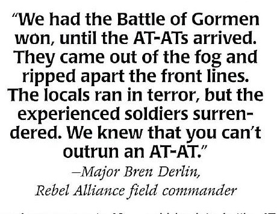

# Bren Derlin

- **Aliases:** —
- **Era:** —
- **Continuity:** default Legends; entries present for: Legends
- **Research tier:** untiered (not listed as INTRO/DEEP/MASTERY in legends-feats.md)
- **Entries:** 8 (3 with quotations; 0 quotations extended to the full sentence/passage from the source text on file; 0 marked as fragments; 1 before the 2026-11-17 fragment fill). Rebuilt 2026-11-17 from 9 old entries; old file: `characters/_bak/bren-derlin.md.bak-20261117`.
- **How to read:** each entry is the quotation in full (block quote), then its source and point of view. "Note" lines are summaries from our notes, not quotations. `[fragment — full passage not on file]` means the source text is not on the box, so only the words in our notes are shown. Debate and forum material is in the last section and is unverified.

# LEGENDS (Legends / EU — main focus)

## The Complete Star Wars Encyclopedia, Vol. I (A–G)

> Derlln,BrenAn Alliance field officer born on Tiisheraan, he was in charge of security at Echo Base on Hoth at the time of the battle with Imperial forces there. Afterward, he was part of Han Solo's commando strike team sent to deactivate the Death Star's shield gen­ erator on Endor. He eventually achieved the rank of brigadier in the New Republic De­ fense Fleet. Derlln, Galen A Senator from Tiisheraan and friend of Bail Organa, he was assassinated by Imperial forces. He was survived by his son, Bren Derlin, who became an officer in the Rebel Alliance. dermaseal A medicinal adhesive sprayed or brushed onto the skin to safely cover a wound. ' Derra IVThe site of a major Rebel Alliance loss prior to the Battle of Hoth. The fourth planet in the Derra star system, Derra IV was the embarkation point for a convoy bringing badly needed supplies to the Rebel base on Hoth. But the convoy and its fighter escort­ led by Commander Narra-were ambushed and obliterated by squadrons of TIE fighters soon after leaving Derra IV. Imperial captain Ait Convarion, commander of the Victory­ class Star Destroyer Corrupter, served in the action. Twelve years after the Battle ofEndor, New Republic Security arrested a man on Derra IV who was keeping the corpses of 1 1 uniformed Imperial officers frozen in cryotanks.
— Source: scan pages 161–200; Galen Marek — entry/section: Derlin, Galen.
(Excerpt widened 2026-11-17 to the relevant passage, word for word from research primary cse vol1 (text copy `research_primary_cse_vol1_pdf_45a954be6d`).)
(Excerpt widened 2026-11-17 to the relevant passage, word for word from research primary cse vol1 (text copy `research_primary_cse_vol1_pdf_45a954be6d`).)
Note (our notes, around the quote): Galen Marek — entry/section: Derlin, Galen: "He was survived by his son, Bren Derlin, who became an officer in the Rebel Alliance." Source: The Complete Star Wars Encyclopedia, Vol. I, p.185
Our notes: `notes/materials/030-complete-star-wars-encyclopedia-vol-1/04-v1-scan-161-200.md:341`

## Sourcebooks/Rebellion Era Sourcebook.pdf [Star Wars Roleplaying Game (d20, 2000)] (scan pages 121–161)

- Note (summary from our notes, not a quotation): Page contents: SpecForces: ten divisions; Han Solo's Endor strike team chosen with Madine from Echo Base troops, Major Bren Derlin unit leader; Rebel commando Soldier 4/Scout 4, CC B (hand-read)
  — Source: Sourcebooks/Rebellion Era Sourcebook.pdf [Star Wars Roleplaying Game (d20.
Our notes: `notes/materials/037-sw-d20-folder/043-rebellion-era-sourcebook-scan-121-161.md:161`

## Sourcebooks/Galaxy at War.pdf [Star Wars Roleplaying Game Saga Edition (2007)] (scan pages 61–120)

- Note (summary from our notes, not a quotation): Page contents: Katarn Commandos history: SpecForce 32nd under Bren Derlin; held at Hoth; General Crix Madine recommended them to protect High Command under Mon Mothma; part of General Han Solo's Endor strike team; Lt. Judder Page took over, refused promotion; "Page's Commandos"; Basilisk (Governor Nistola surrendered; General Garret took the capital); Kyle Katarn joined; name tribute to Katarn (or per Wookiee Frorral the predator); Page in the capture of Coruscant and the war against Thrawn; later captain. Methods; General Rieekan quote. (hand-read)
  — Source: Sourcebooks/Galaxy at War.pdf [Star Wars Roleplaying Game Saga Edition (2.
Our notes: `notes/materials/037-sw-d20-folder/715-galaxy-at-war-scan-061-120.md:336`

## Star Wars Insider #49 (2000)

- Note (summary from our notes, not a quotation): Page contents: Cold Comfort: John Ratzenberger (Major Bren Derlin). (hand-read)
  — Source: Star Wars Insider #49 (2000).
Our notes: `notes/materials/038-star-wars-insider/049-ins049.md:129`

## Star Wars Insider #74 (2004)

- Note (summary from our notes, not a quotation): Page contents: Echo Base: Major Bren Derlin (John Ratzenberger), Commander Beryl Chiffonage (Attack Pattern Delta and the harpoon tactic; Veers had buried that weakness years earlier), and Commander Rey (docking bay; insisted no ship leave before the shield was up). (hand-read)
  — Source: Star Wars Insider #74 (2004).
Our notes: `notes/materials/038-star-wars-insider/074-ins074.md:325`

## The Thrawn Trilogy Sourcebook (West End Games, 1996; WEG 40131)

- Note (summary from our notes, not a quotation): Colonel Bren Derlin: son of Old Republic Senator Galen Derlin (friend of Bail Organa); "Battle of Nentan" (continues).
  — Source: Thrawn Trilogy Sourcebook, notes part 2: PDF pp. 25–32 (book pp. 28–35), Ch. 2 The New Republic (cont.).
Our notes: `notes/materials/045-thrawn-trilogy-sourcebook/tts-02.md:18`

What it shows (our notes): Bren Derlin (cont.): his father Galen Derlin was "murdered by an Imperial assassin" on Tiisheraan; Bren is in his early fifties. Tactics: squads 10D+1; carries "Klawthra's Military Tactics Journal".
> Bren has never found it appropriate to discuss his family lineage, instead relying on his own skills for his successes. Senator Galen Derlin was aclose friend ofBail Organa of Alderaan, and was determined, like Organa, to combat the corruption rotting the Republic from within. Eventually, both Organa and Derlin realized that the Emperor was too powerful to defeat politically. Derlin withdrew from politics altogether. Organa returned to his homeworld of Alderaan, which was eventuallydestroyed by the first Death Star. Senator Derlin returned to his home planetofTiisheraan,and was murdered by an Imperial assassin. His family recognized this as the Emperor silencing an outspoken opponent and wisely refrained from further inflammatory statements. Bren Derlin, incensed at the political execution of his father, joined the Rebel Alliance and served as an infantry soldier, rising through the ranks due to his tactical ability. 35 TheThrawnTrilogySourcebook want to be a soldier was virtually unknown on Alderaan. Rieekan joined the Rebel Alliance after Palpatine's New Order began to make itself known in galactic politics.
— Source: Thrawn Trilogy Sourcebook, notes part 3: PDF pp. 32–41 (book pp. 35–44), Ch. 2 (cont.): NR military; Bren Derlin (cont.): his father Galen Derlin was.
(Excerpt widened 2026-11-17 to the relevant passage, word for word from WEG40131 Star Wars The Thrawn Trilogy Sourcebook pdf x.txt (text copy `MEGA_WEG40131_Star_Wars_The_Thrawn_Trilogy_Sourcebook_pdf_x`).)
(Excerpt widened 2026-11-17 to the relevant passage, word for word from WEG40131 Star Wars The Thrawn Trilogy Sourcebook pdf x.txt (text copy `MEGA_WEG40131_Star_Wars_The_Thrawn_Trilogy_Sourcebook_pdf_x`).)
(Fragment completed 2026-11-17: full sentence/passage matched word for word in the source text on file: `MEGA_WEG40131_Star_Wars_The_Thrawn_Trilogy_Sourcebook_pdf_x`.)
Our notes: `notes/materials/045-thrawn-trilogy-sourcebook/tts-03.md:3`

## The New Essential Guide to Vehicles and Vessels (2003)

> We had the Battle of Gormen won, until the AT-ATs arrived. They came out of the fog and ripped apart the front lines. The locals ran in terror, but the experienced soldiers surrendered. We knew that you can't outrun an AT-AT.
— Source: The New Essential Guide to Vehicles and Vessels (W. Haden Blackman, Del Rey, 2003), printed p.9, scan p.031..
Note (our notes, around the quote): "We had the Battle of Gormen won, until the AT-ATs arrived. They came out of the fog and ripped apart the front lines. The locals ran in terror, but the experienced soldiers surrendered. We knew that you can't outrun an AT-AT." —Major Bren Derlin, Rebel Alliance field commander.
Our notes: `notes/materials/154-new-essential-guide-to-vehicles-vessels-2003/quotes/QUOTES-INDEX.md`

# Debate and forum claims (unverified)

Forum posts, Suspect Insight debates and Discord debates, respect threads, and verdicts. These are posters' arguments or quotations they typed; none is checked against the book here unless the entry says so.

_None in our notes._
