# C-3PO

- **Aliases:** Threepio, See-Threepio
- **Era:** Prequel–GCW
- **Continuity:** default Legends; entries present for: Canon, Legends
- **Research tier:** untiered (not listed as INTRO/DEEP/MASTERY in legends-feats.md)
- **Entries:** 629 (306 with quotations; 21 quotations extended to the full sentence/passage from the source text on file; 196 marked as fragments; 247 before the 2026-11-17 fragment fill). Rebuilt 2026-11-17 from 696 old entries; old file: `characters/_bak/c-3po.md.bak-20261117`.
- **How to read:** each entry is the quotation in full (block quote), then its source and point of view. "Note" lines are summaries from our notes, not quotations. `[fragment — full passage not on file]` means the source text is not on the box, so only the words in our notes are shown. Debate and forum material is in the last section and is unverified.

# LEGENDS (Legends / EU — main focus)

## Dark Lord trilogy (Labyrinth of Evil, Revenge of the Sith, Dark Lord): novel notes from the other agent (reference copy)

- Note (summary from our notes, not a quotation): Forward links: the moonlet-size battle station (L1359, L4417, L5501); Vader's Sienar fighter (L1785); C-3PO's memory wipe (L3291); Luke with Owen and Beru (L5769); Obi-Wan as "Ben" (L5751); Qui-Gon's voice (L5857).
  — Source: L1785; L3291; L5769; L5751 — Dark Lord: The Rise of Darth Vader: combat and Force feats (novel, read in full).
Our notes: `notes/materials/022-dark-lord-trilogy/dark-lord-novel-feats.md:777`

- Note (summary from our notes, not a quotation): Chapter (added 2026-10-11, from the L-numbers above and the chapter headings in the source text): Part II, Ch13, Part IV, Ch37, Part IV, Ch50, Part II, Ch16, Part III, Ch29, Part IV, Ch54
  — Source: Dark Lord: The Rise of Darth Vader: combat and Force feats (novel, read in full).
Context: Forward links: the moonlet-size battle station (L1359, L4417, L5501); Vader's Sienar fighter (L1785); C-3PO's memory wipe (L3291); Luke with Owen and Beru (L5769); Obi-Wan as "Ben" (L5751); Qui-Gon's voice (L5857).
Our notes: `notes/materials/022-dark-lord-trilogy/dark-lord-novel-feats.md:778`

> Padme looked at C-3PO.
> [fragment — full passage not on file]
— Source: Labyrinth of Evil (novel, read in full): feats, scaling, quotes and story notes; Ch13 L967.
Context: Complete quote register (80 lines: every sentence that names Padme, verbatim, in book order):
Our notes: `notes/materials/022-dark-lord-trilogy/labyrinth-of-evil-notes.md:1095`; `notes/materials/022-dark-lord-trilogy/labyrinth-of-evil-notes.md:1724`

> "Hurry, Threepio," Padme said over her shoulder.
— Source: Labyrinth of Evil (novel, read in full): feats, scaling, quotes and story notes; Ch42 L4385.
Context: Complete quote register (80 lines: every sentence that names Padme, verbatim, in book order):
Our notes: `notes/materials/022-dark-lord-trilogy/labyrinth-of-evil-notes.md:1103`; `notes/materials/022-dark-lord-trilogy/labyrinth-of-evil-notes.md:1726`

> The Jedi led Padme, C-3PO, Bail, and Mon Mothma to the open-roofed skimmer.
— Source: Labyrinth of Evil (novel, read in full): feats, scaling, quotes and story notes; Ch42 L4433.
Context: Complete quote register (80 lines: every sentence that names Padme, verbatim, in book order):
Our notes: `notes/materials/022-dark-lord-trilogy/labyrinth-of-evil-notes.md:1114`; `notes/materials/022-dark-lord-trilogy/labyrinth-of-evil-notes.md:1218`; `notes/materials/022-dark-lord-trilogy/labyrinth-of-evil-notes.md:1253`; `notes/materials/022-dark-lord-trilogy/labyrinth-of-evil-notes.md:1728`

> Padme clutched on to C-3PO as Bail veered away from the plasma bolts.
— Source: Labyrinth of Evil (novel, read in full): feats, scaling, quotes and story notes; Ch42 L4439.
Context: Complete quote register (80 lines: every sentence that names Padme, verbatim, in book order):
Our notes: `notes/materials/022-dark-lord-trilogy/labyrinth-of-evil-notes.md:1115`; `notes/materials/022-dark-lord-trilogy/labyrinth-of-evil-notes.md:1222`; `notes/materials/022-dark-lord-trilogy/labyrinth-of-evil-notes.md:1729`

> C-3PO's photoreceptors locked on Padme.
— Source: Labyrinth of Evil (novel, read in full): feats, scaling, quotes and story notes; Ch53 L5145.
Context: Complete quote register (80 lines: every sentence that names Padme, verbatim, in book order):
Our notes: `notes/materials/022-dark-lord-trilogy/labyrinth-of-evil-notes.md:1147`; `notes/materials/022-dark-lord-trilogy/labyrinth-of-evil-notes.md:1739`

> Gazing around, he spied Padme standing with C-3PO, arms cradled against her, elbows in the palms of her hands, her face raised to the light-splintered sky.
— Source: Labyrinth of Evil (novel, read in full): feats, scaling, quotes and story notes; Ch54 L5205.
Context: Complete quote register (80 lines: every sentence that names Padme, verbatim, in book order):
Our notes: `notes/materials/022-dark-lord-trilogy/labyrinth-of-evil-notes.md:1148`; `notes/materials/022-dark-lord-trilogy/labyrinth-of-evil-notes.md:1740`

> She heard her name called, and turned to see Bail Organa and Mon Mothma angling toward where she and C-3PO were momentarily hampered. With them were two female Jedi—Masters Shaak Ti and Stass Allie.
— Source: Labyrinth of Evil (novel, read in full): feats, scaling, quotes and story notes; Ch42 L4403.
(Excerpt widened 2026-11-17 to the relevant passage, word for word from Labyrinth of Evil (James Luceno) (text copy `MEGA_Legend_The_Episode_Novelizations_Star_Wars_Revenge_of_the_Sith_01_Labyrinth_of_Evil_James_Luceno_epub`).)
Context: Complete quote register (85 lines: every sentence that names Bail Organa, verbatim, in book order):
Our notes: `notes/materials/022-dark-lord-trilogy/labyrinth-of-evil-notes.md:1210`; `notes/materials/022-dark-lord-trilogy/labyrinth-of-evil-notes.md:1252`; `notes/materials/022-dark-lord-trilogy/labyrinth-of-evil-notes.md:1727`

> Mon Mothma hurried her away from the skimmer, to where Bail and C-3PO were hiding behind the blockish pedestal of a modernistic sculpture.
>
> “Master Allie doesn’t strike me as someone who will sue for damages,” the droid was saying.
— Source: Labyrinth of Evil (novel, read in full): feats, scaling, quotes and story notes; Ch46 L4697.
(Excerpt widened 2026-11-17 to the relevant passage, word for word from Labyrinth of Evil (James Luceno) (text copy `MEGA_Legend_The_Episode_Novelizations_Star_Wars_Revenge_of_the_Sith_01_Labyrinth_of_Evil_James_Luceno_epub`).)
(Excerpt widened 2026-11-17 to the relevant passage, word for word from Labyrinth of Evil (James Luceno) (text copy `MEGA_Legend_The_Episode_Novelizations_Star_Wars_Revenge_of_the_Sith_01_Labyrinth_of_Evil_James_Luceno_epub`).)
Context: Complete quote register (85 lines: every sentence that names Bail Organa, verbatim, in book order):
Our notes: `notes/materials/022-dark-lord-trilogy/labyrinth-of-evil-notes.md:1227`; `notes/materials/022-dark-lord-trilogy/labyrinth-of-evil-notes.md:1259`; `notes/materials/022-dark-lord-trilogy/labyrinth-of-evil-notes.md:1731`

> “The lightsabers are not weapons, Excellency,” TC-16 said after a brief exchange. “But if permission to speak with t’laalak-s’lalak-t’th’ak rests on their surrendering the lightsabers, then I’m certain they will comply.”
>
> It was possible, in that eternal moment of silence, that the troopers had reacted quickly enough to get off a few bolts, because when Dyne looked to his right, along the way he had come, there were no signs of the Geonosians or, for that matter, TC-16.
>
> “A most curious encounter, Mistress,” C-3PO said. “I think that shiny droid fancies himself something of a seer.”
— Source: Labyrinth of Evil (novel, read in full): feats, scaling, quotes and story notes.
(Excerpt widened 2026-11-17 to the relevant passage, word for word from Labyrinth of Evil (James Luceno) (text copy `MEGA_Legend_The_Episode_Novelizations_Star_Wars_Revenge_of_the_Sith_01_Labyrinth_of_Evil_James_Luceno_epub`).)
(Excerpt widened 2026-11-17 to the relevant passage, word for word from Labyrinth of Evil (James Luceno) (text copy `MEGA_Legend_The_Episode_Novelizations_Star_Wars_Revenge_of_the_Sith_01_Labyrinth_of_Evil_James_Luceno_epub`).)
(Fragment completed 2026-11-17: full sentence/passage matched word for word in the source text on file: `MEGA_Legend_The_Episode_Novelizations_Star_Wars_Revenge_of_the_Sith_01_Labyrinth_of_Evil_James_Luceno_epub`.)
Note (our notes, around the quote): Arc: a former Sidious-era protocol droid found on Cato Neimoidia (Ch9), who interprets on Charros IV (Ch16: «"The lightsabers are not weapons, Excellency," TC-16 said after a brief exchange.», L1223) → joins Dyne's team → survives the lair («there were no signs of the Geonosians or, for that matter, TC-16», L4539) → resurfaces to give C-3PO a cryptic warning (Ch53: «"A most curious encounter, Mistress," C-3PO said.», L5139).
Our notes: `notes/materials/022-dark-lord-trilogy/labyrinth-of-evil-notes.md:1643`; `notes/materials/022-dark-lord-trilogy/labyrinth-of-evil-notes.md:1737`

> A title more fit for a king or emperor. *(L973)*
>
> For a moment it appeared that C-3PO was speechless - - but only for a moment. *(L969)*
— Source: L973; L969; L4433; L5139 — Labyrinth of Evil (novel, read in full): feats, scaling, quotes and story notes.
Note (our notes, around the quote): Role: Padmé's droid. His «Your Majesty» slip draws Palpatine's line «A title more fit for a king or emperor.» (L973). «For a moment it appeared that C-3PO was speechless - - but only for a moment.» (L969). He is evacuated with Padmé (L4433) and has his «curious encounter» with TC-16 (L5139).
Our notes: `notes/materials/022-dark-lord-trilogy/labyrinth-of-evil-notes.md:1718`; `notes/materials/022-dark-lord-trilogy/labyrinth-of-evil-notes.md:1725`

- Note (summary from our notes, not a quotation): Scaling implications: none.
  — Source: Labyrinth of Evil (novel, read in full): feats, scaling, quotes and story notes.
Our notes: `notes/materials/022-dark-lord-trilogy/labyrinth-of-evil-notes.md:1719`; `notes/materials/022-dark-lord-trilogy/rots-novel-notes.md:839`

- Note (summary from our notes, not a quotation): Complete quote register (20 lines: every sentence that names C-3PO, verbatim, in book order):
  — Source: Labyrinth of Evil (novel, read in full): feats, scaling, quotes and story notes.
Our notes: `notes/materials/022-dark-lord-trilogy/labyrinth-of-evil-notes.md:1720`; `notes/materials/022-dark-lord-trilogy/rots-novel-notes.md:840`

> “You can only be referring to See-Threepio. And you had to build him.”
>
> “Think what you will.”
— Source: Labyrinth of Evil (novel, read in full): feats, scaling, quotes and story notes; Ch1 L99.
(Excerpt widened 2026-11-17 to the relevant passage, word for word from Labyrinth of Evil (James Luceno) (text copy `MEGA_Legend_The_Episode_Novelizations_Star_Wars_Revenge_of_the_Sith_01_Labyrinth_of_Evil_James_Luceno_epub`).)
(Excerpt widened 2026-11-17 to the relevant passage, word for word from Labyrinth of Evil (James Luceno) (text copy `MEGA_Legend_The_Episode_Novelizations_Star_Wars_Revenge_of_the_Sith_01_Labyrinth_of_Evil_James_Luceno_epub`).)
Context: Complete quote register (20 lines: every sentence that names C-3PO, verbatim, in book order):
Our notes: `notes/materials/022-dark-lord-trilogy/labyrinth-of-evil-notes.md:1721`

> Obi-Wan’s little joke. But the words had stung, for some reason. Probably because of Anakin’s own musings about what might have become of him had the Jedi not been forced to land on Tatooine to find a replacement part for Padmé’s starship. It wasn’t hard to imagine himself stuck in Mos Espa. With his mom; with C-3PO, without the bright shell he now wore—
— Source: Labyrinth of Evil (novel, read in full): feats, scaling, quotes and story notes; Ch12 L819.
(Excerpt widened 2026-11-17 to the relevant passage, word for word from Labyrinth of Evil (James Luceno) (text copy `MEGA_Legend_The_Episode_Novelizations_Star_Wars_Revenge_of_the_Sith_01_Labyrinth_of_Evil_James_Luceno_epub`).)
(Fragment completed 2026-11-17: full sentence/passage matched word for word in the source text on file: `MEGA_Legend_The_Episode_Novelizations_Star_Wars_Revenge_of_the_Sith_01_Labyrinth_of_Evil_James_Luceno_epub`.)
Context: Complete quote register (20 lines: every sentence that names C-3PO, verbatim, in book order):
Our notes: `notes/materials/022-dark-lord-trilogy/labyrinth-of-evil-notes.md:1722`

> Stepping aside, he gestured Bail and the others into the circular office. C-3PO was last to cross the threshold, twisting his head to regard both of the motionless guards.
— Source: Labyrinth of Evil (novel, read in full): feats, scaling, quotes and story notes; Ch13 L917.
(Excerpt widened 2026-11-17 to the relevant passage, word for word from Labyrinth of Evil (James Luceno) (text copy `MEGA_Legend_The_Episode_Novelizations_Star_Wars_Revenge_of_the_Sith_01_Labyrinth_of_Evil_James_Luceno_epub`).)
Context: Complete quote register (20 lines: every sentence that names C-3PO, verbatim, in book order):
Our notes: `notes/materials/022-dark-lord-trilogy/labyrinth-of-evil-notes.md:1723`

- Note (summary from our notes, not a quotation): Ch42 L4445 «C-3PO said.»
  — Source: Labyrinth of Evil (novel, read in full): feats, scaling, quotes and story notes.
Context: Complete quote register (20 lines: every sentence that names C-3PO, verbatim, in book order):
Our notes: `notes/materials/022-dark-lord-trilogy/labyrinth-of-evil-notes.md:1730`

> “Perhaps if we throw ourselves on the mercy of the owners of the mall, they will raise the security grate,” C-3PO started to say.
>
> Bail looked at Padmé and Mon Mothma. “We have to keep those droids on the far side of the bridge, so the gunships can take them out.”
— Source: Labyrinth of Evil (novel, read in full): feats, scaling, quotes and story notes; Ch46 L4729.
(Excerpt widened 2026-11-17 to the relevant passage, word for word from Labyrinth of Evil (James Luceno) (text copy `MEGA_Legend_The_Episode_Novelizations_Star_Wars_Revenge_of_the_Sith_01_Labyrinth_of_Evil_James_Luceno_epub`).)
(Excerpt widened 2026-11-17 to the relevant passage, word for word from Labyrinth of Evil (James Luceno) (text copy `MEGA_Legend_The_Episode_Novelizations_Star_Wars_Revenge_of_the_Sith_01_Labyrinth_of_Evil_James_Luceno_epub`).)
Context: Complete quote register (20 lines: every sentence that names C-3PO, verbatim, in book order):
Our notes: `notes/materials/022-dark-lord-trilogy/labyrinth-of-evil-notes.md:1732`

> “What could I have been thinking?” C-3PO shouted as he watched them search the craft for weapons. “It can never be the easy answer!”
— Source: Labyrinth of Evil (novel, read in full): feats, scaling, quotes and story notes; Ch46 L4737.
(Excerpt widened 2026-11-17 to the relevant passage, word for word from Labyrinth of Evil (James Luceno) (text copy `MEGA_Legend_The_Episode_Novelizations_Star_Wars_Revenge_of_the_Sith_01_Labyrinth_of_Evil_James_Luceno_epub`).)
Context: Complete quote register (20 lines: every sentence that names C-3PO, verbatim, in book order):
Our notes: `notes/materials/022-dark-lord-trilogy/labyrinth-of-evil-notes.md:1733`

> C-3PO shook his head. “How will I ever explain this to Artoo-Detoo?”
>
> They broke for cover a final time, hoping to throw themselves through the ragged hole in the still-smoking security grate, but the droid hurried to intercept them; then, in seeming sadistic delight, began to back the four of them against the wall of the Nicandra Building.
— Source: Labyrinth of Evil (novel, read in full): feats, scaling, quotes and story notes; Ch46 L4763.
(Excerpt widened 2026-11-17 to the relevant passage, word for word from Labyrinth of Evil (James Luceno) (text copy `MEGA_Legend_The_Episode_Novelizations_Star_Wars_Revenge_of_the_Sith_01_Labyrinth_of_Evil_James_Luceno_epub`).)
(Excerpt widened 2026-11-17 to the relevant passage, word for word from Labyrinth of Evil (James Luceno) (text copy `MEGA_Legend_The_Episode_Novelizations_Star_Wars_Revenge_of_the_Sith_01_Labyrinth_of_Evil_James_Luceno_epub`).)
(Fragment completed 2026-11-17: full sentence/passage matched word for word in the source text on file: `MEGA_Legend_The_Episode_Novelizations_Star_Wars_Revenge_of_the_Sith_01_Labyrinth_of_Evil_James_Luceno_epub`.)
Context: Complete quote register (20 lines: every sentence that names C-3PO, verbatim, in book order):
Our notes: `notes/materials/022-dark-lord-trilogy/labyrinth-of-evil-notes.md:1734`

> Her gaze lowered, she caught sight of C-3PO, parting company with a silver protocol droid that disappeared into the crowd.
>
> “What was that about, Threepio?” she asked as he approached.
— Source: Labyrinth of Evil (novel, read in full): feats, scaling, quotes and story notes; Ch53 L5137.
(Excerpt widened 2026-11-17 to the relevant passage, word for word from Labyrinth of Evil (James Luceno) (text copy `MEGA_Legend_The_Episode_Novelizations_Star_Wars_Revenge_of_the_Sith_01_Labyrinth_of_Evil_James_Luceno_epub`).)
(Excerpt widened 2026-11-17 to the relevant passage, word for word from Labyrinth of Evil (James Luceno) (text copy `MEGA_Legend_The_Episode_Novelizations_Star_Wars_Revenge_of_the_Sith_01_Labyrinth_of_Evil_James_Luceno_epub`).)
Context: Complete quote register (20 lines: every sentence that names C-3PO, verbatim, in book order):
Our notes: `notes/materials/022-dark-lord-trilogy/labyrinth-of-evil-notes.md:1735`

> “What was that about, Threepio?” she asked as he approached.
>
> “A most curious encounter, Mistress,” C-3PO said. “I think that shiny droid fancies himself something of a seer.”
— Source: Labyrinth of Evil (novel, read in full): feats, scaling, quotes and story notes; Ch53 L5139.
(Excerpt widened 2026-11-17 to the relevant passage, word for word from Labyrinth of Evil (James Luceno) (text copy `MEGA_Legend_The_Episode_Novelizations_Star_Wars_Revenge_of_the_Sith_01_Labyrinth_of_Evil_James_Luceno_epub`).)
(Excerpt widened 2026-11-17 to the relevant passage, word for word from Labyrinth of Evil (James Luceno) (text copy `MEGA_Legend_The_Episode_Novelizations_Star_Wars_Revenge_of_the_Sith_01_Labyrinth_of_Evil_James_Luceno_epub`).)
Context: Complete quote register (20 lines: every sentence that names C-3PO, verbatim, in book order):
Our notes: `notes/materials/022-dark-lord-trilogy/labyrinth-of-evil-notes.md:1736`

> Padmé looked at him askance. “In what way, Threepio?”
>
> “In essence, he told me to flee while it was still possible. He said that dark times are coming, and that the line that separates good and bad will become blurred. That what seems good now will prove evil; and that what seems evil, will prove good.”
— Source: Labyrinth of Evil (novel, read in full): feats, scaling, quotes and story notes; Ch53 L5141.
(Excerpt widened 2026-11-17 to the relevant passage, word for word from Labyrinth of Evil (James Luceno) (text copy `MEGA_Legend_The_Episode_Novelizations_Star_Wars_Revenge_of_the_Sith_01_Labyrinth_of_Evil_James_Luceno_epub`).)
(Excerpt widened 2026-11-17 to the relevant passage, word for word from Labyrinth of Evil (James Luceno) (text copy `MEGA_Legend_The_Episode_Novelizations_Star_Wars_Revenge_of_the_Sith_01_Labyrinth_of_Evil_James_Luceno_epub`).)
(Fragment completed 2026-11-17: full sentence/passage matched word for word in the source text on file: `MEGA_Legend_The_Episode_Novelizations_Star_Wars_Revenge_of_the_Sith_01_Labyrinth_of_Evil_James_Luceno_epub`.)
Context: Complete quote register (20 lines: every sentence that names C-3PO, verbatim, in book order):
Our notes: `notes/materials/022-dark-lord-trilogy/labyrinth-of-evil-notes.md:1738`

> C-3PO shuffled along the starship’s hallway beside R2-D2, following Senator Organa who had, by all accounts, inherited them both. “I’m certain I can’t say why she malfunctioned,” he was telling the little astromech. “Organics are so terribly complicated, you know.”
— Source: Revenge of the Sith (Matthew Stover novelization): Power-Scaling Research Notes; Ch21 A New Jedi Order L8781.
(Excerpt widened 2026-11-17 to the relevant passage, word for word from Revenge of the Sith (Matthew Stover) (text copy `MEGA_Legend_The_Episode_Novelizations_Star_Wars_Revenge_of_the_Sith_02_Episode_III_Revenge_of_the_Sith_Matthew_Stover_epub`).)
Context: Complete quote register (70 lines: every sentence that names Bail Organa, verbatim, in book order):
Our notes: `notes/materials/022-dark-lord-trilogy/rots-novel-notes.md:562`; `notes/materials/022-dark-lord-trilogy/rots-novel-notes.md:832`; `notes/materials/022-dark-lord-trilogy/rots-novel-notes.md:895`

- Note (summary from our notes, not a quotation): Arc: Anakin's astromech in the Coruscant space battle (Ch1) → fights alongside the Jedi on the *Invisible Hand* bridge (Ch7) → flies with Vader to Mustafar (Ch18–19) → his memory survives where C-3PO's is wiped (Ch21).
  — Source: Revenge of the Sith (Matthew Stover novelization): Power-Scaling Research Notes.
Our notes: `notes/materials/022-dark-lord-trilogy/rots-novel-notes.md:757`

> R2 was wheeping and beeping and whistling intensely when Anakin finally struggled free of the mass of sweaty, grasping politicians; C-3PO had turned away dismissively. “It couldn’t have been that bad. Don’t exaggerate! You’re hardly even dented.”
— Source: Revenge of the Sith (Matthew Stover novelization): Power-Scaling Research Notes; Ch8 Fault Lines L2991.
(Excerpt widened 2026-11-17 to the relevant passage, word for word from Revenge of the Sith (Matthew Stover) (text copy `MEGA_Legend_The_Episode_Novelizations_Star_Wars_Revenge_of_the_Sith_02_Episode_III_Revenge_of_the_Sith_Matthew_Stover_epub`).)
Context: Complete quote register (73 lines: every sentence that names R2-D2, verbatim, in book order):
Our notes: `notes/materials/022-dark-lord-trilogy/rots-novel-notes.md:818`; `notes/materials/022-dark-lord-trilogy/rots-novel-notes.md:842`

> From the shadow of a great pillar stretching up into the red-ening afternoon that leaked through the vaulted roof of transparisteel over the Atrium of the Senate Office Building, she watched Senators clustering in through the archway from the Chancellor's landing platform, and then she saw the Chancellor himself and C-3PO and yes, that was R2-D2!-and so be could not be far behind . . . and only then did she finally find him among them, tall and straight, his hair radiation-bleached to golden streaks and on his lips a lively smile that opened her chest and unlocked her heart.
— Source: Revenge of the Sith (Matthew Stover novelization): Power-Scaling Research Notes; Ch9 Padme L3063.
Context: Complete quote register (73 lines: every sentence that names R2-D2, verbatim, in book order):
Our notes: `notes/materials/022-dark-lord-trilogy/rots-novel-notes.md:823`; `notes/materials/022-dark-lord-trilogy/rots-novel-notes.md:854`

> R2-D2 was far from the sort of sparkling conversationalist with whom C-3PO preferred to associate, but the little astromech had a positive gift for jacking himself into the motherboards of the most volatile situations . . .
— Source: Revenge of the Sith (Matthew Stover novelization): Power-Scaling Research Notes; Ch18 Order Sixty-Six L7199.
Context: Complete quote register (73 lines: every sentence that names R2-D2, verbatim, in book order):
Our notes: `notes/materials/022-dark-lord-trilogy/rots-novel-notes.md:825`; `notes/materials/022-dark-lord-trilogy/rots-novel-notes.md:864`

> C-3PO barely had time to wish his little friend good luck and remind him to stay alert as Master Anakin brushed past him and climbed into the starfighter's cockpit, then fired the engine and blasted off, taking R2-D2 goodness knows where-probably to some preposterously horrible alien planet and into a perfectly ridiculous amount of danger-with never a thought how his loyal droid might feel about being dragged across the galaxy without so much as a by-your-leave . . .
— Source: Revenge of the Sith (Matthew Stover novelization): Power-Scaling Research Notes; Ch18 Order Sixty-Six L7359.
Context: Complete quote register (73 lines: every sentence that names R2-D2, verbatim, in book order):
Our notes: `notes/materials/022-dark-lord-trilogy/rots-novel-notes.md:827`; `notes/materials/022-dark-lord-trilogy/rots-novel-notes.md:869`

- Note (summary from our notes, not a quotation): Arc: Padmé's protocol droid (Ch8) → witnesses Obi-Wan's visit (Ch20) → goes to Mustafar → memory wiped at the end (Ch21).
  — Source: Revenge of the Sith (Matthew Stover novelization): Power-Scaling Research Notes.
Our notes: `notes/materials/022-dark-lord-trilogy/rots-novel-notes.md:837`

> "I was just thinking that even after all I've done, See-Threepio is still the only person I know who calls me Master." *(L3047, Anakin)*
>
> C-3PO had long ago been given detailed and quite specific instructions on the procedure for dealing with the unexpected arrival of furtive Jedi. *(L7947)*
— Source: L7947 — Revenge of the Sith (Matthew Stover novelization): Power-Scaling Research Notes; Key quotes.
Label in our notes: L3047, Anakin); (L7947
Our notes: `notes/materials/022-dark-lord-trilogy/rots-novel-notes.md:838`; `notes/materials/022-dark-lord-trilogy/rots-novel-notes.md:875`; `notes/materials/022-dark-lord-trilogy/rots-novel-notes.md:853`

> Padme then had extended her hand and graciously invited C-3PO to join her staff, because on Naboo, high-functioning droids were respected as thinking beings, and 3PO had been so flustered at being treated like a sentient creature that he'd been barely able to speak, beyond muttering something about hoping he might make himself useful, because after all he was "fluent in over six million forms of communication."
— Source: Revenge of the Sith (Matthew Stover novelization): Power-Scaling Research Notes; Ch6 Rescue L2199.
Context: Complete quote register (58 lines: every sentence that names C-3PO, verbatim, in book order):
Our notes: `notes/materials/022-dark-lord-trilogy/rots-novel-notes.md:841`

> R2’s answering feroo sounded a little defensive. C-3PO sent a wisp of static through his vocabulator that sounded distinctly like a disapproving sniff. “On that point I agree; you’re long overdue for a tune-up. And, if I may say so, a bath.”
— Source: Revenge of the Sith (Matthew Stover novelization): Power-Scaling Research Notes; Ch8 Fault Lines L2993.
(Excerpt widened 2026-11-17 to the relevant passage, word for word from Revenge of the Sith (Matthew Stover) (text copy `MEGA_Legend_The_Episode_Novelizations_Star_Wars_Revenge_of_the_Sith_02_Episode_III_Revenge_of_the_Sith_Matthew_Stover_epub`).)
Context: Complete quote register (58 lines: every sentence that names C-3PO, verbatim, in book order):
Our notes: `notes/materials/022-dark-lord-trilogy/rots-novel-notes.md:843`

- Note (summary from our notes, not a quotation): Ch8 Fault Lines L2995 «"Threepio-"»
  — Source: Revenge of the Sith (Matthew Stover novelization): Power-Scaling Research Notes.
Context: Complete quote register (58 lines: every sentence that names C-3PO, verbatim, in book order):
Our notes: `notes/materials/022-dark-lord-trilogy/rots-novel-notes.md:844`

> Threepio had been with her all these months, had seen her every day, had touched her, perhaps even today-he could feel echoes of her resonating outward from his electroplated shell, and they left him breathless.
— Source: Revenge of the Sith (Matthew Stover novelization): Power-Scaling Research Notes; Ch8 Fault Lines L2999.
Context: Complete quote register (58 lines: every sentence that names C-3PO, verbatim, in book order):
Our notes: `notes/materials/022-dark-lord-trilogy/rots-novel-notes.md:845`

- Note (summary from our notes, not a quotation): Ch8 Fault Lines L3001 «Threepio exclaimed.»
  — Source: Revenge of the Sith (Matthew Stover novelization): Power-Scaling Research Notes.
Context: Complete quote register (58 lines: every sentence that names C-3PO, verbatim, in book order):
Our notes: `notes/materials/022-dark-lord-trilogy/rots-novel-notes.md:846`

> “Threepio, have you seen her?” Anakin was trying so hard not to shout that his voice came out a strangled croak. “Where is she? Why isn’t she here?”
— Source: Revenge of the Sith (Matthew Stover novelization): Power-Scaling Research Notes; Ch8 Fault Lines L3003.
(Excerpt widened 2026-11-17 to the relevant passage, word for word from Revenge of the Sith (Matthew Stover) (text copy `MEGA_Legend_The_Episode_Novelizations_Star_Wars_Revenge_of_the_Sith_02_Episode_III_Revenge_of_the_Sith_Matthew_Stover_epub`).)
Context: Complete quote register (58 lines: every sentence that names C-3PO, verbatim, in book order):
Our notes: `notes/materials/022-dark-lord-trilogy/rots-novel-notes.md:847`

> “Oh, well, certainly, certainly. Officially, Senator Amidala is extremely busy,” C-3PO said imperturbably. “She has been sequestered all day in the Naboo embassy, reviewing the new Security Act, preparing for tomorrow’s debate—”
— Source: Revenge of the Sith (Matthew Stover novelization): Power-Scaling Research Notes; Ch8 Fault Lines L3005.
(Excerpt widened 2026-11-17 to the relevant passage, word for word from Revenge of the Sith (Matthew Stover) (text copy `MEGA_Legend_The_Episode_Novelizations_Star_Wars_Revenge_of_the_Sith_02_Episode_III_Revenge_of_the_Sith_Matthew_Stover_epub`).)
Context: Complete quote register (58 lines: every sentence that names C-3PO, verbatim, in book order):
Our notes: `notes/materials/022-dark-lord-trilogy/rots-novel-notes.md:848`

> “Oh, yes, Master Anakin.” Threepio sounded entirely virtuous. “That is my official answer to all queries regarding the Senator’s whereabouts. All afternoon.”
— Source: Revenge of the Sith (Matthew Stover novelization): Power-Scaling Research Notes; Ch8 Fault Lines L3011.
(Excerpt widened 2026-11-17 to the relevant passage, word for word from Revenge of the Sith (Matthew Stover) (text copy `MEGA_Legend_The_Episode_Novelizations_Star_Wars_Revenge_of_the_Sith_02_Episode_III_Revenge_of_the_Sith_Matthew_Stover_epub`).)
(Full sentence/passage taken from the source text on file: `quick_tmp_rots_stover_epub`.)
Context: Complete quote register (58 lines: every sentence that names C-3PO, verbatim, in book order):
Our notes: `notes/materials/022-dark-lord-trilogy/rots-novel-notes.md:849`

> Threepio gave a slight nod at the other Senators and the HoloNet crews on the gangway. “She thought it best to avoid a, ah, public scene. And she wished for me to relate to you that she believes the both of you might … avoid a public scene … all afternoon. And perhaps all night, as well.”
— Source: Revenge of the Sith (Matthew Stover novelization): Power-Scaling Research Notes; Ch8 Fault Lines L3023.
(Excerpt widened 2026-11-17 to the relevant passage, word for word from Revenge of the Sith (Matthew Stover) (text copy `MEGA_Legend_The_Episode_Novelizations_Star_Wars_Revenge_of_the_Sith_02_Episode_III_Revenge_of_the_Sith_Matthew_Stover_epub`).)
Context: Complete quote register (58 lines: every sentence that names C-3PO, verbatim, in book order):
Our notes: `notes/materials/022-dark-lord-trilogy/rots-novel-notes.md:850`

- Note (summary from our notes, not a quotation): Ch8 Fault Lines L3025 «"Threepio!"»
  — Source: Revenge of the Sith (Matthew Stover novelization): Power-Scaling Research Notes.
Context: Complete quote register (58 lines: every sentence that names C-3PO, verbatim, in book order):
Our notes: `notes/materials/022-dark-lord-trilogy/rots-novel-notes.md:851`

> “Thank you, Master Anakin, though credit for that is due largely—” C-3PO made an elegantly gracious bow. “—to my creator.”
>
> Anakin could only go on grinning.
— Source: Revenge of the Sith (Matthew Stover novelization): Power-Scaling Research Notes; Ch8 Fault Lines L3031.
(Excerpt widened 2026-11-17 to the relevant passage, word for word from Revenge of the Sith (Matthew Stover) (text copy `MEGA_Legend_The_Episode_Novelizations_Star_Wars_Revenge_of_the_Sith_02_Episode_III_Revenge_of_the_Sith_Matthew_Stover_epub`).)
(Excerpt widened 2026-11-17 to the relevant passage, word for word from Revenge of the Sith (Matthew Stover) (text copy `MEGA_Legend_The_Episode_Novelizations_Star_Wars_Revenge_of_the_Sith_02_Episode_III_Revenge_of_the_Sith_Matthew_Stover_epub`).)
Context: Complete quote register (58 lines: every sentence that names C-3PO, verbatim, in book order):
Our notes: `notes/materials/022-dark-lord-trilogy/rots-novel-notes.md:852`

> On the broad curving veranda that doubled as the landing deck for Padmé’s apartment, he watched from the shadows as Padmé stepped out of her speeder and graciously accepted Captain Typho’s good night. As Typho flew the vehicle off toward the immense residential tower’s speeder park, she dismissed her two handmaidens and sent C-3PO on some busywork errand, then turned to lean on the veranda’s balcony right where Anakin had leaned last night.
— Source: Revenge of the Sith (Matthew Stover novelization): Power-Scaling Research Notes; Ch12 Not from a Jedi L4265.
(Excerpt widened 2026-11-17 to the relevant passage, word for word from Revenge of the Sith (Matthew Stover) (text copy `MEGA_Legend_The_Episode_Novelizations_Star_Wars_Revenge_of_the_Sith_02_Episode_III_Revenge_of_the_Sith_Matthew_Stover_epub`).)
Context: Complete quote register (58 lines: every sentence that names C-3PO, verbatim, in book order):
Our notes: `notes/materials/022-dark-lord-trilogy/rots-novel-notes.md:855`

> When her handmaiden Motee awakened her with the word that C-3PO had announced a Jedi was waiting to see her, Padme flew out of bed, threw on a robe, and hurried out to her living room, a smile breaking through her sleepiness like the dawn outside-But it was Obi-Wan.
— Source: Revenge of the Sith (Matthew Stover novelization): Power-Scaling Research Notes; Ch13 The Will of the Force L4621.
Context: Complete quote register (58 lines: every sentence that names C-3PO, verbatim, in book order):
Our notes: `notes/materials/022-dark-lord-trilogy/rots-novel-notes.md:856`

> “—has See-Threepio offered you anything to drink?”
>
> He turned to her, a frown clearing from his brow. “Senator,” he said warmly. “So good to see you again. I apologize for the early hour, and yes, your protocol droid has been quite insistent on offering me refreshment.” His frown began to regather. “But as you may guess, this is not a social call. I’ve come to speak with you about Anakin.”
— Source: Revenge of the Sith (Matthew Stover novelization): Power-Scaling Research Notes; Ch13 The Will of the Force L4627.
(Excerpt widened 2026-11-17 to the relevant passage, word for word from Revenge of the Sith (Matthew Stover) (text copy `MEGA_Legend_The_Episode_Novelizations_Star_Wars_Revenge_of_the_Sith_02_Episode_III_Revenge_of_the_Sith_Matthew_Stover_epub`).)
(Excerpt widened 2026-11-17 to the relevant passage, word for word from Revenge of the Sith (Matthew Stover) (text copy `MEGA_Legend_The_Episode_Novelizations_Star_Wars_Revenge_of_the_Sith_02_Episode_III_Revenge_of_the_Sith_Matthew_Stover_epub`).)
Context: Complete quote register (58 lines: every sentence that names C-3PO, verbatim, in book order):
Our notes: `notes/materials/022-dark-lord-trilogy/rots-novel-notes.md:857`

> Senator Chi Eekway accepted a tube of Aqualish hoi-broth from C-3PO’s refeshment tray. “I am very grateful to be included here,” she said, her dewlaps jiggling as she tilted her blue head in a gesture around Padmé’s living room at the gathering of Senators. “I speak directly only for my own sector, of course, but I can tell you that many Senators are becoming very nervous indeed. You may not know that the new governors are arriving with full regiments of clone troops—what they call security forces. We all have begun to wonder if these regiments are intended to protect us from the Separatists … or to protect the governors from us.”
— Source: Revenge of the Sith (Matthew Stover novelization): Power-Scaling Research Notes; Ch13 The Will of the Force L4795.
(Excerpt widened 2026-11-17 to the relevant passage, word for word from Revenge of the Sith (Matthew Stover) (text copy `MEGA_Legend_The_Episode_Novelizations_Star_Wars_Revenge_of_the_Sith_02_Episode_III_Revenge_of_the_Sith_Matthew_Stover_epub`).)
Context: Complete quote register (58 lines: every sentence that names C-3PO, verbatim, in book order):
Our notes: `notes/materials/022-dark-lord-trilogy/rots-novel-notes.md:858`; `notes/materials/022-dark-lord-trilogy/rots-novel-notes.md:1131`

> “Very well, then.” She looked up at C-3PO. “Threepio, that will be all. Please tell Moteé and Ellé that they are dismissed for the day, then you are free to power down for a while.”
— Source: Revenge of the Sith (Matthew Stover novelization): Power-Scaling Research Notes; Ch13 The Will of the Force L4815.
(Excerpt widened 2026-11-17 to the relevant passage, word for word from Revenge of the Sith (Matthew Stover) (text copy `MEGA_Legend_The_Episode_Novelizations_Star_Wars_Revenge_of_the_Sith_02_Episode_III_Revenge_of_the_Sith_Matthew_Stover_epub`).)
Context: Complete quote register (58 lines: every sentence that names C-3PO, verbatim, in book order):
Our notes: `notes/materials/022-dark-lord-trilogy/rots-novel-notes.md:859`

> “Very well, then.” She looked up at C-3PO. “Threepio, that will be all. Please tell Moteé and Ellé that they are dismissed for the day, then you are free to power down for a while.”
— Source: Revenge of the Sith (Matthew Stover novelization): Power-Scaling Research Notes; Ch13 The Will of the Force L4815.
(Excerpt widened 2026-11-17 to the relevant passage, word for word from Revenge of the Sith (Matthew Stover) (text copy `MEGA_Legend_The_Episode_Novelizations_Star_Wars_Revenge_of_the_Sith_02_Episode_III_Revenge_of_the_Sith_Matthew_Stover_epub`).)
(Full sentence/passage taken from the source text on file: `quick_tmp_rots_stover_epub`.)
Context: Complete quote register (58 lines: every sentence that names C-3PO, verbatim, in book order):
Our notes: `notes/materials/022-dark-lord-trilogy/rots-novel-notes.md:860`

> “Thank you, Mistress,” Threepio replied. “Though I must say, this discussion has been most stimu—”
>
> “Threepio.” Padmé’s tone went a trace extra firm. “That will be all.”
— Source: Revenge of the Sith (Matthew Stover novelization): Power-Scaling Research Notes; Ch13 The Will of the Force L4817.
(Excerpt widened 2026-11-17 to the relevant passage, word for word from Revenge of the Sith (Matthew Stover) (text copy `MEGA_Legend_The_Episode_Novelizations_Star_Wars_Revenge_of_the_Sith_02_Episode_III_Revenge_of_the_Sith_Matthew_Stover_epub`).)
(Excerpt widened 2026-11-17 to the relevant passage, word for word from Revenge of the Sith (Matthew Stover) (text copy `MEGA_Legend_The_Episode_Novelizations_Star_Wars_Revenge_of_the_Sith_02_Episode_III_Revenge_of_the_Sith_Matthew_Stover_epub`).)
Context: Complete quote register (58 lines: every sentence that names C-3PO, verbatim, in book order):
Our notes: `notes/materials/022-dark-lord-trilogy/rots-novel-notes.md:861`

- Note (summary from our notes, not a quotation): Ch13 The Will of the Force L4819 «"Threepio."»
  — Source: Revenge of the Sith (Matthew Stover novelization): Power-Scaling Research Notes.
Context: Complete quote register (58 lines: every sentence that names C-3PO, verbatim, in book order):
Our notes: `notes/materials/022-dark-lord-trilogy/rots-novel-notes.md:862`

> C-3PO paused in the midst of dusting the Tarka-Null original on its display pedestal near his mistress’s bedroom view wall, and used the electrostatic tissue to briefly polish his own photoreceptors. The astromech in the green Jedi starfighter docking with the veranda below—could that be R2-D2?
— Source: Revenge of the Sith (Matthew Stover novelization): Power-Scaling Research Notes; Ch18 Order Sixty-Six L7193.
(Excerpt widened 2026-11-17 to the relevant passage, word for word from Revenge of the Sith (Matthew Stover) (text copy `MEGA_Legend_The_Episode_Novelizations_Star_Wars_Revenge_of_the_Sith_02_Episode_III_Revenge_of_the_Sith_Matthew_Stover_epub`).)
Context: Complete quote register (58 lines: every sentence that names C-3PO, verbatim, in book order):
Our notes: `notes/materials/022-dark-lord-trilogy/rots-novel-notes.md:863`

> C-3PO shuffled along behind her and slipped out through the open door, making a wide circle around the humans, who were engaged in one of those inexplicable embraces they seemed so fond of.
— Source: Revenge of the Sith (Matthew Stover novelization): Power-Scaling Research Notes; Ch18 Order Sixty-Six L7207.
Context: Complete quote register (58 lines: every sentence that names C-3PO, verbatim, in book order):
Our notes: `notes/materials/022-dark-lord-trilogy/rots-novel-notes.md:865`

> The astromech squeaked and beeped; C-3PO’s autotranslator interpreted: NOBODY TELLS ME ANYTHING.
>
> “Of course not. You don’t keep up your end of the conversation.”
>
> “Of course not. You don’t keep up your end of the conversation.”
>
> A whirring squeal: SOMETHING’S WRONG. THE FACTORS DON’T BALANCE.
— Source: Revenge of the Sith (Matthew Stover novelization): Power-Scaling Research Notes; Ch18 Order Sixty-Six L7213.
(Excerpt widened 2026-11-17 to the relevant passage, word for word from The Dark Lord Trilogy (James Luceno) (text copy `MEGA_Legend_The_Episode_Novelizations_Star_Wars_Revenge_of_the_Sith_99_The_Dark_Lord_Trilogy_James_Luceno_epub`).)
(Excerpt widened 2026-11-17 to the relevant passage, word for word from Revenge of the Sith (Matthew Stover) (text copy `MEGA_Legend_The_Episode_Novelizations_Star_Wars_Revenge_of_the_Sith_02_Episode_III_Revenge_of_the_Sith_Matthew_Stover_epub`).)
(Excerpt widened 2026-11-17 to the relevant passage, word for word from The Dark Lord Trilogy (James Luceno) (text copy `MEGA_Legend_The_Episode_Novelizations_Star_Wars_Revenge_of_the_Sith_99_The_Dark_Lord_Trilogy_James_Luceno_epub`).)
Context: Complete quote register (58 lines: every sentence that names C-3PO, verbatim, in book order):
Our notes: `notes/materials/022-dark-lord-trilogy/rots-novel-notes.md:866`

> C-3PO shook his cranial assembly helplessly. “How can Master Windu be an assassin? He has such impeccable manners.”
— Source: Revenge of the Sith (Matthew Stover novelization): Power-Scaling Research Notes; Ch18 Order Sixty-Six L7227.
(Excerpt widened 2026-11-17 to the relevant passage, word for word from Revenge of the Sith (Matthew Stover) (text copy `MEGA_Legend_The_Episode_Novelizations_Star_Wars_Revenge_of_the_Sith_02_Episode_III_Revenge_of_the_Sith_Matthew_Stover_epub`).)
Context: Complete quote register (58 lines: every sentence that names C-3PO, verbatim, in book order):
Our notes: `notes/materials/022-dark-lord-trilogy/rots-novel-notes.md:867`

- Note (summary from our notes, not a quotation): Ch18 Order Sixty-Six L7239 «C-3PO sighed.»
  — Source: Revenge of the Sith (Matthew Stover novelization): Power-Scaling Research Notes.
Context: Complete quote register (58 lines: every sentence that names C-3PO, verbatim, in book order):
Our notes: `notes/materials/022-dark-lord-trilogy/rots-novel-notes.md:868`

> “Is there anything I can do, my lady?”
>
> She didn’t even turn his way. “No, thank you, Threepio.”
>
> “A snack, perhaps?”
>
> She shook her head.
>
> She shook her head. “I’m not sure—”
>
> A second jolt shook the sub-basement, strong enough to dust the team with loose ferrocrete from the high ceiling.
— Source: Revenge of the Sith (Matthew Stover novelization): Power-Scaling Research Notes; Ch18 Order Sixty-Six L7367.
(Excerpt widened 2026-11-17 to the relevant passage, word for word from The Dark Lord Trilogy (James Luceno) (text copy `MEGA_Legend_The_Episode_Novelizations_Star_Wars_Revenge_of_the_Sith_99_The_Dark_Lord_Trilogy_James_Luceno_epub`).)
(Excerpt widened 2026-11-17 to the relevant passage, word for word from The Dark Lord Trilogy (James Luceno) (text copy `MEGA_Legend_The_Episode_Novelizations_Star_Wars_Revenge_of_the_Sith_99_The_Dark_Lord_Trilogy_James_Luceno_epub`).)
(Fragment completed 2026-11-17: full sentence/passage matched word for word in the source text on file: `MEGA_Legend_The_Episode_Novelizations_Star_Wars_Revenge_of_the_Sith_99_The_Dark_Lord_Trilogy_James_Luceno_epub`.)
Context: Complete quote register (58 lines: every sentence that names C-3PO, verbatim, in book order):
Our notes: `notes/materials/022-dark-lord-trilogy/rots-novel-notes.md:870`

> “I know, Threepio,” she said. “We all do.”
>
> In the underground shiplift beneath the Senate Office Building, Bail Organa was scowling as he boarded Tantive IV. When Captain Antilles met him at the top of the landing ramp, Bail nodded backward at the scarlet-clad figures posted around the accessways. “Since when do Redrobes guard Senate ships?”
— Source: Revenge of the Sith (Matthew Stover novelization): Power-Scaling Research Notes; Ch18 Order Sixty-Six L7381.
(Excerpt widened 2026-11-17 to the relevant passage, word for word from Revenge of the Sith (Matthew Stover) (text copy `MEGA_Legend_The_Episode_Novelizations_Star_Wars_Revenge_of_the_Sith_02_Episode_III_Revenge_of_the_Sith_Matthew_Stover_epub`).)
(Excerpt widened 2026-11-17 to the relevant passage, word for word from Revenge of the Sith (Matthew Stover) (text copy `MEGA_Legend_The_Episode_Novelizations_Star_Wars_Revenge_of_the_Sith_02_Episode_III_Revenge_of_the_Sith_Matthew_Stover_epub`).)
Context: Complete quote register (58 lines: every sentence that names C-3PO, verbatim, in book order):
Our notes: `notes/materials/022-dark-lord-trilogy/rots-novel-notes.md:871`

> C-3PO identified the craft docking on the veranda as a DC0052 Intergalactic Speeder; to be on the safe side, he left the security curtain engaged.
>
> In these troubled times, safety outweighed courtesy, even for him.
— Source: Revenge of the Sith (Matthew Stover novelization): Power-Scaling Research Notes; Ch20 Chiaroscuro L7939.
(Excerpt widened 2026-11-17 to the relevant passage, word for word from Revenge of the Sith (Matthew Stover) (text copy `MEGA_Legend_The_Episode_Novelizations_Star_Wars_Revenge_of_the_Sith_02_Episode_III_Revenge_of_the_Sith_Matthew_Stover_epub`).)
(Excerpt widened 2026-11-17 to the relevant passage, word for word from Revenge of the Sith (Matthew Stover) (text copy `MEGA_Legend_The_Episode_Novelizations_Star_Wars_Revenge_of_the_Sith_02_Episode_III_Revenge_of_the_Sith_Matthew_Stover_epub`).)
Context: Complete quote register (58 lines: every sentence that names C-3PO, verbatim, in book order):
Our notes: `notes/materials/022-dark-lord-trilogy/rots-novel-notes.md:872`

> A cloaked and hooded human male emerged from the DC0052 and approached the veil of energy. C-3PO moved to meet him. “Hello, may I help you?”
— Source: Revenge of the Sith (Matthew Stover novelization): Power-Scaling Research Notes; Ch20 Chiaroscuro L7943.
(Excerpt widened 2026-11-17 to the relevant passage, word for word from Revenge of the Sith (Matthew Stover) (text copy `MEGA_Legend_The_Episode_Novelizations_Star_Wars_Revenge_of_the_Sith_02_Episode_III_Revenge_of_the_Sith_Matthew_Stover_epub`).)
Context: Complete quote register (58 lines: every sentence that names C-3PO, verbatim, in book order):
Our notes: `notes/materials/022-dark-lord-trilogy/rots-novel-notes.md:873`

> The human lifted his hands to his hood; instead of taking it down, he folded it back far enough that C-3PO could register the distinctive relationship of eyes, nose, mouth, and beard.
— Source: Revenge of the Sith (Matthew Stover novelization): Power-Scaling Research Notes; Ch20 Chiaroscuro L7945.
Context: Complete quote register (58 lines: every sentence that names C-3PO, verbatim, in book order):
Our notes: `notes/materials/022-dark-lord-trilogy/rots-novel-notes.md:874`

> As C-3PO swiftly ushered him into the sitting room, Master Kenobi asked, “Has Anakin been here?”
>
> “Yes,” C-3PO said reluctantly. “He arrived shortly after he and the army saved the Republic from the Jedi Rebellion—”
— Source: Revenge of the Sith (Matthew Stover novelization): Power-Scaling Research Notes; Ch20 Chiaroscuro L7951.
(Excerpt widened 2026-11-17 to the relevant passage, word for word from Revenge of the Sith (Matthew Stover) (text copy `MEGA_Legend_The_Episode_Novelizations_Star_Wars_Revenge_of_the_Sith_02_Episode_III_Revenge_of_the_Sith_Matthew_Stover_epub`).)
(Excerpt widened 2026-11-17 to the relevant passage, word for word from Revenge of the Sith (Matthew Stover) (text copy `MEGA_Legend_The_Episode_Novelizations_Star_Wars_Revenge_of_the_Sith_02_Episode_III_Revenge_of_the_Sith_Matthew_Stover_epub`).)
Context: Complete quote register (58 lines: every sentence that names C-3PO, verbatim, in book order):
Our notes: `notes/materials/022-dark-lord-trilogy/rots-novel-notes.md:876`

> “Yes,” C-3PO said reluctantly. “He arrived shortly after he and the army saved the Republic from the Jedi Rebellion—”
— Source: Revenge of the Sith (Matthew Stover novelization): Power-Scaling Research Notes; Ch20 Chiaroscuro L7953.
(Excerpt widened 2026-11-17 to the relevant passage, word for word from Revenge of the Sith (Matthew Stover) (text copy `MEGA_Legend_The_Episode_Novelizations_Star_Wars_Revenge_of_the_Sith_02_Episode_III_Revenge_of_the_Sith_Matthew_Stover_epub`).)
Context: Complete quote register (58 lines: every sentence that names C-3PO, verbatim, in book order):
Our notes: `notes/materials/022-dark-lord-trilogy/rots-novel-notes.md:877`

> “I, ah, I should—” C-3PO stammered, backing away. “I’ll just go get the Senator, shall I? She’s been lying down—after the Grand Convocation this morning, she didn’t feel entirely well, and so—”
— Source: Revenge of the Sith (Matthew Stover novelization): Power-Scaling Research Notes; Ch20 Chiaroscuro L7959.
(Excerpt widened 2026-11-17 to the relevant passage, word for word from Revenge of the Sith (Matthew Stover) (text copy `MEGA_Legend_The_Episode_Novelizations_Star_Wars_Revenge_of_the_Sith_02_Episode_III_Revenge_of_the_Sith_Matthew_Stover_epub`).)
Context: Complete quote register (58 lines: every sentence that names C-3PO, verbatim, in book order):
Our notes: `notes/materials/022-dark-lord-trilogy/rots-novel-notes.md:878`

> The Senator appeared at the top of the curving stairway, belting a soft robe over her dressing gown, and C-3PO decided his most appropriate course of action would be to discreetly withdraw.
— Source: Revenge of the Sith (Matthew Stover novelization): Power-Scaling Research Notes; Ch20 Chiaroscuro L7961.
Context: Complete quote register (58 lines: every sentence that names C-3PO, verbatim, in book order):
Our notes: `notes/materials/022-dark-lord-trilogy/rots-novel-notes.md:879`

> The Senator appeared at the top of the curving stairway, belting a soft robe over her dressing gown, and C-3PO decided his most appropriate course of action would be to discreetly withdraw.
>
> But not too far; if Master Kenobi was up to mischief, C-3PO had to be in a position to alert Captain Typho and the security staff on the spot.
— Source: Revenge of the Sith (Matthew Stover novelization): Power-Scaling Research Notes; Ch20 Chiaroscuro L7963.
(Excerpt widened 2026-11-17 to the relevant passage, word for word from Revenge of the Sith (Matthew Stover) (text copy `MEGA_Legend_The_Episode_Novelizations_Star_Wars_Revenge_of_the_Sith_02_Episode_III_Revenge_of_the_Sith_Matthew_Stover_epub`).)
Context: Complete quote register (58 lines: every sentence that names C-3PO, verbatim, in book order):
Our notes: `notes/materials/022-dark-lord-trilogy/rots-novel-notes.md:880`

> There followed some discussion that C-3PO didn’t entirely understand; it was political information entirely outside his programming, having to do with Master Anakin, and the Republic having fallen, whatever that meant, and with something called a Sith Lord, and Chancellor Palpatine, and the dark side of the Force, and really, he couldn’t make sense of any of it. The only parts he clearly understood had to do with the Jedi Order being outlawed and all but wiped out (that news had been all over the Lipartian Way this morning) and the not-altogether-unexpected revelation that Master Kenobi had come here seeking Master Anakin. They were partners, after all (though despite all their years together, Master Anakin’s recent behavior made it sadly clear that Master Kenobi’s lovely manners had entirely failed to rub off).
— Source: Revenge of the Sith (Matthew Stover novelization): Power-Scaling Research Notes; Ch20 Chiaroscuro L7969.
(Excerpt widened 2026-11-17 to the relevant passage, word for word from Revenge of the Sith (Matthew Stover) (text copy `MEGA_Legend_The_Episode_Novelizations_Star_Wars_Revenge_of_the_Sith_02_Episode_III_Revenge_of_the_Sith_Matthew_Stover_epub`).)
Context: Complete quote register (58 lines: every sentence that names C-3PO, verbatim, in book order):
Our notes: `notes/materials/022-dark-lord-trilogy/rots-novel-notes.md:881`

> C-3PO’s photoreceptors registered the Senator’s flush as she lowered her eyes and said, “No.”
>
> Three years running the household of a career politician stopped C-3PO from popping back out and reminding the Senator that Master Anakin had told her just yesterday he was on his way to Mustafar; he knew very well that the Senator’s memory failed only when she decided it should.
— Source: Revenge of the Sith (Matthew Stover novelization): Power-Scaling Research Notes; Ch20 Chiaroscuro L7973.
(Excerpt widened 2026-11-17 to the relevant passage, word for word from Revenge of the Sith (Matthew Stover) (text copy `MEGA_Legend_The_Episode_Novelizations_Star_Wars_Revenge_of_the_Sith_02_Episode_III_Revenge_of_the_Sith_Matthew_Stover_epub`).)
(Excerpt widened 2026-11-17 to the relevant passage, word for word from Revenge of the Sith (Matthew Stover) (text copy `MEGA_Legend_The_Episode_Novelizations_Star_Wars_Revenge_of_the_Sith_02_Episode_III_Revenge_of_the_Sith_Matthew_Stover_epub`).)
Context: Complete quote register (58 lines: every sentence that names C-3PO, verbatim, in book order):
Our notes: `notes/materials/022-dark-lord-trilogy/rots-novel-notes.md:882`

> Three years running the household of a career politician stopped C-3PO from popping back out and reminding the Senator that Master Anakin had told her just yesterday he was on his way to Mustafar; he knew very well that the Senator's memory failed only when she decided it should.
— Source: Revenge of the Sith (Matthew Stover novelization): Power-Scaling Research Notes; Ch20 Chiaroscuro L7975.
Context: Complete quote register (58 lines: every sentence that names C-3PO, verbatim, in book order):
Our notes: `notes/materials/022-dark-lord-trilogy/rots-novel-notes.md:883`

> “It’s a lie—” She pushed him away forcefully enough that C-3PO nearly triggered the security alert then and there, but Master Kenobi only regarded her with an expression that matched C-3PO’s internal recognition files of sadness and pity. “He could never … he could never … not my Anakin …”
— Source: Revenge of the Sith (Matthew Stover novelization): Power-Scaling Research Notes; Ch20 Chiaroscuro L7991.
(Excerpt widened 2026-11-17 to the relevant passage, word for word from Revenge of the Sith (Matthew Stover) (text copy `MEGA_Legend_The_Episode_Novelizations_Star_Wars_Revenge_of_the_Sith_02_Episode_III_Revenge_of_the_Sith_Matthew_Stover_epub`).)
Context: Complete quote register (58 lines: every sentence that names C-3PO, verbatim, in book order):
Our notes: `notes/materials/022-dark-lord-trilogy/rots-novel-notes.md:884`

> Her reply was even softer; C-3PO’s aural sensor barely recorded it at all.
>
> “You’ve decided to kill him.”
— Source: Revenge of the Sith (Matthew Stover novelization): Power-Scaling Research Notes; Ch20 Chiaroscuro L7997.
(Excerpt widened 2026-11-17 to the relevant passage, word for word from Revenge of the Sith (Matthew Stover) (text copy `MEGA_Legend_The_Episode_Novelizations_Star_Wars_Revenge_of_the_Sith_02_Episode_III_Revenge_of_the_Sith_Matthew_Stover_epub`).)
(Excerpt widened 2026-11-17 to the relevant passage, word for word from Revenge of the Sith (Matthew Stover) (text copy `MEGA_Legend_The_Episode_Novelizations_Star_Wars_Revenge_of_the_Sith_02_Episode_III_Revenge_of_the_Sith_Matthew_Stover_epub`).)
Context: Complete quote register (58 lines: every sentence that names C-3PO, verbatim, in book order):
Our notes: `notes/materials/022-dark-lord-trilogy/rots-novel-notes.md:885`

> At this, the Senator’s medical condition seemed to finally overcome her; her knees buckled, and Master Kenobi was forced to catch her and help her onto the sofa. Apparently Master Kenobi knew somewhat more about human physiology than did C-3PO; though his photoreceptors hadn’t been dark to the ongoing changes in Senator Amidala’s contour, C-3PO had no idea what they might signify.
— Source: Revenge of the Sith (Matthew Stover novelization): Power-Scaling Research Notes; Ch20 Chiaroscuro L8003.
(Excerpt widened 2026-11-17 to the relevant passage, word for word from Revenge of the Sith (Matthew Stover) (text copy `MEGA_Legend_The_Episode_Novelizations_Star_Wars_Revenge_of_the_Sith_02_Episode_III_Revenge_of_the_Sith_Matthew_Stover_epub`).)
Context: Complete quote register (58 lines: every sentence that names C-3PO, verbatim, in book order):
Our notes: `notes/materials/022-dark-lord-trilogy/rots-novel-notes.md:886`

> C-3PO tentatively returned to the sitting room, intending to inquire after the Senator’s health, but before he could access a sufficiently delicate phrase to open the discussion, the Senator said softly, “Threepio? Do you know what this is?”
— Source: Revenge of the Sith (Matthew Stover novelization): Power-Scaling Research Notes; Ch20 Chiaroscuro L8013.
(Excerpt widened 2026-11-17 to the relevant passage, word for word from Revenge of the Sith (Matthew Stover) (text copy `MEGA_Legend_The_Episode_Novelizations_Star_Wars_Revenge_of_the_Sith_02_Episode_III_Revenge_of_the_Sith_Matthew_Stover_epub`).)
Context: Complete quote register (58 lines: every sentence that names C-3PO, verbatim, in book order):
Our notes: `notes/materials/022-dark-lord-trilogy/rots-novel-notes.md:887`

> “I hadn’t forgotten what it was, Threepio,” she said distantly. “Thank you. I was … reminding myself of the boy who gave it to me.”
— Source: Revenge of the Sith (Matthew Stover novelization): Power-Scaling Research Notes; Ch20 Chiaroscuro L8019.
(Excerpt widened 2026-11-17 to the relevant passage, word for word from Revenge of the Sith (Matthew Stover) (text copy `MEGA_Legend_The_Episode_Novelizations_Star_Wars_Revenge_of_the_Sith_02_Episode_III_Revenge_of_the_Sith_Matthew_Stover_epub`).)
Context: Complete quote register (58 lines: every sentence that names C-3PO, verbatim, in book order):
Our notes: `notes/materials/022-dark-lord-trilogy/rots-novel-notes.md:888`

> “My lady?” If she hadn’t forgotten, why would she ask? Before C-3PO could phrase a properly courteous interrogative, she said, “Contact Captain Typho. Have him ready my skiff.”
— Source: Revenge of the Sith (Matthew Stover novelization): Power-Scaling Research Notes; Ch20 Chiaroscuro L8023.
(Excerpt widened 2026-11-17 to the relevant passage, word for word from Revenge of the Sith (Matthew Stover) (text copy `MEGA_Legend_The_Episode_Novelizations_Star_Wars_Revenge_of_the_Sith_02_Episode_III_Revenge_of_the_Sith_Matthew_Stover_epub`).)
Context: Complete quote register (58 lines: every sentence that names C-3PO, verbatim, in book order):
Our notes: `notes/materials/022-dark-lord-trilogy/rots-novel-notes.md:889`

> “I’ll be fine, Captain. After all, I have Threepio to look after me.”
>
> Obi-Wan could clearly hear the droid’s murmured “Oh, dear.”
— Source: Revenge of the Sith (Matthew Stover novelization): Power-Scaling Research Notes; Ch20 Chiaroscuro L8037.
(Excerpt widened 2026-11-17 to the relevant passage, word for word from Revenge of the Sith (Matthew Stover) (text copy `MEGA_Legend_The_Episode_Novelizations_Star_Wars_Revenge_of_the_Sith_02_Episode_III_Revenge_of_the_Sith_Matthew_Stover_epub`).)
(Excerpt widened 2026-11-17 to the relevant passage, word for word from Revenge of the Sith (Matthew Stover) (text copy `MEGA_Legend_The_Episode_Novelizations_Star_Wars_Revenge_of_the_Sith_02_Episode_III_Revenge_of_the_Sith_Matthew_Stover_epub`).)
Context: Complete quote register (58 lines: every sentence that names C-3PO, verbatim, in book order):
Our notes: `notes/materials/022-dark-lord-trilogy/rots-novel-notes.md:890`

> C-3PO cautiously poked his head around the rim of the skiff’s hatch.
>
> Though his threat-avoidance subroutines were in full screaming overload, and all he really wanted to be doing was finding some nice dark closet in which to fold himself and power down until this was all over—preferably an armored closet, with a door that locked from the inside, or could be welded shut (he wasn’t particular on that point)—he found himself nonetheless creeping down the skiff’s landing ramp into what appeared to be a perfectly appalling rain of molten lava and burning cinders …
— Source: Revenge of the Sith (Matthew Stover novelization): Power-Scaling Research Notes; Ch20 Chiaroscuro L8363.
(Excerpt widened 2026-11-17 to the relevant passage, word for word from Revenge of the Sith (Matthew Stover) (text copy `MEGA_Legend_The_Episode_Novelizations_Star_Wars_Revenge_of_the_Sith_02_Episode_III_Revenge_of_the_Sith_Matthew_Stover_epub`).)
(Excerpt widened 2026-11-17 to the relevant passage, word for word from Revenge of the Sith (Matthew Stover) (text copy `MEGA_Legend_The_Episode_Novelizations_Star_Wars_Revenge_of_the_Sith_02_Episode_III_Revenge_of_the_Sith_Matthew_Stover_epub`).)
Context: Complete quote register (58 lines: every sentence that names C-3PO, verbatim, in book order):
Our notes: `notes/materials/022-dark-lord-trilogy/rots-novel-notes.md:891`

- Note (summary from our notes, not a quotation): Ch20 Chiaroscuro L8375 «C-3PO called.»
  — Source: Revenge of the Sith (Matthew Stover novelization): Power-Scaling Research Notes.
Context: Complete quote register (58 lines: every sentence that names C-3PO, verbatim, in book order):
Our notes: `notes/materials/022-dark-lord-trilogy/rots-novel-notes.md:892`

> A few steps more and C-3PO could see the little astromech: he’d tangled his manipulator arm in the Senator’s clothing and was dragging her across the landing deck. “Artoo! Stop that this instant! You’ll damage her!”
— Source: Revenge of the Sith (Matthew Stover novelization): Power-Scaling Research Notes; Ch20 Chiaroscuro L8377.
(Excerpt widened 2026-11-17 to the relevant passage, word for word from Revenge of the Sith (Matthew Stover) (text copy `MEGA_Legend_The_Episode_Novelizations_Star_Wars_Revenge_of_the_Sith_02_Episode_III_Revenge_of_the_Sith_Matthew_Stover_epub`).)
Context: Complete quote register (58 lines: every sentence that names C-3PO, verbatim, in book order):
Our notes: `notes/materials/022-dark-lord-trilogy/rots-novel-notes.md:893`

> At the landing deck, C-3PO stood on the skiff’s landing ramp, waving frantically. “Master Kenobi! Please hurry!”
— Source: Revenge of the Sith (Matthew Stover novelization): Power-Scaling Research Notes; Ch20 Chiaroscuro L8599.
(Excerpt widened 2026-11-17 to the relevant passage, word for word from Revenge of the Sith (Matthew Stover) (text copy `MEGA_Legend_The_Episode_Novelizations_Star_Wars_Revenge_of_the_Sith_02_Episode_III_Revenge_of_the_Sith_Matthew_Stover_epub`).)
Context: Complete quote register (58 lines: every sentence that names C-3PO, verbatim, in book order):
Our notes: `notes/materials/022-dark-lord-trilogy/rots-novel-notes.md:894`

> Ahead, the Senator was met by a man whose uniform, C-3PO’s conformation-recognition algorithm informed him, indicated he was a captain in the Royal Alderaan Civil Fleet.
>
> “I’m placing these droids in your care,” the Senator said. “Have them cleaned, polished, and refitted with the best of everything; they will belong to my new daughter.”
— Source: Revenge of the Sith (Matthew Stover novelization): Power-Scaling Research Notes; Ch21 A New Jedi Order L8783.
(Excerpt widened 2026-11-17 to the relevant passage, word for word from Revenge of the Sith (Matthew Stover) (text copy `MEGA_Legend_The_Episode_Novelizations_Star_Wars_Revenge_of_the_Sith_02_Episode_III_Revenge_of_the_Sith_Matthew_Stover_epub`).)
(Excerpt widened 2026-11-17 to the relevant passage, word for word from Revenge of the Sith (Matthew Stover) (text copy `MEGA_Legend_The_Episode_Novelizations_Star_Wars_Revenge_of_the_Sith_02_Episode_III_Revenge_of_the_Sith_Matthew_Stover_epub`).)
Context: Complete quote register (58 lines: every sentence that names C-3PO, verbatim, in book order):
Our notes: `notes/materials/022-dark-lord-trilogy/rots-novel-notes.md:896`

- Note (summary from our notes, not a quotation): Ch21 A New Jedi Order L8787 «C-3PO exclaimed.»
  — Source: Revenge of the Sith (Matthew Stover novelization): Power-Scaling Research Notes.
Context: Complete quote register (58 lines: every sentence that names C-3PO, verbatim, in book order):
Our notes: `notes/materials/022-dark-lord-trilogy/rots-novel-notes.md:897`

> “Oh,” said C-3PO. “Oh, dear.”
>
> In the newly renamed Emperor Palpatine Surgical Reconstruction Center on Coruscant, a hypersophisticated prototype Ubrikkian DD-13 surgical droid moved away from the project that it and an enhanced FX-6 medical droid had spent many days rebuilding.
— Source: Revenge of the Sith (Matthew Stover novelization): Power-Scaling Research Notes; Ch21 A New Jedi Order L8789.
(Excerpt widened 2026-11-17 to the relevant passage, word for word from Revenge of the Sith (Matthew Stover) (text copy `MEGA_Legend_The_Episode_Novelizations_Star_Wars_Revenge_of_the_Sith_02_Episode_III_Revenge_of_the_Sith_Matthew_Stover_epub`).)
(Excerpt widened 2026-11-17 to the relevant passage, word for word from Revenge of the Sith (Matthew Stover) (text copy `MEGA_Legend_The_Episode_Novelizations_Star_Wars_Revenge_of_the_Sith_02_Episode_III_Revenge_of_the_Sith_Matthew_Stover_epub`).)
Context: Complete quote register (58 lines: every sentence that names C-3PO, verbatim, in book order):
Our notes: `notes/materials/022-dark-lord-trilogy/rots-novel-notes.md:898`

> Though his threat-avoidance subroutines were in full screaming overload, and all he really wanted to be doing was finding some nice dark closet in which to fold himself and power down until this was all over-preferably an armored closet, with a door that locked from the inside, or could be welded shut (he wasn't particular on that point)-he found himself nonetheless creeping down the skiff's landing ramp into what appeared to be a perfectly appalling rain of molten lava and burning cinders . . .
— Source: Revenge of the Sith (Matthew Stover novelization): Power-Scaling Research Notes; Ch20 Chiaroscuro L8365 [PRONOUN/EPITHET] [C-3PO, 19 BBY].
Also cited as: L3005; L7963–7991; L8365 — Revenge of the Sith (Matthew Stover novelization): Power-Scaling Research Notes.
Also noted as: Personality: fussy, loyal, frightened. He keeps Padmé's household (L3005) and is torn between Kenobi and his mistress (L7963–7991). At Mustafar: «his threat-avoidance subroutines were in full screaming overload» (L8365).
Our notes: `notes/materials/022-dark-lord-trilogy/rots-novel-notes.md:1450`; `notes/materials/022-dark-lord-trilogy/rots-novel-notes.md:836`

## Star Wars: The New Essential Chronology (Del Rey, 2005): power-scaling and lore notes

- Note (summary from our notes, not a quotation): art caption: "R2-D2 and C-3PO" Source: The New Essential Chronology, p.233, caption
  — Source: Galaxy map, index and back matter.
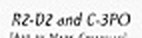
Our notes: `notes/materials/027-new-essential-chronology/13-map-index-back-matter.md:21`

## The Complete Star Wars Encyclopedia, Vol. I (A–G)

> C-3PX took pity on C-3PO, who was pitted in a fight to the death in a droid arena; when he substituted himself for C-3PO he allowed himself to be destroyed.
— Source: scan pages 81–120; C-3PX — entry/section: C-3PX.
Note (our notes, around the quote): C-3PX — entry/section: C-3PX: "C-3PX took pity on C-3PO, who was pitted in a fight to the death in a droid arena; when he substituted himself for C-3PO he allowed himself to be destroyed." Source: The Complete Star Wars Encyclopedia, Vol. I, p.102
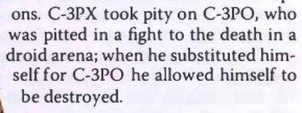
Our notes: `notes/materials/030-complete-star-wars-encyclopedia-vol-1/02-v1-scan-081-120.md:292`

## The Complete Star Wars Encyclopedia, Vol. II (H–O)

> He also helped Skywalker locate the Eye of Palpatine, a prototype Imperial battle station that had mysteriously been reactivated, Cray and Marr accompanied Skywalker and C-3PO to the ship to destroy it before it could carry out its preprogrammed plan of destruction.
— Source: scan pages 281–320; Palpatine (Darth Sidious).
Note (our notes, around the quote): Palpatine (Darth Sidious): "He also helped Skywalker locate the Eye of Palpatine, a prototype Imperial battle station that had mysteriously been reactivated, Cray and Marr accompanied Skywalker and C-3PO to the ship to destroy it before it could carry out its preprogrammed plan of destruction." Source: The Complete Star Wars Encyclopedia, Vol. II, p.291
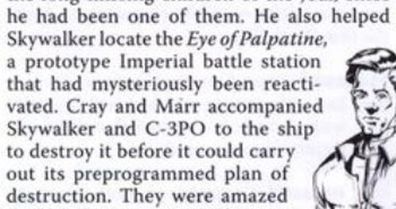
Our notes: `notes/materials/031-complete-star-wars-encyclopedia-vol-2/07-v2-scan-281-320.md:138`

## The Complete Star Wars Encyclopedia, Vol. III (P–Z)

- Note (summary from our notes, not a quotation): Page contents: 1008 words, 25 paragraphs | headings/entries: Seeker; Seerdon, Moff Kohl; See-Threepio; Seezar's Planet; Seifax; Seii, Akku; Sei'lar, Asyr
  — Source: scan pages 121–160.
Our notes: `notes/materials/032-complete-star-wars-encyclopedia-vol-3/03-v3-scan-121-160.md:154`

> Luke, Han, and Chewbacca—along with the droids R2-D2 and C-3PO—became a second family to her, helping to ease some of the shock and pain left by the annihilation of Alderaan.
— Source: scan pages 161–200; Luke Skywalker; Chewbacca.
Note (our notes, around the quote): Luke Skywalker; Chewbacca: "Luke, Han, and Chewbacca—along with the droids R2-D2 and C-3PO—became a second family to her, helping to ease some of the shock and pain left by the annihilation of Alderaan." Source: The Complete Star Wars Encyclopedia, Vol. III, p.177
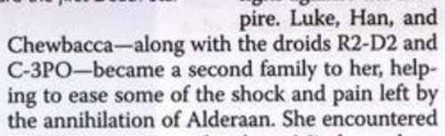
Our notes: `notes/materials/032-complete-star-wars-encyclopedia-vol-3/04-v3-scan-161-200.md:276`

> He survived an assassination attempt on Bri'ahl when the droids R2-D2 and C-3PO disobeyed Padmé's orders and foiled the would-be killers.
— Source: scan pages 321–360; Padmé Amidala. POV: Padmé Amidala, about C-3PO.
Note (our notes, around the quote): Padmé Amidala: "He survived an assassination attempt on Bri'ahl when the droids R2-D2 and C-3PO disobeyed Padmé's orders and foiled the would-be killers." Source: The Complete Star Wars Encyclopedia, Vol. III, p.315
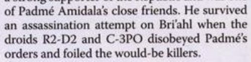
Our notes: `notes/materials/032-complete-star-wars-encyclopedia-vol-3/08-v3-scan-321-360.md:14`

## The New Essential Guide to Characters (2002)

- Note (summary from our notes, not a quotation): Page contents: 468 words, 19 paragraphs | headings/entries: Wars: THE NEw ESSENTIAL GUIDE TO CHARACTERS; C-3PO and R2-D2 reunited on the
  — Source: scan pages 1–30.
Our notes: `notes/materials/034-new-essential-guide-to-characters/00-negc-scan-001-030.md:202`

- Note (summary from our notes, not a quotation): Page contents: 491 words, 11 paragraphs | headings/entries: C-3PO accompanied the Princess
  — Source: scan pages 1–30.
Our notes: `notes/materials/034-new-essential-guide-to-characters/00-negc-scan-001-030.md:214`

## Sourcebooks/Star Wars Roleplaying Game Core Rulebook.pdf [Star Wars Roleplaying Game (d20, 2000)] (scan pages 181–240)

- Note (summary from our notes, not a quotation): Page contents: 802 words, 25 paragraphs | headings/entries: C-3PO, Protocol Droid; Obi-Wan "Ben" Kenobi; Wel
  — Source: Sourcebooks/Star Wars Roleplaying Game Core Rulebook.pdf [Star Wars Rolep.
Our notes: `notes/materials/037-sw-d20-folder/046-star-wars-roleplaying-game-core-rulebook-scan-181-240.md:394`

## Star Wars Gamer/Star Wars Gamer 05.pdf [Star Wars Roleplaying Game (d20, 2000)] (scan pages 61–118)

- Note (summary from our notes, not a quotation): Page contents: Star Wars CCG Tour de Force: 'Pyoonishin Your Opponent' Episode I-only Tatooine deck (Shmi and Threepio With His Parts Showing engine, Jar Jar and Brisky Morning Munchen, Boonta Eve Podrace) (hand-read)
  — Source: Star Wars Gamer/Star Wars Gamer 05.pdf [Star Wars Roleplaying Game (d20,.
Our notes: `notes/materials/037-sw-d20-folder/054-star-wars-gamer-05-scan-061-118.md:259`

- Note (summary from our notes, not a quotation): Page contents: 512 words, 36 paragraphs | headings/entries: BoontTa Eve PopRact &; ANAKIN'S PooRACER; Side's second Jedi Master (and the first; Obi-Wan Kenobi, Padawan Learner Padmé Naberrie; Qui-Gon Jinn; Shmi Skywalker; Threepio With His Parts Showing Yotts Orren; Weapons & Devices (7); Eruc Event (1) 1 | Did it; STAR WARS GAMER
  — Source: Star Wars Gamer/Star Wars Gamer 05.pdf [Star Wars Roleplaying Game (d20,.
Our notes: `notes/materials/037-sw-d20-folder/054-star-wars-gamer-05-scan-061-118.md:264`

## Star Wars Gamer/Star Wars Gamer 07.pdf [Star Wars Roleplaying Game (d20, 2000)] (scan pages 1–60)

- Note (summary from our notes, not a quotation): Page contents: Jedi Counseling: Death Star superlaser left as a plot device (omitted from Starships of the Galaxy); trash-compactor ricochet rule (1d4 bounces, d20 per bounce, +0 attack); droid XP depends on participation (R2-D2 Scout 4/Expert 3 vs C-3PO Diplomat 3); trading Jedi levels for Sith prestige class levels (hand-read)
  — Source: Star Wars Gamer/Star Wars Gamer 07.pdf [Star Wars Roleplaying Game (d20,.
Our notes: `notes/materials/037-sw-d20-folder/056-star-wars-gamer-07-scan-001-060.md:50`

## Star Wars Gamer/Star Wars Gamer 09.pdf [Star Wars Roleplaying Game (d20, 2000)] (scan pages 1–60)

- Note (summary from our notes, not a quotation): Page contents: Star Wars TCG: dice equal to Power, hits on 4–6; stacking character versions (Obi-Wan in three, C-3PO in two) instead of rare 'cook's son' characters; Mission cards 'Execution in the Arena' and 'Wedding of Destiny' (hand-read)
  — Source: Star Wars Gamer/Star Wars Gamer 09.pdf [Star Wars Roleplaying Game (d20,.
Our notes: `notes/materials/037-sw-d20-folder/058-star-wars-gamer-09-scan-001-060.md:409`

## Characters/Miniatures/Icons of New Hope.pdf [Star Wars Roleplaying Game Revised Core (d20, 2002)]

- Note (summary from our notes, not a quotation): Page contents: Intro; R2-D2 (Tantive IV escape; Override via Computer Use; stats Expert 4/Scout 3, CC C); C-3PO (Lars purchase; Diplomat 3/Noble 5, CC C) (hand-read)
  — Source: Characters/Miniatures/Icons of New Hope.pdf [Star Wars Roleplaying Game R.
Our notes: `notes/materials/037-sw-d20-folder/110-icons-of-new-hope.md:10`

> The destruction of the first Death Star started with the bravery of an unassuming droid designated as R2-D2. During the attack by the Empire against the Tantive IV over Tatooine, a young princess hid the plans for a terrible weapon in the small astromech droid. He and his counterpart C-3PO eluded the Empire by fleeing in a restricted escape pod.
— Source: Characters/Miniatures/Icons of New Hope.pdf [Star Wars Roleplaying Game R.
Note (our notes, around the quote): R2-D2; C-3PO; Leia Organa Solo — entry/section: R2-D2 and the Death Star plans: "The destruction of the first Death Star started with the bravery of an unassuming droid designated as R2-D2. During the attack by the Empire against the Tantive IV over Tatooine, a young princess hid the plans for a terrible weapon in the small astromech droid. He and his counterpart C-3PO eluded the Empire by fleeing in a restricted escape pod." Source: *Icons of New Hope* (SWRPG d20 Revised Core), scan p.1
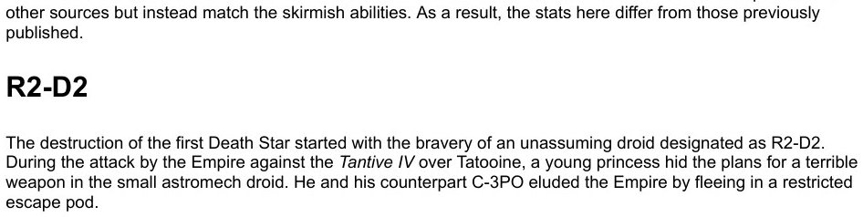
Our notes: `notes/materials/037-sw-d20-folder/110-icons-of-new-hope.md:12`

> Equipment: Heuristic processor, improved sensor package, diagnostics package, holorecording unit, infrared vision, tool mounts (x4), telescopic appendage, environmental compensation (vacuum), magnetic feet, internal storage (2 kg), fire extinguisher. Skills: Astrogate +18, Bluff +5, Computer Use +14, Disable Device +14, Knowledge (astronomy) +13, Listen +3, Pilot +15, Read/Write Basic, Repair +17, Search +13, Speak Basic (understand only), Speak Binary, Spot +10. Unspent Skill Points: 4. Feats: Alertness, Ambidexterity, Skill Emphasis (Astrogate), Skill Emphasis (Repair), Starship Operation (starfighter), Weapon Group Proficiencies (blaster pistols, simple weapons). C­3PO The escape pod eventually landed on the desert planet of Tatooine. C­3PO and R2­D2 wandered the dunes until captured by Jawa scavengers. These traders traveled to an isolated moisture farm owned by Owen and Beru Lars, where C­3PO convinced the family to purchase both droids. C­3PO: Walking protocol droid, Diplomat 3/Noble 5; Init +0; Defense 15 (+5 class); Spd 8 m; VP/WP 23/13; Atk +4 melee (1d4, hand) or +4 ranged; SQ Bonus class skill (Bluff), coordinate +1, droid quirk (faithful), favor +2, inspire confidence, manufacturer characteristics (Cybot Galactica: +2 Diplomacy, +2 Knowledge [Bureaucracy]), resource access; SV Fort +3, Ref +4, Will +7; SZ M; FP 0; DSP 0; Rep +3; Str 10, Dex 10, Con 13, Int 18, Wis 10, Cha 12. Challenge Code C. Equipment: Translator unit (DC 5), recording unit (audio), vocabulator.
— Source: Characters/Miniatures/Icons of New Hope.pdf [Star Wars Roleplaying Game R.
(Excerpt widened 2026-11-17 to the relevant passage, word for word from research primary sw d20 folder files Star Wars Roleplaying Game Revised Core Characters Miniatures Icons of New Hope (text copy `research_primary_sw_d20_folder_files_Star_Wars_Roleplaying_Game_Revised_Core_Characters_Miniatures_Icons_of_New_Hope_pdf_8b98da6091`).)
(Excerpt widened 2026-11-17 to the relevant passage, word for word from research primary sw d20 folder files Star Wars Roleplaying Game Revised Core Characters Miniatures Icons of New Hope (text copy `research_primary_sw_d20_folder_files_Star_Wars_Roleplaying_Game_Revised_Core_Characters_Miniatures_Icons_of_New_Hope_pdf_8b98da6091`).)
Note (our notes, around the quote): C-3PO; R2-D2 — entry/section: The droids reach the Lars farm: "The escape pod eventually landed on the desert planet of Tatooine. C-3PO and R2-D2 wandered the dunes until captured by Jawa scavengers. These traders traveled to an isolated moisture farm owned by Owen and Beru Lars, where C-3PO convinced the family to purchase both droids." Source: *Icons of New Hope* (SWRPG d20 Revised Core), scan p.1
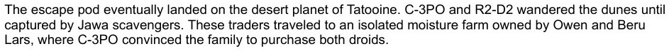
Our notes: `notes/materials/037-sw-d20-folder/110-icons-of-new-hope.md:14`

- Note (summary from our notes, not a quotation): Page contents: C-3PO feats; Luke Skywalker, Rebel (Fringer 4, CC C, from image); Obi-Wan Kenobi (Jedi Guardian 7/Jedi Master 3/Jedi Investigator 1, CC E); Princess Leia narrative (Death Star rescue) (hand-read)
  — Source: Characters/Miniatures/Icons of New Hope.pdf [Star Wars Roleplaying Game R.
Our notes: `notes/materials/037-sw-d20-folder/110-icons-of-new-hope.md:24`

> Challenge Code C. Equipment: Translator unit (DC 5), recording unit (audio), vocabulator. Skills: Bluff +9, Computer Use +13, Diplomacy +17, Knowledge (Alderaan) +16, Knowledge (Alien species) +13, Knowledge (Bureaucracy) +15, Knowledge (World lore) +11, Listen +7, Speak Basic, Speak Binary, Spot +7. Feats: Ambidexterity, Low Profile, Skill Emphasis (Diplomacy), Skill Emphasis (Knowledge [Alderaan]), Trustworthy, Weapon Group Proficiency (simple weapons). Luke Skywalker, Rebel The Lars homestead was also the residence of a young Luke Skywalker. Threepio peaked Luke's curiosity with tales of Rebellion as Artoo displayed a recorded message from the beautiful Princess Leia. While Luke ate with dinner with his aunt and uncle, R2­D2 slipped out in search of Obi­Wan Kenobi. Luke left early the next morning before his uncle discovered that R2­D2 was missing. After finding the recalcitrant droid, Luke was attacked by Tusken Raiders. He was rescued by an old hermit who would change his life forever.
— Source: Characters/Miniatures/Icons of New Hope.pdf [Star Wars Roleplaying Game R.
(Excerpt widened 2026-11-17 to the relevant passage, word for word from research primary sw d20 folder files Star Wars Roleplaying Game Revised Core Characters Miniatures Icons of New Hope (text copy `research_primary_sw_d20_folder_files_Star_Wars_Roleplaying_Game_Revised_Core_Characters_Miniatures_Icons_of_New_Hope_pdf_8b98da6091`).)
(Excerpt widened 2026-11-17 to the relevant passage, word for word from research primary sw d20 folder files Star Wars Roleplaying Game Revised Core Characters Miniatures Icons of New Hope (text copy `research_primary_sw_d20_folder_files_Star_Wars_Roleplaying_Game_Revised_Core_Characters_Miniatures_Icons_of_New_Hope_pdf_8b98da6091`).)
Note (our notes, around the quote): Luke Skywalker; R2-D2; C-3PO; Leia Organa Solo — entry/section: Luke at the Lars homestead: "The Lars homestead was also the residence of a young Luke Skywalker. Threepio peaked Luke's curiosity with tales of Rebellion as Artoo displayed a recorded message from the beautiful Princess Leia. While Luke ate with dinner with his aunt and uncle, R2-D2 slipped out in search of Obi-Wan Kenobi." Source: *Icons of New Hope* (SWRPG d20 Revised Core), scan p.2
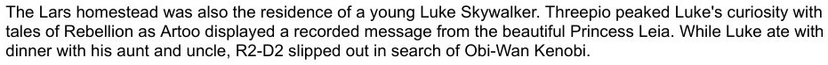
Our notes: `notes/materials/037-sw-d20-folder/110-icons-of-new-hope.md:26`

## Characters/Heroes of Revenge of the Sith.pdf [Star Wars Roleplaying Game Revised Core (d20, 2002)]

- Note (summary from our notes, not a quotation): Captain Raymus Antilles; Bail Organa; Leia Organa Solo; R2-D2; C-3PO; Darth Vader (Anakin Skywalker) — entry/section: Captain Antilles: "Captain of the Tantive IV, Raymus Antilles served both Bail Organa and his adopted daughter, Leia, as they fought against the Emperor's subjugation of the galaxy. His ship was home to R2-D2 and C-3PO off and on for the next 19 years until it was captured by Lord Vader's flagship, the Devastator, over
  — Source: Characters/Heroes of Revenge of the Sith.pdf [Star Wars Roleplaying Game.
Our notes: `notes/materials/037-sw-d20-folder/140-heroes-of-revenge-of-the-sith.md:43`

## Jedi Counselling/Jedi Counseling 11 - Illusion Confusion.pdf [Star Wars Roleplaying Game Revised Core (d20, 2002)]

> massive life form readings.
> [fragment — full passage not on file]
— Source: Jedi Counselling/Jedi Counseling 11 - Illusion Confusion.pdf [Star Wars R.
Note (our notes, around the quote): R2-D2; C-3PO; Luke Skywalker — entry/section: Starship sensors and life forms: "A: We know that starship sensors can sense life signs from Star Wars: A New Hope. As Artoo and Threepio flee the Tantive IV aboard the escape pod, the Imperials prepare to fire on it. But then an officer tells them to hold their fire, because no life forms were detected aboard the pod. And when Luke heads toward Dagobah in Star Wars: The Empire Strikes Back, he points out to Artoo that there are "massive life form readings."" Source: *Jedi Counseling 11 - Illusion Confusion* (SWRPG d20 Revised Core), scan p.2
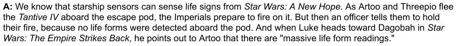
Our notes: `notes/materials/037-sw-d20-folder/174-jedi-counseling-11-illusion-confusion.md:26`

## Jedi Counselling/Jedi Counseling 51.pdf [Star Wars Roleplaying Game Revised Core (d20, 2002)]

- Note (summary from our notes, not a quotation): C-3PO; R2-D2; Leia Organa Solo — entry/section: C-3PO and R2-D2 don't get Leia's bonus movement: "Q: Does this mean that C-3PO and R2-D2 would not be able to move 2 extra squares if they end their turn within 6 squares of Princess Leia, Senator and were her followers?
  — Source: Jedi Counselling/Jedi Counseling 51.pdf [Star Wars Roleplaying Game Revis.
Our notes: `notes/materials/037-sw-d20-folder/218-jedi-counseling-51.md:22`

## Jedi Counselling/Jedi Counseling 54 - Pursuit.pdf [Star Wars Roleplaying Game Revised Core (d20, 2002)]

- Note (summary from our notes, not a quotation): Page contents: Miniatures: trooper followers, Obi-Wan Force Heal, Mara Jade targets, Emperor Force Points, Momentum, grenades, cover, bodyguard vs C-3PO (hand-read)
  — Source: Jedi Counselling/Jedi Counseling 54 - Pursuit.pdf [Star Wars Roleplaying.
Our notes: `notes/materials/037-sw-d20-folder/221-jedi-counseling-54-pursuit.md:24`

> Q: If a Twi'lek Bodyguard uses her bodyguard ability on C-3P0 when he is attacked by a Jawa (Ion Gun +20), would she take 10 damage (because she isn't a droid), or would she take 30 damage (because that's how much damage C-3P0 would have taken)?
— Source: Jedi Counselling/Jedi Counseling 54 - Pursuit.pdf [Star Wars Roleplaying.
Note (our notes, around the quote): C-3PO — entry/section: Twi'lek Bodyguard protecting C-3PO from a Jawa ion gun: "Q: If a Twi'lek Bodyguard uses her bodyguard ability on C-3P0 when he is attacked by a Jawa (Ion Gun +20), would she take 10 damage (because she isn't a droid), or would she take 30 damage (because that's how much damage C-3P0 would have taken)?" Source: *Jedi Counseling 54 - Pursuit* (SWRPG d20 Revised Core), scan p.3
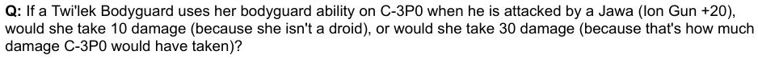
Our notes: `notes/materials/037-sw-d20-folder/221-jedi-counseling-54-pursuit.md:36`

## Jedi Counselling/Jedi Counseling 58.pdf [Star Wars Roleplaying Game Revised Core (d20, 2002)]

- Note (summary from our notes, not a quotation): Page contents: Aayla Secura Bodyguard, Spotter, Mara Jade Blaster Barrage targeting, C-3PO Draw Fire (hand-read)
  — Source: Jedi Counselling/Jedi Counseling 58.pdf [Star Wars Roleplaying Game Revis.
Our notes: `notes/materials/037-sw-d20-folder/225-jedi-counseling-58.md:20`

- Note (summary from our notes, not a quotation): Mara Jade Skywalker; C-3PO — entry/section: C-3PO's Draw Fire vs Mara Jade's Blaster Barrage: "A: Mara Jade is considered to "target" each enemy when using this ability, so C-3P0's Draw Fire ability does work against it. Resolve each attack (including the Draw Fire attempt, if necessary) one at a time, and Mara Jade's player gets to decide what order to take the attacks in. (These are "simultaneous effects," and that player is the acting player.)
  — Source: Jedi Counselling/Jedi Counseling 58.pdf [Star Wars Roleplaying Game Revis.
Our notes: `notes/materials/037-sw-d20-folder/225-jedi-counseling-58.md:29`

## Jedi Counselling/Jedi Counseling 59.pdf [Star Wars Roleplaying Game Revised Core (d20, 2002)]

- Note (summary from our notes, not a quotation): Page contents: Durge Momentum/Regeneration, C-3PO Draw Fire vs Emperor; author bio (hand-read)
  — Source: Jedi Counselling/Jedi Counseling 59.pdf [Star Wars Roleplaying Game Revis.
Our notes: `notes/materials/037-sw-d20-folder/226-jedi-counseling-59.md:30`

> A: C-3P0 can do this if he is an eligible target for the Emperor's Force Lightning, and it will have its normal effect on characters adjacent to C-3P0. (The Emperor still gets to choose which two adjacent targets are affected if there are three or more.) The Emperor's Force Storm, however, affects all adjacent characters -- in other words, it doesn't target anyone, so C-3P0's ability can't come into play.
— Source: Jedi Counselling/Jedi Counseling 59.pdf [Star Wars Roleplaying Game Revis.
Note (our notes, around the quote): C-3PO; Palpatine (Darth Sidious) — entry/section: C-3PO's Draw Fire vs the Emperor's Force Lightning and Force Storm: "A: C-3P0 can do this if he is an eligible target for the Emperor's Force Lightning, and it will have its normal effect on characters adjacent to C-3P0. (The Emperor still gets to choose which two adjacent targets are affected if there are three or more.) The Emperor's Force Storm, however, affects all adjacent characters -- in other words, it doesn't target anyone, so C-3P0's ability can't come into play." Source: *Jedi Counseling 59* (SWRPG d20 Revised Core), scan p.3
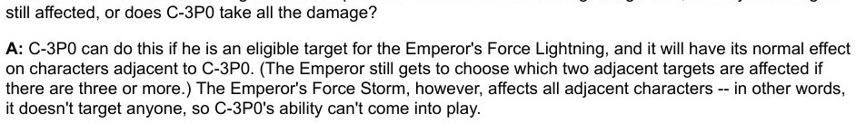
Our notes: `notes/materials/037-sw-d20-folder/226-jedi-counseling-59.md:36`

> A: Unfortunately, no, this isn't how it works. Draw Fire says that the attacking character must be able to select C- 3P0 as a target. In this case, the Emperor can't do so because C-3P0 is out of range. Thus, he can't use Draw Fire in the scenario you describe.
— Source: Jedi Counselling/Jedi Counseling 59.pdf [Star Wars Roleplaying Game Revis.
Note (our notes, around the quote): C-3PO; Palpatine (Darth Sidious); Luke Skywalker — entry/section: C-3PO out of the Emperor's range can't Draw Fire: "A: Unfortunately, no, this isn't how it works. Draw Fire says that the attacking character must be able to select C- 3P0 as a target. In this case, the Emperor can't do so because C-3P0 is out of range. Thus, he can't use Draw Fire in the scenario you describe." Source: *Jedi Counseling 59* (SWRPG d20 Revised Core), scan p.3
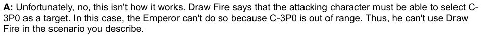
Our notes: `notes/materials/037-sw-d20-folder/226-jedi-counseling-59.md:38`

## Jedi Counselling/Jedi Counseling 63.pdf [Star Wars Roleplaying Game Revised Core (d20, 2002)]

- Note (summary from our notes, not a quotation): Page contents: Flight and AoOs, C-3PO/R2-D2 combined fire, Rolling Cleave, Docking Bay 94, commander effects; author bio (hand-read)
  — Source: Jedi Counselling/Jedi Counseling 63.pdf [Star Wars Roleplaying Game Revis.
Our notes: `notes/materials/037-sw-d20-folder/231-jedi-counseling-63.md:26`

- Note (summary from our notes, not a quotation): C-3PO; R2-D2 — entry/section: C-3PO and R2-D2 can't combine fire: "Q: Can C-3PO and R2-D2 combine fire with an attacker? Technically, they don't have the Melee Attack restriction, but does it make sense for the droids to be part of the firing squad?
  — Source: Jedi Counselling/Jedi Counseling 63.pdf [Star Wars Roleplaying Game Revis.
Our notes: `notes/materials/037-sw-d20-folder/231-jedi-counseling-63.md:28`

> Q: Can C­3PO and R2­D2 combine fire with an attacker? Technically, they don't have the Melee Attack restriction, but does it make sense for the droids to be part of the firing squad? A: The answer is at the end of the first paragraph of the Combined Fire section: Characters that deal no damage (in other words, those with Damage 0) cannot combine fire. Q: When counting squares for Rolling Cleave, do you count diagonals as two squares, or just one? A: Diagonals count as two squares for Rolling Cleave, so the one square of movement granted by this ability only allows you to move into an adjacent (non­diagonal) square. Q: In the "Race to Docking Bay 94" scenario in Ultimate Missions: Rebel Storm, the Imperial victory conditions state that they win the scenario if both Han or Chewbacca are defeated. The Rebel victory conditions clearly state that "all the Rebel characters must reach Docking Bay 94" for them to win. During a scenario, C­3P0 is defeated. Do the Imperials instantly win, or is this now a draw until the Imperials fulfill their victory condition? A: It's a draw until one side fulfills its victory conditions. The Rebels are no longer capable of winning, but the Imperials haven't yet fulfilled their victory conditions.
— Source: Jedi Counselling/Jedi Counseling 63.pdf [Star Wars Roleplaying Game Revis.
(Excerpt widened 2026-11-17 to the relevant passage, word for word from research primary sw d20 folder files Star Wars Roleplaying Game Revised Core Jedi Counselling Jedi Counseling 63 (text copy `research_primary_sw_d20_folder_files_Star_Wars_Roleplaying_Game_Revised_Core_Jedi_Counselling_Jedi_Counseling_63_pdf_7ca047be8d`).)
(Excerpt widened 2026-11-17 to the relevant passage, word for word from research primary sw d20 folder files Star Wars Roleplaying Game Revised Core Jedi Counselling Jedi Counseling 63 (text copy `research_primary_sw_d20_folder_files_Star_Wars_Roleplaying_Game_Revised_Core_Jedi_Counselling_Jedi_Counseling_63_pdf_7ca047be8d`).)
(Full sentence/passage taken from the source text on file: `research_primary_sw_d20_folder_files_Star_Wars_Roleplaying_Game_Revised_Core_Jedi_Counselling_Jedi_Counseling_63_pdf`.)
Note (our notes, around the quote): Han Solo; Chewbacca; C-3PO — entry/section: Race to Docking Bay 94 draw: "Q: In the "Race to Docking Bay 94" scenario in Ultimate Missions: Rebel Storm, the Imperial victory conditions state that they win the scenario if both Han or Chewbacca are defeated. The Rebel victory conditions clearly state that "all the Rebel characters must reach Docking Bay 94" for them to win. During a scenario, C-3P0 is defeated. Do the Imperials instantly win, or is this now a draw until the Imperials fulfill their victory condition?
Our notes: `notes/materials/037-sw-d20-folder/231-jedi-counseling-63.md:31`

## Jedi Counselling/Jedi Counseling 72.pdf [Star Wars Roleplaying Game Revised Core (d20, 2002)]

- Note (summary from our notes, not a quotation): Page contents: Evade vs Force Lightning, Durge + Sly Moore, Vader/Luke/C-3PO Draw Fire vs AoO; author bio (hand-read)
  — Source: Jedi Counselling/Jedi Counseling 72.pdf [Star Wars Roleplaying Game Revis.
Our notes: `notes/materials/037-sw-d20-folder/241-jedi-counseling-72.md:40`

- Note (summary from our notes, not a quotation): Darth Vader (Anakin Skywalker); Luke Skywalker; C-3PO — entry/section: C-3PO's Draw Fire vs Vader's attack of opportunity: "Q: Let's say Darth Vader, Sith Lord is adjacent to both Luke Skywalker, Jedi Knight and C-3PO. On Luke's turn, he moves away from Vader, provoking an attack of opportunity. Can C-3PO use Draw Fire against it or not?
  — Source: Jedi Counselling/Jedi Counseling 72.pdf [Star Wars Roleplaying Game Revis.
Our notes: `notes/materials/037-sw-d20-folder/241-jedi-counseling-72.md:45`

What it shows (our notes): A: According to the Draw Fire definition, it only works if "that enemy can choose this character as a target." If there is no choice or no targeting involved, Draw Fire does not apply.
> (He can't move when Dominated, and Regeneration takes effect at the end of his turn if he doesn't move.) And, just to be perfectly clear, this was exactly what the designers had in mind when they wrote the rules for Dominate. Durge might get the benefits of Regeneration twice in a round, Darth Maul might get to make two Triple Attacks in a round, and so on. Q: Let's say Darth Vader, Sith Lord is adjacent to both Luke Skywalker, Jedi Knight and C­3P0. On Luke's turn, he moves away from Vader, provoking an attack of opportunity. Can C­3P0 use Draw Fire against it or not? A: According to the Draw Fire definition, it only works if "that enemy can choose this character as a target." If there is no choice or no targeting involved, Draw Fire does not apply. For example, a normal attack obviously qualified ­­ the rules for choosing a target for an attack are described in detail in the rulebook. In contrast, Lightsaber Sweep has no choosing of targets at all. It just automatically affects all adjacent enemies, so Draw Fire would not work against it.
— Source: Jedi Counselling/Jedi Counseling 72.pdf [Star Wars Roleplaying Game Revis.
(Excerpt widened 2026-11-17 to the relevant passage, word for word from research primary sw d20 folder files Star Wars Roleplaying Game Revised Core Jedi Counselling Jedi Counseling 72 (text copy `research_primary_sw_d20_folder_files_Star_Wars_Roleplaying_Game_Revised_Core_Jedi_Counselling_Jedi_Counseling_72_pdf_7b0839b1e8`).)
(Excerpt widened 2026-11-17 to the relevant passage, word for word from research primary sw d20 folder files Star Wars Roleplaying Game Revised Core Jedi Counselling Jedi Counseling 72 (text copy `research_primary_sw_d20_folder_files_Star_Wars_Roleplaying_Game_Revised_Core_Jedi_Counselling_Jedi_Counseling_72_pdf_7b0839b1e8`).)
(Full sentence/passage taken from the source text on file: `research_primary_sw_d20_folder_files_Star_Wars_Roleplaying_Game_Revised_Core_Jedi_Counselling_Jedi_Counseling_72_pdf`.)
(An attack of opportunity is a lot like Lightsaber Sweep: There is no choice of targets involved. Instead, it automatically affects the "adjacent enemy who moves." In your example, if Luke provokes an attack of opportunity, Vader could not choose to attack C-3PO. Since Vader can't choose to attack C-3PO, C-3PO can't make him do it with Draw Fire, either. Thus, Draw Fire does not work against attacks of opportunity." Source: *Jedi Counseling 72* (SWRPG d20 Revised Core), scan p.3)
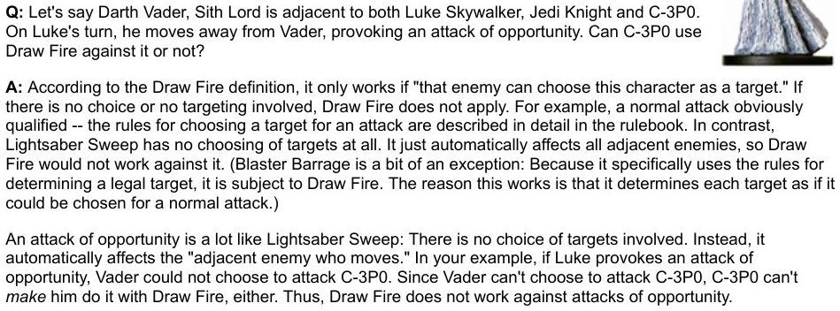
Our notes: `notes/materials/037-sw-d20-folder/241-jedi-counseling-72.md:46`

## Living Force Campaign/Adventures/Among the Stars/Year 1/102 - Eye of the Sun - The Resistance Within.pdf [Star Wars Roleplaying Game Revised Core (d20, 2002)]

> This is, of course, E1-6RA. When playing her, it may be easiest to imagine her as C-3PO's slightly less stuffy sister. She has the same stiff speech patterns, but will sometimes attempt humor at inappropriate moments. The jokes are nearly always awful.
— Source: Living Force Campaign/Adventures/Among the Stars/Year 1/102 - Eye of the.
Note (our notes, around the quote): No single roster character (rules/setting/general) — entry/section: E1-6RA, C-3PO's slightly less stuffy sister: "This is, of course, E1-6RA. When playing her, it may be easiest to imagine her as C-3PO's slightly less stuffy sister. She has the same stiff speech patterns, but will sometimes attempt humor at inappropriate moments. The jokes are nearly always awful." Source: *102 - Eye of the Sun - The Resistance Within* (SWRPG d20 Revised Core), p.4
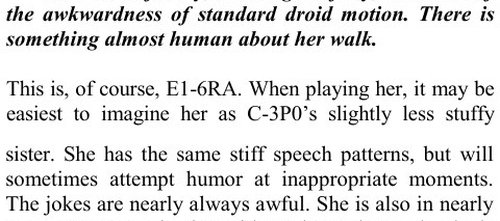
Our notes: `notes/materials/037-sw-d20-folder/272-102-eye-of-the-sun-the-resistance.md:32`

## Living Force Campaign/Adventures/Among the Stars/Year 4/404 - Jedi Code - For Fun and Profit.pdf [Star Wars Roleplaying Game Revised Core (d20, 2002)]

> Nearing her 4c~ year, Seenlu has no regrets for the path she has chosen, except that she would like to raise a family of her own some day. At the academy, she does not see that happening, but she knows that she is needed, and that it is the will of the Force that she be where she is, so she stays. Or… E1-6RA**: This protocol droid is easily recognized as Master Lanius’ personal assistan. She would look like a standard protocol droid if not for her bronze finish and one other distinguishing characteristic - the extra set of arms that extend from sockets just above her waist The lower pair of arms each end not in a hand, but in a flat circular face, about six inches in diameter and covered with tool mounts. When playing her, it may be easiest to imagine her as C-3PO's slightly less stuffy sister. She has the same stiff speech patterns, but will sometimes attempt humor at inappropriate moments. The jokes are nearly always awful. She is also in nearly constant communication with Lanius Qel'Bertuk. She is typically referred to as E I or E16 by anyone who is not Lanius. Thurm Loogg*: Thurm Loogg, a Caarite, is the Metatheran Cartel's representative to the Cularin System. He replaces the disgraced (and deceased) Velin Wir (scenario reference: Revelation and Refutation).
— Source: Living Force Campaign/Adventures/Among the Stars/Year 4/404 - Jedi Code -.
(Excerpt widened 2026-11-17 to the relevant passage, word for word from leplaying Game Revised Core Living Force Campaign Adventures Among the Stars Year 4 404 Jedi Code For Fun and Profit (text copy `leplaying_Game_Revised_Core_Living_Force_Campaign_Adventures_Among_the_Stars_Year_4_404_Jedi_Code_For_Fun_and_Profit_pdf_0c2d064e45`).)
(Excerpt widened 2026-11-17 to the relevant passage, word for word from leplaying Game Revised Core Living Force Campaign Adventures Among the Stars Year 4 404 Jedi Code For Fun and Profit (text copy `leplaying_Game_Revised_Core_Living_Force_Campaign_Adventures_Among_the_Stars_Year_4_404_Jedi_Code_For_Fun_and_Profit_pdf_0c2d064e45`).)
Note (our notes, around the quote): No single roster character (rules/setting/general) — entry/section: E1-6RA: "When playing her, it may be easiest to imagine her as C-3PO's slightly less stuffy sister. She has the same stiff speech patterns, but will sometimes attempt humor at inappropriate moments. The jokes are nearly always awful." Source: *404 - Jedi Code - For Fun and Profit* (SWRPG d20 Revised Core), p.20
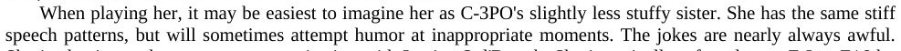
Our notes: `notes/materials/037-sw-d20-folder/327-404-jedi-code-for-fun-and-profit.md:157`

## Locations/Planet Hoppers/Aargau - For All Your Banking Needs/Part 1 - Three Simple Laws.pdf [Star Wars Roleplaying Game Revised Core (d20, 2002)]

- Note (summary from our notes, not a quotation): Page contents: Aargau overview: neutral banking world, corruption; Leia faced Vader on Aargau for an Alliance loan; planet stat block (Zug system, pop 4.8 billion); Operation Third Law debriefing, C-3PO on Aargau's droids (hand-read)
  — Source: Locations/Planet Hoppers/Aargau - For All Your Banking Needs/Part 1 - Thr.
Our notes: `notes/materials/037-sw-d20-folder/551-part-1-three-simple-laws.md:10`

> Planet: Aargau Planet Type: Terrestrial Climate: Temperate Terrain: Cities, gardens, mountains, forests, jungles, rivers, oceans. Atmosphere: Breathable Gravity: Standard Diameter: 12,928 km Length of Day: 24 standard hours Length of Year: 364 local days Sentient Species: Humans, droids, aliens Language: Basic Population: 4.8 billion Species Mix: 84% Human, 12% droids, 4% other Government: Representative Council of Citizens Major Exports: Precious metals, bankers Major Imports: Financial assets System/Star: Zug Planets Type Moons Aaghra Molten rock 0 Zaur Methane ocean 0 Aargau Terrestrial 1 Azameen Arid terrestrial 2 The Coins of Gauha Asteroid belt – Zauhu Gas giant 47 Urazuun Gas giant 38 Faargau Gas giant 14 Laazrau Gas giant 13 Uluu Ice ball 1 Sector: Core Worlds Operation Third Law: Mission Debriefing Transcript 3, Excerpt 19 Subject: Protocol droid designated C­3PO Property of Alliance Intelligence C­3PO: As a first­time visitor to Aargau, I naturally wanted to learn more about this magnificent place, which was a fascinating and beautiful achievement of luxury, opulence, and technological achievement. And the droids! So many rare, expensive models I'd never had the opportunity to meet before. Why, did you know they welcomed us with a recording unit that I happen to know can translate over four million forms of communication? A droid with such a pedigree, performing tasks more suited to an R2 unit! No offense, Artoo. R2­D2: [BINARY] C­3PO: Of course, I didn't mean you.
— Source: Locations/Planet Hoppers/Aargau - For All Your Banking Needs/Part 1 - Thr.
(Excerpt widened 2026-11-17 to the relevant passage, word for word from rs Roleplaying Game Revised Core Locations Planet Hoppers Aargau For All Your Banking Needs Part 1 Three Simple Laws (text copy `rs_Roleplaying_Game_Revised_Core_Locations_Planet_Hoppers_Aargau_For_All_Your_Banking_Needs_Part_1_Three_Simple_Laws_pdf_9816ed66fc`).)
(Excerpt widened 2026-11-17 to the relevant passage, word for word from rs Roleplaying Game Revised Core Locations Planet Hoppers Aargau For All Your Banking Needs Part 1 Three Simple Laws (text copy `rs_Roleplaying_Game_Revised_Core_Locations_Planet_Hoppers_Aargau_For_All_Your_Banking_Needs_Part_1_Three_Simple_Laws_pdf_9816ed66fc`).)
Note (our notes, around the quote): No single roster character (rules/setting/general) — entry/section: C-3PO debriefing on Aargau: "As a first-time visitor to Aargau, I naturally wanted to learn more about this magnificent place, which was a fascinating and beautiful achievement of luxury, opulence, and technological achievement. And the droids! So many rare, expensive models I'd never had the opportunity to meet before. Why, did you know they welcomed us with a recording unit that I happen to know can translate over four million forms of communication? A droid with such a pedigree, performing tasks more suited to an R2 unit! No offense, Artoo." Source: *Part 1 - Three Simple Laws* (SWRPG d20 Revised Core), scan p.1
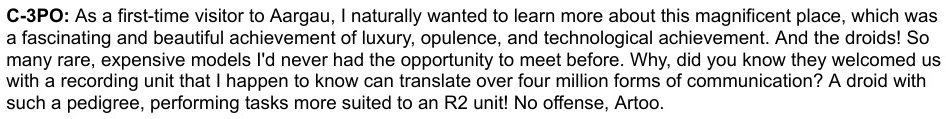
Our notes: `notes/materials/037-sw-d20-folder/551-part-1-three-simple-laws.md:12`

- Note (summary from our notes, not a quotation): Page contents: C-3PO and R2-D2 banter; Agent Syril reads back C-3PO's report (New Escrow roads, Garden of Butterflies); the Three Statutes sign; "The Third Law!" (Marvel #48, Larry Hama), Leia vs. Vader (hand-read)
  — Source: Locations/Planet Hoppers/Aargau - For All Your Banking Needs/Part 1 - Thr.
Our notes: `notes/materials/037-sw-d20-folder/551-part-1-three-simple-laws.md:21`

> It was here that I learned about the Statutes of Aargau, the only three laws on the planet. Shall I recite them? Agent Syril: Why not? C­3PO: Wonderful! The signpost at customs read as follows: ON AARGAU, THESE CRIMES ARE PUNISHABLE BY IMMEDIATE EXECUTION: 1. The unlawful removal of precious metals. 2. The unlawful possession of weapons by noncitizens. (Conversely, it is unlawful for citizens to be unarmed.) 3. Willfully conspiring to defraud, discredit, or deceive the Bank of Aargau. (Continued in file O3L­E20) The Third Law! The banking planet Aargau, where almost anything can get in and virtually nothing can get out (without the proper authorization), is one of many unique and memorable planets from the Marvel Star Wars comic book series to make the sanctioned leap into the Expanded Universe. Aargau first appeared in issue #48, an early post­Empire story called "The Third Law!" that set Leia against Vader in what the previous issue's hype box billed as a "game of diplomatic derring­do." Larry Hama's tale is packed with dark humor that didn't often appear in the series during the "Frozen Han" period, following a complicated plot filled with Hitchcockian turns, shocking surprises, and ­­ yep ­­ derring­do aplenty, diplomatic and otherwise.
— Source: Locations/Planet Hoppers/Aargau - For All Your Banking Needs/Part 1 - Thr.
(Excerpt widened 2026-11-17 to the relevant passage, word for word from rs Roleplaying Game Revised Core Locations Planet Hoppers Aargau For All Your Banking Needs Part 1 Three Simple Laws (text copy `rs_Roleplaying_Game_Revised_Core_Locations_Planet_Hoppers_Aargau_For_All_Your_Banking_Needs_Part_1_Three_Simple_Laws_pdf_9816ed66fc`).)
(Excerpt widened 2026-11-17 to the relevant passage, word for word from rs Roleplaying Game Revised Core Locations Planet Hoppers Aargau For All Your Banking Needs Part 1 Three Simple Laws (text copy `rs_Roleplaying_Game_Revised_Core_Locations_Planet_Hoppers_Aargau_For_All_Your_Banking_Needs_Part_1_Three_Simple_Laws_pdf_9816ed66fc`).)
Note (our notes, around the quote): No single roster character (rules/setting/general) — entry/section: Aargau customs sign (recited by C-3PO): "ON AARGAU, THESE CRIMES ARE PUNISHABLE BY IMMEDIATE EXECUTION: 1. The unlawful removal of precious metals. 2. The unlawful possession of weapons by noncitizens. (Conversely, it is unlawful for citizens to be unarmed.) 3. Willfully conspiring to defraud, discredit, or deceive the Bank of Aargau." Source: *Part 1 - Three Simple Laws* (SWRPG d20 Revised Core), scan p.2
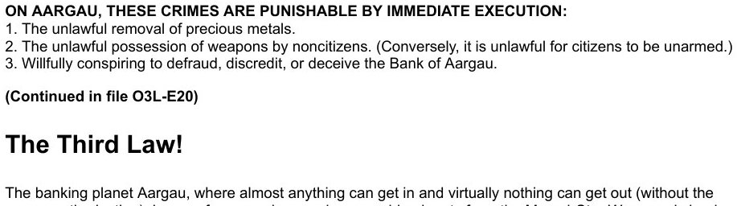
Our notes: `notes/materials/037-sw-d20-folder/551-part-1-three-simple-laws.md:23`

## Locations/Planet Hoppers/Aargau - For All Your Banking Needs/Part 4 - Checks, Balances, and Overdrafts.pdf [Star Wars Roleplaying Game Revised Core (d20, 2002)]

- Note (summary from our notes, not a quotation): Page contents: Trials in absentia, BoA vs. Vader and BoA vs. Organa; Leia's loan; Vader's three assassin-guild attendants (Rigellian porter, shapeshifter secretary, telekinetic valet); Rigellian crushed with a gravitational field disruptor; shapeshifter butterfly stopped by C-3PO and Leia's boot; missile attempt (hand-read)
  — Source: Locations/Planet Hoppers/Aargau - For All Your Banking Needs/Part 4 - Che.
Our notes: `notes/materials/037-sw-d20-folder/554-part-4-checks-balances-and-overdrafts.md:10`

## Locations/Planet Hoppers/Arbra - Sanctuary In the Storm/Part 3 - The Darker.pdf [Star Wars Roleplaying Game Revised Core (d20, 2002)]

- Note (summary from our notes, not a quotation): Page contents: Debrief RA44390/C-3PO: R2 lured into an ancient Xim-era city under the base; the Darker (cast-off negative emotions of ancient Arbrans) turns Chewbacca; C-3PO finds the answer in an ancient text resembling Sith; the Darker forced into the field, city collapses (hand-read)
  — Source: Locations/Planet Hoppers/Arbra - Sanctuary In the Storm/Part 3 - The Dark.
Our notes: `notes/materials/037-sw-d20-folder/567-part-3-the-darker.md:10`

> As I am fluent in over six million forms of communication, I set about searching for some clue that would help us escape this atrocious predicament.
— Source: Locations/Planet Hoppers/Arbra - Sanctuary In the Storm/Part 3 - The Dark.
Note (our notes, around the quote): No single roster character (rules/setting/general) — entry/section: C-3PO's debriefing: "As I am fluent in over six million forms of communication, I set about searching for some clue that would help us escape this atrocious predicament." Source: *Part 3 - The Darker* (SWRPG d20 Revised Core), scan p.1
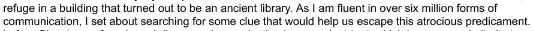
Our notes: `notes/materials/037-sw-d20-folder/567-part-3-the-darker.md:12`

## Locations/Planet Hoppers/Bespin - Action Tidings/Part 4 - The Empire's Ugly Nose.pdf [Star Wars Roleplaying Game Revised Core (d20, 2002)]

> I made a mistake!
> [fragment — full passage not on file]
— Source: Locations/Planet Hoppers/Bespin - Action Tidings/Part 4 - The Empire's Ug.
Note (our notes, around the quote): Page contents: Lando, Leia, and Chewbacca (carrying C-3PO) kill the troopers; Chewbacca's threat; Lando's "I made a mistake!"; Ugnaught rebels later drive out the Empire (hand-read)
Our notes: `notes/materials/037-sw-d20-folder/580-part-4-the-empires-ugly-nose.md:21`

## Locations/Planet Hoppers/Vandelhelm - Enemies and Alloys/Part 4 - The Demands of Supply.pdf [Star Wars Roleplaying Game Revised Core (d20, 2002)]

> According to multiple complaints C-3PO filed with the New Republic Head of State at the time, Chewbacca threatened to disarm the droid Wookiee-style when he pointed out that protocol called for only Solo and Nien Nunb to attend.
— Source: Locations/Planet Hoppers/Vandelhelm - Enemies and Alloys/Part 4 - The Dem; Chewbacca. POV: Chewbacca, about C-3PO.
Note (our notes, around the quote): Chewbacca: "According to multiple complaints C-3PO filed with the New Republic Head of State at the time, Chewbacca threatened to disarm the droid Wookiee-style when he pointed out that protocol called for only Solo and Nien Nunb to attend." Source: *Part 4 - The Demands of Supply* (SWRPG d20 Revised Core), scan p.1
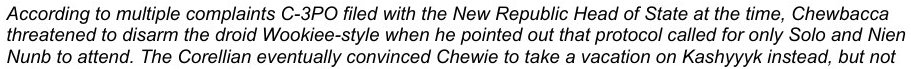
Our notes: `notes/materials/037-sw-d20-folder/623-part-4-the-demands-of-supply.md:16`

## Sourcebooks/Sourcebook Web Enhancements/Galactic Gazetteer - Hoth and the Greater Javin.pdf [Star Wars Roleplaying Game Revised Core (d20, 2002)]

- Note (summary from our notes, not a quotation): Page contents: Hoth climate, equatorial rift lumni-spice (pirate Raskar), southern ice spires and ice worms; sidebar "Why Hoth?" (Luke and C-3PO crash; Frija Turlock and the Turlock droids, possibly by Massad Thrumble); Alliance chooses Hoth; Echo Base (Rieekan; Maj. Monnon; pirate Salmakk's old facilities) (hand-read)
  — Source: Sourcebooks/Sourcebook Web Enhancements/Galactic Gazetteer - Hoth and the.
Our notes: `notes/materials/037-sw-d20-folder/644-galactic-gazetteer-hoth-and-the-greater-javin.md:32`

## Sourcebooks/Galactic Campaign Guide.pdf [Star Wars Roleplaying Game Revised Core (d20, 2002)] (scan pages 121–162)

- Note (summary from our notes, not a quotation): Page contents: The Mentor cont.; Crossing the First Threshold; Tests, Allies, and Enemies (Wedge, R2-D2, C-3PO as static allies); Approach to the Inmost Cave (hand-read)
  — Source: Sourcebooks/Galactic Campaign Guide.pdf [Star Wars Roleplaying Game Revis.
Our notes: `notes/materials/037-sw-d20-folder/666-galactic-campaign-guide-scan-121-162.md:208`

## Sourcebooks/Revised Core Rulebook.pdf [Star Wars Roleplaying Game Revised Core (d20, 2002)] (scan pages 301–360)

- Note (summary from our notes, not a quotation): Page contents: R2-D2 (Expert 4/Scout 3, Challenge Code C) and C-3PO (Diplomat 3, Code A) stat blocks: R2-D2 has the unique "courage" personality quirk; C-3PO built by Anakin from spare parts. (hand-read)
  — Source: Sourcebooks/Revised Core Rulebook.pdf [Star Wars Roleplaying Game Revised.
Our notes: `notes/materials/037-sw-d20-folder/671-revised-core-rulebook-scan-301-360.md:117`

## Sourcebooks/Official Errata October 2008.pdf [Star Wars Roleplaying Game Saga Edition (2007)]

- Note (summary from our notes, not a quotation): Page contents: Chewbacca skills (Climb +10, Endurance +15, Initiative +11, Mechanics +11, Perception +10, Persuasion +5, Pilot +11, Use Computer +11); Extra Rage removed, Shake It Off added. R2-D2 electroshock probe +9, ranged +8. C-3PO Int 13, Wis 13, Cha 15; Deception +10, Persuasion +15. Yoda languages (Basic, Cerean, Shyriiwook (understand only)) and lightsaber +19/+19/+19 (2d8+16) with Triple Attack. Boba Fett Ref 36 (33 flat-footed). General Grievous Ref 35 (31 flat-footed), final melee line +9. Nonheroic gains Ride; Clone Trooper Perception +9 and Coordinated Attack; ARC Trooper defenses and delay damage. (hand-read)
  — Source: Sourcebooks/Official Errata October 2008.pdf [Star Wars Roleplaying Game.
Our notes: `notes/materials/037-sw-d20-folder/720-official-errata-october-2008.md:90`

## Sourcebooks/Official FAQ and Errata Compilation.pdf [Star Wars Roleplaying Game Saga Edition (2007)] (scan pages 61–75)

- Note (summary from our notes, not a quotation): Page contents: Vader skills (Initiative +17, Jump +17, Mechanics +16, Perception +18, Use the Force +17 (reroll [dark side] powers, substitute for Pilot)). Padme: "Wanted Alive" replaced with "Inspire Confidence". Luke Skywalker (Ref 28 (25); lightsaber +14 (2d8+11), +9/+9 Double Attack; blaster +12 (3d6+5); SQ Vehicle dodge +1; adds Elusive Dogfighter). Han Solo heavy blaster pistol +12. Chewbacca skills replaced (Climb +10 ... Use Computer +11), Extra Rage replaced with Shake It Off. R2-D2 probe +9, ranged +8. C-3PO Int 13, Wis 13, Cha 15, Deception +10, Persuasion +15. Yoda Languages Basic, Cerean, Shyriiwook (understand only). (hand-read)
  — Source: Sourcebooks/Official FAQ and Errata Compilation.pdf [Star Wars Roleplayin.
Our notes: `notes/materials/037-sw-d20-folder/721-official-faq-and-errata-compilation-scan-061-075.md:35`

## Sourcebooks/Scavenger's Guide to Droids.pdf [Star Wars Roleplaying Game Saga Edition (2007)] (scan pages 1–60)

> Droids can be more than just equipment. They can be individuals. *(hand-read)*
— Source: Sourcebooks/Scavenger's Guide to Droids.pdf [Star Wars Roleplaying Game S.
Note (our notes, around the quote): Page contents: Introduction: opening vignette of an astromech waking in a sandcrawler and finding a golden protocol droid friend; references R2-D2 and C-3PO aboard the sandcrawler on Tatooine; asks how the saga would differ without droids (Clone Wars battle droids, R2-D2 in Luke Skywalker's starfighter on the Death Star run); purpose of the book: tools for droid heroes, enemies and noncombatants — "Droids can be more than just equipment. They can be individuals." (hand-read)
Our notes: `notes/materials/037-sw-d20-folder/724-scavengers-guide-to-droids-scan-001-060.md:35`

> Without droids, the Star Wars universe that we know could not exist. *(hand-read)*
— Source: Sourcebooks/Scavenger's Guide to Droids.pdf [Star Wars Roleplaying Game S.
Note (our notes, around the quote): Page contents: A Scavenger's Book: why scavengers — Jawas of Tatooine abducted R2-D2 and C-3PO (Episode IV) and kept them because they were well maintained; transport captains, corporate technicians and junk dealers rely on scavenged parts; "Without droids, the Star Wars universe that we know could not exist." (hand-read)
Our notes: `notes/materials/037-sw-d20-folder/724-scavengers-guide-to-droids-scan-001-060.md:45`

> C-3PO in pieces. *(hand-read)*
> [fragment — full passage not on file]
— Source: Sourcebooks/Scavenger's Guide to Droids.pdf [Star Wars Roleplaying Game S.
Note (our notes, around the quote): Page contents: Optional rules: Sacrificial Appendage (sever a limb to stop at −10 step or retain 1 hp); Destroyed Droids (GM decides remains, lightsaber cuts); Reactivating a Destroyed Droid (DC 20 Mechanics 5 min or DC 30 full-round); Salvaging (parts 50%+ of cost). Improvised Droid Tasks: heuristic vs basic processor. Art: "C-3PO in pieces." (hand-read)
Our notes: `notes/materials/037-sw-d20-folder/724-scavengers-guide-to-droids-scan-001-060.md:172`

- Note (summary from our notes, not a quotation): Page contents: Chapter II "Droid Allies" opener art (C-3PO, R2-D2 and other droids). (hand-read)
  — Source: Sourcebooks/Scavenger's Guide to Droids.pdf [Star Wars Roleplaying Game S.
Our notes: `notes/materials/037-sw-d20-folder/724-scavengers-guide-to-droids-scan-001-060.md:182`

> An unfinished C-3PO. *(hand-read)*
> [fragment — full passage not on file]
— Source: Sourcebooks/Scavenger's Guide to Droids.pdf [Star Wars Roleplaying Game S.
Note (our notes, around the quote): Page contents: Protocol stats: 3PO-Series Protocol Droid (7,000 cr; Databank, Diplomacy Assistance, Impeccable Manners, Translator); B1-Series Battle Droid (5,650 cr); B2-Series Super Battle Droid (8,400 cr). Art: "An unfinished C-3PO." (hand-read)
Our notes: `notes/materials/037-sw-d20-folder/724-scavengers-guide-to-droids-scan-001-060.md:216`

> Give them a voice. *(hand-read)*
> [fragment — full passage not on file]
— Source: Sourcebooks/Scavenger's Guide to Droids.pdf [Star Wars Roleplaying Game S.
Note (our notes, around the quote): Page contents: Protocol stats: IG-100-Series Bodyguard Droid (27,250 cr; Electrostaff Spinning Attack/Thrust; Protect and Serve spends owner's Force point); Viper-Series Probe Droid (20,250 cr; Pacify Hostile, Scan, Self-Destruct, Track); ASP Labor Droid (4,000 cr). Creating Memorable Droids: personality (C-3PO's unshakable manners); "Give them a voice." (hand-read)
Our notes: `notes/materials/037-sw-d20-folder/724-scavengers-guide-to-droids-scan-001-060.md:226`

## Sourcebooks/Scum and Villany.pdf [Star Wars Roleplaying Game Saga Edition (2007)] (scan pages 1–60)

> Sometimes even the best ships are unreliable *(image-read; art of C-3PO in the Falcon's wiring)*
> [fragment — full passage not on file]
— Source: Sourcebooks/Scum and Villany.pdf [Star Wars Roleplaying Game Saga Edition.
Note (our notes, around the quote): Page contents: Outlaw Starships intro. "We've Been Through a Lot Together": starship-linked destiny (ship never completely destroyed; Destiny Point options by crew role). Caption: "Sometimes even the best ships are unreliable" (image-read; art of C-3PO in the Falcon's wiring). (hand-read)
Our notes: `notes/materials/037-sw-d20-folder/725-scum-and-villany-scan-001-060.md:299`

## Sourcebooks/Scum and Villany.pdf [Star Wars Roleplaying Game Saga Edition (2007)] (scan pages 181–225)

- Note (summary from our notes, not a quotation): Page contents: Chapter VII opener: "The Fell Star" (full-page art). (Image-viewed) Film-still collage: Han Solo, Leia (Boushh-era cloak) and Gamorrean guards in Jabba's palace, with C-3PO walking the Tatooine dunes. (hand-read)
  — Source: Sourcebooks/Scum and Villany.pdf [Star Wars Roleplaying Game Saga Edition.
Our notes: `notes/materials/037-sw-d20-folder/725-scum-and-villany-scan-181-225.md:70`

## Sourcebooks/Star Wars Gamemaster Screen.pdf [Star Wars Roleplaying Game Saga Edition (2007)]

- Note (summary from our notes, not a quotation): Page contents: Player-side art panel (no text; image-viewed): Padme Amidala with blaster, C-3PO, R2-D2, a planet, Y-wing-type starfighter. (hand-read)
  — Source: Sourcebooks/Star Wars Gamemaster Screen.pdf [Star Wars Roleplaying Game S.
Our notes: `notes/materials/037-sw-d20-folder/726-star-wars-gamemaster-screen.md:35`

## Sourcebooks/The Unknown Regions.pdf [Star Wars Roleplaying Game Saga Edition (2007)] (scan pages 61–120)

- Note (summary from our notes, not a quotation): Page contents: Speeder Traffic CL 8; Space Hazards (Battle of Yavin; asteroid chase in The Empire Strikes Back; x2/x5 multipliers); Asteroid Field CL 10 (with C-3PO quotation); Black Hole CL 20. (hand-read)
  — Source: Sourcebooks/The Unknown Regions.pdf [Star Wars Roleplaying Game Saga Edit.
Our notes: `notes/materials/037-sw-d20-folder/730-the-unknown-regions-scan-061-120.md:302`

## Web Articles.pdf [Star Wars Roleplaying Game Saga Edition (2007)] (scan pages 61–120)

> However, that still leaves an important question: How much time do you want to spend keeping your character sheet up to date? If the average game session lasts from three to six hours, how much of that time are you willing to devote to going up a level? In developing Saga Edition, our goal was to simplify the mechanics of advancement (such as implementing new bonuses and abilities) so that you could spend more time focusing on the choices of advancement (such as choosing which classes, prestige classes, feats, and talents you'll take). This change also promotes variety and versatility in a group of characters. With the new system, you can have a party of four heroes who all have the same class but who are completely different from one another. For example, an "all Jedi, all the time" campaign can be much more interesting than it might have been in the past. Of course, the other major beneficiary of this change is the Gamemaster. Because it's now easier to construct new characters, even high-level ones, the GM can spend less time rolling up NPCs and more time building good encounter settings, adventures, and campaigns. Every hour the GM doesn't have to spend crunching numbers is an hour he can spend weaving the background and story elements that help the game come alive.
>
> I do wish this game was faster . . . *(hand-read)*
— Source: Web Articles.pdf [Star Wars Roleplaying Game Saga Edition (2007)] (scan p.
(Excerpt widened 2026-11-17 to the relevant passage, word for word from research primary sw d20 folder files Star Wars Roleplaying Game Saga Edition Web Articles (text copy `research_primary_sw_d20_folder_files_Star_Wars_Roleplaying_Game_Saga_Edition_Web_Articles_pdf_6187a774ab`).)
(Excerpt widened 2026-11-17 to the relevant passage, word for word from research primary sw d20 folder files Star Wars Roleplaying Game Saga Edition Web Articles (text copy `research_primary_sw_d20_folder_files_Star_Wars_Roleplaying_Game_Saga_Edition_Web_Articles_pdf_6187a774ab`).)
(Full sentence/passage taken from the source text on file: `research_primary_sw_d20_folder_files_Star_Wars_Roleplaying_Game_Saga_Edition_Web_Articles_pdf`.)
Note (our notes, around the quote): Page contents: Jedi Counseling 104: The Last Word on Saga Edition: not "dumbing down" but streamlining for cinematic speed (two-roll area attacks, no iterative attacks, encourage movement) and less bookkeeping (no skill ranks, uniform Defense advancement, talents on odd and bonus feats on even levels) so time goes to advancement choices; varied same-class parties ("all Jedi, all the time"); easier GM NPC creation. Photo of Chewbacca and C-3PO at the hologame table captioned "I do wish this game was faster . . ." (hand-read)
Our notes: `notes/materials/037-sw-d20-folder/732-web-articles-scan-061-120.md:136`

## Web Articles.pdf [Star Wars Roleplaying Game Saga Edition (2007)] (scan pages 121–180)

> They also motivate the Hero to action and help him overcome his fears. One example of this is the relationship between Ben Kenobi and Luke Skywalker. Young Luke meets Ben just as his destiny begins to unfold. If it were not for Ben, Luke may have given into his fears and stayed on Tatooine – even after the death of his Aunt and Uncle. Ben takes on the role of Mentor in many ways. He tells Luke about his father Anakin, gives the boy his first lightsaber, and begins to tutor him in the ways of the Jedi. Without Ben's influence, Luke would never have become a Jedi, may never have left Tatooine, and would have most likely been killed by Stormtroopers looking for C-3PO and R2-D2. Luke owed a great deal of who he was and who he became to his Mentor. Sometimes, as an aspect of their instruction, Mentors must act as the Hero's conscience as he wavers in his own judgment or wrestles with his own emotions. The relationship between Obi-Wan Kenobi and Anakin Skywalker is an excellent example of this. Anakin's impulsive nature and deep personal anger consistently move him to make poor decisions, or at least not decisions befitting a Jedi, during his years as an apprentice.
— Source: Web Articles.pdf [Star Wars Roleplaying Game Saga Edition (2007)] (scan p; Luke Skywalker. POV: Luke Skywalker, about C-3PO.
(Excerpt widened 2026-11-17 to the relevant passage, word for word from research primary sw d20 folder files Star Wars Roleplaying Game Saga Edition Web Articles (text copy `research_primary_sw_d20_folder_files_Star_Wars_Roleplaying_Game_Saga_Edition_Web_Articles_pdf_6187a774ab`).)
(Excerpt widened 2026-11-17 to the relevant passage, word for word from research primary sw d20 folder files Star Wars Roleplaying Game Saga Edition Web Articles (text copy `research_primary_sw_d20_folder_files_Star_Wars_Roleplaying_Game_Saga_Edition_Web_Articles_pdf_6187a774ab`).)
Note (our notes, around the quote): Luke Skywalker: "Without Ben's influence, Luke would never have become a Jedi, may never have left Tatooine, and would have most likely been killed by Stormtroopers looking for C-3PO and R2-D2." Source: *Web Articles* (SWRPG Saga Edition), scan p.144
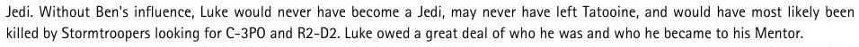
Our notes: `notes/materials/037-sw-d20-folder/732-web-articles-scan-121-180.md:156`

## Web Articles.pdf [Star Wars Roleplaying Game Saga Edition (2007)] (scan pages 181–240)

- Note (summary from our notes, not a quotation): Page contents: Skirmish cont.: Round 13 (R2-D2 and C-3PO fall into the sand; Leia turns the cannon; Chewbacca's Jury-Rigger reroll repairs the skiff +2 steps; Han takes cover; Lando to the pilot's position; Luke grabs a rope); Round 14 (Leia grabs Luke; Chewbacca on the magnetic grapplers; Luke fires the cannon into the sail barge and swings across with Leia; Lando's Pilot check, pick up the droids, Jabba's sail barge explodes); Next Time: starship and vehicle combat. (hand-read)
  — Source: Web Articles.pdf [Star Wars Roleplaying Game Saga Edition (2007)] (scan p.
Our notes: `notes/materials/037-sw-d20-folder/732-web-articles-scan-181-240.md:261`

## Web Articles.pdf [Star Wars Roleplaying Game Saga Edition (2007)] (scan pages 301–360)

> 270 – Boba Fett Stat Block Reflex Defense should be 36 (33 flat-footed). p. 271 – General Grievous Stat Block Reflex Defense should be 35 (31 flat-footed). Attack bonuses on final Melee line should be +9, not +11. p. 278 – Nonheroic Class Skills Add the Ride skill to the list of Class Skills for the nonheroic character, below Table 3-3. p. 281 – Clone Trooper Perception skill bonus should be +9 and should have the Coordinated Attack feat. p. 282 – ARC Trooper On the Defenses line, the text after Ref should be “23 (21 flat-footed).” Replace the line that starts with “hp” with the following: “hp 57; DR 1Threshold 24; delay damage” Add the following line below the Abilities line: Special Qualities delay damage. p. 283 – Bounty Hunter Replace the bounty hunter’s skills with the following: Perception +14, Survival +12. Add the “H” superscript after Perception. p. 284 – Dark Side Marauder Remove “Tough as Nails” from the Special Actions line. p. 285 – Yuuzhan Vong Species Traits Change the Weapon Familiarity line to say the following: Weapon Familiarity: Yuuzhan Vong treat the amphistaff as a simple weapon instead of an exotic weapon.
— Source: Web Articles.pdf [Star Wars Roleplaying Game Saga Edition (2007)] (scan p.
(Excerpt widened 2026-11-17 to the relevant passage, word for word from  primary sw d20 folder files Star Wars Roleplaying Game Saga Edition Sourcebooks Official FAQ and Errata Compilation (text copy `_primary_sw_d20_folder_files_Star_Wars_Roleplaying_Game_Saga_Edition_Sourcebooks_Official_FAQ_and_Errata_Compilation_pdf_53330b085c`).)
(Excerpt widened 2026-11-17 to the relevant passage, word for word from  primary sw d20 folder files Star Wars Roleplaying Game Saga Edition Sourcebooks Official FAQ and Errata Compilation (text copy `_primary_sw_d20_folder_files_Star_Wars_Roleplaying_Game_Saga_Edition_Sourcebooks_Official_FAQ_and_Errata_Compilation_pdf_53330b085c`).)
(Full sentence/passage taken from the source text on file: `research_primary_sw_d20_folder_files_Star_Wars_Roleplaying_Game_Saga_Edition_Web_Articles_pdf`.)
Note (our notes, around the quote): Page contents: Saga Edition errata cont.: Luke SQ Vehicle dodge +1, add Elusive Dogfighter; p265 Han Solo (heavy blaster pistol +12 not +14); p266 Chewbacca (skills Climb +10, Endurance +15, Initiative +11, Mechanics +11, Perception +10, Persuasion +5, Pilot +11, Use Computer +11; remove Extra Rage, add Shake It Off); p267 R2-D2 (electroshock probe +9 not +10; ranged +8 not +14); p268 C-3PO ("C-3P0" as printed; Int 13, Wis 13, Cha 15; Deception +10, Persuasion +15 ["+15." on next line, restored from OCR]); p268 Yoda (Languages Basic, Cerean, Shyriiwook (understand only); lightsaber +19/+19/+19 (2d8+16) Triple Attack); p270 Boba Fett (Reflex 36 (33 flat-footed)); p271 General Grievous (Reflex 35 (31 flat-footed); final melee +9 not +11); p278 Nonheroic class skills add Ride; p281 Clone Trooper (Perception +9, Coordinated Attack); p282 ARC Trooper (Ref 23 (21 flat-footed); "hp 57; DR 1Threshold 24; delay damage" [sic, verified on image]; SQ delay damage); p283 Bounty Hunter (Perception +14 H, Survival +12); p284 Dark Side Marauder (remove Tough as Nails). Star Wars Saga Edition - Official Clarifications intro; p27 Gungan Weapon Familiarity (atlatl, cesta); p32 Wookiee Weapon Familiarity (bowcasters as rifles); p36 Class Level vs. Character Level sidebar; p40 Force Persuasion and Force Intuition; p41 New Sidebar (Dark Side Score) - continues p347. Stat errata for named characters kept as S per stats policy. (hand-read)
Our notes: `notes/materials/037-sw-d20-folder/732-web-articles-scan-301-360.md:425`

## The Lucasfilm Fan Club Magazine #1 (1987)

- Note (summary from our notes, not a quotation): Page contents: Cover (viewed): The Lucasfilm Fan Club, 1st Collectors Issue; C-3PO and R2-D2 photo; cover lines for the Anthony Daniels exclusive interview and an exclusive look at Willow. (hand-read)
  — Source: The Lucasfilm Fan Club Magazine #1 (1987).
Our notes: `notes/materials/038-star-wars-insider/001-lfc001.md:10`

- Note (summary from our notes, not a quotation): Page contents: Anthony Daniels exclusive interview by Dan Madsen and John S. Davis, part 1 (photos viewed): Japanese C-3PO commercials, his anti-smoking commercial, wanting to act from childhood, first reaction to the C-3PO role, and how the character "happened" on the first day in the suit. Real-world; a personal medical aside is omitted. (hand-read)
  — Source: The Lucasfilm Fan Club Magazine #1 (1987).
Our notes: `notes/materials/038-star-wars-insider/001-lfc001.md:25`

> a man more powerful than Vader himself
> [fragment — full passage not on file]
— Source: The Lucasfilm Fan Club Magazine #1 (1987).
Note (our notes, around the quote): Page contents: Star Wars 10th Anniversary Convention report (Los Angeles, May 23-25, 1987): Lucasfilm models room, ILM seminar (Ralph McQuarrie, Dennis Muren, Bruce Nicholson), guest panels, a marketing panel including Howard Roffman, the costume contest, and George Lucas's first public fan appearance with a staged C-3PO, R2-D2 and Darth Vader skit and birthday cake. Real-world event; the line about "a man more powerful than Vader himself" refers to George Lucas in the skit, not an in-universe feat. (hand-read)
Our notes: `notes/materials/038-star-wars-insider/001-lfc001.md:55`

## The Lucasfilm Fan Club Magazine #2 (1987)

- Note (summary from our notes, not a quotation): Page contents: "Star Tours" by Lisa E. Cowan: the Disneyland ride's development by Walt Disney Imagineering and ILM, the January 9, 1987 opening with C-3PO, R2-D2 and a lightsaber ribbon cutting, the queue (Mon Calamari command center, Starspeeder 3000), rookie droid pilot RX-24 "Rex" and the Death Star trench run, the Star Trader shop and planned Tokyo and Florida versions. Theme-park attraction. (hand-read)
  — Source: The Lucasfilm Fan Club Magazine #2 (1987). POV: Page contents, about C-3PO.
Our notes: `notes/materials/038-star-wars-insider/002-lfc002.md:70`

## The Lucasfilm Fan Club Magazine #7 (1989)

- Note (summary from our notes, not a quotation): Page contents: Convention listing May-July 1989 and the Club Classifieds (individual advertisers not named); news item: C-3PO's gold hand from Star Wars, donated by George Lucas to the Friends of the Joffrey Ballet for a sealed-bid auction (minimum $3,500). (hand-read)
  — Source: The Lucasfilm Fan Club Magazine #7 (1989).
Our notes: `notes/materials/038-star-wars-insider/007-lfc007.md:90`

## The Lucasfilm Fan Club Magazine #10 (1990)

> Sequel Update: Force To Return In The 90's!!
>
> five or six years
> [fragment — full passage not on file]
>
> a completely different look... a different time period
> [fragment — full passage not on file]
— Source: The Lucasfilm Fan Club Magazine #10 (1990); Page contents. POV: Page contents, about C-3PO.
Note (our notes, around the quote): Page contents: "Sequel Update: Force To Return In The 90's!!": at the Disney-MGM Star Tours press conference, Lucas said work on the next trilogy would begin in "five or six years". The prequels will cover young Obi-Wan, young Vader and the early days of the Jedi Knights, with C-3PO and R2-D2 throughout; he wants directors like Ron Howard or Spielberg; "unbelievably expensive"; "a completely different look... a different time period"; possible Young Indy films or TV series. Convention listings follow. Real-world. (hand-read)
Our notes: `notes/materials/038-star-wars-insider/010-lfc010.md:20`

## The Lucasfilm Fan Club Magazine #13 (1990)

- Note (summary from our notes, not a quotation): Page contents: Merchandise: Darth Vader T-shirt, Yoda hologram watch, The Art of The Empire Strikes Back book, Tom Jung's Heir to the Empire novel-cover poster (unsigned/signed), AT-AT and C-3PO/R2-D2 anatomy T-shirts. (hand-read)
  — Source: The Lucasfilm Fan Club Magazine #13 (1990).
Our notes: `notes/materials/038-star-wars-insider/013-lfc013.md:50`

## The Lucasfilm Fan Club Magazine #14 (1991)

> special-purpose characters like Obi-Wan Kenobi and C-3PO have special powers the player may find very helpful. The ancient Jedi offers his special mind powers that can influence the Stormtroopers and resurrect dead characters
> [fragment — full passage not on file]
>
> bigger and slower... much more durable
> [fragment — full passage not on file]
— Source: The Lucasfilm Fan Club Magazine #14 (1991); Page contents: Roller/Redmer, game mechanics (crop-verified).
Note (our notes, around the quote): Page contents: Roller/Redmer, game mechanics (crop-verified): "special-purpose characters like Obi-Wan Kenobi and C-3PO have special powers the player may find very helpful. The ancient Jedi offers his special mind powers that can influence the Stormtroopers and resurrect dead characters"; Luke "very nimble" (jumps high, runs far, uses the lightsaber), Han "bigger and slower... much more durable" with better forward fire; non-linear design, 50-100 hours, password system; Cynthia Wuthmann on Star Wars as "evergreen". Video-game mechanics, not story feats: S only. (hand-read)
Our notes: `notes/materials/038-star-wars-insider/014-lfc014.md:30`

- Note (summary from our notes, not a quotation): Page contents: Merchandise catalog: Star Wars T-shirts (Imperial Walker, C-3PO and R2-D2 Anatomy, Darth Vader foil), Yoda hologram watch, Heir to the Empire cover poster by Tom Jung, The Art of The Empire Strikes Back. Product copy. (hand-read)
  — Source: The Lucasfilm Fan Club Magazine #14 (1991).
Our notes: `notes/materials/038-star-wars-insider/014-lfc014.md:50`

## The Lucasfilm Fan Club Magazine #15 (1992)

- Note (summary from our notes, not a quotation): Page contents: Catalog: Star Wars masks, trilogy postcards, Yoda hologram watch, Darth Vader T-shirt, AT-AT/C-3PO/R2-D2 shirts, The Art of The Empire Strikes Back, Tom Jung Heir to the Empire cover poster (signed or unsigned). Product copy. (hand-read)
  — Source: The Lucasfilm Fan Club Magazine #15 (1992).
Our notes: `notes/materials/038-star-wars-insider/015-lfc015.md:75`

## The Lucasfilm Fan Club Magazine #18 (1993)

> In This Issue: Behind the Scenes at Lucasfilm! The Art of Drew Struzan! Young Indy Returns!
— Source: The Lucasfilm Fan Club Magazine #18 (1993).
Note (our notes, around the quote): Page contents: Cover (viewed): The Lucasfilm Fan Club Issue #18, $2.50-US, $3.00-CAN.; Drew Struzan painting of George Lucas with Vader, Luke, Indy, C-3PO, R2-D2 and X-wings; "In This Issue: Behind the Scenes at Lucasfilm! The Art of Drew Struzan! Young Indy Returns!" Dated 1993 from the masthead (©1993) and content (Young Indy returns to ABC March 13th; QVC March 11th, p30). (hand-read)
Our notes: `notes/materials/038-star-wars-insider/018-lfc018.md:10`

## The Lucasfilm Fan Club Magazine #19 (1993)

- Note (summary from our notes, not a quotation): Page contents: Exhibition article continued: Bies on restoring C-3PO and the Ark (C-3PO's aluminum arms, fiberglass, bakelite parts; Ark of fiberglass and wood); Yoda the only replica; returning the Rebel Blockade Runner to its Star Wars look after its ROTJ background reuse; restoration times; C-3PO has 39 pieces, a stormtrooper about 26. Salacious Crumb restoration captions. (hand-read)
  — Source: The Lucasfilm Fan Club Magazine #19 (1993).
Our notes: `notes/materials/038-star-wars-insider/019-lfc019.md:150`

## The Lucasfilm Fan Club Magazine #21 (1994)

- Note (summary from our notes, not a quotation): Page contents: Dan Madsen, "Lucasfilm's Latest" (image-verified): Radioland Murders (shooting in North Carolina); Redtails (the Tuskegee Airmen); four two-hour Young Indy TV movies; Indiana Jones IV (Jeb Stuart writing); the Star Wars prequels in planning, following young Ben Kenobi and Anakin Skywalker, with C-3PO and R2-D2 likely to return; ILM's computer department expanding (VP/GM Jim Morris, 40 to 80, with 120 expected by February; credit: Daily Variety). (hand-read)
  — Source: The Lucasfilm Fan Club Magazine #21 (1994).
Our notes: `notes/materials/038-star-wars-insider/021-lfc021.md:45`

## Star Wars Insider #24 (1995)

> probably not Wedge, however, you never know, he could be a relative *(S only; editorial speculation)*
> [fragment — full passage not on file]
— Source: Star Wars Insider #24 (1995).
Note (our notes, around the quote): Page contents: Rebel Rumblings letters (writers omitted). Editor reply on C-3PO's "Captain Antilles" in The Art of Star Wars: "probably not Wedge, however, you never know, he could be a relative" (S only; editorial speculation). (hand-read)
Our notes: `notes/materials/038-star-wars-insider/024-ins024.md:40`

> I would do the work for free
> [fragment — full passage not on file]
— Source: Star Wars Insider #24 (1995).
Note (our notes, around the quote): Page contents: Pam Roller, "A Profile of 'Artiste Extraordinaire' Ralph McQuarrie", pp47-52: Boeing/NASA background; Anderson pop-up book and The Illustrated Star Wars Universe; matte and production paintings; Vader design (silk across face, Japanese warrior helmet); R2-D2/C-3PO designs; Chewbacca started out very menacing; Phil Tippett's Jabba design won out over his; "I would do the work for free"; later Close Encounters and Cocoon. (hand-read)
Our notes: `notes/materials/038-star-wars-insider/024-ins024.md:240`

## Star Wars Insider #25 (1995)

> The Droid vs. The Dark Lord: Anthony Daniels and James Earl Jones go one-on-one with the Insider
> [fragment — full passage not on file]
>
> First look at Disney's new Indiana Jones Adventure
> [fragment — full passage not on file]
>
> New Dorman art: Magistrates of the Empire
> [fragment — full passage not on file]
>
> A report from Toy Fair
> [fragment — full passage not on file]
>
> Prequel update with Rick McCallum
> [fragment — full passage not on file]
>
> Star Wars news from around the globe
> [fragment — full passage not on file]
— Source: Star Wars Insider #25 (1995).
Note (our notes, around the quote): Page contents: Cover (image-read): Star Wars Insider #25, C-3PO and Darth Vader face off; teasers "The Droid vs. The Dark Lord: Anthony Daniels and James Earl Jones go one-on-one with the Insider", "First look at Disney's new Indiana Jones Adventure", "New Dorman art: Magistrates of the Empire", "A report from Toy Fair", "Prequel update with Rick McCallum", "Star Wars news from around the globe". (hand-read)
Our notes: `notes/materials/038-star-wars-insider/025-ins025.md:10`

- Note (summary from our notes, not a quotation): Page contents: 15 Years Ago in Bantha Tracks (Anthony Daniels on Empire post-production: Empire better than Star Wars, Threepio's dropped Brooklyn accent), Fan Speak, Best of Lucasfilm Contest box (image-read; entrants omitted). (hand-read)
  — Source: Star Wars Insider #25 (1995).
Our notes: `notes/materials/038-star-wars-insider/025-ins025.md:50`

- Note (summary from our notes, not a quotation): Page contents: Anthony Daniels exclusive interview by Kevin Stevens pp57-63: Threepio voice at dinner parties, Young Indy cameo, Crystal Maze and other effects shows, voicing Threepio at the Star Wars Summit, audiobooks and NPR radio dramas, suit construction (Liz Moore sculpted the design), vision and movement in the suit, miming the Ewok storytelling scene, Special Edition thoughts; real-world only. (hand-read)
  — Source: Star Wars Insider #25 (1995).
Our notes: `notes/materials/038-star-wars-insider/025-ins025.md:307`

## Star Wars Insider #26 (1995)

- Note (summary from our notes, not a quotation): Page contents: TOC and masthead (masthead image-read): publisher, president & editor Dan Madsen; creative director Howard Cook; vice president John S. Davis; senior editor Jon Bradley Snyder; copy editor Maren Hoven; imaging director Dave Wolverton; photography Mark Lewis/Dave Wolverton; creative services Airworks and Associates; pre-press The Electronic Easel; accounting Mike Combs; advertising George Koster; columnists Bob Cooper, Anthony Daniels, Lukas Kendall, Stephen J. Sansweet, Sue Seserman, Jon Bradley Snyder; contributors include Kevin J. Anderson, Ben Burtt, Oliver Denker, Gian Paolo Gasperi, Jane L. Garner, Patrice Girod, Lynne Hale, Allan Kausch, George Lucas, Rick McCallum, Shane Morrissey, Frank Oz, Jamie Painter, David Pescovitz, Howard Roffman, Kevin Stevens, Eimei Takeda, Lucy Autrey Wilson and others. Contents: Lucas interview 15, Star Weeze 61, Frank Oz 64, Ben Burtt 68, Star Wars Tattoos 72, Kevin J. Anderson 76; departments Rebel Rumblings, The Man Inside C-3PO, Prequel Update, Scoring the Trilogy, Around the World, Straight from the Horse's Mouth, Star News, Lucasfilm's Latest, LucasArts Update, Scouting the Galaxy, Classifieds. (hand-read)
  — Source: Star Wars Insider #26 (1995).
Our notes: `notes/materials/038-star-wars-insider/026-ins026.md:20`

> The Man Inside C-3PO,
> [fragment — full passage not on file]
— Source: Star Wars Insider #26 (1995); Page contents. POV: Page contents, about C-3PO.
Note (our notes, around the quote): Page contents: "The Man Inside C-3PO," column no. 1 by Anthony Daniels: on-set stunt anecdotes (stunt double Tracy Eddon, Bob Anderson as Vader's sword fighter, Colin Skeaping) told humorously; real-world. (hand-read)
Our notes: `notes/materials/038-star-wars-insider/026-ins026.md:45`

- Note (summary from our notes, not a quotation): Page contents: Jawa Trader: art spread (Boba Fett, C-3PO, ships; image-read; no OCR; catalog art). (hand-read)
  — Source: Star Wars Insider #26 (1995).
Our notes: `notes/materials/038-star-wars-insider/026-ins026.md:285`

## Star Wars Insider #27 (1995)

- Note (summary from our notes, not a quotation): Page contents: Anthony Daniels' "Wonder Column" (C-3PO actor's real-world anecdotes; p14 joke boxes "Cantina Cuisine No. 78" and "Ewoks - The Virus", humor, S only). (hand-read)
  — Source: Star Wars Insider #27 (1995).
Our notes: `notes/materials/038-star-wars-insider/027-ins027.md:69`; `notes/materials/038-star-wars-insider/027-ins027.md:74`; `notes/materials/038-star-wars-insider/027-ins027.md:79`

## Star Wars Insider #28 (1996)

- Note (summary from our notes, not a quotation): Page contents: Kevin Stevens "Chewie" interview with Peter Mayhew (pp52-56, printed 50-54): costume construction, carrying C-3PO on Cloud City, Hoth shoot, three directors, Holiday Special Wookiee family, convention plans, interest in a prequel role. Real-world, S only. (hand-read)
  — Source: Star Wars Insider #28 (1996).
Our notes: `notes/materials/038-star-wars-insider/028-ins028.md:265`

## Star Wars Insider #30 (1996)

- Note (summary from our notes, not a quotation): Page contents: 186 words, 24 paragraphs | headings/entries: STAR WARS SHAKIN' PINBALL; PE LG] — Price: $19.95; VISA OR MASTERCARD 1-800-TRUE-FAN; STAR WARS COSTUMES; Devune costumes; UWuLss OTHERWISE (MORE; LCOST Vaber (1005); LCOS2 = C-3PO (1005); LCOS3 Ceeweaccs (1005); NEW PRICE PR Each: 30,; LCOS3 Let. (nos) Paice: 26.95; STAR WARS LIGHTSABER; LIGHTSABER Price: $7.00; STAR WARS LIFE-SIZE STAND-UPS; LSU12 DARTH VADER WITH LIGHTSABER; LSU13 JAvOh; LSUT4 = WMPERIAL ROYAL GUARD; Paice, Each: $35.00
  — Source: Star Wars Insider #30 (1996).
Our notes: `notes/materials/038-star-wars-insider/030-ins030.md:220`

## Star Wars Insider #32 (1997)

- Note (summary from our notes, not a quotation): Page contents: Cover (image-read, low OCR): "Special Issue: Celebrating 20 Years of Star Wars", Star Wars Trilogy Special Edition artwork with stormtroopers, Tarkin and C-3PO; cover lines Making the Special Edition, Rebel Pilot Reunion, Star Wars on TV. S only. (hand-read)
  — Source: Star Wars Insider #32 (1997).
Our notes: `notes/materials/038-star-wars-insider/032-ins032.md:10`

- Note (summary from our notes, not a quotation): Page contents: Anthony Daniels Wonder Column (pp17-20, printed 15-18): R2-D2 crashing into sets, the slow door pulled by "Charlie", Obi-Wan's half blink, reader replies (questioners omitted). T line for Daniels's answer on Threepio's Jedi languages. (hand-read)
  — Source: Star Wars Insider #32 (1997).
Our notes: `notes/materials/038-star-wars-insider/032-ins032.md:90`

- Note (summary from our notes, not a quotation): Page contents: Scott Chernoff "Caravan of Courage: Star Wars on Television" (pp73-78, printed 71-76): Donny & Marie spoof, Carrie Fisher on SNL, The Muppet Show, Sesame Street, Classic Creatures, The Making of Star Wars, SPFX, From Star Wars to Jedi, Droids and Ewoks series, Ewok TV movies, commercials (anti-smoking PSA, Kenner, C-3PO's cereal, Energizer, Technics, Panasonic, Tunes, Underoos). Spoofs and ads are non-canon: Energizer and Tunes auto-cands kept S only. T lines for Droids/Ewok story summaries. (hand-read)
  — Source: Star Wars Insider #32 (1997).
Our notes: `notes/materials/038-star-wars-insider/032-ins032.md:387`

## Star Wars Insider #33 (1997)

- Note (summary from our notes, not a quotation): Page contents: Anthony Daniels Wonder Column (pp18-21, printed 16-19): first day in the C-3PO suit, envy of Luke's soft costume (auto-cand p19 is this real-world description, S only), Jawa costume eye bulbs, a crying Jawa performer (name omitted), R2 on plywood; reader replies omitted; "BIGGS - THE LEG END" joke apology. Real-world. (hand-read)
  — Source: Star Wars Insider #33 (1997).
Our notes: `notes/materials/038-star-wars-insider/033-ins033.md:95`

- Note (summary from our notes, not a quotation): Page contents: 104 words, 20 paragraphs | headings/entries: BOoOgagA FETT; Action Figure Sets; R2-D2 & C-3PO0; LKN23 Han & Chewie; LKN24 Luke Dagobah & Yoda; LKN22 R2-D2&C-3PO $13.95 each set; Star Wars Vinyl Dolls; Add each of these highly; LAPP19 Boba Fett; LAPP20 Tusken Aaider; LAPP21 Leia in Endor Gear $17.00 cach; I1v090 Husqguo0 OL; UHHS+ES-C0E-1OlsApIOXYUOINA QZEE-BLB-OOB-L
  — Source: Star Wars Insider #33 (1997).
Our notes: `notes/materials/038-star-wars-insider/033-ins033.md:280`

- Note (summary from our notes, not a quotation): Page contents: Stephen J. Sansweet "Scouting the Galaxy" (pp77-79, printed 73-75): orange toy blasters, plastic deterioration, short vs long lightsabers, telescoping lightsabers, C-3PO carrying case, Ewok Village mold reuse (questioners omitted). Real-world. (hand-read)
  — Source: Star Wars Insider #33 (1997).
Our notes: `notes/materials/038-star-wars-insider/033-ins033.md:411`

## Star Wars Insider #34 (1997)

- Note (summary from our notes, not a quotation): Page contents: Dan Madsen "Prequel Update" with Rick McCallum (pp9-10, printed 9-10): Liam Neeson as a Jedi Master mentor to Obi-Wan, Ewan McGregor as Obi-Wan aged 25-28, Jake Lloyd as young Anakin, Natalie Portman as the Queen, Pernilla August as Anakin's mother; Leavesden 850,000 sq ft, about 50 sets; artists Iain McCaig, Doug Chiang, Terryl Whitlatch, Jay Shuster; Frank Oz returns as Yoda, CG only when Yoda needs to walk; R2-D2 and the beginnings of C-3PO; Jabba small role; biggest set the capital city exterior. T for Obi-Wan age and Qui-Gon mentor role. (hand-read)
  — Source: Star Wars Insider #34 (1997).
Our notes: `notes/materials/038-star-wars-insider/034-ins034.md:54`

## Star Wars Insider #35 (1997)

- Note (summary from our notes, not a quotation): Page contents: Miniature helmets ad (Vader, X-wing pilot, C-3PO; ad copy describes Vader mask systems). Ad copy only. (hand-read)
  — Source: Star Wars Insider #35 (1997).
Our notes: `notes/materials/038-star-wars-insider/035-ins035.md:432`

## Star Wars Insider #36 (1998)

- Note (summary from our notes, not a quotation): Page contents: Unseen Planets (printed 45): Dantooine (Leia's lie to Tarkin; Vodo-Siosk Baas's training centre from Dark Lords of the Sith; Daala flattens a colony with AT-ATs, T), Kessel (C-3PO's spice-mines line, the Kessel Run, Kevin J. Anderson's Jedi Search), start of Corellia. In-universe summary. (hand-read)
  — Source: Star Wars Insider #36 (1998).
Our notes: `notes/materials/038-star-wars-insider/036-ins036.md:262`

## Star Wars Insider #37 (1998)

- Note (summary from our notes, not a quotation): Page contents: de Aragon continued: was first slated to fill in as C-3PO for coverage days; nearly passed out from lack of air under the mask and Lucas got her help; never on set with Harrison Ford. Columnist note: Luke, Leia and Han do not reply. T line on Greedo. (hand-read)
  — Source: Star Wars Insider #37 (1998).
Our notes: `notes/materials/038-star-wars-insider/037-ins037.md:120`

## Star Wars Insider #38 (1998)

- Note (summary from our notes, not a quotation): Page contents: C-3PO cookie jar ad. Ad copy only. (hand-read)
  — Source: Star Wars Insider #38 (1998).
Our notes: `notes/materials/038-star-wars-insider/038-ins038.md:95`

- Note (summary from our notes, not a quotation): Page contents: Anthony Daniels "Wonder Column" (pp24-27): filming C-3PO dismembered. Reader names and Daniels' injuries omitted. Real-world. (hand-read)
  — Source: Star Wars Insider #38 (1998).
Our notes: `notes/materials/038-star-wars-insider/038-ins038.md:138`

- Note (summary from our notes, not a quotation): Page contents: Poll ranks 15-11 (image-read page): Wicket, Emperor Palpatine (memorable line crop-verified T), Obi-Wan Kenobi, C-3PO, Lando Calrissian. Fan quotes S only. (hand-read)
  — Source: Star Wars Insider #38 (1998).
Our notes: `notes/materials/038-star-wars-insider/038-ins038.md:391`

- Note (summary from our notes, not a quotation): Page contents: Scouting continued: Japanese C-3PO variations; Obi-Wan lightsaber prop replica delayed by vendor problems (maker name OCR-garbled, not logged). Questioners omitted. Real-world. (hand-read)
  — Source: Star Wars Insider #38 (1998).
Our notes: `notes/materials/038-star-wars-insider/038-ins038.md:452`

## Star Wars Insider #39 (1998)

> is definitely going to play a part in Episode II
> [fragment — full passage not on file]
>
> a real story point
> [fragment — full passage not on file]
>
> the most ruthless and relentless schedule
> [fragment — full passage not on file]
— Source: Star Wars Insider #39 (1998); Page contents: Prequel Update (crop-verified): McCallum says Boba Fett.
Note (our notes, around the quote): Page contents: Prequel Update (crop-verified): McCallum says Boba Fett "is definitely going to play a part in Episode II" because of "a real story point", not popularity; R2-D2 will be in the next film, C-3PO likely; ILM on "the most ruthless and relentless schedule"; Fox distribution; Episode II shooting not until the end of 2000. Captions: Trevor Coop and George Lucas at a Leavesden plaza set; Ric Olie (actor Ralph Brown) at the helm of an exotic spacecraft with young Anakin. Real-world. (hand-read)
Our notes: `notes/materials/038-star-wars-insider/039-ins039.md:60`

## Star Wars Insider #40 (1998)

- Note (summary from our notes, not a quotation): Page contents: Star Wars glass Christmas ornaments ad (Chewbacca, C-3PO, stormtrooper). Ad copy only. (hand-read)
  — Source: Star Wars Insider #40 (1998).
Our notes: `notes/materials/038-star-wars-insider/040-ins040.md:25`

## Star Wars Insider #41 (1998)

- Note (summary from our notes, not a quotation): Page contents: Lost Cut, printed p.73: Han and "Jenny" kiss after the Cantina fight; Luke relents on C-3PO's restraining bolt; Han and Luke congratulate each other after the TIE battle. Deleted scenes; S only. (hand-read)
  — Source: Star Wars Insider #41 (1998).
Our notes: `notes/materials/038-star-wars-insider/041-ins041.md:354`

## Star Wars Insider #42 (1999)

- Note (summary from our notes, not a quotation): Page contents: C-3PO / R2-D2 replica statues ad. Ad copy only. (hand-read)
  — Source: Star Wars Insider #42 (1999).
Our notes: `notes/materials/038-star-wars-insider/042-ins042.md:25`

> we could make ten of those two-minute trailers
> [fragment — full passage not on file]
>
> a menacing Darth Maul ignites his double-ended lightsaber
> [fragment — full passage not on file]
— Source: Star Wars Insider #42 (1999).
Note (our notes, around the quote): Page contents: Prequel Update (Dan Madsen interviews Rick McCallum, crop-verified captions): Episodes II and III to shoot at Fox Studios Australia; teaser trailer ("we could make ten of those two-minute trailers"); opening-spread caption "a menacing Darth Maul ignites his double-ended lightsaber" in the main Theed hangar; protocol droid and battle droids; Obi-Wan on Queen Amidala's ship; unfinished C-3PO; Shmi. S only (captions descriptive). (hand-read)
Our notes: `notes/materials/038-star-wars-insider/042-ins042.md:65`

- Note (summary from our notes, not a quotation): Page contents: Prequel Update (image-read photos: protocol droid C-3PO, Obi-Wan Kenobi, Shmi Skywalker): not all teaser shots are final (Naboo craft over Coruscant). Real-world. (hand-read)
  — Source: Star Wars Insider #42 (1999).
Our notes: `notes/materials/038-star-wars-insider/042-ins042.md:70`

- Note (summary from our notes, not a quotation): Page contents: Prequel Update: McCallum on Young Indy (200 weeks, 20+ countries); reliance on ILM; older-Anakin casting from mid-1999; captions Qui-Gon and Shmi, R2/C-3PO near Jar Jar, pit droids. Real-world. (hand-read)
  — Source: Star Wars Insider #42 (1999).
Our notes: `notes/materials/038-star-wars-insider/042-ins042.md:109`

- Note (summary from our notes, not a quotation): Page contents: Prequel Update image page (image-read): C-3PO and R2-D2, Jar Jar Binks, pit droids. S only. (hand-read)
  — Source: Star Wars Insider #42 (1999).
Our notes: `notes/materials/038-star-wars-insider/042-ins042.md:114`

## Star Wars Insider #43 (1999)

- Note (summary from our notes, not a quotation): Page contents: Prequel Update (image-read): R2-D2, astromech droid; start of C-3PO panel. S only. (hand-read)
  — Source: Star Wars Insider #43 (1999).
Our notes: `notes/materials/038-star-wars-insider/043-ins043.md:105`

- Note (summary from our notes, not a quotation): Page contents: Prequel Update (image-read): C-3PO (incomplete protocol droid), Toydarian junk dealer Watto, Jedi Master Mace Windu [Samuel L. Jackson]. S only. (hand-read)
  — Source: Star Wars Insider #43 (1999).
Our notes: `notes/materials/038-star-wars-insider/043-ins043.md:110`

## Star Wars Insider #44 (1999)

- Note (summary from our notes, not a quotation): Page contents: Sansweet collecting Q&A cont. (p.77): Theater Edition Luke, card numbers, fat-head C-3PO. No lore. (hand-read)
  — Source: Star Wars Insider #44 (1999).
Our notes: `notes/materials/038-star-wars-insider/044-ins044.md:401`

## Star Wars Insider #45 (1999)

> she wasn't as strong
> [fragment — full passage not on file]
— Source: Star Wars Insider #45 (1999).
Note (our notes, around the quote): Page contents: Vector Prime excerpt cont.: Nom Anor threatens C-3PO; newt confirms spores on Mara's breath, "she wasn't as strong"; yammosk mention; party leaves. (hand-read)
Our notes: `notes/materials/038-star-wars-insider/045-ins045.md:350`

## Star Wars Insider #46 (1999)

- Note (summary from our notes, not a quotation): Page contents: Cover (C-3PO). No text content. (hand-read)
  — Source: Star Wars Insider #46 (1999).
Our notes: `notes/materials/038-star-wars-insider/046-ins046.md:10`

- Note (summary from our notes, not a quotation): Page contents: Photo-comic end: Vader (Prowse), Han, C-3PO switched off, Yoda gives "galactic passport," Endor footage. Parody, no feats. (hand-read)
  — Source: Star Wars Insider #46 (1999).
Our notes: `notes/materials/038-star-wars-insider/046-ins046.md:171`

- Note (summary from our notes, not a quotation): Page contents: Art of Episode I: C-3PO concept designs (Doug Chiang). Design notes only. (hand-read)
  — Source: Star Wars Insider #46 (1999).
Our notes: `notes/materials/038-star-wars-insider/046-ins046.md:321`

- Note (summary from our notes, not a quotation): Page contents: Daniels interview: new C-3PO look; reaction to learning Anakin (Vader) built Threepio. Actor commentary. (hand-read)
  — Source: Star Wars Insider #46 (1999).
Our notes: `notes/materials/038-star-wars-insider/046-ins046.md:373`

> just been built by a nine-year-old
> [fragment — full passage not on file]
— Source: Star Wars Insider #46 (1999); Page contents: Daniels cont..
Note (our notes, around the quote): Page contents: Daniels cont.: "just been built by a nine-year-old"; Artoo/Threepio pairing; Leavesden security story. Actor commentary. (hand-read)
Our notes: `notes/materials/038-star-wars-insider/046-ins046.md:378`

> utterly confused by things like the Force.
> [fragment — full passage not on file]
— Source: Star Wars Insider #46 (1999); Page contents: Daniels cont.: path to acting; Threepio.
Note (our notes, around the quote): Page contents: Daniels cont.: path to acting; Threepio "utterly confused by things like the Force." Actor characterization, no feats. (hand-read)
Our notes: `notes/materials/038-star-wars-insider/046-ins046.md:388`

> not an emotion, it's a reaction
> [fragment — full passage not on file]
— Source: Star Wars Insider #46 (1999); Page contents: Daniels end: Threepio's fear.
Note (our notes, around the quote): Page contents: Daniels end: Threepio's fear "not an emotion, it's a reaction"; Wonder Column CD; Episode II hopes. Actor commentary. (hand-read)
Our notes: `notes/materials/038-star-wars-insider/046-ins046.md:393`

## Star Wars Insider #47 (1999)

- Note (summary from our notes, not a quotation): Page contents: Ad: Chronicle Books (Chiang portfolio, C-3PO Masterpiece, Star Wars Chronicles). Ad only. (hand-read)
  — Source: Star Wars Insider #47 (1999).
Our notes: `notes/materials/038-star-wars-insider/047-ins047.md:25`

- Note (summary from our notes, not a quotation): Page contents: Mayhew end: carrying C-3PO, timber business, TPM, Chewie "200 years old" in Star Wars (interviewer), Holiday Special. Actor commentary. (hand-read)
  — Source: Star Wars Insider #47 (1999).
Our notes: `notes/materials/038-star-wars-insider/047-ins047.md:175`

## Star Wars Insider #49 (2000)

- Note (summary from our notes, not a quotation): Page contents: Kershner cont.: "nothing's gonna work" (frozen tauntaun, R2 on plastic ice, C-3PO on Chewie's back). (hand-read)
  — Source: Star Wars Insider #49 (2000).
Our notes: `notes/materials/038-star-wars-insider/049-ins049.md:149`

- Note (summary from our notes, not a quotation): Darth Vader (Anakin Skywalker); C-3PO — entry/section: Ultimate ESB Insider's Guide (Daniel Wallace), printed p. 65: "In early story sessions for Empire it was suggested that Vader could pluck Threepio's "heart" from the droid's dismembered parts on Bespin and crush it in his fist." Source: *Star Wars Insider #49* (2000), scan p.69
  — Source: Star Wars Insider #49 (2000).
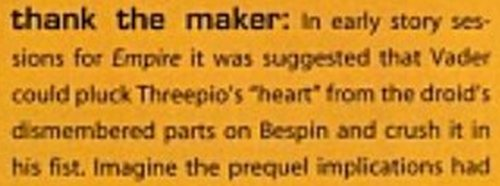
Our notes: `notes/materials/038-star-wars-insider/049-ins049.md:372`

## Star Wars Insider #50 (2000)

- Note (summary from our notes, not a quotation): Page contents: McCallum continued (C-3PO in Ep II, sets, locations, digital shooting) and Gavin Bocquet interview begins. (hand-read)
  — Source: Star Wars Insider #50 (2000).
Our notes: `notes/materials/038-star-wars-insider/050-ins050.md:79`

- Note (summary from our notes, not a quotation): Page contents: Master meets apprentice: Ralph McQuarrie and Doug Chiang conversation (Mark Cotta Vaz), pp. 60-64+: McQuarrie career, designing Vader mask, C-3PO, Chiang on Naboo starfighter. (hand-read)
  — Source: Star Wars Insider #50 (2000).
Our notes: `notes/materials/038-star-wars-insider/050-ins050.md:327`

## Star Wars Insider #51 (2000)

- Note (summary from our notes, not a quotation): » New planets
  — Source: Star Wars Insider #51 (2000).
(» New characters)
(» More C-3PO)
(» New location shooting)
(» Mace Windu and Yoda in combat)
((not against each other, I hope))
(» Boba Fett" Source: *Star Wars Insider #51* (2000), scan p.7)
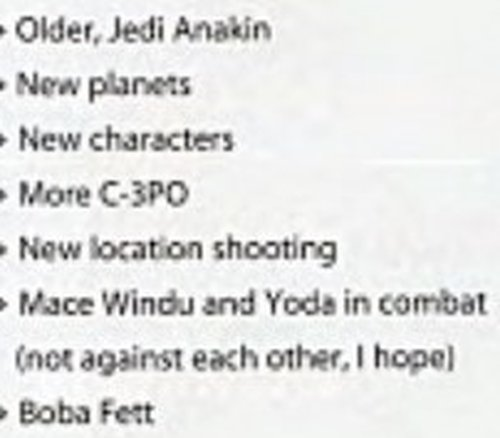
Our notes: `notes/materials/038-star-wars-insider/051-ins051.md:43`

## Star Wars Insider #52 (2000)

- Note (summary from our notes, not a quotation): Page contents: Scouting cont.: bagged C-3PO, Burger Chef posters, Burger King stickers. (hand-read)
  — Source: Star Wars Insider #52 (2000).
Our notes: `notes/materials/038-star-wars-insider/052-ins052.md:372`

## Star Wars Insider #53 (2001)

- Note (summary from our notes, not a quotation): Page contents: Topps Star Wars trading cards history (Gary Gerani): 1977 sets, C-3PO card #207, Yoda held back for Empire; continued p44. No power content. (hand-read)
  — Source: Star Wars Insider #53 (2001).
Our notes: `notes/materials/038-star-wars-insider/053-ins053.md:185`

## Star Wars Insider #54 (2001)

> Every Star Wars film requires a thousand new sounds
> [fragment — full passage not on file]
— Source: Star Wars Insider #54 (2001).
Note (our notes, around the quote): Page contents: Ben Burtt interview: picture editing is 90% of his work; Matt Wood recording rain forest; "Every Star Wars film requires a thousand new sounds"; his son recording C-3PO, R2 and a pyrotechnic lightsaber effect on set; nearly 150 scenes, 20-25 cut; temp CG character stand-ins and image collages ("Like Monty Python"). No in-universe character material. (hand-read)
Our notes: `notes/materials/038-star-wars-insider/054-ins054.md:222`

- Note (summary from our notes, not a quotation): Page contents: Jawa Trader specials cont.: Episode I C-3PO, Battle Droid, Opee & Qui-Gon Jinn, Captain Tarpals, Watto, Kaadu & Jar Jar Binks, R2-D2, Darth Maul (Tatooine), OOM-9, Jar Jar Binks, Ody Mandrell & droid, Gasgano & pit droid. Product listing only. (hand-read)
  — Source: Star Wars Insider #54 (2001).
Our notes: `notes/materials/038-star-wars-insider/054-ins054.md:252`

> Why don't we just shoot him?
— Source: Star Wars Insider #54 (2001).
Note (our notes, around the quote): Page contents: Indiana Jones feature cont.: Well of Souls snakes (7,000 more snakes; Karen Allen quote); "Truck? What Truck?" goofs box (tarantulas on Ford's shoulders, plane ID OB-CPO as an homage to two Star Wars characters, Ford's "Why don't we just shoot him?", hidden R2-D2 and C-3PO hieroglyphic in the Well of Souls, fly in Belloq's mouth, rat with equilibrium problem, shooting order). Real-world trivia; no character statements; S only. (hand-read)
Our notes: `notes/materials/038-star-wars-insider/054-ins054.md:506`

## Star Wars Insider #55 (2001)

- Note (summary from our notes, not a quotation): Page contents: Daley feature cont. (magazine p. 49): radio drama poster captions; Anthony Daniels returned as See-Threepio for the Jedi radio drama because of Daley's scripts; a Lucas Licensing editor on working with Daley in 1995; the cast's tribute tape. "Daley Affirmation" sidebar continued (Vader, Emperor, R2, 3PO). (hand-read)
  — Source: Star Wars Insider #55 (2001).
Our notes: `notes/materials/038-star-wars-insider/055-ins055.md:277`

> had a real ability to capture Threepio's strange mixture of humorless comedy, his oddly bleak but loving personality. No other writer has been able to do this for Threepio, outside his movie incarnation. Only Brian, at the end of the Ewok storytelling scene, could find a radio way of capturing the droid's deeply felt frustration with Han Solo.
> [fragment — full passage not on file]
— Source: Star Wars Insider #55 (2001).
Note (our notes, around the quote): C-3PO; Han Solo — entry/section: Anthony Daniels on Brian Daley's radio writing for Threepio (verified on crop): ""had a real ability to capture Threepio's strange mixture of humorless comedy, his oddly bleak but loving personality. No other writer has been able to do this for Threepio, outside his movie incarnation. Only Brian, at the end of the Ewok storytelling scene, could find a radio way of capturing the droid's deeply felt frustration with Han Solo." —Anthony Daniels, Star Wars Insider 55, p. 49" Source: *Star Wars Insider #55* (2001), scan p.38
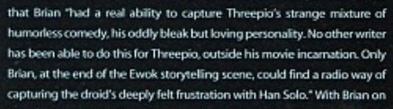
Our notes: `notes/materials/038-star-wars-insider/055-ins055.md:279`

- Note (summary from our notes, not a quotation): Page contents: Daley feature conclusion (magazine p. 50): Daley died March 1996 aged 48; Luceno on their collaboration (Galaxy Rangers, Robotech, Black Hole Travel Agency) and Daley's lost chance to relaunch the Star Wars novels; reprints of the Han Solo trilogy and radio dramas; pull quote repeats Daniels on Threepio; photo of Luceno, Barbieri and Daley at Tikal, 1994. (hand-read)
  — Source: Star Wars Insider #55 (2001).
Our notes: `notes/materials/038-star-wars-insider/055-ins055.md:290`

- Note (summary from our notes, not a quotation): Page contents: Star Wars on The Muppet Show feature opener spread, left page (magazine p. 52): title art with Luke Skywalker (Mark Hamill), C-3PO and Miss Piggy. (hand-read)
  — Source: Star Wars Insider #55 (2001).
Our notes: `notes/materials/038-star-wars-insider/055-ins055.md:297`

> Go along with this or I'll eat you in half
> [fragment — full passage not on file]
— Source: Star Wars Insider #55 (2001).
Note (our notes, around the quote): Page contents: Muppet Show feature (magazine p. 54): the 1980 episode with Luke, C-3PO, R2-D2 and Chewbacca on the planet Koozebane; Labyrinth as the only Lucas-Henson collaboration; group photo caption and pull quote of Miss Piggy's line to Luke Skywalker ("Go along with this or I'll eat you in half"); Muppet performer Dave Goelz on the Muppets and Star Wars heroes. (hand-read)
Our notes: `notes/materials/038-star-wars-insider/055-ins055.md:307`

- Note (summary from our notes, not a quotation): Page contents: Muppet Show feature cont. (magazine p. 55): "In a Vaudeville House Far, Far Away" (Angus McGonagle; Luke, C-3PO and R2-D2 blast into the dressing room); "Gotcha Copy Right Here" box on the Time-Life video; "Every Little Thing Counts" box (Summertime lyrics, non-Star Wars scenes, Chewbacca's "Wookiee Waltz", Hamill and Skywalker as separate characters, Koozebane); caption: Chewbacca and R2-D2 in a dance routine. (hand-read)
  — Source: Star Wars Insider #55 (2001).
Our notes: `notes/materials/038-star-wars-insider/055-ins055.md:314`

- Note (summary from our notes, not a quotation): Page contents: Muppet Show feature cont. (magazine p. 56): episode plot (Kermit, McGonagle, C-3PO, Chewbacca kidnapped); "The Muppet Connection" box (taped at ATV Borehamwood near Elstree; Henson first asked to create and perform Yoda; C-3PO and R2-D2 on Sesame Street in 1981); "Anthony Daniels Talks About the Muppets" interview opener (fan of the Muppets). (hand-read)
  — Source: Star Wars Insider #55 (2001).
Our notes: `notes/materials/038-star-wars-insider/055-ins055.md:323`

> I know it was a challenge for Frank to characterize something so old and green. I was very flattered when he asked me how I came up with C-3PO's voice. He was searching for a voice for Yoda at the time, as was George. Of course, being asked for advice by such an accomplished performer hushed me to incoherence. But we talked about believing in the characters we played and their own personalities rather than ours. I don't think I helped much but was delighted when they realized that everything about his voice and his timing was the character.
— Source: Star Wars Insider #55 (2001).
Note (our notes, around the quote): C-3PO; Yoda — entry/section: Anthony Daniels on Frank Oz asking how he found C-3PO's voice while Oz was searching for Yoda's (verified on crop): ""I know it was a challenge for Frank to characterize something so old and green. I was very flattered when he asked me how I came up with C-3PO's voice. He was searching for a voice for Yoda at the time, as was George. Of course, being asked for advice by such an accomplished performer hushed me to incoherence. But we talked about believing in the characters we played and their own personalities rather than ours. I don't think I helped much but was delighted when they realized that everything about his voice and his timing was the character." —Anthony Daniels, Star Wars Insider 55, p. 57" Source: *Star Wars Insider #55* (2001), scan p.45
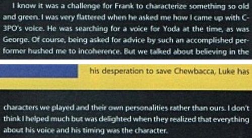
Our notes: `notes/materials/038-star-wars-insider/055-ins055.md:330`

> Shooting Gonzo into the Canon
> [fragment — full passage not on file]
— Source: Star Wars Insider #55 (2001).
Note (our notes, around the quote): Page contents: Muppet Show feature cont. (magazine p. 58): plot cont. (Swine Trek crew, Derth Nader, crash on Koozebane, Chewbacca's entrance); "Shooting Gonzo into the Canon" box placing the episode before Empire (timing, Luke's Bespin fatigues, Piggy as Leia); Daniels interview cont. (Sesame Street, working with Muppets, puppeteering C-3PO). (hand-read)
Our notes: `notes/materials/038-star-wars-insider/055-ins055.md:335`

> What do you expect? He's just been built by an eight year-old!
>
> —Anthony Daniels, Star Wars Insider 55, p. 58
> [fragment — full passage not on file]
— Source: Star Wars Insider #55 (2001).
Note (our notes, around the quote): C-3PO — entry/section: Anthony Daniels on C-3PO as a puppet in Episode I (verified on crop): ""C-3PO seemed a little awkward to me in Episode I. When I mentioned it to George he said, "What do you expect? He's just been built by an eight year-old!" 'Nuff said. So I did suggest I would puppeteer in this current movie. But I didn't aim to replicate anything from Episode I." —Anthony Daniels, Star Wars Insider 55, p. 58" Source: *Star Wars Insider #55* (2001), scan p.46
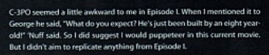
Our notes: `notes/materials/038-star-wars-insider/055-ins055.md:337`

- Note (summary from our notes, not a quotation): Page contents: Muppet Show feature conclusion (magazine p. 59): canon box cont. (Luke's psychology, Han absent, Derth Nader speculation); closing medley and Luke meeting "cousin" Mark Hamill; Daniels on puppeteering C-3PO for Episode II and the Swine Trek vs. Millennium Falcon; ordering info; author bio. (hand-read)
  — Source: Star Wars Insider #55 (2001).
Our notes: `notes/materials/038-star-wars-insider/055-ins055.md:342`

- Note (summary from our notes, not a quotation): Page contents: Comics Link: "Top 10 Reasons to Try the Tales" by Lee Dawson (magazine p. 74; the scan jumps from magazine p. 63 to p. 74): Star Wars Tales as a non-continuity comic; reasons 1-4 (Tales #1 with Vader hunting the Dark Woman and "Skippy the Jedi Droid"; the Tales #6 cover of Vader holding C-3PO's head; Boba Fett in love in Tales #7; Kevin Rubio's "A Death Star Is Born" and "Force Fiction" with Yoda and Mace Windu). (hand-read)
  — Source: Star Wars Insider #55 (2001).
Our notes: `notes/materials/038-star-wars-insider/055-ins055.md:375`

- Note (summary from our notes, not a quotation): Page contents: Full-page illustration by Jay Stephens (magazine p. 98): a giant C-3PO head idol in the Endor forest with an Ewok holding a spear, a plate of fruit, and stormtrooper helmets used as drums. No text besides credit. (hand-read)
  — Source: Star Wars Insider #55 (2001).
Our notes: `notes/materials/038-star-wars-insider/055-ins055.md:511`

## Star Wars Insider #56 (2001)

> a Jawa picks this month's letters
> [fragment — full passage not on file]
— Source: Star Wars Insider #56 (2001); Page contents: Masthead and Rebel Rumblings (magazine p. 4).
Note (our notes, around the quote): Page contents: Masthead and Rebel Rumblings (magazine p. 4): "a Jawa picks this month's letters" intro; letter asking why Anakin left C-3PO on Tatooine, editor reply about their destinies; letter to 2-1B mocking C-3PO, editor reply; letter about the Indiana Jones flip cover; top-right Episode I still with gag balloon "Seeya!"; "Wanna Rumble?" address box (letter-writer names omitted). (hand-read)
Our notes: `notes/materials/038-star-wars-insider/056-ins056.md:25`

- Note (summary from our notes, not a quotation): Page contents: Star Wars Weekends conclusion (magazine p. 24): kids' lightsaber duel with Vader, Tatooine Traders store, 2002 plans; captions (Kenny Baker with Vader helmet; Phil Brown and Mike Quinn handprints); Star Sightings continuation on the K-19: The Widowmaker lawsuit and National Geographic documentary; box on Weezer's Green Album guitar stickers (R2-D2, Chewbacca, C-3PO, Darth Vader) and Travis musician quote comparing music to the X-wing in the Death Star. (hand-read)
  — Source: Star Wars Insider #56 (2001).
Our notes: `notes/materials/038-star-wars-insider/056-ins056.md:102`

- Note (summary from our notes, not a quotation): Page contents: "A Touch of Wry: Anthony Daniels on Episode II" opener (magazine p. 44): full-page C-3PO head photo by Lisa Tomasetti. (hand-read)
  — Source: Star Wars Insider #56 (2001). POV: Page contents, about C-3PO.
Our notes: `notes/materials/038-star-wars-insider/056-ins056.md:211`

What it shows (our notes): Page contents: "A Touch of Wry" interview by Brian J. Robb begins (magazine p. 45): pull quote "You wouldn't want my life to get boring, would you?"; Daniels puppeteering C-3PO in Episode II with Don Bies' team, the heavy harness, early-morning gym sessions, rehearsing with a mirror; Daniels photo. (hand-read)
> The protocol droid said, “You wouldn’t want my life to get boring, would you?”
>
> R2-D2 whistled his reply. The crewmen made some final adjustments, then climbed down to the hangar floor. Luke lowered his cockpit canopy and his X-wing lifted off to a low hover. As he followed the other starfighters toward the wide doorway, he felt a twinge of fear about his mission. Do we really have any chance of defeating the Death Star?
— Source: Star Wars Insider #56 (2001). POV: Page contents, about C-3PO.
(Excerpt widened 2026-11-17 to the relevant passage, word for word from Star Wars®: Episode IV: A New Hope™ (by Ryder Windham, created by George Lucas) (text copy `MEGA_The_Episode_Junior_Novelizations_Star_Wars_Episode_IV_A_New_Hope_Junior_Novelization_Ryder_Windham_epub`).)
Our notes: `notes/materials/038-star-wars-insider/056-ins056.md:216`

- Note (summary from our notes, not a quotation): Page contents: "A Touch of Wry" cont. (magazine p. 46): voice vs. physical performance of C-3PO, less is more, telling Mark Hamill not to bother acting, new facets in Episode II, filming in Tunisia, Australian crew; pull quote; "The Man in the Golden Suit" sidebar header begins with photos. (hand-read)
  — Source: Star Wars Insider #56 (2001). POV: Page contents, about C-3PO.
Our notes: `notes/materials/038-star-wars-insider/056-ins056.md:221`

> That's quite a good question. The one thing you've possibly missed out is a kind of weird magic that sort of happened on the first day that I stood in the desert in 1976. That C-3PO saw to this himself. He's an entity that has something to do with me, something to do with George, with the suit, the voice, the environment ...
> [fragment — full passage not on file]
— Source: Star Wars Insider #56 (2001).
Note (our notes, around the quote): C-3PO — entry/section: Anthony Daniels on the magic of C-3PO: ""That's quite a good question. The one thing you've possibly missed out is a kind of weird magic that sort of happened on the first day that I stood in the desert in 1976. That C-3PO saw to this himself. He's an entity that has something to do with me, something to do with George, with the suit, the voice, the environment ..." —Anthony Daniels, Star Wars Insider 56, p. 46" Source: *Star Wars Insider #56* (2001), scan p.40
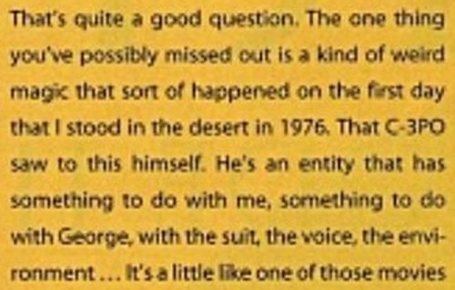
Our notes: `notes/materials/038-star-wars-insider/056-ins056.md:223`

> It's definitely a combination of voice and movement, because he doesn't move all the time. That would become tiresome. I'm quite selective in movements. You really have to remember less is more, because a small movement after a period of rest can speak volumes. Also he's a very distracting character in the gold, or in any format because he's visually interesting.
— Source: Star Wars Insider #56 (2001); C-3PO — entry/section: Anthony Daniels on C-3PO's movement.
Note (our notes, around the quote): C-3PO — entry/section: Anthony Daniels on C-3PO's movement: ""It's definitely a combination of voice and movement, because he doesn't move all the time. That would become tiresome. I'm quite selective in movements. You really have to remember less is more, because a small movement after a period of rest can speak volumes. Also he's a very distracting character in the gold, or in any format because he's visually interesting." —Anthony Daniels, Star Wars Insider 56, p. 46" Source: *Star Wars Insider #56* (2001), scan p.40
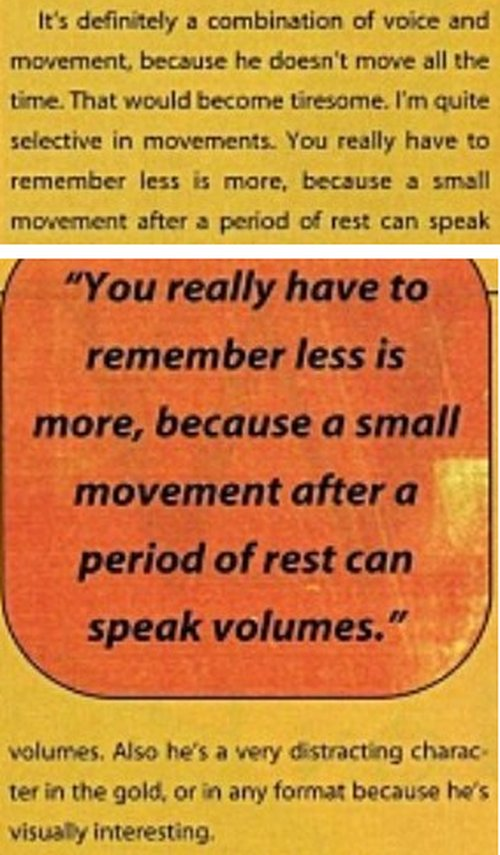
Our notes: `notes/materials/038-star-wars-insider/056-ins056.md:225`

> You're going to see new stuff, yes. I added in one line. I just turned a sentence around to give the character somewhere to have come from. I mean, he's not going anywhere, as we already know where he's been. Possibly I've added a wry touch. A touch of wry, yeah.
— Source: Star Wars Insider #56 (2001).
Note (our notes, around the quote): C-3PO — entry/section: Anthony Daniels on C-3PO in Episode II: ""You're going to see new stuff, yes. I added in one line. I just turned a sentence around to give the character somewhere to have come from. I mean, he's not going anywhere, as we already know where he's been. Possibly I've added a wry touch. A touch of wry, yeah." —Anthony Daniels, Star Wars Insider 56, p. 46" Source: *Star Wars Insider #56* (2001), scan p.40
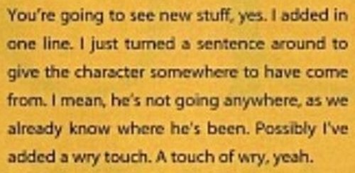
Our notes: `notes/materials/038-star-wars-insider/056-ins056.md:227`

> The Man in the Golden Suit: Anthony Daniels on Episodes I, IV, V, and VI
> [fragment — full passage not on file]
— Source: Star Wars Insider #56 (2001); Page contents. POV: Page contents, about C-3PO.
Note (our notes, around the quote): Page contents: "The Man in the Golden Suit: Anthony Daniels on Episodes I, IV, V, and VI" sidebar (magazine p. 47): photo of Lucas and C-3PO conferring at the Lars homestead; realizing Star Wars was a hit, Lucasfilm pretending C-3PO was a real robot, wanting acknowledgment, recognition only around Empire. (hand-read)
Our notes: `notes/materials/038-star-wars-insider/056-ins056.md:232`

> Only around The Empire Strikes Back, when they began to realize that it was okay to say I was in there. I think they realized they'd been overly protective of the character. Nobody's more protective of the character than me.
— Source: Star Wars Insider #56 (2001).
Note (our notes, around the quote): C-3PO — entry/section: Anthony Daniels on when he began to get recognition: ""Only around The Empire Strikes Back, when they began to realize that it was okay to say I was in there. I think they realized they'd been overly protective of the character. Nobody's more protective of the character than me." —Anthony Daniels, Star Wars Insider 56, p. 47" Source: *Star Wars Insider #56* (2001), scan p.41

Our notes: `notes/materials/038-star-wars-insider/056-ins056.md:234`

> The Man in the Golden Suit [continued]
> [fragment — full passage not on file]
— Source: Star Wars Insider #56 (2001). POV: Page contents, about C-3PO.
Note (our notes, around the quote): Page contents: "A Touch of Wry" cont. (magazine p. 48): being the "Grand Old Man" of Star Wars, preparatory sadness at the saga's ending, Ewan McGregor as Alec Guinness; caption gag on a "jaded Artoo-Detoo" unimpressed by Daniels; "The Man in the Golden Suit [continued]" - hesitation about returning for Empire, the heat of 1976, "Threepio is human" matchbooks, suit and droid malfunctions, mime training, Liz Moore's sculpture. (hand-read)
Our notes: `notes/materials/038-star-wars-insider/056-ins056.md:239`

> I've always been very fond of Threepio, and I've always felt that he slightly needs—how can I say—not protecting, but he needs looking after.
— Source: Star Wars Insider #56 (2001); C-3PO — entry/section: Anthony Daniels on looking after Threepio.
Note (our notes, around the quote): C-3PO — entry/section: Anthony Daniels on looking after Threepio: ""I've always been very fond of Threepio, and I've always felt that he slightly needs—how can I say—not protecting, but he needs looking after." —Anthony Daniels, Star Wars Insider 56, p. 48" Source: *Star Wars Insider #56* (2001), scan p.42
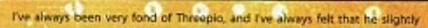
Our notes: `notes/materials/038-star-wars-insider/056-ins056.md:241`

> I did actually have some books of matches printed up with the words in gold on black, 'Threepio is human,' because I felt it was easy for people to forget that I was actually in there. Which in a way is a compliment.
— Source: Star Wars Insider #56 (2001).
Note (our notes, around the quote): C-3PO — entry/section: Anthony Daniels on being inside the suit: ""I did actually have some books of matches printed up with the words in gold on black, 'Threepio is human,' because I felt it was easy for people to forget that I was actually in there. Which in a way is a compliment." —Anthony Daniels, Star Wars Insider 56, p. 48" Source: *Star Wars Insider #56* (2001), scan p.42
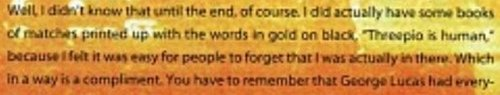
Our notes: `notes/materials/038-star-wars-insider/056-ins056.md:243`

- Note (summary from our notes, not a quotation): Page contents: "A Touch of Wry" cont. (magazine p. 49): praise for Hayden Christensen, the family atmosphere of the Australian shoot; caption gag on Daniels half-dressed for a Tatooine scene; "The Man in the Golden Suit" cont. - remade costume for Empire, quick suit by Jedi, Lucas describing Threepio's origin for Episode I; photo of the C-3PO puppet. (hand-read)
  — Source: Star Wars Insider #56 (2001). POV: Page contents, about C-3PO.
Our notes: `notes/materials/038-star-wars-insider/056-ins056.md:250`

> I had a meeting with George where he described how Threepio came about. And he said, 'You have a very small part, it's just to say hello.' I was thrilled to be asked anyway. ... Then he told me what Threepio would look like and where he would be from. I thought he was telling me that Alec Guinness had made my character, and I was really, really pleased. I thought, 'Alec was such a good friend that I think it's right that I was made by him.' A couple of days later I suddenly realized that Anakin Skywalker was not played by Alec Guinness. I'm not very good on all these names. I thought, 'Well, that really is interesting, that he's made by Anakin Skywalker, and he's a little boy.'
> [fragment — full passage not on file]
— Source: Star Wars Insider #56 (2001).
Note (our notes, around the quote): C-3PO; Darth Vader (Anakin Skywalker) — entry/section: Anthony Daniels on learning C-3PO's origin for Episode I: ""I had a meeting with George where he described how Threepio came about. And he said, 'You have a very small part, it's just to say hello.' I was thrilled to be asked anyway. ... Then he told me what Threepio would look like and where he would be from. I thought he was telling me that Alec Guinness had made my character, and I was really, really pleased. I thought, 'Alec was such a good friend that I think it's right that I was made by him.' A couple of days later I suddenly realized that Anakin Skywalker was not played by Alec Guinness. I'm not very good on all these names. I thought, 'Well, that really is interesting, that he's made by Anakin Skywalker, and he's a little boy.'" —Anthony Daniels, Star Wars Insider 56, pp. 49-50" Source: *Star Wars Insider #56* (2001), scan p.43
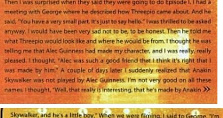
Our notes: `notes/materials/038-star-wars-insider/056-ins056.md:252`

> Praise or acknowledgement is very important in anything you do...
> [fragment — full passage not on file]
>
> The Man in the Golden Suit [cont]
> [fragment — full passage not on file]
— Source: Star Wars Insider #56 (2001). POV: Page contents, about C-3PO.
Note (our notes, around the quote): Page contents: "A Touch of Wry" conclusion (magazine p. 50): Lucas relaxed with Rick McCallum producing, plasma-screen monitoring, fondness for C-3PO; pull quote "Praise or acknowledgement is very important in anything you do..."; "The Man in the Golden Suit [cont]" - concern about the Episode I puppet, script suggestions, refusing to give away Episode II secrets; C-3PO photo. (hand-read)
Our notes: `notes/materials/038-star-wars-insider/056-ins056.md:257`

> Oh yeah, there was a time I thought I should just stop. And then I thought, well, the income I get from various things is very welcome, but really my fondness for the character of C-3PO is what has kept me attached for 25 years. I just like him. He's weird. A bit strange.
— Source: Star Wars Insider #56 (2001).
Note (our notes, around the quote): C-3PO — entry/section: Anthony Daniels on what has kept him with C-3PO: ""Oh yeah, there was a time I thought I should just stop. And then I thought, well, the income I get from various things is very welcome, but really my fondness for the character of C-3PO is what has kept me attached for 25 years. I just like him. He's weird. A bit strange." —Anthony Daniels, Star Wars Insider 56, p. 50" Source: *Star Wars Insider #56* (2001), scan p.44
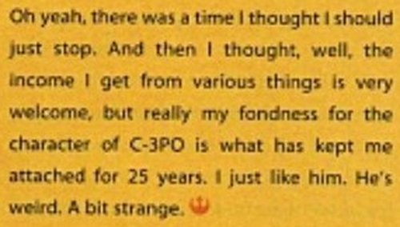
Our notes: `notes/materials/038-star-wars-insider/056-ins056.md:259`

> Yes, because of the circumstances George puts him in. But also I try and find new physical ways, and of course with a puppet that's dead easy, as it's like a different thing. But then the trick is to try and make him as much as the thing we know. It's kind of complicated, as I know where we're going.
— Source: Star Wars Insider #56 (2001).
Note (our notes, around the quote): C-3PO — entry/section: Anthony Daniels on finding something new in C-3PO: ""Yes, because of the circumstances George puts him in. But also I try and find new physical ways, and of course with a puppet that's dead easy, as it's like a different thing. But then the trick is to try and make him as much as the thing we know. It's kind of complicated, as I know where we're going." —Anthony Daniels, Star Wars Insider 56, p. 50" Source: *Star Wars Insider #56* (2001), scan p.44
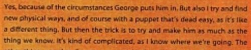
Our notes: `notes/materials/038-star-wars-insider/056-ins056.md:261`

> Yeah, same universe, and a lot of people draw the comparison between Jay and Bob and Threepio and Artoo. It was never anything I set out to do, but once somebody put that theory out there, I thought, 'Absolutely.'
— Source: Star Wars Insider #56 (2001).
Note (our notes, around the quote): C-3PO; R2-D2 — entry/section: Kevin Smith on Jay and Bob as Threepio and Artoo: ""Yeah, same universe, and a lot of people draw the comparison between Jay and Bob and Threepio and Artoo. It was never anything I set out to do, but once somebody put that theory out there, I thought, 'Absolutely.'" —Kevin Smith, Star Wars Insider 56, p. 12 (Kevin Smith flip section)" Source: *Star Wars Insider #56* (2001), scan p.73
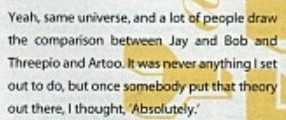
Our notes: `notes/materials/038-star-wars-insider/056-ins056.md:431`

## Star Wars Insider #57 (2001)

- Note (summary from our notes, not a quotation): Page contents: Star Sightings by Sue Weinlein Cook (magazine p. 22): Natalie Portman (New York "Summer Fun Cover Girl", Zoolander cameo); C-3PO #5 in Moviefone.com's sexiest-robot poll; Anthony Daniels on British TV; Popcorn.co.uk poll; Samuel L. Jackson in No Good Deed and his CNN remark on asking for a violet lightsaber, editor's note that George gave Mace Windu the purple lightsaber; Christopher Lee (Count Dooku) made CBE, Gormenghast; Mark Hamill on Jay and Silent Bob Strike Back; Carrie Fisher cameo; Peter Serafinowicz, Jay Laga'aia; Mel's Drive-In; Oscar digital rule; The Magic of Myth exhibit in Toledo. (hand-read)
  — Source: Star Wars Insider #57 (2001).
Our notes: `notes/materials/038-star-wars-insider/057-ins057.md:85`

- Note (summary from our notes, not a quotation): Page contents: Star News (magazine p. 23): McGregor's Highland Games role, polar-bear documentary "The Bear Facts" and short-film judging; "Artoo's Story Revealed" box - spoof documentary "Artoo Detoo: Beneath the Dome" (joke captions about Artoo's "drinking problem", American Graffiti and Richard Dreyfuss, shadowing Coppola and Lucas; verified on crop), airing with The Phantom Menace's Fox broadcast premiere November 25 and on starwars.com; Magic of Myth exhibit highlights (C-3PO, R2-D2, Chewbacca, Yoda, Darth Vader, Jabba the Hutt and Salacious Crumb, audio tour by James Earl Jones). (hand-read)
  — Source: Star Wars Insider #57 (2001).
Our notes: `notes/materials/038-star-wars-insider/057-ins057.md:92`

> a sweet, lovely boy
> [fragment — full passage not on file]
>
> Darth Vader's right-hand man
> [fragment — full passage not on file]
— Source: Star Wars Insider #57 (2001); Page contents: Logan feature (magazine p. 38): Morrison on Logan (.
Note (our notes, around the quote): Page contents: Logan feature (magazine p. 38): Morrison on Logan ("a sweet, lovely boy" who told Christopher Lee and Samuel Jackson he'd seen them in movies); Logan's family; Morrison as his Maori screen dad who kept calling him "son"; best friend on set Ewan McGregor; pull quote that he told people he plays a baby Ewok. Timeline sidebar "The Fett Effect" part 1: 1978 Ready! Fett! Go! (Joe Johnston's design, he painted Fett's armor himself); 1978 Cartoon Debut (Holiday Special, C-3PO reveals him as "Darth Vader's right-hand man"); 1979 It Figures (mail-away action figure); 1980 It Takes Two to Jango (Jeremy Bulloch in costume, voice by Jason Wingreen; both interviewed in Insider #49); 1983 Return of the Fett-I (Sarlacc fate; editor's aside about Zuckuss, Dengar and Bossk). Photos of Bulloch and Wingreen. (hand-read)
Our notes: `notes/materials/038-star-wars-insider/057-ins057.md:195`

## Star Wars Insider #58 (2002)

> Australian actor Joel Edgerton takes on the role of Owen Lars in Episode II. Photo by Sue Adler. *(hand-read)*
— Source: Star Wars Insider #58 (2002). POV: Page contents, about C-3PO.
Note (our notes, around the quote): Page contents: "Lars Attacks" cont. (magazine p. 34): a friend put all of Phil Brown's lines on a CD so he could learn the rhythm and accent; Owen's hands-on-hips posture came from the heavy costume; first day on set exchanged the C-3PO purchase dialogue with Anthony Daniels, R2-D2 milling around; shooting at the original Lars homestead location in Tunisia. Full-length costume photo with caption "Australian actor Joel Edgerton takes on the role of Owen Lars in Episode II. Photo by Sue Adler." (hand-read)
Our notes: `notes/materials/038-star-wars-insider/058-ins058.md:197`

> And there I was playing Luke Skywalker's uncle.
— Source: Star Wars Insider #58 (2002). POV: Page contents, about C-3PO.
Note (our notes, around the quote): Page contents: "Lars Attacks" ends (magazine p. 35): the homestead crater and vaporators as "the highlight"; "And there I was playing Luke Skywalker's uncle." Test Your Knowledge box (four questions; upside-down answers: a restraining bolt, See-Threepio, Bocce, Jawas). (hand-read)
Our notes: `notes/materials/038-star-wars-insider/058-ins058.md:202`

> 99% of the so-called George Lucas autographs on eBay are 100% bogus
> [fragment — full passage not on file]
— Source: Star Wars Insider #58 (2002).
Note (our notes, around the quote): Page contents: Scouting the Galaxy cont. (magazine p. 85), letters with names omitted, columnist replies summarized: authenticated Lucas signatures (a signed Episode II cap went for $700 at Dragon*Con; "99% of the so-called George Lucas autographs on eBay are 100% bogus"); Hallmark School Days reproduction lunch boxes at 75% size, $10.95 (SW 1999, ESB and ROTJ 2000); the 1977 Christmas newspaper ad with holiday greetings from Tarkin, C-3PO, Darth Vader and Han Solo was a real national Fox ad, not a joke. (hand-read)
Our notes: `notes/materials/038-star-wars-insider/058-ins058.md:443`

## Star Wars Insider #59 (2002)

> Everybody was united under one umbrella
> [fragment — full passage not on file]
— Source: Star Wars Insider #59 (2002).
Note (our notes, around the quote): Page contents: AotC Update end (magazine p. 14): McCallum's fondest Celebration memory is the rain ("Everybody was united under one umbrella"); photos of Padmé and Anakin before Queen Jamillia, Obi-Wan's hologram via R2-D2 aboard the Naboo Royal Cruiser, C-3PO and R2-D2, Ewan McGregor and Temuera Morrison filming the battle with real water. (hand-read)
Our notes: `notes/materials/038-star-wars-insider/059-ins059.md:89`

- Note (summary from our notes, not a quotation): Page contents: Auction for America items cont. (magazine p. 22): Darth Maul stunt lightsaber used by Ray Park ($45,111.56); ILM-made Jedi lightsaber; customized ILM model kits (Millennium Falcon $8,688.50, STAP with battle droid, Luke's X-wing, Anakin's Podracer, Trade Federation AAT, Slave I, snowspeeder, Boba Fett, R2-D2 and C-3PO, Princess Leia, AT-AT) with opening and winning bids. (hand-read)
  — Source: Star Wars Insider #59 (2002).
Our notes: `notes/materials/038-star-wars-insider/059-ins059.md:136`

> You can't control the characters
> [fragment — full passage not on file]
>
> Chewie is 200 years old
> [fragment — full passage not on file]
— Source: Star Wars Insider #59 (2002).
Note (our notes, around the quote): Page contents: Mayhew interview end (magazine p. 34): passing out on Cloud City carrying Threepio; Empire is his favorite; the Holiday Special, The Muppet Show, the 1997 MTV Lifetime Achievement medal from Carrie Fisher; Chewie's death in Vector Prime ("You can't control the characters"); next film Bigfoot Among Us; hopes to return in Episode III ("Chewie is 200 years old"). (hand-read)
Our notes: `notes/materials/038-star-wars-insider/059-ins059.md:222`

> I was so spoiled I didn't realize how lucky I was. I just assumed I would get the job.
— Source: Star Wars Insider #59 (2002).
Note (our notes, around the quote): Page contents: Wilson feature cont. (magazine p. 66): headline pull quote "I was so spoiled I didn't realize how lucky I was. I just assumed I would get the job." -Lucy Autrey Wilson; Lucasfilm Licensing in L.A. under Charlie Lippincott and the founding of ILM in Van Nuys; casual Marin culture (Friday lunches, volleyball injuries); seeing the rough cut and opening-day lines; "Home on the Range" - Jane Bay hired as Lucas's assistant; photo captions (George Lucas with daughter Amanda and Amber Wilson; Mark Hamill toast at a picnic). Sidebar "Those Dark Times": a humorous alternate history in which the typist omitted the C-3PO oil bath scene from the A New Hope script, so Luke never finds Leia's message and the Empire wins; Wilson recalls, "He noticed," and retyped the entire script. (hand-read)
Our notes: `notes/materials/038-star-wars-insider/059-ins059.md:506`

- Note (summary from our notes, not a quotation): Page contents: Bantha Tracks cont. (magazine p. 74): another contest story summary; letter in issue 23 from the then-14-year-old Ewok actor (gerbil, roller skates on set; later three roles in The Phantom Menace); "The Ewok Era" - issues 25-29 (Ewok movies, Jonathan Ke Quan, optical department, Miki Herman); Fisher at the 42nd World Science Fiction Convention; "After Star Wars" - issues 30-35 (Labyrinth, Howard the Duck, Captain Eo, Star Tours); Random Access prizes (Death Star sections, Bunker model, C-3PO costume piece, grand prize C-3PO's hand); issue 34 Soundsheet Edition (Ben Burtt, Randy Thom, Gary Summers); Lucas's farewell letter in issue 33. (hand-read)
  — Source: Star Wars Insider #59 (2002).
Our notes: `notes/materials/038-star-wars-insider/059-ins059.md:558`

## Star Wars Insider #60 (2002)

> will be much darker
> [fragment — full passage not on file]
— Source: Star Wars Insider #60 (2002).
Note (our notes, around the quote): Page contents: Lucas interview continued (magazine p. 56), sections "Dark Side Story" and "From Dreams to Screens": Episode III "will be much darker"; Star Wars grew out of a script too large for one film; the Episode IV title and the studio; creative control; constraints of the original trilogy's effects. Photos: Obi-Wan; Anakin and Padmé at the lake retreat; Lucas, C-3PO, R2-D2 and Rick McCallum. (hand-read)
Our notes: `notes/materials/038-star-wars-insider/060-ins060.md:405`

> I'm free to be as creative in whatever way I want to be—which means that if I make mistakes, they are my own mistakes.
— Source: Star Wars Insider #60 (2002).
Note (our notes, around the quote): Page contents: Lucas interview continued (magazine p. 57), section "Six Chapters, One Story": returning to make the backstory; ILM's effects giving him a novelist's freedom; Boba Fett's added role via Jango Fett; the prequels as character-driven backstory; Anakin's turn to evil. Pull quote: "I'm free to be as creative in whatever way I want to be—which means that if I make mistakes, they are my own mistakes." Captions identify Obi-Wan on Geonosis, Padmé and Anakin at Padmé's lake retreat, Lucas and McCallum with C-3PO and R2-D2, and Mace Windu and other Jedi arriving on Geonosis. (hand-read)
Our notes: `notes/materials/038-star-wars-insider/060-ins060.md:412`

- Note (summary from our notes, not a quotation): Page contents: Lucas interview continued (magazine p. 59), section "Characters": returning to the Tunisia homestead location; making the digital Yoda look like a puppet and bridging the Phantom Menace and Empire versions; expanding Mace Windu and Samuel L. Jackson; Count Dooku as an old gentleman rather than a monster; Darth Sidious needing an already-trained apprentice. Caption strip (top right) identifies Anakin and Padmé in the Geonosis arena, Lucas in Lake Como, R2-D2 and C-3PO reunited on Tatooine, and the Naboo Royal Cruiser landing on Coruscant. (hand-read)
  — Source: Star Wars Insider #60 (2002).
Our notes: `notes/materials/038-star-wars-insider/060-ins060.md:434`

- Note (summary from our notes, not a quotation): Page contents: Droids feature intro concludes (magazine p. 73): most droids are automated tools; R2-D2 and C-3PO as fully realized characters; droid personalities develop without memory wipes ("Aware droids" such as 2-1B); Obi-Wan's astromech R4-P17 continues the tradition. (hand-read)
  — Source: Star Wars Insider #60 (2002).
Our notes: `notes/materials/038-star-wars-insider/060-ins060.md:549`

> Subscribe! 6 issues only $19.95, see offer p. 121
> [fragment — full passage not on file]
— Source: Star Wars Insider #60 (2002).
Note (our notes, around the quote): Page contents: Jawa Trader: Miscellaneous — Episode I hardbound novel special edition signed by Terry Brooks (5,000 copies), limited edition Princess Leia cookie jar (1,000), Star Wars Celebration pass set (with Ahmed Best–signed Exhibitor Pass), Star Wars bobbleheads (Boba Fett, R2-D2 & C-3PO, Darth Vader; 4,000 each), Star Wars Insider back issues #52–#59 with contents; "Subscribe! 6 issues only $19.95, see offer p. 121". (hand-read)
Our notes: `notes/materials/038-star-wars-insider/060-ins060.md:769`

## Star Wars Insider #61 (2002)

- Note (summary from our notes, not a quotation): Page contents: Official Star Wars Fan Club online store catalog (swfan.wizards.com): contents, keyword search, member pricing; limited-edition Bobblehead Set Series One (Darth Vader, Boba Fett, C-3PO with R2-D2). (hand-read)
  — Source: Star Wars Insider #61 (2002).
Our notes: `notes/materials/038-star-wars-insider/061-ins061.md:372`

- Note (summary from our notes, not a quotation): Page contents: Sith Rising Card Encyclopedia, Characters: Aayla Secura, Anakin Skywalker (two), Aurra Sing, C-3PO, Chancellor Palpatine, Clone Captain, Clone Trooper 6/298, Darth Maul (four versions), Darth Sidious, Darth Tyranus (two); intro box on the set's rarities. Card rules text too small to transcribe reliably from the scan. (hand-read)
  — Source: Star Wars Insider #61 (2002).
Our notes: `notes/materials/038-star-wars-insider/061-ins061.md:449`

> Today's Special—Frozen Scoundrel with a Side of Steamed Wookiee
> [fragment — full passage not on file]
— Source: Star Wars Insider #61 (2002).
Note (our notes, around the quote): Page contents: Set Piece: "Cloud City Carbon-Freezing Chamber" by Chris Reiff & Chris Trevas ("Today's Special—Frozen Scoundrel with a Side of Steamed Wookiee"): Elstree Studios Stage 5, summer 1979; set design and lighting; Kershner and Ford reworking Han's reply to "I love you". Captions on C-3PO's head, Chewie's droid backpack, stormtroopers on the platform. (hand-read)
Our notes: `notes/materials/038-star-wars-insider/061-ins061.md:547`

- Note (summary from our notes, not a quotation): Page contents: Full-page illustration by Jay Stephens (2001): two Jawas working on a droid dome, with R2-D2, C-3PO and a GNK droid. (hand-read)
  — Source: Star Wars Insider #61 (2002).
Our notes: `notes/materials/038-star-wars-insider/061-ins061.md:653`

## Star Wars Insider #62 (2002)

- Note (summary from our notes, not a quotation): Page contents: Jawa Trader cont.: Attack of the Clones one-sheet poster (Drew Struzan), Fan Club bobblehead set (Vader, Boba Fett, C-3PO with R2-D2), Ki-Adi-Mundi 12" figure, Princess Leia cookie jar, Hardware Wars DVD. (hand-read)
  — Source: Star Wars Insider #62 (2002).
Our notes: `notes/materials/038-star-wars-insider/062-ins062.md:495`

- Note (summary from our notes, not a quotation): Page contents: "Star Wars Q&A with Pablo Hidalgo": crystal vs electrum lightsabers, Jabba's voice, Padmé's fall on Geonosis, why Jango hired Zam, why Jango didn't kill Obi-Wan and Anakin, Artoo's rockets, Threepio's coverings deleted scene. (hand-read)
  — Source: Star Wars Insider #62 (2002). POV: Page contents, about C-3PO.
Our notes: `notes/materials/038-star-wars-insider/062-ins062.md:692`

> Looking to cut down on the running time of the movie, Lucas removed this scene with Padmé and Threepio, but that left a problem: Threepio would spontaneously generate coverings with no explanation. So, Lucas instead shot bluescreen footage of Anthony Daniels in the silver Threepio costume and digitally replaced the naked Threepio puppet in all the preceding shots.
— Source: Star Wars Insider #62 (2002).
Note (our notes, around the quote): Padmé Amidala; C-3PO — entry/section: Q&A: Threepio's coverings fix: "Looking to cut down on the running time of the movie, Lucas removed this scene with Padmé and Threepio, but that left a problem: Threepio would spontaneously generate coverings with no explanation. So, Lucas instead shot bluescreen footage of Anthony Daniels in the silver Threepio costume and digitally replaced the naked Threepio puppet in all the preceding shots." Source: *Star Wars Insider #62* (2002), scan p.96
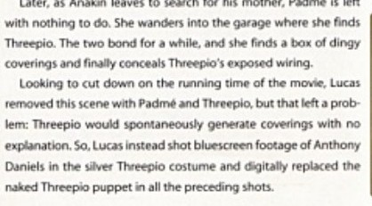
Our notes: `notes/materials/038-star-wars-insider/062-ins062.md:694`

- Note (summary from our notes, not a quotation): Page contents: Q&A cont.: Threepio change late in production; R4-P17's body; Owen as Anakin's stepbrother; Padmé's "shift" button; Jango's head and helmet; Rothana Heavy Engineering's clone army hardware. (hand-read)
  — Source: Star Wars Insider #62 (2002).
Our notes: `notes/materials/038-star-wars-insider/062-ins062.md:709`

## Star Wars Insider #63 (2002)

- Note (summary from our notes, not a quotation): Page contents: Q&A with Pablo Hidalgo: Force lightning is inherently dark side; C-3PO's memory and Owen Lars; Padmé's surname Naberrie vs. Amidala; "Utinni!"; why wampas evade life-form scanners. (hand-read)
  — Source: Star Wars Insider #63 (2002).
Our notes: `notes/materials/038-star-wars-insider/063-ins063.md:575`

## Star Wars Insider #64 (2002)

- Note (summary from our notes, not a quotation): Page contents: Ewok Village captions: Logray, the C-3PO costume, Luke's lightsaber prop, Han's blaster prop. (hand-read)
  — Source: Star Wars Insider #64 (2002).
Our notes: `notes/materials/038-star-wars-insider/064-ins064.md:482`

- Note (summary from our notes, not a quotation): Page contents: Q&A (Pablo Hidalgo): C-3PO's on/off switch, cyberostasis, Gardulla the Hutt, why Luke calls R5-D4 an R2 unit. (hand-read)
  — Source: Star Wars Insider #64 (2002).
Our notes: `notes/materials/038-star-wars-insider/064-ins064.md:527`

- Note (summary from our notes, not a quotation): Page contents: Q&A: Red 6 at Yavin, Yoda and the pillar, C-3PO's silver leg, Obi-Wan's lightsaber in A New Hope. (hand-read)
  — Source: Star Wars Insider #64 (2002).
Our notes: `notes/materials/038-star-wars-insider/064-ins064.md:532`

## Star Wars Insider #66 (2003)

- Note (summary from our notes, not a quotation): Page contents: Scouting the Galaxy (collectibles Q&A): bagged C-3PO figure, 1977 Topps wax packs (reader names omitted). (hand-read)
  — Source: Star Wars Insider #66 (2003).
Our notes: `notes/materials/038-star-wars-insider/066-ins066.md:447`

- Note (summary from our notes, not a quotation): Page contents: Insider Interview: C-3PO by Kevin Rubio, illustrated by Ken Steacy (humor piece). (hand-read)
  — Source: Star Wars Insider #66 (2003).
Our notes: `notes/materials/038-star-wars-insider/066-ins066.md:497`

- Note (summary from our notes, not a quotation): Page contents: C-3PO interview continued: six million forms of communication, droids and programming, relationship with R2-D2. (hand-read)
  — Source: Star Wars Insider #66 (2003).
Our notes: `notes/materials/038-star-wars-insider/066-ins066.md:502`

> Primarily, I am an interpreter and am capable of over six million forms of communication thanks to a TranLang III Communicator module coupled with an AA-1 VerboBrain—
> [fragment — full passage not on file]
— Source: Star Wars Insider #66 (2003).
Note (our notes, around the quote): C-3PO — entry/section: C-3PO interview: six million forms of communication: ""Primarily, I am an interpreter and am capable of over six million forms of communication thanks to a TranLang III Communicator module coupled with an AA-1 VerboBrain—" —C-3PO, Star Wars Insider 66, p. 95" Source: *Star Wars Insider #66* (2003), scan p.95
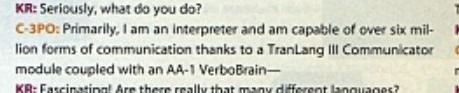
Our notes: `notes/materials/038-star-wars-insider/066-ins066.md:504`

## Star Wars Insider #67 (2003)

- Note (summary from our notes, not a quotation): Page contents: Insider's Guide: Threepio, Wedge's return, the Emperor's enunciation. (hand-read)
  — Source: Star Wars Insider #67 (2003).
Our notes: `notes/materials/038-star-wars-insider/067-ins067.md:176`

- Note (summary from our notes, not a quotation): Page contents: Full-page illustration for "The Trouble with Squibs" (Han, Leia, Chewbacca, C-3PO). (hand-read)
  — Source: Star Wars Insider #67 (2003).
Our notes: `notes/materials/038-star-wars-insider/067-ins067.md:330`

## Star Wars Insider #71 (2003)

- Note (summary from our notes, not a quotation): Page contents: Prequel Update photos: Giddean Danu and Bana Breemu visit Padmé's apartment; C-3PO (Anthony Daniels) on the veranda set; handmaidens Ellé and Moteé; Jay Laga'aia (Captain Typho) in makeup. (hand-read)
  — Source: Star Wars Insider #71 (2003).
Our notes: `notes/materials/038-star-wars-insider/071-ins071.md:50`

- Note (summary from our notes, not a quotation): Page contents: Hyperspace column: the Episode III webcam and set diaries; excerpts from an online chat with Anthony Daniels (fan usernames omitted) on the Clone Wars cartoon, watching lightsaber duels, and new C-3PO neck pieces. (hand-read)
  — Source: Star Wars Insider #71 (2003).
Our notes: `notes/materials/038-star-wars-insider/071-ins071.md:90`

> After all these years, I've finally worked out that if the holes in the neck were moved forward about 10 mm on each side, I wouldn't feel like I was in the grip of a demented Vader every time I shoot a scene.
— Source: Star Wars Insider #71 (2003).
Note (our notes, around the quote): C-3PO — entry/section: Hyperspace chat: Anthony Daniels on the C-3PO suit: ""After all these years, I've finally worked out that if the holes in the neck were moved forward about 10 mm on each side, I wouldn't feel like I was in the grip of a demented Vader every time I shoot a scene." —Anthony Daniels, Star Wars Insider 71, p. 17" Source: *Star Wars Insider #71* (2003), scan p.17
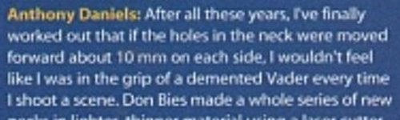
Our notes: `notes/materials/038-star-wars-insider/071-ins071.md:92`

- Note (summary from our notes, not a quotation): Page contents: Sansweet collection tour: movie artifacts (krayt dragon skeleton pieces, Cantina masks, C-3PO head and hands, a biker scout helmet, Han's stunt blaster, 4-LOM's crotch); the toy room. (hand-read)
  — Source: Star Wars Insider #71 (2003).
Our notes: `notes/materials/038-star-wars-insider/071-ins071.md:154`

- Note (summary from our notes, not a quotation): Page contents: A Short History of Star Wars Model Kits opens: kit parts in the original models; MPC's first kits (C-3PO, R2-D2, Vader figure and Action Model, X-wing, TIE, Millennium Falcon). (hand-read)
  — Source: Star Wars Insider #71 (2003).
Our notes: `notes/materials/038-star-wars-insider/071-ins071.md:194`

- Note (summary from our notes, not a quotation): Page contents: Behind the Magic, Anakin's home: the Leavesden Stage D hovel set ("home sweet home" for Lucas), found-object set dressing, toned-down bedroom; C-3PO as a "man of wires" rod puppet operated by Michael Lynch; the painted backdrop outside the door. (hand-read)
  — Source: Star Wars Insider #71 (2003).
Our notes: `notes/materials/038-star-wars-insider/071-ins071.md:324`

- Note (summary from our notes, not a quotation): Page contents: Behind the Magic photo captions: Qui-Gon's ration capsules made from pen caps, Anakin's costume echoing Luke's farm clothes, Threepio's inner workings and spinning brain. (hand-read)
  — Source: Star Wars Insider #71 (2003).
Our notes: `notes/materials/038-star-wars-insider/071-ins071.md:333`

- Note (summary from our notes, not a quotation): Page contents: Infinities: Return of the Jedi preview opens: alternate-history premise; writer Adam Gallardo on the divergence in Jabba's palace when Threepio's head pops off; Fett flees Tatooine with Han; how Gallardo pitched the story. (hand-read)
  — Source: Star Wars Insider #71 (2003).
Our notes: `notes/materials/038-star-wars-insider/071-ins071.md:352`

> The divergence takes place right at the beginning of the film in Jabba's palace. There's a moment between Jabba and Leia [disguised as Boushh] where Jabba strikes See-Threepio because he's unhappy with his translations. In the film, Threepio is just knocked around a bit, but in Infinities, he falls, and his head pops off and there's no one to translate between Jabba and Leia.
— Source: Star Wars Insider #71 (2003).
Note (our notes, around the quote): C-3PO; Jabba the Hutt; Leia Organa Solo — entry/section: Infinities: Return of the Jedi divergence: ""The divergence takes place right at the beginning of the film in Jabba's palace. There's a moment between Jabba and Leia [disguised as Boushh] where Jabba strikes See-Threepio because he's unhappy with his translations. In the film, Threepio is just knocked around a bit, but in Infinities, he falls, and his head pops off and there's no one to translate between Jabba and Leia." —Adam Gallardo, Star Wars Insider 71, p. 65" Source: *Star Wars Insider #71* (2003), scan p.65
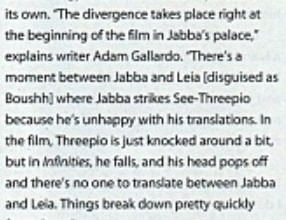
Our notes: `notes/materials/038-star-wars-insider/071-ins071.md:354`

- Note (summary from our notes, not a quotation): Page contents: Collecting column: Comic-Con and the Mexican Fan Club's first authorized collectors' convention, signing the silver Boba Fett exclusive; reader Q&A on Weingeroff Enterprises' 1977 metal jewelry (Vader head, R2-D2, C-3PO necklaces). (hand-read)
  — Source: Star Wars Insider #71 (2003).
Our notes: `notes/materials/038-star-wars-insider/071-ins071.md:364`

- Note (summary from our notes, not a quotation): Page contents: Q&A: the three Lars tombstones; TC protocol droid designations; Leia's and Padme's "court voice" accents; why C-3PO didn't recognize Leia (radio drama override by Captain Antilles); Obi-Wan's rebuilt lightsaber. (hand-read)
  — Source: Star Wars Insider #71 (2003).
Our notes: `notes/materials/038-star-wars-insider/071-ins071.md:424`

> The radio dramatization of A New Hope holds the answer to this query. Right before Darth Vader's Star Destroyer attacks Tantive IV, Captain Antilles recruits his droids, R2-D2 and C-3PO, to help Princess Leia.
— Source: Star Wars Insider #71 (2003).
Note (our notes, around the quote): Darth Vader (Anakin Skywalker); Leia Organa Solo — entry/section: Q&A: why Threepio didn't recognize Leia: "The radio dramatization of A New Hope holds the answer to this query. Right before Darth Vader's Star Destroyer attacks Tantive IV, Captain Antilles recruits his droids, R2-D2 and C-3PO, to help Princess Leia." Source: *Star Wars Insider #71* (2003), scan p.79
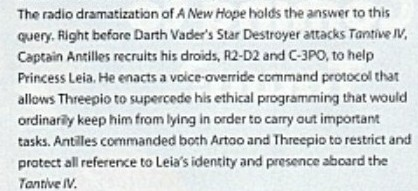
Our notes: `notes/materials/038-star-wars-insider/071-ins071.md:426`

## Star Wars Insider #72 (2003)

- Note (summary from our notes, not a quotation): Page contents: Toy Box (Hasbro): the Jedi Master Points Auction; a preview of 2004 basic and deluxe figures (Hoth Trooper, R-3PO, Luke Hoth Attack, Wampa with cave, General Rieekan, C-3PO with escape pod); the late-2003 Outlander Club wave (Ayy Vida, Elan Sleazebaggano, Obi-Wan); animated Clone Wars figures for spring 2004. (hand-read)
  — Source: Star Wars Insider #72 (2003).
Our notes: `notes/materials/038-star-wars-insider/072-ins072.md:455`

- Note (summary from our notes, not a quotation): Page contents: Toy Box photo page (printed p. 79): numbered captions for the new figures, including R-3PO's first action figure, the Outlander Club bar pieces, the Clone Wars animated Yoda and Anakin, General Rieekan and C-3PO's escape pod. (hand-read)
  — Source: Star Wars Insider #72 (2003).
Our notes: `notes/materials/038-star-wars-insider/072-ins072.md:460`

## Star Wars Insider #73 (2004)

> What happened with the droid factory is we realized—after reviewing the film during the pick-up shooting in London—that there was just too much plot. The [characters] arrived at the planet and were instantly captured. It wasn't exciting. So instead of saying, 'Well, we screwed up,' we decided to do something about it.
— Source: Star Wars Insider #73 (2004).
Note (our notes, around the quote): Darth Vader (Anakin Skywalker); Padmé Amidala; C-3PO; R2-D2 — entry/section: McCallum on the droid factory: ""What happened with the droid factory is we realized—after reviewing the film during the pick-up shooting in London—that there was just too much plot. The [characters] arrived at the planet and were instantly captured. It wasn't exciting. So instead of saying, 'Well, we screwed up,' we decided to do something about it." —Rick McCallum, Star Wars Insider 73, p. 6" Source: *Star Wars Insider #73* (2004), scan p.6
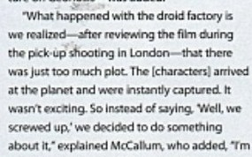
Our notes: `notes/materials/038-star-wars-insider/073-ins073.md:41`

## Star Wars Insider #74 (2004)

- Note (summary from our notes, not a quotation): Page contents: NJO: Star by Star synopsis; memorable beasties and ideas (voxyn, slashrats, YVH droids, grutchins, the Krizlaws, Alpha Red, Threepio's mortality, the seedship nursery, Jacen's homecoming, Zonama Sekot's defence). (hand-read)
  — Source: Star Wars Insider #74 (2004).
Our notes: `notes/materials/038-star-wars-insider/074-ins074.md:161`

## Star Wars Insider #75 (2004)

- Note (summary from our notes, not a quotation): Page contents: Prequel Update continued: McCallum on losing 20 or 30 minutes after the first assembly; photos of Ian McDiarmid, Hayden Christensen and Ewan McGregor at Fox Studios Australia, and C-3PO with photographer Ralph Nelson's cap. (hand-read)
  — Source: Star Wars Insider #75 (2004).
Our notes: `notes/materials/038-star-wars-insider/075-ins075.md:134`

- Note (summary from our notes, not a quotation): Page contents: Gentle Giant: scanning size doesn't matter; actors scanned repeatedly (Jeremy Bulloch scanned at Comic-Con); digital cleanup (Navarrete) of a sandtrooper-on-dewback file; sculptor Joseph Jung's 12-inch Chewbacca carrying a disassembled C-3PO. (hand-read)
  — Source: Star Wars Insider #75 (2004).
Our notes: `notes/materials/038-star-wars-insider/075-ins075.md:357`

- Note (summary from our notes, not a quotation): Page contents: Endor bunker photo callouts: Threepio programmed for etiquette, not breaking and entering; blast doors; the hole beneath the bunker for the stairs; Han's lock-picking; Artoo rigged with the Hoth scanner antenna; Han's and Leia's blasters. (hand-read)
  — Source: Star Wars Insider #75 (2004).
Our notes: `notes/materials/038-star-wars-insider/075-ins075.md:468`

## Star Wars Insider #76 (2004)

- Note (summary from our notes, not a quotation): Page contents: The Old Master continued: rejections at United Artists and Universal; pitching to Fox with McQuarrie paintings (Alan Ladd Jr.); weekly sessions with Lucas; the Tatooine painting of C-3PO and R2-D2; C-3PO inspired by Maria from Fritz Lang's Metropolis. (hand-read)
  — Source: Star Wars Insider #76 (2004).
Our notes: `notes/materials/038-star-wars-insider/076-ins076.md:293`

- Note (summary from our notes, not a quotation): Page contents: The Old Master continued: Threepio made "a boy"; the droid's final look with Liz Moore; Chewbacca designs and Stuart Freeborn's lemur-like Wookiee. (hand-read)
  — Source: Star Wars Insider #76 (2004).
Our notes: `notes/materials/038-star-wars-insider/076-ins076.md:298`

## Star Wars Insider #78 (2004)

- Note (summary from our notes, not a quotation): Page contents: Factoids continued: the wampa suit (worn by Howie Weed) and unfilmed wampa ideas; Hobbie and Veers in the Empire novelization; freeze-frame finds (the cantina flipper hand, R2 on the stairs, the "Ice Cream Guy," a TIE pilot hit by an asteroid, Leia shutting her eyes as she fires, Threepio's sticky pad, the Greedo mannequin). (hand-read)
  — Source: Star Wars Insider #78 (2004).
Our notes: `notes/materials/038-star-wars-insider/078-ins078.md:246`

> I can't abide these Jawas
> [fragment — full passage not on file]
— Source: Star Wars Insider #78 (2004); Page contents: Anatomy continued (illustrated cutaway with C-3PO's.
Note (our notes, around the quote): Page contents: Anatomy continued (illustrated cutaway with C-3PO's "I can't abide these Jawas" header): the "Umbrella" droid (WED 15 Septoid 2); R1-G4; R5-D4 built from an R2 head; Owen (Phil Brown) haggling with the head Jawa (Jack Purvis); the "Dome" droid LIN-V8K; Tatooine's name from Tataouine; the Jawa ion gun made from a Lee-Enfield rifle. (hand-read)
Our notes: `notes/materials/038-star-wars-insider/078-ins078.md:326`

> I can't abide these Jawas. Disgusting creatures.
— Source: Star Wars Insider #78 (2004); C-3PO — entry/section: Jawas.
Note (our notes, around the quote): C-3PO — entry/section: Jawas: ""I can't abide these Jawas. Disgusting creatures." —C-3PO, Star Wars Insider 78, p. 53" Source: *Star Wars Insider #78* (2004), scan p.53
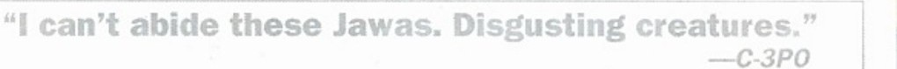
Our notes: `notes/materials/038-star-wars-insider/078-ins078.md:328`

- Note (summary from our notes, not a quotation): Page contents: Q&A continued: C-3PO's color in the Clone Wars microseries; Spotlight Question "The Vest Is Yet to Come" on Han's sleeveless vest in the carbon-freeze close-ups (fixed by ILM on the DVD) and flipped rank badges aboard the Executor; klicks and parsecs. (hand-read)
  — Source: Star Wars Insider #78 (2004).
Our notes: `notes/materials/038-star-wars-insider/078-ins078.md:402`

- Note (summary from our notes, not a quotation): Page contents: Hyperspace "From the Archives" photo page (edited by Paul Ens; content by Pablo Hidalgo): C-3PO and Oola; Robert Watts on the tauntaun prop; Episode I Senate delegations; the blasted wampa at Echo Base; Massassi Base maquette; the Luke/Biggs reunion; Jabba's Special Edition dancers. (hand-read)
  — Source: Star Wars Insider #78 (2004).
Our notes: `notes/materials/038-star-wars-insider/078-ins078.md:561`

> Star Wars is a pop culture marvel. *(hand-read)*
— Source: Star Wars Insider #78 (2004).
Note (our notes, around the quote): Page contents: Bantha Tracks continued: long-time costumers then and now (Darth Vader since 1977, stormtroopers, a C-3PO family photo, a bandaged 1977 Luke); "Star Wars is a pop culture marvel." (hand-read)
Our notes: `notes/materials/038-star-wars-insider/078-ins078.md:581`

## Star Wars Insider #79 (2005)

> Luke, I am your father
> [fragment — full passage not on file]
>
> Which villain most resembles your boss?
— Source: Star Wars Insider #79 (2005).
Note (our notes, around the quote): Page contents: Skywalking News "Star News From Around the Galaxy": AFI Life Achievement Award for George Lucas (June 2005 gala); C-3PO joins R2-D2 in Carnegie Mellon's Robot Hall of Fame (inducted Oct. 11, 2004, with Anthony Daniels present); "Luke, I am your father" ranked eighth on Sky One's Ultimate Sci-Fi Top 10; Darth Vader wins careerone.com's "Which villain most resembles your boss?" poll with 39.66 percent. (hand-read)
Our notes: `notes/materials/038-star-wars-insider/079-ins079.md:141`

> C-3PO is one of the most memorable characters from...Star Wars,
> [fragment — full passage not on file]
>
> He demonstrates many appealing human traits—and he received the most nominations from the public on the Robot Hall of Fame website.
— Source: Star Wars Insider #79 (2005); C-3PO — entry/section: Robot Hall of Fame.
Note (our notes, around the quote): C-3PO — entry/section: Robot Hall of Fame: ""C-3PO is one of the most memorable characters from...Star Wars," said Professor James H. Morris... "He demonstrates many appealing human traits—and he received the most nominations from the public on the Robot Hall of Fame website." —James H. Morris, Star Wars Insider 79, p. 22" Source: *Star Wars Insider #79* (2005), scan p.22
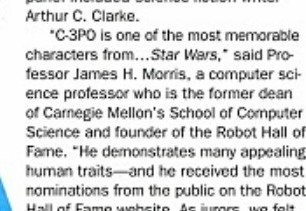
Our notes: `notes/materials/038-star-wars-insider/079-ins079.md:145`

> Thanks for the 30 years of adventure,
> [fragment — full passage not on file]
— Source: Star Wars Insider #79 (2005); C-3PO — entry/section: Daniels wraps.
Note (our notes, around the quote): C-3PO — entry/section: Daniels wraps: ""Thanks for the 30 years of adventure," says George Lucas to him, as they shake hands after Daniels' last take. —George Lucas, Star Wars Insider 79, p. 82" Source: *Star Wars Insider #79* (2005), scan p.82
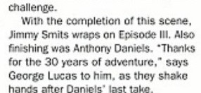
Our notes: `notes/materials/038-star-wars-insider/079-ins079.md:549`

- Note (summary from our notes, not a quotation): Page contents: Webdocs, "C-3PO: His Moment To Shine": quotes from Lucas, Anthony Daniels and Ewan McGregor on Threepio in Episode III. (hand-read)
  — Source: Star Wars Insider #79 (2005).
Our notes: `notes/materials/038-star-wars-insider/079-ins079.md:558`

> Threepio has been the fall guy or sort of the funny guy throughout all of these movies. And humor has been very important to the saga. And in this one, there really isn't that much because this is a pretty dark episode.
— Source: Star Wars Insider #79 (2005); C-3PO — entry/section: Threepio's darker episode.
Note (our notes, around the quote): C-3PO — entry/section: Threepio's darker episode: ""Threepio has been the fall guy or sort of the funny guy throughout all of these movies. And humor has been very important to the saga. And in this one, there really isn't that much because this is a pretty dark episode." —Anthony Daniels, Star Wars Insider 79, p. 83" Source: *Star Wars Insider #79* (2005), scan p.83
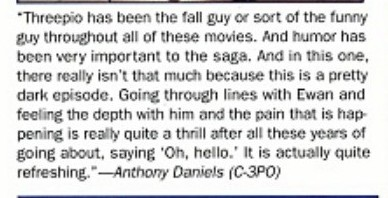
Our notes: `notes/materials/038-star-wars-insider/079-ins079.md:560`

> The great thing about Episode III is that he is in his milieu, for the first time he is golden.
— Source: Star Wars Insider #79 (2005); C-3PO — entry/section: In his milieu.
Note (our notes, around the quote): C-3PO — entry/section: In his milieu: ""The great thing about Episode III is that he is in his milieu, for the first time he is golden." —Anthony Daniels, Star Wars Insider 79, p. 83" Source: *Star Wars Insider #79* (2005), scan p.83
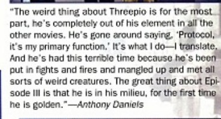
Our notes: `notes/materials/038-star-wars-insider/079-ins079.md:562`

## Star Wars Insider #80 (2005)

- Note (summary from our notes, not a quotation): Page contents: Letters (Comlink): handmade Star Wars quilt; "Set Piece" praise (Lott Dod in the Geonosian war room); C-3PO keeps getting taken apart (Anthony Daniels is fine); requests to revive Rob Coleman's "Behind the Magic"; Holiday Special on DVD (no magic could correct its ailments); crossword reprint apology, two puzzles promised for issue 81. Letter writers' names omitted. (hand-read)
  — Source: Star Wars Insider #80 (2005).
Our notes: `notes/materials/038-star-wars-insider/080-ins080.md:37`

- Note (summary from our notes, not a quotation): Page contents: Photoreceptor (edited by Paul Ens; content by Pablo Hidalgo and Bonnie Burton): Luke vs. the spectral Vader in the Dagobah cave; Carrie Fisher with a Gamorrean extra; Yoda with the power lamp (Kathryn Mullen assisting Frank Oz); C-3PO behind Yak Face and Ree-Yees; a mining droid on Mos Espa's outskirts. (hand-read)
  — Source: Star Wars Insider #80 (2005).
Our notes: `notes/materials/038-star-wars-insider/080-ins080.md:453`

- Note (summary from our notes, not a quotation): Page contents: Fan art continued: "Wampas Rage" colored-pencil piece imagining the aftermath of the cut ESB wampa scene with C-3PO, Han and Leia; mixed-media "The Phantom Face"; CG droid renders; stained-glass R2-D2. (hand-read)
  — Source: Star Wars Insider #80 (2005).
Our notes: `notes/materials/038-star-wars-insider/080-ins080.md:463`

## Star Wars Insider #81 (2005)

> joints are almost frozen
> [fragment — full passage not on file]
— Source: Star Wars Insider #81 (2005).
Note (our notes, around the quote): Page contents: Ask the Master (Pablo Hidalgo; questioners omitted): C-3PO's "joints are almost frozen" on Tatooine (Anthony Daniels on the cold shoot day); Vader carrying two lightsabers in ROTJ is the remnant of a cut script sequence where he takes Luke's saber. (hand-read)
Our notes: `notes/materials/038-star-wars-insider/081-ins081.md:291`

> My joints were almost frozen!
> [fragment — full passage not on file]
>
> I was so cold,
> [fragment — full passage not on file]
>
> If you look at any shots of the crew that day, they're wearing parkas and goggles. I am in a tin can and a pair of knickers. The curious thing is that in the script it was written, 'My joints are almost frozen.' My joints were almost frozen! George had obviously planned this thing way ahead of time.
— Source: Star Wars Insider #81 (2005); C-3PO — entry/section.
Note (our notes, around the quote): C-3PO — entry/section: "My joints were almost frozen!": ""I was so cold," said Daniels to an audience of fans at Dragon*Con a few years back. "If you look at any shots of the crew that day, they're wearing parkas and goggles. I am in a tin can and a pair of knickers. The curious thing is that in the script it was written, 'My joints are almost frozen.' My joints were almost frozen! George had obviously planned this thing way ahead of time." —Anthony Daniels, Star Wars Insider 81, p. 44" Source: *Star Wars Insider #81* (2005), scan p.44
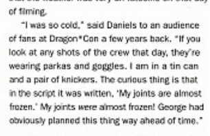
Our notes: `notes/materials/038-star-wars-insider/081-ins081.md:293`

> for Anakin, not at him
> [fragment — full passage not on file]
— Source: Star Wars Insider #81 (2005).
Note (our notes, around the quote): Page contents: McGregor interview concluded: late-to-the-lecture scene showing Obi-Wan's disappointment "for Anakin, not at him"; scenes with Natalie Portman and Ian McDiarmid; exhausting fight scenes and stamina; two weeks to regain style; Tantive IV set, C-3PO and R2-D2; on Vader. (hand-read)
Our notes: `notes/materials/038-star-wars-insider/081-ins081.md:355`

> [Lucasfilm] re-created the original corridor that Darth Vader stepped onto at the beginning of [A New Hope]. I've had a few moments while filming Revenge of the Sith that have taken me back to my childhood, and both have been while filming with Anthony Daniels. Being on set with C-3PO made me remember what it was like to be seven [years old] and watching the original films. ... I was also in a scene with R2-D2, which was a bit weird as I found myself quite choked up about it, about this robot. It was quite a moment.
> [fragment — full passage not on file]
— Source: Star Wars Insider #81 (2005).
Note (our notes, around the quote): Obi-Wan Kenobi; C-3PO; R2-D2 — entry/section: Tantive IV set: ""[Lucasfilm] re-created the original corridor that Darth Vader stepped onto at the beginning of [A New Hope]. I've had a few moments while filming Revenge of the Sith that have taken me back to my childhood, and both have been while filming with Anthony Daniels. Being on set with C-3PO made me remember what it was like to be seven [years old] and watching the original films. ... I was also in a scene with R2-D2, which was a bit weird as I found myself quite choked up about it, about this robot. It was quite a moment." —Ewan McGregor, Star Wars Insider 81, p. 52" Source: *Star Wars Insider #81* (2005), scan p.52
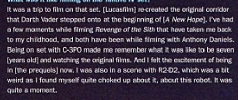
Our notes: `notes/materials/038-star-wars-insider/081-ins081.md:357`

> Being on set with C-3PO made me remember...
> [fragment — full passage not on file]
— Source: Star Wars Insider #81 (2005); Page contents: Photo page with pull quote from McGregor (.
Label in our notes: hand-read
Our notes: `notes/materials/038-star-wars-insider/081-ins081.md:369`

- Note (summary from our notes, not a quotation): Page contents: Hasbro RotS figure gatefold (lineup photo: Sidious, Palpatine, Grievous, clone troopers, Aayla Secura, Shaak Ti, C-3PO, Padmé, Obi-Wan, etc.). (hand-read)
  — Source: Star Wars Insider #81 (2005).
Our notes: `notes/materials/038-star-wars-insider/081-ins081.md:646`

## Star Wars Insider #82 (2005)

- Note (summary from our notes, not a quotation): Page contents: Portman interview: career (Léon/The Professional, Heat, Mars Attacks!, Cold Mountain, Garden State, Closer Oscar nomination); set atmosphere and documentation (Anthony Daniels in C-3PO costume); scenes with Hayden (his "stuntability"); Obi-Wan–Padmé friendship developed offscreen; Ian McDiarmid. (hand-read)
  — Source: Star Wars Insider #82 (2005).
Our notes: `notes/materials/038-star-wars-insider/082-ins082.md:424`

- Note (summary from our notes, not a quotation): Page contents: StarWarsShop.com: Darth Vader figural mug, framed pin set, C-3PO collector's mask, Revenge of the Sith video game (PS2/Xbox), Jeff Gordon die-cast, mini plush, Hasbro basic lightsabers, Clone Wars watch, Mr. Potato Head "Darth Tater," Episode V framed double film cel, Star Wars Visionaries. (hand-read)
  — Source: Star Wars Insider #82 (2005).
Our notes: `notes/materials/038-star-wars-insider/082-ins082.md:616`

## Star Wars Insider #83 (2005)

- Note (summary from our notes, not a quotation): Page contents: "20 Most Memorable Moments of the Expanded Universe" (Abel G. Peña and Enrique Guerrero, illustrations by Joe Corroney): the Death of Chewbacca (Vector Prime); Vader remembers C-3PO (Tales #6 "Thank the Maker"); Grievous' debut (Clone Wars Chapter 20); honorable mentions. (hand-read)
  — Source: Star Wars Insider #83 (2005). POV: Page contents, about C-3PO.
Our notes: `notes/materials/038-star-wars-insider/083-ins083.md:248`

## Star Wars Insider #84 (2005)

- Note (summary from our notes, not a quotation): Page contents: Jedi Library cont.: Darth Maul posters from England, Canada, Australia and the U.S.; Roger Kastel's Hong Kong Empire poster; rare Polish C-3PO poster; the Poster Book pitched in 1994; Style "D" "Circus Poster" by Charles White III and Drew Struzan (hand-read)
  — Source: Star Wars Insider #84 (2005).
Our notes: `notes/materials/038-star-wars-insider/084-ins084.md:100`

## Star Wars Insider #85 (2006)

- Note (summary from our notes, not a quotation): Page contents: Contents, Insider 85: Two-Edged Sword fiction (Vader and Dark Jedi clones), Who's Who in the Delegation of 2000 (Revenge of the Sith DVD deleted scenes), Dressing a Galaxy exhibit (Trisha Biggar costumes), Pete Vilmur posters of The Empire Strikes Back part two; Comlink letters (Quinlan Vos almost followed Aayla Secura's boots), News (Peter Mayhew made U.S. citizen; loss of Michael Sheard), DK Ultimate Visual Guide, Dark Horse Knights of the Old Republic, C-3PO feature, Toys (Hasbro Unleashed Battle Packs, Gentle Giant Empire Strikes Back busts), Best of Hyperspace (Pablo Hidalgo and Bonnie Burton), droid domes fashion (hand-read)
  — Source: Star Wars Insider #85 (2006).
Our notes: `notes/materials/038-star-wars-insider/085-ins085.md:25`

- Note (summary from our notes, not a quotation): Page contents: Art of ROTS: Sad Threepio (Sang Jun Lee), Utapau Battle, Street Close-Up (Ryan Church), Funeral barge art (hand-read)
  — Source: Star Wars Insider #85 (2006).
Our notes: `notes/materials/038-star-wars-insider/085-ins085.md:217`

> Hello there! My name is...um...my name...is...blast! Artoo, what's my name again? *(hand-read)*
> [fragment — full passage not on file]
— Source: Star Wars Insider #85 (2006).
Note (our notes, around the quote): Page contents: Ask the Master (Pablo Hidalgo): "Starting With A Clean Slate": the A New Hope first-day slate, Sidious' hologram, dead Jedi in Palpatine's office, R2-D2's memory; C-3PO caption "Hello there! My name is...um...my name...is...blast! Artoo, what's my name again?" (hand-read)
Our notes: `notes/materials/038-star-wars-insider/085-ins085.md:299`

## Star Wars Insider #87 (2006)

- Note (summary from our notes, not a quotation): Page contents: Ask the Master cont.: Yoda and the Wookiees; lightsaber auto-shutoff; Commander Deviss vs Commander Bly; C-3PO rotoscoping; letter-writer names omitted (hand-read)
  — Source: Star Wars Insider #87 (2006).
Our notes: `notes/materials/038-star-wars-insider/087-ins087.md:246`

## Star Wars Insider #89 (2006)

- Note (summary from our notes, not a quotation): Page contents: Set Piece callouts: C-3PO arm rig, Art Deco, Wing Guard, BlasTech E-11 from Sterling, Cloud City blaster pistols (hand-read)
  — Source: Star Wars Insider #89 (2006).
Our notes: `notes/materials/038-star-wars-insider/089-ins089.md:266`

- Note (summary from our notes, not a quotation): Page contents: StarWarsShop More Must Haves: Locked in Combat card, R2-Q5, magnets, The Cinema of George Lucas, black chrome Anakin mini saber, Vader's TIE, C-3PO Pez, Obi-Wan standee, clone mini bust, AT-RT glass cube, basic saber (hand-read)
  — Source: Star Wars Insider #89 (2006).
Our notes: `notes/materials/038-star-wars-insider/089-ins089.md:472`

## Star Wars Insider #90 (2006)

- Note (summary from our notes, not a quotation): Page contents: Comlink letters "Only the Good Die Young" (letter-writers omitted): Jedi vs. Sith coverage, LORDVADR plate, Owen and Beru not recognizing C-3PO, Questions About Star Wars to Keep You Awake at Night, Ultimate Edition rumors denied (hand-read)
  — Source: Star Wars Insider #90 (2006).
Our notes: `notes/materials/038-star-wars-insider/090-ins090.md:45`

- Note (summary from our notes, not a quotation): Page contents: StarWarsShop Collector's Picks by Darren Lee Phillipson (Lucas Licensing): Gentle Giant rancor statue, LEGO Jabba's Sail Barge, Force Action lightsaber, Kotobukiya R2-D2 and C-3PO, AT-AT T-shirt (hand-read)
  — Source: Star Wars Insider #90 (2006).
Our notes: `notes/materials/038-star-wars-insider/090-ins090.md:464`

## Star Wars Insider #91 (2007)

- Note (summary from our notes, not a quotation): Page contents: Jabba's Collection: Heavy Metal: Attakus metal collection figures (Darth Vader, Obi-Wan Kenobi, C-3PO, R2-D2, stormtrooper variants; 2,500 pieces; $90-$115) and dioramas (Millennium Falcon $2,589, Death Star Hall $825, both $3,200; 400 pieces); Attakus resin statues (Oola 14.9 inches $375, sandtrooper 15.7 inches $389, Imperial probe droid 15.6 inches $459; 1,500 pieces) (hand-read)
  — Source: Star Wars Insider #91 (2007).
Our notes: `notes/materials/038-star-wars-insider/091-ins091.md:159`

- Note (summary from our notes, not a quotation): Page contents: Jabba's Collection: Gentle Giant animated maquettes (C-3PO, Luke Skywalker, stormtrooper; 8 inches, $80); Medicom Yoda VCD via Sideshow ($59.99); 30th Anniversary Fact: The Early Bird Certificate Package; web links (hand-read)
  — Source: Star Wars Insider #91 (2007).
Our notes: `notes/materials/038-star-wars-insider/091-ins091.md:169`

- Note (summary from our notes, not a quotation): Page contents: Scouting the Galaxy cont.: The Star Wars Storybook (Random House, 1978) photo showing C-3PO's human hand (Anthony Daniels missing his hand covering); AFA grading costs ($17-$65) at toygrader.com (hand-read)
  — Source: Star Wars Insider #91 (2007).
Our notes: `notes/materials/038-star-wars-insider/091-ins091.md:292`

- Note (summary from our notes, not a quotation): Page contents: Star Wars International: Tokyo Treasures by Gus Lopez: Sankyo Star Wars pachinko; Takara claw-machine plush (R2-D2, Chewie, Luke, Vader, C-3PO) in the mid 1990s (hand-read)
  — Source: Star Wars Insider #91 (2007).
Our notes: `notes/materials/038-star-wars-insider/091-ins091.md:297`

- Note (summary from our notes, not a quotation): Page contents: Star Wars International cont.: Tokyo shop Star Cases (collector-guide and owner names omitted); Sakura C-3PO and R2-D2 bento box; Coca Cola bottle caps (50 images); Pepsi/Suntory figural caps and life-size R2-D2 Pepsi vending machine (hand-read)
  — Source: Star Wars Insider #91 (2007).
Our notes: `notes/materials/038-star-wars-insider/091-ins091.md:302`

- Note (summary from our notes, not a quotation): Page contents: Comic Marvels cont.: Lando (Repaying a Debt; Drebble), C-3PO and R2-D2, Darth Vader and his quest; Allies: Shira Brie (issue 56), Fenn Shysa (issue 68), Plif (issue 55), Dani (issue 71), Bey (issue 99) (hand-read)
  — Source: Star Wars Insider #91 (2007).
Our notes: `notes/materials/038-star-wars-insider/091-ins091.md:357`

- Note (summary from our notes, not a quotation): Page contents: Star Wars Shop: More Must Haves (Darth Vader 500th figure, Vader hockey jersey, animated C-3PO with Jawa, Gentle Giant Boba Fett statue, Playskool Spudtrooper, Lucas Family action figure set) (hand-read)
  — Source: Star Wars Insider #91 (2007).
Our notes: `notes/materials/038-star-wars-insider/091-ins091.md:533`

## Star Wars Insider #92 (2007)

- Note (summary from our notes, not a quotation): Page contents: Comlink letters "The Choice Is Yours" (letter-writers omitted): choosing light or dark side of the fan club; why Vader didn't recognize C-3PO / Luke's light side; Obi-Wan's limbs on Mustafar; unaltered ROTJ viewing; secret soundtracks in the Episode I Racer PC version; editors' replies (hand-read)
  — Source: Star Wars Insider #92 (2007).
Our notes: `notes/materials/038-star-wars-insider/092-ins092.md:43`

- Note (summary from our notes, not a quotation): Page contents: Micro Collection cont.: Bacta Chamber pieces $50-100; around half a dozen boxes and proof sheets; Torture Chamber (Han's shock chair, conveyor belt for dismembered C-3PO; Ugnaught, two Bespin guards, Chewbacca with backpack), only two complete prototypes; Dagobah set, 4-up sculpts, pantograph; Kenner sculptor Bill Lemon's acetate milling; R2-D2 hard copy photo (hand-read)
  — Source: Star Wars Insider #92 (2007).
Our notes: `notes/materials/038-star-wars-insider/092-ins092.md:458`

- Note (summary from our notes, not a quotation): Page contents: Rose Parade photos: Steve Sansweet, Lucasfilm's head of fan relations, marching with the 501st; Endor float with Ewoks, Chewbacca, C-3PO and R2-D2; Darth Vader and Imperial Guards; Naboo float finale with Queen Amidala (costumer names omitted) (hand-read)
  — Source: Star Wars Insider #92 (2007).
Our notes: `notes/materials/038-star-wars-insider/092-ins092.md:539`

- Note (summary from our notes, not a quotation): Page contents: StarWarsShop What's New: Imperial Briefing Room 7-pack $34.99; GSX C-3PO watch $549.99 limited to 1,977 pieces; ESB Boba Fett vinyl doll $49.99; Real Action Hero Shadow Stormtrooper $129.99; LEGO Stormtrooper maquette $64.99 (hand-read)
  — Source: Star Wars Insider #92 (2007).
Our notes: `notes/materials/038-star-wars-insider/092-ins092.md:568`

- Note (summary from our notes, not a quotation): Page contents: StarWarsShop More Must Haves: Vintage Action Figures book, C-3PO helmet, Trilogy DVD, ROTJ Boba Fett vinyl, Sidious standee, Attakus Obi-Wan and Vader, Lucas family figures, Kotobukiya Slave Leia (hand-read)
  — Source: Star Wars Insider #92 (2007).
Our notes: `notes/materials/038-star-wars-insider/092-ins092.md:587`

## Star Wars Insider #93 (2007)

- Note (summary from our notes, not a quotation): Page contents: May the Facts Be With You facts 9-14: U-3PO the traitor droid; the Tantive IV invasion shot with six cameras; C-3PO's "I'm melting!" moved; a single white hallway; R2-D2 veering; the escape pod shot among ILM's first two effects shots (hand-read)
  — Source: Star Wars Insider #93 (2007).
Our notes: `notes/materials/038-star-wars-insider/093-ins093.md:226`

- Note (summary from our notes, not a quotation): Page contents: Facts 15-24: Vader's "red eyes"; Commander Daine Jir talks back; C-3PO's silver leg; Tantive IV vaporized in the novelization; floppy-hat Luke and Tosche Station cut scenes with Biggs; the Devastator; Jundland means "no-man's land"; Tunisia's first winter rainstorm in 50 years; the Krayt dragon skeleton (hand-read)
  — Source: Star Wars Insider #93 (2007).
Our notes: `notes/materials/038-star-wars-insider/093-ins093.md:238`

- Note (summary from our notes, not a quotation): Page contents: Facts 25-35: C-3PO tells the Jawas where R2-D2 is (radio drama); Dathcha and "Ootini!"; Luke's signal flare; 13-hour droid auction shoot; R5-D4's motivator; R5-D4 auction blooper; C-3PO's ignorance of the Princess; KPR droids; front-projected landspeeder test; Mardji the bantha; "Banthas, all right" (hand-read)
  — Source: Star Wars Insider #93 (2007).
Our notes: `notes/materials/038-star-wars-insider/093-ins093.md:253`

> even a duck has to be taught to swim
> [fragment — full passage not on file]
— Source: Star Wars Insider #93 (2007).
Note (our notes, around the quote): Page contents: Facts 36-38: poisoned gaffi sticks; "even a duck has to be taught to swim"; Sand People's gold bracelets (third draft); photos of R2-D2 and C-3PO in the Lars garage, bantha, Tusken Raider (hand-read)
Our notes: `notes/materials/038-star-wars-insider/093-ins093.md:267`

- Note (summary from our notes, not a quotation): Page contents: Feature opener "Part of the Language": three decades after the original Star Wars has really left its mark on the way we talk and think (words: Karen Traviss); C-3PO photo (hand-read)
  — Source: Star Wars Insider #93 (2007).
Our notes: `notes/materials/038-star-wars-insider/093-ins093.md:304`

> Luke's a Back Seat Driver: plus, how many escape pods does Yoda have and where's Anakin's scar in Return of the Jedi...? *(words: Pablo Hidalgo)*
> [fragment — full passage not on file]
— Source: Star Wars Insider #93 (2007); Page contents: Jawa's Corner Q&A.
Note (our notes, around the quote): Page contents: Jawa's Corner Q&A "Luke's a Back Seat Driver: plus, how many escape pods does Yoda have and where's Anakin's scar in Return of the Jedi...?" (words: Pablo Hidalgo); top box with how to contact Insider (US/UK addresses, email); reader questions (names omitted): C-3PO driving the landspeeder; TV series; Episode I digital Yoda; Anakin's scar (hand-read)
Our notes: `notes/materials/038-star-wars-insider/093-ins093.md:412`

- Note (summary from our notes, not a quotation): Page contents: Comlink UK memories cont.: reader letters headed "Silence is Golden", "Space Warfare", "Toy Story" (letter-writer names and relatives omitted); stills of Han Solo, Luke and Leia, C-3PO (hand-read)
  — Source: Star Wars Insider #93 (2007).
Our notes: `notes/materials/038-star-wars-insider/093-ins093.md:592`

- Note (summary from our notes, not a quotation): Page contents: Advertisement: The Collector Zone "Star Wars: The Force Will Be With You, Always": Force FX lightsaber, Saga Collectors Gift Pack, Darth Vader limited edition lightsaber, die-cast Republic Gunship, Chatz quotable mug set, C-3PO and Yoda cookie jars (hand-read)
  — Source: Star Wars Insider #93 (2007).
Our notes: `notes/materials/038-star-wars-insider/093-ins093.md:631`

## Star Wars Insider #94 (2007)

> This Is No Cave.... *(space slug 'enviorama', new Hasbro figures)*
> [fragment — full passage not on file]
>
> Which part of this Royal vehicle is made out of old lawnmower pieces?
— Source: Star Wars Insider #94 (2007).
Note (our notes, around the quote): Page contents: Contents (part 2) Departments: Jawa's Corner: Books: Back Pages (first Star Wars book boom of 1977); Comics: Star Wars Legacy "The Ghosts of Ossus" (Cade Skywalker faces his past); Toys "This Is No Cave...." (space slug 'enviorama', new Hasbro figures); Star Wars Q&A; Scouting the Galaxy (Steve Sansweet); International Collecting: Australia; Set Piece: Naboo Royal Starship ("Which part of this Royal vehicle is made out of old lawnmower pieces?"); Padawan's Corner (sketching C-3PO); Bantha Tracks; The Indy Vault #2; Comlink Letters (hand-read)
Our notes: `notes/materials/038-star-wars-insider/094-ins094.md:20`

> This Time, He Is the Bounty!
>
> These Are the Droids You're Looking For!
— Source: Star Wars Insider #94 (2007); Page contents: Com-Scan "Celebration Exclusives".
Note (our notes, around the quote): Page contents: Com-Scan "Celebration Exclusives": "This Time, He Is the Bounty!" (Gentle Giant Droids-style Boba Fett maquette, 1,000 pieces, ~700 at CIV); "These Are the Droids You're Looking For!" (McQuarrie concept R2-D2 & C-3PO figure two-pack with CIV and CE coins; badge-punch purchase limits); "Another Ralph Rarity" (McQuarrie Signature Series Luke Skywalker); "Coining It In" (24 coins commemorating the first 12 Kenner figures) (hand-read)
Our notes: `notes/materials/038-star-wars-insider/094-ins094.md:93`

> I remember vividly being a four-year-old kid and seeing all the desert scenes for Tatooine, and then I saw C-3PO and R2-D2 and thought they were the most amazing things I'd ever seen.
— Source: Star Wars Insider #94 (2007); C-3PO; R2-D2 — entry/section: Four-year-old.
Note (our notes, around the quote): C-3PO; R2-D2 — entry/section: Four-year-old: ""I remember vividly being a four-year-old kid and seeing all the desert scenes for Tatooine, and then I saw C-3PO and R2-D2 and thought they were the most amazing things I'd ever seen." —Seth Green, Star Wars Insider 94, p. 12" Source: *Star Wars Insider #94* (2007), scan p.12
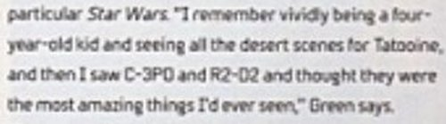
Our notes: `notes/materials/038-star-wars-insider/094-ins094.md:111`

> Moonraker tried to ride the Star Wars wave, but the combination of genres was not successful
> [fragment — full passage not on file]
— Source: Star Wars Insider #94 (2007).
Note (our notes, around the quote): Page contents: Star Wars Effect Part 1 cont.: Star Trek: Phase II becomes a film; Moonraker; Battlestar Galactica, Buck Rogers in the 25th Century (Twiki), Doctor Who's K-9; Space: Above and Beyond; display head "Moonraker tried to ride the Star Wars wave, but the combination of genres was not successful"; photos Dennis Muren at work on a Y-wing, ILM modelmaker on a Star Destroyer, Buck Rogers poster, C-3PO, Luke on Tatooine (hand-read)
Our notes: `notes/materials/038-star-wars-insider/094-ins094.md:230`

> What a Pile of Junk!
> [fragment — full passage not on file]
>
> It was okay; they’d always told him so. He was fighting to save his men, and if he did terrible things out of compassion, out of love, then he wasn’t turning to the dark side. That was the Jedi way.
— Source: Star Wars Insider #94 (2007); Page contents: Star Wars Effect Part 1 concl..
(Excerpt widened 2026-11-17 to the relevant passage, word for word from Rogue Planet (Greg Bear) (text copy `MEGA_Legend_Standalones_Star_Wars_Rogue_Planet_Greg_Bear_epub`).)
(Full sentence/passage taken from the source text on file: `cw_novels_tmp_clone_wars_traviss_epub`.)
Note (our notes, around the quote): Page contents: Star Wars Effect Part 1 concl.: "What a Pile of Junk!": lived-in universe (Guinness rolling in the Tunisian desert to age his robe), Alien and Blade Runner; imitators (Laserblast, Starcrash/Stella Star); Lucas helping Kurosawa's Kagemusha, Mishima, Latino, Powaqqatsi, Tucker; "turning to the dark side" and Reagan's SDI; photos C-3PO and Chewbacca at the hologram game, Luke and Ben, landspeeder, R2-D2, Buck Rogers' Twiki, Doctor Who's K-9; teaser to Part 2 on p.48 (hand-read)
Our notes: `notes/materials/038-star-wars-insider/094-ins094.md:242`

- Note (summary from our notes, not a quotation): Page contents: "Mark Hamill: Luke Skywalker" (In Their Own Words): boxes "On the 1997 Star Wars Special Edition" and "On His Reluctance to Talk About Star Wars" (The Black Pearl comic); location photos with R2-D2, C-3PO and crew, Leia and Luke, Mos Eisley cantina, Obi-Wan and Luke (hand-read)
  — Source: Star Wars Insider #94 (2007). POV: Page contents, about C-3PO.
Our notes: `notes/materials/038-star-wars-insider/094-ins094.md:257`

- Note (summary from our notes, not a quotation): Page contents: Full-page art C-3PO and R2-D2 with inset of C-3PO and Luke in the landspeeder; no body text (hand-read)
  — Source: Star Wars Insider #94 (2007).
Our notes: `notes/materials/038-star-wars-insider/094-ins094.md:292`

- Note (summary from our notes, not a quotation): Page contents: "Anthony Daniels & Kenny Baker: C-3PO & R2-D2" (In Their Own Words): boxes "Anthony Daniels on C-3PO's Costume" (sculptor Liz Moore, Vaseline and cling-film casting, 16 pieces) and "Kenny Baker on Life Inside R2-D2"; photos R2-D2 on set, Daniels and Baker out of costume, Tunisia location (hand-read)
  — Source: Star Wars Insider #94 (2007). POV: Page contents, about C-3PO.
Our notes: `notes/materials/038-star-wars-insider/094-ins094.md:297`

- Note (summary from our notes, not a quotation): Page contents: Daniels & Baker cont.: boxes "Anthony Daniels on His Distinctive C-3PO Voice", "Kenny Baker on His Star Wars Expectations", "Anthony Daniels on Working with Alec Guinness", "Kenny Baker on Mark Hamill" (Jack Purvis, cabaret circuit), "Anthony Daniels on Acting in the Suit", "Anthony Daniels on R2-D2" (Ben Burtt's voice); photos Tatooine location, C-3PO with crew, Daniels with Lucas (hand-read)
  — Source: Star Wars Insider #94 (2007).
Our notes: `notes/materials/038-star-wars-insider/094-ins094.md:306`

> I spoke the lines as we filmed each scene. I had a tiny radio mike tucked into my left eyebrow.
— Source: Star Wars Insider #94 (2007); C-3PO — entry/section: Radio mike.
Note (our notes, around the quote): C-3PO — entry/section: Radio mike: ""I spoke the lines as we filmed each scene. I had a tiny radio mike tucked into my left eyebrow." —Anthony Daniels, Star Wars Insider 94, p. 32" Source: *Star Wars Insider #94* (2007), scan p.32
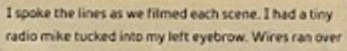
Our notes: `notes/materials/038-star-wars-insider/094-ins094.md:308`

> I never realized that George Lucas would return to the States and search for another voice. I had sort of invented the personality the way I interpreted the script, but it wasn't quite what George had in mind.
— Source: Star Wars Insider #94 (2007); C-3PO — entry/section: Another voice.
Note (our notes, around the quote): C-3PO — entry/section: Another voice: ""I never realized that George Lucas would return to the States and search for another voice. I had sort of invented the personality the way I interpreted the script, but it wasn't quite what George had in mind." —Anthony Daniels, Star Wars Insider 94, p. 32" Source: *Star Wars Insider #94* (2007), scan p.32
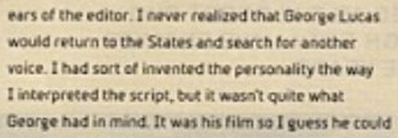
Our notes: `notes/materials/038-star-wars-insider/094-ins094.md:310`

- Note (summary from our notes, not a quotation): Page contents: "Alec Guinness: Obi-Wan Kenobi" (Sir Alec gained a new audience as the venerable Jedi Knight); boxes "Alec Guinness on George Lucas", "Alec Guinness on Acting", "Alec Guinness on Fighting George Lucas' Corner"; tributes from Anthony Daniels, Ewan McGregor, George Lucas, Harrison Ford and Mark Hamill; stills Obi-Wan with lightsaber, Obi-Wan with R2-D2 and C-3PO (hand-read)
  — Source: Star Wars Insider #94 (2007). POV: Page contents, about C-3PO.
Our notes: `notes/materials/038-star-wars-insider/094-ins094.md:540`

> The Empire Strikes Fact: A Cornucopia of Essential Star Wars Trivia
> [fragment — full passage not on file]
— Source: Star Wars Insider #94 (2007); Page contents. POV: Page contents, about C-3PO.
Note (our notes, around the quote): Page contents: "The Empire Strikes Fact: A Cornucopia of Essential Star Wars Trivia" by Jonathan Wilkins; opener art of Han, Leia, Luke, Chewbacca, C-3PO, R2-D2 and Obi-Wan (hand-read)
Our notes: `notes/materials/038-star-wars-insider/094-ins094.md:556`

- Note (summary from our notes, not a quotation): Page contents: Empire Strikes Fact items 22–28: Lack of Vision (film stock), Ben Loves Boing! (Ben Burtt), Wookiee Words, Kenobi Has a Cow (Guinness and The Simpsons), Arctic Artist (Ralph McQuarrie cameo), Two Siths and a Moff (Christopher Lee, David Prowse and Peter Cushing), Star Lords (Lord of the Rings crossovers); photos Chewbacca, Count Dooku, C-3PO and R2-D2, Simpsons lightsaber parody (hand-read)
  — Source: Star Wars Insider #94 (2007).
Our notes: `notes/materials/038-star-wars-insider/094-ins094.md:598`

> How to Draw: C-3PO — Your guide to sketching the galaxy's greatest protocol droid!
— Source: Star Wars Insider #94 (2007); Page contents: Padawan's Corner.
Note (our notes, around the quote): Page contents: Padawan's Corner: "How to Draw: C-3PO — Your guide to sketching the galaxy's greatest protocol droid!" words and artwork by Cynthia Cummens; intro on materials, Steps 1–3 (egg-shaped head silhouette, guidelines, inverted "V" nose, brow lines) with three sketch stages (hand-read)
Our notes: `notes/materials/038-star-wars-insider/094-ins094.md:818`

- Note (summary from our notes, not a quotation): Page contents: Padawan's Corner cont.: Steps 4–6 (highlight planning, Micron inking, marker coloring) and tips box; finished color C-3PO on Tatooine; starwars.com/kids, cynthiacummensart.com (hand-read)
  — Source: Star Wars Insider #94 (2007).
Our notes: `notes/materials/038-star-wars-insider/094-ins094.md:827`

- Note (summary from our notes, not a quotation): Page contents: Bantha Tracks cont.: seven numbered fan photos with R2-D2 mailboxes (Rebel Legion Leia, Jawa, R2-D2 go-go dress, Chewbacca costumer, C-3PO costumer, etc.; all fan names omitted) (hand-read)
  — Source: Star Wars Insider #94 (2007).
Our notes: `notes/materials/038-star-wars-insider/094-ins094.md:847`

- Note (summary from our notes, not a quotation): Page contents: Comlink cont. (names omitted): Star Warriors (30th anniversary drawings of Vader, C-3PO and R2-D2), editorial ask for what Star Wars fans should be called, Storm Force (vinyl case/Vader figure childhood story), Promo Princess (Leia costume in Fullerton 1977), Star Walls (bedroom Death Star battle mural), Queen Amidala dolls letter; Leia photo (hand-read)
  — Source: Star Wars Insider #94 (2007).
Our notes: `notes/materials/038-star-wars-insider/094-ins094.md:896`

## Star Wars Insider #95 (2007)

- Note (summary from our notes, not a quotation): Page contents: Advertisement: Brian's Toys (Star Wars and G.I. Joe toys 1977 to present): figure club at $7.99 each, Comic 2-packs, Vintage Style, 30th Anniversary figure waves, vehicles, Saga II exclusives, battle packs, Celebration IV exclusives (McQuarrie C-3PO & R2-D2 or McQuarrie Luke), Episode III exclusives, Gentle Giant statues and mini-busts, Master Replicas FX lightsabers and scale replicas, Sideshow 12-inch figures (hand-read)
  — Source: Star Wars Insider #95 (2007).
Our notes: `notes/materials/038-star-wars-insider/095-ins095.md:15`

> I've had my faith restored!
> [fragment — full passage not on file]
>
> Star Wars moment of the day
> [fragment — full passage not on file]
>
> How long to Celebration Europe?
> [fragment — full passage not on file]
— Source: Star Wars Insider #95 (2007).
Note (our notes, around the quote): Page contents: Celebration IV diary, Sun May 27: R2 Builders room; 11am Darth Vader helmet gallery; 1:30pm Star Wars: The Clone Wars panel with Dave Filoni and Catherine Winder (Boba Fett look-alike "I've had my faith restored!"; Anthony Daniels pops in); 3:30pm costume pageant (Aunt Beru, Gamorrean Guard, Spidey-stormtrooper; winner a towering Chewbacca); "Star Wars moment of the day" box (kid in a Vader costume called Anakin); Mon May 28: 10am dealers room, Jay Laga'aia luggage; 1:30pm bellydancing lesson, "How long to Celebration Europe?"; photos (Lawrence Noble sculpts Obi-Wan, young Leia, Artoo and Threepio "The Early Years", lightsabers, Boba Fett) (hand-read)
Our notes: `notes/materials/038-star-wars-insider/095-ins095.md:251`

> I thought that Star Wars was a great idea...
> [fragment — full passage not on file]
— Source: Star Wars Insider #95 (2007). POV: Page contents, about C-3PO.
Note (our notes, around the quote): Page contents: "Taylor Made: Special Edition" by Chris Gardner: Gil Taylor suspected Star Wars would be a hit; fresh off The Omen and A Hard Day's Night; hired by The Star Wars Corporation after Geoffrey Unsworth withdrew; pull quote "I thought that Star Wars was a great idea..."; photos (R2-D2 and C-3PO, Tunisia sandcrawler set, Tatooine location) (hand-read)
Our notes: `notes/materials/038-star-wars-insider/095-ins095.md:463`

> I always had a tremendous feeling about Artoo and Threepio...
> [fragment — full passage not on file]
— Source: Star Wars Insider #95 (2007). POV: Page contents, about C-3PO.
Note (our notes, around the quote): Page contents: "Taylor Made" cont.: lightsaber blades with 3M reflective material; R2-D2 problems and Kenny Baker; "Perfect Storm" section (Tunisia from March 22, 1976; sandcrawler facade flattened by storm; heat; Artoo and Threepio); Death Star set redesign with 9,000 photo bulbs; pull quote "I always had a tremendous feeling about Artoo and Threepio..."; photos (droids in Tunisian heat, Kenny Baker) (hand-read)
Our notes: `notes/materials/038-star-wars-insider/095-ins095.md:476`

> To their credit Kenny and Anthony never complained about the heat rashes they suffered when the sun eventually came out. I always had a tremendous feeling about Artoo and Threepio - those two together, I thought, were a great act. They made mechanical objects into humans.
— Source: Star Wars Insider #95 (2007); R2-D2; C-3PO — entry/section: Great act.
Note (our notes, around the quote): R2-D2; C-3PO — entry/section: Great act: ""To their credit Kenny and Anthony never complained about the heat rashes they suffered when the sun eventually came out. I always had a tremendous feeling about Artoo and Threepio - those two together, I thought, were a great act. They made mechanical objects into humans." —Gilbert Taylor, Star Wars Insider 95, p. 45" Source: *Star Wars Insider #95* (2007), scan p.45

Our notes: `notes/materials/038-star-wars-insider/095-ins095.md:480`

- Note (summary from our notes, not a quotation): Page contents: Q&A cont.: Tonnika sisters (Brea and Senni; Shada D'ukal and Karoly D'ulin per Timothy Zahn's Tales from the Mos Eisley Cantina story; actresses Christine Hewett and Angela Staines); Red Squadron check-in order; Vader's suit origins; Null ARC troopers (Karen Traviss, Republic Commando: True Colors); alternate-take photo of Ben with lightsaber; C-3PO helmet wires; photos (Tonnika sisters, Luke and Ben) (hand-read)
  — Source: Star Wars Insider #95 (2007).
Our notes: `notes/materials/038-star-wars-insider/095-ins095.md:633`

## Star Wars Insider #96 (2007)

> I've had many people tell me the Steam Walker reminds them of the AT-AT. Perhaps I should have named it Luke SteamWalker? I'm not a big fan of C-3PO, sorry! AT-ST would be a better fit for a steam biped.
— Source: Star Wars Insider #96 (2007); C-3PO; Luke Skywalker — entry/section: Luke SteamWalker.
Note (our notes, around the quote): C-3PO; Luke Skywalker — entry/section: Luke SteamWalker: ""I've had many people tell me the Steam Walker reminds them of the AT-AT. Perhaps I should have named it Luke SteamWalker? I'm not a big fan of C-3PO, sorry! AT-ST would be a better fit for a steam biped." —I-Wei Huang, Star Wars Insider 96, p. 13" Source: *Star Wars Insider #96* (2007), scan p.13

Our notes: `notes/materials/038-star-wars-insider/096-ins096.md:108`

## Star Wars Insider #97 (2007)

- Note (summary from our notes, not a quotation): Page contents: Scouting the Galaxy cont.: C-3PO Post Office, Guilty Fun, Power Drain (reader letters; Sansweet answers); green box: how to send questions ([email omitted]; Scouting the Galaxy, [postal address omitted]; Titan addresses) (hand-read)
  — Source: Star Wars Insider #97 (2007).
Our notes: `notes/materials/038-star-wars-insider/097-ins097.md:501`

- Note (summary from our notes, not a quotation): Page contents: Bantha Tracks Vol. 28 "By the Fans, for the Fans": "Bantha Tracks Celebrates 30 Years of Star Wars Inspiration" (fan art of Boba Fett and C-3PO; submission guidelines box) — fan names omitted (hand-read)
  — Source: Star Wars Insider #97 (2007).
Our notes: `notes/materials/038-star-wars-insider/097-ins097.md:583`

## Star Wars Insider #98 (2008)

> The big question was, would people understand a movie where the opening dialogue was between two robots arguing, during a battle, and neither of them with a [moving] mouth? One beeping, the other with a British accent, as explosions erupt all around them? Would audiences buy it? It was a big risk, but it did work, and R2-D2 became an accepted character voice.
— Source: Star Wars Insider #98 (2008); R2-D2; C-3PO — entry/section: Big risk.
Note (our notes, around the quote): R2-D2; C-3PO — entry/section: Big risk: ""The big question was, would people understand a movie where the opening dialogue was between two robots arguing, during a battle, and neither of them with a [moving] mouth? One beeping, the other with a British accent, as explosions erupt all around them? Would audiences buy it? It was a big risk, but it did work, and R2-D2 became an accepted character voice." —Ben Burtt, Star Wars Insider 98, p. 19" Source: *Star Wars Insider #98* (2008), scan p.19

Our notes: `notes/materials/038-star-wars-insider/098-ins098.md:153`

> It was announced prior to the ceremony, so all I had to do was show up! I was in good company, with Mark Hamill, R2-D2, and C-3PO as my presenters. I did Artoo's voice, so I was really presenting it to myself!
— Source: Star Wars Insider #98 (2008).
Note (our notes, around the quote): R2-D2; C-3PO; Luke Skywalker — entry/section: Presenting to myself: ""It was announced prior to the ceremony, so all I had to do was show up! I was in good company, with Mark Hamill, R2-D2, and C-3PO as my presenters. I did Artoo's voice, so I was really presenting it to myself!" —Ben Burtt, Star Wars Insider 98, p. 21" Source: *Star Wars Insider #98* (2008), scan p.21

Our notes: `notes/materials/038-star-wars-insider/098-ins098.md:179`

## Star Wars Insider #99 (2008)

> For somebody as well established as Chewie, I have a sound library that goes all the way back to 1977. For Sith, we were able to re-use it, just as we use Anthony Daniels again for C-3PO, as that's how C-3PO should sound. For Chewbacca, all I had to do was open up my Chewbacca library of sounds. We didn't really add much to Chewie for Episode III. There are always things in the sound library that we haven't used yet, and we can make new Chewbacca sounds from components we already have. Nothing new was recorded for him in Episode III, but we used new combinations made from the building blocks of his distinctive sounds.
— Source: Star Wars Insider #99 (2008); Chewbacca; C-3PO — entry/section: Chewie library for Sith.
Note (our notes, around the quote): Chewbacca; C-3PO — entry/section: Chewie library for Sith: ""For somebody as well established as Chewie, I have a sound library that goes all the way back to 1977. For Sith, we were able to re-use it, just as we use Anthony Daniels again for C-3PO, as that's how C-3PO should sound. For Chewbacca, all I had to do was open up my Chewbacca library of sounds. We didn't really add much to Chewie for Episode III. There are always things in the sound library that we haven't used yet, and we can make new Chewbacca sounds from components we already have. Nothing new was recorded for him in Episode III, but we used new combinations made from the building blocks of his distinctive sounds." —Ben Burtt, Star Wars Insider 99, p. 44" Source: *Star Wars Insider #99* (2008), scan p.44

Our notes: `notes/materials/038-star-wars-insider/099-ins099.md:407`

> Travel Back in Time at www.cloudcity.com
> [fragment — full passage not on file]
— Source: Star Wars Insider #99 (2008); Page contents: Ad: Cloud City collectible toys 1960-1994.
Note (our notes, around the quote): Page contents: Ad: Cloud City collectible toys 1960-1994 "Travel Back in Time at www.cloudcity.com"; vintage C-3PO and R2-D2 figures pictured among other toys (hand-read)
Our notes: `notes/materials/038-star-wars-insider/099-ins099.md:462`

## Star Wars Insider #100 (2008)

> 100 Best Things About Star Wars... Ever!
> [fragment — full passage not on file]
— Source: Star Wars Insider #100 (2008).
Note (our notes, around the quote): Page contents: Painted art (signed Hugh Fleming): Star Wars rock concert — Darth Vader on guitar, Luke Skywalker on guitar, Chewbacca on drums, Han Solo, C-3PO at keyboards, R2-D2; "100" with the two Issue #100 covers (newsstand "100 Best Things About Star Wars... Ever!" and the silver/gold subscriber variant) (hand-read)
Our notes: `notes/materials/038-star-wars-insider/100-ins100.md:44`

> About Star Wars... Ever!
> [fragment — full passage not on file]
>
> As voted by you! One of the most popular sections of starwars.com is the Star Wars Galaxy Databank. Based on your page views throughout 2007, here are your 100 favorite Star Wars characters, vehicles, and locations!
— Source: Star Wars Insider #100 (2008); Page contents: Opening spread (right).
Note (our notes, around the quote): Page contents: Opening spread (right): "About Star Wars... Ever!" — "As voted by you! One of the most popular sections of starwars.com is the Star Wars Galaxy Databank. Based on your page views throughout 2007, here are your 100 favorite Star Wars characters, vehicles, and locations!" Databank entries and commentary by Pablo Hidalgo; condensed from starwars.com by Paul Simpson. Montage: Obi-Wan, R2-D2, C-3PO, Chewbacca, Ben Kenobi, Luke, Leia, young Anakin, Boba Fett, Slave I, Naboo fighter (hand-read)
Our notes: `notes/materials/038-star-wars-insider/100-ins100.md:138`

- Note (summary from our notes, not a quotation): Page contents: Top 100: 63 Pash Cracken (comic art); 62 Shadow Troopers (art); 61 Darth Vader's Suit (photo); 60 C-3PO (photo) (hand-read)
  — Source: Star Wars Insider #100 (2008).
Our notes: `notes/materials/038-star-wars-insider/100-ins100.md:310`

> THOUSANDS of Items to choose from
>
> Personalized Service
>
> Competitive Pricing
>
> Reduced Shipping Costs
>
> WE SHIP WORLDWIDE...
> [fragment — full passage not on file]
>
> The New Force in the Galaxy...
> [fragment — full passage not on file]
— Source: Star Wars Insider #100 (2008).
Note (our notes, around the quote): Page contents: Red 5 Collectibles USA ad (Las Vegas, NV): Gentle Giant maquettes; "THOUSANDS of Items to choose from / Personalized Service / Competitive Pricing / Reduced Shipping Costs / WE SHIP WORLDWIDE..."; "The New Force in the Galaxy..."; www.red5collectiblesusa.com; figures shown include Royal Guard, stormtrooper, C-3PO, Yoda, Chewbacca, Luke in pilot gear, Emperor, Vader, X-wing (hand-read)
Our notes: `notes/materials/038-star-wars-insider/100-ins100.md:375`

- Note (summary from our notes, not a quotation): Page contents: Set Piece (cont.): annotated Watto's shop set photo with callouts Ionizer, Art (Qui-Gon's holoprojector), Droids, Props, Temperature, Floors; Qui-Gon, Watto, Anakin, C-3PO in scene; temperature callout line start partly obscured (hand-read)
  — Source: Star Wars Insider #100 (2008).
Our notes: `notes/materials/038-star-wars-insider/100-ins100.md:943`

## Star Wars Insider #101 (2008)

> Why Haven't They Made...?
> [fragment — full passage not on file]
>
> Who's cool and who's cold in this month's Star Wars popularity stakes?
— Source: Star Wars Insider #101 (2008); Page contents: Launch Pad.
Note (our notes, around the quote): Page contents: Launch Pad: "Why Haven't They Made...?" sidebar; "John Alvin Remembered" (photo; John Alvin art of C-3PO one-man band and R2-D2 drinks/drum unit); "Who's cool and who's cold in this month's Star Wars popularity stakes?" meter (Picnicing on Naboo / Podracing on Tatooine / Red Hot on Mustafar): Chris Pine, Saul Bass vs Star Wars, Coming Soon...; Ahsoka Tano cutout (hand-read)
Our notes: `notes/materials/038-star-wars-insider/101-ins101.md:145`

> No matter what you're into, we've got just the thing for your collection!
— Source: Star Wars Insider #101 (2008).
Note (our notes, around the quote): Page contents: TFAW.com (Things From Another World, "Since 1979") ad: "No matter what you're into, we've got just the thing for your collection!"; Kotobukiya vinyl statues (Obi-Wan Kenobi, C-3PO, R2-D2, Darth Vader); Star Wars "Vector" covers; Star Wars Omnibus Collection: X-Wing Rogue Squadron Vol. 1-3; Star Wars 1:6 Scale Helmet Replicas (Luke X-wing helmet); "Save 20-50%"; www.TFAW.com/offer/swinsider; Star Wars, Hasbro, DC, Marvel, Dark Horse logos (hand-read)
Our notes: `notes/materials/038-star-wars-insider/101-ins101.md:270`

> Where real world science and technology meets Star Wars fantasy
> [fragment — full passage not on file]
>
> What a Piece of Junk! *(Millennium Falcon / ATV)*
> [fragment — full passage not on file]
>
> How Many Planets Are Out There?
— Source: Star Wars Insider #101 (2008).
Note (our notes, around the quote): Page contents: Feature: "Science of Star Wars" (cont.; "Where real world science and technology meets Star Wars fantasy"; Words: David Hawksett): "A Real Ion Drive" (TIE fighter image), "What a Piece of Junk!" (Millennium Falcon / ATV), sidebar "How Many Planets Are Out There?" and "One More Step to C-3PO"; C-3PO cutout (hand-read)
Our notes: `notes/materials/038-star-wars-insider/101-ins101.md:294`

> Your source for everything Star Wars
> [fragment — full passage not on file]
>
> redscollectiblesusa.com — There's a New Force in the Galaxy...
> [fragment — full passage not on file]
— Source: Star Wars Insider #101 (2008); Page contents: Red5 Collectibles USA ad.
Note (our notes, around the quote): Page contents: Red5 Collectibles USA ad: "Your source for everything Star Wars"; "Believe it..."; "Collector's #1 Site"; figures (clone trooper, stormtroopers, Grievous, Leia, Luke X-wing pilot, Aayla Secura, Royal Guard, R2-D2, Yoda, C-3PO); "redscollectiblesusa.com — There's a New Force in the Galaxy..."; Visa/MasterCard/Amex logos (hand-read)
Our notes: `notes/materials/038-star-wars-insider/101-ins101.md:483`

> A long time ago... 1980
> [fragment — full passage not on file]
— Source: Star Wars Insider #101 (2008); Page contents. POV: Page contents, about C-3PO.
Note (our notes, around the quote): Page contents: "A long time ago... 1980" cont.: "1980" header; Mark Hamill Guest Stars on The Muppet Show (photo caption); comic box US Star Wars #39 / UK Empire Strikes Back UK Weekly Comic #119; Han Solo and the Lost Legacy (Aug 1980); John Ratzenberger box "More Than a Bit Player" (Q&A); Christmas in the Stars (Released: Nov 1980) with R2-D2 antlers and C-3PO Santa photo (hand-read)
Our notes: `notes/materials/038-star-wars-insider/101-ins101.md:502`

- Note (summary from our notes, not a quotation): Page contents: Letter "Piggy Bank Treasure!" (writer omitted) begins: fan since first seeing A New Hope at seven or eight, became an almost obsessive collector after the prequels, now in college with a five-shelf collection; during a trip in Michigan stumbled upon a C-3PO piggy bank [continued p. 66] (hand-read)
  — Source: Star Wars Insider #101 (2008).
Our notes: `notes/materials/038-star-wars-insider/101-ins101.md:724`

- Note (summary from our notes, not a quotation): Page contents: Left: "Toys Я Us-sia" concludes (Gus Lopez): Ulan Bator, Mongolia and Beijing, China sections; photos of Mongolcom Mongolian phone cards (one showing a child in a Spider-Man costume) and metal Star Wars cigarette cases (Episode III stormtrooper, Knights of the Old Republic, C-3PO/R2-D2 with Coca-Cola logo); ends with a Rebel insignia. Right: Kotobukiya ad for Devil May Cry Dante and Vergil statues ("Direct from Japan!!", each about 10 2/3" tall, "Available NOW!", Capcom/Kazuma Kaneko/Atlus credit; not Star Wars) (hand-read)
  — Source: Star Wars Insider #101 (2008).
Our notes: `notes/materials/038-star-wars-insider/101-ins101.md:778`

> Somehow, 'Ben' was able to score some blue milk for the festivities
> [fragment — full passage not on file]
— Source: Star Wars Insider #101 (2008).
Note (our notes, around the quote): Page contents: Captions (fan names and photo credits omitted): members of four Star Wars costuming groups volunteered throughout the Chicago run; an Obi-Wan Kenobi costumer celebrated his birthday during one of the event days in Chicago and "Somehow, 'Ben' was able to score some blue milk for the festivities"; school kids cluster around droids C-3PO and a purple-looking R2-D2 unit at the Chicago Museum of Science and Industry, with R2-D2 Builders' Group members who both wear and power their self-crafted Threepio costume and Artoo (hand-read)
Our notes: `notes/materials/038-star-wars-insider/101-ins101.md:813`

## Star Wars Insider #102 (2008)

- Note (summary from our notes, not a quotation): Page contents: Editor's Welcome by Brian J. Robb, Editor (signed); Rebel insignia; C-3PO and R2-D2 in landspeeder art; Yoda with lightsaber photo; Contact Us box (Titan email, web and postal addresses and phone numbers, not transcribed); "Full Throttle" box with Obi-Wan Kenobi (Clone Wars) art (hand-read)
  — Source: Star Wars Insider #102 (2008).
Our notes: `notes/materials/038-star-wars-insider/102-ins102.md:44`

> “In his belly, you will find a new definition of pain and suffering as you are slowly digested over a thousand years.”
>
> “On second thought, let’s pass on that, huh?”
— Source: Star Wars Insider #102 (2008).
(Excerpt widened 2026-11-17 to the relevant passage, word for word from Star Wars: Return of the Jedi: Beware the Power of the Dark Side! (Tom Angleberger) (text copy `MEGA_New_Canon_Young_Adult_Novelizations_Star_Wars_Return_of_the_Jedi_Beware_the_Power_of_the_Dark_Side_Tom_Angleberger_epub`).)
Note (our notes, around the quote): C-3PO — entry/section: C-3PO on the sarlacc (as quoted): ""In his belly you will find a new definition of pain and suffering as you are slowly digested over a thousand years." —C-3PO (Return of the Jedi, as quoted by Dan Wallace), Star Wars Insider 102, p. 45" Source: *Star Wars Insider #102* (2008), scan p.45

Our notes: `notes/materials/038-star-wars-insider/102-ins102.md:474`

- Note (summary from our notes, not a quotation): Page contents: Creature Creator p4: photo of Chewbacca and C-3PO at the hologram chess table; ILM group shot with Tippett; Expanded Universe box "Motion Control Photography"; Hammerhead (Momaw Nadon) close-up; Effects Maestros logo (hand-read)
  — Source: Star Wars Insider #102 (2008).
Our notes: `notes/materials/038-star-wars-insider/102-ins102.md:592`

- Note (summary from our notes, not a quotation): Page contents: Bantha Tracks photo page: Dave Filoni with young fans in Celebration Exhibit Hall (Chewbacca costume, Ahsoka cosplayer); Chewbacca costumer hugging a fan; Anthony Daniels with a young fan holding a C-3PO photo; stormtrooper at a coffee stand; Bantha Tracks logo top-right; folio "INSIDER 73" (hand-read)
  — Source: Star Wars Insider #102 (2008).
Our notes: `notes/materials/038-star-wars-insider/102-ins102.md:779`

## Star Wars Insider #103 (2008)

- Note (summary from our notes, not a quotation): Page contents: Screen Idols (folio "26 INSIDER"): Asajj Ventress and R2-D2 & C-3PO profiles with Clone Wars art and name plates (hand-read)
  — Source: Star Wars Insider #103 (2008).
Our notes: `notes/materials/038-star-wars-insider/103-ins103.md:183`

- Note (summary from our notes, not a quotation): Page contents: Top Ten: Jaw-Droppers 10–8 (folio "32 INSIDER"): Geonosis arena Jedi battle still; Sarlacc pit skiff still; C-3PO exposed head close-up (hand-read)
  — Source: Star Wars Insider #103 (2008).
Our notes: `notes/materials/038-star-wars-insider/103-ins103.md:235`

## Star Wars Insider #104 (2008)

- Note (summary from our notes, not a quotation): Page contents: Launch Pad cont. (folio 11): Atsushi Takeuchi's episode "The Lair of Grievous"; Celebration Japan merchandise (zip-up stormtrooper hoodie) and Ralph McQuarrie finds (original C-3PO painting with a more human face and six-pack abs, unused crew T-shirt design for ESB); "Comedy Rules Fan Films" (7th Star Wars Fan Movie Challenge, Steve Sansweet remarks); list of winning entries (entrant names omitted) (hand-read)
  — Source: Star Wars Insider #104 (2008).
Our notes: `notes/materials/038-star-wars-insider/104-ins104.md:47`

> I suggest a new strategy, R2. Let the Wookiee win *(C-3PO)*
> [fragment — full passage not on file]
>
> I recognized your foul stench the moment I came onboard *(Princess Leia)*
> [fragment — full passage not on file]
>
> DEATH STAR CONFERENCE ROOM, SCS: 22 [VADER: “I FIND YOUR LACK OF FAITH *(Darth Vader)*
>
> That's no moon, it's a space station *(Obi-Wan Kenobi)*
> [fragment — full passage not on file]
— Source: Star Wars Insider #104 (2008); Page contents: Top Ten Quotes cont. (folio 40): 10. POV: C-3PO.
(Full sentence/passage taken from the source text on file: `novels_tmp_lucas_bts_rinzler_making_of_star_wars_2007_epub`.)
Note (our notes, around the quote): Page contents: Top Ten Quotes cont. (folio 40): 10 "I suggest a new strategy, R2. Let the Wookiee win" (C-3PO); 9 "I recognized your foul stench the moment I came onboard" (Princess Leia); 8 "I find your lack of faith disturbing" (Darth Vader); 7 "That's no moon, it's a space station" (Obi-Wan Kenobi), each with commentary (hand-read)
Our notes: `notes/materials/038-star-wars-insider/104-ins104.md:204`

- Note (summary from our notes, not a quotation): Page contents: Star Tours feature: the Disney/ILM ride (StarSpeeder 3000, rookie pilot RX-24 "Rex", pre-show with R2-D2 and C-3PO); "Imagineering a New Hope" (Lucas, Michael Eisner and Tom Fitzgerald on the genesis) (hand-read)
  — Source: Star Wars Insider #104 (2008).
Our notes: `notes/materials/038-star-wars-insider/104-ins104.md:268`

> so does a hamburger
> [fragment — full passage not on file]
— Source: Star Wars Insider #104 (2008).
Note (our notes, around the quote): Page contents: Star Tours cont.: opening-day press conference (Eisner: it cost more than Disneyland did in 1955, but "so does a hamburger"); Steve Sansweet's recollections; "Urban Legends of Star Tours" myths #1 (C-3PO's silver leg) and #2 (Rex's voice) (hand-read)
Our notes: `notes/materials/038-star-wars-insider/104-ins104.md:313`

## Star Wars Insider #105 (2008)

- Note (summary from our notes, not a quotation): Page contents: Visual commentary production notes: Harrison Ford's duster coat; Rebel parkas were white lab coats; Ewoks call C-3PO "the Golden One"; "widowmaker" branch; Logray inspects Leia in the rough draft; Ewok headdresses hide seams; Paploo speeder-bike effect with Kenny Baker. (hand-read)
  — Source: Star Wars Insider #105 (2008).
Our notes: `notes/materials/038-star-wars-insider/105-ins105.md:116`

## Star Wars Insider #106 (2009)

> Meesa not a Jedi!
> [fragment — full passage not on file]
>
> ...or I will gut you like a Rokarian dirt fish!
> [fragment — full passage not on file]
— Source: Star Wars Insider #106 (2009).
Note (our notes, around the quote): Page contents: 1.08/1.09 boxes: Nute Gunray, Threepio, Jar Jar ("Meesa not a Jedi!") lines; Ahsoka to Gunray ("...or I will gut you like a Rokarian dirt fish!"); cast lists; Insider info (Kevin Rubio "Troops", Paul Dini). (hand-read)
Our notes: `notes/materials/038-star-wars-insider/106-ins106.md:105`

- Note (summary from our notes, not a quotation): Page contents: Next issue preview: Anthony Daniels on C-3PO, Clone Wars cast/crew, Kevin Kiner, action figure journey, Bounty Battle: Zam Wesell vs Aurra Sing. (hand-read)
  — Source: Star Wars Insider #106 (2009).
Our notes: `notes/materials/038-star-wars-insider/106-ins106.md:405`

## Star Wars Insider #107 (2009)

- Note (summary from our notes, not a quotation): Page contents: Cover: Mercenaries; Rob Coleman and David Acord; Action Stations! action figure feature; Anthony Daniels on C-3PO and The Clone Wars; Ewok Adventure; Blaster. (hand-read)
  — Source: Star Wars Insider #107 (2009).
Our notes: `notes/materials/038-star-wars-insider/107-ins107.md:10`

- Note (summary from our notes, not a quotation): Page contents: Contents: Editor's Welcome, Launch Pad, Versus (Zam Wesell vs Aurra Sing), A Long Time Ago...1984 (Ewoks), Books, Comics, Collecting (C-3PO), Bounty Hunters, Bantha Tracks, Classic Moment (death of Mara Jade Skywalker); special edition cover note. (hand-read)
  — Source: Star Wars Insider #107 (2009).
Our notes: `notes/materials/038-star-wars-insider/107-ins107.md:20`

- Note (summary from our notes, not a quotation): Page contents: Launch Pad: StarWars.com C-3PO/Justin Timberlake photo; Reader Review of a LEGOLAND Windsor fireworks display (reader name omitted). Out-of-universe. (hand-read)
  — Source: Star Wars Insider #107 (2009).
Our notes: `notes/materials/038-star-wars-insider/107-ins107.md:50`

- Note (summary from our notes, not a quotation): Page contents: Making the A List: waves, refreshes and carry-forwards; A/B/C grading (only 12 A characters; Luke in Jedi or pilot gear, Boba and Jango, clone troopers and stormtroopers; R2-D2 but not C-3PO, Han or Leia). Captions: Yuuzhan Vong warrior, Anakin pieces, Kyle Katarn. Out-of-universe. (hand-read)
  — Source: Star Wars Insider #107 (2009).
Our notes: `notes/materials/038-star-wars-insider/107-ins107.md:70`

- Note (summary from our notes, not a quotation): Page contents: Full-page photo of Anthony Daniels with the C-3PO head. (hand-read)
  — Source: Star Wars Insider #107 (2009).
Our notes: `notes/materials/038-star-wars-insider/107-ins107.md:105`

- Note (summary from our notes, not a quotation): Page contents: Daniels interview: almost didn't take the role, Ralph McQuarrie painting, plaster body mold, Threepio Goes Global (Muppet Show, Star Tours, Droids, The Clone Wars); Did You Know: French Star Tours dialogue. Out-of-universe. (hand-read)
  — Source: Star Wars Insider #107 (2009).
Our notes: `notes/materials/038-star-wars-insider/107-ins107.md:110`

> What Do You Mean, Naked?
> [fragment — full passage not on file]
— Source: Star Wars Insider #107 (2009).
Note (our notes, around the quote): Page contents: Did You Know boxes: C-3PO first and last character to speak in the saga; Italian name D-3BO, French Z-6PO; "What Do You Mean, Naked?" box on Daniels cameo as Lieutenant Danni Faytonni (AOTC Outlander club, ROTS Galaxies Opera House). Out-of-universe. (hand-read)
Our notes: `notes/materials/038-star-wars-insider/107-ins107.md:115`

- Note (summary from our notes, not a quotation): Page contents: A Droid's Journey: list of Anthony Daniels' C-3PO credits 1977-2008 and TV guest appearances. Out-of-universe. (hand-read)
  — Source: Star Wars Insider #107 (2009).
Our notes: `notes/materials/038-star-wars-insider/107-ins107.md:134`

- Note (summary from our notes, not a quotation): Page contents: 1984: The Ewok Adventure debuts (Nov 25, ABC; Wicket, Mace and Cindel Towani; John Korty); month-by-month (newspaper strip cancelled, Marvel #86 "The Alderaan Factor" on Yinchorr by Randy Stradley, Kenner ROTJ figures, C-3PO's cereal); trivia: The Ewok Adventure set shortly before ROTJ, grown-up Cindel Towani is a galactic journalist in Tyrant's Test. Out-of-universe framing. (hand-read)
  — Source: Star Wars Insider #107 (2009).
Our notes: `notes/materials/038-star-wars-insider/107-ins107.md:219`

- Note (summary from our notes, not a quotation): Page contents: Collecting C-3PO (Gus Lopez): C-3PO's cereal (1984), Kel-Bowl-Pac, Sigma ceramics and tape dispenser. Out-of-universe. (hand-read)
  — Source: Star Wars Insider #107 (2009).
Our notes: `notes/materials/038-star-wars-insider/107-ins107.md:293`

- Note (summary from our notes, not a quotation): Page contents: Collecting C-3PO cont.: Roman Ceramics cookie jar and bank, Topps error card, Takara UFO-catcher plush. Out-of-universe. (hand-read)
  — Source: Star Wars Insider #107 (2009).
Our notes: `notes/materials/038-star-wars-insider/107-ins107.md:298`

- Note (summary from our notes, not a quotation): Page contents: Collecting C-3PO end: Profiles in History auction of costume C-3PO hands, Don Post life-size mannikin and Sideshow full-scale C-3PO, Brazilian Glasslite Power of the Force/Droids figures. Out-of-universe. (hand-read)
  — Source: Star Wars Insider #107 (2009).
Our notes: `notes/materials/038-star-wars-insider/107-ins107.md:307`

## Star Wars Insider #108 (2009)

- Note (summary from our notes, not a quotation): Page contents: Contents cont.: Launch Pad, A Long Time Ago 1997, Versus (Emperor's Royal Guard vs. MagnaGuard), Books (C-3PO and R2-D2's literary moments), Comics (Yuuzhan Vong), Collecting (Darth Vader), Toys, Bounty Hunters, Bantha Tracks, Classic Moment (Vader becomes Anakin again, ROTJ). (hand-read)
  — Source: Star Wars Insider #108 (2009).
Our notes: `notes/materials/038-star-wars-insider/108-ins108.md:20`

- Note (summary from our notes, not a quotation): Page contents: Books cont.: Questions of Mortality (Threepio and YVH 1-1A in Rebel Stand), A Corellian's Cyrano (Courtship of Princess Leia song "The Virtues of King Han Solo"). Ask Lobot: why Owen and Beru didn't recognize the droids (junior novelization explanation; C-3PO's memory wipe); Wioslea is a used landspeeder salesperson, not a Jedi (Hasbro Q&A; lightsaber figure image in error). Questioner names omitted. (hand-read)
  — Source: Star Wars Insider #108 (2009).
Our notes: `notes/materials/038-star-wars-insider/108-ins108.md:266`

## Star Wars Insider #109 (2009)

- Note (summary from our notes, not a quotation): Page contents: Comlink letters: commando astromech idea, collective term for Force users, Force Unleashed praise, C-3PO model memories (letter-writer names omitted). Masthead. (hand-read)
  — Source: Star Wars Insider #109 (2009).
Our notes: `notes/materials/038-star-wars-insider/109-ins109.md:47`

## Star Wars Insider #110 (2009)

- Note (summary from our notes, not a quotation): Page contents: Tom Kane feature: taking over Yoda from Frank Oz after goofing around in a LucasArts session; Yoda in Jedi Power Battles, Galactic Battlegrounds, Battlefront I/II, ROTS game, Clone Wars micro-series; other Star Wars voices (Lobot, Ackbar, C-3PO, Nien Nunb, Bib Fortuna, Boba Fett, Tarkin); non-Star Wars voice work. (hand-read)
  — Source: Star Wars Insider #110 (2009).
Our notes: `notes/materials/038-star-wars-insider/110-ins110.md:89`

- Note (summary from our notes, not a quotation): Page contents: Tom Kane feature cont.: filling in for Anthony Daniels as C-3PO in some games; inheriting Yoda from Frank Oz. Sidebar "Beyond Star Wars": Kane's non-Star Wars voice credits. (hand-read)
  — Source: Star Wars Insider #110 (2009).
Our notes: `notes/materials/038-star-wars-insider/110-ins110.md:109`

- Note (summary from our notes, not a quotation): Page contents: Mimobots cont.: Vader chase variant with ROTJ Anakin face; Captain Rex; electroplated C-3PO best-seller. Out-of-universe. (hand-read)
  — Source: Star Wars Insider #110 (2009).
Our notes: `notes/materials/038-star-wars-insider/110-ins110.md:277`

## Star Wars Insider #111 (2009)

- Note (summary from our notes, not a quotation): Page contents: Kenny Baker interview cont.: hospitalization; no script, Lucas directed by megaphone; couldn't hear Threepio inside Artoo; first heard Artoo "speak" at the premiere; Prowse dubbed; Time Bandits box. (hand-read)
  — Source: Star Wars Insider #111 (2009).
Our notes: `notes/materials/038-star-wars-insider/111-ins111.md:71`

- Note (summary from our notes, not a quotation): Page contents: Baker interview cont.: Labyrinth fire extinguished; favorite moments (Threepio kicking Artoo; his face visible during the Podrace); memorabilia; Bring Back Star Wars TV show. (hand-read)
  — Source: Star Wars Insider #111 (2009).
Our notes: `notes/materials/038-star-wars-insider/111-ins111.md:110`

> a series of almosts
> [fragment — full passage not on file]
— Source: Star Wars Insider #111 (2009).
Note (our notes, around the quote): Page contents: Robot Chicken interview cont.: Harrison Ford welcome; Emperor/Vader/Luke dynamic; Breckin Meyer's Boba Fett; C-3PO hardest to write; Tom Kane's Yoda singing; Abe Benrubi's Vader "a series of almosts"; Billy Dee Williams. Parody, out-of-universe. (hand-read)
Our notes: `notes/materials/038-star-wars-insider/111-ins111.md:143`

- Note (summary from our notes, not a quotation): Page contents: Hawthorne Village Lars homestead diorama photo with Obi-Wan, Luke, C-3PO and R2-D2 figurines. Out-of-universe. (hand-read)
  — Source: Star Wars Insider #111 (2009).
Our notes: `notes/materials/038-star-wars-insider/111-ins111.md:264`

## Star Wars Insider #114 (2010)

> brought me back to toasted marshmallows
> [fragment — full passage not on file]
— Source: Star Wars Insider #114 (2010).
Note (our notes, around the quote): Page contents: Interrogation Droid (Chris Spitale): humorous Q&A with Mark Hamill—advice to Yoda "Use moisturizer!"; Yoda harder to carry because of puppeteers; Leia's kiss "a chaste kiss"; Vader's pyre "brought me back to toasted marshmallows"; alias "Jed Eye"; Artoo over Threepio for chores. Out-of-universe humor. (hand-read)
Our notes: `notes/materials/038-star-wars-insider/114-ins114.md:55`

- Note (summary from our notes, not a quotation): Page contents: Retro "Merry Sithmas!" (Gus Lopez): Kenner's 1977 Early Bird Certificate Package; Ralph McQuarrie Lucasfilm holiday cards (1979 Santa C-3PO and antlered R2-D2, 1980 Santa's workshop, 1981-82 Santa Yoda). (hand-read)
  — Source: Star Wars Insider #114 (2010).
Our notes: `notes/materials/038-star-wars-insider/114-ins114.md:373`

## Star Wars Insider #116 (2010)

- Note (summary from our notes, not a quotation): Page contents: Muir: about five weeks total on Vader; two production helmets kept in a locked box plus a third for special effects; finished Liz Moore's C-3PO after she left at the end of January 1976. Sidebar: Joe Johnston's "McQuarrie Vader" Halloween costume for a 1976 ILM party (styrene over a discarded fiberglass body mold; helmet from a toy German army helmet; crushed and discarded in 1978 except the helmet), interviewed by John Brosio. (hand-read)
  — Source: Star Wars Insider #116 (2010).
Our notes: `notes/materials/038-star-wars-insider/116-ins116.md:186`

- Note (summary from our notes, not a quotation): Page contents: Muir: sculpted C-3PO's hand plates directly onto Anthony Daniels' hands; stormtrooper armor sculpted first on an average-sized cast, with gaps for movement and differing actor sizes; Vader mask back discarded as too claustrophobic, chin vent added late; selected filmography (Alien space jockey, Raiders, Harry Potter). (hand-read)
  — Source: Star Wars Insider #116 (2010).
Our notes: `notes/materials/038-star-wars-insider/116-ins116.md:191`

- Note (summary from our notes, not a quotation): Page contents: Jedi Archive (rarely seen Lucasfilm archive images): Chewbacca with bowcaster; Chewbacca and C-3PO; Peter Mayhew taking direction from George Lucas on the ROTS set. (hand-read)
  — Source: Star Wars Insider #116 (2010).
Our notes: `notes/materials/038-star-wars-insider/116-ins116.md:311`

- Note (summary from our notes, not a quotation): Page contents: Jedi Archive captions: Chewbacca takes aim as a mynock swoops by; Chewie and C-3PO (Anthony Daniels); Han Solo frozen out. (hand-read)
  — Source: Star Wars Insider #116 (2010).
Our notes: `notes/materials/038-star-wars-insider/116-ins116.md:316`

- Note (summary from our notes, not a quotation): Page contents: Books: Star Wars: A Scanimation Book (Rufus Butler Seder), 12 moments including Luke vs. Vader, Yoda, Jango Fett, Death Star II explosion. Ask Lobot (anonymous): why Chewbacca got no medal in ANH, Lucas's 1977 in-character interview as C-3PO (Wookiee ceremony, later Life Day), novelization, Marvel UK, Tag and Bink, 1997 MTV award. (hand-read)
  — Source: Star Wars Insider #116 (2010).
Our notes: `notes/materials/038-star-wars-insider/116-ins116.md:370`

## Star Wars Insider #117 (2010)

- Note (summary from our notes, not a quotation): Page contents: News: death of Gareth Wigan (Fox production executive) with George Lucas tribute; Temuera Morrison cast as Abin Sur in Green Lantern; Lucas receives Common Sense Media Lifetime Achievement Award (R2-D2 and C-3PO accept); LEGO minifigure game-show stunt. (hand-read)
  — Source: Star Wars Insider #117 (2010).
Our notes: `notes/materials/038-star-wars-insider/117-ins117.md:40`

> Let me see your identification
> [fragment — full passage not on file]
— Source: Star Wars Insider #117 (2010); Page contents: Serafinowicz: also voiced a battle droid (.
Note (our notes, around the quote): Page contents: Serafinowicz: also voiced a battle droid ("Let me see your identification") and a Gungan in TPM; favorite scene C-3PO and R2-D2 in the sandcrawler; Hammerhead figure. (hand-read)
Our notes: `notes/materials/038-star-wars-insider/117-ins117.md:110`

## Star Wars Insider #118 (2010)

- Note (summary from our notes, not a quotation): Page contents: Contents, departments: Launchpad, My Star Wars (Warwick Davis), Blaster (Books, Comics, Incoming, Bounty Hunters, Bantha Tracks), Retro Yoda collectibles, Jedi Archive C-3PO, Classic Moment Palpatine's arrest, Red Five. (hand-read)
  — Source: Star Wars Insider #118 (2010).
Our notes: `notes/materials/038-star-wars-insider/118-ins118.md:30`

- Note (summary from our notes, not a quotation): Page contents: Jedi Archive: rarely seen images from the Lucasfilm archives (C-3PO). (hand-read)
  — Source: Star Wars Insider #118 (2010).
Our notes: `notes/materials/038-star-wars-insider/118-ins118.md:243`

- Note (summary from our notes, not a quotation): Page contents: Jedi Archive captions: C-3PO at Jabba's palace; TPM Threepio puppet rig; Silas Carson and Anthony Daniels off-set; droids in Echo Base. (hand-read)
  — Source: Star Wars Insider #118 (2010).
Our notes: `notes/materials/038-star-wars-insider/118-ins118.md:248`

## Star Wars Insider #119 (2010)

> They're dying and it's all my fault
> [fragment — full passage not on file]
— Source: Star Wars Insider #119 (2010).
Note (our notes, around the quote): Page contents: Anthony Daniels: Kershner excitable and good with actors; 18-week shoot; not taken to Norway as the 3PO suit would freeze; cringed at "They're dying and it's all my fault"; Threepio transparent; steamy Cloud City set on Chewbacca's back. (hand-read)
Our notes: `notes/materials/038-star-wars-insider/119-ins119.md:191`

- Note (summary from our notes, not a quotation): Page contents: Phil Tippett: severed-finger prank on Jim Bloom, ILM camaraderie, 12-inch tauntaun stop-motion model with steel ball-and-socket skeleton. Peter Mayhew: favorite scene Chewie hearing the doors on Hoth; blacked out carrying 50 lbs of Threepio on Cloud City; failed body double. (hand-read)
  — Source: Star Wars Insider #119 (2010).
Our notes: `notes/materials/038-star-wars-insider/119-ins119.md:216`

- Note (summary from our notes, not a quotation): Page contents: "Many Parts for the Empire": Alan Harris (Mark Newbold interview): Boba Fett costume built around him (wrist flamethrower scare); C-3PO stand-in for five months; Bossk costume; Bespin guard escorting carbon-frozen Han and body for the carbonite cast; stormtrooper, Rebel soldier, stand-in for Ford, Michael Culver and Julian Glover. (hand-read)
  — Source: Star Wars Insider #119 (2010). POV: Page contents, about C-3PO.
Our notes: `notes/materials/038-star-wars-insider/119-ins119.md:221`

- Note (summary from our notes, not a quotation): Page contents: ESB facts: lowest body count, no major character deaths; Yoda's planet and species to stay unknown; novel Luke returns fire on Cloud City; 170-day shoot; sea otter tauntaun groan; only OT meeting of Vader and C-3PO; full-size Falcon; Guinness worked one day (Sept 5, 1979). (hand-read)
  — Source: Star Wars Insider #119 (2010).
Our notes: `notes/materials/038-star-wars-insider/119-ins119.md:246`

- Note (summary from our notes, not a quotation): Page contents: Hasbro vintage cont.: PVC sculpts; new Dack Ralter, Cloud Car Pilot, AT-AT Commander; C-3PO with removable plating; mail-away rocket-firing Boba Fett in the original Kenner style (DePriest sent for six as a kid); three new vehicles. (hand-read)
  — Source: Star Wars Insider #119 (2010).
Our notes: `notes/materials/038-star-wars-insider/119-ins119.md:321`

- Note (summary from our notes, not a quotation): Page contents: Classic Moment: "I love you." "I know." (ESB carbon-freezing chamber; script excerpt with Threepio on Chewie's back); Kershner DVD commentary (2006) on finding the line; why it's a classic: Han and Leia's relationship and how far Han has come since Mos Eisley. (hand-read)
  — Source: Star Wars Insider #119 (2010).
Our notes: `notes/materials/038-star-wars-insider/119-ins119.md:371`

## Star Wars Insider #120 (2010)

- Note (summary from our notes, not a quotation): Page contents: Incoming: Sideshow Yoda 1:6, Cyborg Darth Maul Premium Format ("Old Wounds"), C-3PO life-size bust, Nadon's Nook environment. (hand-read)
  — Source: Star Wars Insider #120 (2010).
Our notes: `notes/materials/038-star-wars-insider/120-ins120.md:353`

## Star Wars Insider #121 (2010)

- Note (summary from our notes, not a quotation): Page contents: My Star Wars: Imahara's TPM C-3PO eye-socket prototype, ILM files; Artoo as the best MythBusters addition (humor). (hand-read)
  — Source: Star Wars Insider #121 (2010).
Our notes: `notes/materials/038-star-wars-insider/121-ins121.md:124`

- Note (summary from our notes, not a quotation): Page contents: Hasbro: Fode and Beed head change; Episode I C-3PO paint-ups; Midnight Madness; Commtech chips. (hand-read)
  — Source: Star Wars Insider #121 (2010).
Our notes: `notes/materials/038-star-wars-insider/121-ins121.md:233`

## Star Wars Insider #122 (2011)

- Note (summary from our notes, not a quotation): Page contents: Comics: Star Wars: Legacy Vol. 10 - Extremes collects #47-50. Ask Lobot (Leland Chee): C-3PO wires were for a microphone and eye lights; "Dack" Ralter spelling (reader names omitted). (hand-read)
  — Source: Star Wars Insider #122 (2011).
Our notes: `notes/materials/038-star-wars-insider/122-ins122.md:447`

## Star Wars Insider #125 (2011)

- Note (summary from our notes, not a quotation): Page contents: Launchpad: Star Wars: In Concert at the Hollywood Bowl (Anthony Daniels narrates); Star Tours relaunches in 3D, set between Episodes III and IV with C-3PO as pilot and 54 storyline combinations. (hand-read)
  — Source: Star Wars Insider #125 (2011).
Our notes: `notes/materials/038-star-wars-insider/125-ins125.md:45`

## Star Wars Insider #127 (2011)

> Why don't you do Star Wars?
— Source: Star Wars Insider #127 (2011).
Note (our notes, around the quote): Page contents: Radio drama: NPR's Frank Mankiewicz; "Why don't you do Star Wars?"; Lucas sells the rights to KUSC for one dollar; BBC co-production; director John Madden and engineer Tom Voegeli; the first BBC script rejected and Toscan writes episode one; Daley's handwritten C-3PO insults for R2. (hand-read)
Our notes: `notes/materials/038-star-wars-insider/127-ins127.md:213`

- Note (summary from our notes, not a quotation): Page contents: Star Tours: C-3PO as the accidental pilot (replacing the AC-38 "Ace" idea); ILM's Bill George and the Lodestar code name; opening crawl text. (hand-read)
  — Source: Star Wars Insider #127 (2011).
Our notes: `notes/materials/038-star-wars-insider/127-ins127.md:258`

- Note (summary from our notes, not a quotation): Page contents: Anthony Daniels with C-3PO costume pieces (photo only). (hand-read)
  — Source: Star Wars Insider #127 (2011).
Our notes: `notes/materials/038-star-wars-insider/127-ins127.md:283`

- Note (summary from our notes, not a quotation): Page contents: Anthony Daniels interview (Jason Surrell): C-3PO in the pilot's seat of Star Tours: The Adventures Continue. (hand-read)
  — Source: Star Wars Insider #127 (2011).
Our notes: `notes/materials/038-star-wars-insider/127-ins127.md:288`

- Note (summary from our notes, not a quotation): Page contents: Daniels interview: the original Star Tours animatronic Threepio; Tom Fitzgerald's surprise that Threepio would be the pilot; shaping the lines as the "Threepio expert". (hand-read)
  — Source: Star Wars Insider #127 (2011).
Our notes: `notes/materials/038-star-wars-insider/127-ins127.md:293`

- Note (summary from our notes, not a quotation): Page contents: Daniels interview: back in the suit for the pre-show set (the Starspeeder built bigger for Threepio's shoulders); two days of recording. (hand-read)
  — Source: Star Wars Insider #127 (2011).
Our notes: `notes/materials/038-star-wars-insider/127-ins127.md:298`

> a pretty good pilot
> [fragment — full passage not on file]
>
> I've always wanted to do this
> [fragment — full passage not on file]
>
> like a kid on Christmas morning
> [fragment — full passage not on file]
— Source: Star Wars Insider #127 (2011).
Note (our notes, around the quote): Page contents: Daniels interview: a day in bed after recording; Threepio is "a pretty good pilot" with a surprise "I've always wanted to do this" moment; matching his 20-year-old performance; Star Tours as immortality; Lucas "like a kid on Christmas morning". (hand-read)
Our notes: `notes/materials/038-star-wars-insider/127-ins127.md:303`

- Note (summary from our notes, not a quotation): Page contents: Kenner prototypes: the pre-school line; C-3PO walkie-talkies; Micro Collection "4-ups" (Gamorrean Guard, Power Droid). (hand-read)
  — Source: Star Wars Insider #127 (2011).
Our notes: `notes/materials/038-star-wars-insider/127-ins127.md:333`

## Star Wars Insider #128 (2011)

> drafts—was going to be one of the few to survive: “Chewie: ‘Here we go again … *(C-3PO, ROTJ)*
— Source: Star Wars Insider #128 (2011); Page contents: Editor's Welcome (Jonathan Wilkins): masthead quote. POV: C-3PO.
(Full sentence/passage taken from the source text on file: `novels_tmp_lucas_bts_rinzler_making_of_star_wars_2007_epub`.)
Note (our notes, around the quote): Page contents: Editor's Welcome (Jonathan Wilkins): masthead quote "Here we go again!" (C-3PO, ROTJ); Blu-ray marathon; Kyle Newman's Certain Point of View; Dash Rendar story by Michael Reaves and Maya Kaathryn Bohnhoff; Dave Filoni on Clone Wars season four. (hand-read)
Our notes: `notes/materials/038-star-wars-insider/128-ins128.md:20`

- Note (summary from our notes, not a quotation): Page contents: Radio Drama: Daley's unused opening; John Whitman's rewrite puts Luke in Ben's home tuning adegan crystals, gives many of Fett's lines to Jabba's dancer "Arica" (Mara Jade), and alludes to Threepio flying the Falcon over Coruscant (Shadows of the Empire); the 1996 cast (Joshua Fardon as Luke, Arye Gross as Lando, Ed Begley Jr. as Boba Fett, Ed Asner as Jabba, Anthony Daniels). (hand-read)
  — Source: Star Wars Insider #128 (2011).
Our notes: `notes/materials/038-star-wars-insider/128-ins128.md:177`

> The Jedi have returned.
> [fragment — full passage not on file]
— Source: Star Wars Insider #128 (2011).
Note (our notes, around the quote): Page contents: Radio Drama: Threepio's final scene with Luke; Daley's last words for the radio Jedi ("The Jedi have returned."); Daley died February 11, 1996. (hand-read)
Our notes: `notes/materials/038-star-wars-insider/128-ins128.md:186`

- Note (summary from our notes, not a quotation): Page contents: Incoming: Sideshow C-3PO life-size bust (Fred Barton); Sandtrooper Deluxe Figure, Desert Sands Detachment (E-11, DLT-19, RT-97C, T-21). (hand-read)
  — Source: Star Wars Insider #128 (2011).
Our notes: `notes/materials/038-star-wars-insider/128-ins128.md:383`

## Star Wars Insider #130 (2012)

- Note (summary from our notes, not a quotation): Page contents: Art (Roy Grinnell), "Wait...the Droid Just Wants to Say Hello": a lonely giant droid meeting R2 and C-3PO; his Fighter Aces work; the Visions Limited Edition combat painting of Anakin in an N-1. (hand-read)
  — Source: Star Wars Insider #130 (2012).
Our notes: `notes/materials/038-star-wars-insider/130-ins130.md:194`

- Note (summary from our notes, not a quotation): Page contents: Incoming: Gentle Giant Holiday Vader mini-bust (dove; deluxe version holding C-3PO's head, from "Thank the Maker", Tales #4; $75); Watto with the chance cube Qui-Gon manipulated with the Force ($69.99, February 2012). (hand-read)
  — Source: Star Wars Insider #130 (2012).
Our notes: `notes/materials/038-star-wars-insider/130-ins130.md:497`

## Star Wars Insider #132 (2012)

- Note (summary from our notes, not a quotation): Page contents: Windham: Meltdown on Hoth picture book; "Thank the Maker" (Vader recognized C-3PO's parts on Cloud City); Jeremy Bulloch's Imperial officer (Lt. Sheckil). (hand-read)
  — Source: Star Wars Insider #132 (2012).
Our notes: `notes/materials/038-star-wars-insider/132-ins132.md:288`

## Star Wars Insider #133 (2012)

- Note (summary from our notes, not a quotation): Page contents: Rogues Gallery (Leland Chee), Massassi Temple ceremony: Deacon Eso, Caf Treblanc, Tyr Taskeen, C-3PO, Bob Hudsol, Duron Veertag, Anj Zavor, R2-D2, Luke. (hand-read)
  — Source: Star Wars Insider #133 (2012).
Our notes: `notes/materials/038-star-wars-insider/133-ins133.md:213`

- Note (summary from our notes, not a quotation): Page contents: Red Five: Wagner sculpted the podracers Dud Bolt and Mars Guo, acklay reference maquettes, new C-3PO pieces, and podracer models. (hand-read)
  — Source: Star Wars Insider #133 (2012).
Our notes: `notes/materials/038-star-wars-insider/133-ins133.md:424`

## Star Wars Insider #135 (2012)

- Note (summary from our notes, not a quotation): Page contents: Portillo: R2-D2 over C-3PO; ESB is her favorite film (family anecdote omitted). (hand-read)
  — Source: Star Wars Insider #135 (2012).
Our notes: `notes/materials/038-star-wars-insider/135-ins135.md:139`

- Note (summary from our notes, not a quotation): Page contents: Kinect: the Jedi Archives hub with R2-D2 and C-3PO ("our Laurel & Hardy"); art director Hez Chorba. (hand-read)
  — Source: Star Wars Insider #135 (2012).
Our notes: `notes/materials/038-star-wars-insider/135-ins135.md:209`

- Note (summary from our notes, not a quotation): Page contents: McQuarrie: early C-3PO, R2-D2 and Vader sketches (Vader with a holstered blaster). (hand-read)
  — Source: Star Wars Insider #135 (2012).
Our notes: `notes/materials/038-star-wars-insider/135-ins135.md:249`

## Star Wars Insider #136 (2012)

- Note (summary from our notes, not a quotation): Page contents: Anthony Daniels: did the AOTC C-3PO puppetry himself; the cut scene in which Padmé dresses Threepio in his coverings. (hand-read)
  — Source: Star Wars Insider #136 (2012).
Our notes: `notes/materials/038-star-wars-insider/136-ins136.md:125`

## Star Wars Insider #137 (2012)

- Note (summary from our notes, not a quotation): Page contents: Indy links: the "OB-CPO" biplane and Falcon hyperdrive sound (Ben Burtt quote on reused sounds); Indiana Smith and Lucas's Malamute Indiana; Tunisia's "Star Wars Canyon" and Elstree; William Hootkins and Michael Sheard cameos; C-3PO and R2-D2 hieroglyphics. (hand-read)
  — Source: Star Wars Insider #137 (2012).
Our notes: `notes/materials/038-star-wars-insider/137-ins137.md:210`

## Star Wars Insider #138 (2013)

- Note (summary from our notes, not a quotation): Page contents: Contents: Lucas/Kennedy, Zahn, Tsuneo Sanda, Celebration VI, the Zahn fiction, Rogues Gallery (Gamorrean guards), Classic Moment (Anakin and C-3PO reunited, comic), Taber's five weapons, books (What Is a Sith Warrior?, Who Are the Jedi?), comics (Dawn of the Jedi: Prisoner of Bogan; Purge—The Tyrant's Fist), Incoming, Bounty Hunters, Bantha Tracks. (hand-read)
  — Source: Star Wars Insider #138 (2013).
Our notes: `notes/materials/038-star-wars-insider/138-ins138.md:30`

> one of the first steps in the redemption
> [fragment — full passage not on file]
— Source: Star Wars Insider #138 (2013).
Note (our notes, around the quote): Page contents: Classic Moment, "Thank the Maker" (Ryder Windham comic, art Killian Plunkett): Vader cradles C-3PO's head on Cloud City, remembers building him as a boy, and has the parts returned to the prisoners, "one of the first steps in the redemption". What They Said: Windham, 2012, with his thumbnail sketch. Trivia: the Gentle Giant Deluxe Mini Bust (2011). (hand-read)
Our notes: `notes/materials/038-star-wars-insider/138-ins138.md:284`

> the formidable commander of the Imperial Army
> [fragment — full passage not on file]
— Source: Star Wars Insider #138 (2013).
Note (our notes, around the quote): Page contents: Incoming: Sideshow's Darth Malgus Premium Format figure (1:4, "the formidable commander of the Imperial Army"), C-3PO and R2-D2 Premium Format set ($749.99, January 2013), and Bossk Scum and Villainy Sixth Scale figure (Relby V-10 grenade launcher; editions of 3,000 and 1,250 exclusive; $159.97). (hand-read)
Our notes: `notes/materials/038-star-wars-insider/138-ins138.md:363`

## Star Wars Insider #139 (2013)

- Note (summary from our notes, not a quotation): Page contents: "Circle of the Force": the 1995–96 ROTJ radio adaptation for HighBridge Audio; Daley died February 11, 1996, the night the cast finished recording Jedi (medical details omitted); Anthony Daniels felt he truly captured C-3PO's voice; tribute from a friend (name omitted). Kogge bio; thanks list. (hand-read)
  — Source: Star Wars Insider #139 (2013). POV: Page contents, about C-3PO.
Our notes: `notes/materials/038-star-wars-insider/139-ins139.md:242`

## Star Wars Insider #140 (2013)

> It's Threepio! We're loose! *(hand-read)*
> [fragment — full passage not on file]
— Source: Star Wars Insider #140 (2013). POV: Page contents, about C-3PO.
Note (our notes, around the quote): Page contents: "Authors of the Expanded Universe: Russ Manning" (Michael Kogge); title panel (viewed): Luke and Leia, "It's Threepio! We're loose!" (hand-read)
Our notes: `notes/materials/038-star-wars-insider/140-ins140.md:279`

> Master and Mistress Tan Skywalker,
> [fragment — full passage not on file]
>
> The Frozen World of Ota,
> [fragment — full passage not on file]
— Source: Star Wars Insider #140 (2013). POV: Page contents, about C-3PO.
Note (our notes, around the quote): Page contents: "From the Jungle to the Stars": Lucasfilm barred him from the Empire storyline and from killing lead characters; the strip began March 11, 1979, in 215 papers with the Sunday "The Constancia Affair" (C-3PO narrating to Mnemos; Luke's parents given as "Master and Mistress Tan Skywalker," later revised); the daily "Gambler's World" (Vorzyd V; the villain Blackhole); hand-off to Hoberg, Stevens and Alcala ("The Frozen World of Ota," Boba Fett's first comics appearance); Goodwin and Williamson ran the strip until March 11, 1984; Manning died in 1981 (medical details left out). (hand-read)
Our notes: `notes/materials/038-star-wars-insider/140-ins140.md:304`

## Star Wars Insider #141 (2013)

> The illustrious Jabba bids you welcome...
> [fragment — full passage not on file]
— Source: Star Wars Insider #141 (2013); Page contents: Contents opener art: Jabba's palace (.
Label in our notes: See-Threepio, ROTJ). (hand-read
Our notes: `notes/materials/038-star-wars-insider/141-ins141.md:25`

## Star Wars Insider #143 (2013)

- Note (summary from our notes, not a quotation): Page contents: Jabba's palace oral history: Anthony Daniels on the smoky set, the Jabba crew, and Threepio's fall. (hand-read)
  — Source: Star Wars Insider #143 (2013).
Our notes: `notes/materials/038-star-wars-insider/143-ins143.md:160`

- Note (summary from our notes, not a quotation): Page contents: Classic Moment (Neil Edwards): ROTJ script, Threepio tells the Ewok council the saga; why it's a classic (the power of storytelling); Ewokese trivia (Ben Burtt). (hand-read)
  — Source: Star Wars Insider #143 (2013).
Our notes: `notes/materials/038-star-wars-insider/143-ins143.md:381`

## Star Wars Insider #147 (2014)

- Note (summary from our notes, not a quotation): Page contents: Bateman on McQuarrie's Mos Eisley sketches and the evolution of the C-3PO/R2-D2 designs. Production. (hand-read)
  — Source: Star Wars Insider #147 (2014).
Our notes: `notes/materials/038-star-wars-insider/147-ins147.md:259`

- Note (summary from our notes, not a quotation): Page contents: Incoming: DK Readers (The Adventures of C-3PO, Can You Spot a Jedi?); LEGO Star Wars: The Yoda Chronicles Trilogy book (non-canon). (hand-read)
  — Source: Star Wars Insider #147 (2014).
Our notes: `notes/materials/038-star-wars-insider/147-ins147.md:401`

## Star Wars Insider #148 (2014)

- Note (summary from our notes, not a quotation): Page contents: Photos (viewed): R2-D2 and C-3PO (Anthony Daniels) on the Tunisia location; Nute Gunray (Silas Carson) with the remote facial-control rig, Episode I. (hand-read)
  — Source: Star Wars Insider #148 (2014).
Our notes: `notes/materials/038-star-wars-insider/148-ins148.md:156`

> kind of like Metropolis, kind of Art Deco. *(hand-read)*
> [fragment — full passage not on file]
— Source: Star Wars Insider #148 (2014).
Note (our notes, around the quote): Page contents: Tavoularis: trade school, Art Center College of Design, Virgil Finlay; Disney/Godfather anecdotes (family details omitted); C-3PO drawn "kind of like Metropolis, kind of Art Deco." (hand-read)
Our notes: `notes/materials/038-star-wars-insider/148-ins148.md:360`

- Note (summary from our notes, not a quotation): Page contents: Bantha Tracks fan art (Jabba and rancor, female Royal Guard, C-3PO, Boba Fett) and submission guidelines (fan names omitted). (hand-read)
  — Source: Star Wars Insider #148 (2014).
Our notes: `notes/materials/038-star-wars-insider/148-ins148.md:526`

## Star Wars Insider #149 (2014)

- Note (summary from our notes, not a quotation): Page contents: Photo: Anthony Daniels (C-3PO) on the Naboo cruiser ramp, Stage 3 at Fox Studios Australia, Episode II. (hand-read)
  — Source: Star Wars Insider #149 (2014).
Our notes: `notes/materials/038-star-wars-insider/149-ins149.md:263`

## Star Wars Insider #150 (2014)

- Note (summary from our notes, not a quotation): Page contents: Launchpad: Episode VII cast revealed (Oscar Isaac, John Boyega, Adam Driver, Andy Serkis, Domhnall Gleeson, Anthony Daniels as C-3PO, Mark Hamill as Luke Skywalker, Lawrence Kasdan co-writer); J.J. Abrams quote on starting shooting. (hand-read)
  — Source: Star Wars Insider #150 (2014).
Our notes: `notes/materials/038-star-wars-insider/150-ins150.md:35`

- Note (summary from our notes, not a quotation): Page contents: Interview: Dan Madsen, founder/former president of the Official Star Wars Fan Club and founder/publisher of Insider 1987-2000, producer of the first Celebration: started with the Star Trek fan club; Howard Roffman; first issue as the Lucasfilm Fan Club Magazine (tenth anniversary, C-3PO and R2-D2 cover). (hand-read)
  — Source: Star Wars Insider #150 (2014).
Our notes: `notes/materials/038-star-wars-insider/150-ins150.md:123`

- Note (summary from our notes, not a quotation): Page contents: Photo: R2-D2 and C-3PO (Anthony Daniels) on the greenscreen set at Fox Studios, Australia (Merrick Morton, Episode III, July 23, 2003). (hand-read)
  — Source: Star Wars Insider #150 (2014).
Our notes: `notes/materials/038-star-wars-insider/150-ins150.md:335`

## Star Wars Insider #151 (2014)

- Note (summary from our notes, not a quotation): Page contents: C-3PO's Communication Station letters (writer names and a reader's family medical story omitted): who knew Vader's identity; Tales of the Jedi: Redemption (Kevin J. Anderson) as a favorite comic; 23 years of Dark Horse Star Wars comics. (hand-read)
  — Source: Star Wars Insider #151 (2014).
Our notes: `notes/materials/038-star-wars-insider/151-ins151.md:55`

## Star Wars Insider #152 (2014)

- Note (summary from our notes, not a quotation): Page contents: C-3PO's Communication Station letters: a reader's Star Wars-filled day; a reader supporting the Story Group's EU "clean slate" (Thrawn trilogy Clone Wars timeline, Republic's age) (letter-writer names omitted). (hand-read)
  — Source: Star Wars Insider #152 (2014).
Our notes: `notes/materials/038-star-wars-insider/152-ins152.md:65`

- Note (summary from our notes, not a quotation): Page contents: Povenmire and Marsh: the bullpen "rebel base"; following A New Hope's timeline (Luke and Leia's chasm swing in the background); Povenmire first in line for the first matinee in Mobile, Alabama; Simon Pegg as See-Threepio; Vincent Martella. (hand-read)
  — Source: Star Wars Insider #152 (2014).
Our notes: `notes/materials/038-star-wars-insider/152-ins152.md:360`

- Note (summary from our notes, not a quotation): Page contents: Back-cover ad: Star Wars pouch sandwich and egg shapers (Darth Vader, stormtrooper, R2-D2, C-3PO). (hand-read)
  — Source: Star Wars Insider #152 (2014).
Our notes: `notes/materials/038-star-wars-insider/152-ins152.md:519`

## Star Wars Insider #153 (2014)

- Note (summary from our notes, not a quotation): Page contents: C-3PO's Communication Station letters responding to the Insider 151 female-fans article (Leia as role model; the Episode VII actresses) (letter-writer names omitted). (hand-read)
  — Source: Star Wars Insider #153 (2014).
Our notes: `notes/materials/038-star-wars-insider/153-ins153.md:55`

- Note (summary from our notes, not a quotation): Page contents: Costumes (viewed): early C-3PO costume test photo with Anthony Daniels; Brian Lofthouse quote on the golden suit going to the prop department. (hand-read)
  — Source: Star Wars Insider #153 (2014).
Our notes: `notes/materials/038-star-wars-insider/153-ins153.md:185`

- Note (summary from our notes, not a quotation): Page contents: Costumes: wardrobe assistant Colin Wilson dressing a rebel pilot; final C-3PO assembly on location in Tunisia. (hand-read)
  — Source: Star Wars Insider #153 (2014).
Our notes: `notes/materials/038-star-wars-insider/153-ins153.md:190`

- Note (summary from our notes, not a quotation): Page contents: Incoming: Gentle Giant life-size vintage Boba Fett monument ($2,750); Hot Wheels Darth Maul and C-3PO character cars. (hand-read)
  — Source: Star Wars Insider #153 (2014).
Our notes: `notes/materials/038-star-wars-insider/153-ins153.md:384`

## Star Wars Insider Best Buy Exclusive Collector's Issue (2004)

- Note (summary from our notes, not a quotation): Page contents: Full-page art (viewed): C-3PO and R2-D2. (hand-read)
  — Source: Star Wars Insider Best Buy Exclusive Collector's Issue.
Our notes: `notes/materials/038-star-wars-insider/154-insbestbuy2004.md:112`

- Note (summary from our notes, not a quotation): Page contents: Main Characters: C-3PO and R2-D2 profile (viewed). (hand-read)
  — Source: Star Wars Insider Best Buy Exclusive Collector's Issue.
Our notes: `notes/materials/038-star-wars-insider/154-insbestbuy2004.md:117`

## Star Wars Insider Special Edition (2010)

> Artoo and Threepio's Greatest Hits!
> [fragment — full passage not on file]
— Source: Star Wars Insider Special Edition (2010); Page contents. POV: Page contents, about C-3PO.
Note (our notes, around the quote): Page contents: "Artoo and Threepio's Greatest Hits!" by Jason Fry, opener (viewed). (hand-read)
Our notes: `notes/materials/038-star-wars-insider/157-insspecial2010.md:779`

- Note (summary from our notes, not a quotation): Page contents: Artoo and Threepio's Greatest Hits! (same text as Digital Sampler 2011): The New Rebellion, Shadows of the Empire, The Clone Wars can-cells. (hand-read)
  — Source: Star Wars Insider Special Edition (2010).
Our notes: `notes/materials/038-star-wars-insider/157-insspecial2010.md:784`

- Note (summary from our notes, not a quotation): Page contents: Artoo and Threepio's Greatest Hits! continued: Rebel Stand, Dark Force Rising vs. C'baoth, Star by Star vs. Viqi Shesh, Mindor, others. (hand-read)
  — Source: Star Wars Insider Special Edition (2010).
Our notes: `notes/materials/038-star-wars-insider/157-insspecial2010.md:793`

## Star Wars Insider Special Edition (2012)

- Note (summary from our notes, not a quotation): Page contents: Kenny Baker interview continued: Jim Henson anecdote, favorite R2 moments; Classic Artoo caption (Threepio's head in Geonosis arena). (hand-read)
  — Source: Star Wars Insider Special Edition (2012).
Our notes: `notes/materials/038-star-wars-insider/158-insspecial2012.md:189`

- Note (summary from our notes, not a quotation): Page contents: Gil Taylor pull quote on Artoo and Threepio (real-world, S only). (hand-read)
  — Source: Star Wars Insider Special Edition (2012).
Our notes: `notes/materials/038-star-wars-insider/158-insspecial2012.md:307`

## Star Wars Insider Special Edition (2013)

- Note (summary from our notes, not a quotation): Page contents: Brian Muir interview concluded: C-3PO hands, stormtrooper armor, credits (real-world, S only). (hand-read)
  — Source: Star Wars Insider Special Edition (2013).
Our notes: `notes/materials/038-star-wars-insider/159-insspecial2013.md:803`

## Star Wars Insider Special Edition (2014)

- Note (summary from our notes, not a quotation): Page contents: Radio drama concluded: C-3PO final scene and Daley's last lines (real-world, S only). (hand-read)
  — Source: Star Wars Insider Special Edition (2014).
Our notes: `notes/materials/038-star-wars-insider/160-insspecial2014.md:571`

## Star Wars: Dark Empire (1991–92), Dark Empire II (1994–95), Empire's End (1995), single issues, hand-read

> "SUDDENLY ANOTHER PRESENCE SEEMS TO OVERSHADOW THE VISION OF SKYWALKER... AND LEIA HEARS THE SEPULCHRAL TONES OF THE DARK SIDE..." (caption)
>
> "YESS, LITTLE JEDI... YOUR BROTHER HAS RISKED ALL--"
>
> "--AND LOST!"
>
> "OH, MY WORD! SHE'S COLLAPSED!" *(C-3PO)*
> [fragment — full passage not on file]
— Source: Star Wars: Dark Empire #3 — "Book 3: The Battle for Calamari" (Apr 1992). POV: C-3PO.
Context: — Star Wars: Dark Empire #3, p. 13
Our notes: `notes/materials/041-dark-empire/de1-03.md:42`

> The boy’s life for Thaum’s escape. • Remember, Thaum has Force points. Use them. He gets +4d6 bonus dice (dark side) when spending a Force point. Also, he has “gone over” to the dark side. Thus, Thaum gets a +4 dark side bonus on skill checks when using a dark side power (i.e., Force Grip). • Thaum has the Heroic Surge feat. At his level, Thaum is able to use this feat three times a day to get an extra partial action for one round. • Burst of Speed provides a nice bonus for jumping or running. • Thaum will use all that he has at his disposal to get past the characters and escape. He does not necessarily wish to kill them, but will do so if given no other choice. • Possible methods to get past the characters: 1. use Move Object and levitate Caeleb over the chasm, threatening to drop him if the characters do not let him pass, 2. use Force Push and/or Move Object to knock characters out of his path.
— Source: Star Wars: Dark Empire #5 — "Book 5: Emperor Reborn" (Aug 1992).
(Excerpt widened 2026-11-17 to the relevant passage, word for word from ch primary sw d20 folder files Star Wars Roleplaying Game Core Adventures Child of Light Child of Light II Soulsaber (text copy `ch_primary_sw_d20_folder_files_Star_Wars_Roleplaying_Game_Core_Adventures_Child_of_Light_Child_of_Light_II_Soulsaber_pdf_b8b7b58cce`).)
(Excerpt widened 2026-11-17 to the relevant passage, word for word from ch primary sw d20 folder files Star Wars Roleplaying Game Core Adventures Child of Light Child of Light II Soulsaber (text copy `ch_primary_sw_d20_folder_files_Star_Wars_Roleplaying_Game_Core_Adventures_Child_of_Light_Child_of_Light_II_Soulsaber_pdf_b8b7b58cce`).)
(Full sentence/passage taken from the source text on file: `ch_primary_sw_d20_folder_files_Star_Wars_Roleplaying_Game_Core_Adventures_Child_of_Light_Child_of_Light_II_Soulsaber_pdf`.)
Note (our notes, around the quote): Major feat (Luke): the "Luke" who rides the *Falcon* into hyperspace and briefs the crew is not physically there: "I'M STILL ON BYSS" (p22). The page does not say when the swap happened. He could have been a projection for the whole reunion with Leia and the escape (p14–21) or only after boarding. Either way, the projection fooled Han, Salla, Chewie, C-3PO and Leia, herself Force-sensitive, from boarding until he chose to reveal it, all while the *Falcon* was in hyperspace. Leia calls it "A DARK-SIDE POWER."
Our notes: `notes/materials/041-dark-empire/de1-05.md:86`

> "IT'S ARTOO, SIR... HE SAYS HE'S CREATED A NEW CODE THAT WILL MAKE THE DEVASTATORS DO ANYTHING HE WANTS..." *(C-3PO)*
> [fragment — full passage not on file]
— Source: Star Wars: Dark Empire #6 — "Book 6: The Fate of a Galaxy" (Oct 1992). POV: C-3PO.
Context: — Star Wars: Dark Empire #6, p. 8
Our notes: `notes/materials/041-dark-empire/de1-06.md:30`

> 7827 TO ONE THAT WE ARE ALL GOING TO BE DESTROYED! *(p27)*
— Source: Star Wars: Dark Empire II #4 (Mar 1995); Statement: Threepio puts the odds at.
Note (our notes, around the quote): Statement: Threepio puts the odds at "7827 TO ONE THAT WE ARE ALL GOING TO BE DESTROYED!" (p27). Sub-plot: Salla's *Starlight Intruder* was "BROKE[N] ... UP FOR THE FURNACES" (p22).
Our notes: `notes/materials/041-dark-empire/de2-04.md:78`

- Note (summary from our notes, not a quotation): File: 2 cover variants (Lando, Threepio and Artoo with a Chrysalis beast behind them) + p2–27. Page numbers: p1 = covers, p2 = credits, p3 = crawl, p4–27 story.
  — Source: Star Wars: Dark Empire II #5 (Apr 1995).
Our notes: `notes/materials/041-dark-empire/de2-05.md:4`

- Note (summary from our notes, not a quotation): File: 2 cover variants (same art: Luke with green saber, Leia, Han, Lando, Chewbacca, Threepio, Artoo) + p2–27 (28 image files). Page numbers: p1 = covers, p2 = credits, p3 = crawl, p4–27 story.
  — Source: Star Wars: Dark Empire II #6 (May 1995).
Our notes: `notes/materials/041-dark-empire/de2-06.md:4`

## Dark Empire Sourcebook (West End Games, 1993), hand-read

> "The World Devastators were intelligent after all (more so than the men who piloted them, most likely)." — p. 18 *(C-3PO's view)*
> [fragment — full passage not on file]
— Source: Dark Empire Sourcebook — chunk 2: Chapter One part B, Chapter Two part A (printed pp. 18–38). POV: C-3PO.
Context: C-3PO: "languages 13D"; "TranLang III Communication module with over seven million languages" (p. 19).
Our notes: `notes/materials/043-dark-empire-sourcebook/02-new-republic-b-and-empire-reborn-a.md:6`

What it shows (our notes): C-3PO was given Luke's "files and datachips full of hieroglyphics to translate" after Byss; it "had to do with the Force" (p. 18–19).
> He couldn’t see much point in shooting each other all the time. The World Devastators were intelligent after all (more so than the men who piloted them, most likely). In all the fighting, no one suggested talking to them to see how they felt about the whole matter. Of course you had to talk very slowly to Imperial machines anyway, but it might have made a difference. After Master Luke returned from Byss, he had given 3PO some files and datachips full of hieroglyphics to translate. He said it should remain between the two of them, but Threepio could guess from what Artoo said that it had to do with the 19 Force. Master Luke seemed to be getting more and more obsessed with the Dark Side and while he didn’t understand it all, it certainly worried him.
>
> It had to do with the Force.
>
> Gog knew he had to act fast if he was to beat Vader. He laughed to himself. Vader wanted the Arrandas killed. Gog wanted them alive.
— Source: Dark Empire Sourcebook — chunk 2: Chapter One part B, Chapter Two part A (printed pp. 18–38); C-3PO was given Luke's.
(Fragment completed 2026-11-17 with the full excerpt, word for word from Star Wars - Galaxy Of Fear 05 - Ghost Of The Jedi (John Whitman) (text copy `MEGA_Galaxy_of_Fear_not_retail_Star_Wars_Galaxy_of_Fear_05_Ghost_of_the_Jedi_John_Whitman_epub`), which is not the work named in the citation above; check the citation.)
Note text that was attached to the quote line: *(p. 18–19)*
(Excerpt widened 2026-11-17 to the relevant passage, word for word from WEG40071 Star Wars Dark Empire Sourcebook pdf x.txt (text copy `MEGA_WEG40071_Star_Wars_Dark_Empire_Sourcebook_pdf_x`).)
(Excerpt widened 2026-11-17 to the relevant passage, word for word from WEG40071 Star Wars Dark Empire Sourcebook pdf x.txt (text copy `MEGA_WEG40071_Star_Wars_Dark_Empire_Sourcebook_pdf_x`).)
(Fragment completed 2026-11-17: full sentence/passage matched word for word in the source text on file: `MEGA_WEG40071_Star_Wars_Dark_Empire_Sourcebook_pdf_x`.)
Our notes: `notes/materials/043-dark-empire-sourcebook/02-new-republic-b-and-empire-reborn-a.md:8`

## The Thrawn Trilogy (Timothy Zahn): Heir to the Empire, Dark Force Rising, The Last Command, plus the Heir 20th Anniversary extras

> "Halfway across the palace’s upper section he could feel Leia’s drowsy presence. Her presence, and that of the twins she carried within her. ... the fact that he could sense them at all implied they must be tremendously strong in the Force." — Heir, ch. 2
> [fragment — full passage not on file]
— Source: Heir to the Empire (Timothy Zahn, Bantam 1991) — notes part 1: front matter, Chapters 1–3.
Context: Luke senses C-3PO coming through a door "twenty meters behind him" before he turns (ch. 2).
Our notes: `notes/materials/044-thrawn-trilogy/heir-01.md:21`

- Note (summary from our notes, not a quotation): Threepio gets voiceprint-doctored to sound like Leia (ch. 14).
  — Source: Heir to the Empire — notes part 5: Chapters 14 (end)–18.
Our notes: `notes/materials/044-thrawn-trilogy/heir-05.md:8`

What it shows (our notes): Threepio: "fluent in over six million forms of communication". The Cracken Twist: add 2 to the second digit of each jump coordinate, which puts a chase force "a couple of light-years off target".
> “Perhaps I can be of assistance, Your Highness,’ Threepio offered brightly. “As you know, I am fluent in over six million forms of communication. I could transmit the coordinates to Commander Antilles in Boordist or Vaathkree trade language, for example—”
>
> “I see,” Leia nodded her understanding as she got to work. Altering the second digit wouldn’t change the appearance of their exit vector enough for the Imperials to catch on to the trick, but it would be more than enough to put any chase force a couple of light-years off target. “Clever. And that little flight maneuver they did just now was just window dressing?”
— Source: The Last Command (Zahn, 1993): notes part 1, front matter and ch. 1; Threepio. POV: Threepio.
(Excerpt widened 2026-11-17 to the relevant passage, word for word from Dark Force Rising (Timothy Zahn), Chapter 1 (text copy `MEGA_Legend_The_Thrawn_Trilogy_Star_Wars_Thrawn_Trilogy_02_Dark_Force_Rising_Timothy_Zahn_epub`).)
(Full sentence/passage taken from the source text on file: `novels_tmp_vision_of_the_future_vision_of_the_future_epub`.)
(Fragment completed 2026-11-17: full sentence/passage matched word for word in the source text on file: `MEGA_Legend_The_Thrawn_Trilogy_Star_Wars_Thrawn_Trilogy_02_Dark_Force_Rising_Timothy_Zahn_epub`.)
Our notes: `notes/materials/044-thrawn-trilogy/tlc-01.md:27`

- Note (summary from our notes, not a quotation): Luke's lightsaber cuts a brown-scaled animal off Threepio's arm. The party covers "nearly ten kilometers" on day one.
  — Source: The Last Command: notes part 7, ch. 16 (cont.) to ch. 18 (most).
Our notes: `notes/materials/044-thrawn-trilogy/tlc-07.md:5`

## The Thrawn Trilogy Sourcebook (West End Games, 1996; WEG 40131)

What it shows (our notes): Threepio: languages 13D; "TranLang III Communication module with over six million languages"; impersonated Leia. 1.67 m.
> His situational-adaptivity programming finds these situations very difficult to cope with. Threepio was recently programmed to impersonate Princess Leia, though it was "a strain on my capacitors, I must say." • See-Threepio (as of the Battle at Sluis Van Shipyards) Type: Cybot Galactica 3PO human-Cyborg Relations Droid DEXTERITY 2D Dodge5D KNOWLEDGE 5D+2 Alien species 8D, bureaucracy 8D+2, cultures 8D, languages 13D, planetary systems 6D, survival 5D+2, value 5D+2 MECHANICAL 3D Repulsorliftoperation5D+2, spacetransports3D, starshipshields 3D PERCEPTION 3D+1 Bargain 7D, con 6D, hide 5D, sneak 5D STRENGTH 2D TECHNICAL 3D First aid4D Equipped With: humanoid body (two arms, two legs, head) Two visual and two auditory sensors — human range Broad-band antenna receiver AA-1 Verbo-brain TranLang III Communication module with over six million languages • Vocabulator speech/sound system capable of providing an extraordinarily wide range of sound effects and exact impersonations of voices Force Points: 1 CharacterPoints: 17 Move: 8 Size: 1.67 meters tall Cost: not available for sale • (as of the Assault on Mount Tantiss) Dodge5D+1 Alien species 8D+1, bureaucracy 9D Con6D+l Force Points: 1 Character Points: 8 Members of the New Republic Military Admiral Drayson Admiral Drayson is one of the rare high-ranking New Republic officers who did not come from the ranks of either the Old Republic military or the Imperial fleet.
— Source: Thrawn Trilogy Sourcebook, notes part 2: PDF pp. 25–32 (book pp. 28–35), Ch. 2 The New Republic (cont.).
(Excerpt widened 2026-11-17 to the relevant passage, word for word from WEG40131 Star Wars The Thrawn Trilogy Sourcebook pdf x.txt (text copy `MEGA_WEG40131_Star_Wars_The_Thrawn_Trilogy_Sourcebook_pdf_x`).)
(Excerpt widened 2026-11-17 to the relevant passage, word for word from WEG40131 Star Wars The Thrawn Trilogy Sourcebook pdf x.txt (text copy `MEGA_WEG40131_Star_Wars_The_Thrawn_Trilogy_Sourcebook_pdf_x`).)
(Fragment completed 2026-11-17: full sentence/passage matched word for word in the source text on file: `MEGA_WEG40131_Star_Wars_The_Thrawn_Trilogy_Sourcebook_pdf_x`.)
Our notes: `notes/materials/045-thrawn-trilogy-sourcebook/tts-02.md:14`

## Star Wars Handbook 3: Dark Empire (Dark Horse, 1998) + Star Wars Insider #157–159 "The Making of Dark Empire" (Titan, 2015)

- Note (summary from our notes, not a quotation): p. 018: R2-D2 / C-3PO (Owens; Nestelle):
  — Source: Star Wars Handbook 3: Dark Empire (Dark Horse, 1998), notes part 1: pp. 000–026 (complete handbook).
Our notes: `notes/materials/046-dark-empire-handbook-3/hb3-01.md:94`

> consumed by the Emperor's hyperspace wormhole during the Battle of Coruscant
> [fragment — full passage not on file]
>
> seemingly erased Artoo's memory banks
> [fragment — full passage not on file]
— Source: Star Wars Handbook 3: Dark Empire (Dark Horse, 1998), notes part 1: pp. 000–026 (complete handbook); R2 was at Luke's side when Luke was.
Note (our notes, around the quote): R2 was at Luke's side when Luke was "consumed by the Emperor's hyperspace wormhole during the Battle of Coruscant". Luke "seemingly erased Artoo's memory banks". The World Devastator codes were encoded in Artoo.
Context: p. 018: R2-D2 / C-3PO (Owens; Nestelle):
Our notes: `notes/materials/046-dark-empire-handbook-3/hb3-01.md:95`

> unwittingly caused the destruction of the primary defense system of the Emperor's Citadel.
> [fragment — full passage not on file]
— Source: Star Wars Handbook 3: Dark Empire (Dark Horse, 1998), notes part 1: pp. 000–026 (complete handbook); In the Viper Automadon mission the droids.
Context: p. 018: R2-D2 / C-3PO (Owens; Nestelle):
Our notes: `notes/materials/046-dark-empire-handbook-3/hb3-01.md:96`

> Threepio threw himself between Palpatine and the children
> [fragment — full passage not on file]
>
> where it collided with the Galaxy Gun and caused the destruction of the entire planet.
> [fragment — full passage not on file]
— Source: Star Wars Handbook 3: Dark Empire (Dark Horse, 1998), notes part 1: pp. 000–026 (complete handbook).
Note (our notes, around the quote): At Nespis VIII the droids found a spy. "Threepio threw himself between Palpatine and the children". Artoo rerouted the flagship to Byss, "where it collided with the Galaxy Gun and caused the destruction of the entire planet."
Context: p. 018: R2-D2 / C-3PO (Owens; Nestelle):
Our notes: `notes/materials/046-dark-empire-handbook-3/hb3-01.md:97`

## Star Wars Visual Dictionaries, Episodes I–VI (DK, 1998–2005) + The Phantom Menace Expanded Visual Dictionary (DK, 2012)

> more than 80 years old
> [fragment — full passage not on file]
— Source: Star Wars Episode I: The Visual Dictionary (DK, 1999): hand-read notes; p49 C-3PO: built from scavenged parts; framework.
Note (our notes, around the quote): p49 C-3PO: built from scavenged parts; framework "more than 80 years old"; borrowed photoreceptors from Watto's droid; designed racing graphics.
Our notes: `notes/materials/047-visual-dictionaries/vd1-ep1.md:60`

> built in Cybot Galactica's great foundries on the famed factory world of Affa
> [fragment — full passage not on file]
— Source: Star Wars: The Phantom Menace — The Expanded Visual Dictionary (DK, 2012): hand-read notes (new and revised material only); p78 C-3PO [revised, rotated]: Antique Droid (.
Note (our notes, around the quote): p78 C-3PO [revised, rotated]: Antique Droid ("built in Cybot Galactica's great foundries on the famed factory world of Affa"); photoreceptors (switched with a used droid's).
Our notes: `notes/materials/047-visual-dictionaries/vd1x-expanded.md:79`

> Most of C-3PO's structural framework is more than 80 years old
> [fragment — full passage not on file]
— Source: Star Wars: The Phantom Menace — The Expanded Visual Dictionary (DK, 2012): hand-read notes (new and revised material only).
Note (our notes, around the quote): p79 [revised] Anakin's Tools; C-3PO limbs attached with pin anchors. DATA FILE: "Most of C-3PO's structural framework is more than 80 years old"; memory banks used for Podracer racing graphics.
Our notes: `notes/materials/047-visual-dictionaries/vd1x-expanded.md:80`

- Note (summary from our notes, not a quotation): p44-45 The Lars Family: Cliegg Lars; Owen & Beru (Beru Whitesun; Anchorhead; Great Chott salt flat); C-3PO plates; Cliegg left Core World skyscraper (Ator); bought Shmi's freedom from Watto; mechno-chair; Facing Loss. DATA FILE: Owen born to Cliegg and first wife Aika on Ator; ~63 water vaporators. Settler weapons low-powered.
  — Source: Star Wars Attack of the Clones: The Visual Dictionary (DK, 2002): hand-read notes.
Our notes: `notes/materials/047-visual-dictionaries/vd2-ep2.md:48`

- Note (summary from our notes, not a quotation): p65 The Author: Dr. David West Reynolds (Ph.D. archaeology, Univ. of Michigan; Phaeton Group). C-3PO; Ki-Adi-Mundi's lightsaber; viewpad.
  — Source: Star Wars Attack of the Clones: The Visual Dictionary (DK, 2002): hand-read notes.
Our notes: `notes/materials/047-visual-dictionaries/vd2-ep2.md:67`

> to ensure the safety of Padmé's baby twins
> [fragment — full passage not on file]
>
> only R2-D2 will have full access to their saddest memories.
> [fragment — full passage not on file]
— Source: Star Wars Revenge of the Sith: The Visual Dictionary (DK, 2005): hand-read notes.
Note (our notes, around the quote): p19 R2-D2 cont.: R4-G9 on Utapau; super battle droid vs oil; pyrotechnic diversion lets Obi-Wan recall his lightsaber; C-3PO's memory wiped "to ensure the safety of Padmé's baby twins". DATA FILE: after wipe C-3PO believes he first worked with binary load-lifters. A Beautiful Friendship: service to Raymus Antilles and Leia; "only R2-D2 will have full access to their saddest memories."
Our notes: `notes/materials/047-visual-dictionaries/vd3-ep3.md:23`

> STAR WARS THE VISUAL DICTIONARY: THE ULTIMATE GUIDE TO STAR WARS CHARACTERS AND CREATURES
> [fragment — full passage not on file]
— Source: Star Wars: The Visual Dictionary (DK, 1998; Episodes IV–VI): hand-read notes; fc front cover.
Note (our notes, around the quote): fc front cover: "STAR WARS THE VISUAL DICTIONARY: THE ULTIMATE GUIDE TO STAR WARS CHARACTERS AND CREATURES"; DK; sticker "From the Lucasfilm Archives: New Definitive Guide"; Vader helmet, C-3PO, stormtrooper, Rebel/Imperial blasters, thermal detonator, Rebel helmet.
Our notes: `notes/materials/047-visual-dictionaries/vd46-ep4-6.md:7`

What it shows (our notes): p18-19 C-3PO Protocol Droid: "fluent in over six million forms of communication"; TranLang III communication module; Myriad visual system Mk. 2; pelvic servomotor; power coupling. DATA FILE: "Luke Skywalker is his 43rd master"; a metal O-ring jarred loose from his left knee helped stormtroopers track the droids on Tatooine; component linkages designed to disengage rather than break.
> “I am fluent in over six million forms of communication, sir,” Threepio said regretfully, “but I think I must be experiencing a malfunction. The Hapan ambassador cannot have said what I heard.” He turned and started to walk off. “Darn these rusty logic circuits! Excuse me while I report for repairs.”
>
> Luke Skywalker is his 43rd master
> [fragment — full passage not on file]
— Source: Star Wars: The Visual Dictionary (DK, 1998; Episodes IV–VI): hand-read notes; p18-19 C-3PO Protocol Droid.
(Excerpt widened 2026-11-17 to the relevant passage, word for word from Star Wars: The Courtship of Princess Leia (Dave Wolverton) (text copy `MEGA_Legend_Standalones_Star_Wars_The_Courtship_of_Princess_Leia_Dave_Wolverton_epub`).)
(Full sentence/passage taken from the source text on file: `novels_tmp_vision_of_the_future_vision_of_the_future_epub`.)
Our notes: `notes/materials/047-visual-dictionaries/vd46-ep4-6.md:22`

> stubborn determination and inventiveness that are extraordinary for a utility droid
> [fragment — full passage not on file]
>
> R2-D2 has been around even longer than his counterpart C-3PO
> [fragment — full passage not on file]
>
> R2-D2 resorts to innovative deceit when necessary
> [fragment — full passage not on file]
— Source: Star Wars: The Visual Dictionary (DK, 1998; Episodes IV–VI): hand-read notes; p20 R2-D2 Astromech Droid.
Note (our notes, around the quote): p20 R2-D2 Astromech Droid: "stubborn determination and inventiveness that are extraordinary for a utility droid"; computer interface, grasping, power charge, lubricant application arms; hologram recording/projection a standard capability; Luke chooses R2 for the Death Star attack. DATA FILE: "R2-D2 has been around even longer than his counterpart C-3PO"; "R2-D2 resorts to innovative deceit when necessary". Fire extinguisher used to conceal friends.
Our notes: `notes/materials/047-visual-dictionaries/vd46-ep4-6.md:23`

## Star Wars: The Ultimate Visual Guide (Ryder Windham, DK 2005)

> he instantly recognizes the droid he built as a child ... The Dark Lord uncharacteristically rescinds his previous order
> [fragment — full passage not on file]
— Source: 048 summary: Star Wars: The Ultimate Visual Guide (DK, 2005); Vader recognizes C-3PO (p. 94). POV: Vader recognizes C-3PO.
Note (our notes, around the quote): Vader recognizes C-3PO (p. 94): "he instantly recognizes the droid he built as a child ... The Dark Lord uncharacteristically rescinds his previous order".
Our notes: `notes/materials/048-ultimate-visual-guide/summary.md:15`

> a life-form will be conceived by the midi-chlorians, charged with the destiny of bringing balance to the Force ... a nine-year-old slave named Anakin Skywalker, who possesses powers not unlike those of a Jedi. After Anakin's mother, Shmi, confides that Anakin's conception occured [sic] without a father, Qui-Gon conducts a blood test that confirms that Anakin's cells have the highest concentration of midi-chlorians ever recorded.
> [fragment — full passage not on file]
>
> Anakin's Force-assisted intuition enables him to compete at Podracing, a high-speed sport usually limited to nimble aliens with quick reflexes.
>
> won and lost a few small fortunes
> [fragment — full passage not on file]
>
> in time for the Jedi Master to thwart Maul's ferocious assault
> [fragment — full passage not on file]
>
> the lightsaber-wielding attacker is a Sith Lord.
> [fragment — full passage not on file]
>
> is deemed too old and filled with anger.
> [fragment — full passage not on file]
— Source: Star Wars: The Ultimate Visual Guide (DK, 2005): A Galaxy Far, Far Away and The Old Republic (cover to p. 49), hand-read notes; p36-37 The Chosen One? (32 BBY) [KEY]. POV: Podracing; THE SITH REVEALED; about C-3PO.
Note (our notes, around the quote): p36-37 The Chosen One? (32 BBY) [KEY]: "a life-form will be conceived by the midi-chlorians, charged with the destiny of bringing balance to the Force ... a nine-year-old slave named Anakin Skywalker, who possesses powers not unlike those of a Jedi. After Anakin's mother, Shmi, confides that Anakin's conception occured [sic] without a father, Qui-Gon conducts a blood test that confirms that Anakin's cells have the highest concentration of midi-chlorians ever recorded." Podracing: "Anakin's Force-assisted intuition enables him to compete at Podracing, a high-speed sport usually limited to nimble aliens with quick reflexes." C-3PO built from a Cybot Galactica skeleton. Rival racer Sebulba. Watto "won and lost a few small fortunes"; sells Shmi to a moisture farmer. THE SITH REVEALED: Maul arrives "in time for the Jedi Master to thwart Maul's ferocious assault"; Qui-Gon tells the Council "the lightsaber-wielding attacker is a Sith Lord." Jabba "Born Jabba Desilijic Tiure". Council's decision: Anakin "is deemed too old and filled with anger."
Our notes: `notes/materials/048-ultimate-visual-guide/uvg-01-galaxy-old-republic.md:26`

> warns him not to come back
> [fragment — full passage not on file]
>
> a navigator on a spice freighter
> [fragment — full passage not on file]
>
> the same protocol droid who once served Shmi Skywalker *(Owen doesn't recognize it)*
> [fragment — full passage not on file]
>
> Having had his memory wiped years before, C-3PO does not remember the Lars homestead or the name 'Skywalker.'
>
> First Mate aboard the starship Rand Ecliptic ... plan to jump ship and join the Rebel Alliance
> [fragment — full passage not on file]
— Source: Star Wars: The Ultimate Visual Guide (DK, 2005): The Civil War and A New Era (pp. 72–111), hand-read notes.
Note (our notes, around the quote): p76-77 Luke's Destiny (0 BBY): Luke and "childhood friend Windy" lost in the Jundland Wastes, rescued by Ben; Owen "warns him not to come back". Restless spirit: father "a navigator on a spice freighter". Luke's guardians. Caption: C-3PO is "the same protocol droid who once served Shmi Skywalker" (Owen doesn't recognize it). Jawas "rodentlike creatures". Workshop revelations: "Having had his memory wiped years before, C-3PO does not remember the Lars homestead or the name 'Skywalker.'" Biggs Darklighter: "First Mate aboard the starship Rand Ecliptic ... plan to jump ship and join the Rebel Alliance"; friends Fixer, Camie at Tosche station.
Our notes: `notes/materials/048-ultimate-visual-guide/uvg-03-civil-war-new-era.md:8`

> accounts of his apparent abilities to roam without fear and communicate with beasts have earned him a reputation as a wizard ... After learning how to merge his consciousness with the Force from the spirit of Qui-Gon Jinn, he becomes even more mindful of the present
> [fragment — full passage not on file]
>
> but chooses to keep this information to himself.
> [fragment — full passage not on file]
>
> 'Your father wanted you to have this,' ... In fact, Vader remains unaware of Luke's existence, but Ben thinks it best to protect Luke from the truth about his father.
> [fragment — full passage not on file]
>
> claws that can shred through durasteel ... Krayt dragon gizzards contain beautiful pearls ... Young Sand People hunt krayt dragons in an initiation rite
> [fragment — full passage not on file]
— Source: Star Wars: The Ultimate Visual Guide (DK, 2005): The Civil War and A New Era (pp. 72–111), hand-read notes; p78-79 A Jedi in Exile (0 BBY).
Note (our notes, around the quote): p78-79 A Jedi in Exile (0 BBY): "accounts of his apparent abilities to roam without fear and communicate with beasts have earned him a reputation as a wizard ... After learning how to merge his consciousness with the Force from the spirit of Qui-Gon Jinn, he becomes even more mindful of the present". Sand People strike; The wizard emerges; Ben recognizes C-3PO and R2 "but chooses to keep this information to himself." Ben's home (cellar workshop). ANAKIN'S LIGHTSABER: "'Your father wanted you to have this,' ... In fact, Vader remains unaware of Luke's existence, but Ben thinks it best to protect Luke from the truth about his father." KRAYT DRAGONS: "claws that can shred through durasteel ... Krayt dragon gizzards contain beautiful pearls ... Young Sand People hunt krayt dragons in an initiation rite". Slaughtered Jawas; Victims of the Empire.
Our notes: `notes/materials/048-ultimate-visual-guide/uvg-03-civil-war-new-era.md:9`

> deliberately leaves C-3PO unaware of various details
> [fragment — full passage not on file]
>
> it was Hutt tradition to fight blindfolded ... Jabba had his henchmen batter the Gamorreans. The nine survivors remain in awe of Jabba's fighting skills.
> [fragment — full passage not on file]
>
> Jabba is immune to Jedi mind tricks
> [fragment — full passage not on file]
>
> A birthday gift to Jabba from Bib Fortuna
> [fragment — full passage not on file]
>
> After several agonizing days, Fett blasts his way out of the creature and is rescued by his fellow bounty hunter, Dengar.
>
> in a small patrol craft
> [fragment — full passage not on file]
— Source: Star Wars: The Ultimate Visual Guide (DK, 2005): The Civil War and A New Era (pp. 72–111), hand-read notes; p98-99 Prisoners of Jabba the Hutt (3 ABY): Luke.
Note (our notes, around the quote): p98-99 Prisoners of Jabba the Hutt (3 ABY): Luke "deliberately leaves C-3PO unaware of various details". JABBA AND THE GAMORREANS: Jabba hired 12; "it was Hutt tradition to fight blindfolded ... Jabba had his henchmen batter the Gamorreans. The nine survivors remain in awe of Jabba's fighting skills." Jabba's palace: B'omarr monastery; "ultra-strong duranium". ENTER THE JEDI: "Jabba is immune to Jedi mind tricks". Rancor "A birthday gift to Jabba from Bib Fortuna". Hutt's last gasp. BOBA FETT LIVES!: "After several agonizing days, Fett blasts his way out of the creature and is rescued by his fellow bounty hunter, Dengar." Sail barge Khetanna; Bib Fortuna escapes "in a small patrol craft".
Our notes: `notes/materials/048-ultimate-visual-guide/uvg-03-civil-war-new-era.md:19`

> began to wonder what would happen if [the visual effects] were done really well. Surely, kids would love them even more.
> [fragment — full passage not on file]
>
> I realized it works a lot better to make a positive, spiritually uplifting film.
>
> might never have been made
> [fragment — full passage not on file]
>
> At his audition for C-3PO, actor Anthony Daniels was reluctant to play a robot until he saw this painting and felt empathy for the characters.
>
> GL: I was dealing with two opposites, and these are the two opposites in myself-a naive, innocent idealism and a view of the world that is cynical, more pessimistic. My starting point was the idea of an innocent who becomes cynical. Should Luke be a brash young kid or an intellectual? Should he be a she? At one point, I was going to have a girl at the center. Luke Skywalker might never have been; he might have been a heroine. Leia came out of Luke, so to speak, just as Han did, as the opposite of Luke. Han Solo evolved from my wanting to have a cynical foil for the innocent Luke. A lot of the characters came out of Luke because Luke had many aspects. So I took certain aspects of the composite Luke and put them into other characters.
— Source: Star Wars: The Ultimate Visual Guide (DK, 2005): Behind the Scenes, Expanding the Universe, Timeline, Index, Acknowledgments, back cover (pp. 112–144 + covers),.
(Excerpt widened 2026-11-17 to the relevant passage, word for word from Once Upon A Galaxy A Journal of the Making of The Empire Strikes Back (Alan Arnold) (text copy `novels_tmp_lucas_bts_arnold_once_upon_a_galaxy_epub_dc813096f5`).)
(Full sentence/passage taken from the source text on file: `novels_tmp_lucas_bts_arnold_once_upon_a_galaxy_epub`.)
Note (our notes, around the quote): p114-115 George Lucas: "Born in Modesto, California, in 1944"; he "began to wonder what would happen if [the visual effects] were done really well. Surely, kids would love them even more." Hidden Fortress; ILM. Selected filmography 1965 Look at Life → 2005 ROTS. Learning from experience: THX 1138 vs American Graffiti: "I realized it works a lot better to make a positive, spiritually uplifting film." Difficult shoot (Tunisia 1976). Ralph McQuarrie: Star Wars "might never have been made" without him; caption: "At his audition for C-3PO, actor Anthony Daniels was reluctant to play a robot until he saw this painting and felt empathy for the characters." LUCAS'S ALTER EGO: Luke from "two opposites in myself—a naive, innocent idealism and a view of the world that is cynical, more pessimistic." Rick McCallum; Lucas cameo "as Baron Papanoida."
Our notes: `notes/materials/048-ultimate-visual-guide/uvg-04-behind-scenes-back-matter.md:7`

> McQ: George had ideas about how his picture should look. In fact, I think the look of the picture was more interesting to him than the plot. The look of the great vistas, the alien lands, the structures, the spaceships, the robots, the costumes, and accessories was of fundamental interest to him. George at one time had been very interested in being an illustrator and could have been a brilliant science-fiction illustrator, I believe. He wanted to get what he could see in his mind onto the screen. When he wrote he could see these things, but descriptions of visual things in the script were nevertheless kind of sketchy. I thought that what he expected from me was the look he hoped for-the light, the textures, the excitement he saw in his mind's eye. So we'd get together and talk about the scenes that typified the scale and scope of the picture visually. I also helped visualize the robots with a painting of C-3PO and R2-D2 crossing the desert.
>
> That's great, that's fine,
> [fragment — full passage not on file]
>
> wouldn't have to go around all day in the whole caboodle.
> [fragment — full passage not on file]
>
> vampiric, samurai-like female character. 'I deliberately curved the Sith's lightsaber,' Power says. 'I wanted something exotic, almost Arabic.' Power's sketches were temporarily shelved when the veteran actor Christopher Lee signed on to play Count Dooku, but the art was later utilized for Asajj Ventress
> [fragment — full passage not on file]
— Source: Star Wars: The Ultimate Visual Guide (DK, 2005): Behind the Scenes, Expanding the Universe, Timeline, Index, Acknowledgments, back cover (pp. 112–144 + covers),; p118-119 Designing the Galaxy: McQuarrie: Lucas.
(Excerpt widened 2026-11-17 to the relevant passage, word for word from Once Upon A Galaxy A Journal of the Making of The Empire Strikes Back (Alan Arnold) (text copy `novels_tmp_lucas_bts_arnold_once_upon_a_galaxy_epub_dc813096f5`).)
(Fragment completed 2026-11-17: full sentence/passage matched word for word in the source text on file: `novels_tmp_lucas_bts_arnold_once_upon_a_galaxy_epub_dc813096f5`.)
Note (our notes, around the quote): p118-119 Designing the Galaxy: McQuarrie: Lucas "wanted to get what he could see in his mind onto the screen". CONCEPT ART: Vader "a tall, black, majestic figure with fluttering robes, possibly wearing an exotic helmet, like a Japanese warrior, with a black silk scarf across his face ... Vader first appeared when he jumped from one spaceship to another, so Lucas agreed he should wear breathing apparatus. 'George liked the mask that I did for Vader, with the big goggles and so he said, "That's great, that's fine," and we just left it at that.'" John Mollo: actor "wouldn't have to go around all day in the whole caboodle." Developing characters: Chewbacca had fangs; C-3PO from Metropolis; lightsaber-wielding hero resembles Lucas. EXPANDED CONCEPTS [KEY]: Dermot Power's "vampiric, samurai-like female character. 'I deliberately curved the Sith's lightsaber,' Power says. 'I wanted something exotic, almost Arabic.' Power's sketches were temporarily shelved when the veteran actor Christopher Lee signed on to play Count Dooku, but the art was later utilized for Asajj Ventress". Caption: Ventress debuted in Dark Horse "Schism". Production paintings; Storyboards (Benton Jew); Animatics (Dan Gregoire; ROTS); Costume design (Iain McCaig, Trisha Biggar; Theed "clothing of paradise"; Amidala: Pre-Raphaelite + art nouveau + Tibetan and Mongolian vestments). Natividad Coruscant monorail.
Our notes: `notes/materials/048-ultimate-visual-guide/uvg-04-behind-scenes-back-matter.md:9`

## The Dark Nest Trilogy (Troy Denning, Del Rey 2005): FULL consecutive re-read (2026-11-16 CST)

What it shows (our notes): C-3PO cannot translate the dance-language ("a sentient hybrid of coleoptera and hymenoptera"). Leia solves the hatch by lowering the shields.
> “Bugs?” C-3PO stood and turned toward the roiling mass of insects. “I don’t believe those are bugs, Captain Solo. They appear to be a sentient hybrid of coleoptera and hymenoptera, which often use complex dances as a means of communication.”
— Source: Dark Nest I: The Joiner King (Troy Denning, Del Rey 2005): notes part 1; C-3PO cannot translate the dance-language (.
(Excerpt widened 2026-11-17 to the relevant passage, word for word from The Joiner King (Troy Denning) (text copy `MEGA_Legend_The_Dark_Nest_Trilogy_Star_Wars_Dark_Nest_01_The_Joiner_King_Troy_Denning_epub`).)
(Full sentence/passage taken from the source text on file: `dn_tmp_jk_epub`.)
Our notes: `notes/materials/051-dark-nest-trilogy/jk-01.md:40`

What it shows (our notes): Sabotage: a stuck diverter valve, coolant sensors "stuck at the optimum readings", and a double status feed. "Approximately one hundred twelve thousand to one" (C-3PO). The ship is swept for "droppings and bug tracks", and no stowaways are found.
> Han activated his own display and went to work running sensor tests, trying to locate the fault that had prevented the safety system from detecting the coolant problem before it grew critical. An hour later, he had determined that all of the sensors on the coolant line were stuck at the optimum readings. It took another hour to determine that the number one nacelle readings were being repeated on the number two status bar. By itself, either malfunction was dangerous; together, they could prove catastrophic.
>
> “Approximately one hundred twelve thousand to one, Princess Leia,” C-3PO said helpfully. “The hangar staff at the Jedi Temple are generally quite proficient.”
>
> droppings and bug tracks
> [fragment — full passage not on file]
— Source: Dark Nest I: The Joiner King: notes part 3 (ch. 18 onward); Sabotage: a stuck diverter valve, coolant sensors. POV: C-3PO.
(Excerpt widened 2026-11-17 to the relevant passage, word for word from The Joiner King (Troy Denning) (text copy `MEGA_Legend_The_Dark_Nest_Trilogy_Star_Wars_Dark_Nest_01_The_Joiner_King_Troy_Denning_epub`).)
(Full sentence/passage taken from the source text on file: `dn_tmp_jk_epub`.)
(Fragment completed 2026-11-17: full sentence/passage matched word for word in the source text on file: `MEGA_Legend_The_Dark_Nest_Trilogy_Star_Wars_Dark_Nest_01_The_Joiner_King_Troy_Denning_epub`.)
Note text that was attached to the quote line: *(C-3PO)*
Our notes: `notes/materials/051-dark-nest-trilogy/jk-03.md:32`

> C-3PO’s voice came over the emergency channel. “This Ewok is a criminal! He has the death mark on ten planets, and now he’s attemptttiiiing …
— Source: Dark Nest I: The Joiner King: notes part 4 (end of ch. 29 onward); C-3PO. POV: C-3PO.
(Full sentence/passage taken from the source text on file: `dn_tmp_jk_epub`.)
Note (our notes, around the quote): C-3PO: "This Ewok is a criminal! He has the death mark on ten planets". Jaina and Zekk target-lock the Falcon. Juun claims to be "second mate". UnuThul's Lancer frigate arrives.
Our notes: `notes/materials/051-dark-nest-trilogy/jk-04.md:72`

What it shows (our notes): The Taat sing aboard the Battle Dragon *Kendall*. C-3PO: "It’s an ancient Killik tune that goes back to the creation of the Maw ... According to their histories, they were the ones who built it." Leia: "Killik memories can be rather, uh, flexible." Song translated by Jaina and Zekk:
> The cold wind carries us far from our nest, The cold wind sweeps us where it may.
>
> Cold wind, bear us out of danger,
>
> Cold wind, carry us home again.
>
> An uneasy silence fell over the group; then the underway alarms fell silent. Kendall gave a small jolt, and the bands of Qoribu began to grow smaller as the Fleet of the Defender Queen moved off. Han resisted the temptation to check on the Falcon’s status; she was isolated in a capture hangar, safely secured alongside the Jedi StealthXs and being guarded by two Noghri and the surviving pair of YVH droids. She would ride safely until the fleet reached the Killiks’ new home.
— Source: Dark Nest I: The Joiner King: notes part 4 (end of ch. 29 onward).
(Excerpt widened 2026-11-17 to the relevant passage, word for word from The Joiner King (Troy Denning) (text copy `MEGA_Legend_The_Dark_Nest_Trilogy_Star_Wars_Dark_Nest_01_The_Joiner_King_Troy_Denning_epub`).)
(Excerpt widened 2026-11-17 to the relevant passage, word for word from The Joiner King (Troy Denning) (text copy `MEGA_Legend_The_Dark_Nest_Trilogy_Star_Wars_Dark_Nest_01_The_Joiner_King_Troy_Denning_epub`).)
(Fragment completed 2026-11-17: full sentence/passage matched word for word in the source text on file: `MEGA_Legend_The_Dark_Nest_Trilogy_Star_Wars_Dark_Nest_01_The_Joiner_King_Troy_Denning_epub`.)
Note text that was attached to the quote line: (JK epilogue)
Our notes: `notes/materials/051-dark-nest-trilogy/jk-04.md:89`

> “Is that See-Threepio?” Jacen gasped.
>
> Luke shrugged and motioned for quiet. He would solve the mystery of the golden protocol droid later, after he discovered what had become of his mother.
>
> R2-D2 beeped loudly in the hologram, and Mara hissed, “That has to be Threepio. No other droid is that annoying.”
— Source: Dark Nest III: *The Swarm War* (Troy Denning, 2006), notes part 1: front matter, prologue, ch. 1–; Jacen. POV: Jacen, about C-3PO.
(Excerpt widened 2026-11-17 to the relevant passage, word for word from The Swarm War (Troy Denning) (text copy `MEGA_Legend_The_Dark_Nest_Trilogy_Star_Wars_Dark_Nest_03_The_Swarm_War_Troy_Denning_epub`).)
(Excerpt widened 2026-11-17 to the relevant passage, word for word from The Swarm War (Troy Denning) (text copy `MEGA_Legend_The_Dark_Nest_Trilogy_Star_Wars_Dark_Nest_03_The_Swarm_War_Troy_Denning_epub`).)
(Fragment completed 2026-11-17: full sentence/passage matched word for word in the source text on file: `MEGA_Legend_The_Dark_Nest_Trilogy_Star_Wars_Dark_Nest_03_The_Swarm_War_Troy_Denning_epub`.)
Label in our notes: Mara
Our notes: `notes/materials/051-dark-nest-trilogy/sw-01.md:51`

> Obi-Wan shook his head. “You did that yourself.”
>
> The pair left the holo as R2-D2 retreated and turned away from them. For a moment, their voices could be heard arguing in the background, slowly fading as Obi-Wan accused Anakin of falling prey to his anger and his lust for power. Then their voices faded entirely as Padmé’s crumpled form returned to the holo, lying on a metal deck.
>
> “I am being careful!” C-3PO said. “I have a good hold on her, but I’m worried about my back. I hope it’s able to hold up under this weight.”
>
> “Medically, she is completely healthy.” The droid’s voice was tinny, but surprisingly sympathetic for a machine. “For reasons we can’t explain, we are losing her.”
>
> “She’s dying?” Obi-Wan sounded as though he did not believe the droid.
>
> “We don’t know why,” the droid replied. “She has lost the will to live. We need to operate quickly if we are to save the babies.”
>
> Save them, we must ... They are our last hope.
> [fragment — full passage not on file]
>
> Padmé’s gaze grew distant. “Obi-Wan … there … is good in him. I know there is … still.”
>
> She let out a sudden gasp, then her hand dropped out of Obi-Wan’s, leaving the necklace dangling from his fingers. He gathered it into his palm, then turned his hand and began to study the jewelry with a shocked expression.
>
> She winced again and took Obi-Wan’s hand. There seemed to be a necklace dangling from her fingers as she did this, but the holo was not clear enough to see what kind.
— Source: *The Swarm War* notes part 3: ch. 20 (cont.)–25, epilogue, end matter; The fourth holo (ROTS ending): Obi-Wan.
(Excerpt widened 2026-11-17 to the relevant passage, word for word from The Swarm War (Troy Denning) (text copy `MEGA_Legend_The_Dark_Nest_Trilogy_Star_Wars_Dark_Nest_03_The_Swarm_War_Troy_Denning_epub`).)
(Excerpt widened 2026-11-17 to the relevant passage, word for word from The Swarm War (Troy Denning) (text copy `MEGA_Legend_The_Dark_Nest_Trilogy_Star_Wars_Dark_Nest_03_The_Swarm_War_Troy_Denning_epub`).)
(Full sentence/passage taken from the source text on file: `dn_tmp_sw_epub`.)
(Fragment completed 2026-11-17: full sentence/passage matched word for word in the source text on file: `MEGA_Legend_The_Dark_Nest_Trilogy_Star_Wars_Dark_Nest_03_The_Swarm_War_Troy_Denning_epub`.)
Note (our notes, around the quote): The fourth holo (ROTS ending): Obi-Wan: "You did that yourself." C-3PO: "I’m worried about my back." The medical droid: "Medically, she is completely healthy ... She has lost the will to live." Yoda: "Save them, we must ... They are our last hope." Padmé names "Luke …" and "Leia". Her last line is "Obi-Wan … there … is good in him. I know there is … still." The japor-snippet necklace is unidentified ("the holo was not clear enough to see what kind").
Our notes: `notes/materials/051-dark-nest-trilogy/sw-03.md:5`

What it shows (our notes): Luke's post-war reform of the order: "They had embraced a ruthless, anything-goes philosophy that left young Jedi Knights with no clear concept of who they were and what they stood for ... And so Luke had decided to rebuild a sense of principle in the Jedi order". C-3PO finds no Killik word "for ‘trust’ or ‘honor’".
> The ease with which Alema Rar had fallen under the sway of the Dark Nest during the Qoribu crisis had prompted Luke to do a lot of soul searching, and he had come to the conclusion that the Jedi had been injured by the war with the Yuuzhan Vong in ways even more serious than the deaths they had suffered. They had embraced a ruthless, anything-goes philosophy that left young Jedi Knights with no clear concept of who they were and what they stood for, that blurred the difference between right and wrong and made them far too susceptible to sinister influences. And so Luke had decided to rebuild a sense of principle in the Jedi order, to demonstrate to his followers that a Jedi Knight was a force for good in the galaxy.
>
> “Captain Solo is quite correct.” C-3PO remained halfway up the ramp. “I haven’t been able to identify a word for ‘trust’ or ‘honor’ in any of their native languages. It really would be wiser to flee.”
— Source: Dark Nest II: *The Unseen Queen* (Troy Denning, 2005), notes part 1: front matter, prologue, ch. 1–5; Luke's post-war reform of the order.
(Excerpt widened 2026-11-17 to the relevant passage, word for word from The Unseen Queen (Troy Denning) (text copy `MEGA_Legend_The_Dark_Nest_Trilogy_Star_Wars_Dark_Nest_02_The_Unseen_Queen_Troy_Denning_epub`).)
(Full sentence/passage taken from the source text on file: `dn_tmp_uq_epub`.)
(Fragment completed 2026-11-17: full sentence/passage matched word for word in the source text on file: `MEGA_Legend_The_Dark_Nest_Trilogy_Star_Wars_Dark_Nest_02_The_Unseen_Queen_Troy_Denning_epub`.)
Our notes: `notes/materials/051-dark-nest-trilogy/uq-01.md:21`

> a universal key ... buried in the circuitry architecture
> [fragment — full passage not on file]
>
> Artoo issued a sharp tweet, but C-3PO ignored him. “If we knew the basis for the code progression, of course. But not even Artoo knows that. It has self-changing variables, so unless we know the original algorithm and variables—”
— Source: The Unseen Queen: notes part 2, ch. 10–; C-3PO explains the code is.
(Excerpt widened 2026-11-17 to the relevant passage, word for word from The Unseen Queen (Troy Denning) (text copy `MEGA_Legend_The_Dark_Nest_Trilogy_Star_Wars_Dark_Nest_02_The_Unseen_Queen_Troy_Denning_epub`).)
(Fragment completed 2026-11-17: full sentence/passage matched word for word in the source text on file: `MEGA_Legend_The_Dark_Nest_Trilogy_Star_Wars_Dark_Nest_02_The_Unseen_Queen_Troy_Denning_epub`.)
Label in our notes: and that
Our notes: `notes/materials/051-dark-nest-trilogy/uq-02.md:11`

## The Making of Star Wars: Return of the Jedi (J. W. Rinzler, Del Rey 2013)

What it shows (our notes): Han: "We've all chosen to die young." "Fly casual." Emperor: "I wonder if your feelings on this matter are clear, Lord Vader." Rinzler calls this Kasdan having "brilliantly condensed" the scene (p. 97). C-3PO tells the Ewoks the saga (p. 97). Luke to Vader: "Throw off the chains of the Emperor." (p. 97).
> Back with the rebel fleet, MON MOTHMA joins General Madine and Ackbar. She informs the gathering that the Emperor himself is on board the unarmed Death Star. Madine notes that if the shield is not down when the fleet emerges from hyperspace, “our lead ships will be crushed against it.” When Ackbar speaks, a computer translates his unusual language. When Leia needs pilots, Chewbacca volunteers, obliging Han to join him; then Luke arrives to complete the team. Han says, “Well, this is it, gang … We’ve all chosen to die young.”
>
> Before leaving, Han warns Lando, who will fly the Falcon, not to get a scratch on her. When trying to fly past the Imperial sentinels on their way to the moon, he instructs Chewbacca to “fly casual.”
>
> “Strange, that I have not,” the Emperor murmured, his eyes becoming slits. They both knew the Force wasn’t all-powerful—and no one was infallible with its use. It had everything to do with awareness, with vision. Certainly, Vader and his son were more closely linked than was the Emperor with young Skywalker—but, in addition, the Emperor was now aware of a crosscurrent he hadn’t read before, a buckle in the Force he couldn’t quite understand. “I wonder if your feelings on this matter are clear, Lord Vader.”
>
> Throw off the chains of the Emperor. *(p. 97)*
— Source: Making of RotJ: notes part 2, ch. 2 (end) to the story-conference sidebar (pp. 43–70); Han. POV: Han, about C-3PO.
(Excerpt widened 2026-11-17 to the relevant passage, word for word from The Making of Star Wars: Return of the Jedi (Enhanced Edition) (J. W. Rinzler) (text copy `MEGA_Star_Wars_Other_The_Making_of_Star_Wars_Return_of_the_Jedi_J_W_Rinzler_Enhanced_Edition_epub`).)
(Excerpt widened 2026-11-17 to the relevant passage, word for word from The Making of Star Wars: Return of the Jedi (Enhanced Edition) (J. W. Rinzler) (text copy `MEGA_Star_Wars_Other_The_Making_of_Star_Wars_Return_of_the_Jedi_J_W_Rinzler_Enhanced_Edition_epub`).)
(Excerpt widened 2026-11-17 to the relevant passage, word for word from Return of the Jedi (James Kahn) (text copy `MEGA_Legend_The_Episode_Novelizations_Star_Wars_Episode_VI_Return_of_the_Jedi_James_Kahn_epub`).)
Our notes: `notes/materials/052-making-of-rotj/rotj-02.md:77`

> There was this tension going on and it was actually far more interesting than the script, so I don’t think I got to the end of it before they kicked me out.”
>
> “It wasn’t until Harrison came to London that George and I showed him the script,”
>
> Marquand says. “Harrison said, ‘Well, I understand, you know, you love Luke, that’s okay.’ ”
>
> “Harrison used to say, ‘Give me as few lines as possible; I don’t want any lines,’ ”
>
> Lucas would say. “He was never the one to say, ‘I want my part to be bigger.’ ”
>
> Anthony Daniels was pleased with his role as written. “We’d had a lot of discussions before shooting about the script and about how Threepio would feel about certain aspects of the story and how he would feel about Luke or Han and what would be his thought processes.”
>
> “I’d almost found Threepio a drag in Empire,” says Marquand.
>
> “I’d almost found Threepio a drag in Empire,” says Marquand. “I felt very awful that he’d been given dialogue to do because nobody could think of any way of filling in that space. He also represents the sort of character that I don’t get on with very well, the sort of character that always aggravates me.
>
> Even earlier than his discussions with Marquand, Daniels had lunched with Lucas while the latter was in England for Raiders. The former had felt that his character had served as comic relief and not much more in Empire, never fulfilling its purpose. “George is of course intelligent enough to realize that selfish actors become specialists in their own roles and can contribute greatly,” says Daniels. “So I yanked George aside one day and said, ‘Listen, give me something to do in this next movie.’ We had a long discussion about Threepio’s function. I said that I visualized Threepio as someone who might lead an army, but only because he was trailing at the back when they all turned around.”
>
> The sets that Lucas walked with his director and producers the day of his arrival were either nearly finished or well on their way, thanks to Reynolds’s art department and Welch’s numerous construction workers. On the village set a rehearsal had 41 background Ewoks, six principal Ewoks, and Kenny Baker as Wicket.
>
> “That was added way late. What happened really, was the puppeteer underneath, including Phil Tippett at times, would be playing with Crumb or they would peck at somebody’s ear or do something novel—and we couldn’t help but fall in love with him and enlarge the part.”
>
> “I fell in love with Salacious and everybody in the shop had fallen in love with Salacious,” says Lucas. “So I expanded his part. Instead of this non-descript background character, I made him Jabba’s sidekick, who comments on what Jabba is saying. We couldn’t really have him repeat everything Jabba said, because it would be too confusing, but he comments by laughing at what Jabba says and by watching.”
>
> “I got a lot of rehearsal time with Jabba,” says Marquand. “He’s an actor like any other.
>
> “George stepped forward and started making changes. There was like a brass hair clip and it just didn’t look right, so that was thrown out and a new wig brought in, and Pat, who is marvelous, changed it.”
>
> With hair and costumes approved, the first round of sets built, a script in hand, monsters delivered from the United States, creatures completed in the UK, and all personnel in place, cast and crew were ready for action. Radios were delivered to the production offices, and the PA system at EMI was rigged per the assistant directors’ requirements. To get everyone in the spirit of the venture, to rev them up, Star Wars and Empire were screened in the studio’s theater.
>
> “George said to me, ‘There’s not a lot that’s new in this one—this film is a culmination of everything that’s gone before,’ ” says Hamill. “But I think that’s what’s going to make this one a great, great experience for everyone—it’s had the best and most elaborate setup in the history of film.”
>
> A map of Elstree Studios during the time of Empire, but also used during the Jedi shoot.
— Source: Making of RotJ: notes part 2, ch. 2 (end) to the story-conference sidebar (pp. 43–70); Marquand. POV: Marquand, about C-3PO.
(Excerpt widened 2026-11-17 to the relevant passage, word for word from The Making of Star Wars: Return of the Jedi (Enhanced Edition) (J. W. Rinzler) (text copy `MEGA_Star_Wars_Other_The_Making_of_Star_Wars_Return_of_the_Jedi_J_W_Rinzler_Enhanced_Edition_epub`).)
(Excerpt widened 2026-11-17 to the relevant passage, word for word from The Making of Star Wars: Return of the Jedi (Enhanced Edition) (J. W. Rinzler) (text copy `MEGA_Star_Wars_Other_The_Making_of_Star_Wars_Return_of_the_Jedi_J_W_Rinzler_Enhanced_Edition_epub`).)
(Fragment completed 2026-11-17: full sentence/passage matched word for word in the source text on file: `MEGA_Star_Wars_Other_The_Making_of_Star_Wars_Return_of_the_Jedi_J_W_Rinzler_Enhanced_Edition_epub`.)
Note text that was attached to the quote line: *(pp. 120–121)*
Note text that was attached to the quote line: *(p. 121)*
Note (our notes, around the quote): Marquand: "I’d almost found Threepio a drag in Empire". Daniels: "I visualized Threepio as someone who might lead an army, but only because he was trailing at the back" (pp. 120–121). The Ewok set went over budget by more than $100,000. A hole was cut in Jabba's throne for Salacious's puppeteer. Lucas: "I made him Jabba’s sidekick" (p. 121). Hamill: Lucas said "this film is a culmination of everything that’s gone before" (p. 121).
Our notes: `notes/materials/052-making-of-rotj/rotj-02.md:106`

What it shows (our notes): Hamill: Davis was (p. 131
> With production a half day over schedule, McDiarmid arrived for an eye fitting with Ann Silk at 1:45 PM on Tuesday, January 18, while production commenced the scene in which C-3PO tells the story of the first two films to a group of Ewoks huddled around a fire. While only taking up a minute or so on screen, Daniels had spent a good deal of time preparing.
>
> “I made up the whole story in English,” Daniels says. “I worked out most of the scene without the suit first. I spent the evening and I got all these ideas, though I knew the costume had certain limitations. During the rehearsals, I felt so silly, because here I was saying, ‘And then we went to Cloud City, which was very beautiful, and there was this bad man called Darth Vader …’ And Harrison Ford was looking at me like I was a real idiot.”
>
> “There was a scene where, purring like a cat, I hug Han Solo’s leg while See-Threepio tells the stories around the campfire,” Warwick Davis would say. “The look of surprise and then resignation on Harrison’s face wasn’t acted.”
>
> They are using a miniature set constructed on a four-by-eight foot sheet of plywood, with a green carpet over it, populated with trees made from two-foot-high cardboard tubes painted brown (left over from E.T.). On the bikes are toy action figures.
>
> “There is video content at this location that is not currently supported for your eReading device. The caption for this content is displayed below.”
>
> An excerpt from the telematics (or videomatics) of the rocket bike chase, with temp sound and voices by sound designer Ben Burtt, shot at ILM, fall 1981. (0:38) In the scene on Dagobah, Yoda welcomes death: “Twilight is upon me and soon night must fall.
>
> like sunshine in shoes ... I thought the script was a letdown after the first two *(p. 131)*
> [fragment — full passage not on file]
— Source: Making of RotJ: notes part 2, ch. 2 (end) to the story-conference sidebar (pp. 43–70); C-3PO's campfire tale. Davis. POV: C-3PO's campfire tale. Davis.
(Excerpt widened 2026-11-17 to the relevant passage, word for word from The Making of Star Wars: Return of the Jedi (Enhanced Edition) (J. W. Rinzler) (text copy `MEGA_Star_Wars_Other_The_Making_of_Star_Wars_Return_of_the_Jedi_J_W_Rinzler_Enhanced_Edition_epub`).)
(Excerpt widened 2026-11-17 to the relevant passage, word for word from The Making of Star Wars: Return of the Jedi (Enhanced Edition) (J. W. Rinzler) (text copy `MEGA_Star_Wars_Other_The_Making_of_Star_Wars_Return_of_the_Jedi_J_W_Rinzler_Enhanced_Edition_epub`).)
(Fragment completed 2026-11-17 with the full excerpt, word for word from The Making of Star Wars: Return of the Jedi (Enhanced Edition) (J. W. Rinzler) (text copy `MEGA_Star_Wars_Other_The_Making_of_Star_Wars_Return_of_the_Jedi_J_W_Rinzler_Enhanced_Edition_epub`).)
(Excerpt widened 2026-11-17 to the relevant passage, word for word from The Making of Star Wars: Return of the Jedi (Enhanced Edition) (J. W. Rinzler) (text copy `MEGA_Star_Wars_Other_The_Making_of_Star_Wars_Return_of_the_Jedi_J_W_Rinzler_Enhanced_Edition_epub`).)
Our notes: `notes/materials/052-making-of-rotj/rotj-02.md:116`

What it shows (our notes): Marcia walked into Duignan's candlelit pizza party: "‘I have too much work to do to bother with this’" (p. 261). Lucas: "If she was breaking into tears, it probably had nothing to do with the movie" (p. 261). Lucas's handwritten 4-A page has C-3PO saying "Why couldn't that bounty hunter have taken Captain Solo to a more pleasant environment?" (caption, p. 261).
> She was in a hurry and wanted to see a shot element in ILM’s editing room. She led the way toward the back of the building. I tried to delay her, but she didn’t have time to chat. As we rounded the corner to the central hall, we stepped into Rose’s Italian ‘restaurant.’ There were at least 40 ILMers sitting in candlelight, munching pizza, and sipping wine from small paper cups—Marcia’s nightmare come to life.”
>
> Duignan remembers that Marcia had in fact been invited, but “Marcia took one look and said, ‘I have too much work to do to bother with this,’ turned around and left,” she says. “Everyone felt horrible, like the dinner was a big disaster.
>
> Duignan remembers that Marcia had in fact been invited, but “Marcia took one look and said, ‘I have too much work to do to bother with this,’ turned around and left,” she says. “Everyone felt horrible, like the dinner was a big disaster. George was sweet and came, but it really put a damper on everything.”
>
> Lucas wasn’t buying it. “If she was breaking into tears, it probably had nothing to do with the movie,” he said dismissively.132 *(p. 261)*
>
> Why couldn't that bounty hunter have taken Captain Solo to a more pleasant environment? *(caption, p. 261)*
— Source: The Making of Star Wars: Return of the Jedi, part 3: Ch. 7 (end) and Ch. 8 (pp. 171–205); Marcia walked into Duignan's candlelit pizza party.
(Excerpt widened 2026-11-17 to the relevant passage, word for word from The Making of Star Wars: Return of the Jedi (Enhanced Edition) (J. W. Rinzler) (text copy `MEGA_Star_Wars_Other_The_Making_of_Star_Wars_Return_of_the_Jedi_J_W_Rinzler_Enhanced_Edition_epub`).)
(Excerpt widened 2026-11-17 to the relevant passage, word for word from The Making of Star Wars: Return of the Jedi (Enhanced Edition) (J. W. Rinzler) (text copy `MEGA_Star_Wars_Other_The_Making_of_Star_Wars_Return_of_the_Jedi_J_W_Rinzler_Enhanced_Edition_epub`).)
(Full sentence/passage taken from the source text on file: `novels_tmp_lucas_bts_jones_a_life_epub`.)
(Fragment completed 2026-11-17: full sentence/passage matched word for word in the source text on file: `MEGA_Star_Wars_Other_The_Making_of_Star_Wars_Return_of_the_Jedi_J_W_Rinzler_Enhanced_Edition_epub`.)
Note text that was attached to the quote line: *(p. 261)*
Our notes: `notes/materials/052-making-of-rotj/rotj-03.md:60`

> Roffman says. “It was one of those great moments.
>
> Then the movie starts to play and I’m sitting right in the middle of the theater.
>
> It was exciting. You could see that there were slow points in it, but the crowd was going with it, and when we finally got to that point where Vader picks up the Emperor and throws him down the well—the audience went crazy.
>
> It was exciting. You could see that there were slow points in it, but the crowd was going with it, and when we finally got to that point where Vader picks up the Emperor and throws him down the well—the audience went crazy. They were cheering like mad.
>
> It worked so well. It was just one of those things where you knew that it was a great, historic moment in the film.
>
> Didn’t have enough women . . . Awesome, totally awesome. *(p. 316)*
>
> “It’s the audience reaction that matters. Are they enjoying it?”
>
> “George was looking at that screening and seeing a lot of little things that needed changing,” Roffman says. “So it was like, ‘All right, we’ve got our work to do now.’ ”
>
> Apart from myriad small changes, Lucas deleted one major scene. “I liked the scene where Luke is building his lightsaber and his father contacts him with telepathy, ‘Luke, join me …,’ ” says Burtt. “Too bad it was cut.
>
> Apart from myriad small changes, Lucas deleted one major scene. “I liked the scene where Luke is building his lightsaber and his father contacts him with telepathy, ‘Luke, join me …,’ ” says Burtt. “Too bad it was cut. It was filmed, scored, done, and mixed, and it was in the Northpoint sneak preview.”
>
> “Too bad it was cut. It was filmed, scored, done, and mixed, and it was in the Northpoint sneak preview.”
>
> “It was such a better entrance, such a big entrance, much more dramatic,” Hamill would say, “but I can see how if they’re trying to cut down the time that they might not need it. I loved the framing and the lighting of it; it’s just so artistically done. But I think they really wanted the beginning to be more organic to the plot.”
>
> I loved the framing and the lighting of it; it’s just so artistically done. But I think they really wanted the beginning to be more organic to the plot.”
>
> The following day there was a “family” screening for Lucasfilm and ILM employees who weren’t at the Northpoint. For most, this showing was the first time they were able to see the nearly complete 511 visual effects shots cut into the film on a big screen.
>
> “In Star Wars, the visual effects don’t exceed 14 minutes of the entire screen time,” says Edlund.
> [fragment — full passage not on file]
>
> such a better entrance *(pp. 316–317)*
> [fragment — full passage not on file]
— Source: The Making of Star Wars: Return of the Jedi, part 3: Ch. 7 (end) and Ch. 8 (pp. 171–205).
(Fragment completed 2026-11-17 with the full excerpt, word for word from The Making of Star Wars: Return of the Jedi (Enhanced Edition) (J. W. Rinzler) (text copy `MEGA_Star_Wars_Other_The_Making_of_Star_Wars_Return_of_the_Jedi_J_W_Rinzler_Enhanced_Edition_epub`).)
(Excerpt widened 2026-11-17 to the relevant passage, word for word from The Making of Star Wars: Return of the Jedi (Enhanced Edition) (J. W. Rinzler) (text copy `MEGA_Star_Wars_Other_The_Making_of_Star_Wars_Return_of_the_Jedi_J_W_Rinzler_Enhanced_Edition_epub`).)
(Fragment completed 2026-11-17 with the full excerpt, word for word from The Making of Star Wars: Return of the Jedi (Enhanced Edition) (J. W. Rinzler) (text copy `MEGA_Star_Wars_Other_The_Making_of_Star_Wars_Return_of_the_Jedi_J_W_Rinzler_Enhanced_Edition_epub`).)
(Fragment completed 2026-11-17 with the full excerpt, word for word from The Making of Star Wars: Return of the Jedi (Enhanced Edition) (J. W. Rinzler) (text copy `MEGA_Star_Wars_Other_The_Making_of_Star_Wars_Return_of_the_Jedi_J_W_Rinzler_Enhanced_Edition_epub`).)
(Excerpt widened 2026-11-17 to the relevant passage, word for word from The Making of Star Wars: Return of the Jedi (Enhanced Edition) (J. W. Rinzler) (text copy `MEGA_Star_Wars_Other_The_Making_of_Star_Wars_Return_of_the_Jedi_J_W_Rinzler_Enhanced_Edition_epub`).)
(Fragment completed 2026-11-17: full sentence/passage matched word for word in the source text on file: `MEGA_Star_Wars_Other_The_Making_of_Star_Wars_Return_of_the_Jedi_J_W_Rinzler_Enhanced_Edition_epub`.)
Note (our notes, around the quote): The Final Cut ran 2:16:09 (13 reels), approved Apr 5 (p. 315). Northpoint sneak preview, Apr 9, billed as *Twice Upon a Time*. Roffman on the Emperor's fall: "the audience went crazy. They were cheering like mad." Cards: 626 of 720 rated it "excellent", none "poor". The Ewoks were the top new characters, Luke the favorite, C-3PO the least liked. Comments: "Didn’t have enough women . . . Awesome, totally awesome." (p. 316). The lightsaber-building scene with Vader's telepathy ("‘Luke, join me...’") was cut after the preview. Burtt: "It was filmed, scored, done, and mixed". Hamill: "such a better entrance" (pp. 316–317).
Our notes: `notes/materials/052-making-of-rotj/rotj-03.md:85`

> The fourth trilogy, which he had and then dropped, was really surreal, more like the last 10 minutes of 2001
> [fragment — full passage not on file]
>
> My family will be first and the movies second ... This time I’ve kicked it down for good, I think.
> [fragment — full passage not on file]
>
> about 850 years old
> [fragment — full passage not on file]
>
> One day, I’ll come back and I’ll write it. But it’s not gonna be me right now. It’ll be me later.’ It’s not like the story’s ever gonna go away. It was in there. He would tell the story like it was part of an oral history.”
>
> Storyboards for a television spot advertising a licensed tie-in cereal, during which a cave monster attacks the two droids, but is sated by a bowl of sugar-free C-3PO’s—“a new Force at breakfast. From Kelloggs.”
>
> “When we were on Jedi, I said to George, ‘What about some more?’ ” Mayhew says. “He said, ‘There will be more, but considering there are about 20 main characters on Jedi, it isn’t going to be easy. We have to sort out storylines, production, and everything else.’ He also said that there were other things he wanted to do.”
>
> “I don’t want to have to devote the same kind of time and energy, the creative impetus, that I had to for the last three,” says Lucas. “But there are people around who can do it and Steve Spielberg has expressed an interest; he’s a person who can run around in that world as well as I could, even better, and I think I would enjoy it as much as if I had done it myself and I think the audience would enjoy it as much as if I’d done it myself.
>
> “I don’t want to have to devote the same kind of time and energy, the creative impetus, that I had to for the last three,” says Lucas. “But there are people around who can do it and Steve Spielberg has expressed an interest; he’s a person who can run around in that world as well as I could, even better, and I think I would enjoy it as much as if I had done it myself and I think the audience would enjoy it as much as if I’d done it myself. And I think there is the possibility that there are other Steve Spielbergs out there somewhere.”
>
> “George says he’s not going to get into the next Star Wars film for another five years,” McQuarrie says.
>
> ‘So when are you gonna start writing the story for the next one?’ ... He said, ‘I’m not.’ *(p. 344)*
> [fragment — full passage not on file]
>
> The company was created to serve me, but it’s turned out the opposite ... I have a company of 313 people ... The kid who started Apple’s made 10 times the money that I have. *(p. 344)*
> [fragment — full passage not on file]
>
> If you look at any other effects films being done in the classic era of ILM, it took a long time for the rest of the industry to catch up with us.”
>
> “ILM was making money, though not as much money as we’d like, because it’s a very expensive operation,” Greber would say. “But the Ranch kept on growing. I was deeply concerned. I didn’t know what was gonna happen in the future. George, I think he would admit today, went into a black period. He was not happy. And that really did a lot to hurt my relationship with him. I was asking the hard questions, which he didn’t wanna deal with at that time, so it created problems. It was a pivotal turning point.”
>
> His Computer Division was already working on ways to reduce the price and augment the possibilities of visual effects.
>
> To realize his ambitions, Lucas projected that the next one would cost close to $80 million, so he decided to rethink his approach and wait for some of the technology to catch up with his vision—but not passively. His Computer Division was already working on ways to reduce the price and augment the possibilities of visual effects.
>
> “If you start developing computerized backgrounds, hopefully that will be a way of bringing down the cost,” says Lucas. “But in reality, if things are done right, the films won’t look any different from the way they look today. Because if you have tiny figures walking around in giant and beautiful sets, it will be boring; the films will be a failure, and everybody will say: ‘Computer movies are not commercial.’ ”
>
> “In the next five or ten years I see a tremendous revolution in special effects,” says Tom Smith. “Computers are going to play an increasing role in what we do. We gave a demonstration of this in Star Trek II in a shot that would have been totally impossible by any other means, but which was pulled off with a computer—and every single image in that sequence was a digital image.
— Source: The Making of Star Wars: Return of the Jedi, part 3: Ch. 7 (end) and Ch. 8 (pp. 171–205); Future trilogies. Hamill.
(Excerpt widened 2026-11-17 to the relevant passage, word for word from The Making of Star Wars: Return of the Jedi (Enhanced Edition) (J. W. Rinzler) (text copy `MEGA_Star_Wars_Other_The_Making_of_Star_Wars_Return_of_the_Jedi_J_W_Rinzler_Enhanced_Edition_epub`).)
(Excerpt widened 2026-11-17 to the relevant passage, word for word from The Making of Star Wars: Return of the Jedi (Enhanced Edition) (J. W. Rinzler) (text copy `MEGA_Star_Wars_Other_The_Making_of_Star_Wars_Return_of_the_Jedi_J_W_Rinzler_Enhanced_Edition_epub`).)
(Fragment completed 2026-11-17: full sentence/passage matched word for word in the source text on file: `MEGA_Star_Wars_Other_The_Making_of_Star_Wars_Return_of_the_Jedi_J_W_Rinzler_Enhanced_Edition_epub`.)
Note text that was attached to the quote line: *(pp. 342–343)*
Note text that was attached to the quote line: *(p. 344)*
Note (our notes, around the quote): Future trilogies. Hamill: "The fourth trilogy, which he had and then dropped, was really surreal, more like the last 10 minutes of 2001". Lucas: "My family will be first and the movies second ... This time I’ve kicked it down for good, I think." Bloom: the next films would show Vader and Ben young, and Yoda "about 850 years old". Starkey: Lucas told the early episodes "like it was part of an oral history". Lucas: "Steve Spielberg has expressed an interest" (pp. 342–343). Greber: "‘So when are you gonna start writing the story for the next one?’ ... He said, ‘I’m not.’" (p. 344). Lucas: "The company was created to serve me, but it’s turned out the opposite ... I have a company of 313 people ... The kid who started Apple’s made 10 times the money that I have." (p. 344). Greber: Lucas "went into a black period" (p. 344). The next film was projected at about $80M, so Lucas waited for the technology (p. 344). Lucas: "if you have tiny figures walking around in giant and beautiful sets, it will be boring" (p. 344). Kellogg's "C-3PO’s" cereal ad boards (caption, p. 343).
Our notes: `notes/materials/052-making-of-rotj/rotj-03.md:98`

## Prima Official Game Guide: *Star Wars: The Clone Wars — Lightsaber Duels* / *Jedi Alliance* (flip-book)

> On one of the Three Sister Moons of Ruusan, a giant sky station floats in the skies above the surface, serving as a communications center for the Separatists. *(p. 17)*
>
> the Twilight takes off and R2-D2 and Goldie come down to the platform in the background and begin fighting. At 40 percent health, Yoda and some clones will do a quick flyby
> [fragment — full passage not on file]
— Source: Prima Official Game Guide: Star Wars The Clone Wars — Lightsaber Duels (Wii) — part 1 (print guide, full); Separatist Listening Post.
Note (our notes, around the quote): Separatist Listening Post: "On one of the Three Sister Moons of Ruusan, a giant sky station floats in the skies above the surface, serving as a communications center for the Separatists." (p. 17). Health events: "the Twilight takes off and R2-D2 and Goldie come down to the platform in the background and begin fighting. At 40 percent health, Yoda and some clones will do a quick flyby". "Goldie" is the guide's name for C-3PO.
Our notes: `notes/materials/054-prima-lightsaber-duels/ld-01.md:37`

> R2-D2 is skilled in zapping droids and tapping security consoles, while C-3PO uses his renowned translation abilities and quick thinking to confuse and irritate the opposition. *(JA p. 8)*
— Source: Prima Jedi Alliance (Nintendo DS) guide — part 3 (eGuide-only half, read in full); The droids. POV: The droids, about C-3PO.
Label in our notes: JA p. 8
Context: Bios:
Our notes: `notes/materials/054-prima-lightsaber-duels/ld-03-jedi-alliance.md:24`

- Note (summary from our notes, not a quotation): Coruscant — Ziro’s palace (JA pp. 25–30). The Council needs "the Nightsister Ros Lai". Padmé sends C-3PO and R2-D2, a MagnaGuard captures them, and R2 breaks free from Treadwell droids.
  — Source: Prima Jedi Alliance (Nintendo DS) guide — part 3 (eGuide-only half, read in full).
Our notes: `notes/materials/054-prima-lightsaber-duels/ld-03-jedi-alliance.md:39`

> He wonders if you would be more suited to work as a speed bump.
>
> He swears you are the sorriest excuse for a droid and would be more useful melted down. *(JA p. 27)*
— Source: Prima Jedi Alliance (Nintendo DS) guide — part 3 (eGuide-only half, read in full); C-3PO's translation-trick dialogue to the MagnaGuard is printed.
Label in our notes: / (JA p. 27
Context: Coruscant — Ziro’s palace (JA pp. 25–30). The Council needs "the Nightsister Ros Lai". Padmé sends C-3PO and R2-D2, a MagnaGuard captures them, and R2 breaks free from Treadwell droids.
Our notes: `notes/materials/054-prima-lightsaber-duels/ld-03-jedi-alliance.md:40`

> Asajj Ventress, Dooku’s dome-headed drone. *(JA p. 30)*
— Source: Prima Jedi Alliance (Nintendo DS) guide — part 3 (eGuide-only half, read in full).
Note (our notes, around the quote): Ziro is found shackled ("make her stop"). The guide calls her "Asajj Ventress, Dooku’s dome-headed drone." (JA p. 30). Ventress retreats.
Context: Coruscant — Ziro’s palace (JA pp. 25–30). The Council needs "the Nightsister Ros Lai". Padmé sends C-3PO and R2-D2, a MagnaGuard captures them, and R2 breaks free from Treadwell droids.
Our notes: `notes/materials/054-prima-lightsaber-duels/ld-03-jedi-alliance.md:41`

> a mysterious woman in blue drops in from the vents. It’s Ros Lai!
> [fragment — full passage not on file]
>
> as long as you can smuggle her off Coruscant.
> [fragment — full passage not on file]
— Source: Prima Jedi Alliance (Nintendo DS) guide — part 3 (eGuide-only half, read in full).
Label in our notes: She helps
Context: Coruscant — Ziro’s palace (JA pp. 25–30). The Council needs "the Nightsister Ros Lai". Padmé sends C-3PO and R2-D2, a MagnaGuard captures them, and R2 breaks free from Treadwell droids.
Our notes: `notes/materials/054-prima-lightsaber-duels/ld-03-jedi-alliance.md:42`

> that the Separatists are mining for something on Christophsis
> [fragment — full passage not on file]
>
> her clone comrade, C-3PO, and R2-D2
> [fragment — full passage not on file]
— Source: Prima Jedi Alliance (Nintendo DS) guide — part 3 (eGuide-only half, read in full); Padmé's covert probes find.
Note (our notes, around the quote): Padmé's covert probes find "that the Separatists are mining for something on Christophsis". Her transport crashes and Commander Kree's dropship is shot down. Padmé, "her clone comrade, C-3PO, and R2-D2" are freed.
Context: Christophsis (JA pp. 36–39).
Our notes: `notes/materials/054-prima-lightsaber-duels/ld-03-jedi-alliance.md:45`

## NJO 4, *Agents of Chaos I: Hero's Trial* (James Luceno, Del Rey 2000): FULL consecutive re-read (2026-11-16 CST)

What it shows (our notes): Ralrra on Chewbacca's deeds (the Anarrad pit five times; the Yevethan warship rescue); C-3PO's memories
> The exquisitely carved table at the center of the circle rested on a carpet of wroshyr tree leaves, its pedestal base entwined with dark-green kshyy vines and its round top strewn with kolvissh blossoms, wasaka berries, Orga root, and the glossy yellow petals of the syren plant. The cool air was redolent with the aroma of smoldering tree-resin incense.
>
> [Here on Kashyyyk, Chewbacca’s mettle made itself known at an early age,] Ralrra continued. [With his late friend Salporin]—he paused to glance at Salporin’s widow, Gorrlyn—[Chewbacca left the nursery ring to venture down along the Rryatt Trail to the Well of the Dead, in the heart of the Shadow Forest. Armed only with a ryyyk blade, he braved mock shyrr, jaddyyk moss, needlebug, trap-spinnerr, and shadow-keeperr to harvest strands from the heart of the flesh-eating syren, thus earning the right to wearr a baldric, carry a weapon, and confirm the name he chose to be known by. Here, too, Chewbacca ventured into the great Anarrad pit—not once or even twice, but five times, taking down the taloned katarn on three of those hunts and once receiving a wound from the beast in return.] Ralrra indicated a spot on his shaggy torso. [Here, on the left side of his chest.
>
> [In preparation for his marriage, which took place atop this very branch, Chewbacca descended to the fifth level and there with bare hands captured a quillarat and presented it to Malla as an expression of his love. And when it came time for Waroo’s initiation, Chewbacca was steadfast in his support and encouraging of his son’s quest of the scuttle grazerr.]
>
> While some of Chewbacca’s accomplishments on his homeworld were familiar to C-3PO, his memory lacked anything in the way of corroborative data, so he summoned recollections of his own experiences with the Wookiee and was immediately inundated with a rapid-fire sequence of images, some of them dating back twenty-five standard years.
>
> His first sight of Chewbacca, standing like a cinnamon-colored tower outside Docking Bay 94 in the Mos Eisley spaceport on Tatooine … Chewbacca as a sore loser in dejarik holoboard contests … Chewbacca on Bespin’s Cloud City, incorrectly reattaching C-3PO’s head after it had been used by Ugnaughts as a plaything in a game of Wookiee in the Middle … Master Han’s assertion that Chewbacca was always thinking with his stomach … The many, many times Chewbacca was referred to as “flea-bitten furball,” “overgrown mophead,” “walking carpet,” or “noisy brute,” occasionally by C-3PO himself—in imitation of humans, of course—and always with affection, given Chewbacca’s scrupulous character and great size.
>
> A sudden flutter gripped C-3PO, and he found that he was unable to summon additional recollections. An unnatural and most discomfiting heat surged through his circuitry, prompting him to run a diagnostic program, which ultimately left the source of the glitch unrevealed.
>
> Ralrra woofed, brayed, and barked.
>
> [Natural curiosity compelled Chewbacca to leave Kashyyyk at an early age, but like all of us he was soon enslaved by the Empire. Fortunately, Chewbacca regained his freedom at the hands of a man of like strength and honorr—ourr revered brotherr Han Solo. And in the company of Han Solo, to whom he had pledged his life, Chewbacca was to play a crucial role in the Rebellion, and in the events that led eventually to the downfall of Emperor Palpatine.]
>
> C-3PO focused his photoreceptors on Master Han, whose eyes were red-rimmed and narrowed, and whose right hand Mistress Jaina had taken between her own. The dark-blue military-style trousers Master Han was wearing were similar to the tattered pair he had attempted to preserve for posterity, but which only the previous day had proved incapable of conforming to Master Han’s slightly increased waistline and had torn irreparably. Present during the incident—the cause of no small measure of vexation to Master Han—C-3PO had assisted in affixing to the outside seams of the replacement trousers twin embellishments known as Corellian Bloodstripes.
>
> Across from the father and daughter stood Master Jacen and Mistress Leia, her head resting on her elder son’s shoulder and her cheeks glistening with tears. Near them squatted Master Anakin, brooding and withdrawn, along with Master Luke, certainly no stranger to death, having lost both his natural and adoptive parents, as well as Obi-Wan Kenobi and Yoda, two of his Jedi mentors.
>
> [Chewbacca went on to become a soldierr in the New Republic,] Ralrra boomed and rumbled. [He aided in Kashyyyk’s liberation afterr the Battle of Endorr. But he remained first and foremost devoted to Han Solo, as friend and indebted protectorr, and as guardian to Han Solo’s spouse and three children.] Ralrra turned to Han. [It was Chewbacca’s honorr to have been able to come to his friend’s rescue on several occasions, even as recently as the crisis involving the Yevetha, when he freed Han Solo from imprisonment aboard a Yevethan warship.]
>
> Once more C-3PO tightened the focus of his photoreceptors on Master Han, who lowered his head in abject grief, as Jaina stroked his shoulders. Master Han’s relationship with Chewbacca was similar to C-3PO’s with R2-D2, though it seemed at times that the two droids had been together even longer than had the human and the Wookiee.
— Source: The New Jedi Order: Agents of Chaos I: Hero’s Trial (James Luceno, Del Rey 2000), HT ch. 2 — 117 Hero’s Trial notes (re-read 2026-11-16).
(Excerpt widened 2026-11-17 to the relevant passage, word for word from Hero's Trial: Agents of Chaos I (James Luceno) (text copy `MEGA_Legend_The_New_Jedi_Order_Series_Star_Wars_New_Jedi_Order_04_Agents_of_Chaos_01_Hero_s_Trial_James_Luceno_epub`).)
(Excerpt widened 2026-11-17 to the relevant passage, word for word from Hero's Trial: Agents of Chaos I (James Luceno) (text copy `MEGA_Legend_The_New_Jedi_Order_Series_Star_Wars_New_Jedi_Order_04_Agents_of_Chaos_01_Hero_s_Trial_James_Luceno_epub`).)
(Fragment completed 2026-11-17: full sentence/passage matched word for word in the source text on file: `MEGA_Legend_The_New_Jedi_Order_Series_Star_Wars_New_Jedi_Order_04_Agents_of_Chaos_01_Hero_s_Trial_James_Luceno_epub`.)
Note text that was attached to the quote line: (HT ch. 2) — **Ralrra on Chewbacca's deeds (the Anarrad pit five times; the Yevethan warship rescue); C-3PO's memories**
Our notes: `notes/materials/117-njo-04-heros-trial/ht-01.md:18`

What it shows (our notes): C-3PO on grief; "even Chewbacca's final act was one of sacrifice … as everr he kept his claws retracted in battle"; "not even droids were spared"
> R2-D2 must have been regarding Master Han, as well, for the astromech suddenly rotated his monocular receptor to C-3PO and warbled tremulously, almost as if he, too, had picked up an enigmatic flutter.
>
> C-3PO changed the cant of his head.
>
> The past several months had afforded ample opportunities to study humans in grief, but for all his observations he was no closer to understanding the process than he had been before Chewbacca’s death on that dreadful world. All living beings eventually died, when not from the effects of age, then as the result of accidents or illnesses almost too myriad to catalog. Death was in some ways analogous to deactivation or memory erasure, but in fact it was something quite different, a total ceasing-to-be—the end to all adventuring, indeed. In the face of that revelation, C-3PO felt compelled to wonder if he hadn’t been wrong all along about his lot in life. If, as he so often declared, droids were made to suffer, what then of flesh and bloods?
>
> Perhaps it was better not to know.
>
> As constructed, C-3PO was incapable of shedding tears or enduring heartbreak, as it was called, but his programming did allow him to experience sorrow of a sort, if not nearly to the depth experienced by humans and other living beings. And it was suddenly clear that sorrow was the source of the flutter that continued to plague him. Try as he might, he could not summon a sound thought, and with each glance at Master Han his dismay increased.
>
> As the one closest to Chewbacca—and perhaps because he was a very human being—Master Han seemed to be suffering the most, alternating between anguish and rage, despondency and agitation. The man C-3PO had once dismissed as impossible was now deeply distraught, as unreachable as if he were encased in carbonite, and there seemed nothing C-3PO could do to put the matter right. Being fluent in millions of forms of communication did not guarantee an understanding of human behavior, let alone human emotions. C-3PO was only a droid, after all, and not very knowledgeable about such things.
>
> There had been an incident during Master Han’s courtship of then Princess Leia when Master Han had had occasion to place a hand on C-3PO’s arm and say, “You’re a good droid, Threepio. There’s not many droids I like as much as I like you.” He had gone on to ask C-3PO’s advice on matters of the heart, and C-3PO had gladly provided a poem for Master Han to use as ammunition in his contest with Prince Isolder for the princess’s hand.
>
> But curse my metal body, C-3PO said to himself. Why hadn’t his maker equipped him with the necessary programming to come to Master Han’s aid now? Instead, all he could offer was mindless philosophizing!
>
> [Adventure is as alluring and potentially dangerous a thing as the heart of the syren plant,] Ralrra roared plaintively. [But even Chewbacca’s final act was one of sacrifice, giving his life to save someone dearr to him.] The aged Wookiee looked at young Anakin, then at Master Han and Mistress Leia. [And as everr he kept his claws retracted in battle. Now, in the same way the branches of the wroshyr seek out and support one anotherr, Chewbacca’s spirit merges with and gives sustenance to ourr own, strengthening us forr the challenges we have yet to confront.]
>
> Warfare had figured in C-3PO’s existence for so long that a new invasion shouldn’t have come as a surprise. But there was something different about the Yuuzhan Vong and the harrowing war they were waging on a galactic scale. It wasn’t merely that they didn’t distinguish among species or among worlds—New Republic, Imperial Remnant, or nonaligned—or even that their biotic warships and weapons packed such awesome destructive power. What worried C-3PO most was that this most recent conflict was one in which not even droids were spared. And that meant that, like it or not, he might yet arrive at a true understanding of grief and death.
— Source: The New Jedi Order: Agents of Chaos I: Hero’s Trial (James Luceno, Del Rey 2000), HT ch. 2 — 117 Hero’s Trial notes (re-read 2026-11-16).
(Excerpt widened 2026-11-17 to the relevant passage, word for word from Hero's Trial: Agents of Chaos I (James Luceno) (text copy `MEGA_Legend_The_New_Jedi_Order_Series_Star_Wars_New_Jedi_Order_04_Agents_of_Chaos_01_Hero_s_Trial_James_Luceno_epub`).)
(Excerpt widened 2026-11-17 to the relevant passage, word for word from Hero's Trial: Agents of Chaos I (James Luceno) (text copy `MEGA_Legend_The_New_Jedi_Order_Series_Star_Wars_New_Jedi_Order_04_Agents_of_Chaos_01_Hero_s_Trial_James_Luceno_epub`).)
(Fragment completed 2026-11-17: full sentence/passage matched word for word in the source text on file: `MEGA_Legend_The_New_Jedi_Order_Series_Star_Wars_New_Jedi_Order_04_Agents_of_Chaos_01_Hero_s_Trial_James_Luceno_epub`.)
Note text that was attached to the quote line: (HT ch. 2) — **C-3PO on grief; "even Chewbacca's final act was one of sacrifice … as everr he kept his claws retracted in battle"; "not even droids were spared"**
Our notes: `notes/materials/117-njo-04-heros-trial/ht-01.md:19`

What it shows (our notes): Leia on Han: "Don't confuse refusing help with not needing it"; "he runs on faith"; C-3PO: "I only hope it's enough."
> The Millennium Falcon put verdant Kashyyyk behind her. Jaina and Leia sat side by side in the outrigger cockpit, with C-3PO, quieter than usual, behind them in the navigator’s chair. At Streen’s unexpected request, Luke was taking everyone else to Yavin 4. Jaina might have gone along, but Leia had said she didn’t want to pilot the Falcon home alone.
>
> While the navicomputer calculated lightspeed coordinates for the jump to Coruscant, Jaina glanced at her mother, who looked small and fragile in the oversize seat Chewie had occupied for so many years. She had scarcely said a word since lifting off from platform Thiss.
>
> “Not often I get to fly Dad’s ship,” Jaina said casually, hoping to open a conversation.
>
> Leia reacted as if she had been yanked from a trance. “What?”
>
> “I said I was surprised Dad asked me to fly the Falcon home.”
>
> Leia smiled at her. “Record holder at Lando’s Folly … Rogue Squadron pilot … Your father thinks very highly of your skills.”
>
> Jaina was quiet for a moment. “I hope he gets home all right.”
>
> Leia laughed. “Don’t worry, he’ll hop a freighter or a trader’s ship and probably beat us back to Coruscant. He doesn’t need help in that area.”
>
> “Or any other area,” Jaina said, frowning.
>
> Leia made her lips a thin line and took her daughter’s hand. “Don’t confuse refusing help with not needing it.”
>
> “Why is he like that?”
>
> “How much time do we have?” Leia joked. “The short answer is that your father wasn’t raised the way you and I were. He didn’t have the support of a family or the comfort of a stable home.” She shook her head. “He’s been so many things—a swoop racer, a pilot, an officer in the Imperial Navy, a smuggler—but all those occupations have one thing in common: they require extreme self-reliance and a certain amount of aloofness. He didn’t grow up accustomed to getting help, so he’s certainly not about to ask for it.”
>
> “But he’s been acting like he’s the only one who misses Chewie.”
>
> “He knows that isn’t true, and he’s aware of how he’s been acting. When he and I returned to Sernpidal after Chewie died, he told me he suddenly felt that the world had become unsafe—that he’d always thought of our family and close friends as almost immune to tragedy, living in a kind of bubble. How all of us have managed to survive the things we’ve been through is nothing short of astonishing. But all the narrow escapes, the flirting with death, only made Han feel more invulnerable. Chewie’s death changed that. Your father even included Mara’s illness as evidence of how insecure and unpredictable everything has become.”
>
> Leia paused, recalling something. “It didn’t occur to me until later on that I’d heard him express the same doubts once before—just after you and Jacen and Anakin had been kidnapped by Hethrir. Do you remember how protective he became?”
>
> Jaina shook her head. “Not really.”
>
> “Well, you were pretty young. But trust me, your dad wouldn’t let any of you kids out of his sight for months.” Leia glanced at Jaina. “He’d like to have everyone believe he’s a hardened skeptic, but the fact is, he runs on faith.”
>
> “Then why is he keeping such a distance from everyone?”
>
> “Because giving in to his pain would require him to break down and really grieve, instead of shutting himself off from the world. And he’s too slick for that.”
>
> “Is that how he got that nickname?”
>
> Leia shook her head. “That’s another story.”
>
> Jaina tortured her lower lip with her teeth. “Mom, he will come home, won’t he? I mean, we’re all he has right now, right?”
>
> “Of course,” Leia started to say, when C-3PO interjected, “I only hope it’s enough.”
>
> Mif Kumas, Calibop sergeant at arms of the New Republic Senate for two terms running, spread his wings as he rose from his commodious seat on the dais of Coruscant’s Grand Convocation Chamber.
— Source: The New Jedi Order: Agents of Chaos I: Hero’s Trial (James Luceno, Del Rey 2000), HT ch. 5 — 117 Hero’s Trial notes (re-read 2026-11-16).
(Excerpt widened 2026-11-17 to the relevant passage, word for word from Hero's Trial: Agents of Chaos I (James Luceno) (text copy `MEGA_Legend_The_New_Jedi_Order_Series_Star_Wars_New_Jedi_Order_04_Agents_of_Chaos_01_Hero_s_Trial_James_Luceno_epub`).)
(Excerpt widened 2026-11-17 to the relevant passage, word for word from Hero's Trial: Agents of Chaos I (James Luceno) (text copy `MEGA_Legend_The_New_Jedi_Order_Series_Star_Wars_New_Jedi_Order_04_Agents_of_Chaos_01_Hero_s_Trial_James_Luceno_epub`).)
(Fragment completed 2026-11-17: full sentence/passage matched word for word in the source text on file: `MEGA_Legend_The_New_Jedi_Order_Series_Star_Wars_New_Jedi_Order_04_Agents_of_Chaos_01_Hero_s_Trial_James_Luceno_epub`.)
Note text that was attached to the quote line: (HT ch. 5) — **Leia on Han: "Don't confuse refusing help with not needing it"; "he runs on faith"; C-3PO: "I only hope it's enough."**
Our notes: `notes/materials/117-njo-04-heros-trial/ht-01.md:42`

What it shows (our notes): C-3PO after the attack; Nom Anor on Rhommamool: "Your existence offends me"; C-3PO on deactivation: "It's the lot of all sentient beings, metal and otherwise, to suffer."
> Warbling sirens signaled an all-clear as C-3PO hurried past the open-air launch pads of Ord Mantell’s primary spaceport. Defense shields had protected the city from aerial bombardment, but to the north—in the direction of the planet’s renowned junkyards—thick columns of oily black smoke climbed into a smudged sky.
>
> “Thank the maker,” C-3PO muttered as he walked. “Thank the maker.”
>
> Secreted with her vigilant Noghri bodyguard, Mistress Leia had tasked C-3PO with assuring that their spacecraft hadn’t suffered damage during the Yuuzhan Vong attack, and indeed that had proved to be the case. But several ships had been caught unawares, and the sight of their scorched and punctured hulls had given C-3PO an unshakable flutter.
>
> He shuddered to think what might have been his fate had the New Republic task force failed to foil the enemy attack. Why, he might well have ended up in a scrap heap or, worse yet, at the bottom of a pit filled with incinerated droids, such as he had witnessed on Rhommamool, after a brief but disquieting encounter with the late Nom Anor.
>
> “Your existence offends me,” the political troublemaker had told him, with a minatory look that was permanently burned into C-3PO’s memory core.
>
> It was one thing to be shunned by Gotals, whose impressionable sensory organs tended to become overloaded by the energy output of droids, but it was quite another to be singled out for deactivation or annihilation. Of course, there had been cases where a droid was actually responsible for instigating antidroid sentiment, such as when a MerenData EV supervisor droid serving under Lando Calrissian on Bespin had destroyed one-quarter of Cloud City’s droid population. But EV-9D9’s ignominious acts were hardly typical of droid behavior.
>
> More to the point, what could droids, or a single droid, have possibly done to fill Nom Anor with such hatred? In searching for precedents, C-3PO could recall instances of droid enmity coming from humans forced to wear artificial parts. But many humans were perfectly comfortable with harboring nonliving parts. C-3PO couldn’t recall a single instance of Master Luke railing against his replacement hand.
>
> It was all so baffling!
>
> C-3PO had had more than his share of personal brushes with annihilation. An arm torn off by Tusken Raiders, traumatic dismemberment by Imperials on Cloud City and rioters on Bothawui, an eye yanked out by Jabba the Hutt’s Kowakian monkey-lizard … But only to be reassembled after each calamity, defragged and degaussed, bathed in oil—a droid’s bacta tank—and polished back to his auric splendor.
>
> Those periodic resurrections made actual deactivation inconceivable, or at the very least, challenging to contemplate. In effect, ceasing-to-be was shutting down permanently—eternally. But how could that be? And how torturous it must be to suffer forced deactivation at the hands of adversaries!
>
> “We’re all doomed,” C-3PO muttered aloud. “It’s the lot of all sentient beings, metal and otherwise, to suffer.”
>
> But exactly why was deactivation such a frightening prospect to ponder?
— Source: The New Jedi Order: Agents of Chaos I: Hero’s Trial (James Luceno, Del Rey 2000), HT ch. 17 — 117 Hero’s Trial notes (re-read 2026-11-16).
(Excerpt widened 2026-11-17 to the relevant passage, word for word from Hero's Trial: Agents of Chaos I (James Luceno) (text copy `MEGA_Legend_The_New_Jedi_Order_Series_Star_Wars_New_Jedi_Order_04_Agents_of_Chaos_01_Hero_s_Trial_James_Luceno_epub`).)
(Excerpt widened 2026-11-17 to the relevant passage, word for word from Hero's Trial: Agents of Chaos I (James Luceno) (text copy `MEGA_Legend_The_New_Jedi_Order_Series_Star_Wars_New_Jedi_Order_04_Agents_of_Chaos_01_Hero_s_Trial_James_Luceno_epub`).)
(Fragment completed 2026-11-17: full sentence/passage matched word for word in the source text on file: `MEGA_Legend_The_New_Jedi_Order_Series_Star_Wars_New_Jedi_Order_04_Agents_of_Chaos_01_Hero_s_Trial_James_Luceno_epub`.)
Note text that was attached to the quote line: (HT ch. 17) — **C-3PO after the attack; Nom Anor on Rhommamool: "Your existence offends me"; C-3PO on deactivation: "It's the lot of all sentient beings, metal and otherwise, to suffer."**
Our notes: `notes/materials/117-njo-04-heros-trial/ht-03.md:16`

What it shows (our notes): C-3PO books Han's passage in Leia's voice; "I am a mind more than I am a body"; "it's the Queen of Empire—a jinxed vessel if ever there was one!"
> As per Han’s discreetly relayed request, C-3PO rendezvoused with him at the entrance to the Ord Mantell spaceport.
>
> “Nothing better than a prompt droid,” Han said smiling.
>
> “I must confess, Master Solo,” C-3PO responded anxiously, “that I feel less than right about this—especially about mimicking Leia’s voice to arrange for your passage.”
>
> “Come on, Threepio. You’ve done it before. You did it to fool Grand Admiral Thrawn’s forces.”
>
> “That’s not very reassuring, sir. What’s more, that was a matter of protecting the princess from assassins. This is a matter of protecting you from … I’m not quite sure what, Master Solo.”
>
> “I’m not asking you to lie, Threepio,” Han said, dragging the final word out. “I’m only asking you to overlook. If Leia doesn’t ask you about me, then there’s no need for you to say where I’ve gone.”
>
> “But surely she will ask about you, sir.”
>
> “Okay, but she might not ask directly if you have any idea where I went, or where I am.”
>
> “But, sir, what if she does?”
>
> Han considered it. “If she does, you tell her.” He regarded the droid for a moment. “You’d have to, wouldn’t you?”
>
> C-3PO grew jittery. “It’s beyond logic.”
>
> “Exactly,” Han said. “It’s beyond logic. You know, sometimes people are better off not knowing certain things.”
>
> “Sir?”
>
> “Sometimes it’s more painful to know the truth than not to know it.”
>
> C-3PO paid close attention. “Put that way, it doesn’t sound so bad,” he started to say, then made a flustered gesture. “But this matter of stretching the truth is as confusing as ceasing-to-be!”
>
> Han raised an eyebrow. “Ceasing-to-be? What’s a droid doing thinking about death? You can’t die.”
>
> “Perhaps not the way a human can, sir. But I can be deactivated. And what will become of my memories, then—the memories of all I’ve accomplished and all I’ve been through?”
>
> Han stared at him. “Did somebody loosen your motivator or something? If that’s all you’re worried about, we can download your memory to a data storage facility.” He narrowed his gaze with clear intent. “In fact, I just might be willing to arrange for that, Threepio—especially if you’ll agree not to say anything to Leia about Bilbringi.”
>
> C-3PO tipped his head to one side.
>
> “Immortality, Threepio,” Han said enticingly.
>
> “But, sir—”
>
> “It’ll be like having a clone on ice. Your mind winds up in a different body, but you don’t even know you were gone.”
>
> “Oh, I’m confident I could adjust to a new body, sir. After all, I am a mind more than I am a body.”
>
> “That’s the spirit, kid.”
>
> “That’s the spirit,” C-3PO repeated excitedly, then came back to himself. “But, Master Solo, sir, about this ship on which you have passage. There’s something you should know—”
>
> “It’s bound for Bilbringi?”
>
> “Yes, sir, but with our present stock of Mon Calamari Mediator-class battle cruisers, Bothan Assault Cruisers, and Corellian Viscount-class Star Defenders, we have sufficient firepower to engage the Yuuzhan Vong in multiple theaters.”
>
> “Yes, sir, but—”
>
> “Then that’s all that matters. Where’s it leave from?”
>
> “Tenders and boarding shuttles are scheduled to depart from Launch Bay 4061 at thirteen hundred hours, local time. But, sir, if you’d just give me a moment to explain—”
>
> “No time, Threepio,” Han said, glancing at a nearby time display. “And thanks—for everything. You won’t regret this.”
>
> C-3PO raised both hands above his head in agitation. “But, sir,” he called out as Han was hurrying off, “it’s the Queen of Empire—a jinxed vessel if ever there was one!”
> [fragment — full passage not on file]
— Source: The New Jedi Order: Agents of Chaos I: Hero’s Trial (James Luceno, Del Rey 2000), HT ch. 18 — 117 Hero’s Trial notes (re-read 2026-11-16).
(Fragment completed 2026-11-17 with the full excerpt, word for word from Hero's Trial: Agents of Chaos I (James Luceno) (text copy `MEGA_Legend_The_New_Jedi_Order_Series_Star_Wars_New_Jedi_Order_04_Agents_of_Chaos_01_Hero_s_Trial_James_Luceno_epub`).)
(Excerpt widened 2026-11-17 to the relevant passage, word for word from Hero's Trial: Agents of Chaos I (James Luceno) (text copy `MEGA_Legend_The_New_Jedi_Order_Series_Star_Wars_New_Jedi_Order_04_Agents_of_Chaos_01_Hero_s_Trial_James_Luceno_epub`).)
(Excerpt widened 2026-11-17 to the relevant passage, word for word from Hero's Trial: Agents of Chaos I (James Luceno) (text copy `MEGA_Legend_The_New_Jedi_Order_Series_Star_Wars_New_Jedi_Order_04_Agents_of_Chaos_01_Hero_s_Trial_James_Luceno_epub`).)
(Fragment completed 2026-11-17 with the full excerpt, word for word from Hero's Trial: Agents of Chaos I (James Luceno) (text copy `MEGA_Legend_The_New_Jedi_Order_Series_Star_Wars_New_Jedi_Order_04_Agents_of_Chaos_01_Hero_s_Trial_James_Luceno_epub`).)
(Fragment completed 2026-11-17 with the full excerpt, word for word from Hero's Trial: Agents of Chaos I (James Luceno) (text copy `MEGA_Legend_The_New_Jedi_Order_Series_Star_Wars_New_Jedi_Order_04_Agents_of_Chaos_01_Hero_s_Trial_James_Luceno_epub`).)
(Excerpt widened 2026-11-17 to the relevant passage, word for word from Hero's Trial: Agents of Chaos I (James Luceno) (text copy `MEGA_Legend_The_New_Jedi_Order_Series_Star_Wars_New_Jedi_Order_04_Agents_of_Chaos_01_Hero_s_Trial_James_Luceno_epub`).)
(Excerpt widened 2026-11-17 to the relevant passage, word for word from Hero's Trial: Agents of Chaos I (James Luceno) (text copy `MEGA_Legend_The_New_Jedi_Order_Series_Star_Wars_New_Jedi_Order_04_Agents_of_Chaos_01_Hero_s_Trial_James_Luceno_epub`).)
(Fragment completed 2026-11-17: full sentence/passage matched word for word in the source text on file: `MEGA_Legend_The_New_Jedi_Order_Series_Star_Wars_New_Jedi_Order_04_Agents_of_Chaos_01_Hero_s_Trial_James_Luceno_epub`.)
Note text that was attached to the quote line: (HT ch. 18) — **C-3PO books Han's passage in Leia's voice; "I am a mind more than I am a body"; "it's the Queen of Empire—a jinxed vessel if ever there was one!"**
Our notes: `notes/materials/117-njo-04-heros-trial/ht-03.md:23`

What it shows (our notes): C-3PO confesses Han is aboard the Queen of Empire; "We could go"; Leia: "We'll be flying the fastest hunk of junk in the galaxy!"
> A familiar shriek emanated from the adjoining room, and C-3PO hurried into view, jerky movements reflecting his inner agitation. Behind him rolled R2-D2, razzing and squeaking in what was clearly derision.
>
> “Oh, please don’t deactivate me!” C-3PO whined. “It wasn’t my fault! I was only trying to help!”
>
> R2-D2 zithered something scornful.
>
> “Oh, switch off, you little … drink caddy.”
>
> “Threepio, calm down,” Leia said. “What’s this all about?”
>
> He swung to her. “It was just on the newsnet, Mistress Leia. The Queen of Empire has been set upon by raiders, Rimward of the Bilbringi system! A distress call was dispatched, but the ship is probably being boarded at this very moment!”
>
> Luke showed Leia a quizzical look.
>
> “A vessel transporting refugees from Ord Mantell to the Core,” she explained. “Threepio, access the newsnet and see if you can learn anything more. It may be pirates rather than Yuuzhan Vong.”
>
> “But Master Solo!” C-3PO said.
>
> Leia stared. “What about him?”
>
> C-3PO threw his hands in the air. “He’s aboard the ship!”
>
> Leia shook her head as if she hadn’t heard him correctly. “Threepio, I don’t understand—”
>
> “Oh, I shouldn’t have listened to him. But when he repeated the very same words you had used earlier, I was certain that my decision was justified.”
>
> “What words?”
>
> “That sometimes it’s better not to know what others are thinking. That sometimes it’s less painful not to know the truth. You yourself said so, mistress.”
>
> R2-D2 whistled in sarcasm.
>
> “Be still!” C-3PO said, hopelessly flustered.
>
> “But what does all that have to do with Han being aboard the Queen of Empire?” Leia asked.
>
> “Master Han asked me to arrange for his passage, and I did so by impersonating you, Mistress Leia—your vocal patterns, at any rate. And as to why I never made mention of Master Han’s whereabouts, that was because you never once asked me directly if I had knowledge to that effect. Master Solo promised to arrange for my memories to be stored, in the event of my deactivation. That way I might be able to practice detachment—”
>
> “Threepio!” Leia cut him off. “I’m certain you’re not fully to blame—not when it concerns Han. But be honest with me now, why was he going to Bilbringi?”
>
> “I know nothing of his reasons, Mistress.”
>
> R2-D2 rotated his domed head in a full circle, chirping and chittering, in a mix of rebuke and concern.
>
> Leia narrowed her eyes at her brother. “So Han wouldn’t do anything rash, huh?”
>
> “Threepio,” Luke said, “you said that the ship issued a distress call?”
>
> “According to the newsnet reports, yes, Master Luke.”
>
> Luke looked at Leia. “Help is probably on the way.”
>
> Leia shook her head in anger. “Who’s going to care enough about the lives of a few thousand refugees—especially if they’ve fallen into Yuuzhan Vong hands?”
>
> “We could go,” Luke said.
>
> Mara threw him a dubious glance. “Even if we used the Namadii Corridor, we’d never make it in time.”
>
> Leia shot to her feet. “You’re forgetting one thing. We’ll be flying the fastest hunk of junk in the galaxy!”
> [fragment — full passage not on file]
— Source: The New Jedi Order: Agents of Chaos I: Hero’s Trial (James Luceno, Del Rey 2000), HT ch. 22 — 117 Hero’s Trial notes (re-read 2026-11-16).
(Fragment completed 2026-11-17 with the full excerpt, word for word from Hero's Trial: Agents of Chaos I (James Luceno) (text copy `MEGA_Legend_The_New_Jedi_Order_Series_Star_Wars_New_Jedi_Order_04_Agents_of_Chaos_01_Hero_s_Trial_James_Luceno_epub`).)
(Excerpt widened 2026-11-17 to the relevant passage, word for word from Hero's Trial: Agents of Chaos I (James Luceno) (text copy `MEGA_Legend_The_New_Jedi_Order_Series_Star_Wars_New_Jedi_Order_04_Agents_of_Chaos_01_Hero_s_Trial_James_Luceno_epub`).)
(Fragment completed 2026-11-17 with the full excerpt, word for word from Hero's Trial: Agents of Chaos I (James Luceno) (text copy `MEGA_Legend_The_New_Jedi_Order_Series_Star_Wars_New_Jedi_Order_04_Agents_of_Chaos_01_Hero_s_Trial_James_Luceno_epub`).)
(Fragment completed 2026-11-17 with the full excerpt, word for word from Hero's Trial: Agents of Chaos I (James Luceno) (text copy `MEGA_Legend_The_New_Jedi_Order_Series_Star_Wars_New_Jedi_Order_04_Agents_of_Chaos_01_Hero_s_Trial_James_Luceno_epub`).)
(Excerpt widened 2026-11-17 to the relevant passage, word for word from Hero's Trial: Agents of Chaos I (James Luceno) (text copy `MEGA_Legend_The_New_Jedi_Order_Series_Star_Wars_New_Jedi_Order_04_Agents_of_Chaos_01_Hero_s_Trial_James_Luceno_epub`).)
(Fragment completed 2026-11-17: full sentence/passage matched word for word in the source text on file: `MEGA_Legend_The_New_Jedi_Order_Series_Star_Wars_New_Jedi_Order_04_Agents_of_Chaos_01_Hero_s_Trial_James_Luceno_epub`.)
Note text that was attached to the quote line: (HT ch. 22) — **C-3PO confesses Han is aboard the Queen of Empire; "We could go"; Leia: "We'll be flying the fastest hunk of junk in the galaxy!"**
Our notes: `notes/materials/117-njo-04-heros-trial/ht-03.md:58`

What it shows (our notes): C-3PO and R2-D2: the Ord Mantell "victory" was a trick; anti-droid riots on the newsnet; C-3PO's "detachment"; "it's no wonder sentients wage war on one another"
> Elsewhere in the Solo apartment, C-3PO and R2-D2 were just concluding data upgrades that had obliged them to plug into the HoloNet and newsnet feeds. The 3-D images still shone from the HoloNet projectors, but the two droids were paying more attention to their own internal circuitry than to the displays.
>
> “Events couldn’t possibly have worked out better,” C-3PO was telling his squat counterpart. “Mistress Mara is well on her way to recovery, Master Han has returned home, and the Yuuzhan Vong have suffered a major setback. I couldn’t be more content if I’d just emerged from a refurbishing bath at an exclusive oil spa.”
>
> R2-D2 rotated his hemispherical head and intoned a series of discomfiting chitters and modulating whistles.
>
> C-3PO gazed at him for a moment. “What do you mean, I need to have my neural processor overhauled? What do you know of events that I don’t?”
>
> R2-D2 fluted a reply.
>
> “Master Han has not returned home?”
>
> The astromech droid mewled and directed C-3PO’s attention to a display screen fed by the front entry security cam. The screen showed Master Han crossing the sky bridge in the direction of a public transportation balcony, and Mistress Leia, with the fingertips of one hand to her mouth, watching him leave.
>
> “Oh, dear, you’re right. But perhaps he’s only going on an errand.”
>
> R2-D2 warbled truculently.
>
> “Well, how should I know why he has his travel pack with him or why Mistress Leia appears dismayed? I’m certain there’s a reasonable explanation.”
>
> R2-D2 loosed a lengthy and haughty chirrup.
>
> “What’s that you say? The New Republic was tricked into thinking it was victorious at Ord Mantell?” C-3PO adopted an akimbo posture. “I don’t know where you’re receiving your information, but I suggest you pay closer attention to what’s going on around you, and stop spending so much time plugged into the HoloNet.”
>
> R2-D2 rotated his head to the newsnet hologram, where real-time images beamed in from a Mid Rim world showed droids of all variety hurrying to escape a riotous mob bent on destroying them.
>
> “Oh, my,” C-3PO said in distress, then immediately adopted a peeved tone of voice. “I see that you continue to excel at presenting the worst side of things. But I have some news for those gloomy sensors of yours: No matter what you may choose to parade before my photoreceptors, you will never again hear me express concerns about deactivation.”
>
> R2-D2’s zither approximated a derisive laugh.
>
> “Well, of course you wouldn’t understand what I’m talking about, because you have no awareness that fears of deactivation are the result of unhealthy aspirations for uninterrupted activation. With a bit of detachment, even you will find that all fears disappear.”
>
> R2-D2 razzed.
>
> “You just watch your language, you barrel of bits! And so what if I am beginning to think like a human being. You say that as if it was something negative.”
>
> R2-D2 hooted and toodled in rebuke.
>
> “Oh, so you’re going to remind me of all this when we’re both being melted down for spare parts, are you? What makes you think you’ll be in any position to remind anyone of anything? And just you try, in any case. I’ll have you know that Master Han has promised to store all my memories, so that in the event of the destruction of my metal body, my thoughts and memories could simply be transferred to another—perhaps even to a newer model of the protocol series with the SyntheTech AAA-2 verbobrain.”
>
> R2-D2 issued a razz, the meaning of which was beyond dispute, and rolled off toward the doorway.
>
> “Put a restraining bolt where?” C-3PO said in shock. “Why, I’ve a good mind to forewarn Master Luke that your circuitry is irreparably glitched. Go ahead, roll out on me,” he said to the astromech’s back. “See where it gets you. You’ll soon return, wanting to learn all I know about becoming a real person.”
>
> A sudden flutter brought a quick end to C-3PO’s tirade, and he tilted his head in consternation. Folks of all manner had frequently characterized him as priggish, fretful, and faultfinding, but his newfound insights into the nature of existence appeared to have boosted those personality traits, as well. If awareness could be achieved only at the expense of logic and dispassion, it might not be such a desirable state after all.
>
> “Why, it’s no wonder sentients wage war on one another,” he said aloud as he hurried out the door after R2-D2.
> [fragment — full passage not on file]
— Source: The New Jedi Order: Agents of Chaos I: Hero’s Trial (James Luceno, Del Rey 2000), HT ch. 28 — 117 Hero’s Trial notes (re-read 2026-11-16).
(Fragment completed 2026-11-17 with the full excerpt, word for word from Hero's Trial: Agents of Chaos I (James Luceno) (text copy `MEGA_Legend_The_New_Jedi_Order_Series_Star_Wars_New_Jedi_Order_04_Agents_of_Chaos_01_Hero_s_Trial_James_Luceno_epub`).)
(Excerpt widened 2026-11-17 to the relevant passage, word for word from Hero's Trial: Agents of Chaos I (James Luceno) (text copy `MEGA_Legend_The_New_Jedi_Order_Series_Star_Wars_New_Jedi_Order_04_Agents_of_Chaos_01_Hero_s_Trial_James_Luceno_epub`).)
(Fragment completed 2026-11-17 with the full excerpt, word for word from Hero's Trial: Agents of Chaos I (James Luceno) (text copy `MEGA_Legend_The_New_Jedi_Order_Series_Star_Wars_New_Jedi_Order_04_Agents_of_Chaos_01_Hero_s_Trial_James_Luceno_epub`).)
(Fragment completed 2026-11-17 with the full excerpt, word for word from Hero's Trial: Agents of Chaos I (James Luceno) (text copy `MEGA_Legend_The_New_Jedi_Order_Series_Star_Wars_New_Jedi_Order_04_Agents_of_Chaos_01_Hero_s_Trial_James_Luceno_epub`).)
(Excerpt widened 2026-11-17 to the relevant passage, word for word from Hero's Trial: Agents of Chaos I (James Luceno) (text copy `MEGA_Legend_The_New_Jedi_Order_Series_Star_Wars_New_Jedi_Order_04_Agents_of_Chaos_01_Hero_s_Trial_James_Luceno_epub`).)
(Fragment completed 2026-11-17: full sentence/passage matched word for word in the source text on file: `MEGA_Legend_The_New_Jedi_Order_Series_Star_Wars_New_Jedi_Order_04_Agents_of_Chaos_01_Hero_s_Trial_James_Luceno_epub`.)
Note text that was attached to the quote line: (HT ch. 28) — **C-3PO and R2-D2: the Ord Mantell "victory" was a trick; anti-droid riots on the newsnet; C-3PO's "detachment"; "it's no wonder sentients wage war on one another"**
Our notes: `notes/materials/117-njo-04-heros-trial/ht-04.md:65`

## NJO 5, *Agents of Chaos II: Jedi Eclipse* (James Luceno, Del Rey 2000): FULL consecutive re-read (2026-11-16 CST)

> Leia Organa Solo caught one such glance now, aimed her way by a human soldier posted close to what had become the communications bunker. With her face smudged and her long hair captured under a brimmed cap, it was unlikely that anyone in the crowd recognized her as onetime hero of the Rebel Alliance and former chief of state, but the sky-blue combat overalls—bloused sleeves emblazoned with the emblem of SELCORE, the Senate Select Committee for Refugees—identified her as everyone’s best chance for rescue, their purveyor of deliverance. As it was, she couldn’t venture within five meters of the stun fence without having wailing infants, necklaces of prayer beads, or rushed missives to offworld loved ones extended to her in dire urgency.
>
> She didn’t dare make eye contact with anyone, lest in her gaze someone read hope or evidence of her anguish. To provide some measure of equipoise, she drew deeply on the Force. But more often than not she paced unswervingly between the bunker and the leading edge of the shield, eager for word that another evacuation ship had landed and was waiting to be filled.
>
> Ever in her wake moved faithful Olmahk, whose native gray ferocity made him appear more stalker than bodyguard. But at least the diminutive Noghri looked at home among the chaos, whereas C-3PO—his normally auric gleam dulled by soot and ash—was positively dismayed. Lately, though, the protocol droid’s apprehension had less to do with his own safety than with the larger threat the Yuuzhan Vong posed to all machine life, often the first to suffer when a world fell.
— Source: The New Jedi Order: Agents of Chaos II: Jedi Eclipse (James Luceno, Del Rey 2000), JE ch. 1 — 118 Jedi Eclipse notes (re-read 2026-11-16).
(Fragment completed 2026-11-17: full sentence/passage matched word for word in the source text on file: `MEGA_Legend_The_New_Jedi_Order_Series_Star_Wars_New_Jedi_Order_04_Agents_of_Chaos_01_Hero_s_Trial_James_Luceno_epub`.)
Note text that was attached to the quote line: (JE ch. 1) — **Leia in SELCORE overalls: "To provide some measure of equipoise, she drew deeply on the Force"; Olmahk and C-3PO**
Context: Leia in SELCORE overalls: "To provide some measure of equipoise, she drew deeply on the Force"; Olmahk and C-3PO
Our notes: `notes/materials/118-njo-05-jedi-eclipse/je-01.md:8`

What it shows (our notes): C-3PO on the Lorell Raider martial art and teräs käsi; "Isolder spent two years as a privateer"; the stakes: Vergill's support if Isolder wins, Hapes withheld if he loses
> Leia was still recovering from the unexpectedness of the disclosure when Isolder, Teneniel Djo, and Astarta strode into view.
>
> “With mere moments to spare he arrives,” Ta’a Chume remarked on seeing them. “How like him.”
>
> Trailing the prince and queen mother came staffers and other witnesses, including C-3PO, who hurried to Leia’s side.
>
> “Mistress Leia,” the droid began in a fret, “I had hoped you would decide to spare yourself the torment of having to watch Prince Isolder engage in such an antiquated and obviously vain exercise, in what can only be considered pecking-order politics.”
>
> Leia frowned at him, thinking of Corran Horn’s contest with the Yuuzhan Vong commander Shedao Shai at Ithor. “As the insulted party, I could hardly absent myself, Threepio.”
>
> “But, Mistress,” C-3PO pressed, “do you have any idea of what Prince Isolder and Archon Thane are about to do?”
>
> Leia glanced at the lawn where Thane’s seconds and Astarta were establishing the ground rules, and the archon and the prince were already donning the sensor- and electrode-studded headgear, power gloves, boots, and body armor that were integral to the contest.
>
> “I have some idea,” Leia said.
>
> The droid tilted his head to one side and flapped his stiff arms. “Then you shouldn’t permit yourself to watch. This form of hand-to-hand combat has its origin in a martial art developed by the Lorell Raiders when their chief preoccupation was the capture and distribution of female prisoners. While perhaps not as deadly or as mystical in nature as teräs käsi—the ‘steel hands’ technique taught by the Followers of Palawa in the Pacanth Reach star cluster in the Outer Rim—it is nonetheless—”
>
> Leia shushed him. “Isolder spent two years as a privateer,” she said quietly. “I’m sure he knows a few moves.”
>
> “But, Mistress,” C-3PO said hopelessly.
>
> She silenced him again in order to hear what Isolder was telling Thane as they faced off in the center of the lawn.
>
> “Should you win, you will not only have redeemed your honor but earned the right to brag of having defeated the prince of Hapes. Should I win, I gain nothing more than the right to demand that you solicit the pardon of my daughter and of Ambassador Organa Solo for your remarks.”
>
> Thane sneered at him. “If you’d like to sweeten the pot, Prince Isolder, you need only say so.”
>
> Isolder slipped his right hand into the power glove and flexed his fingers. “Should I win, I want your pledge that Vergill will support the New Republic.”
>
> The witnesses gasped. “This cannot be permitted!” someone shouted.
>
> “Neither of you has the right!” another voice added.
>
> Thane considered it while the arguments continued. “You have my pledge,” the archon said at last. “Providing that Hapes will withhold support if you lose.”
>
> “You bring disgrace on all our Houses!” a witness remarked.
>
> Isolder nodded. “You have my pledge.”
>
> Leia’s heart raced.
>
> Beside her, Ta’a Chume said, “This has been Thane’s goal all along. As Hapes goes, so goes half the Consortium of worlds.” She looked at Leia. “You see what my son undertakes for you?”
— Source: The New Jedi Order: Agents of Chaos II: Jedi Eclipse (James Luceno, Del Rey 2000), JE ch. 11 — 118 Jedi Eclipse notes (re-read 2026-11-16).
(Excerpt widened 2026-11-17 to the relevant passage, word for word from Jedi Eclipse (James Luceno) (text copy `MEGA_Legend_The_New_Jedi_Order_Series_Star_Wars_New_Jedi_Order_05_Agents_of_Chaos_02_Jedi_Eclipse_James_Luceno_epub`).)
(Excerpt widened 2026-11-17 to the relevant passage, word for word from Jedi Eclipse (James Luceno) (text copy `MEGA_Legend_The_New_Jedi_Order_Series_Star_Wars_New_Jedi_Order_05_Agents_of_Chaos_02_Jedi_Eclipse_James_Luceno_epub`).)
(Fragment completed 2026-11-17: full sentence/passage matched word for word in the source text on file: `MEGA_Legend_The_New_Jedi_Order_Series_Star_Wars_New_Jedi_Order_05_Agents_of_Chaos_02_Jedi_Eclipse_James_Luceno_epub`.)
Note text that was attached to the quote line: (JE ch. 11) — **C-3PO on the Lorell Raider martial art and teräs käsi; "Isolder spent two years as a privateer"; the stakes: Vergill's support if Isolder wins, Hapes withheld if he loses**
Our notes: `notes/materials/118-njo-05-jedi-eclipse/je-02.md:31`

## NJO 6, *Balance Point* (Kathy Tyers, Del Rey 2000): FULL consecutive re-read (2026-11-16 CST)

What it shows (our notes): C-3PO asks whether Han will be "permanently absent"; the Ruan droids' "long-awaited one"; "Whatever happens, I'll take care of you … I need you."
> Something smelled odd. C-3PO stood beside the focus cooker.
>
> His head swiveled. “Good evening, Mistress Leia. I am sorry, this would have been more savory an hour ago—”
>
> “Not your problem, Threepio.” She sank down at the table. “I’ll eat now, before it gets any worse.”
>
> Whatever it was—probably soypro cutlets, beside a pile of local greens that had been overcooked to a slimy gel—probably had been tasty once. She made appreciative noises for C-3PO’s sake. His culinary programming wasn’t at fault. Her meeting had gone long.
>
> He took up his usual position at the routing board, assigning incoming supplies and checking duty lists. He would spend the night working there.
>
> “May I wonder, Mistress Leia …”
>
> She chewed a rubbery bite. “Go ahead, Threepio.”
>
> “If you would permit me to make a personal inquiry …” He trailed off again. Leia thought she knew what was coming.
>
> “Is it possible,” he said, “that Captain Solo will be permanently absent from our … operation? I had rather thought he might appear, or at least communicate, by this time.”
>
> The soypro stuck in her throat. “The last time he called in, he didn’t know exactly where he was going.”
>
> She eyed the protocol droid’s gleaming finish. Was that a touch of corrosion on his left shoulder? She’d sent him outside the dome several times, grateful for an assistant who didn’t need to breathe. Duro-stink wasn’t toxic to most species, but the atmosphere had gotten significantly worse over the last few decades, and now working outside without rebreathers was nearly impossible. Masking up had become habit for most of them.
>
> “Why do you ask? Han hasn’t exactly been respectful to you, over the years.”
>
> C-3PO let his arms hang at his sides. “Recently, I was given a reason to take some pride in our ongoing relationship. I was surprised to learn that on Ruan, he was greeted as something of a hero by my cyborg counterparts.”
>
> “Say that again, Threepio?” She rocked forward. Han, a droid hero? “Where did you hear that?”
>
> “After we returned to Coruscant.” C-3PO reached out expansively with one arm. “There was a HoloNet story you might have missed, since you were somewhat preoccupied. On Ruan, several thousand droids held a peaceful demonstration against the Salliche Ag establishment, which had meant to deactivate them—”
>
> “I remember that,” she broke in. “Vaguely.” Something about droids being warehoused, so that if the Yuuzhan Vong arrived, they might be presented as a peace offering. Obviously, Ruan didn’t intend to resist the invaders.
>
> “In the subtext,” he said, “I found additional references to someone that the droids had called a ‘long-awaited one,’ the ‘only flesh and blood’ who would be able to help them. As it turned out, Captain Solo did save them from imminent destruction. In our recent flurry of activity, I neglected to mention—”
>
> “Good heavens,” Leia said softly. “Whatever was he thinking?” She’d love to rub his nose in that little tale.
>
> Actually, she’d love to rub his nose against hers. It’d been so long.
>
> Did his long silence mean that an enemy had found him? But he had Droma’s help, now. He’d made it plain that he didn’t want hers.
>
> If he was dead, and their last words had been scornful taunts, she would regret it for the rest of her life. She was almost tempted to stretch out with the Force, looking for him.
>
> No. He could be on the other side of the Mid Rim by now. If she reached out and felt nothing, she would fear the worst. She finished her meal in silence, then assembled her dishes for C-3PO to recycle.
>
> “Whatever happens, I’ll take care of you,” she promised. “I need you.”
>
> Then she frowned at the datapad beside her elbow. Before she could turn in tonight, she had to check on the secondary rock-chewer crew. She needed to make sure Abbela sent off her weekly burst to the main Duros orbital city, Bburru, and then renewed their request for better satellite data. Then there was Gateway’s still-nonfunctional bakery. Its staff had requested a shipment of salt and sucrose, anticipating a cereal crop. Ruan had sent this year’s surplus burrmillet seeds as a goodwill gesture—and then slammed the door on accepting any more refugees.
— Source: The New Jedi Order: Balance Point (Kathy Tyers, Del Rey 2000), BP ch. 2 — 119 Balance Point notes (re-read 2026-11-16).
(Excerpt widened 2026-11-17 to the relevant passage, word for word from Balance Point (Kathy Tyers) (text copy `MEGA_Legend_The_New_Jedi_Order_Series_Star_Wars_New_Jedi_Order_06_Balance_Point_Kathy_Tyers_epub`).)
(Excerpt widened 2026-11-17 to the relevant passage, word for word from Balance Point (Kathy Tyers) (text copy `MEGA_Legend_The_New_Jedi_Order_Series_Star_Wars_New_Jedi_Order_06_Balance_Point_Kathy_Tyers_epub`).)
(Fragment completed 2026-11-17: full sentence/passage matched word for word in the source text on file: `MEGA_Legend_The_New_Jedi_Order_Series_Star_Wars_New_Jedi_Order_06_Balance_Point_Kathy_Tyers_epub`.)
Note text that was attached to the quote line: (BP ch. 2) — **C-3PO asks whether Han will be "permanently absent"; the Ruan droids' "long-awaited one"; "Whatever happens, I'll take care of you … I need you."**
Our notes: `notes/materials/119-njo-06-balance-point/bp-01.md:27`

What it shows (our notes): Han patches into Leia's GOCU antenna; C-3PO on the Falcon; a ceiling trap falls in the tunnel but the refugees stay silent: "They've been running so long they're starting to get good at it."
> Han leaned against a stone wall. Returning toward the underground gathering place from Gateway’s last hidden hauler, he’d found Leia’s GOCU antenna. He promptly patched in his comlink. He got no answer from Leia or Jaina, but C-3PO picked up.
>
> “No sign of ’em, Threepio?”
>
> In his mind he saw the protocol droid, perched in the Falcon’s offset cockpit, standing watch out on that bluff.
>
> “No more of the alien ships have appeared, Captain Solo—”
>
> “Check the sensors. What’s on approach?”
>
> Brief pause. Behind him, Han heard the soft shuffling of hundreds of feet, refugees making their way past him, up the tunnel toward Droma.
>
> “Nothing, Captain. For the moment, it still appears as if the enemy has deployed only the small task force—”
>
> “Good enough, Goldenrod. Be ready to fire it up the second I get there.”
>
> He tried Leia once more, then flicked off the comlink and stuck it deep in a pocket. He didn’t like her silence.
>
> One of the shaved-down Ryn paused alongside him. “Get through?” Han recognized Romany’s voice.
>
> “Yeah. Doing all right?” Han murmured.
>
> Romany’s blue jumpsuit sagged on his arms. He brandished his own comlink. “R’vanna says the last ones have gotten down into the tunnel.”
>
> “Good enough.”
>
> “Where are your children?”
>
> “Probably with their mother.” I hope. Han peered ahead. Just beyond this point, they were entering the most dangerous section, where the ancient mining tunnel joined Leia’s scientists’ recent dig, connecting their lab with the marshes. Here, if anywhere, there could be a trap—
>
> As if on cue, he heard a soft crack overhead. Then a crackle that seemed to go on for a full minute. Gravel sprinkled his leather helmet.
>
> “Don’t panic,” he muttered to Romany. “Not yet, anyway …”
>
> Unbelievably, no one cried out. Far behind, a section of ceiling dumped itself on refugee heads. He heard gasping noises, saw and felt a press of bodies surge toward him. But even the children stayed quiet.
>
> “What’d you do to them, Romany?” he demanded.
>
> The Ryn shrugged. “They know if they’re heard, we’re all dead. They’ve been running so long they’re starting to get good at it.”
>
> Mentally Han cursed the Yuuzhan Vong. He turned and moved on.
>
> At tunnel’s end, daylight shone faintly. Droma had scavenged an old cargo-stacking frame off the hauler and painstakingly pushed it along the cliff’s base toward the tunnel. As he moved it, he—and a growing number of refugees—kept stacking hay over it, creating a tunnel. Han was able to move this largest group yet onto the hauler without being seen from outdoors.
>
— Source: The New Jedi Order: Balance Point (Kathy Tyers, Del Rey 2000), BP ch. 25 — 119 Balance Point notes (re-read 2026-11-16).
(A fragment line was removed 2026-11-17: its words appear word for word inside the full excerpt in this entry.)
(Excerpt widened 2026-11-17 to the relevant passage, word for word from Balance Point (Kathy Tyers) (text copy `MEGA_Legend_The_New_Jedi_Order_Series_Star_Wars_New_Jedi_Order_06_Balance_Point_Kathy_Tyers_epub`).)
(Fragment completed 2026-11-17 with the full excerpt, word for word from Balance Point (Kathy Tyers) (text copy `MEGA_Legend_The_New_Jedi_Order_Series_Star_Wars_New_Jedi_Order_06_Balance_Point_Kathy_Tyers_epub`).)
(Fragment completed 2026-11-17 with the full excerpt, word for word from Balance Point (Kathy Tyers) (text copy `MEGA_Legend_The_New_Jedi_Order_Series_Star_Wars_New_Jedi_Order_06_Balance_Point_Kathy_Tyers_epub`).)
(Excerpt widened 2026-11-17 to the relevant passage, word for word from Balance Point (Kathy Tyers) (text copy `MEGA_Legend_The_New_Jedi_Order_Series_Star_Wars_New_Jedi_Order_06_Balance_Point_Kathy_Tyers_epub`).)
(Fragment completed 2026-11-17: full sentence/passage matched word for word in the source text on file: `MEGA_Legend_The_New_Jedi_Order_Series_Star_Wars_New_Jedi_Order_06_Balance_Point_Kathy_Tyers_epub`.)
Note text that was attached to the quote line: (BP ch. 25) — **Han patches into Leia's GOCU antenna; C-3PO on the Falcon; a ceiling trap falls in the tunnel but the refugees stay silent: "They've been running so long they're starting to get good at it."**
Our notes: `notes/materials/119-njo-06-balance-point/bp-04.md:41`

What it shows (our notes): Han powers up the Falcon with C-3PO as copilot ("or I'll replace you with a pair of clamps")
> Han sank down on the Falcon’s captain’s chair. “Get up here, Goldenrod,” he shouted. “Move, move!”
>
> The droid sashayed into the cockpit. “But, sir—”
>
> “Sit,” Han ordered, “or I’ll replace you with a pair of clamps.”
>
> Han flipped a row of power switches. For once, the old bucket didn’t whine and die.
>
> “Buckle in,” he muttered. “This won’t be one of our smoother runs.” Why had he sent Droma off on the refugee ship? C-3PO was the worst possible copilot!
>
> He fired the repulsors. The freighter rose bare centimeters into the air.
>
> “Sir, what do you want me to do?” C-3PO pleaded.
>
> “Cover the comlink.” Jaina had sent coordinates for the tunnel’s nearest exit point. As soon as she signaled again, he’d have to move.
— Source: The New Jedi Order: Balance Point (Kathy Tyers, Del Rey 2000), BP ch. 27 — 119 Balance Point notes (re-read 2026-11-16).
(Excerpt widened 2026-11-17 to the relevant passage, word for word from Balance Point (Kathy Tyers) (text copy `MEGA_Legend_The_New_Jedi_Order_Series_Star_Wars_New_Jedi_Order_06_Balance_Point_Kathy_Tyers_epub`).)
(Excerpt widened 2026-11-17 to the relevant passage, word for word from Balance Point (Kathy Tyers) (text copy `MEGA_Legend_The_New_Jedi_Order_Series_Star_Wars_New_Jedi_Order_06_Balance_Point_Kathy_Tyers_epub`).)
(Fragment completed 2026-11-17: full sentence/passage matched word for word in the source text on file: `MEGA_Legend_The_New_Jedi_Order_Series_Star_Wars_New_Jedi_Order_06_Balance_Point_Kathy_Tyers_epub`.)
Note text that was attached to the quote line: (BP ch. 27) — **Han powers up the Falcon with C-3PO as copilot ("or I'll replace you with a pair of clamps")**
Our notes: `notes/materials/119-njo-06-balance-point/bp-04.md:67`

## NJO 6.5, *Recovery* (Troy Denning, Del Rey e-book novella 2001): FULL consecutive re-read (2026-11-16 CST)

What it shows (our notes): the stuck ramp light; C-3PO's tripped circuit; "I'm glad you're up here." / "Me, too."; CorSec outs the Falcon over an open channel; "check that CorSec agent's pockets"
> They were within thirty seconds of launch when the inevitable glitch finally came.
>
> “The ramp light’s still on.” Han pointed at a panel on the Arcona’s side of the cockpit. “That should have been checked off a minute ago.”
>
> “I’m sure. The Qrephs are gone—just like I would have been, if you hadn’t called me back so quickly.”
>
> Han frowned. “So quickly?” He didn’t understand. “Leia, you were gone so long I thought I had lost you for good.”
>
> Leia looked confused. “Han, I didn’t go anywhere.
>
> The Arcona hit the reset. The light blinked off, then instantly relit.
>
> Han cursed, then activated the intercom. “Threepio, I think the ramp’s stuck again. Give it a check.”
>
> No acknowledgment came.
>
> “Threepio?”
>
> Han cursed. Leia began to unclamp her chair.
>
> “No, I’ll go.” The Arcona unbuckled his harness and rose. “You shouldn’t be back there alone. This could be trouble.”
>
> “Thanks.” Han unbuckled his crash webbing and loosened his blaster, then turned to Leia and said, “I’m glad you’re up here.”
>
> Leia smiled. “Me, too.”
>
> They waited in silence for nearly a minute before the ramp light finally went out and the Arcona returned.
>
> “It was just stuck,” he said. “I banged the control panel, and it came up the rest of the way.”
>
> “Always works for me,” Han said, starting the repulsor drives.
>
> “What about Threepio?” Leia asked. She had an uneasy feeling—not danger sense, but of something that was not quite right. “Why didn’t he answer?”
>
> “I think he crossed some feeds connecting the bacta tank to the medical bank.” The Arcona slipped smoothly back into his seat. “His circuit breaker was tripped. I reset it.”
>
> “That’s a new one.” Han shook his head, then opened a channel to the spaceport traffic center. “Control, this is Shadow Bird requesting launch clearance.”
>
> Shadow Bird was the name under which they had berthed the Falcon.
>
> “Negative, Shadow Bird,” came the reply. “Stand by.”
>
> Han closed the channel. “What now?”
>
> He activated the external security monitors, and they all waited in tense silence, expecting to see a CorSec boarding party or mob of bounty hunters come rushing out of the access locks.
>
> A few moments later, Control’s voice crackled over the speaker. “Corellian Security informs us there is no such vessel as Shadow Bird.” The message came over an open channel. “However, the Millennium Falcon is cleared for immediate departure.”
>
> “Acknowledged.” Han wasted no time engaging the repulsor drives and leaving the docking bay; someone had just made certain that every ship within a hundred thousand kilometers would know which vessel they were. “And check that CorSec agent’s pockets. I saw him stealing a datapad. Falcon out.” (REC ch. 3) — **the stuck ramp light; C-3PO's tripped circuit; "I'm glad you're up here."
>
> "Me, too."; CorSec outs the Falcon over an open channel; "check that CorSec agent's pockets"**
> [fragment — full passage not on file]
— Source: The New Jedi Order: Recovery (Troy Denning, Del Rey e-book 2001), REC ch. 3 — 120 Recovery notes (re-read 2026-11-16).
(Excerpt widened 2026-11-17 to the relevant passage, word for word from Recovery (Troy Denning) (text copy `MEGA_Legend_The_New_Jedi_Order_Series_Star_Wars_New_Jedi_Order_07_Recovery_Troy_Denning_epub`).)
(Excerpt widened 2026-11-17 to the relevant passage, word for word from Crucible: Star Wars (Troy Denning) (text copy `MEGA_Legend_Standalones_Star_Wars_Crucible_Troy_Denning_epub`).)
(Fragment completed 2026-11-17 with the full excerpt, word for word from Recovery (Troy Denning) (text copy `MEGA_Legend_The_New_Jedi_Order_Series_Star_Wars_New_Jedi_Order_07_Recovery_Troy_Denning_epub`).)
(Excerpt widened 2026-11-17 to the relevant passage, word for word from Recovery (Troy Denning) (text copy `MEGA_Legend_The_New_Jedi_Order_Series_Star_Wars_New_Jedi_Order_07_Recovery_Troy_Denning_epub`).)
(Excerpt widened 2026-11-17 to the relevant passage, word for word from Crucible: Star Wars (Troy Denning) (text copy `MEGA_Legend_Standalones_Star_Wars_Crucible_Troy_Denning_epub`).)
(Fragment completed 2026-11-17: full sentence/passage matched word for word in the source text on file: `MEGA_Legend_Standalones_Star_Wars_Crucible_Troy_Denning_epub`.)
(Fragment completed 2026-11-17: full sentence/passage matched word for word in the source text on file: `MEGA_Legend_The_New_Jedi_Order_Series_Star_Wars_New_Jedi_Order_07_Recovery_Troy_Denning_epub`.)
Our notes: `notes/materials/120-njo-07-recovery/rec-01.md:27`

What it shows (our notes): C-3PO's breaker was tripped; black scale flakes and disassembled transmitters on warm bunks: stowaways aboard
> Han buckled the last safety strap across her chest and magnoclamped the repulsor chair to the deck beside her bunk, then went aft to check on the other patient aboard the Falcon. Her gurney was clamped to the floor of the crew quarters, a pair of data umbilicals connecting the portable bacta tank to an auxiliary medical socket. C-3PO stood in a corner, his photoreceptors darkened and his metallic head canted slightly forward in his shutdown posture. The covers on the three bunks were rumpled.
>
> Han did a quick check to make certain the bacta tank was still functioning, then reached behind C-3PO’s head and reset his primary circuit breaker.
>
> The droid’s head rose. “. . . can’t leave her in the middle of . . .” The sentence trailed off as his photoreceptors blinked to life. “Captain Solo! What happened?”
>
> “Good question.” Han glanced around. “I thought Izal turned you back on.”
>
> “If you are referring to that salt-happy Arcona whom Mistress Leia asked you to bring aboard, absolutely not!” He gestured at the portable bacta tank. “I was instructing him where to secure the gurney when . . . well, someone must have tripped my breaker.”
>
> “You didn’t cross the medical bank data feeds?”
>
> “Captain Solo, you know I don’t relish memory wipes,” C-3PO said. “And I assure you, I know the proper way to access a data feed. I wasn’t even near it.”
>
> “That’s what I was afraid of.”
>
> Han stepped over to a bunk and found what looked like a large black toenail on the covers. There were similar flakes on the other bunks, and, on the third, a pair of disassembled transmitters—the really small kind, such as a CorSec agent might hide on a portable bacta tank. Han placed his hand in the center of the rumpled covers. The bed was still warm.
>
> “Go to the first-aid bay and stay with Leia.” Han folded the flakes and transmitters into his hand, then started for the door. “Don’t let anyone near her.”
>
> “Of course, Captain Solo.” C-3PO clanged into the ring corridor behind him. “But how am I to stop them?”
>
> “Comm me.”
>
> Han was already crossing the main hold toward the cockpit access tunnel. He was not at all surprised to discover that CorSec or the spy or maybe both had planted eavesdropping devices on the bacta tank—he had intended to check for them himself—but someone had disassembled the transmitters. That in itself did not mean Izal Waz had sneaked stowaways aboard, or even if he had, that they were Peace Brigade collaborators or bounty hunters or agents hired by whoever had sent Roxi Barl. But it did raise a few questions.
> [fragment — full passage not on file]
— Source: The New Jedi Order: Recovery (Troy Denning, Del Rey e-book 2001), REC ch. 4 — 120 Recovery notes (re-read 2026-11-16).
(Fragment completed 2026-11-17 with the full excerpt, word for word from Recovery (Troy Denning) (text copy `MEGA_Legend_The_New_Jedi_Order_Series_Star_Wars_New_Jedi_Order_07_Recovery_Troy_Denning_epub`).)
(Excerpt widened 2026-11-17 to the relevant passage, word for word from Recovery (Troy Denning) (text copy `MEGA_Legend_The_New_Jedi_Order_Series_Star_Wars_New_Jedi_Order_07_Recovery_Troy_Denning_epub`).)
(Fragment completed 2026-11-17 with the full excerpt, word for word from Recovery (Troy Denning) (text copy `MEGA_Legend_The_New_Jedi_Order_Series_Star_Wars_New_Jedi_Order_07_Recovery_Troy_Denning_epub`).)
(Fragment completed 2026-11-17 with the full excerpt, word for word from Recovery (Troy Denning) (text copy `MEGA_Legend_The_New_Jedi_Order_Series_Star_Wars_New_Jedi_Order_07_Recovery_Troy_Denning_epub`).)
(Excerpt widened 2026-11-17 to the relevant passage, word for word from Recovery (Troy Denning) (text copy `MEGA_Legend_The_New_Jedi_Order_Series_Star_Wars_New_Jedi_Order_07_Recovery_Troy_Denning_epub`).)
(Fragment completed 2026-11-17: full sentence/passage matched word for word in the source text on file: `MEGA_Legend_The_New_Jedi_Order_Series_Star_Wars_New_Jedi_Order_07_Recovery_Troy_Denning_epub`.)
Note text that was attached to the quote line: (REC ch. 4) — **C-3PO's breaker was tripped; black scale flakes and disassembled transmitters on warm bunks: stowaways aboard**
Our notes: `notes/materials/120-njo-07-recovery/rec-01.md:34`

What it shows (our notes): C-3PO finds CorDuro's late VP of fleets (Roxi's in-law, KDY stake); Han: "Threepio, get everything you can on Viqi Shesh."; Lancer frigates, A-9 Vigilances, the Kuati accent
> They were interrupted by an excited cry from C-3PO. “I’ve found something!” He transferred an entry to one of the datapads Han was using, then said, “CorDuro’s vice president of fleets is related to Roxi Barl by marriage, and he has a substantial equity interest in the Kuat Drive Yards corporation.”
>
> Han rushed toward the table—then heard Leia struggling to keep up and went back to walk with her.
>
> “How substantial?” Leia asked.
>
> “Almost a thousandth of a percent,” C-3PO reported. “Current value well over a hundred million credits.”
>
> Han whistled and picked up the datapad, turning it so both he and Leia could see. They made it almost to the end of the first screen before the problem grew apparent. The vice president of fleets had died several months earlier under mysterious circumstances, shortly after he petitioned to divorce Roxi’s sister.
>
> “Oh dear,” C-3PO said. “I don’t see how it could be him.”
>
> “I don’t think it ever could have been,” Leia said. “We have an entire task force hunting us. This guy didn’t have the resources to buy that kind of influence. We need somebody with government pull on a world that uses those Lancer-class customs frigates—a lot of pull. You don’t send an anonymous task force after the Millennium Falcon on a flotilla commander’s say-so.”
>
> “Or maybe you need somebody in the government,” Han said. He sat down and began an associates search. “Threepio, get everything you can on Viqi Shesh. I think we’ve been coming at this from the wrong end.”
>
> “Senator Viqi Shesh?” Leia didn’t sound all that surprised, just cautious. “What makes you think of her?”
>
> “Lancer-class frigates and A-9 Vigilances,” Han said. “They’re manufactured on Kuat, and that first frigate captain had a Kuati accent.”
>
> “Interesting,” Leia said. “And we know she has ties to CorDuro. But that doesn’t mean she’s the one.”
>
> “Maybe it doesn’t,” Han said. “But I know what would.”
>
> He began to compose a message to Luke.
— Source: The New Jedi Order: Recovery (Troy Denning, Del Rey e-book 2001), REC ch. 6 — 120 Recovery notes (re-read 2026-11-16).
(Excerpt widened 2026-11-17 to the relevant passage, word for word from Recovery (Troy Denning) (text copy `MEGA_Legend_The_New_Jedi_Order_Series_Star_Wars_New_Jedi_Order_07_Recovery_Troy_Denning_epub`).)
(Excerpt widened 2026-11-17 to the relevant passage, word for word from Recovery (Troy Denning) (text copy `MEGA_Legend_The_New_Jedi_Order_Series_Star_Wars_New_Jedi_Order_07_Recovery_Troy_Denning_epub`).)
(Fragment completed 2026-11-17: full sentence/passage matched word for word in the source text on file: `MEGA_Legend_The_New_Jedi_Order_Series_Star_Wars_New_Jedi_Order_07_Recovery_Troy_Denning_epub`.)
Note text that was attached to the quote line: (REC ch. 6) — **C-3PO finds CorDuro's late VP of fleets (Roxi's in-law, KDY stake); Han: "Threepio, get everything you can on Viqi Shesh."; Lancer frigates, A-9 Vigilances, the Kuati accent**
Our notes: `notes/materials/120-njo-07-recovery/rec-02.md:24`

What it shows (our notes): a week later at the Orowood Medcenter nervesplicing ward; C-3PO was dropped on Balmorra and shipped home by Izal; Han trips C-3PO's breaker: "Thank you."
> A week later, Leia was lying in her bed in the nervesplicing ward of the Orowood Medcenter with both legs elevated on pillows. Han was standing next to her, Anakin and the twins were perched on the edges of the only chairs in the room, and Luke, Mara, and half a dozen other Jedi were gathered around the head of her bed. They were all staring at the vidscreen hanging high on the opposite wall.
>
> “How long can it take to count the vote?” Han demanded. “It’s computerized.”
>
> “Actually, Captain Solo, the organic element slows things considerably,” C-3PO said. He had lasted only one day on the Jolly Man before Izal Waz had dropped him off on Balmorra and personally paid to ship him back to Coruscant. “The computations themselves are done in milliseconds.”
>
> Han reached behind the droid’s head and tripped the main circuit breaker.
>
> “Thank you,” Leia said.
>
> For the first time in weeks, her legs did not ache or throb or burn, but she was barely aware of that fact. She was too interested in watching Borsk Fey’lya’s face on the vidscreen, looking for a beard tug or brow twitch that would tell her which way the Appeasement Vote was going.
>
> “I see.” Taryn went silent for a moment, then said, “We can’t do much about the ChaseX squadron, but we’ll give the cruiser and her escorts something to worry about.”
>
> “Thank you,” Leia said. “That would be a great deal of help.”
>
> She closed the channel and saw that the Falcon was only seconds from starting to scrape her belly on tower pinnacles.
>
> For the first time in weeks, her legs did not ache or throb or burn, but she was barely aware of that fact. She was too interested in watching Borsk Fey’lya’s face on the vidscreen, looking for a beard tug or brow twitch that would tell her which way the Appeasement Vote was going.
>
> “I see.” Taryn went silent for a moment, then said, “We can’t do much about the ChaseX squadron, but we’ll give the cruiser and her escorts something to worry about.”
— Source: The New Jedi Order: Recovery (Troy Denning, Del Rey e-book 2001), REC ch. 8 — 120 Recovery notes (re-read 2026-11-16).
(Excerpt widened 2026-11-17 to the relevant passage, word for word from Recovery (Troy Denning) (text copy `MEGA_Legend_The_New_Jedi_Order_Series_Star_Wars_New_Jedi_Order_07_Recovery_Troy_Denning_epub`).)
(Excerpt widened 2026-11-17 to the relevant passage, word for word from Star Wars: Fate of the Jedi: Apocalypse (Troy Denning) (text copy `MEGA_Legend_The_Fate_of_the_Jedi_Series_Star_Wars_Fate_of_the_Jedi_09_Apocalypse_Troy_Denning_epub`).)
(Excerpt widened 2026-11-17 to the relevant passage, word for word from Recovery (Troy Denning) (text copy `MEGA_Legend_The_New_Jedi_Order_Series_Star_Wars_New_Jedi_Order_07_Recovery_Troy_Denning_epub`).)
(Excerpt widened 2026-11-17 to the relevant passage, word for word from Star Wars: Fate of the Jedi: Apocalypse (Troy Denning) (text copy `MEGA_Legend_The_Fate_of_the_Jedi_Series_Star_Wars_Fate_of_the_Jedi_09_Apocalypse_Troy_Denning_epub`).)
(Fragment completed 2026-11-17: full sentence/passage matched word for word in the source text on file: `MEGA_Legend_The_Fate_of_the_Jedi_Series_Star_Wars_Fate_of_the_Jedi_09_Apocalypse_Troy_Denning_epub`.)
Note text that was attached to the quote line: (REC ch. 8) — **a week later at the Orowood Medcenter nervesplicing ward; C-3PO was dropped on Balmorra and shipped home by Izal; Han trips C-3PO's breaker: "Thank you."**
Our notes: `notes/materials/120-njo-07-recovery/rec-02.md:48`

## *Edge of Victory II: Rebirth* (Greg Keyes, Del Rey 2001): FULL consecutive re-read (2026-11-16 CST)

What it shows (our notes): R2-D2 rigs the concussion missiles; C-3PO must push them out of the dump vent: "Master Jacen, I am a protocol droid!"; "Show me what you're made of, Threepio." / "I will gladly submit to an internal inspection"
> R2-D2 tootled and bleeped as he went about the task Jacen had assigned him. The little droid had extended his linkage and repair arms into one of the compact missiles floating near the narrow trash-exhaust tube. In the faint light of the glow stick, the squat, domed cylinder of the little droid looked very much the antique he was.
>
> A clumsy clank sounded behind Jacen as C-3PO struggled with weightlessness.
>
> “Oh dear,” C-3PO said excitedly. “I wasn’t built for this, you know. Zero gravity confuses my circuits.”
>
> “Just hang on to something,” Jacen muttered. “When Dad gets the power back on, we’ll have gravity again. Just make sure you’re on the floor and not the ceiling when that happens.”
>
> “Good heavens. Who can tell the difference? I’m going to need a good overhaul when this is all over. This will be all over soon, won’t it, Master Jacen?”
>
> Above the first-floor ceiling, the second and third floors didn’t really exist—there were only the rising walls and a dome made of tinted violet glass, illuminated from within. Matching violet lights covered the pale blue exterior walls. On almost any world the effect would have been ostentatious and tacky, but amid the gray of Apatros it was doubly so. Groshik often proclaimed that he had intentionally made his cantina as garish as possible, simply to offend the ORO powers-that-be. The sentiment made him popular with the miners, but Des doubted if ORO really cared one way or the other. Groshik could paint his cantina any color he wanted, as long as he gave the corporation its cut of the profits each week.
>
> “I almost wish you had left me deactivated.”
>
> “Just be thankful you’ve got good surge overload circuits, or you might have been deactivated permanently.” He closed the panel on the final missile. “Well, that will either work or it won’t,” he said philosophically.
>
> “I don’t understand,” C-3PO said. “What will work or won’t?”
>
> R2-D2 whistled something vaguely condescending and derisive.
>
> “Well, of course I shouldn’t be expected to understand, you little trash sweeper,” C-3PO retorted indignantly. “I’m a protocol droid, not a metal-grubbing screw turner. Oh! No offense to you, Master Jacen.”
>
> “None taken. I wish someone a little better at this than I were here—Anakin, for instance. If I’ve made a mistake, I may well blow us out of the sky.”
>
> “Oh, no!”
>
> “Okay, time for your part, Threepio. I need you to cycle this lock manually.”
>
> “But, Master Jacen, all of the air will evacuate.”
>
> “True. But I won’t be here—I’ll be on the other side of the outer pressure lock. The vacuum won’t hurt you.”
>
> “I suppose not. But why, Master Jacen?”
>
> “I need you to take each of these missiles to the end of the dump vent and give them a good shove in the direction of that Yuuzhan Vong interdictor.”
>
> “Me, handle a concussion missile?”
>
> “If it’s any comfort, if it exploded it wouldn’t make any difference to you if you were holding it or a meter away, like you are now. There still wouldn’t be enough of you left to plate a spoon with.”
>
> “But—but—what if I fall out of the ship?”
>
> Jacen smiled thinly. “Don’t,” he said. “Once all the missiles are away, you and Artoo seal the vent up, cycle the lock again, and get back inside. I’ll keep in touch by comm.”
>
> “Master Jacen, I am a protocol droid!”
>
> “And I would rather be meditating. C’mon, Threepio. You’ve done more dangerous things than this before.”
>
> “Not willingly, Master Jacen!”
>
> Jacen slapped the droid on his metal back. “Show me what you’re made of, Threepio.”
>
> “I will gladly submit to an internal inspection,” C-3PO said.
>
> “You know what I mean. Go.”
>
> “Yes, sir.” The droid had a noticeable quaver in his voice.
>
> “Yes, sir.” The droid had a noticeable quaver in his voice. (RB ch. 7) — **R2-D2 rigs the concussion missiles; C-3PO must push them out of the dump vent: "Master Jacen, I am a protocol droid!"; "Show me what you're made of, Threepio."
— Source: The New Jedi Order: Edge of Victory II: Rebirth (Greg Keyes, Del Rey 2001), RB ch. 7 — 123 notes (re-read 2026-11-16).
(Excerpt widened 2026-11-17 to the relevant passage, word for word from Star Wars: The New Jedi Order: Edge of Victory II: Rebirth (Greg Keyes) (text copy `MEGA_Legend_The_New_Jedi_Order_Series_Star_Wars_New_Jedi_Order_09_Edge_of_Victory_02_Rebirth_Greg_Keyes_epub`).)
(Excerpt widened 2026-11-17 to the relevant passage, word for word from Vector Prime (R.A. Salvatore) (text copy `MEGA_Legend_The_New_Jedi_Order_Series_Star_Wars_New_Jedi_Order_01_Vector_Prime_R_A_Salvatore_epub`).)
(A fragment line was removed 2026-11-17: its words appear word for word inside the full excerpt in this entry.)
(Fragment completed 2026-11-17 with the full excerpt, word for word from Star Wars: The New Jedi Order: Edge of Victory II: Rebirth (Greg Keyes) (text copy `MEGA_Legend_The_New_Jedi_Order_Series_Star_Wars_New_Jedi_Order_09_Edge_of_Victory_02_Rebirth_Greg_Keyes_epub`).)
(Excerpt widened 2026-11-17 to the relevant passage, word for word from Star Wars: The New Jedi Order: Edge of Victory II: Rebirth (Greg Keyes) (text copy `MEGA_Legend_The_New_Jedi_Order_Series_Star_Wars_New_Jedi_Order_09_Edge_of_Victory_02_Rebirth_Greg_Keyes_epub`).)
(Excerpt widened 2026-11-17 to the relevant passage, word for word from Vector Prime (R.A. Salvatore) (text copy `MEGA_Legend_The_New_Jedi_Order_Series_Star_Wars_New_Jedi_Order_01_Vector_Prime_R_A_Salvatore_epub`).)
(Fragment completed 2026-11-17: full sentence/passage matched word for word in the source text on file: `MEGA_Legend_The_New_Jedi_Order_Series_Star_Wars_New_Jedi_Order_01_Vector_Prime_R_A_Salvatore_epub`.)
(Fragment completed 2026-11-17: full sentence/passage matched word for word in the source text on file: `MEGA_Legend_The_New_Jedi_Order_Series_Star_Wars_New_Jedi_Order_09_Edge_of_Victory_02_Rebirth_Greg_Keyes_epub`.)
Our notes: `notes/materials/123-njo-09-rebirth/rb-01.md:55`

What it shows (our notes): C-3PO dangles from the waste chute over open space: "This hasn't turned out to be a good day at all. If only I had stayed on Coruscant with Master Luke."
> C-3PO was just returning to the safe, enclosed ship when the acceleration slapped him against the side of the waste chute. The last missile, which he had been pushing ahead of him back into the ship, suddenly tripled its weight and, as the vector of the force changed, went hurtling out into open space. It banged against C-3PO as it went by, and with a soundless cry of terror he realized he was going to follow it. Clawing desperately, he managed a handhold on the lock mechanism, but his golden legs dangled out into open space. Looking between them, he saw the stars churn around his feet.
>
> “Artoo!” he broadcast frantically.
>
> His digits were slipping.
>
> Well, he thought to himself. This hasn’t turned out to be a good day at all. If only I had stayed on Coruscant with Master Luke.
— Source: The New Jedi Order: Edge of Victory II: Rebirth (Greg Keyes, Del Rey 2001), RB ch. 7 — 123 notes (re-read 2026-11-16).
(Excerpt widened 2026-11-17 to the relevant passage, word for word from Star Wars: The New Jedi Order: Edge of Victory II: Rebirth (Greg Keyes) (text copy `MEGA_Legend_The_New_Jedi_Order_Series_Star_Wars_New_Jedi_Order_09_Edge_of_Victory_02_Rebirth_Greg_Keyes_epub`).)
(Excerpt widened 2026-11-17 to the relevant passage, word for word from Star Wars: The New Jedi Order: Edge of Victory II: Rebirth (Greg Keyes) (text copy `MEGA_Legend_The_New_Jedi_Order_Series_Star_Wars_New_Jedi_Order_09_Edge_of_Victory_02_Rebirth_Greg_Keyes_epub`).)
(Fragment completed 2026-11-17: full sentence/passage matched word for word in the source text on file: `MEGA_Legend_The_New_Jedi_Order_Series_Star_Wars_New_Jedi_Order_09_Edge_of_Victory_02_Rebirth_Greg_Keyes_epub`.)
Note text that was attached to the quote line: (RB ch. 7) — **C-3PO dangles from the waste chute over open space: "This hasn't turned out to be a good day at all. If only I had stayed on Coruscant with Master Luke."**
Our notes: `notes/materials/123-njo-09-rebirth/rb-01.md:59`

What it shows (our notes): R2-D2, cabled down, catches C-3PO's wrist: "Clever Artoo! Don't let go of me!"
> C-3PO yelped as he lost his handhold, but at the same instant something fastened onto his wrist.
>
> “Artoo! Thank the maker!”
>
> The ship made another violent turn, and C-3PO felt his insides try to escape into space through the soles of his metal feet. R2-D2 lurched forward, but only so far. C-3PO noticed with relief that his companion had secured himself with a cable of some sort.
>
> “Clever Artoo! Don’t let go of me!”
>
> Jacen swung around in the laser turret, tracing lines of deadly light through the vacuum, walking them across the nearest coralskipper. Points of absolute darkness swallowed most of the beams before they could strike home, but a fluorescent puff of vaporized coral told him at least one had gotten through. The skip sloughed off starboard, but there were plenty more to take its place. Jacen grimly continued his deadly conversation with them, and they answered with volcanic gobs of plasma.
— Source: The New Jedi Order: Edge of Victory II: Rebirth (Greg Keyes, Del Rey 2001), RB ch. 9 — 123 notes (re-read 2026-11-16).
(Excerpt widened 2026-11-17 to the relevant passage, word for word from Star Wars: The New Jedi Order: Edge of Victory II: Rebirth (Greg Keyes) (text copy `MEGA_Legend_The_New_Jedi_Order_Series_Star_Wars_New_Jedi_Order_09_Edge_of_Victory_02_Rebirth_Greg_Keyes_epub`).)
(Excerpt widened 2026-11-17 to the relevant passage, word for word from Star Wars: The New Jedi Order: Edge of Victory II: Rebirth (Greg Keyes) (text copy `MEGA_Legend_The_New_Jedi_Order_Series_Star_Wars_New_Jedi_Order_09_Edge_of_Victory_02_Rebirth_Greg_Keyes_epub`).)
(Fragment completed 2026-11-17: full sentence/passage matched word for word in the source text on file: `MEGA_Legend_The_New_Jedi_Order_Series_Star_Wars_New_Jedi_Order_09_Edge_of_Victory_02_Rebirth_Greg_Keyes_epub`.)
Note text that was attached to the quote line: (RB ch. 9) — **R2-D2, cabled down, catches C-3PO's wrist: "Clever Artoo! Don't let go of me!"**
Our notes: `notes/materials/123-njo-09-rebirth/rb-01.md:75`

What it shows (our notes): "You did just fine, Threepio. You saved us."; an electromagnetic pulse?; "the inner Corellian Run is hotter than novashine"; "They grow the things, remember?"
> “It was terrible, just terrible,” C-3PO went on. “If it weren’t for Artoo I would be just space flotsam. Master Jacen, I told you I wasn’t suited for that sort of thing.”
>
> “You did just fine, Threepio. You saved us. Thanks.”
>
> “Oh. Well, I suppose … you’re quite welcome.”
>
> “Right. So run some diagnostics on yourself. Relax.”
>
> “Do you think we’ve really escaped them?”
>
> Han stepped into the cabin and answered that. “We left on a pretty messy vector. Even I’m not exactly sure where we’re headed. We’ll drop out soon and get our bearings, but I’m willing to bet we’re not being followed. One thing is sure—we’ll need repairs.”
>
> “The outer bulkheads?” Jacen asked.
>
> “Like you figured. The coupling tore, but I was able to fix it before our patches gave way. Kinda spoils the look, though. It’s gonna have to go.”
>
> Leia entered and lowered herself onto one of the couches. Jacen noticed she was favoring her right leg more than she had the day before. Her Noghri bodyguards stood silently nearby.
>
> “What did they hit us with?” she asked.
>
> “Something we haven’t seen yet,” Jacen said. “It may just be a side effect of their interdiction device.”
>
> “Or a powerful electromagnetic pulse. It shut our systems down, but didn’t really do a lot of damage to them.”
>
> “It shut us down, too,” Leia pointed out.
>
> “Yeah. It did at that,” Han allowed.
>
> “So now what?” Leia asked.
>
> “Now? Well, now we know the inner Corellian Run is hotter than novashine.”
>
> “For now. Maybe they shift those things around. How many interdictors can they have?”
>
> “Well, I don’t know,” Han said, shrugging his shoulders. “They grow the things, remember?”
>
> “There’s that famous Solo charm,” Leia remarked. “I wondered where it had gone.”
>
> Han opened his mouth to retort, but Jacen stepped in. “That interdictor had been there for a while. Remember the other ships we saw?”
>
> Leia nodded. “True. I’d forgotten that.”
>
> “This is nuts,” Han opined. “This whole thing. Luke’s ‘great river.’ ”
— Source: The New Jedi Order: Edge of Victory II: Rebirth (Greg Keyes, Del Rey 2001), RB ch. 9 — 123 notes (re-read 2026-11-16).
(Excerpt widened 2026-11-17 to the relevant passage, word for word from Star Wars: The New Jedi Order: Edge of Victory II: Rebirth (Greg Keyes) (text copy `MEGA_Legend_The_New_Jedi_Order_Series_Star_Wars_New_Jedi_Order_09_Edge_of_Victory_02_Rebirth_Greg_Keyes_epub`).)
(Excerpt widened 2026-11-17 to the relevant passage, word for word from Star Wars: The New Jedi Order: Edge of Victory II: Rebirth (Greg Keyes) (text copy `MEGA_Legend_The_New_Jedi_Order_Series_Star_Wars_New_Jedi_Order_09_Edge_of_Victory_02_Rebirth_Greg_Keyes_epub`).)
(Fragment completed 2026-11-17: full sentence/passage matched word for word in the source text on file: `MEGA_Legend_The_New_Jedi_Order_Series_Star_Wars_New_Jedi_Order_09_Edge_of_Victory_02_Rebirth_Greg_Keyes_epub`.)
Note text that was attached to the quote line: (RB ch. 9) — **"You did just fine, Threepio. You saved us."; an electromagnetic pulse?; "the inner Corellian Run is hotter than novashine"; "They grow the things, remember?"**
Our notes: `notes/materials/123-njo-09-rebirth/rb-01.md:77`

What it shows (our notes): "Threepio, have you ever been fired from a concussion missile tube?"; a KDY Marl-class heavy freighter in occupied space near Tynna; "That thing's got no legs"; run silent; "At least you always lived to regret it, sweetheart."
> “Threepio,” Han snapped, “have you ever been fired from a concussion missile tube?”
>
> “No, sir. Of course, I did nearly fall out of the garbage-ejection tube a short time ago, which I must admit was terrifying, simply terrifying. I—”
>
> “Threepio!” Han shouted.
>
> C-3PO cocked his head and put one golden finger to the slit that implied his mouth. “Perhaps I should go see what Artoo is doing.”
>
> “Yes, do that.”
>
> Meanwhile, Leia had been analyzing whatever it was that had come out of hyperspace right behind them.
>
> “It’s a freighter,” she said.
>
> “A freighter? Here?” They were in occupied space, not far from Tynna.
>
> Leia brought up the profile, revealing a blocky drive married to a long series of detachable storage pods headed up by a narrow habitation compartment. “Kuat Drive Yards Marl-class heavy freighter,” Leia confirmed.
>
> “Out here?” Han repeated incredulously. “She’ll be easy pickings for the first Yuuzhan Vong ship she runs into. And where could she be going? Hutt space?”
>
> “Maybe it’s a relief vessel,” Leia said. “Or a smuggler running weapons to the Hutts.”
>
> “That thing’s got no legs,” Han said. “Any smuggler worth his spice would know better.”
>
> “Well, there it is,” Leia said.
>
> “I can see that.” He set his lips. “I just had an unpleasant thought.”
>
> Leia nodded grimly. “I just had the same thought.”
>
> “Yeah. Have they seen us yet?”
>
> “I doubt it.”
>
> “Let’s keep it that way. Run silent and let them pass. We’ll see for sure where they’re going.”
>
> “Why don’t we just ask them?”
>
> Han gave her a brief open-mouthed stare. “Boy, do you have a lot to learn. Let me handle this, willya? I know what I’m doing.”
>
> “Right. I’ve heard that a time or two. I’ve usually had cause to regret it.”
>
> “At least you always lived to regret it, sweetheart.”
>
> “At least you always lived to regret it, sweetheart.”
>
> When the Falcon powered down, Jacen was deep in meditation. He’d spent hours coaxing his wants, needs, and expectations into corners of his mind far from the conscious, surrendering himself into the silent flow of the Force.
> [fragment — full passage not on file]
— Source: The New Jedi Order: Edge of Victory II: Rebirth (Greg Keyes, Del Rey 2001), RB ch. 14 — 123 notes (re-read 2026-11-16).
(Fragment completed 2026-11-17 with the full excerpt, word for word from Star Wars: The New Jedi Order: Edge of Victory II: Rebirth (Greg Keyes) (text copy `MEGA_Legend_The_New_Jedi_Order_Series_Star_Wars_New_Jedi_Order_09_Edge_of_Victory_02_Rebirth_Greg_Keyes_epub`).)
(Excerpt widened 2026-11-17 to the relevant passage, word for word from Star Wars: The New Jedi Order: Edge of Victory II: Rebirth (Greg Keyes) (text copy `MEGA_Legend_The_New_Jedi_Order_Series_Star_Wars_New_Jedi_Order_09_Edge_of_Victory_02_Rebirth_Greg_Keyes_epub`).)
(Fragment completed 2026-11-17 with the full excerpt, word for word from Star Wars: The New Jedi Order: Edge of Victory II: Rebirth (Greg Keyes) (text copy `MEGA_Legend_The_New_Jedi_Order_Series_Star_Wars_New_Jedi_Order_09_Edge_of_Victory_02_Rebirth_Greg_Keyes_epub`).)
(Fragment completed 2026-11-17 with the full excerpt, word for word from Star Wars: The New Jedi Order: Edge of Victory II: Rebirth (Greg Keyes) (text copy `MEGA_Legend_The_New_Jedi_Order_Series_Star_Wars_New_Jedi_Order_09_Edge_of_Victory_02_Rebirth_Greg_Keyes_epub`).)
(Excerpt widened 2026-11-17 to the relevant passage, word for word from Star Wars: The New Jedi Order: Edge of Victory II: Rebirth (Greg Keyes) (text copy `MEGA_Legend_The_New_Jedi_Order_Series_Star_Wars_New_Jedi_Order_09_Edge_of_Victory_02_Rebirth_Greg_Keyes_epub`).)
(Fragment completed 2026-11-17: full sentence/passage matched word for word in the source text on file: `MEGA_Legend_The_New_Jedi_Order_Series_Star_Wars_New_Jedi_Order_09_Edge_of_Victory_02_Rebirth_Greg_Keyes_epub`.)
Note text that was attached to the quote line: (RB ch. 14) — **"Threepio, have you ever been fired from a concussion missile tube?"; a KDY Marl-class heavy freighter in occupied space near Tynna; "That thing's got no legs"; run silent; "At least you always lived to regret it, sweetheart."**
Our notes: `notes/materials/123-njo-09-rebirth/rb-02.md:28`

What it shows (our notes): C-3PO: "The waiting is really the worst of all."; Han's catalog of worse fates ("They'd do it slow"); "I've reconsidered. Waiting isn't so bad after all."; Leia: "considering we'll probably be vaporized in this next exchange"
> “I really wasn’t designed for this,” C-3PO said, for something to the power of a hundredth time. “The waiting is really the worst of all.”
>
> Han checked the console, saw nothing again, laced his hands behind his head, and leaned back. “That so, Goldenrod,” he said. “Personally, I think it would be worse to have our hull blown open by proton torpedoes.”
>
> “Well, yes,” C-3PO admitted, “that might be—”
>
> “Or lose power and life support and drift forever in the cold dark of space.”
>
> “Oh, how horribly vivid. That certainly doesn’t appeal—”
>
> “Or worse yet, what if we’re captured? They’ll give us to the Yuuzhan Vong for sacrifice. Just think what the Vong would do to you, Threepio. They wouldn’t do it fast, not given how much they hate droids. They’d do it slow, keep you aware for every second of the terrible—”
>
> “Captain Solo?” C-3PO interrupted plaintively.
>
> “Yeah, Threepio?”
>
> “I’ve reconsidered. Waiting isn’t so bad after all. Why, for all I care, we can wait forever.”
>
> “Don’t let him get to you,” Leia said from the copilot’s chair, her eyes closed. “Everything will be fine.”
>
> “Oh, thank you, Princess,” C-3PO said. “It is nice to be reassured, from time to time.”
>
> “You’re welcome, Threepio. It’s the least I can do, considering we’ll probably be vaporized in this next exchange. I’d rather you went comfortably.”
>
> “Vaporized?” C-3PO gasped. “I—I believe I’ll see if Master Jacen needs some help with—with whatever he’s doing.”
>
> “You do that, Goldenrod,” Han replied. C-3PO clanked off, making worried noises.
>
> “That was mean, Princess,” Han remarked. “I like this side of you.”
>
> “I was trying to sleep.”
>
> “Well, I can be quiet.”
>
> “No, that’s okay. I’m awake, now. What’s going on?”
>
— Source: The New Jedi Order: Edge of Victory II: Rebirth (Greg Keyes, Del Rey 2001), RB ch. 33 — 123 notes (re-read 2026-11-16).
(A fragment line was removed 2026-11-17: its words appear word for word inside the full excerpt in this entry.)
(Excerpt widened 2026-11-17 to the relevant passage, word for word from Star Wars: The New Jedi Order: Edge of Victory II: Rebirth (Greg Keyes) (text copy `MEGA_Legend_The_New_Jedi_Order_Series_Star_Wars_New_Jedi_Order_09_Edge_of_Victory_02_Rebirth_Greg_Keyes_epub`).)
(Fragment completed 2026-11-17 with the full excerpt, word for word from Star Wars: The New Jedi Order: Edge of Victory II: Rebirth (Greg Keyes) (text copy `MEGA_Legend_The_New_Jedi_Order_Series_Star_Wars_New_Jedi_Order_09_Edge_of_Victory_02_Rebirth_Greg_Keyes_epub`).)
(Fragment completed 2026-11-17 with the full excerpt, word for word from Star Wars: The New Jedi Order: Edge of Victory II: Rebirth (Greg Keyes) (text copy `MEGA_Legend_The_New_Jedi_Order_Series_Star_Wars_New_Jedi_Order_09_Edge_of_Victory_02_Rebirth_Greg_Keyes_epub`).)
(Excerpt widened 2026-11-17 to the relevant passage, word for word from Star Wars: The New Jedi Order: Edge of Victory II: Rebirth (Greg Keyes) (text copy `MEGA_Legend_The_New_Jedi_Order_Series_Star_Wars_New_Jedi_Order_09_Edge_of_Victory_02_Rebirth_Greg_Keyes_epub`).)
(Fragment completed 2026-11-17: full sentence/passage matched word for word in the source text on file: `MEGA_Legend_The_New_Jedi_Order_Series_Star_Wars_New_Jedi_Order_09_Edge_of_Victory_02_Rebirth_Greg_Keyes_epub`.)
Note text that was attached to the quote line: (RB ch. 33) — **C-3PO: "The waiting is really the worst of all."; Han's catalog of worse fates ("They'd do it slow"); "I've reconsidered. Waiting isn't so bad after all."; Leia: "considering we'll probably be vaporized in this next exchange"**
Our notes: `notes/materials/123-njo-09-rebirth/rb-03.md:73`

What it shows (our notes): the Falcon against the interdictor, which opens a void; "We're doomed." / "Lock it down. We've seen a lot worse than this."; "Han Solo … suckered into the most obvious pirate trap imaginable."; "Did I ever mention this whole pirate thing was a bad idea?"; a plasma jet wider than the Falcon; C-3PO set to read the odd radiation signature: "Oh, why didn't I stay with Master Luke?"
> The Falcon bounced on the expanding plume of vaporized coral her lasers had just coaxed out of the interdictor. Han’s view of the massive ship broadened, and also allowed the fifteen or so coralskippers on his tail a shot at the Falcon without danger of hitting their mother ship. Cursing, Han dived low again and quickly encountered the major problem with that, one he had never encountered while using similar tactics against Imperial Star Destroyers.
>
> The Yuuzhan Vong ship opened a void. If Han’s reflexes had been a single twitch slower, they would have smacked right into it, and he didn’t want to find out what that would do. He hit the repulsors and bounced again, intentionally this time, hurling the Millennium Falcon into a tight arc that quickly became a circle. The skips followed—in time for half of them to run into a new explosion, this one from a concussion missile.
>
> “That’s better,” he grunted.
>
> “We’re doomed,” C-3PO noted.
>
> “Lock it down. We’ve seen a lot worse than this.”
>
> “Might I point out—”
>
> “Might I point out—”
>
> “No.”
>
> The quad lasers were pounding steadily, Jacen and Leia doing their part. A gratifying number of skips had already succumbed to his family’s efforts, but they weren’t the problem. The big ships were the problem, especially the Interdictor.
>
> Only the Falcon had a shot at it. Karrde’s ships were fighting for their lives against the two Peace Brigade vessels and the Yuuzhan Vong frigate analog.
>
> “Han Solo,” he muttered, “suckered into the most obvious pirate trap imaginable. I’ll never live it down.”
>
> “I’ll add that to the list of other things you’ll never live down,” his wife’s voice said over the open intercom.
>
> “Yeah, well, you’d better hope I do live this one down, sweetheart.”
>
> “Dad?” Jacen said. “Did I ever mention this whole pirate thing was a bad idea?”
>
> “Why no, son, you—Wow!”
>
> His exclamation was comment on the jet of plasma the interdictor had just released. Its diameter was greater than that of the Falcon, spearing up like a solar flare. He avoided it by a turn so sharp that even with the inertial compensators at 98 percent, the g’s sent blood rushing from his head.
>
> Behind him, he heard a loud clattering sound as C-3PO smacked into a bulkhead. Again.
>
> “Okay,” Han muttered. “Time for a change in strategy. Threepio, quit fooling around and haul yourself up here. I need you.”
>
> The golden droid’s head peeped around the corner. “You need me? I would be happy to be of service, Captain Solo, but I don’t see how a protocol droid could be of help. Unless you want me to transmit our surrender, which I must say seems like a bad idea, even when you consider the alternative.”
>
> “That’s not it,” Han said, weaving through a cloud of fresh skips. “Earlier, we noticed an odd radiation signature from one of those cargo pods. Figure out what it is.”
>
> “Sir, I really don’t see—”
>
> “It’s that or you start working on your surrender speech.”
>
> C-3PO moved to the sensor readout. “I’m quite sure I don’t know what I’m doing. Nevertheless, I hasten to be of service. Oh, why didn’t I stay with Master Luke?”
>
> C-3PO moved to the sensor readout. “I’m quite sure I don’t know what I’m doing. Nevertheless, I hasten to be of service. Oh, why didn’t I stay with Master Luke?” (RB ch. 36) — **the Falcon against the interdictor, which opens a void; "We're doomed."
>
> “We’re doomed,” C-3PO noted.
>
> “Lock it down. We’ve seen a lot worse than this.”
>
> “Might I point out—”
> [fragment — full passage not on file]
— Source: The New Jedi Order: Edge of Victory II: Rebirth (Greg Keyes, Del Rey 2001), RB ch. 36 — 123 notes (re-read 2026-11-16).
(Fragment completed 2026-11-17 with the full excerpt, word for word from Star Wars: The New Jedi Order: Edge of Victory II: Rebirth (Greg Keyes) (text copy `MEGA_Legend_The_New_Jedi_Order_Series_Star_Wars_New_Jedi_Order_09_Edge_of_Victory_02_Rebirth_Greg_Keyes_epub`).)
Note text that was attached to the quote line: "Han Solo … suckered into the most obvious pirate trap imaginable."; "Did I ever mention this whole pirate thing was a bad idea?"; a plasma jet wider than the Falcon; C-3PO set to read the odd radiation signature: "Oh, why didn't I stay with Master Luke?"**
(Excerpt widened 2026-11-17 to the relevant passage, word for word from Star Wars: The New Jedi Order: Edge of Victory II: Rebirth (Greg Keyes) (text copy `MEGA_Legend_The_New_Jedi_Order_Series_Star_Wars_New_Jedi_Order_09_Edge_of_Victory_02_Rebirth_Greg_Keyes_epub`).)
(Fragment completed 2026-11-17 with the full excerpt, word for word from Star Wars: The New Jedi Order: Edge of Victory II: Rebirth (Greg Keyes) (text copy `MEGA_Legend_The_New_Jedi_Order_Series_Star_Wars_New_Jedi_Order_09_Edge_of_Victory_02_Rebirth_Greg_Keyes_epub`).)
(Excerpt widened 2026-11-17 to the relevant passage, word for word from Star Wars: The New Jedi Order: Edge of Victory II: Rebirth (Greg Keyes) (text copy `MEGA_Legend_The_New_Jedi_Order_Series_Star_Wars_New_Jedi_Order_09_Edge_of_Victory_02_Rebirth_Greg_Keyes_epub`).)
(Fragment completed 2026-11-17: full sentence/passage matched word for word in the source text on file: `MEGA_Legend_The_New_Jedi_Order_Series_Star_Wars_New_Jedi_Order_09_Edge_of_Victory_02_Rebirth_Greg_Keyes_epub`.)
Our notes: `notes/materials/123-njo-09-rebirth/rb-04.md:8`

What it shows (our notes): "We're going to hit!" / "That's the general idea, Professor"; the Falcon shoves the cut-loose tanker pod at the interdictor; caught in its lock, "glad he hadn't told C-3PO what he was doing so the droid could quote him the odds"; "Watch and learn, Threepio … At least I hope."; "But the hydrogen won't burn without oxygen" / "Sure won't"
> “We’re going to hit!” C-3PO squealed.
>
> “That’s the general idea, Professor,” Han said. The Falcon bumped into the side of the freighter module—two quick shots from the forward laser had cut it adrift. Now he engaged the Millennium Falcon’s main engines and cranked them to full. The cargo pod lurched into motion, aimed straight at the Yuuzhan Vong Interdictor. The Falcon rattled like a metal bearing in a vorth cage, but Han held her nose steady.
>
> “What in blazes is going on up there?” Leia shouted over her the intercom.
>
> “Just keep a lookout for skips. We’ll be seeing them pretty quickly.”
>
> He was right—it didn’t take the Sunulok long to figure out he was up to something. Coralskippers came howling in, blazing away at both the cargo pod and the Falcon. The trembling of the Falcon took on a different tone, now, as plasma bursts ate her shields. But the deciding factor for Han was the sudden bloom along the outbound rim of the freighter module. He turned the Falcon’s nose up and flew.
>
> “I hope you know what you’re doing,” Leia said.
>
> “Relax, sweetheart,” Han said, though he felt anything but relaxed. His hands had a death grip on the controls as he tried to coax more speed from his great bird.
>
> Then something stopped them, hard. The interdictor had finally gotten its lock. Han blanched and tried the repulsorlifts, glad he hadn’t told C-3PO what he was doing so the droid could quote him the odds.
>
> He was stuck. He could only watch now.
>
> The tanker module was still hurtling toward the Sunulok too fast for the huge vessel to dodge without a hyperspace jump, but it was coming apart under the steady fire of the smaller ships. Han watched as its liquid contents continued, undeterred, spreading in a bizarre funnel-profile wave toward the Yuuzhan Vong ship.
>
> “I don’t understand, sir,” said C-3PO, in a hopeless and subdued voice. “What could liquid hydrogen possibly do against—”
>
> “Watch and learn, Threepio,” Han said. Then, under his breath, “At least I hope.” He fired three of his six remaining concussion missiles. “Leia, Jacen. Target the Interdictor, full power. Give her everything you’ve got.”
>
> “But the hydrogen won’t burn without oxygen,” C-3PO said.
>
> “Sure won’t,” Han replied.
>
> The lasers lanced out just ahead of the missiles. At about the same moment, the Falcon’s shields went down and the skips started taking her apart.
>
> And then everything broke loose. (RB ch. 40) — **"We're going to hit!"
>
> "That's the general idea, Professor"; the Falcon shoves the cut-loose tanker pod at the interdictor; caught in its lock, "glad he hadn't told C-3PO what he was doing so the droid could quote him the odds"; "Watch and learn, Threepio … At least I hope."; "But the hydrogen won't burn without oxygen"
>
> "Sure won't"**
> [fragment — full passage not on file]
— Source: The New Jedi Order: Edge of Victory II: Rebirth (Greg Keyes, Del Rey 2001), RB ch. 40 — 123 notes (re-read 2026-11-16).
(Excerpt widened 2026-11-17 to the relevant passage, word for word from Star Wars: The New Jedi Order: Edge of Victory II: Rebirth (Greg Keyes) (text copy `MEGA_Legend_The_New_Jedi_Order_Series_Star_Wars_New_Jedi_Order_09_Edge_of_Victory_02_Rebirth_Greg_Keyes_epub`).)
(Fragment completed 2026-11-17 with the full excerpt, word for word from Star Wars: The New Jedi Order: Edge of Victory II: Rebirth (Greg Keyes) (text copy `MEGA_Legend_The_New_Jedi_Order_Series_Star_Wars_New_Jedi_Order_09_Edge_of_Victory_02_Rebirth_Greg_Keyes_epub`).)
(Excerpt widened 2026-11-17 to the relevant passage, word for word from Star Wars: The New Jedi Order: Edge of Victory II: Rebirth (Greg Keyes) (text copy `MEGA_Legend_The_New_Jedi_Order_Series_Star_Wars_New_Jedi_Order_09_Edge_of_Victory_02_Rebirth_Greg_Keyes_epub`).)
(Fragment completed 2026-11-17: full sentence/passage matched word for word in the source text on file: `MEGA_Legend_The_New_Jedi_Order_Series_Star_Wars_New_Jedi_Order_09_Edge_of_Victory_02_Rebirth_Greg_Keyes_epub`.)
Our notes: `notes/materials/123-njo-09-rebirth/rb-04.md:34`

## *Star by Star* (Troy Denning, Del Rey 2001): FULL consecutive re-read (2026-11-16 CST)

What it shows (our notes): C-3PO and the newsvids; the Arcona crushes a bug ("There are more"); Leia clamps her chair outside the cockpit; the stuck ramp light, Threepio's "tripped" breaker; "there is no such vessel as Shadow Bird … the Millennium Falcon is cleared"
> “Oh, thank the maker you’re back!” he said, arms pumping madly. “I can’t tell you how many times I was forced to lower the retractable blaster—”
>
> “Not now, Threepio,” Han said, brushing past and starting for the cockpit. “Secure yourself for launch.”
>
> “But Captain Solo, you and Princess Leia have been all over the newsvids. They’re saying you killed three people, and quite a few of the commentators seem to think there should be some sort of legal inquiry—”
>
> “See-Threepio, we know,” Leia said, guiding her chair into the access ring. “This is . . .”
>
> She turned to the Arcona.
>
> “A friend of your doctor’s.” He plucked an eavesdropping device off the portable bacta tank and crushed it under his boot, then added, “There are more.”
>
> Leia nodded and turned back to C-3PO. “Help our guest secure the gurney for launch.”
>
> Seeing that her chair would prevent the bulky bacta tank from entering the access ring, Leia moved ahead. She was feeling terribly tired and weak, and her first instinct was to turn toward the main deck and stay out of the way. But she had been alone too much over the last year, and the thought of sitting by herself while Han and his new copilot solved their problems was more than she could bear. She needed to be with her husband—even if she was no longer quite sure he wanted her.
>
> The repulsor chair was fairly compact, and once she had lowered the telescoping pole on which the IV bags hung, there was no trouble guiding it up the outrigger corridor. But the cockpit itself already had four seats, so she had to settle for magno-clamping her chair in place just outside the door. To his credit, Han did not ask what she was doing there. He was so busy toggling switches and checking dials that Leia was not even sure he knew.
>
> The Arcona squeezed past and, taking the copilot’s seat, slipped into the start-up routine so smoothly that it was obvious he had been telling the truth about flying his own YT-1300. There were a few glitches as he encountered some of the Falcon’s modifications, but Leia could tell by Han’s patience how impressed he was. She tried not to be jealous.
>
> They were within thirty seconds of launch when the inevitable glitch finally came.
>
> “The ramp light’s still on.” Han pointed at a panel on the Arcona’s side of the cockpit. “That should have been checked off a minute ago.”
>
> “I’m sure. The Qrephs are gone—just like I would have been, if you hadn’t called me back so quickly.”
>
> Han frowned. “So quickly?” He didn’t understand. “Leia, you were gone so long I thought I had lost you for good.”
>
> Leia looked confused. “Han, I didn’t go anywhere.
>
> The Arcona hit the reset. The light blinked off, then instantly relit.
>
> Han cursed, then activated the intercom. “Threepio, I think the ramp’s stuck again. Give it a check.”
>
> No acknowledgment came.
>
> “Threepio?”
>
> Han cursed. Leia began to unclamp her chair.
>
> “No, I’ll go.” The Arcona unbuckled his harness and rose. “You shouldn’t be back there alone. This could be trouble.”
>
> “Thanks.” Han unbuckled his crash webbing and loosened his blaster, then turned to Leia and said, “I’m glad you’re up here.”
>
> Leia smiled. “Me, too.”
>
> They waited in silence for nearly a minute before the ramp light finally went out and the Arcona returned.
>
> “It was just stuck,” he said. “I banged the control panel, and it came up the rest of the way.”
>
> “Always works for me,” Han said, starting the repulsor drives.
>
> “What about Threepio?” Leia asked. She had an uneasy feeling—not danger sense, but of something that was not quite right. “Why didn’t he answer?”
>
> “I think he crossed some feeds connecting the bacta tank to the medical bank.” The Arcona slipped smoothly back into his seat. “His circuit breaker was tripped. I reset it.”
>
> “That’s a new one.” Han shook his head, then opened a channel to the spaceport traffic center. “Control, this is Shadow Bird requesting launch clearance.”
>
> Shadow Bird was the name under which they had berthed the Falcon.
>
> “Negative, Shadow Bird,” came the reply. “Stand by.”
>
> Han closed the channel. “What now?”
>
> He activated the external security monitors, and they all waited in tense silence, expecting to see a CorSec boarding party or mob of bounty hunters come rushing out of the access locks.
>
> He activated the external security monitors, and they all waited in tense silence, expecting to see a CorSec boarding party or a mob of bounty hunters come rushing out of the access locks.
>
> A few moments later, Control’s voice crackled over the speaker. “Corellian Security informs us there is no such vessel as Shadow Bird.” The message came over an open channel. “However, the Millennium Falcon is cleared for immediate departure.”
>
> “Acknowledged.” Han wasted no time engaging the repulsor drives and leaving the docking bay; someone had just made certain that every ship within a hundred thousand kilometers would know which vessel they were. “And check that CorSec agent’s pockets. I saw him stealing a datapad. Falcon out.” (SBS Rec. 3) — **C-3PO and the newsvids; the Arcona crushes a bug ("There are more"); Leia clamps her chair outside the cockpit; the stuck ramp light, Threepio's "tripped" breaker; "there is no such vessel as Shadow Bird … the Millennium Falcon is cleared"**
> [fragment — full passage not on file]
— Source: The New Jedi Order: Star by Star (Troy Denning, Del Rey 2001), SBS Rec. 3 — 124 notes (re-read 2026-11-16).
(Excerpt widened 2026-11-17 to the relevant passage, word for word from Recovery (Troy Denning) (text copy `MEGA_Legend_The_New_Jedi_Order_Series_Star_Wars_New_Jedi_Order_07_Recovery_Troy_Denning_epub`).)
(Excerpt widened 2026-11-17 to the relevant passage, word for word from Crucible: Star Wars (Troy Denning) (text copy `MEGA_Legend_Standalones_Star_Wars_Crucible_Troy_Denning_epub`).)
(Fragment completed 2026-11-17 with the full excerpt, word for word from Recovery (Troy Denning) (text copy `MEGA_Legend_The_New_Jedi_Order_Series_Star_Wars_New_Jedi_Order_07_Recovery_Troy_Denning_epub`).)
(Excerpt widened 2026-11-17 to the relevant passage, word for word from Recovery (Troy Denning) (text copy `MEGA_Legend_The_New_Jedi_Order_Series_Star_Wars_New_Jedi_Order_07_Recovery_Troy_Denning_epub`).)
(Excerpt widened 2026-11-17 to the relevant passage, word for word from Crucible: Star Wars (Troy Denning) (text copy `MEGA_Legend_Standalones_Star_Wars_Crucible_Troy_Denning_epub`).)
(Fragment completed 2026-11-17: full sentence/passage matched word for word in the source text on file: `MEGA_Legend_The_New_Jedi_Order_Series_Star_Wars_New_Jedi_Order_07_Recovery_Troy_Denning_epub`.)
(Fragment completed 2026-11-17: full sentence/passage matched word for word in the source text on file: `MEGA_Legend_Standalones_Star_Wars_Crucible_Troy_Denning_epub`.)
Our notes: `notes/materials/124-njo-10-star-by-star/sbs-01.md:24`

> Impossible as it was to ignore the stunning cascade of liquid metal outside the transparisteel walls of the Cinnabar Moon Retreat, Han tried. He sat in the natatorium of the abandoned spa the Wild Knights were using as a base, trying to concentrate on the two datapads before him, listening to Leia’s leg braces whir and clunk as she walked circuits around the empty pool. C-3PO was standing behind the covered bar, using a portable HoloNet hookup to access databases across the galaxy and add yet more entries to the catalog Han was studying. It was maddening work, if only because CorDuro had so many employees, and so many of them had at one time or another been affiliated with illicit organizations. Han wondered what his own dossier would have looked like in this light, or even Leia’s. Smugglers, insurrectionists, Hutt-killers .
>
> The name of a woman who had once served as a clerk in Thrackan Sal-Solo’s Human League appeared on a display. Han transferred it to the scrutiny list on the second datapad, then used an electronic stylus to bring up the next entry. Somewhere on this list he would find someone who knew Roxi Barl, and that would give him a thread he could follow to the person who wanted his wife dead. Or so he hoped. In the week since their capture of the Star Roamer, it was the best plan they had devised, and time was running out to develop a new one. The Wild Knights had spotted a mysterious task force sniffing around a nearby system; like the flotilla that had jumped the Falcon outside Corellia, this one operated with deactivated transponders and included Lancer-class customs frigates.
>
> Leia’s clunking grew louder. Han looked up to see her approaching, arms swinging wide to balance the cybernetic exercise braces that kept her legs from collapsing.
>
> “That’s all.” She stopped in front of her repulsor chair and turned her back toward it, arms extended for Han to take when he lowered her into the seat. “These braces still aren’t adjusted. I can’t even cock my ankle.”
>
> “Give it some time.” Han did not rise. Leia had only completed six of the twenty-five laps that Cilghal—the Jedi’s most accomplished healer—had prescribed, and today was the first day she had gone beyond four laps. “You just need to get used to them.”
>
> “Thanks for your opinion, Dr. Solo,” Leia said dryly. She continued to stand with her arms out. “Now, would you please help me into my chair and take these things off?”
>
> Han slapped the stylus on the table. “Sure.” (SBS Rec. 6) — **the abandoned spa and its cascade of liquid metal; C-3PO's CorDuro catalog ("Smugglers, insurrectionists, Hutt-killers …"); a task force with Lancer frigates sniffing nearby; Leia's braces; "Thanks for your opinion, Dr. Solo"**
> [fragment — full passage not on file]
— Source: The New Jedi Order: Star by Star (Troy Denning, Del Rey 2001), SBS Rec. 6 — 124 notes (re-read 2026-11-16).
(Fragment completed 2026-11-17: full sentence/passage matched word for word in the source text on file: `MEGA_Legend_The_New_Jedi_Order_Series_Star_Wars_New_Jedi_Order_07_Recovery_Troy_Denning_epub`.)
Context: the abandoned spa and its cascade of liquid metal; C-3PO's CorDuro catalog ("Smugglers, insurrectionists, Hutt-killers …"); a task force with Lancer frigates sniffing nearby; Leia's braces; "Thanks for your opinion, Dr. Solo"
Our notes: `notes/materials/124-njo-10-star-by-star/sbs-01.md:50`

What it shows (our notes): C-3PO on twins ("good and evil, light and dark … When the twins are in harmony, there is balance"); Nom Anor tears off his own finger and a black miasma fills the chamber; "Silence yourself before I decide you need a memory wipe."; Han trips Threepio's breaker; "He wiped out the entire senate!" / "Knocked out"; "Got away clean"
> “Oh my,” C-3PO said to no one in particular. “Did you notice the interest Nom Anor showed when he discovered that Jaina and Jacen were twins?”
>
> Neither Luke nor anyone else answered the droid, for their attention remained riveted on the holopad, where Borsk Fey’lya was gleefully informing Nom Anor of his arrest. It troubled Luke that the Yuuzhan Vong did not bother protesting his innocence. He merely glared at the Bothan as though they both knew the truth.
>
> “Of course, it’s impossible to know the significance of twins to the Yuuzhan Vong,” C-3PO babbled on. “But in approximately ninety-eight point seven percent of the cultures in our own galaxy, they represent the dualistic nature of the universe: good and evil, light and dark, male and female. When the twins are in harmony, there is balance to the universe …”
>
> In the hologram, Mif Kumas fluttered forward with a pair of stun cuffs, his three protection droids arrayed in a triangle around the Yuuzhan Vong. To Luke’s great surprise, the Yuuzhan Vong extended his arms and brought his wrists together—then grabbed his own little finger and tore it off. A string of black vapor sprayed out of the base, billowing up around Nom Anor and Mif Kumas in cloud of inky miasma.
>
> The event seemed to lie outside the parameters of the protection droids’ programming, for they did not open fire until the Yuuzhan Vong thrust the stump of his finger into the Calibop’s startled face. Luke saw the first bolts strike Nom Anor’s shimmering robe and blink out without causing him harm, then both figures vanished inside the expanding cloud of darkness.
>
> Paying no attention at all to what was happening in the hologram, C-3PO continued, “But whatever the significance of twins to our enemies, I fear it will only make Jacen and Jaina’s captors all the more vigilant. Nom Anor’s reaction suggests—”
>
> “See-Threepio!” Leia barked, returning to the room with Ben still quiet in her arms.
>
> “Yes, Mistress Leia?”
>
> “Silence yourself before I decide you need a memory wipe.”
>
> “A memory wipe?” C-3PO echoed. “Why in the world would I need a memory wipe?”
>
> R2-D2 tweedled a suggestion.
>
> “Well, I didn’t mean to alarm Mistress Leia,” C-3PO objected. “I only thought—”
>
> Han reached behind the droid’s head and tripped the primary circuit breaker.
>
> “Thank you,” Luke said, though he knew Han had silenced the droid for Leia and himself.
>
> The scene in the hologram was confused, dark, and rapidly growing more so. Nom Anor’s cloud quickly filled the holocam’s view, and the protector droids stopped firing as they lost contact with their target. The operator pulled back to a wider view of the chamber, but the black fumes continued to expand, and even that view was obscured within a few seconds. The audio was filled with panicked screams and the sound of coughing and the thunder of running feet.
>
> There was a moment of static as the chamber’s ventilation and fire suppression systems activated, then the image began to clear rapidly. As the stairs and galleries grew visible again, they saw prone bodies lying everywhere—on the stairs, slumped over conferencing consoles, sprawled on communications ramps.
>
> “Sith spawn!” Corran gasped. “He wiped out the entire senate!”
>
> “Knocked out,” Luke corrected. He was still trying to puzzle out Nom Anor’s strange reaction to Fey’lya’s accusation. Luke knew for himself that the attempt on the chief’s life had occurred, since both Han and Leia had been at the proving trials when the assassins struck. Yet the Yuuzhan Vong had reacted as though it were political fiction. “This wasn’t about destroying the senate. That kind of outrage would draw the New Republic together, and so far the Yuuzhan Vong have been trying to split it apart.”
>
> It grew apparent that Luke was correct as the image zoomed back to the chamber floor. Even there, where the cloud had been thickest, the bodies were beginning to stir, hoarse throats to rasp for air. Kumas’s wings began to flutter again, while Fey’lya and the other councilors dragged themselves up and punched at their consoles, barking orders that made sense only to their confused minds.
>
> The three protection droids lay inert on the floor, the last swaddled in the still-shimmering robe Nom Anor had been wearing. Of the Yuuzhan Vong himself, there was no sign.
>
> “Got away clean,” Han observed. “Probably had one of those masquer things around his waist.”
>
> “Maybe palace security will pick him up.” Leia turned to Corran, who, as an ex-member of Corellian Security, had more experience in such matters than anyone else. “What do you think?”
>
> "Knocked out"; "Got away clean"**
> [fragment — full passage not on file]
— Source: The New Jedi Order: Star by Star (Troy Denning, Del Rey 2001), SBS ch. 18 — 124 notes (re-read 2026-11-16).
(Excerpt widened 2026-11-17 to the relevant passage, word for word from Star by Star (Troy Denning) (text copy `MEGA_Legend_The_New_Jedi_Order_Series_Star_Wars_New_Jedi_Order_10_Star_by_Star_Troy_Denning_epub`).)
(Fragment completed 2026-11-17 with the full excerpt, word for word from Star by Star (Troy Denning) (text copy `MEGA_Legend_The_New_Jedi_Order_Series_Star_Wars_New_Jedi_Order_10_Star_by_Star_Troy_Denning_epub`).)
(Excerpt widened 2026-11-17 to the relevant passage, word for word from Star by Star (Troy Denning) (text copy `MEGA_Legend_The_New_Jedi_Order_Series_Star_Wars_New_Jedi_Order_10_Star_by_Star_Troy_Denning_epub`).)
(Fragment completed 2026-11-17: full sentence/passage matched word for word in the source text on file: `MEGA_Legend_The_New_Jedi_Order_Series_Star_Wars_New_Jedi_Order_10_Star_by_Star_Troy_Denning_epub`.)
Note text that was attached to the quote line: (SBS ch. 18) — **C-3PO on twins ("good and evil, light and dark … When the twins are in harmony, there is balance"); Nom Anor tears off his own finger and a black miasma fills the chamber; "Silence yourself before I decide you need a memory wipe."; Han trips Threepio's breaker; "He wiped out the entire senate!"
Our notes: `notes/materials/124-njo-10-star-by-star/sbs-03.md:70`

What it shows (our notes): Han and Leia with baby Ben: "When have you ever known the Yuuzhan Vong to be obvious?"; Viqi: a staff and a telbun for any child of hers; Threepio: "longer than fifty-seven minutes."; Viqi flicks the sensislug onto Threepio's back to track down the Jedi base
> “… is hardly the time to go sight-seeing, dear,” Han Solo was saying.
>
> “It’s exactly the time,” Leia countered. “They had a reason for trying to keep the capture of Reecee quiet, and that reason will be all the more pressing now that we know about it.”
>
> Still pretending to be absorbed in her documents, Viqi quietly slipped one hand into her pocket and palmed what felt like a thumb-sized leech in her fingers. In place of a head, it had a huge compound eye. She turned the eye toward the Solos’ crystasteel door and squeezed the creature until she felt its body grow warm with understanding. Han and Leia veered toward the center of the corridor as they came up behind her. Some creature in their party gurgled softly as they passed, and two pairs of metallic feet clanked on the floor behind them.
>
> “Besides, we know the reason,” Han argued. “Bilbringi.”
>
> “That’s the obvious reason,” Leia countered. “When have you ever known the Yuuzhan Vong to be obvious?”
>
> The Solos swept past Viqi without a second glance, both dressed in rumpled flight suits. Han cradled an infant in one arm. Viqi was hardly an authority on babies—when the time came to bear one, she intended to have a staff and a telbun to care for the thing—but she did know the Solos’ offspring to be adults now—or nearly so. This had to be the Skywalker heir.
>
> The couple’s famous golden droid came clumping after them, a four-armed TDL nanny droid traveling smoothly at its side. Viqi turned a little more toward the wall. The two humans would not see through her disguise, she knew, because this was the last place they expected to find her. The droids were a different matter. Droids scanned and analyzed and did not let their expectations lead them astray, and she felt fairly certain that the protocol droid, at least, would have her face committed to its memory banks.
>
> The droid seemed more concerned with the discussion between its owners than who she might be. When Han did not answer his wife’s objection, it said, “Forgive me for intruding, but I am quite certain that when Master Luke and Mistress Mara said Ben would be safer on Coruscant, they anticipated that we would be staying longer than fifty-seven minutes.”
>
> Leia shot a look over her shoulder that would have melted lesser droids. “You let me worry about that, Threepio.”
>
> “Yes, Princess.”
>
> Viqi guessed from the presence of the Skywalker baby that they had to be coming from the secret Jedi base. Tsavong Lah was still trying to discover its location—that was one of the reasons he had assigned her this task—and, given what Skywalker had done to her in the senate, she was eager to see the warmaster pleased. She waited a moment longer to make certain there was no one else in the Solos’ party. Then, as they approached the intersection in front of the apartment, she flicked the sensislug at the protocol droid’s back.
> [fragment — full passage not on file]
— Source: The New Jedi Order: Star by Star (Troy Denning, Del Rey 2001), SBS ch. 35 — 124 notes (re-read 2026-11-16).
(Fragment completed 2026-11-17 with the full excerpt, word for word from Star by Star (Troy Denning) (text copy `MEGA_Legend_The_New_Jedi_Order_Series_Star_Wars_New_Jedi_Order_10_Star_by_Star_Troy_Denning_epub`).)
(Excerpt widened 2026-11-17 to the relevant passage, word for word from Star by Star (Troy Denning) (text copy `MEGA_Legend_The_New_Jedi_Order_Series_Star_Wars_New_Jedi_Order_10_Star_by_Star_Troy_Denning_epub`).)
(Fragment completed 2026-11-17 with the full excerpt, word for word from Star by Star (Troy Denning) (text copy `MEGA_Legend_The_New_Jedi_Order_Series_Star_Wars_New_Jedi_Order_10_Star_by_Star_Troy_Denning_epub`).)
(Fragment completed 2026-11-17 with the full excerpt, word for word from Star by Star (Troy Denning) (text copy `MEGA_Legend_The_New_Jedi_Order_Series_Star_Wars_New_Jedi_Order_10_Star_by_Star_Troy_Denning_epub`).)
(Excerpt widened 2026-11-17 to the relevant passage, word for word from Star by Star (Troy Denning) (text copy `MEGA_Legend_The_New_Jedi_Order_Series_Star_Wars_New_Jedi_Order_10_Star_by_Star_Troy_Denning_epub`).)
(Fragment completed 2026-11-17: full sentence/passage matched word for word in the source text on file: `MEGA_Legend_The_New_Jedi_Order_Series_Star_Wars_New_Jedi_Order_10_Star_by_Star_Troy_Denning_epub`.)
Note text that was attached to the quote line: (SBS ch. 35) — **Han and Leia with baby Ben: "When have you ever known the Yuuzhan Vong to be obvious?"; Viqi: a staff and a telbun for any child of hers; Threepio: "longer than fifty-seven minutes."; Viqi flicks the sensislug onto Threepio's back to track down the Jedi base**
Our notes: `notes/materials/124-njo-10-star-by-star/sbs-05.md:72`

What it shows (our notes): Threepio: "Mistress Leia has switched Nana off, and now she's going to crush him!"; Han: "It'll need to be me." / "Are you up to this?" / "I'll have to be."; Leia clutching Ben; "Let go, Leia."; "I'm here, Princess. I'll always be here."
> C-3PO clunked into the room, his electronic voice shrill with alarm. “Someone, please help! Mistress Leia has switched Nana off, and now she’s going to crush him!”
>
> Keeping one hand on Han’s shoulder, Lando rose. “Crush who, See-Threepio?”
>
> C-3PO threw his golden arms into the air. “Ben! She won’t let him go.”
>
> “I’ll see what I can do.” Lando pushed C-3PO at Han and started for the door. “Watch him.”
>
> “No, Lando—I’ll go.” Han grabbed C-3PO’s arm and pulled himself to his feet. “It’ll need to be me.”
>
> Lando lifted his brow. “Are you up to this?”
>
> Han nodded. “I’ll have to be.”
>
> He led the way to the nursery in the back of the apartment. Leia was standing in front of a transparisteel viewing pane, clutching Ben to her shoulder and staring out at the passing hover traffic, patting him on the back and swaying gently from foot to foot. If she realized that he was crying at all, she did not seem to recognize that it was because of her own keening.
>
> Han went to her side and shooed the Noghri away, then slipped a hand between Leia and the baby.
>
> “Let go, Leia.” He gently began to pry Ben free. “You need to let me take him.”
>
> Her gaze drifted toward his face, but her eyes seemed to look through him without seeing anything. “Han?”
>
> “That’s right.” Han caught Lando’s eye and passed him Ben, then wrapped Leia in his arms and held her—just held her. “I’m here, Princess. I’ll always be here.” (SBS ch. 44) — **Threepio: "Mistress Leia has switched Nana off, and now she's going to crush him!"; Han: "It'll need to be me."
>
> His father had shed more than enough blood to use a Dathomiri blood trail against Abeloth. But if that didn’t work, they would have to track her by analyzing her hyperspace jumps—and to do that, they needed to be close enough to record them.
>
> Chest filling with pride at his father’s endurance and foresight, Ben glanced over and asked, “We’re going to be doing this for a while, aren’t we?”
>
> Luke smiled and nodded. “I’m afraid so, son.”
>
> Luke smiled and nodded. “I’m afraid so, son.” He turned to Vestara. “Are you up to this? You could still take your chances with the friends-and-family plan.”
>
> “Are you up to this? You could still take your chances with the friends-and-family plan.”
>
> “Are you up to this? You could still take your chances with the friends-and-family plan.”
>
> Vestara’s brow rose. “You’d let me remain with them?”
>
> “Whatever your reasons, you saved Ben’s life in there,” Luke replied. “I think I can give you a break … just this once.”
>
> “Yeah, well, no use living in the past.” Eager to change the subject, Han rubbed his hand along the swoop’s engine housing. “I’ll have to be careful about breaking the sound barrier with this baby.”
> [fragment — full passage not on file]
— Source: The New Jedi Order: Star by Star (Troy Denning, Del Rey 2001), SBS ch. 44 — 124 notes (re-read 2026-11-16).
(Fragment completed 2026-11-17 with the full excerpt, word for word from Tatooine Ghost (Troy Denning) (text copy `MEGA_Legend_Tatooine_Ghost_Star_Wars_Tatooine_Ghost_Troy_Denning_epub`).)
Note text that was attached to the quote line: Leia clutching Ben; "Let go, Leia."; "I'm here, Princess. I'll always be here."**
(Excerpt widened 2026-11-17 to the relevant passage, word for word from Star by Star (Troy Denning) (text copy `MEGA_Legend_The_New_Jedi_Order_Series_Star_Wars_New_Jedi_Order_10_Star_by_Star_Troy_Denning_epub`).)
(Excerpt widened 2026-11-17 to the relevant passage, word for word from Star Wars: Fate of the Jedi: Vortex (Troy Denning) (text copy `MEGA_Legend_The_Fate_of_the_Jedi_Series_Star_Wars_Fate_of_the_Jedi_06_Vortex_Troy_Denning_epub`).)
(Fragment completed 2026-11-17 with the full excerpt, word for word from Star Wars: Fate of the Jedi: Vortex (Troy Denning) (text copy `MEGA_Legend_The_Fate_of_the_Jedi_Series_Star_Wars_Fate_of_the_Jedi_06_Vortex_Troy_Denning_epub`).)
(Excerpt widened 2026-11-17 to the relevant passage, word for word from Star by Star (Troy Denning) (text copy `MEGA_Legend_The_New_Jedi_Order_Series_Star_Wars_New_Jedi_Order_10_Star_by_Star_Troy_Denning_epub`).)
(Excerpt widened 2026-11-17 to the relevant passage, word for word from Star Wars: Fate of the Jedi: Vortex (Troy Denning) (text copy `MEGA_Legend_The_Fate_of_the_Jedi_Series_Star_Wars_Fate_of_the_Jedi_06_Vortex_Troy_Denning_epub`).)
(Fragment completed 2026-11-17: full sentence/passage matched word for word in the source text on file: `MEGA_Legend_The_Fate_of_the_Jedi_Series_Star_Wars_Fate_of_the_Jedi_06_Vortex_Troy_Denning_epub`.)
Our notes: `notes/materials/124-njo-10-star-by-star/sbs-06.md:92`

What it shows (our notes): Mara asks to be patched to Han; the shield burns through and frigates follow a starliner in; "The shields are going. Can you get Ben offplanet?" / "Threepio is already packing"
> “Wedge?” Mara was as surprised as anyone to hear herself saying Wedge’s name over the comm—and even she wasn’t sure why she had done it until she asked, “Can you patch me through to Coruscant civil communications?”
>
> There was a slight pause, then Wedge said, “Sure, we can do that. Who do you want to talk to?”
>
> “My brother-in-law,” she said.
>
> The curiosity she felt from Luke lasted only as long as it took the next refugee ship to strike Coruscant’s shields. This time, the disruption static shrank back on itself and burned through the shields. Two more vessels crashed beside the hole, enlarging it by a factor of ten, then a third pilot guided his lumbering starliner through the breach to safety. The comm channels crackled with an odd sort of half cheer as Fleet Group Three gave voice to the jubilation of finally seeing a refugee ship survive. The accolades ceased when a pair of Yuuzhan Vong frigates darted through the hole after it.
>
> Han Solo’s voice came over the comm speaker. “Mara? What happened?” The channel was full of static. “Is Luke—”
>
> “He’s fine,” Mara interrupted. “Listen to me. The shields are going. Can you get Ben offplanet?”
>
> “Threepio is already packing,” Han said. “We’ll be in the air as soon as we can reach the Falcon.”
>
> “Threepio is already packing,” Han said. “We’ll be in the air as soon as we can reach the Falcon.” (SBS ch. 48) — **Mara asks to be patched to Han; the shield burns through and frigates follow a starliner in; "The shields are going. Can you get Ben offplanet?"
— Source: The New Jedi Order: Star by Star (Troy Denning, Del Rey 2001), SBS ch. 48 — 124 notes (re-read 2026-11-16).
(Excerpt widened 2026-11-17 to the relevant passage, word for word from Star by Star (Troy Denning) (text copy `MEGA_Legend_The_New_Jedi_Order_Series_Star_Wars_New_Jedi_Order_10_Star_by_Star_Troy_Denning_epub`).)
(Excerpt widened 2026-11-17 to the relevant passage, word for word from Star by Star (Troy Denning) (text copy `MEGA_Legend_The_New_Jedi_Order_Series_Star_Wars_New_Jedi_Order_10_Star_by_Star_Troy_Denning_epub`).)
(Fragment completed 2026-11-17: full sentence/passage matched word for word in the source text on file: `MEGA_Legend_The_New_Jedi_Order_Series_Star_Wars_New_Jedi_Order_10_Star_by_Star_Troy_Denning_epub`.)
Our notes: `notes/materials/124-njo-10-star-by-star/sbs-07.md:20`

What it shows (our notes): burning ships rain on Coruscant; "Get down, sweetheart."; a corvette-sized fireball; the Noghri shield them; the YVH droid catches Threepio and the ladalum; Ben's nanny swept off the bridge: "She'll be smashed beyond components!"
> The Solo entourage was halfway across the last pedestrian bridge outside the Eastport Docking Facility when a deafening crackle roared out of the sky and shook the surrounding skyscrapers. Reflexes conditioned to instant reaction by far too many brushes with death, Han dropped to his haunches and looked for the source of the trouble. He found it in the form of a million orange fireballs reflecting off the transparisteel panes of a million tower viewports, silhouetting the dazed figure of his wife with Ben cradled in her arms.
>
> Like almost everyone else on the bridge, Leia was still standing upright, craning her neck to see what was making all the noise. Han grasped her elbow and pulled her down beside him.
>
> “Get down, sweetheart.”
>
> The smell of ozone and ash wafted down on a hot wind. A corvette-sized fireball roared overhead and impacted half a kilometer up the durasteel canyon, vaporizing forty floors of a residential tower and blasting the walls out of three adjacent buildings. The shock wave cleared the hoverlane of traffic, then hit the bridge and turned the air as hot as a Tatooine drought. Adarakh and Meewalh dropped the luggage and used their own bodies to cover Han and Leia, C-3PO skidded three steps across the walkway before both he and the potted ladalum he was carrying were caught by the YVH war droid Lando had given them, and Ben’s TDL nanny was swept off the bridge along with a hundred screaming pedestrians.
>
> “How dreadful!” C-3PO peered over the safety rail. “She’ll be smashed beyond components!”
>
> “And so will we if we don’t get off this bridge,” Han said, rising.
>
> Still holding Leia’s arm, he started to push forward through the crowd. With the battle for Coruscant now being fought in an orbit so low the weapon discharges looked like a colossal sky-dazzle show, the planet was being bombarded with a steady rain of flaming spacecraft. The kilometer-long walk from the apartment had been one long smoke-stroll, and twice they had been forced to detour around impact craters where the bridge came to an abrupt end a hundred meters above the stump of a truncated building.
— Source: The New Jedi Order: Star by Star (Troy Denning, Del Rey 2001), SBS ch. 51 — 124 notes (re-read 2026-11-16).
(Excerpt widened 2026-11-17 to the relevant passage, word for word from Star by Star (Troy Denning) (text copy `MEGA_Legend_The_New_Jedi_Order_Series_Star_Wars_New_Jedi_Order_10_Star_by_Star_Troy_Denning_epub`).)
(Excerpt widened 2026-11-17 to the relevant passage, word for word from Star by Star (Troy Denning) (text copy `MEGA_Legend_The_New_Jedi_Order_Series_Star_Wars_New_Jedi_Order_10_Star_by_Star_Troy_Denning_epub`).)
(Fragment completed 2026-11-17: full sentence/passage matched word for word in the source text on file: `MEGA_Legend_The_New_Jedi_Order_Series_Star_Wars_New_Jedi_Order_10_Star_by_Star_Troy_Denning_epub`.)
Note text that was attached to the quote line: (SBS ch. 51) — **burning ships rain on Coruscant; "Get down, sweetheart."; a corvette-sized fireball; the Noghri shield them; the YVH droid catches Threepio and the ladalum; Ben's nanny swept off the bridge: "She'll be smashed beyond components!"**
Our notes: `notes/materials/124-njo-10-star-by-star/sbs-07.md:44`

What it shows (our notes): they take Tarc along; the Byrt lifts off and the Wicked Pleasure follows; Threepio: "This isn't my doing! … And they're threatening to put a restraining bolt on me!" (with Ben, aboard the Byrt)
> The last thing Leia wanted to do was take this particular child along on the Falcon, but she was certainly not going to abandon a twelve-year-old boy on Coruscant. She grabbed him by the wrist restraints and pulled him to his feet.
>
> “Yeah, that’s what I thought.” Han frowned, then looked expectantly toward the door. “What’d you do with See-Threepio and Ben?”
>
> “They’re supposed to be with the Falcon.”
>
> Han’s face fell. “Not likely. When you ran off, I secured the door to keep the mob out.”
>
> A low rumble shook the berth as the dome irised open, and they looked up to see the Byrt rising on a pillar of ion efflux. The Wicked Pleasure slipped out of the bay and followed it skyward, then C-3PO’s voice came over the comlink.
>
> “Master Han? Mistress Leia?”
>
> Leia and Han activated their comlinks together. “Where are you?”
>
> “This isn’t my doing!” the droid said. “The berth was locked, and I was helpless to defend us.”
>
> “See-Threepio!” Leia said. “Are you telling me you’re aboard the Byrt?”
>
> “I’m afraid so, Mistress Leia,” he said. “And they’re threatening to put a restraining bolt on me!”
— Source: The New Jedi Order: Star by Star (Troy Denning, Del Rey 2001), SBS ch. 51 — 124 notes (re-read 2026-11-16).
(Excerpt widened 2026-11-17 to the relevant passage, word for word from Star by Star (Troy Denning) (text copy `MEGA_Legend_The_New_Jedi_Order_Series_Star_Wars_New_Jedi_Order_10_Star_by_Star_Troy_Denning_epub`).)
(Excerpt widened 2026-11-17 to the relevant passage, word for word from Star by Star (Troy Denning) (text copy `MEGA_Legend_The_New_Jedi_Order_Series_Star_Wars_New_Jedi_Order_10_Star_by_Star_Troy_Denning_epub`).)
(Fragment completed 2026-11-17: full sentence/passage matched word for word in the source text on file: `MEGA_Legend_The_New_Jedi_Order_Series_Star_Wars_New_Jedi_Order_10_Star_by_Star_Troy_Denning_epub`.)
Note text that was attached to the quote line: (SBS ch. 51) — **they take Tarc along; the Byrt lifts off and the Wicked Pleasure follows; Threepio: "This isn't my doing! … And they're threatening to put a restraining bolt on me!" (with Ben, aboard the Byrt)**
Our notes: `notes/materials/124-njo-10-star-by-star/sbs-07.md:57`

What it shows (our notes): the skips stacked "like the stones in an ancient Massassi wall" around the yammosk; Lando as Ba'tra's special operations commander ("Gambler"); Han: "You need to catch the starferry Byrt … C-3PO is aboard with your package."; Leia: "It's my fault … I was so furious—"
> The skips were stacked like the stones in an ancient Massassi wall, each craft hovering above the gap between the two below, every gap covered by interlocking fire from an inner ring of corvettes. Behind the corvettes waited frigates, and somewhere behind the frigates was the cruiser bearing the yammosk. Luke and his shield mates launched another volley of shadow bombs and watched the weapons veer into shielding singularities. The three Jedi continued on vector long enough to taunt the Yuuzhan Vong pilots with a fusillade of cannonfire, then broke off amid a storm of hot plasma and angry grutchins. Though all three were careful to present inviting attack angles as they turned, none of the enemy coralskippers abandoned station to pursue. The warmaster had finally learned how to protect his yammosk, and woe to the warrior who broke formation.
>
> Luke opened a channel to Orbital Defense Headquarters, to whom they had been passed off as the battle drifted closer in to Coruscant. “Zero on the chasers, Gambler. That yammosk is in the battle for good.”
>
> “Copy, Farmboy. No reason to be disappointed,” Lando replied. “You’ve forced them to take half a fleet out of the fight.”
>
> “That’s something.” Luke had no idea how Lando had come to be General Ba’tra’s special operations commander, but he was glad to have someone of such composure serving as their battle coordinator. Judging by the static and booming on the channel, the ODH itself was under heavy attack. “Let’s try a wave attack. Maybe we can just punch through.”
>
> “Negative,” Lando said. “Stand by for a planetside comm patch.”
>
> Luke felt Mara grow instantly apprehensive. Han and Leia should have been off Coruscant an hour ago, but it could not be anyone else.
>
> Han came on the channel. “Can you break free up there?”
>
> “You know we can,” Mara answered.
>
> “You need to catch the starferry Byrt.” As Han spoke, the tactical display shifted scales. A targeting square appeared a quarter of the way around the planet, on a 200-meter transport rising into space. “C-3PO is aboard with your package.”
>
> “It’s my fault.” Leia’s voice was as brittle as a glitterstim web. “Viqi Shesh ambushed us in the docking bay, and I was so furious—”
— Source: The New Jedi Order: Star by Star (Troy Denning, Del Rey 2001), SBS ch. 52 — 124 notes (re-read 2026-11-16).
(Excerpt widened 2026-11-17 to the relevant passage, word for word from Star by Star (Troy Denning) (text copy `MEGA_Legend_The_New_Jedi_Order_Series_Star_Wars_New_Jedi_Order_10_Star_by_Star_Troy_Denning_epub`).)
(Excerpt widened 2026-11-17 to the relevant passage, word for word from Star by Star (Troy Denning) (text copy `MEGA_Legend_The_New_Jedi_Order_Series_Star_Wars_New_Jedi_Order_10_Star_by_Star_Troy_Denning_epub`).)
(Fragment completed 2026-11-17: full sentence/passage matched word for word in the source text on file: `MEGA_Legend_The_New_Jedi_Order_Series_Star_Wars_New_Jedi_Order_10_Star_by_Star_Troy_Denning_epub`.)
Note text that was attached to the quote line: (SBS ch. 52) — **the skips stacked "like the stones in an ancient Massassi wall" around the yammosk; Lando as Ba'tra's special operations commander ("Gambler"); Han: "You need to catch the starferry Byrt … C-3PO is aboard with your package."; Leia: "It's my fault … I was so furious—"**
Our notes: `notes/materials/124-njo-10-star-by-star/sbs-07.md:60`

What it shows (our notes): a drugged Viqi Shesh searching; Threepio soothes Ben in Mara's voice: "So brave Ben grew very quiet."; "I told Mistress Leia I was the wrong droid for this"; the safetranq; "Thank the maker!"; "rescuing him and Ben was the mission"; "Ben! Now look what you've done!"
> Viqi Shesh looked like something resurrected by a Krath death witch. Her cheeks were hollow, her pupils dilated, her skin as gray as a Noghri’s, and her gait suggested the influence of some powerful painkiller. But she held her head high and seemed most determined to impress the Yuuzhan Vong following her down the corridor. Fearful that the glow of his photoreceptors would betray his presence, C-3PO stepped to one side of the evacuation bay hatch and continued to peer through the viewport at an oblique angle.
>
> “And then the nasty Senator Shesh came looking for Ben Skywalker,” he said quietly. In a futile attempt to calm the distressed infant, he was using his agile TranLang III vocabulator to replicate Mara’s breathy voice. The imitation was flawless, but there was nothing he could do about the coldness of his metallic flesh—or about what the child sensed through the Force. “So brave Ben grew very quiet.”
>
> Ben whimpered loudly.
>
> Out in the corridor, Viqi Shesh cocked her head to one side.
>
> “I told Mistress Leia I was the wrong droid for this,” C-3PO whined in Mara’s voice. He opened the emergency medpac he had taken from the escape pod and removed the safetranq. “Please be quiet, Master Ben. I am quite certain your mother wouldn’t want me administering sedatives.”
>
> Viqi Shesh spoke to her escorts, and they began to open hatches and search escape bays. C-3PO had primed their own pod for launch, but he was not eager to take another escape pod ride. Besides, they would only find themselves back on Coruscant.
>
> The searchers were three hatches away when a hulking YVH war droid appeared behind them.
>
> “Thank the maker!” C-3PO said.
>
> He thought it was a 1-1 series, but that hardly mattered. The whole YVH line was top quality, and the mere fact that there was one aboard was a positive sign. C-3PO sent a burst transmission identifying himself and his charge and requesting aid. He received a terse reply informing him that rescuing him and Ben was the mission. Then the droid loosed a flurry of minicannon fire, taking out four of Shesh’s escorts in half as many seconds.
>
> Ben erupted into a fit of wailing. Given the roar in the corridor, C-3PO thought that three centimeters of durasteel wall might prevent the baby from being heard. He was disabused of that notion when he peered through the viewport and found Viqi Shesh crouching behind a bulkhead opposite him, staring through the viewport directly at him.
>
> “Ben! Now look what you’ve done!”
>
> It was just the sort of tactical problem suited to a deceptive Bothan mind: one narrow doorway defended by a dozen well-armed foes in possession of an undetermined number of hostages. Ba’tra would normally have sent a team through an air duct, or tried to lure the enemy out by feigning withdrawal. This time, he turned to a YVH war droid and pointed at the door.
— Source: The New Jedi Order: Star by Star (Troy Denning, Del Rey 2001), SBS ch. 53 — 124 notes (re-read 2026-11-16).
(Excerpt widened 2026-11-17 to the relevant passage, word for word from Star by Star (Troy Denning) (text copy `MEGA_Legend_The_New_Jedi_Order_Series_Star_Wars_New_Jedi_Order_10_Star_by_Star_Troy_Denning_epub`).)
(Excerpt widened 2026-11-17 to the relevant passage, word for word from Star by Star (Troy Denning) (text copy `MEGA_Legend_The_New_Jedi_Order_Series_Star_Wars_New_Jedi_Order_10_Star_by_Star_Troy_Denning_epub`).)
(Fragment completed 2026-11-17: full sentence/passage matched word for word in the source text on file: `MEGA_Legend_The_New_Jedi_Order_Series_Star_Wars_New_Jedi_Order_10_Star_by_Star_Troy_Denning_epub`.)
Note text that was attached to the quote line: (SBS ch. 53) — **a drugged Viqi Shesh searching; Threepio soothes Ben in Mara's voice: "So brave Ben grew very quiet."; "I told Mistress Leia I was the wrong droid for this"; the safetranq; "Thank the maker!"; "rescuing him and Ben was the mission"; "Ben! Now look what you've done!"**
Our notes: `notes/materials/124-njo-10-star-by-star/sbs-07.md:83`

What it shows (our notes): the singularity mines drain 1-25A; "All techniques for bypassing or clearing minefields will fail." / "Remind me to speak with the brain department about your ingenuity routines."; FEAT: Lando has the gravity cut for two seconds so the mines float away; "Watch the baby—and Threepio!"; "Don't let it launch!"
> Lando had barely finished before 1-25A rushed forward, deftly dancing through husks. He made it two steps, then the pods began to roll toward him. Another two steps, and his foot came down on one. Nothing happened.
>
> Then he moved his foot, and a heart-shaped kernel shot into the air behind him. The droid went motionless, then drained into the nugget.
>
> “Singularity mines.” Lando pulled his breath mask down. “Nasty.”
>
> “Analysis predicts obstacle impassable,” 1-1A reported. “All techniques for bypassing or clearing minefields will fail.”
>
> Lando shook his head in disappointment. “Remind me to speak with the brain department about your ingenuity routines.” He took out his comlink and opened a channel to the bridge. “Calrissian here. Request two-second suspension of artificial gravity and inertial compensation.”
>
> “Copy.”
>
> Lando grabbed a bulkhead and had the droids magnoclamp themselves to the floor. A moment later, his stomach fluttered, and the singularity mines floated into the air. They drifted toward the stern and filled the corridor with eerie grating sounds as they brushed the walls and ripped two-meter holes in the durasteel. When gravity was restored, the remaining husks dropped to the floor and destroyed a five-meter section of service corridor.
>
> Lando released the bulkhead and sprinted toward Escape Bay 14. He had intended to lead the charge himself, but the droids were already there, pouring blasterfire through the hatchway.
>
> “Careful!” Lando ordered. “Watch the baby—and Threepio!”
>
> He peered around the corner. The last Yuuzhan Vong were squeezing into the crowded escape pod, flinging thud bugs at the bay hatch. Viqi Shesh was nowhere to be seen, and the muffled wailing of a terrified infant could just be heard from inside the pod.
>
> “Go!” Lando screamed. “Don’t let it launch!” (SBS ch. 53) — **the singularity mines drain 1-25A; "All techniques for bypassing or clearing minefields will fail."
>
> Lando shook his head in disappointment. “Remind me to speak with the brain department about your ingenuity routines.” He took out his comlink and opened a channel to the bridge. “Calrissian here. Request two-second suspension of artificial gravity and inertial compensation.”
> [fragment — full passage not on file]
— Source: The New Jedi Order: Star by Star (Troy Denning, Del Rey 2001), SBS ch. 53 — 124 notes (re-read 2026-11-16).
(Fragment completed 2026-11-17 with the full excerpt, word for word from Star by Star (Troy Denning) (text copy `MEGA_Legend_The_New_Jedi_Order_Series_Star_Wars_New_Jedi_Order_10_Star_by_Star_Troy_Denning_epub`).)
Note text that was attached to the quote line: FEAT: Lando has the gravity cut for two seconds so the mines float away; "Watch the baby—and Threepio!"; "Don't let it launch!"**
(Excerpt widened 2026-11-17 to the relevant passage, word for word from Star by Star (Troy Denning) (text copy `MEGA_Legend_The_New_Jedi_Order_Series_Star_Wars_New_Jedi_Order_10_Star_by_Star_Troy_Denning_epub`).)
(Excerpt widened 2026-11-17 to the relevant passage, word for word from Star by Star (Troy Denning) (text copy `MEGA_Legend_The_New_Jedi_Order_Series_Star_Wars_New_Jedi_Order_10_Star_by_Star_Troy_Denning_epub`).)
Our notes: `notes/materials/124-njo-10-star-by-star/sbs-07.md:87`

What it shows (our notes): KEY: "Don't shoot! … I'm one of you!"; Threepio launches the pod; "What a relief! … I thought they would take me along."; "Oh, that was me, General Calrissian," (in an infant's voice) — Ben asleep in a medpac pouch: "Ben won't be crying for several more hours, I am quite certain."
> YVH 1-1A was already charging. The bug swarm trailed off, then C-3PO’s golden form tumbled out.
>
> “Don’t shoot!” C-3PO screamed. He picked himself up and raised his hands. “I’m one of you!”
>
> The war droids continued to pour fire past C-3PO as they rushed across the launch bay. The pod hatch started to close. YVH 1-1A sprang forward, reached for the gap, arrived a millisecond too late to prevent it from sealing.
>
> C-3PO palmed the automatic launch button.
>
> “See-Threepio!”
>
> Lando rushed for the control panel and hit the cancel pad. There was a soft clunk … then the rockets pounded the blast shielding with efflux.
>
> “What a relief!” C-3PO started across the bay. “I thought they would take me along.”
>
> Lando followed close behind. “See-Threepio, who was that crying in the escape pod?”
>
> “Oh, that was me, General Calrissian,” C-3PO answered in an infant’s voice. He stopped next to an emergency breath-mask locker and withdrew a medpac pouch containing a soundly sleeping infant. “Ben won’t be crying for several more hours, I am quite certain.”
> [fragment — full passage not on file]
— Source: The New Jedi Order: Star by Star (Troy Denning, Del Rey 2001), SBS ch. 53 — 124 notes (re-read 2026-11-16).
(Fragment completed 2026-11-17 with the full excerpt, word for word from Star by Star (Troy Denning) (text copy `MEGA_Legend_The_New_Jedi_Order_Series_Star_Wars_New_Jedi_Order_10_Star_by_Star_Troy_Denning_epub`).)
(Excerpt widened 2026-11-17 to the relevant passage, word for word from Star by Star (Troy Denning) (text copy `MEGA_Legend_The_New_Jedi_Order_Series_Star_Wars_New_Jedi_Order_10_Star_by_Star_Troy_Denning_epub`).)
(Fragment completed 2026-11-17 with the full excerpt, word for word from Star by Star (Troy Denning) (text copy `MEGA_Legend_The_New_Jedi_Order_Series_Star_Wars_New_Jedi_Order_10_Star_by_Star_Troy_Denning_epub`).)
(Fragment completed 2026-11-17 with the full excerpt, word for word from Star by Star (Troy Denning) (text copy `MEGA_Legend_The_New_Jedi_Order_Series_Star_Wars_New_Jedi_Order_10_Star_by_Star_Troy_Denning_epub`).)
(Excerpt widened 2026-11-17 to the relevant passage, word for word from Star by Star (Troy Denning) (text copy `MEGA_Legend_The_New_Jedi_Order_Series_Star_Wars_New_Jedi_Order_10_Star_by_Star_Troy_Denning_epub`).)
(Fragment completed 2026-11-17: full sentence/passage matched word for word in the source text on file: `MEGA_Legend_The_New_Jedi_Order_Series_Star_Wars_New_Jedi_Order_10_Star_by_Star_Troy_Denning_epub`.)
Note text that was attached to the quote line: (SBS ch. 53) — **KEY: "Don't shoot! … I'm one of you!"; Threepio launches the pod; "What a relief! … I thought they would take me along."; "Oh, that was me, General Calrissian," (in an infant's voice) — Ben asleep in a medpac pouch: "Ben won't be crying for several more hours, I am quite certain."**
Our notes: `notes/materials/124-njo-10-star-by-star/sbs-07.md:88`

What it shows (our notes): Threepio among the war droids
> “Don’t shoot!” C-3PO screamed. He picked himself up and raised his hands. “I’m one of you!”
>
> The war droids continued to pour fire past C-3PO as they rushed across the launch bay. The pod hatch started to close. YVH 1-1A sprang forward, reached for the gap, arrived a millisecond too late to prevent it from sealing.
— Source: The New Jedi Order: Star by Star (Troy Denning, Del Rey 2001), SBS ch. 53 — 124 notes (re-read 2026-11-16).
(Excerpt widened 2026-11-17 to the relevant passage, word for word from Star by Star (Troy Denning) (text copy `MEGA_Legend_The_New_Jedi_Order_Series_Star_Wars_New_Jedi_Order_10_Star_by_Star_Troy_Denning_epub`).)
(Excerpt widened 2026-11-17 to the relevant passage, word for word from Star by Star (Troy Denning) (text copy `MEGA_Legend_The_New_Jedi_Order_Series_Star_Wars_New_Jedi_Order_10_Star_by_Star_Troy_Denning_epub`).)
(Fragment completed 2026-11-17: full sentence/passage matched word for word in the source text on file: `MEGA_Legend_The_New_Jedi_Order_Series_Star_Wars_New_Jedi_Order_10_Star_by_Star_Troy_Denning_epub`.)
Note text that was attached to the quote line: (SBS ch. 53) — **Threepio among the war droids**
Our notes: `notes/materials/124-njo-10-star-by-star/summary.md:48`

> “Oh, that was me, General Calrissian,” C-3PO answered in an infant’s voice. He stopped next to an emergency breath-mask locker and withdrew a medpac pouch containing a soundly sleeping infant. “Ben won’t be crying for several more hours, I am quite certain.”
— Source: The New Jedi Order: Star by Star (Troy Denning, Del Rey 2001), SBS ch. 53 — 124 notes (re-read 2026-11-16).
(Fragment completed 2026-11-17: full sentence/passage matched word for word in the source text on file: `MEGA_Legend_The_New_Jedi_Order_Series_Star_Wars_New_Jedi_Order_10_Star_by_Star_Troy_Denning_epub`.)
Note text that was attached to the quote line: (SBS ch. 53) — **Threepio saves Ben**
Context: Threepio saves Ben
Our notes: `notes/materials/124-njo-10-star-by-star/summary.md:49`

## "My Problems with Caedus Wank: Why I find Caedus = Maul more believable than Caedus = Yoda" (Master Azronger)

> "Right," Luke answered. "I stay as close as I can to the future we’re seeing without actually fighting Caedus - at least, not physically."
>
> "I must say, that seems quite wise," C-3PO said. "The last time you two fought, you were forced to spend your nights in the bacta tank for an entire week."
>
> "I don’t think that’s why Luke let Ben be captured, Threepio." Leia looked into the dark holes beneath Luke’s brow, then demanded, "What are you seeing? What scares you that much?"
>
> Luke looked away, studying the ready deck as though the answer were down there somewhere. "I'm not sure," he said. [… truncated here for length; full passage in raw thread.txt from line 4442]
> [fragment — full passage not on file]
— Source: Why I find Caedus = Maul more believable than Caedus = Yoda" (Master Azronger) — https://www.suspectinsightforums.com/t4493-my-problems-with-caedus-wank-why-i-find-caedus-maul-more-believable-than-caedus-yoda.
Context: A103. Source as labelled by blogger: Star Wars: Legacy of the Force - Invincible (raw thread.txt line 4442)
Our notes: `notes/materials/008-caedus-wank-problems-caedus-maul-vs-yoda.md:963`

## https://starwars.fandom.com/wiki/Mara_Jade_Skywalker

- Note (summary from our notes, not a quotation): On Coruscant, she and Veila fought through Yuuzhan Vong warriors, rescued Han, Leia, R2-D2, C-3PO, and a Noghri from capture, and penetrated the World Brain sanctum. [69]
  — Source: Mara Jade Skywalker — research extraction — https://starwars.fandom.com/wiki/Mara_Jade_Skywalker.
Our notes: `external/mega-notes/mara-jade-quotes.txt:103`

# CANON (Disney canon — kept separate)

## The Complete Star Wars Encyclopedia, Vol. III (P–Z)

> Later the Tarkin was destroyed by an elite team of Rebels that included Luke Skywalker, Leia Organa, Chewbacca, C-3PO, and R2-D2.
— Source: scan pages 201–240; Grand Moff Tarkin; Luke Skywalker; Leia Organa Solo; Chewbacca.
Note (our notes, around the quote): Grand Moff Tarkin; Luke Skywalker; Leia Organa Solo; Chewbacca: "Later the Tarkin was destroyed by an elite team of Rebels that included Luke Skywalker, Leia Organa, Chewbacca, C-3PO, and R2-D2." Source: The Complete Star Wars Encyclopedia, Vol. III, p.220

Our notes: `notes/materials/032-complete-star-wars-encyclopedia-vol-3/05-v3-scan-201-240.md:237`

## Star Wars Insider #121 (2010)

- Note (summary from our notes, not a quotation): Page contents: Launchpad episode guide: TCW "Evil Plans" (Cad Bane kidnaps C-3PO in a plot to free Ziro the Hutt) and "Hunt for Ziro" (Obi-Wan and Quinlan Vos vs. the Hutt Council). (hand-read)
  — Source: Star Wars Insider #121 (2010).
Our notes: `notes/materials/038-star-wars-insider/121-ins121.md:35`

## Star Wars Insider #131 (2012)

- Note (summary from our notes, not a quotation): Page contents: My Star Wars: Stephen Stanton (TCW's Captain Tarkin; interview by Mark Newbold and James Burns): favorite films ANH, ESB, TPM; a newspaper review that mislabeled two stormtroopers as C-3PO and R2-D2. (hand-read)
  — Source: Star Wars Insider #131 (2012).
Our notes: `notes/materials/038-star-wars-insider/131-ins131.md:160`

## Star Wars: The Ultimate Visual Guide (Ryder Windham, DK 2005)

> traveling at sublight speed
> [fragment — full passage not on file]
>
> proves that a blaster is no match against the dark side of the Force.
> [fragment — full passage not on file]
>
> decides to test it on Han Solo to see if a human can survive the freezing process.
> [fragment — full passage not on file]
>
> avoids being frozen and impresses Vader with his fighting prowess.
> [fragment — full passage not on file]
>
> 'No, Luke. I am your father.' Vader believes Skywalker can destroy the Emperor, and invites Luke to join him so that they can overthrow Palpatine and rule the galaxy as father and son.
>
> When C-3PO's shattered parts are presented to Darth Vader, he instantly recognizes the droid he built as a child. He orders the parts to be destroyed, but after capturing the Rebels, he learns that the droid's pieces have been recovered by Solo's copilot. The Dark Lord uncharacteristically rescinds his previous order, and has C-3PO's remains delivered to the Wookiee's cell.
>
> Luke tells no one of Vader's claim.
— Source: Star Wars: The Ultimate Visual Guide (DK, 2005): The Civil War and A New Era (pp. 72–111), hand-read notes.
Note (our notes, around the quote): p94-95 Betrayal in the Clouds (3 ABY): Lando "Baron Administrator"; Falcon "traveling at sublight speed". Unexpected meeting: Vader "proves that a blaster is no match against the dark side of the Force." FREEZING SOLO: Vader "decides to test it on Han Solo to see if a human can survive the freezing process." Duel on Cloud City: Luke "avoids being frozen and impresses Vader with his fighting prowess." NIGHTMARISH REVELATION: "'No, Luke. I am your father.' Vader believes Skywalker can destroy the Emperor, and invites Luke to join him so that they can overthrow Palpatine and rule the galaxy as father and son." THANK THE MAKER? [KEY]: "When C-3PO's shattered parts are presented to Darth Vader, he instantly recognizes the droid he built as a child. He orders the parts to be destroyed, but after capturing the Rebels, he learns that the droid's pieces have been recovered by Solo's copilot. The Dark Lord uncharacteristically rescinds his previous order, and has C-3PO's remains delivered to the Wookiee's cell." Uncertain future: "Luke tells no one of Vader's claim."
Our notes: `notes/materials/048-ultimate-visual-guide/uvg-03-civil-war-new-era.md:17`

# Debate and forum claims (unverified)

Forum posts, Suspect Insight debates and Discord debates, respect threads, and verdicts. These are posters' arguments or quotations they typed; none is checked against the book here unless the entry says so.

## Locations/Planet Hoppers/Arbra - Sanctuary In the Storm/Part 2 - Judge Him Not By His Size.pdf [Star Wars Roleplaying Game Revised Core (d20, 2002)]

- Note (summary from our notes, not a quotation): Page contents: Energy Drain and Telepathy rules; Marvel and Alien Anthology refs; Part Three teaser (C-3PO and an ancient evil); revised core second printing errata plug (hand-read)
  — Source: Locations/Planet Hoppers/Arbra - Sanctuary In the Storm/Part 2 - Judge Hi.
Posted by: not named in our notes (see thread/notes link).
Our notes: `notes/materials/037-sw-d20-folder/566-part-2-judge-him-not-by-his.md:19`

## Darth Sidious/Sheev Palpatine Super Respect Thread - Star Wars Universe - Comic Vine — respect-thread notes

- Note (summary from our notes, not a quotation): The Reborn Emperor blasts Leia and C-3PO with Lightning.
  — Source: SI respect-thread directory: Darth Sidious/Sheev Palpatine Super Respect Thread - Star Wars Universe - Comic Vine — https://comicvine.gamespot.com/star-wars-universe/4015-57038/forums/darth-sidioussheev-palpatine-super-respect-thread-1877280/.
Posted by: not named in our notes (see thread/notes link).
Our notes: `suspect-insight/respect-threads/darth-sidious--palpatine-emperor-legends.md:3871`

- Note (summary from our notes, not a quotation): [image: data:image/gif;base64,R0lGODlhAQABAAAAACH5BAEKAAEALAAAAAABAAEAAAICTAEAOw==]
  — Source: SI respect-thread directory: Darth Sidious/Sheev Palpatine Super Respect Thread - Star Wars Universe - Comic Vine — https://comicvine.gamespot.com/star-wars-universe/4015-57038/forums/darth-sidioussheev-palpatine-super-respect-thread-1877280/.
Posted by: not named in our notes (see thread/notes link).
Context: The Reborn Emperor blasts Leia and C-3PO with Lightning.
Our notes: `suspect-insight/respect-threads/darth-sidious--palpatine-emperor-legends.md:3872`

> Sound: A proximity alarm has gone off.
>
> CAPTAIN SNUNB: What is it?
>
> ANTARES SIX CREWMAN: Some kind of.....wormhole...opening up in space. It's huge! Fifty times the size of our ship! Energy readings off the scale!
>
> Sound: Comlink goes on.
>
> CAPTAIN SNUNB: Antares Six calling the Millenium Falcon. Our scanners just picked up a gigantic hyperspace wormhole--an energy storm of undetermined magnitude is-- ANTARES SIX CREWMAN: It's no good, sir--there's too much interference. Your message isn't getting through.
>
> Sound: A huge maelstrom of sound--lightning, hail, laser blasts, and more all joined in a capohony of noise--is blasting straight at the Antares Six.
>
> CAPTAIN SNUNB: Blast.....
> [fragment — full passage not on file]
>
> ANTARES SIX CREWMAN: It's heading right for us!!!
>
> CAPTAIN SNUNB: EVASIVE ACTION! FULL RIGHT THRUSTERS!!!
>
> ANTARES SIX CREWMAN: THEY'RE NOT RESPONDING, CAPTAIN!!! WE'VE LOST LATERAL GUIDANCE!!!
>
> CAPTAIN SNUNB: FULL REVERSE!!!! BACK US AWAY!!!
>
> ANTARES SIX CREWMAN: TOO LATE--!!!!
>
> Sound: The sound of the energy storm is deafening, and growing closer.....closer.... ....and fades off into the distance again.
>
> ANTARES SIX CREWMAN: Wha--What happened?
>
> CAPTAIN SNUNB: The energy storm....swept right by us.....ignored us like we weren't even here.
>
> ANTARES SIX CREWMAN: Captain....it's heading right for the surface of the planet! It's heading right for-- CAPTAIN SNUNB:--right for the ruins of the Imperial City. And our friends are in it's path. May the Force be with them......
>
> LUKE: Leia, please! You all must leave now!!!
>
> HAN: Listen kid, all-powerful Force or no Force, we can't just leave you to-- Sound: The storm is now audible in the distance.
>
> ARTOO: WHOOPS AND SQUEALS IN ALARM.
>
> THREEPIO: Don't interrupt, Artoo!
>
> ARTOO: SQUAWKS IN PANIC.
>
> THREEPIO: What's that?
> [fragment — full passage not on file]
>
> ARTOO: ELABORATES WITH SOME SPEED.
>
> THREEPIO: An energy storm? Well, I don't hear anything.S
>
> ound: The storm becomes VERY audible.
>
> THREEPIO: OH MY!!!
> [fragment — full passage not on file]
>
> LANDO: (hushed) Look at that sky.
>
> THREEPIO: What is it!?!?
>
> LEIA: The sky's on fire!
>
> HAN: Must be that same magnetic storm we hit earlier-- LUKE: It's a storm--but not caused by anything natural. It's almost upon us. There's no need for you to die too!
>
> LEIA: We can't leave you!!!
>
> LUKE: It doesn't want you! It wants me! Leave, all of you, or you'll be destroyed!
>
> LEIA: No, Luke!! We're brother and sister-- LUKE: We are brother and sister! But my destiny is not yours! You.....your children....are the future of the Jedi. Protect them!!! LEAVE!!!!
>
> HAN: (reluctantly) Come on, Leia. We've got to get back to the ship.
>
> LEIA: But Luke won't-- HAN: Luke can take care of himself. Even if he is crazy.A
>
> RTOO: LETS OUT A DEFIANT WHISTLE.T
>
> HREEPIO: Artoo--? Oh, NO! He thinks he belongs with Master Luke! Stop him, someone, please!
>
> HAN: No time! Luke will have to save Artoo while he's busy saving himself. Get on board, Threepio!
>
> Sound: The heroes bundle into the Falcon, and the ramp closes. Artoo's treads are heard coming up to Luke. The storm is closing, fast.
>
> LUKE: Good. They've escaped. Oh, Leia.....you don't understand the power I've achieved since our father died. But I still don't know why our father betrayed his friends....and himself. I must find out what he learned....what made him give in to the Dark Side. It's the Dark Side that's coming. My presence triggered such hatred that it rends the fabric of space.
>
> Sound: The Falcon's engines ignite, and the ship blasts out of ground zero.
>
> ARTOO: MOANS WITH WORRY.
>
> LUKE: Yes, Artoo. I know they're leaving. They've made the right decision.
>
> Sound: The storm is now deafening again.
>
> LUKE: I only wonder......have I?
>
> Sound: The storm drowns out all background noise, drowns out everything.....except a lone man's scream.
— Source: SI respect-thread directory: Darth Sidious/Sheev Palpatine Super Respect Thread - Star Wars Universe - Comic Vine — https://comicvine.gamespot.com/star-wars-universe/4015-57038/forums/darth-sidioussheev-palpatine-super-respect-thread-1877280/.
Context: [image: https://static.comicvine.com/uploads/square_avatar/11128/111282615/5928587-3451066179-42935.jpg]
Posted by: not named in our notes (see thread/notes link).
Context: Gallery
Our notes: `suspect-insight/respect-threads/darth-sidious--palpatine-emperor-legends.md:5898`; `external/mega-notes/sidious-comicvine-respect.txt:9815`

## Respect Darth Vader (canon) — respect-thread notes

- Note (summary from our notes, not a quotation): After C-3PO released a planetary EMP that was supposed to have crippled anything with circuits, Vader was left explicitly weakened... Yet he still proceeded to tank the destruction of the entire planet with compromised armor:
  — Source: SI respect-thread directory: Respect Darth Vader (canon) — https://www.suspectinsightforums.com/t3334-respect-darth-vader-canon.
Posted by: not named in our notes (see thread/notes link).
Our notes: `suspect-insight/respect-threads/darth-vader--vader-darth-suit-canon.md:948`

## Gethzerion Respect Thread — respect-thread notes

What it shows (our notes): Gethzerion creates a force storm simply because she is angry. (Credit to Silver2467)
> Outside, through the open portals, Han could see fierce storm clouds in the distance, flashing lightning. The stars here burned fiercely above the tree-covered mountains. Around him, the witches laughed and taught their daughters spells in the shadows. The young girls wore shirts and pants of simple hides, not the elaborate costumes of the fully trained witches. Yet the witches seemed more casual, more cozy around their children. They removed their headdresses and let their hair down. Without their full attire, they weren't so intimidating, and reminded Han only of rugged peasants. The witches' husbands worked silently, dressed in tunics of woven plant fibers, serving meals to the women so quietly that Han almost felt as if they must be communicating telepathically.
>
> Augwynne sat nearby so that she could speak softly to Han and Leia. She noticed how Han frequently eyed the distant storm. "Do not worry yourself," she said. "That is only Gethzerion, thrashing in impotent fury. But she is too far away. There will be no Force storm tonight."
>
> "Gethzerion is making that lightning?" Threepio asked, his eyes suddenly bright. "Why, I wonder how much power output she can produce."
>
> Augwynne looked at the distant clouds, unconcerned, and a brilliant branch of orange lightning with many tongues arced up into the sky, as if expressly for her to see. “Oh, she’s very powerful, and very angry. But for tonight, she will not come. She’s gathering the sisters of her clan and won’t move against us until they are all safely together.
— Source: SI respect-thread directory: Gethzerion Respect Thread — https://www.suspectinsightforums.com/t4406-gethzerion-respect-thread.
(Excerpt widened 2026-11-17 to the relevant passage, word for word from Star Wars: The Courtship of Princess Leia (Dave Wolverton), Chapter 16 (text copy `MEGA_Legend_Standalones_Star_Wars_The_Courtship_of_Princess_Leia_Dave_Wolverton_epub`).)
Posted by: not named in our notes (see thread/notes link).
(Source (as named in the post's quote header): The Courtship of Princess Leia wrote:)
Our notes: `suspect-insight/respect-threads/gethzerion.md:96`

## Imperial Stormtrooper(Legends) respect thread. — respect-thread notes

What it shows (our notes): Swoops have a top speed of 600 km/h or 372 mph. Note, now I realize Brightwater was herded those swoopers and Grave picking them off, but this is all during a blaster fight and the swoops are still moving.
> Duck! The command seemed to come from within, but Luke obeyed it. As he did, a dart whizzed past, skimming his hair as it blew by.
>
> “That was close, Master Luke,” C-3PO said worriedly. “We must seek cover before —”
>
> Luke darted to his left, just as another dart streaked past. Something, his instincts, his senses — the Force? — was warning him of the danger a split second before it arrived. But he couldn’t dodge darts indefinitely. He had to find a way to help his friends.
>
> They’re just unconscious, he assured himself, looking away from their still bodies and pale faces. They can’t be —
>
> "You're a quick one," a voice said from behind him. Luke whirled around to find himself face-to-face with a white-armored face mask. "Not quick enough."
>
> The stormtrooper raised a force pike and jabbed him in the chest. Luke's body shuddered uncontrollably as the electric shock blazed through him. There was an explosion of pain, and his legs collapsed beneath him. The massive shock paralyzed his nervous system. He lay on his back, unable to move, staring up at the stormtrooper. Helpless.
>
> Luke prepared himself to die.
> [fragment — full passage not on file]
>
> The force pike struck again.
> [fragment — full passage not on file]
>
> More pain.
> [fragment — full passage not on file]
>
> And then, only darkness.
> [fragment — full passage not on file]
>
> - Taken from Rebel Force 1: Target.
> [fragment — full passage not on file]
— Source: SI respect-thread directory: Imperial Stormtrooper(Legends) respect thread. — https://www.suspectinsightforums.com/t1475-imperial-stormtrooperlegends-respect-thread.
(Excerpt widened 2026-11-17 to the relevant passage, word for word from Star Wars®: Rebel Force #1: Target (Alex Wheeler) (text copy `MEGA_Rebel_Force_Series_Star_Wars_Rebel_Force_01_Target_Alex_Wheeler_epub`).)
(Fragment completed 2026-11-17 with the full excerpt, word for word from Star Wars®: Rebel Force #1: Target (Alex Wheeler) (text copy `MEGA_Rebel_Force_Series_Star_Wars_Rebel_Force_01_Target_Alex_Wheeler_epub`).)
Posted by: not named in our notes (see thread/notes link).
Our notes: `suspect-insight/respect-threads/thread-imperial-stormtrooper-legends-respect-thread.md:164`

## Respect Tyvokka — respect-thread notes

> [Han:] “Let him have it. It’s not wise to upset a Wookiee.”
>
> [Threepio:] “But sir, nobody worries about upsetting a droid.”
>
> [Han:] That's 'cause droids don't pull people's arms out of their socket when they lose. Wookiees are known to do that.
>
> [Threepio:] “I see your point, sir. I suggest a new strategy, Artoo. Let the Wookiee win.”
— Source: SI respect-thread directory: Respect Tyvokka — https://www.suspectinsightforums.com/t4471-respect-tyvokka.
Context: Wookiees’ strength is so powerful that there is no such thing as an unarmed wookiee in melee range, and it’s not uncommon for them to tear the limbs from their opponents. Wookiees are the strongest humanoids in the Star Wars galaxy.
Posted by: not named in our notes (see thread/notes link).
(Source (as named in the post's quote header): Star Wars (1977) wrote:)
Our notes: `suspect-insight/respect-threads/tyvokka.md:86`

# NJO FULL re-read additions (2026-11-17)
Verbatim excerpts from the full consecutive re-read of the New Jedi Order novels (Dark Journey through The Unifying Force), each shown with the text around it and its source chapter.

## *Rebel Stand*
C-3PO says the best word for the sparks falling from the Falcon is "Sad.".

> “What word is most apt?”
>
> “Sad.”
>
> 1-1A’s cams clicked over to watch the sparks for a fraction of a second, then returned to C-3PO.
>
> “You are correct. That word is not appropriate.”
>
> “It is most appropriate. Each spark seems somehow symbolic. Of life. Glowing brightly as it traverses a course, then disappearing. Does it leave anything behind?”

— Source: *Rebel Stand* (Aaron Allston, Del Rey 2003), chapter 2 (RS).

C-3PO smuggles weapons into the prison and reflects: "So this is what bravery is. How odd that it feels like petrification.".

> But he was speaking only to himself. Until he found another datapad or comlink with a strong enough transmitter to connect directly with R2-D2, he was alone. R2-D2 had told him he was to make his break for freedom now, to exit the prison by the way he’d come and then move northward as fast as his golden legs would carry him. The astromech had told him to be brave.
>
> “So this is what bravery is,” he told himself. “How odd that it feels like petrification.”

— Source: *Rebel Stand* (Aaron Allston, Del Rey 2003), chapter 10 (RS).

## *The Final Prophecy*
C-3PO apologizes for speaking Yuuzhan Vong and asks if her personalities are integrated.

> “Oh, yes. I understand how the Yuuzhan Vong feel about droids. In the future I shan’t—”
>
> “No. Like I said, it’s okay. These are exactly the things I have to face.” And hope I can.
>
> “Very well,” C-3PO said, with extravagant relief. “But, if I may ask, is the integration of your former personalities … complete?”
>
> Tahiri smiled. “It’s complete. But it’s like—like being raised by parents who taught you one set of values, and then learning a different set of values in school. Which is right? There are conflicts in what most people feel and believe. I’m no different in that respect, maybe just a little more extreme. Do you understand?”
>
> “I believe so.”

— Source: *The Final Prophecy* (Greg Keyes, Del Rey 2003), chapter 9 (FP).

## *The Unifying Force*
C-3PO frets while R2 charges the hull.

> From the Falcon’s cockpit comlink came the sound of blasterfire and cries for help. C-3PO recognized the voice of Captain Solo.
>
> “Threepio, lower the landing ramp! Threepio! Threepio!”
>
> The protocol droid stopped his worried pacing long enough to raise his hands in distress to R2-D2, whose extensible computer interface arm was inserted into an access port in the ring corridor, near the head of the ramp.
>
> “Artoo, do something before its too late!”
>
> Stiffly, C-3PO hurried into the cockpit. All he could see through the viewport panes was an impenetrable tangle of heavily thorned branches. He made a clumsy about-face and shambled back to the ring corridor, where he began to pound his hand against the landing ramp switch.
>
> “Oh, it’s no use! The thorn hedge has the Millennium Falcon in a death lock! Captain Solo and the Princess will die, and we’ll be imprisoned like museum exhibits!”
>
> R2-D2 toodled an encouraging phrase, and C-3PO ceased his pounding to stare at him.
>
> “You can do what? Reroute power from the deflector shield to send a charge through the hull?” C-3PO’s hands flew up once again. “Well, why didn’t you say so earlier?”
>
> The little blue-and-white astromech chirped and chittered in protest.
>
> “Nonsense,” C-3PO rejoined. “You’re simply trying to frighten me. You’re never content until you’ve succeeded in working me into a frenzy.”

— Source: *The Unifying Force* (James Luceno, Del Rey 2004), chapter 38 (UF).

C-3PO tells R2 he has been facing termination bravely and tells a warrior he's not allowed aboard.

> C-3PO adopted an akimbo stance. “Don’t you start that again. ‘Everything terminates; face it bravely …’ I’ll have you know I’ve been facing my termination bravely since the beginning of this war. Indeed, long before I had the misfortune of meeting the likes of you. Now, do as you suggested and send a charge through the hull!”
>
> Shuffling back to the juncture of the ring and outrigger corridors, C-3PO placed himself where he could peer through the forward viewport, as well as keep a photoreceptor on his counterpart. A moment later, R2-D2’s interface arm began to rotate—first in one direction, then the other—and an electrical crackling could be heard dancing across the Falcon’s skin. The olfactory sensor at the top of C-3PO’s chest monitored smells of ozone and singed wood.
>
> “It’s working, Artoo!” he shouted. “The thorn hedge is retracting! Thank the maker, we’re free!”
>
> R2-D2 squawked a question.
>
> “Yes, of course you should lower the landing ramp!” C-3PO said as he hurried for it. “The sooner we leave this ship, the better!”
>
> Skidding through a left-hand turn, he stepped onto the canted ramp just as its foot was striking the paving stones of the plaza.
>
> “Freedom, Artoo—agghh!”
>
> Without knowing precisely why, R2-D2 squealed in alarm. He might have squealed even louder had he realized that a tattooed and battle-scarred Yuuzhan Vong warrior was rushing up the ramp.
>
> Too panicked to move, and certainly without thinking, C-3PO said, “You’re not allowed aboard!”

— Source: *The Unifying Force* (James Luceno, Del Rey 2004), chapter 38 (UF).

C-3PO laments the end of an era with R2.

> “Everyone’s leaving, Artoo,” C-3PO said in a wistful tone. “They’re returning to their homeworlds or going in search of missing friends. Masters Lowbacca, Sebatyne, Katarn, Zekk, and Azur-Jamin; Mistresses Rar, Ramis, and Kirana Ti; the children … I already miss them.”
>
> Four days had passed since the Jedi gathering, and the two droids were standing on the simple terrace that fronted Luke and Mara’s cliff dwelling in the Middle Distance. The Skywalkers were completing repair work on Jade Shadow, and Han, Leia, and the Noghri had gone to Coruscant on unstated business.
>
> R2-D2 chittered a short reply.
>
> “Of course I realize that we’ll be seeing everyone again, Artoo. But under very different circumstances.”
>
> The astromech fluted in a long-suffering way, and C-3PO tilted his head to one side.
>
> “You can be the most infuriating little droid! I am fully aware of my need to adapt to change. But that needn’t interfere with my ability to express sadness over the closing of an era.”
>
> R2-D2 issued a flurry of buzzes, zithers, and hoots.
>
> “I know it was a war, you … you mechanic! And I also realize that it was a war that threatened our existence far more than any other war has. But that’s precisely the point, because for a moment we became as valuable as they were. As often as they fought with us, they fought for us.”
>
> R2-D2 made a more decorous reply.

— Source: *The Unifying Force* (James Luceno, Del Rey 2004), chapter 44 (UF).

C-3PO reflects on obsolescence and bittersweet adventures.

> “Obsolescence?” After mulling it over, the protocol droid loosed what amounted to a sigh. “Perhaps I am deluding myself. With all the advances that have been made in droid technology, I suppose we are in danger of being considered obsolete. But what are we to do, Artoo? Retirement isn’t an option for us. We will continue as relics, of a sort, passed along to new masters until our parts can no longer be replaced, or until we suffer some irreparable system failure. Oh, it’s all very … bittersweet, I think is the proper word.”
>
> R2-D2’s response was a surprisingly cheery burst of squeaks and peeps.
>
> “Do you really believe that life will remain as unpredictable as ever and that our adventures will continue? I hope so, my little friend, even if they don’t quite measure up to adventures we’ve had, and even if they are lacking a dash of the old enchantment.”
>
> R2-D2 made a razzing sound.
>
> “What do you mean, I used to say that all the time? Just what are you going on about?” C-3PO paused, then said. “I don’t mind at all that it’s a long story. After all, Artoo, we have nothing but time …”

— Source: *The Unifying Force* (James Luceno, Del Rey 2004), chapter 44 (UF).

