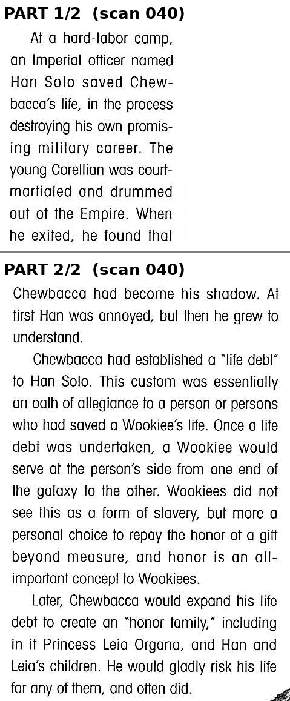
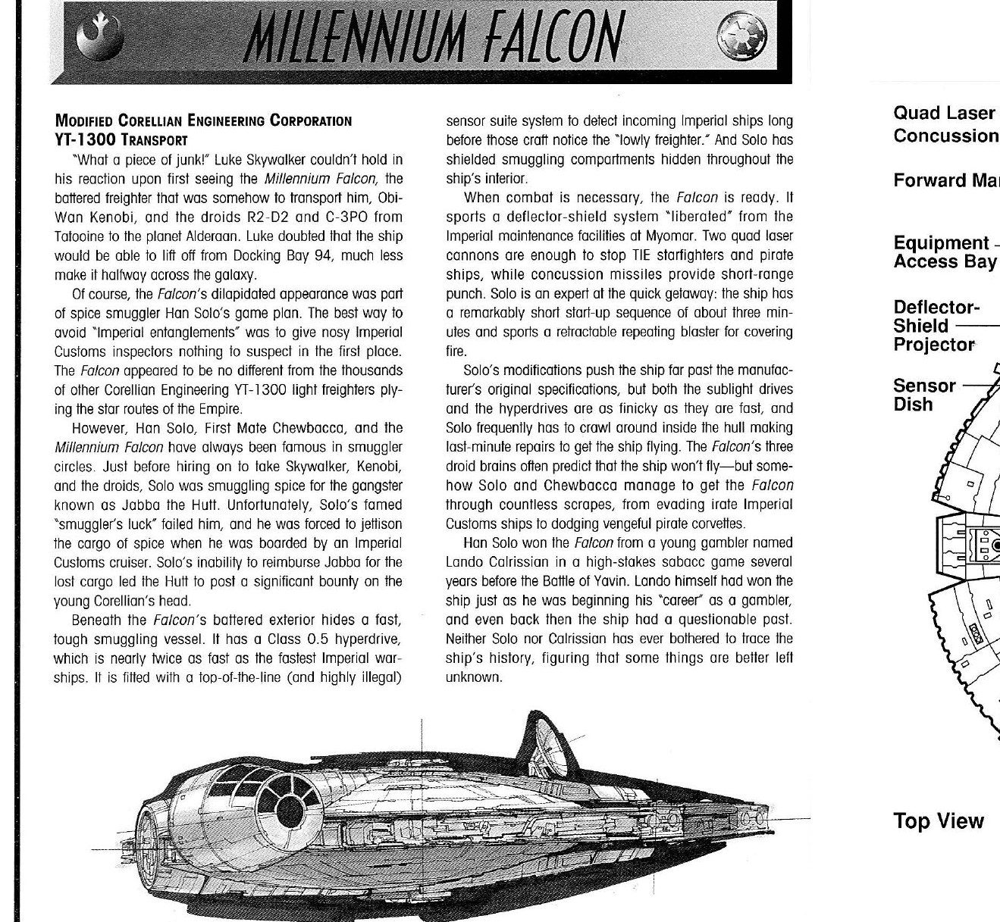
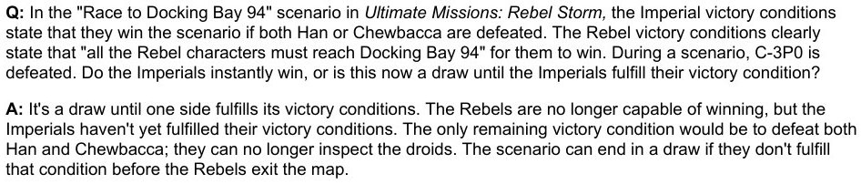

# Chewbacca

- **Aliases:** Chewie
- **Era:** GCW–NJO
- **Continuity:** default Legends; entries present for: Canon, Legends
- **Research tier:** untiered (not listed as INTRO/DEEP/MASTERY in legends-feats.md)
- **Entries:** 653 (315 with quotations; 19 quotations extended to the full sentence/passage from the source text on file; 182 marked as fragments; 227 before the 2026-11-17 fragment fill). Rebuilt 2026-11-17 from 756 old entries; old file: `characters/_bak/chewbacca.md.bak-20261117`. Added 2026-11-19: 3 entries from Young Jedi Knights 1: Heirs of the Force (full read).
- **How to read:** each entry is the quotation in full (block quote), then its source and point of view. "Note" lines are summaries from our notes, not quotations. `[fragment — full passage not on file]` means the source text is not on the box, so only the words in our notes are shown. Debate and forum material is in the last section and is unverified.

# LEGENDS (Legends / EU — main focus)

## Legacy of the Force 1–9: novel notes from the other agent (reference copy)

- Note (summary from our notes, not a quotation): Han & Leia with Waroo (Chewbacca's son) hike four days to address the Rock Council (L1717); Jae Juun & Tarfang (Alliance intel) object; Tojj clan feud (L1823); Tarfang fires a blaster past Waroo (L1823–1827).
  — Source: L1717; L1823; L1823–1827 — Legacy of the Force 6: Inferno (novel, read in full): feats, scaling and story notes.
Our notes: `notes/materials/021-legacy-of-the-force/lotf-6-inferno-notes.md:289`

## Dark Lord trilogy (Labyrinth of Evil, Revenge of the Sith, Dark Lord): novel notes from the other agent (reference copy)

> This is wrong, all wrong, she told herself.
>
> And yet, clearly, the notion of tragic irony hadn’t been incorporated into the clones’ programming. The troopers were out to kill her. Only the flashing blue blade of her lightsaber stood between her and certain death.
>
> The stormtroopers who had been the first to land were already dead, from blaster rounds, bowcaster quarrels, lightsaber slashes, blows from war clubs and the occasional giant, shaggy fist. But more and more Imperial craft were dropping from the wan sky—gunships, troop carriers, scores of two-person infantry support platforms. Worse, word had it that the incursion wasn’t confined to Kachirho, but was being repeated in tree-cites worldwide.
— Source: L4691; L4693 — Dark Lord: The Rise of Darth Vader: combat and Force feats (novel, read in full).
(Excerpt widened 2026-11-17 to the relevant passage, word for word from Dark Lord: The Rise of Darth Vader (James Luceno) (text copy `MEGA_Legend_The_Episode_Novelizations_Star_Wars_Revenge_of_the_Sith_03_Dark_Lord_The_Rise_of_Darth_Vader_James_Luceno_epub`).)
(Excerpt widened 2026-11-17 to the relevant passage, word for word from Dark Lord: The Rise of Darth Vader (James Luceno) (text copy `MEGA_Legend_The_Episode_Novelizations_Star_Wars_Revenge_of_the_Sith_03_Dark_Lord_The_Rise_of_Darth_Vader_James_Luceno_epub`).)
(Fragment completed 2026-11-17: full sentence/passage matched word for word in the source text on file: `MEGA_Legend_The_Episode_Novelizations_Star_Wars_Revenge_of_the_Sith_03_Dark_Lord_The_Rise_of_Darth_Vader_James_Luceno_epub`.)
Note text that was attached to the quote line: *(L4691)*
Note text that was attached to the quote line: *(L4693)*
Context: F43. [IV/39, L4629-4711] Starstone, Forte, Kulka, Klossi Anno, Jambe Lu, Nam Poorf (six Jedi), plus Tarfful, Chewbacca, and Wookiee warriors vs stormtrooper landing waves: group combat. The first landing wave is wiped out.
Our notes: `notes/materials/022-dark-lord-trilogy/dark-lord-novel-feats.md:163`

> "Explosive quarrels from Chewbacca's bowcaster combined with blasterfire and deflections from Starstone's lightsaber dropped a dozen droids at a time." *(L5303)*
— Source: L5303 — Dark Lord: The Rise of Darth Vader: combat and Force feats (novel, read in full).
Context: F61. [IV/47, L5299-5303] Starstone (lightsaber and blaster), Chewbacca (bowcaster), Archyr, and Wookiees vs battle droids aboard a Recusant-class destroyer. They fight their way to the bridge and then turn the destroyer into a bomb against the Interdictor (L5325-5333, L5453).
Our notes: `notes/materials/022-dark-lord-trilogy/dark-lord-novel-feats.md:234`

- Note (summary from our notes, not a quotation): | 12 | Starstone + Chewbacca + Archyr + Wookiees vs battle droids | Recusant, L5295-5313 | short | Starstone's group | Team effort. | Padawan-level deflection in a group. |
  — Source: Dark Lord: The Rise of Darth Vader: combat and Force feats (novel, read in full).
Context: | # | Fight | Where (lines) | Length | Winner | Holding back / help / injuries | What it suggests |
Our notes: `notes/materials/022-dark-lord-trilogy/dark-lord-novel-feats.md:360`

- Note (summary from our notes, not a quotation): Kashyyyk (Ch. 36-49): Tarkin lets the Jedi through the checkpoint so the Empire has an excuse to invade and enslave Wookiees as labor for the battle station (L4423, L5501). The Jedi fight beside Tarfful and Chewbacca. Vader lands, kills more than 20 Wookiees, beheads Forte and Kulka, and maims Anno, Lu, and Poorf. He toys with Starstone until Shryne arrives. Shryne sends the others away and duels Vader alone. Vader wins with TK, reveals that "Lord Sidious is the Emperor" (L5201) and that he is Anakin Skywalker, "the twenty-first" (L5225), and Shryne dies as his vision comes true. Starstone's group uses a Separatist destroyer as a bomb on the Interdictor, and hundreds of ships escape. Kashyyyk falls.
  — Source: L5201; L5225 — Dark Lord: The Rise of Darth Vader: combat and Force feats (novel, read in full).
Our notes: `notes/materials/022-dark-lord-trilogy/dark-lord-novel-feats.md:397`

- Note (summary from our notes, not a quotation): The unnamed "moonlet-size" weapon is the first Death Star of *A New Hope*. Chewbacca, Tarfful, and Commander Gree appear in the *Revenge of the Sith* Kashyyyk scenes that Ch38 and Ch40 refer back to.
  — Source: Dark Lord: The Rise of Darth Vader: combat and Force feats (novel, read in full).
Our notes: `notes/materials/022-dark-lord-trilogy/dark-lord-novel-feats.md:783`

What it shows (our notes): Fights/results: Vader is «merely allowing her to vent» [IV/41, L4817], coaches her, and lets her go [L4849]. With Chewbacca and Wookiees she beats battle droids [IV/47, L5295–5313].
> Calling on the Force, Starstone fell on him in a fury, striking wildly and repeatedly, and with anger. Moments into her attack she understood that Vader was merely allowing her to vent, as the Temple’s swordmaster had often done with students, allowing them to believe that they were driving him back, when in fact he was simply encouraging them to wear themselves out before disarming them in one rapid motion.
— Source: Dark Lord: The Rise of Darth Vader: combat and Force feats (novel, read in full); Fights/results: Vader is.
(Excerpt widened 2026-11-17 to the relevant passage, word for word from Dark Lord: The Rise of Darth Vader (James Luceno) (text copy `MEGA_Legend_The_Episode_Novelizations_Star_Wars_Revenge_of_the_Sith_03_Dark_Lord_The_Rise_of_Darth_Vader_James_Luceno_epub`).)
(Fragment completed 2026-11-17: full sentence/passage matched word for word in the source text on file: `MEGA_Legend_The_Episode_Novelizations_Star_Wars_Revenge_of_the_Sith_03_Dark_Lord_The_Rise_of_Darth_Vader_James_Luceno_epub`.)
Our notes: `notes/materials/022-dark-lord-trilogy/dark-lord-novel-feats.md:815`

## Jedi Academy Trilogy (Kevin J. Anderson, 1994): Jedi Search, Dark Apprentice, Champions of the Force (power-scaling notes)

> The other Wookiees fell upon him. Nawruun jammed the handle of the force whip into the Keeper’s face and switched on the weapon at full power.
— Source: Champions of the Force, ch.8, PDF p.73 — Owner Material 026 — Jedi Academy Trilogy: Champions of the Force (Kevin J. Anderson); Wookiees kill the Keeper. POV: Wookiees kill the Keeper.
(Excerpt widened 2026-11-17 to the relevant passage, word for word from Champions of the Force (Kevin Anderson), Chapter 8 (text copy `MEGA_Legend_The_Jedi_Academy_Trilogy_Star_Wars_Jedi_Academy_03_Champions_of_the_Force_Kevin_J_Anderson_epub`).)
Note (our notes, around the quote): Wookiees kill the Keeper: "Nawruun jammed the handle of the force whip into the Keeper’s face and switched on the weapon at full power." Source: Champions of the Force, ch.8, PDF p.73
Our notes: `notes/materials/026-jedi-academy-trilogy/champions-of-the-force.md:335`

> Chewbacca had apparently had enough of formal requests. He bunched his fists together and brought them down on the first control bank, smashing the glossy black coverings and shattering circuit connections.
— Source: Dark Apprentice, ch.26, PDF p.198-199 — Owner Material 026 — Jedi Academy Trilogy: Dark Apprentice (Kevin J. Anderson); Chewbacca smashes the zoo’s control banks.
(Excerpt widened 2026-11-17 to the relevant passage, word for word from Dark Apprentice (Kevin Anderson), Chapter 26 (text copy `MEGA_Legend_The_Jedi_Academy_Trilogy_Star_Wars_Jedi_Academy_02_Dark_Apprentice_Kevin_J_Anderson_epub`).)
Note (our notes, around the quote): Chewbacca smashes the zoo’s control banks: "He bunched his fists together and brought them down on the first control bank, smashing the glossy black coverings and shattering circuit connections." Source: Dark Apprentice, ch.26, PDF p.198-199
Our notes: `notes/materials/026-jedi-academy-trilogy/dark-apprentice.md:295`

> All day long he had been straining his senses, searching for some echo of Han or Chewbacca, but he had found nothing. Plenty of others wallowed in pain and misery here, but Luke found no hint of the ones he sought.
— Source: Jedi Search, ch.18, PDF p.185 — Owner Material 026 — Jedi Academy Trilogy: Jedi Search (Kevin J. Anderson); Luke searches Kessel with the Force for Han.
Note (our notes, around the quote): Luke searches Kessel with the Force for Han: "All day long he had been straining his senses, searching for some echo of Han or Chewbacca, but he had found nothing. Plenty of others wallowed in pain and misery here, but Luke found no hint of the ones he sought." Source: Jedi Search, ch.18, PDF p.185
Our notes: `notes/materials/026-jedi-academy-trilogy/jedi-search.md:29`

> Young Kyp Durron bent low and dove into the knees of the closest armed guard, knocking him to the floor. Kyp scrambled out of the way, yanking at boots and legs, tripping two more men.
— Source: Jedi Search, ch.11, PDF p.125 — Owner Material 026 — Jedi Academy Trilogy: Jedi Search (Kevin J. Anderson).
Note (our notes, around the quote): Han’s brawl in the muster room; Kyp joins in (also: Han Solo, Chewbacca): "Young Kyp Durron bent low and dove into the knees of the closest armed guard, knocking him to the floor. Kyp scrambled out of the way, yanking at boots and legs, tripping two more men." Source: Jedi Search, ch.11, PDF p.125
Our notes: `notes/materials/026-jedi-academy-trilogy/jedi-search.md:89`

> Chewbacca clenched his fist around an upraised storage lid, bending it noticeably. He wanted to know why Admiral Daala insisted on such desperate speed.
— Source: Jedi Search, ch.23, PDF p.231 — Owner Material 026 — Jedi Academy Trilogy: Jedi Search (Kevin J. Anderson); Chewbacca bends a storage lid in anger.
(Excerpt widened 2026-11-17 to the relevant passage, word for word from Jedi Search (Kevin Anderson), Chapter 23 (text copy `MEGA_Legend_The_Jedi_Academy_Trilogy_Star_Wars_Jedi_Academy_01_Jedi_Search_Kevin_J_Anderson_epub`).)
Note (our notes, around the quote): Chewbacca bends a storage lid in anger: "Chewbacca clenched his fist around an upraised storage lid, bending it noticeably." Source: Jedi Search, ch.23, PDF p.231
Our notes: `notes/materials/026-jedi-academy-trilogy/jedi-search.md:237`

## Star Wars: The New Essential Chronology (Del Rey, 2005): power-scaling and lore notes

- Note (summary from our notes, not a quotation): Chewbacca — art caption: "Chewbacca" Source: The New Essential Chronology, p.92, caption
  — Source: Part Four: Profiles in History.
Our notes: `notes/materials/027-new-essential-chronology/04-part-four-profiles-in-history.md:33`

> Since the Chiss had a moral principle against making first strikes, Formbi had hoped the Vagaari would take advantage of the Outbound Flight bait and make an aggressive move, Now that they had, war had been declared between the Chiss Ascendancy and the Vagaari.
>
> Dean Jinzler found closure, realizing that his sister had done everything she could to protect Outbound Right, and had died with honor during Thrawn’s attack. The Outbound Flight colonists teft the Redoubt, the only home they'd knovm for decades. Most of them began new fives in the Empire of the Hand.
>
> THe Stiapow Academy AND THE SECOND Imperium 23 A.B.Y.
>
> ™ 9" he Solo twins-Jacen with his quirky sense of humor | and rapport with animals, and Jaina with her aptitude for mechanics—became two of the most talented of the new Seneration of Jedi Knights. Together with their companions Tenel Ka, warrior daughter of Prince Isolder of Hapes and Tenenlel Djo of Dathomir, and Lowbacca, the Wookiee nephew of Chewbacca, they fought for the New Republic with as much bravery as the legendary Jedi Knights of old, SN 198 ) ey, During a training exerdse in the jungles of Yavin 4, the young Jedi Knights discovered the wreckage of a TIE fighter— an Imperial ship that had crashed there years before, during the Rebel battle against the first Death Star.
>
> ™ 9" he Solo twins-Jacen with his quirky sense of humor | and rapport with animals, and Jaina with her aptitude for mechanics—became two of the most talented of the new Seneration of Jedi Knights. Together with their companions Tenel Ka, warrior daughter of Prince Isolder of Hapes and Tenenlel Djo of Dathomir, and Lowbacca, the Wookiee nephew of Chewbacca, they fought for the New Republic with as much bravery as the legendary Jedi Knights of old, SN 198 ) ey, During a training exerdse in the jungles of Yavin 4, the young Jedi Knights discovered the wreckage of a TIE fighter— an Imperial ship that had crashed there years before, during the Rebel battle against the first Death Star. The Jedi Knights were unaware that the original pilot, a grizzled old man named Qorl, had survived the crash and had been eking out a living In the wilderness. Qorl forced the Jedi students {o complete the final repalrs so that he could flee the jungle moon, and then flew off to rejoin the Empire... wherever he could find it.
— Source: Part Eleven: Generations of Jedi; Jacen Solo; Jaina Solo — young Jedi Knights.
(Excerpt widened 2026-11-17 to the relevant passage, word for word from research primary new essential chronology nec paged (text copy `research_primary_new_essential_chronology_nec_paged_txt_88b808b5bc`).)
(Excerpt widened 2026-11-17 to the relevant passage, word for word from research primary new essential chronology nec paged (text copy `research_primary_new_essential_chronology_nec_paged_txt_88b808b5bc`).)
(Full sentence/passage taken from the source text on file: `research_primary_new_essential_chronology_nec_paged_txt`.)
Note (our notes, around the quote): Jacen Solo; Jaina Solo — young Jedi Knights: "Together with their companions Tenel Ka ... and Lowbacca, the Wookiee nephew of Chewbacca, they fought for the New Republic with as much bravery as the legendary Jedi Knights of old." Source: The New Essential Chronology, p.198
Our notes: `notes/materials/027-new-essential-chronology/11-part-eleven-generations-of-jedi.md:38`

> Han Solo, Anakin Solo, and Chewbacca ... did all they could to save the doomed world, but not even the Force could slow the moon once it had slipped into a terminal orbit.
> [fragment — full passage not on file]
— Source: Part Twelve: The New Jedi Order; Han Solo; Anakin Solo; Chewbacca — not even the Force.
Note (our notes, around the quote): Han Solo; Anakin Solo; Chewbacca — not even the Force: "Han Solo, Anakin Solo, and Chewbacca ... did all they could to save the doomed world, but not even the Force could slow the moon once it had slipped into a terminal orbit." Source: The New Essential Chronology, p.204
Our notes: `notes/materials/027-new-essential-chronology/12-part-twelve-new-jedi-order.md:26`

> Chewbacca dies a hero's death on Sernpidal.
— Source: Part Twelve: The New Jedi Order; Chewbacca — art caption.
Note (our notes, around the quote): Chewbacca — art caption: "Chewbacca dies a hero's death on Sernpidal." Source: The New Essential Chronology, p.204, caption
Our notes: `notes/materials/027-new-essential-chronology/12-part-twelve-new-jedi-order.md:28`

> Han, watching from the boarding ramp, saw Chewbacca receding in the distance, his fists raised in defiance at the sinking moon as the atmosphere superheated around him.
— Source: Part Twelve: The New Jedi Order; Chewbacca; Anakin Solo — Chewbacca's last stand.
Note (our notes, around the quote): Chewbacca; Anakin Solo — Chewbacca's last stand: "Han, watching from the boarding ramp, saw Chewbacca receding in the distance, his fists raised in defiance at the sinking moon as the atmosphere superheated around him." Source: The New Essential Chronology, p.206
Our notes: `notes/materials/027-new-essential-chronology/12-part-twelve-new-jedi-order.md:40`

## The Jedi Academy Sourcebook (WEG, 1996): power-scaling and lore notes

> The news that the Empire lies broken, along with Tarkin and his mighty Death Star. shakes her to her core. She resolves to hit the New Republic as hard as she can, with her arsenal of experimental weapons.
>
> Unfortunately, things go wrong for her al- most immediately. Daala soon learns that an aptitude for theory is no substitute for experi- ence. Her inability to alter her plans to take into account the unexpected is instrumental in her eventual downfall. Han Solo, Kyp, and Chewbacca escape with her prize superweapon, the Sun Crusher, and destroy the Hydra, one of her four Star Destroyers.
>
> After battling Moruth Doole’s forces at Kessel, Daala retreats to the Cauldron Nebula to re- cover and plot her next step. Refusing to submit to any of the warlords in the Imperial Core, she settles on a hit-and-run strategy designed to strike terror in the New Republic.
— Source: Chapter Five: Forces of the Empire.
(Excerpt widened 2026-11-17 to the relevant passage, word for word from research primary jedi academy sourcebook jas clean (text copy `research_primary_jedi_academy_sourcebook_jas_clean_txt_04b8ab0d44`).)
(Excerpt widened 2026-11-17 to the relevant passage, word for word from research primary jedi academy sourcebook jas clean (text copy `research_primary_jedi_academy_sourcebook_jas_clean_txt_04b8ab0d44`).)
Note (our notes, around the quote): Admiral Daala; Han Solo; Kyp Durron; Chewbacca; Sun Crusher — Admiral Daala — loss of the Sun Crusher: "Han Solo, Kyp, and Chewbacca escape with her prize superweapon, the Sun Crusher, and destroy the Hydra, one of her four Star Destroyers." Source: The Jedi Academy Sourcebook, p.56
Our notes: `notes/materials/029-jedi-academy-sourcebook/05-ch5-forces-of-the-empire.md:59`

## The Complete Star Wars Encyclopedia, Vol. I (A–G)

> It featured a pair of heavy mass-driver cannons and a concus­ sion missile battery. Candorian plague A deadly airborne plague weaponized by the Empire during the Galactic Civil War and unleashed on Dentaal. canir A title given to elected Vratix leaders on Thyferra. cannibal arachnid A legendary giant spider-like species on Duro that died out as the planet's ecosystem collapsed. cannok Vicious, wide-jawed predators that the Ithorians imported from Dxun to Telos to keep the herbivore population in check. cannonade An exploding projectile weapon, it was fired by a crossbow. Cant, Devin A trooper aboard the first Death Star, he was an elite soldier trained in combat techniques and weapons skills. He augmented security personnel guarding Prin­ cess Leia Organa in detention block AA-23. He was killed in the line of duty when Han Solo, Chewbacca, and Luke Skywalker freed Leia. Cantham House Bail Organa's residence on Coruscant, the site ofclandestine meetings among Organa, Mon Mothma, and Garm Bel Iblis during the early planning stages of the Rebel Alliance. cantinaSee Mos Eisley cantina. Canu A deity worshipped by the primitive inhabitants of Circarpous V.
— Source: scan pages 121–160; Han Solo; Chewbacca; Luke Skywalker; Leia Organa Solo.
(Excerpt widened 2026-11-17 to the relevant passage, word for word from research primary cse vol1 (text copy `research_primary_cse_vol1_pdf_45a954be6d`).)
(Excerpt widened 2026-11-17 to the relevant passage, word for word from research primary cse vol1 (text copy `research_primary_cse_vol1_pdf_45a954be6d`).)
Note (our notes, around the quote): Han Solo; Chewbacca; Luke Skywalker; Leia Organa Solo: "He was killed in the line of duty when Han Solo, Chewbacca, and Luke Skywalker freed Leia." Source: The Complete Star Wars Encyclopedia, Vol. I, p.107
Our notes: `notes/materials/030-complete-star-wars-encyclopedia-vol-1/03-v1-scan-121-160.md:19`

- Note (summary from our notes, not a quotation): Page contents: 956 words, 28 paragraphs | headings/entries: Chewbacca
  — Source: scan pages 121–160.
Our notes: `notes/materials/030-complete-star-wars-encyclopedia-vol-1/03-v1-scan-121-160.md:138`

> Although the Falcon's upkeep was a labor of love, many a time Chewie unleashed his legendary temper on the recalcitrant freighter, banging his massive furry hands against delicate components that refused to behave.
— Source: scan pages 121–160; Chewbacca — entry/section: Chewbacca.
Note (our notes, around the quote): Chewbacca — entry/section: Chewbacca: "Although the Falcon's upkeep was a labor of love, many a time Chewie unleashed his legendary temper on the recalcitrant freighter, banging his massive furry hands against delicate components that refused to behave." Source: The Complete Star Wars Encyclopedia, Vol. I, p.122
Our notes: `notes/materials/030-complete-star-wars-encyclopedia-vol-1/03-v1-scan-121-160.md:140`

> At the start of the Yuuzhan Vong invasion, Han Solo and Chewbacca were on the planet Sernpidal when it became a target ofthe alien menace. Using massive gravity-altering crea­ tures called dovin basals, the Yuuzhan Vong began to drag Sernpidal's moon Dobido from its orbit to the planet's surface. Han Solo, his teenage son Anakin, and Chewbacca began organizing a desperate evacuation, cramming as many escapees aboard the Falcon as they could. Solo and Chewbacca enjoyed many close calls through the years, and executed countless last-second escapes; Sernpidal was not to be one of them. As the moon rushed closer to the surface, Chewbacca was cut offfrom the Falcon. age assignment landed them Chewbacca spenthours modifying and tinkering with the Millennium Falcon. Chewbacca and Han Solo were a well-known smuggling duo whose exploits became legendary. Chiewab Amalgam­ ated Pharmaceuti­ cals One of the original sponsors of the Corporate Sector, this conglomerate owned over 600 sytems and was the leader in bio­ technological research and development. Its strengths were in chemistry and electronics. Chiewab was constantly seeking out new planets and new substances that might be developed for its new product fam­ ily. Subsidiaries included Geentech Laboratories, Corellian Chemical Cor­ poration, Chiewab Nutri- Anakin was faced with a terrible decision.
— Source: scan pages 121–160; Chewbacca; Han Solo — entry/section: Chewbacca.
(Excerpt widened 2026-11-17 to the relevant passage, word for word from research primary cse vol1 (text copy `research_primary_cse_vol1_pdf_45a954be6d`).)
(Excerpt widened 2026-11-17 to the relevant passage, word for word from research primary cse vol1 (text copy `research_primary_cse_vol1_pdf_45a954be6d`).)
Note (our notes, around the quote): Chewbacca; Han Solo — entry/section: Chewbacca: "Chewbacca and Han Solo were a well-known smuggling duo whose exploits became legendary." Source: The Complete Star Wars Encyclopedia, Vol. I, p.123
Our notes: `notes/materials/030-complete-star-wars-encyclopedia-vol-1/03-v1-scan-121-160.md:147`

> The Darker eventually was defeated by Chewbacca, who threw the being into the force screen, destroying him and the underground city.
— Source: scan pages 161–200; Chewbacca. POV: Chewbacca.
Note (our notes, around the quote): Chewbacca: "The Darker eventually was defeated by Chewbacca, who threw the being into the force screen, destroying him and the underground city." Source: The Complete Star Wars Encyclopedia, Vol. I, p.166
Our notes: `notes/materials/030-complete-star-wars-encyclopedia-vol-1/04-v1-scan-161-200.md:182`

> Fasgo was killed when one ofthe yammosk's tentacles struck and shattered his skull. Fass,Haddon A Dark Side Adept who had worked for Emperor Pal­ patine, Fass was assigned with fellow adept Zasm Katth to track down Han and Leia Organa Solo and the Millen­ nium Falcon, which was hidden on Nar Shaddaa. They failed miserably, and Fass was killed along with his entire crew when his Star DestroyerInvincible acci­ dentally locked on to the NarShaddaacontroltower and collided with it. Fass, Egome A humanoid-like Houk with a square jaw and tiny, gleaming eyes set deep beneath a thick, bony brow, he worked for the outlaw twins J'uoch and R'all, guard­ ing their Dellalt mining operations. He was reputed to rival the mighty Wookiee Chewbacca in both height and strength. But the Wookiee killed Fass in hand-to-hand combat during the search for the fabled starship Queen o f Ranroon, reputedly filled with the trea­ sures of Xim the Despot when it disap­ peared several millennia before the birth of the Empire. Fassa,MajorA Gungan offi­ cer in the Grand Army, she was a niece of Boss Nass. Sent with Rep Teers to look into the con­ struction of the Lake Umber­ boo! arena, she got caught in its accidental collapse and was rescued by Jar Jar Binks.
— Source: scan pages 241–280; Egome Fass; Chewbacca — entry/section: Fass, Egome.
(Excerpt widened 2026-11-17 to the relevant passage, word for word from research primary cse vol1 (text copy `research_primary_cse_vol1_pdf_45a954be6d`).)
(Excerpt widened 2026-11-17 to the relevant passage, word for word from research primary cse vol1 (text copy `research_primary_cse_vol1_pdf_45a954be6d`).)
Note (our notes, around the quote): Egome Fass; Chewbacca — entry/section: Fass, Egome: "He was reputed to rival the mighty Wookiee Chewbacca in both height and strength." Source: The Complete Star Wars Encyclopedia, Vol. I, p.257
Our notes: `notes/materials/030-complete-star-wars-encyclopedia-vol-1/06-v1-scan-241-280.md:199`

> Thirteen years after the Battle of Endor, Lando Calrissian was captured by Nandreeson and nearly killed before Han Solo and Chewbacca rescued him.
— Source: scan pages 361–398; Lando Calrissian; Han Solo; Chewbacca.
Note (our notes, around the quote): Lando Calrissian; Han Solo; Chewbacca: "Thirteen years after the Battle of Endor, Lando Calrissian was captured by Nandreeson and nearly killed before Han Solo and Chewbacca rescued him." Source: The Complete Star Wars Encyclopedia, Vol. I, p.346
Our notes: `notes/materials/030-complete-star-wars-encyclopedia-vol-1/09-v1-scan-361-398.md:12`

> Gor-ravvus The primary liai­ son between Lhosan Industries and the Old Republic in the years following the Great Sith War, he lobbied the Galactic Senate to recog­ nize Taris and its neighboring systems as part ofthe Republic after Lhosan decided to estab­ lish a manufacturing facility there. Gor-rawus later was named a full Senator. Unfortunately for the people of Taris, Senator Gor-rawus fled the planet at the first hint of a Mandalo­ rian attack. GorrlynA female Wookiee, she was chosen by Salporin as a mate shortly before the start of the Clone Wars. The two were separated when the Empire enslaved the Wookiees, and Gorrlyn was widowed when Salporin died trying to protect Chewbacca and Leia Organa Solo on Kashyyyk. GorrmA tall and thin simian sentient, he was Ssk Kahorr's chief navigator. Gorrm was killed when Ssk Kahorr and the Starbreaker 12 were de­ stroyed by Naga Sadow. gorros'fen An immense worm bioengineered by the Yuuzhan Vong, it served as a tube through which a Koros­ Strohna worldship could obtain nutrients from a planet-based location. The gorros'fen worm extended down from the worldship and literally sucked the nutrients from a planet's crust and mantle.
— Source: scan pages 361–398; Chewbacca; Leia Organa Solo.
(Excerpt widened 2026-11-17 to the relevant passage, word for word from research primary cse vol1 (text copy `research_primary_cse_vol1_pdf_45a954be6d`).)
(Excerpt widened 2026-11-17 to the relevant passage, word for word from research primary cse vol1 (text copy `research_primary_cse_vol1_pdf_45a954be6d`).)
Note (our notes, around the quote): Chewbacca; Leia Organa Solo: "The two were separated when the Empire enslaved the Wookiees, and Gorrlyn was widowed when Salporin died trying to protect Chewbacca and Leia Organa Solo on Kashyyyk." Source: The Complete Star Wars Encyclopedia, Vol. I, p.354
Our notes: `notes/materials/030-complete-star-wars-encyclopedia-vol-1/09-v1-scan-361-398.md:76`

> The Graveyard was destroyed prior to the Battle of Hoth when Arakkus trapped Han Solo, Luke Skywalker, and Chewbacca aboard the Millennium Falcon.
— Source: scan pages 361–398; Han Solo; Luke Skywalker; Chewbacca.
Note (our notes, around the quote): Han Solo; Luke Skywalker; Chewbacca: "The Graveyard was destroyed prior to the Battle of Hoth when Arakkus trapped Han Solo, Luke Skywalker, and Chewbacca aboard the Millennium Falcon." Source: The Complete Star Wars Encyclopedia, Vol. I, p.360
Our notes: `notes/materials/030-complete-star-wars-encyclopedia-vol-1/09-v1-scan-361-398.md:122`

> He hired Han Solo and Chewbacca for a brief time before the pair became involved in the Galactic Civil War—but not before Solo upstaged and outclassed his boss during one last airshow.
— Source: scan pages 361–398; Han Solo; Chewbacca.
Note (our notes, around the quote): Han Solo; Chewbacca: "He hired Han Solo and Chewbacca for a brief time before the pair became involved in the Galactic Civil War—but not before Solo upstaged and outclassed his boss during one last airshow." Source: The Complete Star Wars Encyclopedia, Vol. I, p.370
Our notes: `notes/materials/030-complete-star-wars-encyclopedia-vol-1/09-v1-scan-361-398.md:210`

## The Complete Star Wars Encyclopedia, Vol. II (H–O)

> Bossk purchased it after the Wookiee Chewbacca and Han Solo destroyed his previous ship on Gandolo IV.
— Source: scan pages 41–80; Bossk; Chewbacca; Han Solo.
Note (our notes, around the quote): Bossk; Chewbacca; Han Solo: "Bossk purchased it after the Wookiee Chewbacca and Han Solo destroyed his previous ship on Gandolo IV." Source: The Complete Star Wars Encyclopedia, Vol. II, p.63
Our notes: `notes/materials/031-complete-star-wars-encyclopedia-vol-2/01-v2-scan-041-080.md:204`

> The ship was captured by Luke Skywalker, Han Solo, and Chewbacca at Kessel, but Volz decided that it was too dangerous and destroyed it himself.
— Source: scan pages 81–120; Luke Skywalker; Han Solo; Chewbacca.
Note (our notes, around the quote): Luke Skywalker; Han Solo; Chewbacca: "The ship was captured by Luke Skywalker, Han Solo, and Chewbacca at Kessel, but Volz decided that it was too dangerous and destroyed it himself." Source: The Complete Star Wars Encyclopedia, Vol. II, p.112
Our notes: `notes/materials/031-complete-star-wars-encyclopedia-vol-2/02-v2-scan-081-120.md:251`

> ISBy This slicer droid, an ISB-120 model, was employed by the interrogation droid known as IT to break into a datapad that was owned by Leia Organa Solo, ISBy was destroyed when Chewbacca and his wife, Mallatobuck, tried to rescue their son Lumpawarrump from IT.
— Source: scan pages 121–160; Leia Organa Solo; Chewbacca.
Note (our notes, around the quote): Leia Organa Solo; Chewbacca: "ISBy This slicer droid, an ISB-120 model, was employed by the interrogation droid known as IT to break into a datapad that was owned by Leia Organa Solo, ISBy was destroyed when Chewbacca and his wife, Mallatobuck, tried to rescue their son Lumpawarrump from IT." Source: The Complete Star Wars Encyclopedia, Vol. II, p.118
Our notes: `notes/materials/031-complete-star-wars-encyclopedia-vol-2/03-v2-scan-121-160.md:31`

> Chewbacca managed to disable the IT, and his wife, Mallatobuck, destroyed it.
— Source: scan pages 121–160; Chewbacca. POV: Chewbacca.
Note (our notes, around the quote): Chewbacca: "Chewbacca managed to disable the IT, and his wife, Mallatobuck, destroyed it." Source: The Complete Star Wars Encyclopedia, Vol. II, p.122
Our notes: `notes/materials/031-complete-star-wars-encyclopedia-vol-2/03-v2-scan-121-160.md:65`

> He was killed at the Maw by Nawruun, who rose up against his master when Chewbacca and Han Solo fled the Installation during the New Republic's attempt to take control.
— Source: scan pages 241–280; Chewbacca; Han Solo.
Note (our notes, around the quote): Chewbacca; Han Solo: "He was killed at the Maw by Nawruun, who rose up against his master when Chewbacca and Han Solo fled the Installation during the New Republic's attempt to take control." Source: The Complete Star Wars Encyclopedia, Vol. II, p.242
Our notes: `notes/materials/031-complete-star-wars-encyclopedia-vol-2/06-v2-scan-241-280.md:79`

## The Complete Star Wars Encyclopedia, Vol. III (P–Z)

> They helped evacuate the planet, but Chewbacca was killed in the cataclysm.
— Source: scan pages 121–160; Chewbacca. POV: Chewbacca.
Note (our notes, around the quote): Chewbacca: "They helped evacuate the planet, but Chewbacca was killed in the cataclysm." Source: The Complete Star Wars Encyclopedia, Vol. III, p.140
Our notes: `notes/materials/032-complete-star-wars-encyclopedia-vol-3/03-v3-scan-121-160.md:201`

> Shoran A Wookiee cousin of Chewbacca, he was killed during the rescue of Han Solo aboard the Pride of Yevetha.
— Source: scan pages 121–160; Chewbacca; Han Solo.
Note (our notes, around the quote): Chewbacca; Han Solo: "Shoran A Wookiee cousin of Chewbacca, he was killed during the rescue of Han Solo aboard the Pride of Yevetha." Source: The Complete Star Wars Encyclopedia, Vol. III, p.148
Our notes: `notes/materials/032-complete-star-wars-encyclopedia-vol-3/03-v3-scan-121-160.md:287`

> Luke, Han, and Chewbacca—along with the droids R2-D2 and C-3PO—became a second family to her, helping to ease some of the shock and pain left by the annihilation of Alderaan.
— Source: scan pages 161–200; Luke Skywalker; Chewbacca.
Note (our notes, around the quote): Luke Skywalker; Chewbacca: "Luke, Han, and Chewbacca—along with the droids R2-D2 and C-3PO—became a second family to her, helping to ease some of the shock and pain left by the annihilation of Alderaan." Source: The Complete Star Wars Encyclopedia, Vol. III, p.177
Our notes: `notes/materials/032-complete-star-wars-encyclopedia-vol-3/04-v3-scan-161-200.md:276`

> This starship, capable of interdimensional travel, fled the known galaxy for many years until Lando Calrissian and Chewbacca stumbled upon it shortly after the Battle of Hoth.
— Source: scan pages 201–240; Lando Calrissian; Chewbacca.
Note (our notes, around the quote): Lando Calrissian; Chewbacca: "This starship, capable of interdimensional travel, fled the known galaxy for many years until Lando Calrissian and Chewbacca stumbled upon it shortly after the Battle of Hoth." Source: The Complete Star Wars Encyclopedia, Vol. III, p.198
Our notes: `notes/materials/032-complete-star-wars-encyclopedia-vol-3/05-v3-scan-201-240.md:39`

> His clan's grudge against Chewbacca did not cease when Chewbacca was killed at Sernpidal, and seemed to extend to Han Solo as well.
— Source: scan pages 241–280; Chewbacca; Han Solo.
Note (our notes, around the quote): Chewbacca; Han Solo: "His clan's grudge against Chewbacca did not cease when Chewbacca was killed at Sernpidal, and seemed to extend to Han Solo as well." Source: The Complete Star Wars Encyclopedia, Vol. III, p.252
Our notes: `notes/materials/032-complete-star-wars-encyclopedia-vol-3/06-v3-scan-241-280.md:159`

> Tojjevvuk An albino Wookiee who was Chewbacca's rival for the affections of Mallatobuck.
— Source: scan pages 241–280; Chewbacca. POV: Chewbacca.
Note (our notes, around the quote): Chewbacca: "Tojjevvuk An albino Wookiee who was Chewbacca's rival for the affections of Mallatobuck." Source: The Complete Star Wars Encyclopedia, Vol. III, p.252
Our notes: `notes/materials/032-complete-star-wars-encyclopedia-vol-3/06-v3-scan-241-280.md:161`

> He was defeated by Lando Calrissian and Han Solo, who had returned to Kashyyyk with Chewbacca to help him thwart the slavers.
— Source: scan pages 281–320; Lando Calrissian; Han Solo; Chewbacca.
Note (our notes, around the quote): Lando Calrissian; Han Solo; Chewbacca: "He was defeated by Lando Calrissian and Han Solo, who had returned to Kashyyyk with Chewbacca to help him thwart the slavers." Source: The Complete Star Wars Encyclopedia, Vol. III, p.296
Our notes: `notes/materials/032-complete-star-wars-encyclopedia-vol-3/07-v3-scan-281-320.md:167`

> A swoop gang he hired was no match for Luke, Han Solo, and Wedge Antilles, and Venan himself was incapacitated by Chewbacca.
— Source: scan pages 281–320; Luke Skywalker; Han Solo; Chewbacca.
Note (our notes, around the quote): Luke Skywalker; Han Solo; Chewbacca: "A swoop gang he hired was no match for Luke, Han Solo, and Wedge Antilles, and Venan himself was incapacitated by Chewbacca." Source: The Complete Star Wars Encyclopedia, Vol. III, p.301
Our notes: `notes/materials/032-complete-star-wars-encyclopedia-vol-3/07-v3-scan-281-320.md:206`

> When Han Solo and Chewbacca were able to turn the tables on Zlarb, Wadda was one of the handful of slavers who were themselves enslaved after Solo turned them over to a group of Lurrian geneticists.
— Source: scan pages 321–360; Han Solo; Chewbacca.
Note (our notes, around the quote): Han Solo; Chewbacca: "When Han Solo and Chewbacca were able to turn the tables on Zlarb, Wadda was one of the handful of slavers who were themselves enslaved after Solo turned them over to a group of Lurrian geneticists." Source: The Complete Star Wars Encyclopedia, Vol. III, p.317
Our notes: `notes/materials/032-complete-star-wars-encyclopedia-vol-3/08-v3-scan-321-360.md:26`

> The cloning complex and most of the mountain were destroyed when Lando Calrissian and Chewbacca sabotaged the central equipment column.
— Source: scan pages 321–360; Lando Calrissian; Chewbacca.
Note (our notes, around the quote): Lando Calrissian; Chewbacca: "The cloning complex and most of the mountain were destroyed when Lando Calrissian and Chewbacca sabotaged the central equipment column." Source: The Complete Star Wars Encyclopedia, Vol. III, p.323
Our notes: `notes/materials/032-complete-star-wars-encyclopedia-vol-3/08-v3-scan-321-360.md:60`

## Power of the Jedi Sourcebook (d20, 2002)

- Note (summary from our notes, not a quotation): Page contents: 893 words, 159 paragraphs | headings/entries: Ae; Ne sey aS / ar; Index; Abhean 132; Abraxin 79; Ackbar, Admiral 130; Adega system 135; Adegan crystals 104, 107, 155; Advozse 112, 113; Afarathu 108; AgriCorps worker 86; Alderaan 10, 64, 110; Aleema 107; Almania 83, 127; Amanoa, Queen 7, 100, 103, 104, 105; Ambria 101, 104, 105, 106, 145-147; Anselmi 71; Arkanian 64, 73, 100; Ashla, the 6; Asmeru 113, 114, 118; Assant, Darsha 121; Auril sector 135; Baltimn 150, 151; Bane, Darth 9; Battle Influence 12; Battle Meditation 15; Beast Language 15; Belasco 116; Bespin 128; Billaba, Depa 114; Black Sun 121; Bnar, Ood 136; Bondara, Anoon 121, 122, 124; Bouri, Omo 118; Brotherhood of Darkness 9, 141, 153; Caamasi 64, 110; Callista 9, 130; Carida 131; Cathar 65; Celegian 66, 98; Cerean 119; Chalactan 114; Chatos Academy 6; Chewbacca 11; Cho Leem, Thracia 123; Chu'unthor 132-135; Cilghal 11, 130; Cinnagar 8, 98, 103; Core Worlds 6, 7, 9, 70, 130
  — Source: Chapter Seven: Where the Force is strong; Index.
Our notes: `notes/materials/033-power-of-the-jedi-sourcebook/07-ch7-locations-index.md:176`

## The New Essential Guide to Characters (2002)

> Chewbacca is killed on Sernpidal.
> [fragment — full passage not on file]
— Source: scan pages 1–30; Chewbacca. POV: Chewbacca.
Note (our notes, around the quote): Chewbacca: "Chewbacca is killed on Sernpidal." Source: The New Essential Guide to Characters, p.14
Our notes: `notes/materials/034-new-essential-guide-to-characters/00-negc-scan-001-030.md:58`

> Once, when Trandoshan slavers attacked his home city, Chewbacca ripped the leader's arms from their sockets, saving a beautiful Wookiee named Mallatobuck.
— Source: scan pages 31–60; Chewbacca. POV: Chewbacca.
Note (our notes, around the quote): Chewbacca: "Once, when Trandoshan slavers attacked his home city, Chewbacca ripped the leader's arms from their sockets, saving a beautiful Wookiee named Mallatobuck." Source: The New Essential Guide to Characters, p.45
Our notes: `notes/materials/034-new-essential-guide-to-characters/01-negc-scan-031-060.md:57`

> Chewbacca dismembered the head slaver, who survived to regenerate his limbs years later.
— Source: scan pages 31–60; Chewbacca. POV: Chewbacca.
Note (our notes, around the quote): Chewbacca: "Chewbacca dismembered the head slaver, who survived to regenerate his limbs years later." Source: The New Essential Guide to Characters, p.45
Our notes: `notes/materials/034-new-essential-guide-to-characters/01-negc-scan-031-060.md:59`

> Chewbacca killed a quillarat for the lovely Mallatobuck and she ate from it, signifying their love.
— Source: scan pages 31–60; Chewbacca. POV: Chewbacca.
Note (our notes, around the quote): Chewbacca: "Chewbacca killed a quillarat for the lovely Mallatobuck and she ate from it, signifying their love." Source: The New Essential Guide to Characters, p.46
Our notes: `notes/materials/034-new-essential-guide-to-characters/01-negc-scan-031-060.md:66`

> Chewbacca helped destroy the probe droid that uncovered Echo Base on Hoth, and endured torture in a Cloud City holding cell.
— Source: scan pages 31–60; Chewbacca. POV: Chewbacca.
Note (our notes, around the quote): Chewbacca: "Chewbacca helped destroy the probe droid that uncovered Echo Base on Hoth, and endured torture in a Cloud City holding cell." Source: The New Essential Guide to Characters, p.47
Our notes: `notes/materials/034-new-essential-guide-to-characters/01-negc-scan-031-060.md:73`

> Sernpidal's falling moon killed Chewbacca.
> [fragment — full passage not on file]
— Source: scan pages 151–180; Chewbacca. POV: Chewbacca.
Note (our notes, around the quote): Chewbacca: "Sernpidal's falling moon killed Chewbacca." Source: The New Essential Guide to Characters, p.165
Our notes: `notes/materials/034-new-essential-guide-to-characters/05-negc-scan-151-180.md:75`

> Chewbacca rescued Han Solo from Spaar's Super Star Destroyer.
— Source: scan pages 151–180; Chewbacca; Han Solo.
Note (our notes, around the quote): Chewbacca; Han Solo: "Chewbacca rescued Han Solo from Spaar's Super Star Destroyer." Source: The New Essential Guide to Characters, p.178
Our notes: `notes/materials/034-new-essential-guide-to-characters/05-negc-scan-151-180.md:168`

## Sourcebooks/Rebellion Era Sourcebook.pdf [Star Wars Roleplaying Game (d20, 2000)] (scan pages 1–60)

- Note (summary from our notes, not a quotation): Page contents: 487 words, 60 paragraphs | headings/entries: Introduction Chapter 1: A New Hope; Fall of the Republic; The Outer Rim; The Doctrine of Fear; Common Droids; Darth Vader: Dark Lord of the Sith; The End of the Senate; Death Star Personnel; The Milrtary-industrial Complex The Imperial Star Destroyer; Imperial intelligence Blackhole; The Corporate Sector Working for the CSA; Scouring the Galaxy Hoth; Echo Base; Probe Droid; AT-ATs; Cold Assault Trooper Rebel Forces; Vader's Fleet; Yoda's Tutelage Bespin; Cloud City; Heroes of Yavin: Update; Chapter 9: The Empire Strikes Back 88; Contents; Jabba the Hutt; Jabba's Court; The Rebel Fleet; Alliance Leaders; Strike Team; Rebel Commandos; A Second Death Star; The Emperor; Ewoks; Ewok Inventions; Ewoks at War; Ewok Heroes; The Battle of Endor; Luke Skywalker Update Leia Organa Update; Han Solo Update Chewbacca Update Bakura; Ssi-Ruu
  — Source: Sourcebooks/Rebellion Era Sourcebook.pdf [Star Wars Roleplaying Game (d20.
Our notes: `notes/materials/037-sw-d20-folder/043-rebellion-era-sourcebook-scan-001-060.md:25`

> Organa, Han Solo, Chewbacca, and the droids R2-D2 and C- 3PO, the Death Star was destroyed and the Alliance won its first major victory.
— Source: Sourcebooks/Rebellion Era Sourcebook.pdf [Star Wars Roleplaying Game (d20; Han Solo; Chewbacca.
Note (our notes, around the quote): Han Solo; Chewbacca: "Organa, Han Solo, Chewbacca, and the droids R2-D2 and C- 3PO, the Death Star was destroyed and the Alliance won its first major victory." Source: *Rebellion Era Sourcebook* (SWRPG d20), scan p.57
Our notes: `notes/materials/037-sw-d20-folder/043-rebellion-era-sourcebook-scan-001-060.md:350`

## Sourcebooks/Rebellion Era Sourcebook.pdf [Star Wars Roleplaying Game (d20, 2000)] (scan pages 61–120)

> Bossk began his career hunting escaped Wookiee slaves and has a running feud with Han Solo's partner, Chewbacca. Though they have tangled multiple times, it is always Bossk who comes up short—short a limb, generally.
— Source: Sourcebooks/Rebellion Era Sourcebook.pdf [Star Wars Roleplaying Game (d20; Bossk; Chewbacca — entry/section: Bossk's feud with Chewbacca.
Note (our notes, around the quote): Bossk; Chewbacca — entry/section: Bossk's feud with Chewbacca: "Bossk began his career hunting escaped Wookiee slaves and has a running feud with Han Solo's partner, Chewbacca. Though they have tangled multiple times, it is always Bossk who comes up short—short a limb, generally." Source: *Rebellion Era Sourcebook* (SWRPG d20), scan p.100
Our notes: `notes/materials/037-sw-d20-folder/043-rebellion-era-sourcebook-scan-061-120.md:260`

## Sourcebooks/Rebellion Era Sourcebook.pdf [Star Wars Roleplaying Game (d20, 2000)] (scan pages 121–161)

- Note (summary from our notes, not a quotation): Page contents: 617 words, 35 paragraphs | headings/entries: Chewbacca Update |i:; Intimidate +10, Jump +7, Knowledge (Kas!; EF
  — Source: Sourcebooks/Rebellion Era Sourcebook.pdf [Star Wars Roleplaying Game (d20.
Our notes: `notes/materials/037-sw-d20-folder/043-rebellion-era-sourcebook-scan-121-161.md:260`

## Sourcebooks/Secrets of Tatooine.pdf [Star Wars Roleplaying Game (d20, 2000)] (scan pages 1–60)

> Han Solo's friends-including the newly trained Jedi Knight, Luke Skywalker—attempted a rescue, but earned Jabba's wrath when they not only freed Han from the carbonite, but killed his pet rancor. Infuriated, Jabba attempted to execute Skywalker, Solo, and Solo's copilot, the Wookiee Chewbacca, by feeding them to the Sarlacc. But Solo's companions turned the tables on Jabba. The sluglike crime lord died aboard his sail barge over the Great Pit of Carkoon, strangled to death by Leia Organa.
— Source: Sourcebooks/Secrets of Tatooine.pdf [Star Wars Roleplaying Game (d20, 200.
Note (our notes, around the quote): Jabba the Hutt; Leia Organa Solo; Luke Skywalker; Han Solo; Chewbacca; Jabba's Rancor — entry/section: Jabba the Hutt: "Han Solo's friends-including the newly trained Jedi Knight, Luke Skywalker—attempted a rescue, but earned Jabba's wrath when they not only freed Han from the carbonite, but killed his pet rancor. Infuriated, Jabba attempted to execute Skywalker, Solo, and Solo's copilot, the Wookiee Chewbacca, by feeding them to the Sarlacc. But Solo's companions turned the tables on Jabba. The sluglike crime lord died aboard his sail barge over the Great Pit of Carkoon, strangled to death by Leia Organa." Source: *Secrets of Tatooine* (SWRPG d20), scan p.55
Our notes: `notes/materials/037-sw-d20-folder/045-secrets-of-tatooine-scan-001-060.md:348`

> Keeping Solo brought about Jabba's death, Han Solo's friends-including the newly trained Jedi Knight, Luke Skywalker—attempted a rescue, but earned Jabba's wrath when they not only freed Han from the carbonite, but killed his pet rancor. infuriated, Jabba attempted to execute Skywalker, Solo, -and Solo's copilot, the Wookiee Chewbacca, by feeding them to the Sarlacc.
— Source: Sourcebooks/Secrets of Tatooine.pdf [Star Wars Roleplaying Game (d20, 200; Han Solo; Luke Skywalker; Chewbacca.
Note (our notes, around the quote): Han Solo; Luke Skywalker; Chewbacca: "Keeping Solo brought about Jabba's death, Han Solo's friends-including the newly trained Jedi Knight, Luke Skywalker—attempted a rescue, but earned Jabba's wrath when they not only freed Han from the carbonite, but killed his pet rancor. infuriated, Jabba attempted to execute Skywalker, Solo, -and Solo's copilot, the Wookiee Chewbacca, by feeding them to the Sarlacc." Source: *Secrets of Tatooine* (SWRPG d20), scan p.55
Our notes: `notes/materials/037-sw-d20-folder/045-secrets-of-tatooine-scan-001-060.md:354`

## Sourcebooks/Star Wars Roleplaying Game Core Rulebook.pdf [Star Wars Roleplaying Game (d20, 2000)] (scan pages 181–240)

> With the mighty Chewbacca watching his back, Han feels almost invincible—though he still has the common sense to run when things get out of control.
— Source: Sourcebooks/Star Wars Roleplaying Game Core Rulebook.pdf [Star Wars Rolep; Chewbacca. POV: Chewbacca.
Note (our notes, around the quote): Chewbacca: "With the mighty Chewbacca watching his back, Han feels almost invincible—though he still has the common sense to run when things get out of control." Source: *Star Wars Roleplaying Game Core Rulebook* (SWRPG d20), scan p.235
Our notes: `notes/materials/037-sw-d20-folder/046-star-wars-roleplaying-game-core-rulebook-scan-181-240.md:371`

- Note (summary from our notes, not a quotation): Page contents: 1010 words, 24 paragraphs | headings/entries: Chewbacca; R2-D2, Astromech Droid; THieTceN; I | a6
  — Source: Sourcebooks/Star Wars Roleplaying Game Core Rulebook.pdf [Star Wars Rolep.
Our notes: `notes/materials/037-sw-d20-folder/046-star-wars-roleplaying-game-core-rulebook-scan-181-240.md:383`

> At Han Solo's side, Chewbacca has acquired a reputation as one of the most dangerous smugglers in the galaxy, based on tales of his great strength and even greater temper. But those who know Chewie well realize that much of his reputation is simply fanciful hype. In point of fact, Chewbacca is the more cautious of the two, sometimes almost to the point of cowardice.
— Source: Sourcebooks/Star Wars Roleplaying Game Core Rulebook.pdf [Star Wars Rolep; Chewbacca; Han Solo — entry/section: Key Characters: Chewbacca.
Note (our notes, around the quote): Chewbacca; Han Solo — entry/section: Key Characters: Chewbacca: "At Han Solo's side, Chewbacca has acquired a reputation as one of the most dangerous smugglers in the galaxy, based on tales of his great strength and even greater temper. But those who know Chewie well realize that much of his reputation is simply fanciful hype. In point of fact, Chewbacca is the more cautious of the two, sometimes almost to the point of cowardice." Source: *Star Wars Roleplaying Game Core Rulebook* (SWRPG d20), scan p.236
Our notes: `notes/materials/037-sw-d20-folder/046-star-wars-roleplaying-game-core-rulebook-scan-181-240.md:385`

## Sourcebooks/Star Wars Roleplaying Game Core Rulebook.pdf [Star Wars Roleplaying Game (d20, 2000)] (scan pages 241–300)

> Chewbacca has remained Han's friend through countless adventures, helping to rescue him from the clutches of the gangster Jabba the Hutt, facing the three-eyed Trioculus, recruiting the smuggler Talon Karrde and the assassin Mara Jade to fight Grand Admiral Thrawn, destroying the Wayland weapons and cloning facilities, and even helping to raise Han's children.
— Source: Sourcebooks/Star Wars Roleplaying Game Core Rulebook.pdf [Star Wars Rolep; Chewbacca; Mara Jade Skywalker; Grand Admiral Thrawn.
Note (our notes, around the quote): Chewbacca; Mara Jade Skywalker; Grand Admiral Thrawn: "Chewbacca has remained Han's friend through countless adventures, helping to rescue him from the clutches of the gangster Jabba the Hutt, facing the three-eyed Trioculus, recruiting the smuggler Talon Karrde and the assassin Mara Jade to fight Grand Admiral Thrawn, destroying the Wayland weapons and cloning facilities, and even helping to raise Han's children." Source: *Star Wars Roleplaying Game Core Rulebook* (SWRPG d20), scan p.243
Our notes: `notes/materials/037-sw-d20-folder/046-star-wars-roleplaying-game-core-rulebook-scan-241-300.md:46`

## Sourcebooks/Star Wars Roleplaying Game Core Rulebook.pdf [Star Wars Roleplaying Game (d20, 2000)] (scan pages 301–322)

- Note (summary from our notes, not a quotation): Page contents: 794 words, 64 paragraphs | headings/entries: Index; Acrobatic 92; Affect Mind 84; Alertness 92; Alter (feat) 99; Alter Jedi consular) 54; Ambidexterity 92; Amidala 226; Animal Affinity 92; Anor, Nom 245; Appraise 69; Aquata Breather 123; Armor Proficiency feats 93; Armor Proficiency (soldier) 50; Astrogate 70; Athletic 93; Chewbacca 235; CONTENT = RPPENDIA; LR; INDEX
  — Source: Sourcebooks/Star Wars Roleplaying Game Core Rulebook.pdf [Star Wars Rolep.
Our notes: `notes/materials/037-sw-d20-folder/046-star-wars-roleplaying-game-core-rulebook-scan-301-322.md:85`

## Sourcebooks/The New Jedi Order Sourcebook.pdf [Star Wars Roleplaying Game (d20, 2000)] (scan pages 1–60)

> Twenty years ago, Chewbacca helped defeat the Empire.
— Source: Sourcebooks/The New Jedi Order Sourcebook.pdf [Star Wars Roleplaying Game; Chewbacca. POV: Chewbacca.
Note (our notes, around the quote): Chewbacca: "Twenty years ago, Chewbacca helped defeat the Empire." Source: *The New Jedi Order Sourcebook* (SWRPG d20), scan p.42
Our notes: `notes/materials/037-sw-d20-folder/049-the-new-jedi-order-sourcebook-scan-001-060.md:245`

> It's been two months since the mighty Chewbacca fell, crushed beneath Sernpidal’s moon.
— Source: Sourcebooks/The New Jedi Order Sourcebook.pdf [Star Wars Roleplaying Game.
Note (our notes, around the quote): Chewbacca — entry/section: Dark Tide (The New Jedi Order Sourcebook, Ch2): "It's been two months since the mighty Chewbacca fell, crushed beneath Sernpidal’s moon." Source: *The New Jedi Order Sourcebook* (SWRPG d20), scan p.45
Our notes: `notes/materials/037-sw-d20-folder/049-the-new-jedi-order-sourcebook-scan-001-060.md:262`

## Sourcebooks/The New Jedi Order Sourcebook.pdf [Star Wars Roleplaying Game (d20, 2000)] (scan pages 61–120)

> To Han's mind, Anakin killed Chewie by abandoning him.
— Source: Sourcebooks/The New Jedi Order Sourcebook.pdf [Star Wars Roleplaying Game; Darth Vader (Anakin Skywalker); Chewbacca.
Note (our notes, around the quote): Darth Vader (Anakin Skywalker); Chewbacca: "To Han's mind, Anakin killed Chewie by abandoning him." Source: *The New Jedi Order Sourcebook* (SWRPG d20), scan p.75
Our notes: `notes/materials/037-sw-d20-folder/049-the-new-jedi-order-sourcebook-scan-061-120.md:114`

## Star Wars Gamer/Star Wars Gamer 04.pdf [Star Wars Roleplaying Game (d20, 2000)] (scan pages 1–60)

- Note (summary from our notes, not a quotation): Page contents: Starhoppers of Aduba-3 (Pablo Hidalgo): Voren Na'al reconstructs Han and Chewbacca's stay on Aduba-3 after Crimson Jack (Marvel); TriNebula holo-doc; Tenloss Syndicate's chromium-salting scam; Verpine priest Pera; high-hound stats; the Cloud Riders under Serji-X Arrogantus (hand-read)
  — Source: Star Wars Gamer/Star Wars Gamer 04.pdf [Star Wars Roleplaying Game (d20,.
Our notes: `notes/materials/037-sw-d20-folder/053-star-wars-gamer-04-scan-001-060.md:189`

> Chewbacca pulled them together, and with parts they had smuggied aboard in their mouths, they built a crude fusion cutter. Soon, the Trandoshan slavers were dead, and the Wookiees were free.
— Source: Star Wars Gamer/Star Wars Gamer 04.pdf [Star Wars Roleplaying Game (d20,; Chewbacca — entry/section: Chewbacca frees the slaver ship.
Note (our notes, around the quote): Chewbacca — entry/section: Chewbacca frees the slaver ship: "Chewbacca pulled them together, and with parts they had smuggied aboard in their mouths, they built a crude fusion cutter. Soon, the Trandoshan slavers were dead, and the Wookiees were free." Source: *Star Wars Gamer 04* (SWRPG d20), scan p.51
Our notes: `notes/materials/037-sw-d20-folder/053-star-wars-gamer-04-scan-001-060.md:303`

## Star Wars Gamer/Star Wars Gamer 07.pdf [Star Wars Roleplaying Game (d20, 2000)] (scan pages 1–60)

> Hound's Tooth The bounty hunter Bossk had the Hounds Tooth built after Han Solo and Chewbacca destroyed his previous ship.
— Source: Star Wars Gamer/Star Wars Gamer 07.pdf [Star Wars Roleplaying Game (d20,; Bossk; Han Solo; Chewbacca.
Note (our notes, around the quote): Bossk; Han Solo; Chewbacca: "Hound's Tooth The bounty hunter Bossk had the Hounds Tooth built after Han Solo and Chewbacca destroyed his previous ship." Source: *Star Wars Gamer 07* (SWRPG d20), scan p.48
Our notes: `notes/materials/037-sw-d20-folder/056-star-wars-gamer-07-scan-001-060.md:320`

## Star Wars Gamer/Star Wars Gamer 07.pdf [Star Wars Roleplaying Game (d20, 2000)] (scan pages 61–108)

- Note (summary from our notes, not a quotation): Page contents: Rebel Commandos scouts: Sergeant Junkin, Corporal Beezer, Corporal Midge, Corporal Delevar, Lieutenant Greeve, Chewbacca of Kashyyyk, Colonel Cracken (Tala 1), Lieutenant Blount (Tala 2) (hand-read)
  — Source: Star Wars Gamer/Star Wars Gamer 07.pdf [Star Wars Roleplaying Game (d20,.
Our notes: `notes/materials/037-sw-d20-folder/056-star-wars-gamer-07-scan-061-108.md:213`

- Note (summary from our notes, not a quotation): Page contents: Galactic Battlegrounds (LucasArts RTS): 43 missions starting with seven Chewbacca tutorial missions; lead level designer Reed Knight with Steve McManus and Kevin Schmitt; six civilizations (Empire, Gungans, Naboo, Rebel Alliance, Trade Federation, Wookiees) with strengths (hand-read)
  — Source: Star Wars Gamer/Star Wars Gamer 07.pdf [Star Wars Roleplaying Game (d20,.
Our notes: `notes/materials/037-sw-d20-folder/056-star-wars-gamer-07-scan-061-108.md:270`

## Star Wars Gamer/Star Wars Gamer 08.pdf [Star Wars Roleplaying Game (d20, 2000)] (scan pages 1–60)

- Note (summary from our notes, not a quotation): Page contents: The Apprentice: Tenel Ka distrusts Kyp after Sernpidal, where he used the Force to make Jaina believe the Vong were building superweapons and used her name to bring Rogue Squadron into attacking a civilian target, the new worldship; Lowbacca defends Chewbacca's honor and his life debt (hand-read)
  — Source: Star Wars Gamer/Star Wars Gamer 08.pdf [Star Wars Roleplaying Game (d20,.
Our notes: `notes/materials/037-sw-d20-folder/057-star-wars-gamer-08-scan-001-060.md:135`

## Star Wars Gamer/Star Wars Gamer 10.pdf [Star Wars Roleplaying Game (d20, 2000)] (scan pages 1–60)

- Note (summary from our notes, not a quotation): Page contents: All's Fair in Life and Stratego by Rob Daviau: strategy for Hasbro's 2002 Star Wars board games; Epic Duels deck strategy for Obi-Wan (Force Control, Force Balance), Yoda (Force Lift, Force Rebound), and Han and Chewie (Bowcaster Attack) (hand-read)
  — Source: Star Wars Gamer/Star Wars Gamer 10.pdf [Star Wars Roleplaying Game (d20,.
Our notes: `notes/materials/037-sw-d20-folder/059-star-wars-gamer-10-scan-001-060.md:320`

## Characters/Hutts/Malta and Quaffug.pdf [Star Wars Roleplaying Game Revised Core (d20, 2002)]

> In Malta's case, Lando was one of the treasure hunters seeking the Vassilika, and Calrissian outwitted the Hutt's bounty hunters with the help of Han Solo, Chewbacca, and a few others.
— Source: Characters/Hutts/Malta and Quaffug.pdf [Star Wars Roleplaying Game Revise.
Note (our notes, around the quote): Lando Calrissian; Han Solo; Chewbacca — entry/section: Lando outwits Malta's hunters: "In Malta's case, Lando was one of the treasure hunters seeking the Vassilika, and Calrissian outwitted the Hutt's bounty hunters with the help of Han Solo, Chewbacca, and a few others." Source: *Malta and Quaffug* (SWRPG d20 Revised Core), scan p.1
Our notes: `notes/materials/037-sw-d20-folder/088-malta-and-quaffug.md:12`

## Characters/Miniatures/Bounty Hunters Preview 1.pdf [Star Wars Roleplaying Game Revised Core (d20, 2002)]

> First, Sterling Hershey explains why you wouldn't want to meet a Trandoshan with a flamethrower in a dark alley. Then Gary Sarli dodges shock whips to uncover the secrets of the Mistryl Shadow Guard. Bossk, Bounty Hunter In almost every Star Wars movie, bounty hunters play significant and sometimes pivotal roles in the fate of the galaxy. Their very presence ­­ and how different they all look ­­ hints at the depth and variety of the universe. The reptilian Bossk first appeared on screen in The Empire Strikes Back as one of the elite bounty hunters personally invited by Darth Vader to pursue the Millennium Falcon. He didn't manage to capture the Falcon, or steal the frozen Han Solo from Boba Fett. But Bossk maintained a long rivalry with Chewbacca before and after the incident. Bossk is a Trandoshan, which is one of the native species of the Kashyyyk system and a longtime enemy of the Wookiees. In the Star Wars Miniatures Game, Bossk, Bounty Hunter is an upgraded version of the Bossk miniature originally issued in the Rebel Storm set. For a cost increase of only 8 points, Bossk, Bounty Hunter has many more special abilities, plus slightly increased Hit Points and Attack scores. Some of his new abilities are typical Trandoshan traits, such as Regeneration and Rend.
— Source: Characters/Miniatures/Bounty Hunters Preview 1.pdf [Star Wars Roleplaying.
(Excerpt widened 2026-11-17 to the relevant passage, word for word from h primary sw d20 folder files Star Wars Roleplaying Game Revised Core Characters Miniatures Bounty Hunters Preview 1 (text copy `h_primary_sw_d20_folder_files_Star_Wars_Roleplaying_Game_Revised_Core_Characters_Miniatures_Bounty_Hunters_Preview_1_pdf_74bca44ee0`).)
(Excerpt widened 2026-11-17 to the relevant passage, word for word from h primary sw d20 folder files Star Wars Roleplaying Game Revised Core Characters Miniatures Bounty Hunters Preview 1 (text copy `h_primary_sw_d20_folder_files_Star_Wars_Roleplaying_Game_Revised_Core_Characters_Miniatures_Bounty_Hunters_Preview_1_pdf_74bca44ee0`).)
Note (our notes, around the quote): Bossk; Chewbacca; Boba Fett — entry/section: Bossk's screen history and rivalry with Chewbacca: "The reptilian Bossk first appeared on screen in The Empire Strikes Back as one of the elite bounty hunters personally invited by Darth Vader to pursue the Millennium Falcon. He didn't manage to capture the Falcon, or steal the frozen Han Solo from Boba Fett. But Bossk maintained a long rivalry with Chewbacca before and after the incident. Bossk is a Trandoshan, which is one of the native species of the Kashyyyk system and a longtime enemy of the Wookiees." Source: *Bounty Hunters Preview 1* (SWRPG d20 Revised Core), scan p.1
Our notes: `notes/materials/037-sw-d20-folder/093-bounty-hunters-preview-1.md:12`

## Characters/Miniatures/Icons of New Hope.pdf [Star Wars Roleplaying Game Revised Core (d20, 2002)]

> Skills: Astrogate +3, Climb +9, Jump +9, Knowledge (Tatooine) +7, Pilot +13, Profession (moisture farmer) +3, Read/Write Basic, Repair +9, Search +8, Speak Basic, Speak Huttese, Speak Jawa Trade Language, Spot +8, Survival +6. Force Skills: Enhance Ability +4. Feats: Force­Sensitive, Skill Emphasis (Pilot), Weapon Focus (blaster rifle), Weapon Group Proficiencies (blaster pistols, blaster rifles, primitive weapons, simple weapons). Obi­Wan Kenobi While Obi­Wan Kenobi told the young Luke stories from the Old Republic and the Jedi Order, the Empire tracked down the droids to the Lars homestead and killed Owen and Beru. The carnage proved to Luke the evil of the Empire, and he joined Obi­Wan Kenobi in rebellion. Luke, Ben, and the two droids left for Alderaan after finding the pilot Han Solo and copilot Chewbacca in Mos Eisley. Obi­Wan Kenobi: Male Human Jedi Guardian 7/Jedi Master 3/Jedi Investigator 1; Init +0; Defense 19 (+9 class); Spd 10 m; VP/WP 83/14; Atk +14/+9 melee (4d8+2/19­20, lightsaber) or +10/+5 ranged; SQ Defect (defense +2), deflect (attack ­4), deflect (extend defense and attack), force secret (Affect Mind, Force Defense), profile, target bonus +1, contact; SV Fort +10, Ref +8, Will +10; SZ M; FP 5; DSP 0; Rep +4; Str 14, Dex 11, Con 14, Int 14, Wis 15, Cha 14. Challenge Code E.
— Source: Characters/Miniatures/Icons of New Hope.pdf [Star Wars Roleplaying Game R.
(Excerpt widened 2026-11-17 to the relevant passage, word for word from research primary sw d20 folder files Star Wars Roleplaying Game Revised Core Characters Miniatures Icons of New Hope (text copy `research_primary_sw_d20_folder_files_Star_Wars_Roleplaying_Game_Revised_Core_Characters_Miniatures_Icons_of_New_Hope_pdf_8b98da6091`).)
(Excerpt widened 2026-11-17 to the relevant passage, word for word from research primary sw d20 folder files Star Wars Roleplaying Game Revised Core Characters Miniatures Icons of New Hope (text copy `research_primary_sw_d20_folder_files_Star_Wars_Roleplaying_Game_Revised_Core_Characters_Miniatures_Icons_of_New_Hope_pdf_8b98da6091`).)
Note (our notes, around the quote): Obi-Wan Kenobi; Luke Skywalker; Han Solo; Chewbacca — entry/section: Luke joins Obi-Wan: "While Obi-Wan Kenobi told the young Luke stories from the Old Republic and the Jedi Order, the Empire tracked down the droids to the Lars homestead and killed Owen and Beru. The carnage proved to Luke the evil of the Empire, and he joined Obi-Wan Kenobi in rebellion. Luke, Ben, and the two droids left for Alderaan after finding the pilot Han Solo and copilot Chewbacca in Mos Eisley." Source: *Icons of New Hope* (SWRPG d20 Revised Core), scan p.2
Our notes: `notes/materials/037-sw-d20-folder/110-icons-of-new-hope.md:30`

> Feats: Acrobatic, Dodge, Exotic Weapon (lightsaber), Force­Sensitive, Low Profile, Quick Draw, Starship Operation (starfighter), Weapon Group Proficiencies (blaster pistol, simple weapons). Force Feats: Alter, Burst of Speed, Control, Knight Defense, Lightsaber Defense, Sense. Princess Leia, Senator When they arrived in the Alderaan system, the crew of the Millennium Falcon discovered that the planet had been blown away. Although the ship was captured by the Empire's new battle station ­­ known as the Death Star ­­ the heroes evaded the search parties and Ben set off to disable the tractor beam. The droids discovered that Princess Leia was being held prisoner, which convinced Luke to mount a rescue. After releasing her from her cell, it was Princess Leia's quick thinking that led Luke, Han, and Chewbacca into a unique escape path through the garbage smashers. Princess Leia, Senator: Female Human Noble 4/Soldier 2; Init +1 (+1 Dex); Defense 15 (+4 class, +1 Dex); Spd 10 m; VP/WP 33/13; Atk +6 melee (1d3+1, unarmed) or +7 ranged (3d4 or DC 12 stun, sporting blaster); SQ Force Point use as though three levels higher, Skywalkers get Force­Sensitive feat free and ignore the "Force Level 1st" prerequisite when selecting the Force feats Control, Sense, and Alter; bonus class skill (Bluff), favor +2, inspire confidence, resource access, coordinate +1; SV Fort +5, Ref +3, Will +8; SZ M; FP 5; DSP 0; Rep +3; Str 12, Dex 13, Con 13, Int 14, Wis 14, Cha 14. Challenge Code D.
— Source: Characters/Miniatures/Icons of New Hope.pdf [Star Wars Roleplaying Game R.
(Excerpt widened 2026-11-17 to the relevant passage, word for word from research primary sw d20 folder files Star Wars Roleplaying Game Revised Core Characters Miniatures Icons of New Hope (text copy `research_primary_sw_d20_folder_files_Star_Wars_Roleplaying_Game_Revised_Core_Characters_Miniatures_Icons_of_New_Hope_pdf_8b98da6091`).)
(Excerpt widened 2026-11-17 to the relevant passage, word for word from research primary sw d20 folder files Star Wars Roleplaying Game Revised Core Characters Miniatures Icons of New Hope (text copy `research_primary_sw_d20_folder_files_Star_Wars_Roleplaying_Game_Revised_Core_Characters_Miniatures_Icons_of_New_Hope_pdf_8b98da6091`).)
Note (our notes, around the quote): Leia Organa Solo; Luke Skywalker; Han Solo; Chewbacca — entry/section: Leia's rescue: "The droids discovered that Princess Leia was being held prisoner, which convinced Luke to mount a rescue. After releasing her from her cell, it was Princess Leia's quick thinking that led Luke, Han, and Chewbacca into a unique escape path through the garbage smashers." Source: *Icons of New Hope* (SWRPG d20 Revised Core), scan p.2
Our notes: `notes/materials/037-sw-d20-folder/110-icons-of-new-hope.md:34`

## Characters/Miniatures/We Don't Need That Scum.pdf [Star Wars Roleplaying Game Revised Core (d20, 2002)]

> Equipment: Modified padded battle armor (Revised Core Rulebook, page 315), flight suit, jetpack (with integrated missile launcher), BlasTech EE­3 blaster rifle equipped with stun grenade launcher, laser gauntlet, flamethrower gauntlet, whipcord, rocket darts, sonic beam weapon, spiked boots, magnetic grappling hook, survival knife, ammo belt, antisecurity blades, Firespray­class patrol/attack ship (Slave I). Skills: Astrogate +6, Computer Use +5, Demolitions +6, Disable Device +6, Gather Information +6, Hide +6, Intimidate +8, Knowledge (bureaucracy) +5, Knowledge (streetwise) +6, Listen +3, Move Silently +8, Pilot +10, Profession (bounty hunter) +4, Read/Write basic, Repair +5, Speak Basic, Spot +3, Survival +4. Feats: Armor Proficiency (light, medium, powered), Exotic Weapon Proficiency (whip), Infamy, Martial Artist, Point Blank Shot, Starship Operation (space transport), Track, Weapon Group Proficiency (blaster pistols, blaster rifles, heavy weapons, simple weapons, vibro weapons). Bossk While most bounty hunters summoned by Darth Vader after the battle of Hoth were there to hunt down Han Solo, the Trandoshan Bossk's real target was the Wookiee Chewbacca. After years of skinning and collecting the pelts of Wookiees, he saw Chewbacca as the ultimate prize coat. The version here represents a version of Bossk near the beginning of his career. An alternate version of a more experienced Bossk can be found on page 11 of Ultimate Adversaries.
— Source: Characters/Miniatures/We Don't Need That Scum.pdf [Star Wars Roleplaying.
(Excerpt widened 2026-11-17 to the relevant passage, word for word from ch primary sw d20 folder files Star Wars Roleplaying Game Revised Core Characters Miniatures We Don t Need That Scum (text copy `ch_primary_sw_d20_folder_files_Star_Wars_Roleplaying_Game_Revised_Core_Characters_Miniatures_We_Don_t_Need_That_Scum_pdf_5d79f2f39d`).)
(Excerpt widened 2026-11-17 to the relevant passage, word for word from ch primary sw d20 folder files Star Wars Roleplaying Game Revised Core Characters Miniatures We Don t Need That Scum (text copy `ch_primary_sw_d20_folder_files_Star_Wars_Roleplaying_Game_Revised_Core_Characters_Miniatures_We_Don_t_Need_That_Scum_pdf_5d79f2f39d`).)
Note (our notes, around the quote): Bossk; Darth Vader (Anakin Skywalker); Han Solo; Chewbacca — entry/section: Bossk hunts Chewbacca: "While most bounty hunters summoned by Darth Vader after the battle of Hoth were there to hunt down Han Solo, the Trandoshan Bossk's real target was the Wookiee Chewbacca. After years of skinning and collecting the pelts of Wookiees, he saw Chewbacca as the ultimate prize coat." Source: *We Don't Need That Scum* (SWRPG d20 Revised Core), scan p.2
Our notes: `notes/materials/037-sw-d20-folder/115-we-dont-need-that-scum.md:26`

## Characters/Heroes of Revenge of the Sith.pdf [Star Wars Roleplaying Game Revised Core (d20, 2002)]

- Note (summary from our notes, not a quotation): Page contents: Tarfful feats (Wrruushi Expertise/Mastery); Chewbacca of Kashyyyk bio and stats (scout 4/tech specialist 1); New Weapon: Kashyyyk Long-Gun (3d12, Str 15 to gain proficiency); About the Author (hand-read)
  — Source: Characters/Heroes of Revenge of the Sith.pdf [Star Wars Roleplaying Game.
Our notes: `notes/materials/037-sw-d20-folder/140-heroes-of-revenge-of-the-sith.md:57`

> Equipment: Kashyyyk long-gun. Skills: Climb +10, Demolitions +6, Diplomacy +7, Intimidate +11, Jump +8, Knowledge (Kashyyyk) +6, Knowledge (tactics) +6, Read/Write Basic, Read/Write Shyriiwook, Speak Basic (understand only), Speak Shyriiwook. Feats: Advanced Martial Arts, Armor Proficiency (light), Exotic Weapon Proficiency (long-gun, bowcaster), Improved Martial Arts, Martial Arts, Power Attack, Weapons Group Proficiency (blaster pistols, blaster rifles, heavy weapons, simple weapons, vibro weapons), Wrruushi HG , Wrruushi Expertise HG , Wrruushi Mastery HG . Chewbacca Long before he became the co-pilot of the Millennium Falcon, Chewbacca fought in the defense of Kachirho and helped design and build the escape pods that were to be used should they be overrun by the Separatists. His pathfinding skills were critical in eluding the treacherous clone troopers and guiding Yoda to safety. Chewbacca: Male Wookiee scout 4/tech specialist 1; Init +2 (+2 Dex); Defense 15 (+2 Dex, +3 class); Spd 10 m; VP/WP 58/19; Atk +5 ranged (3d10/19–20, bowcaster) or +7 melee (1d3+4, unarmed); SQ extraordinary recuperation, heart +1, trailblazing, uncanny dodge (Dex bonus to Defense), Wookiee rage; SV Fort +6, Ref +5, Will +3; SZ M; FP 2; Rep +1; Str 19, Dex 15, Con 19, Int 12, Wis 10, Cha 10. Equipment: Bowcaster, bandolier.
— Source: Characters/Heroes of Revenge of the Sith.pdf [Star Wars Roleplaying Game; Chewbacca; Yoda — entry/section: Chewbacca of Kashyyyk.
(Excerpt widened 2026-11-17 to the relevant passage, word for word from earch primary sw d20 folder files Star Wars Roleplaying Game Revised Core Sourcebooks Revenge of the Sith Collection (text copy `earch_primary_sw_d20_folder_files_Star_Wars_Roleplaying_Game_Revised_Core_Sourcebooks_Revenge_of_the_Sith_Collection_pdf_ab7058c5d7`).)
(Excerpt widened 2026-11-17 to the relevant passage, word for word from earch primary sw d20 folder files Star Wars Roleplaying Game Revised Core Sourcebooks Revenge of the Sith Collection (text copy `earch_primary_sw_d20_folder_files_Star_Wars_Roleplaying_Game_Revised_Core_Sourcebooks_Revenge_of_the_Sith_Collection_pdf_ab7058c5d7`).)
Note (our notes, around the quote): Chewbacca; Yoda — entry/section: Chewbacca of Kashyyyk: "Long before he became the co-pilot of the Millennium Falcon, Chewbacca fought in the defense of Kachirho and helped design and build the escape pods that were to be used should they be overrun by the Separatists. His pathfinding skills were critical in eluding the treacherous clone troopers and guiding Yoda to safety." Source: *Heroes of Revenge of the Sith* (SWRPG d20 Revised Core), scan p.4
Our notes: `notes/materials/037-sw-d20-folder/140-heroes-of-revenge-of-the-sith.md:59`

## Jedi Counselling/Jedi Counseling 63.pdf [Star Wars Roleplaying Game Revised Core (d20, 2002)]

> Q: Can C­3PO and R2­D2 combine fire with an attacker? Technically, they don't have the Melee Attack restriction, but does it make sense for the droids to be part of the firing squad? A: The answer is at the end of the first paragraph of the Combined Fire section: Characters that deal no damage (in other words, those with Damage 0) cannot combine fire. Q: When counting squares for Rolling Cleave, do you count diagonals as two squares, or just one? A: Diagonals count as two squares for Rolling Cleave, so the one square of movement granted by this ability only allows you to move into an adjacent (non­diagonal) square. Q: In the "Race to Docking Bay 94" scenario in Ultimate Missions: Rebel Storm, the Imperial victory conditions state that they win the scenario if both Han or Chewbacca are defeated. The Rebel victory conditions clearly state that "all the Rebel characters must reach Docking Bay 94" for them to win. During a scenario, C­3P0 is defeated. Do the Imperials instantly win, or is this now a draw until the Imperials fulfill their victory condition? A: It's a draw until one side fulfills its victory conditions. The Rebels are no longer capable of winning, but the Imperials haven't yet fulfilled their victory conditions.
— Source: Jedi Counselling/Jedi Counseling 63.pdf [Star Wars Roleplaying Game Revis.
(Excerpt widened 2026-11-17 to the relevant passage, word for word from research primary sw d20 folder files Star Wars Roleplaying Game Revised Core Jedi Counselling Jedi Counseling 63 (text copy `research_primary_sw_d20_folder_files_Star_Wars_Roleplaying_Game_Revised_Core_Jedi_Counselling_Jedi_Counseling_63_pdf_7ca047be8d`).)
(Excerpt widened 2026-11-17 to the relevant passage, word for word from research primary sw d20 folder files Star Wars Roleplaying Game Revised Core Jedi Counselling Jedi Counseling 63 (text copy `research_primary_sw_d20_folder_files_Star_Wars_Roleplaying_Game_Revised_Core_Jedi_Counselling_Jedi_Counseling_63_pdf_7ca047be8d`).)
(Full sentence/passage taken from the source text on file: `research_primary_sw_d20_folder_files_Star_Wars_Roleplaying_Game_Revised_Core_Jedi_Counselling_Jedi_Counseling_63_pdf`.)
Note (our notes, around the quote): Han Solo; Chewbacca; C-3PO — entry/section: Race to Docking Bay 94 draw: "Q: In the "Race to Docking Bay 94" scenario in Ultimate Missions: Rebel Storm, the Imperial victory conditions state that they win the scenario if both Han or Chewbacca are defeated. The Rebel victory conditions clearly state that "all the Rebel characters must reach Docking Bay 94" for them to win. During a scenario, C-3P0 is defeated. Do the Imperials instantly win, or is this now a draw until the Imperials fulfill their victory condition?
Our notes: `notes/materials/037-sw-d20-folder/231-jedi-counseling-63.md:31`

## Jedi Counselling/Jedi Counseling 68.pdf [Star Wars Roleplaying Game Revised Core (d20, 2002)]

- Note (summary from our notes, not a quotation): Page contents: R2-D2 Tow Cable + Mace, Override, Force Point/Betrayal, Tarfful/Chewbacca Wookiees, Dooku/Tyranus (hand-read)
  — Source: Jedi Counselling/Jedi Counseling 68.pdf [Star Wars Roleplaying Game Revis.
Our notes: `notes/materials/037-sw-d20-folder/236-jedi-counseling-68.md:35`

- Note (summary from our notes, not a quotation): Tarfful; Chewbacca — entry/section: Tarfful and Chewbacca of Kashyyyk count as Wookiees: "A: This requires actual errata because the text on the card would have to be changed in order to fix this. That being the case, the process is long and the new text has to jump through a bunch of hoops. Until that happens, though, I would recommend that you go with common sense and treat Tarfful and Chewbacca as "Wookiees" for all purposes." Source: *Jedi Counseling 68* (SWRPG d20 Revised Core), scan p.3
  — Source: Jedi Counselling/Jedi Counseling 68.pdf [Star Wars Roleplaying Game Revis.
Our notes: `notes/materials/037-sw-d20-folder/236-jedi-counseling-68.md:45`

> Betrayal can't prevent a character from rerolling the attack roll, because Betrayal doesn't actually happen until after the character has a chance to reroll if he desires. Q: Are Tarfful and Chewbacca of Kashyyyk considered to be Wookiees? They don't have Wookiee in their name, but the quotes on the back of their cards state: "This young and noble Wookiee," and "A brave Wookiee warrior . . ." So, what do we do here? Do we go with the technical definition of "Wookiee" or do we go with common sense? "Rrrrowwwuhroowr!" (Translation: "Well, we ain't Ewoks, pal!") A: This requires actual errata because the text on the card would have to be changed in order to fix this. That being the case, the process is long and the new text has to jump through a bunch of hoops. Until that happens, though, I would recommend that you go with common sense and treat Tarfful and Chewbacca as "Wookiees" for all purposes. Q: Should I do the same thing with Count Dooku and Darth Tyranus?
— Source: Jedi Counselling/Jedi Counseling 68.pdf [Star Wars Roleplaying Game Revis; Chewbacca — entry/section: Wookiee caption: ""Rrrrowwwuhroowr!" (Translation.
(Excerpt widened 2026-11-17 to the relevant passage, word for word from research primary sw d20 folder files Star Wars Roleplaying Game Revised Core Jedi Counselling Jedi Counseling 68 (text copy `research_primary_sw_d20_folder_files_Star_Wars_Roleplaying_Game_Revised_Core_Jedi_Counselling_Jedi_Counseling_68_pdf_8fdf2fb5e0`).)
(Excerpt widened 2026-11-17 to the relevant passage, word for word from research primary sw d20 folder files Star Wars Roleplaying Game Revised Core Jedi Counselling Jedi Counseling 68 (text copy `research_primary_sw_d20_folder_files_Star_Wars_Roleplaying_Game_Revised_Core_Jedi_Counselling_Jedi_Counseling_68_pdf_8fdf2fb5e0`).)
(Full sentence/passage taken from the source text on file: `research_primary_sw_d20_folder_files_Star_Wars_Roleplaying_Game_Revised_Core_Jedi_Counselling_Jedi_Counseling_68_pdf`.)
Note (our notes, around the quote): Chewbacca — entry/section: Wookiee caption: ""Rrrrowwwuhroowr!" (Translation: "Well, we ain't Ewoks, pal!")" Source: *Jedi Counseling 68* (SWRPG d20 Revised Core), scan p.3
Our notes: `notes/materials/037-sw-d20-folder/236-jedi-counseling-68.md:47`

## Jedi Counselling/Jedi Counseling 79.pdf [Star Wars Roleplaying Game Revised Core (d20, 2002)]

> For example, if the defender is the target of Force Grip and feedback occurs, both the attacker and the defender take 3d6 points of damage (Will save for half). Using these optional rules allows for a different interpretation of the "Force duels" described in Jedi Counseling 74, with both Obi­Wan and Yoda triggering the feedback effect while opposing a Force Push. Q: The rules state that when a Wookiee rages, he cannot use Force skills. If he were to use Battlemind (which lasts 10 rounds) and then rage, would he lose the benefits of the Battlemind? I'm not sure if the effects of Force skills should still apply after going into a rage. A: The effects of Battlemind (and other Force skills with a duration, such as Enhance Ability or Force Defense) continue during a rage. This applies to the effects of the Rage feat as well. Q: Can the feats Agile Riposte and Redirect Attack from the Hero's Guide be used in the same round, provided you use both against your designated Dodge target? I don't see anything in the description of either feat that says you can't, but it seems to be a wicked combination if fighting more than one opponent. A: Yes, both can be used together. This is a legal combination.
— Source: Jedi Counselling/Jedi Counseling 79.pdf [Star Wars Roleplaying Game Revis; Chewbacca — entry/section: Wookiee rage and Battlemind.
(Excerpt widened 2026-11-17 to the relevant passage, word for word from research primary sw d20 folder files Star Wars Roleplaying Game Revised Core Jedi Counselling Jedi Counseling 79 (text copy `research_primary_sw_d20_folder_files_Star_Wars_Roleplaying_Game_Revised_Core_Jedi_Counselling_Jedi_Counseling_79_pdf_e66a484f5a`).)
(Excerpt widened 2026-11-17 to the relevant passage, word for word from research primary sw d20 folder files Star Wars Roleplaying Game Revised Core Jedi Counselling Jedi Counseling 79 (text copy `research_primary_sw_d20_folder_files_Star_Wars_Roleplaying_Game_Revised_Core_Jedi_Counselling_Jedi_Counseling_79_pdf_e66a484f5a`).)
Note (our notes, around the quote): Chewbacca — entry/section: Wookiee rage and Battlemind: "A: The effects of Battlemind (and other Force skills with a duration, such as Enhance Ability or Force Defense) continue during a rage. This applies to the effects of the Rage feat as well." Source: *Jedi Counseling 79* (SWRPG d20 Revised Core), scan p.2
Our notes: `notes/materials/037-sw-d20-folder/248-jedi-counseling-79.md:27`

> That said, if Luke were to use Lightsaber Throw while adjacent to the target with Damage Reduction, he would indeed ignore the Damage Reduction. However, this would be a pretty dumb move on the part of Luke's player because the only benefit of Lightsaber Throw is the ability to hit a target at range. If Luke were adjacent, he'd be much better off saving a Force Point by making a normal attack (or using Triple Attack). Q: Is Vonduun Crab Armor considered to be Damage Reduction for purposes of Chewbacca, Rebel Hero's Demolish special ability or characters carrying lightsabers? A: No. Vonduun Crab Armor is not the same as Damage Reduction, nor are any other abilities that reduce damage (such as Shields). Always interpret rules very literally, because even similar abilities are not usually meant to be treated the same way. In the case of Vonduun Crab Armor, the New Jedi Order series of novels makes it clear that Yuuzhan Vong armor is resistant to lightsabers; presumably, the alien nature of Yuuzhan Vong technology interferes with Chewbacca's Demolish ability as well. Q: I have a question about the Hailfire Droid's Missiles 40 ability. It says, "40 damage to target and to each character adjacent to that target; save 11." Does this mean that only the target makes a save, or does each character affected get a save?
— Source: Jedi Counselling/Jedi Counseling 79.pdf [Star Wars Roleplaying Game Revis; Chewbacca — entry/section: Vonduun Crab Armor vs Chewbacca's Demolish.
(Excerpt widened 2026-11-17 to the relevant passage, word for word from research primary sw d20 folder files Star Wars Roleplaying Game Revised Core Jedi Counselling Jedi Counseling 79 (text copy `research_primary_sw_d20_folder_files_Star_Wars_Roleplaying_Game_Revised_Core_Jedi_Counselling_Jedi_Counseling_79_pdf_e66a484f5a`).)
(Excerpt widened 2026-11-17 to the relevant passage, word for word from research primary sw d20 folder files Star Wars Roleplaying Game Revised Core Jedi Counselling Jedi Counseling 79 (text copy `research_primary_sw_d20_folder_files_Star_Wars_Roleplaying_Game_Revised_Core_Jedi_Counselling_Jedi_Counseling_79_pdf_e66a484f5a`).)
Note (our notes, around the quote): Chewbacca — entry/section: Vonduun Crab Armor vs Chewbacca's Demolish: "A: No. Vonduun Crab Armor is not the same as Damage Reduction, nor are any other abilities that reduce damage (such as Shields). Always interpret rules very literally, because even similar abilities are not usually meant to be treated the same way. In the case of Vonduun Crab Armor, the New Jedi Order series of novels makes it clear that Yuuzhan Vong armor is resistant to lightsabers; presumably, the alien nature of Yuuzhan Vong technology interferes with Chewbacca's Demolish ability as well." Source: *Jedi Counseling 79* (SWRPG d20 Revised Core), scan p.3
Our notes: `notes/materials/037-sw-d20-folder/248-jedi-counseling-79.md:36`

What it shows (our notes): Nien Nunb; Wedge Antilles; Chewbacca; Tarfful — entry/section: Is Nien Nunb a pilot?: "Q: Is Nien Nunb supposed to be counted as a pilot? His flavor text says, "This Sullustan pilot flew the copilot chair of the Millennium Falcon at the Battle of Endor." This seems to say that he's supposed to be a pilot, which would be helpful when using Wedge Antilles in the same squad.
> Q: Another question on Missiles: Can you target an empty square (for example, to damage characters that are around a corner)? A: No. Again, like Grenades (and all other special abilities that use the word "target"), you must follow the normal rules for selecting a legal target, and a target is always an enemy character. It cannot be an empty space or an allied character. Q: Is Nien Nunb supposed to be counted as a pilot? His flavor text says, "This Sullustan pilot flew the copilot chair of the Millennium Falcon at the Battle of Endor." This seems to say that he's supposed to be a pilot, which would be helpful when using Wedge Antilles in the same squad. A: The real question here is, "Does flavor text count for rules purposes?" The answer is no, flavor text does not count. (It didn't count for Chewbacca or Tarfful, after all, and that's why we had to issue errata to identify them as Wookiees.)
— Source: Jedi Counselling/Jedi Counseling 79.pdf [Star Wars Roleplaying Game Revis.
(Excerpt widened 2026-11-17 to the relevant passage, word for word from research primary sw d20 folder files Star Wars Roleplaying Game Revised Core Jedi Counselling Jedi Counseling 79 (text copy `research_primary_sw_d20_folder_files_Star_Wars_Roleplaying_Game_Revised_Core_Jedi_Counselling_Jedi_Counseling_79_pdf_e66a484f5a`).)
(Excerpt widened 2026-11-17 to the relevant passage, word for word from research primary sw d20 folder files Star Wars Roleplaying Game Revised Core Jedi Counselling Jedi Counseling 79 (text copy `research_primary_sw_d20_folder_files_Star_Wars_Roleplaying_Game_Revised_Core_Jedi_Counselling_Jedi_Counseling_79_pdf_e66a484f5a`).)
Our notes: `notes/materials/037-sw-d20-folder/248-jedi-counseling-79.md:38`

> Again, like Grenades (and all other special abilities that use the word "target"), you must follow the normal rules for selecting a legal target, and a target is always an enemy character. It cannot be an empty space or an allied character. Q: Is Nien Nunb supposed to be counted as a pilot? His flavor text says, "This Sullustan pilot flew the copilot chair of the Millennium Falcon at the Battle of Endor." This seems to say that he's supposed to be a pilot, which would be helpful when using Wedge Antilles in the same squad. A: The real question here is, "Does flavor text count for rules purposes?" The answer is no, flavor text does not count. (It didn't count for Chewbacca or Tarfful, after all, and that's why we had to issue errata to identify them as Wookiees.) Thus, Nien Nunb does not count as a pilot unless the designers decide to change it with errata. Q: But he is a pilot, just as Chewbacca and Tarfful are Wookiees.
— Source: Jedi Counselling/Jedi Counseling 79.pdf [Star Wars Roleplaying Game Revis; A: The real question here is.
(Excerpt widened 2026-11-17 to the relevant passage, word for word from research primary sw d20 folder files Star Wars Roleplaying Game Revised Core Jedi Counselling Jedi Counseling 79 (text copy `research_primary_sw_d20_folder_files_Star_Wars_Roleplaying_Game_Revised_Core_Jedi_Counselling_Jedi_Counseling_79_pdf_e66a484f5a`).)
(Excerpt widened 2026-11-17 to the relevant passage, word for word from research primary sw d20 folder files Star Wars Roleplaying Game Revised Core Jedi Counselling Jedi Counseling 79 (text copy `research_primary_sw_d20_folder_files_Star_Wars_Roleplaying_Game_Revised_Core_Jedi_Counselling_Jedi_Counseling_79_pdf_e66a484f5a`).)
Note (our notes, around the quote): A: The real question here is, "Does flavor text count for rules purposes?" The answer is no, flavor text does not count. (It didn't count for Chewbacca or Tarfful, after all, and that's why we had to issue errata to identify them as Wookiees.) Thus, Nien Nunb does not count as a pilot unless the designers decide to change it with errata." Source: *Jedi Counseling 79* (SWRPG d20 Revised Core), scan p.3
Our notes: `notes/materials/037-sw-d20-folder/248-jedi-counseling-79.md:39`

## Jedi Counselling/Jedi Counseling 95.pdf [Star Wars Roleplaying Game Revised Core (d20, 2002)]

- Note (summary from our notes, not a quotation): Han Solo; Chewbacca — entry/section: Wookiees ripping arms out of sockets: "Q: Han Solo said that Wookiees are known to rip a person's arms out of their sockets. If my Wookiee character wants to do this, how would it be resolved? Could I make a Strength check? If so, what is the break DC for a person?
  — Source: Jedi Counselling/Jedi Counseling 95.pdf [Star Wars Roleplaying Game Revis.
Our notes: `notes/materials/037-sw-d20-folder/266-jedi-counseling-95.md:14`

## Jedi Counselling/Jedi Counseling 99.pdf [Star Wars Roleplaying Game Revised Core (d20, 2002)]

- Note (summary from our notes, not a quotation): Boushh; Leia Organa Solo; Guri; Prince Xizor; Chewbacca; Han Solo — entry/section: Boushh does not count as Princess Leia: "A: No, Boushh does not count as Princess Leia for any purpose. Princess Leia did indeed disguise herself as the Ubese bounty hunter when she brought Chewbacca to Jabba's palace in Return of the Jedi. However, the real Boushh was a bounty hunter for quite some time before that, and this miniature is meant to represent him, not Leia.
  — Source: Jedi Counselling/Jedi Counseling 99.pdf [Star Wars Roleplaying Game Revis.
Our notes: `notes/materials/037-sw-d20-folder/270-jedi-counseling-99.md:42`

## Living Force Campaign/Adventures/Among the Stars/Year 1/102 - Eye of the Sun - The Resistance Within.pdf [Star Wars Roleplaying Game Revised Core (d20, 2002)]

> Feats: Cautious, Great Fortitude, Lightning Reflexes, Sharp-eyed “Welcome.” She takes a seat in a rather spindlylooking chair, adjusting until she looks comfortable, then swivels her head slowly to look at each of you in turn. “I am E1-6RA, personal assistant to Lanius Qel’Bertuk, Jedi Master of the Almas Jedi academy, and his overseer of activities. I believe I know each of you.” She will then speak to each hero in turn (it is important for her to demonstrate knowledge of their names), saying something like, “Ah, the resourceful Captain Solo, it is truly a pleasure to meet you,” or, “The mighty Chewbacca, I’ve heard of your prowess” or some such. Such matters of, well, protocol, are pretty important to her, as are they to Lanius, so make sure to greet each hero with both their name and a compliment suited to their class. (I would recommend asking the players for three adjectives to describe their characters before the slot begins, and using one of those in her greeting.) Any students at the Jedi academy she will greet with a formal nod as well, and an admonition that they make sure to not allow their studies to suffer while they work on other things.
— Source: Living Force Campaign/Adventures/Among the Stars/Year 1/102 - Eye of the.
(Excerpt widened 2026-11-17 to the relevant passage, word for word from g Game Revised Core Living Force Campaign Adventures Among the Stars Year 1 102 Eye of the Sun The Resistance Within (text copy `g_Game_Revised_Core_Living_Force_Campaign_Adventures_Among_the_Stars_Year_1_102_Eye_of_the_Sun_The_Resistance_Within_pdf_839b8e9e05`).)
(Excerpt widened 2026-11-17 to the relevant passage, word for word from g Game Revised Core Living Force Campaign Adventures Among the Stars Year 1 102 Eye of the Sun The Resistance Within (text copy `g_Game_Revised_Core_Living_Force_Campaign_Adventures_Among_the_Stars_Year_1_102_Eye_of_the_Sun_The_Resistance_Within_pdf_839b8e9e05`).)
(Full sentence/passage taken from the source text on file: `g_Game_Revised_Core_Living_Force_Campaign_Adventures_Among_the_Stars_Year_1_102_Eye_of_the_Sun_The_Resistance_Within_pdf`.)
Note (our notes, around the quote): Han Solo; Chewbacca — entry/section: E1-6RA greets "Captain Solo" and "the mighty Chewbacca": "She will then speak to each hero in turn (it is important for her to demonstrate knowledge of their names), saying something like, "Ah, the resourceful Captain Solo, it is truly a pleasure to meet you," or, "The mighty Chewbacca, I've heard of your prowess" or some such." Source: *102 - Eye of the Sun - The Resistance Within* (SWRPG d20 Revised Core), p.4
Our notes: `notes/materials/037-sw-d20-folder/272-102-eye-of-the-sun-the-resistance.md:34`

## Locations/Planet Hoppers/Arbra - Sanctuary In the Storm/Part 3 - The Darker.pdf [Star Wars Roleplaying Game Revised Core (d20, 2002)]

- Note (summary from our notes, not a quotation): Page contents: Debrief RA44390/C-3PO: R2 lured into an ancient Xim-era city under the base; the Darker (cast-off negative emotions of ancient Arbrans) turns Chewbacca; C-3PO finds the answer in an ancient text resembling Sith; the Darker forced into the field, city collapses (hand-read)
  — Source: Locations/Planet Hoppers/Arbra - Sanctuary In the Storm/Part 3 - The Dark.
Our notes: `notes/materials/037-sw-d20-folder/567-part-3-the-darker.md:10`

## Locations/Planet Hoppers/Bespin - Action Tidings/Part 4 - The Empire's Ugly Nose.pdf [Star Wars Roleplaying Game Revised Core (d20, 2002)]

> I made a mistake!
> [fragment — full passage not on file]
— Source: Locations/Planet Hoppers/Bespin - Action Tidings/Part 4 - The Empire's Ug.
Note (our notes, around the quote): Page contents: Lando, Leia, and Chewbacca (carrying C-3PO) kill the troopers; Chewbacca's threat; Lando's "I made a mistake!"; Ugnaught rebels later drive out the Empire (hand-read)
Our notes: `notes/materials/037-sw-d20-folder/580-part-4-the-empires-ugly-nose.md:21`

## Locations/Planet Hoppers/Vandelhelm - Enemies and Alloys/Part 4 - The Demands of Supply.pdf [Star Wars Roleplaying Game Revised Core (d20, 2002)]

- Note (summary from our notes, not a quotation): Page contents: Tenth anniversary launch of the Solo fleet; Chewie threatens to disarm 3PO; Nien Nunb's grumbling log (the second Death Star launch code, the earlier Vandelhelm rescue); arrival; Lilli's hug; the protocol droid opens fire at the ceremony; comic-panel OCR noise (art) (hand-read)
  — Source: Locations/Planet Hoppers/Vandelhelm - Enemies and Alloys/Part 4 - The Dem.
Our notes: `notes/materials/037-sw-d20-folder/623-part-4-the-demands-of-supply.md:10`

> According to multiple complaints C-3PO filed with the New Republic Head of State at the time, Chewbacca threatened to disarm the droid Wookiee-style when he pointed out that protocol called for only Solo and Nien Nunb to attend.
— Source: Locations/Planet Hoppers/Vandelhelm - Enemies and Alloys/Part 4 - The Dem; Chewbacca. POV: Chewbacca.
Note (our notes, around the quote): Chewbacca: "According to multiple complaints C-3PO filed with the New Republic Head of State at the time, Chewbacca threatened to disarm the droid Wookiee-style when he pointed out that protocol called for only Solo and Nien Nunb to attend." Source: *Part 4 - The Demands of Supply* (SWRPG d20 Revised Core), scan p.1
Our notes: `notes/materials/037-sw-d20-folder/623-part-4-the-demands-of-supply.md:16`

## Sourcebooks/Sourcebook Web Enhancements/Revised Core Rulebook Errata 2006.pdf [Star Wars Roleplaying Game Revised Core (d20, 2002)]

- Note (summary from our notes, not a quotation): Page contents: p307 Chewbacca stat blocks; p310 Yoda stat block switched to a short lightsaber; p336–339 bantha, gundark, rancor, reek; p340 battle droid prices; pp345–346 doctors; p352 slicers; p354 stormtroopers; p357 razorbug; p362 Force Grip affects droids; p366 shutting down droids; p369–370 droid shield generators (DR 5/10/15; Constitution overheating); p373 B2 double blaster rifle; droideka wheel mode (hand-read)
  — Source: Sourcebooks/Sourcebook Web Enhancements/Revised Core Rulebook Errata 2006.
Our notes: `notes/materials/037-sw-d20-folder/651-revised-core-rulebook-errata-2006.md:74`

## Sourcebooks/Coruscant and the Core Worlds.pdf [Star Wars Roleplaying Game Revised Core (d20, 2002)] (scan pages 61–120)

- Note (summary from our notes, not a quotation): Page contents: Drall planet stats; Description; History (Chewbacca and the Solo children use planetary repulsor to disable Centerpoint Station); People (hand-read)
  — Source: Sourcebooks/Coruscant and the Core Worlds.pdf [Star Wars Roleplaying Game.
Our notes: `notes/materials/037-sw-d20-folder/665-coruscant-and-the-core-worlds-scan-061-120.md:152`

> Approximately fourteen years after the Battle of Endor, Chewbacca and the Solo children traveled to Drall, escorted by their Drallish tutor, Ebrihim. While there, they discovered the planetary repulsor system and used it to disable Centerpoint Station, a powerful weapon commandeered by anti-Rebellion extremists.
— Source: Sourcebooks/Coruscant and the Core Worlds.pdf [Star Wars Roleplaying Game.
Note (our notes, around the quote): Chewbacca; Jacen Solo (Darth Caedus); Jaina Solo; Anakin Solo — entry/section: Disabling Centerpoint from Drall: "Approximately fourteen years after the Battle of Endor, Chewbacca and the Solo children traveled to Drall, escorted by their Drallish tutor, Ebrihim. While there, they discovered the planetary repulsor system and used it to disable Centerpoint Station, a powerful weapon commandeered by anti-Rebellion extremists." Source: *Coruscant and the Core Worlds* (SWRPG d20 Revised Core), scan p.81
Our notes: `notes/materials/037-sw-d20-folder/665-coruscant-and-the-core-worlds-scan-061-120.md:154`

## Sourcebooks/Galactic Campaign Guide.pdf [Star Wars Roleplaying Game Revised Core (d20, 2002)] (scan pages 1–60)

- Note (summary from our notes, not a quotation): Page contents: Twenty Questions: Which Star Wars era (Rise of the Empire, Rebellion, New Jedi Order); same-level heroes (Han and Chewbacca vs Luke and Leia; Qui-Gon vs Amidala, Anakin, Obi-Wan) (hand-read)
  — Source: Sourcebooks/Galactic Campaign Guide.pdf [Star Wars Roleplaying Game Revis.
Our notes: `notes/materials/037-sw-d20-folder/666-galactic-campaign-guide-scan-001-060.md:65`

> After all, Han and Chewbacca certainly had more experience under their belts than Luke and Leia, and Qui-Gon was far more experienced than Amidala, Anakin, or even Obi-Wan.
— Source: Sourcebooks/Galactic Campaign Guide.pdf [Star Wars Roleplaying Game Revis.
Note (our notes, around the quote): Han Solo; Chewbacca; Luke Skywalker; Leia Organa Solo; Qui-Gon Jinn; Padmé Amidala; Darth Vader (Anakin Skywalker); Obi-Wan Kenobi — entry/section: Han and Chewbacca more experienced: "After all, Han and Chewbacca certainly had more experience under their belts than Luke and Leia, and Qui-Gon was far more experienced than Amidala, Anakin, or even Obi-Wan." Source: *Galactic Campaign Guide* (SWRPG d20 Revised Core), scan p.12
Our notes: `notes/materials/037-sw-d20-folder/666-galactic-campaign-guide-scan-001-060.md:67`

> Han Solo and Chewbacca initially take the roles of scouts to find and destroy the Imperial probe droid, and then spend most of the actual battle preparing the Millennium Falcon for their escape and rescuing Princess Leia.
— Source: Sourcebooks/Galactic Campaign Guide.pdf [Star Wars Roleplaying Game Revis; Han Solo; Chewbacca; Leia Organa Solo.
Note (our notes, around the quote): Han Solo; Chewbacca; Leia Organa Solo: "Han Solo and Chewbacca initially take the roles of scouts to find and destroy the Imperial probe droid, and then spend most of the actual battle preparing the Millennium Falcon for their escape and rescuing Princess Leia." Source: *Galactic Campaign Guide* (SWRPG d20 Revised Core), scan p.42
Our notes: `notes/materials/037-sw-d20-folder/666-galactic-campaign-guide-scan-001-060.md:243`

## Sourcebooks/Galactic Campaign Guide.pdf [Star Wars Roleplaying Game Revised Core (d20, 2002)] (scan pages 121–162)

> He meets allies—Han Solo, Chewbacca, and Princess Leia—and faces the nearly insurmountable challenge of destroying the Death Star.
— Source: Sourcebooks/Galactic Campaign Guide.pdf [Star Wars Roleplaying Game Revis.
Note (our notes, around the quote): Luke Skywalker; Han Solo; Chewbacca; Leia Organa Solo — entry/section: Luke Skywalker's Journey: "He meets allies—Han Solo, Chewbacca, and Princess Leia—and faces the nearly insurmountable challenge of destroying the Death Star." Source: *Galactic Campaign Guide* (SWRPG d20 Revised Core), scan p.147
Our notes: `notes/materials/037-sw-d20-folder/666-galactic-campaign-guide-scan-121-162.md:184`

- Note (summary from our notes, not a quotation): Page contents: Trust (Leia as Boushh with Chewbacca before Jabba); Vengeance; Archetypal Adventure Plots: Collection, Delivery (hand-read)
  — Source: Sourcebooks/Galactic Campaign Guide.pdf [Star Wars Roleplaying Game Revis.
Our notes: `notes/materials/037-sw-d20-folder/666-galactic-campaign-guide-scan-121-162.md:232`

> In Return of the Jedi, Princess Leia, disguised as the bounty hunter Boushh, proves her criminal nature by “capturing” Chewbacca and then threatening Jabba over the reward money.
— Source: Sourcebooks/Galactic Campaign Guide.pdf [Star Wars Roleplaying Game Revis.
Note (our notes, around the quote): Leia Organa Solo; Chewbacca; Jabba the Hutt — entry/section: Leia as Boushh: "In Return of the Jedi, Princess Leia, disguised as the bounty hunter Boushh, proves her criminal nature by “capturing” Chewbacca and then threatening Jabba over the reward money." Source: *Galactic Campaign Guide* (SWRPG d20 Revised Core), scan p.155
Our notes: `notes/materials/037-sw-d20-folder/666-galactic-campaign-guide-scan-121-162.md:234`

## Sourcebooks/Hero's Guide.pdf [Star Wars Roleplaying Game Revised Core (d20, 2002)] (scan pages 61–120)

> Lord Vader began a one-man hunt for the chief figures in the Death Star's destruction: Princess Leia Organa, former senator of Alderaan, who had couriered the station's stolen plans; Han Solo and Chewbacca, her smuggler accomplices, who had liberated Leia after she had been arrested for the crime; and Luke Skywalker, a misguided (perhaps even delusional) young starfighter pilot who had personally fired the shot that had destroyed the battle station.
— Source: Sourcebooks/Hero's Guide.pdf [Star Wars Roleplaying Game Revised Core (d2.
Note (our notes, around the quote): Darth Vader (Anakin Skywalker); Leia Organa Solo; Han Solo; Chewbacca; Luke Skywalker — entry/section: Vader's one-man hunt (Imperial view): "Lord Vader began a one-man hunt for the chief figures in the Death Star's destruction: Princess Leia Organa, former senator of Alderaan, who had couriered the station's stolen plans; Han Solo and Chewbacca, her smuggler accomplices, who had liberated Leia after she had been arrested for the crime; and Luke Skywalker, a misguided (perhaps even delusional) young starfighter pilot who had personally fired the shot that had destroyed the battle station." Source: *Hero's Guide* (SWRPG d20 Revised Core), scan p.95
Our notes: `notes/materials/037-sw-d20-folder/668-heros-guide-scan-061-120.md:194`

## Sourcebooks/Revenge of the Sith Collection.pdf [Star Wars Roleplaying Game Revised Core (d20, 2002)]

- Note (summary from our notes, not a quotation): Page contents: Captain Raymus Antilles stats; Tarfful bio + stats (Male Wookiee soldier 9, read from image; Wrruushi feats); Chewbacca (scout 4/tech specialist 1) - same as d140. (hand-read)
  — Source: Sourcebooks/Revenge of the Sith Collection.pdf [Star Wars Roleplaying Gam.
Our notes: `notes/materials/037-sw-d20-folder/670-revenge-of-the-sith-collection.md:34`

## Sourcebooks/Revised Core Rulebook.pdf [Star Wars Roleplaying Game Revised Core (d20, 2002)] (scan pages 301–360)

- Note (summary from our notes, not a quotation): Page contents: 728 words, 19 paragraphs | headings/entries: Chewbacca; CHEWBACECA
  — Source: Sourcebooks/Revised Core Rulebook.pdf [Star Wars Roleplaying Game Revised.
Our notes: `notes/materials/037-sw-d20-folder/671-revised-core-rulebook-scan-301-360.md:97`

> At Han Solo’s side, Chewbacca has acquired a reputation as one of the most dangerous smugglers in the galaxy, based on tales of his great strength and even greater temper. But those who know Chewie well realize that much of his reputation is simply fanciful hype.
— Source: Sourcebooks/Revised Core Rulebook.pdf [Star Wars Roleplaying Game Revised; Chewbacca — entry/section: Chewbacca (Revised Core Rulebook, Ch13).
Note (our notes, around the quote): Chewbacca — entry/section: Chewbacca (Revised Core Rulebook, Ch13): "At Han Solo’s side, Chewbacca has acquired a reputation as one of the most dangerous smugglers in the galaxy, based on tales of his great strength and even greater temper. But those who know Chewie well realize that much of his reputation is simply fanciful hype." Source: *Revised Core Rulebook* (SWRPG d20 Revised Core), scan p.309
Our notes: `notes/materials/037-sw-d20-folder/671-revised-core-rulebook-scan-301-360.md:108`

> Although Wookiees are widely recognized as one of the strongest and fiercest intelligent species in the galaxy, other creatures on Kashyyyk are so powerful that the Wookiees are relegated to living in the tops of the world’s giant trees.
— Source: Sourcebooks/Revised Core Rulebook.pdf [Star Wars Roleplaying Game Revised; Chewbacca — entry/section: Wookiees (Revised Core Rulebook, Ch14).
Note (our notes, around the quote): Chewbacca — entry/section: Wookiees (Revised Core Rulebook, Ch14): "Although Wookiees are widely recognized as one of the strongest and fiercest intelligent species in the galaxy, other creatures on Kashyyyk are so powerful that the Wookiees are relegated to living in the tops of the world’s giant trees." Source: *Revised Core Rulebook* (SWRPG d20 Revised Core), scan p.330
Our notes: `notes/materials/037-sw-d20-folder/671-revised-core-rulebook-scan-301-360.md:307`

## Sourcebooks/Ultimate Adversaries.pdf [Star Wars Roleplaying Game Revised Core (d20, 2002)] (scan pages 1–60)

> Bossk jumped at the chance to hunt one of his longtime nemeses, the Wookiee Chewbacca. He had started his career as a bounty hunter by hunting down escaped Wookiee slaves; during one of his expeditions, he ran afoul of Chewbacca. The Wookiee defeated the bounty hunter, tearing off one of his arms at the elbow during the intense battle that followed their meeting. His constant defeats only made Bossk obsessed with catching the Wookiee, and he has been known to turn down lucrative jobs in order to pursue the one prey he has not been able to capture. His best chance came when Chewbacca and his allies were captured by Boba Fett on Cloud City, but the bounty hunter refused to release Chewbacca to Bossk since his intention was to deliver the Wookiee to Jabba the Hutt on Tatooine. This infuriated Bossk, who harbored resentment toward Boba Fett until the bounty hunter's fall into the Sarlacc Pit.
— Source: Sourcebooks/Ultimate Adversaries.pdf [Star Wars Roleplaying Game Revised.
Note (our notes, around the quote): Bossk; Chewbacca; Boba Fett; Jabba the Hutt — entry/section: Bossk and Chewbacca: "Bossk jumped at the chance to hunt one of his longtime nemeses, the Wookiee Chewbacca. He had started his career as a bounty hunter by hunting down escaped Wookiee slaves; during one of his expeditions, he ran afoul of Chewbacca. The Wookiee defeated the bounty hunter, tearing off one of his arms at the elbow during the intense battle that followed their meeting. His constant defeats only made Bossk obsessed with catching the Wookiee, and he has been known to turn down lucrative jobs in order to pursue the one prey he has not been able to capture. His best chance came when Chewbacca and his allies were captured by Boba Fett on Cloud City, but the bounty hunter refused to release Chewbacca to Bossk since his intention was to deliver the Wookiee to Jabba the Hutt on Tatooine. This infuriated Bossk, who harbored resentment toward Boba Fett until the bounty hunter's fall into the Sarlacc Pit." Source: *Ultimate Adversaries* (SWRPG d20 Revised Core), scan p.12
Our notes: `notes/materials/037-sw-d20-folder/672-ultimate-adversaries-scan-001-060.md:75`

> He is at his prime during the Rebellion Era, when his running feud with Chewbacca is at its strongest.
— Source: Sourcebooks/Ultimate Adversaries.pdf [Star Wars Roleplaying Game Revised; Bossk; Chewbacca — entry/section: Ultimate Adversaries (Revised Core).
Note (our notes, around the quote): Bossk; Chewbacca — entry/section: Ultimate Adversaries (Revised Core): "He is at his prime during the Rebellion Era, when his running feud with Chewbacca is at its strongest." Source: *Ultimate Adversaries* (SWRPG d20 Revised Core), scan p.13
Our notes: `notes/materials/037-sw-d20-folder/672-ultimate-adversaries-scan-001-060.md:82`

> Bossk loves being a bounty hunter and can think of nothing he would rather do. He scrounges any piece of information he can get on Chewbacca, and has followed the Wookiee all over the galaxy only to come up empty handed each time they have fought. Bossk no longer wishes to collect the bounty on the Wookiee, instead just wishing to see him dead. Even when he takes jobs in other parts of the galaxy, his arch-nemesis is never far from his mind.
— Source: Sourcebooks/Ultimate Adversaries.pdf [Star Wars Roleplaying Game Revised; Bossk; Chewbacca — entry/section: Bossk: Goals.
Note (our notes, around the quote): Bossk; Chewbacca — entry/section: Bossk: Goals: "Bossk loves being a bounty hunter and can think of nothing he would rather do. He scrounges any piece of information he can get on Chewbacca, and has followed the Wookiee all over the galaxy only to come up empty handed each time they have fought. Bossk no longer wishes to collect the bounty on the Wookiee, instead just wishing to see him dead. Even when he takes jobs in other parts of the galaxy, his arch-nemesis is never far from his mind." Source: *Ultimate Adversaries* (SWRPG d20 Revised Core), scan p.13
Our notes: `notes/materials/037-sw-d20-folder/672-ultimate-adversaries-scan-001-060.md:84`

> Bossk is well known among bounty hunters, and his experience has helped him garner several large and ongoing contracts. Lesser bounty hunters often pay Bossk to complete a particularly challenging bounty that they have failed to accomplish, a task he does in return for later favors. In this way, Bossk has managed to accumulate a vast network of resources at his disposal. He is also known to feud with those who displease him, such as when Boba Fett refused to turn over Chewbacca after capturing he and Han Solo in Cloud City.
— Source: Sourcebooks/Ultimate Adversaries.pdf [Star Wars Roleplaying Game Revised; Bossk; Boba Fett; Chewbacca; Han Solo — entry/section: Bossk: Affiliations.
Note (our notes, around the quote): Bossk; Boba Fett; Chewbacca; Han Solo — entry/section: Bossk: Affiliations: "Bossk is well known among bounty hunters, and his experience has helped him garner several large and ongoing contracts. Lesser bounty hunters often pay Bossk to complete a particularly challenging bounty that they have failed to accomplish, a task he does in return for later favors. In this way, Bossk has managed to accumulate a vast network of resources at his disposal. He is also known to feud with those who displease him, such as when Boba Fett refused to turn over Chewbacca after capturing he and Han Solo in Cloud City." Source: *Ultimate Adversaries* (SWRPG d20 Revised Core), scan p.13
Our notes: `notes/materials/037-sw-d20-folder/672-ultimate-adversaries-scan-001-060.md:86`

> Bossk is still a young Trandoshan during the Rise of the Empire era and has not grown into the fearsome bounty hunter that he will become. Still, his attitudes and abilities are not uncommon among his species and the stats provided could be used for any similar Trandoshan. He is at his prime during the Rebellion Era, when his running feud with Chewbacca is at its strongest. During the New Jedi Order period, Bossk is an old and broken figure. He blindly pursues Chewbacca well past the point that his body could handle another encounter with the Wookiee, as they years of injuries have finally caught up to him.
— Source: Sourcebooks/Ultimate Adversaries.pdf [Star Wars Roleplaying Game Revised; Bossk; Chewbacca — entry/section: Bossk: Era Notes.
Note (our notes, around the quote): Bossk; Chewbacca — entry/section: Bossk: Era Notes: "Bossk is still a young Trandoshan during the Rise of the Empire era and has not grown into the fearsome bounty hunter that he will become. Still, his attitudes and abilities are not uncommon among his species and the stats provided could be used for any similar Trandoshan. He is at his prime during the Rebellion Era, when his running feud with Chewbacca is at its strongest. During the New Jedi Order period, Bossk is an old and broken figure. He blindly pursues Chewbacca well past the point that his body could handle another encounter with the Wookiee, as they years of injuries have finally caught up to him." Source: *Ultimate Adversaries* (SWRPG d20 Revised Core), scan p.13
Our notes: `notes/materials/037-sw-d20-folder/672-ultimate-adversaries-scan-001-060.md:88`

## Sourcebooks/Ultimate Alien Anthology.pdf [Star Wars Roleplaying Game Revised Core (d20, 2002)] (scan pages 181–225)

- Note (summary from our notes, not a quotation): Page contents: Whiphid (example names incl. K'Kruhk, J'Quille) traits; Wookiee (Emperor, Trandoshans; example names incl. Chewbacca). (hand-read)
  — Source: Sourcebooks/Ultimate Alien Anthology.pdf [Star Wars Roleplaying Game Revi.
Our notes: `notes/materials/037-sw-d20-folder/673-ultimate-alien-anthology-scan-181-225.md:25`

## Tips and Tactics/Dare To Be Different.pdf [Star Wars Roleplaying Game Revised Core (d20, 2002)]

- Note (summary from our notes, not a quotation): Page contents: Wookiee tech specialist who is a bad shot with his bowcaster (Chewbacca's iconic weapon); don't play everything for laughs; rule of thumb; Planet Hoppers teaser (Leia and Vader on Aargau). (hand-read)
  — Source: Tips and Tactics/Dare To Be Different.pdf [Star Wars Roleplaying Game Rev.
Our notes: `notes/materials/037-sw-d20-folder/676-dare-to-be-different.md:15`

## Vehicles/Miniatures/Starship Battles Preview 3.pdf [Star Wars Roleplaying Game Revised Core (d20, 2002)]

> Where the Falcon really stands out is in its abilities. Its Antifighter Targeting +7 makes it lethal to most starfighters, which often have Defense scores at the low end of the scale.
— Source: Vehicles/Miniatures/Starship Battles Preview 3.pdf [Star Wars Roleplaying; Han Solo; Chewbacca — entry/section: The Millennium Falcon.
Note (our notes, around the quote): Han Solo; Chewbacca — entry/section: The Millennium Falcon: "Where the Falcon really stands out is in its abilities. Its Antifighter Targeting +7 makes it lethal to most starfighters, which often have Defense scores at the low end of the scale." Source: *Starship Battles Preview 3* (SWRPG d20 Revised Core), scan p.3
Our notes: `notes/materials/037-sw-d20-folder/694-starship-battles-preview-3.md:22`

## Adventures/Dawn of Defiance/08 - The Gem of Alderaan.pdf [Star Wars Roleplaying Game Saga Edition (2007)]

- Note (summary from our notes, not a quotation): Page contents: Guest List results (1–3 successes); Auxiliary Challenge to research major guests (Basic Search, Greed and Lies, Surveillance; mind trick/farseeing and Use Computer alternatives; Aldrete corporate system Will 20). Time Management sidebar (fresh OCR): Montage (suggests "Cantina Band", "Jedi Rocks", "Lapti Nek"), Humor (Chewbacca in a bowtie, Darth Maul in a monocle, Yoda in shades), Props (day-planner sheet from 6:00 P.M. to 6:00 P.M.), Hints (Organa or Sirona Okeefe calls to check in). Making a Name for Yourself begins. (hand-read)
  — Source: Adventures/Dawn of Defiance/08 - The Gem of Alderaan.pdf [Star Wars Rolep.
Our notes: `notes/materials/037-sw-d20-folder/710-08-the-gem-of-alderaan.md:39`

## Sourcebooks/Galaxy at War.pdf [Star Wars Roleplaying Game Saga Edition (2007)] (scan pages 121–180)

> In the same manner that Luke, Leia, Han, and Chewbacca ventured only through certain sections of the Death Star, you can reduce a larger and more dangerous station to a simpler path
> [fragment — full passage not on file]
— Source: Sourcebooks/Galaxy at War.pdf [Star Wars Roleplaying Game Saga Edition (2.
Note (our notes, around the quote): Page contents: Hazards vs defenses; Table 5-2 average damage per die; scaling the rating ("In the same manner that Luke, Leia, Han, and Chewbacca ventured only through certain sections of the Death Star, you can reduce a larger and more dangerous station to a simpler path"); example CL 7; Battlestation Interior Locations; airlock. (hand-read)
Our notes: `notes/materials/037-sw-d20-folder/715-galaxy-at-war-scan-121-180.md:173`

## Sourcebooks/Galaxy of Intrigue.pdf [Star Wars Roleplaying Game Saga Edition (2007)] (scan pages 1–60)

- Note (summary from our notes, not a quotation): Page contents: Basic mechanics; Endor speeder bike chase running example (Han Solo, Chewbacca, Luke Skywalker, Princess Leia); Determining Participants; sidebar No Substitute for Roleplaying; Setting the Scene; Starting the Challenge. (hand-read)
  — Source: Sourcebooks/Galaxy of Intrigue.pdf [Star Wars Roleplaying Game Saga Editi.
Our notes: `notes/materials/037-sw-d20-folder/716-galaxy-of-intrigue-scan-001-060.md:200`

> R2-D2 ACCRUES A FAILURE IN A SKILL CHALLENGE AT THE BUNKER. *(hand-read)*
— Source: Sourcebooks/Galaxy of Intrigue.pdf [Star Wars Roleplaying Game Saga Editi.
Note (our notes, around the quote): Page contents: Chewbacca's bowcaster shot and Luke's lightsaber crash as challenge successes; Using Force Powers; Concluding the Challenge; Example of Play setup (characters Sia-Lan, Rorworr, Vor'en, Deel Surool; player names omitted per exclusions); Skill Challenge: Escape from Kessel (Colicoid-run spice mines). Caption: "R2-D2 ACCRUES A FAILURE IN A SKILL CHALLENGE AT THE BUNKER." (hand-read)
Our notes: `notes/materials/037-sw-d20-folder/716-galaxy-of-intrigue-scan-001-060.md:219`

## Sourcebooks/Galaxy of Intrigue.pdf [Star Wars Roleplaying Game Saga Edition (2007)] (scan pages 61–120)

- Note (summary from our notes, not a quotation): Page contents: Kashyyyk Resistance Notable Members: Chewbacca, Filli Bitters, Han Solo, Jent Koush, Galen Marek, Salporin; Using the Kashyyyk Resistance. (hand-read)
  — Source: Sourcebooks/Galaxy of Intrigue.pdf [Star Wars Roleplaying Game Saga Editi.
Our notes: `notes/materials/037-sw-d20-folder/716-galaxy-of-intrigue-scan-061-120.md:383`

## Sourcebooks/Legacy Era Campaign Guide.pdf [Star Wars Roleplaying Game Saga Edition (2007)] (scan pages 61–120)

- Note (summary from our notes, not a quotation): Page contents: Sample heirloom items: Boba Fett's Mandalorian Armor; Chewbacca's Bowcaster; Emperor Palpatine's Lightsaber; Han Solo's Heavy Blaster Pistol (BlasTech DL-44); Luke Skywalker's Lightsaber. (hand-read)
  — Source: Sourcebooks/Legacy Era Campaign Guide.pdf [Star Wars Roleplaying Game Sag.
Our notes: `notes/materials/037-sw-d20-folder/719-legacy-era-campaign-guide-scan-061-120.md:315`

> Chewbacca's Bowcaster The favored weapon of the loyal and dedicated hero Chewbacca, this bowcaster represents decades of battle prowess in the hands of one of the greatest Wookiees of all time.
— Source: Sourcebooks/Legacy Era Campaign Guide.pdf [Star Wars Roleplaying Game Sag; Chewbacca — entry/section: Legacy Era Campaign Guide (Saga).
Note (our notes, around the quote): Chewbacca — entry/section: Legacy Era Campaign Guide (Saga): "Chewbacca's Bowcaster The favored weapon of the loyal and dedicated hero Chewbacca, this bowcaster represents decades of battle prowess in the hands of one of the greatest Wookiees of all time." Source: *Legacy Era Campaign Guide* (SWRPG Saga Edition), scan p.99
Our notes: `notes/materials/037-sw-d20-folder/719-legacy-era-campaign-guide-scan-061-120.md:317`

> Chewbacca's Bowcaster: Medium bowcaster (3d10 damage) and legendary icon (grants favorable circumstances on Charisma-based skill checks, except for Use the Force checks).
— Source: Sourcebooks/Legacy Era Campaign Guide.pdf [Star Wars Roleplaying Game Sag; Chewbacca. POV: Chewbacca.
Note (our notes, around the quote): Chewbacca: "Chewbacca's Bowcaster: Medium bowcaster (3d10 damage) and legendary icon (grants favorable circumstances on Charisma-based skill checks, except for Use the Force checks)." Source: *Legacy Era Campaign Guide* (SWRPG Saga Edition), scan p.99
Our notes: `notes/materials/037-sw-d20-folder/719-legacy-era-campaign-guide-scan-061-120.md:323`

## Sourcebooks/Official Errata October 2008.pdf [Star Wars Roleplaying Game Saga Edition (2007)]

- Note (summary from our notes, not a quotation): Page contents: Core errata cont.: falls over 60 meters treated as 60. Anakin Skywalker (Darth Vader) stat block (Perception +18; Ref 40 (37 flat-footed), Fort 37, Will 34; lightsaber +23 (2d8+17) and Rapid Strike/Double Attack lines; Base Atk +18; Grp +21; skills incl. Use the Force +17 substitutes for Pilot). Padme: "Wanted Alive" replaced with "Inspire Confidence". Luke Skywalker (Ref 28 (25 flat-footed); lightsaber +14 (2d8+11); blaster +12 (3d6+5); SQ vehicle dodge +1; adds Elusive Dogfighter). Han Solo heavy blaster pistol +12 instead of +14. Chewbacca skills replaced. (hand-read)
  — Source: Sourcebooks/Official Errata October 2008.pdf [Star Wars Roleplaying Game.
Our notes: `notes/materials/037-sw-d20-folder/720-official-errata-october-2008.md:85`

- Note (summary from our notes, not a quotation): Page contents: Chewbacca skills (Climb +10, Endurance +15, Initiative +11, Mechanics +11, Perception +10, Persuasion +5, Pilot +11, Use Computer +11); Extra Rage removed, Shake It Off added. R2-D2 electroshock probe +9, ranged +8. C-3PO Int 13, Wis 13, Cha 15; Deception +10, Persuasion +15. Yoda languages (Basic, Cerean, Shyriiwook (understand only)) and lightsaber +19/+19/+19 (2d8+16) with Triple Attack. Boba Fett Ref 36 (33 flat-footed). General Grievous Ref 35 (31 flat-footed), final melee line +9. Nonheroic gains Ride; Clone Trooper Perception +9 and Coordinated Attack; ARC Trooper defenses and delay damage. (hand-read)
  — Source: Sourcebooks/Official Errata October 2008.pdf [Star Wars Roleplaying Game.
Our notes: `notes/materials/037-sw-d20-folder/720-official-errata-october-2008.md:90`

## Sourcebooks/Official FAQ and Errata Compilation.pdf [Star Wars Roleplaying Game Saga Edition (2007)] (scan pages 61–75)

- Note (summary from our notes, not a quotation): Page contents: Vader skills (Initiative +17, Jump +17, Mechanics +16, Perception +18, Use the Force +17 (reroll [dark side] powers, substitute for Pilot)). Padme: "Wanted Alive" replaced with "Inspire Confidence". Luke Skywalker (Ref 28 (25); lightsaber +14 (2d8+11), +9/+9 Double Attack; blaster +12 (3d6+5); SQ Vehicle dodge +1; adds Elusive Dogfighter). Han Solo heavy blaster pistol +12. Chewbacca skills replaced (Climb +10 ... Use Computer +11), Extra Rage replaced with Shake It Off. R2-D2 probe +9, ranged +8. C-3PO Int 13, Wis 13, Cha 15, Deception +10, Persuasion +15. Yoda Languages Basic, Cerean, Shyriiwook (understand only). (hand-read)
  — Source: Sourcebooks/Official FAQ and Errata Compilation.pdf [Star Wars Roleplayin.
Our notes: `notes/materials/037-sw-d20-folder/721-official-faq-and-errata-compilation-scan-061-075.md:35`

## Sourcebooks/Saga Edition Core Rulebook.pdf [Star Wars Roleplaying Game Saga Edition (2007)] (scan pages 241–295)

> The mighty Chewbacca fights in the Clone Wars to defend the Republic, ; working closely with Jedi Master Yoda.
— Source: Sourcebooks/Saga Edition Core Rulebook.pdf [Star Wars Roleplaying Game Sa; Chewbacca; Yoda — entry/section: Chewbacca (Saga Edition Core Rulebook, Ch16).
Note (our notes, around the quote): Chewbacca; Yoda — entry/section: Chewbacca (Saga Edition Core Rulebook, Ch16): "The mighty Chewbacca fights in the Clone Wars to defend the Republic, ; working closely with Jedi Master Yoda." Source: *Saga Edition Core Rulebook* (SWRPG Saga Edition), scan p.274
Our notes: `notes/materials/037-sw-d20-folder/723-saga-edition-core-rulebook-scan-241-295.md:214`

## Sourcebooks/Scum and Villany.pdf [Star Wars Roleplaying Game Saga Edition (2007)] (scan pages 61–120)

- Note (summary from our notes, not a quotation): Page contents: BoShek (Corellian ace; Kessel Run record beating Han Solo; Chalmun's Cantina, directed Obi-Wan Kenobi to Chewbacca and Han Solo; Imperial agent; incarcerated). Stat block CL 8 (Medium Human soldier 7/ace pilot 1). Pull quote by Obi-Wan Kenobi. Booster Terrik begins (Llollulion; Clone Wars; Separatists; Jysella; daughter Mirax). (hand-read)
  — Source: Sourcebooks/Scum and Villany.pdf [Star Wars Roleplaying Game Saga Edition.
Our notes: `notes/materials/037-sw-d20-folder/725-scum-and-villany-scan-061-120.md:264`

## Sourcebooks/Starships of the Galaxy.pdf [Star Wars Roleplaying Game Saga Edition (2007)] (scan pages 1–60)

> The end of Return of the Jedi is a perfect example of this: Luke fights Vader on the Death Star while Lando fights a few TIE fighters inside the station's superstructure, Admiral Ackbar engages in fleet combat, and Han, Leia, and Chewbacca battle stormtroopers around the Imperial deflector shield station.
— Source: Sourcebooks/Starships of the Galaxy.pdf [Star Wars Roleplaying Game Saga.
Note (our notes, around the quote): Luke Skywalker; Darth Vader (Anakin Skywalker); Lando Calrissian; Admiral Ackbar; Leia Organa Solo; Chewbacca: "The end of Return of the Jedi is a perfect example of this: Luke fights Vader on the Death Star while Lando fights a few TIE fighters inside the station's superstructure, Admiral Ackbar engages in fleet combat, and Han, Leia, and Chewbacca battle stormtroopers around the Imperial deflector shield station." Source: *Starships of the Galaxy* (SWRPG Saga Edition), scan p.32
Our notes: `notes/materials/037-sw-d20-folder/727-starships-of-the-galaxy-scan-001-060.md:185`

## Sourcebooks/The Clone Wars Campaign Guide.pdf [Star Wars Roleplaying Game Saga Edition (2007)] (scan pages 181–225)

- Note (summary from our notes, not a quotation): Page contents: Chewbacca (Episode III) description and stat block (CL 6). Merumeru (Wookiee elder ~250; beachfront defense at Kachirho) and stat block (CL 6). (hand-read)
  — Source: Sourcebooks/The Clone Wars Campaign Guide.pdf [Star Wars Roleplaying Game.
Our notes: `notes/materials/037-sw-d20-folder/728-the-clone-wars-campaign-guide-scan-181-225.md:298`

- Note (summary from our notes, not a quotation): Page contents: Salporin (ryyk blades master; under Merumeru at Kachirho; bond-engaged to Gorrlyn; childhood friend of Chewbacca) and stat block (CL 5). Tarfful (city leader of Kachirho; war chief; Yoda in his "honor family") and stat block (CL 12). (hand-read)
  — Source: Sourcebooks/The Clone Wars Campaign Guide.pdf [Star Wars Roleplaying Game.
Our notes: `notes/materials/037-sw-d20-folder/728-the-clone-wars-campaign-guide-scan-181-225.md:321`

## Web Articles.pdf [Star Wars Roleplaying Game Saga Edition (2007)] (scan pages 61–120)

> However, that still leaves an important question: How much time do you want to spend keeping your character sheet up to date? If the average game session lasts from three to six hours, how much of that time are you willing to devote to going up a level? In developing Saga Edition, our goal was to simplify the mechanics of advancement (such as implementing new bonuses and abilities) so that you could spend more time focusing on the choices of advancement (such as choosing which classes, prestige classes, feats, and talents you'll take). This change also promotes variety and versatility in a group of characters. With the new system, you can have a party of four heroes who all have the same class but who are completely different from one another. For example, an "all Jedi, all the time" campaign can be much more interesting than it might have been in the past. Of course, the other major beneficiary of this change is the Gamemaster. Because it's now easier to construct new characters, even high-level ones, the GM can spend less time rolling up NPCs and more time building good encounter settings, adventures, and campaigns. Every hour the GM doesn't have to spend crunching numbers is an hour he can spend weaving the background and story elements that help the game come alive.
>
> I do wish this game was faster . . . *(hand-read)*
— Source: Web Articles.pdf [Star Wars Roleplaying Game Saga Edition (2007)] (scan p.
(Excerpt widened 2026-11-17 to the relevant passage, word for word from research primary sw d20 folder files Star Wars Roleplaying Game Saga Edition Web Articles (text copy `research_primary_sw_d20_folder_files_Star_Wars_Roleplaying_Game_Saga_Edition_Web_Articles_pdf_6187a774ab`).)
(Excerpt widened 2026-11-17 to the relevant passage, word for word from research primary sw d20 folder files Star Wars Roleplaying Game Saga Edition Web Articles (text copy `research_primary_sw_d20_folder_files_Star_Wars_Roleplaying_Game_Saga_Edition_Web_Articles_pdf_6187a774ab`).)
(Full sentence/passage taken from the source text on file: `research_primary_sw_d20_folder_files_Star_Wars_Roleplaying_Game_Saga_Edition_Web_Articles_pdf`.)
Note (our notes, around the quote): Page contents: Jedi Counseling 104: The Last Word on Saga Edition: not "dumbing down" but streamlining for cinematic speed (two-roll area attacks, no iterative attacks, encourage movement) and less bookkeeping (no skill ranks, uniform Defense advancement, talents on odd and bonus feats on even levels) so time goes to advancement choices; varied same-class parties ("all Jedi, all the time"); easier GM NPC creation. Photo of Chewbacca and C-3PO at the hologame table captioned "I do wish this game was faster . . ." (hand-read)
Our notes: `notes/materials/037-sw-d20-folder/732-web-articles-scan-061-120.md:136`

## Web Articles.pdf [Star Wars Roleplaying Game Saga Edition (2007)] (scan pages 181–240)

- Note (summary from our notes, not a quotation): Page contents: Skirmish cont.: surprise round (R2-D2 fires Luke's lightsaber, Luke kills a Klatoonian thug, Lando grabs the Nikto pilot); Round 1 (Luke's Double Attack kills Human and Weequay thugs, Boba Fett to the sail barge, Nikto misses Lando); Round 2 (Luke frees Chewbacca, Chewbacca frees Han, sail barge gunner's natural 20 vs. Lando, Destiny Point, splash half damage, Nikto drags Lando over the side, Boba Fett jetpacks to the skiff, Lando recover and failed Climb, Han finds a vibro-axe). (hand-read)
  — Source: Web Articles.pdf [Star Wars Roleplaying Game Saga Edition (2007)] (scan p.
Our notes: `notes/materials/037-sw-d20-folder/732-web-articles-scan-181-240.md:131`

> Since the DC to make the 2square jump was an 18, Luke makes it -- but only barely. Rather than risk losing a chance to attack some of the thugs, Luke readies an action to use his lightsaber to attack any thug that comes within his threatened area. Chewbacca begins moving across the skiff toward Lando while still protecting Han and warning him about Boba Fett. Boba Fett drops prone to gain a +5 bonus to Reflex Defense against the attacks coming from the Sail Barge's blaster cannon, and uses two swift actions to begin the recover action. Lando continues to call for help, hoping that Han or Chewie will use the aid another action to help him climb. Han picks up a vibro-axe. "Boba Fett? Boba Fett? Where?" More thugs fire at Luke, but his lightsaber blade whirls to fend off attacks, so none comes close enough to harm him. One thug attempts to get close enough to grab Luke. This triggers Luke's readied action, and he rolls a 19 on his attack roll (for a total of 33) and a 22 for damage, killing the thug and sending him into the Great Pit of Carkoon.
— Source: Web Articles.pdf [Star Wars Roleplaying Game Saga Edition (2007)] (scan p.
(Excerpt widened 2026-11-17 to the relevant passage, word for word from research primary sw d20 folder files Star Wars Roleplaying Game Saga Edition Web Articles (text copy `research_primary_sw_d20_folder_files_Star_Wars_Roleplaying_Game_Saga_Edition_Web_Articles_pdf_6187a774ab`).)
(Excerpt widened 2026-11-17 to the relevant passage, word for word from research primary sw d20 folder files Star Wars Roleplaying Game Saga Edition Web Articles (text copy `research_primary_sw_d20_folder_files_Star_Wars_Roleplaying_Game_Saga_Edition_Web_Articles_pdf_6187a774ab`).)
(Full sentence/passage taken from the source text on file: `research_primary_sw_d20_folder_files_Star_Wars_Roleplaying_Game_Saga_Edition_Web_Articles_pdf`.)
Note (our notes, around the quote): Page contents: Skirmish cont.: Round 3 (Luke's natural 20 destroys Boba Fett's blaster carbine; Chewie shields Han; Fett's whipcord grabs Luke; Lando recovers; Luke redirects the blaster cannon shot with a Force point into Fett for 87 damage; second skiff arrives); Round 4 (Luke's Jump to the second skiff and readied attack; Chewbacca moves; Fett prone and recovering; Han picks up a vibro-axe, "Boba Fett? Boba Fett? Where?"; thug grab attempt killed). (hand-read)
Our notes: `notes/materials/037-sw-d20-folder/732-web-articles-scan-181-240.md:154`

- Note (summary from our notes, not a quotation): Page contents: Skirmish cont.: Round 5 (Chewbacca fights defensively; Fett's wrist blaster misses; Lando's Fortune's Favor; Han spends a Destiny Point for an automatic critical with the vibro-axe killing Boba Fett, jetpack misfire into the Sarlacc, EU note that Fett survived as "somewhat indigestible"; Luke's kick); Round 6 (Chewbacca and Han aid Lando's Climb, Lando's natural 1 saved by Fortune's Favor; Luke kills a Weequay thug). (hand-read)
  — Source: Web Articles.pdf [Star Wars Roleplaying Game Saga Edition (2007)] (scan p.
Our notes: `notes/materials/037-sw-d20-folder/732-web-articles-scan-181-240.md:177`

- Note (summary from our notes, not a quotation): Page contents: Skirmish cont.: Round 7 (Chewbacca and Han aid Lando's Climb; Luke's Double Attack kills two thugs; blaster cannon pushes the skiff to -5 on the condition track, spilling Han, Chewie and Lando, who catch themselves with DC 15 Climb); Round 8 (Han climbs back; Lando fails; Luke uses surge to leap 10 squares to the sail barge, kicks a Weequay into the sands of Tatooine; cannon misses). (hand-read)
  — Source: Web Articles.pdf [Star Wars Roleplaying Game Saga Edition (2007)] (scan p.
Our notes: `notes/materials/037-sw-d20-folder/732-web-articles-scan-181-240.md:195`

> Sensing that food is close, the Sarlacc attempts to grab Lando with one of its tentacles. Since Lando is hanging from the side of the skiff, he loses his Dexterity bonus to Reflex Defense, and the Sarlacc's roll of 18 is more than enough to grab the gambler by the leg. Round 10 Initiative Table Han delays until Chewbacca can hand him a blaster pistol from the deck of the skiff. Chewbacca holds onto Han's feet as he hands the blaster pistol over. Han takes the gun from Chewbacca as a move action and uses two swift actions to aim at the tentacle, keeping Lando from providing it with cover. Lando delays, waiting for Han to shoot the Sarlacc's tentacle. "No, wait, I thought you were blind!" Luke delays to prepare for more enemies to arrive. Some thugs come up from the inside of the sail barge and move near Luke, firing their blasters and missing. Luke stops delaying and uses the Double Attack feat on a Weequay and a Human that have moved into his threatened area. Luke rolls a 9 and an 18, resulting in attack totals of 18 and 27 respectively, both of which strike the thugs.
— Source: Web Articles.pdf [Star Wars Roleplaying Game Saga Edition (2007)] (scan p.
(Excerpt widened 2026-11-17 to the relevant passage, word for word from research primary sw d20 folder files Star Wars Roleplaying Game Saga Edition Web Articles (text copy `research_primary_sw_d20_folder_files_Star_Wars_Roleplaying_Game_Saga_Edition_Web_Articles_pdf_6187a774ab`).)
(Excerpt widened 2026-11-17 to the relevant passage, word for word from research primary sw d20 folder files Star Wars Roleplaying Game Saga Edition Web Articles (text copy `research_primary_sw_d20_folder_files_Star_Wars_Roleplaying_Game_Saga_Edition_Web_Articles_pdf_6187a774ab`).)
Note (our notes, around the quote): Page contents: Skirmish cont.: Round 9 (Han extends a vibro-axe while Chewbacca holds his feet; Lando's Climb DC 20; Luke kills the gunner, deflects and redirects shots, kills a Gamorrean with an attack of opportunity; Sarlacc tentacle grabs Lando); Round 10 (Chewbacca hands Han a blaster pistol, Han aims at the tentacle; Lando: "No, wait, I thought you were blind!"; Luke's Double Attack drops a Weequay and a Human). (hand-read)
Our notes: `notes/materials/037-sw-d20-folder/732-web-articles-scan-181-240.md:214`

- Note (summary from our notes, not a quotation): Page contents: Skirmish cont.: Round 11 (Han shoots the Sarlacc tentacle free of Lando while Chewbacca holds his feet; Lando climbs; Luke sunders a thug's vibro-axe); Round 12 (Princess Leia arrives, "Get the gun!", moves to the deck cannon; Chewbacca starts jury-rigging the skiff; Han aids Lando onto the deck; thugs withdraw; a natural 20 hits Luke's artificial hand; Luke cuts the shooter down). (hand-read)
  — Source: Web Articles.pdf [Star Wars Roleplaying Game Saga Edition (2007)] (scan p.
Our notes: `notes/materials/037-sw-d20-folder/732-web-articles-scan-181-240.md:244`

- Note (summary from our notes, not a quotation): Page contents: Skirmish cont.: Round 13 (R2-D2 and C-3PO fall into the sand; Leia turns the cannon; Chewbacca's Jury-Rigger reroll repairs the skiff +2 steps; Han takes cover; Lando to the pilot's position; Luke grabs a rope); Round 14 (Leia grabs Luke; Chewbacca on the magnetic grapplers; Luke fires the cannon into the sail barge and swings across with Leia; Lando's Pilot check, pick up the droids, Jabba's sail barge explodes); Next Time: starship and vehicle combat. (hand-read)
  — Source: Web Articles.pdf [Star Wars Roleplaying Game Saga Edition (2007)] (scan p.
Our notes: `notes/materials/037-sw-d20-folder/732-web-articles-scan-181-240.md:261`

## Web Articles.pdf [Star Wars Roleplaying Game Saga Edition (2007)] (scan pages 301–360)

> 270 – Boba Fett Stat Block Reflex Defense should be 36 (33 flat-footed). p. 271 – General Grievous Stat Block Reflex Defense should be 35 (31 flat-footed). Attack bonuses on final Melee line should be +9, not +11. p. 278 – Nonheroic Class Skills Add the Ride skill to the list of Class Skills for the nonheroic character, below Table 3-3. p. 281 – Clone Trooper Perception skill bonus should be +9 and should have the Coordinated Attack feat. p. 282 – ARC Trooper On the Defenses line, the text after Ref should be “23 (21 flat-footed).” Replace the line that starts with “hp” with the following: “hp 57; DR 1Threshold 24; delay damage” Add the following line below the Abilities line: Special Qualities delay damage. p. 283 – Bounty Hunter Replace the bounty hunter’s skills with the following: Perception +14, Survival +12. Add the “H” superscript after Perception. p. 284 – Dark Side Marauder Remove “Tough as Nails” from the Special Actions line. p. 285 – Yuuzhan Vong Species Traits Change the Weapon Familiarity line to say the following: Weapon Familiarity: Yuuzhan Vong treat the amphistaff as a simple weapon instead of an exotic weapon.
— Source: Web Articles.pdf [Star Wars Roleplaying Game Saga Edition (2007)] (scan p.
(Excerpt widened 2026-11-17 to the relevant passage, word for word from  primary sw d20 folder files Star Wars Roleplaying Game Saga Edition Sourcebooks Official FAQ and Errata Compilation (text copy `_primary_sw_d20_folder_files_Star_Wars_Roleplaying_Game_Saga_Edition_Sourcebooks_Official_FAQ_and_Errata_Compilation_pdf_53330b085c`).)
(Excerpt widened 2026-11-17 to the relevant passage, word for word from  primary sw d20 folder files Star Wars Roleplaying Game Saga Edition Sourcebooks Official FAQ and Errata Compilation (text copy `_primary_sw_d20_folder_files_Star_Wars_Roleplaying_Game_Saga_Edition_Sourcebooks_Official_FAQ_and_Errata_Compilation_pdf_53330b085c`).)
(Full sentence/passage taken from the source text on file: `research_primary_sw_d20_folder_files_Star_Wars_Roleplaying_Game_Saga_Edition_Web_Articles_pdf`.)
Note (our notes, around the quote): Page contents: Saga Edition errata cont.: Luke SQ Vehicle dodge +1, add Elusive Dogfighter; p265 Han Solo (heavy blaster pistol +12 not +14); p266 Chewbacca (skills Climb +10, Endurance +15, Initiative +11, Mechanics +11, Perception +10, Persuasion +5, Pilot +11, Use Computer +11; remove Extra Rage, add Shake It Off); p267 R2-D2 (electroshock probe +9 not +10; ranged +8 not +14); p268 C-3PO ("C-3P0" as printed; Int 13, Wis 13, Cha 15; Deception +10, Persuasion +15 ["+15." on next line, restored from OCR]); p268 Yoda (Languages Basic, Cerean, Shyriiwook (understand only); lightsaber +19/+19/+19 (2d8+16) Triple Attack); p270 Boba Fett (Reflex 36 (33 flat-footed)); p271 General Grievous (Reflex 35 (31 flat-footed); final melee +9 not +11); p278 Nonheroic class skills add Ride; p281 Clone Trooper (Perception +9, Coordinated Attack); p282 ARC Trooper (Ref 23 (21 flat-footed); "hp 57; DR 1Threshold 24; delay damage" [sic, verified on image]; SQ delay damage); p283 Bounty Hunter (Perception +14 H, Survival +12); p284 Dark Side Marauder (remove Tough as Nails). Star Wars Saga Edition - Official Clarifications intro; p27 Gungan Weapon Familiarity (atlatl, cesta); p32 Wookiee Weapon Familiarity (bowcasters as rifles); p36 Class Level vs. Character Level sidebar; p40 Force Persuasion and Force Intuition; p41 New Sidebar (Dark Side Score) - continues p347. Stat errata for named characters kept as S per stats policy. (hand-read)
Our notes: `notes/materials/037-sw-d20-folder/732-web-articles-scan-301-360.md:425`

## The Lucasfilm Fan Club Magazine #8 (1989)

- Note (summary from our notes, not a quotation): Page contents: Merchandise: Star Wars 1990 calendar, McQuarrie trilogy portfolios, 10th anniversary sweatshirt, pin and plate, blueprints, trilogy posters and pins, a set of eight mugs, Don Post masks (crop-verified: Vader, stormtrooper, Chewbacca, cantina band member, Yoda, Admiral Ackbar, Wicket). (hand-read)
  — Source: The Lucasfilm Fan Club Magazine #8 (1989).
Our notes: `notes/materials/038-star-wars-insider/008-lfc008.md:60`

## The Lucasfilm Fan Club Magazine #9 (1989)

- Note (summary from our notes, not a quotation): Page contents: "Collections: The Ultimate Collection" by Adam Schultz on the Lucasfilm Archives and archivist Don Bies (a former R2-D2 operator): mattes, costumes (Luke Jedi outfits, Vaders, Chewbacca suits, C-3POs, R2 units), 300+ models, 350+ props, the ROTJ Vader helmet, Boba Fett and carbonite Han. Real-world. (hand-read)
  — Source: The Lucasfilm Fan Club Magazine #9 (1989). POV: Page contents, about Chewbacca.
Our notes: `notes/materials/038-star-wars-insider/009-lfc009.md:20`

## The Lucasfilm Fan Club Magazine #14 (1991)

- Note (summary from our notes, not a quotation): Page contents: Merchandise: trilogy postcards, pins, 1991 calendar, masks (Vader, Stormtrooper, Chewbacca, Cantina Band Member, Yoda, Admiral Ackbar, Wicket), blueprints, ESB 10th Anniversary bronze Yoda. Product copy. (hand-read)
  — Source: The Lucasfilm Fan Club Magazine #14 (1991).
Our notes: `notes/materials/038-star-wars-insider/014-lfc014.md:55`

## The Lucasfilm Fan Club Magazine #17 (1992)

- Note (summary from our notes, not a quotation): Page contents: LucasArts games feature (no byline): Super Star Wars for Super Nintendo due November '92, 14 levels, playable Luke, Han or Chewbacca, Skywalker Sound effects; quote from project leader Kalani Streicher; the game's plot retells A New Hope. Game copy, S only. (hand-read)
  — Source: The Lucasfilm Fan Club Magazine #17 (1992).
Our notes: `notes/materials/038-star-wars-insider/017-lfc017.md:154`

## The Lucasfilm Fan Club Magazine #19 (1993)

- Note (summary from our notes, not a quotation): Page contents: Salman A. Nensi, "In the Footsteps of a Wookiee": Peter Mayhew (7'3") on being cast; first film role as the Minotaur in Sinbad and the Eye of the Tiger after a Guinness researcher photographed his feet; meeting Lucas and Gary Kurtz at Elstree, choosing between the Vader and Chewbacca sketches. (hand-read)
  — Source: The Lucasfilm Fan Club Magazine #19 (1993).
Our notes: `notes/materials/038-star-wars-insider/019-lfc019.md:25`

> I had to make everybody subservient to Lord Vader
> [fragment — full passage not on file]
— Source: The Lucasfilm Fan Club Magazine #19 (1993).
Note (our notes, around the quote): Page contents: Prowse interview continued: TV and film credits (Space: 1999, Casino Royale, Jabberwocky, A Clockwork Orange); Lucas (1975) offered Chewbacca or Darth Vader and he took the villain; on playing Vader physically ("I had to make everybody subservient to Lord Vader"); Empire his favorite; James Earl Jones's voice; his effort to get credit for the role. (hand-read)
Our notes: `notes/materials/038-star-wars-insider/019-lfc019.md:140`

## Star Wars Insider #24 (1995)

> I would do the work for free
> [fragment — full passage not on file]
— Source: Star Wars Insider #24 (1995).
Note (our notes, around the quote): Page contents: Pam Roller, "A Profile of 'Artiste Extraordinaire' Ralph McQuarrie", pp47-52: Boeing/NASA background; Anderson pop-up book and The Illustrated Star Wars Universe; matte and production paintings; Vader design (silk across face, Japanese warrior helmet); R2-D2/C-3PO designs; Chewbacca started out very menacing; Phil Tippett's Jabba design won out over his; "I would do the work for free"; later Close Encounters and Cocoon. (hand-read)
Our notes: `notes/materials/038-star-wars-insider/024-ins024.md:240`

## Star Wars Insider #26 (1995)

- Note (summary from our notes, not a quotation): Page contents: Burtt interview continued: Chewbacca's voice from bears and other animals, R2-D2 as hardest sound, alien languages (Nien Nunb in Haya; caption on Ewoks and Han's blaster). Real-world. (hand-read)
  — Source: Star Wars Insider #26 (1995).
Our notes: `notes/materials/038-star-wars-insider/026-ins026.md:370`

## Star Wars Insider #28 (1996)

> Chewbacca: An exclusive interview with Peter Mayhew
> [fragment — full passage not on file]
— Source: Star Wars Insider #28 (1996); Page contents: Cover (image-read): Star Wars Insider #28; teasers.
Note (our notes, around the quote): Page contents: Cover (image-read): Star Wars Insider #28; teasers "Chewbacca: An exclusive interview with Peter Mayhew", exclusive Shadows of the Empire update, Special Edition. (hand-read)
Our notes: `notes/materials/038-star-wars-insider/028-ins028.md:10`

- Note (summary from our notes, not a quotation): Page contents: Kevin Stevens "Chewie" interview with Peter Mayhew (pp52-56, printed 50-54): costume construction, carrying C-3PO on Cloud City, Hoth shoot, three directors, Holiday Special Wookiee family, convention plans, interest in a prequel role. Real-world, S only. (hand-read)
  — Source: Star Wars Insider #28 (1996).
Our notes: `notes/materials/038-star-wars-insider/028-ins028.md:265`

## Star Wars Insider #32 (1997)

- Note (summary from our notes, not a quotation): Page contents: 317 words, 10 paragraphs | headings/entries: DELUAE COLLEGTISLES; LCEL1 $89.95; Chewbacca Maquette
  — Source: Star Wars Insider #32 (1997).
Our notes: `notes/materials/038-star-wars-insider/032-ins032.md:207`

- Note (summary from our notes, not a quotation): Page contents: 308 words, 27 paragraphs | headings/entries: Star Wars Trilogy Special Edition Keychain; X-wing Fighter; Bib Fortuna; Princess Leta; FEWTER BEcLeerTrisacLle:s; TIE Interceptor; LMUGB $24.00; LM28 Outrider $45.00 LM27 C-3P0 $17.50; Shuttle Tyalriumn; Obi-Wan Kenobi Darth Vader; Chewbacca (top); Pewter Star Wars Ships and Characters; CPPe-P2S-E0E-1 20s Svapve yyy uss May,
  — Source: Star Wars Insider #32 (1997).
Our notes: `notes/materials/038-star-wars-insider/032-ins032.md:217`

- Note (summary from our notes, not a quotation): Page contents: 151 words, 24 paragraphs | headings/entries: R2-D2&C-3P0; Center for the Arts (white); Classic Star Wars Shirts; Luke & C-3P0; LTS346B8 White Tee (Youth); LTS376 Black Tee (Youth) $16.00 each; WEARABLES; Han & Chewie; Darth Vader Boxers; I7V9 wsaqyo0 OL; COHSPLS-EOE-| Ol sepa yun SZEE-BLS-OO6-1
  — Source: Star Wars Insider #32 (1997).
Our notes: `notes/materials/038-star-wars-insider/032-ins032.md:237`

- Note (summary from our notes, not a quotation): Page contents: 68 words, 15 paragraphs | headings/entries: WEARABLES; Chewbacca; Ze; Creatures and Aliens Galactic Empire; Rebel Alliance; Star Wars T-Shirts Star Wars Stipple Shirts; LTS24 Rebel Alliance LTS10 Boba Fett; LTS25 Creatures and Aliens LTS1? Princess Leia; LTS26 Galactic Empire LTS12 Chewbacca; LTS1@ Yoda L1S22 ¢-3P0; LT1S23 Stormtrooper $15,00 each
  — Source: Star Wars Insider #32 (1997).
Our notes: `notes/materials/038-star-wars-insider/032-ins032.md:242`

- Note (summary from our notes, not a quotation): Page contents: 192 words, 33 paragraphs | headings/entries: STAND-UPS; Luke; Princess Leia ® —; Stormtrooper 4 ' Bobs Fett 7; Boba Fett Vinyl Model Figure Kit; L164K Bobs Fett 1/6 scale $46.00; Star Wars; Life-Size Stand-ups; Lsus Princess Leta; LSU6 f2-D2 Lsu7 Darth Vader Lsus Yoda; Lsu9 Chewbacca; LSUID ~—- Boba Fett; LSU12 ss Darth Vader with Lightsaber; Lsu13 Jawa; LSUI4 ~—s Imperial Royal Guard; LSU1G6 = Admiral Ackbar; LSU17 ~—s Princess Leia Slave Outfit; Ackbar Princess Lota Slave Outfit
  — Source: Star Wars Insider #32 (1997).
Our notes: `notes/materials/038-star-wars-insider/032-ins032.md:252`

## Star Wars Insider #33 (1997)

- Note (summary from our notes, not a quotation): Page contents: 104 words, 20 paragraphs | headings/entries: BOoOgagA FETT; Action Figure Sets; R2-D2 & C-3PO0; LKN23 Han & Chewie; LKN24 Luke Dagobah & Yoda; LKN22 R2-D2&C-3PO $13.95 each set; Star Wars Vinyl Dolls; Add each of these highly; LAPP19 Boba Fett; LAPP20 Tusken Aaider; LAPP21 Leia in Endor Gear $17.00 cach; I1v090 Husqguo0 OL; UHHS+ES-C0E-1OlsApIOXYUOINA QZEE-BLB-OOB-L
  — Source: Star Wars Insider #33 (1997).
Our notes: `notes/materials/038-star-wars-insider/033-ins033.md:280`

## Star Wars Insider #35 (1997)

> Special Report: The Scenes You Never Saw: Anchorhead & The Sandstorm
> [fragment — full passage not on file]
— Source: Star Wars Insider #35 (1997).
Note (our notes, around the quote): Page contents: Cover (image-read): Tusken Raider; "Admiral Piett", "Chewie Gets His Medal", "Hardware Wars"; "Special Report: The Scenes You Never Saw: Anchorhead & The Sandstorm"; "Star Wars Comes to the Smithsonian". S only. (hand-read)
Our notes: `notes/materials/038-star-wars-insider/035-ins035.md:10`

- Note (summary from our notes, not a quotation): Page contents: "Let the Wookiee Win" (pp30-33, printed 28-31): Chewbacca's MTV Movie Awards Lifetime Achievement Award with Peter Mayhew, Carrie Fisher, Rick Austin. Real-world, S only. (hand-read)
  — Source: Star Wars Insider #35 (1997). POV: Page contents, about Chewbacca.
Our notes: `notes/materials/038-star-wars-insider/035-ins035.md:174`

## Star Wars Insider #38 (1998)

- Note (summary from our notes, not a quotation): Page contents: Poll ranks 10-6: Jabba, Wedge, Yoda, R2-D2, Chewbacca. Fan quotes S only. (hand-read)
  — Source: Star Wars Insider #38 (1998).
Our notes: `notes/materials/038-star-wars-insider/038-ins038.md:402`

## Star Wars Insider #39 (1998)

- Note (summary from our notes, not a quotation): Page contents: Chewbacca cookie jar ad. Ad copy only. (hand-read)
  — Source: Star Wars Insider #39 (1998).
Our notes: `notes/materials/038-star-wars-insider/039-ins039.md:30`

## Star Wars Insider #40 (1998)

- Note (summary from our notes, not a quotation): Page contents: Star Wars glass Christmas ornaments ad (Chewbacca, C-3PO, stormtrooper). Ad copy only. (hand-read)
  — Source: Star Wars Insider #40 (1998).
Our notes: `notes/materials/038-star-wars-insider/040-ins040.md:25`

- Note (summary from our notes, not a quotation): Page contents: Music history: Chewbacca songs list; Weird Al "Yoda"; Dark Years. Real-world. (hand-read)
  — Source: Star Wars Insider #40 (1998).
Our notes: `notes/materials/038-star-wars-insider/040-ins040.md:387`

## Star Wars Insider #41 (1998)

- Note (summary from our notes, not a quotation): Page contents: Bantha Tracks, printed p.64: quote sidebar (Carrie Fisher, Warwick Davis, Michael Carter, Anthony Daniels, Mark Hamill, Irvin Kershner); editor Craig Miller's joke answer on why Chewie got no medal; Lucas on Empire; nine-film plan. Real-world. (hand-read)
  — Source: Star Wars Insider #41 (1998).
Our notes: `notes/materials/038-star-wars-insider/041-ins041.md:305`

## Star Wars Insider #45 (1999)

- Note (summary from our notes, not a quotation): Page contents: Vector Prime excerpt cont.: Mara and Jaina sense nothing of Nom Anor through the Force; Falcon repair scene with Han, Anakin Solo, Chewie (cont. p74 of magazine). (hand-read)
  — Source: Star Wars Insider #45 (1999).
Our notes: `notes/materials/038-star-wars-insider/045-ins045.md:355`

- Note (summary from our notes, not a quotation): Page contents: Vector Prime excerpt end: Chewie lifts Anakin Solo one-handed and takes his saber; Lando's "running the belt"; Mara's disease held off only by her Force use. (hand-read)
  — Source: Star Wars Insider #45 (1999).
Our notes: `notes/materials/038-star-wars-insider/045-ins045.md:443`

> Even before those last words had left his mouth, Anakin found himself up in the air, his head uncomfortably close to the myriad of wires in the Falcon’s main power grid. The powerful Wookiee held him there easily, with just one hand, while his other hand reached down to Anakin’s belt and pulled free his lightsaber.
— Source: Star Wars Insider #45 (1999); Chewbacca; Anakin Solo — entry/section: Vector Prime excerpt.
(Excerpt widened 2026-11-17 to the relevant passage, word for word from Vector Prime (R.A. Salvatore) (text copy `MEGA_Legend_The_New_Jedi_Order_Series_Star_Wars_New_Jedi_Order_01_Vector_Prime_R_A_Salvatore_epub`).)
(Full sentence/passage taken from the source text on file: `njo_vp_epub`.)
Note (our notes, around the quote): Chewbacca; Anakin Solo — entry/section: Vector Prime excerpt: "held him there easily, with just one hand, while his other hand reached down to Anakin's belt and pulled free his lightsaber." Source: *Star Wars Insider #45* (1999), scan p.84
Our notes: `notes/materials/038-star-wars-insider/045-ins045.md:445`

## Star Wars Insider #46 (1999)

> Rips arms off when he loses
> [fragment — full passage not on file]
>
> Force is his ally
> [fragment — full passage not on file]
— Source: Star Wars Insider #46 (1999); Page contents: Rebel Rumblings: fan haiku (Chewie.
Note (our notes, around the quote): Page contents: Rebel Rumblings: fan haiku (Chewie "Rips arms off when he loses"; Yoda "Force is his ally"), Brian Blessed letter. Fan verse, not canon. (hand-read)
Our notes: `notes/materials/038-star-wars-insider/046-ins046.md:456`

## Star Wars Insider #47 (1999)

- Note (summary from our notes, not a quotation): Page contents: Cover (Mara Jade / Shannon Baksa; Chewie's fate; Portman). Cover lines only. (hand-read)
  — Source: Star Wars Insider #47 (1999).
Our notes: `notes/materials/038-star-wars-insider/047-ins047.md:10`

- Note (summary from our notes, not a quotation): Page contents: Mayhew interview opens: Chewie's heroic death in Vector Prime saving Han's son. (hand-read)
  — Source: Star Wars Insider #47 (1999).
Our notes: `notes/materials/038-star-wars-insider/047-ins047.md:142`

> He outran a fleet of bounty hunters from Boba Fett to Bossk, survived the battles of Yavin, Hoth, and Endor, and nearly walked the plank at the Great Pit of Carkoon—yet for all his powers, the mighty Wookiee Chewbacca could not elude the editors at Del Rey Books.
— Source: Star Wars Insider #47 (1999); Chewbacca — entry/section: Peter Mayhew interview intro (Scott Chernoff).
Note (our notes, around the quote): Chewbacca — entry/section: Peter Mayhew interview intro (Scott Chernoff): "He outran a fleet of bounty hunters from Boba Fett to Bossk, survived the battles of Yavin, Hoth, and Endor, and nearly walked the plank at the Great Pit of Carkoon—yet for all his powers, the mighty Wookiee Chewbacca could not elude the editors at Del Rey Books." Source: *Star Wars Insider #47* (1999), scan p.27
Our notes: `notes/materials/038-star-wars-insider/047-ins047.md:144`

- Note (summary from our notes, not a quotation): Chewbacca — entry/section: Back, and Returr ed Although Chewie's: "So when they told me about Chewie getting Killed off 25 years after Jedi, | thought, "Well all right."" Source: *Star Wars Insider #47* (1999), scan p.27
  — Source: Star Wars Insider #47 (1999).
Our notes: `notes/materials/038-star-wars-insider/047-ins047.md:146`

- Note (summary from our notes, not a quotation): Page contents: Shapiro on why Chewie was killed (stakes, growth for Han); Mayhew on Chewie's appeal. (hand-read)
  — Source: Star Wars Insider #47 (1999).
Our notes: `notes/materials/038-star-wars-insider/047-ins047.md:151`

> Luke is practically omnipotent, everybody's been kidnapped 500 times, and there's no danger for them—you don't ever really worry about them.
— Source: Star Wars Insider #47 (1999).
Note (our notes, around the quote): Luke Skywalker; Chewbacca; Han Solo — entry/section: "Why Chewie?" sidebar (Shelly Shapiro, Del Rey NJO editor): "Luke is practically omnipotent, everybody's been kidnapped 500 times, and there's no danger for them—you don't ever really worry about them." Source: *Star Wars Insider #47* (1999), scan p.28
Our notes: `notes/materials/038-star-wars-insider/047-ins047.md:153`

- Note (summary from our notes, not a quotation): Page contents: Mayhew: chess scene, Han frozen reaction, casting (chose Chewie over Vader). Actor commentary. (hand-read)
  — Source: Star Wars Insider #47 (1999).
Our notes: `notes/materials/038-star-wars-insider/047-ins047.md:165`

- Note (summary from our notes, not a quotation): Page contents: Mayhew end: carrying C-3PO, timber business, TPM, Chewie "200 years old" in Star Wars (interviewer), Holiday Special. Actor commentary. (hand-read)
  — Source: Star Wars Insider #47 (1999).
Our notes: `notes/materials/038-star-wars-insider/047-ins047.md:175`

- Note (summary from our notes, not a quotation): Page contents: Chewbacca miniseries (Darko Macan): family Mallatobuck, Lumpawarrump, Itchy; Trandoshan storyteller; Mala Mala. Publishing commentary. (hand-read)
  — Source: Star Wars Insider #47 (1999).
Our notes: `notes/materials/038-star-wars-insider/047-ins047.md:400`

## Star Wars Insider #48 (2000)

- Note (summary from our notes, not a quotation): Page contents: Rebel Rumblings: Chewbacca R.I.P. letters reacting to his Vector Prime death (fan remarks only). (hand-read)
  — Source: Star Wars Insider #48 (2000).
Our notes: `notes/materials/038-star-wars-insider/048-ins048.md:45`

- Note (summary from our notes, not a quotation): Page contents: Ad: Dynamic Forces signed comics (Chewbacca, Star Wars Tales #1 blurb). (hand-read)
  — Source: Star Wars Insider #48 (2000).
Our notes: `notes/materials/038-star-wars-insider/048-ins048.md:168`

## Star Wars Insider #49 (2000)

- Note (summary from our notes, not a quotation): Page contents: Ad: Dark Horse Chewbacca comic series. (hand-read)
  — Source: Star Wars Insider #49 (2000).
Our notes: `notes/materials/038-star-wars-insider/049-ins049.md:15`

- Note (summary from our notes, not a quotation): Page contents: Kershner cont.: "nothing's gonna work" (frozen tauntaun, R2 on plastic ice, C-3PO on Chewie's back). (hand-read)
  — Source: Star Wars Insider #49 (2000).
Our notes: `notes/materials/038-star-wars-insider/049-ins049.md:149`

## Star Wars Insider #50 (2000)

> When Han, Leia and Chewie are led to the dining hall where Vader and Fett are waiting. Vader deflects Han's laser bolts with his hand! I never knew Vader was that powerful until then.
— Source: Star Wars Insider #50 (2000).
Note (our notes, around the quote): Darth Vader (Anakin Skywalker); Han Solo — entry/section: Rebel Rumblings letter, printed p. 8: "When Han, Leia and Chewie are led to the dining hall where Vader and Fett are waiting. Vader deflects Han's laser bolts with his hand! I never knew Vader was that powerful until then." Source: *Star Wars Insider #50* (2000), scan p.8
Our notes: `notes/materials/038-star-wars-insider/050-ins050.md:47`

## Star Wars Insider #51 (2000)

- Note (summary from our notes, not a quotation): Page contents: Letters: Lando cont. (took out main reactor), fan fiction/copyright answer (Chewie death planned) (hand-read)
  — Source: Star Wars Insider #51 (2000).
Our notes: `notes/materials/038-star-wars-insider/051-ins051.md:432`

## Star Wars Insider #52 (2000)

> Even though he was killed when Luke rescued Han and Chewie in Rerurn of the Jedi, this scoundrel can live to fight another day in your collection.
— Source: Star Wars Insider #52 (2000); Luke Skywalker; Chewbacca.
Note (our notes, around the quote): Luke Skywalker; Chewbacca: "Even though he was killed when Luke rescued Han and Chewie in Rerurn of the Jedi, this scoundrel can live to fight another day in your collection." Source: *Star Wars Insider #52* (2000), scan p.36
Our notes: `notes/materials/038-star-wars-insider/052-ins052.md:201`

- Note (summary from our notes, not a quotation): Page contents: Comics Link: Han (Shadeshine, Bounty Hunter of Ord Mantell, Jawas of Doom); Vader (Dark Lord's Conscience, Extinction, Dark Encounter); Chewbacca miniseries; pull-quote on Luke in Dark Empire. (hand-read)
  — Source: Star Wars Insider #52 (2000).
Our notes: `notes/materials/038-star-wars-insider/052-ins052.md:322`

## Star Wars Insider #53 (2001)

> The more they focus their line, the greater the pull. One was used to pull down a moon onto the planet Sernpidal, resulting in the deaths of millions—including Han Solo's close friend Chewbacca.
— Source: Star Wars Insider #53 (2001).
Note (our notes, around the quote): yuuzhan-vong; Chewbacca — entry/section: Essential Guide to Alien Species excerpt (dovin basal), printed p. 56: "The more they focus their line, the greater the pull. One was used to pull down a moon onto the planet Sernpidal, resulting in the deaths of millions—including Han Solo's close friend Chewbacca." Source: *Star Wars Insider #53* (2001), scan p.56
Our notes: `notes/materials/038-star-wars-insider/053-ins053.md:315`

- Note (summary from our notes, not a quotation): Page contents: Scouting the Galaxy Q&A pp. 67-69 (documentaries, Pepsi standees, Revenge flyer, cookie jars, bootlegs; Chewie red cloak = Holiday Special). No power content. (hand-read)
  — Source: Star Wars Insider #53 (2001).
Our notes: `notes/materials/038-star-wars-insider/053-ins053.md:384`

- Note (summary from our notes, not a quotation): Page contents: 447 words, 52 paragraphs | headings/entries: Tens of th os of f; Gaiden ¢; Vader cookie jar, only; Today it will set you; Chewbacca in a red cloak and; PATRICK SCERRI; Harper Woods, Ml; Holiday Special" W; STAR WARS INSIDER a
  — Source: Star Wars Insider #53 (2001).
Our notes: `notes/materials/038-star-wars-insider/053-ins053.md:394`

- Note (summary from our notes, not a quotation): Page contents: Rebel Rumblings: Chewbacca medal letter, advice on writing Star Wars fiction; next-issue ad. No power content. (hand-read)
  — Source: Star Wars Insider #53 (2001).
Our notes: `notes/materials/038-star-wars-insider/053-ins053.md:404`

## Star Wars Insider #54 (2001)

> This pilot of Jabba the Hutt's skiff is available only through the Star Wars Fan Club. Even though he was killed when Luke rescued Han and Chewie in Return of the Jedi...
> [fragment — full passage not on file]
— Source: Star Wars Insider #54 (2001); Page contents: Jawa Trader exclusive: Pote Snitkin action figure (.
Note (our notes, around the quote): Page contents: Jawa Trader exclusive: Pote Snitkin action figure ("This pilot of Jabba the Hutt's skiff is available only through the Star Wars Fan Club. Even though he was killed when Luke rescued Han and Chewie in Return of the Jedi..."), $8.99. Product copy only. (hand-read)
Our notes: `notes/materials/038-star-wars-insider/054-ins054.md:262`

## Star Wars Insider #55 (2001)

> May the Foam be with You
> [fragment — full passage not on file]
— Source: Star Wars Insider #55 (2001).
Note (our notes, around the quote): Page contents: Muppet Show feature opener, right page (magazine p. 53): "May the Foam be with You" deck about the 1980 episode's first home video release; photo of Chewbacca, Darth Vader-costumed Muppet and pig in space gear. (hand-read)
Our notes: `notes/materials/038-star-wars-insider/055-ins055.md:302`

> Go along with this or I'll eat you in half
> [fragment — full passage not on file]
— Source: Star Wars Insider #55 (2001).
Note (our notes, around the quote): Page contents: Muppet Show feature (magazine p. 54): the 1980 episode with Luke, C-3PO, R2-D2 and Chewbacca on the planet Koozebane; Labyrinth as the only Lucas-Henson collaboration; group photo caption and pull quote of Miss Piggy's line to Luke Skywalker ("Go along with this or I'll eat you in half"); Muppet performer Dave Goelz on the Muppets and Star Wars heroes. (hand-read)
Our notes: `notes/materials/038-star-wars-insider/055-ins055.md:307`

> They were loyal, and both groups had a very positive message to give. That's different than much of the culture today, but one thing we were able to do in the '70s was be positive and truthful at the same time.
— Source: Star Wars Insider #55 (2001).
Note (our notes, around the quote): Luke Skywalker; Leia Organa Solo; Han Solo; Chewbacca — entry/section: Muppet performer Dave Goelz comparing the core Muppets with the core Star Wars heroes (verified on crop): ""They were loyal, and both groups had a very positive message to give. That's different than much of the culture today, but one thing we were able to do in the '70s was be positive and truthful at the same time." —Dave Goelz, Star Wars Insider 55, p. 54" Source: *Star Wars Insider #55* (2001), scan p.42
Our notes: `notes/materials/038-star-wars-insider/055-ins055.md:309`

- Note (summary from our notes, not a quotation): Page contents: Muppet Show feature cont. (magazine p. 55): "In a Vaudeville House Far, Far Away" (Angus McGonagle; Luke, C-3PO and R2-D2 blast into the dressing room); "Gotcha Copy Right Here" box on the Time-Life video; "Every Little Thing Counts" box (Summertime lyrics, non-Star Wars scenes, Chewbacca's "Wookiee Waltz", Hamill and Skywalker as separate characters, Koozebane); caption: Chewbacca and R2-D2 in a dance routine. (hand-read)
  — Source: Star Wars Insider #55 (2001).
Our notes: `notes/materials/038-star-wars-insider/055-ins055.md:314`

> I have got two left feet.
— Source: Star Wars Insider #55 (2001).
Note (our notes, around the quote): Chewbacca — entry/section: Peter Mayhew on Chewbacca's "Wookiee Waltz" in The Muppet Show episode (verified on crop): ""I have got two left feet." —Peter Mayhew, Star Wars Insider 55, p. 55" Source: *Star Wars Insider #55* (2001), scan p.43
Our notes: `notes/materials/038-star-wars-insider/055-ins055.md:318`

- Note (summary from our notes, not a quotation): Page contents: Muppet Show feature cont. (magazine p. 56): episode plot (Kermit, McGonagle, C-3PO, Chewbacca kidnapped); "The Muppet Connection" box (taped at ATV Borehamwood near Elstree; Henson first asked to create and perform Yoda; C-3PO and R2-D2 on Sesame Street in 1981); "Anthony Daniels Talks About the Muppets" interview opener (fan of the Muppets). (hand-read)
  — Source: Star Wars Insider #55 (2001).
Our notes: `notes/materials/038-star-wars-insider/055-ins055.md:323`

> Shooting Gonzo into the Canon
> [fragment — full passage not on file]
— Source: Star Wars Insider #55 (2001).
Note (our notes, around the quote): Page contents: Muppet Show feature cont. (magazine p. 58): plot cont. (Swine Trek crew, Derth Nader, crash on Koozebane, Chewbacca's entrance); "Shooting Gonzo into the Canon" box placing the episode before Empire (timing, Luke's Bespin fatigues, Piggy as Leia); Daniels interview cont. (Sesame Street, working with Muppets, puppeteering C-3PO). (hand-read)
Our notes: `notes/materials/038-star-wars-insider/055-ins055.md:335`

- Note (summary from our notes, not a quotation): Page contents: Hoth hangar set piece cont. (magazine p. 85): top-right pull quote from director Irvin Kershner on Chewbacca welding; callouts (astromech R4-M9 first seen aboard Tantive IV; hydraulic lift for lightbulbs; fake snow shared with The Shining; ski goggles; duckboard; blasters from modified MG34 rifles). (hand-read)
  — Source: Star Wars Insider #55 (2001).
Our notes: `notes/materials/038-star-wars-insider/055-ins055.md:434`

> Do you know why I had Chewbacca work with a welding torch on the Falcon? That was the only thing I could find where you could see what he was doing. If he was screwing something with a tool, you wouldn't see anything. So whenever anything needs fixing, you'll notice the characters are welding!
— Source: Star Wars Insider #55 (2001).
Note (our notes, around the quote): Chewbacca — entry/section: Director Irvin Kershner on why Chewbacca works with a welding torch on the Falcon (verified on crop): ""Do you know why I had Chewbacca work with a welding torch on the Falcon? That was the only thing I could find where you could see what he was doing. If he was screwing something with a tool, you wouldn't see anything. So whenever anything needs fixing, you'll notice the characters are welding!" —Irvin Kershner, Star Wars Insider 55, p. 85" Source: *Star Wars Insider #55* (2001), scan p.63
Our notes: `notes/materials/038-star-wars-insider/055-ins055.md:436`

- Note (summary from our notes, not a quotation): Page contents: "Dear 2-1B" humor column (magazine p. 96): contributing editor Scott Chernoff's note introducing medical assistant droid FX-7 as co-columnist; reader letter scolding 2-1B; 2-1B's in-character reply belittling Chewbacca and George Lucas's casting; FX-7's polite reply begins; illustrations by Stan Shaw (letter-writer names omitted). T below for 2-1B's in-character statements. (hand-read)
  — Source: Star Wars Insider #55 (2001). POV: Page contents, about Chewbacca.
Our notes: `notes/materials/038-star-wars-insider/055-ins055.md:492`

## Star Wars Insider #56 (2001)

> Who Runs This Show? Overworked and Underpaid, But They Know Their Stuff
> [fragment — full passage not on file]
— Source: Star Wars Insider #56 (2001); Page contents: Departments list and editorial.
Note (our notes, around the quote): Page contents: Departments list and editorial "Who Runs This Show? Overworked and Underpaid, But They Know Their Stuff" by outgoing editor-in-chief Chris Perkins (magazine p. 3): top-right "Yut chda!" box on his move to the Roleplaying Game; staff introductions with joking favorite-character notes (Greedo, Han Solo/Chewbacca, dianoga, Darth Vader); new editor Dave Gross. No in-universe character material. (hand-read)
Our notes: `notes/materials/038-star-wars-insider/056-ins056.md:20`

> Senator Palpatine is more than he seems,
> [fragment — full passage not on file]
— Source: Star Wars Insider #56 (2001).
Note (our notes, around the quote): Page contents: Star Wars Weekends cont. (magazine p. 23): photo captions (Ewok and Chewbacca costumers, Mayhew and Fisher handprints, stormtrooper on the park globe, Vader leading kids with toy lightsabers); attraction list - costumers, face painting, Star Tours, Galactic Games, "Behind the Force" presentation with hint "Senator Palpatine is more than he seems," Hyperspace Hoopla street party, Obi-Wanna-Be Jedi training. (hand-read)
Our notes: `notes/materials/038-star-wars-insider/056-ins056.md:97`

- Note (summary from our notes, not a quotation): Page contents: Star Wars Weekends conclusion (magazine p. 24): kids' lightsaber duel with Vader, Tatooine Traders store, 2002 plans; captions (Kenny Baker with Vader helmet; Phil Brown and Mike Quinn handprints); Star Sightings continuation on the K-19: The Widowmaker lawsuit and National Geographic documentary; box on Weezer's Green Album guitar stickers (R2-D2, Chewbacca, C-3PO, Darth Vader) and Travis musician quote comparing music to the X-wing in the Death Star. (hand-read)
  — Source: Star Wars Insider #56 (2001).
Our notes: `notes/materials/038-star-wars-insider/056-ins056.md:102`

- Note (summary from our notes, not a quotation): Page contents: "The Palace of Jabba the Hutt" cont. (magazine p. 73): prop callouts - Lando's vibro-ax weapon built from a hairdryer, toy gun and garden-watering device on plumbing pipe; Luke's blaster as dressed-up German air pistols; Chewbacca's bandolier of metal electronics-project boxes; Jabba's food bowl of rubber creatures with a live frog; Leia's bounty-hunter disguise kit-bashed by ILM from model kits including Vader's TIE fighter and a Ferrari Formula 1 car; Rodian vests reused from Leia's Hoth costume and dyed orange. (hand-read)
  — Source: Star Wars Insider #56 (2001). POV: Page contents, about Chewbacca.
Our notes: `notes/materials/038-star-wars-insider/056-ins056.md:327`

- Note (summary from our notes, not a quotation): Page contents: Flip-side opener "Chasing Chewie" (flip section p. 4): full-bleed photo of Jason Mewes and Kevin Smith as Jay and Silent Bob. (hand-read)
  — Source: Star Wars Insider #56 (2001).
Our notes: `notes/materials/038-star-wars-insider/056-ins056.md:393`

> Death Star contractors—very funny
> [fragment — full passage not on file]
>
> Talkin' 'Bout the Death Star at the Quick Stop: Star Wars in the View Askewniverse
> [fragment — full passage not on file]
— Source: Star Wars Insider #56 (2001).
Note (our notes, around the quote): Page contents: Kevin Smith interview cont. (flip section p. 11): Phantom Menace effects, Jar Jar, "it's mythology," Chapter One as set-up, Episode II expectations; Ben Affleck's report of Lucas saying "Death Star contractors—very funny"; hosting Sci-Fi Channel's Exposure; box "Talkin' 'Bout the Death Star at the Quick Stop: Star Wars in the View Askewniverse" - Clerks (Death Star contractors debate, "Chewbacca" song), Mallrats (X-wing-style attack, Jedi mind trick), Chasing Amy begins. (hand-read)
Our notes: `notes/materials/038-star-wars-insider/056-ins056.md:420`

> Vader's beautiful black visage,
> [fragment — full passage not on file]
>
> I feel like Han Solo, you're Chewie, and she's Ben Kenobi
> [fragment — full passage not on file]
>
> our new black character, Lando,
> [fragment — full passage not on file]
>
> No Darth Mauls Please,
> [fragment — full passage not on file]
— Source: Star Wars Insider #56 (2001).
Note (our notes, around the quote): Page contents: Kevin Smith interview cont. (flip section p. 12): Lucas as technical storyteller vs. dialogue-driven influences; trilogy plan; View Askewniverse vs. Star Wars universe; making Jay and Bob leads; Internet critics; fans of comics and sci-fi seen as geeks; top box cont. - Chasing Amy (Lando, "Vader's beautiful black visage," Silent Bob quoting Yoda), Dogma ("I feel like Han Solo, you're Chewie, and she's Ben Kenobi"), Clerks: The Animated Series episodes #2-#6 (Hoth cold, tauntaun line, "our new black character, Lando," animated George Lucas on the stand, spirits of Yoda, Obi-Wan and Anakin, "No Darth Mauls Please," Leia's sovereignty), Jay and Silent Bob Strike Back's Star Wars-theme wedding. (hand-read)
Our notes: `notes/materials/038-star-wars-insider/056-ins056.md:429`

## Star Wars Insider #57 (2001)

- Note (summary from our notes, not a quotation): Page contents: Masthead (issue 57, January/February 2002) and Rebel Rumblings (magazine pp. 6-7): joking Q&A ground rules (no Episode III parts, no title change, no dates with Natalie Portman); top-right "Let the Wookiee Talk" letter suggesting DVD subtitles for Chewbacca, editor reply joking Wookiees are "potty-mouths"; "Ben's Your Uncle" letter citing the Return of the Jedi novelization's Obi-Wan/Owen "brother" line, editor reply that in the films Obi-Wan and Owen are not brothers; "Wanna Rumble?" address box (letter-writer names omitted). (hand-read)
  — Source: Star Wars Insider #57 (2001).
Our notes: `notes/materials/038-star-wars-insider/057-ins057.md:25`

- Note (summary from our notes, not a quotation): Page contents: Star News (magazine p. 23): McGregor's Highland Games role, polar-bear documentary "The Bear Facts" and short-film judging; "Artoo's Story Revealed" box - spoof documentary "Artoo Detoo: Beneath the Dome" (joke captions about Artoo's "drinking problem", American Graffiti and Richard Dreyfuss, shadowing Coppola and Lucas; verified on crop), airing with The Phantom Menace's Fox broadcast premiere November 25 and on starwars.com; Magic of Myth exhibit highlights (C-3PO, R2-D2, Chewbacca, Yoda, Darth Vader, Jabba the Hutt and Salacious Crumb, audio tour by James Earl Jones). (hand-read)
  — Source: Star Wars Insider #57 (2001).
Our notes: `notes/materials/038-star-wars-insider/057-ins057.md:92`

- Note (summary from our notes, not a quotation): Page contents: Logan feature (magazine p. 40): pull quote about his mom taking him out of the business if he got big-headed; his Darth Vader coin bank ("Impressive, most impressive"); won the role after one audition; secrecy (told kids he played a baby Ewok or baby Chewbacca); Lucas on why fans can't let Boba go; Logan on Boba's appeal and on Jango. (hand-read)
  — Source: Star Wars Insider #57 (2001).
Our notes: `notes/materials/038-star-wars-insider/057-ins057.md:205`

- Note (summary from our notes, not a quotation): Page contents: "Who's Who in the New Jedi Order" by Daniel Wallace, illustrated by Russell Walks and Dan Veesenmeyer (magazine p. 53): spoiler warning through Star by Star; the NJO novel series (Yuuzhan Vong invasion, Chewbacca's death in Vector Prime, about twenty novels through 2003); Luke Skywalker rekindling the Jedi after the Old Jedi Order of ten thousand fell to two Sith; sidebar list "The New Jedi Order Saga" (Vector Prime through Dark Journey, February 2002). (hand-read)
  — Source: Star Wars Insider #57 (2001). POV: Page contents, about Chewbacca.
Our notes: `notes/materials/038-star-wars-insider/057-ins057.md:292`

> The New Jedi Editor: Shelly Shapiro Spills All... Well, Some
> [fragment — full passage not on file]
— Source: Star Wars Insider #57 (2001); Page contents. POV: Page contents, about Chewbacca.
Note (our notes, around the quote): Page contents: "The New Jedi Editor: Shelly Shapiro Spills All... Well, Some" by Jason Fry (magazine p. 74): the spring 1998 Skywalker Ranch meeting that conceived The New Jedi Order; Del Rey editorial director Shelly Shapiro and Lucasfilm's Sue Rostoni coordinate the series; Chewbacca's death in Vector Prime and the rules behind the Yuuzhan Vong. Row of NJO cover art (Vector Prime through Jedi Eclipse). (hand-read)
Our notes: `notes/materials/038-star-wars-insider/057-ins057.md:420`

> is a difficult character to do much with in terms of point of view, and yet he was sufficiently beloved by the other characters that his death would have a real impact on them. *(To which she adds with a grin that she refused to kill off Han Solo.)*
> [fragment — full passage not on file]
— Source: Star Wars Insider #57 (2001).
Note (our notes, around the quote): Chewbacca; Han Solo — entry/section: Why Chewbacca died: "Shapiro notes it was a logical choice for the story. Chewie, she says, "is a difficult character to do much with in terms of point of view, and yet he was sufficiently beloved by the other characters that his death would have a real impact on them." (To which she adds with a grin that she refused to kill off Han Solo.) —Shelly Shapiro, Star Wars Insider 57, p. 74" Source: *Star Wars Insider #57* (2001), scan p.54
Our notes: `notes/materials/038-star-wars-insider/057-ins057.md:422`

## Star Wars Insider #58 (2002)

> a big, walking dog
> [fragment — full passage not on file]
— Source: Star Wars Insider #58 (2002). POV: Page contents, about Chewbacca.
Note (our notes, around the quote): Page contents: "Lars Attacks" cont. (magazine p. 31): on Phil Brown's well-lived-in face; Edgerton's background in Dural outside Sydney, the Sydney stage, Blood and Guts, The Secret Life of Us; as a child he loved the creatures, Chewbacca ("a big, walking dog") and the Ewoks. (hand-read)
Our notes: `notes/materials/038-star-wars-insider/058-ins058.md:172`

- Note (summary from our notes, not a quotation): Page contents: Set Piece concludes (magazine p. 83): full-page trash compactor still (Leia, Luke and Han in stormtrooper armor, Chewbacca) with prop callout captions. (hand-read)
  — Source: Star Wars Insider #58 (2002).
Our notes: `notes/materials/038-star-wars-insider/058-ins058.md:429`

## Star Wars Insider #59 (2002)

- Note (summary from our notes, not a quotation): Page contents: Star Sightings by Ben Harper (magazine p. 20): Christopher Lee made CBE and his AIDS program with Sting and Nelson Mandela; Channel 4 poll ranks Star Wars and Empire tied #1; Harrison Ford's Cecil B. DeMille Award; Han and Chewbacca ranked #11 movie buddies; Ewan McGregor's European Film Award and Tonight Show remarks; Hayden Christensen's awards; Christensen and Natalie Portman on MTV's Movie House; Pernilla August in Dina; Liam Neeson in an Exorcist prequel; Samuel L. Jackson in The 51st State and Basic. (hand-read)
  — Source: Star Wars Insider #59 (2002).
Our notes: `notes/materials/038-star-wars-insider/059-ins059.md:124`

> I think we found him. *(hand-read)*
> [fragment — full passage not on file]
— Source: Star Wars Insider #59 (2002). POV: Page contents, about Chewbacca.
Note (our notes, around the quote): Page contents: "25 Years on the Trail of a Hero" Ford filmography timeline 1977-2000 (Star Wars - Han Solo joins the Rebellion; Empire - Han Solo leaves the Rebellion; Jedi - Han Solo thaws out and rejoins the Rebellion) and Mayhew interview cont. (magazine p. 33): cast as the minotaur in Sinbad and the Eye of the Tiger for his big feet; called in to read for Vader; McQuarrie's Chewbacca sketch; Lucas: "I think we found him." (hand-read)
Our notes: `notes/materials/038-star-wars-insider/059-ins059.md:215`

> It needed someone with a bit more muscle than I've got.
>
> Eight foot plus, with a question mark ... the original one, with the pointed ears. It had a vest and Bermuda shorts.
> [fragment — full passage not on file]
— Source: Star Wars Insider #59 (2002).
Note (our notes, around the quote): Chewbacca; Darth Vader (Anakin Skywalker) — entry/section: Peter Mayhew on his Chewbacca casting: "Though originally called in to read for Vader, the lanky Mayhew admits, "It needed someone with a bit more muscle than I've got." He saw several Ralph McQuarrie character sketches on the wall while waiting, and saw one labeled Chewbacca, "Eight foot plus, with a question mark ... the original one, with the pointed ears. It had a vest and Bermuda shorts." —Peter Mayhew, Star Wars Insider 59, p. 33" Source: *Star Wars Insider #59* (2002), scan p.33
Our notes: `notes/materials/038-star-wars-insider/059-ins059.md:217`

> You can't control the characters
> [fragment — full passage not on file]
>
> Chewie is 200 years old
> [fragment — full passage not on file]
— Source: Star Wars Insider #59 (2002).
Note (our notes, around the quote): Page contents: Mayhew interview end (magazine p. 34): passing out on Cloud City carrying Threepio; Empire is his favorite; the Holiday Special, The Muppet Show, the 1997 MTV Lifetime Achievement medal from Carrie Fisher; Chewie's death in Vector Prime ("You can't control the characters"); next film Bigfoot Among Us; hopes to return in Episode III ("Chewie is 200 years old"). (hand-read)
Our notes: `notes/materials/038-star-wars-insider/059-ins059.md:222`

> He became ... a full character. By the time Empire came around, I knew what I could do with him. It was amazing.
> [fragment — full passage not on file]
— Source: Star Wars Insider #59 (2002).
Note (our notes, around the quote): Chewbacca — entry/section: Peter Mayhew on Chewbacca in Empire: "Despite passing out, the actor says that Empire is his favorite of the three Star Wars films. "Chewie came alive," he says proudly. "He became ... a full character. By the time Empire came around, I knew what I could do with him. It was amazing." —Peter Mayhew, Star Wars Insider 59, p. 34" Source: *Star Wars Insider #59* (2002), scan p.34
Our notes: `notes/materials/038-star-wars-insider/059-ins059.md:224`

> Hi! It's Luke Skywalker. Are you in the hospital? I heard you're sick. The Rebel Alliance needs you, we have to beat the Empire.
>
> Luke? Where are you?
> [fragment — full passage not on file]
>
> I'm here in your galaxy for just a little bit. We just stopped off to regroup our forces.
>
> I knew it was you!
> [fragment — full passage not on file]
>
> I have to go. Han is not going to stay around too long and Chewie is real crabby today.
— Source: Star Wars Insider #59 (2002).
Note (our notes, around the quote): Luke Skywalker; Han Solo; Chewbacca — entry/section: Mark Hamill (Bantha Tracks issue 3) on calling a sick child as Luke: "Normally I don't say I'm Luke Skywalker. I try to keep my identity separate from that of the film character, but in this case I made an exception. I called and said "Hi! It's Luke Skywalker. Are you in the hospital? I heard you're sick. The Rebel Alliance needs you, we have to beat the Empire." He said, "Luke? Where are you?" And I said, "I'm here in your galaxy for just a little bit. We just stopped off to regroup our forces." He got so thrilled and excited, he said, "I knew it was you!" He just went crazy. Then I said, "I have to go. Han is not going to stay around too long and Chewie is real crabby today." —Mark Hamill, Star Wars Insider 59, p. 70" Source: *Star Wars Insider #59* (2002), scan p.70
Our notes: `notes/materials/038-star-wars-insider/059-ins059.md:528`

> I think I ran over a Wookie back there!
— Source: Star Wars Insider #59 (2002).
Note (our notes, around the quote): R2-D2; Chewbacca — entry/section: George Lucas (Bantha Tracks issue 8) on naming R2-D2 and the Wookiee: "The truth is I was mixing the soundtrack of American Graffiti with the sound editor, Walter Murch. Walter asked me to go to the rack and get R2-D2—reel two, dialogue track two. When I heard that, I thought it was a great name and wrote it down. A similar thing happened with Chewbacca, the Wookie. A friend of mine and I were riding in his car one day when he said, "I think I ran over a Wookie back there!" I asked him what a Wookie was and he said he didn't know, that he had just made it up. I loved the word, so I wrote it down and planned to use it when I had a chance. —George Lucas, Star Wars Insider 59, p. 71" Source: *Star Wars Insider #59* (2002), scan p.71
Our notes: `notes/materials/038-star-wars-insider/059-ins059.md:537`

- Note (summary from our notes, not a quotation): Page contents: Jawa Trader catalog (Fan Club store at swfan.wizards.com): Attack of the Clones / Power of the Jedi / Saga action figures with keywords and member prices (Darth Vader, Chewbacca, Obi-Wan, Qui-Gon, Leia, Padmé, R2-D2, Super Battle Droid, AT-AT driver and others), action figure stands, and the Luke Skywalker in Bacta Tank figure with a short product story (Luke rescued by Han after the wampa attack, recovering in the bacta tank in Echo Base in time for the Battle of Hoth). (hand-read)
  — Source: Star Wars Insider #59 (2002).
Our notes: `notes/materials/038-star-wars-insider/059-ins059.md:570`

## Star Wars Insider #60 (2002)

- Note (summary from our notes, not a quotation): Page contents: Scouting cont.: Artoo reacts to Darth Vader; Master Replicas announced as new licensee. Reader Q&As (letter writers' names omitted): 1977 Burger King glasses (Luke and Leia, Han and Chewie, the droids, Darth Vader; $5–$10 each) and 25th Anniversary poster (Trends International); "Dark Lord of the Stiffs" — Ponda Baba Freeze Frame card with Vader with Removable Helmet figure (sold for $761, 61 bids). Pull quote. Photos: Burger King glasses, Freeze-Frame Vader vs. actual Ponda Baba cards. (hand-read)
  — Source: Star Wars Insider #60 (2002).
Our notes: `notes/materials/038-star-wars-insider/060-ins060.md:921`

> The glasses—which feature designs of Luke and Leia, Han and Chewie, the droids and Darth Vader—have a wonderful retro look.
— Source: Star Wars Insider #60 (2002).
Note (our notes, around the quote): Luke Skywalker; Leia Organa Solo; Han Solo; Chewbacca; Darth Vader (Anakin Skywalker) — entry/section: Sansweet on 1977 Burger King glasses: ""The glasses—which feature designs of Luke and Leia, Han and Chewie, the droids and Darth Vader—have a wonderful retro look." —Steve Sansweet, Star Wars Insider 60, p. 117" Source: *Star Wars Insider #60* (2002), scan p.117
Our notes: `notes/materials/038-star-wars-insider/060-ins060.md:925`

> Jar Jar Binks Is 31 Today!
>
> Rebel pilot Darklighter (9)
> [fragment — full passage not on file]
>
> Chewbacca's home planet (28)
> [fragment — full passage not on file]
>
> Luke's preferred starfighter (16)
> [fragment — full passage not on file]
>
> Me-san Jar-Jar Binks...
> [fragment — full passage not on file]
— Source: Star Wars Insider #60 (2002); Page contents: Crossword.
Note (our notes, around the quote): Page contents: Crossword: "Jar Jar Binks Is 31 Today!" by Mike Selinker (Across/Down clues, e.g. "Rebel pilot Darklighter (9)", "Chewbacca's home planet (28)", "Luke's preferred starfighter (16)"; answers on p. 124). Cartoon "Shogungan" (Jar Jar with a sword: "Me-san Jar-Jar Binks..."). (hand-read)
Our notes: `notes/materials/038-star-wars-insider/060-ins060.md:946`

> Who Reads Star Wars Insider?
> [fragment — full passage not on file]
— Source: Star Wars Insider #60 (2002).
Note (our notes, around the quote): Page contents: Rebel Rumblings (letters cont. from p. 6; letter-writer names omitted): costumers article request; Fighting 501st thanks; Temuera Morrison/Once Were Warriors; editorial replies. Box "Who Reads Star Wars Insider?": photos of Star Wars actors reading Insider at Planet Hollywood Toronto — Garrick Hagon, Richard LeParmentier, Paul Blake, Peter Mayhew; upside-down answers (A. Greedo—Paul Blake, B. Biggs Darklighter—Garrick Hagon, C. Admiral Motti—Richard LeParmentier, D. Chewbacca—Peter Mayhew). (hand-read)
Our notes: `notes/materials/038-star-wars-insider/060-ins060.md:960`

## Star Wars Insider #61 (2002)

- Note (summary from our notes, not a quotation): Page contents: Celebration II Report cont.: the 30-minute trilogy play (troupe members on playing Jabba, Han Solo, Nien Numb, Tarkin/Yoda, Vader/Chewbacca and Obi-Wan; names omitted); "Scanning for Life" sidebar on Gentle Giant's mobile scanner used on Episode II actors, with Gentle Giant's Mitchel Wu on the Mini-Bust process (scan winners' names omitted). (hand-read)
  — Source: Star Wars Insider #61 (2002).
Our notes: `notes/materials/038-star-wars-insider/061-ins061.md:262`

> Today's Special—Frozen Scoundrel with a Side of Steamed Wookiee
> [fragment — full passage not on file]
— Source: Star Wars Insider #61 (2002).
Note (our notes, around the quote): Page contents: Set Piece: "Cloud City Carbon-Freezing Chamber" by Chris Reiff & Chris Trevas ("Today's Special—Frozen Scoundrel with a Side of Steamed Wookiee"): Elstree Studios Stage 5, summer 1979; set design and lighting; Kershner and Ford reworking Han's reply to "I love you". Captions on C-3PO's head, Chewie's droid backpack, stormtroopers on the platform. (hand-read)
Our notes: `notes/materials/038-star-wars-insider/061-ins061.md:547`

- Note (summary from our notes, not a quotation): Page contents: Letters cont.: issue 60 as a souvenir for Attack of the Clones; the Loje Nella puppet visible in Jabba's Palace (correction to issue 60's "Who's Who in Jabba's Palace"); a fan photo with Temuera Morrison; an omission (Melina Carniss) from "Who's Who in Jabba's Palace"; a fan poem "We Love You Chewie, Oh Yes We Do" (CHEWBACCA acrostic). Index of Advertisers. Letter-writer names omitted. (hand-read)
  — Source: Star Wars Insider #61 (2002).
Our notes: `notes/materials/038-star-wars-insider/061-ins061.md:627`

## Star Wars Insider #62 (2002)

> Set Piece: The Millennium Falcon: Non-Stop to Alderaan, In-Flight Entertainment Included
> [fragment — full passage not on file]
— Source: Star Wars Insider #62 (2002); Page contents. POV: Page contents, about Chewbacca.
Note (our notes, around the quote): Page contents: "Set Piece: The Millennium Falcon: Non-Stop to Alderaan, In-Flight Entertainment Included" by Chris Reiff & Christopher Trevas: the Falcon interior at Elstree, Luke's remote training and the lightsaber blade effect (Barry Nolan, VanDerVeer Photo Effects); captions on Han's bunk, R2-D2/Kenny Baker, tool kits, Chewie's keyboard. (hand-read)
Our notes: `notes/materials/038-star-wars-insider/062-ins062.md:621`

> Obi-Wan's saber with a leopard grip, green-eyed Yoda, gangrenous Chewie, and more
> [fragment — full passage not on file]
— Source: Star Wars Insider #62 (2002); Page contents: "Scouting the Galaxy" by Steve Sansweet (. POV: Page contents, about Chewbacca.
Note (our notes, around the quote): Page contents: "Scouting the Galaxy" by Steve Sansweet ("Obi-Wan's saber with a leopard grip, green-eyed Yoda, gangrenous Chewie, and more"): Attack of the Clones merchandise, being a completist, F.A.O. Schwarz presentations; reader collectible questions (reader names not recorded). (hand-read)
Our notes: `notes/materials/038-star-wars-insider/062-ins062.md:642`

## Star Wars Insider #63 (2002)

- Note (summary from our notes, not a quotation): Page contents: Elstree history: Borehamwood ("Boring Wood"), Hollywood of England; A New Hope set photos (Vader and Chief Bast, Guinness/Prowse duel, Falcon cockpit, Chewbacca, Kenny Baker). (hand-read)
  — Source: Star Wars Insider #63 (2002).
Our notes: `notes/materials/038-star-wars-insider/063-ins063.md:268`

## Star Wars Insider #66 (2003)

- Note (summary from our notes, not a quotation): Page contents: Novel Approach (Rich Handley): history of Expanded Universe novels, the New Jedi Order and Chewbacca's death. (hand-read)
  — Source: Star Wars Insider #66 (2003).
Our notes: `notes/materials/038-star-wars-insider/066-ins066.md:167`; `notes/materials/038-star-wars-insider/066-ins066.md:172`; `notes/materials/038-star-wars-insider/066-ins066.md:177`

## Star Wars Insider #67 (2003)

- Note (summary from our notes, not a quotation): Page contents: Full-page illustration for "The Trouble with Squibs" (Han, Leia, Chewbacca, C-3PO). (hand-read)
  — Source: Star Wars Insider #67 (2003).
Our notes: `notes/materials/038-star-wars-insider/067-ins067.md:330`

- Note (summary from our notes, not a quotation): Page contents: "The Trouble with Squibs" continued: Lorimar Lebauer; Chewbacca clears two Jenet thugs. (hand-read)
  — Source: Star Wars Insider #67 (2003). POV: Page contents, about Chewbacca.
Our notes: `notes/materials/038-star-wars-insider/067-ins067.md:370`

## Star Wars Insider #68 (2003)

- Note (summary from our notes, not a quotation): Page contents: Props: Chewbacca's bowcaster and Han's blaster. (hand-read)
  — Source: Star Wars Insider #68 (2003).
Our notes: `notes/materials/038-star-wars-insider/068-ins068.md:424`

## Star Wars Insider #69 (2003)

- Note (summary from our notes, not a quotation): Page contents: Star News continued: Peter Mayhew's Chewbacca return; Saga of Seven Suns item. (hand-read)
  — Source: Star Wars Insider #69 (2003).
Our notes: `notes/materials/038-star-wars-insider/069-ins069.md:60`

## Star Wars Insider #70 (2003)

- Note (summary from our notes, not a quotation): Page contents: Freeborn profile: Chewbacca and finding Peter Mayhew. (hand-read)
  — Source: Star Wars Insider #70 (2003).
Our notes: `notes/materials/038-star-wars-insider/070-ins070.md:206`

- Note (summary from our notes, not a quotation): Page contents: Scouting the Galaxy ends: Revenge of the Jedi foldout, Kenner plush Chewbacca. (hand-read)
  — Source: Star Wars Insider #70 (2003).
Our notes: `notes/materials/038-star-wars-insider/070-ins070.md:370`

## Star Wars Insider #71 (2003)

> Now with 99% fewer Ewoks
> [fragment — full passage not on file]
— Source: Star Wars Insider #71 (2003).
Note (our notes, around the quote): Page contents: Infinities: Return of the Jedi preview ends: Gallardo on more one-shot Infinities; artist Ryan Benjamin (Chewbacca his favorite to draw); "Now with 99% fewer Ewoks"; sidebar recapping Infinities: A New Hope, The Empire Strikes Back and the Vader's Quest-era tales. (hand-read)
Our notes: `notes/materials/038-star-wars-insider/071-ins071.md:359`

## Star Wars Insider #72 (2003)

> The Jedi Knight Talks Star Wars, Edgy Characters, and Nude Scenes *(by Gabriela Tscharner-Patao)*
> [fragment — full passage not on file]
— Source: Star Wars Insider #72 (2003); Page contents: Ewan McGregor interview.
Note (our notes, around the quote): Page contents: Ewan McGregor interview "The Jedi Knight Talks Star Wars, Edgy Characters, and Nude Scenes" (by Gabriela Tscharner-Patao): choosing roles by instinct; no Episode III script before shooting; learning of Chewbacca's return from a fan; building Obi-Wan on Alec Guinness; uncle Denis Lawson as Wedge Antilles. (hand-read)
Our notes: `notes/materials/038-star-wars-insider/072-ins072.md:108`

> I hear that me and Hayden will have some big kickoff fight. But until some fan told me about it, I didn't even know Chewbacca was back.
— Source: Star Wars Insider #72 (2003).
Note (our notes, around the quote): Obi-Wan Kenobi; Darth Vader (Anakin Skywalker); Chewbacca — entry/section: Ewan McGregor before Episode III filming: ""I hear that me and Hayden will have some big kickoff fight. But until some fan told me about it, I didn't even know Chewbacca was back." —Ewan McGregor, Star Wars Insider 72, p. 17" Source: *Star Wars Insider #72* (2003), scan p.17
Our notes: `notes/materials/038-star-wars-insider/072-ins072.md:110`

## Star Wars Insider #74 (2004)

> this is actually the funnest film I've ever worked on … This is the best crew I've ever worked with. *(hand-read)*
> [fragment — full passage not on file]
— Source: Star Wars Insider #74 (2004).
Note (our notes, around the quote): Page contents: Set Diary excerpts (Pablo Hidalgo): actors slide down a tilting blue ramp on an empty soundstage; reflective-lubricant glare problems; script supervisor Jayne-Ann Tenggren's themed slate letters ("Penguins up," "Chewie's up," "Darths," "Eopies," "Goodbyes up!"); slate 177G is the last shot of principal photography, wrapping at 6:42 p.m.; Lucas tells the crew "this is actually the funnest film I've ever worked on … This is the best crew I've ever worked with." (hand-read)
Our notes: `notes/materials/038-star-wars-insider/074-ins074.md:124`

- Note (summary from our notes, not a quotation): Page contents: NJO synopses: Agents of Chaos II: Jedi Eclipse (Viqi Shesh; Thrackan Sal-Solo fires Centerpoint Station at Fondor, destroying much of the Hapan fleet), Balance Point (Battle of Duro; Jacen vs. Tsavong Lah); related works: the Chewbacca comic miniseries, Greg Bear's Rogue Planet (introducing Zonama Sekot and Vergere) and the e-book "Recovery". (hand-read)
  — Source: Star Wars Insider #74 (2004).
Our notes: `notes/materials/038-star-wars-insider/074-ins074.md:145`

- Note (summary from our notes, not a quotation): Page contents: NJO: Destiny's Way synopsis; fallen heroes: Chewbacca, Anakin Solo, Ganner Rhysode, Vergere, Elegos A'Kla, Borsk Fey'lya, Ikrit and Admiral Ackbar; Force Heretic I: Remnant synopsis (Nom Anor as the Prophet Yu'shaa). (hand-read)
  — Source: Star Wars Insider #74 (2004).
Our notes: `notes/materials/038-star-wars-insider/074-ins074.md:188`

- Note (summary from our notes, not a quotation): Page contents: NJO: Force Heretic II: Refugee (Bakura, the Ssi-Ruuk) and III: Reunion (Zonama Sekot rediscovered) synopses; great showdowns: Chewie vs. Dobido, Luke wading into a Vong camp in Onslaught, Corran Horn vs. Shedao Shai, the Falcon vs. Tsavong Lah's Sunulok, Fey'lya's fusillade, Anakin's sacrifice, Jacen in arms, Ganner's last stand, the endgame at Ebaq 9. (hand-read)
  — Source: Star Wars Insider #74 (2004).
Our notes: `notes/materials/038-star-wars-insider/074-ins074.md:200`

> Chewie’s father provides a fitting epitaph in Dark Horse's Chewbacca: “How <an 4 meré moon be a match for my son?
— Source: Star Wars Insider #74 (2004); Chewbacca — entry/section: Star Wars Insider 074 (2004).
Note (our notes, around the quote): Chewbacca — entry/section: Star Wars Insider 074 (2004): "Chewie’s father provides a fitting epitaph in Dark Horse's Chewbacca: “How <an 4 meré moon be a match for my son?" Source: *Star Wars Insider #74* (2004), scan p.30
Our notes: `notes/materials/038-star-wars-insider/074-ins074.md:202`

- Note (summary from our notes, not a quotation): Page contents: Storybooks: The Mystery of the Rebellious Robot (Artoo goes berserk from oil contaminated by Jawa saboteurs; Chewie captures the Jawas and gets his medal from Leia); the gap after 1979, the Rebel Mission to Ord Mantell record and read-alongs; the 1984 wave of Ewok books; Joe Johnston's The Adventures of Teebo. (hand-read)
  — Source: Star Wars Insider #74 (2004).
Our notes: `notes/materials/038-star-wars-insider/074-ins074.md:240`

- Note (summary from our notes, not a quotation): Page contents: Storybooks: synopses of How the Ewoks Saved the Trees (Wicket and Kneesaa scare off the Phlogs with Logray's powder), The Baby Ewoks' Picnic Surprise (rainbow berries), Three Cheers for Kneesaa, The Ewoks' Hang-Gliding Adventure; 1985–86 cartoon adaptations; sidebar on The Wookiee Storybook (1979) with illustrator Patricia Wynne (sketches sent straight to Lucas; Itchy and Malla; Chewbacca's telepathy). (hand-read)
  — Source: Star Wars Insider #74 (2004).
Our notes: `notes/materials/038-star-wars-insider/074-ins074.md:256`

> In my original outline for the Black Fleet Crisis, I proposed that one of the reasons Chewbacca returned to [his hometown of] Rwookrrorro was to find a mate, and that when the Millennium Falcon reappeared for the rescue in Book Three, it would be crewed by Chewbacca and his several wives. This was the only major story point that was vetoed by Lucasfilm, and the reason it was vetoed was that – unbeknownst to me – Chewbacca already had a family in the official Star Wars chronology.
— Source: Star Wars Insider #74 (2004); Chewbacca — entry/section: Kube-McDowell on Chewbacca's vetoed wives.
Note (our notes, around the quote): Chewbacca — entry/section: Kube-McDowell on Chewbacca's vetoed wives: ""In my original outline for the Black Fleet Crisis, I proposed that one of the reasons Chewbacca returned to [his hometown of] Rwookrrorro was to find a mate, and that when the Millennium Falcon reappeared for the rescue in Book Three, it would be crewed by Chewbacca and his several wives. This was the only major story point that was vetoed by Lucasfilm, and the reason it was vetoed was that – unbeknownst to me – Chewbacca already had a family in the official Star Wars chronology." —Michael P. Kube-McDowell, Star Wars Insider 74, p. 38" Source: *Star Wars Insider #74* (2004), scan p.38
Our notes: `notes/materials/038-star-wars-insider/074-ins074.md:267`

- Note (summary from our notes, not a quotation): Page contents: Action Figure Archive continued: FlashBack Wave 1 Ben (Obi-Wan) Kenobi with lightsaber, Emperor Palpatine with Force lightning (first with individually sculpted legs), Darth Vader ("double cape"), Hoth Chewbacca with bowcaster. (hand-read)
  — Source: Star Wars Insider #74 (2004).
Our notes: `notes/materials/038-star-wars-insider/074-ins074.md:543`

- Note (summary from our notes, not a quotation): Page contents: Q&A (Answers to Your Star Wars Questions): Anakin, not Luke, is the Chosen One; Artoo lies about belonging to Kenobi; the AT-AT's power plant ruptures (NPR radio drama); the remembered Luke-Wedge Hoth line is from Marvel's Star Wars 40; Chewbacca's cowardly side and the dianoga. (hand-read)
  — Source: Star Wars Insider #74 (2004).
Our notes: `notes/materials/038-star-wars-insider/074-ins074.md:580`

> Underneath the trees, it's very murky down there. Very dark and very swampy and very dreary and mucky and all kinds of ugly little creatures ... a lot of white, soggy things live down there. ... Balls of ugly white pasty flesh with no eyes that absorb things like giant amoebas ... especially Wookiees.
> [fragment — full passage not on file]
— Source: Star Wars Insider #74 (2004); Chewbacca — entry/section: Lucas on Kashyyyk's underworld.
Note (our notes, around the quote): Chewbacca — entry/section: Lucas on Kashyyyk's underworld: ""Underneath the trees, it's very murky down there. Very dark and very swampy and very dreary and mucky and all kinds of ugly little creatures ... a lot of white, soggy things live down there. ... Balls of ugly white pasty flesh with no eyes that absorb things like giant amoebas ... especially Wookiees." —George Lucas (developmental notes), Star Wars Insider 74, p. 88" Source: *Star Wars Insider #74* (2004), scan p.88
Our notes: `notes/materials/038-star-wars-insider/074-ins074.md:593`

- Note (summary from our notes, not a quotation): Page contents: Back cover: Hasbro Star Wars Unleashed ad — Clone Trooper standing over a fallen battle droid, with Luke Skywalker and Chewbacca. (hand-read)
  — Source: Star Wars Insider #74 (2004).
Our notes: `notes/materials/038-star-wars-insider/074-ins074.md:603`

## Star Wars Insider #75 (2004)

- Note (summary from our notes, not a quotation): Page contents: Best of Hyperspace by Pablo Hidalgo (chat-user names omitted): Episode III webcam at Skywalker Ranch and ILM; Ben Burtt chat on TIE-fighter precursor sounds, reusing unused Chewbacca vocals, processing the new villain's voice, recording rusty nails, a musically silent duel, and 5,500 Star Wars sound effects. (hand-read)
  — Source: Star Wars Insider #75 (2004).
Our notes: `notes/materials/038-star-wars-insider/075-ins075.md:196`

> —Ben Burtt, Star Wars Insider 75, p. 32
> [fragment — full passage not on file]
— Source: Star Wars Insider #75 (2004).
Note (our notes, around the quote): Chewbacca — entry/section: Burtt on Chewbacca's dialogue: ""I'm always amazed when I go back and find that we have plenty of unused Chewbacca that we can use. (Thank goodness for the "Holiday Special"!) There will probably be some new stuff as well." —Ben Burtt, Star Wars Insider 75, p. 32" Source: *Star Wars Insider #75* (2004), scan p.32
Our notes: `notes/materials/038-star-wars-insider/075-ins075.md:198`

- Note (summary from our notes, not a quotation): Page contents: Gentle Giant: scanning size doesn't matter; actors scanned repeatedly (Jeremy Bulloch scanned at Comic-Con); digital cleanup (Navarrete) of a sandtrooper-on-dewback file; sculptor Joseph Jung's 12-inch Chewbacca carrying a disassembled C-3PO. (hand-read)
  — Source: Star Wars Insider #75 (2004).
Our notes: `notes/materials/038-star-wars-insider/075-ins075.md:357`

- Note (summary from our notes, not a quotation): Page contents: Jung on the "hairy" Chewbacca project and his favorite piece, Grand Moff Tarkin (from a life mask); Lyga hopes to scan Carrie Fisher, Mark Hamill and Harrison Ford and "de-age" them; head painter Mireya Romo on a Royal Guard bust-up. (hand-read)
  — Source: Star Wars Insider #75 (2004).
Our notes: `notes/materials/038-star-wars-insider/075-ins075.md:362`

- Note (summary from our notes, not a quotation): Page contents: Marz on the comics industry and a planned Han and Chewbacca two-parter. Sidebar "Marz, Bringer of War": Empire 19 (Vader vs. the Falleen), Jango Fett and Zam Wesell (March 2002, Tom Fowler and Ted Naifeh), "Resurrection" in Star Wars Tales 9 (Vader vs. Maul), Darth Maul 1–4 (Black Sun, Jan Duursema). (hand-read)
  — Source: Star Wars Insider #75 (2004).
Our notes: `notes/materials/038-star-wars-insider/075-ins075.md:501`

- Note (summary from our notes, not a quotation): Page contents: "Answers to Your Star Wars Questions" with Pablo Hidalgo (starwars.com): why Tuskens charged Anakin; Boba Fett's old Jaster Mereel backstory replaced by Jango Fett: Open Seasons and The New Essential Guide to Characters; why Vader stopped Fett shooting Chewbacca; Obi-Wan's Episode III lightsaber belt clip. Questioner names omitted. (hand-read)
  — Source: Star Wars Insider #75 (2004). POV: Page contents, about Chewbacca.
Our notes: `notes/materials/038-star-wars-insider/075-ins075.md:588`

## Star Wars Insider #76 (2004)

- Note (summary from our notes, not a quotation): Page contents: Rebel Rumblings continued: a son who always plays Yoda in the Yoda–Dooku duel; a homemade Dagobah diorama; a young Padawan in lightsaber training; a ceramic Chewbacca smashed in a fall, which a father called a "Jawa" (writer names omitted). (hand-read)
  — Source: Star Wars Insider #76 (2004).
Our notes: `notes/materials/038-star-wars-insider/076-ins076.md:57`

- Note (summary from our notes, not a quotation): Page contents: Prequel Update continued: Wookiee animatics; the Sydney "Wookiee shoot" with seven Australian basketball players, planned for mid-May (Peter Mayhew as Chewbacca); Hayden Christensen with stunt coordinator Nick Gillard. (hand-read)
  — Source: Star Wars Insider #76 (2004).
Our notes: `notes/materials/038-star-wars-insider/076-ins076.md:114`

> No Wookiee footage was done when we were in Sydney last year,
> [fragment — full passage not on file]
>
> We just weren't ready to do it. First, we had to find people tall enough to play the Wookiees, which we did, eventually – we hired some basketball players. After that, it took six months to build their Wookiee suits.
— Source: Star Wars Insider #76 (2004); Chewbacca — entry/section: Casting the Wookiees.
Note (our notes, around the quote): Chewbacca — entry/section: Casting the Wookiees: ""No Wookiee footage was done when we were in Sydney last year," said McCallum. "We just weren't ready to do it. First, we had to find people tall enough to play the Wookiees, which we did, eventually – we hired some basketball players. After that, it took six months to build their Wookiee suits." —Rick McCallum, Star Wars Insider 76, p. 21" Source: *Star Wars Insider #76* (2004), scan p.21
Our notes: `notes/materials/038-star-wars-insider/076-ins076.md:116`

- Note (summary from our notes, not a quotation): Page contents: The Old Master continued: Threepio made "a boy"; the droid's final look with Liz Moore; Chewbacca designs and Stuart Freeborn's lemur-like Wookiee. (hand-read)
  — Source: Star Wars Insider #76 (2004).
Our notes: `notes/materials/038-star-wars-insider/076-ins076.md:298`

- Note (summary from our notes, not a quotation): Page contents: The Old Master continued: Chewbacca from a 1930s illustration of an ape-like beast; Freeborn's chin from a 2001 ape; Tusken Raiders' eyes caricatured; stormtrooper helmets "somewhat grotesque"; World War II influences; Vader as a Japanese-warrior figure in black silk. (hand-read)
  — Source: Star Wars Insider #76 (2004).
Our notes: `notes/materials/038-star-wars-insider/076-ins076.md:303`

## Star Wars Insider #77 (2004)

> The Wookiee shoot was a fabulous experience,
> [fragment — full passage not on file]
>
> We did the whole thing in two days. The actors were in fantastic shape—mentally and physically, they were ready for the shoot, and everything went really well.
— Source: Star Wars Insider #77 (2004); Chewbacca — entry/section: The Wookiee shoot.
Note (our notes, around the quote): Chewbacca — entry/section: The Wookiee shoot: ""The Wookiee shoot was a fabulous experience," said McCallum. "We did the whole thing in two days. The actors were in fantastic shape—mentally and physically, they were ready for the shoot, and everything went really well." —Rick McCallum, Star Wars Insider 77, p. 28" Source: *Star Wars Insider #77* (2004), scan p.28
Our notes: `notes/materials/038-star-wars-insider/077-ins077.md:155`

- Note (summary from our notes, not a quotation): Page contents: OTC continued: a Toys "R" Us Vader TIE fighter and Y-wing with Gold Leader; a Target Slave I with Boba Fett; DVD-themed multipacks; a Kay Bee 12-inch Chewbacca. (hand-read)
  — Source: Star Wars Insider #77 (2004).
Our notes: `notes/materials/038-star-wars-insider/077-ins077.md:511`

- Note (summary from our notes, not a quotation): Page contents: Laugh It Up, Fuzzball humor, "Top 5 (Rejected) Moments from the Classic Trilogy" cartoon: Luke drops Leia at the chasm, Leia's slave costume malfunctions, an Ewok-tossing contest, a one-legged AT-AT, Han and Chewie with swapped script pages (cartoonist name omitted). (hand-read)
  — Source: Star Wars Insider #77 (2004).
Our notes: `notes/materials/038-star-wars-insider/077-ins077.md:610`

## Star Wars Insider #78 (2004)

> steps away from a ski lodge
> [fragment — full passage not on file]
— Source: Star Wars Insider #78 (2004).
Note (our notes, around the quote): Page contents: Factoids continued: four films connected to Star Wars (Carrie's joint casting call, the western Lucas screened, The Shining's Hoth snow, a bit-player nexus); Ben Burtt on sound for Alderaan; Luke's oil bath; Chewie on a platform in the trash compactor; yellow X-wing visors; the Norway "steps away from a ski lodge" shoot. (hand-read)
Our notes: `notes/materials/038-star-wars-insider/078-ins078.md:255`

- Note (summary from our notes, not a quotation): Page contents: Feature "He's Big, and He's Back" by Pablo Hidalgo: Chewbacca's and Tarfful's Revenge of the Sith pickup shoot (Peter Mayhew; Michael Kingma as Tarfful); the Wookiee extras led by Axel Dench (Rebecca Hunt); scenes with Yoda shot MOS. (hand-read)
  — Source: Star Wars Insider #78 (2004).
Our notes: `notes/materials/038-star-wars-insider/078-ins078.md:524`

## Star Wars Insider #79 (2005)

- Note (summary from our notes, not a quotation): Page contents: Peter Mayhew interview: called by Rick McCallum; costume fittings with McCallum "the ultimate fanboy"; reprising Chewbacca. (hand-read)
  — Source: Star Wars Insider #79 (2005).
Our notes: `notes/materials/038-star-wars-insider/079-ins079.md:232`

> When we finally got the costume done, we went to George to get his approval and Rick walked in and said, 'There he is—now that's a Wookiee.'
— Source: Star Wars Insider #79 (2005); Chewbacca — entry/section: Now that's a Wookiee.
Note (our notes, around the quote): Chewbacca — entry/section: Now that's a Wookiee: ""When we finally got the costume done, we went to George to get his approval and Rick walked in and said, 'There he is—now that's a Wookiee.'" —Peter Mayhew, Star Wars Insider 79, p. 37" Source: *Star Wars Insider #79* (2005), scan p.37
Our notes: `notes/materials/038-star-wars-insider/079-ins079.md:234`

> He's a very comforting character. Chewie is one of the connections that helps bridge the gap between Episodes III and IV.
— Source: Star Wars Insider #79 (2005); Chewbacca — entry/section: Bridging the trilogies.
Note (our notes, around the quote): Chewbacca — entry/section: Bridging the trilogies: ""He's a very comforting character. Chewie is one of the connections that helps bridge the gap between Episodes III and IV." —Peter Mayhew, Star Wars Insider 79, p. 37" Source: *Star Wars Insider #79* (2005), scan p.37
Our notes: `notes/materials/038-star-wars-insider/079-ins079.md:236`

- Note (summary from our notes, not a quotation): Page contents: Mayhew interview continued: prequels vs. original films, bluescreen acting from memory, instant digital replay; getting into character; photos of Mayhew in makeup and the Chewbacca suit. (hand-read)
  — Source: Star Wars Insider #79 (2005).
Our notes: `notes/materials/038-star-wars-insider/079-ins079.md:241`

> As soon as I put the costume on, the character came out... The moment I put on the mask, I became the character—Chewie literally came alive. It was quite amazing.
> [fragment — full passage not on file]
— Source: Star Wars Insider #79 (2005); Chewbacca — entry/section: Chewie came alive.
Note (our notes, around the quote): Chewbacca — entry/section: Chewie came alive: ""As soon as I put the costume on, the character came out... The moment I put on the mask, I became the character—Chewie literally came alive. It was quite amazing." —Peter Mayhew, Star Wars Insider 79, p. 38" Source: *Star Wars Insider #79* (2005), scan p.38
Our notes: `notes/materials/038-star-wars-insider/079-ins079.md:243`

> Like me, Chewie is very tolerant. I would never do anything unless I have a pretty good reason to do it. Not only that, he is also Han [Solo's] conscience.
— Source: Star Wars Insider #79 (2005); Chewbacca; Han Solo — entry/section: Han's conscience.
Note (our notes, around the quote): Chewbacca; Han Solo — entry/section: Han's conscience: ""Like me, Chewie is very tolerant. I would never do anything unless I have a pretty good reason to do it. Not only that, he is also Han [Solo's] conscience." —Peter Mayhew, Star Wars Insider 79, p. 38" Source: *Star Wars Insider #79* (2005), scan p.38
Our notes: `notes/materials/038-star-wars-insider/079-ins079.md:245`

- Note (summary from our notes, not a quotation): Page contents: Best of Hyperspace: Webcam (pickup shoots at Shepperton Studios) and Photoreceptor archive photos (Fisher and Hamill's chasm swing; Chewbacca in Cloud City; Gary Kurtz and a cut Jedi test; Vader's single viewport set; Bob Anderson dueling Hamill; Owen Lars and the Jawas; Fisher on the sail barge), edited by Paul Ens, content by Pablo Hidalgo and Bonnie Burton; crossword answers. (hand-read)
  — Source: Star Wars Insider #79 (2005).
Our notes: `notes/materials/038-star-wars-insider/079-ins079.md:567`

- Note (summary from our notes, not a quotation): Page contents: Laugh It Up, Fuzzball humor art: "Mos Eisley Cantina Presents Karaoke Night" with Chewbacca singing as Han, Luke, Ben and cantina aliens cover their ears. (hand-read)
  — Source: Star Wars Insider #79 (2005).
Our notes: `notes/materials/038-star-wars-insider/079-ins079.md:618`

- Note (summary from our notes, not a quotation): Page contents: StarWarsShop.com catalog: pens, key chains, Yoda PEZ, LEGO Millennium Falcon, Java Yoda mug, Unleashed wave 5, Chewbacca standee, pewter X-wing, trilogy DVD. (hand-read)
  — Source: Star Wars Insider #79 (2005).
Our notes: `notes/materials/038-star-wars-insider/079-ins079.md:654`

## Star Wars Insider #80 (2005)

> we shot in Thailand for the aerial views, then we shot in China for all the backgrounds—and they look absolutely fantastic. I think audiences will be very happy with the work we're putting into bringing Kashyyyk alive. It's a great little sequence,
> [fragment — full passage not on file]
— Source: Star Wars Insider #80 (2005); Chewbacca — entry/section: Kashyyyk shoot.
Note (our notes, around the quote): Chewbacca — entry/section: Kashyyyk shoot: ""we shot in Thailand for the aerial views, then we shot in China for all the backgrounds—and they look absolutely fantastic. I think audiences will be very happy with the work we're putting into bringing Kashyyyk alive. It's a great little sequence," —Rick McCallum, Star Wars Insider 80, p. 13" Source: *Star Wars Insider #80* (2005), scan p.13
Our notes: `notes/materials/038-star-wars-insider/080-ins080.md:84`

## Star Wars Insider #81 (2005)

- Note (summary from our notes, not a quotation): Page contents: Hasbro toy feature continued: Mustafar battle playset, electronic lightsabers (Yoda training mode), blasters incl. Chewbacca bowcaster, Galactic Heroes, Darth Tater Mr. Potato Head; how the Lucasfilm/Hasbro teams chose Vader's rise as the key packaging message. (hand-read)
  — Source: Star Wars Insider #81 (2005).
Our notes: `notes/materials/038-star-wars-insider/081-ins081.md:497`

- Note (summary from our notes, not a quotation): Page contents: StarWarsShop.com: Assassins basketball jersey, Republic and Separatist checkbook covers, Clone Wars Vol. 1 DVD, Yoda lunchbox, Vader manga mug, Kotobukiya Chewbacca vinyl kit, Vader life-size standee, Jedi trucker cap, Leia kid's T-shirt, Original Trilogy Vintage figure assortment Wave 2 and 12" case; free Topps RotS card with every purchase. (hand-read)
  — Source: Star Wars Insider #81 (2005).
Our notes: `notes/materials/038-star-wars-insider/081-ins081.md:636`

## Star Wars Insider #82 (2005)

> As the Shroud of the Dark Side Falls... New Hope Dawns *(volunteer and fan names omitted)*
> [fragment — full passage not on file]
— Source: Star Wars Insider #82 (2005).
Note (our notes, around the quote): Page contents: Celebration III report continued: tattoo art display and Sunday Star Wars Tattoo Show, life-size X-wing, Xbox arena, Stormtrooper Olympics (501st Legion), Droidyard 500 races; Autograph Hall (Official Pix) guests incl. Michonne Bourriague (Aurra Sing), Kenny Baker (R2-D2), Amy Allen (Aayla Secura), Peter Mayhew (Chewbacca), David Prowse (Darth Vader), Jeremy Bulloch (Boba Fett and Captain Colton), Leeanna Walsman (Zam Wesell), Billy Dee Williams (Lando Calrissian) and more than 30 others; R2-D2 Builders' Room (volunteer effort; Don Bies brought Lucas and McCallum to visit); Lucasfilm Archive Exhibit "As the Shroud of the Dark Side Falls... New Hope Dawns" (volunteer and fan names omitted). (hand-read)
Our notes: `notes/materials/038-star-wars-insider/082-ins082.md:103`

> Everyone remembers the villain
> [fragment — full passage not on file]
>
> In my experience, everyone remembers the villain,
> [fragment — full passage not on file]
— Source: Star Wars Insider #82 (2005); Darth Vader (Anakin Skywalker); Chewbacca — entry/section.
Note (our notes, around the quote): Darth Vader (Anakin Skywalker); Chewbacca — entry/section: "Everyone remembers the villain": "Dave Prowse was initially offered his choice of two roles, Chewbacca or Darth Vader. He immediately chose the Dark Lord. "In my experience, everyone remembers the villain," he said. —David Prowse, Star Wars Insider 82, p. 37" Source: *Star Wars Insider #82* (2005), scan p.37
Our notes: `notes/materials/038-star-wars-insider/082-ins082.md:246`

- Note (summary from our notes, not a quotation): Page contents: StarWarsShop.com: Episode III poster T-shirt, life-size General Grievous standee, Star Wars Racing Jeff Gordon T-shirt, Elliott Sadler M&M's hat, LEGO keychain set (Vader, Chewbacca, R2-D2), Episode III blaster assortment. (hand-read)
  — Source: Star Wars Insider #82 (2005).
Our notes: `notes/materials/038-star-wars-insider/082-ins082.md:611`

## Star Wars Insider #83 (2005)

- Note (summary from our notes, not a quotation): Page contents: "20 Most Memorable Moments of the Expanded Universe" (Abel G. Peña and Enrique Guerrero, illustrations by Joe Corroney): the Death of Chewbacca (Vector Prime); Vader remembers C-3PO (Tales #6 "Thank the Maker"); Grievous' debut (Clone Wars Chapter 20); honorable mentions. (hand-read)
  — Source: Star Wars Insider #83 (2005). POV: Page contents, about Chewbacca.
Our notes: `notes/materials/038-star-wars-insider/083-ins083.md:248`

## Star Wars Insider #84 (2005)

- Note (summary from our notes, not a quotation): Page contents: StarWarsShop: costumes (Supreme Edition Vader, Palpatine, clone trooper, Jedi robe, TIE helmet, Maul mask, Chewbacca mask) (hand-read)
  — Source: Star Wars Insider #84 (2005).
Our notes: `notes/materials/038-star-wars-insider/084-ins084.md:555`

- Note (summary from our notes, not a quotation): Page contents: StarWarsShop: costumes cont. (toddler Vader, X-wing and scout trooper helmets, Obi-Wan, Dooku, pet Vader, Anakin, Chewbacca) (hand-read)
  — Source: Star Wars Insider #84 (2005).
Our notes: `notes/materials/038-star-wars-insider/084-ins084.md:560`

## Star Wars Insider #89 (2006)

> He's never up for a haunch of nerf...mmm, good eating.... He got a medal and I didn't. He got to shoot Greedo, and I didn't. He keeps changing outfits. Who are we fighting, the fashion police? —Peter Mayhew, Star Wars Insider 89, p. 12
> [fragment — full passage not on file]
— Source: Star Wars Insider #89 (2006); Chewbacca; Han Solo — entry/section: What annoys Chewie about Han.
Note (our notes, around the quote): Chewbacca; Han Solo — entry/section: What annoys Chewie about Han: "He's never up for a haunch of nerf...mmm, good eating.... He got a medal and I didn't. He got to shoot Greedo, and I didn't. He keeps changing outfits. Who are we fighting, the fashion police? —Peter Mayhew, Star Wars Insider 89, p. 12" Source: *Star Wars Insider #89* (2006), scan p.12
Our notes: `notes/materials/038-star-wars-insider/089-ins089.md:67`

## Star Wars Insider #90 (2006)

- Note (summary from our notes, not a quotation): Page contents: Jabba's Collection: "Bad Guys Wear Red": Gentle Giant Royal Guard statue (3,500, $165), Darth Maul and Chewbacca mini-busts, Sideshow 12-inch Endor Rebel soldiers (hand-read)
  — Source: Star Wars Insider #90 (2006).
Our notes: `notes/materials/038-star-wars-insider/090-ins090.md:162`

- Note (summary from our notes, not a quotation): Page contents: Yoda Pagoda: larger-scale miniature for interior moving shots of Yoda, Chewbacca and Tarfful; Order 66 scene; miniature lights and moss (hand-read)
  — Source: Star Wars Insider #90 (2006).
Our notes: `notes/materials/038-star-wars-insider/090-ins090.md:199`

> This is what would have been one of these little buildings, but we built it on a separate scale, because this is the model where the camera is inside. Yoda's in there, Chewbacca is in there. It's [used] when Order 66 goes down and the clone troopers try to kill Yoda, just before he escapes Kashyyyk, so all of that that is going on inside this [model].
— Source: Star Wars Insider #90 (2006); Yoda; Chewbacca — entry/section: Gernand on the Yoda pagoda.
Note (our notes, around the quote): Yoda; Chewbacca — entry/section: Gernand on the Yoda pagoda: ""This is what would have been one of these little buildings, but we built it on a separate scale, because this is the model where the camera is inside. Yoda's in there, Chewbacca is in there. It's [used] when Order 66 goes down and the clone troopers try to kill Yoda, just before he escapes Kashyyyk, so all of that that is going on inside this [model]." —Brian Gernand, Star Wars Insider 90, p. 35" Source: *Star Wars Insider #90* (2006), scan p.35
Our notes: `notes/materials/038-star-wars-insider/090-ins090.md:201`

- Note (summary from our notes, not a quotation): Page contents: Galactic Gallery cont.: McQuarrie painting of Colin Cantwell's conceptual Y-wing with bubble-dome turret; Iain McCaig Mustafar lava monster; early storyboard of prototype Leia and Chewbacca; Ryan Church octuptarra precursor; Joe Johnston wampa explorations (hand-read)
  — Source: Star Wars Insider #90 (2006).
Our notes: `notes/materials/038-star-wars-insider/090-ins090.md:415`

- Note (summary from our notes, not a quotation): Page contents: StarWarsShop: A Star Wars Halloween costumes (Maul mask, Yoda pet costume, Palpatine, Chewbacca, X-wing helmet) (hand-read)
  — Source: Star Wars Insider #90 (2006).
Our notes: `notes/materials/038-star-wars-insider/090-ins090.md:474`

## Star Wars Insider #91 (2007)

- Note (summary from our notes, not a quotation): Page contents: Feature: The Man Behind the Mask by Cesar G. Soriano, David Prowse reflects on 30 years living in Darth Vader's dark side: offered Vader or Chewbacca; AFI ranked Vader Hollywood's third most evil villain behind Hannibal Lecter and Norman Bates; USA TODAY online poll top villain (hand-read)
  — Source: Star Wars Insider #91 (2007).
Our notes: `notes/materials/038-star-wars-insider/091-ins091.md:94`

- Note (summary from our notes, not a quotation): Page contents: Jedi Library: Questions of Allegiance by Jason Fry: Timothy Zahn's Allegiance (Del Rey, February, $25.95) set between A New Hope and The Empire Strikes Back; Han, Luke, Chewie, Leia; Captain Ozzel; deserting stormtroopers (Hand of Judgment); Mara Jade as the Emperor's Hand (hand-read)
  — Source: Star Wars Insider #91 (2007).
Our notes: `notes/materials/038-star-wars-insider/091-ins091.md:131`

- Note (summary from our notes, not a quotation): Page contents: Jedi Library cont.: Zahn on plotting; Mara's Force strength from Palpatine; loyalty later transferred to Talon Karrde, the New Republic and Luke; 30th Anniversary Fact card (novelization ghostwritten by Alan Dean Foster, Chewbacca's medal); Upcoming Star Wars Books list; You Can Draw Star Wars ad (hand-read)
  — Source: Star Wars Insider #91 (2007).
Our notes: `notes/materials/038-star-wars-insider/091-ins091.md:136`

- Note (summary from our notes, not a quotation): Page contents: Set Piece cont.: astromech heads swapped per pilot (Red Leader's red R5 unit); "Chewie" Antilles early-draft fact; Rebel pilot helmets from US Navy APH-6B flight helmet; mistuned short-wave radio for transmissions; 1950s Vickers Viscount 700 airliner lamp used as holoprojectors; red wing stripes denote call sign (Red Five) (hand-read)
  — Source: Star Wars Insider #91 (2007).
Our notes: `notes/materials/038-star-wars-insider/091-ins091.md:229`

- Note (summary from our notes, not a quotation): Page contents: Star Wars International: Tokyo Treasures by Gus Lopez: Sankyo Star Wars pachinko; Takara claw-machine plush (R2-D2, Chewie, Luke, Vader, C-3PO) in the mid 1990s (hand-read)
  — Source: Star Wars Insider #91 (2007).
Our notes: `notes/materials/038-star-wars-insider/091-ins091.md:297`

- Note (summary from our notes, not a quotation): Page contents: Comic Marvels cont.: 150-plus stories over 107 issues; Our Heroes: Luke (Jedi Apprentice), Leia (Rebel Princess), Han (Reluctant Rebel), Chewbacca (Wookiee Warrior; Crimson Jack, the Wheel) (hand-read)
  — Source: Star Wars Insider #91 (2007).
Our notes: `notes/materials/038-star-wars-insider/091-ins091.md:348`

## Star Wars Insider #92 (2007)

- Note (summary from our notes, not a quotation): Page contents: Toys That Never Were cont.: 2. R1-G4 (sandcrawler droid, kitbashed, one prototype); 3. Wookiee Family (Malla, Itchy, Lumpy from the 1978 Holiday Special, hacked-up Chewbacca figures) (hand-read)
  — Source: Star Wars Insider #92 (2007).
Our notes: `notes/materials/038-star-wars-insider/092-ins092.md:204`

> I had established the Wookiees, by then, as technologically savvy,
> [fragment — full passage not on file]
>
> so I had to invent another species to bring down the Empire.
> [fragment — full passage not on file]
— Source: Star Wars Insider #92 (2007); Chewbacca — entry/section: Wookiees too savvy for Endor.
Note (our notes, around the quote): Chewbacca — entry/section: Wookiees too savvy for Endor: ""I had established the Wookiees, by then, as technologically savvy," Lucas says, "so I had to invent another species to bring down the Empire." —George Lucas, Star Wars Insider 92, p. 37" Source: *Star Wars Insider #92* (2007), scan p.37
Our notes: `notes/materials/038-star-wars-insider/092-ins092.md:292`

- Note (summary from our notes, not a quotation): Page contents: Unknown Origins: The Star Wars: From the Adventures of Luke Starkiller, Third Draft (August 1975): Luke as son of Annikin Starkiller; Luke floating prisoner of the Tusken Raiders (reused for Obi-Wan on Geonosis); Luke's dreams of Leia; Chewbacca carries Leia (hand-read)
  — Source: Star Wars Insider #92 (2007).
Our notes: `notes/materials/038-star-wars-insider/092-ins092.md:313`

- Note (summary from our notes, not a quotation): Page contents: Feature "Pirates of the Boards" Exclusive Series Part 2: Joe Johnston's early storyboards of the TIE attack on the first pirate ship flown by Han Solo and Chewbacca; draft chronology; Richard Edlund's pencilled notes; "enemy pilot" panel; boards 36 onward (hand-read)
  — Source: Star Wars Insider #92 (2007).
Our notes: `notes/materials/038-star-wars-insider/092-ins092.md:323`

- Note (summary from our notes, not a quotation): Page contents: Pirates of the Boards: third-draft script excerpt (Han, Luke, Chewbacca, Leia) with boards 37-39 (hand-read)
  — Source: Star Wars Insider #92 (2007).
Our notes: `notes/materials/038-star-wars-insider/092-ins092.md:332`

- Note (summary from our notes, not a quotation): Page contents: Micro Collection cont.: Bacta Chamber pieces $50-100; around half a dozen boxes and proof sheets; Torture Chamber (Han's shock chair, conveyor belt for dismembered C-3PO; Ugnaught, two Bespin guards, Chewbacca with backpack), only two complete prototypes; Dagobah set, 4-up sculpts, pantograph; Kenner sculptor Bill Lemon's acetate milling; R2-D2 hard copy photo (hand-read)
  — Source: Star Wars Insider #92 (2007).
Our notes: `notes/materials/038-star-wars-insider/092-ins092.md:458`

- Note (summary from our notes, not a quotation): Page contents: Rose Parade photos: Steve Sansweet, Lucasfilm's head of fan relations, marching with the 501st; Endor float with Ewoks, Chewbacca, C-3PO and R2-D2; Darth Vader and Imperial Guards; Naboo float finale with Queen Amidala (costumer names omitted) (hand-read)
  — Source: Star Wars Insider #92 (2007).
Our notes: `notes/materials/038-star-wars-insider/092-ins092.md:539`

## Star Wars Insider #93 (2007)

- Note (summary from our notes, not a quotation): Page contents: Pirates of the Boards cont.: boards 64-73; #4 Chewbacca keeps the cockpit under control; Leia and Han dialogue; the ship races away (hand-read)
  — Source: Star Wars Insider #93 (2007).
Our notes: `notes/materials/038-star-wars-insider/093-ins093.md:190`

- Note (summary from our notes, not a quotation): Page contents: Scouting the Galaxy cont. (reader names omitted): No Medal, But a Statue! (ILM Chewbacca statue, 2005); Accesorize! (repro weapons and international figure stickers); Geek 101 letter; photos of Chewbacca statue and Japanese Tomy Attack of the Clones Yoda card (hand-read)
  — Source: Star Wars Insider #93 (2007).
Our notes: `notes/materials/038-star-wars-insider/093-ins093.md:459`

> The Ottoman Empire Strikes Back: exploring the weird world of unlicensed collectibles: meet Blue Stars and Head Man! *(words: Gus Lopez)*
— Source: Star Wars Insider #93 (2007); Page contents: Jawa's Corner International Collecting (Turkey).
Note (our notes, around the quote): Page contents: Jawa's Corner International Collecting (Turkey) "The Ottoman Empire Strikes Back: exploring the weird world of unlicensed collectibles: meet Blue Stars and Head Man!" (words: Gus Lopez): UZAY line of unlicensed figures by SB Products (Head Man, Chewbacca, Imperial Gunner cards); Turkish Star Wars comic images (collector credits omitted) (hand-read)
Our notes: `notes/materials/038-star-wars-insider/093-ins093.md:478`

> Sith Lords and Furballs - Make Them Yourself! *(special for Bantha Tracks by Bonnie Burton)*
— Source: Star Wars Insider #93 (2007); Page contents: Bantha Tracks.
Note (our notes, around the quote): Page contents: Bantha Tracks "Sith Lords and Furballs - Make Them Yourself!" (special for Bantha Tracks by Bonnie Burton): a fan puppeteer's foam Darth Maul and Chewbacca puppets, with web links to build instructions (fan name omitted); notes next goal is a Yoda puppet (hand-read)
Our notes: `notes/materials/038-star-wars-insider/093-ins093.md:544`

## Star Wars Insider #94 (2007)

- Note (summary from our notes, not a quotation): Page contents: Darren Hayes cont. (photo of Hayes with a Chewbacca; favorite films, Empire, twin sunset scene); "Communications Disruption: Photo Caption Contest: Leia-ing Around": StarWars.com fans caption a rare photo of Carrie Fisher lying on the set floor (top 10 captions; fan handles omitted); link to Star Wars Rocks (hand-read)
  — Source: Star Wars Insider #94 (2007).
Our notes: `notes/materials/038-star-wars-insider/094-ins094.md:189`

- Note (summary from our notes, not a quotation): Page contents: Full-page montage art of the original trilogy cast (Luke, Leia, Han, Obi-Wan, Vader, Tarkin, Chewbacca, droids, stormtrooper, Greedo, X-wings) (hand-read)
  — Source: Star Wars Insider #94 (2007).
Our notes: `notes/materials/038-star-wars-insider/094-ins094.md:194`

> You Said It, Chewie!
> [fragment — full passage not on file]
— Source: Star Wars Insider #94 (2007).
Note (our notes, around the quote): Page contents: Cover feature opener "A Star Wars Celebration: In Their Own Words": "You Said It, Chewie!": raiding the archives for the stars' views of Star Wars, with seldom-seen photos and interviews from the early days of Star Wars Magazine; plus the Star Wars Effect on film culture and movie technology (hand-read)
Our notes: `notes/materials/038-star-wars-insider/094-ins094.md:199`

> What a Pile of Junk!
> [fragment — full passage not on file]
>
> It was okay; they’d always told him so. He was fighting to save his men, and if he did terrible things out of compassion, out of love, then he wasn’t turning to the dark side. That was the Jedi way.
— Source: Star Wars Insider #94 (2007); Page contents: Star Wars Effect Part 1 concl..
(Excerpt widened 2026-11-17 to the relevant passage, word for word from Rogue Planet (Greg Bear) (text copy `MEGA_Legend_Standalones_Star_Wars_Rogue_Planet_Greg_Bear_epub`).)
(Full sentence/passage taken from the source text on file: `cw_novels_tmp_clone_wars_traviss_epub`.)
Note (our notes, around the quote): Page contents: Star Wars Effect Part 1 concl.: "What a Pile of Junk!": lived-in universe (Guinness rolling in the Tunisian desert to age his robe), Alien and Blade Runner; imitators (Laserblast, Starcrash/Stella Star); Lucas helping Kurosawa's Kagemusha, Mishima, Latino, Powaqqatsi, Tucker; "turning to the dark side" and Reagan's SDI; photos C-3PO and Chewbacca at the hologram game, Luke and Ben, landspeeder, R2-D2, Buck Rogers' Twiki, Doctor Who's K-9; teaser to Part 2 on p.48 (hand-read)
Our notes: `notes/materials/038-star-wars-insider/094-ins094.md:242`

- Note (summary from our notes, not a quotation): Page contents: Full-page art Han Solo with blaster and Chewbacca, Millennium Falcon; insets of the Falcon cockpit and Han; no body text (hand-read)
  — Source: Star Wars Insider #94 (2007).
Our notes: `notes/materials/038-star-wars-insider/094-ins094.md:330`

> Peter Mayhew on His First Day on the Star Wars Set *(Docking Bay 94 with Jabba)*
> [fragment — full passage not on file]
— Source: Star Wars Insider #94 (2007). POV: Page contents, about Chewbacca.
Note (our notes, around the quote): Page contents: "Harrison Ford & Peter Mayhew: Han Solo & Chewbacca" (In Their Own Words): boxes "Peter Mayhew on Getting the Part of Chewbacca" (Sinbad and the Eye of the Tiger, Stuart Freeborn), "Harrison Ford on Acting in Star Wars", "Peter Mayhew on His First Day on the Star Wars Set" (Docking Bay 94 with Jabba), "Peter Mayhew on Chewie's Original Role", "Harrison Ford on Star Wars as a Fantasy"; stills Chewbacca and Leia, Mos Eisley, Falcon hold, Yavin medal ceremony group (hand-read)
Our notes: `notes/materials/038-star-wars-insider/094-ins094.md:335`

> Well, it's a big hairy creature, and we want someone as big as we possibly can get.
>
> —Peter Mayhew, Star Wars Insider 94, p. 35
> [fragment — full passage not on file]
— Source: Star Wars Insider #94 (2007); Chewbacca — entry/section: Big hairy creature: ""She said.
Note (our notes, around the quote): Chewbacca — entry/section: Big hairy creature: ""She said, "Well, it's a big hairy creature, and we want someone as big as we possibly can get." I said that was fine, what did I have to do?" —Peter Mayhew, Star Wars Insider 94, p. 35" Source: *Star Wars Insider #94* (2007), scan p.35
Our notes: `notes/materials/038-star-wars-insider/094-ins094.md:337`

> Then George came into the office and at the time I'd been sitting down on a chair, so I stood up and his eyes almost popped out of his head.
— Source: Star Wars Insider #94 (2007); Chewbacca — entry/section: Stood up.
Note (our notes, around the quote): Chewbacca — entry/section: Stood up: ""Then George came into the office and at the time I'd been sitting down on a chair, so I stood up and his eyes almost popped out of his head." —Peter Mayhew, Star Wars Insider 94, p. 35" Source: *Star Wars Insider #94* (2007), scan p.35
Our notes: `notes/materials/038-star-wars-insider/094-ins094.md:339`

> It was the scene on Docking Bay 94 with Jabba and Han Solo, where they consult each other. That was my first day's shooting, and it will stay in my mind forever and ever, because I was a new boy, a new costume and everything was still strange.
— Source: Star Wars Insider #94 (2007); Jabba the Hutt; Han Solo; Chewbacca — entry/section: First day.
Note (our notes, around the quote): Jabba the Hutt; Han Solo; Chewbacca — entry/section: First day: ""It was the scene on Docking Bay 94 with Jabba and Han Solo, where they consult each other. That was my first day's shooting, and it will stay in my mind forever and ever, because I was a new boy, a new costume and everything was still strange." —Peter Mayhew, Star Wars Insider 94, p. 35" Source: *Star Wars Insider #94* (2007), scan p.35
Our notes: `notes/materials/038-star-wars-insider/094-ins094.md:343`

- Note (summary from our notes, not a quotation): Page contents: Ford & Mayhew cont.: boxes on improvisation, technical dialogue, acting behind a mask, being an action figure, Han vs. Indiana Jones, pre-release jitters, Han's similarity to John Wayne, Mayhew on Ford, Ford on George Lucas; photos Han and Chewbacca posed, Falcon hold chess scene, group on Yavin (hand-read)
  — Source: Star Wars Insider #94 (2007).
Our notes: `notes/materials/038-star-wars-insider/094-ins094.md:348`

> Chewie worked from the moment you first see him in the background, talking to Obi-Wan in the Cantina. Kenobi's looking for a ship, Harrison is sitting over in the corner.... bang, bang, bang.... the whole scene just worked.
> [fragment — full passage not on file]
— Source: Star Wars Insider #94 (2007); Chewbacca; Obi-Wan Kenobi; Han Solo — entry/section: Cantina.
Note (our notes, around the quote): Chewbacca; Obi-Wan Kenobi; Han Solo — entry/section: Cantina: ""Chewie worked from the moment you first see him in the background, talking to Obi-Wan in the Cantina. Kenobi's looking for a ship, Harrison is sitting over in the corner.... bang, bang, bang.... the whole scene just worked." —Peter Mayhew, Star Wars Insider 94, p. 36" Source: *Star Wars Insider #94* (2007), scan p.36
Our notes: `notes/materials/038-star-wars-insider/094-ins094.md:350`

> You don't do three movies playing closest buddies without some of it rubbing off a little bit.
— Source: Star Wars Insider #94 (2007); Han Solo; Chewbacca — entry/section: Closest buddies.
Note (our notes, around the quote): Han Solo; Chewbacca — entry/section: Closest buddies: ""You don't do three movies playing closest buddies without some of it rubbing off a little bit." —Peter Mayhew, Star Wars Insider 94, p. 36" Source: *Star Wars Insider #94* (2007), scan p.36
Our notes: `notes/materials/038-star-wars-insider/094-ins094.md:354`

- Note (summary from our notes, not a quotation): Page contents: Ford & Mayhew concl. (Ford on the success of Star Wars, Mayhew on the public reaction, Ford on the legacy, George Lucas on Harrison Ford; photo Chewbacca makeup with Stuart Freeborn) and "Declan Mulholland: Jabba the Hutt" (human stand-in, died 1999; boxes on his Star Wars experience, his co-star, his director); stills of the cut Docking Bay 94 scene (hand-read)
  — Source: Star Wars Insider #94 (2007).
Our notes: `notes/materials/038-star-wars-insider/094-ins094.md:361`

> When Lucas offered me the role in Star Wars, it was for the part of Chewbacca.
— Source: Star Wars Insider #94 (2007); Darth Vader (Anakin Skywalker); Chewbacca — entry/section: Offered Chewbacca.
Note (our notes, around the quote): Darth Vader (Anakin Skywalker); Chewbacca — entry/section: Offered Chewbacca: ""When Lucas offered me the role in Star Wars, it was for the part of Chewbacca." —David Prowse, Star Wars Insider 94, p. 51" Source: *Star Wars Insider #94* (2007), scan p.51
Our notes: `notes/materials/038-star-wars-insider/094-ins094.md:501`

> The Empire Strikes Fact: A Cornucopia of Essential Star Wars Trivia
> [fragment — full passage not on file]
— Source: Star Wars Insider #94 (2007); Page contents. POV: Page contents, about Chewbacca.
Note (our notes, around the quote): Page contents: "The Empire Strikes Fact: A Cornucopia of Essential Star Wars Trivia" by Jonathan Wilkins; opener art of Han, Leia, Luke, Chewbacca, C-3PO, R2-D2 and Obi-Wan (hand-read)
Our notes: `notes/materials/038-star-wars-insider/094-ins094.md:556`

- Note (summary from our notes, not a quotation): Page contents: Empire Strikes Fact items 22–28: Lack of Vision (film stock), Ben Loves Boing! (Ben Burtt), Wookiee Words, Kenobi Has a Cow (Guinness and The Simpsons), Arctic Artist (Ralph McQuarrie cameo), Two Siths and a Moff (Christopher Lee, David Prowse and Peter Cushing), Star Lords (Lord of the Rings crossovers); photos Chewbacca, Count Dooku, C-3PO and R2-D2, Simpsons lightsaber parody (hand-read)
  — Source: Star Wars Insider #94 (2007).
Our notes: `notes/materials/038-star-wars-insider/094-ins094.md:598`

- Note (summary from our notes, not a quotation): Page contents: Books cont.: Behind the Scenes (Joe Johnston's Star Wars Sketchbook, Blueprints, Ralph McQuarrie Portfolio, The Art of Star Wars 1979, The Star Wars Album); The (Early) Expanded Universe (Splinter of the Mind's Eye 1978, Brian Daley's Han Solo books, The Maverick Moon, The Mystery of the Rebellious Robot, The Wookiee Storybook 1979); covers of the 1979 activity books (Chewbacca's, Artoo Detoo's, Luke Skywalker's, Darth Vader's); pull quote about the Wookiee Storybook (hand-read)
  — Source: Star Wars Insider #94 (2007).
Our notes: `notes/materials/038-star-wars-insider/094-ins094.md:633`

- Note (summary from our notes, not a quotation): Page contents: Bantha Tracks cont.: seven numbered fan photos with R2-D2 mailboxes (Rebel Legion Leia, Jawa, R2-D2 go-go dress, Chewbacca costumer, C-3PO costumer, etc.; all fan names omitted) (hand-read)
  — Source: Star Wars Insider #94 (2007).
Our notes: `notes/materials/038-star-wars-insider/094-ins094.md:847`

- Note (summary from our notes, not a quotation): Page contents: Comlink cont. (names omitted): Secret Stormtrooper (1977 memories, Holiday Special), The Real Darth Vader (1977 mall promotional tour with Vader and Chewbacca); call for memories; new "Bounty Hunters" feature — reader photos with Star Wars celebrities: a 1977 meeting with Mark Hamill at a sci-fi store (The Galactic Players), and a 2004 New York meeting with Ewan McGregor at the end of his Long Way Round motorcycle trip; Boba Fett art (hand-read)
  — Source: Star Wars Insider #94 (2007).
Our notes: `notes/materials/038-star-wars-insider/094-ins094.md:901`

- Note (summary from our notes, not a quotation): Page contents: Next Issue: Pirates of the Boards returns (unseen early storyboards), Another 50 Things You Didn't Know About A New Hope, The Light Side (archive interview with cinematographer Gilbert Taylor); US newsstands July 24, UK newsagents July 26; Bill Murray SNL and Carrie Fisher Pez quotes; Chewbacca photo (hand-read)
  — Source: Star Wars Insider #94 (2007).
Our notes: `notes/materials/038-star-wars-insider/094-ins094.md:910`

## Star Wars Insider #95 (2007)

> I've had my faith restored!
> [fragment — full passage not on file]
>
> Star Wars moment of the day
> [fragment — full passage not on file]
>
> How long to Celebration Europe?
> [fragment — full passage not on file]
— Source: Star Wars Insider #95 (2007).
Note (our notes, around the quote): Page contents: Celebration IV diary, Sun May 27: R2 Builders room; 11am Darth Vader helmet gallery; 1:30pm Star Wars: The Clone Wars panel with Dave Filoni and Catherine Winder (Boba Fett look-alike "I've had my faith restored!"; Anthony Daniels pops in); 3:30pm costume pageant (Aunt Beru, Gamorrean Guard, Spidey-stormtrooper; winner a towering Chewbacca); "Star Wars moment of the day" box (kid in a Vader costume called Anakin); Mon May 28: 10am dealers room, Jay Laga'aia luggage; 1:30pm bellydancing lesson, "How long to Celebration Europe?"; photos (Lawrence Noble sculpts Obi-Wan, young Leia, Artoo and Threepio "The Early Years", lightsabers, Boba Fett) (hand-read)
Our notes: `notes/materials/038-star-wars-insider/095-ins095.md:251`

- Note (summary from our notes, not a quotation): Page contents: "May the Facts Be With You" cont.: #57 Strange Species (crew nicknames Louie, Goggle-Eyes, Spider-Man); #58 False Advertising (Marvel Star Wars #2 cover); #59 Corellian Casting Call; #60 Shut Him Up or Shut Him Down (droid caller); #61 You Watch Your Language (R2-D2 voice by Ben Burtt); #62 What, No Comb? (Chewbacca's bandolier pouch); #63 Chewie's Cuter Precursor (Boma named Deeta); #64 Bunji Jumped; #65 There Are Alternatives to Fighting (radio drama mind trick); #66 Freeze-Frame Fun (Docking Bay 94); #67 Jets Prohibited; #68 Tuning Forks (Falcon prongs, Lucas quote); photos (Devaronian, Talz, Han Solo, Falcon) (hand-read)
  — Source: Star Wars Insider #95 (2007). POV: Page contents, about Chewbacca.
Our notes: `notes/materials/038-star-wars-insider/095-ins095.md:300`

> May the Force be with you
> [fragment — full passage not on file]
— Source: Star Wars Insider #95 (2007). POV: Page contents, about Chewbacca.
Note (our notes, around the quote): Page contents: "May the Facts Be With You" cont.: #94 Be Careful Out There (Dodonna first "May the Force be with you"); #95 Lock S-Foils (X-wing cockpit continuity error); #96 Sir Not-Appearing-in-This-Film (Red 4 "John D"/Jack Klaff, see p34); #97 Still Standing (30 Rebel starfighters); #98 Chewie's Medal; #99 Shark Slayer; #100 Honored Company (AFI #15); photos (Dodonna, Y-wings, X-wing, Death Star, Red 4, medal ceremony) (hand-read)
Our notes: `notes/materials/038-star-wars-insider/095-ins095.md:378`

- Note (summary from our notes, not a quotation): Page contents: "Pirates of the Boards: At Last, the Complete Story of Mysterious Rebel Pilot "John D" Is Revealed!" (Star Wars 30 logo; Exclusive Series Part 4 of 6), words by J.W. Rinzler: Joe Johnston storyboards notated by Richard Edlund; third-draft pilot "Chewie" split into Wedge and John D (named after John Dykstra, played by Jack Klaff); shot on Elstree Stage 8 June 28-29, 1976; Blue Squadron became Red; storyboard panels #1-#2 with fourth-draft script excerpts (Yavin lookout, Blue Leader/Luke sunshade exchange) (hand-read)
  — Source: Star Wars Insider #95 (2007). POV: Page contents, about Chewbacca.
Our notes: `notes/materials/038-star-wars-insider/095-ins095.md:393`

- Note (summary from our notes, not a quotation): Page contents: "Pirates of the Boards" cont.: storyboard panels #6-#11 (power terminal explodes; Wedge among gun towers, pilot still called "Chewie" on the storyboard; Luke's twisting dive; POV from Luke's guns; Biggs through radar domes; four TIE ships dive on the Rebel fighters) (hand-read)
  — Source: Star Wars Insider #95 (2007). POV: Page contents, about Chewbacca.
Our notes: `notes/materials/038-star-wars-insider/095-ins095.md:413`

> Hang on, Biggs, I'm coming in.
>
> Like film, 12/17
> [fragment — full passage not on file]
— Source: Star Wars Insider #95 (2007). POV: Page contents, about Chewbacca.
Note (our notes, around the quote): Page contents: "Pirates of the Boards" cont.: storyboard panels #12-#13 (Luke flying upside down, "Hang on, Biggs, I'm coming in."; Edlund's "Like film, 12/17" note on the 16 mm short; storyboard 134 omitted; Wedge rolls past a TIE, still called "Chewie") (hand-read)
Our notes: `notes/materials/038-star-wars-insider/095-ins095.md:423`

> I'm on one! I've got one!
>
> Good shooting, Blue Six
> [fragment — full passage not on file]
>
> I'm hit! I'm hit!
> [fragment — full passage not on file]
— Source: Star Wars Insider #95 (2007). POV: Page contents, about Chewbacca.
Note (our notes, around the quote): Page contents: "Pirates of the Boards" cont.: storyboard panels #14-#16 (John D with a scar across one eye, "I'm on one! I've got one!"; "Chewie" crossed out and replaced with "John D"; John D downs a TIE, Blue Leader "Good shooting, Blue Six"; John D's cockpit explodes, "I'm hit! I'm hit!"); "To be continued...." (hand-read)
Our notes: `notes/materials/038-star-wars-insider/095-ins095.md:433`

> I profess a soft spot for Han and Leia... *(hand-read)*
> [fragment — full passage not on file]
— Source: Star Wars Insider #95 (2007).
Note (our notes, around the quote): Page contents: Books cont.: Saba Sebatyne; Han and Leia's final break with Jacen; "Last Word" section on Luke; SD-XX droid; humor ("Horror Writing 101"); nine-book structure (Aaron Allston Betrayal, Karen Traviss Sacrifice, Denning Invincible); photos (Han, Chewbacca, Leia; Troy Denning; Luke on Tatooine); pull quote "I profess a soft spot for Han and Leia..." (hand-read)
Our notes: `notes/materials/038-star-wars-insider/095-ins095.md:567`

> The theme of family is a natural for Star Wars,
> [fragment — full passage not on file]
>
> In A New Hope, both Luke and Leia's families are taken from them and they end up creating a new family with Han, Chewie, and the droids.
— Source: Star Wars Insider #95 (2007); Han Solo; Chewbacca — entry/section: Theme of family.
Note (our notes, around the quote): Han Solo; Chewbacca — entry/section: Theme of family: ""The theme of family is a natural for Star Wars," ... "In A New Hope, both Luke and Leia's families are taken from them and they end up creating a new family with Han, Chewie, and the droids." —Mick Harrison, Star Wars Insider 95, p. 55" Source: *Star Wars Insider #95* (2007), scan p.55
Our notes: `notes/materials/038-star-wars-insider/095-ins095.md:595`

- Note (summary from our notes, not a quotation): Page contents: Scouting the Galaxy cont.: "Revenge or Bust, and Finding an Unknown Fett" (1982 Variety Revenge of the Jedi supplement, alternate-color 12-inch Boba Fett, ILM Chewbacca bust); "Dust, Buster!" (collection dust care); submission addresses box; photos (two 12-inch Boba Fetts, Chewbacca bust, Revenge of the Jedi supplement) (hand-read)
  — Source: Star Wars Insider #95 (2007).
Our notes: `notes/materials/038-star-wars-insider/095-ins095.md:666`

> The Revenge of the Jedi Variety advertising supplement is very cool - but not very rare. Tens of thousands of them were printed up both for use in the trade-industry newspaper and for marketing and publicity use by Lucasfilm and Twentieth Century Fox. They are a $10 to $20 item. The Chewbacca bust was indeed a Lucasfilm gift - but it was given to every employee as a holiday gift in 2005.
— Source: Star Wars Insider #95 (2007); Chewbacca — entry/section: Variety supplement.
Note (our notes, around the quote): Chewbacca — entry/section: Variety supplement: ""The Revenge of the Jedi Variety advertising supplement is very cool - but not very rare. Tens of thousands of them were printed up both for use in the trade-industry newspaper and for marketing and publicity use by Lucasfilm and Twentieth Century Fox. They are a $10 to $20 item. The Chewbacca bust was indeed a Lucasfilm gift - but it was given to every employee as a holiday gift in 2005." —Steve Sansweet, Star Wars Insider 95, p. 62" Source: *Star Wars Insider #95* (2007), scan p.62
Our notes: `notes/materials/038-star-wars-insider/095-ins095.md:668`

> In the Great White North — Exploring the weird world of international collectibles: check out the curious Canadian action figure variations!
— Source: Star Wars Insider #95 (2007); Page contents: International Collecting.
Note (our notes, around the quote): Page contents: International Collecting: "In the Great White North — Exploring the weird world of international collectibles: check out the curious Canadian action figure variations!", words by Gus Lopez: Regal three-foot plush Chewbacca store display, plush Jawa, Chewbacca hand puppet; General Mills late-1970s sticker promotion (Franken Berry box shown); La Guerre des Etoiles items; photos (collector photo credits omitted) (hand-read)
Our notes: `notes/materials/038-star-wars-insider/095-ins095.md:680`

## Star Wars Insider #97 (2007)

> I've also love any chance to write pre-Episode IV adventures of Han and Chewbacca, or anything involving the bounty hunters and droids, characters who aren't necessarily Force-powered. For some reason, I've always been intrigued by the characters who are just trying to survive and make ends meet in the Star Wars galaxy.
— Source: Star Wars Insider #97 (2007); Han Solo; Chewbacca — entry/section: Survive and make ends meet.
Note (our notes, around the quote): Han Solo; Chewbacca — entry/section: Survive and make ends meet: ""I've also love any chance to write pre-Episode IV adventures of Han and Chewbacca, or anything involving the bounty hunters and droids, characters who aren't necessarily Force-powered. For some reason, I've always been intrigued by the characters who are just trying to survive and make ends meet in the Star Wars galaxy." —Ryder Windham, Star Wars Insider 97, p. 42" Source: *Star Wars Insider #97* (2007), scan p.42
Our notes: `notes/materials/038-star-wars-insider/097-ins097.md:395`

- Note (summary from our notes, not a quotation): Page contents: Bantha Tracks cont.: fan artwork (Leia/Luke/Han montage, Vader & Sidious, Anakin, Chewbacca, X-wing replica, stormtrooper heart, Boba Fett) and a fan costuming-group pull quote — fan names omitted (hand-read)
  — Source: Star Wars Insider #97 (2007).
Our notes: `notes/materials/038-star-wars-insider/097-ins097.md:588`

## Star Wars Insider #98 (2008)

> The Galaxy's Greatest Heroes! Luke, Leia, Han, and Chewbacca Celebrate 30 Years!
>
> Plus: Meet the man who sold Star Wars! *(hand-read)*
— Source: Star Wars Insider #98 (2008); Page contents: Cover: Star Wars Insider #98 January/February 2008.
Note (our notes, around the quote): Page contents: Cover: Star Wars Insider #98 January/February 2008, "The Galaxy's Greatest Heroes! Luke, Leia, Han, and Chewbacca Celebrate 30 Years!"; top boxes: Fabric Fantastic (John Mollo on Star Wars' style), Hear the Force (Ben Burtt talks space sounds), Roger Christian (building creatures and cockpits); "Plus: Meet the man who sold Star Wars!" (hand-read)
Our notes: `notes/materials/038-star-wars-insider/098-ins098.md:10`

> —Luke Skywalker (workbook dialog bubble), Star Wars Insider 98, p. 9
> [fragment — full passage not on file]
— Source: Star Wars Insider #98 (2008).
Note (our notes, around the quote): Luke Skywalker; Han Solo; Chewbacca; Leia Organa Solo — entry/section: Flee not flea: ""Han, Chewie, Princess Leia, and I had to flee from Death Star — not "flea". To flee means to escape. A flea is an annoying little bug. Flee and flea are homophones." —Luke Skywalker (workbook dialog bubble), Star Wars Insider 98, p. 9" Source: *Star Wars Insider #98* (2008), scan p.9
Our notes: `notes/materials/038-star-wars-insider/098-ins098.md:78`

> On Chewie's Chance Cubes.... *(hand-read)*
> [fragment — full passage not on file]
— Source: Star Wars Insider #98 (2008).
Note (our notes, around the quote): Page contents: Galaxy Builder interview cont.; sidebar "Giles Instone: Rebel Transporter"; box "On Chewie's Chance Cubes...." (hand-read)
Our notes: `notes/materials/038-star-wars-insider/098-ins098.md:131`

> Ben Burtt! Can You Hear the Force? *(cartoon art: X-wing pilot "Whummmm", Chewbacca "Wyaaaaa!")*
— Source: Star Wars Insider #98 (2008); Page contents: Feature opener.
Note (our notes, around the quote): Page contents: Feature opener: "Ben Burtt! Can You Hear the Force?" (cartoon art: X-wing pilot "Whummmm", Chewbacca "Wyaaaaa!") (hand-read)
Our notes: `notes/materials/038-star-wars-insider/098-ins098.md:140`

> Gee, there's never been anything like this. This looks like my kind of movie!
>
> —Mick Garris, Star Wars Insider 98, p. 26
> [fragment — full passage not on file]
— Source: Star Wars Insider #98 (2008).
Note (our notes, around the quote): Chewbacca; R2-D2 — entry/section: Wolfman character: ""I saw this 'wolfman' character—I didn't know what a Wookiee was! I thought, "Gee, there's never been anything like this. This looks like my kind of movie!" A few months later, I'm working with R2-D2! It changed my life—an unbelievable education, and my entry into genre films, surrounded by stuff I loved." —Mick Garris, Star Wars Insider 98, p. 26" Source: *Star Wars Insider #98* (2008), scan p.26
Our notes: `notes/materials/038-star-wars-insider/098-ins098.md:242`

> Chewbacca was perhaps the most complicated, because he had a one-piece, pink-knitted Angora suit, with all the hair put on by a wig maker. It was actually a complete wig-making job. I think we made two of them. It was all great fun!
— Source: Star Wars Insider #98 (2008); Chewbacca — entry/section: Pink Angora suit.
Note (our notes, around the quote): Chewbacca — entry/section: Pink Angora suit: ""Chewbacca was perhaps the most complicated, because he had a one-piece, pink-knitted Angora suit, with all the hair put on by a wig maker. It was actually a complete wig-making job. I think we made two of them. It was all great fun!" —John Mollo, Star Wars Insider 98, p. 35" Source: *Star Wars Insider #98* (2008), scan p.35
Our notes: `notes/materials/038-star-wars-insider/098-ins098.md:338`

- Note (summary from our notes, not a quotation): Page contents: Set Piece cont.: annotated throne-room still with caption boxes "Art" (medals; Luke's blaster), "Princess Leia", "Jewelry", "Chewbacca", "Han Solo", "The Extras", "The Droids" (hand-read)
  — Source: Star Wars Insider #98 (2008).
Our notes: `notes/materials/038-star-wars-insider/098-ins098.md:562`

> the ship is truly one in a hundred million.
>
> A Toast to Vader? *(Woolworths advert)*
> [fragment — full passage not on file]
>
> Face to Face with Vader! *(child meets Dave Prowse at Celebration Europe)*
> [fragment — full passage not on file]
— Source: Star Wars Insider #98 (2008).
(Full sentence/passage taken from the source text on file: `primary_essential_guides_eg_readers_companion_2012_Star_Wars_The_Essential_Readers_Companion_Pablo_Hidalgo_8O9y2bib_epub`.)
Note (our notes, around the quote): Page contents: Comlink cont.: end of "Fully Booked" letter; "One in a Hundred!" box (100th issue call); letter "A Toast to Vader?" (Woolworths advert); Bounty Hunters letters section sponsored by Kotobukiya (prize statue worth about $100): "Chums with Chewie!" (photo with Peter Mayhew at Celebration IV), "Face to Face with Vader!" (child meets Dave Prowse at Celebration Europe); photo call (letter-writer and family names omitted) (hand-read)
Our notes: `notes/materials/038-star-wars-insider/098-ins098.md:657`

## Star Wars Insider #99 (2008)

> Available in 512MB to 4GB capacities *(hand-read)*
> [fragment — full passage not on file]
— Source: Star Wars Insider #99 (2008).
Note (our notes, around the quote): Page contents: Ad: mimobot Star Wars series 1 Art Toy USB Flash Drives (Chewbacca, stormtrooper, Darth Vader, R2-D2) and gloomy bear x mimobot; www.mimobot.com; "Available in 512MB to 4GB capacities" (hand-read)
Our notes: `notes/materials/038-star-wars-insider/099-ins099.md:213`

> Dead or Alive! (Extra bounty if delivered frozen in carbonite!)
— Source: Star Wars Insider #99 (2008).
Note (our notes, around the quote): Page contents: Guild Handbook cont.: "Bounty Alert" WANTED poster (Han Solo and Chewbacca, "Dead or Alive! (Extra bounty if delivered frozen in carbonite!)", contact Bib Fortuna at Jabba's palace, Tatooine; reward courtesy of Jabba the Hutt; small warning text illegible even zoomed); "Intel" Zuckuss stat box with Zuckuss image; "Download" Slave I schematic with Boba Fett quote; "Data" Guild Leaders box (hand-read)
Our notes: `notes/materials/038-star-wars-insider/099-ins099.md:245`

> Chewie's basic voice was made up from the sounds of bears. I worked with a lot of animal trainers to get bears to vocalize. Out of those recordings, I extracted bits and pieces that seemed to have an emotional content to them. It was really just editing lots of little sounds, phrasing them together, that made Chewbacca's vocabulary.
— Source: Star Wars Insider #99 (2008); Chewbacca — entry/section: Chewie's voice from bears.
Note (our notes, around the quote): Chewbacca — entry/section: Chewie's voice from bears: ""Chewie's basic voice was made up from the sounds of bears. I worked with a lot of animal trainers to get bears to vocalize. Out of those recordings, I extracted bits and pieces that seemed to have an emotional content to them. It was really just editing lots of little sounds, phrasing them together, that made Chewbacca's vocabulary." —Ben Burtt, Star Wars Insider 99, p. 44" Source: *Star Wars Insider #99* (2008), scan p.44
Our notes: `notes/materials/038-star-wars-insider/099-ins099.md:403`

> It's all actually animal sounds, with some dog, lion, and walrus in there, but it's mostly adolescent bears. To those of us who have worked on the Star Wars films for a long time, the characters voices become very familiar because we're always working with them. We can speak R2-D2 and make Wookiee sounds in the editing room to get our ideas across.
— Source: Star Wars Insider #99 (2008); Chewbacca; R2-D2 — entry/section: Animal sounds.
Note (our notes, around the quote): Chewbacca; R2-D2 — entry/section: Animal sounds: ""It's all actually animal sounds, with some dog, lion, and walrus in there, but it's mostly adolescent bears. To those of us who have worked on the Star Wars films for a long time, the characters voices become very familiar because we're always working with them. We can speak R2-D2 and make Wookiee sounds in the editing room to get our ideas across." —Ben Burtt, Star Wars Insider 99, p. 44" Source: *Star Wars Insider #99* (2008), scan p.44
Our notes: `notes/materials/038-star-wars-insider/099-ins099.md:405`

> For somebody as well established as Chewie, I have a sound library that goes all the way back to 1977. For Sith, we were able to re-use it, just as we use Anthony Daniels again for C-3PO, as that's how C-3PO should sound. For Chewbacca, all I had to do was open up my Chewbacca library of sounds. We didn't really add much to Chewie for Episode III. There are always things in the sound library that we haven't used yet, and we can make new Chewbacca sounds from components we already have. Nothing new was recorded for him in Episode III, but we used new combinations made from the building blocks of his distinctive sounds.
— Source: Star Wars Insider #99 (2008); Chewbacca; C-3PO — entry/section: Chewie library for Sith.
Note (our notes, around the quote): Chewbacca; C-3PO — entry/section: Chewie library for Sith: ""For somebody as well established as Chewie, I have a sound library that goes all the way back to 1977. For Sith, we were able to re-use it, just as we use Anthony Daniels again for C-3PO, as that's how C-3PO should sound. For Chewbacca, all I had to do was open up my Chewbacca library of sounds. We didn't really add much to Chewie for Episode III. There are always things in the sound library that we haven't used yet, and we can make new Chewbacca sounds from components we already have. Nothing new was recorded for him in Episode III, but we used new combinations made from the building blocks of his distinctive sounds." —Ben Burtt, Star Wars Insider 99, p. 44" Source: *Star Wars Insider #99* (2008), scan p.44
Our notes: `notes/materials/038-star-wars-insider/099-ins099.md:407`

> Chewie was made up from the sounds of bears, with some dog, lion, and walrus in there.
— Source: Star Wars Insider #99 (2008).
Note (our notes, around the quote): Page contents: Burtt feature concl.: cartoon Chewbacca, scout trooper "FREEZE!", Han; Yoda "WHHUUUMMM!"; section "Scream Play"; pull quote "Chewie was made up from the sounds of bears, with some dog, lion, and walrus in there." —Ben Burtt (hand-read)
Our notes: `notes/materials/038-star-wars-insider/099-ins099.md:419`

> The 'Chunkies' are ready to take their place in your collection!
>
> Han Solo comes showing off his trusty blaster weapon – and a single chest hair!
— Source: Star Wars Insider #99 (2008).
Note (our notes, around the quote): Page contents: StarWarsShop.com #23 ad, "Presents Tosche Station": Hasbro's Star Wars Mighty Muggs ("The 'Chunkies' are ready to take their place in your collection!"), $12.99 each: Stormtrooper, Darth Maul, Darth Vader, Boba Fett, Chewbacca, Han Solo ("Han Solo comes showing off his trusty blaster weapon – and a single chest hair!") (hand-read)
Our notes: `notes/materials/038-star-wars-insider/099-ins099.md:700`

## Star Wars Insider #100 (2008)

> 100 Best Things About Star Wars... Ever!
> [fragment — full passage not on file]
— Source: Star Wars Insider #100 (2008).
Note (our notes, around the quote): Page contents: Painted art (signed Hugh Fleming): Star Wars rock concert — Darth Vader on guitar, Luke Skywalker on guitar, Chewbacca on drums, Han Solo, C-3PO at keyboards, R2-D2; "100" with the two Issue #100 covers (newsstand "100 Best Things About Star Wars... Ever!" and the silver/gold subscriber variant) (hand-read)
Our notes: `notes/materials/038-star-wars-insider/100-ins100.md:44`

- Note (summary from our notes, not a quotation): Page contents: Mimoco ad: mimobot Designer USB Flash Drives — "Mimobot Series 2 Joins Forces with Mimobot Series 1"; Luke X-wing pilot, stormtrooper, Darth Vader, Boba Fett, Luke, Leia, Han, Chewbacca, R2-D2 drives; www.mimobot.com; starwars.com/fan; official Star Wars fan club logo (hand-read)
  — Source: Star Wars Insider #100 (2008).
Our notes: `notes/materials/038-star-wars-insider/100-ins100.md:63`

> About Star Wars... Ever!
> [fragment — full passage not on file]
>
> As voted by you! One of the most popular sections of starwars.com is the Star Wars Galaxy Databank. Based on your page views throughout 2007, here are your 100 favorite Star Wars characters, vehicles, and locations!
— Source: Star Wars Insider #100 (2008); Page contents: Opening spread (right).
Note (our notes, around the quote): Page contents: Opening spread (right): "About Star Wars... Ever!" — "As voted by you! One of the most popular sections of starwars.com is the Star Wars Galaxy Databank. Based on your page views throughout 2007, here are your 100 favorite Star Wars characters, vehicles, and locations!" Databank entries and commentary by Pablo Hidalgo; condensed from starwars.com by Paul Simpson. Montage: Obi-Wan, R2-D2, C-3PO, Chewbacca, Ben Kenobi, Luke, Leia, young Anakin, Boba Fett, Slave I, Naboo fighter (hand-read)
Our notes: `notes/materials/038-star-wars-insider/100-ins100.md:138`

- Note (summary from our notes, not a quotation): Page contents: Top 100: 66 Leviathan (ship image); 65 Clone Commando (photo); 64 ARC Trooper (art); large Chewbacca photo (hand-read)
  — Source: Star Wars Insider #100 (2008).
Our notes: `notes/materials/038-star-wars-insider/100-ins100.md:296`

> THOUSANDS of Items to choose from
>
> Personalized Service
>
> Competitive Pricing
>
> Reduced Shipping Costs
>
> WE SHIP WORLDWIDE...
> [fragment — full passage not on file]
>
> The New Force in the Galaxy...
> [fragment — full passage not on file]
— Source: Star Wars Insider #100 (2008).
Note (our notes, around the quote): Page contents: Red 5 Collectibles USA ad (Las Vegas, NV): Gentle Giant maquettes; "THOUSANDS of Items to choose from / Personalized Service / Competitive Pricing / Reduced Shipping Costs / WE SHIP WORLDWIDE..."; "The New Force in the Galaxy..."; www.red5collectiblesusa.com; figures shown include Royal Guard, stormtrooper, C-3PO, Yoda, Chewbacca, Luke in pilot gear, Emperor, Vader, X-wing (hand-read)
Our notes: `notes/materials/038-star-wars-insider/100-ins100.md:375`

- Note (summary from our notes, not a quotation): Page contents: Top 100: 32 Chewbacca (photo); 31 Republic Attack Cruiser (image); 30 Count Dooku (Christopher Lee photo) (hand-read)
  — Source: Star Wars Insider #100 (2008).
Our notes: `notes/materials/038-star-wars-insider/100-ins100.md:464`

## Star Wars Insider #101 (2008)

> Laser Sharp: Top 10 Lightsaber Battles Revealed!
>
> Watts On.... Robert Watts on the original trilogy
> [fragment — full passage not on file]
>
> Where Were You in 1980? A year in the life of Star Wars
> [fragment — full passage not on file]
>
> Celebration: The latest news on Celebration Japan
> [fragment — full passage not on file]
>
> Clone Wars: Exclusive behind the scenes imagery *(Ahsoka art)*
> [fragment — full passage not on file]
>
> Battle Royal! Chewbacca versus the Rancor! Who wins?
— Source: Star Wars Insider #101 (2008).
Note (our notes, around the quote): Page contents: Cover, Issue #101, May/June 2008, $5.99: "New Look!" Star Wars Insider masthead; Obi-Wan Kenobi (Ewan McGregor) with lightsaber; "Laser Sharp: Top 10 Lightsaber Battles Revealed!"; "More Than the Movies? The Essential Expanded Universe"; "Watts On.... Robert Watts on the original trilogy"; "Where Were You in 1980? A year in the life of Star Wars"; top strip "Celebration: The latest news on Celebration Japan" / "Clone Wars: Exclusive behind the scenes imagery" (Ahsoka art) / "Battle Royal! Chewbacca versus the Rancor! Who wins?"; inset Obi-Wan vs Anakin duel (hand-read)
Our notes: `notes/materials/038-star-wars-insider/101-ins101.md:10`

> As well as our regular newsstand edition, Star Wars Insider is also available with this exclusive variant cover (same content). Only available from selected comic stores or www.titanmagazines.com
> [fragment — full passage not on file]
— Source: Star Wars Insider #101 (2008); Page contents: Contents (cont.): "The Special Edition!" variant cover box (.
Note (our notes, around the quote): Page contents: Contents (cont.): "The Special Edition!" variant cover box ("As well as our regular newsstand edition, Star Wars Insider is also available with this exclusive variant cover (same content). Only available from selected comic stores or www.titanmagazines.com"; Subscribe now: 6 issues for only $24.95 plus a free miniature replica lightsaber, while stocks last); Departments—06 Editor's Welcome; 08 Launch Pad (new look; Clone Wars, Celebration in Tokyo, a very expensive desk); Inside Blaster!, the new Insider review section: 56 Space Gear (Toy Fair), 59 Books (Troy Denning, Legacy of the Force), 60 Ask Lobot (new), 61 Comics (Legacy), 64 Scouting the Galaxy (Samurai Vader, giant sandcrawler), 66 Toys (Emperor, Clone Wars LEGO), 68 International Collecting (Russia, Mongolia, China), 70 Bounty Hunters, 72 Bantha Tracks (exhibitions), 76 Classic Moment (Luke's training on Dagobah); 24 Science of Star Wars (new); 34 Versus (Chewbacca vs the Rancor; new); 44 A Long Time Ago.... 1980 (new) (hand-read)
Our notes: `notes/materials/038-star-wars-insider/101-ins101.md:46`

> mimobot Designer USB Flash Drives — Mimobot Series 2 joins forces with Mimobot Series 1
> [fragment — full passage not on file]
— Source: Star Wars Insider #101 (2008); Page contents: Mimoco ad.
Note (our notes, around the quote): Page contents: Mimoco ad: "mimobot Designer USB Flash Drives — Mimobot Series 2 joins forces with Mimobot Series 1" (Luke X-wing pilot, stormtrooper, Darth Vader, Boba Fett, Luke, Leia, Han Solo, Chewbacca, R2-D2 figures); www.mimobot.com; Official Star Wars Fan Club logo, starwars.com/fan[club] (bracketed text cut off at scan edge) (hand-read)
Our notes: `notes/materials/038-star-wars-insider/101-ins101.md:306`

- Note (summary from our notes, not a quotation): Page contents: Versus: Chewbacca (Databank, Profile, Skills, stat bars) vs. the rancor, intro text (hand-read)
  — Source: Star Wars Insider #101 (2008).
Our notes: `notes/materials/038-star-wars-insider/101-ins101.md:377`

- Note (summary from our notes, not a quotation): Page contents: Ask Lobot question (reader, name omitted): in the ESB Cloud City junk room scene with Chewbacca, something like blue stormtrooper armor that also looks like a robot — what is it? (hand-read)
  — Source: Star Wars Insider #101 (2008).
Our notes: `notes/materials/038-star-wars-insider/101-ins101.md:670`

- Note (summary from our notes, not a quotation): Page contents: "Next Time..." preview page (Rebel insignia; Yoda photo with lightsaber; "Creature Special!" badge with Chewbacca): next issue on sale US newsstands June 17, UK newsagents July 10; includes the Versus answer box (hand-read)
  — Source: Star Wars Insider #101 (2008). POV: Page contents, about Chewbacca.
Our notes: `notes/materials/038-star-wars-insider/101-ins101.md:858`

## Star Wars Insider #102 (2008)

> Beast Wars! Monsters Take Over Insider!
>
> Cantina Fan! One man's creature obsession pays off! *(Momaw Nadon figure)*
>
> Special FX Phil Tippett talks creature comforts
> [fragment — full passage not on file]
>
> Grand Slam! Master Yoda and General Grievous face-off! *(Grievous figure)*
>
> The New Star Wars Movie! Director Dave Filoni Prepares to Send in the Clones!
>
> Blaster! Space Gear, Books, Toys, Classic Moment, Comics, Collectibles, Ask Lobot & more!
— Source: Star Wars Insider #102 (2008).
Note (our notes, around the quote): Page contents: Cover, Issue #102 (Creature Special): Star Wars Insider masthead; Yoda close-up with lightsaber; "Creature Special!" badge with Chewbacca; "Yoda Man! Creature Designer Stuart Freeborn"; "Beast Wars! Monsters Take Over Insider!"; top strip "Cantina Fan! One man's creature obsession pays off!" (Momaw Nadon figure) / "Special FX Phil Tippett talks creature comforts" / "Grand Slam! Master Yoda and General Grievous face-off!" (Grievous figure); bottom left The Clone Wars logo with Captain Rex: "The New Star Wars Movie! Director Dave Filoni Prepares to Send in the Clones!"; "Blaster! Space Gear, Books, Toys, Classic Moment, Comics, Collectibles, Ask Lobot & more!"; no date/price visible in scan (hand-read)
Our notes: `notes/materials/038-star-wars-insider/102-ins102.md:10`

- Note (summary from our notes, not a quotation): Page contents: Freeborn feature (cont.): photos Chewbacca, Leia (slave costume) with Jabba the Hutt, Yoda puppet close-up, Greedo head; pull quote; "Fan Response" and "Vital Equipment!" yellow boxes (hand-read)
  — Source: Star Wars Insider #102 (2008).
Our notes: `notes/materials/038-star-wars-insider/102-ins102.md:224`

> He looked at it very carefully and, as he did with Chewbacca, said 'Yes! That's it' and that's how Yoda was born.
— Source: Star Wars Insider #102 (2008); Yoda — entry/section: Freeborn on Yoda's creation.
Note (our notes, around the quote): Yoda — entry/section: Freeborn on Yoda's creation: ""He looked at it very carefully and, as he did with Chewbacca, said 'Yes! That's it' and that's how Yoda was born." —Stuart Freeborn, Star Wars Insider 102, p. 24" Source: *Star Wars Insider #102* (2008), scan p.24
Our notes: `notes/materials/038-star-wars-insider/102-ins102.md:237`

- Note (summary from our notes, not a quotation): Page contents: Dudman interview pt 1: B&W photo of Stuart Freeborn with Chewbacca mask; claw/feet prop photo; Yoda and bald alien head photos; pull quote; Q&A column; folio 30 INSIDER (hand-read)
  — Source: Star Wars Insider #102 (2008).
Our notes: `notes/materials/038-star-wars-insider/102-ins102.md:309`

> Chewbacca was fantastic, but the cantina scene with all the creatures that Rick Baker had done in the background and Stuart's in the foreground was wonderful.
— Source: Star Wars Insider #102 (2008); Chewbacca — entry/section: Dudman on the cantina scene.
Note (our notes, around the quote): Chewbacca — entry/section: Dudman on the cantina scene: ""Chewbacca was fantastic, but the cantina scene with all the creatures that Rick Baker had done in the background and Stuart's in the foreground was wonderful." —Nick Dudman, Star Wars Insider 102, p. 30" Source: *Star Wars Insider #102* (2008), scan p.30
Our notes: `notes/materials/038-star-wars-insider/102-ins102.md:313`

- Note (summary from our notes, not a quotation): Page contents: Dudman interview pt 2: wampa head photo; B&W photo of Freeborn at work on a Chewbacca head; Gamorrean-type green mask photo; pull quote; Q&A columns; vertical ghosted "Master and Apprentice" graphic (hand-read)
  — Source: Star Wars Insider #102 (2008).
Our notes: `notes/materials/038-star-wars-insider/102-ins102.md:322`

> The Phantom Menace Opens!
> [fragment — full passage not on file]
— Source: Star Wars Insider #102 (2008). POV: Page contents, about Chewbacca.
Note (our notes, around the quote): Page contents: "The Big Event" timeline feature (unbylined): big Darth Maul face photo; "The Phantom Menace Opens!" May 19, 1999; Celebration 1999 poster (Denver, Colorado, April 30th–May 2nd 1999); "First Celebration"; Real Life 1999 World News sidebar; "Death of Chewbacca!" with Vector Prime cover; "The Big Event" top-right badge (hand-read)
Our notes: `notes/materials/038-star-wars-insider/102-ins102.md:503`

- Note (summary from our notes, not a quotation): Page contents: Creature Creator p4: photo of Chewbacca and C-3PO at the hologram chess table; ILM group shot with Tippett; Expanded Universe box "Motion Control Photography"; Hammerhead (Momaw Nadon) close-up; Effects Maestros logo (hand-read)
  — Source: Star Wars Insider #102 (2008).
Our notes: `notes/materials/038-star-wars-insider/102-ins102.md:592`

- Note (summary from our notes, not a quotation): Page contents: Full-page Mimoco ad: Star Wars Mimobot designer USB flash drives — Luke Skywalker X-wing pilot (large), stormtrooper, Darth Vader, Boba Fett, Luke Skywalker, Princess Leia, Han Solo, Chewbacca, R2-D2; Official Star Wars Fan Club logo (hand-read)
  — Source: Star Wars Insider #102 (2008).
Our notes: `notes/materials/038-star-wars-insider/102-ins102.md:617`

- Note (summary from our notes, not a quotation): Page contents: Blaster section cover (pull-out section): Asajj Ventress 12" figure; Bounty Hunters roundel (Boba Fett), Bantha Tracks roundel (bantha), Fozzie Bear as Chewbacca, Last of the Jedi: Reckoning book cover, armored creature figure from comics (hand-read)
  — Source: Star Wars Insider #102 (2008).
Our notes: `notes/materials/038-star-wars-insider/102-ins102.md:626`

- Note (summary from our notes, not a quotation): Page contents: Bantha Tracks photo page: Dave Filoni with young fans in Celebration Exhibit Hall (Chewbacca costume, Ahsoka cosplayer); Chewbacca costumer hugging a fan; Anthony Daniels with a young fan holding a C-3PO photo; stormtrooper at a coffee stand; Bantha Tracks logo top-right; folio "INSIDER 73" (hand-read)
  — Source: Star Wars Insider #102 (2008).
Our notes: `notes/materials/038-star-wars-insider/102-ins102.md:779`

- Note (summary from our notes, not a quotation): Page contents: Back cover: graphic illustration of Chewbacca's bandolier across brown fur (no text) (hand-read)
  — Source: Star Wars Insider #102 (2008).
Our notes: `notes/materials/038-star-wars-insider/102-ins102.md:871`

## Star Wars Insider #103 (2008)

- Note (summary from our notes, not a quotation): Page contents: Toys continued (folio "INSIDER 67"): Hasbro Millennium Falcon with Chewbacca and Han Solo figures ("Must Have!" badge); Comic-Con Exclusive badge with Vader kneeling before Emperor hologram set; Kotobukiya TIE fighter pilot statue with MSE-6 mouse droid (hand-read)
  — Source: Star Wars Insider #103 (2008).
Our notes: `notes/materials/038-star-wars-insider/103-ins103.md:521`

## Star Wars Insider #106 (2009)

> What are they watching us for?
>
> Chewie: A Family Guy!
> [fragment — full passage not on file]
— Source: Star Wars Insider #106 (2009).
Note (our notes, around the quote): Page contents: Holiday Special feature "I Have a Bad Feeling About This" (Alex Newborn), opener: Marty Balin's "What are they watching us for?", Robot Chicken Lucas joke, aired once on November 17, 1978; "Chewie: A Family Guy!" begins. Out-of-universe. (hand-read)
Our notes: `notes/materials/038-star-wars-insider/106-ins106.md:159`

- Note (summary from our notes, not a quotation): Page contents: Han Solo feature art (Han, Chewbacca, Millennium Falcon); no text. (hand-read)
  — Source: Star Wars Insider #106 (2009).
Our notes: `notes/materials/038-star-wars-insider/106-ins106.md:210`

> Clockwise from left: Bollux and Blue Max, Han Solo and the Lost Legacy, Thracken Sal-Solo, Dengar *(art: Dengar in armor, Thrackan Sal-Solo, Han/Chewie book cover)*
> [fragment — full passage not on file]
— Source: Star Wars Insider #106 (2009); Page contents: Caption.
Note (our notes, around the quote): Page contents: Caption: "Clockwise from left: Bollux and Blue Max, Han Solo and the Lost Legacy, Thracken Sal-Solo, Dengar" (art: Dengar in armor, Thrackan Sal-Solo, Han/Chewie book cover). (hand-read)
Our notes: `notes/materials/038-star-wars-insider/106-ins106.md:227`

## Star Wars Insider #108 (2009)

- Note (summary from our notes, not a quotation): Page contents: Prowse interview: Lucas offered Chewbacca or Darth Vader, Prowse chose the villain; Vader costume of about 15 pieces (quilted leather, fiberglass, two capes) that fogged in the heat; he accidentally knocked Alec Guinness over while filming the Obi-Wan duel (choreographed by Peter Diamond). Out-of-universe. (hand-read)
  — Source: Star Wars Insider #108 (2009).
Our notes: `notes/materials/038-star-wars-insider/108-ins108.md:122`

## Star Wars Insider #109 (2009)

- Note (summary from our notes, not a quotation): Page contents: Contents: Launch Pad, Versus (Darth Maul vs. Count Dooku), special edition cover, Taster (Allston on Fate of the Jedi: Outcast; Han and Chewie comics; collecting Maul; toys; LEGO 10th anniversary; Bounty Hunters; Bantha Tracks; Classic Moment: Anakin before the Jedi Council). (hand-read)
  — Source: Star Wars Insider #109 (2009).
Our notes: `notes/materials/038-star-wars-insider/109-ins109.md:20`

- Note (summary from our notes, not a quotation): Page contents: Visual guide: Wookiee senators in the original Chewbacca costume; Coruscant conceived by McQuarrie and named by Timothy Zahn; Mace Windu name origin; Plo Koon name origin. (hand-read)
  — Source: Star Wars Insider #109 (2009).
Our notes: `notes/materials/038-star-wars-insider/109-ins109.md:165`

## Star Wars Insider #110 (2009)

- Note (summary from our notes, not a quotation): Page contents: Mimobots cont.: first licensed Mimobots Vader, stormtrooper, R2-D2, Chewbacca; difficulty capturing human faces. (hand-read)
  — Source: Star Wars Insider #110 (2009).
Our notes: `notes/materials/038-star-wars-insider/110-ins110.md:267`

> By the fans, for the fans
> [fragment — full passage not on file]
— Source: Star Wars Insider #110 (2009); Page contents: Bantha Tracks.
Note (our notes, around the quote): Page contents: Bantha Tracks: "By the fans, for the fans" — fan activity; Chewbacca/Peter Mayhew medal photo; submission guidelines. Fan names omitted. (hand-read)
Our notes: `notes/materials/038-star-wars-insider/110-ins110.md:437`

## Star Wars Insider #111 (2009)

- Note (summary from our notes, not a quotation): Page contents: Comics news: Star Wars Adventures: Princess Leia and the Royal Ransom (Han, Chewie, Leia between ANH and ESB; July 29); Star Wars Omnibus: Menace Revealed (August 12) collecting rare stories — Anakin's first lightsaber and Krayn, Nym vs. the Trade Federation, Aurra Sing hunted by Jedi, Marvel #27 Yoshi Raph-Elan, Hasbro mini-comics. Out-of-universe. (hand-read)
  — Source: Star Wars Insider #111 (2009).
Our notes: `notes/materials/038-star-wars-insider/111-ins111.md:308`

## Star Wars Insider #112 (2009)

- Note (summary from our notes, not a quotation): Page contents: Treasure Trove cont.: costume handling (Chewbacca, Vader, Plo Koon, Kit Fisto, Amidala); setup times; Iskra's favorite piece Plo Koon, then the Royal Guards; tour resumes in October in Southern California. Out-of-universe. (hand-read)
  — Source: Star Wars Insider #112 (2009).
Our notes: `notes/materials/038-star-wars-insider/112-ins112.md:223`

- Note (summary from our notes, not a quotation): Page contents: Rebirth: Dark Horse's Classic Star Wars reprints (Mike Richardson, Bob Cooper, Anina Bennett); reformatting the strips to comic-book pages. Other strip panels (Luke and Artoo hiding by X-wing wreckage; Solo and Chewbacca). Out-of-universe. (hand-read)
  — Source: Star Wars Insider #112 (2009).
Our notes: `notes/materials/038-star-wars-insider/112-ins112.md:238`

## Star Wars Insider #115 (2010)

- Note (summary from our notes, not a quotation): Page contents: Reading guide: Star Wars/Republic (1998-2006, Quinlan Vos and Aayla Secura, renamed Republic with #46, ended #83, 18 TPBs); Vader's Quest (Vader hunts the pilot who destroyed the Death Star); Star Wars Tales (24 issues); Union; Chewbacca. (hand-read)
  — Source: Star Wars Insider #115 (2010).
Our notes: `notes/materials/038-star-wars-insider/115-ins115.md:210`

## Star Wars Insider #116 (2010)

- Note (summary from our notes, not a quotation): Page contents: Cover: Matthew Wood (voice of General Grievous); Mandalorian concept art; voicing the clones; Troop Talk; Meet the Ewok (Romba); Cad Bane; Vader vs. Skywalker; Chewbacca. (hand-read)
  — Source: Star Wars Insider #116 (2010).
Our notes: `notes/materials/038-star-wars-insider/116-ins116.md:10`

- Note (summary from our notes, not a quotation): Page contents: Departments contents and exclusive variant cover notice: Launch Pad, Books, Comics, Incoming (Adidas line), Ask Lobot, Bantha Tracks, Bounty Hunters, Classic Moment (Cad Bane debut), Interrogation Droid (Debbie Carrington as Romba), Retro (Chewbacca collectibles), Art Wars, Jedi Archive (Chewie). (hand-read)
  — Source: Star Wars Insider #116 (2010).
Our notes: `notes/materials/038-star-wars-insider/116-ins116.md:34`

> the great fighter, Rambo
> [fragment — full passage not on file]
>
> great leader, but extremely strict
> [fragment — full passage not on file]
>
> Get a wax job already, Chewbacca!
— Source: Star Wars Insider #116 (2010).
Note (our notes, around the quote): Page contents: Interrogation Droid: Debbie Carrington (Romba the Ewok, ROTJ), humorous in-character answers (named after "the great fighter, Rambo"; Chief Chirpa "great leader, but extremely strict"; "Get a wax job already, Chewbacca!"). (hand-read)
Our notes: `notes/materials/038-star-wars-insider/116-ins116.md:64`

> Wookies [sic] Need Love Too
> [fragment — full passage not on file]
>
> Flash if You Love Wookies!
> [fragment — full passage not on file]
— Source: Star Wars Insider #116 (2010).
Note (our notes, around the quote): Page contents: Retro (Gus Lopez): Chewbacca collectibles: Jim Rumpf California Originals tankard (a Lucas favorite); Kenner Early Bird Chewbacca; "Wookies [sic] Need Love Too" bumper sticker; Fanboys "Flash if You Love Wookies!" sign. (hand-read)
Our notes: `notes/materials/038-star-wars-insider/116-ins116.md:161`

- Note (summary from our notes, not a quotation): Page contents: Retro: Chewbacca Underoos and slippers; Kinder Egg hippo and M&M; "Chewy Choc Chip" muesli bars; Lucasfilm 2001 holiday card; ROTS employee statue; ILM glass-jar statue; Orange UK cell phone cover. (hand-read)
  — Source: Star Wars Insider #116 (2010).
Our notes: `notes/materials/038-star-wars-insider/116-ins116.md:166`

- Note (summary from our notes, not a quotation): Page contents: Jedi Archive (rarely seen Lucasfilm archive images): Chewbacca with bowcaster; Chewbacca and C-3PO; Peter Mayhew taking direction from George Lucas on the ROTS set. (hand-read)
  — Source: Star Wars Insider #116 (2010).
Our notes: `notes/materials/038-star-wars-insider/116-ins116.md:311`

- Note (summary from our notes, not a quotation): Page contents: Jedi Archive captions: Chewbacca takes aim as a mynock swoops by; Chewie and C-3PO (Anthony Daniels); Han Solo frozen out. (hand-read)
  — Source: Star Wars Insider #116 (2010).
Our notes: `notes/materials/038-star-wars-insider/116-ins116.md:316`

- Note (summary from our notes, not a quotation): Page contents: Books: Star Wars: A Scanimation Book (Rufus Butler Seder), 12 moments including Luke vs. Vader, Yoda, Jango Fett, Death Star II explosion. Ask Lobot (anonymous): why Chewbacca got no medal in ANH, Lucas's 1977 in-character interview as C-3PO (Wookiee ceremony, later Life Day), novelization, Marvel UK, Tag and Bink, 1997 MTV award. (hand-read)
  — Source: Star Wars Insider #116 (2010).
Our notes: `notes/materials/038-star-wars-insider/116-ins116.md:370`

## Star Wars Insider #117 (2010)

- Note (summary from our notes, not a quotation): Page contents: Beddoes storyboards: Luke hangs in harness; Leia and Chewie as Luke vanishes. (hand-read)
  — Source: Star Wars Insider #117 (2010).
Our notes: `notes/materials/038-star-wars-insider/117-ins117.md:245`

- Note (summary from our notes, not a quotation): Page contents: Books: Adventures in Hyperspace (Ryder Windham), Fire Ring Race and Shinbone Showdown, Han and Chewie run the Five Fire Rings of Fornax for Jabba; Rebel Force: Uprising (Alex Wheeler), Luke vs. Imperial mastermind Rezi Soresh. (hand-read)
  — Source: Star Wars Insider #117 (2010).
Our notes: `notes/materials/038-star-wars-insider/117-ins117.md:336`

## Star Wars Insider #119 (2010)

> They're dying and it's all my fault
> [fragment — full passage not on file]
— Source: Star Wars Insider #119 (2010).
Note (our notes, around the quote): Page contents: Anthony Daniels: Kershner excitable and good with actors; 18-week shoot; not taken to Norway as the 3PO suit would freeze; cringed at "They're dying and it's all my fault"; Threepio transparent; steamy Cloud City set on Chewbacca's back. (hand-read)
Our notes: `notes/materials/038-star-wars-insider/119-ins119.md:191`

- Note (summary from our notes, not a quotation): Page contents: Phil Tippett: severed-finger prank on Jim Bloom, ILM camaraderie, 12-inch tauntaun stop-motion model with steel ball-and-socket skeleton. Peter Mayhew: favorite scene Chewie hearing the doors on Hoth; blacked out carrying 50 lbs of Threepio on Cloud City; failed body double. (hand-read)
  — Source: Star Wars Insider #119 (2010).
Our notes: `notes/materials/038-star-wars-insider/119-ins119.md:216`

- Note (summary from our notes, not a quotation): Page contents: Classic Moment: "I love you." "I know." (ESB carbon-freezing chamber; script excerpt with Threepio on Chewie's back); Kershner DVD commentary (2006) on finding the line; why it's a classic: Han and Leia's relationship and how far Han has come since Mos Eisley. (hand-read)
  — Source: Star Wars Insider #119 (2010).
Our notes: `notes/materials/038-star-wars-insider/119-ins119.md:371`

## Star Wars Insider #120 (2010)

- Note (summary from our notes, not a quotation): Page contents: Launchpad: Tyler Edlin's painting of Chewbacca riding a giant squirrel against Nazis; Overheard on Twitter (fan handles omitted; Simon Pegg bumping into Harrison Ford); masthead. (hand-read)
  — Source: Star Wars Insider #120 (2010).
Our notes: `notes/materials/038-star-wars-insider/120-ins120.md:60`

- Note (summary from our notes, not a quotation): Page contents: Hasbro History: Shadows of the Empire line (Outrider, Xizor's Virago, Snoova Chewbacca); Spirit of Obi-Wan mailaway; Cantina Band member. (hand-read)
  — Source: Star Wars Insider #120 (2010).
Our notes: `notes/materials/038-star-wars-insider/120-ins120.md:179`

- Note (summary from our notes, not a quotation): Page contents: Funko: Chewbacca werewolf, Yoda as Quasimodo/Peter Lorre; possible Greedo, Palpatine, Tusken follow-ups. (hand-read)
  — Source: Star Wars Insider #120 (2010).
Our notes: `notes/materials/038-star-wars-insider/120-ins120.md:368`

## Star Wars Insider #121 (2010)

- Note (summary from our notes, not a quotation): Page contents: Game On: LEGO Star Wars: The Complete Saga (Chewbacca pulls stormtroopers' arms off; humor); The Force Unleashed (playing Vader on Kashyyyk). (hand-read)
  — Source: Star Wars Insider #121 (2010).
Our notes: `notes/materials/038-star-wars-insider/121-ins121.md:288`

- Note (summary from our notes, not a quotation): Page contents: Gentle Giant: vintage discrepancies, vinyl capes, keeping seam lines, packaging; Han and Chewbacca first, hopes for Greedo, Walrus Man, Hammerhead, Biker Scout. (hand-read)
  — Source: Star Wars Insider #121 (2010).
Our notes: `notes/materials/038-star-wars-insider/121-ins121.md:384`

## Star Wars Insider #123 (2011)

- Note (summary from our notes, not a quotation): Page contents: My Star Wars (Bonnie Burton): Simon Pegg on Chewbacca and Leia. (hand-read)
  — Source: Star Wars Insider #123 (2011).
Our notes: `notes/materials/038-star-wars-insider/123-ins123.md:152`

## Star Wars Insider #124 (2011)

- Note (summary from our notes, not a quotation): Page contents: Editorial (Jonathan Wilkins): Chewbacca; Wookiee/Trandoshan history from Leland Chee; Darren Marshall maquettes; original fiction returns with a Paul S. Kemp Malgus story. (hand-read)
  — Source: Star Wars Insider #124 (2011).
Our notes: `notes/materials/038-star-wars-insider/124-ins124.md:20`

> for their size and strength
> [fragment — full passage not on file]
— Source: Star Wars Insider #124 (2011); Page contents: Wookiees vs. Trandoshans: Wookiees used as slaves.
Note (our notes, around the quote): Page contents: Wookiees vs. Trandoshans: Wookiees used as slaves "for their size and strength"; Chewbacca's life-debt; Fett's Wookiee scalps; Ozzik Sturn's Wookiee-pelt sash. (hand-read)
Our notes: `notes/materials/038-star-wars-insider/124-ins124.md:94`

- Note (summary from our notes, not a quotation): Page contents: Wookiees vs. Trandoshans: Bossk's origins (Galaxy Guide 3; rivalry with Chewbacca from Gandolo IV; the "blood feud"); "The Prize Pelt"; jagannath points and the Scorekeeper. (hand-read)
  — Source: Star Wars Insider #124 (2011).
Our notes: `notes/materials/038-star-wars-insider/124-ins124.md:99`

> like one of those old 1970s rugs
> [fragment — full passage not on file]
— Source: Star Wars Insider #124 (2011).
Note (our notes, around the quote): Page contents: Maquettes (read from the image): stylizing Chewbacca's fur from the archive masks (ANH/ESB yak fur, "like one of those old 1970s rugs"). (hand-read)
Our notes: `notes/materials/038-star-wars-insider/124-ins124.md:198`

- Note (summary from our notes, not a quotation): Page contents: Maquettes (read from the image): he usually gets classic characters (Bossk, Greedo, a Gamorrean, Tarkin); he had long wanted to do Tarkin; Chewie was a surprise. (hand-read)
  — Source: Star Wars Insider #124 (2011).
Our notes: `notes/materials/038-star-wars-insider/124-ins124.md:203`

- Note (summary from our notes, not a quotation): Page contents: Bantha Tracks: thirty years of homemade Chewbacca costumes; the bantha costume worn by Mardji the elephant at Marine World Africa USA; Ashley Eckstein and Empire City Garrison troopers trade Ahsoka/Rex voice banter (humor). Submission guidelines. Fan names omitted. (hand-read)
  — Source: Star Wars Insider #124 (2011).
Our notes: `notes/materials/038-star-wars-insider/124-ins124.md:423`

- Note (summary from our notes, not a quotation): Page contents: Bantha Tracks: Hoth backyard toy photos and an Echo Base diorama; Chewbacca/Ewok pillows; Bossk collectibles (Topps 1980 candy head, Cubeecraft, Mini Muggs, a Clone Wars Bossk signed by Dave Filoni); Mary Franklin's sign-off. Fan names omitted. (hand-read)
  — Source: Star Wars Insider #124 (2011).
Our notes: `notes/materials/038-star-wars-insider/124-ins124.md:433`

## Star Wars Insider #125 (2011)

- Note (summary from our notes, not a quotation): Page contents: Editorial (Jonathan Wilkins): 50 reasons to revisit Season 3 (Savage Opress, the mysteries of the Force, Chewbacca's appearance); Steve Sansweet steps down; the "Wookiee error" cover apostrophe joke; Christie Golden fiction on p. 58. Epigraph is Clone Wars dialogue (Even Piell). (hand-read)
  — Source: Star Wars Insider #125 (2011).
Our notes: `notes/materials/038-star-wars-insider/125-ins125.md:20`

- Note (summary from our notes, not a quotation): Page contents: Dave Filoni interview (Jonathan Wilkins), part 1: Chewbacca's appearance was the hardest secret to keep; the Season 3 structure (political stories, then action). (hand-read)
  — Source: Star Wars Insider #125 (2011).
Our notes: `notes/materials/038-star-wars-insider/125-ins125.md:75`

- Note (summary from our notes, not a quotation): Page contents: Filoni interview: the Mortis symbolism parallels the Dagobah cave; he had Peter Mayhew visit Skywalker Ranch for Chewbacca; Stephen Stanton as young Tarkin. (hand-read)
  — Source: Star Wars Insider #125 (2011).
Our notes: `notes/materials/038-star-wars-insider/125-ins125.md:102`

- Note (summary from our notes, not a quotation): Page contents: Peter Mayhew interview (Jonathan Wilkins): first day as Chewie on the Docking Bay 94 set (the cut Jabba scene); Alec Guinness; getting back into the character; the Episode III costume. (hand-read)
  — Source: Star Wars Insider #125 (2011).
Our notes: `notes/materials/038-star-wars-insider/125-ins125.md:215`

- Note (summary from our notes, not a quotation): Page contents: Mayhew interview: the Episode III costume's shoulder pads fixed; all-blue-screen work on Sith; his Chewie collection. (hand-read)
  — Source: Star Wars Insider #125 (2011).
Our notes: `notes/materials/038-star-wars-insider/125-ins125.md:225`

> I think he's a big teddy bear and someone that could look after you if things started to go wrong. He's extremely loyal to certain people and yet he's quite capable of pulling his enemies' arms off and destroying stuff in a rage... A lot of fans love him because he's so good in a fight! I don't even think Darth Vader would have messed with him.
> [fragment — full passage not on file]
— Source: Star Wars Insider #125 (2011); Chewbacca; Darth Vader (Anakin Skywalker) — entry/section: Peter Mayhew interview.
Note (our notes, around the quote): Chewbacca; Darth Vader (Anakin Skywalker) — entry/section: Peter Mayhew interview: ""I think he's a big teddy bear and someone that could look after you if things started to go wrong. He's extremely loyal to certain people and yet he's quite capable of pulling his enemies' arms off and destroying stuff in a rage... A lot of fans love him because he's so good in a fight! I don't even think Darth Vader would have messed with him." —Peter Mayhew, Star Wars Insider 125, p. 40" Source: *Star Wars Insider #125* (2011), scan p.40
Our notes: `notes/materials/038-star-wars-insider/125-ins125.md:227`

- Note (summary from our notes, not a quotation): Page contents: Ad: Star Wars: The Clone Wars comic (Chewbacca season finale issue). (hand-read)
  — Source: Star Wars Insider #125 (2011).
Our notes: `notes/materials/038-star-wars-insider/125-ins125.md:395`

## Star Wars Insider #126 (2011)

- Note (summary from our notes, not a quotation): Page contents: Jedi Archive: captions for Boussh and Chewbacca in Jabba's palace (Carrie Fisher, Peter Mayhew). (hand-read)
  — Source: Star Wars Insider #126 (2011).
Our notes: `notes/materials/038-star-wars-insider/126-ins126.md:212`

## Star Wars Insider #127 (2011)

- Note (summary from our notes, not a quotation): Page contents: Han feature: early drafts made Han a green alien; the rogue with a heart of gold; the cowboy roots; Chewbacca as his constant companion. (hand-read)
  — Source: Star Wars Insider #127 (2011).
Our notes: `notes/materials/038-star-wars-insider/127-ins127.md:85`

- Note (summary from our notes, not a quotation): Page contents: Star Wars Adventures: Chewbacca and the Slavers of the Shadowlands (Chris Cerasi, Jennifer L. Meyer): young Chewie on Kashyyyk nearly 200 years before A New Hope; on sale September 21. (hand-read)
  — Source: Star Wars Insider #127 (2011).
Our notes: `notes/materials/038-star-wars-insider/127-ins127.md:439`

- Note (summary from our notes, not a quotation): Page contents: Back cover: Chewbacca bandolier art (image only). (hand-read)
  — Source: Star Wars Insider #127 (2011).
Our notes: `notes/materials/038-star-wars-insider/127-ins127.md:534`

## Star Wars Insider #129 (2011)

> Somebody's got to do it!
> [fragment — full passage not on file]
— Source: Star Wars Insider #129 (2011).
Note (our notes, around the quote): Page contents: Rogues' Gallery: smugglers (Brian Daley's Han Solo novels, Big Bunji, Ploovo Two-For-One); Principle #3 money; Principle #4 "Somebody's got to do it!"; captions (HK-47; Chewbacca, Cad Bane, Embo, Sugi). (hand-read)
Our notes: `notes/materials/038-star-wars-insider/129-ins129.md:289`

## Star Wars Insider #130 (2012)

- Note (summary from our notes, not a quotation): Page contents: Interview (Kellogg): Chewbacca box continued (less aggressive, more curious, bow-legged; first moving fur). (hand-read)
  — Source: Star Wars Insider #130 (2012).
Our notes: `notes/materials/038-star-wars-insider/130-ins130.md:322`

- Note (summary from our notes, not a quotation): Page contents: Comics (Daniel Wallace), Agent of the Empire: Jahan Cross, Bond-style Imperial agent (John Ostrander); assassin droid IN-GA 44, inspired by Maria from Metropolis; "Iron Eclipse", from December 14, set 3–4 years before ANH; Cross reports to Armand Isard; Han and Chewie appear; art by Stephane Roux. (hand-read)
  — Source: Star Wars Insider #130 (2012).
Our notes: `notes/materials/038-star-wars-insider/130-ins130.md:452`

- Note (summary from our notes, not a quotation): Page contents: Agent of the Empire cover art by Stephane Roux: Jahan Cross, IN-GA 44, Armand Isard, Han and Chewbacca (no text). (hand-read)
  — Source: Star Wars Insider #130 (2012).
Our notes: `notes/materials/038-star-wars-insider/130-ins130.md:457`

- Note (summary from our notes, not a quotation): Page contents: Next issue preview: Darth Maul returns; ILM's John Knoll on Episode I 3D; Han and Chewie in a new adventure; on sale January 31 (U.S.) and February 9 (U.K.); Five Facts answer: fact 5 was the fake (Carrie Fisher's music video cameo; musician's name omitted). (hand-read)
  — Source: Star Wars Insider #130 (2012).
Our notes: `notes/materials/038-star-wars-insider/130-ins130.md:542`

## Star Wars Insider #131 (2012)

- Note (summary from our notes, not a quotation): Page contents: Cover: The Phantom Menace 3D edition; all-new fiction with Han and Chewie; legends in action. (hand-read)
  — Source: Star Wars Insider #131 (2012).
Our notes: `notes/materials/038-star-wars-insider/131-ins131.md:10`

- Note (summary from our notes, not a quotation): Page contents: Contents: Menace 3D, storyboards, Jar Jar, John Knoll, comic art, Han and Chewie fiction, icons, Alan Roderick-Jones on design. (hand-read)
  — Source: Star Wars Insider #131 (2012).
Our notes: `notes/materials/038-star-wars-insider/131-ins131.md:25`

- Note (summary from our notes, not a quotation): Page contents: Pope art: Han and Chewie take out a probe droid (ESB); Pope bio (THB, Eisner Awards). (hand-read)
  — Source: Star Wars Insider #131 (2012).
Our notes: `notes/materials/038-star-wars-insider/131-ins131.md:185`

- Note (summary from our notes, not a quotation): Page contents: Fry essay: Lucas's twists on the archetypes (Leia defies Vader, Chewie as pilot and Han's conscience, Vader takes orders from Tarkin); Obi-Wan as the audience's guide; ESB's focus on character. (hand-read)
  — Source: Star Wars Insider #131 (2012).
Our notes: `notes/materials/038-star-wars-insider/131-ins131.md:205`

- Note (summary from our notes, not a quotation): Page contents: Art by Brian Rood: Han, Chewbacca and the Millennium Falcon (fiction opener, no text). (hand-read)
  — Source: Star Wars Insider #131 (2012).
Our notes: `notes/materials/038-star-wars-insider/131-ins131.md:238`

- Note (summary from our notes, not a quotation): Page contents: Maze Run: automated defense drones with oversized shields attack; Chewie destroys one; Han hijacks the derelict's engines; they find Firebase Alpha's beacon, and the base calls the wreck a "Sith relic." (hand-read)
  — Source: Star Wars Insider #131 (2012).
Our notes: `notes/materials/038-star-wars-insider/131-ins131.md:266`

- Note (summary from our notes, not a quotation): Page contents: Maze Run: Han opens the hold on the hull; the bomb is jettisoned and explodes at the event horizon; Chewie tractors the drifting Han back aboard. Ad for the Millennium Falcon Owner's Workshop Manual. (hand-read)
  — Source: Star Wars Insider #131 (2012).
Our notes: `notes/materials/038-star-wars-insider/131-ins131.md:290`

- Note (summary from our notes, not a quotation): Page contents: Back cover art: Chewbacca's bandolier (no text). (hand-read)
  — Source: Star Wars Insider #131 (2012).
Our notes: `notes/materials/038-star-wars-insider/131-ins131.md:564`

## Star Wars Insider #133 (2012)

- Note (summary from our notes, not a quotation): Page contents: Rogues Gallery cont.: Leia, Arhul Hextrophon, Han, Jan Dodonna, Voren Na'al, Chewbacca, Evram Lajaie, Pashna Starkiller, Morts Werl. (hand-read)
  — Source: Star Wars Insider #133 (2012).
Our notes: `notes/materials/038-star-wars-insider/133-ins133.md:218`

- Note (summary from our notes, not a quotation): Page contents: Bantha Tracks: fan costumes, a Han/Chewie birthday surprise, a Hoth Christmas display, and the Burton Star Wars Experience snowboard school at Sierra-at-Tahoe. (hand-read)
  — Source: Star Wars Insider #133 (2012).
Our notes: `notes/materials/038-star-wars-insider/133-ins133.md:404`

- Note (summary from our notes, not a quotation): Page contents: Back cover: Chewbacca bandolier art (no text). (hand-read)
  — Source: Star Wars Insider #133 (2012).
Our notes: `notes/materials/038-star-wars-insider/133-ins133.md:454`

## Star Wars Insider #135 (2012)

- Note (summary from our notes, not a quotation): Page contents: Classic Moment: Chewbacca's last roar (Vector Prime; the moon Dobido falls on Sernpidal; he saves Anakin Solo). Lucy Autrey Wilson on the reaction; a likeness carved into a wroshyr tree. (hand-read)
  — Source: Star Wars Insider #135 (2012).
Our notes: `notes/materials/038-star-wars-insider/135-ins135.md:312`

## Star Wars Insider #137 (2012)

- Note (summary from our notes, not a quotation): Page contents: "The Hero's Journey" sidebar (crop-verified): also Luke getting Han and Chewie to go along with the rescue, the Death Star run, and showing off his lightsaber skills at the "Saarlac pit" (sic). (hand-read)
  — Source: Star Wars Insider #137 (2012). POV: Page contents, about Chewbacca.
Our notes: `notes/materials/038-star-wars-insider/137-ins137.md:95`

- Note (summary from our notes, not a quotation): Page contents: Art: "Team Falcon!" Han, Chewbacca, Blue Max, and Bollux (Chris Trevas). (hand-read)
  — Source: Star Wars Insider #137 (2012).
Our notes: `notes/materials/038-star-wars-insider/137-ins137.md:249`

- Note (summary from our notes, not a quotation): Page contents: Incoming: Kotobukiya Jaina Solo ARTFX Bishoujo statue (Shunya Yamashita design; Koto's first non-screen Star Wars figure; $44.99); Chewbacca messenger bag; Nintendo bobblehead styluses. (hand-read)
  — Source: Star Wars Insider #137 (2012).
Our notes: `notes/materials/038-star-wars-insider/137-ins137.md:373`

- Note (summary from our notes, not a quotation): Page contents: Back cover (OCR empty; viewed): cartoon close-up of Chewbacca's bandolier. (hand-read)
  — Source: Star Wars Insider #137 (2012).
Our notes: `notes/materials/038-star-wars-insider/137-ins137.md:465`

## Star Wars Insider #138 (2013)

- Note (summary from our notes, not a quotation): Page contents: Scoundrels feature opener (interview by Tricia Barr): Zahn takes Han, Chewbacca and Lando on a caper set just after ANH. (hand-read)
  — Source: Star Wars Insider #138 (2013).
Our notes: `notes/materials/038-star-wars-insider/138-ins138.md:150`

- Note (summary from our notes, not a quotation): Page contents: Zahn interview: designing an "unbreakable" vault; writing a big cast; Chewie; competent characters such as Mara Jade and Thrawn. Randy Martinez art. (hand-read)
  — Source: Star Wars Insider #138 (2013).
Our notes: `notes/materials/038-star-wars-insider/138-ins138.md:165`

- Note (summary from our notes, not a quotation): Page contents: Incoming: Cartamundi Angry Birds Star Wars playing cards in tins ($4.99); Angry Birds Jenga Death Star ($29.97); Early Birds Package (R2-D2, Luke, Leia, Chewbacca; $9.97). (hand-read)
  — Source: Star Wars Insider #138 (2013).
Our notes: `notes/materials/038-star-wars-insider/138-ins138.md:358`

- Note (summary from our notes, not a quotation): Page contents: Incoming: Her Universe pajamas (Katie Cook art) and Chewbacca holiday pin (1,000 pieces); WeLoveFine.com tees (Lucas bought several at CVI). (hand-read)
  — Source: Star Wars Insider #138 (2013).
Our notes: `notes/materials/038-star-wars-insider/138-ins138.md:373`

## Star Wars Insider #139 (2013)

- Note (summary from our notes, not a quotation): Page contents: Smuggler's Gambit poster art by Paul Bateman (OCR empty; viewed): Chewbacca, Boba Fett, Xizor, Bib Fortuna-type figure, Han. (hand-read)
  — Source: Star Wars Insider #139 (2013).
Our notes: `notes/materials/038-star-wars-insider/139-ins139.md:140`

- Note (summary from our notes, not a quotation): Page contents: Smuggler's Gambit opening crawl: after Yavin, Leia orders a search for a new base; Han and Chewbacca lead a recon team to Abrossos VI (non-canon fan production; no feats logged). (hand-read)
  — Source: Star Wars Insider #139 (2013).
Our notes: `notes/materials/038-star-wars-insider/139-ins139.md:150`

- Note (summary from our notes, not a quotation): Page contents: "Gambler's Choice": Han Solo at Stars' End (originally The Millennium Falcon Deal) became a NYT bestseller, followed by Han Solo's Revenge and Han Solo and the Lost Legacy; Carol Titelman's correction notes (more Han worrying about Chewie). "The Secret Life of Jack McKinney": Rebel Mission to Ord Mantell, Galaxy Rangers, 20+ Robotech books with Luceno; a 1989 Jedi-series pitch lost when the license went to Bantam (personal relationship details omitted). (hand-read)
  — Source: Star Wars Insider #139 (2013). POV: Page contents, about Chewbacca.
Our notes: `notes/materials/038-star-wars-insider/139-ins139.md:232`

## Star Wars Insider #140 (2013)

- Note (summary from our notes, not a quotation): Page contents: "A Lasting Legacy": Dark Horse reprints (Classic Star Wars: The Early Adventures); Blackhole used by later authors, including Matthew Stover's Luke Skywalker and the Shadows of Mindor; strip panels (viewed: Chewbacca roaring at a bald Imperial; Lady Tarkin vowing revenge, caption only, not quoted). (hand-read)
  — Source: Star Wars Insider #140 (2013). POV: Page contents, about Chewbacca.
Our notes: `notes/materials/038-star-wars-insider/140-ins140.md:309`

## Star Wars Insider #141 (2013)

> The best is yet to come!
— Source: Star Wars Insider #141 (2013).
Note (our notes, around the quote): Page contents: Editor's Welcome (Jonathan Wilkins): The Clone Wars is ending production after five years ("The best is yet to come!" —Filoni); tribute to Stuart, Kay and Graham Freeborn (makeup; created Yoda and Chewbacca); staff credits. (hand-read)
Our notes: `notes/materials/038-star-wars-insider/141-ins141.md:20`

> Yoda was so real that I thought he was a rare creature
> [fragment — full passage not on file]
— Source: Star Wars Insider #141 (2013).
Note (our notes, around the quote): Page contents: Freeborn tribute, continued: Graham sculpted cantina creatures and was chief makeup artist on ESB/ROTJ (wampa, Ugnaughts); Danny Wagner ("Yoda was so real that I thought he was a rare creature"); Dave Elsey re-creating Chewbacca and the Wookiee army for ROTS. (hand-read)
Our notes: `notes/materials/038-star-wars-insider/141-ins141.md:75`

> His artistry and craftsmanship will live on forever in the characters he created
> [fragment — full passage not on file]
— Source: Star Wars Insider #141 (2013); Page contents: George Lucas on Stuart Freeborn (.
Note (our notes, around the quote): Page contents: George Lucas on Stuart Freeborn ("His artistry and craftsmanship will live on forever in the characters he created"); photo captions (Ewok headpiece, Chewbacca, Peter Cushing, Carrie Fisher on the ESB set). (hand-read)
Our notes: `notes/materials/038-star-wars-insider/141-ins141.md:80`

- Note (summary from our notes, not a quotation): Page contents: Rogues Gallery, continued (viewed): 5 Chewbacca, 6 Merumeru, 7 Guanta, 8 Lachichuk (identification only). (hand-read)
  — Source: Star Wars Insider #141 (2013).
Our notes: `notes/materials/038-star-wars-insider/141-ins141.md:180`

- Note (summary from our notes, not a quotation): Page contents: Sideshow Chewbacca Premium Format figure (over 23 in; $284.99); Gentle Giant 12-in Kenner jumbo Bossk ($90); LEGO UCS Red Five X-wing #10240 (1,558 pieces; $199.99). (hand-read)
  — Source: Star Wars Insider #141 (2013).
Our notes: `notes/materials/038-star-wars-insider/141-ins141.md:384`

## Star Wars Insider #143 (2013)

- Note (summary from our notes, not a quotation): Page contents: I Survived the Sarlacc: falling from the skiff amid sparks and explosions ("Chewbacca was smoldering"); cast as Klaatu because of a shortage of creature performers. (hand-read)
  — Source: Star Wars Insider #143 (2013).
Our notes: `notes/materials/038-star-wars-insider/143-ins143.md:323`

- Note (summary from our notes, not a quotation): Page contents: Incoming: Sideshow Darth Vader Deluxe sixth-scale figure; Mimoco Chewbacca MIMOBOTs. Merchandise. (hand-read)
  — Source: Star Wars Insider #143 (2013).
Our notes: `notes/materials/038-star-wars-insider/143-ins143.md:453`

## Star Wars Insider #145 (2013)

- Note (summary from our notes, not a quotation): Page contents: "McQuarrie Revisited" opener: Chewbacca and Wookiees with "whorrwaarr" banthas (McQuarrie/Bateman). (hand-read)
  — Source: Star Wars Insider #145 (2013). POV: Page contents, about Chewbacca.
Our notes: `notes/materials/038-star-wars-insider/145-ins145.md:219`

## Star Wars Insider #147 (2014)

- Note (summary from our notes, not a quotation): Page contents: Incoming books (Dan Wallace): Empire and Rebellion: Honor Among Thieves (James S. A. Corey); Han and Chewbacca with Rebel spy Scarlet Hark hunting a cache of Imperial secrets; March 4 release. (hand-read)
  — Source: Star Wars Insider #147 (2014).
Our notes: `notes/materials/038-star-wars-insider/147-ins147.md:396`

## Star Wars Insider #148 (2014)

> hanging out next to Han is one of the most dangerous places to be.
> [fragment — full passage not on file]
— Source: Star Wars Insider #148 (2014).
Note (our notes, around the quote): Page contents: Comics (Dan Wallace): Rebel Heist by Matt Kindt (four issues, each from a "regular Joe" POV beside Han, Leia, Chewie, Luke); Kindt: "hanging out next to Han is one of the most dangerous places to be." Cover Adam Hughes, interiors Marco Castiello. (hand-read)
Our notes: `notes/materials/038-star-wars-insider/148-ins148.md:456`

- Note (summary from our notes, not a quotation): Page contents: Rebel Heist cont.: Castiello on the Venice-style planet and drawing the classic era; Kindt on the Chewbacca issue and the genre for each issue. (hand-read)
  — Source: Star Wars Insider #148 (2014).
Our notes: `notes/materials/038-star-wars-insider/148-ins148.md:466`

## Star Wars Insider #149 (2014)

- Note (summary from our notes, not a quotation): Page contents: My Star Wars cont. (viewed): favourite character his own Wes Janson as developed by Aaron Allston, otherwise Chewbacca; favourite line R2-D2's beeps. (hand-read)
  — Source: Star Wars Insider #149 (2014).
Our notes: `notes/materials/038-star-wars-insider/149-ins149.md:120`

- Note (summary from our notes, not a quotation): Page contents: Merchandise as Star Wars history; five weird food items (Japanese breadsticks, Chewbacca Icy Pole, gum, Episode I fromage frais). (hand-read)
  — Source: Star Wars Insider #149 (2014).
Our notes: `notes/materials/038-star-wars-insider/149-ins149.md:145`

- Note (summary from our notes, not a quotation): Page contents: Hasbro Black Series 6" (ROTS Anakin-as-Vader with swappable heads, clone trooper, sandtrooper, Chewbacca, ROTJ Vader, ROTJ Luke) and 6" Deluxe (speeder bike with biker scout, Jabba). (hand-read)
  — Source: Star Wars Insider #149 (2014).
Our notes: `notes/materials/038-star-wars-insider/149-ins149.md:400`

## Star Wars Insider #150 (2014)

- Note (summary from our notes, not a quotation): Page contents: Episode VII cast continued: Max von Sydow, Daisy Ridley, Harrison Ford (Han), Carrie Fisher (Leia), Peter Mayhew (Chewbacca), Kathleen Kennedy and Bryan Burk (producers); cast members' tweets. (hand-read)
  — Source: Star Wars Insider #150 (2014).
Our notes: `notes/materials/038-star-wars-insider/150-ins150.md:40`

- Note (summary from our notes, not a quotation): Page contents: "Hot Stuff": Hot Wheels x Star Wars, interview with Mattel VP Jean Gomez by James Burns (Toy Fair announcement; 1:64 Darth Vader "character car" with lightsaber display case at SDCC; life-size drivable Vader car; Yoda as a mini car, Chewbacca as a hauler; die-cast starships line in early 2015). (hand-read)
  — Source: Star Wars Insider #150 (2014). POV: Page contents, about Chewbacca.
Our notes: `notes/materials/038-star-wars-insider/150-ins150.md:230`

- Note (summary from our notes, not a quotation): Page contents: Incoming: Kotobukiya Han Solo and Chewbacca ARTFX+ statues ($119.99, Q4 2014). (hand-read)
  — Source: Star Wars Insider #150 (2014).
Our notes: `notes/materials/038-star-wars-insider/150-ins150.md:463`

## Star Wars Insider #151 (2014)

- Note (summary from our notes, not a quotation): Page contents: Jeffrey Brown sketches (viewed): unused Goodnight Darth Vader ideas and an unused cover concept (tauntauns, the one-armed wampa, Han and Chewie, Ewoks, Yoda "Rest, I need"). (hand-read)
  — Source: Star Wars Insider #151 (2014).
Our notes: `notes/materials/038-star-wars-insider/151-ins151.md:140`

- Note (summary from our notes, not a quotation): Page contents: Star Wears: Black Milk and Thornton on why Star Wars inspires designers; Eckstein on memorable costume elements (Chewbacca's bandolier, Han's trouser stripe); sidebar: Star Wars Costumes: The Original Trilogy (fall 2014). (hand-read)
  — Source: Star Wars Insider #151 (2014).
Our notes: `notes/materials/038-star-wars-insider/151-ins151.md:228`

- Note (summary from our notes, not a quotation): Page contents: Ad: Kotobukiya ARTFX+ Han Solo & Chewbacca ($119.99) and Luke & Leia New Hope 2-packs. (hand-read)
  — Source: Star Wars Insider #151 (2014).
Our notes: `notes/materials/038-star-wars-insider/151-ins151.md:441`

## Star Wars Insider #152 (2014)

- Note (summary from our notes, not a quotation): Page contents: My Star Wars art (viewed): five numbered vintage Star Wars posters/images (Han and Chewie, Princess Leia, Luke Skywalker, Artoo-Detoo, Darth Vader). (hand-read)
  — Source: Star Wars Insider #152 (2014).
Our notes: `notes/materials/038-star-wars-insider/152-ins152.md:110`

## Star Wars Insider #153 (2014)

- Note (summary from our notes, not a quotation): Page contents: My Star Wars: Steve Blum (Zeb), interview by Jonathan Wilkins: saw Star Wars on opening night in Westwood in May 1977; Han, Jabba and Chewbacca favorites; Luke destroying the Death Star; Artoo; Vader. (hand-read)
  — Source: Star Wars Insider #153 (2014).
Our notes: `notes/materials/038-star-wars-insider/153-ins153.md:95`

- Note (summary from our notes, not a quotation): Page contents: My Star Wars art (viewed): numbered stills (Star Destroyer, Jabba, Han and Chewie, Leia, R2-D2, Luke and Vader). (hand-read)
  — Source: Star Wars Insider #153 (2014).
Our notes: `notes/materials/038-star-wars-insider/153-ins153.md:100`

What it shows (our notes): Page contents: Costumes: Chewbacca's knitted suit and Stuart Freeborn's mask; Bermans & Nathans stock garments; Mollo's military-uniform approach (Lucas: "I don't want anyone to notice the costumes"). (hand-read)
> Later Lucas and Barry puzzled as to how to attach the approved head design to the body.
>
> ROBOT ARMOR In England, Lucas and Mollo were busy creating the last costumes, with the latter being the next department head to be impressed by the former’s spartan directives.
>
> “George made pronouncements of a general nature,” Mollo says. “First of all, he wanted the Imperial people to look efficient, totalitarian, fascist; and the rebels, the goodies, to look like something out of a Western or the US Marines. He said, ‘You’ve got a very difficult job here, because I don’t want anyone to notice the costumes.
>
> They’ve got to look familiar, but not familiar at the same time.’ That was it!
— Source: Star Wars Insider #153 (2014).
(Excerpt widened 2026-11-17 to the relevant passage, word for word from The Making of Star Wars (Enhanced Edition) (J. W. Rinzler) (text copy `novels_tmp_lucas_bts_rinzler_making_of_star_wars_2007_epub_545cca41bb`).)
(Excerpt widened 2026-11-17 to the relevant passage, word for word from The Making of Star Wars (Enhanced Edition) (J. W. Rinzler) (text copy `novels_tmp_lucas_bts_rinzler_making_of_star_wars_2007_epub_545cca41bb`).)
(Full sentence/passage taken from the source text on file: `novels_tmp_lucas_bts_rinzler_making_of_star_wars_2007_epub`.)
Our notes: `notes/materials/038-star-wars-insider/153-ins153.md:175`

- Note (summary from our notes, not a quotation): Page contents: Full-page photo (viewed): Chewbacca close-up. (hand-read)
  — Source: Star Wars Insider #153 (2014).
Our notes: `notes/materials/038-star-wars-insider/153-ins153.md:180`

- Note (summary from our notes, not a quotation): Page contents: Classic Moment (Neil Edwards): Agent of the Empire (John Ostrander, December 2011) as a Bond-style spy story; appearances by Boba Fett, Han, Chewbacca and the Falcon; Ostrander quote. (hand-read)
  — Source: Star Wars Insider #153 (2014).
Our notes: `notes/materials/038-star-wars-insider/153-ins153.md:309`

## Star Wars Insider Best Buy Exclusive Collector's Issue (2004)

- Note (summary from our notes, not a quotation): Page contents: Main Characters: Chewbacca profile (viewed). (hand-read)
  — Source: Star Wars Insider Best Buy Exclusive Collector's Issue.
Our notes: `notes/materials/038-star-wars-insider/154-insbestbuy2004.md:98`

- Note (summary from our notes, not a quotation): Page contents: Full-page art (viewed): Chewbacca, "CHEWIE" lettering. (hand-read)
  — Source: Star Wars Insider Best Buy Exclusive Collector's Issue.
Our notes: `notes/materials/038-star-wars-insider/154-insbestbuy2004.md:107`

## Star Wars Insider Special Edition (2010)

- Note (summary from our notes, not a quotation): Page contents: "Han Solo: The Early Years" opener (viewed), right half: Han, Chewbacca and Falcon art; no body text. (hand-read)
  — Source: Star Wars Insider Special Edition (2010). POV: Page contents, about Chewbacca.
Our notes: `notes/materials/038-star-wars-insider/157-insspecial2010.md:100`

- Note (summary from our notes, not a quotation): Page contents: Han Solo: The Early Years: Shrike's gang, Dewlanna, Dengar swoop rivalry, Vykk Draygo, Imperial Academy and Chewbacca rescue, Boba Fett on Nar Shaddaa, Battle of Nar Shaddaa vs. Soontir Fel, winning the Falcon; profile box. (hand-read)
  — Source: Star Wars Insider Special Edition (2010).
Our notes: `notes/materials/038-star-wars-insider/157-insspecial2010.md:105`

> A Smuggler's Best Friend!
> [fragment — full passage not on file]
— Source: Star Wars Insider Special Edition (2010); Page contents: Chewbacca profile and.
Note (our notes, around the quote): Page contents: Chewbacca profile and "A Smuggler's Best Friend!": early life on Kashyyyk, honor duel with Tojjevvuk for Mallatobuck. (hand-read)
Our notes: `notes/materials/038-star-wars-insider/157-insspecial2010.md:120`

- Note (summary from our notes, not a quotation): Page contents: Chewbacca continued: Tyrrdko's revenge, Clone Wars on Kashyyyk with Tarfful, Quinlan Vos and Yoda; Vader's bombardment of Kashyyyk, Roan Shryne and Olee Starstone; adventures with Han (Bollux and Blue Max, Stars' End, Badure/Queen of the Ranroon); Han's chin scar. (hand-read)
  — Source: Star Wars Insider Special Edition (2010).
Our notes: `notes/materials/038-star-wars-insider/157-insspecial2010.md:130`

- Note (summary from our notes, not a quotation): Page contents: 100 ANH facts: cantina nicknames, Chewbacca's bandolier, Big Bunji, Obi-Wan's landspeeder mind trick. (hand-read)
  — Source: Star Wars Insider Special Edition (2010).
Our notes: `notes/materials/038-star-wars-insider/157-insspecial2010.md:233`

- Note (summary from our notes, not a quotation): Page contents: Stuart Freeborn: Chewbacca costume (real-world, S only). (hand-read)
  — Source: Star Wars Insider Special Edition (2010).
Our notes: `notes/materials/038-star-wars-insider/157-insspecial2010.md:345`

- Note (summary from our notes, not a quotation): Page contents: 50 EU facts 1-6 (viewed): Golden Age of the Sith, Legacy, Marvel #7, Chewbacca's death in Vector Prime, Aayla Secura. (hand-read)
  — Source: Star Wars Insider Special Edition (2010).
Our notes: `notes/materials/038-star-wars-insider/157-insspecial2010.md:818`

## Star Wars Insider Special Edition (2012)

- Note (summary from our notes, not a quotation): Page contents: Star Wars Holiday Special feature opener by Alex Newborn: Chewbacca's family on Kashyyyk (real-world production history, S only). (hand-read)
  — Source: Star Wars Insider Special Edition (2012).
Our notes: `notes/materials/038-star-wars-insider/158-insspecial2012.md:262`

- Note (summary from our notes, not a quotation): Page contents: Holiday Special: Chewbacca's family Malla, Itchy and Lumpy character notes (production history, S only). (hand-read)
  — Source: Star Wars Insider Special Edition (2012).
Our notes: `notes/materials/038-star-wars-insider/158-insspecial2012.md:267`

## Star Wars Insider Special Edition (2013)

- Note (summary from our notes, not a quotation): Page contents: Contents, part 1: Boba Fett, Dark Horse, Chewbacca collectibles, Palpatine and features. (hand-read)
  — Source: Star Wars Insider Special Edition (2013).
Our notes: `notes/materials/038-star-wars-insider/159-insspecial2013.md:25`

- Note (summary from our notes, not a quotation): Page contents: "What a Wookiee" Chewbacca collectibles by Gus Lopez (collectibles, S only). (hand-read)
  — Source: Star Wars Insider Special Edition (2013). POV: Page contents, about Chewbacca.
Our notes: `notes/materials/038-star-wars-insider/159-insspecial2013.md:108`

- Note (summary from our notes, not a quotation): Page contents: Chewbacca collectibles continued (holiday card, Underoos and other items; S only). (hand-read)
  — Source: Star Wars Insider Special Edition (2013).
Our notes: `notes/materials/038-star-wars-insider/159-insspecial2013.md:113`

## Star Wars Insider Special Edition (2014)

- Note (summary from our notes, not a quotation): Page contents: Comic genesis title spread continued (viewed): Chaykin art of Chewbacca, Han, Luke and Leia. (hand-read)
  — Source: Star Wars Insider Special Edition (2014).
Our notes: `notes/materials/038-star-wars-insider/160-insspecial2014.md:130`

## Star Wars: Dark Empire (1991–92), Dark Empire II (1994–95), Empire's End (1995), single issues, hand-read

> "THE MILLENNIUM FALCON, RETROFITTED WITH THE LATEST LIGHTSPEED ION ENGINES, BURSTS OUT OF HYPERSPACE AMIDST THE WRECKAGE OF A GREAT SPACE BATTLE!" (caption)
> [fragment — full passage not on file]
— Source: Star Wars: Dark Empire #1 — "Book 1: The Destiny of a Jedi" (Dec 1991).
Context: p4–7: the Falcon (Han, Leia, Chewie, 3PO) drops out of hyperspace into battle wreckage. The frigate *Rebel Star* is hit, and *Antares Six* (Captain Snunb) holds orbit.
Our notes: `notes/materials/041-dark-empire/de1-01.md:17`

- Note (summary from our notes, not a quotation): Shug hotwires the captured H-K and blasts Han and Chewie out of their cell (p17). He turns its weapons on the security patrol, then fights the tower guns until outgunned (p20).
  — Source: Star Wars: Dark Empire #5 — "Book 5: Emperor Reborn" (Aug 1992).
Our notes: `notes/materials/041-dark-empire/de1-05.md:74`

> The boy’s life for Thaum’s escape. • Remember, Thaum has Force points. Use them. He gets +4d6 bonus dice (dark side) when spending a Force point. Also, he has “gone over” to the dark side. Thus, Thaum gets a +4 dark side bonus on skill checks when using a dark side power (i.e., Force Grip). • Thaum has the Heroic Surge feat. At his level, Thaum is able to use this feat three times a day to get an extra partial action for one round. • Burst of Speed provides a nice bonus for jumping or running. • Thaum will use all that he has at his disposal to get past the characters and escape. He does not necessarily wish to kill them, but will do so if given no other choice. • Possible methods to get past the characters: 1. use Move Object and levitate Caeleb over the chasm, threatening to drop him if the characters do not let him pass, 2. use Force Push and/or Move Object to knock characters out of his path.
— Source: Star Wars: Dark Empire #5 — "Book 5: Emperor Reborn" (Aug 1992).
(Excerpt widened 2026-11-17 to the relevant passage, word for word from ch primary sw d20 folder files Star Wars Roleplaying Game Core Adventures Child of Light Child of Light II Soulsaber (text copy `ch_primary_sw_d20_folder_files_Star_Wars_Roleplaying_Game_Core_Adventures_Child_of_Light_Child_of_Light_II_Soulsaber_pdf_b8b7b58cce`).)
(Excerpt widened 2026-11-17 to the relevant passage, word for word from ch primary sw d20 folder files Star Wars Roleplaying Game Core Adventures Child of Light Child of Light II Soulsaber (text copy `ch_primary_sw_d20_folder_files_Star_Wars_Roleplaying_Game_Core_Adventures_Child_of_Light_Child_of_Light_II_Soulsaber_pdf_b8b7b58cce`).)
(Full sentence/passage taken from the source text on file: `ch_primary_sw_d20_folder_files_Star_Wars_Roleplaying_Game_Core_Adventures_Child_of_Light_Child_of_Light_II_Soulsaber_pdf`.)
Note (our notes, around the quote): Major feat (Luke): the "Luke" who rides the *Falcon* into hyperspace and briefs the crew is not physically there: "I'M STILL ON BYSS" (p22). The page does not say when the swap happened. He could have been a projection for the whole reunion with Leia and the escape (p14–21) or only after boarding. Either way, the projection fooled Han, Salla, Chewie, C-3PO and Leia, herself Force-sensitive, from boarding until he chose to reveal it, all while the *Falcon* was in hyperspace. Leia calls it "A DARK-SIDE POWER."
Our notes: `notes/materials/041-dark-empire/de1-05.md:86`

- Note (summary from our notes, not a quotation): | 15 | Luke | Dark-side "doppelganger" fools Han, Salla, Chewie, 3PO and Leia aboard the *Falcon* | DE #5 p22, DE #6 p3 | Distance grows to hyperspace range. The start point is unclear |
  — Source: Star Wars: Dark Empire (#1–6, Dec 1991–Oct 1992): series summary and scaling notes.
Context: | # | Who | Feat | Where | Conditions / caveats |
Our notes: `notes/materials/041-dark-empire/de1-summary.md:26`

- Note (summary from our notes, not a quotation): File: 2 cover variants (same art: Boba Fett firing, Chewbacca behind) + p2–27. Page numbers: p1 = covers, p2 = credits, p3 = crawl, p4–27 story.
  — Source: Star Wars: Dark Empire II #2 (Jan 1995).
Our notes: `notes/materials/041-dark-empire/de2-02.md:4`

> THE BATTLE IS QUICK AND ONE-SIDED--ALL THE CASUALTIES ARE IMPERIAL! *(caption; Han, Chewie and Warb vs. Darktrooper Team Two)*
— Source: Star Wars: Dark Empire II #2 (Jan 1995).
Note (our notes, around the quote): > "THE BATTLE IS QUICK AND ONE-SIDED--ALL THE CASUALTIES ARE IMPERIAL!" (caption; Han, Chewie and Warb vs. Darktrooper Team Two)
Our notes: `notes/materials/041-dark-empire/de2-02.md:34`; `notes/materials/041-dark-empire/de2-summary.md:62`

> BARRAGE OF BLASTER FIRE... DESIGNED TO KEEP HIS QUARRY PINNED DOWN WHILE HE NEGOTIATES! *(p22)*
> [fragment — full passage not on file]
— Source: Star Wars: Dark Empire II #2 (Jan 1995); Fett blocks "THE ONLY ENTRANCE" and lays down a.
Label in our notes: p22
Our notes: `notes/materials/041-dark-empire/de2-02.md:79`

> SOME SAY IT IS MOST FOOLISH TO ATTACK A BOUNTY HUNTER OF FETT'S STATURE WITHOUT ARMOR OR A BLASTER.
>
> CHEWBACCA'S FEARLESS CHARGE ENDS WITH A VICIOUS BLASTER WOUND IN HIS SIDE! *(p23)*
— Source: Star Wars: Dark Empire II #2 (Jan 1995); Chewbacca charges unarmed. POV: Chewbacca charges unarmed.
Label in our notes: / "THEY ARE RIGHT." (p22). (p23
Our notes: `notes/materials/041-dark-empire/de2-02.md:80`

> THE WOOK'S DEAD, SOLO--GIVE YOURSELF UP... *(p23)*
> [fragment — full passage not on file]
— Source: Star Wars: Dark Empire II #2 (Jan 1995); Fett. POV: Fett, about Chewbacca.
Note (our notes, around the quote): Fett: "THE WOOK'S DEAD, SOLO--GIVE YOURSELF UP..." (p23). Chewie gets up behind him and grabs the jet pack and helmet.
Our notes: `notes/materials/041-dark-empire/de2-02.md:81`

> HIS HELMET RIPPED OFF BY THE POWERFUL WOOKIEE, FETT ROCKETS UP INTO THE GLOOMY WAREHOUSE--
> [fragment — full passage not on file]
>
> --AND DOESN'T STOP UNTIL HE FINDS THE ROOF! *(p23)*
> [fragment — full passage not on file]
— Source: Star Wars: Dark Empire II #2 (Jan 1995).
Note (our notes, around the quote): "HIS HELMET RIPPED OFF BY THE POWERFUL WOOKIEE, FETT ROCKETS UP INTO THE GLOOMY WAREHOUSE--" / "--AND DOESN'T STOP UNTIL HE FINDS THE ROOF!" (p23). Fett is left groaning but "STILL ALIVE" (p24).
Our notes: `notes/materials/041-dark-empire/de2-02.md:82`

- Note (summary from our notes, not a quotation): The crawl also says Chewbacca "RIPS OFF FETT'S HELMET AND IGNITES HIS JET PACK" (p3). This confirms the #2 sequence.
  — Source: Star Wars: Dark Empire II #3 (Feb 1995).
Our notes: `notes/materials/041-dark-empire/de2-03.md:12`

- Note (summary from our notes, not a quotation): File: 2 cover variants (same art: Luke with green saber, Leia, Han, Lando, Chewbacca, Threepio, Artoo) + p2–27 (28 image files). Page numbers: p1 = covers, p2 = credits, p3 = crawl, p4–27 story.
  — Source: Star Wars: Dark Empire II #6 (May 1995).
Our notes: `notes/materials/041-dark-empire/de2-06.md:4`

- Note (summary from our notes, not a quotation): | 5 | Chewbacca | Takes a blaster wound, gets up, rips off Fett's helmet and sends him into the roof on his own jet pack | DE II #2 p22–24 | Fett is left "STILL ALIVE" |
  — Source: Star Wars: Dark Empire II (#1–6, Dec 1994–May 1995): series summary and scaling notes.
Context: | # | Who | Feat | Where | Conditions / caveats |
Our notes: `notes/materials/041-dark-empire/de2-summary.md:16`

- Note (summary from our notes, not a quotation): Chewbacca vs. Boba Fett (DE II #2 p22–24): Chewie is shot, then rips off the helmet and launches Fett into the roof. A Chewbacca win.
  — Source: Star Wars: Dark Empire II (#1–6, Dec 1994–May 1995): series summary and scaling notes.
Our notes: `notes/materials/041-dark-empire/de2-summary.md:63`

- Note (summary from our notes, not a quotation): Boba Fett: Endures a Force hold and shoots back (#2 p6–7). Beaten by an unarmed, wounded Chewbacca (#2 p22–24). Lost in the gas cloud (#5 p20). Fate not shown.
  — Source: Star Wars: Dark Empire II (#1–6, Dec 1994–May 1995): series summary and scaling notes.
Our notes: `notes/materials/041-dark-empire/de2-summary.md:81`

- Note (summary from our notes, not a quotation): Chewbacca, Han, Lando, Salla, Shug: Tech and vehicle feats: the *Invincible* takedown (#2), the lightning gun (#5–6), smuggler rescues (#5 p9–13; #6 p22–23).
  — Source: Star Wars: Dark Empire II (#1–6, Dec 1994–May 1995): series summary and scaling notes.
Our notes: `notes/materials/041-dark-empire/de2-summary.md:82`

- Note (summary from our notes, not a quotation): R2-D2 catches the technician Jenks fitting "AN IMPERIAL HOMING BEACON" to the *Falcon*'s navicomputer (p11–12). Jenks fires at Han and Chewbacca tackles him (p12). (ANALYSIS) Brand's line is the only EE reference to Boba Fett: it credits Brand's lightning gun with getting Fett and gives no further fate.
  — Source: Star Wars: Empire's End #1 (Oct 1995).
Our notes: `notes/materials/041-dark-empire/ee-01.md:66`

- Note (summary from our notes, not a quotation): | Jenks vs. Han/Chewbacca | p12 | Chewbacca tackles him |
  — Source: Star Wars: Empire's End #1 (Oct 1995).
Context: | Fight | Pages | Result |
Our notes: `notes/materials/041-dark-empire/ee-01.md:181`

- Note (summary from our notes, not a quotation): Feat (Chewbacca): flies the *Falcon* through the TIE swarm to light speed before the stern tractor beams can catch it (p11).
  — Source: Star Wars: Empire's End #2 (Nov 1995).
Our notes: `notes/materials/041-dark-empire/ee-02.md:81`

> "BYSS IS GOING CRITICAL! PUNCH IT!"
>
> "NICE WORK, CHEWIE--HANG ON, REBS--I'M TAKING US TO JUMP SPEED!"
>
> "*LONG LIVE THE NEW REPUBLIC!" (Chewbacca's line, footnote translation)
> [fragment — full passage not on file]
— Source: Star Wars: Empire's End #2 (Nov 1995).
Context: — Star Wars: Empire's End #2, p. 26
Our notes: `notes/materials/041-dark-empire/ee-02.md:212`

- Note (summary from our notes, not a quotation): | 9 | Han + Chewbacca | Twin Arakyd missiles destroy a tractor-beam generator | EE #2 p9 | The *Falcon* is damaged |
  — Source: Star Wars: Empire's End (#1–2, Oct–Nov 1995): series summary and scaling notes.
Context: | # | Who | Feat | Where | Conditions / caveats |
Our notes: `notes/materials/041-dark-empire/ee-summary.md:20`

## Dark Empire Sourcebook (West End Games, 1993), hand-read

What it shows (our notes): Read 2026-11-03 CST: PDF pp. 1–18 (cover, contents, Introduction, Prologue, "Why Do We Fight the Empire?", Ch. 1 overview, Hextrophon letter, Ackbar, Luke, Leia, Han, Chewbacca, Lando, R2-D2 stat block start) — all text read.
> Here, Luke learned that the worst fear of the Alliance had come true: the Emperor had returned! The Emperor has prepared for battle on many fronts. He created the horrific World Devastators, unleashing them against the Calamari homeworld itself. He has also dedicated himself to turning Luke Skywalker to the Dark Side - to making young Skywalker his loyal servant, as his father was before him. In the tumultuous events that followed, the Emperor’s grandest plans were brought to fruition as the Rebel Alliance fought a desperate struggle against a seemingly immortal foe; a struggle that brought Luke Skywalker and Princess Leia Organa Solo face-to-face with the Emperor in a final confrontation that will affect the fate of the galaxy for years! 5 This textfile was issued to the holomedia in the weeks following the Imperial siege of Caprioril, a New Republic Sector capital. Why Do We Fight the Empire? 1. Because it is not legal. As a government, it betrays the trust given it as successor to the Old Republic. It is unresponsive to the wishes of the beings it governs.
— Source: Dark Empire Sourcebook (WEG 40071, 1993) — chunk 1: front matter, Prologue, Chapter One part A (printed pp. 1–17).
(Excerpt widened 2026-11-17 to the relevant passage, word for word from WEG40071 Star Wars Dark Empire Sourcebook pdf x.txt (text copy `MEGA_WEG40071_Star_Wars_Dark_Empire_Sourcebook_pdf_x`).)
(Excerpt widened 2026-11-17 to the relevant passage, word for word from WEG40071 Star Wars Dark Empire Sourcebook pdf x.txt (text copy `MEGA_WEG40071_Star_Wars_Dark_Empire_Sourcebook_pdf_x`).)
Our notes: `notes/materials/043-dark-empire-sourcebook/01-front-and-new-republic-a.md:4`

> "Brawling, martial arts: Chewie learned the rudiments of the Noghri martial arts style. He gets +2D when fighting somebody without this specialization and causes Strength +1D+2 damage." — p. 14
> [fragment — full passage not on file]
>
> "Berserker Rage: Chewie gains +2D to Strength when brawling in berserker rage." — p. 14–15
> [fragment — full passage not on file]
— Source: Dark Empire Sourcebook (WEG 40071, 1993) — chunk 1: front matter, Prologue, Chapter One part A (printed pp. 1–17).
Context: Stats: bowcaster 10D, STR 5D, brawling 11D, lifting 11D, stamina 10D; YT-1300 repair 12D+2.
Our notes: `notes/materials/043-dark-empire-sourcebook/01-front-and-new-republic-a.md:46`

## The Thrawn Trilogy (Timothy Zahn): Heir to the Empire, Dark Force Rising, The Last Command, plus the Heir 20th Anniversary extras

What it shows (our notes): Leia promised Khabarakh she would come alone to Honoghr. Chewie insists on coming. Han: "Khabarakh knows I’m Darth Vader’s daughter".
> “I wouldn’t be going if I thought that,” she insisted. “Khabarakh knows I’m Darth Vader’s daughter, and for whatever reason, that seems to be very important to them. Maybe I can use that leverage to turn them away from the Empire and onto our side. Anyway, I have to try.”
— Source: Dark Force Rising — notes part 2: ch. 3–5.
(Excerpt widened 2026-11-17 to the relevant passage, word for word from Dark Force Rising (Timothy Zahn), Chapter 4 (text copy `MEGA_Legend_The_Thrawn_Trilogy_Star_Wars_Thrawn_Trilogy_02_Dark_Force_Rising_Timothy_Zahn_epub`).)
(Fragment completed 2026-11-17: full sentence/passage matched word for word in the source text on file: `MEGA_Legend_The_Thrawn_Trilogy_Star_Wars_Thrawn_Trilogy_02_Dark_Force_Rising_Timothy_Zahn_epub`.)
Our notes: `notes/materials/044-thrawn-trilogy/dfr-02.md:24`

What it shows (our notes): Khabarakh greets Leia as "Lady Vader". The trip takes "Approximately four days". He accepts the Wookiee life debt: "The Wookiee code of honor is similar to our own."
> “The Wookiee code of honor is similar to our own,” Khabarakh said at last. “He may come with you.”
— Source: Dark Force Rising — notes part 4: ch. 9–11.
(Excerpt widened 2026-11-17 to the relevant passage, word for word from Dark Force Rising (Timothy Zahn), Chapter 9 (text copy `MEGA_Legend_The_Thrawn_Trilogy_Star_Wars_Thrawn_Trilogy_02_Dark_Force_Rising_Timothy_Zahn_epub`).)
Our notes: `notes/materials/044-thrawn-trilogy/dfr-04.md:4`

- Note (summary from our notes, not a quotation): 3PO knows "six million languages".
  — Source: Dark Force Rising — notes part 4: ch. 9–11.
Our notes: `notes/materials/044-thrawn-trilogy/dfr-04.md:5`

> a uniform brown ... the entire planet might have been dead
> [fragment — full passage not on file]
— Source: Dark Force Rising — notes part 4: ch. 9–11; Honoghr from orbit is.
Note (our notes, around the quote): Honoghr from orbit is "a uniform brown ... the entire planet might have been dead", with a pale green patch (the Clean Land).
Our notes: `notes/materials/044-thrawn-trilogy/dfr-04.md:6`

> Just in time to see Khabarakh, seated at the pilot’s station, throw up his right arm and somehow send Chewbacca spinning past him to crash with a roar into the underside of the control board.
>
> The Wookiee ignored the order. Finally back on his feet, he roared his war cry again and lunged for Khabarakh’s throat. The Noghri took the charge head-on this time, grabbing Chewbacca’s huge wrists in his wiry hands and holding on for all he was worth.
>
> It wasn’t enough. Slowly but steadily, Khabarakh’s arms were bent steadily backwards as Chewbacca forced his way forward. “Chewie, I said stop,” Leia tried again. “Use your head—if he was planning a trap, don’t you think he’d have timed it for when we were asleep or something?”
— Source: Dark Force Rising — notes part 4: ch. 9–11.
(Excerpt widened 2026-11-17 to the relevant passage, word for word from Dark Force Rising (Timothy Zahn), Chapter 9 (text copy `MEGA_Legend_The_Thrawn_Trilogy_Star_Wars_Thrawn_Trilogy_02_Dark_Force_Rising_Timothy_Zahn_epub`).)
(Fragment completed 2026-11-17: full sentence/passage matched word for word in the source text on file: `MEGA_Legend_The_Thrawn_Trilogy_Star_Wars_Thrawn_Trilogy_02_Dark_Force_Rising_Timothy_Zahn_epub`.)
Note text that was attached to the quote line: — DFR ch. 9
Context: Noghri vs. Wookiee:
Our notes: `notes/materials/044-thrawn-trilogy/dfr-04.md:7`

- Note (summary from our notes, not a quotation): (ANALYSIS: the Noghri redirects the charge with technique, but Chewie wins on raw strength. Khabarakh ends it with a built-in cockpit stun weapon.)
  — Source: Dark Force Rising — notes part 4: ch. 9–11.
Our notes: `notes/materials/044-thrawn-trilogy/dfr-04.md:10`

> Khabarakh looked at her, a strange expression on his nightmare face. “I have not betrayed you, Lady Vader,” he said quietly, his voice hard and yet oddly pleading. “You must believe me. I have promised to defend you, and I will. To my own death, if need be.”
— Source: Dark Force Rising — notes part 4: ch. 9–11; Khabarakh. POV: Khabarakh, about Chewbacca.
(Excerpt widened 2026-11-17 to the relevant passage, word for word from Dark Force Rising (Timothy Zahn), Chapter 9 (text copy `MEGA_Legend_The_Thrawn_Trilogy_Star_Wars_Thrawn_Trilogy_02_Dark_Force_Rising_Timothy_Zahn_epub`).)
Our notes: `notes/materials/044-thrawn-trilogy/dfr-04.md:11`

> the Lord Darth Vader first brought him to us ... his duties against the Emperor’s enemies would now be taking his full attention. That the Grand Admiral would henceforth be our lord and commander.
> [fragment — full passage not on file]
>
> “Yes,” Khabarakh said. “That is his flagship, the Chimaera. I remember the day that the Lord Darth Vader first brought him to us,” he added, his mewing voice becoming reflective. “The Lord Vader told us that his duties against the Emperor’s enemies would now be taking his full attention. That the Grand Admiral would henceforth be our lord and commander.” He made a strange, almost purring sound deep in his chest. “There were many who were sad that day. The Lord Vader had been the only one save the Emperor who cared for Noghri well-being. He had given us hope and purpose.”
— Source: Dark Force Rising — notes part 4: ch. 9–11; Vader introduced Thrawn to the Noghri. POV: Vader introduced Thrawn, about Chewbacca.
(Excerpt widened 2026-11-17 to the relevant passage, word for word from Dark Force Rising (Timothy Zahn), Chapter 9 (text copy `MEGA_Legend_The_Thrawn_Trilogy_Star_Wars_Thrawn_Trilogy_02_Dark_Force_Rising_Timothy_Zahn_epub`).)
Our notes: `notes/materials/044-thrawn-trilogy/dfr-04.md:12`

> Khabarakh, clan Kihm'bar ... once part of commando team twenty-two ... of which team only Khabarakh still survives.
> [fragment — full passage not on file]
— Source: Dark Force Rising — notes part 4: ch. 9–11; Thrawn notices the static-damped ship of.
Our notes: `notes/materials/044-thrawn-trilogy/dfr-04.md:13`

What it shows (our notes): Leia can't read Noghri minds: "as always, this particular alien mind seemed totally closed to her." She can, however, track Chewie approaching with her thoughts extended.
> Six Noghri heads snapped over to look at her. Reaching out with the Force, Leia tried to read the sense behind those gazes; but as always, this particular alien mind seemed totally closed to her. She was going to have to play it by ear. “I asked a question,” she said into the silence.
— Source: Dark Force Rising — notes part 4: ch. 9–11; Leia can't read Noghri minds. POV: Leia can't read Noghri minds, about Chewbacca.
(Excerpt widened 2026-11-17 to the relevant passage, word for word from Dark Force Rising (Timothy Zahn), Chapter 10 (text copy `MEGA_Legend_The_Thrawn_Trilogy_Star_Wars_Thrawn_Trilogy_02_Dark_Force_Rising_Timothy_Zahn_epub`).)
(Fragment completed 2026-11-17: full sentence/passage matched word for word in the source text on file: `MEGA_Legend_The_Thrawn_Trilogy_Star_Wars_Thrawn_Trilogy_02_Dark_Force_Rising_Timothy_Zahn_epub`.)
Our notes: `notes/materials/044-thrawn-trilogy/dfr-04.md:16`

What it shows (our notes): and runs "Jedi calming exercises"
> She tore the top off a ration bar from one of her cases and took a bite, looking around the bake house as she chewed. Against the wall by the door, the double pallet that had been laid out for Chewbacca to sleep on was empty. For a moment the fear of betrayal again whispered to her; but a little concentration through the Force silenced any concerns. Chewbacca was somewhere nearby, with a sense that gave no indication of danger. Relax, she ordered herself sternly, pulling a fresh jumpsuit out of her case and starting to get dressed. Whatever these Noghri were, it was clear they weren’t savages. They were honorable people, in their own way, and they wouldn’t turn her over to the Empire. At least, not until they’d heard her out.
— Source: Dark Force Rising — notes part 5: ch. 12–14; Leia senses Chewie's position by.
(Excerpt widened 2026-11-17 to the relevant passage, word for word from Dark Force Rising (Timothy Zahn), Chapter 12 (text copy `MEGA_Legend_The_Thrawn_Trilogy_Star_Wars_Thrawn_Trilogy_02_Dark_Force_Rising_Timothy_Zahn_epub`).)
(Fragment completed 2026-11-17: full sentence/passage matched word for word in the source text on file: `MEGA_Legend_The_Thrawn_Trilogy_Star_Wars_Thrawn_Trilogy_02_Dark_Force_Rising_Timothy_Zahn_epub`.)
Our notes: `notes/materials/044-thrawn-trilogy/dfr-05.md:4`

What it shows (our notes): Chewie is learning Noghri wrist and arm locks from Khabarakh. "Wookiees have great strength, but no knowledge of the subtlety of combat."
> “Your Wookiee has asked my thirdson to instruct him in our fighting methods,” the maitrakh answered, pride again touching her voice. “Wookiees have great strength, but no knowledge of the subtlety of combat.”
— Source: Dark Force Rising — notes part 5: ch. 12–14.
(Excerpt widened 2026-11-17 to the relevant passage, word for word from Dark Force Rising (Timothy Zahn), Chapter 12 (text copy `MEGA_Legend_The_Thrawn_Trilogy_Star_Wars_Thrawn_Trilogy_02_Dark_Force_Rising_Timothy_Zahn_epub`).)
Our notes: `notes/materials/044-thrawn-trilogy/dfr-05.md:14`

> from two meters out
> [fragment — full passage not on file]
— Source: Dark Force Rising — notes part 5: ch. 12–14; Chewie leaps at a pillar.
Note (our notes, around the quote): Chewie leaps at a pillar "from two meters out", climbs with his claws, and swings hand over hand along the chain carrying 3PO.
Our notes: `notes/materials/044-thrawn-trilogy/dfr-05.md:17`

What it shows (our notes): Decon droids each scoop "a quarter cubic meter of topsoil with each bite". Chewie estimates "Eight years" for the existing droid count to clean the land. (ANALYSIS: this sets up the proof that the Empire is stalling.)
> She looked out past the cluster of huts at the distant hills and the brown kholm-grass rippling in the breeze. Glinting in the sunlight, the squat box shapes of a dozen decon droids were hard at work, scooping up a quarter cubic meter of topsoil with each bite, running it through some exotic catalytic magic in their interiors, and dumping the cleansed product out the back. Slowly but steadily bringing the people of Honoghr back from the edge of the destruction they’d faced … and a highly visible reminder, if anyone needed it, of the Empire’s benevolence toward them.
— Source: Dark Force Rising — notes part 7: ch. 18–21; Decon droids each scoop.
(Excerpt widened 2026-11-17 to the relevant passage, word for word from Dark Force Rising (Timothy Zahn), Chapter 18 (text copy `MEGA_Legend_The_Thrawn_Trilogy_Star_Wars_Thrawn_Trilogy_02_Dark_Force_Rising_Timothy_Zahn_epub`).)
(Fragment completed 2026-11-17: full sentence/passage matched word for word in the source text on file: `MEGA_Legend_The_Thrawn_Trilogy_Star_Wars_Thrawn_Trilogy_02_Dark_Force_Rising_Timothy_Zahn_epub`.)
Our notes: `notes/materials/044-thrawn-trilogy/dfr-07.md:4`

- Note (summary from our notes, not a quotation): Leia's danger sense goes off seconds early: "Han, Wedge—duck!" She notices Chewie's presence is missing from the fake Falcon (ch. 10).
  — Source: Heir to the Empire — notes part 3: Chapters 8–10.
Our notes: `notes/materials/044-thrawn-trilogy/heir-03.md:22`

What it shows (our notes): Nkllon rotation "Just over ninety standard days". The plan: Chewie takes Leia to Kashyyyk (ch. 14).
> “Just over ninety standard days,” Lando told her.
>
> “Which means we’d be completely out of touch with Coruscant for a minimum of forty-five. Unless you’ve got a transmitter that would operate on the sunside.”
— Source: Heir to the Empire — notes part 4: Chapters 11–14 (to line ~1661 of ch. 14); Nkllon rotation.
(Excerpt widened 2026-11-17 to the relevant passage, word for word from Heir to the Empire (Timothy Zahn) (text copy `MEGA_Legend_The_Thrawn_Trilogy_Star_Wars_Thrawn_Trilogy_01_Heir_to_the_Empire_20th_Anniversary_Edition_Timothy_Zahn_epub`).)
(Excerpt widened 2026-11-17 to the relevant passage, word for word from Heir to the Empire (Timothy Zahn) (text copy `MEGA_Legend_The_Thrawn_Trilogy_Star_Wars_Thrawn_Trilogy_01_Heir_to_the_Empire_20th_Anniversary_Edition_Timothy_Zahn_epub`).)
(Fragment completed 2026-11-17: full sentence/passage matched word for word in the source text on file: `MEGA_Legend_The_Thrawn_Trilogy_Star_Wars_Thrawn_Trilogy_01_Heir_to_the_Empire_20th_Anniversary_Edition_Timothy_Zahn_epub`.)
Our notes: `notes/materials/044-thrawn-trilogy/heir-04.md:27`

> "He’ll make no stopovers ... Jedi use a hibernation state for trips of such length." — Heir, ch. 15 (Thrawn)
> [fragment — full passage not on file]
— Source: Heir to the Empire — notes part 5: Chapters 14 (end)–18.
Context: From probe footage of the Falcon/Lady Luck docking: "Four minutes fifty-three seconds ... Three people transferred". Thrawn deduces that Leia and Chewie went on the Lady Luck and that the Falcon's "Leia" is a "voiceprint-doctored droid"; therefore "Kashyyyk" (ch. 15).
Our notes: `notes/materials/044-thrawn-trilogy/heir-05.md:11`

> set too low for Wookiees
> [fragment — full passage not on file]
— Source: Heir to the Empire — notes part 8: Chapters 24–25.
Note (our notes, around the quote): Noghri attack: 5+ commandos; Salporin killed; Chewie wounded; a stun weapon "set too low for Wookiees" against Ralrra (ch. 25).
Our notes: `notes/materials/044-thrawn-trilogy/heir-08.md:16`

- Note (summary from our notes, not a quotation): Team: Luke, Han, Lando, Mara, Chewie (later), and the droids. Leia's idea is a Noghri guard, so Chewie can go.
  — Source: The Last Command: notes part 5, ch. 11 (cont.) to ch. 13.
Our notes: `notes/materials/044-thrawn-trilogy/tlc-05.md:13`

> power core arhythmic resonance
> [fragment — full passage not on file]
— Source: The Last Command: notes part 10, ch. 24 (cont.) to ch. 27 (opening); Chewie plans a.
Note (our notes, around the quote): Chewie plans a "power core arhythmic resonance" overload: a negative flow coupler run into a positive flow regulator.
Our notes: `notes/materials/044-thrawn-trilogy/tlc-10.md:38`

What it shows (our notes): Lando and Chewie collapse the bridge onto the balcony three levels down. The central column blows ("the column crashed to the cloning cavern floor"), and the power core arrhythmic resonance starts.
> Ten seconds later, bursting past the single token guard who’d been left on this level’s exit door, they were out. They were two corridors away when they felt the distant vibration as the column crashed to the cloning cavern floor.
— Source: The Last Command: notes part 11, ch. 27 (end) to ch. 29, plus front of back matter.
(Excerpt widened 2026-11-17 to the relevant passage, word for word from The Last Command (Timothy Zahn), Chapter 28 (text copy `MEGA_Legend_The_Thrawn_Trilogy_Star_Wars_Thrawn_Trilogy_03_The_Last_Command_Timothy_Zahn_epub`).)
(Fragment completed 2026-11-17: full sentence/passage matched word for word in the source text on file: `MEGA_Legend_The_Thrawn_Trilogy_Star_Wars_Thrawn_Trilogy_03_The_Last_Command_Timothy_Zahn_epub`.)
Our notes: `notes/materials/044-thrawn-trilogy/tlc-11.md:23`

- Note (summary from our notes, not a quotation): Mara is offered the role of smuggler-coalition liaison. The Noghri are being transplanted to a new world (Chewbacca's team).
  — Source: The Last Command: notes part 11, ch. 27 (end) to ch. 29, plus front of back matter.
Our notes: `notes/materials/044-thrawn-trilogy/tlc-11.md:37`

## The Thrawn Trilogy Sourcebook (West End Games, 1996; WEG 40131)

What it shows (our notes): Chewbacca: born ; ; before capture
> over 200 years ago
> [fragment — full passage not on file]
>
> some feel he may actually be getting stronger
> [fragment — full passage not on file]
>
> While there had always been worlds and races intolerant of those who were different, it seemed that the fundamental philosophy of the Empire was to destroy or enslave those who weren't human or technologically advanced. As things began to get bad for the wandering Chewbacca, they got worse on his homeworld. Wookiees, with their great strength and size, were "enlisted" for the Imperial work camps. This involved setting up garrisons on and around Kashyyyk to ensure the planet's cooperation, as well as issuing slaver bounties for any Wookiees off planet at the time of Kashyyyk's subjugation. 30 The Thrawn Trilogy Sourcebook One group of slavers decided to make good on the bounty by capturing Chewbacca. He killed five of the slavers with his bare hands before they finally managed to bring him down. Imperial forces in the Corellian system were presented with the bound Wookiee, who faced a short and painful life of heavy labor for his troubles. If not for the intervention of a young officer named Han Solo, Chewbacca might not have survived to see the end of the Empire or the freedom of his people. Chewbacca's honor as aWookiee demanded that he pledgeasacred "life debt" to his rescuer. AWookiee life debt is an oath of allegiance that morally binds the one whose life has been saved to the one who did the saving.
— Source: Thrawn Trilogy Sourcebook, notes part 2: PDF pp. 25–32 (book pp. 28–35), Ch. 2 The New Republic (cont.); Chewbacca: born.
(Excerpt widened 2026-11-17 to the relevant passage, word for word from WEG40131 Star Wars The Thrawn Trilogy Sourcebook pdf x.txt (text copy `MEGA_WEG40131_Star_Wars_The_Thrawn_Trilogy_Sourcebook_pdf_x`).)
(Excerpt widened 2026-11-17 to the relevant passage, word for word from WEG40131 Star Wars The Thrawn Trilogy Sourcebook pdf x.txt (text copy `MEGA_WEG40131_Star_Wars_The_Thrawn_Trilogy_Sourcebook_pdf_x`).)
(Fragment completed 2026-11-17: full sentence/passage matched word for word in the source text on file: `MEGA_WEG40131_Star_Wars_The_Thrawn_Trilogy_Sourcebook_pdf_x`.)
Our notes: `notes/materials/045-thrawn-trilogy-sourcebook/tts-02.md:9`

- Note (summary from our notes, not a quotation): Stats: bowcaster 10D, brawling 11D, lifting 11D, stamina 10D, intimidation 11D, STR 5D; Berserker Rage +2D STR; Climbing Claws; Move 13.
  — Source: Thrawn Trilogy Sourcebook, notes part 2: PDF pp. 25–32 (book pp. 28–35), Ch. 2 The New Republic (cont.).
Context: Chewbacca: born "over 200 years ago"; "some feel he may actually be getting stronger"; "killed five of the slavers with his bare hands" before capture.
Our notes: `notes/materials/045-thrawn-trilogy-sourcebook/tts-02.md:10`

- Note (summary from our notes, not a quotation): Tantiss: learned "Noghri martial arts" (+2D, STR+1D+2 damage).
  — Source: Thrawn Trilogy Sourcebook, notes part 2: PDF pp. 25–32 (book pp. 28–35), Ch. 2 The New Republic (cont.).
Context: Chewbacca: born "over 200 years ago"; "some feel he may actually be getting stronger"; "killed five of the slavers with his bare hands" before capture.
Our notes: `notes/materials/045-thrawn-trilogy-sourcebook/tts-02.md:11`

What it shows (our notes): Sidebar "Chewbacca and the Life-Debt" (Na'al interview via 3PO): the legend of Urothko and Elder Stalpaac vs. a Graaa'shad, a "fire-spirit" species that drains strength with flame and "vanished in a pillar of flame". It is the origin of the life-debt ("Or so the legend claims").
> With a fierce roar and renewed strength, Urothko attacked the hovering monster. The two Wookiees waged a terrible battle against the Graaa'shad, pitting their great strength and fighting skills against the monstrous evil and cunning of the fire-spirit. The jungle around them began smoldering, as blasts from the bowcaster and fiery tendrils of the Graaa'shad's blasts pounded the landscape. "Urothko and Stalpaac's furious assault managed to stagger the Graaa'shad. Urothko charged the beast, hoping to finish it off once and for all. Evading the attack, the Graaa'shad retreated a few steps, growling curses at the Wookiees, who were preparing to renew their attack. With an oath, the fire-spirit growled, 'Another day, weak ones,' and vanished in a pillar of flame, retreating to whatever mysterious, fiery realm from whence it came. "Urothko and Stalpaac had won. "Urothkosworethenand therethatsinceStalpaac had risked all to give him back his life, that his life now belonged to the Elder. Soon, this story spread among the Wookiee villages, and the tradition of the life-debt was born. "Or so the legend claims."
— Source: Thrawn Trilogy Sourcebook, notes part 2: PDF pp. 25–32 (book pp. 28–35), Ch. 2 The New Republic (cont.).
(Excerpt widened 2026-11-17 to the relevant passage, word for word from WEG40131 Star Wars The Thrawn Trilogy Sourcebook pdf x.txt (text copy `MEGA_WEG40131_Star_Wars_The_Thrawn_Trilogy_Sourcebook_pdf_x`).)
(Excerpt widened 2026-11-17 to the relevant passage, word for word from WEG40131 Star Wars The Thrawn Trilogy Sourcebook pdf x.txt (text copy `MEGA_WEG40131_Star_Wars_The_Thrawn_Trilogy_Sourcebook_pdf_x`).)
(Fragment completed 2026-11-17: full sentence/passage matched word for word in the source text on file: `MEGA_WEG40131_Star_Wars_The_Thrawn_Trilogy_Sourcebook_pdf_x`.)
Our notes: `notes/materials/045-thrawn-trilogy-sourcebook/tts-02.md:12`

What it shows (our notes): Khabarakh: "has withstood repeated attacks from the mighty Chewbacca, and even earned the massive Wookiee's respect". Stats: martial arts 6D+2; later FP 1.
> Leia also helped engineer the release of Khabarakh before fleeing the planet. After "escaping," Khabarakh relocated to the Hidden Valley, where he now serves as caretaker of the "Future of the Noghri." His seclusion in the Valley is typical of Noghri tactics: efficient and subtle. What better place to hide a fugitive than under his pursuer's nose? Khabarakh is young for a Noghri commando, though he is able: he has withstood repeated attacks from the mighty Chewbacca, and even earned the massive Wookiee's respect. Like many Noghri, Khabarakh yearns to erase the scars the ravages ofwar have left behind. Khabarakh is also a realist: he knows that the damage to Honoghr is so severe that it is unlikely that it can be repaired in his lifetime — if it can be repaired at all. • Khabarakh [as of his mission to Kashyyyk] Type: Noghri Death Commando DEXTERITY 4D Blaster5D,brawlingparry5D,dodge6D,meleeparry5D,melee5D KNOWLEDGE 2D+1 Languages 3D+1, streetwise 4D+1, survival 5D+1 MECHANICAL 2D Repulsorlift operation 3D, space transports 4D PERCEPTION 4D Bargain 4D+2, command 5D, con 6D, hide/sneak 7D, search 6D STRENGTH 3D+2 Brawling 6D+2, brawling: Noghri martial arts 6D+2*, climbing/ jumping 5D+2, lifting 4D+2, stamina 6D+2 TECHNICAL 2D Security4D *Receive+2Dwhenusedagainstsomeonewithoutthisspecialization, does STR+1D+2 damage.
— Source: Thrawn Trilogy Sourcebook, notes part 15: PDF pp. 164–176 (book pp. 161–173), Ch. 9 The Noghri; Ch. 10 Mount Tantiss (start); Khabarakh.
(Excerpt widened 2026-11-17 to the relevant passage, word for word from WEG40131 Star Wars The Thrawn Trilogy Sourcebook pdf x.txt (text copy `MEGA_WEG40131_Star_Wars_The_Thrawn_Trilogy_Sourcebook_pdf_x`).)
(Excerpt widened 2026-11-17 to the relevant passage, word for word from WEG40131 Star Wars The Thrawn Trilogy Sourcebook pdf x.txt (text copy `MEGA_WEG40131_Star_Wars_The_Thrawn_Trilogy_Sourcebook_pdf_x`).)
(Fragment completed 2026-11-17: full sentence/passage matched word for word in the source text on file: `MEGA_WEG40131_Star_Wars_The_Thrawn_Trilogy_Sourcebook_pdf_x`.)
Our notes: `notes/materials/045-thrawn-trilogy-sourcebook/tts-15.md:19`

## Star Wars Handbook 3: Dark Empire (Dark Horse, 1998) + Star Wars Insider #157–159 "The Making of Dark Empire" (Titan, 2015)

- Note (summary from our notes, not a quotation): p. 000 (cover): Dark Horse "Star Wars Handbook: Dark Empire" cover (Han, Leia, Luke, Chewie, droids, Palpatine clone).
  — Source: Star Wars Handbook 3: Dark Empire (Dark Horse, 1998), notes part 1: pp. 000–026 (complete handbook).
Our notes: `notes/materials/046-dark-empire-handbook-3/hb3-01.md:5`

> Boba Fett was able to wound Chewie, but the Wookiee's strength and tenacity nearly matched the bounty hunter's.
— Source: Star Wars Handbook 3: Dark Empire (Dark Horse, 1998), notes part 1: pp. 000–026 (complete handbook); Vima-Da-Boda rescue. POV: Vima-Da-Boda rescue, about Chewbacca.
Note (our notes, around the quote): Vima-Da-Boda rescue: "Boba Fett was able to wound Chewie, but the Wookiee's strength and tenacity nearly matched the bounty hunter's." Chewbacca tore off Fett's helmet and set off his rocket pack.
Context: p. 001: Boba Fett / Slave II (illustration by John Nadeau and Jordi Ensign; colors by Dave Nestelle).
Our notes: `notes/materials/046-dark-empire-handbook-3/hb3-01.md:9`

## Star Wars Visual Dictionaries, Episodes I–VI (DK, 1998–2005) + The Phantom Menace Expanded Visual Dictionary (DK, 2012)

> 200-year-old Chewbacca was born in the city of Rwookrrorro
> [fragment — full passage not on file]
>
> helped design and build the Wookiee escape pods
> [fragment — full passage not on file]
>
> More compassionate than fierce, he nevertheless proves himself an able and cunning warrior
> [fragment — full passage not on file]
>
> many have lasted for a millennium
> [fragment — full passage not on file]
— Source: Star Wars Revenge of the Sith: The Visual Dictionary (DK, 2005): hand-read notes; p48 Chewbacca.
Note (our notes, around the quote): p48 Chewbacca: "200-year-old Chewbacca was born in the city of Rwookrrorro"; mechanic, holo-game competitor, catamaran and fluttercraft pilot; "helped design and build the Wookiee escape pods"; Wookiee Explorer ("More compassionate than fierce, he nevertheless proves himself an able and cunning warrior"); Oevvaor catamaran ("many have lasted for a millennium").
Our notes: `notes/materials/047-visual-dictionaries/vd3-ep3.md:49`

> with the death of the Emperor and the destruction of the second Death Star
> [fragment — full passage not on file]
>
> will restore peace to Kashyyyk.
> [fragment — full passage not on file]
>
> do not live as long as some species, but several residents of Kachirho and Rwookrrorro can recall when Yoda was a mere Jedi Knight
> [fragment — full passage not on file]
>
> Wookiees can pull a person's arm from its socket
> [fragment — full passage not on file]
>
> Fangs puncture even durable Trandoshan skin
> [fragment — full passage not on file]
>
> will became [sic] enslaved to the Empire soon after the end of the Clone Wars
> [fragment — full passage not on file]
— Source: Star Wars Revenge of the Sith: The Visual Dictionary (DK, 2005): hand-read notes; p49 Chewbacca cont.: DATA FILE: revenge on the Empire.
Note (our notes, around the quote): p49 Chewbacca cont.: DATA FILE: revenge on the Empire "with the death of the Emperor and the destruction of the second Death Star"; Chewbacca and General Han Solo-led Alliance task force "will restore peace to Kashyyyk." Wookiees "do not live as long as some species, but several residents of Kachirho and Rwookrrorro can recall when Yoda was a mere Jedi Knight"; "Wookiees can pull a person's arm from its socket"; "Fangs puncture even durable Trandoshan skin"; The Gathering: Kashyyyk "will became [sic] enslaved to the Empire soon after the end of the Clone Wars"; Guanta, Lachichuk, Merumeru; Kashyyyk clarion (heard 20 km), elder's staff (wood over six centuries old), ceremonial pipe.
Our notes: `notes/materials/047-visual-dictionaries/vd3-ep3.md:50`

> contains over 150 words for wood
> [fragment — full passage not on file]
>
> the language has no word for 'artist.'
> [fragment — full passage not on file]
>
> A pair of spherical polarizers generate positive and negative pulses that power the weapon's tensile metal bowstring. Enveloped in energy when it emerges from the barrel, the quarrel could be mistaken for a blaster bolt
> [fragment — full passage not on file]
>
> might not have gone as well for the Wookiees had Yoda not been there to lend his lightsaber to the fray. Similarly, the battle might not have gone as well for Yoda had the Wookiees not peppered the area around the tree-city with launch-capable escape pods
> [fragment — full passage not on file]
>
> Tremendous strength is required to cock and control bowcasters. Traveling circuses use bowcasters in feats-of-strength competitions.
— Source: Star Wars Revenge of the Sith: The Visual Dictionary (DK, 2005): hand-read notes; p52-53 Wookiee Weapons: language.
Note (our notes, around the quote): p52-53 Wookiee Weapons: language "contains over 150 words for wood"; "the language has no word for 'artist.'" Kloro-clan battle shield (thousand-year-old); military wear, ammo halter; Bowcaster (traditional; braided kshyy vine); Bowcaster mechanics ("A pair of spherical polarizers generate positive and negative pulses that power the weapon's tensile metal bowstring. Enveloped in energy when it emerges from the barrel, the quarrel could be mistaken for a blaster bolt"); disruptor, side-arm, slug-thrower, blasters. DATA FILE: Battle of Kachirho "might not have gone as well for the Wookiees had Yoda not been there to lend his lightsaber to the fray. Similarly, the battle might not have gone as well for Yoda had the Wookiees not peppered the area around the tree-city with launch-capable escape pods". Sure-Shot [KEY]: "Tremendous strength is required to cock and control bowcasters. Traveling circuses use bowcasters in feats-of-strength competitions." Chewbacca's bowcaster has an automatic recocking system and low-light scope.
Our notes: `notes/materials/047-visual-dictionaries/vd3-ep3.md:52`

> MERCENARY PIRATE, smuggler captain, and cocksure braggart
> [fragment — full passage not on file]
>
> through petty thievery to gain a commission in the Academy, from which he was later expelled
> [fragment — full passage not on file]
>
> in the best game of sabacc he ever played
> [fragment — full passage not on file]
>
> His reputation as a gunfighter matches his renown as captain of the Falcon.
>
> The regulars could have warned Greedo that Han was the wrong man to threaten
> [fragment — full passage not on file]
>
> Between Han's fast draw and Chewbacca's violent strength, the two are not to be trifled with.
>
> As a child Solo was raised by space gypsies
> [fragment — full passage not on file]
— Source: Star Wars: The Visual Dictionary (DK, 1998; Episodes IV–VI): hand-read notes; p14 Han Solo.
Note (our notes, around the quote): p14 Han Solo: "MERCENARY PIRATE, smuggler captain, and cocksure braggart"; worked up "through petty thievery to gain a commission in the Academy, from which he was later expelled"; won the Falcon "in the best game of sabacc he ever played"; "His reputation as a gunfighter matches his renown as captain of the Falcon." DL-44 pistol. Greedo scene ("The regulars could have warned Greedo that Han was the wrong man to threaten"). "Between Han's fast draw and Chewbacca's violent strength, the two are not to be trifled with." Jabba bounty. DATA FILE: "As a child Solo was raised by space gypsies"; medal of honor.
Our notes: `notes/materials/047-visual-dictionaries/vd46-ep4-6.md:19`

> A MIGHTY WOOKIEE from the planet Kashyyyk, Chewbacca was recued [sic] from slavery by the daring Han Solo
> [fragment — full passage not on file]
>
> a magnetic accelerator to fire explosive quarrels, which are enveloped in a penetrating energy shell as they are fired. The bowcaster has a range of 50 meters and requires immense strength to cock.
> [fragment — full passage not on file]
>
> Chewie's loyalty to Han shows as strong as ever and he nearly kills Lando in his vengeful rage.
>
> Chewbacca is over 200 years old, in a Wookiee's prime
> [fragment — full passage not on file]
— Source: Star Wars: The Visual Dictionary (DK, 1998; Episodes IV–VI): hand-read notes; p16-17 Chewbacca.
Note (our notes, around the quote): p16-17 Chewbacca: "A MIGHTY WOOKIEE from the planet Kashyyyk, Chewbacca was recued [sic] from slavery by the daring Han Solo"; Wookiee life debt. [KEY] Bowcaster ammunition: "a magnetic accelerator to fire explosive quarrels, which are enveloped in a penetrating energy shell as they are fired. The bowcaster has a range of 50 meters and requires immense strength to cock." Spacecraft repair items. "Chewie's loyalty to Han shows as strong as ever and he nearly kills Lando in his vengeful rage." DATA FILE: family on Kashyyyk — wife Mala, son Lumpy, father Itchy; "Chewbacca is over 200 years old, in a Wookiee's prime"; loves strategy games but hates losing.
Our notes: `notes/materials/047-visual-dictionaries/vd46-ep4-6.md:21`

## Star Wars: The Ultimate Visual Guide (Ryder Windham, DK 2005)

> McQ: George had ideas about how his picture should look. In fact, I think the look of the picture was more interesting to him than the plot. The look of the great vistas, the alien lands, the structures, the spaceships, the robots, the costumes, and accessories was of fundamental interest to him. George at one time had been very interested in being an illustrator and could have been a brilliant science-fiction illustrator, I believe. He wanted to get what he could see in his mind onto the screen. When he wrote he could see these things, but descriptions of visual things in the script were nevertheless kind of sketchy. I thought that what he expected from me was the look he hoped for-the light, the textures, the excitement he saw in his mind's eye. So we'd get together and talk about the scenes that typified the scale and scope of the picture visually. I also helped visualize the robots with a painting of C-3PO and R2-D2 crossing the desert.
>
> That's great, that's fine,
> [fragment — full passage not on file]
>
> wouldn't have to go around all day in the whole caboodle.
> [fragment — full passage not on file]
>
> vampiric, samurai-like female character. 'I deliberately curved the Sith's lightsaber,' Power says. 'I wanted something exotic, almost Arabic.' Power's sketches were temporarily shelved when the veteran actor Christopher Lee signed on to play Count Dooku, but the art was later utilized for Asajj Ventress
> [fragment — full passage not on file]
— Source: Star Wars: The Ultimate Visual Guide (DK, 2005): Behind the Scenes, Expanding the Universe, Timeline, Index, Acknowledgments, back cover (pp. 112–144 + covers),; p118-119 Designing the Galaxy: McQuarrie: Lucas.
(Excerpt widened 2026-11-17 to the relevant passage, word for word from Once Upon A Galaxy A Journal of the Making of The Empire Strikes Back (Alan Arnold) (text copy `novels_tmp_lucas_bts_arnold_once_upon_a_galaxy_epub_dc813096f5`).)
(Fragment completed 2026-11-17: full sentence/passage matched word for word in the source text on file: `novels_tmp_lucas_bts_arnold_once_upon_a_galaxy_epub_dc813096f5`.)
Note (our notes, around the quote): p118-119 Designing the Galaxy: McQuarrie: Lucas "wanted to get what he could see in his mind onto the screen". CONCEPT ART: Vader "a tall, black, majestic figure with fluttering robes, possibly wearing an exotic helmet, like a Japanese warrior, with a black silk scarf across his face ... Vader first appeared when he jumped from one spaceship to another, so Lucas agreed he should wear breathing apparatus. 'George liked the mask that I did for Vader, with the big goggles and so he said, "That's great, that's fine," and we just left it at that.'" John Mollo: actor "wouldn't have to go around all day in the whole caboodle." Developing characters: Chewbacca had fangs; C-3PO from Metropolis; lightsaber-wielding hero resembles Lucas. EXPANDED CONCEPTS [KEY]: Dermot Power's "vampiric, samurai-like female character. 'I deliberately curved the Sith's lightsaber,' Power says. 'I wanted something exotic, almost Arabic.' Power's sketches were temporarily shelved when the veteran actor Christopher Lee signed on to play Count Dooku, but the art was later utilized for Asajj Ventress". Caption: Ventress debuted in Dark Horse "Schism". Production paintings; Storyboards (Benton Jew); Animatics (Dan Gregoire; ROTS); Costume design (Iain McCaig, Trisha Biggar; Theed "clothing of paradise"; Amidala: Pre-Raphaelite + art nouveau + Tibetan and Mongolian vestments). Natividad Coruscant monorail.
Our notes: `notes/materials/048-ultimate-visual-guide/uvg-04-behind-scenes-back-matter.md:9`

> negotiated away from 20th Century Fox the merchandising rights
> [fragment — full passage not on file]
>
> wouldn't it be fun to have a Wookiee mug?
> [fragment — full passage not on file]
>
> sort of a prototype for the Wookiee
> [fragment — full passage not on file]
>
> 136 Star Wars action figures and sold more than 250 million units between 1978 and 1985
> [fragment — full passage not on file]
>
> the first property ever licensed by LEGO
> [fragment — full passage not on file]
— Source: Star Wars: The Ultimate Visual Guide (DK, 2005): Behind the Scenes, Expanding the Universe, Timeline, Index, Acknowledgments, back cover (pp. 112–144 + covers),; p128-129 Merchandise: Lucas.
Note (our notes, around the quote): p128-129 Merchandise: Lucas "negotiated away from 20th Century Fox the merchandising rights"; Wookiee mug idea: "wouldn't it be fun to have a Wookiee mug?" inspired by dog Indiana, "sort of a prototype for the Wookiee". Kenner "136 Star Wars action figures and sold more than 250 million units between 1978 and 1985"; Hasbro resumed 1995. Planet of the Hoojibs (1983 Buena Vista, from Marvel #55). LEGO 1998 deal, "the first property ever licensed by LEGO"; 36-cm Yoda; Ultimate Collector Series Yoda "1,078 pieces". Board games (Destroy Death Star Game 1977; Monopoly Saga Edition 2005). Chewbacca mug by Jim Rumpf, California Originals 1977–78. Master Replicas Jedi Training Remote. Revenge of the Spud: Darth Tater 2005.
Our notes: `notes/materials/048-ultimate-visual-guide/uvg-04-behind-scenes-back-matter.md:14`

> June 18: The Phantom Menace becomes the first major full-length motion picture to be publicly screened using digital electronic projectors.
>
> first major motion picture to be shot completely on digital
> [fragment — full passage not on file]
>
> May 19: The final Star Wars film in the six-part saga, Episode III: Revenge of the Sith, has its worldwide theatrical release.
>
> the Star Wars timeline is all set to continue beyond the release of Episode III. Stay tuned!
> [fragment — full passage not on file]
>
> “I do, yes, I do!” Yoda said. “Sick have I become. Old and weak.” Pointing a crooked finger at his guest, he added, “When nine hundred years old you reach, look as good you will not. Hmm?” He chuckled to himself at this, then hobbled slowly across the room, each movement a struggle, and climbed onto his small bed. “Soon will I rest. Yes, forever sleep. Earned it, I have.” He was so weak, he could barely manage to pull his blanket up over himself.
— Source: Star Wars: The Ultimate Visual Guide (DK, 2005): Behind the Scenes, Expanding the Universe, Timeline, Index, Acknowledgments, back cover (pp. 112–144 + covers),.
(Excerpt widened 2026-11-17 to the relevant passage, word for word from Star Wars®: Episode VI: Return of the Jedi™ (by Ryder Windham, created by George Lucas) (text copy `MEGA_The_Episode_Junior_Novelizations_Star_Wars_Episode_VI_Return_of_the_Jedi_Junior_Novelization_Ryder_Windham_epub`).)
Note (our notes, around the quote): p138-139 Timeline cont.: 1983 Jan 27 title changed to Return of the Jedi; Feb 17–18 ESB radio drama (10 eps); May 25 ROTJ, one Academy Award. 1984 Mar 11 strip ends; Nov 25 Caravan of Courage (Emmy). 1985 Pixar Image Computer; Sep 7 Ewoks & Droids Adventure Hour; Nov 24 Battle for Endor (Emmy). 1986 Pixar sold "to Steve Jobs"; Feb 25 ROTJ video; Nov 1 Ewoks S2. 1987 Jan 9 Star Tours. 1994 Nov 1 first draft of Ep I. 1995 ILM tech award; Aug 29 THX trilogy video. 1996 Oct 19 ROTJ radio drama (six-episode). 1997 Jan 18 Special Edition premiere (Mann Village/Bruin); Jan 31 release. Chewbacca MTV Lifetime Achievement 1997. 1998 Jun 26–Sep 26 TPM filming at Leavesden. 1999 Apr 30–May 2 Celebration, Denver; May 19 TPM; "June 18: The Phantom Menace becomes the first major full-length motion picture to be publicly screened using digital electronic projectors." 2000 Dolby Digital Surround EX; Jun 26 AOTC filming Sydney; Sep 20 wrap at Elstree—"first major motion picture to be shot completely on digital". 2001 ILM awards; Oct 16 TPM DVD. 2002 May 16 AOTC; August Lucas begins Ep III script; Nov 12 AOTC DVD. 2003 Jun 30–Sep 17 Ep III photography Sydney. 2004 Sep 21 trilogy DVD. 2005 Mar 22 Clone Wars DVD; "May 19: The final Star Wars film in the six-part saga, Episode III: Revenge of the Sith, has its worldwide theatrical release." Caption: "the Star Wars timeline is all set to continue beyond the release of Episode III. Stay tuned!" Yoda caption: "When nine hundred years old you reach, look as good you will not. Hmm?"
Our notes: `notes/materials/048-ultimate-visual-guide/uvg-04-behind-scenes-back-matter.md:19`

## The Dark Nest Trilogy (Troy Denning, Del Rey 2005): FULL consecutive re-read (2026-11-16 CST)

What it shows (our notes): Lowbacca dreams of Chewbacca in the Shadow Forest. Jaina EV at Kalarba "spent several hours talking to Yoda ... because he spent the whole time speaking in Gamorrean."
> It was probably just an empty wreck. Or maybe Lowbacca was seeing things. His EV suit was automatically holding his oxygen consumption at a minimum, feeding him just enough air to keep him functional, and hallucinations were common under such circumstances. Jaina had told him she spent several hours talking to Yoda when she went EV Unfortunately, she had not been able to understand anything he said because he spent the whole time speaking in Gamorrean.
— Source: Dark Nest I: The Joiner King: notes part 2 (ch. 9 onward).
(Excerpt widened 2026-11-17 to the relevant passage, word for word from The Joiner King (Troy Denning) (text copy `MEGA_Legend_The_Dark_Nest_Trilogy_Star_Wars_Dark_Nest_01_The_Joiner_King_Troy_Denning_epub`).)
(Full sentence/passage taken from the source text on file: `dn_tmp_jk_epub`.)
Our notes: `notes/materials/051-dark-nest-trilogy/jk-02.md:71`

What it shows (our notes): The Chiss lay a clawcraft ambush in the rings. Lowbacca triggers his own beacon so the Jedi won't fly into it. "Jaina had lost too much during the war—Anakin, Chewbacca, Ganner, Ulaha, and on and on."
> Jaina had lost too much during the war—Anakin, Chewbacca, Ganner, Ulaha, and on and on. She was determined to lose no more.
— Source: Dark Nest I: The Joiner King: notes part 2 (ch. 9 onward).
(Excerpt widened 2026-11-17 to the relevant passage, word for word from The Joiner King (Troy Denning) (text copy `MEGA_Legend_The_Dark_Nest_Trilogy_Star_Wars_Dark_Nest_01_The_Joiner_King_Troy_Denning_epub`).)
Our notes: `notes/materials/051-dark-nest-trilogy/jk-02.md:72`

What it shows (our notes): Jaina muses about Jag joining: "the Dawn Rumble would be so much more—". Her first Wuluw is killed and the old rage comes back ("since the deaths of Anakin and Chewbacca"). Attrition math: "Kill one Killik, and ten thousand would take its place."
> And if Jag became a Joiner, she mused, the Dawn Rumble would be so much more—
>
> “R u u buruub!” Wuluw burst out. The little Killik started to turn and flee back down the tunnel. “Bur!”
>
> Jaina had seen—had caused—so much carnage in combat that she had believed herself numb to the storm of emotions it spawned. But the loss of the frightened little Wuluw brought it all back—all the fear and the anger and the guilt, the despair and the loneliness and the soul-scorching rage that had been lurking just beneath the surface since the deaths of Anakin and Chewbacca and so many others.
>
> A Killik could lay a thousand eggs a month, and within a year, those eggs would be battle-ready nymphs. In two years, the survivors would lay eggs of their own. Kill one Killik, and ten thousand would take its place. Kill ten thousand, and a million would take theirs. If the Chiss wanted to survive this war, they had only one choice: withdraw to their own borders and sue for peace. It was that simple.
— Source: *The Swarm War* notes part 2: ch. 10–; Jaina muses about Jag joining. POV: Jaina muses, about Chewbacca.
(Excerpt widened 2026-11-17 to the relevant passage, word for word from The Swarm War (Troy Denning) (text copy `MEGA_Legend_The_Dark_Nest_Trilogy_Star_Wars_Dark_Nest_03_The_Swarm_War_Troy_Denning_epub`).)
(Excerpt widened 2026-11-17 to the relevant passage, word for word from The Swarm War (Troy Denning) (text copy `MEGA_Legend_The_Dark_Nest_Trilogy_Star_Wars_Dark_Nest_03_The_Swarm_War_Troy_Denning_epub`).)
(Full sentence/passage taken from the source text on file: `dn_tmp_sw_epub`.)
Our notes: `notes/materials/051-dark-nest-trilogy/sw-02.md:14`

## The Making of Star Wars: Return of the Jedi (J. W. Rinzler, Del Rey 2013)

What it shows (our notes): Leia disguised as the bounty hunter delivering Chewie (Marquand's idea). Kasdan: "a great Shakespearean court scene: girl dressed up as a boy." (pp. 66–67). Jabba: "‘So you like to kiss? I like to kiss, too.’" Leia strangles Jabba with the chain: "It’s The Godfather" (pp. 67–68).
What it shows (our notes): Story conference sidebar (pp. 62–70), all from the transcript:
> We have to give Chewie something meaningful to do, but it may just be physical.
>
> Lucas: The only thing that makes me nervous, is that it’s the same trick that they used to get Leia out of the Death Star, which was to dress Chewie up like a prisoner.
>
> Kasdan: Is she speaking in an alien language?
>
> Lucas: She can speak in an alien language if you want.
>
> Kasdan: Then it’s a great Shakespearean court scene: girl dressed up as a boy.
>
> Kasdan: Then it’s a great Shakespearean court scene: girl dressed up as a boy. To work back from the skiff, I was wondering if Artoo, when Luke says these droids are my gift to you, instead of putting Artoo to work as a janitor, which is not doing that much good for us, what if Bib says, “We need a translator and Artoo is perfect for our barge where we lost our Artoo unit,” which is part of Luke’s plan.
>
> Lucas: Yes, that’s possible.
>
> Lucas: Yes.
>
> But when he comes in and says, “I want to bargain for Han,” he is hoping that will work.
>
> Lucas: Yes.
>
> SOLLOZZO STRIKES AGAIN Lucas: When Han and Leia are discovered, you just see a huge wall stuffed with a giant crowd of monsters, floor to ceiling, wall to wall. Jabba is sitting back there and says, “So you like to kiss? I like to kiss, too.”
>
> Kasdan: I love this.
>
> Lucas: Jabba knows that at any moment she could try to kill him, but he loves that.
— Source: Making of RotJ: notes part 2, ch. 2 (end) to the story-conference sidebar (pp. 43–70).
(Excerpt widened 2026-11-17 to the relevant passage, word for word from The Making of Star Wars: Return of the Jedi (Enhanced Edition) (J. W. Rinzler) (text copy `MEGA_Star_Wars_Other_The_Making_of_Star_Wars_Return_of_the_Jedi_J_W_Rinzler_Enhanced_Edition_epub`).)
(Excerpt widened 2026-11-17 to the relevant passage, word for word from The Making of Star Wars: Return of the Jedi (Enhanced Edition) (J. W. Rinzler) (text copy `MEGA_Star_Wars_Other_The_Making_of_Star_Wars_Return_of_the_Jedi_J_W_Rinzler_Enhanced_Edition_epub`).)
(Fragment completed 2026-11-17: full sentence/passage matched word for word in the source text on file: `MEGA_Star_Wars_Other_The_Making_of_Star_Wars_Return_of_the_Jedi_J_W_Rinzler_Enhanced_Edition_epub`.)
Note text that was attached to the quote line: *(pp. 66–67)*
Our notes: `notes/materials/052-making-of-rotj/rotj-02.md:33`

- Note (summary from our notes, not a quotation): pp. 126–127: a b/w spread of the producers by the X-wing, and Tebrooke with Fisher by the Y-wing, both on the sandstorm set. p. 145: a full-page photo of Leia in the Boushh costume with Chewbacca. p. 148: Tippett cooling Ackbar with a hair dryer. pp. 154–155: the slave-outfit PR spread of Fisher. p. 164: the "ultra-secret" handwritten page of Vader's death dialogue. p. 165: Albert Clarke's contact sheet of the Shaw unmasking day.
  — Source: Making of RotJ: notes part 2, ch. 2 (end) to the story-conference sidebar (pp. 43–70).
Our notes: `notes/materials/052-making-of-rotj/rotj-02.md:143`

> They jumped into the sand vagina ... ‘Pauline Kael ... is going to have a blast with that.’
> [fragment — full passage not on file]
>
> Later, as one went in, he’d have to be pulled out before the other one got in and sometimes that was a comedy film unto itself. These are the things the public doesn’t see.”
>
> Two stuntmen had been injured before a single camera had turned over: Colin Skeaping had sprained his ankle, and Frank Henson had a suspected fracture from a practice fall. On Wednesday, stuntmen Julius LeFlore and Paul Weston were injured during a tumble into the pit when their harness cable snapped: Julius received stitches in his finger; Weston broke an ankle. (Weston had his plaster leg cast signed by many of the cast and crew, who added humorous quips such as, “Don’t lose your sense of Yuma!”) “Everybody had to jump in,” Bloom would say. “All the English stuntmen were so macho—‘Oh, no problem!’—and three of them would jump in and they’d all break their ankles.” “It was incredible, all the stuntmen getting injured,” Roffman confirms. “They just kept carting them away.”
>
> I cracked on that one. I cried then, it was so terrible. *(pp. 191–192)*
>
> I’m screaming to Han, ‘Stop, stop!’ but he’s too busy acting. *(p. 192)*
— Source: The Making of Star Wars: Return of the Jedi, part 3: Ch. 7 (end) and Ch. 8 (pp. 171–205); The Sarlacc injuries. Fisher.
(Excerpt widened 2026-11-17 to the relevant passage, word for word from The Making of Star Wars: Return of the Jedi (Enhanced Edition) (J. W. Rinzler) (text copy `MEGA_Star_Wars_Other_The_Making_of_Star_Wars_Return_of_the_Jedi_J_W_Rinzler_Enhanced_Edition_epub`).)
(Excerpt widened 2026-11-17 to the relevant passage, word for word from The Making of Star Wars: Return of the Jedi (Enhanced Edition) (J. W. Rinzler) (text copy `MEGA_Star_Wars_Other_The_Making_of_Star_Wars_Return_of_the_Jedi_J_W_Rinzler_Enhanced_Edition_epub`).)
Note (our notes, around the quote): The Sarlacc injuries. Fisher: "They jumped into the sand vagina ... ‘Pauline Kael ... is going to have a blast with that.’" Weston's cast was signed "Don’t lose your sense of Yuma!" Tippett: "I cracked on that one. I cried then, it was so terrible." (pp. 191–192). An effects technician, John Chapot, was badly burned by a steam machine (p. 192). Billy Dee Williams was burned by a squib: "I’m screaming to Han, ‘Stop, stop!’ but he’s too busy acting." (p. 192). Chewie's double caught fire (p. 200).
Our notes: `notes/materials/052-making-of-rotj/rotj-03.md:22`

> Carrie, nothing. I asked her two times, three times.
>
> She was in her down phase and didn’t want to come to the set, so it was just like pulling teeth to get her out there to do the job.”
>
> “At ILM they were all great—it was like a college fraternity,” Fisher would say. “They were really all very solicitous and sweet and it was just fun, and, yeah, that stuff got really boring, but, you know, ‘boring’—I’ve heard it described as ‘unenthusiastic hostility.’
>
> “At ILM they were all great—it was like a college fraternity,” Fisher would say. “They were really all very solicitous and sweet and it was just fun, and, yeah, that stuff got really boring, but, you know, ‘boring’—I’ve heard it described as ‘unenthusiastic hostility.’ And the deal is if you’re bored and you’re there, the fault lies with you.”
>
> Although there remained several days of shooting at ILM, principal photography officially wrapped on Friday, May 14, perhaps due to contractual obligations.
— Source: The Making of Star Wars: Return of the Jedi, part 3: Ch. 7 (end) and Ch. 8 (pp. 171–205).
(Excerpt widened 2026-11-17 to the relevant passage, word for word from The Making of Star Wars: Return of the Jedi (Enhanced Edition) (J. W. Rinzler) (text copy `MEGA_Star_Wars_Other_The_Making_of_Star_Wars_Return_of_the_Jedi_J_W_Rinzler_Enhanced_Edition_epub`).)
(Excerpt widened 2026-11-17 to the relevant passage, word for word from The Making of Star Wars: Return of the Jedi (Enhanced Edition) (J. W. Rinzler) (text copy `MEGA_Star_Wars_Other_The_Making_of_Star_Wars_Return_of_the_Jedi_J_W_Rinzler_Enhanced_Edition_epub`).)
(Fragment completed 2026-11-17: full sentence/passage matched word for word in the source text on file: `MEGA_Star_Wars_Other_The_Making_of_Star_Wars_Return_of_the_Jedi_J_W_Rinzler_Enhanced_Edition_epub`.)
Note text that was attached to the quote line: *(pp. 211–212)*
Note (our notes, around the quote): Speeder-bike bluescreen. Marquand recorded "this long spiel" for Lucas to play back; Spielberg was watching. Fisher read Colette on the bike: "‘boring’—I’ve heard it described as ‘unenthusiastic hostility.’" (pp. 211–212). Principal photography officially wrapped May 14, 1982, after which Fox released the last $7M of its $10M loan. 88 shooting days, against 84 for Star Wars and 144 for Empire (p. 212). Watts and Marquand play the AT-ST officers Chewie pulls out (pp. 212–213).
Our notes: `notes/materials/052-making-of-rotj/rotj-03.md:33`

> Jedi is almost incomprehensible in certain areas. It’s designed more for kids ... It’s a form of minimalism.
> [fragment — full passage not on file]
>
> “We had fresh ears at the beginning,”
>
> Burtt explains. “However, everyone was nervous about having the whole responsibility of the mix as well as the fear of failing to grab the audience, so we tried to ease our fears by making the arrival really loud.”
>
> In a later reel, Terry Eckton edited in Chewie’s sounds. “She becomes Chewie,” Burtt says of her method. It was Eckton’s idea to match the Wookiee’s roar as he swings from the treetops with a loop of Johnny Weissmuller’s Tarzan cry, mixing and synching everything up rhythmically and tonally with the original Chewbacca cry. “We put it in as a joke and thought it would never get by George, but it was about the only thing he commented on in the whole reel—‘Oh, it’s great. Leave it,’ ”
>
> Burtt says.
>
> Burtt’s tonal masterpiece, however, was the bike chase. Following up on thoughts formed early in his life, about how sound effects were akin to musical instruments, Burtt crafted a complex, layered audio track so perfectly tied to the fine-tuned, fast-paced editing that the sequence became a harmonious and lovely tone poem.
>
> Burtt says.
>
> “In the bike chase, the sounds themselves had to provide a great deal of the energy. But it’s tricky because you want it to build in intensity, yet it can’t just get louder and louder and louder. You have to have the effect of drama and suspense in the sound without just turning up the volume, so a lot of experimentation went into the sequence as I tried to give it contrast: loud, a moment of quiet—then punching it with something—orchestrating the sound effects like you might orchestrate music.”
>
> But it’s tricky because you want it to build in intensity, yet it can’t just get louder and louder and louder. You have to have the effect of drama and suspense in the sound without just turning up the volume, so a lot of experimentation went into the sequence as I tried to give it contrast: loud, a moment of quiet—then punching it with something—orchestrating the sound effects like you might orchestrate music.”
>
> Pointing to an ad hoc Death Star clock, Rodis-Jamero emphasizes, perhaps, how little time is left in postproduction to Tippett, who reacts appropriately.
>
> GLIMMERINGS Suddenly there was light at the end of the tunnel: “I was lucky enough to see the last three reels of the film where most of the heavy-duty action takes place,” says Ralston. “It has a terrific feel to it.
— Source: The Making of Star Wars: Return of the Jedi, part 3: Ch. 7 (end) and Ch. 8 (pp. 171–205); **Lucas on pace. POV: Lucas, about Chewbacca.
(Excerpt widened 2026-11-17 to the relevant passage, word for word from The Making of Star Wars: Return of the Jedi (Enhanced Edition) (J. W. Rinzler) (text copy `MEGA_Star_Wars_Other_The_Making_of_Star_Wars_Return_of_the_Jedi_J_W_Rinzler_Enhanced_Edition_epub`).)
(Excerpt widened 2026-11-17 to the relevant passage, word for word from The Making of Star Wars: Return of the Jedi (Enhanced Edition) (J. W. Rinzler) (text copy `MEGA_Star_Wars_Other_The_Making_of_Star_Wars_Return_of_the_Jedi_J_W_Rinzler_Enhanced_Edition_epub`).)
(Fragment completed 2026-11-17: full sentence/passage matched word for word in the source text on file: `MEGA_Star_Wars_Other_The_Making_of_Star_Wars_Return_of_the_Jedi_J_W_Rinzler_Enhanced_Edition_epub`.)
Note text that was attached to the quote line: *(p. 297)*
Note (our notes, around the quote): Lucas on pace: "Jedi is almost incomprehensible in certain areas. It’s designed more for kids ... It’s a form of minimalism." Farrar tested whether cuts under 14 frames would register (p. 296). The mix began in the middle, at reel 5 (the Emperor's arrival), "really loud" (p. 296). Terry Eckton slipped Tarzan's yell into Chewie's vine swing: "‘Oh, it’s great. Leave it,’" (p. 297). Burtt on the bike chase: "orchestrating the sound effects like you might orchestrate music." (p. 297). The "whoop-whoops" are S-3 Vikings recorded at NAS El Centro (caption, p. 298).
Our notes: `notes/materials/052-making-of-rotj/rotj-03.md:78`

## NJO 1, *Vector Prime* (R. A. Salvatore, Del Rey 1999): FULL consecutive re-read (2026-11-16 CST)

What it shows (our notes): the death of Chewbacca
> A battered and bloody Chewie regained his footing, stood up high on one pile of rubble, and faced the descending moon with arms upraised and a defiant roar.
>
> The scene receded quickly, but Han kept his eyes locked on the spot, burning that image of the very last moments of his friend’s life indelibly into his consciousness. And then he saw the beginning to the final cataclysm as Dobido plowed into the city.
— Source: Vector Prime (R. A. Salvatore, Del Rey 1999), VP ch. 17 — 113 NJO 1 Vector Prime notes (re-read 2026-11-16).
(Excerpt widened 2026-11-17 to the relevant passage, word for word from Vector Prime (R.A. Salvatore) (text copy `MEGA_Legend_The_New_Jedi_Order_Series_Star_Wars_New_Jedi_Order_01_Vector_Prime_R_A_Salvatore_epub`).)
(Excerpt widened 2026-11-17 to the relevant passage, word for word from Vector Prime (R.A. Salvatore) (text copy `MEGA_Legend_The_New_Jedi_Order_Series_Star_Wars_New_Jedi_Order_01_Vector_Prime_R_A_Salvatore_epub`).)
(Fragment completed 2026-11-17: full sentence/passage matched word for word in the source text on file: `MEGA_Legend_The_New_Jedi_Order_Series_Star_Wars_New_Jedi_Order_01_Vector_Prime_R_A_Salvatore_epub`.)
Note text that was attached to the quote line: (VP ch. 17) — **the death of Chewbacca**
Our notes: `notes/materials/113-njo-01-vector-prime/summary.md:42`

What it shows (our notes): FEAT: Luke flies the belt without shields or instruments ("He was flying by instinct and the Force, feeling the flow of asteroids and searching, searching, for the emanations of Han and Chewie") and finds them
> Luke didn’t even begin to slow as he plunged into the asteroid belt, didn’t even hear the warning from Belt-Runner I that their shield generator was still acting up and they might not be able to offer him any protection.
>
> He rolled the TIE fighter about one asteroid, then dived down through a pair of rocks that appeared suddenly around the back side of the first. No instruments for Luke; he didn’t even have R2-D2 strapped in behind him, as was customary on the X-wing. He was flying by instinct and the Force, feeling the flow of asteroids and searching, searching, for the emanations of Han and Chewie.
>
> He dodged another boulder, dived down under and around another, then shot up before a wall of the spinning rocks, leveling off and cutting deeper into the flow as soon as he noted a break in the array. He had come into the belt near where Han and Chewie had gone off the screens, but he couldn’t recognize the asteroids he had been watching on the viewscreens.
>
> Still, he knew that he was in the right vicinity.
>
> “We’ve got the shields up and running,” came the call from Belt-Runner I.
>
> “Does that include the shields on the TIE bomber?” Luke asked, hoping for some confirmation that his friends were alive.
>
> “If it’s out there, and not too badly damaged, it should have shields,” came the less-than-confident voice on the other end.
>
> Luke continued to dodge and swerve, and was somewhat encouraged at first to find no debris.
>
> But then a solar wing panel, smashed into a pulp, whipped by.
>
> Luke took a deep, steadying breath. Leia was on the speaker now, pleading with him for some information. How could he begin to tell her?
>
> He recognized then that his own grief would be no less than hers. His relationship with Han had started on rocky footing and had continued somewhat stormily for a long, long time. But despite the occasional arguments and philosophical disagreements, there was indeed a deep, deep bond between the two, as true a love as brothers might know.
>
> How could Han be gone now?
>
> Leia continued to plead; Luke shut off the communicator, deciding it would be better to tell her face-to-face.
>
> He brought his TIE fighter into a barrel roll and flipped it head over heels halfway through, so that he came out in the flow of the belt instead of against it.
>
> And then he saw them, perched on the back of an asteroid like a sand fly on the side of a moisture vaporator back on Tattooine. Somehow Han and Chewie had put the TIE bomber down on the large rock, and that feat seemed all the more impossible when Luke considered the damage the craft had sustained, with one wing torn away.
>
> Luke came in slow, adjusting his thrusters so that he was barely inching in on the rock as he followed it along its course. Slowly, hindered as much by fear for his friends as by respect for the dangerous asteroid, Luke crawled up, up, past the TIE bomber to a point where he could get a look into its cockpit.
>
> There sat Chewie and Han, arguing as usual, Han pointing one way, Chewie another, and both shaking their heads at the same time. Han had some blood on his forehead. Chewie noticed Luke in the TIE fighter then and gave a great Wookiee roar—Luke could tell because of the way Han grabbed at his ears.
— Source: Vector Prime (R. A. Salvatore, Del Rey 1999), VP ch. 13 — 113 NJO 1 Vector Prime notes (re-read 2026-11-16).
(Excerpt widened 2026-11-17 to the relevant passage, word for word from Vector Prime (R.A. Salvatore) (text copy `MEGA_Legend_The_New_Jedi_Order_Series_Star_Wars_New_Jedi_Order_01_Vector_Prime_R_A_Salvatore_epub`).)
(Excerpt widened 2026-11-17 to the relevant passage, word for word from Vector Prime (R.A. Salvatore) (text copy `MEGA_Legend_The_New_Jedi_Order_Series_Star_Wars_New_Jedi_Order_01_Vector_Prime_R_A_Salvatore_epub`).)
(Fragment completed 2026-11-17: full sentence/passage matched word for word in the source text on file: `MEGA_Legend_The_New_Jedi_Order_Series_Star_Wars_New_Jedi_Order_01_Vector_Prime_R_A_Salvatore_epub`.)
Note text that was attached to the quote line: (VP ch. 13) — **FEAT: Luke flies the belt without shields or instruments ("He was flying by instinct and the Force, feeling the flow of asteroids and searching, searching, for the emanations of Han and Chewie") and finds them**
Our notes: `notes/materials/113-njo-01-vector-prime/vp-04.md:6`

What it shows (our notes): KEY: the toddler rescued; Anakin struck by debris; Chewie throws Anakin to Han ("Chewbacca gave his friend a resigned, contented look, then threw Anakin up into Han's waiting arms")
> A tiny, pitiful cry rang in their ears. Both glanced all around, discerning the source, spotting large eyes peering out at them from under a half-buried bulkhead.
>
> Abruptly, Anakin let go of Chewie and changed course, and the Wookiee, with only a quick glance to Han, followed.
>
> “Go back to the ship,” Anakin instructed, yelling at the top of his lungs. Even so, his voice was barely audible in the howling wind.
>
> Chewie growled and shook his hairy head.
>
> “I’ll use the Force to get us both back, then,” Anakin said. Another pitiful cry came out at them. “And whoever’s under there!”
>
> They went to work wildly on the bulkhead, tossing aside debris with muscle, physical and mental, and then Chewie reached in and pulled out a small boy, barely a toddler. Together, the three turned for the Falcon, struggling on as the storm increased, as the ground heaved and broke apart, as the thunderous wind roared on, the Falcon’s powerful engines straining to hold the ship’s position.
>
> They were near, so close that Han could almost grab Anakin’s extended hand, when a barrage of debris swept past. Chewie held his ground and turned his powerful body to protect the toddler, but a piece of stone clipped Anakin’s head, costing him his concentration and launching him far in a rolling, bouncing tumble.
>
> Han’s eyes widened with horror; Chewie thrust the toddler into Han’s arms before he could begin to move, and then the Wookiee turned about and half ran, half rode the wind to catch up to the fallen Anakin.
>
> Han handed off the toddler and rushed back for the cockpit, knowing the two could never get back to the Falcon against this mounting storm. He brought the Falcon in fast but steady, moving to the spot even as Chewie lifted Anakin in his arms.
>
> Han locked her in place and rushed back to the landing ramp, pushing aside those who had moved into position to help. But the Falcon couldn’t hold position now, and she drifted up and to the side—or maybe it was the ground dipping down and to the side—her engines roaring in protest.
>
> “Chewie!” he cried, hanging right off the ramp now. Several others crowded about Han, holding him in place by the legs. He reached desperately for the Wookiee, but the Falcon was up too high.
>
> Chewbacca gave his friend a resigned, contented look, then threw Anakin up into Han’s waiting arms.
>
> The ground rolled and bucked, and suddenly, Chewie was far, far away.
>
> Han cradled Anakin to the floor just inside, and the boy was conscious again, struggling to his feet as his father rushed back to the cockpit.
>
> Han worked furiously over the controls, bringing the Falcon around, swerving about buildings. The communicators crackled with the frantic cries from other ships, some blasting away, others unsure of where to go.
>
> Han ignored it all, focused entirely on finding his lost Wookiee friend.
>
> Anakin came up beside him, falling into Chewie’s chair.
>
> “Where is he?” Han cried.
>
> Anakin took a deep, steadying breath. He knew Chewie so well—surely he could find his friend with the Force.
>
> And he did.
>
> “To the left,” he cried. Han brought her about. “Around that corner!” Anakin cried.
>
> “Take it!” Han told him, and he ran back to the landing ramp. “Get me to him!”
>
> Anakin worked furiously over the controls, the ship vibrating so violently that he thought it might just shake apart. He turned her up on her side to get down one alley, and swooped around another teetering building.
>
> “Oh, no,” he breathed, for there stood Chewie, his back to the Falcon, and in front of the Wookiee, a fiery Dobido was streaking down.
>
> “Closer!” came Han’s voice.
>
> Chewie turned about and took one step toward Han and the Falcon, and then a burst of tremendous, hot wind blasted through, tossing him to the ground, toppling buildings. One pile of rubble crashed atop the Falcon—her shields groaned in protest—and sent the nose of the ship up, up.
— Source: Vector Prime (R. A. Salvatore, Del Rey 1999), VP ch. 17 — 113 NJO 1 Vector Prime notes (re-read 2026-11-16).
(Excerpt widened 2026-11-17 to the relevant passage, word for word from Vector Prime (R.A. Salvatore) (text copy `MEGA_Legend_The_New_Jedi_Order_Series_Star_Wars_New_Jedi_Order_01_Vector_Prime_R_A_Salvatore_epub`).)
(A fragment line was removed 2026-11-17: its words appear word for word inside the full excerpt in this entry.)
(Fragment completed 2026-11-17 with the full excerpt, word for word from Vector Prime (R.A. Salvatore) (text copy `MEGA_Legend_The_New_Jedi_Order_Series_Star_Wars_New_Jedi_Order_01_Vector_Prime_R_A_Salvatore_epub`).)
(Excerpt widened 2026-11-17 to the relevant passage, word for word from Vector Prime (R.A. Salvatore) (text copy `MEGA_Legend_The_New_Jedi_Order_Series_Star_Wars_New_Jedi_Order_01_Vector_Prime_R_A_Salvatore_epub`).)
(Fragment completed 2026-11-17: full sentence/passage matched word for word in the source text on file: `MEGA_Legend_The_New_Jedi_Order_Series_Star_Wars_New_Jedi_Order_01_Vector_Prime_R_A_Salvatore_epub`.)
Note text that was attached to the quote line: (VP ch. 17) — **KEY: the toddler rescued; Anakin struck by debris; Chewie throws Anakin to Han ("Chewbacca gave his friend a resigned, contented look, then threw Anakin up into Han's waiting arms")**
Our notes: `notes/materials/113-njo-01-vector-prime/vp-05.md:10`

What it shows (our notes): KEY: the death of Chewbacca ("stood up high on one pile of rubble, and faced the descending moon with arms upraised and a defiant roar"); Anakin pulls the Falcon away
> Chewie turned about and took one step toward Han and the Falcon, and then a burst of tremendous, hot wind blasted through, tossing him to the ground, toppling buildings. One pile of rubble crashed atop the Falcon—her shields groaned in protest—and sent the nose of the ship up, up.
>
> Anakin fought her back to level, started to turn her about to find the Wookiee, but saw instead, in all her devastating glory, the last descent of Dobido, the arrival, to those faithful natives still praying in the ruined streets, of Tosi-karu.
>
> They were out of time. Anakin knew it immediately. If he turned for Chewie, if he did anything other than take her straight up and out, the explosion of the crashing moon would tear the Falcon apart.
>
> He heard his father’s pleading cry to get him back to Chewie.
>
> He pointed the Millennium Falcon skyward and punched the throttle.
>
> Han saw.
>
> A battered and bloody Chewie regained his footing, stood up high on one pile of rubble, and faced the descending moon with arms upraised and a defiant roar.
>
> The scene receded quickly, but Han kept his eyes locked on the spot, burning that image of the very last moments of his friend’s life indelibly into his consciousness. And then he saw the beginning to the final cataclysm as Dobido plowed into the city.
>
> The landing ramp rose suddenly, locking into place—Han knew it to be the doings of his son—and then the Falcon went spinning away as the shock wave hit her.
>
> Han didn’t even consider the danger to him and the others, not even to his son at that critical moment. He just thought of Chewie, of that last tragic image, the Wookiee shaking his fist at the great, unbeatable enemy.
>
> A fitting last pose of defiance, but one that did nothing to mend the tear ripping through Han’s heart.
>
> “Keep a high orbit,” Luke said to Mara as he sat in the cockpit of his X-wing, the small starfighter at rest in the rear compartment of the Jade Sabre. “If I get in trouble, I’m going to jump to lightspeed to get out of there, and I expect you to do the same.”
>
— Source: Vector Prime (R. A. Salvatore, Del Rey 1999), VP ch. 17 — 113 NJO 1 Vector Prime notes (re-read 2026-11-16).
(A fragment line was removed 2026-11-17: its words appear word for word inside the full excerpt in this entry.)
(Excerpt widened 2026-11-17 to the relevant passage, word for word from Vector Prime (R.A. Salvatore) (text copy `MEGA_Legend_The_New_Jedi_Order_Series_Star_Wars_New_Jedi_Order_01_Vector_Prime_R_A_Salvatore_epub`).)
(Fragment completed 2026-11-17 with the full excerpt, word for word from Vector Prime (R.A. Salvatore) (text copy `MEGA_Legend_The_New_Jedi_Order_Series_Star_Wars_New_Jedi_Order_01_Vector_Prime_R_A_Salvatore_epub`).)
(Fragment completed 2026-11-17 with the full excerpt, word for word from Vector Prime (R.A. Salvatore) (text copy `MEGA_Legend_The_New_Jedi_Order_Series_Star_Wars_New_Jedi_Order_01_Vector_Prime_R_A_Salvatore_epub`).)
(Excerpt widened 2026-11-17 to the relevant passage, word for word from Vector Prime (R.A. Salvatore) (text copy `MEGA_Legend_The_New_Jedi_Order_Series_Star_Wars_New_Jedi_Order_01_Vector_Prime_R_A_Salvatore_epub`).)
(Fragment completed 2026-11-17: full sentence/passage matched word for word in the source text on file: `MEGA_Legend_The_New_Jedi_Order_Series_Star_Wars_New_Jedi_Order_01_Vector_Prime_R_A_Salvatore_epub`.)
Note text that was attached to the quote line: (VP ch. 17) — **KEY: the death of Chewbacca ("stood up high on one pile of rubble, and faced the descending moon with arms upraised and a defiant roar"); Anakin pulls the Falcon away**
Our notes: `notes/materials/113-njo-01-vector-prime/vp-05.md:11`

What it shows (our notes): Han and Anakin rescue Kyp from the grutchins; Anakin's quad-laser shooting and the electrified hull; "Dammit, Chewie … How am I gonna get that thing in tow without you?"; "Nice move, kid"
> “It is Kyp,” Han noted as the familiar, and obviously wounded, XJ X-wing came into clearer view. “Oh, no,” he added, for the instruments were screaming at them, and a glance to the side told him why.
>
> A swarm of insects, zooming in for the X-wing and for the Falcon.
>
> “They baited us,” Han insisted. “They used Kyp to lure us in.”
>
> “You think they’re intelligent?” Anakin asked skeptically.
>
> “I think it worked,” was all that Han replied. “Get ready for some hot flying, kid!”
>
> Anakin set to work with his instruments.
>
> “Get to the top guns,” Han instructed, referring to the pod of quad laser cannons atop the Millennium Falcon. The old ship had two such pods, one above and one below, along with a single gun on the front that could be controlled from the cockpit.
>
> As he started to rise, Anakin heard his father quietly add, “Be alive, Kyp.”
>
> Anakin rushed out into the hall, around the corner. He had to push several people out of the way to get to the gunnery seat—he thought of asking if anyone else knew how to operate cannons, so he could send them to the second pod down below. But he quickly reversed his thinking. If his father wanted someone else on the other guns, his father would make the request.
>
> He scrambled up the ladder and squeezed in, settling and strapping into the swiveling chair, feeling the trigger and stick in each hand. Anakin loved this place, considering the fast swiveling chair and the thumping guns as a test of his reaction and skill, and even more than that, given the speed of targets, a test of his intuition, his bond with the Force. Now he had a chance to use the guns in a real setting, and despite the very real danger, he could not deny his excitement.
>
> That feeling didn’t last long, though, not with the events of Sernpidal so pressing on his thoughts.
>
> “Don’t let these things get anywhere near us,” Han warned gravely, his tone bringing Anakin back to the situation at hand, making him rub his sweaty palms across the ridged sticks. He looked at the situation unfolding in front of him, and at the wounded X-wing, hoping, as had Han, that Kyp was somehow still alive.
>
> “And don’t blow Kyp out of the universe!” Han added suddenly, and Anakin winced, as if that had been a direct reference to his other recent failure. He heard his father mumbling then, and perked up his ears.
>
> “Dammit, Chewie,” Han was saying quietly. “How am I gonna get that thing in tow without you?”
>
> Anakin pulled back, feeling as if he had intruded in a place where he did not belong, and tried to regain his focus on the situation at hand, though Han’s plea to his dead friend stung the boy profoundly. He took a deep breath, his wounded expression solidifying into a determined scowl. He swung the rotating cockpit around, sighted a group of incoming insectlike creatures, and locked on. Then he waited, waited, holding his shot, keeping his calm.
>
> “Trying to hit them as they pass?” his father cried out to him.
>
> Anakin ignored the sarcasm and kept his cool, waiting, waiting. They were almost on the Falcon now—Anakin could see their bulbous eyes and the absolute ferocity reflected in them.
>
> He let them fire, all four laser cannons, the long barrels retracting as each burst blazed out. Insect parts and flashes of light filled his screen, a wave of devastation, and the young Jedi quickly rocked the cannons about, triggers held down and barrels blasting, sweeping the insect parts away.
>
> But more were coming, many more, and fast! Anakin swiveled and let fly a volley, then spun back and powered off another, and then another, and when one insect zipped out of harm’s way, he followed it down and to the side, catching up and just ahead, and—whump!—blew it to little pieces.
>
> It wasn’t enough.
>
> “They’re on the hull!” Han cried.
>
> Anakin dropped back down the ladder into the main deck and rushed out, pushing through the crowd, then diving into the lower storage area and readying the tow cable. He heard his father call out for him, repeatedly, heard something about the shields hardly slowing them down, but he kept his calm, and as the Falcon came over the drifting X-wing, he fired the grapnel out, hooking it about one of the wings.
>
> Then he ran, hearing his father’s cry that the Falcon was about to be breached. Anakin didn’t go right to the bridge, though, but to the main power transfer alcove. He had been working in here after his disastrous descent to Coruscant, working with … Chewbacca, and he knew the layout pretty well.
>
> He flipped the main, shutting down all but the Falcon’s essential life-support systems. He heard the cries of fear from the many passengers, but put them away, locked them out of his thoughts. The insects were on the hull, his father had said, and so he pulled free the main cable and juiced the power back on, then climbed with the sparking thing in hand, up, up, to the top hatch. Gently, so gently, Anakin fed it through the tool release, more and more until it looped back down. And then he held his breath.
>
> The main cable touched the outer hull and sent a burst of electricity across it, firing up the Falcon like a holiday candle.
>
> “What’re you doing?” came Han’s cry from below. “We got no power!”
>
> “Just washing off the hull,” Anakin replied, and he slid back down into the alcove. “Go and see if it’s clear.”
>
> Han looked at him sternly, but then did go back to the bridge, and sure enough, all of his readings indicated that the insectoids had been zapped from the hull. Many floated by, not charred or blasted, but stunned at the least.
>
> The lights flickered; all the power came back on-line.
>
> “Nice move, kid,” Han whispered under his breath.
>
> A moment later, the laser cannons roared to life above the bridge, plucking the floating monsters out of the sky.
>
> Han smiled in spite of himself, checked the tow line to make sure they had Kyp’s X-wing firmly in their grasp, then headed back for the convoy, for a freighter where they could bring the X-wing aboard and see if the Jedi was alive or dead.
— Source: Vector Prime (R. A. Salvatore, Del Rey 1999), VP ch. 18 — 113 NJO 1 Vector Prime notes (re-read 2026-11-16).
(Excerpt widened 2026-11-17 to the relevant passage, word for word from Vector Prime (R.A. Salvatore) (text copy `MEGA_Legend_The_New_Jedi_Order_Series_Star_Wars_New_Jedi_Order_01_Vector_Prime_R_A_Salvatore_epub`).)
(Excerpt widened 2026-11-17 to the relevant passage, word for word from Vector Prime (R.A. Salvatore) (text copy `MEGA_Legend_The_New_Jedi_Order_Series_Star_Wars_New_Jedi_Order_01_Vector_Prime_R_A_Salvatore_epub`).)
(Fragment completed 2026-11-17: full sentence/passage matched word for word in the source text on file: `novels_tmp_vector_prime_FULL_txt_cc85478760`.)
(Fragment completed 2026-11-17: full sentence/passage matched word for word in the source text on file: `MEGA_Legend_The_New_Jedi_Order_Series_Star_Wars_New_Jedi_Order_01_Vector_Prime_R_A_Salvatore_epub`.)
Note text that was attached to the quote line: (VP ch. 18) — **Han and Anakin rescue Kyp from the grutchins; Anakin's quad-laser shooting and the electrified hull; "Dammit, Chewie … How am I gonna get that thing in tow without you?"; "Nice move, kid"**
Our notes: `notes/materials/113-njo-01-vector-prime/vp-05.md:20`

## NJO 6, *Balance Point* (Kathy Tyers, Del Rey 2000): FULL consecutive re-read (2026-11-16 CST)

What it shows (our notes): Jaina: "Some women shouldn't have children."; "'Here, Chewbacca, watch the twins.'"; Ithor; "never commit someone else to hand-to-hand combat if they've had their fighting edge blunted"
> “Didn’t ask about me, did she?” Jaina raised her head to stare at Bburru, growing on the fore screen.
>
> “I would’ve told her if you’d been hurt.”
>
> “Some women shouldn’t have children.”
>
> Mara drew up straight, and a back muscle twanged. She must’ve overstretched it, scrabbling along on the stony ground. “I can’t believe you said that.”
>
> When Jaina pursed her lips, she looked a very young seventeen. “To her, I’m an inconvenience. ‘Winter, take Jaina for a walk.’ ‘Threepio, tell Anakin a story.’ ‘Here, Chewbacca, watch the twins.’ ”
>
> When Jaina pursed her lips, she looked a very young seventeen. “To her, I’m an inconvenience. ‘Winter, take Jaina for a walk.’ ‘Threepio, tell Anakin a story.’ ‘Here, Chewbacca, watch the twins.’ ”
>
> When Jaina pursed her lips, she looked a very young seventeen. “To her, I’m an inconvenience. ‘Winter, take Jaina for a walk.’ ‘Threepio, tell Anakin a story.’ ‘Here, Chewbacca, watch the twins.’ ”
>
> “And how many mothers gave up a seat on a shuttle headed for safety this year? Put their kids on board and stayed behind, to die or be enslaved? Sometimes staying with your child isn’t possible.”
>
> “Then mothers who are too important to raise their kids should just sign them over and go off to work.”
>
> Mara, who had only vague mental images of her parents, dropped her voice to an icy alto. “For such a mature young woman, you are being surprisingly childish.”
>
> Jaina ran a hand over her bare head. It was starting to show a faint brown shadow of regrowth. “I’m also being honest. Mara, I nearly died at Kalarba. I lost an awfully good friend at Ithor. She gave up everything, to give families a chance to survive somewhere else.”
>
> “And your mother is giving those survivors somewhere to live. This planet is hope, literally and symbolically.”
>
> Jaina sighed heavily. “Poor Mom. She’s got a halfblind, stubborn daughter who can’t fight anymore and a son who’s afraid to be a Jedi. Good thing Anakin came along.”
>
> “You’ve got a temporary weakness. File this away for your future, Jaina Solo. It’s all right to take risks for yourself. But never, never commit someone else to hand-to-hand combat if they’ve had their fighting edge blunted. Do we understand each other?”
— Source: The New Jedi Order: Balance Point (Kathy Tyers, Del Rey 2000), BP ch. 19 — 119 Balance Point notes (re-read 2026-11-16).
(Excerpt widened 2026-11-17 to the relevant passage, word for word from Balance Point (Kathy Tyers) (text copy `MEGA_Legend_The_New_Jedi_Order_Series_Star_Wars_New_Jedi_Order_06_Balance_Point_Kathy_Tyers_epub`).)
(Excerpt widened 2026-11-17 to the relevant passage, word for word from Balance Point (Kathy Tyers) (text copy `MEGA_Legend_The_New_Jedi_Order_Series_Star_Wars_New_Jedi_Order_06_Balance_Point_Kathy_Tyers_epub`).)
(Fragment completed 2026-11-17: full sentence/passage matched word for word in the source text on file: `MEGA_Legend_The_New_Jedi_Order_Series_Star_Wars_New_Jedi_Order_06_Balance_Point_Kathy_Tyers_epub`.)
Note text that was attached to the quote line: (BP ch. 19) — **Jaina: "Some women shouldn't have children."; "'Here, Chewbacca, watch the twins.'"; Ithor; "never commit someone else to hand-to-hand combat if they've had their fighting edge blunted"**
Our notes: `notes/materials/119-njo-06-balance-point/bp-03.md:45`

What it shows (our notes): Han and Droma creep out: "Where was the old Han Solo who would've charged right in? / Maybe he had died with Chewbacca."; a line of prisoners; "He'd lost half himself, but he still had his luck."
> Han listened carefully from under the fallen duracrete slab for two minutes before deciding to poke his head out. When he did, it was with a blaster alongside his ear.
>
> Under the big emergency lights, nothing moved.
>
> He knew exactly what Leia wanted to do: sabotage the Yuuzhan Vong operation herself, no matter what it cost her—or him. Call him selfish, but he wanted her alive. Not a dead hero. With or without that gorgeous hair, she had the spark that lit a fire in him.
>
> He looked all around, then clambered out. He eyed all corners of the ruined building while Droma pulled himself out of the bolt-hole.
>
> Then he edged close to the door and glanced out. The dome that had previously been a hive of activity was almost still. He heard clanking and crashing noises from some distance away, but the hum of voices had ended. He didn’t see any motion close by, either. He would have given a lot for a life-forms sensor.
>
> And while he was wishing, a turbolaser would be nice.
>
> Droma came up alongside him.
>
> “It’d be shorter to cut close to the admin building,” Han murmured, “but …” He didn’t bother finishing the sentence. By now, he just expected Droma to do that.
>
> “Safer along the dome’s edge.” Droma holstered his blaster.
>
> Han did the same. The Yuuzhan Vong were probably wearing battle armor anyway. One shot, and they’d hear him—and all come down on him.
>
> He paused, shocked by his own thoughts. Where was the old Han Solo who would’ve charged right in?
>
> Maybe he had died with Chewbacca. “Right,” he said. “Keep me in sight, but if they get me, tell Leia …”
>
> Droma didn’t finish that one.
>
> “Nah,” Han said.
>
> Bending low, he sprinted to the next ruin, then slipped inside. One room was dusty; the other, cluttered with someone’s abandoned possessions. At least it had a back door. He emerged on the other side.
>
> This time he spotted a massive, muscular-looking figure in black armor sauntering past, carrying an armload of survival gear—looked like two lamps and a small cooker. Han ducked back inside, spotted Droma slipping in through the front door, and caught his glance with a head shake.
>
> He waited until the looter passed, then hustled on.
>
> They made their way to the end of ruined Tayana, then stealthily through the tent city. At one point, hearing footsteps, he flattened himself on the ground and peered out a tear in one tent’s wall. A line of prisoners shuffled past, heads down. Someone was crying. Three Yuuzhan Vong followed the column—armored, unfortunately. Han clenched both fists, longing for the good old days, for Imperial stormtroopers with known weak spots in their armor—and for Chewie.
>
> He’d lost half himself, but he still had his luck. They made it to within sight of the dome’s northwest entry. The last good cover was a power station, luckily still standing. (BP ch. 23) — **Han and Droma creep out: "Where was the old Han Solo who would've charged right in?
>
> Maybe he had died with Chewbacca. “Right,” he said. “Keep me in sight, but if they get me, tell Leia …”
> [fragment — full passage not on file]
— Source: The New Jedi Order: Balance Point (Kathy Tyers, Del Rey 2000), BP ch. 23 — 119 Balance Point notes (re-read 2026-11-16).
(Fragment completed 2026-11-17 with the full excerpt, word for word from Balance Point (Kathy Tyers) (text copy `MEGA_Legend_The_New_Jedi_Order_Series_Star_Wars_New_Jedi_Order_06_Balance_Point_Kathy_Tyers_epub`).)
Note text that was attached to the quote line: a line of prisoners; "He'd lost half himself, but he still had his luck."**
(Excerpt widened 2026-11-17 to the relevant passage, word for word from Balance Point (Kathy Tyers) (text copy `MEGA_Legend_The_New_Jedi_Order_Series_Star_Wars_New_Jedi_Order_06_Balance_Point_Kathy_Tyers_epub`).)
(Fragment completed 2026-11-17 with the full excerpt, word for word from Balance Point (Kathy Tyers) (text copy `MEGA_Legend_The_New_Jedi_Order_Series_Star_Wars_New_Jedi_Order_06_Balance_Point_Kathy_Tyers_epub`).)
(Excerpt widened 2026-11-17 to the relevant passage, word for word from Balance Point (Kathy Tyers) (text copy `MEGA_Legend_The_New_Jedi_Order_Series_Star_Wars_New_Jedi_Order_06_Balance_Point_Kathy_Tyers_epub`).)
(Fragment completed 2026-11-17: full sentence/passage matched word for word in the source text on file: `MEGA_Legend_The_New_Jedi_Order_Series_Star_Wars_New_Jedi_Order_06_Balance_Point_Kathy_Tyers_epub`.)
Our notes: `notes/materials/119-njo-06-balance-point/bp-04.md:18`

> Maybe he had died with Chewbacca. “Right,” he said. “Keep me in sight, but if they get me, tell Leia …”
— Source: The New Jedi Order: Balance Point (Kathy Tyers, Del Rey 2000), BP ch. 23 — 119 Balance Point notes (re-read 2026-11-16).
(Fragment completed 2026-11-17: full sentence/passage matched word for word in the source text on file: `MEGA_Legend_The_New_Jedi_Order_Series_Star_Wars_New_Jedi_Order_06_Balance_Point_Kathy_Tyers_epub`.)
Note text that was attached to the quote line: (BP ch. 23) — **Han: the old Han "had died with Chewbacca"**
Context: Han: the old Han "had died with Chewbacca"
Our notes: `notes/materials/119-njo-06-balance-point/summary.md:69`

## NJO 6.5, *Recovery* (Troy Denning, Del Rey e-book novella 2001): FULL consecutive re-read (2026-11-16 CST)

What it shows (our notes): Leia in a therapeutic coma; necrotic infections in her legs; Chewbacca's death "had changed too much for their marriage to continue as before"; Han "brittle now, older and less sure of his place in the galaxy"
> Already a lynch mob on Ando had killed Dorsk 82, and on Cujicor the Peace Brigade had captured Swilja Fenn. Han’s own son Jacen was the most hunted Jedi in the galaxy, and his wife and other children, Anakin and Jaina, were sought almost as eagerly. If it were up to him, the Jedi would leave the collaborators to their fate and go find a safe refuge somewhere in the Unknown Regions. But the decision was not his, and Luke Skywalker was not listening.
>
> A raspy murmur sounded from the lift station, shattering the electronic silence of the monitoring post outside Leia’s door. Han opaqued the transparisteel viewport, then stepped around the bed where his wife lay in a therapeutic coma, her eyelids rimmed by purple circles and her flesh as pallid as wampa fur.
>
> A raspy murmur sounded from the lift station, shattering the electronic silence of the monitoring post outside Leia’s door. Han opaqued the transparisteel viewport, then stepped around the bed where his wife lay in a therapeutic coma, her eyelids rimmed by purple circles and her flesh as pallid as wampa fur. Though he had been assured Leia would survive, his heart still ached whenever he looked at her. He had almost lost her during the fall of Duro, and a stubborn series of necrotic infections continued to threaten her mangled legs. Even more in doubt was their future together. She had greeted him warmly enough after they found each other again, but Chewbacca’s death had changed too much for their marriage to continue as before. Han felt brittle now, older and less sure of his place in the galaxy. And in the few hours she had been coherent enough to talk, Leia had seemed hesitant, more tentative and reluctant to speak her mind around him.
>
> Han felt brittle now, older and less sure of his place in the galaxy. And in the few hours she had been coherent enough to talk, Leia had seemed hesitant, more tentative and reluctant to speak her mind around him.
>
> At the door, Han peered out of the darkened room to find four human orderlies outside flanking the MD droid at the monitoring post. Though they had a covered repulsor gurney and fresh white scrubs, they were not wearing the masks and sterile gloves standard for visitors to the isolation ward.
>
> “. . . don’t look like orderlies to me,” the MD droid was saying. “Your fingernails are absolute bacterial beds.”
— Source: The New Jedi Order: Recovery (Troy Denning, Del Rey e-book 2001), REC ch. 1 — 120 Recovery notes (re-read 2026-11-16).
(Excerpt widened 2026-11-17 to the relevant passage, word for word from Recovery (Troy Denning) (text copy `MEGA_Legend_The_New_Jedi_Order_Series_Star_Wars_New_Jedi_Order_07_Recovery_Troy_Denning_epub`).)
(Excerpt widened 2026-11-17 to the relevant passage, word for word from Recovery (Troy Denning) (text copy `MEGA_Legend_The_New_Jedi_Order_Series_Star_Wars_New_Jedi_Order_07_Recovery_Troy_Denning_epub`).)
(Fragment completed 2026-11-17: full sentence/passage matched word for word in the source text on file: `MEGA_Legend_The_New_Jedi_Order_Series_Star_Wars_New_Jedi_Order_07_Recovery_Troy_Denning_epub`.)
Note text that was attached to the quote line: (REC ch. 1) — **Leia in a therapeutic coma; necrotic infections in her legs; Chewbacca's death "had changed too much for their marriage to continue as before"; Han "brittle now, older and less sure of his place in the galaxy"**
Our notes: `notes/materials/120-njo-07-recovery/rec-01.md:6`

What it shows (our notes): "When you tell me not to worry, that's when I worry"; Han's instincts since Chewbacca's death "carrying him into some very dangerous areas"; their cover is blown; Leia nudges the hypo with the Force: "Clear?"
> Han squeezed her shoulder. “Forget it, Leia. We’ve got more important things to worry about than someone digging through your underwear.”
>
> “She doesn’t need to hear that now, Han,” the doctor said. He turned back to Leia with a comforting smile. “How do the legs feel? Any better?”
>
> Leia ignored the question and demanded, “What things, Han?”
>
> Han seemed baffled. He glanced at Dr. Nimbi, then said, “Nothing I can’t handle. Don’t worry.”
>
> “When you tell me not to worry, that’s when I worry,” Leia said. Han had always been one of those men who navigated life more by instinct than by chart—it was one of the things she most loved about him—but his instincts since Chewbacca’s death had been carrying him into some very dangerous areas. Or perhaps the territory only seemed dangerous, lying as it did always farther from Leia. “What’s wrong?”
>
> Han still seemed worried, but at least he had the sense to ignore Dr. Nimbi’s admonishing shake of the head. “Well,” he began, “you do remember where we are?”
>
> Leia glanced at the emblems on the CorSec officer’s jumpsuit. “How could I forget?”
>
> And then it hit her. The Corellians were calling them by their correct names. There were two CorSec agents standing in her hospital room, and Dr. Nimbi—a Jedi sympathizer with enough experience in such matters not to slip—was calling Leia by her real name. Their cover had been blown.
>
> Something started to beep on the equipment behind the bed.
>
> Dr. Nimbi held a scanner over Leia’s heart. “Leia, you need to calm yourself. Stress only reduces the chance of your body overcoming the infection.”
>
> The beeping continued, and the nurse took a spray hypo off her tray. “Shall I prepare a—”
>
> “That won’t be necessary.” Leia reached out with the Force and nudged the hypo—clumsily, but enough to make her point. “Clear?”
— Source: The New Jedi Order: Recovery (Troy Denning, Del Rey e-book 2001), REC ch. 2 — 120 Recovery notes (re-read 2026-11-16).
(Excerpt widened 2026-11-17 to the relevant passage, word for word from Recovery (Troy Denning) (text copy `MEGA_Legend_The_New_Jedi_Order_Series_Star_Wars_New_Jedi_Order_07_Recovery_Troy_Denning_epub`).)
(Excerpt widened 2026-11-17 to the relevant passage, word for word from Recovery (Troy Denning) (text copy `MEGA_Legend_The_New_Jedi_Order_Series_Star_Wars_New_Jedi_Order_07_Recovery_Troy_Denning_epub`).)
(Fragment completed 2026-11-17: full sentence/passage matched word for word in the source text on file: `MEGA_Legend_The_New_Jedi_Order_Series_Star_Wars_New_Jedi_Order_07_Recovery_Troy_Denning_epub`.)
Note text that was attached to the quote line: (REC ch. 2) — **"When you tell me not to worry, that's when I worry"; Han's instincts since Chewbacca's death "carrying him into some very dangerous areas"; their cover is blown; Leia nudges the hypo with the Force: "Clear?"**
Our notes: `notes/materials/120-njo-07-recovery/rec-01.md:14`

What it shows (our notes): Han claims the tank-three woman is Jaina (the first roguish glint "since before Chewbacca's death"); Thrackan wants Anakin to reactivate Centerpoint
> “Han,” Dr. Nimbi said helpfully, “she can handle the journey if you stop at bacta parlors along the way.” He hesitated a moment, then added, “Leia will be fine. It’s your, uh, friend I’m worried about.”
>
> Han seemed confused. “Friend?”
>
> “In tank three,” Dr. Nimbi said. “I don’t think you should leave her behind, not with all those bounty hunters and Peace Brigaders on the way.”
>
> “Oh—right. Our friend.” Han glanced at Leia, and something roguish came to his eye, something sly and fun and conspiratorial that had not been there since before Chewbacca’s death. He looked back to Sal-Solo and sighed. “Look, I don’t mean to be difficult, but we can’t go without Jaina.”
>
> “Jaina? Jaina’s here?”
>
> Leia thought she had been the one to blurt the question, but realized that was not so when all eyes turned to Sal-Solo. At least she understood why Han had been acting so strangely. She had a vague memory of a deep-space rendezvous with the Jade Shadow, of kissing her brother and each of her children good-bye and telling them she would see them again on Coruscant. Something must have happened. Perhaps Han had needed Jaina to help him fly the Falcon, or perhaps Mara and Luke had run into trouble and been forced to divert. Maybe all of her children were on Corellia. She hoped not. She hoped Jacen and Anakin were safe on Coruscant . . . but it would be good to see them, too. So good.
>
> “. . . Anakin?” Sal-Solo was asking. “Is he here, too?”
>
> “Just Jaina,” Han said firmly. “Anakin and Jacen are on Coruscant.”
>
> “Of course, you would say that.” Sal-Solo was thinking aloud. If he could force Anakin to reactivate Centerpoint, he would have no worries from the Yuuzhan Vong or the New Republic. He could use it to isolate the whole Corellian system and run the place as his personal empire. “But I can find out. I have my ways.”
>
> “Yeah—you could comm them on Coruscant,” Han said. “Feel free to reverse the HoloNet charges—I know how strapped things are here in Corellia.”
>
> “Wait—what was that about tank three?” Leia demanded, not paying much attention to the exchange between Han and Sal-Solo. “Jaina’s in a bacta tank? What happened?”
>
> “You remember.” Again, Han gave her a strange glare. “That hit on Duro turned out to be worse than we thought.”
>
> The stress alarm behind the bed started to beep again.
>
> “Will you please disconnect that thing?” Leia demanded. Whatever had happened—whatever Han was trying to tell her—she did not want a machine giving them away. “And get me a repulsor chair. I want to see my daughter.”
— Source: The New Jedi Order: Recovery (Troy Denning, Del Rey e-book 2001), REC ch. 2 — 120 Recovery notes (re-read 2026-11-16).
(Excerpt widened 2026-11-17 to the relevant passage, word for word from Recovery (Troy Denning) (text copy `MEGA_Legend_The_New_Jedi_Order_Series_Star_Wars_New_Jedi_Order_07_Recovery_Troy_Denning_epub`).)
(A fragment line was removed 2026-11-17: its words appear word for word inside the full excerpt in this entry.)
(Fragment completed 2026-11-17 with the full excerpt, word for word from Recovery (Troy Denning) (text copy `MEGA_Legend_The_New_Jedi_Order_Series_Star_Wars_New_Jedi_Order_07_Recovery_Troy_Denning_epub`).)
(Excerpt widened 2026-11-17 to the relevant passage, word for word from Recovery (Troy Denning) (text copy `MEGA_Legend_The_New_Jedi_Order_Series_Star_Wars_New_Jedi_Order_07_Recovery_Troy_Denning_epub`).)
(Fragment completed 2026-11-17: full sentence/passage matched word for word in the source text on file: `MEGA_Legend_The_New_Jedi_Order_Series_Star_Wars_New_Jedi_Order_07_Recovery_Troy_Denning_epub`.)
Note text that was attached to the quote line: (REC ch. 2) — **Han claims the tank-three woman is Jaina (the first roguish glint "since before Chewbacca's death"); Thrackan wants Anakin to reactivate Centerpoint**
Our notes: `notes/materials/120-njo-07-recovery/rec-01.md:17`

What it shows (our notes): the Falcon's matte-black finish, perhaps Han's grief over Chewbacca; "How sad was that, after defeating the Empire and having three children together?"
> The hatch stopped hissing, and two CorSec security men emerged with the mystery woman and her portable bacta tank. The guards were the spy and the same officer who had been in Leia’s room when she was awakened. She let her chin drop, less feigning exhaustion than allowing it to show. Despite the stim-shots and painkillers Dr. Nimbi had pressed on her, the effort of sitting upright was taking its toll.
>
> The hatch closed, and the officer said, “Go on, Solo. The rest of the detail will stay behind to hold the media back.”
>
> “Thank you,” Leia said, and she meant it. Without a wall of CorSec agents to keep the holocrews at bay, she felt fairly certain the journalists would have followed them aboard the Falcon. “I thought we were going to have stowaways.”
>
> “No need to worry about that,” the spy said. “We’ll do a search.”
>
> Han muttered something that sounded suspiciously like “over your dead body,” then led the way around the perimeter of the floor—no experienced spacer ever cut across a public docking bay—toward a shadowy disk resting between the blockier forms of two ancient transports. Though Leia had never been a fan of the Falcon’s new matte-black finish, she had to admit that it did as much to reduce the famous ship’s public profile as it did to hide the hull blemishes acquired over so many decades of rough use. Now, even when someone did happen to notice the vessel sitting in the murk, it would hardly draw a second glance.
>
> She wondered if that was what Han had intended when he chose the new color, or if it had just been a way of expressing his grief over Chewbacca’s loss. She might never know; they were no longer close enough that she could guess, and she was not comfortable asking. How sad was that, after defeating the Empire and having three children together?
— Source: The New Jedi Order: Recovery (Troy Denning, Del Rey e-book 2001), REC ch. 3 — 120 Recovery notes (re-read 2026-11-16).
(Excerpt widened 2026-11-17 to the relevant passage, word for word from Recovery (Troy Denning) (text copy `MEGA_Legend_The_New_Jedi_Order_Series_Star_Wars_New_Jedi_Order_07_Recovery_Troy_Denning_epub`).)
(Excerpt widened 2026-11-17 to the relevant passage, word for word from Recovery (Troy Denning) (text copy `MEGA_Legend_The_New_Jedi_Order_Series_Star_Wars_New_Jedi_Order_07_Recovery_Troy_Denning_epub`).)
(Fragment completed 2026-11-17: full sentence/passage matched word for word in the source text on file: `MEGA_Legend_The_New_Jedi_Order_Series_Star_Wars_New_Jedi_Order_07_Recovery_Troy_Denning_epub`.)
Note text that was attached to the quote line: (REC ch. 3) — **the Falcon's matte-black finish, perhaps Han's grief over Chewbacca; "How sad was that, after defeating the Empire and having three children together?"**
Our notes: `notes/materials/120-njo-07-recovery/rec-01.md:23`

What it shows (our notes): "Then at least I won't be walking on corpses … Do you think I want to walk at the cost of someone else's life?"; Han weeps; he left after Chewbacca's death "to shield her and the children from a fury he could not control"; "only a fool makes the same mistake twice"
> “Han!”
>
> Han stopped, but did not turn.
>
> “We can’t go.” Leia wondered if she still knew this man at all, if he could have been so hardened by Chewbacca’s death and the treachery of the Duros that he had truly become the selfish cynic he had fancied himself when they met. “We have to wait . . . and hope.”
>
> “We have to get you to a bacta tank.” Han turned, his eyes filled with tears he refused to shed. “If we don’t, you may not walk again.”
>
> “Then at least I won’t be walking on corpses.” Leia started her chair down the corridor. “Han, have you forgotten who I am? Do you think I want to walk at the cost of someone else’s life? Would you want me to?”
>
> Han shook his head weakly. Then tears began to escape his eyes, and he hurried up the corridor. Leia did not follow. She still understood him well enough to know when to leave him alone. He could face no more loss, and Leia was coming to comprehend—or was it fear?—that when he looked at her in the repulsor chair, he saw another loss, something else taken by the Yuuzhan Vong.
>
> And, Leia was astonished to realize, she saw the same thing in him. After Chewbacca’s death, he had shut himself off from his family and disappeared into the galaxy to grieve alone. She had believed he just needed room, and she had given it to him. But now she realized he had left for another reason as well, to shield her and the children from a fury he could not control. Would he have gone, she wondered, if she had tried harder to reach him, just kept pushing and weathered the storm when he finally unleashed his anger? Would he still feel like such a stranger now?
>
> Deciding only a fool makes the same mistake twice, Leia started up the corridor. This time, she would not let him suffer in private.
— Source: The New Jedi Order: Recovery (Troy Denning, Del Rey e-book 2001), REC ch. 5 — 120 Recovery notes (re-read 2026-11-16).
(Excerpt widened 2026-11-17 to the relevant passage, word for word from Recovery (Troy Denning) (text copy `MEGA_Legend_The_New_Jedi_Order_Series_Star_Wars_New_Jedi_Order_07_Recovery_Troy_Denning_epub`).)
(Fragment completed 2026-11-17 with the full excerpt, word for word from Recovery (Troy Denning) (text copy `MEGA_Legend_The_New_Jedi_Order_Series_Star_Wars_New_Jedi_Order_07_Recovery_Troy_Denning_epub`).)
(Fragment completed 2026-11-17 with the full excerpt, word for word from Recovery (Troy Denning) (text copy `MEGA_Legend_The_New_Jedi_Order_Series_Star_Wars_New_Jedi_Order_07_Recovery_Troy_Denning_epub`).)
(Excerpt widened 2026-11-17 to the relevant passage, word for word from Recovery (Troy Denning) (text copy `MEGA_Legend_The_New_Jedi_Order_Series_Star_Wars_New_Jedi_Order_07_Recovery_Troy_Denning_epub`).)
(Fragment completed 2026-11-17: full sentence/passage matched word for word in the source text on file: `MEGA_Legend_The_New_Jedi_Order_Series_Star_Wars_New_Jedi_Order_07_Recovery_Troy_Denning_epub`.)
Note text that was attached to the quote line: (REC ch. 5) — **"Then at least I won't be walking on corpses … Do you think I want to walk at the cost of someone else's life?"; Han weeps; he left after Chewbacca's death "to shield her and the children from a fury he could not control"; "only a fool makes the same mistake twice"**
Our notes: `notes/materials/120-njo-07-recovery/rec-02.md:7`

What it shows (our notes): Han sees "another infection … in a place bacta could not reach"; the braces argument: "You mean won't" / "All right, won't."; "When that task force of killers finally finds us … it might be nice if you could actually run for cover." / "After Chewbacca died, you certainly ran."
> Though thrice-daily bacta treatments had finally chased the infection from Leia’s legs, it seemed to Han another infection had been festering in a place bacta could not reach. There was a sadness in her that had been growing since Corellia. Any effort to encourage her invariably met a sharp-tongued riposte, any bid to urge her on only resulted in a sullen retreat. This was not the Leia he had married all those years ago, before . . . well, before he had gone crazy and shut her out. She had Leia’s face and voice and body and even her wit, but she held herself apart now; it was as though the Yuuzhan Vong had taken Leia away from him without even killing her, and now he wanted her back.
>
> “Han?” Leia was suspended halfway above the seat of the repulsor chair, her arms still clasped in his grasp. “Are you going to keep me hanging here?”
>
> “No.” Han hauled her to her feet, then took her arm and pulled her two steps toward the pool. “Let’s do a couple of circuits together. If something’s out of alignment, maybe I’ll see it.”
>
> “If, Han?” Leia pulled her arm free. “Wouldn’t I be the one who could tell?”
>
> Han sighed. “Look, maybe they’re uncomfortable, but there are only so many adjustments. I’ve tried them all.”
>
> Leia narrowed her eyes. “So I don’t know what I’m talking about?”
>
> “I’m saying give them more time.” Han took her arm again. “Come on, just a couple more circuits.”
>
> “Are you listening?” Leia refused to move her feet, and Han had to stop pulling or drag her over. “It hurts. I can’t do any more today.”
>
> C-3PO looked up at the sound of Leia’s sharp voice and started to say something, then wisely decided his assistance was not needed.
>
> “You mean won’t,” Han said.
>
> “All right, won’t.” Leia clunked the two steps back to her chair. “What’s the difference? Either way, you’re helping me into that chair and out of these braces. If you can’t do that—”
>
> “That I can do,” Han said, surrendering to his exasperation. “I can put you in and out of this chair for the rest of your life, if that’s what you want. What I can’t do is make those braces comfortable, so you’ll just have to take the pain and keep going. When that task force of killers finally finds us—and they will find us—it might be nice if you could actually run for cover.”
>
> “That’s fine advice, coming from you,” Leia said.
>
> “What’s that supposed to mean?”
>
> “You can figure it out,” Leia said. “After Chewbacca died, you certainly ran. And you kept running, farther and farther—”
>
> I’m done here.”
>
> The Duros scowled, no doubt unhappy that his game was proceeding in such a disorderly fashion, but reluctantly accepted the tokens and began to count.
>
> Lando leaned back in his chair and said, “Tell Craitheus he has two days to say yes.”
>
> Gev rose and studied Lando until the dealer returned her deposit voucher, then said, “Actually, I won’t be the one telling him.”
>
> Han frowned.
>
> Han frowned. “What’s that supposed to mean?”
>
> Gev gave him a cold smile. “It means you can tell him yourself, Captain Solo.”
>
> Han frowned. “What’s that supposed to mean?”
>
> Gev gave him a cold smile. “It means you can tell him yourself, Captain Solo.”
>
> "All right, won't."; "When that task force of killers finally finds us … it might be nice if you could actually run for cover."
— Source: The New Jedi Order: Recovery (Troy Denning, Del Rey e-book 2001), REC ch. 6 — 120 Recovery notes (re-read 2026-11-16).
(Excerpt widened 2026-11-17 to the relevant passage, word for word from Recovery (Troy Denning) (text copy `MEGA_Legend_The_New_Jedi_Order_Series_Star_Wars_New_Jedi_Order_07_Recovery_Troy_Denning_epub`).)
(Excerpt widened 2026-11-17 to the relevant passage, word for word from Crucible: Star Wars (Troy Denning) (text copy `MEGA_Legend_Standalones_Star_Wars_Crucible_Troy_Denning_epub`).)
(A fragment line was removed 2026-11-17: its words appear word for word inside the full excerpt in this entry.)
(Fragment completed 2026-11-17 with the full excerpt, word for word from Recovery (Troy Denning) (text copy `MEGA_Legend_The_New_Jedi_Order_Series_Star_Wars_New_Jedi_Order_07_Recovery_Troy_Denning_epub`).)
(Fragment completed 2026-11-17 with the full excerpt, word for word from Crucible: Star Wars (Troy Denning) (text copy `MEGA_Legend_Standalones_Star_Wars_Crucible_Troy_Denning_epub`).)
(Excerpt widened 2026-11-17 to the relevant passage, word for word from Recovery (Troy Denning) (text copy `MEGA_Legend_The_New_Jedi_Order_Series_Star_Wars_New_Jedi_Order_07_Recovery_Troy_Denning_epub`).)
(Excerpt widened 2026-11-17 to the relevant passage, word for word from Crucible: Star Wars (Troy Denning) (text copy `MEGA_Legend_Standalones_Star_Wars_Crucible_Troy_Denning_epub`).)
(Fragment completed 2026-11-17: full sentence/passage matched word for word in the source text on file: `MEGA_Legend_The_New_Jedi_Order_Series_Star_Wars_New_Jedi_Order_07_Recovery_Troy_Denning_epub`.)
(Fragment completed 2026-11-17: full sentence/passage matched word for word in the source text on file: `MEGA_Legend_Standalones_Star_Wars_Crucible_Troy_Denning_epub`.)
Note text that was attached to the quote line: (REC ch. 6) — **Han sees "another infection … in a place bacta could not reach"; the braces argument: "You mean won't"
Our notes: `notes/materials/120-njo-07-recovery/rec-02.md:21`

## *Edge of Victory II: Rebirth* (Greg Keyes, Del Rey 2001): FULL consecutive re-read (2026-11-16 CST)

What it shows (our notes): Han: "This is nuts … Luke's 'great river.'"; Ryloth and Bimmisaari; Jacen hears his parents bicker again "right up until the day Chewbacca died … something brittle about it"; "Still, it was better than the silence."
> “This is nuts,” Han opined. “This whole thing. Luke’s ‘great river.’ ”
>
> Leia frowned. “Look, we’ve had some setbacks, but—”
>
> “Setbacks?” Han’s brows tried to jump off his head. “Did you just say ‘setbacks’?” We had to shoot our way out of the meeting on Ryloth because your ‘contacts’ turned out to be Peace Brigade—”
>
> “Oh, like your ‘good friends’ on Bimmisaari? The ones who wanted to decorate their speeder with our heads?”
>
> “As a matter of fact,” Han blustered, “things were going just great on Bimmisaari until you …”
>
> They continued bickering, and Jacen listened with mixed emotions. On the one hand, it reminded him of old times, at least insofar as he could remember. They had always been like this, right up until the day Chewbacca died. Then—then they almost stopped talking at all. That silence had been one of the worst things Jacen had ever experienced. Now, they sounded like their old selves, but there was something brittle about it sometimes. As if some of the good nature at the base of it had evaporated. As though if the wrong thing got said, something might break.
>
> Still, it was better than the silence.
>
> As Han had guessed, it took a while to get their bearings and calculate a series of jumps that would take them on to their destination, the cluster of black holes known collectively as the Maw. He picked his way carefully through the enormous gravity wells, his old recklessness submerged beneath several layers of responsibility that a younger Han Solo could never have comprehended.
— Source: The New Jedi Order: Edge of Victory II: Rebirth (Greg Keyes, Del Rey 2001), RB ch. 9 — 123 notes (re-read 2026-11-16).
(Excerpt widened 2026-11-17 to the relevant passage, word for word from Star Wars: The New Jedi Order: Edge of Victory II: Rebirth (Greg Keyes) (text copy `MEGA_Legend_The_New_Jedi_Order_Series_Star_Wars_New_Jedi_Order_09_Edge_of_Victory_02_Rebirth_Greg_Keyes_epub`).)
(Excerpt widened 2026-11-17 to the relevant passage, word for word from Star Wars: The New Jedi Order: Edge of Victory II: Rebirth (Greg Keyes) (text copy `MEGA_Legend_The_New_Jedi_Order_Series_Star_Wars_New_Jedi_Order_09_Edge_of_Victory_02_Rebirth_Greg_Keyes_epub`).)
(Fragment completed 2026-11-17: full sentence/passage matched word for word in the source text on file: `MEGA_Legend_The_New_Jedi_Order_Series_Star_Wars_New_Jedi_Order_09_Edge_of_Victory_02_Rebirth_Greg_Keyes_epub`.)
Note text that was attached to the quote line: (RB ch. 9) — **Han: "This is nuts … Luke's 'great river.'"; Ryloth and Bimmisaari; Jacen hears his parents bicker again "right up until the day Chewbacca died … something brittle about it"; "Still, it was better than the silence."**
Our notes: `notes/materials/123-njo-09-rebirth/rb-01.md:78`

What it shows (our notes): Han threads the Maw, "his old recklessness submerged"; "The loss of Chewbacca had changed that forever."; Shelter, built from the wreck of Daala's Maw installation; "Good work, Captain Solo."
> As Han had guessed, it took a while to get their bearings and calculate a series of jumps that would take them on to their destination, the cluster of black holes known collectively as the Maw. He picked his way carefully through the enormous gravity wells, his old recklessness submerged beneath several layers of responsibility that a younger Han Solo could never have comprehended.
>
> A younger Han Solo had never really believed in death—or rather, had never believed it could touch him. The loss of Chewbacca had changed that forever. Whenever he thought of losing Leia or one of his children, it put liquid nitrogen in his veins.
>
> As he went carefully through the maze of deadly tides, Han was at least confident that there were few beings in the galaxy who could follow him. If an uninformed Yuuzhan Vong ship was tailing them, the invaders were as good as destroyed.
>
> Thus, it was several days before his barely repaired Falcon made its final approach to the secret base they had named simply Shelter. It was a patchwork construction, largely put together from the pieces of the infamous Maw installation, which in its own time—the days of the Empire—had been a top-secret weapons facility. The facility itself had been blown to bits by its erstwhile commander, Admiral Daala, but using the wreckage, along with modules imported from Kessel—and with the help of some well-heeled friends—Han and Leia had managed to facilitate the construction of a space station.
>
> As a location, the Maw was just too good to abandon, especially when a safe house was needed.
>
> “Not much to look at,” Han muttered, watching the rough cylinder gain resolution and reveal its makeshift nature. The base of it was an asteroid fragment, but living modules, a power core, and a rudimentary defense system rose obviously from its surface.
>
> “But it’s something,” Leia said, over his shoulder. “It’s a start. I never thought you could have pulled together the alliance it would take to build it, but there it is. Good work, Captain Solo.” Leia smiled and slipped her hand into Han’s.
>
> “I … Thanks. But look what happened when I was out here. Anakin was nearly killed on Yavin Four, and we didn’t have the slightest idea of what was going on.”
>
> “Anakin is safe on the Errant Venture, as safe as he can be anyway. Jaina’s on Coruscant. Jacen’s with us. I think we’ve done as well as we can, Han.”
>
> “Maybe. Well, let’s see what they’ve done with the place.”
>
> Lando Calrissian met them in the functional if unappealing docking bay. Someone had given it a coat of yellow paint, covering the mismatched plating it was built of, which was an improvement over the last time Han had seen it.
— Source: The New Jedi Order: Edge of Victory II: Rebirth (Greg Keyes, Del Rey 2001), RB ch. 9 — 123 notes (re-read 2026-11-16).
(Excerpt widened 2026-11-17 to the relevant passage, word for word from Star Wars: The New Jedi Order: Edge of Victory II: Rebirth (Greg Keyes) (text copy `MEGA_Legend_The_New_Jedi_Order_Series_Star_Wars_New_Jedi_Order_09_Edge_of_Victory_02_Rebirth_Greg_Keyes_epub`).)
(Excerpt widened 2026-11-17 to the relevant passage, word for word from Star Wars: The New Jedi Order: Edge of Victory II: Rebirth (Greg Keyes) (text copy `MEGA_Legend_The_New_Jedi_Order_Series_Star_Wars_New_Jedi_Order_09_Edge_of_Victory_02_Rebirth_Greg_Keyes_epub`).)
(Fragment completed 2026-11-17: full sentence/passage matched word for word in the source text on file: `MEGA_Legend_The_New_Jedi_Order_Series_Star_Wars_New_Jedi_Order_09_Edge_of_Victory_02_Rebirth_Greg_Keyes_epub`.)
Note text that was attached to the quote line: (RB ch. 9) — **Han threads the Maw, "his old recklessness submerged"; "The loss of Chewbacca had changed that forever."; Shelter, built from the wreck of Daala's Maw installation; "Good work, Captain Solo."**
Our notes: `notes/materials/123-njo-09-rebirth/rb-01.md:79`

What it shows (our notes): "put together with chewstim and wishful thinking"; "except you and Chewbacca"; Han: "Not with Droma, not with you … he could never have replaced you, either, Leia … I like my new copilot just fine."; "even with the new hairdo"
> “Oh, my goodness,” C-3PO bleated as the Falcon dropped out of hyperspace with a sort of flat thud that sent them all a centimeter into the air. “It’s another one of those terrible Yuuzhan Vong interdictors!”
>
> “Relax, Threepio,” Han said, his voice so dry he sounded almost bored. “The inertial dampeners are just being a little cranky, that’s all. Lando’s so-called technicians were a little less than thorough.”
>
> “More likely they didn’t understand the extent to which this ship is put together with chewstim and wishful thinking,” Leia joked. “No one else has ever been able to repair this thing except—”
>
> She broke off, and Han knew why. The unfinished thought, except you and Chewbacca, was true. He and Chewie had made the Falcon galaxy-famous for doing the impossible, but it had almost always involved the Wookiee and him improvising circuits even as their shields were failing.
>
> “You can say it,” he told her.
>
> “Look, Han,” Leia said softly. “He can never be replaced—”
>
> “No,” he replied, more sharply than intended. “Not with Droma, not with you.” His voice softened. “But he could never have replaced you, either, Leia. Let’s leave it at that, huh? I like my new copilot just fine.”
>
> “Thank you. That means a lot to me.”
>
> “I mean, she’s a little mouthy for my taste, and kinda snooty, but at least she’s easy enough on the eyes—even with the new hairdo.”
>
> Leia’s tender expression was metamorphosing into something less benign when the mass detector bleeped and C-3PO cried, “I told you! I absolutely told you!”
— Source: The New Jedi Order: Edge of Victory II: Rebirth (Greg Keyes, Del Rey 2001), RB ch. 14 — 123 notes (re-read 2026-11-16).
(Excerpt widened 2026-11-17 to the relevant passage, word for word from Star Wars: The New Jedi Order: Edge of Victory II: Rebirth (Greg Keyes) (text copy `MEGA_Legend_The_New_Jedi_Order_Series_Star_Wars_New_Jedi_Order_09_Edge_of_Victory_02_Rebirth_Greg_Keyes_epub`).)
(Excerpt widened 2026-11-17 to the relevant passage, word for word from Star Wars: The New Jedi Order: Edge of Victory II: Rebirth (Greg Keyes) (text copy `MEGA_Legend_The_New_Jedi_Order_Series_Star_Wars_New_Jedi_Order_09_Edge_of_Victory_02_Rebirth_Greg_Keyes_epub`).)
(Fragment completed 2026-11-17: full sentence/passage matched word for word in the source text on file: `MEGA_Legend_The_New_Jedi_Order_Series_Star_Wars_New_Jedi_Order_09_Edge_of_Victory_02_Rebirth_Greg_Keyes_epub`.)
Note text that was attached to the quote line: (RB ch. 14) — **"put together with chewstim and wishful thinking"; "except you and Chewbacca"; Han: "Not with Droma, not with you … he could never have replaced you, either, Leia … I like my new copilot just fine."; "even with the new hairdo"**
Our notes: `notes/materials/123-njo-09-rebirth/rb-02.md:27`

## *Star by Star* (Troy Denning, Del Rey 2001): FULL consecutive re-read (2026-11-16 CST)

What it shows (our notes): Han wants Talfaglio; Eelysa will be dead in half that time; "Then at least I won't be walking on corpses … Do you think I want to walk at the cost of someone else's life?"; Han in tears; Leia sees why he left after Chewbacca: "to shield her and the children from a fury he could not control"; "only a fool makes the same mistake twice"
> Han’s face grew stormy—alarmingly so, at least to Leia. “That’s it.” He stared at the floor for a moment, then turned to Leia. “We’re going to Talfaglio.”
>
> “Talfaglio?” Leia waited for one of the Barabels to object. When none did, she asked, “Are you serious?”
>
> “As a hungry Hutt,” Han replied. “We can’t risk waiting around here for bacta that might be coming someday.”
>
> He threw the soiled bandages down the disposal chute and started to leave. Leia’s repulsor chair barely turned fast enough to keep him in view.
>
> “Han, wait!” Leia made a point of staying where she was; once she started moving, she would find herself following him clear into the cockpit. “Let’s think this through.”
>
> Han turned in the door. “What’s to think through?” There was that hard look again—hardly unknown, but oddly out of place. “We need bacta.”
>
> “We do,” Leia admitted. “But how long will it take to reach Talfaglio?”
>
> “Ten and a half hours,” Han said confidently. “I had Izal plot the course.”
>
> Leia glanced toward the portable tank. “We don’t have ten hours. Eelysa will be dead in half that time.”
>
> “And you in twenty.”
>
> The Sith meditation sphere Ship?”
>
> “It was only a sighting,” Luke insisted. Ship was a sentient vessel created thousands of years in the past to train Sith adepts in the ways of war. Its most recent pilot was a young woman named Vestara Khai. A defector from the Lost Tribe of Sith, she had spent over a year earning Luke’s trust—and winning his son’s heart—only to betray them both during the Sith occupation of Coruscant.
>
> “And we don’t know that Ship was actually there. They never picked up its trail.”
>
> Lando appeared unconvinced. “Then why are Ben and Tahiri still in the Rift?”
>
> Lando appeared unconvinced. “Then why are Ben and Tahiri still in the Rift?”
>
> “They’re trying to track down Ohali Soroc,” Luke said. “She hasn’t checked in for a month.”
>
> “Okay,” Lando said, now seeming as confused as he was suspicious.
>
> “Well, I’m not taking chances.” Han turned and vanished through the door.
>
> Leia hastened after him, but her chair was no match for his angry stride. He was already disappearing around the curve of the corridor as she floated out of the crew quarters, and by then she finally understood the hard look in his eye.
>
> “Han!”
>
> Han stopped, but did not turn.
>
> “We can’t go.” Leia wondered if she still knew this man at all, if he could have been so hardened by Chewbacca’s death and the treachery of the Duros that he had truly become the selfish cynic he had fancied himself when they met. “We have to wait . . . and hope.”
>
> “We have to get you to a bacta tank.” Han turned, his eyes filled with tears he refused to shed. “If we don’t, you may not walk again.”
>
> “Then at least I won’t be walking on corpses.” Leia started her chair down the corridor. “Han, have you forgotten who I am? Do you think I want to walk at the cost of someone else’s life? Would you want me to?”
>
> Han shook his head weakly. Then tears began to escape his eyes, and he hurried up the corridor. Leia did not follow. She still understood him well enough to know when to leave him alone. He could face no more loss, and Leia was coming to comprehend—or was it fear?—that when he looked at her in the repulsor chair, he saw another loss, something else taken by the Yuuzhan Vong.
>
> And, Leia was astonished to realize, she saw the same thing in him. After Chewbacca’s death, he had shut himself off from his family and disappeared into the galaxy to grieve alone. She had believed he just needed room, and she had given it to him. But now she realized he had left for another reason as well, to shield her and the children from a fury he could not control. Would he have gone, she wondered, if she had tried harder to reach him, just kept pushing and weathered the storm when he finally unleashed his anger? Would he still feel like such a stranger now?
>
> Deciding only a fool makes the same mistake twice, Leia started up the corridor. This time, she would not let him suffer in private. (SBS Rec. 5) — **Han wants Talfaglio; Eelysa will be dead in half that time; "Then at least I won't be walking on corpses … Do you think I want to walk at the cost of someone else's life?"; Han in tears; Leia sees why he left after Chewbacca: "to shield her and the children from a fury he could not control"; "only a fool makes the same mistake twice"**
> [fragment — full passage not on file]
— Source: The New Jedi Order: Star by Star (Troy Denning, Del Rey 2001), SBS Rec. 5 — 124 notes (re-read 2026-11-16).
(Excerpt widened 2026-11-17 to the relevant passage, word for word from Recovery (Troy Denning) (text copy `MEGA_Legend_The_New_Jedi_Order_Series_Star_Wars_New_Jedi_Order_07_Recovery_Troy_Denning_epub`).)
(Excerpt widened 2026-11-17 to the relevant passage, word for word from Crucible: Star Wars (Troy Denning) (text copy `MEGA_Legend_Standalones_Star_Wars_Crucible_Troy_Denning_epub`).)
(Fragment completed 2026-11-17 with the full excerpt, word for word from Recovery (Troy Denning) (text copy `MEGA_Legend_The_New_Jedi_Order_Series_Star_Wars_New_Jedi_Order_07_Recovery_Troy_Denning_epub`).)
(Fragment completed 2026-11-17 with the full excerpt, word for word from Crucible: Star Wars (Troy Denning) (text copy `MEGA_Legend_Standalones_Star_Wars_Crucible_Troy_Denning_epub`).)
(Excerpt widened 2026-11-17 to the relevant passage, word for word from Recovery (Troy Denning) (text copy `MEGA_Legend_The_New_Jedi_Order_Series_Star_Wars_New_Jedi_Order_07_Recovery_Troy_Denning_epub`).)
(Excerpt widened 2026-11-17 to the relevant passage, word for word from Crucible: Star Wars (Troy Denning) (text copy `MEGA_Legend_Standalones_Star_Wars_Crucible_Troy_Denning_epub`).)
(Fragment completed 2026-11-17: full sentence/passage matched word for word in the source text on file: `MEGA_Legend_The_New_Jedi_Order_Series_Star_Wars_New_Jedi_Order_07_Recovery_Troy_Denning_epub`.)
(Fragment completed 2026-11-17: full sentence/passage matched word for word in the source text on file: `MEGA_Legend_Standalones_Star_Wars_Crucible_Troy_Denning_epub`.)
Our notes: `notes/materials/124-njo-10-star-by-star/sbs-01.md:42`

> They appeared without warning from beyond the edge of galactic space: a warrior race called the Yuuzhan Vong, armed with surprise, treachery, and a bizarre organic technology that proved a match—too often more than a match—for the New Republic and its allies. Even the Jedi, under the leadership of Luke Skywalker, found themselves thrown on the defensive, deprived of their greatest strength. For somehow, inexplicably, the Yuuzhan Vong seemed to be utterly devoid of the Force.
>
> The alien assault caught the New Republic unawares. Before they could rally and strike back, several worlds were destroyed and countless beings killed—among them the Wookiee Chewbacca, loyal friend and partner of Han Solo.
>
> The New Republic won the day—the first of a series of costly victories. Behind that alien advance fleet came a seemingly endless stream of ships and warriors. The planet Ithor fell to Yuuzhan Vong treachery—a devastating loss for the New Republic and a personal one for Jedi Corran Horn, who took the blame.
>
> The New Republic government unraveled a little more with each setback. Even the Jedi Knights began to splinter under the strain. And while Luke Skywalker struggled with the dilemma of how to handle the Jedi, he struggled with a private crisis, as well: His beloved wife, Mara, was ill and possibly dying from a debilitating and utterly mystifying disease, and it was taking much of her energy simply to stay alive. Lacking strong leadership, some of the Jedi fell under the sway of Kyp Durron, who advocated using every available resource to defeat the Yuuzhan Vong—including unbridled aggression, which could lead only to the dark side. Even the Solo children—Jedi Knights all—found themselves on different sides of the argument.
>
> Consumed with grief and guilt for Chewbacca’s death, Han Solo turned away from his family, seeking expiation in action—and foiled a Yuuzhan Vong plot to eliminate the Jedi. He returned with what seemed to be an antidote to Mara Jade Skywalker’s illness, but not even that victory could erase the loss of his dearest friend—or mend his marriage to Leia.
>
> Leia, too, was beset by guilt. She had disregarded a vision of the future, and now she blamed herself for the devastation of the Hapan fleet at Fondor—a mass destruction caused by the uncontrollable power of Centerpoint Station, a weapon armed by her younger son, Anakin.
>
> The elder Solo son, Jacen, also had a vision, one in which he saw the galaxy moving toward darkness. Afraid of tipping the balance farther, the young Jedi temporarily abandoned the use of the Force altogether. Only the near-loss of his mother, Leia, compelled him to return to the Force.
>
> But in saving Leia’s life Jacen had bested none other than the great Yuuzhan Vong warmaster Tsavong Lah. In retaliation, the warmaster declared a temporary truce on the condition that all Jedi—and Jacen in particular—be handed over to the Yuuzhan Vong.
>
> Now the Jedi were being hunted. When the youngsters at the Jedi academy were threatened, Anakin Solo raced off to help, going undercover among the Yuuzhan Vong lower castes to rescue his friend Tahiri Veila. He ended up a hero—but the Jedi Temple on Yavin 4 was destroyed.
>
> Luke and Mara found themselves declared traitors by the New Republic. As a pregnant Mara struggled with the recurrence of her disease, Luke began to assert his leadership over the Jedi. With Jaina Solo’s help, Kyp Durron convinced Luke and the military to let him lead a mission to destroy a Yuuzhan Vong superweapon. The mission was successful … but Jaina learned, too late, that what they had destroyed was not a weapon but a worldship in the making—one filled with civilians and intended for Yuuzhan Vong young. Once again the balance seemed to be tipping toward darkness. The only ray of light was the birth of Luke and Mara’s son, Ben Skywalker.
>
> Their new worldship destroyed and their attempts to capture the Jedi frustrated, the Yuuzhan Vong have declared the truce broken. Once again worlds will fall, as the alien forces push inexorably Coreward. And the Jedi may be the last hope in a galaxy that no longer wants them … (SBS crawl) — **the series recap: "For somehow, inexplicably, the Yuuzhan Vong seemed to be utterly devoid of the Force."; Chewbacca, Ithor, Mara's illness, Centerpoint at Fondor, Jacen's withdrawal from the Force, the truce for the Jedi, Yavin 4, Kyp's worldship, Ben's birth; "And the Jedi may be the last hope in a galaxy that no longer wants them …"**
> [fragment — full passage not on file]
— Source: The New Jedi Order: Star by Star (Troy Denning, Del Rey 2001), SBS crawl — 124 notes (re-read 2026-11-16).
(Fragment completed 2026-11-17 with the full excerpt, word for word from Star by Star (Troy Denning) (text copy `MEGA_Legend_The_New_Jedi_Order_Series_Star_Wars_New_Jedi_Order_10_Star_by_Star_Troy_Denning_epub`).)
(Fragment completed 2026-11-17: full sentence/passage matched word for word in the source text on file: `MEGA_Legend_The_New_Jedi_Order_Series_Star_Wars_New_Jedi_Order_10_Star_by_Star_Troy_Denning_epub`.)
Context: the series recap: "For somehow, inexplicably, the Yuuzhan Vong seemed to be utterly devoid of the Force."; Chewbacca, Ithor, Mara's illness, Centerpoint at Fondor, Jacen's withdrawal from the Force, the truce for the Jedi, Yavin 4, Kyp's worldship, Ben's birth; "And the Jedi may be the last hope in a galaxy that no longer wants them …"
Our notes: `notes/materials/124-njo-10-star-by-star/sbs-02.md:4`

What it shows (our notes): the polling; the Barabels: "Accept our losses"; Lando reads the faces; Han's vote: "Chewbacca … it all came down to Chewbacca."; "Dad … Just do what you think's right." / "You don't have to do this, you know." / "I know … But I'm going to."; "Kids. What can you do?"; Luke decides on the strike
> Luke nodded. “As I thought. So, do we destroy the voxyn and risk more retaliation? Or do we accept our losses in the hope that doing so will save the New Republic many more lives than it costs us?”
>
> “What are you asking for?” Ganner demanded. “A vote?”
>
> “Your opinion,” Luke clarified. “Whatever I decide, I want to know that everyone has been heard.”
>
> Ganner considered this for a moment, then nodded. “All right, I say we go after the queen.”
>
> “Accept our losses,” the first Barabel, Tesar Sebatyne, rasped.
>
> His female hatchmates echoed his sentiment, and Luke started around the circle. Though Han felt in his heart that they should go after the queen, he could not help giving a silent cheer every time someone supported accepting their losses. Tenel Ka had been right about a Jedi Master not being able to lead the strike team, which meant that Anakin—and no doubt Jaina, too—would be trusting their lives to a plan almost as foolhardy as trying to break Leia out of the Death Star’s detention center. If the Jedi opted for accepting their losses, at least he and Leia would be close by in the Falcon to keep an eye on their children—until a pack of voxyn caught them. Sooner or later, somebody was going to have to destroy that queen. Han just did not see why it had to be his children.
>
> By the time the question came around to Leia’s end of the circle, opinion was divided almost evenly, with a slight edge toward destroying the voxyn.
>
> Lando leaned close to Han. “You can breathe easy, old buddy. Leia and Mara will want to go after the queen, but Cilghal and Streen are against it.”
>
> Though Han knew no gambler in the galaxy could read faces as well as Lando Calrissian, he did not feel as relieved as he might have. The way Leia looked at him made clear enough how she felt about Anakin’s injured pride, but there was more to it than her anger. Han was being selfish and she knew it—and she knew what his selfishness might cost the Jedi in the end.
>
> “Han?”
>
> Caught by surprise, Han looked from Leia to her brother.
>
> “Yeah?”
>
> “Your opinion?”
>
> “Mine?”
>
> “You’re part of this,” Luke said. “You have a say.”
>
> Han glanced back to Leia and, seeing the silent plea in her eyes, wondered how she could be so strong.
>
> “Okay, give me a minute.”
>
> He closed his eyes and, wishing someone could teach him one of those Jedi relaxation techniques, tried to calm himself with a few deep breaths. It didn’t help, not really. He knew why his son wanted to lead this mission, why Anakin had fought in every major Jedi battle since the invasion began, why he had charged off alone to rescue Tahiri.
>
> Chewbacca.
>
> No matter how much Anakin claimed otherwise, it all came down to Chewbacca.
>
> “Dad,” Anakin said. “Just do what you think’s right.”
>
> “I didn’t need to hear that—I really didn’t.” Han opened his eyes and found his son standing in front of him. He started to take the boy by his shoulders, but realized how ridiculous he would look spreading his arms so wide and clasped a forearm instead. “You don’t have to do this, you know.”
>
> “I know.” The hurt in Anakin’s face was instantly replaced by an alarming brashness. “But I’m going to.”
>
> With the uneasy feeling that he had seen the same cocky look in the mirror thirty years before, Han turned and found Leia staring at him openmouthed.
>
> He shrugged and gave her a lopsided grin. “Kids. What can you do?”
>
> “I take it you favor destroying the queen,” Luke said.
>
> He finished the polling, which came out exactly as Lando had predicted—except that, with Han behind the mission, Luke decided to go after the voxyn queen.
>
> "I know … But I'm going to."; "Kids. What can you do?"; Luke decides on the strike**
> [fragment — full passage not on file]
— Source: The New Jedi Order: Star by Star (Troy Denning, Del Rey 2001), SBS ch. 13 — 124 notes (re-read 2026-11-16).
(Excerpt widened 2026-11-17 to the relevant passage, word for word from Star by Star (Troy Denning) (text copy `MEGA_Legend_The_New_Jedi_Order_Series_Star_Wars_New_Jedi_Order_10_Star_by_Star_Troy_Denning_epub`).)
(Fragment completed 2026-11-17 with the full excerpt, word for word from Star by Star (Troy Denning) (text copy `MEGA_Legend_The_New_Jedi_Order_Series_Star_Wars_New_Jedi_Order_10_Star_by_Star_Troy_Denning_epub`).)
(Excerpt widened 2026-11-17 to the relevant passage, word for word from Star by Star (Troy Denning) (text copy `MEGA_Legend_The_New_Jedi_Order_Series_Star_Wars_New_Jedi_Order_10_Star_by_Star_Troy_Denning_epub`).)
(Fragment completed 2026-11-17: full sentence/passage matched word for word in the source text on file: `MEGA_Legend_The_New_Jedi_Order_Series_Star_Wars_New_Jedi_Order_10_Star_by_Star_Troy_Denning_epub`.)
Note text that was attached to the quote line: (SBS ch. 13) — **the polling; the Barabels: "Accept our losses"; Lando reads the faces; Han's vote: "Chewbacca … it all came down to Chewbacca."; "Dad … Just do what you think's right."
Our notes: `notes/materials/124-njo-10-star-by-star/sbs-03.md:31`

What it shows (our notes): Anakin cuts through the floor; Jacen: "Anakin can't keep sacrificing others to make his plans work. That way lies the dark side … You told Ulaha to attack the voxyn"; "Ulaha disobeyed orders. I wanted her to tell Duman Yaght the name of the base."; Jacen "so quick to believe the worst, just as their father had when Chewbacca died"; "Get away from me."; Tenel Ka: "You must wait until later."
> “Against us?” Anakin found himself staring almost hypnotically into Alema’s pale Twi’lek eyes. “As bait?”
>
> When she nodded, Anakin disengaged himself and ignited his lightsaber. Being careful not to penetrate all the way through, he plunged the blade into the floor and began to cut a circle. He had no real plan yet except to avoid the ambush, but walking into a trap was not going to save Ganner, either. The yorik coral was easier to cut than durasteel, but it popped and cracked loudly as it melted, and Anakin worried that the enemy would not be as surprised as he hoped.
>
> Jacen stepped to Anakin’s side. “What are you doing?” The disappointment was evident in his face, and Anakin knew others could see it, too. “We should be going after Ganner.”
>
> “No, we must destroy the ambush party first,” Alema said. “This is better.”
>
> “Better how?” Jacen asked. “Anakin can’t keep sacrificing others to make his plans work. That way lies the dark side.”
>
> “Sacrificing others?” Anakin did not look away from his work. “What are you talking about?”
>
> “Ulaha, and now Ganner,” Jacen said. “You told Ulaha to attack the voxyn, and now you’re abandoning Ganner.”
>
> The accusations hit Anakin almost physically. His lightsaber slipped and cut a deep furrow across the floor, and he found himself glaring at his brother, sick with anger and hurt.
>
> “How can you think that?” he demanded. “Ulaha disobeyed orders. I wanted her to tell Duman Yaght the name of the base. I did not say to attack!”
>
> Jacen’s cheeks flushed, then his jaw dropped, and he stood speechless for a long time. Finally, he stammered, “Anakin, I-I’m sorry. When Ulaha attacked, I thought … I just assumed—”
>
> “I know what you assumed,” Anakin said. Though his brother’s regret was evident on his crimson face, no apology could erase the doubt he had expressed about Anakin’s character—nor the fact that he had been so quick to believe the worst, just as their father had when Chewbacca died. Anakin plunged his lightsaber back into the floor and continued to cut. “Get away from me. You’re holding things up.”
>
> Jacen started to reply, but Tenel Ka caught him by the arm and pulled him away. “This cannot be resolved now, Jacen. You must wait until later.”
— Source: The New Jedi Order: Star by Star (Troy Denning, Del Rey 2001), SBS ch. 23 — 124 notes (re-read 2026-11-16).
(Excerpt widened 2026-11-17 to the relevant passage, word for word from Star by Star (Troy Denning) (text copy `MEGA_Legend_The_New_Jedi_Order_Series_Star_Wars_New_Jedi_Order_10_Star_by_Star_Troy_Denning_epub`).)
(Excerpt widened 2026-11-17 to the relevant passage, word for word from Star by Star (Troy Denning) (text copy `MEGA_Legend_The_New_Jedi_Order_Series_Star_Wars_New_Jedi_Order_10_Star_by_Star_Troy_Denning_epub`).)
(Fragment completed 2026-11-17: full sentence/passage matched word for word in the source text on file: `MEGA_Legend_The_New_Jedi_Order_Series_Star_Wars_New_Jedi_Order_10_Star_by_Star_Troy_Denning_epub`.)
Note text that was attached to the quote line: (SBS ch. 23) — **Anakin cuts through the floor; Jacen: "Anakin can't keep sacrificing others to make his plans work. That way lies the dark side … You told Ulaha to attack the voxyn"; "Ulaha disobeyed orders. I wanted her to tell Duman Yaght the name of the base."; Jacen "so quick to believe the worst, just as their father had when Chewbacca died"; "Get away from me."; Tenel Ka: "You must wait until later."**
Our notes: `notes/materials/124-njo-10-star-by-star/sbs-04.md:40`

What it shows (our notes): "You call this a shortcut?"; the hidden lane to Reecee: "The New Republic doesn't know about this lane. Nobody does." … "Well, Lando knows … And Chewbacca, he knew—so did Roa. And, of course, Talon Karrde always knows." / "Yeah … Like I said, nobody."
> “You call this a shortcut?”
>
> “Trust me.” Han looked away from the starless swirl of black nebula gas outside and smiled at his wife. “If the Vong who jumped Booster were protecting something, we’ll find it at the end of this run. This is the only way they could have reached the Core region without tripping a picket mine.”
>
> “And we aren’t going to trip a picket mine why?” Leia asked.
>
> “Because there aren’t any,” Han said. “The New Republic doesn’t know about this lane. Nobody does.”
>
> “Nobody?”
>
> “Well, Lando knows.” Han returned his gaze to the long-range sensors and began to scan for dangerous mass centers. “And Chewbacca, he knew—so did Roa. And, of course, Talon Karrde always knows.”
>
> “So, basically you’re saying that every smuggler or gambler who ever had a reason to slip into Reecee undetected knows this shortcut?”
>
> “Yeah,” Han said. “Like I said, nobody.”
>
> They had already made five jumps in as many hours, and now they were flying the Falcon into the inky heart of the Black Bantha. Listed erroneously on most charts as a Gamma Class navigation hazard—which usually meant an unlocated black hole—the Bantha was actually a protostar, a small cloud of relatively cool gas slowly contracting to become a star. In a few million years or so, it would contract enough to start fusing hydrogen, but for now its core emitted nothing more dangerous than a vague aura of infrared heat. A good pilot could fly straight through it at near lightspeed, so long as he stayed clear of its dust ring and avoided the uncharted gamma-ray pulsar on the other side.
>
> "Yeah … Like I said, nobody."**
> [fragment — full passage not on file]
— Source: The New Jedi Order: Star by Star (Troy Denning, Del Rey 2001), SBS ch. 37 — 124 notes (re-read 2026-11-16).
(Excerpt widened 2026-11-17 to the relevant passage, word for word from Star by Star (Troy Denning) (text copy `MEGA_Legend_The_New_Jedi_Order_Series_Star_Wars_New_Jedi_Order_10_Star_by_Star_Troy_Denning_epub`).)
(Fragment completed 2026-11-17 with the full excerpt, word for word from Star by Star (Troy Denning) (text copy `MEGA_Legend_The_New_Jedi_Order_Series_Star_Wars_New_Jedi_Order_10_Star_by_Star_Troy_Denning_epub`).)
(Excerpt widened 2026-11-17 to the relevant passage, word for word from Star by Star (Troy Denning) (text copy `MEGA_Legend_The_New_Jedi_Order_Series_Star_Wars_New_Jedi_Order_10_Star_by_Star_Troy_Denning_epub`).)
(Fragment completed 2026-11-17: full sentence/passage matched word for word in the source text on file: `MEGA_Legend_The_New_Jedi_Order_Series_Star_Wars_New_Jedi_Order_10_Star_by_Star_Troy_Denning_epub`.)
Note text that was attached to the quote line: (SBS ch. 37) — **"You call this a shortcut?"; the hidden lane to Reecee: "The New Republic doesn't know about this lane. Nobody does." … "Well, Lando knows … And Chewbacca, he knew—so did Roa. And, of course, Talon Karrde always knows."
Our notes: `notes/materials/124-njo-10-star-by-star/sbs-06.md:4`

> They were silent some more, then Leia just said it. “Anakin’s been hurt.”
>
> Han’s heart collapsed like a black hole. “Hurt?”
>
> He began to depress actuator buttons and toggle circuit switches. Even with so many systems shut down and cool, the Falcon’s start-up sequence was remarkably short. They would be launched and on their way in less than three minutes.
>
> “Han?” There was frailty in Leia’s voice. “Where are we going?”
>
> “Huh?” Han primed the ion drives and began a twenty-second countdown. “Where do you think we’re going?”
>
> “I have no idea,” Leia said. “Because I know you’d never have let Anakin go through with that hypercrazed surrender plan if there was some other way to reach Myrkr.”
>
> The count reached fifteen, and Han’s finger automatically swung over to the actuator and hovered there waiting for twenty. Then he finally grasped why Leia had waited for the Falcon to cool down before telling him, and stopped counting.
>
> “There’s not another way.” He deactivated the primers and began to shut down the rest of the systems, then found the strength to ask, “Is it bad?”
>
> Leia’s only response was a nod.
>
> Han wanted to do something—protect Anakin or help Leia with what she must be feeling through the Force—but how could he defend a son from a thousand light-years away? Or assume Leia’s burden, when he could not even sense the Force, much less feel Anakin’s wound through it?
>
> “At least he’s not alone.” Han reached over to her and noticed that his hand was trembling. He laid it on her arm anyway. “Jaina’s there.”
>
> “And Jacen.”
>
> “Yeah, and Jacen.” Given Jacen’s recent moral dilemma over using the Force, Han was not accustomed to thinking of his oldest son in the role of a Jedi warrior, but on Duro it had been Jacen who faced Tsavong Lah and saved Leia’s life. “The twins will look after him.”
>
> “That’s right.” Leia nodded absently, her thoughts already back on Myrkr a thousand light-years away. “He has the twins.”
>
> The last glow faded from the cockpit displays, and they sat in the dark, alone with their thoughts and still close enough to hear each other breathe.
>
> After a time, Han could stand it no longer. “I wish I hadn’t said those things when Chewbacca died,” he said. “I really wish I hadn’t blamed Anakin.”
>
> A warm hand found his. “That’s over, Han. Really.”
>
> They waited in silence, pondering the same unanswerable questions—how serious? how did it happen? was he safe now?—for what seemed an eternity. Once, Han saw a glimmer of purple cross over the rift, but it was so faint and fleeting that he thought it more likely to be a trick of his light-starved eyes than the glow of a Yuuzhan Vong cockpit. For the most part, they just sat and waited, not even able to confirm that the New Republic would be sending an attack fleet, since the Falcon’s subspace transceiver antenna was shielded by several kilometers of iron asteroid.
— Source: The New Jedi Order: Star by Star (Troy Denning, Del Rey 2001), SBS ch. 37 — 124 notes (re-read 2026-11-16).
(Excerpt widened 2026-11-17 to the relevant passage, word for word from Star by Star (Troy Denning) (text copy `MEGA_Legend_The_New_Jedi_Order_Series_Star_Wars_New_Jedi_Order_10_Star_by_Star_Troy_Denning_epub`).)
(A fragment line was removed 2026-11-17: its words appear word for word inside the full excerpt in this entry.)
(Fragment completed 2026-11-17 with the full excerpt, word for word from Star by Star (Troy Denning) (text copy `MEGA_Legend_The_New_Jedi_Order_Series_Star_Wars_New_Jedi_Order_10_Star_by_Star_Troy_Denning_epub`).)
(Excerpt widened 2026-11-17 to the relevant passage, word for word from Star by Star (Troy Denning) (text copy `MEGA_Legend_The_New_Jedi_Order_Series_Star_Wars_New_Jedi_Order_10_Star_by_Star_Troy_Denning_epub`).)
(Fragment completed 2026-11-17: full sentence/passage matched word for word in the source text on file: `MEGA_Legend_The_New_Jedi_Order_Series_Star_Wars_New_Jedi_Order_10_Star_by_Star_Troy_Denning_epub`.)
Note text that was attached to the quote line: (SBS ch. 37) — **"Anakin's been hurt."; Han starts the launch sequence; Leia: "I know you'd never have let Anakin go through with that hypercrazed surrender plan if there was some other way to reach Myrkr."; "Is it bad?" (a nod); "how could he defend a son from a thousand light-years away?"; "He has the twins."; Han: "I wish I hadn't said those things when Chewbacca died … I really wish I hadn't blamed Anakin."
Context: "Anakin's been hurt."; Han starts the launch sequence; Leia: "I know you'd never have let Anakin go through with that hypercrazed surrender plan if there was some other way to reach Myrkr."; "Is it bad?" (a nod); "how could he defend a son from a thousand light-years away?"; "He has the twins."; Han: "I wish I hadn't said those things when Chewbacca died … I really wish I hadn't blamed Anakin." / "That's over, Han. Really."
Our notes: `notes/materials/124-njo-10-star-by-star/sbs-06.md:10`

What it shows (our notes): Meewalh's ululation for Adarakh; Leia in Chewbacca's seat, toes dangling; "Why would you need me, Han? I'll only let you down."; "But you didn't lose Ben and get Adarakh killed." / "Really? … Funny, I don't see them here."
> In all his decades of kicking around the galaxy, Han had never heard anything quite as eerie as the ululation of an anguished Noghri female. It reminded him of the sound of crumpling durasteel, or of the comm shriek a star gives off just before going nova. Even shielded from the noise by the flight deck door and half the length of the Falcon, it sent a shiver down his spine—and drew tears from his eyes. After eighteen years with the Noghri, he still could not say he understood them—but he knew how much he owed them, and it always hurt when one fell defending his family.
>
> Han wiped his eyes, then looked away from the rain of burning ships outside the Falcon’s cockpit long enough to check the temperature in the fusion power unit. “We have about ninety seconds before we become just another fireball crashing down on a tower. Think we still have enough pull to recharge at Imperial City? Or should we try Calocour Heights?” He waited one second, five, then ten. “Leia?”
>
> When there was still no answer, he glanced over at her. She was sitting stiffly upright in the oversized copilot’s seat, her hands folded in her lap and her blank gaze fixed on her feet. For the first time, Han noticed that Chewbacca’s old seat was so large that it left her toes dangling ten centimeters above the floor.
>
> Han shook her arm. “Leia, wake up. I need you here.”
>
> Leia looked up, but stared out the cockpit at the distant smoke plume of a crashing Star Destroyer. “Why would you need me, Han? I’ll only let you down.”
>
> “Let me down?” Han echoed. “That’s crazy. You’ve never let me down.”
>
> Finally, Leia looked at him. “Yes, Han, I have. I went after Viqi Shesh—”
>
> “So did I.”
>
> “So did I.”
>
> “But you didn’t lose Ben and get Adarakh killed.”
>
> “Really?” Han sneaked a glance at the temperature of the fusion unit, then glanced around the cockpit theatrically. “Funny, I don’t see them here.”
>
> “Han.” Leia sighed the word, then looked out over Coruscant’s smoking, broken-toothed skyline. “You know what I mean.” (SBS ch. 52) — **Meewalh's ululation for Adarakh; Leia in Chewbacca's seat, toes dangling; "Why would you need me, Han? I'll only let you down."; "But you didn't lose Ben and get Adarakh killed."
>
> "Really? … Funny, I don't see them here."**
> [fragment — full passage not on file]
— Source: The New Jedi Order: Star by Star (Troy Denning, Del Rey 2001), SBS ch. 52 — 124 notes (re-read 2026-11-16).
(Excerpt widened 2026-11-17 to the relevant passage, word for word from Star by Star (Troy Denning) (text copy `MEGA_Legend_The_New_Jedi_Order_Series_Star_Wars_New_Jedi_Order_10_Star_by_Star_Troy_Denning_epub`).)
(Fragment completed 2026-11-17 with the full excerpt, word for word from Star by Star (Troy Denning) (text copy `MEGA_Legend_The_New_Jedi_Order_Series_Star_Wars_New_Jedi_Order_10_Star_by_Star_Troy_Denning_epub`).)
(Excerpt widened 2026-11-17 to the relevant passage, word for word from Star by Star (Troy Denning) (text copy `MEGA_Legend_The_New_Jedi_Order_Series_Star_Wars_New_Jedi_Order_10_Star_by_Star_Troy_Denning_epub`).)
(Fragment completed 2026-11-17: full sentence/passage matched word for word in the source text on file: `MEGA_Legend_The_New_Jedi_Order_Series_Star_Wars_New_Jedi_Order_10_Star_by_Star_Troy_Denning_epub`.)
Our notes: `notes/materials/124-njo-10-star-by-star/sbs-07.md:69`

> “This is not the end,” Leia said. “Two years ago, the Yuuzhan Vong entered our galaxy. They came not as friends and equals, though we would gladly have welcomed them as such, but as thieves and conquerors. They saw a galaxy at peace and mistook the strength of our convictions for frailty of arms, the wisdom of compromise for the timidity of cowards. They attacked without provocation or mercy, slaying billions of our citizens, enslaving entire worlds, and sacrificing millions of beings to appease the bloodlust of their imaginary gods. They believed we would be easily defeated, because they believed we would yield without a fight.
>
> “They were wrong. We have fought at Dubrillion, Ithor, the Black Bantha, Borleias, and Corellia—we have fought them every leg of the way from the Outer Rim into the Core. We have lost untold numbers of loved ones, my own son Anakin and my husband’s dear friend Chewbacca among them, and now we are battling in the skies over Coruscant itself. We are still fighting.
>
> “Soon, the enemy will be on our rooftops, in our homes, roaming the dark underlayers of our city. To those able to evacuate and to those trapped behind, I say the same thing I would tell my twins—were I able to reach them behind enemy lines: Keep fighting.
>
> “This is not the end. Twice already, Jedi-led forces have decimated Yuuzhan Vong fleets, and we enter each battle with new weapons and better tactics. We have prevailed against ruthless enemies before, against Palpatine, against Thrawn, against the Ssi-ruuk. This is a war we know how to win. Keep fighting until you can fight no longer, then exhaust the enemy chasing you, and turn and fight some more. Keep fighting. I promise you, we will prevail.”
— Source: The New Jedi Order: Star by Star (Troy Denning, Del Rey 2001), SBS ch. 53 — 124 notes (re-read 2026-11-16).
(Fragment completed 2026-11-17: full sentence/passage matched word for word in the source text on file: `MEGA_Legend_The_New_Jedi_Order_Series_Star_Wars_New_Jedi_Order_10_Star_by_Star_Troy_Denning_epub`.)
Note text that was attached to the quote line: (SBS ch. 53) — **KEY: Leia's broadcast: "This is not the end … They saw a galaxy at peace and mistook the strength of our convictions for frailty of arms, the wisdom of compromise for the timidity of cowards"; "my own son Anakin and my husband's dear friend Chewbacca among them"; "Keep fighting."; "This is a war we know how to win … Keep fighting. I promise you, we will prevail."**
Context: KEY: Leia's broadcast: "This is not the end … They saw a galaxy at peace and mistook the strength of our convictions for frailty of arms, the wisdom of compromise for the timidity of cowards"; "my own son Anakin and my husband's dear friend Chewbacca among them"; "Keep fighting."; "This is a war we know how to win … Keep fighting. I promise you, we will prevail."
Our notes: `notes/materials/124-njo-10-star-by-star/sbs-07.md:79`

> “The hoverlanes were murder.” Han glanced at the map on Leia’s display and started to ask Luke to find a good place to break for orbit—then thought better of it and hitched his thumb toward the back of the cockpit. “Sorry, kid, that seat belongs to Leia.”
— Source: The New Jedi Order: Star by Star (Troy Denning, Del Rey 2001), SBS ch. 55 — 124 notes (re-read 2026-11-16).
(Fragment completed 2026-11-17: full sentence/passage matched word for word in the source text on file: `MEGA_Legend_The_New_Jedi_Order_Series_Star_Wars_New_Jedi_Order_10_Star_by_Star_Troy_Denning_epub`.)
Note text that was attached to the quote line: (SBS ch. 55) — **Chewbacca's seat goes to Leia**
Context: Chewbacca's seat goes to Leia
Our notes: `notes/materials/124-njo-10-star-by-star/summary.md:31`

## https://starwars.fandom.com/wiki/Ahsoka_Tano/Legends

- Note (summary from our notes, not a quotation): It says she understood Shyriiwook, demonstrated by translating Chewbacca on Wasskah. [Powers and abilities > Other abilities; 57]
  — Source: Star Wars: The Clone Wars — "Wookiee Hunt" [per Wookieepedia "Ahsoka Tano/Legends" rev 15641706, ref 57; approximate match 0.67, verify]; per Wookieepedia "Ahsoka Tano/Legends" rev 15641706, ref 57; approximate match 0.67, verify — AHSOKA TANO (LEGENDS) — RESEARCH EXTRACTION — https://starwars.fandom.com/wiki/Ahsoka_Tano/Legends.
(Source: Star Wars: The Clone Wars — "Wookiee Hunt" [per Wookieepedia "Ahsoka Tano/Legends" rev 15641706, ref 57; approximate match 0.67, verify])
Our notes: `external/mega-notes/ahsoka-quotes.txt:118`

## https://starwars.fandom.com/wiki/Luke_Skywalker/Legends

> He then reached out to Organa with the Force, and soon the Millennium Falcon, with Lando Calrissian, Organa, Chewbacca, and the droids onboard, arrived to rescue him.
— Source: Star Wars: Episode V The Empire Strikes Back [per Wookieepedia "Luke Skywalker/Legends" rev 15689902, ref 10; exact text match]; per Wookieepedia "Luke Skywalker/Legends" rev 15689902, ref 10; exact text match — Source: https://starwars.fandom.com/wiki/Luke_Skywalker/Legends — https://starwars.fandom.com/wiki/Luke_Skywalker/Legends.
(Source: Star Wars: Episode V The Empire Strikes Back [per Wookieepedia "Luke Skywalker/Legends" rev 15689902, ref 10; exact text match])
Our notes: `external/mega-notes/luke-legends-quotes.txt:31`

> Slaying his attackers with a throw of his lightsaber, Luke quickly raced down to aid Leia and with the help of Chewbacca got the Solos onboard the Millennium Falcon and safely away to Coruscant.
— Source: Heir to the Empire [per Wookieepedia "Luke Skywalker/Legends" rev 15689902, ref 122; exact text match]; per Wookieepedia "Luke Skywalker/Legends" rev 15689902, ref 122; exact text match — Source: https://starwars.fandom.com/wiki/Luke_Skywalker/Legends — https://starwars.fandom.com/wiki/Luke_Skywalker/Legends.
(Source: Heir to the Empire [per Wookieepedia "Luke Skywalker/Legends" rev 15689902, ref 122; exact text match])
Our notes: `external/mega-notes/luke-legends-quotes.txt:57`

> In the end, Luke was able to herd the last of the boarders to one compartment and Chewbacca vented it into space, killing the troopers.
— Source: Dark Force Rising [per Wookieepedia "Luke Skywalker/Legends" rev 15689902, ref 22; exact text match]; per Wookieepedia "Luke Skywalker/Legends" rev 15689902, ref 22; exact text match — Source: https://starwars.fandom.com/wiki/Luke_Skywalker/Legends — https://starwars.fandom.com/wiki/Luke_Skywalker/Legends.
(Source: Dark Force Rising [per Wookieepedia "Luke Skywalker/Legends" rev 15689902, ref 22; exact text match])
Our notes: `external/mega-notes/luke-legends-quotes.txt:63`

## Essential Guide to Characters (1995)

- Note (summary from our notes, not a quotation): At a hard-labor camp, an Imperial officer named Han Solo saved Chewbacca's life, in the process destroying his own promising military career. The young Corellian was court-martialed and drummed out of the Empire. When he exited, he found that Chewbacca had become his shadow. At first Han was annoyed, but then he grew to understand. Chewbacca had established a "life debt" to Han Solo. This custom was essentially an oath of allegiance to a person or persons who had saved a Wookiee's life. Once a life debt was undertaken, a Wookiee would serve at the person's side from one end of the galaxy to the other. Wookiees did not see this as a form of slavery, but more a personal choice to repay the honor of a gift beyond measure, and honor is an all-important concept to Wookiees. Later, Chewbacca would expand his life debt to create an "honor family," including in it Princess Leia Organa, and Han and Leia's children. He would gladly risk his life for any of them, and often did.
  — Source: The Essential Guide to Characters (Andy Mangels, Del Rey, 1995), printed p.31, scan p.040. The 1995 guide's telling, not a power feat..
Our notes: `notes/materials/147-essential-guide-to-characters-1995/egc-cbaoth-end-through-kyp.md`

## Essential Guide to Vehicles and Vessels (1996)

- Note (summary from our notes, not a quotation): However, Han Solo, First Mate Chewbacca, and the Millennium Falcon have always been famous in smuggler circles. The Falcon's three droid brains often predict that the ship won't fly—but somehow Solo and Chewbacca manage to get the Falcon through countless scrapes, from evading irate Imperial Customs ships to dodging vengeful pirate corvettes.
  — Source: The Essential Guide to Vehicles and Vessels (Bill Smith, Del Rey, 1996), printed p.114, scan p.076.
Our notes: `notes/materials/148-essential-guide-to-vehicles-vessels-1996/egvv-lancer-through-moncal.md`

- Note (summary from our notes, not a quotation): Han Solo was imprisoned in the Maw Installation, where he met the Sun Crusher’s designer, Qui Xux [sic], and convinced her of the evil the weapon presented. She, Solo, Chewbacca, and an escaped slave named Kyp Durron stole the Sun Crusher from the Empire. After they delivered the weapon to Coruscant, the New Republic Assembly voted to have the weapon cast down into the gas giant Yavin. However, Kyp retrieved the Sun Crusher and went on a rampage, destroying several Imperial worlds before surrendering the vessel. The Sun Crusher was destroyed at the Battle of the Maw, when it was caught in the gravity well of one of the Maw’s black holes.
  — Source: The Essential Guide to Vehicles and Vessels (Bill Smith, Del Rey, 1996), printed p.162, scan p.100. This 1996 printing spells the name Qui Xux. The character file remains Qwi Xux. The spelling is not normalized. The printed sentence is "stole the Sun Crusher from the Empire." The later sentence "delivered the weapon" is a different printed sentence and is kept..
Our notes: `notes/materials/148-essential-guide-to-vehicles-vessels-1996/egvv-starlight-through-swoop.md`

## Young Jedi Knights 1: *Heirs of the Force* (Kevin J. Anderson & Rebecca Moesta, Boulevard 1995): FULL consecutive read (2026-11-19 CST)

What it shows (our notes): Chewbacca tosses Jaina into the air in greeting.
> A large form thundered down the boarding ramp. Huge heavily furred arms reached out to grab Jaina and threw her high into the air.
>
> “Chewie!” Jaina shrieked, laughing as the giant Wookiee caught her again on the way down. “I’m not a little kid anymore!”
— Source: Young Jedi Knights 1: Heirs of the Force (Kevin J. Anderson & Rebecca Moesta, 1995), ch. 4 (p.44).
(Full sentence/passage taken from the source text on file: `YJK01 Heirs of the Force epub`, checked against the 1995 print scan; OCR slips corrected to the printed text.)
Our notes: `notes/materials/173-yjk-01-heirs-of-the-force/hotf-01.md:95`

What it shows (our notes): Without waiting for Han's order, Chewbacca pushes the Falcon's accelerators to maximum after the TIE.
> Chewbacca yelped in reaction. Without waiting for Han to give the order, the Wookiee copilot pushed the accelerators to maximum. The Falcon, white heat rippling from its rear sublight engines, zoomed after the TIE fighter.
— Source: Young Jedi Knights 1: Heirs of the Force (Kevin J. Anderson & Rebecca Moesta, 1995), ch. 21 (p.206).
(Full sentence/passage taken from the source text on file: `YJK01 Heirs of the Force epub`, checked against the 1995 print scan; OCR slips corrected to the printed text.)
Our notes: `notes/materials/173-yjk-01-heirs-of-the-force/hotf-04.md:54` (chapter notes; this passage is quoted here from the book text)

What it shows (our notes): Chewbacca pulls Jacen up into the Falcon one-handed, as if he were lightweight luggage.
> Chewbacca’s hairy arm dangled down, grabbing Jacen’s hands and pulling him up into the ship as if he were a piece of lightweight luggage.
— Source: Young Jedi Knights 1: Heirs of the Force (Kevin J. Anderson & Rebecca Moesta, 1995), ch. 22 (p.212).
(Full sentence/passage taken from the source text on file: `YJK01 Heirs of the Force epub`, checked against the 1995 print scan; OCR slips corrected to the printed text.)
Our notes: `notes/materials/173-yjk-01-heirs-of-the-force/hotf-04.md:96`

# CANON (Disney canon — kept separate)

## The Complete Star Wars Encyclopedia, Vol. III (P–Z)

> Later the Tarkin was destroyed by an elite team of Rebels that included Luke Skywalker, Leia Organa, Chewbacca, C-3PO, and R2-D2.
— Source: scan pages 201–240; Grand Moff Tarkin; Luke Skywalker; Leia Organa Solo; Chewbacca.
Note (our notes, around the quote): Grand Moff Tarkin; Luke Skywalker; Leia Organa Solo; Chewbacca: "Later the Tarkin was destroyed by an elite team of Rebels that included Luke Skywalker, Leia Organa, Chewbacca, C-3PO, and R2-D2." Source: The Complete Star Wars Encyclopedia, Vol. III, p.220
Our notes: `notes/materials/032-complete-star-wars-encyclopedia-vol-3/05-v3-scan-201-240.md:237`

## Jedi Counselling/Jedi Counseling 63.pdf [Star Wars Roleplaying Game Revised Core (d20, 2002)]

- Note (summary from our notes, not a quotation): A: It's a draw until one side fulfills its victory conditions. The Rebels are no longer capable of winning, but the Imperials haven't yet fulfilled their victory conditions. The only remaining victory condition would be to defeat both Han and Chewbacca; they can no longer inspect the droids. The scenario can end in a draw if they don't fulfill that condition before the Rebels exit the map." Source: *Jedi Counseling 63* (SWRPG d20 Revised Core), scan p.3
  — Source: Jedi Counselling/Jedi Counseling 63.pdf [Star Wars Roleplaying Game Revis.

Our notes: `notes/materials/037-sw-d20-folder/231-jedi-counseling-63.md:32`

## Star Wars Insider #23 (1994)

- Note (summary from our notes, not a quotation): Page contents: Holiday Special continued: centers on Chewbacca's family (printed: wife Mala, father Itchy, son Lumpy) trying to celebrate Life Day while Imperial troops search for Rebels; animated segment by Nelvana introduces Boba Fett. (hand-read)
  — Source: Star Wars Insider #23 (1994).
Our notes: `notes/materials/038-star-wars-insider/023-ins023.md:254`

## Star Wars Insider #124 (2011)

- Note (summary from our notes, not a quotation): Page contents: Launchpad: "Wookiee Hunt" preview (Chewbacca as ally); Peter Mayhew on Chewie's TCW return (temper aside). (hand-read)
  — Source: Star Wars Insider #124 (2011).
Our notes: `notes/materials/038-star-wars-insider/124-ins124.md:44`

## Star Wars Insider #130 (2012)

- Note (summary from our notes, not a quotation): Page contents: 2011 Year in Review, Jan.–Apr.: Blu-ray date announced; Pernilla August's directing award; Darth Vader and the Lost Command comic; Volkswagen "Darth Vader kid" ad; Mortis trilogy airs; Christopher Lee's BAFTA Fellowship; Tom Kane voices the Oscars; TPM 3D date; Steve Sansweet steps down to Fan Relations Advisor; April Fools' jokes; Chewbacca's TCW debut (personal health item and a non-staff awards item omitted). (hand-read)
  — Source: Star Wars Insider #130 (2012).
Our notes: `notes/materials/038-star-wars-insider/130-ins130.md:54`

- Note (summary from our notes, not a quotation): Page contents: Interview (Kellogg): telling the Umbara clones apart through brows and lids; villains like Osi Sobeck can be pushed about 20 percent more; Ackbar in "Water War", young Tarkin; box on Chewbacca (Peter Mayhew helped shape his TCW performance). (hand-read)
  — Source: Star Wars Insider #130 (2012).
Our notes: `notes/materials/038-star-wars-insider/130-ins130.md:317`

## Star Wars Insider #139 (2013)

> George Lucas and Flash Gordon: The Untold Story!
— Source: Star Wars Insider #139 (2013); Page contents: Cover.
Note (our notes, around the quote): Page contents: Cover: "George Lucas and Flash Gordon: The Untold Story!"; Han & Chewie back in action; TCW 100 episodes celebrated. (hand-read)
Our notes: `notes/materials/038-star-wars-insider/139-ins139.md:10`

- Note (summary from our notes, not a quotation): Page contents: Newman on writing for audio, Jimmy Mac's 100+ live sound cues, mining Chewbacca's onscreen lines, and casting TCW actors (Matt Lanter as Luke). (hand-read)
  — Source: Star Wars Insider #139 (2013).
Our notes: `notes/materials/038-star-wars-insider/139-ins139.md:155`

## Star Wars Handbook 3: Dark Empire (Dark Horse, 1998) + Star Wars Insider #157–159 "The Making of Dark Empire" (Titan, 2015)

- Note (summary from our notes, not a quotation): Covers (the compilation has p. 001 plus alt and alt2): the newsstand "We're Home!" Han and Chewie cover (Countdown to TFA; "Make Mine Star Wars"; Lando); a subscriber Chewbacca cover; and a Han Solo cover ("Star Wars Origins … Journal of the Whills"; Celebration aftermath; Rebels season two). These are official variant covers, not fan-made.
  — Source: Star Wars Insider #157–159 (Titan, 2015): "Of Rebel Dreams and Dark Empires: The Making of a Star Wars Legend" by Michael Kogge, parts 1–3.
Our notes: `notes/materials/046-dark-empire-handbook-3/insider-making-of-01.md:21`

# Debate and forum claims (unverified)

Forum posts, Suspect Insight debates and Discord debates, respect threads, and verdicts. These are posters' arguments or quotations they typed; none is checked against the book here unless the entry says so.

## Star Wars: Dark Empire (1991–92), Dark Empire II (1994–95), Empire's End (1995), single issues, hand-read

> CHEWBACCA HAS A TROPHY--THE MANDALORIAN WAR HELMET OF BOBA FETT! *(p24)*
— Source: Star Wars: Dark Empire II #2 (Jan 1995).
Note (our notes, around the quote): Result: a Chewbacca win, after a blaster wound Han calls "JUST A FLESH WOUND" (p24). "CHEWBACCA HAS A TROPHY--THE MANDALORIAN WAR HELMET OF BOBA FETT!" (p24).
Posted by: not named in our notes (see thread/notes link).
Our notes: `notes/materials/041-dark-empire/de2-02.md:83`

## The Thrawn Trilogy (Timothy Zahn): Heir to the Empire, Dark Force Rising, The Last Command, plus the Heir 20th Anniversary extras

What it shows (our notes): Leia passes through the spot where the second Death Star exploded: "a black curtain seemed to drop across her vision … The menace, the rage; the hatred, the despair." Chewie and 3PO feel nothing. "anger and bitterness; but at the same time, there was something almost sad". (ANALYSIS: a Force echo of the Emperor's death site five years later.)
> a black curtain seemed to drop across her vision … The menace, the rage; the hatred, the despair.
> [fragment — full passage not on file]
>
> Chewbacca growled an affirmative, then a question. “I really don’t know,” she had to admit. “It sounds a little like something Luke went through on—during his Jedi training,” she amended, remembering just in time that Luke still wanted Dagobah’s significance to be kept a secret. “But he saw a vision. All I felt was … I don’t know. It was anger and bitterness; but at the same time, there was something almost sad about it. No—sad isn’t the right word.” She shook her head, sudden tears welling inexplicably up in her eyes. “I don’t know. Look, I’m all right. You two can go on back to what you were doing.”
— Source: Dark Force Rising — notes part 3: ch. 6–8.
(Excerpt widened 2026-11-17 to the relevant passage, word for word from Dark Force Rising (Timothy Zahn), Chapter 7 (text copy `MEGA_Legend_The_Thrawn_Trilogy_Star_Wars_Thrawn_Trilogy_02_Dark_Force_Rising_Timothy_Zahn_epub`).)
(Fragment completed 2026-11-17: full sentence/passage matched word for word in the source text on file: `MEGA_Legend_The_Thrawn_Trilogy_Star_Wars_Thrawn_Trilogy_02_Dark_Force_Rising_Timothy_Zahn_epub`.)
Posted by: not named in our notes (see thread/notes link).
Our notes: `notes/materials/044-thrawn-trilogy/dfr-03.md:21`

## https://starwars.fandom.com/wiki/Yoda/Legends

- Note (summary from our notes, not a quotation): He sensed Jedi deaths across the galaxy and sensed Anakin’s fall to the dark side from Kashyyyk. When Order 66 began, Yoda decapitated Commander Gree and his assistant with one strike and fought through the remaining clones, escaping with Chewbacca and Tarfful. [80]
  — Source: [Cross-link 2026-10-12] DEEP layer: yoda-comicvine-respect.txt (Aurbere CV RT, sourced) + debates-yoda-mace-sidious.md (SI). Verdicts in verdicts.md. — https://starwars.fandom.com/wiki/Yoda/Legends.
Posted by: not named in our notes (see thread/notes link).
Our notes: `external/mega-notes/yoda-legends-quotes.txt:80`

## The Hero of Coruscant (RNGesus) vs Oppo Rancisis and Greedo (Cheth)

> Han snorted. “Chewie, you know as well as I do that Jabba’s just sendin’ us a little message, hirin’ that dumb thug, Greedo. If Jabba really wanted me dead, he’d hire somebody competent to do the job. Greedo’s so stupid he couldn’t find his behind with both hands and lasertorch.”
>
> Greedo's so stupid he couldn't find his behind with both hands and a laser-torch."
>
> "Hrrrrrmnnnnn . . ." Chewbacca also had a low opinion of the Rodian.
>
> **-Rebel Dawn**
> [fragment — full passage not on file]
— Source: The Hero of Coruscant (RNGesus) vs Oppo Rancisis and Greedo (Cheth) — https://www.suspectinsightforums.com/t4433-pt-tournament-prelim-round-rng-hero-of-coruscant-vs-cheth-oppo-rancisis-greedo.
(Excerpt widened 2026-11-17 to the relevant passage, word for word from Rebel Dawn (A.C. Crispin) (text copy `MEGA_Legend_The_Han_Solo_Trilogy_Star_Wars_Han_Solo_03_Rebel_Dawn_A_C_Crispin_epub`).)
Context: Q28 — Source: [source not stated adjacent] (preceding line: "Han and Chewie ruthlessly roast Greedo multiple times. And while you could say it's just their bias, there certainly is truth to their words:")
Posted by: not named in our notes (see thread/notes link).
Our notes: `suspect-insight/debates/037-the-hero-of-coruscant-vs-oppo-rancisis-and-greedo.md:245`

> "You're not here for a bounty?" Han said.
>
> "Hhhhhuuuhhhh?" echoed Chewie, as amazed as his partner.
>
> "Jabba told Greedo there was a bounty on you," Fett said. "But he's just using that idiot to keep you on your toes. A reminder that he's serious about you paying up. If Jabba really wanted you dead, you know who he'd hire."
>
> **-Rebel Dawn**
> [fragment — full passage not on file]
— Source: The Hero of Coruscant (RNGesus) vs Oppo Rancisis and Greedo (Cheth) — https://www.suspectinsightforums.com/t4433-pt-tournament-prelim-round-rng-hero-of-coruscant-vs-cheth-oppo-rancisis-greedo.
Context: Q29 — Source: [source not stated adjacent] (preceding line: "BOBA FETT also notes that Greedo is trash and given that BOBA FETT is an omnipotent GOD, he's more than qualified to judge Greedo. And therefore, we should take his words at face value here:")
Posted by: not named in our notes (see thread/notes link).
Our notes: `suspect-insight/debates/037-the-hero-of-coruscant-vs-oppo-rancisis-and-greedo.md:254`

## Exar Kun (AncientPower) vs Darth Plagueis (Vaelias)

> Chris Banaszek: I know [George Lucas] doesn’t have much – if anything – to do with the EU works….but he does get involved with some of the major stuff, like his approval for Chewie’s death etc. Curious how high up the chain you had to go in regards to the in universe timing of the end of the Plagueis?
>
> Luceno: Chris, as I’ve said in other forums, **GL was the one who said that Plagueis should be a Muun, and that Plagueis should have an “accident” that forces him to wear a mask**. GL also weighed in on other matters, though mostly through Howard Roffman — then president of LucasArts — with whom I worked most closely.
— Source: Exar Kun (AncientPower) vs Darth Plagueis (Vaelias) — https://www.suspectinsightforums.com/t4421-ss-exar-kun-ladykulvax-vs-darth-plagueis-vaelias.
Context: Q16 — Source: James Luceno Interview
Posted by: not named in our notes (see thread/notes link).
Our notes: `suspect-insight/debates/101-exar-kun-vs-darth-plagueis.md:141`

## Bossk Respect Thread — respect-thread notes

> The Trandoshan bounty hunter Bossk was particularly well suited to his chosen career by dint of his innate aggression and cruelty.
>
> Armed to the teeth with blaster rifles, flamethrowers and rocket launchers, and in command of a powerful YV-666 starship, the Hound’s Tooth, Bossk was one of the most dangerous of his kind, and was noted for his intense hatred of one Wookiee in particular. One of his nastier traits was a penchant for skinning his victims, and Bossk longed to bring Chewbacca’s bloodied pelt back to Trandosha as a tribute to his god, the Scorekeeper.
— Source: SI respect-thread directory: Bossk Respect Thread — https://comicvine.gamespot.com/profile/i_like_swords/blog/bossk-respect-thread/118110/.
Context: ―Star Wars: The Old Republic Encyclopedia
Posted by: not named in our notes (see thread/notes link).
Our notes: `suspect-insight/respect-threads/bossk.md:673`

## Respect Darth Vader (canon) — respect-thread notes

- Note (summary from our notes, not a quotation): Brings down a building around Chewbacca:
  — Source: SI respect-thread directory: Respect Darth Vader (canon) — https://www.suspectinsightforums.com/t3334-respect-darth-vader-canon.
Posted by: not named in our notes (see thread/notes link).
Our notes: `suspect-insight/respect-threads/darth-vader--vader-darth-suit-canon.md:265`

- Note (summary from our notes, not a quotation): Deflects Chewbacca's sniper shots:
  — Source: SI respect-thread directory: Respect Darth Vader (canon) — https://www.suspectinsightforums.com/t3334-respect-darth-vader-canon.
Posted by: not named in our notes (see thread/notes link).
Our notes: `suspect-insight/respect-threads/darth-vader--vader-darth-suit-canon.md:675`

- Note (summary from our notes, not a quotation): Physically matches Chewbacca, with heavily damaged/compromised armor:
  — Source: SI respect-thread directory: Respect Darth Vader (canon) — https://www.suspectinsightforums.com/t3334-respect-darth-vader-canon.
Posted by: not named in our notes (see thread/notes link).
Our notes: `suspect-insight/respect-threads/darth-vader--vader-darth-suit-canon.md:1006`

## Gallandro(Legends) respect thread — respect-thread notes

What it shows (our notes): Again just a saying of his exploits, including taking a pirate's nest by himself and no one beating his score in a fighter when he flew with the Marso's Demons.
> "Gallandro! " The gunman gave him a bare, stark smile that held nothing Han could read. Han drew without thinking, then remembered his blaster was empty. Just then a robot appeared behind Gallandro, closing in on him, arms wide. Han never made a conscious decision, but pointed and shouted a warning.
>
> The gunman was too far away to have heard, but he saw Han's expression and understood. He spun and ducked instinctively. The robot just missed with a blow of enormous power. With an incredible display of agility and reflexes, Gallandro seized the arm and rode the robot's recoverybackswing, at the same time putting two quick shots into its head. Letting go, he was flung clear to land lightly and put a last bolt into the robot as it fell.
>
> Han watched the incident with awe. By far the most dangerous machine there was Gallandro. The gunman gave Han a sardonic bow and a mocking grin, then, like a ghost, was gone again in the swirl of battle.
>
> The air was hot with the unleashed energies of the battle. With Skynx’s and Badure’s help, Chewbacca had squirmed free of the fallen robot, while Hasti stood nervous guard. Taking back his bowcaster, the Wookiee made a quick motion toward the robot that had so narrowly missed nailing Han and barked a question.
>
> "It was him, Gallandro," Han told his partner. "A fifty-, maybe sixty-meter tight-beam shot. " The Wookiee shook his head in bewilderment, mane flying.
>
> - Taken from Han Solo and the Lost Legacy
> [fragment — full passage not on file]
— Source: SI respect-thread directory: Gallandro(Legends) respect thread — https://www.suspectinsightforums.com/t1721-gallandrolegends-respect-thread.
(Excerpt widened 2026-11-17 to the relevant passage, word for word from The Han Solo Adventures (Brian Daley) (text copy `MEGA_Legend_The_Han_Solo_Adventures_Star_Wars_Han_Solo_Adventures_99_The_Han_Solo_Adventures_Omnibus_01_03_by_Brian_Daley_epub`).)
Posted by: not named in our notes (see thread/notes link).
Our notes: `suspect-insight/respect-threads/gallandro.md:77`

What it shows (our notes): Take note folks, the Xim War Droids were pretty much withstanding everything that Han, Chewie and some miners were using against them. Such as Rocket Launchers, Chewie's Bowcaster and other things. Yet Gallandro is taking them out with precise shots.
> Wiping the dust from his eyes and spitting it out of his mouth, Han returned to the brink. Among the drifted dust and smoke he could see bridge timbers and the gleam of crumpled armor, the flare of circuit fires, overloaded power packs, broken leads, and shorted weapons. Suddenly Bollux appeared at the other side of the crevasse, waving stiffly, having divested himself of the scavenged equipment. Han returned the wave, laughing. From now on those two are full crewmembers.
>
> A new sound made him look around in surprise and anger, mouthing a Corellian oath. The Millennium Falcon was lifting off. She rose on blaring thrusters, swinging out over the abyss. Han and Chewbacca watched in despair as they saw their ship whisked from under their noses despite all their efforts.
>
> But the freighter settled gently on their side of the crevasse. They got to her just as her ramp-bay doors opened and the main ramp lowered, beneath and astern the cockpit. The main hatch rolled up, and there stood Gallandro. He welcomed them with a smile, his weapon conspicuously holstered. His fine clothing and beautiful scarf were soiled, but other than that, Han reflected, he looked none the worse for someone who had just waded through a horde of war-robots.
>
> His fine clothing and beautiful scarf were soiled, but other than that, Han reflected, he looked none the worse for someone who had just waded through a horde of war-robots. The gunman sketched a mocking bow.
>
> - Taken from Han Solo and the Lost Legacy
> [fragment — full passage not on file]
— Source: SI respect-thread directory: Gallandro(Legends) respect thread — https://www.suspectinsightforums.com/t1721-gallandrolegends-respect-thread.
(Excerpt widened 2026-11-17 to the relevant passage, word for word from The Han Solo Adventures (Brian Daley) (text copy `MEGA_Legend_The_Han_Solo_Adventures_Star_Wars_Han_Solo_Adventures_99_The_Han_Solo_Adventures_Omnibus_01_03_by_Brian_Daley_epub`).)
Posted by: not named in our notes (see thread/notes link).
Our notes: `suspect-insight/respect-threads/gallandro.md:87`

> "You tracked me all the way from the Corporate Sector to tell me that?" Chewbacca had his bowcaster aimed at Gallandro, but Han knew that even that was no guarantee against the man's incredible speeddraw.
>
> - Taken from Han Solo and the Lost Legacy
> [fragment — full passage not on file]
— Source: SI respect-thread directory: Gallandro(Legends) respect thread — https://www.suspectinsightforums.com/t1721-gallandrolegends-respect-thread.
Context: He waded...through a HORDE of Xim War Droids, these droids aren't to be underestimated as they are quite deadly and this guy is just wading through them with no issue.
Posted by: not named in our notes (see thread/notes link).
Our notes: `suspect-insight/respect-threads/gallandro.md:96`

> "Old-fashioned hypno, " Han dismissed it, "nothing you can't overcome if we scare you enough." Gallandro stepped forward with a wintry smile, pulling his pistol in one fluid motion, adjusting it one-handed. A low-power, high-resolution beam sizzled into the ground at the captive's feet, blackening and curling the grass.
>
> - Taken from Han Solo and the Lost Legacy
> [fragment — full passage not on file]
— Source: SI respect-thread directory: Gallandro(Legends) respect thread — https://www.suspectinsightforums.com/t1721-gallandrolegends-respect-thread.
Context: Even with Chewie aiming his bowcaster right at Gallandro, it would do no good against his incredible quickdraw.
Posted by: not named in our notes (see thread/notes link).
Our notes: `suspect-insight/respect-threads/gallandro.md:100`

## Han Solo(Legends) respect thread — respect-thread notes

What it shows (our notes): He headbutts the Hunter breaking his nose and taking all kinds of hits and throws before killing the Hunter by slamming him into stone, his head cracking open and going limp.
> Chewbacca wondered aloud what Han was doing. “Fixing my weapon so it won’t ever hang up in my holster again,” the Corellian explained. “That was a bad couple of seconds in that tavern, there, when I couldn’t draw. I’m a good shot—losing the sight won’t affect my aim.”
>
> Chewie watched as Han worked. After a moment the human spoke again. “Bad enough that I couldn’t draw. If it had been a blaster shoot-out, instead of a slugfest, I don’t think either of us would have made it out of there alive. But I guess it could have been worse. We were actually in more danger at that Ylesian revival. If Veratil’s security people had grabbed us … believe me, pal, those t’landa Til don’t mess around. If they’d caught us, we’d be in deep humbaba manure, my friend.”
>
> - Taken from HST 1: Hutt Gambit
> [fragment — full passage not on file]
— Source: SI respect-thread directory: Han Solo(Legends) respect thread — https://www.suspectinsightforums.com/t1762-han-sololegends-respect-thread.
(Fragment completed 2026-11-17 with the full excerpt, word for word from The Hutt Gambit (A.C. Crispin) (text copy `MEGA_Legend_The_Han_Solo_Trilogy_Star_Wars_Han_Solo_02_The_Hutt_Gambit_A_C_Crispin_epub`).)
(Excerpt widened 2026-11-17 to the relevant passage, word for word from The Hutt Gambit (A.C. Crispin) (text copy `MEGA_Legend_The_Han_Solo_Trilogy_Star_Wars_Han_Solo_02_The_Hutt_Gambit_A_C_Crispin_epub`).)
(Fragment completed 2026-11-17: full sentence/passage matched word for word in the source text on file: `MEGA_Legend_The_Han_Solo_Trilogy_Star_Wars_Han_Solo_02_The_Hutt_Gambit_A_C_Crispin_epub`.)
Posted by: not named in our notes (see thread/notes link).
Our notes: `suspect-insight/respect-threads/han-solo.md:181`

What it shows (our notes): Just showing more than Han knows how to street fight very well, taking down Tedris, making him wheeze for breath on the deck.
> At the last instant, the warship’s captain’s nerve gave. The tractor faded as the lighter began a desperate evasion maneuver. With reflexes that were more like precognition, Han threw everything he had into an equally frantic bank. The two ships’ shields couldn’t have left more than a meter or two between them in that blindingly fast near miss.
>
> Chewbacca was already shifting all shields aft. The Falcon’s main batteries, trained astern, hammered at the Authority vessel at close range. Han scored two hits on the lighter, perhaps no more than superficial damage, but a moral victory after a long, bad night. The Authority ship rocked. Chewbacca howled, and Han exulted, “Last licks!”
>
> - Taken from HST 2: At Stars End
> [fragment — full passage not on file]
— Source: SI respect-thread directory: Han Solo(Legends) respect thread — https://www.suspectinsightforums.com/t1762-han-sololegends-respect-thread.
(Excerpt widened 2026-11-17 to the relevant passage, word for word from Scourge (Jeff Grubb), Chapter 1 (text copy `MEGA_Legend_Standalones_Star_Wars_Scourge_Jeff_Grubb_epub`).)
Posted by: not named in our notes (see thread/notes link).
Our notes: `suspect-insight/respect-threads/han-solo.md:252`

What it shows (our notes): Makes a quick head shot on an Espo Trooper who was swinging around his weapon.
> "Hmm. Not perfect," Han noted, "but if you supplied the machine with local materials, it would work. And for different serial numbers on each bill you just program that into the machine. That consulting firm must've been a cutrate operation; they didn't even bother to set up a secure currency." The New Regime had obviously been the victim of aggressive salesmanship.
>
> “Hmm. Not perfect,” Han noted, “but if you supplied the machine with local materials, it would work. And for different serial numbers on each bill you just program that into the machine. That consulting firm must’ve been a cut-rate operation; they didn’t even bother to set up a secure currency.” The New Regime had obviously been the victim of aggressive salesmanship. “Well, Keek, what do you—”
>
> Keek had snapped the end off his scroll’s wooden core and pointed it directly at Han, who didn’t doubt for a second that he was looking down the barrel of a gun.
>
> “Lay your pistol on that table, alien primate,” hissed Keek. “You will now have your automaton take the hand truck and he, you, and the traitor Hissal will precede me down the ramp.”
>
> Han gave Bollux the order as he carefully put his blaster on the gameboard, knowing Keek would shoot him if he tried to warn Chewbacca. But as Keek reached to take possession of the blaster, Han inconspicuously touched the gameboard's master control. I Miniature holo-monsters leaped into existence, weird creatures of a dozen worlds, spitting and striking, roaring and hopping. Keek jumped back in surprise, firing his scrollweapon by reflex.
>
> Miniature holo-monsters leaped into existence, weird creatures of a dozen worlds, spitting and striking, roaring and hopping. Keek jumped back in surprise, firing his scroll-weapon by reflex. A beam of orange energy crashed into the board, and the monsters evaporated into nothingness.
>
> At the same instant Han, with a star-pilot’s reflexes, threw himself onto the security chief, catching hold of the hand holding the scroll-gun. He groped for his blaster with his free hand, but Keek’s shot had knocked it from the gameboard.
>
> The security chief possessed incredible strength. Not stopped by the pilot’s desperate punches, Keek hurled him halfway across the compartment and brought his weapon around. Just then Hissal landed on his shoulders, making Keek stagger against the edge of the acceleration couch. The two Brigians struggled, their arms and legs intertwining like a confusion of snakes.
>
> The two Brigians struggled, their arms and legs intertwining like a confusion of snakes. But Keek was stronger than the smaller Hissal. Bit by bit he brought his weapon around for a shot. Han got back into the fight with a side-on kick that knocked the scroll aside so that the charge meant for Hissal burned a deep hole in one of the safety cushions.
>
> The scroll-gun was apparently spent, and Keek began to club Hissal with it. Han tried to clock him, but Keek knocked the pilot to the deck with stunning force, then turned to grapple with the other Brigian, their feet shuffling and kicking around the downed human. Unable to get around them and recover his blaster, Han tripped Keek. The inspector sank, taking Hissal with him.
>
> Han tried to clock him, but Keek knocked the pilot to the deck with stunning force, then turned to grapple with the other Brigian, their feet shuffling and kicking around the downed human. Unable to get around them and recover his blaster, Han tripped Keek. The inspector sank, taking Hissal with him. Suddenly the scroll, which Keek had dropped, rolled into Han's palm. As Keek was kneeling over the fallen Hissal, Han swung the scroll, connecting solidly with the security chief's skull.
>
> Suddenly the scroll, which Keek had dropped, rolled into Han’s palm. As Keek was kneeling over the fallen Hissal, Han swung the scroll, connecting solidly with the security chief’s skull. Keek’s lank body shook with spasms and stiffened. Hissal merely pushed him, and the security chief toppled to the deck.
>
> A roar came from behind them. Chewbacca, seeing his partner unharmed, was visibly relieved. “Where were you?” Han cried. “He just about put out my running lights!” Rubbing the bruises he had received, Han recovered his pistol.
>
> Hissal, collapsed in an acceleration chair, tried to catch his breath. “This isn’t my usual line of endeavor, Captain. Thank you.”
>
> - Taken from HST 2: Han Solo and The Lost Legacy
> [fragment — full passage not on file]
— Source: SI respect-thread directory: Han Solo(Legends) respect thread — https://www.suspectinsightforums.com/t1762-han-sololegends-respect-thread.
(Fragment completed 2026-11-17 with the full excerpt, word for word from The Han Solo Adventures (Brian Daley) (text copy `MEGA_Legend_The_Han_Solo_Adventures_Star_Wars_Han_Solo_Adventures_99_The_Han_Solo_Adventures_Omnibus_01_03_by_Brian_Daley_epub`), which is not the work named in the citation above; check the citation.)
(Excerpt widened 2026-11-17 to the relevant passage, word for word from The Han Solo Adventures (Brian Daley) (text copy `MEGA_Legend_The_Han_Solo_Adventures_Star_Wars_Han_Solo_Adventures_99_The_Han_Solo_Adventures_Omnibus_01_03_by_Brian_Daley_epub`).)
Posted by: not named in our notes (see thread/notes link).
Our notes: `suspect-insight/respect-threads/han-solo.md:274`

> “Keep it then,” Han told Skynx. “But stay down; we’re going for a ride.”
>
> Skynx’s muffled voice came from the shoulder bag, “Perfect idea!”
>
> They made their way back to the dock. Men from Kasarax’s shore gang blocked their way to the embarkation float. Others, not of the gang, had appeared and leaned against walls or stacked cargo, carrying spring-guns, firearms, and makeshift weapons. Han remembered what Shazeen had said: these people had been forced out of a living by Kasarax’s racket. None had been willing to risk riding with Shazeen, but they would see to it no weapons were used to keep Han’s party from doing so. The rest of the shore gang was scattered around the docks, holding weapons of their own. As Han understood it, any shooting would trigger a general bloodbath, but anything short of that was allowable.
>
> As Han understood it, any shooting would trigger a general bloodbath, but anything short of that was allowable. When Han was within a few paces, the shore-gang chief addressed him. "That's close enough." Several of his men were whispering among themselves, seeing the size of the cloaked and hooded Chewbacca.
>
> Han moved closer, giving out a string of bland cordialities. He had the impression that the man was a good brawler and thought: Victory first; questions later! The chief reached to shove him back, with a warning. “I’m not telling you again, stranger!”
>
> The chief reached to shove him back, with a warning. "I'm not telling you again, stranger!" How right, agreed Han silently. He speeddrew, blindingly fast, and placed his gun against the chief's head. The man was shoving and warning one instant, falling the next, with a look of surprise on his face.
>
> How right, agreed Han silently. He speeddrew, blindingly fast, and placed his gun against the chief’s head. The man was shoving and warning one instant, falling the next, with a look of surprise on his face. Han had time to backhand another man and give the shore-gang chief a stiff shove, such was the surprise he had generated. Then he had to duck a truncheon, and the scene erupted.
>
> - Taken from HST 2: Han Solo & The Lost Legacy
> [fragment — full passage not on file]
— Source: SI respect-thread directory: Han Solo(Legends) respect thread — https://www.suspectinsightforums.com/t1762-han-sololegends-respect-thread.
(Excerpt widened 2026-11-17 to the relevant passage, word for word from The Han Solo Adventures (Brian Daley) (text copy `MEGA_Legend_The_Han_Solo_Adventures_Star_Wars_Han_Solo_Adventures_99_The_Han_Solo_Adventures_Omnibus_01_03_by_Brian_Daley_epub`).)
(Excerpt widened 2026-11-17 to the relevant passage, word for word from The Han Solo Adventures (Brian Daley) (text copy `MEGA_Legend_The_Han_Solo_Adventures_Star_Wars_Han_Solo_Adventures_99_The_Han_Solo_Adventures_Omnibus_01_03_by_Brian_Daley_epub`).)
Context: (quoted passage)
Posted by: not named in our notes (see thread/notes link).
Our notes: `suspect-insight/respect-threads/han-solo.md:307`

What it shows (our notes): Here Han blasts 3 full grown Death-Wookiees, they moved in blurs but his reflexes took over as he blasted 3 before they could get to him.
> "It means Drop everything and run like hell" Han said. Leia looked back over her shoulder at the massed rock creatures that still kept pressing forward no matter how many Han blasted. "He always was the brains of this operation."
>
> “I was thinking the same thing.” Han had to leap back and dodge, ducking toward her as the rock creatures started to flow out of the walls to either side of him. “Go! Chewie, get the droid! I’m right behind you!”
>
> Chewbacca swept R2 up in his massive hairy arms and shambled off unsteadily, though his gait was strengthening with every step. R2 kept his holoprojector aimed at the ceiling to provide as much light as possible. Leia pelted along after them, throwing glances back to make sure Han was still right behind her, which he was, running hard, firing at random back over his shoulder.
>
> The rock creatures came after them in a swelling wave of stone.
>
> They ran.
> [fragment — full passage not on file]
>
> Han drew even with her, puffing. “Got any idea … where we’re going?”
>
> “Sure.” Leia’s breath had gone short, too. “Away from them.”
>
> “I mean … do you have a feeling … what might be up ahead?”
>
> “You went pretty fast … from it’s one thing to see Luke do it to Use the Force, Leia, didn’t you?” She tried for her usual crisply tart tone, but the wheeze of her breath only made her sound tired.
>
> “My line of work … you gotta be a … flexible thinker.”
>
> “Just keep running. Follow … him.” She waved a hand toward Chewbacca, who pounded along the cavernway ahead of them. “Don’t know what’s ahead,” she said. “Not escaping … know that much.”
>
> - Taken from Luke Skywalker and the Shadows of Mindor
> [fragment — full passage not on file]
— Source: SI respect-thread directory: Han Solo(Legends) respect thread — https://www.suspectinsightforums.com/t1762-han-sololegends-respect-thread.
(Excerpt widened 2026-11-17 to the relevant passage, word for word from Luke Skywalker and the Shadows of Mindor (Matthew Stover) (text copy `MEGA_Legend_Standalones_Star_Wars_Luke_Skywalker_and_the_Shadows_of_Mindor_Matthew_Stover_epub`).)
(Fragment completed 2026-11-17 with the full excerpt, word for word from Luke Skywalker and the Shadows of Mindor (Matthew Stover) (text copy `MEGA_Legend_Standalones_Star_Wars_Luke_Skywalker_and_the_Shadows_of_Mindor_Matthew_Stover_epub`).)
(Excerpt widened 2026-11-17 to the relevant passage, word for word from Luke Skywalker and the Shadows of Mindor (Matthew Stover) (text copy `MEGA_Legend_Standalones_Star_Wars_Luke_Skywalker_and_the_Shadows_of_Mindor_Matthew_Stover_epub`).)
(Fragment completed 2026-11-17: full sentence/passage matched word for word in the source text on file: `MEGA_Legend_Standalones_Star_Wars_Luke_Skywalker_and_the_Shadows_of_Mindor_Matthew_Stover_epub`.)
Posted by: not named in our notes (see thread/notes link).
Our notes: `suspect-insight/respect-threads/han-solo.md:363`

- Note (summary from our notes, not a quotation): These scans has Han avoiding a hit from a large droid, then taking a hit, being able to remain conscious. The droid was able to send Chewie flying.
  — Source: SI respect-thread directory: Han Solo(Legends) respect thread — https://www.suspectinsightforums.com/t1762-han-sololegends-respect-thread.
Posted by: not named in our notes (see thread/notes link).
Our notes: `suspect-insight/respect-threads/han-solo.md:475`

- Note (summary from our notes, not a quotation): [image: https://comicvine1.cbsistatic.com/uploads/original/12/127594/5836704-0526183829-Captu.png]
  — Source: SI respect-thread directory: Han Solo(Legends) respect thread — https://www.suspectinsightforums.com/t1762-han-sololegends-respect-thread.
Posted by: not named in our notes (see thread/notes link).
Context: These scans has Han avoiding a hit from a large droid, then taking a hit, being able to remain conscious. The droid was able to send Chewie flying.
Our notes: `suspect-insight/respect-threads/han-solo.md:476`

- Note (summary from our notes, not a quotation): [image: https://comicvine1.cbsistatic.com/uploads/original/12/127594/5836705-7613486258-Captu.png]
  — Source: SI respect-thread directory: Han Solo(Legends) respect thread — https://www.suspectinsightforums.com/t1762-han-sololegends-respect-thread.
Posted by: not named in our notes (see thread/notes link).
Context: These scans has Han avoiding a hit from a large droid, then taking a hit, being able to remain conscious. The droid was able to send Chewie flying.
Our notes: `suspect-insight/respect-threads/han-solo.md:477`

- Note (summary from our notes, not a quotation): In a rage, Han breaks free of an Imperial Sentinels Iron-like grip. These guys towering over even the likes of Chewbacca, even able to hold him.
  — Source: SI respect-thread directory: Han Solo(Legends) respect thread — https://www.suspectinsightforums.com/t1762-han-sololegends-respect-thread.
Posted by: not named in our notes (see thread/notes link).
Our notes: `suspect-insight/respect-threads/han-solo.md:495`

- Note (summary from our notes, not a quotation): [image: https://comicvine1.cbsistatic.com/uploads/original/12/127594/5836773-8072359375-J7oQy_5pRernmF5lZtAreQMg8vKLb44zallW5qK6oeyvLsEkSxgnlfBhDLcTqbXoMmd2PtgERyMxi3wKHLvzM2ded-jzZ_XdzSNGUgOyfBGa3nBRJbkCwTySiTneyrLpuhiReg%3Ds0]
  — Source: SI respect-thread directory: Han Solo(Legends) respect thread — https://www.suspectinsightforums.com/t1762-han-sololegends-respect-thread.
Posted by: not named in our notes (see thread/notes link).
Context: In a rage, Han breaks free of an Imperial Sentinels Iron-like grip. These guys towering over even the likes of Chewbacca, even able to hold him.
Our notes: `suspect-insight/respect-threads/han-solo.md:496`

- Note (summary from our notes, not a quotation): [image: https://comicvine1.cbsistatic.com/uploads/original/12/127594/5836774-7659100687-8MXRytlJ7mfGdLW1xYsbZdac9FDGXzGwb_vRt7lrud1_HdV_yIebUOqWtrKZOym4Czm4RMtwaLooOQjqizmMopwBX1wMmNDUz2Kc-GRaV0D64r0Ta8JnLtuVpcUjo4JY8XEo5Q%3Ds0]
  — Source: SI respect-thread directory: Han Solo(Legends) respect thread — https://www.suspectinsightforums.com/t1762-han-sololegends-respect-thread.
Posted by: not named in our notes (see thread/notes link).
Context: In a rage, Han breaks free of an Imperial Sentinels Iron-like grip. These guys towering over even the likes of Chewbacca, even able to hold him.
Our notes: `suspect-insight/respect-threads/han-solo.md:497`

- Note (summary from our notes, not a quotation): [image: https://comicvine1.cbsistatic.com/uploads/original/12/127594/5836775-3135303948-dWh9p7ySDowDaD3WyxoF2rVPvKxU1PcJsL7cDrIhYibSySMYGzrgRFBZRMQAmiBQx1fgPa9QqPf_Z0c080GgxloKqxeAc3Zvst2cGmFbbsZ8Hnqhlub-MWfAKK8J21fxnnq4Bg%3Ds0]
  — Source: SI respect-thread directory: Han Solo(Legends) respect thread — https://www.suspectinsightforums.com/t1762-han-sololegends-respect-thread.
Posted by: not named in our notes (see thread/notes link).
Context: In a rage, Han breaks free of an Imperial Sentinels Iron-like grip. These guys towering over even the likes of Chewbacca, even able to hold him.
Our notes: `suspect-insight/respect-threads/han-solo.md:498`

- Note (summary from our notes, not a quotation): [image: https://comicvine1.cbsistatic.com/uploads/original/12/127594/5836776-5812461867-iFc-AanfR3MZXJQkLkO7t0psCRnKGw5QromDfrQCT7qFhiiWYCJCXLQ2rQpDwds5-ZuDo7Idf6ubPjTFoNLnU97sG6h80t5YIiKaO_D_0VdCCVAGfbAF7qdL0OtVnhp1-2RaXA%3Ds0]
  — Source: SI respect-thread directory: Han Solo(Legends) respect thread — https://www.suspectinsightforums.com/t1762-han-sololegends-respect-thread.
Posted by: not named in our notes (see thread/notes link).
Context: In a rage, Han breaks free of an Imperial Sentinels Iron-like grip. These guys towering over even the likes of Chewbacca, even able to hold him.
Our notes: `suspect-insight/respect-threads/han-solo.md:499`

## Jaxxon(Legends) respect thread — respect-thread notes

- Note (summary from our notes, not a quotation): Able to avoid an energy blast from the Behemoth, described as being fast, the swiftest of all Bipeds on all of Aduba-3. (This includes Chewbacca who was described as having incredible speed himself)
  — Source: SI respect-thread directory: Jaxxon(Legends) respect thread — https://www.suspectinsightforums.com/t1745-jaxxonlegends-respect-thread.
Posted by: not named in our notes (see thread/notes link).
Our notes: `suspect-insight/respect-threads/jaxxon.md:69`

## The Fringe(Legends) respect thread. — respect-thread notes

What it shows (our notes): Egome Fass is an Enforcer, as such it's noted Enforcers are known for their physical prowess and can usually lift 1 ton.
> Badure rammed his elbows back into the face of his guard and turned to grapple with him. Chewbacca was less fortunate. Preparing to enter the fray, he was unaware that the massive Egome Fass had stolen up behind him. The enforcer’s hard fist crashed into the base of the Wookiee’s skull.
>
> Chewbacca staggered, nearly falling to his knees, but his tremendous strength bore him up again. He turned groggily to give battle, but Egome Fass’s first blow had given the enforcer a formidable edge. He avoided Chewbacca’s slowed counterpunch and landed another blow, bringing his fist down on the Wookiee’s shoulder. And this time the Falcon’s first mate went down.
>
> - Taken from Han Solo Trilogy 2, book 3
> [fragment — full passage not on file]
— Source: SI respect-thread directory: The Fringe(Legends) respect thread. — https://www.suspectinsightforums.com/t1546-the-fringelegends-respect-thread.
(Excerpt widened 2026-11-17 to the relevant passage, word for word from The Han Solo Adventures (Brian Daley) (text copy `MEGA_Legend_The_Han_Solo_Adventures_Star_Wars_Han_Solo_Adventures_99_The_Han_Solo_Adventures_Omnibus_01_03_by_Brian_Daley_epub`).)
(Fragment completed 2026-11-17: full sentence/passage matched word for word in the source text on file: `MEGA_Legend_The_Han_Solo_Adventures_Star_Wars_Han_Solo_Adventures_99_The_Han_Solo_Adventures_Omnibus_01_03_by_Brian_Daley_epub`.)
Posted by: not named in our notes (see thread/notes link).
Our notes: `suspect-insight/respect-threads/thread-the-fringe-legends-respect-thread.md:310`

> **Chewbacca would have torn the hysterical woman from his friend, but at the same moment he was struck from be hind, a heavy blow from a thick forearm. The Wookiee fell to his knees, losing his bowcaster, as a huge weight fell upon him: Egome Fass, the enforcer. The two huge creatures rolled over and over, wrestling, tearing at one another.
> [fragment — full passage not on file]
>
> - Taken from Han Solo Trilogy 2, Book 3**
> [fragment — full passage not on file]
— Source: SI respect-thread directory: The Fringe(Legends) respect thread. — https://www.suspectinsightforums.com/t1546-the-fringelegends-respect-thread.
Context: Egome, 2 shots Chewbacca with hard fist blows, sending the Wookiee to the floor.
Posted by: not named in our notes (see thread/notes link).
Our notes: `suspect-insight/respect-threads/thread-the-fringe-legends-respect-thread.md:316`

> **Chewbacca and Egome Fass had gone to war. It had been the second time Fuoch's enforcer had struck the Wookiee from behind. What the Falcon's first mate felt now could only pallidly be described as outrage. Han waved Badure off when the old man would have shot Egome Fass.
> [fragment — full passage not on file]
>
> The two punched and grasped at one another while Han leaned against the rail to watch the honor match., "Aren't you going to help him?" Hasti puffed, her face showing the scratches and abrasions of her own match.
>
> - Taken from Han Solo Trilogy 2, Book 3**
> [fragment — full passage not on file]
— Source: SI respect-thread directory: The Fringe(Legends) respect thread. — https://www.suspectinsightforums.com/t1546-the-fringelegends-respect-thread.
Context: Drops Chewie to his knees with an elbow before falling ontop of him, starting to wrestle with the Wookiee.
Posted by: not named in our notes (see thread/notes link).
Our notes: `suspect-insight/respect-threads/thread-the-fringe-legends-respect-thread.md:320`

What it shows (our notes): Egome takes on Chewie who is in a rage, the two trading blows with one another and grasping eachother.
> “Chewie wouldn’t appreciate that,” Han told her, keeping one eye on the rallying of robots at the end of the bridge. But he eased a pistol from Badure’s belt in case the match didn’t go as it should.
>
> Egome Fass had gotten a choke-hold on Chewbacca. Rather than squirm out of it or apply an in-fighting trick, the Wookiee chose to lock both hands on his opponent’s arm and turn it into a contest of pure strength. Egome Fass was bulkier, Chewbacca more agile, but the question of brute force was still open. Their arms quivered and muscles jumped in the straining backs.
>
> Their arms quivered and muscles jumped in the straining backs. Bit by bit the arm was levered away from Chewbacca's throat. The Wookiee showed his fangs in savage triumph, and burst free of the hold. But Egome Fass wasn't done with tests of strength. He lunged at his antagonist for a -deadly hug. Chewbacca accepted it.
>
> They staggered back and forth, first the Wookiee’s feet leaving the bridge, then the enforcer’s. Both applied their full brawn in fearsome constriction. Egome Fass’s feet were lifted clear of the bridge and stayed that way as the Wookiee held him aloft, muscles standing out like cables under Chewbacca’s pelt. The enforcer’s struggle became more frantic, less aggressive. Panic crept into his movements. Then there was a crack, and Egome Fass’s body slumped. Chewbacca let go, and the enforcer slid limply to the bridge’s surface. The Wookiee had to rest a paw on a support to steady himself.
>
> - Taken from Han Solo Trilogy 2, Book 3**
> [fragment — full passage not on file]
— Source: SI respect-thread directory: The Fringe(Legends) respect thread. — https://www.suspectinsightforums.com/t1546-the-fringelegends-respect-thread.
(Excerpt widened 2026-11-17 to the relevant passage, word for word from The Han Solo Adventures (Brian Daley) (text copy `MEGA_Legend_The_Han_Solo_Adventures_Star_Wars_Han_Solo_Adventures_99_The_Han_Solo_Adventures_Omnibus_01_03_by_Brian_Daley_epub`).)
(Fragment completed 2026-11-17: full sentence/passage matched word for word in the source text on file: `MEGA_Legend_The_Han_Solo_Adventures_Star_Wars_Han_Solo_Adventures_99_The_Han_Solo_Adventures_Omnibus_01_03_by_Brian_Daley_epub`.)
Posted by: not named in our notes (see thread/notes link).
Our notes: `suspect-insight/respect-threads/thread-the-fringe-legends-respect-thread.md:325`

- Note (summary from our notes, not a quotation): Egome is able to match Chewie's strength, even lifting him off his feet, of course Chewie won in the end. Still that's pretty impressive.
  — Source: SI respect-thread directory: The Fringe(Legends) respect thread. — https://www.suspectinsightforums.com/t1546-the-fringelegends-respect-thread.
Posted by: not named in our notes (see thread/notes link).
Our notes: `suspect-insight/respect-threads/thread-the-fringe-legends-respect-thread.md:334`

## Respect Tyvokka — respect-thread notes

> Leia got up, feeling dizzy, and Chewbacca looked off toward the cockpit. His eyes were hard, and the fur on the back of his neck was raised. He growled menacingly, and for a moment Leia thought that surely Chewie would rip Han’s arms off in typical Wookiee fashion.
>
> Isolder glanced at Chewbacca. Wookiees specialized in their own form of hand-to-hand combat, and when a Wookiee disarmed an opponent, the opponent was literally disarmed. And if that didn’t subdue you, the Wookiee would go ahead and rip off your legs, too. Isolder wanted to make sure the Wookiee didn’t join in the fray. Chewbacca shrugged, whined something in his own language.
>
> The Wookiees of Kashyyyk are generally recognized as the single strongest intelligent species in the galaxy.
— Source: SI respect-thread directory: Respect Tyvokka — https://www.suspectinsightforums.com/t4471-respect-tyvokka.
(Excerpt widened 2026-11-17 to the relevant passage, word for word from Star Wars: The Courtship of Princess Leia (Dave Wolverton), Chapter 17 (text copy `MEGA_Legend_Standalones_Star_Wars_The_Courtship_of_Princess_Leia_Dave_Wolverton_epub`).)
Context: (credit to Jake)
Posted by: not named in our notes (see thread/notes link).
(Source (as named in the post's quote header): The Courtship of Princess Leia (1994, Dave Wolverton) wrote:)
(Source (as named in the post's quote header): The Courtship of Princess Leia (1994, Dave Wolverton) wrote:)
(Source (as named in the post's quote header): Galaxy Guide #12: Aliens - Enemies and Allies (1995, C. Robert Carey) wrote:)
Our notes: `suspect-insight/respect-threads/tyvokka.md:100`

What it shows (our notes): As a Wookiee, Tyvokka can heal more within the span of a day than a human can in two weeks, without any kind of Force use.
> That evening, flames flickered in the cooking fire and juice sizzled and popped over the coals as men carved the beast and heaped it on earthenware platters with tubers, nuts, and uncooked shoots. Han sat on leather cushions on the floor with Chewbacca, Leia, and Threepio in the fortress of the Singing Mountain clan. Han found that his weariness, the coming dark, and a full stomach made it hard to keep his eyes open. Yet Chewie fed hungrily, bandages wrapped over his ribs. The Wookiee’s marvelous regenerative powers let him heal more in a day than a human would in two weeks.
— Source: SI respect-thread directory: Respect Tyvokka — https://www.suspectinsightforums.com/t4471-respect-tyvokka.
(Excerpt widened 2026-11-17 to the relevant passage, word for word from Star Wars: The Courtship of Princess Leia (Dave Wolverton), Chapter 16 (text copy `MEGA_Legend_Standalones_Star_Wars_The_Courtship_of_Princess_Leia_Dave_Wolverton_epub`).)
Posted by: not named in our notes (see thread/notes link).
(Source (as named in the post's quote header): The Courtship of Princess Leia (credit to RNG) wrote:)
Our notes: `suspect-insight/respect-threads/tyvokka.md:120`
