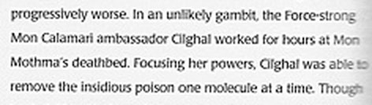
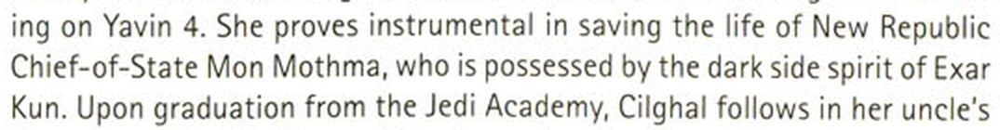
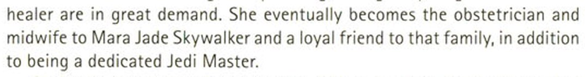
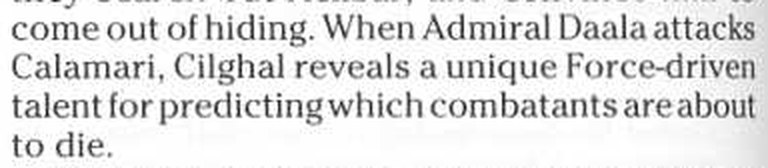
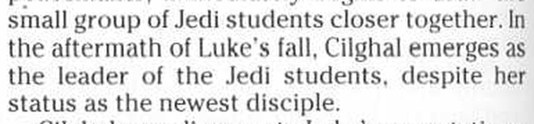
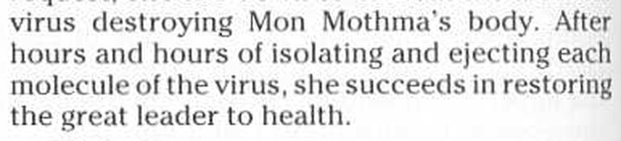
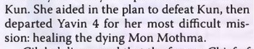
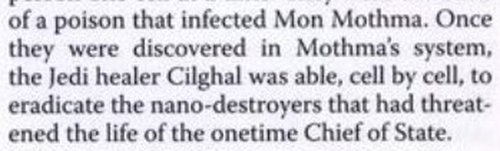
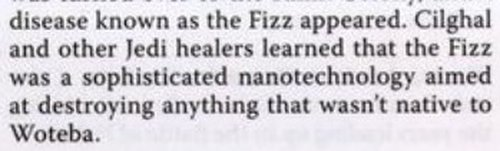
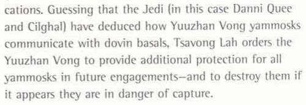

# Cilghal

- **Aliases:** —
- **Era:** NR–LotF
- **Continuity:** default Legends; entries present for: Legends
- **Research tier:** MASTERY (Jedi Academy trilogy 026 version only: Jedi Search, Dark Apprentice, Champions of the Force; primary read 2026-10-28)
- **Entries:** 218 (147 with quotations; 56 quotations extended to the full sentence/passage from the source text on file; 68 marked as fragments; 95 before the 2026-11-17 fragment fill). Rebuilt 2026-11-17 from 237 old entries; old file: `characters/_bak/cilghal.md.bak-20261117`. Added 2026-11-20: 1 entries from Young Jedi Knights 4: Lightsabers (full read).
- **How to read:** each entry is the quotation in full (block quote), then its source and point of view. "Note" lines are summaries from our notes, not quotations. `[fragment — full passage not on file]` means the source text is not on the box, so only the words in our notes are shown. Debate and forum material is in the last section and is unverified.

# LEGENDS (Legends / EU — main focus)

## Legacy of the Force 1–9: novel notes from the other agent (reference copy)

What it shows (our notes): S7 · L995 · Jag on Alema: «She can scrub herself from the short-term memory of people». Cilghal later develops a counter-technique (L3761).
> “In those two years,” Jag concluded, “I gave a lot of thought to Alema Rar, to what she was, what she could do. Afterward, I continued researching her … and investigating ways to counter her Killik abilities. She can scrub herself from the short-term memory of people, meaning that you can run into her and, if you survive, moments after the encounter you have no memory of meeting her. It makes her terribly hard to track. Her Killik abilities and remaining Jedi powers make her an extreme danger to you and your sister—and to the galaxy.”
— Source: L3761 — Legacy of the Force 4: Exile (novel), feats and scaling notes; S7 · L995 · Jag on Alema.
(Excerpt widened 2026-11-17 to the relevant passage, word for word from Exile (Aaron Allston), Chapter Five (text copy `MEGA_Legend_The_Legacy_of_the_Force_Series_Star_Wars_Legacy_of_the_Force_04_Exile_Aaron_Allston_epub`).)
(Full sentence/passage taken from the source text on file: `novels_tmp_exile_exile_epub`.)
Our notes: `notes/materials/021-legacy-of-the-force/lotf-4-exile-notes.md:79`

> Does it bother anyone else that we're delivering the galaxy to Jacen on an aurodium platter? *(L2413)*
>
> Given the choice between a despot and utter lawlessness, I think we have to go with the despot. For now. *(L2451)*
>
> Finally, Saba half turned in her chair, looking away. “You are the longfang, Master Skywalker. We draw the line where you say to draw it.” *(L2465)*
>
> We won't let Jacen push us much farther, I promise. *(L2471)*
— Source: L2413; L2451; L2465; L2471 — Legacy of the Force 6: Inferno (novel, read in full): feats, scaling and story notes; Council consensus: Kyp.
(Full sentence/passage taken from the source text on file: `novels_tmp_inferno_FULL_txt`.)
Note (our notes, around the quote): Council consensus: Kyp: «Does it bother anyone else that we're delivering the galaxy to Jacen on an aurodium platter?» (L2413); Kenth: «Given the choice between a despot and utter lawlessness, I think we have to go with the despot. For now.» (L2451); Saba: «You are the longfang ... We draw the line where you say to draw it.» (L2465). Luke: «We won't let Jacen push us much farther, I promise.» (L2471). Cilghal: Omas murdered, Ben was there (L2475).
Our notes: `notes/materials/021-legacy-of-the-force/lotf-6-inferno-notes.md:308`

> It was like defending himself against Yuuzhan Vong thud bugs for the first time in years, but the old skill was undiminished—he calculated which objects had a chance of hitting him and incinerated only them with his blades, letting the others fly harmlessly past. *(L717)*
— Source: Ch4 · L693; L693; L711; L717 — Legacy of the Force 7: Fury (novel, read in full): feats, scaling and story notes.
(Full sentence/passage taken from the source text on file: `novels_tmp_fury_FULL_txt`.)
Note (our notes, around the quote): Ch4 · L693, L711, L717 · Luke (Masters' sparring): pulls a tree branch onto Kyp (L693), disarms Cilghal by catching her hilt (L711), and against a swarm of Force-thrown bolts «he calculated which objects had a chance of hitting him and incinerated only them with his blades» (L717). *Shows:* casual Master-tier control, even while depressed.
Our notes: `notes/materials/021-legacy-of-the-force/lotf-7-fury-notes.md:44`

> Katarn looked down to see Caedus's lightsaber buried to its hilt in his chest. *(L1649)*
>
> The attack severed two ribs, penetrated his left lung, and exited through his left shoulder blade. A few centimeters off, and it would have gone clean through his heart. *(L2397)*
— Source: L1649; L2397 — Legacy of the Force 7: Fury (novel, read in full): feats, scaling and story notes.
Note (our notes, around the quote): L1641–1651 · Caedus: feints a push at Katarn and instead yanks a GAG speeder into Katarn's back, driving him onto his blade: «Katarn looked down to see Caedus's lightsaber buried to its hilt in his chest.» (L1649). Katarn survives. Cilghal on the wound: «The attack severed two ribs, penetrated his left lung, and exited through his left shoulder blade. A few centimeters off, and it would have gone clean through his heart.» (L2397).
Our notes: `notes/materials/021-legacy-of-the-force/lotf-7-fury-notes.md:53`; `notes/materials/021-legacy-of-the-force/lotf-7-fury-notes.md:301`

> Octa, trained by Kam and Tionne Solusar, both still recovering from their near-fatal wounds at the hands of Jacen Solo’s soldiers, was more subdued than the rest, her stillness in the Force clearly a consequence of rigid self-control rather than inner peace. *(L683)*
— Source: L683 — Legacy of the Force 7: Fury (novel, read in full): feats, scaling and story notes.
(Full sentence/passage taken from the source text on file: `novels_tmp_fury_FULL_txt`.)
Note (our notes, around the quote): Masters present: Luke, Kyle Katarn, Cilghal, Kyp, Corran, Saba, Octa Ramis (L683). Kam and Tionne «both still recovering from their near-fatal wounds» (L683) [Allston: Kam alive; contrast Inferno L3345–3355 where Kam appeared killed — continuity note].
Our notes: `notes/materials/021-legacy-of-the-force/lotf-7-fury-notes.md:245`

> A few meters away, Saba Sebatyne and Corran Horn dueled, each adopting a traditional, formalized lightsaber posture—Saba using a lightsaber in each hand, Corran with his own weapon adjusted to its second setting, its blade now three meters in length and a brilliant purple instead of its usual silver. *(L701)*
>
> It was like defending himself against Yuuzhan Vong thud bugs for the first time in years, but the old skill was undiminished—he calculated which objects had a chance of hitting him and incinerated only them with his blades, letting the others fly harmlessly past. *(L717)*
— Source: L701–717; L701; L711; L715 — Legacy of the Force 7: Fury (novel, read in full): feats, scaling and story notes.
(Full sentence/passage taken from the source text on file: `novels_tmp_fury_FULL_txt`.)
Note (our notes, around the quote): Masters' free-for-all (L701–717): Saba dual-wields; Corran's saber «adjusted to its second setting, its blade now three meters in length» (L701); Octa Ramis Force-hurls stones; Luke inverted back-flip block on Cilghal (L701), bends backward and disarms Cilghal by catching her hilt (L711), then fights Kyp two-bladed (L715). Luke vs Force-propelled bolt swarm: «he calculated which objects had a chance of hitting him and incinerated only them with his blades» (L717) — FEAT (casual, sparring). Cilghal Force-pulls Kyle's saber (L713).
Our notes: `notes/materials/021-legacy-of-the-force/lotf-7-fury-notes.md:247`

> A few centimeters off, and it would have gone clean through his heart. *(L2397)*
— Source: L2397 — Legacy of the Force 7: Fury (novel, read in full): feats, scaling and story notes.
Note (our notes, around the quote): Feats/fight: leads the plaza ambush. Run through by the speeder trick. Cilghal: «A few centimeters off, and it would have gone clean through his heart.» (L2397).
Our notes: `notes/materials/021-legacy-of-the-force/lotf-7-fury-notes.md:491`

## Jedi Academy Trilogy (Kevin J. Anderson, 1994): Jedi Search, Dark Apprentice, Champions of the Force (power-scaling notes)

> Cilghal used the silken ambassadorial voice she had worked so hard to develop. “There is no anger,” she said. “We don’t hate you, Exar Kun. You are an object lesson for us. You have taught us much about what it is to be a true Jedi. By observing you we see that the dark side has little strength of its own. You have no power that we do not have. You merely used our own weaknesses against us.”
— Source: Champions of the Force, ch.15, PDF p.112 — Owner Material 026 — Jedi Academy Trilogy: Champions of the Force (Kevin J. Anderson); Cilghal to Exar Kun (also: Cilghal). POV: Cilghal.
(Excerpt widened 2026-11-17 to the relevant passage, word for word from Champions of the Force (Kevin Anderson), Chapter 15 (text copy `MEGA_Legend_The_Jedi_Academy_Trilogy_Star_Wars_Jedi_Academy_03_Champions_of_the_Force_Kevin_J_Anderson_epub`).)
Note (our notes, around the quote): Cilghal to Exar Kun (also: Cilghal): "“There is no anger,” she said. “We don’t hate you, Exar Kun. You are an object lesson for us. You have taught us much about what it is to be a true Jedi. By observing you we see that the dark side has little strength of its own. You have no power that we do not have. You merely used our own weaknesses against us.”" Source: Champions of the Force, ch.15, PDF p.112
Our notes: `notes/materials/026-jedi-academy-trilogy/champions-of-the-force.md:65`

> A mere second behind Jaina, Cilghal wrapped her powerful Calamarian hands around the creature’s long serpentine throat even as Jaina continued to yank backward at its wings. Cilghal let out a high grunt as she wrung its neck, crushing a succession of vertebrae as if they were dry twigs.
— Source: Champions of the Force, ch.11, PDF p.92 — Owner Material 026 — Jedi Academy Trilogy: Champions of the Force (Kevin J. Anderson); Cilghal wrings the last creature’s neck.
(Excerpt widened 2026-11-17 to the relevant passage, word for word from Champions of the Force (Kevin Anderson), Chapter 11 (text copy `MEGA_Legend_The_Jedi_Academy_Trilogy_Star_Wars_Jedi_Academy_03_Champions_of_the_Force_Kevin_J_Anderson_epub`).)
Note (our notes, around the quote): Cilghal wrings the last creature’s neck: "Cilghal let out a high grunt as she wrung its neck, crushing a succession of vertebrae as if they were dry twigs." Source: Champions of the Force, ch.11, PDF p.92
Our notes: `notes/materials/026-jedi-academy-trilogy/champions-of-the-force.md:239`

> She found herself in a strange universe of rushing blood cells, electrically firing neurons, contracting muscle fibers, laboring organs that could no longer perform their functions. Cilghal couldn’t exactly comprehend what she saw, but somehow she understood instinctively which parts were healthy, which molecules were sustaining Mon Mothma, and which were the black scourge.
>
> With the Force, Cilghal could touch with fingers infinitely small, infinitely precise, to grasp one of the nano-destroyers and send it careening out of the dying body.
>
> Cilghal found other microscopic destroyers and nudged them, pushed them, herding the poison away from healthy cells, preventing further damage.
>
> The task was incomprehensibly large. The poison had spread and replicated, scattering itself through the billions and billions of cells in Mon Mothma’s body. Cilghal would have to search and remove every one of them.
— Source: Champions of the Force, ch.41, PDF p.242 — Owner Material 026 — Jedi Academy Trilogy: Champions of the Force (Kevin J. Anderson); Cilghal removes the nano-destroyers one by one.
(Excerpt widened 2026-11-17 to the relevant passage, word for word from Champions of the Force (Kevin Anderson) (text copy `MEGA_Legend_The_Jedi_Academy_Trilogy_Star_Wars_Jedi_Academy_03_Champions_of_the_Force_Kevin_J_Anderson_epub`).)
(Excerpt widened 2026-11-17 to the relevant passage, word for word from Champions of the Force (Kevin Anderson) (text copy `MEGA_Legend_The_Jedi_Academy_Trilogy_Star_Wars_Jedi_Academy_03_Champions_of_the_Force_Kevin_J_Anderson_epub`).)
(Full sentence/passage taken from the source text on file: `research_primary_jedi_academy_trilogy_champions_of_the_force_pdf`.)
Note (our notes, around the quote): Cilghal removes the nano-destroyers one by one: "With the Force, Cilghal could touch with fingers infinitely small, infinitely precise, to grasp one of the nano-destroyers and send it careening out of the dying body. … The task was incomprehensibly large. The poison had spread and replicated, scattering itself through the billions and billions of cells in Mon Mothma’s body. Cilghal would have to search and remove every one of them." Source: Champions of the Force, ch.41, PDF p.242
Our notes: `notes/materials/026-jedi-academy-trilogy/champions-of-the-force.md:240`

> But always in the back of her mind was a pressing concern for Mon Mothma. “No change,” Ackbar said in a tired voice. “I wish we understood what Cilghal is attempting to do.” The female Calamarian had not moved in nine hours, kneeling beside Mon Mothma’s bedside, flippered hands resting on the dying woman’s skin, deep in a trance. The medical droids had not expected Mon Mothma to live for this long, so the mere fact that she still had not succumbed to death meant something. From outside the door Leia peeked in to see that nothing had changed. The leader’s hand lay in a crystal dish as droplets of an oily grayish liquid emerged from the tip of her index finger. The process was too slow to watch, but over the course of half an hour a small droplet would gather at the tip of her finger, dangling, until gradually gravity pulled it off into the dish. Terpfen walked slowly down the tiled corridors dressed in a darkgreen close-fitting uniform that bore no insignia. Even after his full pardon Terpfen had refused to accept his rank again. He had sequestered himself in his rooms for much of the time since returning from Anoth. The scarred Calamarian stopped several meters away from them, reluctant to go closer to the room that held Mon Mothma. Leia knew that Terpfen still blamed himself for the dying woman’s condition, and he refused to let the guilt be assuaged. Though she understood his misery, she was getting impatient with his withdrawal and hoped he climbed back to his feet soon. Terpfen bowed ponderously, displaying the network of scars on his disfigured head. “Admiral, I have reached a decision.” He drew a deep breath. “I wish to return to Calamari and continue your work—if our people will have me. I wish to assist in rebuilding Reef Home. I fear …” He looked up to stare at the intricate mosaics on the walls of the Imperial Palace. “I fear that I will never be comfortable on Coruscant again.” “Believe me, Terpfen,” Ackbar answered, “I know exactly how you feel. I would not try to talk you out of your decision. It is a fair compromise between your need for healing and your desire to make amends.” Terpfen straightened, as if some measure of self-esteem had been returned to him. “I would like to depart as soon as possible,” he said. “I will arrange a ship,” Ackbar replied. Terpfen bowed again. “If I have your leave, Chief of State?” “Yes, Terpfen,” Leia answered. She turned once again to watch the motionless tableau inside the medical chamber. At a forgotten hour in the depths of Coruscant’s night, Cilghal emerged from the medical chambers. She staggered, cradling in her right hand a shallow crystal bowl half-filled with the deadly poison from the drink that Ambassador Furgan had thrown in Mon Mothma’s face. The two New Republic guards stationed at the door snapped to attention and rushed to help Cilghal. She was so exhausted she could hardly place one foot in front of another. She leaned against the stone doorway, drawing strength from the solidity of the rock. Her arm trembled as she extended the crystal dish to one of the guards. Cilghal barely had enough strength remaining to lift the small poison-filled container, but she did not dare drop it. She felt a deep, bone-melting relief when the guard took it from her. “Be careful,” she said in a husky, utterly exhausted voice. “Take this … and incinerate it.” The second guard scrambled to the intercom system and signaled for all Council members to come immediately. “Do you have news of Mon Mothma?” the first guard asked her. “She has been cleansed and she will heal.” The lids dropped over Cilghal’s glassy eyes. “But for now she must rest.” Her flowing robes whispered against the tiled walls as she slid down to collapse on the floor. “As must I,” she said, falling immediately into a Jedi recovery trance.
— Source: Champions of the Force, ch.41, PDF p.243-244 — Owner Material 026 — Jedi Academy Trilogy: Champions of the Force (Kevin J. Anderson); Cilghal’s healing lasts all night; Mon Mothma cleansed.
(Excerpt widened 2026-11-17 to the relevant passage, word for word from research primary jedi academy trilogy champions of the force (text copy `research_primary_jedi_academy_trilogy_champions_of_the_force_pdf_160ff6091b`).)
(Excerpt widened 2026-11-17 to the relevant passage, word for word from research primary jedi academy trilogy champions of the force (text copy `research_primary_jedi_academy_trilogy_champions_of_the_force_pdf_160ff6091b`).)
(Full sentence/passage taken from the source text on file: `research_primary_jedi_academy_trilogy_champions_of_the_force_pdf`.)
Note (our notes, around the quote): Cilghal’s healing lasts all night; Mon Mothma cleansed: "The female Calamarian had not moved in nine hours, kneeling beside Mon Mothma’s bedside … “She has been cleansed and she will heal.” … “As must I,” she said, falling immediately into a Jedi recovery trance." Source: Champions of the Force, ch.41, PDF p.243-244
Our notes: `notes/materials/026-jedi-academy-trilogy/champions-of-the-force.md:241`

> In the aftermath of the reptilian creatures’ attack, Luke had watched Cilghal tend his body’s minor wounds, cleaning them and binding them with the meticulous care and empathy he had sensed from her first days at the Jedi academy. Cilghal was a born Jedi healer.
— Source: Champions of the Force, ch.13, PDF p.104 — Owner Material 026 — Jedi Academy Trilogy: Champions of the Force (Kevin J. Anderson); Cilghal as healer. POV: Cilghal as healer.
(Excerpt widened 2026-11-17 to the relevant passage, word for word from Champions of the Force (Kevin Anderson), Chapter 13 (text copy `MEGA_Legend_The_Jedi_Academy_Trilogy_Star_Wars_Jedi_Academy_03_Champions_of_the_Force_Kevin_J_Anderson_epub`).)
Note (our notes, around the quote): Cilghal as healer: "Cilghal was a born Jedi healer." Source: Champions of the Force, ch.13, PDF p.104
Our notes: `notes/materials/026-jedi-academy-trilogy/champions-of-the-force.md:249`

> Master Skywalker had explained Yoda’s teachings, his insistence that “size matters not.” Yoda had claimed that lifting Luke’s entire X-wing fighter was no different from lifting a pebble. But could Cilghal turn it the other way around? Could she use her precise control of the Force to move something so small?
— Source: Champions of the Force, ch.41, PDF p.241 — Owner Material 026 — Jedi Academy Trilogy: Champions of the Force (Kevin J. Anderson); Cilghal’s inspiration (Yoda, “size matters not”). POV: Cilghal’s inspiration.
Note (our notes, around the quote): Cilghal’s inspiration (Yoda, “size matters not”): "Master Skywalker had explained Yoda’s teachings, his insistence that “size matters not.” Yoda had claimed that lifting Luke’s entire X-wing fighter was no different from lifting a pebble. But could Cilghal turn it the other way around? Could she use her precise control of the Force to move something so small?" Source: Champions of the Force, ch.41, PDF p.241
Our notes: `notes/materials/026-jedi-academy-trilogy/champions-of-the-force.md:253`

> “What happened to him?” Dorsk 81 said in great alarm.
>
> “Is he alive?” Streen asked. “I can’t hear him.”
>
> Cilghal probed with her sensing abilities and shook her orange and muddy-green head. “He’s breathing.
>
> Cilghal probed with her sensing abilities and shook her orange and muddy-green head. “He’s breathing. I can sense very little heartbeat, just the faintest pulse. But I can’t find him inside. When I touch him with the Force, all I find is a great empty spot.…”
>
> But I can’t find him inside. When I touch him with the Force, all I find is a great empty spot.…”
>
> She turned to look at the others with her sad round Calamarian eyes. “It’s as if he has left us.”
>
> “What can we do?” Kirana Ti asked.
— Source: Dark Apprentice, ch.34, PDF p.245-246 — Owner Material 026 — Jedi Academy Trilogy: Dark Apprentice (Kevin J. Anderson); Cilghal finds Luke’s spirit gone (also: Cilghal). POV: Cilghal finds Luke’s spirit gone.
(Excerpt widened 2026-11-17 to the relevant passage, word for word from Dark Apprentice (Kevin Anderson) (text copy `MEGA_Legend_The_Jedi_Academy_Trilogy_Star_Wars_Jedi_Academy_02_Dark_Apprentice_Kevin_J_Anderson_epub`).)
(Excerpt widened 2026-11-17 to the relevant passage, word for word from Dark Apprentice (Kevin Anderson) (text copy `MEGA_Legend_The_Jedi_Academy_Trilogy_Star_Wars_Jedi_Academy_02_Dark_Apprentice_Kevin_J_Anderson_epub`).)
(Fragment completed 2026-11-17: full sentence/passage matched word for word in the source text on file: `MEGA_Legend_The_Jedi_Academy_Trilogy_Star_Wars_Jedi_Academy_02_Dark_Apprentice_Kevin_J_Anderson_epub`.)
Note (our notes, around the quote): Cilghal finds Luke’s spirit gone (also: Cilghal): "“He’s breathing. I can sense very little heartbeat, just the faintest pulse. But I can’t find him inside. When I touch him with the Force, all I find is a great empty spot.…” She turned to look at the others with her sad round Calamarian eyes. “It’s as if he has left us.”" Source: Dark Apprentice, ch.34, PDF p.245-246
Our notes: `notes/materials/026-jedi-academy-trilogy/dark-apprentice.md:50`

> “No, it will get that one,” she gestured with one large hand, “the blue-and-yellow-striped kieler. After that it will take that smaller orange one in the middle of the school. By then all the others will have fled, and the krakana will continue on its way. Then we can leave.”
— Source: Dark Apprentice, ch.15, PDF p.122 — Owner Material 026 — Jedi Academy Trilogy: Dark Apprentice (Kevin J. Anderson); Cilghal predicts the krakana. POV: Cilghal predicts the krakana.
Note (our notes, around the quote): Cilghal predicts the krakana: "“No, it will get that one,” she gestured with one large hand, “the blue-and-yellow-striped kieler. After that it will take that smaller orange one in the middle of the school. By then all the others will have fled, and the krakana will continue on its way. Then we can leave.”" Source: Dark Apprentice, ch.15, PDF p.122
Our notes: `notes/materials/026-jedi-academy-trilogy/dark-apprentice.md:233`

> “This one, now this one … now this one,” she said. Barely a moment after she touched each one, the screen flared bright, marking the destruction of the indicated ships.
— Source: Dark Apprentice, ch.17, PDF p.139 — Owner Material 026 — Jedi Academy Trilogy: Dark Apprentice (Kevin J. Anderson); Cilghal foresees which fighters die. POV: Cilghal foresees which fighters die.
(Fragment completed 2026-11-17: full sentence/passage matched word for word in the source text on file: `MEGA_Legend_The_Jedi_Academy_Trilogy_Star_Wars_Jedi_Academy_02_Dark_Apprentice_Kevin_J_Anderson_epub`.)
Note (our notes, around the quote): Cilghal foresees which fighters die: "“This one, now this one … now this one,” she said. Barely a moment after she touched each one, the screen flared bright, marking the destruction of the indicated ships." Source: Dark Apprentice, ch.17, PDF p.139
Our notes: `notes/materials/026-jedi-academy-trilogy/dark-apprentice.md:234`

> Two medics worked desperately to resuscitate a Quarren whose arm had been amputated and his chest crushed. She took one glance and said, “He won’t survive, and you can do nothing more to make him survive.” The two Calamarian healers looked at her and, seeing the absolute conviction on her face, moved to another patient and let the Quarren die.
— Source: Dark Apprentice, ch.22, PDF p.173 — Owner Material 026 — Jedi Academy Trilogy: Dark Apprentice (Kevin J. Anderson); Cilghal’s triage sense. POV: Cilghal’s triage sense.
(Excerpt widened 2026-11-17 to the relevant passage, word for word from Dark Apprentice (Kevin Anderson), Chapter 22 (text copy `MEGA_Legend_The_Jedi_Academy_Trilogy_Star_Wars_Jedi_Academy_02_Dark_Apprentice_Kevin_J_Anderson_epub`).)
Note (our notes, around the quote): Cilghal’s triage sense: "Two medics worked desperately to resuscitate a Quarren whose arm had been amputated and his chest crushed. She took one glance and said, “He won’t survive, and you can do nothing more to make him survive.”" Source: Dark Apprentice, ch.22, PDF p.173
Our notes: `notes/materials/026-jedi-academy-trilogy/dark-apprentice.md:235`

## Star Wars: The New Essential Chronology (Del Rey, 2005): power-scaling and lore notes

> In an unlikely gambit, the Force-strong Mon Calamari ambassador Cilghal worked for hours at Mon Mothma's deathbed. Focusing her powers, Cilghal was able to remove the insidious poison one molecule at a time.
— Source: Part Eight: The Return of the Jedi Knights; Cilghal — Cilghal heals Mon Mothma. POV: speaker not named in our notes.
Note (our notes, around the quote): Cilghal — Cilghal heals Mon Mothma: "In an unlikely gambit, the Force-strong Mon Calamari ambassador Cilghal worked for hours at Mon Mothma's deathbed. Focusing her powers, Cilghal was able to remove the insidious poison one molecule at a time." Source: The New Essential Chronology, p.166

Our notes: `notes/materials/027-new-essential-chronology/08-part-eight-return-of-the-jedi-knights.md:67`

## Star Wars Saga Edition: Jedi Academy Training Manual (WotC, 2009): power-scaling and lore notes

> Skywalker's first students in his fledgling New Jedi Order. Starting out as a simple ambassador, Cilghal discovers her talent for healing while train- ing on Yavin 4. She proves instrumental in saving the life of New Republic Chief-of-State Mon Mothma, who is possessed by the dark side spirit of Exar Kun. Upon graduation from the Jedi Academy, Cilghal follows in her uncle's footsteps and drifts into politics, becoming the Mon Calamari Senator for the New Republic.
— Source: Chapter V: Instructors and Alumni; Cilghal; Exar Kun — Cilghal — saving Mon Mothma.
(Excerpt widened 2026-11-17 to the relevant passage, word for word from research primary jedi academy training manual jatm paged (text copy `research_primary_jedi_academy_training_manual_jatm_paged_txt_fea130719f`).)
(Excerpt widened 2026-11-17 to the relevant passage, word for word from research primary jedi academy training manual jatm paged (text copy `research_primary_jedi_academy_training_manual_jatm_paged_txt_fea130719f`).)
Note (our notes, around the quote): Cilghal; Exar Kun — Cilghal — saving Mon Mothma: "She proves instrumental in saving the life of New Republic Chief-of-State Mon Mothma, who is possessed by the dark side spirit of Exar Kun." Source: Jedi Academy Training Manual, p.97

Our notes: `notes/materials/028-jedi-academy-training-manual/05-ch5-instructors-and-alumni.md:27`

> Starting out as a simple ambassador, Cilghal discovers her talent for healing while train- ing on Yavin 4. She proves instrumental in saving the life of New Republic Chief-of-State Mon Mothma, who is possessed by the dark side spirit of Exar Kun. Upon graduation from the Jedi Academy, Cilghal follows in her uncle's footsteps and drifts into politics, becoming the Mon Calamari Senator for the New Republic. Years later, she returns to the academy and resumes her duties as a Jedi Knight, becoming an instructor and taking on a Chadra-Fan apprentice named Tekli.
>
> With the Yuuzhan Vong sweep through the galaxy, Cilghal’s skills as a healer are in great demand. She eventually becomes the obstetrician and midwife to Mara Jade Skywalker and a loyal friend to that family, in addition to being a dedicated Jedi Master.
>
> With the Yuuzhan Vong sweep through the galaxy, Cilghal’s skills as a healer are in great demand. She eventually becomes the obstetrician and midwife to Mara Jade Skywalker and a loyal friend to that family, in addition to being a dedicated Jedi Master.
>
> Cilghal has a noble and gentle spirit. Although trained in the lightsaber and more than willing to use it in defense of the injured and helpless, Cilghal prefers using her skills as a diplomat and healer to serve the will of the Force.
— Source: Chapter V: Instructors and Alumni; Cilghal; Mara Jade Skywalker — Cilghal — NJO.
(Excerpt widened 2026-11-17 to the relevant passage, word for word from research primary jedi academy training manual jatm paged (text copy `research_primary_jedi_academy_training_manual_jatm_paged_txt_fea130719f`).)
(Excerpt widened 2026-11-17 to the relevant passage, word for word from research primary jedi academy training manual jatm paged (text copy `research_primary_jedi_academy_training_manual_jatm_paged_txt_fea130719f`).)
Note (our notes, around the quote): Cilghal; Mara Jade Skywalker — Cilghal — NJO: "She eventually becomes the obstetrician and midwife to Mara Jade Skywalker and a loyal friend to that family, in addition to being a dedicated Jedi Master." Source: Jedi Academy Training Manual, p.97

Our notes: `notes/materials/028-jedi-academy-training-manual/05-ch5-instructors-and-alumni.md:29`

## The Jedi Academy Sourcebook (WEG, 1996): power-scaling and lore notes

> 4D, lightsaber 3D, pick pocket 3D+2, running 4D KNOWLEDGE 4D Alien species 5D, business 4D+2, cultures 4D+1, lan- guages 4D+1, planetary systems 4D+2, scholar: folklore 5D+2, scholar: Holocron 5D, scholar: Jedi history 6D, streetwise 5D+1, survival 4D+2, survival: Yavin Four 5D, value 5D+1 MECHANICAL 3D+1 Beast riding 4D, musical instrument operation: double viol 6D, repulsorlift operation 4D+2, sensors 4D, space transports 4D+1, swoop operation 4D PERCEPTION 4D Bargain 5D+1, con 5D, gambling 4D+2, persuasion 5D, persuasion: storytelling 6D+1, search 4D+2, sneak 5D STRENGTH 2D Brawling 3D, climbing/jumping 3D+1, swimming 4D TECHNICAL 2D Blaster repair 3D, computer programming/repair 3D, droid programming 3D+1, first aid 4D, lightsaber repair 3D, musical instrument repair: stringed instruments 4D +2 Special Abilities:
>
> Force Skills: Control 2D+2, sense 2D, alter 1D+2 These are only some of the powers which Tionne has so far demonstrated:
>
> Control: Accelerate healing, concentration", control pain, reduce injury, remain conscious Sense: Danger sense**, life detection, life sense, magnify senses Alter: Telekinesis * Described in the Movie Trilogy Sourcebook ** Described in7he Thrawn Trilogy Sourcebook This character is Force-sensitive Force Points: 3 Character Points: 13 Move: 10 Equipment: Jedi robes, blaster pistol (4D), double viol, datapad See eee —<—<$<$<$<$$<$<$<<————
>
> Ambassador Cilghal Cilghal is a Mon Calamari ambassador who takes charge of Leia while the Minister of State is on Calamari looking for Ackbar. Together they search out Ackbar, and convince him to come out of hiding. When Admiral Daala attacks Calamari, Cilghal reveals a unique Force-driven talent for predicting which combatants are about to die.
>
> Intrigued, and sensing that Cilghal might bea strong Jedi candidate, Leia invites her to visit Luke on Yavin Four.
— Source: Chapter Three: The Jedi Academy; Cilghal; Admiral Daala — Ambassador Cilghal — the death-sight.
(Excerpt widened 2026-11-17 to the relevant passage, word for word from research primary jedi academy sourcebook jas clean (text copy `research_primary_jedi_academy_sourcebook_jas_clean_txt_04b8ab0d44`).)
(Excerpt widened 2026-11-17 to the relevant passage, word for word from research primary jedi academy sourcebook jas clean (text copy `research_primary_jedi_academy_sourcebook_jas_clean_txt_04b8ab0d44`).)
Note (our notes, around the quote): Cilghal; Admiral Daala — Ambassador Cilghal — the death-sight: "When Admiral Daala attacks Calamari, Cilghal reveals a unique Force-driven talent for predicting which combatants are about to die." Source: The Jedi Academy Sourcebook, p.40

Our notes: `notes/materials/029-jedi-academy-sourcebook/03-ch3-the-jedi-academy.md:161`

> Luke is immediately im- pressed by her ability, and senses in her the potential to become a great healer. She agrees to stay on as his student.
>
> She finds her fellow students rather shaken by the death of Gantoris and the defection of Kyp. Somehow sensing that something evil is in their midst, the students are unsure of them- selves. Cilghal, a natural consensus-builder and peacemaker, immediately begins to draw the small group of Jedi students closer together. In the aftermath of Luke's fall, Cilghal emerges as the leader of the Jedi students, despite her status as the newest disciple.
>
> Cilghal soon lives up to Luke’s expectations, and reveals herself as a great healer. At his request, she sits down to combat the artificial virus destroying Mon Mothma’s body.
— Source: Chapter Three: The Jedi Academy; Cilghal; Luke Skywalker — Ambassador Cilghal — leader of the students.
(Excerpt widened 2026-11-17 to the relevant passage, word for word from research primary jedi academy sourcebook jas clean (text copy `research_primary_jedi_academy_sourcebook_jas_clean_txt_04b8ab0d44`).)
(Excerpt widened 2026-11-17 to the relevant passage, word for word from research primary jedi academy sourcebook jas clean (text copy `research_primary_jedi_academy_sourcebook_jas_clean_txt_04b8ab0d44`).)
Note (our notes, around the quote): Cilghal; Luke Skywalker — Ambassador Cilghal — leader of the students: "In the aftermath of Luke's fall, Cilghal emerges as the leader of the Jedi students, despite her status as the newest disciple." Source: The Jedi Academy Sourcebook, p.40

Our notes: `notes/materials/029-jedi-academy-sourcebook/03-ch3-the-jedi-academy.md:163`

> Cilghal soon lives up to Luke’s expectations, and reveals herself as a great healer. At his request, she sits down to combat the artificial virus destroying Mon Mothma’s body. After hours and hours of isolating and ejecting each molecule of the virus, she succeeds in restoring the great leader to health. ms Cilghal Type: Calamarian Ambassador DEXTERITY 3D+1 Blaster 4D+1 dodge 4D-2, lightsaber 3D+2 KNOWLEDGE 4D Alien species 5D+2, bureaucracy 5D, bureaucracy; Calamari 7D+2, bureaucracy: New Republic 6D-+2, busi- ness 5D, cultures 5D, languages 4D-+2, language:
>
> Calamarian Knowledge Bank 5D, planetary systems 5D+1, survival 4D+1, survival: Yavin Four 4D+2, willpower 6D MECHANICAL 2D Astrogation 3D, beast riding 3D, repulsorlift operation 2D+2, space transports 3D+2, starfighter piloting 3D, starship gunnery 2D+1, starship shields 2D+2 PERCEPTION 3D Bargain 5D+2, command 7D+1, hide 4D+ 1, persuasion 5D, persuasion: oration 7D+2, search 3D+2 STRENGTH 3D Brawling 3D+2, stamina 4D, swimming 6D TECHNICAL 2D+2 Computer programming/repair 4D, droid programming 3D, first aid 6D-+2, lightsaber repair 3D, security 4D+1 Special Abilities:
>
> Moist Environments: When in moist environments, Mon Calamari receive a +1D bonus to all Dexterity, Perception and Strength attribute and skill checks.
>
> Dry Environments: When in very dry environments, Mon Calamari seem depressed and withdrawn.
>
> He realizes, at the same time, that he himself cannot run away from his own duties and responsibilities. m Admiral Ackbar Type: Mon Calamari Admiral DEXTERITY 3D Blaster 5D+2, blaster artillery 4D+1, dodge 4D-1, melee combat 5D-+1, missile weapons 4D+1, missile weapons: power harpoon 5D-+1 KNOWLEDGE 3D Alien species 7D+1, bureaucracy 8D+1, bureaucracy:
>
> The Jedi Academy Sourcebook === sp10 Chapter One: The New Republic The Jedi Academy Sourcebook 9 === sp11 New Republic Senate 8D+2, cultures 5D, intimidation 5D+1, languages 6D, planetary systems 8D, scholar: Mon Calamari marine geology 4D+1, survival 4D, survival: ocean/undersea 6D+2, tactics: capital ships 9D+1, tac- tics: fleets 9D+2, tactics: starfighters 7D+1, value 5D+2, willpower 6D MECHANICAL 3D+1 Astrogation 8D, capital ship gunnery 7D+2, capital ship piloting 8D-+1, capital ship piloting: Mon Calamari battle cruiser 10D, capital ship shields 6D+1, repulsorlift opera- tion 5D+1, repulsorlift operation: submersible 4D- 1, sen- sors 5D+1, space transports 5D+2, starfighter piloting 7D PERCEPTION 2D+1 Bargain 7D, command 9D, command: Mon Calamari crew- men 12D, hide 4D+1, persuasion 6D, search 5D+1, sneak STRENGTH 3D Lifting 4D, stamina 6D, swimming 8D+2 TECHNICAL 3D+1 Capital ship repair 5D+1, capital ship weapon repair 4D+2, computer programming/repair 4D+1, droid pro- gramming 4D+1, first aid 4D+1, first aid: Mon Calamari 5D+1, repulsorlift repair 5D+1, security 7D+1 Special Abilities:
>
> Moist Environments: When in moist environments, Mon Calamari receive a +1D bonus to all Dexterity, Perception and Strength attribute and skill checks.
>
> Dry Environments: When in very dry environments, Mon Calamari seem depressed and withdrawn. They suffer a -1D penalty to all Dexterity, Perception and Strength at- tribute and skill checks.
— Source: Chapter Three: The Jedi Academy; Cilghal — Ambassador Cilghal — healing Mon Mothma.
(Excerpt widened 2026-11-17 to the relevant passage, word for word from research primary jedi academy sourcebook jas clean (text copy `research_primary_jedi_academy_sourcebook_jas_clean_txt_04b8ab0d44`).)
(Excerpt widened 2026-11-17 to the relevant passage, word for word from research primary jedi academy sourcebook jas clean (text copy `research_primary_jedi_academy_sourcebook_jas_clean_txt_04b8ab0d44`).)
(Excerpt widened 2026-11-17 to the relevant passage, word for word from research primary jedi academy sourcebook jas clean (text copy `research_primary_jedi_academy_sourcebook_jas_clean_txt_04b8ab0d44`).)
Note (our notes, around the quote): Cilghal — Ambassador Cilghal — healing Mon Mothma: "After hours and hours of isolating and ejecting each molecule of the virus, she succeeds in restoring the great leader to health." Source: The Jedi Academy Sourcebook, p.40

Our notes: `notes/materials/029-jedi-academy-sourcebook/03-ch3-the-jedi-academy.md:165`

## The Complete Star Wars Encyclopedia, Vol. I (A–G)

- Note (summary from our notes, not a quotation): Page contents: 1299 words, 28 paragraphs | headings/entries: Chunky; Chusker, Vu; Chuundar; Chyler, Tian; Cilghal; Cilpar; Cindar; Cimnagar
  — Source: scan pages 121–160.
Our notes: `notes/materials/030-complete-star-wars-encyclopedia-vol-1/03-v1-scan-121-160.md:179`

> She aided in the plan to defeat Kun, then departed Yavin 4 for her most difficult mission: healing the dying Mon Mothma.
— Source: scan pages 121–160; Cilghal — entry/section: Cilghal.
Note (our notes, around the quote): Cilghal — entry/section: Cilghal: "She aided in the plan to defeat Kun, then departed Yavin 4 for her most difficult mission: healing the dying Mon Mothma." Source: The Complete Star Wars Encyclopedia, Vol. I, p.127

Our notes: `notes/materials/030-complete-star-wars-encyclopedia-vol-1/03-v1-scan-121-160.md:181`

## The Complete Star Wars Encyclopedia, Vol. II (H–O)

> Once they were discovered in Mothma's system, the Jedi healer Cilghal was able, cell by cell, to eradicate the nano-destroyers that had threatened the life of the onetime Chief of State.
— Source: scan pages 361–400; Cilghal. POV: Cilghal.
Note (our notes, around the quote): Cilghal: "Once they were discovered in Mothma's system, the Jedi healer Cilghal was able, cell by cell, to eradicate the nano-destroyers that had threatened the life of the onetime Chief of State." Source: The Complete Star Wars Encyclopedia, Vol. II, p.359

Our notes: `notes/materials/031-complete-star-wars-encyclopedia-vol-2/09-v2-scan-361-400.md:50`

## The Complete Star Wars Encyclopedia, Vol. III (P–Z)

> Cilghal and other Jedi healers learned that the Fizz was a sophisticated nanotechnology aimed at destroying anything that wasn't native to Woteba.
— Source: scan pages 321–360; Cilghal. POV: Cilghal.
Note (our notes, around the quote): Cilghal: "Cilghal and other Jedi healers learned that the Fizz was a sophisticated nanotechnology aimed at destroying anything that wasn't native to Woteba." Source: The Complete Star Wars Encyclopedia, Vol. III, p.335

Our notes: `notes/materials/032-complete-star-wars-encyclopedia-vol-3/08-v3-scan-321-360.md:172`

## Power of the Jedi Sourcebook (d20, 2002)

- Note (summary from our notes, not a quotation): Page contents: 946 words, 21 paragraphs | headings/entries: The New Jedi; Cilghal, Jedi Healer
  — Source: Chapter Six: Jedi traditions and famous Jedi.
Our notes: `notes/materials/033-power-of-the-jedi-sourcebook/06-ch6-jedi-traditions.md:274`

- Note (summary from our notes, not a quotation): Page contents: 893 words, 159 paragraphs | headings/entries: Ae; Ne sey aS / ar; Index; Abhean 132; Abraxin 79; Ackbar, Admiral 130; Adega system 135; Adegan crystals 104, 107, 155; Advozse 112, 113; Afarathu 108; AgriCorps worker 86; Alderaan 10, 64, 110; Aleema 107; Almania 83, 127; Amanoa, Queen 7, 100, 103, 104, 105; Ambria 101, 104, 105, 106, 145-147; Anselmi 71; Arkanian 64, 73, 100; Ashla, the 6; Asmeru 113, 114, 118; Assant, Darsha 121; Auril sector 135; Baltimn 150, 151; Bane, Darth 9; Battle Influence 12; Battle Meditation 15; Beast Language 15; Belasco 116; Bespin 128; Billaba, Depa 114; Black Sun 121; Bnar, Ood 136; Bondara, Anoon 121, 122, 124; Bouri, Omo 118; Brotherhood of Darkness 9, 141, 153; Caamasi 64, 110; Callista 9, 130; Carida 131; Cathar 65; Celegian 66, 98; Cerean 119; Chalactan 114; Chatos Academy 6; Chewbacca 11; Cho Leem, Thracia 123; Chu'unthor 132-135; Cilghal 11, 130; Cinnagar 8, 98, 103; Core Worlds 6, 7, 9, 70, 130
  — Source: Chapter Seven: Where the Force is strong; Index.
Our notes: `notes/materials/033-power-of-the-jedi-sourcebook/07-ch7-locations-index.md:176`

## Sourcebooks/The New Jedi Order Sourcebook.pdf [Star Wars Roleplaying Game (d20, 2000)] (scan pages 121–162)

- Note (summary from our notes, not a quotation): Page contents: 852 words, 21 paragraphs | headings/entries: Vornskr Cloning Project; The Return of Vergere; Cilghal
  — Source: Sourcebooks/The New Jedi Order Sourcebook.pdf [Star Wars Roleplaying Game.
Our notes: `notes/materials/037-sw-d20-folder/049-the-new-jedi-order-sourcebook-scan-121-162.md:92`

> Guessing that the Jedi (in this case Danni Quee and Cilghal) have deduced how Yuuzhan Vong yammosks communicate with dovin basals, Tsavong Lah orders the Yuuzhan Vong to provide additional protection for all yammosks in future engagements—and to destroy them if it appears they are in danger of capture.
— Source: Sourcebooks/The New Jedi Order Sourcebook.pdf [Star Wars Roleplaying Game; Cilghal. POV: Cilghal.
Note (our notes, around the quote): Cilghal: "Guessing that the Jedi (in this case Danni Quee and Cilghal) have deduced how Yuuzhan Vong yammosks communicate with dovin basals, Tsavong Lah orders the Yuuzhan Vong to provide additional protection for all yammosks in future engagements—and to destroy them if it appears they are in danger of capture." Source: *The New Jedi Order Sourcebook* (SWRPG d20), scan p.152

Our notes: `notes/materials/037-sw-d20-folder/049-the-new-jedi-order-sourcebook-scan-121-162.md:223`

## Sourcebooks/Galactic Campaign Guide.pdf [Star Wars Roleplaying Game Revised Core (d20, 2002)] (scan pages 121–162)

- Note (summary from our notes, not a quotation): Page contents: Tables 4-29, 4-30 Mon Calamari male and female names (Ackbar, Cilghal, Jesmin, Terpfen...) (hand-read)
  — Source: Sourcebooks/Galactic Campaign Guide.pdf [Star Wars Roleplaying Game Revis.
Our notes: `notes/materials/037-sw-d20-folder/666-galactic-campaign-guide-scan-121-162.md:40`

## Sourcebooks/Ultimate Alien Anthology.pdf [Star Wars Roleplaying Game Revised Core (d20, 2002)] (scan pages 61–120)

- Note (summary from our notes, not a quotation): Page contents: Miraluka commoner; Mon Calamari (example names incl. Ackbar, Cilghal). (hand-read)
  — Source: Sourcebooks/Ultimate Alien Anthology.pdf [Star Wars Roleplaying Game Revi.
Our notes: `notes/materials/037-sw-d20-folder/673-ultimate-alien-anthology-scan-061-120.md:208`

## Star Wars Insider #57 (2001)

- Note (summary from our notes, not a quotation): Page contents: Who's Who (magazine p. 55): Jedi Masters Cilghal, Kyp Durron, Ikrit (died), Kenth Hamner, Tresina Lobi, Kam Solusar, Streen; "Jedi Knights" begins with Daye Azur-Jamin (cyborg prosthetics; Kathy Tyers' Adventure Journal stories; investigating Nal Hutta). Key: a dot indicates the character has died. (hand-read)
  — Source: Star Wars Insider #57 (2001).
Our notes: `notes/materials/038-star-wars-insider/057-ins057.md:317`

## The Dark Nest Trilogy (Troy Denning, Del Rey 2005): FULL consecutive re-read (2026-11-16 CST)

What it shows (our notes): Battle-meld aftereffect: "Their prolonged use of it on the Myrkr mission had weakened the boundaries among their minds" (Cilghal's diagnosis). This is why Jaina "had failed to reconnect with Jagged Fel". Anakin died "seven years later" (on Jaina's count).
> It had taken Cilghal only a few days to diagnose the problem as a delayed reaction to the Jedi battle-meld. Their prolonged use of it on the Myrkr mission had weakened the boundaries among their minds, with the result that now their emotions tended to fill the Force and blur together whenever they were close to each other. *(Cilghal's diagnosis)*
>
> Sometimes Jaina believed the side effect was also the reason so many strike team survivors found it difficult to move on with their lives. Tenel Ka was doing well as the Hapan queen, and Tekli and Tahiri seemed to regard Zonama Sekot as both a friend and a home, but the rest of them—Jaina, Alema, Zekk, Tesar, Lowbacca, even Jacen—still seemed lost, unable to maintain a connection with anyone who had not been there. Jaina knew that was why she had failed to reconnect with Jagged Fel during their desperate rendezvous when he had still been serving as Chiss liaison to the Galactic Alliance. She loved him, but she’d just grown increasingly distant from him. From everyone, really.
— Source: Dark Nest I: The Joiner King (Troy Denning, Del Rey 2005): notes part 1; Battle-meld aftereffect. POV: Battle-meld aftereffect, about Cilghal.
(Excerpt widened 2026-11-17 to the relevant passage, word for word from The Joiner King (Troy Denning) (text copy `MEGA_Legend_The_Dark_Nest_Trilogy_Star_Wars_Dark_Nest_01_The_Joiner_King_Troy_Denning_epub`).)
(Full sentence/passage taken from the source text on file: `dn_tmp_jk_epub`.)
Our notes: `notes/materials/051-dark-nest-trilogy/jk-01.md:57`

> looked like a farmer
> [fragment — full passage not on file]
— Source: Dark Nest I: The Joiner King: notes part 3 (ch. 18 onward); Masters present: Luke, Mara, Corran, Kyp, Kyle Katarn (.
Note (our notes, around the quote): Masters present: Luke, Mara, Corran, Kyp, Kyle Katarn ("looked like a farmer"), Kenth Hamner, Octa Ramis and Cilghal. Patients: Tesar, Tahiri, Tekli and Jacen. Jacen plays games with the brain mapper.
Our notes: `notes/materials/051-dark-nest-trilogy/jk-03.md:24`

> “It’s very simple. The meld always comes from the outside—you know you’re listening to someone else’s thoughts and reacting to someone else’s emotions. But this … this joining feels like it comes from inside. The things our Jedi Knights see through it—or hear or smell or taste—seem like things they’re sensing themselves. Even the thoughts they share seem to arise inside their own minds.” *(Cilghal, JK ch. 21)*
— Source: Dark Nest I: The Joiner King: notes part 3 (ch. 18 onward). POV: Cilghal.
(Full sentence/passage taken from the source text on file: `dn_tmp_jk_epub`.)
Context: Cilghal's mechanism: the meld enlarges the hypothalamus, which leads to telepathy, then limbic spillover and mood-altering. Killik joining changes the corpus callosum: "free-dangling dendrites ... sending impulses directly from one brain to another", carried through auras ("heat, electric, magnetic, even chemical—some extending as far as ten meters") and caused by pheromones ("Everything changes your brain").
Our notes: `notes/materials/051-dark-nest-trilogy/jk-03.md:25`

What it shows (our notes): Asked whether they will abide by a council decision, Tesar says: "That dependz on what the decision is."
> The trio fell silent, then Tahiri and Tekli dropped their eyes, and Tesar said, “That dependz on what the decision is.”
>
> Kenth and Corran recoiled visibly.
— Source: Dark Nest I: The Joiner King: notes part 3 (ch. 18 onward).
(Excerpt widened 2026-11-17 to the relevant passage, word for word from The Joiner King (Troy Denning) (text copy `MEGA_Legend_The_Dark_Nest_Trilogy_Star_Wars_Dark_Nest_01_The_Joiner_King_Troy_Denning_epub`).)
(Excerpt widened 2026-11-17 to the relevant passage, word for word from The Joiner King (Troy Denning) (text copy `MEGA_Legend_The_Dark_Nest_Trilogy_Star_Wars_Dark_Nest_01_The_Joiner_King_Troy_Denning_epub`).)
Our notes: `notes/materials/051-dark-nest-trilogy/jk-03.md:27`

> “Perhaps,” Tekli said. “But our mistakes shouldn’t condemn the Qoribu nests.”
>
> “And they shouldn’t commit the Jedi to any action the Masters haven’t authorized.” Corran turned away from the trio and addressed the other Masters. “Our first concern must be the stability of the Galactic Alliance.”
>
> “No.” Kyp Durron surprised everyone by stepping to Tahiri’s side. “The Jedi are no one’s mercenaries—not even the Galactic Alliance’s. Our first concern, our only concern, is our own conscience. We must follow it wherever it leads.”
— Source: Dark Nest I: The Joiner King: notes part 3 (ch. 18 onward); The council splits. Corran. POV: The council splits. Corran, about Cilghal.
(Excerpt widened 2026-11-17 to the relevant passage, word for word from The Joiner King (Troy Denning) (text copy `MEGA_Legend_The_Dark_Nest_Trilogy_Star_Wars_Dark_Nest_01_The_Joiner_King_Troy_Denning_epub`).)
(Excerpt widened 2026-11-17 to the relevant passage, word for word from The Joiner King (Troy Denning) (text copy `MEGA_Legend_The_Dark_Nest_Trilogy_Star_Wars_Dark_Nest_01_The_Joiner_King_Troy_Denning_epub`).)
(Full sentence/passage taken from the source text on file: `dn_tmp_jk_epub`.)
Label in our notes: Kyp
Our notes: `notes/materials/051-dark-nest-trilogy/jk-03.md:28`

> “Killiks are dangerous friends, but no one’s enemy,” the brain said. “The true danger lies not in what the Jedi do, but in their failure to act at all.”
— Source: Dark Nest I: The Joiner King: notes part 3 (ch. 18 onward); Jacen speaks through the brain-holo.
(Full sentence/passage taken from the source text on file: `dn_tmp_jk_epub`.)
Our notes: `notes/materials/051-dark-nest-trilogy/jk-03.md:29`

- Note (summary from our notes, not a quotation): Isolation chambers hold Tesar, Tekli, Tahiri, Jacen, Alema and Gorog. Sensory cortices correlate across all of them. Only Alema's and Gorog's limbic systems correlate.
  — Source: Dark Nest I: The Joiner King: notes part 3 (ch. 18 onward).
Our notes: `notes/materials/051-dark-nest-trilogy/jk-03.md:79`

What it shows (our notes): Cilghal asks permission to torture:
> “That bad?” Luke asked.
>
> “Yes.” She pointed at the chambers holding Alema and Gorog. “I need to hurt them.”
>
> “Hurt them?”
>
> “Inflict pain,” she clarified. “Torture them, in truth. Not for long, and nothing that will injure. But it must be intense. *(JK ch. 29)*
>
> There was a time when he would not even have considered such a request—and when Cilghal would never have made it. But now that the Jedi had elected to embrace all of the Force, to utilize the dark side as well as the light, nothing seemed off limits. They deceived, they manipulated, they coerced. To be sure, it was all done in the name of a higher purpose, to promote peace and serve the Balance, yet he occasionally felt that the Jedi were losing their way; that the war with the Yuuzhan Vong had turned them from their true path. He sometimes thought this must have been how Palpatine started, pursuing a worthy goal with any means available. *(Luke's POV, JK ch. 29)*
— Source: Dark Nest I: The Joiner King: notes part 3 (ch. 18 onward).
(Excerpt widened 2026-11-17 to the relevant passage, word for word from The Joiner King (Troy Denning) (text copy `MEGA_Legend_The_Dark_Nest_Trilogy_Star_Wars_Dark_Nest_01_The_Joiner_King_Troy_Denning_epub`).)
(Full sentence/passage taken from the source text on file: `dn_tmp_jk_epub`.)
Our notes: `notes/materials/051-dark-nest-trilogy/jk-03.md:80`

> He wanted to look away, but forced himself not to. If he was willing to sanction torture, then he had to make certain it never became easy.
>
> “Not yet. She must believe it will never end.”
>
> The Killik’s mandibles clacked close, and its antennae began to whip madly back and forth. Luke reminded himself that this was the insect that had tried to turn his son against his wife, but that did not make torture feel right. Mara was spending every waking minute with Ben, trying to make him understand how the things that Gorog had said could be true and still not mean she was an evil person, and Luke knew that even she would not have approved of the insect’s suffering.
— Source: Dark Nest I: The Joiner King: notes part 4 (end of ch. 29 onward); Luke. POV: Luke, about Cilghal.
(Excerpt widened 2026-11-17 to the relevant passage, word for word from The Joiner King (Troy Denning) (text copy `MEGA_Legend_The_Dark_Nest_Trilogy_Star_Wars_Dark_Nest_01_The_Joiner_King_Troy_Denning_epub`).)
(Excerpt widened 2026-11-17 to the relevant passage, word for word from The Joiner King (Troy Denning) (text copy `MEGA_Legend_The_Dark_Nest_Trilogy_Star_Wars_Dark_Nest_01_The_Joiner_King_Troy_Denning_epub`).)
Label in our notes: Cilghal
Our notes: `notes/materials/051-dark-nest-trilogy/jk-04.md:7`

> Cilghal came out from behind the control console. “Like the Force itself, every mind in the galaxy has two aspects.” She sat next to Luke on the bench. “There is the conscious mind, which embraces what we know of ourselves, and there is the unconscious, which contains the part that remains hidden.” *(Cilghal, JK ch. 29)*
— Source: Dark Nest I: The Joiner King: notes part 4 (end of ch. 29 onward). POV: Cilghal.
(Full sentence/passage taken from the source text on file: `dn_tmp_jk_epub`.)
Context: Tekli, Tahiri and Tesar break off the experiment for invented reasons. Tahiri: "Looks like I’m not the only one who came out of the war part Yuuzhan Vong ... What’s next? Jedi tattoos?" / "The only thing pain would cause me is a religious experience."
Our notes: `notes/materials/051-dark-nest-trilogy/jk-04.md:8`

What it shows (our notes): Cilghal's theory, as stated by Han: "when a Killik nest swallows up someone who’s Force-sensitive, the nest takes on some of his personality." Yoggoy absorbed Raynar's value for life; Gorog absorbed Lomi's need to hide.
> “The way Cilghal sees it,” Han said, “when a Killik nest swallows up someone who’s Force-sensitive, the nest takes on some of his personality.”
>
> “In your case, the Yoggoy absorbed the value you place on individual life,” Leia said. “They started to care for their feeble and provide for the starving, and it wasn’t long before their success led to the creation of the Unu.”
— Source: Dark Nest I: The Joiner King: notes part 4 (end of ch. 29 onward); Cilghal's theory, as stated by Han.
(Excerpt widened 2026-11-17 to the relevant passage, word for word from The Joiner King (Troy Denning) (text copy `MEGA_Legend_The_Dark_Nest_Trilogy_Star_Wars_Dark_Nest_01_The_Joiner_King_Troy_Denning_epub`).)
(Excerpt widened 2026-11-17 to the relevant passage, word for word from The Joiner King (Troy Denning) (text copy `MEGA_Legend_The_Dark_Nest_Trilogy_Star_Wars_Dark_Nest_01_The_Joiner_King_Troy_Denning_epub`).)
(Full sentence/passage taken from the source text on file: `dn_tmp_jk_epub`.)
Our notes: `notes/materials/051-dark-nest-trilogy/jk-04.md:84`

> Cilghal came out from behind the control console. “Like the Force itself, every mind in the galaxy has two aspects.” She sat next to Luke on the bench. “There is the conscious mind, which embraces what we know of ourselves, and there is the unconscious, which contains the part that remains hidden.”
>
> “I am saying that Jacen’s theory fits what we have observed,” Cilghal replied. “To the extent that the Colony is a collective mind, it makes sense for it to create an unconscious. And you cannot destroy an unconscious mind without also destroying the conscious mind.”
— Source: Dark Nest III: *The Swarm War* (Troy Denning, 2006), notes part 1: front matter, prologue, ch. 1–; Cilghal's conscious/unconscious theory.
(Excerpt widened 2026-11-17 to the relevant passage, word for word from The Joiner King (Troy Denning) (text copy `MEGA_Legend_The_Dark_Nest_Trilogy_Star_Wars_Dark_Nest_01_The_Joiner_King_Troy_Denning_epub`).)
(Excerpt widened 2026-11-17 to the relevant passage, word for word from The Swarm War (Troy Denning) (text copy `MEGA_Legend_The_Dark_Nest_Trilogy_Star_Wars_Dark_Nest_03_The_Swarm_War_Troy_Denning_epub`).)
(Full sentence/passage taken from the source text on file: `dn_tmp_jk_epub`.)
Our notes: `notes/materials/051-dark-nest-trilogy/sw-01.md:26`

What it shows (our notes): Cilghal: "you cannot destroy an unconscious mind without also destroying the conscious mind"
> “Not at all.” Cilghal spoke in a soft voice that had a quieting effect on the whole argument. “I began to suspect the same thing myself when the Dark Nest reappeared in the Utegetu Nebula.”
>
> Corran, Kenth, and even Luke looked stunned.
>
> “Why?” Luke asked.
>
> “Do you remember our discussion about the conscious and unconscious mind?” Cilghal replied.
>
> Luke nodded. “I believe you put it this way: ‘Like the Force itself, every mind in the galaxy has two aspects.’ ”
>
> “Very good, Master Skywalker,” Cilghal said. “The conscious mind embraces what we know of ourselves, and the unconscious contains the part that remains hidden.”
>
> “I thought that was the subconscious mind,” Corran said.
>
> “So did I, until Cilghal explained it,” Luke said. “The subconscious is a level of the mind between full awareness and unawareness. The unconscious remains fully hidden from the part of our minds that we know. Right, Cilghal?”
>
> “You have an excellent memory, Master Skywalker,” she said.
>
> “Wait a minute, Cilghal,” Kyp said. “You’re saying that Jacen is actually right? That even if the Dark Nest didn’t exist, the Colony would create one?”
>
> “I am saying that Jacen’s theory fits what we have observed,” Cilghal replied. “To the extent that the Colony is a collective mind, it makes sense for it to create an unconscious. And you cannot destroy an unconscious mind without also destroying the conscious mind.”
>
> Cilghal paused and swiveled one bulbous eye toward Tesar, Lowbacca, and Tahiri. “I am sorry, but if this theory is correct, it is simply impossible to destroy the Dark Nest without destroying the Colony. One accompanies the other.”
>
> “Then Jacen’s theory is wrong!” Tesar rasped.
>
> “That is always possible,” Cilghal admitted. “But it explains everything we have observed, and that makes it the best working theory we have.”
>
> “So we kill one of our own?” Corran shook his head harshly. “I can’t believe that’s our best option. It goes against everything I feel as a Jedi. We’re not assassins, we don’t betray our own, and we don’t destroy entire civilizations.”
>
> “Corran, we talked about that, too,” Leia reminded him. “It’s because Raynar is a Jedi that we must act. He’s become a threat to the galaxy, and it’s our responsibility to stop him.”
— Source: The Swarm War (Troy Denning, Del Rey 2005), SW ch. 2 — 051 Dark Nest trilogy notes (re-read 2026-11-16).
(Excerpt widened 2026-11-17 to the relevant passage, word for word from The Swarm War (Troy Denning) (text copy `MEGA_Legend_The_Dark_Nest_Trilogy_Star_Wars_Dark_Nest_03_The_Swarm_War_Troy_Denning_epub`).)
(Excerpt widened 2026-11-17 to the relevant passage, word for word from The Swarm War (Troy Denning) (text copy `MEGA_Legend_The_Dark_Nest_Trilogy_Star_Wars_Dark_Nest_03_The_Swarm_War_Troy_Denning_epub`).)
(Fragment completed 2026-11-17: full sentence/passage matched word for word in the source text on file: `MEGA_Legend_The_Dark_Nest_Trilogy_Star_Wars_Dark_Nest_03_The_Swarm_War_Troy_Denning_epub`.)
Note text that was attached to the quote line: (SW ch. 2) — **Cilghal: "you cannot destroy an unconscious mind without also destroying the conscious mind"**
Our notes: `notes/materials/051-dark-nest-trilogy/sw-01.md:34`

What it shows (our notes): Cilghal finds a "moderate correlation in the aural activity" among the three. Luke sends them to Dagobah "Until I send for you ... I’ll take any failure ... as your resignation."
> Luke glanced over at Cilghal, reaching out to her in the Force with a single question in mind. She raised a webbed hand and gave it an ambiguous flutter that Luke interpreted to suggest a moderate correlation in the aural activity of the three Jedi Knights—enough to suggest there was still a link, but certainly not the complete fusion typical of Joiners.
>
> Until I send for you ... I’ll take any failure ... as your resignation.
> [fragment — full passage not on file]
— Source: Dark Nest III: *The Swarm War* (Troy Denning, 2006), notes part 1: front matter, prologue, ch. 1–; Cilghal finds a.
(Excerpt widened 2026-11-17 to the relevant passage, word for word from The Swarm War (Troy Denning) (text copy `MEGA_Legend_The_Dark_Nest_Trilogy_Star_Wars_Dark_Nest_03_The_Swarm_War_Troy_Denning_epub`).)
(Fragment completed 2026-11-17: full sentence/passage matched word for word in the source text on file: `MEGA_Legend_The_Dark_Nest_Trilogy_Star_Wars_Dark_Nest_03_The_Swarm_War_Troy_Denning_epub`.)
Our notes: `notes/materials/051-dark-nest-trilogy/sw-01.md:42`

What it shows (our notes): Luke: "I’ll have to find and kill Lomi Plo ... She won’t be invisible this time ... And we have a backup plan" (Cilghal's work). Luke now says "the Alliance’s Jedi": "The Jedi serve the Force—but we can’t serve it in a vacuum." Pellaeon: "It’s sneaky ... I like it." The plan itself is left unstated here.
> “We mean do whatever is necessary to remove him from power,” Luke said. He was still not ready to commit to killing one of his own Jedi Knights—at least not publicly. “But to destroy the Colony, we can’t stop there. I’ll have to find and kill Lomi Plo.”
>
> Pellaeon’s eyes narrowed. “And you can do that? I thought she was invisible.”
>
> “She won’t be invisible this time,” Luke said. “And we have a backup plan.”
>
> Luke laughed, trying to keep hidden the sense of loss he felt inside. “I did,” he said. “The Jedi serve the Force—but we can’t serve it in a vacuum. We need the Galactic Alliance as much as it needs us.”
>
> It’s sneaky ... I like it.
> [fragment — full passage not on file]
— Source: *The Swarm War* notes part 2: ch. 10–; Luke. POV: Luke, about Cilghal.
(Excerpt widened 2026-11-17 to the relevant passage, word for word from The Swarm War (Troy Denning) (text copy `MEGA_Legend_The_Dark_Nest_Trilogy_Star_Wars_Dark_Nest_03_The_Swarm_War_Troy_Denning_epub`).)
(Excerpt widened 2026-11-17 to the relevant passage, word for word from The Swarm War (Troy Denning) (text copy `MEGA_Legend_The_Dark_Nest_Trilogy_Star_Wars_Dark_Nest_03_The_Swarm_War_Troy_Denning_epub`).)
(Full sentence/passage taken from the source text on file: `dn_tmp_sw_epub`.)
(Fragment completed 2026-11-17: full sentence/passage matched word for word in the source text on file: `MEGA_Legend_The_Dark_Nest_Trilogy_Star_Wars_Dark_Nest_03_The_Swarm_War_Troy_Denning_epub`.)
Note text that was attached to the quote line: *(Cilghal's work)*
Our notes: `notes/materials/051-dark-nest-trilogy/sw-02.md:20`

> aura-deadening pulse ... smelled like fresh-cut pallies
> [fragment — full passage not on file]
>
> Luke knew what was coming next: the Myrkr strike team had described how Lomi Plo had used a similar net to dice a Yuuzhan Vong captor into bits. *(Myrkr)*
— Source: *The Swarm War* notes part 2: ch. 10–; Cilghal's dazer (.
(Full sentence/passage taken from the source text on file: `dn_tmp_sw_epub`.)
Note (our notes, around the quote): Cilghal's dazer ("aura-deadening pulse ... smelled like fresh-cut pallies") stuns the Gorog. Luke runs Lomi through her carapace and she plugs the hole with tar. Her Force-net is "a similar net to dice a Yuuzhan Vong captor" (Myrkr).
Our notes: `notes/materials/051-dark-nest-trilogy/sw-02.md:50`

What it shows (our notes): Aristocra Formbi: Raynar is held in "a special brain hood Cilghal designed". Alema is "presumed dead ... eaten" by "Some sort of spider sloth". More than half the Colony's planets are seeded with nanotech: "It worked like a charm on Woteba."
> “Besides, we have him buttoned up tight in a special brain hood Cilghal designed,” Han said. “If he even thinks about a bug, he gets zapped with dazers.”
>
> “Some sort of spider sloth,” Leia said. “I can’t actually name it. All I can tell you is that we were fighting on Tenupe when the creature attacked. I escaped and Alema didn’t. The creature disappeared into the jungle with her upper body in its mouth.”
>
> “You might say it’s a failsafe,” Han said. “It worked like a charm on Woteba.”
>
> “So you say,” Formbi replied. “But I doubt your guarantees will be satisfactory to the ruling houses.”
— Source: *The Swarm War* notes part 3: ch. 20 (cont.)–25, epilogue, end matter; Aristocra Formbi: Raynar is held in.
(Excerpt widened 2026-11-17 to the relevant passage, word for word from The Swarm War (Troy Denning) (text copy `MEGA_Legend_The_Dark_Nest_Trilogy_Star_Wars_Dark_Nest_03_The_Swarm_War_Troy_Denning_epub`).)
(Excerpt widened 2026-11-17 to the relevant passage, word for word from The Swarm War (Troy Denning) (text copy `MEGA_Legend_The_Dark_Nest_Trilogy_Star_Wars_Dark_Nest_03_The_Swarm_War_Troy_Denning_epub`).)
(Fragment completed 2026-11-17: full sentence/passage matched word for word in the source text on file: `MEGA_Legend_The_Dark_Nest_Trilogy_Star_Wars_Dark_Nest_03_The_Swarm_War_Troy_Denning_epub`.)
Our notes: `notes/materials/051-dark-nest-trilogy/sw-03.md:35`

What it shows (our notes): Cilghal's analysis of the Fizz: "self-replicating molecule machines ... a terraforming system ... far beyond any nanotechnology capabilities here in the Galactic Alliance." It removes "anything in sufficient amounts that wasn’t on Woteba when Leia and Han found it." The Utegetu is a roughly 1,000-year-old supernova shell nebula, "and that is how you end up with a cluster of empty paradise worlds."
> “As in self-replicating molecule machines,” Cilghal corrected. “The sample that Master Sebatyne gave me appears to be a terraforming system. From what I can tell, it’s designed to create and maintain an environmental balance optimal for its creators.”
>
> “Yes,” Saba said. “But what does it do?”
>
> “I’m not sure we’ll ever understand completely.” Cilghal steepled her webbed fingers beneath her chin tentacles. “It’s very advanced, far beyond any nanotechnology capabilities here in the Galactic Alliance.”
>
> “Whatever lies outside the system parameters,” Cilghal said. “Toxic spills, spinglass buildings, droids, Killiks—in short, anything in sufficient amounts that wasn’t on Woteba when Leia and Han found it.”
>
> Cilghal nodded. “And that is how you end up with a cluster of empty paradise worlds.”
>
> “I don’t suppose there’s any chance of Raynar believing all this?” Corran asked.
— Source: Dark Nest II: *The Unseen Queen* (Troy Denning, 2005), notes part 1: front matter, prologue, ch. 1–5; Cilghal's analysis of the Fizz.
(Excerpt widened 2026-11-17 to the relevant passage, word for word from The Unseen Queen (Troy Denning) (text copy `MEGA_Legend_The_Dark_Nest_Trilogy_Star_Wars_Dark_Nest_02_The_Unseen_Queen_Troy_Denning_epub`).)
(Excerpt widened 2026-11-17 to the relevant passage, word for word from The Unseen Queen (Troy Denning) (text copy `MEGA_Legend_The_Dark_Nest_Trilogy_Star_Wars_Dark_Nest_02_The_Unseen_Queen_Troy_Denning_epub`).)
(Full sentence/passage taken from the source text on file: `dn_tmp_uq_epub`.)
Our notes: `notes/materials/051-dark-nest-trilogy/uq-01.md:52`

What it shows (our notes): The masters' position. Hamner: "We can’t allow the Jedi to become a tool of office ... We are guardians as well as servants". Kyp: "What’s good for the Galactic Alliance isn’t always what serves the Force." Kyp and Cilghal walk out. Omas installs Corran Horn as temporary leader, choosing someone "incapable of uniting the Jedi". Kyle Katarn and Tresina Lobi (a Chev) are present.
> “We can’t allow the Jedi to become a tool of office,” Hamner explained. “We are guardians as well as servants, and we cannot make ourselves beholden to the same authority we are pledged to watch.”
>
> “Right,” Kyp said. “The point is, we have more to worry about. What’s good for the Galactic Alliance isn’t always what serves the Force.”
>
> “Of course not.” Omas smiled. Now that he had brought the Masters in line, he needed a temporary leader who was incapable of uniting the Jedi in support of the Killiks—and who would have no choice but to yield the position once Luke Skywalker was allowed to return. After all, Omas was not trying to destroy the Jedi, merely keep them out of the way while the Chiss dealt with the Killiks. “Perhaps you would care to be the one who nominates Master Horn as the temporary leader of the order?”
— Source: The Unseen Queen: notes part 2, ch. 10–; The masters' position. Hamner. POV: The masters' position. Hamner, about Cilghal.
(Excerpt widened 2026-11-17 to the relevant passage, word for word from The Unseen Queen (Troy Denning) (text copy `MEGA_Legend_The_Dark_Nest_Trilogy_Star_Wars_Dark_Nest_02_The_Unseen_Queen_Troy_Denning_epub`).)
(Excerpt widened 2026-11-17 to the relevant passage, word for word from The Unseen Queen (Troy Denning) (text copy `MEGA_Legend_The_Dark_Nest_Trilogy_Star_Wars_Dark_Nest_02_The_Unseen_Queen_Troy_Denning_epub`).)
(Full sentence/passage taken from the source text on file: `dn_tmp_uq_epub`.)
(Fragment completed 2026-11-17: full sentence/passage matched word for word in the source text on file: `MEGA_Legend_The_Dark_Nest_Trilogy_Star_Wars_Dark_Nest_02_The_Unseen_Queen_Troy_Denning_epub`.)
Our notes: `notes/materials/051-dark-nest-trilogy/uq-02.md:21`

## NJO 4, *Agents of Chaos I: Hero's Trial* (James Luceno, Del Rey 2000): FULL consecutive re-read (2026-11-16 CST)

What it shows (our notes): Dr. Oolos implies "the Force is the only thing keeping me alive"; the one other case has died; Cilghal once healed Mon Mothma of a nano-destroyer virus
> Luke slipped out of his cloak, and the two of them moved arm in arm into the suite’s modestly furnished sitting room, his black trousers and shirt in stark contrast to Mara’s white sheath. Mara lowered herself into a corner of the couch, her taut legs tucked beneath her. She gathered her long hair in one hand and twirled it behind her head, then spent a moment staring out the window at passing traffic. The apartment wasn’t far from the Grand Convocation Center, but sonic-cancellation glass kept the noise from intruding.
>
> “Did you meet with Dr. Oolos?” Luke asked at last.
>
> She turned to him. “I did.”
>
> “And?”
>
> “He told me the same thing Cilghal and Tomla El told me seven months ago. The illness isn’t like anything he’s ever seen, and there’s nothing he can do. But I could have told you that—and saved both of us the trouble of coming here. Oolos wouldn’t come right out and say that the Force is the only thing keeping me alive, but he implied as much.”
>
> “There’s the one other … case,” Luke started to say.
>
> Mara shook her head. “He died. Just after you left for Kashyyyk.”
>
> Luke allowed his disappointment to show. A Ho’Din, Ism Oolos was not only a noted physician, but also a researcher of some celebrity, as a result of his investigations into the Death Seed plague that had swept through the Meridian sector twelve years earlier.
>
> “Did he have anything to say about the beetle?”
>
> “The infamous Belkadan beetle,” Mara said jocularly, then shook her head. “Other than that it’s also like nothing he’s ever seen. But the tests he ran didn’t show any evidence that my illness is connected to the thing.”
>
> Luke grew introspective. Many years earlier, the Mon Calamari Jedi Cilghal had employed the Force to heal then Chief of State Mon Mothma of an assassin-induced nano-destroyer virus. So how was it that she and Oolos and the Ithorian healer Tomla El could all remain powerless against the molecular disorder that had assailed Mara? It could only have come from the Yuuzhan Vong, Luke told himself. In the midst of an all-embracing conflict, he and Mara were waging their own private struggle.
> [fragment — full passage not on file]
— Source: The New Jedi Order: Agents of Chaos I: Hero’s Trial (James Luceno, Del Rey 2000), HT ch. 6 — 117 Hero’s Trial notes (re-read 2026-11-16).
(Fragment completed 2026-11-17 with the full excerpt, word for word from Hero's Trial: Agents of Chaos I (James Luceno) (text copy `MEGA_Legend_The_New_Jedi_Order_Series_Star_Wars_New_Jedi_Order_04_Agents_of_Chaos_01_Hero_s_Trial_James_Luceno_epub`).)
(Excerpt widened 2026-11-17 to the relevant passage, word for word from Hero's Trial: Agents of Chaos I (James Luceno) (text copy `MEGA_Legend_The_New_Jedi_Order_Series_Star_Wars_New_Jedi_Order_04_Agents_of_Chaos_01_Hero_s_Trial_James_Luceno_epub`).)
(Fragment completed 2026-11-17 with the full excerpt, word for word from Hero's Trial: Agents of Chaos I (James Luceno) (text copy `MEGA_Legend_The_New_Jedi_Order_Series_Star_Wars_New_Jedi_Order_04_Agents_of_Chaos_01_Hero_s_Trial_James_Luceno_epub`).)
(Fragment completed 2026-11-17 with the full excerpt, word for word from Hero's Trial: Agents of Chaos I (James Luceno) (text copy `MEGA_Legend_The_New_Jedi_Order_Series_Star_Wars_New_Jedi_Order_04_Agents_of_Chaos_01_Hero_s_Trial_James_Luceno_epub`).)
(Excerpt widened 2026-11-17 to the relevant passage, word for word from Hero's Trial: Agents of Chaos I (James Luceno) (text copy `MEGA_Legend_The_New_Jedi_Order_Series_Star_Wars_New_Jedi_Order_04_Agents_of_Chaos_01_Hero_s_Trial_James_Luceno_epub`).)
(Fragment completed 2026-11-17: full sentence/passage matched word for word in the source text on file: `MEGA_Legend_The_New_Jedi_Order_Series_Star_Wars_New_Jedi_Order_04_Agents_of_Chaos_01_Hero_s_Trial_James_Luceno_epub`.)
Note text that was attached to the quote line: (HT ch. 6) — **Dr. Oolos implies "the Force is the only thing keeping me alive"; the one other case has died; Cilghal once healed Mon Mothma of a nano-destroyer virus**
Our notes: `notes/materials/117-njo-04-heros-trial/ht-01.md:49`

What it shows (our notes): Cilghal, Tomla El and Oolos analyze Vergere's tears ("Like an infusion of nutrient!"); Tomla El's doubts; Vergere reacted to Luke's name; "Vergere used her tears to mend a blaster wound … She applied them by hand"
> In lofty Coruscant—though not so high up that the skyscraping spires, obelisks, and towers of the nucleus didn’t defy perspective and boggle the mind—the Mon Calamari Jedi Cilghal, the Ithorian healer Tomla El, and the Ho’Din physician Ism Oolos waited expectantly for the MD-1 technician to complete its analysis of the tears Vergere had allegedly shed into a drink bulb aboard the Millennium Falcon.
>
> Shortly, the vaguely humanlike droid projected the results as animated holograms of the liquid’s chemical composition and its interaction with cells scraped from the inside of Mara Jade Skywalker’s cheek.
>
> “The chemical structure reflects what might be expected from tears,” Tomla El said, leaning forward on his great buttressed feet, “but we’ve no way of determining whether they are indeed characteristic of Vergere’s species.”
>
> “Yes, but look here,” Oolos said excitedly, gesturing to the interaction hologram. “See how the substance is being drawn into the cells, almost as if being sponged up. And look how the cell reacts! Like an infusion of nutrient!”
>
> Taller than a Wookiee, though rail-thin, Oolos had a broad, lipless mouth and a serpentine crown of stubby tresses, brilliant with red and violet scales. Like Tomla El, he wore a long white coat, which set the pair apart from Cilghal, whose homespun tunic and trousers were the color of fine sand.
>
> “I’m encouraged,” Oolos said to the laboratory’s other two occupants. “Come, see for yourselves.”
>
> Hand in hand, Luke and Mara stepped closer to the droid’s holographic projections and made a pretense of regarding them with the same scientific captivation demonstrated by the Ithorian and the Ho’Din. Luke was keenly aware that one of Cilghal’s bulbous eyes was trained on Mara rather than on the displays.
>
> Tomla El turned his sinuous head toward Luke and said out of both mouths, “I’m uneasy.”
>
> Everyone waited for him to continue.
>
> “The priestess Elan was a weapon, dispatched by the Yuuzhan Vong to assassinate the Jedi. Why think that Vergere wasn’t an accomplice, equally involved? Han Solo obviously believed that she was, or he wouldn’t have sought to return her to the enemy.”
>
> “Han wasn’t sure about Vergere,” Cilghal said, answering for Luke.
>
> “Why would Elan be harboring a deadly toxin, while her own familiar harbored an antidote to Mara’s illness?”
>
> “Perhaps Vergere was not what she seemed,” Luke said, “even to Elan.” He paused briefly, then added, “Han admits that he was tempted to destroy the drink bulb, until he began to think about what Vergere said to him before she jettisoned in the escape pod. She thanked him for giving her the chance to return to her own people.”
>
> “Naturally,” Tomla El said, in a kind of lilting stereo. “The Yuuzhan Vong.”
>
> “But Han said that earlier Vergere had reacted to hearing my name. And Droma claimed that he once encountered a member of Vergere’s species in the Corporate Sector.”
>
> “That means little,” Tomla El argued. “Yuuzhan Vong agents infiltrated our galaxy as far back as fifty standard years. Vergere’s species could be an extragalactic client race of the Yuuzhan Vong.”
>
> “Tomla El is correct about one thing,” Oolos said, turning from the holograms. “We can’t be sure this ostensible gift isn’t part of a plan to instill us with false confidence and inadvertently do greater harm to Mara.”
>
> All eyes fell on her. As wan as she had become over the course of only a few weeks, she continued to reveal boundless grit and defiance. “I’m finding it pretty hard to swallow that the Yuuzhan Vong would go to all this trouble to kill one Jedi—namely, me—when Elan was out to assassinate all of us.”
>
> Oolos told the MD droid to deactivate the holograms; then he spent a moment in deep contemplation. “We should proceed cautiously.” He looked at the drinking bulb. “We don’t even know whether the liquid is supposed to be injected, ingested, or applied.”
>
> “We do have a clue,” Luke said. “Vergere used her tears to mend a blaster wound suffered by an intelligence officer aboard the Queen of Empire. She applied them by hand.”
>
> “Topically,” Oolos clarified.
>
> Cilghal studied him with one eye. “But Mara’s illness isn’t topical, it’s systemic.”
>
> All at once Luke called the bulb to his hand with the Force. Inverting it, he brought it to his mouth, prepared to squeeze a drop onto his tongue. But Mara just as quickly snatched it from him and took a few drops into her own mouth before Luke could stop her.
— Source: The New Jedi Order: Agents of Chaos I: Hero’s Trial (James Luceno, Del Rey 2000), HT ch. 27 — 117 Hero’s Trial notes (re-read 2026-11-16).
(Excerpt widened 2026-11-17 to the relevant passage, word for word from Hero's Trial: Agents of Chaos I (James Luceno) (text copy `MEGA_Legend_The_New_Jedi_Order_Series_Star_Wars_New_Jedi_Order_04_Agents_of_Chaos_01_Hero_s_Trial_James_Luceno_epub`).)
(Excerpt widened 2026-11-17 to the relevant passage, word for word from Hero's Trial: Agents of Chaos I (James Luceno) (text copy `MEGA_Legend_The_New_Jedi_Order_Series_Star_Wars_New_Jedi_Order_04_Agents_of_Chaos_01_Hero_s_Trial_James_Luceno_epub`).)
(Fragment completed 2026-11-17: full sentence/passage matched word for word in the source text on file: `MEGA_Legend_The_New_Jedi_Order_Series_Star_Wars_New_Jedi_Order_04_Agents_of_Chaos_01_Hero_s_Trial_James_Luceno_epub`.)
Note text that was attached to the quote line: (HT ch. 27) — **Cilghal, Tomla El and Oolos analyze Vergere's tears ("Like an infusion of nutrient!"); Tomla El's doubts; Vergere reacted to Luke's name; "Vergere used her tears to mend a blaster wound … She applied them by hand"**
Our notes: `notes/materials/117-njo-04-heros-trial/ht-04.md:56`

## NJO 6, *Balance Point* (Kathy Tyers, Del Rey 2000): FULL consecutive re-read (2026-11-16 CST)

What it shows (our notes): Dr. Joi Eicroth; Cilghal; Kalenda "recently demoted to Lieutenant Colonel, over the misinformation flap"
> CHAPTER SIX
>
> With the captured Yuuzhan Vong laid out on an examining table and the wounded masquer contained inside a transparisteel tank, Mara folded her arms and rested against a wall. New Republic Intelligence would take over from here, but she lingered. Anakin hadn’t gone far, either.
>
> Exobiologist Dr. Joi Eicroth had pulled back her fair hair into a tail. She spread an array of tools and drug ampules on a tray near the table, then stood, shaking her head. “We know only enough about their physiology,” she said, “to know that we don’t know enough.”
>
> Mara pushed away from her wall. “At least we found out that a stun burst won’t bring them down, no matter how close we get.”
>
> “I doubt,” Eicroth said, “that many people will want to get that close.”
>
> The Yuuzhan Vong had been draped with a poncho after medics confirmed she was female. Tufts of black hair grew here and there on her skull, and half her body was tattooed with concentric designs like the ones on her forehead. Eicroth pointed out a focal point that looked vaguely like a living creature. Claws protruded from her knuckles. The exobiologist had anchored restraint bands over her forearms and across her legs and torso.
>
> Cilghal stood with Mara. She’d examined Mara’s hand, taking skin and blood samples for the other medics. Then she tried to revive the Yuuzhan Vong. Neither inhalants nor mild shocks worked. By invitation, she, too, lingered.
>
> Belindi Kalenda of NRI—recently demoted to Lieutenant Colonel, over the misinformation flap—strode into the room, and Eicroth straightened. Lieutenant Colonel Kalenda was small and dark-skinned, and she wore her tightly curled hair in a bunch at the nape of her neck.
>
> She got a good look and frowned. “I’m impressed,” she said. Tricked by the alleged Yuuzhan Vong defector, then again by their feint at Corellia, at least Kalenda hadn’t been drummed out of the service. “I wouldn’t have thought it was possible to get one of these alive.” She shot one more glance at Dr. Eicroth. “You’re recording? We can’t waste this.”
>
> “If we get anything,” Mara said. She’d faced enough of these aliens to expect a fresh surprise every time.
> [fragment — full passage not on file]
— Source: The New Jedi Order: Balance Point (Kathy Tyers, Del Rey 2000), BP ch. 6 — 119 Balance Point notes (re-read 2026-11-16).
(Fragment completed 2026-11-17 with the full excerpt, word for word from Balance Point (Kathy Tyers) (text copy `MEGA_Legend_The_New_Jedi_Order_Series_Star_Wars_New_Jedi_Order_06_Balance_Point_Kathy_Tyers_epub`).)
(Excerpt widened 2026-11-17 to the relevant passage, word for word from Balance Point (Kathy Tyers) (text copy `MEGA_Legend_The_New_Jedi_Order_Series_Star_Wars_New_Jedi_Order_06_Balance_Point_Kathy_Tyers_epub`).)
(Fragment completed 2026-11-17 with the full excerpt, word for word from Balance Point (Kathy Tyers) (text copy `MEGA_Legend_The_New_Jedi_Order_Series_Star_Wars_New_Jedi_Order_06_Balance_Point_Kathy_Tyers_epub`).)
(Fragment completed 2026-11-17 with the full excerpt, word for word from Balance Point (Kathy Tyers) (text copy `MEGA_Legend_The_New_Jedi_Order_Series_Star_Wars_New_Jedi_Order_06_Balance_Point_Kathy_Tyers_epub`).)
(Excerpt widened 2026-11-17 to the relevant passage, word for word from Balance Point (Kathy Tyers) (text copy `MEGA_Legend_The_New_Jedi_Order_Series_Star_Wars_New_Jedi_Order_06_Balance_Point_Kathy_Tyers_epub`).)
(Fragment completed 2026-11-17: full sentence/passage matched word for word in the source text on file: `MEGA_Legend_The_New_Jedi_Order_Series_Star_Wars_New_Jedi_Order_06_Balance_Point_Kathy_Tyers_epub`.)
Note text that was attached to the quote line: (BP ch. 6) — **Dr. Joi Eicroth; Cilghal; Kalenda "recently demoted to Lieutenant Colonel, over the misinformation flap"**
Our notes: `notes/materials/119-njo-06-balance-point/bp-01.md:51`

## NJO 6.5, *Recovery* (Troy Denning, Del Rey e-book novella 2001): FULL consecutive re-read (2026-11-16 CST)

What it shows (our notes): Leia in cybernetic exercise braces, six of Cilghal's twenty-five laps; "Thanks for your opinion, Dr. Solo"
> Leia’s clunking grew louder. Han looked up to see her approaching, arms swinging wide to balance the cybernetic exercise braces that kept her legs from collapsing.
>
> “That’s all.” She stopped in front of her repulsor chair and turned her back toward it, arms extended for Han to take when he lowered her into the seat. “These braces still aren’t adjusted. I can’t even cock my ankle.”
>
> “Give it some time.” Han did not rise. Leia had only completed six of the twenty-five laps that Cilghal—the Jedi’s most accomplished healer—had prescribed, and today was the first day she had gone beyond four laps. “You just need to get used to them.”
>
> “Thanks for your opinion, Dr. Solo,” Leia said dryly. She continued to stand with her arms out. “Now, would you please help me into my chair and take these things off?”
>
> Han slapped the stylus on the table. “Sure.”
>
> Though thrice-daily bacta treatments had finally chased the infection from Leia’s legs, it seemed to Han another infection had been festering in a place bacta could not reach. There was a sadness in her that had been growing since Corellia. Any effort to encourage her invariably met a sharp-tongued riposte, any bid to urge her on only resulted in a sullen retreat. This was not the Leia he had married all those years ago, before . . . well, before he had gone crazy and shut her out. She had Leia’s face and voice and body and even her wit, but she held herself apart now; it was as though the Yuuzhan Vong had taken Leia away from him without even killing her, and now he wanted her back.
— Source: The New Jedi Order: Recovery (Troy Denning, Del Rey e-book 2001), REC ch. 6 — 120 Recovery notes (re-read 2026-11-16).
(Excerpt widened 2026-11-17 to the relevant passage, word for word from Recovery (Troy Denning) (text copy `MEGA_Legend_The_New_Jedi_Order_Series_Star_Wars_New_Jedi_Order_07_Recovery_Troy_Denning_epub`).)
(Excerpt widened 2026-11-17 to the relevant passage, word for word from Recovery (Troy Denning) (text copy `MEGA_Legend_The_New_Jedi_Order_Series_Star_Wars_New_Jedi_Order_07_Recovery_Troy_Denning_epub`).)
(Fragment completed 2026-11-17: full sentence/passage matched word for word in the source text on file: `MEGA_Legend_The_New_Jedi_Order_Series_Star_Wars_New_Jedi_Order_07_Recovery_Troy_Denning_epub`.)
Note text that was attached to the quote line: (REC ch. 6) — **Leia in cybernetic exercise braces, six of Cilghal's twenty-five laps; "Thanks for your opinion, Dr. Solo"**
Our notes: `notes/materials/120-njo-07-recovery/rec-02.md:20`

What it shows (our notes): Luke's reply: Shesh's chief of staff has hunted Leia's whereabouts since Duro, and the Noghri told him nothing; SELCORE shipping assigned to CorDuro; Cilghal warns Leia needs a nervesplicer
> He began to compose a message to Luke.
>
> Leia stood behind him and laid a hand on his shoulder. “No, don’t ask if Viqi has been making inquiries about my whereabouts. Ask if anyone has.”
>
> Han finished the message, coded it, and transferred it to C-3PO for transmission. They received a reply three days later, informing them that there was an inquiry, but it didn’t come from Shesh. Her chief of staff had been trying to track down Leia’s whereabouts since the fall of Duro, haranguing New Republic Intelligence and SELCORE both on the pretense of being concerned for her safety. He had even shown up at their apartment—where he had learned absolutely nothing from the two Noghri bodyguards who had arrived to replace the pair killed on Duro. It was not quite a smoking blaster, but close enough that both Solos felt sure they had identified the person behind the assaults.
>
> Given the evidence they had already recorded showing CorDuro’s treason, Han and C-3PO spent the next few days trying in vain to establish a solid link between Viqi Shesh and the corporation. The most they could prove, at least from the data banks accessible over the HoloNet, was that she had had the bad judgment to assign all SELCORE shipping to a collaborationist corporation.
>
> Leia contributed what she could—mostly ideas—but spent her time either in bacta tanks or clanging around the empty pool in her cybernetic exercise braces. By the end of the week, she could do fifty circuits, but her legs ached constantly, and she was no closer to making them obey. When she sent a message to Cilghal reporting uncontrollable tremors, a reply came back telling Leia to find a nervesplicer as quickly as possible. The interruption in her bacta therapy had likely caused the nerves to regrow incorrectly, and every day she delayed in having the damage repaired increased the likelihood she would never walk properly again.
— Source: The New Jedi Order: Recovery (Troy Denning, Del Rey e-book 2001), REC ch. 6 — 120 Recovery notes (re-read 2026-11-16).
(Excerpt widened 2026-11-17 to the relevant passage, word for word from Recovery (Troy Denning) (text copy `MEGA_Legend_The_New_Jedi_Order_Series_Star_Wars_New_Jedi_Order_07_Recovery_Troy_Denning_epub`).)
(Excerpt widened 2026-11-17 to the relevant passage, word for word from Recovery (Troy Denning) (text copy `MEGA_Legend_The_New_Jedi_Order_Series_Star_Wars_New_Jedi_Order_07_Recovery_Troy_Denning_epub`).)
(Fragment completed 2026-11-17: full sentence/passage matched word for word in the source text on file: `MEGA_Legend_The_New_Jedi_Order_Series_Star_Wars_New_Jedi_Order_07_Recovery_Troy_Denning_epub`.)
Note text that was attached to the quote line: (REC ch. 6) — **Luke's reply: Shesh's chief of staff has hunted Leia's whereabouts since Duro, and the Noghri told him nothing; SELCORE shipping assigned to CorDuro; Cilghal warns Leia needs a nervesplicer**
Our notes: `notes/materials/120-njo-07-recovery/rec-02.md:25`

## NJO 7, *Edge of Victory I: Conquest* (Greg Keyes, Del Rey 2001): FULL consecutive re-read (2026-11-16 CST)

What it shows (our notes): "This isn't a crisis … It's a massacre."; the people "feed the dream monsters whatever they ask for. Droids. Cities. Planets. Refugees. Now Jedi."; Jacen and Kyp clash; Cilghal: "We still have many allies"; Kyp walks out
> Kyp rolled his eyes and crossed his arms. “I knew it was a mistake to come here,” he said. “Every second I waste talking with you is a torpedo I might be firing at the Yuuzhan Vong.”
>
> “If you knew that, why did you come?”
>
> “Because I thought even you must see the pattern on the Huj mat by now, Master Skywalker. After months of doing nothing, of watching our numbers dwindle, of listening to the lies circulating about the Jedi from the Rim to the Core, I thought now, at last, you had decided it was time to act. I came, Master Skywalker, to hear you say enough is enough, to lead the Jedi, united, in a just cause. Instead I hear only the same vacillating I’ve grown tired of.”
>
> “On the contrary, Kyp. I called this meeting to make some real decisions about how we should face this crisis.”
>
> “This isn’t a crisis,” Kyp sputtered. “It’s a massacre. And I already know what to do. I’ve been doing it.”
>
> “The people are frightened, Kyp. They’re living in a nightmare, just as we are. They only want to wake up.”
>
> “Yes. And in hopes of waking up, they feed the dream monsters whatever they ask for. Droids. Cities. Planets. Refugees. Now Jedi. By refusing to act against this treachery, Master Skywalker, you come dangerously near condoning it.”
>
> “Bantha fodder!” Jacen snapped, finally breaking his silence. “Master Skywalker hasn’t been complacent. None of us has. But the sort of naked aggression you condone is—”
>
> “Effective?” Kyp sneered.
>
> “Is it?” Jacen challenged. “What have you and your squadron really accomplished? Harried a few Yuuzhan Vong supply ships? Meanwhile we’ve saved tens of thousands—”
>
> “Saved them for what? So they can flee from planet to planet until there’s nowhere else to go? Jacen Solo, who denied the Force, are you lecturing me on what is and isn’t effective?”
>
> “What isn’t effective is this argument,” Luke interjected. “We need calm. We need to think rationally.”
>
> “I’m not sure that’s what we need at all,” Kyp shot back. “Look where your rational policies have gotten us. We’re alone, now, don’t you all see that? Everyone has turned against us.”
>
> “You’re overstating.”
>
> Anakin switched his gaze to the new speaker, Cilghal. The Mon Calamari’s fishlike head bobbed as her bulbous eyes searched around the chamber.
>
> “We still have many allies,” Cilghal said, “in the senate and among the peoples of the New Republic.”
>
> “If by allies you mean people without the guts to actually turn us in, yes,” Kyp said. “But wait a bit. More Jedi will be killed or captured. Stay here, meditate, and wait for them. I won’t. I know what the fight is and where it is.” With that he turned on his heel and started from the chamber.
— Source: The New Jedi Order: Edge of Victory I: Conquest (Greg Keyes, Del Rey 2001), CQ ch. 1 — 121 Conquest notes (re-read 2026-11-16).
(Excerpt widened 2026-11-17 to the relevant passage, word for word from Conquest: Edge of Victory I (Greg Keyes) (text copy `MEGA_Legend_The_New_Jedi_Order_Series_Star_Wars_New_Jedi_Order_08_Edge_of_Victory_01_Conquest_Greg_Keyes_epub`).)
(A fragment line was removed 2026-11-17: its words appear word for word inside the full excerpt in this entry.)
(Fragment completed 2026-11-17 with the full excerpt, word for word from Conquest: Edge of Victory I (Greg Keyes) (text copy `MEGA_Legend_The_New_Jedi_Order_Series_Star_Wars_New_Jedi_Order_08_Edge_of_Victory_01_Conquest_Greg_Keyes_epub`).)
(Excerpt widened 2026-11-17 to the relevant passage, word for word from Conquest: Edge of Victory I (Greg Keyes) (text copy `MEGA_Legend_The_New_Jedi_Order_Series_Star_Wars_New_Jedi_Order_08_Edge_of_Victory_01_Conquest_Greg_Keyes_epub`).)
(Fragment completed 2026-11-17: full sentence/passage matched word for word in the source text on file: `MEGA_Legend_The_New_Jedi_Order_Series_Star_Wars_New_Jedi_Order_08_Edge_of_Victory_01_Conquest_Greg_Keyes_epub`.)
Note text that was attached to the quote line: (CQ ch. 1) — **"This isn't a crisis … It's a massacre."; the people "feed the dream monsters whatever they ask for. Droids. Cities. Planets. Refugees. Now Jedi."; Jacen and Kyp clash; Cilghal: "We still have many allies"; Kyp walks out**
Our notes: `notes/materials/121-njo-08-conquest/cq-01.md:26`

## *Edge of Victory II: Rebirth* (Greg Keyes, Del Rey 2001): FULL consecutive re-read (2026-11-16 CST)

What it shows (our notes): Hamner flies them home; Cilghal and the Ho'Din physician Ism Oolos examine Mara for an hour; "Coruscant had the best medical facilities in the galaxy. How could he deny his wife and child that?"
> Luke closed his eyes and searched the back of his lids for options. He found none.
>
> “Okay,” he said finally. “Kenth, if you could be so kind as to take us to our apartments.”
>
> “Absolutely,” Hamner said. “I am at your command.”
>
> In moments they were airborne. So far as Luke could tell, Mara was fine now. He himself was shaken to the core.
>
> He activated the comm unit and placed two calls—one to Cilghal, the Mon Calamari Jedi healer, the other to Ism Oolos, a Ho’Din physician of great renown. Both agreed to meet him at their apartments. A third call—to the Ithorian Tomla El—revealed the healer was offplanet, working to aid refugees from his destroyed homeworld.
>
> Hamner deposited them on the landing area of their roof. Cilghal was already there, and the reptilian Ism Oolos arrived shortly thereafter.
>
> Luke and Mara thanked Hamner. The liaison wished them luck and departed.
>
> “You pack, Skywalker,” Mara said, once they were inside. “We have to be gone in two hours.”
>
> “A thorough examination will take much longer than that,” Oolos complained. “Some analyses I must do in my laboratory, to be certain of my results.”
>
> “You have to think of your child now,” Cilghal agreed softly.
>
> “No one needs to remind me of that,” Mara said gruffly. “Get on with it.”
>
> Meanwhile, Luke reluctantly began preparation for their flight, but each step he took in that direction felt heavier. Coruscant had the best medical facilities in the galaxy. How could he deny his wife and child that?
>
> He could feel Cilghal, concentrating, reading Mara in the Force, trying to glean information from its generation and interaction in her cells. He caught glimpses of Oolos taking skin and blood samples and sonic readings and feeding the data into his medical datapad.
>
> Mara gave them an hour, then cut them off. Luke stopped what he was doing and came back into the room.
— Source: The New Jedi Order: Edge of Victory II: Rebirth (Greg Keyes, Del Rey 2001), RB ch. 8 — 123 notes (re-read 2026-11-16).
(Excerpt widened 2026-11-17 to the relevant passage, word for word from Star Wars: The New Jedi Order: Edge of Victory II: Rebirth (Greg Keyes) (text copy `MEGA_Legend_The_New_Jedi_Order_Series_Star_Wars_New_Jedi_Order_09_Edge_of_Victory_02_Rebirth_Greg_Keyes_epub`).)
(Excerpt widened 2026-11-17 to the relevant passage, word for word from Star Wars: The New Jedi Order: Edge of Victory II: Rebirth (Greg Keyes) (text copy `MEGA_Legend_The_New_Jedi_Order_Series_Star_Wars_New_Jedi_Order_09_Edge_of_Victory_02_Rebirth_Greg_Keyes_epub`).)
(Fragment completed 2026-11-17: full sentence/passage matched word for word in the source text on file: `MEGA_Legend_The_New_Jedi_Order_Series_Star_Wars_New_Jedi_Order_09_Edge_of_Victory_02_Rebirth_Greg_Keyes_epub`.)
Note text that was attached to the quote line: (RB ch. 8) — **Hamner flies them home; Cilghal and the Ho'Din physician Ism Oolos examine Mara for an hour; "Coruscant had the best medical facilities in the galaxy. How could he deny his wife and child that?"**
Our notes: `notes/materials/123-njo-09-rebirth/rb-01.md:65`

What it shows (our notes): induce delivery? Cilghal: "when I look down that path, I see deep shadows" / carrying to term: "Shadows there, too, and pain—but also hope."; "Our baby is healthy, and he'll stay healthy"; Cilghal comes along
> “We could induce delivery now,” Cilghal said.
>
> Mara frowned. “That feels wrong. Cilghal, do you really recommend that?”
>
> “I do,” Oolos said.
>
> Cilghal seemed reluctant. “I don’t recommend it,” she said at last. “Logically, it is the thing to do, and yet when I look down that path, I see deep shadows.”
>
> “And if I carry to term, without taking the tears?”
>
> “Shadows there, too, and pain—but also hope.”
>
> Mara sat up and turned her gaze to Luke. “We ready to go?” she asked.
>
> “I—Mara—”
>
> “Don’t even start. Our baby is healthy, and he’ll stay healthy, I promise you that. We’ll get through this, no matter where we are. We have to go. Let’s go.”
>
> “May I accompany you?” Cilghal asked.
>
> “Of course,” Mara replied.
>
> “Sadly, I cannot make the same offer,” Oolos told them. “My responsibilities to my patients and the New Republic are too great to set aside. I wish I could convince you to remain near, but I surmise I cannot. I wish you only the best, the four of you. I will do what I can to improve the substance, based upon what I know. It would be prudent for you to check with me from time to time.”
>
> “Thank you,” Luke told the healer. “Thanks for everything.”
>
> Jaina rolled her X-wing into the night-shadow of Coruscant, reveling in the feel of the stick in her hand, the shifting crush of acceleration. She felt like shouting out loud, and did. It was good to fly again! This was the best she had felt in a long time.
>
> carrying to term: "Shadows there, too, and pain—but also hope."; "Our baby is healthy, and he'll stay healthy"; Cilghal comes along**
> [fragment — full passage not on file]
— Source: The New Jedi Order: Edge of Victory II: Rebirth (Greg Keyes, Del Rey 2001), RB ch. 8 — 123 notes (re-read 2026-11-16).
(Excerpt widened 2026-11-17 to the relevant passage, word for word from Star Wars: The New Jedi Order: Edge of Victory II: Rebirth (Greg Keyes) (text copy `MEGA_Legend_The_New_Jedi_Order_Series_Star_Wars_New_Jedi_Order_09_Edge_of_Victory_02_Rebirth_Greg_Keyes_epub`).)
(Fragment completed 2026-11-17 with the full excerpt, word for word from Star Wars: The New Jedi Order: Edge of Victory II: Rebirth (Greg Keyes) (text copy `MEGA_Legend_The_New_Jedi_Order_Series_Star_Wars_New_Jedi_Order_09_Edge_of_Victory_02_Rebirth_Greg_Keyes_epub`).)
(Excerpt widened 2026-11-17 to the relevant passage, word for word from Star Wars: The New Jedi Order: Edge of Victory II: Rebirth (Greg Keyes) (text copy `MEGA_Legend_The_New_Jedi_Order_Series_Star_Wars_New_Jedi_Order_09_Edge_of_Victory_02_Rebirth_Greg_Keyes_epub`).)
(Fragment completed 2026-11-17: full sentence/passage matched word for word in the source text on file: `MEGA_Legend_The_New_Jedi_Order_Series_Star_Wars_New_Jedi_Order_09_Edge_of_Victory_02_Rebirth_Greg_Keyes_epub`.)
Note text that was attached to the quote line: (RB ch. 8) — **induce delivery? Cilghal: "when I look down that path, I see deep shadows"
Our notes: `notes/materials/123-njo-09-rebirth/rb-01.md:67`

What it shows (our notes): the horror on Cilghal's Mon Calamari face; Mara in the clinical mirror, eyes "faded to a sickly yellow"; "I could dance in Jabba's palace again, if I could dance."
> It was hard to read a Mon Calamarian. With their bulging, fishlike eyes and wide lips, they looked, to the untrained human eye, perpetually surprised or amused. They lacked the same complex facial muscles that humans had evolved for nonverbal communication, their species being possessed of another set of semiotic tools for that purpose.
>
> Nonetheless, Mara somehow saw the horror on Cilghal’s face when the healer entered the medical chamber Booster had allowed her to set up.
>
> “Oh, no,” Cilghal murmured. Her partially webbed digits fluttered in agitation. “Please, Mara, recline.” She indicated an adjustable medical bed.
>
> “No problem,” Mara said. Her knees had gone flimsy on the short walk over from her quarters. Her mental image of herself had morphed into a huge bloated thing balanced on ridiculous, straw-thin legs.
>
> What she saw in Cilghal’s clinical mirror fit no image of herself at all, past or present. Her eyes were sunken into gray pits, their emerald color faded to a sickly yellow. Her cheeks were hollow, as if she hadn’t eaten in days. Her skin was so pale the vessels stood out like topographic maps of a river delta on Dagobah.
>
> What a beauty, Mara thought. I could dance in Jabba’s palace again, if I could dance. Of course, I’d attract a different type of admirer than I did last time …
— Source: The New Jedi Order: Edge of Victory II: Rebirth (Greg Keyes, Del Rey 2001), RB ch. 22 — 123 notes (re-read 2026-11-16).
(Excerpt widened 2026-11-17 to the relevant passage, word for word from Star Wars: The New Jedi Order: Edge of Victory II: Rebirth (Greg Keyes) (text copy `MEGA_Legend_The_New_Jedi_Order_Series_Star_Wars_New_Jedi_Order_09_Edge_of_Victory_02_Rebirth_Greg_Keyes_epub`).)
(Excerpt widened 2026-11-17 to the relevant passage, word for word from Star Wars: The New Jedi Order: Edge of Victory II: Rebirth (Greg Keyes) (text copy `MEGA_Legend_The_New_Jedi_Order_Series_Star_Wars_New_Jedi_Order_09_Edge_of_Victory_02_Rebirth_Greg_Keyes_epub`).)
(Fragment completed 2026-11-17: full sentence/passage matched word for word in the source text on file: `MEGA_Legend_The_New_Jedi_Order_Series_Star_Wars_New_Jedi_Order_09_Edge_of_Victory_02_Rebirth_Greg_Keyes_epub`.)
Note text that was attached to the quote line: (RB ch. 22) — **the horror on Cilghal's Mon Calamari face; Mara in the clinical mirror, eyes "faded to a sickly yellow"; "I could dance in Jabba's palace again, if I could dance."**
Our notes: `notes/materials/123-njo-09-rebirth/rb-02.md:96`

What it shows (our notes): "I'm not sure you will survive the birth"; "I don't lose"; "I'm not going back on the serum."; Cilghal: "Let me lend you some of my strength."; "Every parsec begins with a centimeter."; "wishing she felt half of the confidence she espoused"
> “Mara,” the healer said, “you are declining at a terrifying rate.”
>
> “I only have to last until the birth,” Mara pointed out. “Then I can start taking the tears again.”
>
> “At this rate, I’m not sure you will survive the birth,” Cilghal told her. “Even if we induce it, or do it surgically. You’re already that weak.”
>
> “I don’t lose,” Mara told her ferociously. “I’ll be strong enough when the time comes. It can’t be much longer, can it?”
>
> “You aren’t listening to me,” Cilghal said. “You could die.”
>
> “I am listening to you,” Mara replied. “It’s just that what you’re telling me doesn’t change anything. I’m going to have this baby, and he’s going to be healthy. I’m not going back on the serum. I’ve come through tougher things than this, Cilghal.”
>
> “Then let me help you. Let me lend you some of my strength.”
>
> Mara hesitated. “I’ll report every day for monitoring and whatever healing you can accomplish. Is there anything else I can do?”
>
> “More than once a day,” Cilghal said. “I can strengthen the power of your body to fight. I can cleanse it of some toxins. I can fight the symptoms. But the disease itself … there’s nothing. No, I can think of nothing else to do.” Despair and failure seemed to drift from the healer.
>
> “I need your help, Cilghal,” Mara said. “Don’t give up on me yet.”
>
> “I would never, Mara.”
>
> “Good. I need to eat, but I’m not hungry, and I can’t keep anything down. I’m sure you can help me with that, right?”
>
> “That I can help with,” Cilghal replied.
>
> “It’s one thing at a time, old friend,” Mara said. “Every parsec begins with a centimeter.”
>
> Cilghal nodded and went off to gather some things from storage. Mara lay back, suddenly dizzy, wishing she felt half of the confidence she espoused.
— Source: The New Jedi Order: Edge of Victory II: Rebirth (Greg Keyes, Del Rey 2001), RB ch. 22 — 123 notes (re-read 2026-11-16).
(Excerpt widened 2026-11-17 to the relevant passage, word for word from Star Wars: The New Jedi Order: Edge of Victory II: Rebirth (Greg Keyes) (text copy `MEGA_Legend_The_New_Jedi_Order_Series_Star_Wars_New_Jedi_Order_09_Edge_of_Victory_02_Rebirth_Greg_Keyes_epub`).)
(Excerpt widened 2026-11-17 to the relevant passage, word for word from Star Wars: The New Jedi Order: Edge of Victory II: Rebirth (Greg Keyes) (text copy `MEGA_Legend_The_New_Jedi_Order_Series_Star_Wars_New_Jedi_Order_09_Edge_of_Victory_02_Rebirth_Greg_Keyes_epub`).)
(Fragment completed 2026-11-17: full sentence/passage matched word for word in the source text on file: `MEGA_Legend_The_New_Jedi_Order_Series_Star_Wars_New_Jedi_Order_09_Edge_of_Victory_02_Rebirth_Greg_Keyes_epub`.)
Note text that was attached to the quote line: (RB ch. 22) — **"I'm not sure you will survive the birth"; "I don't lose"; "I'm not going back on the serum."; Cilghal: "Let me lend you some of my strength."; "Every parsec begins with a centimeter."; "wishing she felt half of the confidence she espoused"**
Our notes: `notes/materials/123-njo-09-rebirth/rb-02.md:98`

What it shows (our notes): Cilghal: "you've been telling your students attack is not the answer. Trust yourself—you're right."; "It was easy to remain calm when nothing upsetting was happening."; "It has to be me."
> “Luke!” Cilghal was standing in the doorway. “I felt—”
>
> “She wants me to do something, Cilghal,” Luke snarled. “She diverted some of her energy to wake me, and a little more to stop me from … What does she know, Cilghal?”
>
> “I don’t know, Luke,” Cilghal said. “But you’ve been telling your students attack is not the answer. Trust yourself—you’re right. You need to calm yourself.”
>
> A retort got hung just inside of his throat. How could Cilghal possibly understand?
>
> But she was right, of course. It was easy to remain calm when nothing upsetting was happening.
>
> “I know,” he admitted, his breathing evening out. “But I know I have to do something. Now, or she’ll die.”
>
> “Let me try,” Cilghal said. “Maybe I can understand what she wants.”
>
> “No. It has to be me. I know that.”
>
> He calmed himself further, sloughing off his darkening emotions, cleansing himself with deep, slow breaths. Only when he felt truly centered did he reach out toward Mara again, probing her gently through the Force rather than attacking her disease.
— Source: The New Jedi Order: Edge of Victory II: Rebirth (Greg Keyes, Del Rey 2001), RB ch. 43 — 123 notes (re-read 2026-11-16).
(Excerpt widened 2026-11-17 to the relevant passage, word for word from Star Wars: The New Jedi Order: Edge of Victory II: Rebirth (Greg Keyes) (text copy `MEGA_Legend_The_New_Jedi_Order_Series_Star_Wars_New_Jedi_Order_09_Edge_of_Victory_02_Rebirth_Greg_Keyes_epub`).)
(Excerpt widened 2026-11-17 to the relevant passage, word for word from Star Wars: The New Jedi Order: Edge of Victory II: Rebirth (Greg Keyes) (text copy `MEGA_Legend_The_New_Jedi_Order_Series_Star_Wars_New_Jedi_Order_09_Edge_of_Victory_02_Rebirth_Greg_Keyes_epub`).)
(Fragment completed 2026-11-17: full sentence/passage matched word for word in the source text on file: `MEGA_Legend_The_New_Jedi_Order_Series_Star_Wars_New_Jedi_Order_09_Edge_of_Victory_02_Rebirth_Greg_Keyes_epub`.)
Note text that was attached to the quote line: (RB ch. 43) — **Cilghal: "you've been telling your students attack is not the answer. Trust yourself—you're right."; "It was easy to remain calm when nothing upsetting was happening."; "It has to be me."**
Our notes: `notes/materials/123-njo-09-rebirth/rb-04.md:61`

What it shows (our notes): Cilghal, very tired; Mara with "an unfamiliar sort of happiness"; "I knew you'd be here."; "Are they all that ugly?" / "Think in the general direction of antonyms."; "His name is Ben," Luke said; "squinched and wrinkly" / "Just like you were"; "I've never, ever been better … Everything is perfect."
> A few moments later the door sighed open. Cilghal stood there, looking very, very tired.
>
> “You can come in now,” she said. “A few at a time, please.”
>
> Anakin and Mirax went in first.
>
> Mara still looked sick. Her face was sallow, and sweat sheened her brow. But she was smiling, her jade eyes filled with an unfamiliar sort of happiness. Luke knelt at the bedside, holding her hand.
>
> “Luke, Mara,” Mirax said. “Look who I’ve brought.”
>
> “Anakin!” Luke said. “You’re okay! Are Corran and Tahiri with you?”
>
> “Yeah,” Anakin said absently, his attention fixed on the small bundle in the crook of Mara’s arm. He stepped closer. Small dark eyes glanced vaguely in his direction, passing over him as if he didn’t exist.
>
> “Wow,” he breathed.
>
> “Hello, Anakin,” Mara said weakly. “I knew you’d be here.”
>
> “I thought you were … Can I come closer?”
>
> “Sure.”
>
> Anakin stared down at the newborn. “Are they all that ugly?” he blurted.
>
> “You’ll want to rephrase that,” Mara said, “after what I just went through. Think in the general direction of antonyms.”
>
> “I mean, he’s—”
>
> “His name is Ben,” Luke said.
>
> “He’s beautiful. In the Force, and … But he’s all sort of squinched and wrinkly.”
>
> “Just like you were,” Mara said.
>
> “And you’re really okay?”
>
> “I’ve never, ever been better,” Mara told him. “Everything is perfect.” She looked down at her child. “Perfect.” As weary as it was, her smile had enough wattage to light all of Coruscant.
>
> “I’ve never, ever been better,” Mara told him. “Everything is perfect.” She looked down at her child. “Perfect.” As weary as it was, her smile had enough wattage to light all of Coruscant. (RB ch. 46) — **Cilghal, very tired; Mara with "an unfamiliar sort of happiness"; "I knew you'd be here."; "Are they all that ugly?"
>
> "Think in the general direction of antonyms."; "His name is Ben," Luke said; "squinched and wrinkly"
>
> “Just like you were,” Mara said.
>
> “And you’re really okay?”
>
> “I’ve never, ever been better,” Mara told him. “Everything is perfect.” She looked down at her child. “Perfect.” As weary as it was, her smile had enough wattage to light all of Coruscant.
> [fragment — full passage not on file]
— Source: The New Jedi Order: Edge of Victory II: Rebirth (Greg Keyes, Del Rey 2001), RB ch. 46 — 123 notes (re-read 2026-11-16).
(Fragment completed 2026-11-17 with the full excerpt, word for word from Star Wars: The New Jedi Order: Edge of Victory II: Rebirth (Greg Keyes) (text copy `MEGA_Legend_The_New_Jedi_Order_Series_Star_Wars_New_Jedi_Order_09_Edge_of_Victory_02_Rebirth_Greg_Keyes_epub`).)
Note text that was attached to the quote line: "I've never, ever been better … Everything is perfect."**
(Excerpt widened 2026-11-17 to the relevant passage, word for word from Star Wars: The New Jedi Order: Edge of Victory II: Rebirth (Greg Keyes) (text copy `MEGA_Legend_The_New_Jedi_Order_Series_Star_Wars_New_Jedi_Order_09_Edge_of_Victory_02_Rebirth_Greg_Keyes_epub`).)
(Fragment completed 2026-11-17 with the full excerpt, word for word from Star Wars: The New Jedi Order: Edge of Victory II: Rebirth (Greg Keyes) (text copy `MEGA_Legend_The_New_Jedi_Order_Series_Star_Wars_New_Jedi_Order_09_Edge_of_Victory_02_Rebirth_Greg_Keyes_epub`).)
(Excerpt widened 2026-11-17 to the relevant passage, word for word from Star Wars: The New Jedi Order: Edge of Victory II: Rebirth (Greg Keyes) (text copy `MEGA_Legend_The_New_Jedi_Order_Series_Star_Wars_New_Jedi_Order_09_Edge_of_Victory_02_Rebirth_Greg_Keyes_epub`).)
(Fragment completed 2026-11-17: full sentence/passage matched word for word in the source text on file: `MEGA_Legend_The_New_Jedi_Order_Series_Star_Wars_New_Jedi_Order_09_Edge_of_Victory_02_Rebirth_Greg_Keyes_epub`.)
Our notes: `notes/materials/123-njo-09-rebirth/rb-04.md:82`

> Cilghal seemed reluctant. “I don’t recommend it,” she said at last. “Logically, it is the thing to do, and yet when I look down that path, I see deep shadows.”
— Source: The New Jedi Order: Edge of Victory II: Rebirth (Greg Keyes, Del Rey 2001), RB ch. 8 — 123 notes (re-read 2026-11-16).
(Fragment completed 2026-11-17: full sentence/passage matched word for word in the source text on file: `MEGA_Legend_The_New_Jedi_Order_Series_Star_Wars_New_Jedi_Order_09_Edge_of_Victory_02_Rebirth_Greg_Keyes_epub`.)
Note text that was attached to the quote line: (RB ch. 8) — **Cilghal: "when I look down that path, I see deep shadows"**
Context: Cilghal: "when I look down that path, I see deep shadows"
Our notes: `notes/materials/123-njo-09-rebirth/summary.md:9`

## *Star by Star* (Troy Denning, Del Rey 2001): FULL consecutive re-read (2026-11-16 CST)

What it shows (our notes): the CorDuro VP of fleets is dead; "You don't send an anonymous task force after the Millennium Falcon on a flotilla commander's say-so."; Han: "get everything you can on Viqi Shesh"; Lancer frigates and A-9 Vigilances are built on Kuat; Shesh's chief of staff has been hunting Leia; Cilghal: find a nervesplicer
> They were interrupted by an excited cry from C-3PO. “I’ve found something!” He transferred an entry to one of the datapads Han was using, then said, “CorDuro’s vice president of fleets is related to Roxi Barl by marriage, and he has a substantial equity interest in the Kuat Drive Yards corporation.”
>
> Han rushed toward the table—then heard Leia struggling to keep up and went back to walk with her.
>
> “How substantial?” Leia asked.
>
> “Almost a thousandth of a percent,” C-3PO reported. “Current value well over a hundred million credits.”
>
> Han whistled and picked up the datapad, turning it so both he and Leia could see. They made it almost to the end of the first screen before the problem grew apparent. The vice president of fleets had died several months earlier under mysterious circumstances, shortly after he petitioned to divorce Roxi’s sister.
>
> “Oh dear,” C-3PO said. “I don’t see how it could be him.”
>
> “I don’t think it ever could have been,” Leia said. “We have an entire task force hunting us. This guy didn’t have the resources to buy that kind of influence. We need somebody with government pull on a world that uses those Lancer-class customs frigates—a lot of pull. You don’t send an anonymous task force after the Millennium Falcon on a flotilla commander’s say-so.”
>
> “Or maybe you need somebody in the government,” Han said. He sat down and began an associates search. “Threepio, get everything you can on Viqi Shesh. I think we’ve been coming at this from the wrong end.”
>
> “Senator Viqi Shesh?” Leia didn’t sound all that surprised, just cautious. “What makes you think of her?”
>
> “Lancer-class frigates and A-9 Vigilances,” Han said. “They’re manufactured on Kuat, and that first frigate captain had a Kuati accent.”
>
> “Interesting,” Leia said. “And we know she has ties to CorDuro. But that doesn’t mean she’s the one.”
>
> “Maybe it doesn’t,” Han said. “But I know what would.”
>
> He began to compose a message to Luke.
>
> Leia stood behind him and laid a hand on his shoulder. “No, don’t ask if Viqi has been making inquiries about my whereabouts. Ask if anyone has.”
>
> Han finished the message, coded it, and transferred it to C-3PO for transmission. They received a reply three days later, informing them that there was an inquiry, but it didn’t come from Shesh. Her chief of staff had been trying to track down Leia’s whereabouts since the fall of Duro, haranguing New Republic Intelligence and SELCORE both on the pretense of being concerned for her safety. He had even shown up at their apartment—where he had learned absolutely nothing from the two Noghri bodyguards who had arrived to replace the pair killed on Duro. It was not quite a smoking blaster, but close enough that both Solos felt sure they had identified the person behind the assaults.
>
> Given the evidence they had already recorded showing CorDuro’s treason, Han and C-3PO spent the next few days trying in vain to establish a solid link between Viqi Shesh and the corporation. The most they could prove, at least from the data banks accessible over the HoloNet, was that she had had the bad judgment to assign all SELCORE shipping to a collaborationist corporation.
>
> Leia contributed what she could—mostly ideas—but spent her time either in bacta tanks or clanging around the empty pool in her cybernetic exercise braces. By the end of the week, she could do fifty circuits, but her legs ached constantly, and she was no closer to making them obey. When she sent a message to Cilghal reporting uncontrollable tremors, a reply came back telling Leia to find a nervesplicer as quickly as possible. The interruption in her bacta therapy had likely caused the nerves to regrow incorrectly, and every day she delayed in having the damage repaired increased the likelihood she would never walk properly again. (SBS Rec. 6) — **the CorDuro VP of fleets is dead; "You don't send an anonymous task force after the Millennium Falcon on a flotilla commander's say-so."; Han: "get everything you can on Viqi Shesh"; Lancer frigates and A-9 Vigilances are built on Kuat; Shesh's chief of staff has been hunting Leia; Cilghal: find a nervesplicer**
> [fragment — full passage not on file]
— Source: The New Jedi Order: Star by Star (Troy Denning, Del Rey 2001), SBS Rec. 6 — 124 notes (re-read 2026-11-16).
(Excerpt widened 2026-11-17 to the relevant passage, word for word from Recovery (Troy Denning) (text copy `MEGA_Legend_The_New_Jedi_Order_Series_Star_Wars_New_Jedi_Order_07_Recovery_Troy_Denning_epub`).)
(Fragment completed 2026-11-17 with the full excerpt, word for word from Recovery (Troy Denning) (text copy `MEGA_Legend_The_New_Jedi_Order_Series_Star_Wars_New_Jedi_Order_07_Recovery_Troy_Denning_epub`).)
(Excerpt widened 2026-11-17 to the relevant passage, word for word from Recovery (Troy Denning) (text copy `MEGA_Legend_The_New_Jedi_Order_Series_Star_Wars_New_Jedi_Order_07_Recovery_Troy_Denning_epub`).)
(Fragment completed 2026-11-17: full sentence/passage matched word for word in the source text on file: `MEGA_Legend_The_New_Jedi_Order_Series_Star_Wars_New_Jedi_Order_07_Recovery_Troy_Denning_epub`.)
Our notes: `notes/materials/124-njo-10-star-by-star/sbs-01.md:53`

What it shows (our notes): the council: "they're the murderers here, not us" vs Cilghal; Jaina: "we're not entirely innocent in this"; Danni: "We can't presume to know how these killers think"; Anakin and Tahiri: "Break their blockade"; Jacen: "If we fight, the Yuuzhan Vong kill more people; if we don't fight, they kill them anyway … The Jedi are supposed to be the defenders of life"
> “You’ll have to excuse us for being a little nervous.” Leia flashed an annoyed look at her husband, then continued, “That was quite a demonstration Nom Anor put on. Ten thousand people dead, and I doubt he would have stopped if I had told him where to find Eclipse. What are we going to do about Talfaglio?”
>
> “First, remember that by allowing the Yuuzhan Vong to make the responsibility ours, we would only be playing into their hands,” Luke said. “We must always remember that they’re the murderers here, not us.”
>
> “That is true as far as it goes, Master Skywalker,” Cilghal said, addressing Luke more formally now that they were in a larger group. “But I am not comfortable closing my eyes to the death of so many. Whether the responsibility is ours or not, we must do something if we can prevent it.”
>
> “And we’re not entirely innocent in this, either.” Jaina entered the vault leading R2-D2 and several Jedi. News of Tsavong Lah’s threat was spreading fast, and base personnel were pouring into the conference vault. “There were Jedi on the Nebula Chaser, and those Jedi were leading the resistance on New Plympto. The Rar sisters put the whole starliner at risk by boarding it—as we did by rendezvousing with it.”
>
> “And you know the Yuuzhan Vong wouldn’t have taken them for sacrifices how?” Danni Quee asked, always quick to pinpoint the flaw in any argument. A small-framed woman with green eyes and curly blond hair, Danni had been one of the first Yuuzhan Vong prisoners—and the first to witness their breaking tortures. “We can’t presume to know how these killers think,” she went on. “It will cause mistakes. Bad ones.”
>
> As Danni spoke, she stepped aside to let Jaina join Luke in the holocomm’s sensor arc.
>
> “Hi, Dad, Mom,” Jaina said. “Sorry to keep you waiting.”
>
> “We weren’t waiting that long,” Leia said.
>
> The tension drained from Han’s face, and he added, “Yeah, no problem.”
>
> The calm lasted about a second before Anakin Solo, his brown hair as unruly as ever, stepped forward to kick the discussion into hyperdrive. “Look, it doesn’t really matter whether we’re responsible or not. There are hundreds of thousands—maybe millions—of lives at risk. We’ve got to do something, that’s all.”
>
> “What would you have us do, Anakin?” Luke asked.
>
> Tahiri answered for him. “Break their blockade, of course.” Blond and willowy, Tahiri resembled in many respects a fifteen-year-old version of Danni Quee—even down to having been a Yuuzhan Vong prisoner, until Anakin rescued her from a shaper laboratory. “We make them pay, so they don’t try it again. It’s the only way we turn this back on them.”
>
> “And that may be exactly what the Yuuzhan Vong expect us to do,” Danni said. “If they see the Jedi as warriors like themselves, they will expect an honorable response.”
>
> Han nodded in the hologram. “They’re calling the Jedi out. You’d be fools to go—especially when they’re waiting for you.”
>
> “So we let a world die?” Jacen’s quiet voice was a stark contrast to the rising tension in the room. He turned toward Tahiri and Anakin. “But waving our lightsabers around will only get more people killed, too.”
>
> Anakin scowled, as he so often did when talking with his older brother these days. “Maybe you can just stand aside and watch—”
>
> Jacen raised a hand. “Let me finish, Anakin. I’m saying that neither choice is good.” He glanced at the others in the room. “If we fight, the Yuuzhan Vong kill more people; if we don’t fight, they kill them anyway. We can’t permit either. The Jedi are supposed to be the defenders of life in this galaxy.”
>
> “What are you saying, Jacen?” Han demanded. “That the Jedi have to surrender?” He closed his eyes and winced. “Tell me that’s not what you’re saying.”
>
> “Nobody is going to surrender, Han,” Luke said.
>
> He was sympathetic to Han’s concern. Of all the young Jedi Knights who had come to Eclipse, Jacen was the most philosophical, often struggling with the paradoxical idea that it was sometimes necessary to destroy in order to preserve. Luke knew his nephew’s concerns to be the result of a disturbing vision on the planet Duro, in which Jacen had seen the galaxy tipping toward darkness and been unable to stop it. Fearful of tipping the balance even farther, the young Jedi had temporarily abandoned the Force altogether. Though he had resumed its use when events necessitated it in order to save his mother’s life, Jacen remained uncertain enough about his vision that at times his uneasiness still moved him close to inaction—a situation as perilous, in its own way, as the one that would soon be leading Alema into danger.
— Source: The New Jedi Order: Star by Star (Troy Denning, Del Rey 2001), SBS ch. 2 — 124 notes (re-read 2026-11-16).
(Excerpt widened 2026-11-17 to the relevant passage, word for word from Star by Star (Troy Denning) (text copy `MEGA_Legend_The_New_Jedi_Order_Series_Star_Wars_New_Jedi_Order_10_Star_by_Star_Troy_Denning_epub`).)
(Excerpt widened 2026-11-17 to the relevant passage, word for word from Star by Star (Troy Denning) (text copy `MEGA_Legend_The_New_Jedi_Order_Series_Star_Wars_New_Jedi_Order_10_Star_by_Star_Troy_Denning_epub`).)
(Fragment completed 2026-11-17: full sentence/passage matched word for word in the source text on file: `MEGA_Legend_The_New_Jedi_Order_Series_Star_Wars_New_Jedi_Order_10_Star_by_Star_Troy_Denning_epub`.)
Note text that was attached to the quote line: (SBS ch. 2) — **the council: "they're the murderers here, not us" vs Cilghal; Jaina: "we're not entirely innocent in this"; Danni: "We can't presume to know how these killers think"; Anakin and Tahiri: "Break their blockade"; Jacen: "If we fight, the Yuuzhan Vong kill more people; if we don't fight, they kill them anyway … The Jedi are supposed to be the defenders of life"**
Our notes: `notes/materials/124-njo-10-star-by-star/sbs-02.md:27`

What it shows (our notes): Cilghal at the frozen voxyn: acid, sonic blasts, blood that becomes a neurotoxin, toe pads with "a hundred deadly retroviruses"; human crying
> The door opened to an unfamiliar soughing sound, and Cilghal’s skin went dry. The voxyn were dead.
>
> The Millennium Falcon had pulled away from the Sweet Surprise with its emergency hatch still open and the aft hold exposed to cold space. It was true the creatures had sealed themselves into scale cocoons and survived the resulting decompression. They had even endured the vacuum—for a time—by dropping into deep hibernation. But the cold had killed them, eventually. Han had kept the hold in a sealed vacuum and near absolute zero the entire trip, and by the time they arrived on Eclipse, the voxyn were frozen solid. She had probed their molecular structures with the Force and found every cell in their bodies burst. She had confirmed her findings via ultrasonic probe and thermal scan, then performed a dozen different bioscans on their space-frozen carcasses to search out any lingering sign of life. Just to be certain, she had done it all again, and only after confirming her results had she cut their claws out of the Falcon’s durasteel deck. They had to be dead.
>
> Still, Cilghal was not taking chances—not with creatures that spat flesh-eating acid and stunned their prey with sonic blasts, creatures whose blood became a neurotoxin in most kinds of air, whose toe pads harbored a hundred deadly retroviruses. She was too fatigued to analyze the situation, too prone to mistakes lately to gamble with the lives of everyone on Eclipse. Cilghal backed quietly out the door, then slipped the comlink from her pocket and raised it to her lips.
>
> A plaintive Wookiee groan rolled out of the room, and she grew aware of a strange heaviness in the Force. With a start, she realized the sound she had heard was crying.
>
> Human crying. (SBS ch. 8) — **Cilghal at the frozen voxyn: acid, sonic blasts, blood that becomes a neurotoxin, toe pads with "a hundred deadly retroviruses"; human crying**
> [fragment — full passage not on file]
— Source: The New Jedi Order: Star by Star (Troy Denning, Del Rey 2001), SBS ch. 8 — 124 notes (re-read 2026-11-16).
(Excerpt widened 2026-11-17 to the relevant passage, word for word from Star by Star (Troy Denning) (text copy `MEGA_Legend_The_New_Jedi_Order_Series_Star_Wars_New_Jedi_Order_10_Star_by_Star_Troy_Denning_epub`).)
(Excerpt widened 2026-11-17 to the relevant passage, word for word from Star by Star (Troy Denning) (text copy `MEGA_Legend_The_New_Jedi_Order_Series_Star_Wars_New_Jedi_Order_10_Star_by_Star_Troy_Denning_epub`).)
Our notes: `notes/materials/124-njo-10-star-by-star/sbs-02.md:69`

> Ben cradled in one arm, Mara circled the Shadow’s hull, looking not for signs of abuse or carelessness—though she knew that was what Danni and Cilghal believed—but for signs of micropits and gas scouring. Such wear was an inevitable result of any journey through the mass-rich space around Eclipse, and she took as much pride in her vessel’s sleek appearance as Han did in the Falcon’s “character.” She found only a handful of items that needed attention, a sign of what must have been an oppressively slow final approach.
>
> Mara stopped at the rear cargo lift, where Danni and Cilghal were unloading the equipment they had taken to Borleias. “You took good care of her. Thanks.”
>
> “Thank you for trusting us with her.” Danni put something that looked like a giant teething ring with a black eyeball in the center onto the repulsor pallet. “We tried to fit everything in a blastboat, but—”
>
> “It’s fine, Danni,” Mara said. She and everyone else had still been awaiting Luke’s return from the senate when Danni and Cilghal contacted her to ask if they could take the Shadow to Borleias. “I’m sure I cringed when I realized you were already under way, but it was in a good cause.”
>
> “I only wish we had been more successful,” Cilghal said. She placed a blastboat gravity generator on the pallet next to the teething ring thing. “I was sure I understood the structure of the yammosk’s gravital resonator. Perhaps the freezing altered something.”
>
> Mara felt a rush of joy from Ben and did not need to turn to know that Luke was leading Corran, Leia, and most of Eclipse’s leaders across the hangar toward them. “Get ready, ladies,” she warned quietly. “They spent the whole trip from Coruscant arguing about how Borleias’s defenses could be defeated so quickly.”
>
> “That is an easy question to answer,” Cilghal said. “The Yuuzhan Vong care less for their own lives than ours. They throw away ships—”
— Source: The New Jedi Order: Star by Star (Troy Denning, Del Rey 2001), SBS ch. 34 — 124 notes (re-read 2026-11-16).
(Fragment completed 2026-11-17: full sentence/passage matched word for word in the source text on file: `MEGA_Legend_The_New_Jedi_Order_Series_Star_Wars_New_Jedi_Order_10_Star_by_Star_Troy_Denning_epub`.)
Note text that was attached to the quote line: (SBS ch. 34) — **Mara inspects the Shadow with Ben in her arms; Danni and Cilghal back from Borleias; the frozen yammosk's gravital resonator; "The Yuuzhan Vong care less for their own lives than ours"**
Context: Mara inspects the Shadow with Ben in her arms; Danni and Cilghal back from Borleias; the frozen yammosk's gravital resonator; "The Yuuzhan Vong care less for their own lives than ours"
Our notes: `notes/materials/124-njo-10-star-by-star/sbs-05.md:60`

> The blaring roar of an assault alarm drowned out the Mon Calamari’s final words. Radiating fear and discomfort into the Force, Ben added his own voice to the din, and the hangar erupted into action as ship crews rushed to prepare ships for launch.
>
> The alarm fell silent and was replaced by the watch officer’s voice. “Attention all crews: this is no drill. We have incoming yorik coral vessels.”
>
> Danni and Cilghal looked at each other guiltily. Mara experienced a flash of anger at them for leading the Yuuzhan Vong here and endangering her child—then realized that was not possible. She had inspected the Shadow carefully enough to know there were no tracking barnacles attached to the hull, and it would have been impossible for even the Yuuzhan Vong to track a ship through so many hyperspace jumps without a homing device of some sort.
>
> “No way they followed you here, but that won’t make any difference when the bolts start flashing. We’d better take our combat posts.” Mara pushed her son into Cilghal’s arms, then, as Danni ran off toward the Wild Knights’ blastboat, kissed him on the head. “Go to the emergency shelter with Cilghal, Ben.”
>
> Ben gurgled uncertainly, then fluttered his arms and legs as Mara rushed off toward her X-wing. Though hardly one to panic in a crisis, she deliberately kept her thoughts focused on the task at hand and felt Luke doing the same. Uncertainty bred fear, and as strong as Ben was in the Force, she did not want him to sense any dark-side emotions in his parents.
— Source: The New Jedi Order: Star by Star (Troy Denning, Del Rey 2001), SBS ch. 34 — 124 notes (re-read 2026-11-16).
(Fragment completed 2026-11-17: full sentence/passage matched word for word in the source text on file: `MEGA_Legend_The_New_Jedi_Order_Series_Star_Wars_New_Jedi_Order_10_Star_by_Star_Troy_Denning_epub`.)
Note text that was attached to the quote line: (SBS ch. 34) — **"this is no drill. We have incoming yorik coral vessels."; Mara's flash of anger, then "No way they followed you here"; Ben to Cilghal: "Go to the emergency shelter with Cilghal, Ben."; "Uncertainty bred fear"**
Context: "this is no drill. We have incoming yorik coral vessels."; Mara's flash of anger, then "No way they followed you here"; Ben to Cilghal: "Go to the emergency shelter with Cilghal, Ben."; "Uncertainty bred fear"
Our notes: `notes/materials/124-njo-10-star-by-star/sbs-05.md:61`

What it shows (our notes): Kyp and eight survivors back at Eclipse; Cilghal finds a metal-eating fungus: "Spores … They wanted it to produce spores."; "We have an incoming yorik coral vessel." / "Sith blood! It has to be that frigate again."; the spores leave a tachyon trail to Eclipse
> To Cilghal’s sensitive nostrils, the foamy fungus eating away the scorched metal of the surviving X-wings smelled almost as foul as the soiled flight suits of the eight exhausted pilots themselves. There was an acidic edge to it, and the metallic mustiness of corrosion—a common-enough smell on oceanic worlds like her own Mon Calamari, but certainly a rarity coming from the rustproof alloys used in starfighters.
>
> Cilghal used a plastifibe agitator to scrape some of the yellow growth into a sample bag, and the musty smell grew stronger. Though she had already scanned for the typical Yuuzhan Vong attack toxins, she found herself wondering if she should have taken the time to return to her laboratory for her breath mask.
>
> Behind her, Kyp Durron sneezed, then asked, “What do you think?” After several dozen terrifying hours zipped tight in his EV suit because of a vacuum leak in his cracked canopy, he was by far the worst-smelling of the survivors. “A new kind of weapon?”
>
> “Not a very effective one, if it is,” Cilghal said. “If this is all it grew in the time you needed to limp back to Eclipse, it will not destroy many fighters before the tech crews steam it off.”
>
> She continued to scrape and finally reached bare hull. As her nose had led her to suspect, the metal was pitted with corrosion. The fungus was metabolizing the X-wing itself—but why? The Yuuzhan Vong would not have gone to the trouble of creating a self-heating, vacuum-hardened fungus unless there was a purpose to it.
>
> Kyp sneezed, and Cilghal turned to face him.
>
> “How long have you been doing that?” she asked. “Were you sneezing in your EV suit?”
>
> Kyp shook his head and wiped his nose on the cuff of his flight suit. “It started when I unzipped.”
>
> “Spores.” Motioning Kyp to follow along, Cilghal took her sample bag and started toward the hangar hatch. “They wanted it to produce spores.”
>
> Cilghal was just about to palm the control pad when the blaring roar of an assault alarm reverberated through the cavern. It continued for fifteen ear-piercing seconds, then was replaced by the watch officer’s voice.
>
> “Attention all crews: This is no drill. We have an incoming yorik coral vessel.”
>
> “Sith blood! It has to be that frigate again.” Kyp had already explained to the watch officer that their return had taken so long because of a frigate that kept turning up behind them. “I could have sworn we had lost him.”
>
> Before Cilghal could stop him, Kyp turned and ran off to join the bustle as the ship crews prepared Eclipse’s motley assortment of backup starfighters for launch. With the Errant Venture in a protective orbit around the base and well crewed by refugees from Reecee, there was no question of a single frigate destroying the Jedi stronghold.
>
> Unfortunately, Cilghal knew, there was no longer any chance of keeping the secret of its location. As a vessel traveled through hyperspace, its hull built up a tachyon charge that was not released until it entered realspace again. If she was right about the fungus growing on the eight X-wings—and apparently she was, given the approaching Yuuzhan Vong frigate—the spores were freeing the tachyons in hyperspace, creating a long thread of faster-than-light particles leading straight to Eclipse.
>
> “Sith blood! It has to be that frigate again.” Kyp had already explained to the watch officer that their return had taken so long because of a frigate that kept turning up behind them. “I could have sworn we had lost him.”
— Source: The New Jedi Order: Star by Star (Troy Denning, Del Rey 2001), SBS ch. 47 — 124 notes (re-read 2026-11-16).
(Fragment completed 2026-11-17 with the full excerpt, word for word from Star by Star (Troy Denning) (text copy `MEGA_Legend_The_New_Jedi_Order_Series_Star_Wars_New_Jedi_Order_10_Star_by_Star_Troy_Denning_epub`).)
Note text that was attached to the quote line: the spores leave a tachyon trail to Eclipse**
(Excerpt widened 2026-11-17 to the relevant passage, word for word from Star by Star (Troy Denning) (text copy `MEGA_Legend_The_New_Jedi_Order_Series_Star_Wars_New_Jedi_Order_10_Star_by_Star_Troy_Denning_epub`).)
(Excerpt widened 2026-11-17 to the relevant passage, word for word from Star by Star (Troy Denning) (text copy `MEGA_Legend_The_New_Jedi_Order_Series_Star_Wars_New_Jedi_Order_10_Star_by_Star_Troy_Denning_epub`).)
(Fragment completed 2026-11-17: full sentence/passage matched word for word in the source text on file: `MEGA_Legend_The_New_Jedi_Order_Series_Star_Wars_New_Jedi_Order_10_Star_by_Star_Troy_Denning_epub`.)
Note text that was attached to the quote line: (SBS ch. 47) — **Kyp and eight survivors back at Eclipse; Cilghal finds a metal-eating fungus: "Spores … They wanted it to produce spores."; "We have an incoming yorik coral vessel."
Our notes: `notes/materials/124-njo-10-star-by-star/sbs-07.md:8`

> So absorbed in this theory was Cilghal that when she returned to her laboratory, she immediately set to work stripping a tachyon gun from a spare S-thread spinner. The Mon Calamari was not very good with human mechanical equipment—she preferred to rely on Jaina or Danni for such jobs—so the task absorbed all of her concentration for the next quarter hour, until the base alarm blared again and the dismayed watch officer announced that the frigate had sacrificed itself to slip three skips past Eclipse’s outer defenses.
>
> The whole base shook as the two big turbolasers opened up on the small vessels. At first, Cilghal took the erratic ticking she heard to be subsurface vibration from the weapons, but then she noticed a complicated repeating pattern, and it was coming from the gravitic pulse coder standing in front of the captured yammosk’s cell.
>
> Cilghal rushed over to the observation window and found the creature’s tentacles splayed straight out in the pool, its body membranes pulsing in consonance with the ticking of the pulse coder.
>
> “So you do talk!”
>
> Cilghal turned to the pulse coder and found it scratching a complicated series of peak and trough readings onto a flimsiplast drum. They did not yet have enough data to convert the marks into a meaningful message, but it seemed likely that the scratches would translate into identity codes, vectoring instructions, and target priorities. Cilghal activated their own makeshift gravitic wave modulator, adjusted the amplitude to match that being recorded, and began to generate the gravitic equivalent of white noise.
>
> The yammosk stopped pulsing for an instant, then whirled around in its tank and launched itself into the viewport with a resonant thud. Cilghal stumbled back, and the creature held itself against the transparisteel, its tentacles lashing along the edges in search of a seam.
>
> Cilghal turned off her modulator. When the yammosk dropped back into the water and began to pulse again, she knew they had succeeded.
>
> The watch officer’s voice came over the internal comm system again. “Suicide run! Close all airtight hatches, secure environment suits, and prepare for impact in ten, nine …”
>
> Cilghal glanced at the pulse coder’s flimsiplast drum and suddenly knew what was recorded there. Though she could not have translated the message directly, she felt certain it said something like, “Here I am. Destroy me—destroy me at any cost.”
>
> There was no time to disconnect all of the power and data feeds and save the pulse coder. Cilghal ripped the flimsiplast off the scratch drum and flew out of the doomed laboratory, almost forgetting to slap the emergency hatch seal as she left.
— Source: The New Jedi Order: Star by Star (Troy Denning, Del Rey 2001), SBS ch. 47 — 124 notes (re-read 2026-11-16).
(Fragment completed 2026-11-17: full sentence/passage matched word for word in the source text on file: `MEGA_Legend_The_New_Jedi_Order_Series_Star_Wars_New_Jedi_Order_10_Star_by_Star_Troy_Denning_epub`.)
Note text that was attached to the quote line: (SBS ch. 47) — **three skips slip past; the captured yammosk answers the attackers: "So you do talk!"; Cilghal jams it with gravitic white noise and it hurls itself at the viewport (success); "Here I am. Destroy me—destroy me at any cost."; "Suicide run!"; she saves the flimsiplast record**
Context: three skips slip past; the captured yammosk answers the attackers: "So you do talk!"; Cilghal jams it with gravitic white noise and it hurls itself at the viewport (success); "Here I am. Destroy me—destroy me at any cost."; "Suicide run!"; she saves the flimsiplast record
Our notes: `notes/materials/124-njo-10-star-by-star/sbs-07.md:9`

What it shows (our notes): Cilghal's new gravitic amplitude modulator (GAM); Booster: "We've no room for Jedi sculptures." / Kyp: "it just might win the war for us." / "And a Gamorrean might be the next chief of state"; Cilghal Force-floats Booster aside: "so impressed that you'll let us run a power feed off one of your fusion reactors."
> Relying heavily on both lightsaber technology and several borrowed focusing crystals to help control the enormous power it would need to jam yammosk waves, Cilghal’s new gravitic amplitude modulator was part gravity generator and part plasteel rectenna. It was also even larger than the one that had been destroyed when the skips from the Yuuzhan Vong tracking vessel had attacked her lab, so when she and Kyp started across the hangar with the unwieldy apparatus in tow, Booster Terrik did not look happy. He came striding down the Jade Shadow’s boarding ramp to meet them, shaking his head and wagging his finger.
>
> “Your orders are to evacuate, not relocate,” he growled. “The Venture’s already packed bilge to bridge with Reecee refugees. We’ve no room for Jedi sculptures.”
>
> “This is no sculpture,” Kyp said. “This is a GAM, and it just might win the war for us.”
>
> Booster rolled his eyes. “And a Gamorrean might be the next chief of state—but it won’t happen today.”
>
> Kyp’s face reddened with temper. “Listen, you old—”
>
> “That’s enough, Kyp,” Cilghal said, cutting him off. She passed him the hoversled controls, then turned to Booster and raised her hand toward him. “I’m sure that when Captain Terrik sees this instrument in action, he will be happy to find a place for it aboard the Errant Venture.”
>
> Booster scowled and started to reiterate his denial—then cried out in surprise as his feet rose off the ground and Cilghal floated him out of the way.
>
> “Okay, okay,” he growled. “If it means that much to you, I’ll take a look at this gizmo in action.”
>
> “A wise idea,” Cilghal said. She disliked using the Force on a friend in this manner, but Booster was stubborn and time was short. “I am sure that you’ll be impressed—so impressed that you’ll let us run a power feed off one of your fusion reactors.”
>
> Booster’s scowl returned to its most stubborn. “Don’t push it, Cilghal. We’ll talk about that after you show me what this thing can do.” (SBS ch. 50) — **Cilghal's new gravitic amplitude modulator (GAM); Booster: "We've no room for Jedi sculptures."
>
> Kyp: "it just might win the war for us."
>
> Booster rolled his eyes. “And a Gamorrean might be the next chief of state—but it won’t happen today.”
> [fragment — full passage not on file]
— Source: The New Jedi Order: Star by Star (Troy Denning, Del Rey 2001), SBS ch. 50 — 124 notes (re-read 2026-11-16).
(Fragment completed 2026-11-17 with the full excerpt, word for word from Star by Star (Troy Denning) (text copy `MEGA_Legend_The_New_Jedi_Order_Series_Star_Wars_New_Jedi_Order_10_Star_by_Star_Troy_Denning_epub`).)
Note text that was attached to the quote line: Cilghal Force-floats Booster aside: "so impressed that you'll let us run a power feed off one of your fusion reactors."**
(Excerpt widened 2026-11-17 to the relevant passage, word for word from Star by Star (Troy Denning) (text copy `MEGA_Legend_The_New_Jedi_Order_Series_Star_Wars_New_Jedi_Order_10_Star_by_Star_Troy_Denning_epub`).)
(Fragment completed 2026-11-17 with the full excerpt, word for word from Star by Star (Troy Denning) (text copy `MEGA_Legend_The_New_Jedi_Order_Series_Star_Wars_New_Jedi_Order_10_Star_by_Star_Troy_Denning_epub`).)
(Excerpt widened 2026-11-17 to the relevant passage, word for word from Star by Star (Troy Denning) (text copy `MEGA_Legend_The_New_Jedi_Order_Series_Star_Wars_New_Jedi_Order_10_Star_by_Star_Troy_Denning_epub`).)
(Fragment completed 2026-11-17: full sentence/passage matched word for word in the source text on file: `MEGA_Legend_The_New_Jedi_Order_Series_Star_Wars_New_Jedi_Order_10_Star_by_Star_Troy_Denning_epub`.)
Our notes: `notes/materials/124-njo-10-star-by-star/sbs-07.md:38`

## "My Problems with Caedus Wank: Why I find Caedus = Maul more believable than Caedus = Yoda" (Master Azronger)

> Kyp threw a succession of fast blows at Luke's shoulders, occupying him while Cilghal recovered. "Actually, it's a plan for a mission against Jacen. A capture-or-neutralize," he said, his lightsaber flashing at Luke.
>
> "Neutralize." Luke frowned. He circled Kyp, trying to put him in the middle of their three-way exchange, but Cilghal paced him so that Luke remained in the center. "Meaning 'kill.' "
>
> Kyp nodded, not repentant. "This isn't a mission of assassination, Luke. But if the capture isn't clean, if the choice is to run away and leave him in charge of the Alliance or finish him then and [… truncated here for length; full passage in raw thread.txt from line 876]
> [fragment — full passage not on file]
— Source: Why I find Caedus = Maul more believable than Caedus = Yoda" (Master Azronger) — https://www.suspectinsightforums.com/t4493-my-problems-with-caedus-wank-why-i-find-caedus-maul-more-believable-than-caedus-yoda.
Context: A14. Source as labelled by blogger: Star Wars: Legacy of the Force - Fury (raw thread.txt line 876)
Our notes: `notes/materials/008-caedus-wank-problems-caedus-maul-vs-yoda.md:283`

## Young Jedi Knights 4: *Lightsabers* (Kevin J. Anderson & Rebecca Moesta, 1996): FULL consecutive read (2026-11-20 CST)

What it shows (our notes): Luke describes Cilghal's coral-like lightsaber with an ultima-pearl.
> Luke continued, "One of my students, Cilghal, a Calamarian like Admiral Ackbar, made her lightsaber with smooth curves and protrusions, as if the handle had been grown from metallic coral. Inside, she used a rare ultima-pearl, one of the treasures found in the seabeds of her watery planet.
— Source: Young Jedi Knights 4: Lightsabers (Kevin J. Anderson & Rebecca Moesta, 1996), ch. 2 (p.18).
(Full sentence/passage taken from the source text on file: `YJK04 Lightsabers OCR epub (1996 Boulevard paperback), checked against the print scan`; OCR glitches such as split words and misread letters corrected.)
Our notes: `notes/materials/176-yjk-04-lightsabers/ls-01.md:58`

# Debate and forum claims (unverified)

Forum posts, Suspect Insight debates and Discord debates, respect threads, and verdicts. These are posters' arguments or quotations they typed; none is checked against the book here unless the entry says so.

## Kyp Durron (RNGesus) vs Darth Thanaton (Darth Plagueis the Wise)

> The doors slid open, Kyp Durron entered, and at once the mood of the room seemed to shift. Some people, Jacen thought, carried a kind of aura with them. If you met Cilghal, you knew at once you were in the presence of a compassionate healer, and Luke Skywalker radiated authority and wisdom.
>
> When you looked at Kyp Durron, you knew you were seeing an enormously powerful weapon. If only Jacen didn't know how erratic that weapon had been.
>
> **-NJO Ylesia**
> [fragment — full passage not on file]
— Source: Kyp Durron (RNGesus) vs Darth Thanaton (Darth Plagueis the Wise) — https://www.suspectinsightforums.com/t4418-stomper-showdown-finale-kyp-durron-rng-vs-darth-thanaton-darth-plagueis-the-wise.
Context: Q45 — Source: [source not stated adjacent]
Posted by: not named in our notes (see thread/notes link).
Our notes: `suspect-insight/debates/030-kyp-durron-vs-darth-thanaton.md:292`

## Darth Traya (MasterCilghal) vs Jaina Solo (Xolthol)

> I'm stepping in for Mastercilghal after he resigned from the debate after personal reasons
— Source: Darth Traya (MasterCilghal) vs Jaina Solo (Xolthol) — https://www.suspectinsightforums.com/t110-ss-darth-traya-mastercilghal-vs-jaina-solo-xolthol.
Note (our notes, around the quote): Traya was argued by MasterCilghal. Meatpants (MP) stepped in for Cilghal's post #2 (P47: "I'm stepping in for Mastercilghal after he resigned from the debate after personal reasons"). Cilghal then returned for P60, P75 and the P94 finisher.
Posted by: not named in our notes (see thread/notes link).
Our notes: `suspect-insight/debates/055-darth-traya-vs-jaina-solo.md:11`

> However, Cilghal made several crucial mistakes that ultimately cost him this debate in my opinion. Firstly, in his opener he conceded Traya's inferiority to Jaina as a duelist for seemingly no reason, which meant that he would have to rely exclusively on power-based arguments for her. And when it came to those arguments, he failed to connect any of Traya's feats to Jaina; he gave no reason why feat X should put Traya above Jaina.
— Source: Darth Traya (MasterCilghal) vs Jaina Solo (Xolthol) — https://www.suspectinsightforums.com/t110-ss-darth-traya-mastercilghal-vs-jaina-solo-xolthol.
(Full sentence/passage taken from the source text on file: `research_suspect_insight_raw_threads_055_txt`.)
Posted by: not named in our notes (see thread/notes link).
Context: Master Azronger (P133–P140, line-by-line judging, ~95k chars), vote xolthol. P140, "THE VERDICT":
Our notes: `suspect-insight/debates/055-darth-traya-vs-jaina-solo.md:18`

> Conversely, Cilghal ended up completely conceding the Jaden Korr scaling xolthol brought for Jaina to match the Dantooine feat, and the attempts by him and Meatpants to undo the quote binding Jaina to the scaling actually ended up backfiring because early on xolthol had noted that being more powerful than someone doesn't automatically equate to being a better combatant, so the argument that Luke was more powerful than Jaina doesn't invalidate the quote placing her as his equal in combat, and as Cilghal proved, Luke was actually included in that quote, inadvertently strengthening xolthol's case.
— Source: Darth Traya (MasterCilghal) vs Jaina Solo (Xolthol) — https://www.suspectinsightforums.com/t110-ss-darth-traya-mastercilghal-vs-jaina-solo-xolthol.
(Full sentence/passage taken from the source text on file: `research_suspect_insight_raw_threads_055_txt`.)
Note (our notes, around the quote): "Cilghal ended up completely conceding the Jaden Korr scaling". MP and Cilghal's attack on the "combat equal" quote "backfir[ed]".
Posted by: not named in our notes (see thread/notes link).
Context: Master Azronger (P133–P140, line-by-line judging, ~95k chars), vote xolthol. P140, "THE VERDICT":
Our notes: `suspect-insight/debates/055-darth-traya-vs-jaina-solo.md:20`

> In my opinion this is by far the strongest post out of this entire debate, but it’s a bit problematic since Cilghal only has a finisher and therefore so few characters to respond, so I’m unsure as to how much weight I’ll give this post in relation to the others.
>
> It’s also good that xolthol finally tied Jaina to Traya and exploited Cilghal and Meatpants’ mistake with Luke, and at other points she caught Cilghal ignoring some of her points.
— Source: Darth Traya (MasterCilghal) vs Jaina Solo (Xolthol) — https://www.suspectinsightforums.com/t110-ss-darth-traya-mastercilghal-vs-jaina-solo-xolthol; P139 on xolthol's post #3.
(Full sentence/passage taken from the source text on file: `research_suspect_insight_raw_threads_055_txt`.)
Label in our notes: which
Posted by: not named in our notes (see thread/notes link).
Context: Master Azronger (P133–P140, line-by-line judging, ~95k chars), vote xolthol. P140, "THE VERDICT":
Our notes: `suspect-insight/debates/055-darth-traya-vs-jaina-solo.md:21`

> Ultimately, though, Cilghal's main argument--the Dantoine Masters--failed to show Kreia could actually "ragdoll" the trio and, coupled with Xolthol's rebuttals that sometimes cast further ambiguity, I couldn't take away much from the feat.
>
> And, while Cilghal covered some of his loses here with the Visas Marr power feat, his heavy focus on Kreia's power and lack of confidence in Kreia's own lightsaber skills were unbecoming.
>
> Moreover, Xolthol's Jaden Korr power scaling sufficiently mitigated any vast power advantage for Kreia anyway.
>
> Thus, my overall impression leaving the debate was that while Kreia may be more powerful, she's likely not powerful enough to win the fight.
— Source: Darth Traya (MasterCilghal) vs Jaina Solo (Xolthol) — https://www.suspectinsightforums.com/t110-ss-darth-traya-mastercilghal-vs-jaina-solo-xolthol.
(Full sentence/passage taken from the source text on file: `research_suspect_insight_raw_threads_055_txt`.)
Note (our notes, around the quote): DarthAnt66 (P157), vote Xolthol. Judged as a beginner. "Cilghal's main argument--the Dantoine Masters--failed to show Kreia could actually 'ragdoll' the trio". He found the focus on power and the "lack of confidence in Kreia's own lightsaber skills" "unbecoming". "Xolthol's Jaden Korr power scaling sufficiently mitigated any vast power advantage". Attempts to reject the "combat equals" quote were "reaching". "while Kreia may be more powerful, she's likely not powerful enough to win the fight."
Posted by: not named in our notes (see thread/notes link).
Our notes: `suspect-insight/debates/055-darth-traya-vs-jaina-solo.md:22`

> However, there’s no need for a third judge now.
>
> One of MasterCilghal's main pillars of demonstrating Traya's power, her victory over the three Jedi Masters on Dantooine, was mitigated by Xolthol's rebuttals through the insufficiently proven capabilities of the Jedi and particularities of the feat itself. MasterCilghal dropped the ball in defending the feat, especially with the abandoned Enclave-building point, and so I felt that that weakened his overall case of Traya's Force powers being beyond Jaina's capabilities.
>
> Nonetheless, I believe Xolthol successfully proved Jaina was indeed one of the top Jedi in the Order through comparisons with Jaden Korr and Kyle Katarn, and even despite the potential implications of that (in)famous quote so intensely discussed.
— Source: Darth Traya (MasterCilghal) vs Jaina Solo (Xolthol) — https://www.suspectinsightforums.com/t110-ss-darth-traya-mastercilghal-vs-jaina-solo-xolthol.
(Full sentence/passage taken from the source text on file: `research_suspect_insight_raw_threads_055_txt`.)
(Fragment completed 2026-11-17 from the forum thread text on file, not from the book itself: `research_suspect_insight_raw_threads_055_txt_c8380c30d8`.)
Note (our notes, around the quote): King Joker (P159), vote xolthol, cast after the 2-0 was set. Cilghal (P158): "there’s no need for a third judge now". KJ's view: "MasterCilghal dropped the ball in defending the feat, especially with the abandoned Enclave-building point". "Xolthol successfully proved Jaina was indeed one of the top Jedi in the Order through comparisons with Jaden Korr and Kyle Katarn". Traya's saber case was "modest".
Posted by: P158.
Our notes: `suspect-insight/debates/055-darth-traya-vs-jaina-solo.md:23`

> "**The archives here are restricted to those who have attained the rank of Master.
>
> All this collected knowledge, all these teachings of combat and the Force - they are mine to command.
— Source: Darth Traya (MasterCilghal) vs Jaina Solo (Xolthol) — https://www.suspectinsightforums.com/t110-ss-darth-traya-mastercilghal-vs-jaina-solo-xolthol.
(Full sentence/passage taken from the source text on file: `research_suspect_insight_raw_threads_055_txt`.)
Note (our notes, around the quote): Accolades: a Complete SW Encyclopedia scan, read two ways: Traya > Nihilus and Sion at Trayus, or Traya > the Exile. Knowledge from the Jedi archives ("restricted to those who have attained the rank of Master"), Telos, Korriban and Trayus. Atris: "All this collected knowledge, all these teachings of combat and the Force - they are mine to command."
Posted by: not named in our notes (see thread/notes link).
Our notes: `suspect-insight/debates/055-darth-traya-vs-jaina-solo.md:28`

- Note (summary from our notes, not a quotation): Dantooine feat: she ragdolls Vrook, Kavar and Zez-Kai Ell. The cut/original version shows her holding all three. She then drains them.
  — Source: Darth Traya (MasterCilghal) vs Jaina Solo (Xolthol) — https://www.suspectinsightforums.com/t110-ss-darth-traya-mastercilghal-vs-jaina-solo-xolthol.
Posted by: not named in our notes (see thread/notes link).
Our notes: `suspect-insight/debates/055-darth-traya-vs-jaina-solo.md:29`

> "Even the Sith would think twice before attacking Dantooine. There are many Jedi here, including several of the most powerful Masters of the Order.
— Source: Darth Traya (MasterCilghal) vs Jaina Solo (Xolthol) — https://www.suspectinsightforums.com/t110-ss-darth-traya-mastercilghal-vs-jaina-solo-xolthol; Hype: KOTOR 1.
(Full sentence/passage taken from the source text on file: `research_suspect_insight_raw_threads_055_txt`.)
Posted by: not named in our notes (see thread/notes link).
Context: Dantooine feat: she ragdolls Vrook, Kavar and Zez-Kai Ell. The cut/original version shows her holding all three. She then drains them.
Our notes: `suspect-insight/debates/055-darth-traya-vs-jaina-solo.md:30`

> "Regardless.... it had to be done. To have such powerful Jedi still live, still be felt in the Force even on dead worlds as they had chosen, was a threat that had to be ended."
— Source: Darth Traya (MasterCilghal) vs Jaina Solo (Xolthol) — https://www.suspectinsightforums.com/t110-ss-darth-traya-mastercilghal-vs-jaina-solo-xolthol; Kreia. POV: Kreia, about Cilghal.
(Full sentence/passage taken from the source text on file: `research_suspect_insight_raw_threads_055_txt`.)
Posted by: not named in our notes (see thread/notes link).
Context: Dantooine feat: she ragdolls Vrook, Kavar and Zez-Kai Ell. The cut/original version shows her holding all three. She then drains them.
Our notes: `suspect-insight/debates/055-darth-traya-vs-jaina-solo.md:31`

> Kreia>>>>Dantooine jedi masters
> [fragment — full passage not on file]
— Source: Darth Traya (MasterCilghal) vs Jaina Solo (Xolthol) — https://www.suspectinsightforums.com/t110-ss-darth-traya-mastercilghal-vs-jaina-solo-xolthol; Nova's blog argues they rebuilt the Dantooine enclave. Cilghal's chain: **.
Posted by: not named in our notes (see thread/notes link).
Context: Dantooine feat: she ragdolls Vrook, Kavar and Zez-Kai Ell. The cut/original version shows her holding all three. She then drains them.
Our notes: `suspect-insight/debates/055-darth-traya-vs-jaina-solo.md:32`

- Note (summary from our notes, not a quotation): MP adds that all three can teach Juyo, which requires mastery of the six prior forms.
  — Source: Darth Traya (MasterCilghal) vs Jaina Solo (Xolthol) — https://www.suspectinsightforums.com/t110-ss-darth-traya-mastercilghal-vs-jaina-solo-xolthol.
Posted by: not named in our notes (see thread/notes link).
Context: Dantooine feat: she ragdolls Vrook, Kavar and Zez-Kai Ell. The cut/original version shows her holding all three. She then drains them.
Our notes: `suspect-insight/debates/055-darth-traya-vs-jaina-solo.md:33`

> And she was said to be... a skilled warrior. Beautiful. And strong in the Force."
>
> elect[ed] leadership by th[e lightsaber] *(KOTOR Campaign Guide)*
> [fragment — full passage not on file]
— Source: Darth Traya (MasterCilghal) vs Jaina Solo (Xolthol) — https://www.suspectinsightforums.com/t110-ss-darth-traya-mastercilghal-vs-jaina-solo-xolthol; Saber: Arren Kae was.
(Full sentence/passage taken from the source text on file: `research_suspect_insight_raw_threads_055_txt`.)
Note (our notes, around the quote): Saber: Arren Kae was "a skilled warrior. Beautiful. And strong in the Force." Sith of the era "elect[ed] leadership by th[e lightsaber]" (KOTOR Campaign Guide). She was the final boss, double-bladed, with trakata and kinetic combat.
Posted by: not named in our notes (see thread/notes link).
Our notes: `suspect-insight/debates/055-darth-traya-vs-jaina-solo.md:34`

- Note (summary from our notes, not a quotation): Knowledge: Tionne laments the knowledge lost.
  — Source: Darth Traya (MasterCilghal) vs Jaina Solo (Xolthol) — https://www.suspectinsightforums.com/t110-ss-darth-traya-mastercilghal-vs-jaina-solo-xolthol.
Posted by: not named in our notes (see thread/notes link).
Context: Why she wins:
Our notes: `suspect-insight/debates/055-darth-traya-vs-jaina-solo.md:36`

- Note (summary from our notes, not a quotation): Jaina had to train with the Mandalorians.
  — Source: Darth Traya (MasterCilghal) vs Jaina Solo (Xolthol) — https://www.suspectinsightforums.com/t110-ss-darth-traya-mastercilghal-vs-jaina-solo-xolthol.
Posted by: not named in our notes (see thread/notes link).
Context: Why she wins:
Our notes: `suspect-insight/debates/055-darth-traya-vs-jaina-solo.md:37`

> Telepathic attacks like force fear can be used to off-balance Jaina, while force drain ( against which Jaina has no defense) can be used to weaken her, in a similar way to how Krayt used the technique against Abeloth and Luke Skywalker ( link ).
— Source: Darth Traya (MasterCilghal) vs Jaina Solo (Xolthol) — https://www.suspectinsightforums.com/t110-ss-darth-traya-mastercilghal-vs-jaina-solo-xolthol; Force fear and drain.
(Full sentence/passage taken from the source text on file: `research_suspect_insight_raw_threads_055_txt`.)
Note (our notes, around the quote): Force fear and drain, "against which Jaina has no defense", as Krayt used on Abeloth and Luke.
Posted by: not named in our notes (see thread/notes link).
Context: Why she wins:
Our notes: `suspect-insight/debates/055-darth-traya-vs-jaina-solo.md:38`

- Note (summary from our notes, not a quotation): Jaina was inferior to a weakened Caedus and had trouble with Alema Rar.
  — Source: Darth Traya (MasterCilghal) vs Jaina Solo (Xolthol) — https://www.suspectinsightforums.com/t110-ss-darth-traya-mastercilghal-vs-jaina-solo-xolthol.
Posted by: not named in our notes (see thread/notes link).
Context: Why she wins:
Our notes: `suspect-insight/debates/055-darth-traya-vs-jaina-solo.md:40`

> - Kreia, while maybe not Jaina’s equal with the lightsaber, is still a capable opponent and can compensate by employing techniques such as trakata to off-balance Jaina.
— Source: Darth Traya (MasterCilghal) vs Jaina Solo (Xolthol) — https://www.suspectinsightforums.com/t110-ss-darth-traya-mastercilghal-vs-jaina-solo-xolthol; Concession that cost him (per Azronger).
(Full sentence/passage taken from the source text on file: `research_suspect_insight_raw_threads_055_txt`.)
Posted by: not named in our notes (see thread/notes link).
Our notes: `suspect-insight/debates/055-darth-traya-vs-jaina-solo.md:41`

> Jaina is objectively not the combat equal of Skywalker, this quote is rendered worthless.
— Source: Darth Traya (MasterCilghal) vs Jaina Solo (Xolthol) — https://www.suspectinsightforums.com/t110-ss-darth-traya-mastercilghal-vs-jaina-solo-xolthol; MP P47: the full FotJ: Apocalypse context includes Luke, and.
Note (our notes, around the quote): MP P47: the full FotJ: Apocalypse context includes Luke, and "Jaina is objectively not the combat equal of Skywalker, this quote is rendered worthless."
Posted by: not named in our notes (see thread/notes link).
Our notes: `suspect-insight/debates/055-darth-traya-vs-jaina-solo.md:42`

- Note (summary from our notes, not a quotation): Later posts: SF Bastila scaling, Kreia vs the Jedi masters, and "Traya and Visas Marr" (power feat).
  — Source: Darth Traya (MasterCilghal) vs Jaina Solo (Xolthol) — https://www.suspectinsightforums.com/t110-ss-darth-traya-mastercilghal-vs-jaina-solo-xolthol.
Posted by: not named in our notes (see thread/notes link).
Our notes: `suspect-insight/debates/055-darth-traya-vs-jaina-solo.md:43`

- Note (summary from our notes, not a quotation): Cilghal's early concession on lightsaber skill was pivotal.
  — Source: Darth Traya (MasterCilghal) vs Jaina Solo (Xolthol) — https://www.suspectinsightforums.com/t110-ss-darth-traya-mastercilghal-vs-jaina-solo-xolthol.
Posted by: not named in our notes (see thread/notes link).
Our notes: `suspect-insight/debates/055-darth-traya-vs-jaina-solo.md:66`

> Because we seems to agree on the whole scaling chain (bar Jaina >Korr), I didn't need to add lots anythings to this part except the fact that Jaina is above Jaden.
>
> And after all the quotes that I have given you in the above part, it seems pretty obvious that Jaina is above Korr because:
>
> - she is the most skilled jedi knight with a lightsaber (so above Jaden)
>
> - she is combatively on parr with anyone in the jedi order (this include Jaden)
>
> - she is clearly in the top tier of her era, certainly only surpass by her Uncle
>
> I have already explain why this quote isn't relevant.
>
> It seems that you take your wish for the reality... The quote only said that Korr "had conducted a long and impressive career as a Jedi Knight". A generic quote so, something that: "that even admittedly unimpressive characters like Cilghal have". We are far from something putting Korr as one of the most impressive knights of the era.
— Source: Darth Traya (MasterCilghal) vs Jaina Solo (Xolthol) — https://www.suspectinsightforums.com/t110-ss-darth-traya-mastercilghal-vs-jaina-solo-xolthol.
Context: Q131 — Source: (inline bold passage) | ~COMPARING CAEDUS'S FIGHTS ~**
Posted by: not named in our notes (see thread/notes link).
Our notes: `suspect-insight/debates/055-darth-traya-vs-jaina-solo.md:942`

> However, it is **ir**relevant to this debate as there is **no** indication Jaina is better than him in every **any **way (in fact all indications are here **to the contrary**).
— Source: Darth Traya (MasterCilghal) vs Jaina Solo (Xolthol) — https://www.suspectinsightforums.com/t110-ss-darth-traya-mastercilghal-vs-jaina-solo-xolthol.
Context: Q132 — Source: [source not stated adjacent] (preceding line: "the reality... The quote only said that Korr "had conducted a long and impressive career as a Jedi Knight". A generic quote so, something that: "that even admittedly unimpressive characters like Cilghal have". We are far from something putting Korr a")
Posted by: not named in our notes (see thread/notes link).
Our notes: `suspect-insight/debates/055-darth-traya-vs-jaina-solo.md:958`

> ~Clear superiority over Kyle Katarn~
>
> (snip)
> [fragment — full passage not on file]
— Source: Darth Traya (MasterCilghal) vs Jaina Solo (Xolthol) — https://www.suspectinsightforums.com/t110-ss-darth-traya-mastercilghal-vs-jaina-solo-xolthol.
Context: Q150 — Source: [source not stated adjacent] (preceding line: "This seems to salvage the building scaling. I don’t see any overt flaws with the argumentation here. Xolthol successfully appealed to the laws of physics to refute Cilghal’s claim that the speeder collapsing the building can’t be attributed to Runner")
Posted by: not named in our notes (see thread/notes link).
Our notes: `suspect-insight/debates/055-darth-traya-vs-jaina-solo.md:1188`

## Darth Wyyrlok III (i_like_swords) vs Darish Vol (MasterCilghal)

- Note (summary from our notes, not a quotation): Cilghal conceded without answering P32.
  — Source: Darth Wyyrlok III (i_like_swords) vs Darish Vol (MasterCilghal) — https://www.suspectinsightforums.com/t657-ss-darth-wyyrlok-ils-vs-darish-vol-cilghal.
Posted by: not named in our notes (see thread/notes link).
Our notes: `suspect-insight/debates/060-darth-wyyrlok-iii-vs-darish-vol.md:57`

## Corran Horn (greysentinel365) vs Kyle Katarn (MasterCilghal)

> @user has formally conceded due to a lack of time and interest.
> [fragment — full passage not on file]
— Source: Corran Horn (greysentinel365) vs Kyle Katarn (MasterCilghal) — https://www.suspectinsightforums.com/t841-ss-corran-horn-greysentinel365-vs-kyle-katarn-mastercilghal; Cilghal (P39). POV: Cilghal.
Label in our notes: Grey never answered Cilghal's P25
Posted by: P39.
Our notes: `suspect-insight/debates/063-corran-horn-vs-kyle-katarn.md:18`

> Master Katarn will lead this mis[sion]
> [fragment — full passage not on file]
>
> an overall superior combatant to Horn and Kyp
> [fragment — full passage not on file]
— Source: Corran Horn (greysentinel365) vs Kyle Katarn (MasterCilghal) — https://www.suspectinsightforums.com/t841-ss-corran-horn-greysentinel365-vs-kyle-katarn-mastercilghal.
Note (our notes, around the quote): "Canonical superiority": in LotF: Fury, Kyp, Corran and Kyle volunteer to lead the strike team against Caedus, and Luke decides: "Master Katarn will lead this mis[sion]". Cilghal reads this as Luke judging Kyle "an overall superior combatant to Horn and Kyp".
Posted by: not named in our notes (see thread/notes link).
Our notes: `suspect-insight/debates/063-corran-horn-vs-kyle-katarn.md:23`

- Note (summary from our notes, not a quotation): Versatility: Kyle mixes all styles (Jedi Academy Training Manual). He has the accolade of being one of the most skilled Jedi. Feats include holding his own against Caedus, beating Jerec's Dark Jedi untrained, and beating Desann.
  — Source: Corran Horn (greysentinel365) vs Kyle Katarn (MasterCilghal) — https://www.suspectinsightforums.com/t841-ss-corran-horn-greysentinel365-vs-kyle-katarn-mastercilghal.
Posted by: not named in our notes (see thread/notes link).
Our notes: `suspect-insight/debates/063-corran-horn-vs-kyle-katarn.md:24`

> blocked the mental strike…
> [fragment — full passage not on file]
— Source: Corran Horn (greysentinel365) vs Kyle Katarn (MasterCilghal) — https://www.suspectinsightforums.com/t841-ss-corran-horn-greysentinel365-vs-kyle-katarn-mastercilghal.
Note (our notes, around the quote): Corran's tricks: Kyle won't use lightning, since Corran absorbs it. His experience blocking mental strikes (Dark Forces: Jedi Knight: "blocked the mental strike…", Desann, Sariss) prepares him for Corran's illusions.
Posted by: not named in our notes (see thread/notes link).
Our notes: `suspect-insight/debates/063-corran-horn-vs-kyle-katarn.md:25`

> purely a piloting one
> [fragment — full passage not on file]
— Source: Corran Horn (greysentinel365) vs Kyle Katarn (MasterCilghal) — https://www.suspectinsightforums.com/t841-ss-corran-horn-greysentinel365-vs-kyle-katarn-mastercilghal.
Note (our notes, around the quote): Luke's choice: the mission objective never changed. Corran's support in the later sequence was "purely a piloting one". Luke calls Kyp and Kyle comparable duelists.
Posted by: not named in our notes (see thread/notes link).
Our notes: `suspect-insight/debates/063-corran-horn-vs-kyle-katarn.md:28`

> cutting down fodder, even for an extended period
> [fragment — full passage not on file]
— Source: Corran Horn (greysentinel365) vs Kyle Katarn (MasterCilghal) — https://www.suspectinsightforums.com/t841-ss-corran-horn-greysentinel365-vs-kyle-katarn-mastercilghal.
Note (our notes, around the quote): Apocalypse: Corran "never" fought Abeloth. "cutting down fodder, even for an extended period" ≠ facing a single powerful opponent.
Posted by: not named in our notes (see thread/notes link).
Our notes: `suspect-insight/debates/063-corran-horn-vs-kyle-katarn.md:29`

- Note (summary from our notes, not a quotation): Jedi Outcast: Desann duel described as "furious".
  — Source: Corran Horn (greysentinel365) vs Kyle Katarn (MasterCilghal) — https://www.suspectinsightforums.com/t841-ss-corran-horn-greysentinel365-vs-kyle-katarn-mastercilghal.
Posted by: not named in our notes (see thread/notes link).
Context: Kyle's own feats:
Our notes: `suspect-insight/debates/063-corran-horn-vs-kyle-katarn.md:31`

- Note (summary from our notes, not a quotation): Jedi Academy: on the Vjun nexus he tanks Tavion's lightning.
  — Source: Corran Horn (greysentinel365) vs Kyle Katarn (MasterCilghal) — https://www.suspectinsightforums.com/t841-ss-corran-horn-greysentinel365-vs-kyle-katarn-mastercilghal.
Posted by: not named in our notes (see thread/notes link).
Context: Kyle's own feats:
Our notes: `suspect-insight/debates/063-corran-horn-vs-kyle-katarn.md:32`

- Note (summary from our notes, not a quotation): On Galen and the Shadow Guards: the saber portions were short, Galen doesn't use full power on every foe, and a guard is far weaker than Marek.
  — Source: Corran Horn (greysentinel365) vs Kyle Katarn (MasterCilghal) — https://www.suspectinsightforums.com/t841-ss-corran-horn-greysentinel365-vs-kyle-katarn-mastercilghal.
Posted by: not named in our notes (see thread/notes link).
Our notes: `suspect-insight/debates/063-corran-horn-vs-kyle-katarn.md:33`

> If I could purge something from existence it would be that quote.
— Source: Corran Horn (greysentinel365) vs Kyle Katarn (MasterCilghal) — https://www.suspectinsightforums.com/t841-ss-corran-horn-greysentinel365-vs-kyle-katarn-mastercilghal; Of the "deadliest agent" statement.
Note (our notes, around the quote): Of the "deadliest agent" statement: "If I could purge something from existence it would be that quote." He says it is about power, not sabers.
Posted by: not named in our notes (see thread/notes link).
Context: On Galen and the Shadow Guards: the saber portions were short, Galen doesn't use full power on every foe, and a guard is far weaker than Marek.
Our notes: `suspect-insight/debates/063-corran-horn-vs-kyle-katarn.md:34`

- Note (summary from our notes, not a quotation): Kam vs Luke (DE audio drama): Luke says Kam "cannot defeat him" and was trying to redeem him, not best him. Sparring ≠ real duels.
  — Source: Corran Horn (greysentinel365) vs Kyle Katarn (MasterCilghal) — https://www.suspectinsightforums.com/t841-ss-corran-horn-greysentinel365-vs-kyle-katarn-mastercilghal.
Posted by: DE audio drama.
Our notes: `suspect-insight/debates/063-corran-horn-vs-kyle-katarn.md:35`

> Katarn~Viun Galaan>>Sinkhole station Luke( beginning of the fight)>>Near death Luke>Olaris Rhea>>Xal>Gavar Khai>/~Apocalypse!Vestara Khai( 'exceptionally strong')>>>>Sith sabers
> [fragment — full passage not on file]
— Source: Corran Horn (greysentinel365) vs Kyle Katarn (MasterCilghal) — https://www.suspectinsightforums.com/t841-ss-corran-horn-greysentinel365-vs-kyle-katarn-mastercilghal; New chain (verbatim): **.
Label in our notes: New chain (verbatim
Posted by: not named in our notes (see thread/notes link).
Our notes: `suspect-insight/debates/063-corran-horn-vs-kyle-katarn.md:36`

- Note (summary from our notes, not a quotation): Cilghal's P25 attacked several links (Kam vs Luke, Shadow Guard parity, "deadliest agent") and Grey never answered, so the debate ended by concession.
  — Source: Corran Horn (greysentinel365) vs Kyle Katarn (MasterCilghal) — https://www.suspectinsightforums.com/t841-ss-corran-horn-greysentinel365-vs-kyle-katarn-mastercilghal.
Posted by: not named in our notes (see thread/notes link).
Our notes: `suspect-insight/debates/063-corran-horn-vs-kyle-katarn.md:55`

## Darth Plagueis (Meatpants) vs Galen Marek (HP_Legend)

> 1. Sidious hitting his full potential in TPM: This argument proposes that Sidious hit his biological potential at the end of the Plagueis novel, after obtaining a significant boost, upon Plagueis’ death, something that’s emphasized in other works and sources throughout the EU, citing the duel with Windu as an example, then emphasized his fear of Plagueis, and ended it by noting how Sidious did not draw beyond his body in his fight with SK.
>
> was turned into… a semantic’s game
> [fragment — full passage not on file]
— Source: Darth Plagueis (Meatpants) vs Galen Marek (HP_Legend) — https://www.suspectinsightforums.com/t387-ss-darth-plagueis-meatpants-vs-galen-marek-arkhamasylum3; On.
(Full sentence/passage taken from the source text on file: `research_suspect_insight_raw_threads_066_txt`.)
Note (our notes, around the quote): On "Sidious hitting his full potential in TPM": MP's argument needed three things — Sidious hitting his peak, his fear stemming from Plagueis's power, and Sidious not drawing beyond his body against SK. HP's counter on the first "was turned into… a semantic’s game". The fear-of-knowledge reading "has some merit". Cilghal judged this area about even.
Posted by: not named in our notes (see thread/notes link).
Context: MasterCilghal (P101): vote Meatpants.
Our notes: `suspect-insight/debates/066-darth-plagueis-vs-galen-marek.md:20`

## Darth Caedus (EmperorCaedus) vs Revan (IdrisianGraecus)

- Note (summary from our notes, not a quotation): IG's Star Forge, Malak and Kun chain was unsourced until his final post, and Cilghal flagged that.
  — Source: Darth Caedus (EmperorCaedus) vs Revan (IdrisianGraecus) — https://www.suspectinsightforums.com/t1727p50-ss-darth-caedus-emperorcaedus-vs-revan-ig.
Posted by: not named in our notes (see thread/notes link).
Our notes: `suspect-insight/debates/069-darth-caedus-vs-revan.md:53`

> As addressed, you need to prove why, at least in this case, more bloodlust = more power.
>
> Luke was bloodlusted against an injured Lumiya... it didn't stop her from matching his strength in a brief "stalemate" while both grunted in exertion.
>
> Luke also described his emotional unbalancing regarding this scene; angered, saddened, and betrayed.  Emotions like these may enhance dark side adepts, and sith acolytes, but what do they do to someone who deliberately, continuously, and perhaps unconsciously holds back their power in fear of turning? Yeah, it probably hinders them.
>
> To argue that Luke is boosted well beyond his usual jobbing in this instance is to argue that this is where he opens himself up fully to the dark side and turns his emotions into a weapon. The point is, he's not doing that here. There would have been significant exposition around the fact. It's a big deal if Luke taps into the dark side, given his character. And as for the facts, the memory of this scene unbalances him. It's likely that experiencing it had a more intense effect.
>
> There is a wide spectrum concerning how powerful Luke can be on any given day.  According to FOTJ, it bottoms at around Cilghal level. This fight against Jacen happens to be one of his lower points. Therefore it says nothing of Jacen's ability to prolong the engagement.
>
> This omission of context is rather disturbing. Jacen pins him with a Vong torture device called the Embrace of Pain. He hurls the Embrace at Luke, and the object’s **momentum** slams the Grandmaster to the wall.
— Source: Darth Caedus (EmperorCaedus) vs Revan (IdrisianGraecus) — https://www.suspectinsightforums.com/t1727p50-ss-darth-caedus-emperorcaedus-vs-revan-ig.
(Full sentence/passage taken from the source text on file: `research_suspect_insight_raw_threads_069_txt`.)
Context: Q126 — Source: (inline bold passage)
Posted by: not named in our notes (see thread/notes link).
Our notes: `suspect-insight/debates/069-darth-caedus-vs-revan.md:1016`

## TUF Kyp Durron (MasterCilghal) vs the Outlander (Praxis)

> I obviously went above the character limit for this post but Cilghal and I came to an agreement that he will receive the number of characters over the limit I was for this post (4895) for his next post.
— Source: TUF Kyp Durron (MasterCilghal) vs the Outlander (Praxis) — https://www.suspectinsightforums.com/t2563-ss-kyp-durron-mastercilghal-vs-the-outlander-praxis; Praxis (P14). POV: Praxis, about Cilghal.
Posted by: P14.
Our notes: `suspect-insight/debates/077-tuf-kyp-durron-vs-the-outlander.md:12`

> Victory goes to Praxis due to Cilghal's concession
— Source: TUF Kyp Durron (MasterCilghal) vs the Outlander (Praxis) — https://www.suspectinsightforums.com/t2563-ss-kyp-durron-mastercilghal-vs-the-outlander-praxis; Azronger (P24). POV: Azronger, about Cilghal.
Note (our notes, around the quote): Azronger (P24): "Victory goes to Praxis due to Cilghal's concession". The concession itself is not in the thread (likely made off-site or on Discord; UNCLEAR).
Posted by: P24.
Our notes: `suspect-insight/debates/077-tuf-kyp-durron-vs-the-outlander.md:16`

- Note (summary from our notes, not a quotation): Rounds posted: Cilghal P9 and P20 (~37k), Praxis P13 (~53.6k). Praxis's third post and the finishers never came.
  — Source: TUF Kyp Durron (MasterCilghal) vs the Outlander (Praxis) — https://www.suspectinsightforums.com/t2563-ss-kyp-durron-mastercilghal-vs-the-outlander-praxis.
Posted by: not named in our notes (see thread/notes link).
Our notes: `suspect-insight/debates/077-tuf-kyp-durron-vs-the-outlander.md:17`

- Note (summary from our notes, not a quotation): Cilghal told Geistalt not to give opinions mid-debate (P11).
  — Source: TUF Kyp Durron (MasterCilghal) vs the Outlander (Praxis) — https://www.suspectinsightforums.com/t2563-ss-kyp-durron-mastercilghal-vs-the-outlander-praxis.
Posted by: not named in our notes (see thread/notes link).
Context: Spectators:
Our notes: `suspect-insight/debates/077-tuf-kyp-durron-vs-the-outlander.md:21`

> Early NJO Luke~/>Kyp Durron>>>JA Luke>EoDE Luke>>BoDE Luke>Yoda~ROTS Sheev>Malgus
— Source: TUF Kyp Durron (MasterCilghal) vs the Outlander (Praxis) — https://www.suspectinsightforums.com/t2563-ss-kyp-durron-mastercilghal-vs-the-outlander-praxis; Thesis chain: **.
Note (our notes, around the quote): Thesis chain: "Early NJO Luke~/>Kyp Durron>>>JA Luke>EoDE Luke>>BoDE Luke>Yoda~ROTS Sheev>Malgus". Malgus gave the Outlander a good fight in Onslaught.
Posted by: not named in our notes (see thread/notes link).
Our notes: `suspect-insight/debates/077-tuf-kyp-durron-vs-the-outlander.md:25`

- Note (summary from our notes, not a quotation): Evidence for Kyp ~ Luke:
  — Source: TUF Kyp Durron (MasterCilghal) vs the Outlander (Praxis) — https://www.suspectinsightforums.com/t2563-ss-kyp-durron-mastercilghal-vs-the-outlander-praxis.
Posted by: not named in our notes (see thread/notes link).
Our notes: `suspect-insight/debates/077-tuf-kyp-durron-vs-the-outlander.md:26`

What it shows (our notes): Evidence for Kyp ~ Luke:
> Vengeance went against the Jedi Code—as the code was taught by Master Skywalker, at any rate. Vengeance, according to Skywalker, was a path to the dark side. But there were other Jedi Knights, as powerful as Skywalker in Skidder’s estimation, who took issue with some of the Master’s teachings. Jedi Master Kyp Durron, for one. It was whispered, even on Yavin 4 in the wake of the Yuuzhan Vong invasion, that there were times when darkness had to be fought with darkness. And the Yuuzhan Vong were nothing if not the blackest evil since Emperor Palpatine.
— Source: TUF Kyp Durron (MasterCilghal) vs the Outlander (Praxis) — https://www.suspectinsightforums.com/t2563-ss-kyp-durron-mastercilghal-vs-the-outlander-praxis; Agents of Chaos 1. POV: Agents of Chaos 1, about Cilghal.
(Excerpt widened 2026-11-17 to the relevant passage, word for word from Jedi Eclipse (James Luceno) (text copy `MEGA_Legend_The_New_Jedi_Order_Series_Star_Wars_New_Jedi_Order_05_Agents_of_Chaos_02_Jedi_Eclipse_James_Luceno_epub`).)
(Full sentence/passage taken from the source text on file: `research_suspect_insight_raw_threads_077_txt`.)
Posted by: not named in our notes (see thread/notes link).
Our notes: `suspect-insight/debates/077-tuf-kyp-durron-vs-the-outlander.md:27`

> “Yes, I do.” Tahiri didn’t sound apologetic or contrite. “But if it were just a matter of skills, or power for that matter, you’d be trying to send Kyp Durron, wouldn’t you?”
— Source: TUF Kyp Durron (MasterCilghal) vs the Outlander (Praxis) — https://www.suspectinsightforums.com/t2563-ss-kyp-durron-mastercilghal-vs-the-outlander-praxis; Rebel Dream: Tahiri thinks Kyp should have gone after Nyax.
(Excerpt widened 2026-11-17 to the relevant passage, word for word from Rebel Dream: Enemy Lines I (Aaron Allston) (text copy `MEGA_Legend_The_New_Jedi_Order_Series_Star_Wars_New_Jedi_Order_12_Enemy_Lines_01_Rebel_Dream_Aaron_Allston_epub`).)
(Full sentence/passage taken from the source text on file: `research_suspect_insight_raw_threads_077_txt`.)
Label in our notes: of power or skill
Posted by: not named in our notes (see thread/notes link).
Context: Evidence for Kyp ~ Luke:
Our notes: `suspect-insight/debates/077-tuf-kyp-durron-vs-the-outlander.md:28`

- Note (summary from our notes, not a quotation): Rebel Dream: Kyp's dovin basal feat. He was less exhausted than Luke had been, mid-battle.
  — Source: TUF Kyp Durron (MasterCilghal) vs the Outlander (Praxis) — https://www.suspectinsightforums.com/t2563-ss-kyp-durron-mastercilghal-vs-the-outlander-praxis.
Posted by: not named in our notes (see thread/notes link).
Context: Evidence for Kyp ~ Luke:
Our notes: `suspect-insight/debates/077-tuf-kyp-durron-vs-the-outlander.md:29`

> When you looked at Kyp Durron, you know you were seeing an enormously powerful weapon.
— Source: TUF Kyp Durron (MasterCilghal) vs the Outlander (Praxis) — https://www.suspectinsightforums.com/t2563-ss-kyp-durron-mastercilghal-vs-the-outlander-praxis; Ylesia. POV: Ylesia, about Cilghal.
Posted by: not named in our notes (see thread/notes link).
Context: Evidence for Kyp ~ Luke:
Our notes: `suspect-insight/debates/077-tuf-kyp-durron-vs-the-outlander.md:30`

> Yoda's knowledge of the Force makes him just as powerful as Darth Sidious.
— Source: TUF Kyp Durron (MasterCilghal) vs the Outlander (Praxis) — https://www.suspectinsightforums.com/t2563-ss-kyp-durron-mastercilghal-vs-the-outlander-praxis; Mysteries of the Jedi. POV: Mysteries of the Jedi.
Posted by: not named in our notes (see thread/notes link).
Context: Yoda = Sidious:
Our notes: `suspect-insight/debates/077-tuf-kyp-durron-vs-the-outlander.md:32`

> This truth: that he, the avatar of light, Supreme Master of the Jedi Order, the fiercest, most implacable, most devastatingly powerful foe the darkness had ever known …
— Source: TUF Kyp Durron (MasterCilghal) vs the Outlander (Praxis) — https://www.suspectinsightforums.com/t2563-ss-kyp-durron-mastercilghal-vs-the-outlander-praxis; RotS novel. POV: RotS novel, about Cilghal.
(Excerpt widened 2026-11-17 to the relevant passage, word for word from Revenge of the Sith (Matthew Stover) (text copy `MEGA_Legend_The_Episode_Novelizations_Star_Wars_Revenge_of_the_Sith_02_Episode_III_Revenge_of_the_Sith_Matthew_Stover_epub`).)
(Full sentence/passage taken from the source text on file: `research_suspect_insight_raw_threads_002_txt`.)
Posted by: not named in our notes (see thread/notes link).
Context: Yoda = Sidious:
Our notes: `suspect-insight/debates/077-tuf-kyp-durron-vs-the-outlander.md:33`

> three rings of defense
> [fragment — full passage not on file]
— Source: TUF Kyp Durron (MasterCilghal) vs the Outlander (Praxis) — https://www.suspectinsightforums.com/t2563-ss-kyp-durron-mastercilghal-vs-the-outlander-praxis.
Note (our notes, around the quote): Conclusion: Kyp has a sizable power edge plus rare assets, the "aura of uneasiness" and the "three rings of defense" lightsaber technique.
Posted by: not named in our notes (see thread/notes link).
Our notes: `suspect-insight/debates/077-tuf-kyp-durron-vs-the-outlander.md:34`

> Katarn and the brotherhood of losers
>
> JA Kyp (1 week of training)>>>Jedi Katarn>Valley Desann>>>>base Desann>DF Katarn.
— Source: TUF Kyp Durron (MasterCilghal) vs the Outlander (Praxis) — https://www.suspectinsightforums.com/t2563-ss-kyp-durron-mastercilghal-vs-the-outlander-praxis; **1).
Posted by: not named in our notes (see thread/notes link).
Our notes: `suspect-insight/debates/077-tuf-kyp-durron-vs-the-outlander.md:37`

> >Luke scales above Yoda, while Callista is hardly on par with an average knight.
— Source: TUF Kyp Durron (MasterCilghal) vs the Outlander (Praxis) — https://www.suspectinsightforums.com/t2563-ss-kyp-durron-mastercilghal-vs-the-outlander-praxis; 2) Luke and Callista Ming: Callista is.
(Full sentence/passage taken from the source text on file: `research_suspect_insight_raw_threads_077_txt`.)
Note (our notes, around the quote): 2) Luke and Callista Ming: Callista is "hardly on par with an average knight".
Posted by: not named in our notes (see thread/notes link).
Our notes: `suspect-insight/debates/077-tuf-kyp-durron-vs-the-outlander.md:38`

- Note (summary from our notes, not a quotation): 3) Dovin basal scaling.
  — Source: TUF Kyp Durron (MasterCilghal) vs the Outlander (Praxis) — https://www.suspectinsightforums.com/t2563-ss-kyp-durron-mastercilghal-vs-the-outlander-praxis.
Posted by: not named in our notes (see thread/notes link).
Our notes: `suspect-insight/debates/077-tuf-kyp-durron-vs-the-outlander.md:39`

> >Kyp and Katarn are not in the same tier.
>
> >Kyp is also far more powerful than Tenebrous, and that at the very beginning of his jedi career.
>
> >Luke scales above Yoda, while Callista is hardly on par with an average knight.
>
> >Kyp is in the same ballpark as early Vong war Luke.
— Source: TUF Kyp Durron (MasterCilghal) vs the Outlander (Praxis) — https://www.suspectinsightforums.com/t2563-ss-kyp-durron-mastercilghal-vs-the-outlander-praxis; Sum-up.
(Full sentence/passage taken from the source text on file: `research_suspect_insight_raw_threads_077_txt`.)
Posted by: not named in our notes (see thread/notes link).
Our notes: `suspect-insight/debates/077-tuf-kyp-durron-vs-the-outlander.md:40`

- Note (summary from our notes, not a quotation): Cilghal conceded, so the forum took it as a Praxis win.
  — Source: TUF Kyp Durron (MasterCilghal) vs the Outlander (Praxis) — https://www.suspectinsightforums.com/t2563-ss-kyp-durron-mastercilghal-vs-the-outlander-praxis.
Posted by: not named in our notes (see thread/notes link).
Our notes: `suspect-insight/debates/077-tuf-kyp-durron-vs-the-outlander.md:56`

## Exar Kun (AncientPower) vs Darth Sidious (Meatpants)

> The glow continued to brighten as the synergy between the trainees grew more powerful, weaving threads to reinforce their weak spots, to emphasize their strengths.
>
> Streen wasn’t sure exactly when another image joined the Jedi candidates. He saw a new form without a physical body—short and hunched, with withered hands held in front of it. A misshapen funnel face, whiskered with tentacles, stared with small eyes hooded by a shelf of brow. Streen recognized the ancient Jedi Master Vodo-Siosk Baas, who had spoken to them from the Holocron.
>
> Kun’s image also saw the ancient Jedi Master, and his expression froze in a sculpted grimace of astonishment.
>
> “Together Jedi can overcome their weaknesses,” Master Vodo said in a bubbly, congested voice. “Exar Kun, my student—you are defeated at last.”
>
> “No!” the shadow screamed in a night-rending voice as the silhouette fought to discover a part of the circle he could breach.
>
> “Yes,” came another voice, a strong voice. Opposite Master Vodo glimmered the faint, washed-out form of a young man in Jedi robes. Master Skywalker.
>
> “The way to extinguish a shadow,” Cilghal said in her calm and confident voice, “is to increase the light.”
>
> Kirana Ti stepped forward with the lightsaber that had been built by Gantoris. Streen met her with Luke Skywalker’s lightsaber. The two stared into each other’s eyes, nodded, and then struck with the brilliant luminous blades.
>
> Their beams crossed in the middle of Exar Kun's shadowy body-pure light intersecting pure light with an explosion of lightning. The flash of dazzling white seemed as bright as an exploding sun.
>
> Darkness flooded out of the shade of Exar Kun. The blackness shattered, and fragments flew around the circle, seeking a weak heart in which to hide. Streen and Kirana Ti kept their lightsabers crossed, the energy sizzling and searing.
>
> With the Force, Streen touched the winds again. The air inside the grand audience chamber swirled with increasing coriolis force to form a whirlwind. The cyclone grew tighter in an invisible knot around the shredded shadow, trapping it and carrying it up toward the rooftop and out, flinging it into the vast emptiness.
>
> Exar Kun vanished with only a brief, curtailed scream.
>
> The Jedi Knights stood joined together for a final moment, relishing the shared Force. Then, in exhaustion and relief and triumph, they separated from each other. The unearthly glow dissipated around them.
— Source: Exar Kun (AncientPower) vs Darth Sidious (Meatpants) — https://www.suspectinsightforums.com/t4381-ss-champion-of-the-dark-side-exar-kun-ladykulvax-vs-darth-sidious-meatpants.
(Excerpt widened 2026-11-17 to the relevant passage, word for word from Champions of the Force (Kevin Anderson) (text copy `MEGA_Legend_The_Jedi_Academy_Trilogy_Star_Wars_Jedi_Academy_03_Champions_of_the_Force_Kevin_J_Anderson_epub`).)
(Excerpt widened 2026-11-17 to the relevant passage, word for word from Champions of the Force (Kevin Anderson) (text copy `MEGA_Legend_The_Jedi_Academy_Trilogy_Star_Wars_Jedi_Academy_03_Champions_of_the_Force_Kevin_J_Anderson_epub`).)
Context: Q80 — Source: Champions of the Force
Posted by: not named in our notes (see thread/notes link).
Our notes: `suspect-insight/debates/087-exar-kun-vs-darth-sidious.md:458`; `notes/materials/026-jedi-academy-trilogy/champions-of-the-force.md:245`

## Darth Caedus (EmperorCaedus) vs Anakin Skywalker (Vaelias)

> “I can see one, no, no two Jedi heading to intercept the rampaging Jedi now. And it looks like several are emerging from the Temple as well.”
>
> Ben stared raptly, thinking that this was like watching a speeder crash. He couldn’t tear his eyes away, even though the sight made him sick.
>
> What he saw next he couldn’t believe. A Ramoan whom he recognized as a Jedi Knight charged forward.
>
> What he saw next he couldn’t believe. A Ramoan whom he recognized as a Jedi Knight charged forward. He was suddenly slammed into by a fleeing pedestrian and, apparently caught unawares by the impact, stumbled several steps to the side.
>
> And that was precisely where Jysella leapt even before he’d begun moving. Her lightsaber came down in a blur of motion, and Jysella shrieked, “It’s not you!”
>
> And that was precisely where Jysella leapt even before he’d begun moving. Her lightsaber came down in a blur of motion, and Jysella shrieked, “It’s not you!”
>
> “Pause,” Luke said. The recording stopped obediently. “Replay.” Both Skywalkers watched the encounter again. Ben felt a shiver chase up and down his spine.
>
> Flow-walking. This was more than Force anticipation.
>
> **Flow-walking. This was more than Force anticipation.**
>
> Flow-walking. This was more than Force anticipation.
>
> The fight continued. Ben realized that Cilghal was right. At every turn, Jysella predicted exactly where Barv would be. Sometimes she seemed to be two steps ahead. Ben had never seen that kind of Force anticipation, not even from his father. His skin crawled.
>
> Ben had never seen that kind of Force anticipation, not even from his father. His skin crawled.
>
> He paid no attention now to the reporter’s running commentary, only dimly aware of words like “so young and attractive” and “tragic family” and other bantha poodoo.
>
> He was much more interested in the fight. He heard a snarl.
— Source: Darth Caedus (EmperorCaedus) vs Anakin Skywalker (Vaelias) — https://www.suspectinsightforums.com/t4380-ss-darth-caedus-emperorcaedus-prez-vs-anakin-skywalker-vaelias.
(Excerpt widened 2026-11-17 to the relevant passage, word for word from Star Wars: Fate of the Jedi: Omen (Christie Golden) (text copy `MEGA_Legend_The_Fate_of_the_Jedi_Series_Star_Wars_Fate_of_the_Jedi_02_Omen_Christie_Golden_epub`).)
(Excerpt widened 2026-11-17 to the relevant passage, word for word from Star Wars: Fate of the Jedi: Omen (Christie Golden) (text copy `MEGA_Legend_The_Fate_of_the_Jedi_Series_Star_Wars_Fate_of_the_Jedi_02_Omen_Christie_Golden_epub`).)
Context: Q78 — Source: Fate of the Jedi: Omen
Posted by: not named in our notes (see thread/notes link).
Our notes: `suspect-insight/debates/088-darth-caedus-vs-anakin-skywalker.md:734`

## Luminara Unduli (MasterCilghal) vs Warb Null (Cheth)

- Note (summary from our notes, not a quotation): One round each: Cilghal P8 (~9.7k), Cheth P10 (~12.4k).
  — Source: Luminara Unduli (MasterCilghal) vs Warb Null (Cheth) — https://www.suspectinsightforums.com/t4384-ss-luminara-unduli-cilghal-vs-warb-null-cheth.
Posted by: not named in our notes (see thread/notes link).
Our notes: `suspect-insight/debates/090-luminara-unduli-vs-warb-null.md:14`

> Because Cilghal has quit debating we've decided to close this debate
> [fragment — full passage not on file]
— Source: Luminara Unduli (MasterCilghal) vs Warb Null (Cheth) — https://www.suspectinsightforums.com/t4384-ss-luminara-unduli-cilghal-vs-warb-null-cheth; Cheth (P15, Sept 12, 2021). POV: Cheth, about Cilghal.
Posted by: P15.
Our notes: `suspect-insight/debates/090-luminara-unduli-vs-warb-null.md:15`

- Note (summary from our notes, not a quotation): A young, "neophyte" Ulic beat Warb Null in ~3 panels despite Null's aura of uneasiness.
  — Source: Luminara Unduli (MasterCilghal) vs Warb Null (Cheth) — https://www.suspectinsightforums.com/t4384-ss-luminara-unduli-cilghal-vs-warb-null-cheth.
Posted by: not named in our notes (see thread/notes link).
Our notes: `suspect-insight/debates/090-luminara-unduli-vs-warb-null.md:19`

> the most powerful of the Sith Lords *(TCSWE)*
> [fragment — full passage not on file]
— Source: Luminara Unduli (MasterCilghal) vs Warb Null (Cheth) — https://www.suspectinsightforums.com/t4384-ss-luminara-unduli-cilghal-vs-warb-null-cheth; Ulic grew as a Sith. Kun is.
Label in our notes: TCSWE
Posted by: not named in our notes (see thread/notes link).
Our notes: `suspect-insight/debates/090-luminara-unduli-vs-warb-null.md:20`

> more powerful than ever
> [fragment — full passage not on file]
— Source: Luminara Unduli (MasterCilghal) vs Warb Null (Cheth) — https://www.suspectinsightforums.com/t4384-ss-luminara-unduli-cilghal-vs-warb-null-cheth; TPM sources say Maul shows the Sith.
Label in our notes: so Maul > Kun
Posted by: not named in our notes (see thread/notes link).
Our notes: `suspect-insight/debates/090-luminara-unduli-vs-warb-null.md:21`

- Note (summary from our notes, not a quotation): Kenobi and Jinn challenged Maul.
  — Source: Luminara Unduli (MasterCilghal) vs Warb Null (Cheth) — https://www.suspectinsightforums.com/t4384-ss-luminara-unduli-cilghal-vs-warb-null-cheth.
Posted by: not named in our notes (see thread/notes link).
Our notes: `suspect-insight/debates/090-luminara-unduli-vs-warb-null.md:22`

- Note (summary from our notes, not a quotation): Luminara's speed (Ansion, 22 BBY): Kenobi muses she is faster than he could be.
  — Source: Luminara Unduli (MasterCilghal) vs Warb Null (Cheth) — https://www.suspectinsightforums.com/t4384-ss-luminara-unduli-cilghal-vs-warb-null-cheth.
Posted by: Ansion.
Our notes: `suspect-insight/debates/090-luminara-unduli-vs-warb-null.md:23`

> for an extended time *(https://www.youtube.com/embed/53xmrAqcvzQ)*
> [fragment — full passage not on file]
— Source: Luminara Unduli (MasterCilghal) vs Warb Null (Cheth) — https://www.suspectinsightforums.com/t4384-ss-luminara-unduli-cilghal-vs-warb-null-cheth.
Note (our notes, around the quote): Kit Fisto in The Cestus Deception lasted under 30 seconds against Ventress, while Luminara held her own "for an extended time" (https://www.youtube.com/embed/53xmrAqcvzQ).
Posted by: not named in our notes (see thread/notes link).
Context: Luminara's speed (Ansion, 22 BBY): Kenobi muses she is faster than he could be.
Our notes: `suspect-insight/debates/090-luminara-unduli-vs-warb-null.md:24`

- Note (summary from our notes, not a quotation): She grew during the war (https://www.youtube.com/embed/I0k_s56dcC0).
  — Source: Luminara Unduli (MasterCilghal) vs Warb Null (Cheth) — https://www.suspectinsightforums.com/t4384-ss-luminara-unduli-cilghal-vs-warb-null-cheth.
Posted by: not named in our notes (see thread/notes link).
Context: Luminara's speed (Ansion, 22 BBY): Kenobi muses she is faster than he could be.
Our notes: `suspect-insight/debates/090-luminara-unduli-vs-warb-null.md:25`

> ROTS Luminara>>AOTC Luminara>CD Fisto>>AOTC Kenobi>>TPM Kenobi Exar Kun>Sith Ulic>>Jedi Ulic>>Warb Null.
— Source: Luminara Unduli (MasterCilghal) vs Warb Null (Cheth) — https://www.suspectinsightforums.com/t4384-ss-luminara-unduli-cilghal-vs-warb-null-cheth; Chain (verbatim): **.
Note (our notes, around the quote): Chain (verbatim): "ROTS Luminara>>AOTC Luminara>CD Fisto>>AOTC Kenobi>>TPM Kenobi Exar Kun>Sith Ulic>>Jedi Ulic>>Warb Null." The link between TPM Kenobi and Exar Kun is missing in the original (connecting symbol absent, as written).
Posted by: not named in our notes (see thread/notes link).
Our notes: `suspect-insight/debates/090-luminara-unduli-vs-warb-null.md:26`

- Note (summary from our notes, not a quotation): She also has an agility advantage.
  — Source: Luminara Unduli (MasterCilghal) vs Warb Null (Cheth) — https://www.suspectinsightforums.com/t4384-ss-luminara-unduli-cilghal-vs-warb-null-cheth.
Posted by: not named in our notes (see thread/notes link).
Our notes: `suspect-insight/debates/090-luminara-unduli-vs-warb-null.md:27`

- Note (summary from our notes, not a quotation): Cheth's rebuttal attacked the key Maul > Kun link effectively. Cilghal's speed and duel-length argument was partly neutralized by the 28-second counter.
  — Source: Luminara Unduli (MasterCilghal) vs Warb Null (Cheth) — https://www.suspectinsightforums.com/t4384-ss-luminara-unduli-cilghal-vs-warb-null-cheth.
Posted by: not named in our notes (see thread/notes link).
Our notes: `suspect-insight/debates/090-luminara-unduli-vs-warb-null.md:45`

- Note (summary from our notes, not a quotation): Unfinished; Cilghal quit.
  — Source: Luminara Unduli (MasterCilghal) vs Warb Null (Cheth) — https://www.suspectinsightforums.com/t4384-ss-luminara-unduli-cilghal-vs-warb-null-cheth.
Posted by: not named in our notes (see thread/notes link).
Our notes: `suspect-insight/debates/090-luminara-unduli-vs-warb-null.md:46`

## Darth Caedus (The Ellimist) vs the Outlander (XSupremeSkillzX)

> “I did things for Jacen. Kept him updated on goings-on in the Temple. After he became the head of the Guard, he asked me to take things into and out of the Temple for him, like spare datapads and replacement electronic components.” She took a deep breath before continuing. “When your son disappeared … I was the one who helped him get out of the Temple without being seen.”
>
> Luke stared at her for a long moment. "At Jacen's order."
>
> "Yes."
> [fragment — full passage not on file]
>
> Luke looked away from her as his emotions threatened to spin out of control. Ben's account of his solo mission had never included a confirmation that Jacen had sent him. Ben had never volunteered details of where he had gone or what he had done. Luke had known intellectually that only Jacen could have dispatched the boy. But now, at last, Luke had proof, a corroborating witness, and the confirmation hit him harder than he would have expected.
>
> This girl had helped effect the plan-had endangered Ben. All out of a misguided loyalty to a very bad man.
>
> Luke stared at her again. He tried to remain impassive, but she apparently saw something in his expression and took an involuntary half step backward.
>
> Luke didn’t bother trying to keep anger from his voice. “How were you found out?”
>
> “She wasn’t. She came forward.” Cilghal put a comforting hand on Seha’s shoulder.
— Source: Darth Caedus (The Ellimist) vs the Outlander (XSupremeSkillzX) — https://www.suspectinsightforums.com/t4397-ss-darth-caedus-the-ellimist-vs-the-alliance-commander-xsupremeskillz.
(Excerpt widened 2026-11-17 to the relevant passage, word for word from Fury (Aaron Allston) (text copy `MEGA_Legend_The_Legacy_of_the_Force_Series_Star_Wars_Legacy_of_the_Force_07_Fury_Aaron_Allston_epub`).)
(Fragment completed 2026-11-17 with the full excerpt, word for word from Fury (Aaron Allston) (text copy `MEGA_Legend_The_Legacy_of_the_Force_Series_Star_Wars_Legacy_of_the_Force_07_Fury_Aaron_Allston_epub`).)
(Excerpt widened 2026-11-17 to the relevant passage, word for word from Fury (Aaron Allston) (text copy `MEGA_Legend_The_Legacy_of_the_Force_Series_Star_Wars_Legacy_of_the_Force_07_Fury_Aaron_Allston_epub`).)
(Fragment completed 2026-11-17: full sentence/passage matched word for word in the source text on file: `MEGA_Legend_The_Legacy_of_the_Force_Series_Star_Wars_Legacy_of_the_Force_07_Fury_Aaron_Allston_epub`.)
Context: Q22 — Source: [source not stated adjacent] (preceding line: "-Mara’s death is mentioned it is described as hindering (i.e. loss of emotional control, heart split into pieces, cognitive dissonance, the force no longer speaking to him etc). It’s even mentioned that Luke is completely torn on his desire to kill C")
Posted by: not named in our notes (see thread/notes link).
Our notes: `suspect-insight/debates/094-darth-caedus-vs-the-outlander.md:253`

## Valkorion (The Balanced One) vs Kyp Durron (Stanley)

- Note (summary from our notes, not a quotation): LotF Fury Ch. 4 spar: Luke showed superiority over Cilghal twice but not over Kyp.
  — Source: Valkorion (The Balanced One) vs Kyp Durron (Stanley) — https://www.suspectinsightforums.com/t4414-ss-valkorion-the-balanced-one-vs-kyp-durron-stanley.
Posted by: not named in our notes (see thread/notes link).
Our notes: `suspect-insight/debates/098-valkorion-vs-kyp-durron.md:33`

## Jaden Korr (Fated Xtasy) vs Kam Solusar (RNGesus)

> Luke felt the approach of Cilghal from behind. He leapt up and backward, inverting as he flew, and blocked the Mon Cal Master’s strike with his blade in passing. He landed behind her. A few meters away, Saba Sebatyne and Corran Horn dueled, each adopting a traditional, formalized lightsaber posture—Saba using a lightsaber in each hand, Corran with his own weapon adjusted to its second setting, its blade now three meters in length and a brilliant purple instead of its usual silver. Octa Ramis, who had supplied Saba with her second weapon, was content to stand off to one side, using the Force to hurl stones, plucked from the ground far below, through the tumult of practicing Masters. Kyle Katarn stood near her, watching all the others, practicing ritualized sword forms and waiting for an opponent to come open.
>
> Kyp advanced against Luke again, striking at Luke’s ankles while Cilghal engaged the Grand Master’s blade. Luke danced over the low strike and put a foot into Cilghal’s torso, more of a push than a kick, before landing again. The Mon Cal staggered back a few steps, offering a nod of appreciation.
>
> “Yeah.” Luke felt Cilghal’s approach behind him. He bent over backward, his lightsaber hand coming down on the landing pad surface to hold his upper body clear of it, and Cilghal’s lightsaber passed through where his waist would have been. Luke instantly straightened, catching her hilt with his free hand, and stepped away, her lightsaber now in his grip. He twirled one blade at each Master. “Go on.”
>
> **-Legacy of the Force: Fury**
> [fragment — full passage not on file]
— Source: Jaden Korr (Fated Xtasy) vs Kam Solusar (RNGesus) — https://www.suspectinsightforums.com/t4437-jaden-korr-fatedxtasy-vs-kam-solusar-chris-cortosis-rng.
(Excerpt widened 2026-11-17 to the relevant passage, word for word from Fury (Aaron Allston) (text copy `MEGA_Legend_The_Legacy_of_the_Force_Series_Star_Wars_Legacy_of_the_Force_07_Fury_Aaron_Allston_epub`).)
(Fragment completed 2026-11-17: full sentence/passage matched word for word in the source text on file: `MEGA_Legend_The_Legacy_of_the_Force_Series_Star_Wars_Legacy_of_the_Force_07_Fury_Aaron_Allston_epub`.)
Context: Q21 — Source: [source not stated adjacent] (preceding line: "LOTF:")
Posted by: not named in our notes (see thread/notes link).
Our notes: `suspect-insight/debates/110-jaden-korr-vs-kam-solusar.md:189`

## Cilghal respect thread (in progress) — respect-thread notes

- Note (summary from our notes, not a quotation): Continuity (from the thread title/directory label): Legends unless the post says otherwise
  — Source: SI respect-thread directory: Cilghal respect thread (in progress) — https://www.suspectinsightforums.com/t356-cilghal-respect-thread-in-progress.
Posted by: not named in our notes (see thread/notes link).
Our notes: `suspect-insight/respect-threads/cilghal.md:6`

> "she straightened, taking a formal tone again. i'm sure you'll find cilghal to be one of your most promising candidates."
> [fragment — full passage not on file]
>
> source: jedi academy 2: dark apprentice
> [fragment — full passage not on file]
— Source: SI respect-thread directory: Cilghal respect thread (in progress) — https://www.suspectinsightforums.com/t356-cilghal-respect-thread-in-progress.
Context: Leia organa Solo and Luke Skywalker consider Cilghal one of the most promising students at the newly formed jedi academy:
Posted by: not named in our notes (see thread/notes link).
Our notes: `suspect-insight/respect-threads/cilghal.md:17`

- Note (summary from our notes, not a quotation): Cilghal is strong in the force:
  — Source: SI respect-thread directory: Cilghal respect thread (in progress) — https://www.suspectinsightforums.com/t356-cilghal-respect-thread-in-progress.
Posted by: not named in our notes (see thread/notes link).
Our notes: `suspect-insight/respect-threads/cilghal.md:21`

- Note (summary from our notes, not a quotation): [image: https://i.servimg.com/u/f69/20/06/27/06/68988210.png]
  — Source: SI respect-thread directory: Cilghal respect thread (in progress) — https://www.suspectinsightforums.com/t356-cilghal-respect-thread-in-progress.
Posted by: not named in our notes (see thread/notes link).
Context: Cilghal is strong in the force:
Our notes: `suspect-insight/respect-threads/cilghal.md:22`

- Note (summary from our notes, not a quotation): -the new essential chronology
  — Source: SI respect-thread directory: Cilghal respect thread (in progress) — https://www.suspectinsightforums.com/t356-cilghal-respect-thread-in-progress.
Posted by: not named in our notes (see thread/notes link).
Our notes: `suspect-insight/respect-threads/cilghal.md:24`

- Note (summary from our notes, not a quotation): Cilghal is a skilled jedi:
  — Source: SI respect-thread directory: Cilghal respect thread (in progress) — https://www.suspectinsightforums.com/t356-cilghal-respect-thread-in-progress.
Posted by: not named in our notes (see thread/notes link).
Our notes: `suspect-insight/respect-threads/cilghal.md:26`

- Note (summary from our notes, not a quotation): [image: https://i.servimg.com/u/f69/20/06/27/06/89f5c910.jpg]
  — Source: SI respect-thread directory: Cilghal respect thread (in progress) — https://www.suspectinsightforums.com/t356-cilghal-respect-thread-in-progress.
Posted by: not named in our notes (see thread/notes link).
Context: Cilghal is a skilled jedi:
Our notes: `suspect-insight/respect-threads/cilghal.md:27`

- Note (summary from our notes, not a quotation): -The Star Wars fact file 138
  — Source: SI respect-thread directory: Cilghal respect thread (in progress) — https://www.suspectinsightforums.com/t356-cilghal-respect-thread-in-progress.
Posted by: not named in our notes (see thread/notes link).
Our notes: `suspect-insight/respect-threads/cilghal.md:29`

> “Yeah. A Jedi healer and an Ambassador. The only one that I’ve heard of, so far,” Jacen said. “But Cilghal is so quiet and gentle, you’d never know she has all that power.” For the next few minutes he busied himself sending a communiqud that explained their current mission and requested Cilghal’s help. Moments after the Rock Dragon dropped out of hyperspace into the Calamari system, they received the Ambassador’s answer.
— Source: SI respect-thread directory: Cilghal respect thread (in progress) — https://www.suspectinsightforums.com/t356-cilghal-respect-thread-in-progress.
(Fragment completed 2026-11-17 with the full excerpt, word for word from Star Wars - Young Jedi Knights 14 - Crisis At Crystal Reef (Kevin J. Anderson) (text copy `MEGA_Young_Jedi_Knight_not_retail_Star_Wars_Young_Jedi_Knights_14_Crisis_at_Crystal_Reef_Kevin_J_Anderson_Rebecca_Moesta_epub`).)
Context: Jacen believes Cilghal posesses great power:
Posted by: not named in our notes (see thread/notes link).
(Source (as named in the post's quote header): YJK: crisis at crystal reef wrote:)
Our notes: `suspect-insight/respect-threads/cilghal.md:31`

- Note (summary from our notes, not a quotation): [image: https://i.servimg.com/u/f69/20/06/27/06/68254710.jpg]
  — Source: SI respect-thread directory: Cilghal respect thread (in progress) — https://www.suspectinsightforums.com/t356-cilghal-respect-thread-in-progress.
Posted by: not named in our notes (see thread/notes link).
Context: Jacen believes Cilghal posesses great power:
Our notes: `suspect-insight/respect-threads/cilghal.md:34`

- Note (summary from our notes, not a quotation): source: jedi academy sourcebook
  — Source: SI respect-thread directory: Cilghal respect thread (in progress) — https://www.suspectinsightforums.com/t356-cilghal-respect-thread-in-progress.
Posted by: not named in our notes (see thread/notes link).
Our notes: `suspect-insight/respect-threads/cilghal.md:36`; `suspect-insight/respect-threads/cilghal.md:138`

> Luke heard snap-hisses as the other Masters lit their weapons. This friendly exercise would be horribly dangerous to anyone but a Jedi Master, but all of those present were so in tune with the Force and one another that the odds of a mishap were, as usual, almost nil.
>
> source: legacy of the force fury
> [fragment — full passage not on file]
— Source: SI respect-thread directory: Cilghal respect thread (in progress) — https://www.suspectinsightforums.com/t356-cilghal-respect-thread-in-progress.
(Full sentence/passage taken from the source text on file: `novels_tmp_fury_fury_epub`.)
Context: cilghal, like all the masters on Endor,has a powerful connection to the force:
Posted by: not named in our notes (see thread/notes link).
Our notes: `suspect-insight/respect-threads/cilghal.md:38`

What it shows (our notes): Jaina solo considers herself inferior to all the members of the council (including Cilghal),although Jaina's feats and overall power-level make this statement somewhat questionable:
> “You?” This came from the other end of the table, where Corran sat looking surprised and worried. “You’re only a Jedi Knight.”
>
> “So is Jacen,” Jaina replied, relying on a technicality—but knowing that it would work in her favor if anybody tried to argue that a Jedi Knight wasn’t powerful enough to confront Caedus. “I know that you Masters—and several Jedi Knights—are more skilled in both Force and lightsaber than I am. But I’m his twin sister. I’ll have advantages no one else will.”
>
> source: legacy of the force invincible
> [fragment — full passage not on file]
— Source: SI respect-thread directory: Cilghal respect thread (in progress) — https://www.suspectinsightforums.com/t356-cilghal-respect-thread-in-progress.
(Excerpt widened 2026-11-17 to the relevant passage, word for word from Invincible (Troy Denning) (text copy `MEGA_Legend_The_Legacy_of_the_Force_Series_Star_Wars_Legacy_of_the_Force_09_Invincible_Troy_Denning_epub`).)
(Full sentence/passage taken from the source text on file: `lotf_tmp_b9_epub`.)
Posted by: not named in our notes (see thread/notes link).
Our notes: `suspect-insight/respect-threads/cilghal.md:42`

> He[Viun Gaalan] was good; Luke gave him that. He might have been a match for an expert swordsmaster such as Kyp or Kyle Katarn. He would have been too much for a comparatively diffident duelist such as Cilghal, or even Luke as he had been back at Sinkhole Station, at low ebb in physical and mental strength.
>
> Source: Fate of the Jedi: Backlash *(credit to wollfmyth209)*
> [fragment — full passage not on file]
— Source: Fate of the Jedi: Backlash (credit to wollfmyth209) — SI respect-thread directory: Cilghal respect thread (in progress) — https://www.suspectinsightforums.com/t356-cilghal-respect-thread-in-progress.
Context: her skill is compared to that of a weakened luke skywalker:
Posted by: not named in our notes (see thread/notes link).
Our notes: `suspect-insight/respect-threads/cilghal.md:46`

- Note (summary from our notes, not a quotation): force healing is a light side power, that allows a practioner to heal injuries both on himself and on another individual by drawing on the force.
  — Source: SI respect-thread directory: Cilghal respect thread (in progress) — https://www.suspectinsightforums.com/t356-cilghal-respect-thread-in-progress.
Posted by: not named in our notes (see thread/notes link).
Our notes: `suspect-insight/respect-threads/cilghal.md:54`

> "she has demonstrated to my satisfaction that she has a true proficiency in using the force. She seems to have a knack for healing and for short-range prediction"
> [fragment — full passage not on file]
>
> source: jedi academy 2: dark apprentice
> [fragment — full passage not on file]
>
> "in the aftermath of the reptilian creatures' attack , Luke had watched Cilghal tend his body's minor wounds, cleaning them and binding them with the meticulous care and empathy he had sensed from her first days at the jedi academy. Cilghal was a born jedi healer."
> [fragment — full passage not on file]
>
> source: jedi academy 3: champions of the force
> [fragment — full passage not on file]
— Source: SI respect-thread directory: Cilghal respect thread (in progress) — https://www.suspectinsightforums.com/t356-cilghal-respect-thread-in-progress.
Context: Since day-one ,Cilghal is discovered to have an innate talent with force healing, and her skills in that area impress both Leia Organa Solo and Luke Skywalker:
Posted by: not named in our notes (see thread/notes link).
Our notes: `suspect-insight/respect-threads/cilghal.md:56`

> "Cilghal opened her mental doors, freeing her thoughts, allowing currents of the force to flow into Mon Mothma's form. she let the nictitating membranes slide over her calamari eyes as she began to see with an inner vision ,traveling through the cellular pathways of Mon Mothma's body.... with the force ,Cilghal could touch with fingers infinitely small, infinitely precise, to grasp one of the nano-destroyers and send it careening out of the dying body. Cilghal found other microscopic destroyers and nudged them , pushed them , herding the poison away from healthy cells, preventing further damage. The task was incomprehensibly large. The poison had spread and replicated , scattering itself through the billions and billions of cells in Mon Mothma's body. After succeeding with the first one , cilghal sought out another. And another.And another.And another. "
> [fragment — full passage not on file]
>
> source: jedi academy 3: champions of the force
> [fragment — full passage not on file]
— Source: SI respect-thread directory: Cilghal respect thread (in progress) — https://www.suspectinsightforums.com/t356-cilghal-respect-thread-in-progress.
Context: at the end of the events in the jedi academy trilogy , with almost no training, she saves Mon Mothma from a virus made of nano-destroyers:
Posted by: not named in our notes (see thread/notes link).
Our notes: `suspect-insight/respect-threads/cilghal.md:62`

> ""we can do nothing!" he shouted. "even knowing about the poison does not help us , because there is no cure!""
> [fragment — full passage not on file]
>
> source: jedi academy 3: champions of the force
> [fragment — full passage not on file]
— Source: SI respect-thread directory: Cilghal respect thread (in progress) — https://www.suspectinsightforums.com/t356-cilghal-respect-thread-in-progress.
Context: it should be noted that the disease was so effective ,that no cure existed:
Posted by: not named in our notes (see thread/notes link).
Our notes: `suspect-insight/respect-threads/cilghal.md:66`

- Note (summary from our notes, not a quotation): she has considerable skill in healing:
  — Source: SI respect-thread directory: Cilghal respect thread (in progress) — https://www.suspectinsightforums.com/t356-cilghal-respect-thread-in-progress.
Posted by: not named in our notes (see thread/notes link).
Our notes: `suspect-insight/respect-threads/cilghal.md:70`

- Note (summary from our notes, not a quotation): [image: https://i.servimg.com/u/f69/20/06/27/06/68285310.jpg]
  — Source: SI respect-thread directory: Cilghal respect thread (in progress) — https://www.suspectinsightforums.com/t356-cilghal-respect-thread-in-progress.
Posted by: not named in our notes (see thread/notes link).
Context: she has considerable skill in healing:
Our notes: `suspect-insight/respect-threads/cilghal.md:71`

- Note (summary from our notes, not a quotation): source: star wars complete encyclopedia
  — Source: SI respect-thread directory: Cilghal respect thread (in progress) — https://www.suspectinsightforums.com/t356-cilghal-respect-thread-in-progress.
Posted by: not named in our notes (see thread/notes link).
Our notes: `suspect-insight/respect-threads/cilghal.md:73`

- Note (summary from our notes, not a quotation): there are few injuries she cannot heal:
  — Source: SI respect-thread directory: Cilghal respect thread (in progress) — https://www.suspectinsightforums.com/t356-cilghal-respect-thread-in-progress.
Posted by: not named in our notes (see thread/notes link).
Our notes: `suspect-insight/respect-threads/cilghal.md:75`

- Note (summary from our notes, not a quotation): [image: https://i.servimg.com/u/f69/20/06/27/06/68285410.jpg]
  — Source: SI respect-thread directory: Cilghal respect thread (in progress) — https://www.suspectinsightforums.com/t356-cilghal-respect-thread-in-progress.
Posted by: not named in our notes (see thread/notes link).
Context: there are few injuries she cannot heal:
Our notes: `suspect-insight/respect-threads/cilghal.md:76`

- Note (summary from our notes, not a quotation): source: jedi academy training manual
  — Source: SI respect-thread directory: Cilghal respect thread (in progress) — https://www.suspectinsightforums.com/t356-cilghal-respect-thread-in-progress.
Posted by: not named in our notes (see thread/notes link).
Our notes: `suspect-insight/respect-threads/cilghal.md:78`

> "the jedi master cilghal is one of the most celebrated of contemporary jedi healers"
> [fragment — full passage not on file]
>
> source: star wars jedi vs sith: the essential guide to the force
> [fragment — full passage not on file]
— Source: SI respect-thread directory: Cilghal respect thread (in progress) — https://www.suspectinsightforums.com/t356-cilghal-respect-thread-in-progress.
Context: Cilghal is a celebrated jedi healer:
Posted by: not named in our notes (see thread/notes link).
Our notes: `suspect-insight/respect-threads/cilghal.md:80`

> "Luke stood with master Cilghal, the jedi master who was the temple's foremost medical expert"
> [fragment — full passage not on file]
>
> source: fate of the jedi outcast
> [fragment — full passage not on file]
>
> "Master Cilghal, mon calamari and most proficient medical doctor among the current generation of jedi"
> [fragment — full passage not on file]
>
> source: fate of the jedi Backlash
> [fragment — full passage not on file]
— Source: SI respect-thread directory: Cilghal respect thread (in progress) — https://www.suspectinsightforums.com/t356-cilghal-respect-thread-in-progress.
Context: Cilghal is the most expert medic among the jedi:
Posted by: not named in our notes (see thread/notes link).
Our notes: `suspect-insight/respect-threads/cilghal.md:84`

> "She turned an expectant eye toward cilghal, who-as the jedi order's most knowledgeable jedi healer-was the most likely source for an answer"
> [fragment — full passage not on file]
>
> source: fate of the jedi apocalypse
> [fragment — full passage not on file]
— Source: SI respect-thread directory: Cilghal respect thread (in progress) — https://www.suspectinsightforums.com/t356-cilghal-respect-thread-in-progress.
Context: Cilghal is the most expert jedi healer:
Posted by: not named in our notes (see thread/notes link).
Our notes: `suspect-insight/respect-threads/cilghal.md:90`

> "he shook his head, pained by his failure. "Basic medical training isn't sufficient for a situation like that." Luke padded his shoulder. "You did remarkably well. The fact that he's here alive is proof of that, and if anyone can heal him, it's Cilghal."
> [fragment — full passage not on file]
>
> source: legacy of the force fury
> [fragment — full passage not on file]
— Source: SI respect-thread directory: Cilghal respect thread (in progress) — https://www.suspectinsightforums.com/t356-cilghal-respect-thread-in-progress.
Context: she heals Kyle Katarn, whom was heavily injured after his duel with Caedus:
Posted by: not named in our notes (see thread/notes link).
Our notes: `suspect-insight/respect-threads/cilghal.md:94`

What it shows (our notes): she heals Jaina Solo, after her duel with Caedus:
> Han came to the end of the corridor, where Luke, Saba, Kyle, and the other Masters now stood before an enormous blast door. He stopped beside Jag Fel and ran a hand over his face. Leia had left the ship, heading to a Battle Dragon healing center with Jaina and Cilghal. So it was up to Han to calm himself. Once Cilghal had pronounced Jaina stable enough to move, he had insisted on staying with Luke to confront the men responsible for his granddaughter’s death.
>
> source: legacy of the force invincible
> [fragment — full passage not on file]
— Source: SI respect-thread directory: Cilghal respect thread (in progress) — https://www.suspectinsightforums.com/t356-cilghal-respect-thread-in-progress.
(Excerpt widened 2026-11-17 to the relevant passage, word for word from Invincible (Troy Denning) (text copy `MEGA_Legend_The_Legacy_of_the_Force_Series_Star_Wars_Legacy_of_the_Force_09_Invincible_Troy_Denning_epub`).)
(Full sentence/passage taken from the source text on file: `lotf_tmp_b9_epub`.)
Posted by: not named in our notes (see thread/notes link).
Our notes: `suspect-insight/respect-threads/cilghal.md:98`

> "After Mara Jade Skywalker became infected with deadly coomb spores planted by the Yuuzhan Vong agent Nom Anor, she was eventually cured by an antidote from a most unusual source: a vial of tears from the former jedi Vergere. Cilghal learned that Vergere produced natural antitoxins through a force technique that Vergere referred to as "making himself small". through this technique, a force user can manipulate and alter things at a molecular level.[...] Vergere died shortly after this recording, but Cilghal was eventually able to master the art of making himself small. Many beings have been healed by the technique, and thus far Cilghal has suffered no ill effects from its use."
> [fragment — full passage not on file]
>
> source: jedi vs sith: the essential guide to the force
— Source: SI respect-thread directory: Cilghal respect thread (in progress) — https://www.suspectinsightforums.com/t356-cilghal-respect-thread-in-progress.
Context: She can use a rare power, known as art of the small, which allows her to render her force essence infinitely small and manipulate things on a molecular scale, a technique she learned from Vergere during the Vong war:
Posted by: not named in our notes (see thread/notes link).
Our notes: `suspect-insight/respect-threads/cilghal.md:104`

- Note (summary from our notes, not a quotation): She can employ the healing trance, an extreme version of force healing, which allows the user to slow all bodily functions to a situation of apparent death, allowing one to recover from traumatic injuries.
  — Source: SI respect-thread directory: Cilghal respect thread (in progress) — https://www.suspectinsightforums.com/t356-cilghal-respect-thread-in-progress.
Posted by: not named in our notes (see thread/notes link).
Our notes: `suspect-insight/respect-threads/cilghal.md:110`

> ""As must i", she said, falling immediately into a jedi recovery trance."
>
> source: jedi academy 3: champions of the force
> [fragment — full passage not on file]
— Source: SI respect-thread directory: Cilghal respect thread (in progress) — https://www.suspectinsightforums.com/t356-cilghal-respect-thread-in-progress.
Context: She uses the ability after healing Mon Mothma, it should be noted that she had very little training at the time:
Posted by: not named in our notes (see thread/notes link).
Our notes: `suspect-insight/respect-threads/cilghal.md:112`

> art of the small
> [fragment — full passage not on file]
— Source: SI respect-thread directory: Cilghal respect thread (in progress) — https://www.suspectinsightforums.com/t356-cilghal-respect-thread-in-progress.
Note (our notes, around the quote): she appears to be capable of concealing her presence in the force, thanks to Vergere's "art of the small" ability:
Posted by: not named in our notes (see thread/notes link).
Our notes: `suspect-insight/respect-threads/cilghal.md:118`

> he explained that Vergere had demonstrated how making oneself small could also be used to conceal one's ability with the force, or render a force-user invisible
> [fragment — full passage not on file]
— Source: SI respect-thread directory: Cilghal respect thread (in progress) — https://www.suspectinsightforums.com/t356-cilghal-respect-thread-in-progress.
Posted by: not named in our notes (see thread/notes link).
Our notes: `suspect-insight/respect-threads/cilghal.md:120`

- Note (summary from our notes, not a quotation): source: jedi vs sith, the essential guide to the force
  — Source: SI respect-thread directory: Cilghal respect thread (in progress) — https://www.suspectinsightforums.com/t356-cilghal-respect-thread-in-progress.
Posted by: not named in our notes (see thread/notes link).
Our notes: `suspect-insight/respect-threads/cilghal.md:122`

- Note (summary from our notes, not a quotation): it is true she has never been seen using it, but considering that she mastered the technique, there is little going against the idea of Cilghal herself being able to apply this power in this manner.
  — Source: SI respect-thread directory: Cilghal respect thread (in progress) — https://www.suspectinsightforums.com/t356-cilghal-respect-thread-in-progress.
Posted by: not named in our notes (see thread/notes link).
Our notes: `suspect-insight/respect-threads/cilghal.md:124`

What it shows (our notes): along with the aid of the other students on Yavin 4, she menages to overwhelm Exar Kun, a particularly impressive feat considering Kun's power:
> "The jedi trainees stepped closer together, cinching the circle around the trapped shadowy form. Streen held the his lightsaber high, while across the circle Kirana Ti raised hers to a striking position. the nebulous glow around the new jedi knights grew brighter, a luminous fog that joined them in an unbroken ring, a solid band of light forged by the power of the force within them. [...]
> [fragment — full passage not on file]
>
> The glow continued to brighten as the synergy between the trainees grew more powerful, weaving threads to reinforce their weak spots, to emphasize their strengths.
>
> Streen wasn’t sure exactly when another image joined the Jedi candidates. He saw a new form without a physical body—short and hunched, with withered hands held in front of it. A misshapen funnel face, whiskered with tentacles, stared with small eyes hooded by a shelf of brow. Streen recognized the ancient Jedi Master Vodo-Siosk Baas, who had spoken to them from the Holocron.
>
> source: jedi academy 3: Champions of the force
> [fragment — full passage not on file]
— Source: SI respect-thread directory: Cilghal respect thread (in progress) — https://www.suspectinsightforums.com/t356-cilghal-respect-thread-in-progress.
(Excerpt widened 2026-11-17 to the relevant passage, word for word from Champions of the Force (Kevin Anderson) (text copy `MEGA_Legend_The_Jedi_Academy_Trilogy_Star_Wars_Jedi_Academy_03_Champions_of_the_Force_Kevin_J_Anderson_epub`).)
(Excerpt widened 2026-11-17 to the relevant passage, word for word from Champions of the Force (Kevin Anderson) (text copy `MEGA_Legend_The_Jedi_Academy_Trilogy_Star_Wars_Jedi_Academy_03_Champions_of_the_Force_Kevin_J_Anderson_epub`).)
Posted by: not named in our notes (see thread/notes link).
Our notes: `suspect-insight/respect-threads/cilghal.md:128`

- Note (summary from our notes, not a quotation): she appears to have some skill at detoxifying poisons from her body:
  — Source: SI respect-thread directory: Cilghal respect thread (in progress) — https://www.suspectinsightforums.com/t356-cilghal-respect-thread-in-progress.
Posted by: not named in our notes (see thread/notes link).
Our notes: `suspect-insight/respect-threads/cilghal.md:135`

- Note (summary from our notes, not a quotation): [image: https://i.servimg.com/u/f69/20/06/27/06/68945110.jpg]
  — Source: SI respect-thread directory: Cilghal respect thread (in progress) — https://www.suspectinsightforums.com/t356-cilghal-respect-thread-in-progress.
Posted by: not named in our notes (see thread/notes link).
Context: she appears to have some skill at detoxifying poisons from her body:
Our notes: `suspect-insight/respect-threads/cilghal.md:136`

- Note (summary from our notes, not a quotation): I'll read through this later.
  — Source: SI respect-thread directory: Cilghal respect thread (in progress) — https://www.suspectinsightforums.com/t356-cilghal-respect-thread-in-progress.
Posted by: not named in our notes (see thread/notes link).
Our notes: `suspect-insight/respect-threads/cilghal.md:152`

> Gewd work so far.
> [fragment — full passage not on file]
— Source: SI respect-thread directory: Cilghal respect thread (in progress) — https://www.suspectinsightforums.com/t356-cilghal-respect-thread-in-progress.
Context: (quoted passage)
Posted by: not named in our notes (see thread/notes link).
(Source (as named in the post's quote header): The Chosen One wrote:)
Our notes: `suspect-insight/respect-threads/cilghal.md:156`

- Note (summary from our notes, not a quotation): @user  I think you should read it when it will be complete. (She stomps Thanatos btw  )
  — Source: SI respect-thread directory: Cilghal respect thread (in progress) — https://www.suspectinsightforums.com/t356-cilghal-respect-thread-in-progress.
Posted by: not named in our notes (see thread/notes link).
Our notes: `suspect-insight/respect-threads/cilghal.md:162`

What it shows (our notes): @user Clighal Nice work so far, however I have a question regarding the quote below:
> @user Clighal Nice work so far, however I have a question regarding the quote below:
> [fragment — full passage not on file]
>
> “You?” This came from the other end of the table, where Corran sat looking surprised and worried. “You’re only a Jedi Knight.”
>
> “So is Jacen,” Jaina replied, relying on a technicality—but knowing that it would work in her favor if anybody tried to argue that a Jedi Knight wasn’t powerful enough to confront Caedus. “I know that you Masters—and several Jedi Knights—are more skilled in both Force and lightsaber than I am. But I’m his twin sister. I’ll have advantages no one else will.”
>
> source: legacy of the force invincible
> [fragment — full passage not on file]
>
> Are you sure it applies to all members of the Council and not only to those who were present at the meeting? As far as I remember Clighal was not present during that particular war council.
— Source: SI respect-thread directory: Cilghal respect thread (in progress) — https://www.suspectinsightforums.com/t356-cilghal-respect-thread-in-progress.
(Excerpt widened 2026-11-17 to the relevant passage, word for word from Invincible (Troy Denning) (text copy `MEGA_Legend_The_Legacy_of_the_Force_Series_Star_Wars_Legacy_of_the_Force_09_Invincible_Troy_Denning_epub`).)
(Full sentence/passage taken from the source text on file: `lotf_tmp_b9_epub`.)
Posted by: not named in our notes (see thread/notes link).
(Source (as named in the post's quote header): Gaunter O'Dimm wrote:)
Our notes: `suspect-insight/respect-threads/cilghal.md:174`; `suspect-insight/respect-threads/cilghal.md:166`; `suspect-insight/respect-threads/cilghal.md:170`

> Sorry for the wait, but i’ve Been absent from the forum for some time due to personal issues. As for your question, I’m not sure whether or not Cilghal was present at the time. But consider that that that meeting was extremely important because it addressed how the jedi would deal Caedus so I imagine she too was present. Of course she didn’t talk or anything. I could be wrong though.
>
> **But could she convince the Masters?
>
> Several of them were gathered around a table behind her, holding an impromptu war council with Luke, Jagged Fel, and her father and mother—the renowned Han and Leia Solo. Not for the first time in her life, Jaina wondered whether she could ever live up to her parents’ legend, how she could possibly impact the galaxy as they had during their long and illustrious lives.
— Source: SI respect-thread directory: Cilghal respect thread (in progress) — https://www.suspectinsightforums.com/t356-cilghal-respect-thread-in-progress.
(Excerpt widened 2026-11-17 to the relevant passage, word for word from Invincible (Troy Denning) (text copy `MEGA_Legend_The_Legacy_of_the_Force_Series_Star_Wars_Legacy_of_the_Force_09_Invincible_Troy_Denning_epub`).)
Context: (quoted passage)
Posted by: not named in our notes (see thread/notes link).
(Source (as named in the post's quote header): YVH Cilghal wrote:)
(Source (as named in the post's quote header): Legacy of the Force: Invincable wrote:)
Our notes: `suspect-insight/respect-threads/cilghal.md:185`; `suspect-insight/respect-threads/cilghal.md:181`

- Note (summary from our notes, not a quotation): Only several of them were present and the only ones who took part in the discussion were Kyp Durron, Corran Horn, Kenth Hamner and Saba Sebatyne.
  — Source: SI respect-thread directory: Cilghal respect thread (in progress) — https://www.suspectinsightforums.com/t356-cilghal-respect-thread-in-progress.
Posted by: not named in our notes (see thread/notes link).
Our notes: `suspect-insight/respect-threads/cilghal.md:192`

- Note (summary from our notes, not a quotation): Though I agree that, judging by the context, Jaina reffered to all NJO masters. Just wanted to clarify this.
  — Source: SI respect-thread directory: Cilghal respect thread (in progress) — https://www.suspectinsightforums.com/t356-cilghal-respect-thread-in-progress.
Posted by: not named in our notes (see thread/notes link).
Our notes: `suspect-insight/respect-threads/cilghal.md:194`

> Finish this pls.
> [fragment — full passage not on file]
>
> I don’t have all the material needed yet, but rest assured I will finish it.
— Source: SI respect-thread directory: Cilghal respect thread (in progress) — https://www.suspectinsightforums.com/t356-cilghal-respect-thread-in-progress.
Context: (quoted passage)
Posted by: not named in our notes (see thread/notes link).
(Source (as named in the post's quote header): EmperorCaedus wrote:)
(Source (as named in the post's quote header): MasterCilghal wrote:)
Our notes: `suspect-insight/respect-threads/cilghal.md:210`; `suspect-insight/respect-threads/cilghal.md:202`; `suspect-insight/respect-threads/cilghal.md:206`

## Exar Kun Supreme Respect Thread (NEW UPDATE 8/28/2022) — respect-thread notes

What it shows (our notes): Summoning the Suncrusher was deemed to be the kind of power required by Master Luke, and thus his defeat isn't surprising in this light:
> She whispered, “Could Kyp have resurrected the Sun Crusher from the core of Yavin?”
>
> Han blinked. “How could he possibly do that?”
>
> Cilghal hung her head gravely. "If Kyp Durron has managed that, then his power is far greater even than we feared. No wonder he was able to defeat Master Skywalker."
— Source: SI respect-thread directory: Exar Kun Supreme Respect Thread (NEW UPDATE 8/28/2022) — https://www.suspectinsightforums.com/t822-exar-kun-supreme-respect-thread-new-update-8-28-2022.
(Excerpt widened 2026-11-17 to the relevant passage, word for word from Champions of the Force (Kevin Anderson) (text copy `MEGA_Legend_The_Jedi_Academy_Trilogy_Star_Wars_Jedi_Academy_03_Champions_of_the_Force_Kevin_J_Anderson_epub`).)
(Excerpt widened 2026-11-17 to the relevant passage, word for word from Champions of the Force (Kevin Anderson) (text copy `MEGA_Legend_The_Jedi_Academy_Trilogy_Star_Wars_Jedi_Academy_03_Champions_of_the_Force_Kevin_J_Anderson_epub`).)
Posted by: not named in our notes (see thread/notes link).
(Source (as named in the post's quote header): Jedi Academy Vol.III: Champions of the Force wrote:)
Our notes: `suspect-insight/respect-threads/exar-kun--exar-kun-ancient-power.md:827`; `notes/materials/026-jedi-academy-trilogy/champions-of-the-force.md:104`

## Kam Solusar respect thread — respect-thread notes

What it shows (our notes): As a student, his powers are noted to be broad and strong, along with others, and unlike Corran Horn or Cilghal, who were specialized in specific areas:
> Others, such as Dorsk 81, Kam Solusar, and Kirana Ti had not exhibited their particular aptitudes yet, though their powers were broad and strong. Some of the new Jedi would stay on Yavin 4 and continue to train and grow; others would take their skills out to the galaxy, as knights to defend the New Republic.
— Source: SI respect-thread directory: Kam Solusar respect thread — https://www.suspectinsightforums.com/t2330-kam-solusar-respect-thread.
(Excerpt widened 2026-11-17 to the relevant passage, word for word from Champions of the Force (Kevin Anderson), Chapter 44 (text copy `MEGA_Legend_The_Jedi_Academy_Trilogy_Star_Wars_Jedi_Academy_03_Champions_of_the_Force_Kevin_J_Anderson_epub`).)
Posted by: not named in our notes (see thread/notes link).
(Source (as named in the post's quote header): Champions of the force wrote:)
Our notes: `suspect-insight/respect-threads/kam-solusar.md:49`

> “Wait!” Kyp said. “Wait, we’ll find a healer. We’ll get Cilghal back. We’ll find—”
>
> But Dorsk 81 was already dead in his arms.
>
> But Dorsk 81 was already dead in his arms.
— Source: SI respect-thread directory: Kam Solusar respect thread — https://www.suspectinsightforums.com/t2330-kam-solusar-respect-thread.
(Excerpt widened 2026-11-17 to the relevant passage, word for word from Darksaber (Kevin Anderson) (text copy `MEGA_Legend_The_Callista_Trilogy_Star_Wars_Callista_Trilogy_02_Darksaber_Kevin_Anderson_epub`).)
(Excerpt widened 2026-11-17 to the relevant passage, word for word from Darksaber (Kevin Anderson) (text copy `MEGA_Legend_The_Callista_Trilogy_Star_Wars_Callista_Trilogy_02_Darksaber_Kevin_Anderson_epub`).)
(Full sentence/passage taken from the source text on file: `novels_tmp_darksaber_book_epub`.)
Label in our notes: "Wait!" Kyp said
Posted by: not named in our notes (see thread/notes link).
Our notes: `suspect-insight/respect-threads/kam-solusar.md:256`

## How Powerful is Revan? | Revan Respect Thread (2020) — respect-thread notes

> One of the most feared of Echani warriors active in the galaxy during the decades leading up to the Jedi Civil War, Yusanis was a decorated soldier and one of the greatest heroes of the Mandalorian Wars. Later, when Yusanis discovered that an Echani Senator had been killed by Darth Revan, he set out to confront the Sith Lord and bring him to justice. Despite his skills, Yusanis was quickly killed by Revan.
>
> Yusanis was the most famous of Echani warriors, fighting against oppression and villainy until encountering Darth Revan. Discovering that Revan had killed an Echani senator, Yusanis attempted to tell authorities but fell to the powers of the Sith Lord, despite his own impressive abilities and the cortosis weave inherent in all Echani vibroblades.
>
> "The Echani rely heavily on hand-to-hand combat and personal shield technology, and they had their asses handed to them by Revan during the Jedi Civil War, because, not surprisingly, there weren't many people able to face Revan across a battlefield and survive the encounter. The greatest among the Echani are said to be able to read their opponent's moves so well they can predict the path of a battle several seconds, sometimes even minutes in advance, by gauging their opponent's fighting style, heart rate, and their movements in combat.
>
> > The fight continued. Ben (Skywalker) realized that Cilghal was right. At every turn, Jysella predicted exactly where Barv would be. Sometimes she seemed to be two steps ahead. Ben had never seen that kind of Force anticipation, not even from his father. His skin crawled. He paid no attention now to the reporter's running commentary, only dimly aware of words like "so young and attractive" and "tragic family" and other bantha poodoo. He was much more interested in the fight.
— Source: SI respect-thread directory: How Powerful is Revan? | Revan Respect Thread (2020) — https://www.suspectinsightforums.com/t4463-how-powerful-is-revan-revan-respect-thread-2020.
(Full sentence/passage taken from the source text on file: `research_suspect_insight_respect_threads_raw_132_revan_txt`.)
Context: (JCW) Revan easily defeated Yusanis, the greatest Echani who could fight minutes in advance.
Posted by: not named in our notes (see thread/notes link).
(Source (as named in the post's quote header): The Complete Star Wars Encyclopedia wrote:)
(Source (as named in the post's quote header): Star Wars Knights of the Old Republic wrote:)
(Source (as named in the post's quote header): Chris Avellone, lead writer of Star Wars Knights of the Old Republic 2 - The Sith Lords wrote:)
(Source (as named in the post's quote header): Star Wars Fate of the Jedi - Omen wrote:)
Our notes: `suspect-insight/respect-threads/revan.md:197`

> "It is the way of the Echani to be able to read their opponents - to know where an opponent is going to strike before it connects, anticipate it, and then strike against them. Echani battles are fought several minutes in advance - in many ways, it is much like the game of dejarik played in the core systems. The most advanced among the Echani are able to predict the course of battles by months, and the most revered are said to be able to predict the path of wars. Only Revan ever demonstrated such a skill in war. And even as he slaughtered us, the Echani still respected him."
>
> "The Echani rely heavily on hand-to-hand combat and personal shield technology, and they had their asses handed to them by Revan during the Jedi Civil War, because, not surprisingly, there weren't many people able to face Revan across a battlefield and survive the encounter. The greatest among the Echani are said to be able to read their opponent's moves so well they can predict the path of a battle several seconds, sometimes even minutes in advance, by gauging their opponent's fighting style, heart rate, and there movements in combat. In many ways, the Echani see combat as a rapid dejarik game, calculating feints, attacks, and dodges with a speed that few can surpass."
>
> "I always felt Revan was an incredible tactician, and the Echani were awed by his precog[nition] and natural skill with tactics."
>
> > The fight continued. Ben (Skywalker) realized that Cilghal was right. At every turn, Jysella predicted exactly where Barv would be. Sometimes she seemed to be two steps ahead. Ben had never seen that kind of Force anticipation, not even from his father. His skin crawled. He paid no attention now to the reporter's running commentary, only dimly aware of words like "so young and attractive" and "tragic family" and other bantha poodoo. He was much more interested in the fight.
— Source: SI respect-thread directory: How Powerful is Revan? | Revan Respect Thread (2020) — https://www.suspectinsightforums.com/t4463-how-powerful-is-revan-revan-respect-thread-2020.
Context: **(★ JCW) **Revan was the greatest practitioner of battle precognition, an instinctual and tactical ability that predicted attacks before they happened. The greatest of the Echani, which Revan surpassed and killed, could predict attacks minutes beforehand, the course of battles by months, and the path of wars.
Posted by: not named in our notes (see thread/notes link).
(Source (as named in the post's quote header): Brianna, Star Wars Knights of the Old Republic 2 - The Sith Lords wrote:)
(Source (as named in the post's quote header): Chris Avellone, lead writer of Star Wars Knights of the Old Republic 2 - The Sith Lords wrote:)
(Source (as named in the post's quote header): Chris Avellone, lead writer of Star Wars Knights of the Old Republic 2 - The Sith Lords wrote:)
(Source (as named in the post's quote header): Star Wars Fate of the Jedi - Omen wrote:)
Our notes: `suspect-insight/respect-threads/revan.md:502`

## Darish Vol / Ivaar Workan / Viun Gaalan Respect Thread — respect-thread notes

What it shows (our notes): Viun Gaalan ranked among the thirteen Lords and dueled Luke Skywalker on Dathomir. Open the spoiler tag to read their full fight.
> Much admiration will be accorded me for killing Luke Skywalker. Especially by the family of Lady Rhea, whom you slew.”
>
> Luke shook his head. “No, you aren’t, and no, it won’t.”
>
> Lord Gaalan ignited his lightsaber; the clover-like growth on the meadow glowed red in its light. The other three Sith and the Jedi ignited theirs a split second afterward.
>
> Dyon drew his twin blaster pistols.
>
> Luke and Gaalan hurtled together, green lightsaber blade crashing on red, a blow that would have thrown any two lesser Force-users back half a dozen meters, but the two of them were unmoved. The female Sith beside Gaalan struck at Luke, but he merely adjusted the angle of his blade against Gaalan’s to catch her attack.
>
> Luke and Gaalan hurtled together, green lightsaber blade crashing on red, a blow that would have thrown any two lesser Force-users back half a dozen meters, but the two of them were unmoved. **(1)** The female Sith beside Gaalan struck at Luke, but he merely adjusted the angle of his blade against Gaalan's to catch her attack. Luke kicked, forcing the woman back; she fell, rolling into a backward somersault and coming up on her feet.
>
> The female Sith beside Gaalan struck at Luke, but he merely adjusted the angle of his blade against Gaalan’s to catch her attack. Luke kicked, forcing the woman back; she fell, rolling into a backward somersault and coming up on her feet.
>
> Ben hurtled toward the other Sith male. Luke, in his peripheral vision, saw his son stop short and reverse direction. The Sith man, lunging toward him, slipped off-balance, and his lightsaber flew from his hand.
>
> Blasterfire flashed from Dyon at the disarmed Sith. The Sith man caught the first bolt with his open hand, but, still off-balance, could not catch the second.
>
> Blasterfire flashed from Dyon at the disarmed Sith. The Sith man caught the first bolt with his open hand, but, still off-balance, could not catch the second. It seared into his knee. The third took him in the shoulder; the fourth, in the throat.
>
> It seared into his knee. The third took him in the shoulder; the fourth, in the throat.
>
> The second Sith female leapt toward Dyon. He retreated, an expert dodge that caused her to miss his left arm with her lightsaber; the blow cleaved through his left-hand blaster instead.
>
> The woman who’d supported Gaalan now ran at Ben.
>
> Gaalan struck at Luke, high, low, a series of subtle and sophisticated blows that would have bewildered any lesser duelist.
>
> Gaalan struck at Luke, high, low, a series of subtle and sophisticated blows that would have bewildered any lesser duelist. He was good; Luke gave him that. He might have been a match for an expert swordsmaster such as Kyp or Kyle Katarn. **(2)** He would have been too much for a comparatively diffident duelist such as Cilghal, or even Luke as he had been back at Sinkhole Station, at low ebb in physical and mental strength.
>
> He might have been a match for an expert swordsmaster such as Kyp or Kyle Katarn. He would have been too much for a comparatively diffident duelist such as Cilghal, or even Luke as he had been back at Sinkhole Station, at low ebb in physical and mental strength.
>
> He might have been a match for an expert swordsmaster such as Kyp or Kyle Katarn. He would have been too much for a comparatively diffident duelist such as Cilghal, or even Luke as he had been back at Sinkhole Station, at low ebb in physical and mental strength.
>
> But Luke, despite recent exertions, had had time to recover. He parried each of Gaalan’s blows, and his ripostes—his blade skittering off Gaalan’s and thrusting now at the Sith Lord’s face, now at shoulder or knee or torso—came increasingly close to touching flesh.
>
> Luke smiled at the man.
>
> Vestara took her lightsaber in hand and ran, her speed boosted by the Force.
>
> One Sith Saber was down, dead. This still should have been a lopsided match, Gaalan matching Luke, the first female Saber matching Ben, the second Saber overmatching Dyon and almost killing the Jedi washout instantly.
>
> One Sith Saber was down, dead. This still should have been a lopsided match, Gaalan matching Luke, the first female Saber matching Ben, the second Saber overmatching Dyon and almost killing the Jedi washout instantly.
>
> One Sith Saber was down, dead. This still should have been a lopsided match, Gaalan matching Luke, the first female Saber matching Ben, the second Saber overmatching Dyon and almost killing the Jedi washout instantly.
>
> But Dyon was proving hard to kill. He bobbed and weaved, backflipped and somersaulted, keeping just above or below the Saber’s blows, firing at his foe in the midst of his acrobatic maneuvers. His blaster shots went wild or were caught on the woman’s lightsaber blade, but they had to be reckoned with, countered.
>
> He dived for the dead Saber’s lightsaber, the hand that had held his now severed blaster empty, reaching for the weapon. He hit the ground, rolled—and came up with nothing in his clenched fist, having missed the lightsaber hilt.
>
> He looked stricken. The female Saber advancing on him smiled.
>
> He looked stricken. The female Saber advancing on him smiled.
>
> He looked stricken. The female Saber advancing on him smiled.
>
> Dyon backflipped away from her, his free arm flailing in the air—
>
> No, his clenched fist was not empty. It opened as he flailed and the handful of clover and dirt he held flew, spattering into the face of Ben’s opponent. She staggered back, taken momentarily by surprise.
>
> Ben cut her in half at the waist. Dyon landed, no longer looking stricken.
>
> Ben cut her in half at the waist. Dyon landed, no longer looking stricken.
>
> Vestara grimaced. That was Firen’s ploy, used only semi-successfully in her last bout with Luke. Now it had changed the odds as intended, tilting them against the Sith.
>
> Ben charged against Dyon’s enemy. Dyon returned to the dropped lightsaber and picked it up with his free hand, all the while maintaining blasterfire against Ben’s new opponent.
>
> Ben charged against Dyon’s enemy. Dyon returned to the dropped lightsaber and picked it up with his free hand, all the while maintaining blasterfire against Ben’s new opponent. That Saber used her lightsaber to bat his blasterfire toward Ben, but the boy, with reflexes like lightning, batted the bolt straight back at her. It caught her on her sword wrist. She staggered back, pain crossing her features. Dyon’s next bolt and Ben’s next strike, launched reflexively, before they could even assess her condition or offer her surrender, both caught her, the bolt in her gut and the lightsaber across her neck. Her head flew free, straight up into the air, as her body was propelled straight back into the side of the shuttle.
>
> Dyon’s next bolt and Ben’s next strike, launched reflexively, before they could even assess her condition or offer her surrender, both caught her, the bolt in her gut and the lightsaber across her neck. Her head flew free, straight up into the air, as her body was propelled straight back into the side of the shuttle.
>
> Vestara slowed, dropping the Force boost to her running speed.
>
> The others sensed her presence. Luke shifted rightward, not abandoning his concentration on Gaalan but putting Vestara’s angle of approach in his peripheral vision.
>
> The others sensed her presence. Luke shifted rightward, not abandoning his concentration on Gaalan but putting Vestara's angle of approach in his peripheral vision. Ben turned toward Vestara and-seeing Ben's shift-Dyon did as well.
>
> Luke shifted rightward, not abandoning his concentration on Gaalan but putting Vestara’s angle of approach in his peripheral vision. Ben turned toward Vestara and—seeing Ben’s shift—Dyon did as well.
>
> Gaalan took that moment of adjustment to act. He backflipped—straight through the open boarding hatch of the shuttle. The hatch rose. Luke hurtled forward, got his lightsaber blade into the hatchway before it entirely closed, and began burning a narrow furrow around the periphery of the hatch.
>
> The hatch rose. Luke hurtled forward, got his lightsaber blade into the hatchway before it entirely closed, and began burning a narrow furrow around the periphery of the hatch.
>
> But the shuttle thrusters fired. Lord Gaalan could be seen in the cockpit, features beautiful and impassive as ever, in control of the vehicle. It skidded forward, leaving a meters-wide trench in the ground. Its nose lifted before it had traveled thirty meters, and it went airborne.
>
> Luke reached after it, a clear exertion of telekinetic Force power, then dropped his hand. He looked rueful. “He’s countering my power.”
>
> He looked rueful. “He’s countering my power.”
>
> Ben pointed his blade at Vestara. “Come to help your boss, I suppose.”
>
> Vestara left her lightsaber unlit for the moment. “He’s not my ‘boss,’ as you put it.
— Source: SI respect-thread directory: Darish Vol / Ivaar Workan / Viun Gaalan Respect Thread — https://www.suspectinsightforums.com/t587-darish-vol-ivaar-workan-viun-gaalan-respect-thread.
(Excerpt widened 2026-11-17 to the relevant passage, word for word from Star Wars: Fate of the Jedi: Backlash (Aaron Allston) (text copy `MEGA_Legend_The_Fate_of_the_Jedi_Series_Star_Wars_Fate_of_the_Jedi_04_Backlash_Aaron_Allston_epub`).)
(Excerpt widened 2026-11-17 to the relevant passage, word for word from Star Wars: Fate of the Jedi: Backlash (Aaron Allston) (text copy `MEGA_Legend_The_Fate_of_the_Jedi_Series_Star_Wars_Fate_of_the_Jedi_04_Backlash_Aaron_Allston_epub`).)
(Fragment completed 2026-11-17: full sentence/passage matched word for word in the source text on file: `MEGA_Legend_The_Fate_of_the_Jedi_Series_Star_Wars_Fate_of_the_Jedi_04_Backlash_Aaron_Allston_epub`.)
Note text that was attached to the quote line: **(3)**
Posted by: not named in our notes (see thread/notes link).
Our notes: `suspect-insight/respect-threads/thread-darish-vol-ivaar-workan-viun-gaalan-respect-thread.md:17`

## Tresina Lobi respect thread/Analysis — respect-thread notes

- Note (summary from our notes, not a quotation): Honestly i think Cilghal exists to be the next sas, and lurk then all of a sudden make a post of great quality only to dissapear because he's so badass he actually has a life
  — Source: SI respect-thread directory: Tresina Lobi respect thread/Analysis — https://www.suspectinsightforums.com/t591-tresina-lobi-respect-thread-analysis.
Posted by: not named in our notes (see thread/notes link).
Our notes: `suspect-insight/respect-threads/tresina-lobi.md:121`

> Many, including some of the most beloved ones such as Plagueis, Yoda DR, the Bane trilogy and so on. I enjoyed Outcast for many reasons, I liked the idea of Luke being exiled, his experience on Dorin, the banter ( which is what I really enjoy about Aaron Allston), the force physicosis, the fact that it featured Cilghal a lot, but most importantly the fact that it was a far more “quiet” story than what we are used to.
— Source: SI respect-thread directory: Tresina Lobi respect thread/Analysis — https://www.suspectinsightforums.com/t591-tresina-lobi-respect-thread-analysis.
Context: (quoted passage)
Posted by: not named in our notes (see thread/notes link).
(Source (as named in the post's quote header): MasterCilghal wrote:)
Our notes: `suspect-insight/respect-threads/tresina-lobi.md:187`; `suspect-insight/respect-threads/tresina-lobi.md:183`

- Note (summary from our notes, not a quotation): Nice thread Cilghal, good to see RTs for underrated characters.
  — Source: SI respect-thread directory: Tresina Lobi respect thread/Analysis — https://www.suspectinsightforums.com/t591-tresina-lobi-respect-thread-analysis.
Posted by: not named in our notes (see thread/notes link).
Our notes: `suspect-insight/respect-threads/tresina-lobi.md:199`

## Matchup Verdicts — Research Log

> "Jaina Solo, who, as Sword of the Jedi, had proven time and again that she was the combat equal of anyone in the Order" — FotJ: Apocalypse (quoted by xolthol)
> [fragment — full passage not on file]
>
> Jaden >~ (Soldier + Runner) in rage mode > (Soldier + Runner) > 2x Runner >>>>>> Crushing a whole building.D- Jaina Solo
>
> As shown in the previous part, Jaina is around Kyp/Kyle/Saba level of fighter. So she is clearly above someone as powerful as Jaden Korr.
>
> If you want to argue that sheer power isn't everything in a fight, I will agree, but Jaden is far from being a shitty fighter. In fact he is exactly the opposite: he is an awesome fighter.
>
> Indeed he faced and defeat Boba Fett (you know, the guy who fought against Vader and survive)
>
> (At 5:43, you will see Boba Fett defeat by Jaden Korr)All of this show you just how good is Jaden as a fighter. If you add to this his insane force power and you have a monster that is still below Jaina Solo.
>
> <<END QUOTE>>
>
> Tentatively, this scaling seems to match the potency of the one Cilghal outlined for Traya. Certainly there’s wiggle room for how exactly rebuilding the Jedi Enclave in a few minutes stacks up to collapsing a building, but for now, this seems fine. And more than that, the accolade provided for Jaina actually proves she can deal with this amount of power in combat, which wasn’t articulated for Traya.
>
> <<QUOTE >>
>
> Power of Traya ?
>
> Even though, I said that I won't counter your first post, I will just adress a part of it that you didn't directly write. I'm obviously talking to the blog done by Nova about the rebuilding of the Jedi enclave on Datoine. Tbh I find this theory absolutely stupid and fan-based... I will say that it biggest mistakes lay on the fact that building an enclave isn't only a matter of power (the one to lift stones). It is mainly a matter of building skills, putting the right stone at the right place then applying the right amount of cement. Clearly it is possible for the jedi masters to have help rebuilding this place but this is absolutely illogic to think that they have been able to rebuilt it on their own and in only a matter of hours... just ridiculous.
>
> If I take this out for Traya, she haven't any real good feat:
>
> Slaughtering three jedi masters with some random quotes... Not really impressive and absolutely not relevant when comparing to Jaden feat.
>
> Having some quotes for her... every characters which are at least a bit important have one or two
>
> being defeated by a far from prime Nihilius... not a feat at all. She only survive because Nihilius didn't consider her as a threat.
>
> Clearly she haven't anything in term of power that can allow her to compete with Jaina.
>
> <<END QUOTE>>
>
> This doesn’t refute anything said in Nova’s blog. Xolthol merely exclaims it’s illogical for the Masters to have rebuilt the Enclave by themselves, but she doesn’t explain why.
>
> For the most part, both debaters did address their opponents' arguments and so the generic back-and-forth won't be factored in extensively because of Cilghal's inability to address xolthol's last post in full due to the limited character count imposed by the finishers. However, Cilghal made several crucial mistakes that ultimately cost him this debate in my opinion. Firstly, in his opener he conceded Traya's inferiority to Jaina as a duelist for seemingly no reason, which meant that he would have to rely exclusively on power-based arguments for her.
> [fragment — full passage not on file]
— Source: Matchup Verdicts — Research Log.
(Full sentence/passage taken from the source text on file: `research_suspect_insight_raw_threads_055_txt`.)
(Fragment completed 2026-11-17 from the forum thread text on file, not from the book itself: research suspect insight raw threads 055 (text copy `research_suspect_insight_raw_threads_055_txt_c8380c30d8`).)
(Fragment completed 2026-11-17 from the forum thread text on file, not from the book itself: research suspect insight raw threads 055 (text copy `research_suspect_insight_raw_threads_055_txt_c8380c30d8`).)
Note text that was attached to the quote line: (you know, the guy who fought against Vader and survive)
(Fragment completed 2026-11-17 from the forum thread text on file, not from the book itself: `research_suspect_insight_raw_threads_055_txt_c8380c30d8`.)
Note text that was attached to the quote line: — Master Azronger, judge
Context: Key reasoning: Cilghal conceded Traya's dueling inferiority and never linked her Dantooine feat to Jaina; the Enclave-rebuild argument for the masters' power was dropped; the Jaden Korr/Community clone TK chain went unrefuted; attacks on the 'combat equal' quote backfired.
Posted by: verdict file (verdicts.md).
Our notes: `verdicts.md:1201`

- Note (summary from our notes, not a quotation): Forum result (FORUM OPINION): i_like_swords won by opponent concession (Cilghal conceded after ILS's P32).
  — Source: Matchup Verdicts — Research Log.
Posted by: FORUM OPINION.
Our notes: `verdicts.md:1270`

> You learn some manners -- and even some wisdom at the last hour. You have seen only an iota of the power I possess. It is nothing to enter your mind and feed you illusions.
>
> "Vol>FOTJ Krayt>>Vector Krayt>>Wyyrlok" — MasterCilghal
> [fragment — full passage not on file]
— Source: Matchup Verdicts — Research Log.
(Fragment completed 2026-11-17 from the forum thread text on file, not from the book itself: `research_suspect_insight_respect_threads_raw_186_wyyrlok_iii_txt_e8c885b898`.)
Note text that was attached to the quote line: — Darth Wyyrlok, Legacy (quoted by ILS)
Context: Key reasoning: ILS: Wyyrlok is a master of illusions and Memory Walk (dropped Krayt mid-duel) and would loop Vol's documented Abeloth trauma. Cilghal: Vol > FotJ Krayt >> Vector Krayt >> Wyyrlok, and Vol peered past Abeloth's illusions. Rebuttal: Vol never resisted a direct attack and Abeloth nearly killed him.
Posted by: verdict file (verdicts.md).
Our notes: `verdicts.md:1271`

- Note (summary from our notes, not a quotation): Forum result (FORUM OPINION): Draw (Inconclusive): closed after one round each because Cilghal quit debating (Sept 2021).
  — Source: Matchup Verdicts — Research Log.
Posted by: FORUM OPINION.
Our notes: `verdicts.md:1676`

# NJO FULL re-read additions (2026-11-17)
Verbatim excerpts from the full consecutive re-read of the New Jedi Order novels (Dark Journey through The Unifying Force), each shown with the text around it and its source chapter.

## *The Unifying Force*
Cilghal asks if Alpha Red is terminated.

> “Was that the intent when Alpha Red was deployed?”
>
> The question hung in the air for several moments before Sien Sovv spoke. “Alpha Red is not under discussion at this conference.”
>
> “Then it’s not terminated?” Cilghal asked worriedly.

— Source: *The Unifying Force* (James Luceno, Del Rey 2004), chapter 31 (UF).

Cilghal says they cannot blow the vessel apart without sowing the atmosphere with poison.

> Alema blew out her breath in exasperation. “We could try to reach Jade Shadow,” she said, mostly to Kyp. “It’s better suited to preventing the Alpha Red craft from going to ground.”
>
> “We can’t simply blow the vessel to pieces,” Cilghal said. “Not without risking sowing the atmosphere with poison. We have to trust that Sekot has reasons for taking the actions it did.”

— Source: *The Unifying Force* (James Luceno, Del Rey 2004), chapter 40 (UF).

Cilghal says Sekot wouldn't have agreed to return from the Unknown Regions just to die.

> “What makes you think that Sekot would wish to sabotage us?” Cilghal said.
>
> Zekk shrugged. “Only what I’ve been hearing about Sekot’s belief in the Potentium. If there’s no distinction between the light and dark sides, then it won’t matter what happens here—or even at Coruscant.”
>
> “Sekot wouldn’t have agreed to return from the Unknown Regions just to die here,” Cilghal said firmly. “That would hardly be the action of a world that considers itself the caretaker of the Force.”

— Source: *The Unifying Force* (James Luceno, Del Rey 2004), chapter 40 (UF).

Cilghal says these warriors will be the first converts.

> Kyp was the first to deactivate his lightsaber; the rest followed.
>
> Cilghal loosed a joyful exhale and put her arm around Danni’s waist. “These warriors will be the first converts,” she said. “This ground will become a hallowed place.”

— Source: *The Unifying Force* (James Luceno, Del Rey 2004), chapter 42 (UF).

