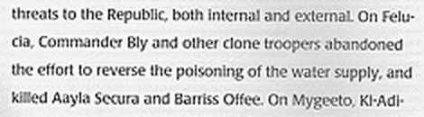

# Commander Bly

- **Aliases:** —
- **Era:** —
- **Continuity:** default Legends; entries present for: Legends
- **Research tier:** untiered (not listed as INTRO/DEEP/MASTERY in legends-feats.md)
- **Entries:** 15 (2 with quotations; 0 quotations extended to the full sentence/passage from the source text on file; 6 marked as fragments). Rebuilt 2026-11-17 from 17 old entries; old file: `characters/_bak/commander-bly.md.bak-20261117`.
- **How to read:** each entry is the quotation in full (block quote), then its source and point of view. "Note" lines are summaries from our notes, not quotations. `[fragment — full passage not on file]` means the source text is not on the box, so only the words in our notes are shown. Debate and forum material is in the last section and is unverified.

# LEGENDS (Legends / EU — main focus)

## Star Wars: The New Essential Chronology (Del Rey, 2005): power-scaling and lore notes

> On Felucia, Commander Bly and other clone troopers abandoned the effort to reverse the poisoning of the water supply, and killed Aayla Secura and Barriss Offee.
— Source: Part Two: The Fall of the Republic.
Note (our notes, around the quote): Aayla Secura; Barriss Offee; Ki-Adi-Mundi; Plo Koon; Stass Allie; Obi-Wan Kenobi; Yoda — Order 66: "On Felucia, Commander Bly and other clone troopers abandoned the effort to reverse the poisoning of the water supply, and killed Aayla Secura and Barriss Offee." Source: The New Essential Chronology, p.84

Our notes: `notes/materials/027-new-essential-chronology/02-part-two-fall-of-the-republic.md:518`

## Star Wars Insider #77 (2004)

- Note (summary from our notes, not a quotation): Page contents: "Armor" continued: the parallel with Obi-Wan and Anakin; whether Quinlan can be redeemed; the debut of Clone Commander Bly, a new breed of clone with more independence, from whose point of view Republic #68 is told (Daniel Wallace). (hand-read)
  — Source: Star Wars Insider #77 (2004). POV: Page contents.
Our notes: `notes/materials/038-star-wars-insider/077-ins077.md:527`

## Star Wars Insider #82 (2005)

- Note (summary from our notes, not a quotation): Page contents: Ask the Master continued: stormtrooper faces in A New Hope (Empire used other clone hosts and conscripts; Dark Force Rising cloned faces); ARC troopers vs clone commandos (Jango-trained ARCs, squads of four; EU only); Tank (Luke's friend; nickname from brawny build); photo of Imperial Shock Trooper, Commander Bly, AT-RT driver. (hand-read)
  — Source: Star Wars Insider #82 (2005).
Our notes: `notes/materials/038-star-wars-insider/082-ins082.md:271`

## Star Wars Insider #84 (2005)

- Note (summary from our notes, not a quotation): Page contents: Skywalking cont.: Matt Wood on earning the Grievous role and the raspy voice; "The Journey" for Hyperspace members; Natalie Portman at Comic-Con promoting V for Vendetta; For the Collector: Hasbro figures (Commander Bly, Commander Gree, Wookiee commando, hologram Aayla Secura and Plo Koon) and 2006 Saga Collection; Master Replicas Obi-Wan Elite saber, Darth Maul Force FX, AT-AT and Millennium Falcon; Sideshow and Hasbro 12-inch figures (hand-read)
  — Source: Star Wars Insider #84 (2005).
Our notes: `notes/materials/038-star-wars-insider/084-ins084.md:60`

- Note (summary from our notes, not a quotation): Page contents: Guide cont.: Special Forces structure table; Leadership (ARC commanders' kama and pauldrons, Cody, Gree); Special Units (Galactic Marines under Bacara and Ki-Adi-Mundi, 41st Elite, Squad Seven); Special Units: Divisions (327th Star Corps with Aayla Secura and Commander Bly; Galactic Marines' visor gear); Clone Commander Cody, Galactic Marine and Commander Bly art (hand-read)
  — Source: Star Wars Insider #84 (2005).
Our notes: `notes/materials/038-star-wars-insider/084-ins084.md:170`

## Star Wars Insider #87 (2006)

- Note (summary from our notes, not a quotation): Page contents: Incident reports 890-A Plo Koon (Captain Jag, Cato Neimoidia) and 890-B Aayla Secura (Commander Bly, Felucia) (hand-read)
  — Source: Star Wars Insider #87 (2006).
Our notes: `notes/materials/038-star-wars-insider/087-ins087.md:170`

- Note (summary from our notes, not a quotation): Page contents: Ask the Master cont.: Yoda and the Wookiees; lightsaber auto-shutoff; Commander Deviss vs Commander Bly; C-3PO rotoscoping; letter-writer names omitted (hand-read)
  — Source: Star Wars Insider #87 (2006).
Our notes: `notes/materials/038-star-wars-insider/087-ins087.md:246`

- Note (summary from our notes, not a quotation): Page contents: Star Wars Shop: What's New (R2-Q5, Commander Bly model kit) (hand-read)
  — Source: Star Wars Insider #87 (2006).
Our notes: `notes/materials/038-star-wars-insider/087-ins087.md:460`

## Star Wars Insider #90 (2006)

- Note (summary from our notes, not a quotation): Page contents: StarWarsShop: More Must Haves (Vader hockey jersey, Yoda bobble head, Clone Commander Bly, Padmé lenticular poster) (hand-read)
  — Source: Star Wars Insider #90 (2006).
Our notes: `notes/materials/038-star-wars-insider/090-ins090.md:484`

## Star Wars Insider #100 (2008)

- Note (summary from our notes, not a quotation): Page contents: Top 100: 75 The Trade Federation (Neimoidian photo); 74 Commander Bly; 73 Commander Bacara; 72 Anakin's Custom Jedi Starfighter (ship art) (hand-read)
  — Source: Star Wars Insider #100 (2008).
Our notes: `notes/materials/038-star-wars-insider/100-ins100.md:262`

## Star Wars Insider #126 (2011)

- Note (summary from our notes, not a quotation): Page contents: Incoming: Sideshow Commander Bly; Hallmark 2011 ornaments. (hand-read)
  — Source: Star Wars Insider #126 (2011).
Our notes: `notes/materials/038-star-wars-insider/126-ins126.md:362`

## Star Wars Insider #129 (2011)

- Note (summary from our notes, not a quotation): Page contents: Incoming: Attakus Commander Thire and Commander Bly (Order 66 on Felucia) statues; Hasbro Death Star Trench Run set. (hand-read)
  — Source: Star Wars Insider #129 (2011).
Our notes: `notes/materials/038-star-wars-insider/129-ins129.md:381`

## Star Wars Insider #140 (2013)

- Note (summary from our notes, not a quotation): Page contents: Bantha Tracks editorial "Creativity Obscura" by editor Mary Franklin: preparing Celebration Europe II (July 26–28, Essen, Germany); fan art of Clone Commander Bly (fan name left out). (hand-read)
  — Source: Star Wars Insider #140 (2013).
Our notes: `notes/materials/038-star-wars-insider/140-ins140.md:485`

## Star Wars Visual Dictionaries, Episodes I–VI (DK, 1998–2005) + The Phantom Menace Expanded Visual Dictionary (DK, 2012)

> the Jedi Knights were too few in number to serve as an elite force or as field commanders for millions of soldiers
> [fragment — full passage not on file]
>
> enhanced programming and extra training
> [fragment — full passage not on file]
>
> trained personally by bounty hunter Jango Fett
> [fragment — full passage not on file]
>
> operated autonomously, but reported to Jedi Generals.
> [fragment — full passage not on file]
>
> CC 2224 came to be called Cody; 1004, Gree; and 1138, Bacara.
>
> Instinct-level programming enables ARC troopers to react without thinking. The clones consider this to be similar to a Jedi's use of the Force.
>
> to have undergone intensive deep-core programming
> [fragment — full passage not on file]
>
> The Kaminoans were intrigued by the idea of cloning a being with a high midi-chlorian count, but were never given the opportunity
> [fragment — full passage not on file]
>
> The Kaminoans asked Tyranus why they were not being given a Jedi template for the army. Tyranus told them that he had an able-bodied warrior in mind for the job.
— Source: Star Wars Revenge of the Sith: The Visual Dictionary (DK, 2005): hand-read notes; p40-41 Elite Clones [KEY]: Kaminoans believed.
Note (our notes, around the quote): p40-41 Elite Clones [KEY]: Kaminoans believed "the Jedi Knights were too few in number to serve as an elite force or as field commanders for millions of soldiers", so gave some clones "enhanced programming and extra training"; Advanced Recon Commandos (ARCs) "trained personally by bounty hunter Jango Fett"; deployed on Muunilinst; "operated autonomously, but reported to Jedi Generals." Clone names: "CC 2224 came to be called Cody; 1004, Gree; and 1138, Bacara." Commander Cody, Commander Neyo, Commander Bly. Superior Skills [KEY]: "Instinct-level programming enables ARC troopers to react without thinking. The clones consider this to be similar to a Jedi's use of the Force." Combat veterans: new ARC troopers rumored "to have undergone intensive deep-core programming"; armor colors denote legion affiliation. DATA FILE [KEY]: "The Kaminoans were intrigued by the idea of cloning a being with a high midi-chlorian count, but were never given the opportunity"; "The Kaminoans asked Tyranus why they were not being given a Jedi template for the army. Tyranus told them that he had an able-bodied warrior in mind for the job." Command skirt modeled after Republic fighters on Rotas V.
Our notes: `notes/materials/047-visual-dictionaries/vd3-ep3.md:42`

# Debate and forum claims (unverified)

Forum posts, Suspect Insight debates and Discord debates, respect threads, and verdicts. These are posters' arguments or quotations they typed; none is checked against the book here unless the entry says so.

## Anoon Bondara (GeneralKenobi) vs Aayla Secura (ARandomBrokenTwig)

- Note (summary from our notes, not a quotation): Speed: moves as a blur to Commander Bly; lightsaber after-images vs Vos.
  — Source: Anoon Bondara (GeneralKenobi) vs Aayla Secura (ARandomBrokenTwig) — https://www.suspectinsightforums.com/t4370-stomper-showdown-r2-3-anoon-bondara-generalkenobi-vs-aayla-secura-arandombrokentwig.
Posted by: not named in our notes (see thread/notes link).
Our notes: `suspect-insight/debates/021-anoon-bondara-vs-aayla-secura.md:21`
