# Corran Horn

- **Aliases:** Corran
- **Era:** NR–LotF
- **Continuity:** default Legends; entries present for: Canon, Legends
- **Research tier:** DEEP
- **Entries:** 443 (301 with quotations; 124 marked as fragments; recounted after the public-release cleanup). Rebuilt 2026-11-17 from 437 old entries; old file: `characters/_bak/corran-horn.md.bak-20261117`.
- **How to read:** each entry is the quotation in full (block quote), then its source and point of view. "Note" lines are summaries from our notes, not quotations. `[fragment — full passage not on file]` means the source text is not on the box, so only the words in our notes are shown. Debate and forum material is in the last section and is unverified.

# LEGENDS (Legends / EU — main focus)

## Legacy of the Force 1–9: novel notes from the other agent (reference copy)

- Note (summary from our notes, not a quotation): Ch22–28: Luke and Corran in Coronet; Han throws in with Corellia; Jacen and Ben, with Nelani Dinn, track Jedi-linked "phantom" incidents on Lorrd and meet "Brisha Syo".
  — Source: Legacy of the Force 1: Betrayal (novel): feats, scaling and story notes.
Our notes: `notes/materials/021-legacy-of-the-force/lotf-1-betrayal-notes.md:20`

- Note (summary from our notes, not a quotation): Ch6 · L1315–1321 · Corran (FEAT, minor): in disguise, he drops four stories and kicks a sniper unconscious.
  — Source: Ch6 · L1315–1321 — Legacy of the Force 4: Exile (novel), feats and scaling notes.
Our notes: `notes/materials/021-legacy-of-the-force/lotf-4-exile-notes.md:40`

> Horn plucked the dart from the air. *(L5559)*
>
> Leia raised one hand. Alema felt the blowgun twitch-and the dart within it shot backward, straight into her mouth. *(L5591–5593)*
— Source: Ch18 · L5555–5643; L5559; L5573–5577; L5591–5593 — Legacy of the Force 4: Exile (novel), feats and scaling notes.
(Full sentence/passage taken from the source text on file: `novels_tmp_exile_exile_epub`.)
Note (our notes, around the quote): Ch18 · L5555–5643 · The Errant Venture trap on Alema (FEAT, several): Corran «plucked the dart from the air» (L5559). Alema throws her saber to cut down a chandelier, and Zekk catches it with the Force (L5573–5577). Leia: «Leia raised one hand. Alema felt the blowgun twitch-and the dart within it shot backward, straight into her mouth.» (L5591–5593). Alema cuts through a turbolift floor (L5619–5621). Jag's armor stops her dart and he shoots her, breaking her clavicle (L5639–5641). She TK-hurls Jag into cargo crates (L5643) and escapes in Lavint's ship (L5659). *Context:* a 5-on-1 ambush. Alema is crippled but still escapes.
Our notes: `notes/materials/021-legacy-of-the-force/lotf-4-exile-notes.md:58`

- Note (summary from our notes, not a quotation): | D1 | Wedge/Corran/Myri vs. assassins | Ch6, Coronet | Escape | One assassin carries a lightsaber |
  — Source: Legacy of the Force 4: Exile (novel), feats and scaling notes.
Context: | # | Fight | Where | Result | Context |
Our notes: `notes/materials/021-legacy-of-the-force/lotf-4-exile-notes.md:97`

- Note (summary from our notes, not a quotation): | D4 | Jedi trap vs. Alema | Ch18, *Errant Venture* | Alema escapes, wounded | Corran, Zekk, Leia, Jaina, Jag |
  — Source: Legacy of the Force 4: Exile (novel), feats and scaling notes.
Context: | # | Fight | Where | Result | Context |
Our notes: `notes/materials/021-legacy-of-the-force/lotf-4-exile-notes.md:100`

> Pellaeon closed the link and sat chewing over Niathal’s words for a while, wondering how much worse Jacen might become if Niathal were taken out of the picture for any reason. *(Corran, L3447)*
— Source: Legacy of the Force 4: Exile (novel), feats and scaling notes. POV: Corran.
(Full sentence/passage taken from the source text on file: `lotf_tmp_b8_epub`.)
Note (our notes, around the quote): Exile: Jag (disowned), Wedge (resigned), the Solos (fugitives), Ben (stranded on Ziost), and the Skywalker-Solo family «taken out of the picture» (Corran, L3447).
Our notes: `notes/materials/021-legacy-of-the-force/lotf-4-exile-notes.md:162`

What it shows (our notes): Role/arc: a truth-seeker (Corran: she «wants to find out the truth», L4369).
> Corran relaxed, his expression becoming more neutral. “All right. Back on topic. We’ve all been talking about dispassionate analysis in this argument. Now, I approve of dispassionate analysis. That’s how criminals get caught and convicted. But we’re also Jedi, and encouraged to trust our feelings. I just spent several days in Leia’s company, and, friend or not, I came away convinced that she wasn’t supporting Corellia, any more than she’s supporting the Alliance. She wants to find out the truth. The truth behind the war, the truth behind her son’s questionable decisions—which also reflect badly on the order, despite the fact they’re government-approved, I might add. She’s trying to identify the wrong and to maneuver herself in front of it. I don’t think that we should discourage her from that, even by a reprimand some of us consider irrelevant. I think we should trust our feelings.”
— Source: Legacy of the Force 4: Exile (novel), feats and scaling notes; Role/arc: a truth-seeker (Corran: she.
(Excerpt widened 2026-11-17 to the relevant passage, word for word from Exile (Aaron Allston), Chapter Fifteen (text copy `MEGA_Legend_The_Legacy_of_the_Force_Series_Star_Wars_Legacy_of_the_Force_04_Exile_Aaron_Allston_epub`).)
(Full sentence/passage taken from the source text on file: `novels_tmp_exile_exile_epub`.)
Our notes: `notes/materials/021-legacy-of-the-force/lotf-4-exile-notes.md:224`

- Note (summary from our notes, not a quotation): Scaling: loses every direct contest and escapes every time. Below Leia, Mara and Corran.
  — Source: Legacy of the Force 4: Exile (novel), feats and scaling notes.
Our notes: `notes/materials/021-legacy-of-the-force/lotf-4-exile-notes.md:234`

> Horn plucked the dart from the air. *(Ch18, L5559)*
— Source: Ch6, L1315–1321; Ch18, L5559 — Legacy of the Force 4: Exile (novel), feats and scaling notes.
(Full sentence/passage taken from the source text on file: `novels_tmp_exile_exile_epub`.)
Note (our notes, around the quote): Feats: drops four stories and kicks a sniper out (Ch6, L1315–1321). «plucked the dart from the air» (Ch18, L5559).
Our notes: `notes/materials/021-legacy-of-the-force/lotf-4-exile-notes.md:237`

- Note (summary from our notes, not a quotation): Scaling: a solid Master-level combat Jedi with good reactions. Placed ≈ Kyp.
  — Source: Legacy of the Force 4: Exile (novel), feats and scaling notes.
Our notes: `notes/materials/021-legacy-of-the-force/lotf-4-exile-notes.md:238`

> Caedus returned to his bubble, but made no attempt to resume his battle meditation. The technique—at least as Lumiya had taught it to him—was Sith, and he did not want to risk using it while what felt like half the Jedi Order was attempting to draw him into a meld. *(L2037)*
>
> The Sith way was one of deep sacrifice, and only now was Caedus coming to understand that he had not sacrificed the ability to love—only the ability to be loved in return. *(L2041)*
— Source: L2021–2023; L2045; L2037; L2041 — Legacy of the Force 6: Inferno (novel, read in full): feats, scaling and story notes.
(Full sentence/passage taken from the source text on file: `novels_tmp_inferno_FULL_txt`.)
Note (our notes, around the quote): Jedi battle-meld (Saba, Kyp, Corran, Tesar, Lowbacca etc.) invites Caedus in (L2021–2023); ~70+ StealthXs (L2045). Caedus avoids Sith battle meditation in the meld: «The technique-at least as Lumiya had taught it to him-was Sith» (L2037). Caedus: he had «not sacrificed the ability to love-only the ability to be loved in return.» (L2041).
Our notes: `notes/materials/021-legacy-of-the-force/lotf-6-inferno-notes.md:298`

> There was, in fact, a little girl in the cockpit with Jacen. *(L3343)*
— Source: L3343 — Legacy of the Force 7: Fury (novel, read in full): feats, scaling and story notes.
Note (our notes, around the quote): L3283 · Caedus (piloting): survives Luke, Kyp and Corran by «brilliant evasive flying». Luke breaks off on sensing Allana: «There was, in fact, a little girl in the cockpit with Jacen.» (L3343).
Our notes: `notes/materials/021-legacy-of-the-force/lotf-7-fury-notes.md:68`

> “You’re no Jedi.” Corran’s voice was harsh. “Your emotions are all over the map. Even an apprentice knows that. So we can’t trust you as a Jedi, we can’t trust you to be a calm, collected operative, and now you’ve left the most dangerous man in the galaxy disappointed in you—” He gestured at Luke. “Plus, you’ve volunteered to go on a mission to capture the second-most dangerous man, when all you had to do to retain everyone’s trust was keep your mouth shut.”
— Source: L787 — Legacy of the Force 7: Fury (novel, read in full): feats, scaling and story notes; | S4 | L783 | Corran | Luke is.
(Excerpt widened 2026-11-17 to the relevant passage, word for word from Fury (Aaron Allston), Chapter Four (text copy `MEGA_Legend_The_Legacy_of_the_Force_Series_Star_Wars_Legacy_of_the_Force_07_Fury_Aaron_Allston_epub`).)
(Full sentence/passage taken from the source text on file: `novels_tmp_fury_FULL_txt`.)
Note (our notes, around the quote): | S4 | L783 | Corran | Luke is «the most dangerous man in the galaxy»; Jacen «the second-most dangerous man» | Medium–high. Partly a pep-talk act (L787), but it fits the book. |
Context: | # | Line | Speaker / POV | Statement | Reliability |
Our notes: `notes/materials/021-legacy-of-the-force/lotf-7-fury-notes.md:107`

> Octa, trained by Kam and Tionne Solusar, both still recovering from their near-fatal wounds at the hands of Jacen Solo’s soldiers, was more subdued than the rest, her stillness in the Force clearly a consequence of rigid self-control rather than inner peace. *(L683)*
— Source: L683 — Legacy of the Force 7: Fury (novel, read in full): feats, scaling and story notes.
(Full sentence/passage taken from the source text on file: `novels_tmp_fury_FULL_txt`.)
Note (our notes, around the quote): Masters present: Luke, Kyle Katarn, Cilghal, Kyp, Corran, Saba, Octa Ramis (L683). Kam and Tionne «both still recovering from their near-fatal wounds» (L683) [Allston: Kam alive; contrast Inferno L3345–3355 where Kam appeared killed — continuity note].
Our notes: `notes/materials/021-legacy-of-the-force/lotf-7-fury-notes.md:245`

> A few meters away, Saba Sebatyne and Corran Horn dueled, each adopting a traditional, formalized lightsaber posture—Saba using a lightsaber in each hand, Corran with his own weapon adjusted to its second setting, its blade now three meters in length and a brilliant purple instead of its usual silver. *(L701)*
>
> It was like defending himself against Yuuzhan Vong thud bugs for the first time in years, but the old skill was undiminished—he calculated which objects had a chance of hitting him and incinerated only them with his blades, letting the others fly harmlessly past. *(L717)*
— Source: L701–717; L701; L711; L715 — Legacy of the Force 7: Fury (novel, read in full): feats, scaling and story notes.
(Full sentence/passage taken from the source text on file: `novels_tmp_fury_FULL_txt`.)
Note (our notes, around the quote): Masters' free-for-all (L701–717): Saba dual-wields; Corran's saber «adjusted to its second setting, its blade now three meters in length» (L701); Octa Ramis Force-hurls stones; Luke inverted back-flip block on Cilghal (L701), bends backward and disarms Cilghal by catching her hilt (L711), then fights Kyp two-bladed (L715). Luke vs Force-propelled bolt swarm: «he calculated which objects had a chance of hitting him and incinerated only them with his blades» (L717) — FEAT (casual, sparring). Cilghal Force-pulls Kyle's saber (L713).
Our notes: `notes/materials/021-legacy-of-the-force/lotf-7-fury-notes.md:247`

> Horn, you can't throw anybody any distance. With the Force, anyway. *(L735)*
— Source: L705–721; L735 — Legacy of the Force 7: Fury (novel, read in full): feats, scaling and story notes.
Note (our notes, around the quote): Kyp's capture-or-neutralize mission plan vs Jacen at the Senate Building via the undercity (L705–721). Kyp: «Horn, you can't throw anybody any distance. With the Force, anyway.» (L735) — Corran's TK weakness.
Our notes: `notes/materials/021-legacy-of-the-force/lotf-7-fury-notes.md:248`

> So we can’t trust you as a Jedi, we can’t trust you to be a calm, collected operative, and now you’ve left the most dangerous man in the galaxy disappointed in you—” He gestured at Luke. *(gesturing at Luke)*
>
> “Plus, you’ve volunteered to go on a mission to capture the second-most dangerous man, when all you had to do to retain everyone’s trust was keep your mouth shut.” *(L783)*
— Source: L783 — Legacy of the Force 7: Fury (novel, read in full): feats, scaling and story notes; Corran STATEMENT. POV: Corran STATEMENT.
(Full sentence/passage taken from the source text on file: `novels_tmp_fury_FULL_txt`.)
Note (our notes, around the quote): Corran STATEMENT: «you've left the most dangerous man in the galaxy disappointed in you» (gesturing at Luke) ... «you've volunteered to go on a mission to capture the second-most dangerous man» (L783) — Corran ranks Luke #1, Jacen #2 (partly simulated emotion, L787).
Our notes: `notes/materials/021-legacy-of-the-force/lotf-7-fury-notes.md:250`

- Note (summary from our notes, not a quotation): Red Sword Flight: Luke, Kyp, Corran, Tyria Tainer, Twool (sensor StealthX tracking Caedus's tracer), Sanola Ti (L3177–3185).
  — Source: L3177–3185 — Legacy of the Force 7: Fury (novel, read in full): feats, scaling and story notes.
Our notes: `notes/materials/021-legacy-of-the-force/lotf-7-fury-notes.md:321`

> Simultaneously, not bothering to work with targeting computers, blips, and brackets, he swung his snubfighter’s nose a trifle to starboard, located his target by feel, and fired. *(L3215)*
— Source: L3215 — Legacy of the Force 7: Fury (novel, read in full): feats, scaling and story notes.
(Full sentence/passage taken from the source text on file: `novels_tmp_fury_FULL_txt`.)
Note (our notes, around the quote): Luke locates Jacen via Twool's tracer sensors; initiates the battle-meld at the moment of firing: «not bothering to work with targeting computers, blips, and brackets, he swung his snubfighter's nose a trifle to starboard, located his target by feel, and fired» (L3215) — FEAT (Luke Force-aimed first-shot hit on a stealth fighter).
Our notes: `notes/materials/021-legacy-of-the-force/lotf-7-fury-notes.md:324`

> made himself smaller in the Force, reducing his presence to nothingness *(L3241)*
— Source: L3223–3229; L3241; L3247–3249 — Legacy of the Force 7: Fury (novel, read in full): feats, scaling and story notes.
Note (our notes, around the quote): Caedus feels the meld, flees; Blur hit from behind (L3223–3229). Caedus «made himself smaller in the Force, reducing his presence to nothingness» (L3241); the Jedi still track him — he believes via Allana's presence (L3247–3249).
Our notes: `notes/materials/021-legacy-of-the-force/lotf-7-fury-notes.md:325`

> So great it was that he could no longer contain his presence in the Force-his anger flowed through him, through Allana, through his pursuers, through everything in tune with him or the Force. *(L3251)*
>
> Leia, seated in the captain’s chair, grew more restless … and then was hit by a wave of hatred. Redness and heat swamped her—hatred for the Jedi, hatred for Luke, for the Confederation, for lasers and explosives and chaos. *(L3261)*
>
> I've never felt him like this. *(L3265)*
— Source: L3251; L3261; L3265 — Legacy of the Force 7: Fury (novel, read in full): feats, scaling and story notes; Caedus's rage overwhelms his concealment. POV: Caedus's rage overwhelms his concealment, about Corran Horn.
(Full sentence/passage taken from the source text on file: `novels_tmp_fury_FULL_txt`.)
Note (our notes, around the quote): Caedus's rage overwhelms his concealment: «So great it was that he could no longer contain his presence in the Force-his anger flowed through him, through Allana, through his pursuers, through everything in tune with him or the Force.» (L3251). Leia far away is hit: «Redness and heat swamped her» (L3261); «I've never felt him like this.» (L3265).
Our notes: `notes/materials/021-legacy-of-the-force/lotf-7-fury-notes.md:326`

> Luke felt the wave of hatred flow through him. It was so strong it felt like a kick in the gut, and he wondered for an instant if Jacen had perfected some new Force attack.
>
> But no, the undercurrent was of frustration, helplessness, even fear. It was no attack. It was like a man in his last seconds of life, recognizing that fact.
>
> And Luke. ... did not hate.
> [fragment — full passage not on file]
>
> He could not comfort her. To comfort her now would be to die.
>
> Juking and jinking, his own skills and Force insights making him an unpredictable target, he moved away from the Alliance formation, driven by his pursuers, his maneuvers eating up so much of his speed that he had no chance of outdistancing them. Luke’s lasers, sometimes joined by Kyp’s or Corran’s, came perilously close to him, occasionally brightening his shields and rattling his Blur.
>
> lost in his rage *(L3311)*
> [fragment — full passage not on file]
— Source: L3279; L3281; L3283; L3301–3303 — Legacy of the Force 7: Fury (novel, read in full): feats, scaling and story notes; **Luke POV. POV: Luke POV, about Corran Horn.
(Excerpt widened 2026-11-17 to the relevant passage, word for word from Fury (Aaron Allston) (text copy `MEGA_Legend_The_Legacy_of_the_Force_Series_Star_Wars_Legacy_of_the_Force_07_Fury_Aaron_Allston_epub`).)
(Excerpt widened 2026-11-17 to the relevant passage, word for word from Fury (Aaron Allston) (text copy `MEGA_Legend_The_Legacy_of_the_Force_Series_Star_Wars_Legacy_of_the_Force_07_Fury_Aaron_Allston_epub`).)
(Full sentence/passage taken from the source text on file: `novels_tmp_fury_FULL_txt`.)
(Fragment completed 2026-11-17: full sentence/passage matched word for word in the source text on file: `MEGA_Legend_The_Legacy_of_the_Force_Series_Star_Wars_Legacy_of_the_Force_07_Fury_Aaron_Allston_epub`.)
Note text that was attached to the quote line: *(L3281)*
Note text that was attached to the quote line: *(L3307)*
Note (our notes, around the quote): Luke POV: «It was so strong it felt like a kick in the gut, and he wondered for an instant if Jacen had perfected some new Force attack.» (L3279) — but reads it as «frustration, helplessness, even fear ... like a man in his last seconds of life» (L3281). «And Luke. ... did not hate.» (L3283) — Luke keeps his promise (cf. L1881). Caedus survives by «brilliant evasive flying» (L3283) — FEAT (Caedus pilot); Kyp and Corran herd him (L3301–3303). Caedus: «To comfort her now would be to die.» (L3307); «lost in his rage» (L3311).
Our notes: `notes/materials/021-legacy-of-the-force/lotf-7-fury-notes.md:327`

What it shows (our notes): Luke breaks off when he senses Allana: «There was, in fact, a little girl in the cockpit with Jacen.» (L3343); «Kill Jacen. ... kill an innocent.» (L3347). He withdraws the Jedi (L3349–3351). Syal Antilles's Aleph had grazed him (L3345).
> There was, in fact, a little girl in the cockpit with Jacen. Her presence had been washed out by the hatred Jacen was pouring into the Force, but now Jacen was calming, and the little girl’s distress made her a brighter presence.
>
> Kill Jacen. ... kill an innocent. *(L3347)*
> [fragment — full passage not on file]
— Source: L3343; L3347; L3349–3351; L3345 — Legacy of the Force 7: Fury (novel, read in full): feats, scaling and story notes; Luke breaks off when he senses Allana.
(Excerpt widened 2026-11-17 to the relevant passage, word for word from Fury (Aaron Allston), Chapter Nineteen (text copy `MEGA_Legend_The_Legacy_of_the_Force_Series_Star_Wars_Legacy_of_the_Force_07_Fury_Aaron_Allston_epub`).)
(Fragment completed 2026-11-17: full sentence/passage matched word for word in the source text on file: `MEGA_Legend_The_Legacy_of_the_Force_Series_Star_Wars_Legacy_of_the_Force_07_Fury_Aaron_Allston_epub`.)
Note text that was attached to the quote line: *(L3343)*
Our notes: `notes/materials/021-legacy-of-the-force/lotf-7-fury-notes.md:328`

> Antilles, you just sent Luke Skywalker into retreat. *(L3377)*
— Source: L3377 — Legacy of the Force 7: Fury (novel, read in full): feats, scaling and story notes; Caedus. POV: Caedus, about Corran Horn.
Note (our notes, around the quote): Caedus: «Antilles, you just sent Luke Skywalker into retreat.» (L3377) — Caedus's spin; real cause = Allana. RESULT: no result; Luke withdraws by choice.
Our notes: `notes/materials/021-legacy-of-the-force/lotf-7-fury-notes.md:329`

- Note (summary from our notes, not a quotation): Centerpoint fires (L3379–3393): a kilometers-wide twisting beam erases both task forces (GA and Corellian); Allana faints from the death-shock (L3391). Luke feels it (L3401). Leia compares it to Alderaan (L3419). The Corellians sacrificed their own old ships as bait (L3317).
  — Source: L3379–3393; L3391; L3401; L3419 — Legacy of the Force 7: Fury (novel, read in full): feats, scaling and story notes.
Our notes: `notes/materials/021-legacy-of-the-force/lotf-7-fury-notes.md:330`

> “You’re no Jedi.” Corran’s voice was harsh. “Your emotions are all over the map. Even an apprentice knows that. So we can’t trust you as a Jedi, we can’t trust you to be a calm, collected operative, and now you’ve left the most dangerous man in the galaxy disappointed in you—” He gestured at Luke. “Plus, you’ve volunteered to go on a mission to capture the second-most dangerous man, when all you had to do to retain everyone’s trust was keep your mouth shut.”
>
> But he was still the best lightsaber swordsman around—excepting possibly Luke, perhaps the best there ever had been.
>
> Caedus waited until the timing was perfect, waited until an incoming bolt arrived at the same moment as one of Mithric’s attacks so he could devote a single maneuver to both. He caught Mithric’s blow toward the hilt of his lightsaber. He caught the bolt near the tip, deflecting it up and straight into Mithric’s chest.
>
> They had to. Jacen could defeat his mother or Ben without trouble; Saba, with difficulty. Saba plus Luke would be impossible odds. One of the Masters had to fall if Caedus was to survive this day.
>
> Jacen was Luke's match *(L6729)*
> [fragment — full passage not on file]
>
> Caedus himself felt healthy again, fully healed for the first time since his fight with Luke. *(L5573)*
— Source: L783; L1717; L5993–5995; L6729 — Legacy of the Force 7: Fury (novel, read in full): feats, scaling and story notes; Statements: Corran calls him.
(Excerpt widened 2026-11-17 to the relevant passage, word for word from Fury (Aaron Allston) (text copy `MEGA_Legend_The_Legacy_of_the_Force_Series_Star_Wars_Legacy_of_the_Force_07_Fury_Aaron_Allston_epub`).)
(Excerpt widened 2026-11-17 to the relevant passage, word for word from Fury (Aaron Allston) (text copy `MEGA_Legend_The_Legacy_of_the_Force_Series_Star_Wars_Legacy_of_the_Force_07_Fury_Aaron_Allston_epub`).)
(Excerpt widened 2026-11-17 to the relevant passage, word for word from Fury (Aaron Allston) (text copy `MEGA_Legend_The_Legacy_of_the_Force_Series_Star_Wars_Legacy_of_the_Force_07_Fury_Aaron_Allston_epub`).)
(Excerpt widened 2026-11-17 to the relevant passage, word for word from Fury (Aaron Allston) (text copy `MEGA_Legend_The_Legacy_of_the_Force_Series_Star_Wars_Legacy_of_the_Force_07_Fury_Aaron_Allston_epub`).)
(Full sentence/passage taken from the source text on file: `novels_tmp_fury_FULL_txt`.)
(Fragment completed 2026-11-17: full sentence/passage matched word for word in the source text on file: `MEGA_Legend_The_Legacy_of_the_Force_Series_Star_Wars_Legacy_of_the_Force_07_Fury_Aaron_Allston_epub`.)
Note text that was attached to the quote line: *(L1717)*
(Fragment completed 2026-11-17: full sentence/passage matched word for word in the source text on file: `MEGA_Legend_The_Legacy_of_the_Force_Series_Star_Wars_Legacy_of_the_Force_07_Fury_Aaron_Allston_epub`.)
Note text that was attached to the quote line: *(L5993–5995)*
Note (our notes, around the quote): Statements: Corran calls him «the second-most dangerous man» after Luke (L783). His own POV: «But he was still the best lightsaber swordsman around-excepting possibly Luke» (L1717). His threat assessment: «Jacen could defeat his mother or Ben without trouble; Saba, with difficulty. Saba plus Luke would be impossible odds.» (L5993–5995). Luke's POV: «Jacen was Luke's match» (L6729). Healing: «fully healed for the first time since his fight with Luke.» (L5573).
Our notes: `notes/materials/021-legacy-of-the-force/lotf-7-fury-notes.md:447`

> So we can’t trust you as a Jedi, we can’t trust you to be a calm, collected operative, and now you’ve left the most dangerous man in the galaxy disappointed in you—” He gestured at Luke. *(L783)*
>
> Such an attack would distract a Jedi Master, hurt a Jedi Knight … and kill you.” *(L795)*
>
> No, they can't. They can't be Luke Skywalker. *(L5077)*
— Source: L783; L795; L5077 — Legacy of the Force 7: Fury (novel, read in full): feats, scaling and story notes; Statements: Corran.
(Full sentence/passage taken from the source text on file: `novels_tmp_fury_FULL_txt`.)
Note (our notes, around the quote): Statements: Corran: «the most dangerous man in the galaxy» (L783). Luke on Caedus: a single «negligent attack» would «distract a Jedi Master, hurt a Jedi Knight... . and kill you» (L795). Ben: «No, they can't. They can't be Luke Skywalker.» (L5077).
Our notes: `notes/materials/021-legacy-of-the-force/lotf-7-fury-notes.md:454`

## Star Wars: The New Essential Chronology (Del Rey, 2005): power-scaling and lore notes

> Corran Horn battles Shedao Shai for the fate of Ithor.
— Source: Part Twelve: The New Jedi Order; art caption.
Note (our notes, around the quote): art caption: "Corran Horn battles Shedao Shai for the fate of Ithor." Source: The New Essential Chronology, p.206, caption
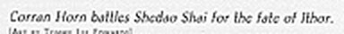
Our notes: `notes/materials/027-new-essential-chronology/12-part-twelve-new-jedi-order.md:44`

> Corran won the duel, killing Shedao Shai.
— Source: Part Twelve: The New Jedi Order; Corran kills Shedao Shai. POV: Corran kills Shedao Shai.
Note (our notes, around the quote): Corran kills Shedao Shai: "Corran won the duel, killing Shedao Shai." Source: The New Essential Chronology, p.208
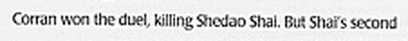
Our notes: `notes/materials/027-new-essential-chronology/12-part-twelve-new-jedi-order.md:56`

## The Complete Star Wars Encyclopedia, Vol. I (A–G)

> In the end, Shedao Shai betrayed A'kla: He killed the Senator and prepared his corpse in the appropriate Yuuzhan Vong manner, returning the artistically decorated skeleton to Corran Horn on Ithor.
— Source: scan pages 1–40; Corran Horn. POV: Corran Horn.
Note (our notes, around the quote): Corran Horn: "In the end, Shedao Shai betrayed A'kla: He killed the Senator and prepared his corpse in the appropriate Yuuzhan Vong manner, returning the artistically decorated skeleton to Corran Horn on Ithor." Source: The Complete Star Wars Encyclopedia, Vol. I, p.17
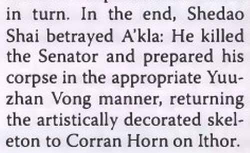
Our notes: `notes/materials/030-complete-star-wars-encyclopedia-vol-1/00-v1-scan-001-040.md:203`

> He encountered Rogue Squadron pilot Corran Horn there and attempted to kill him, but was himself killed by Horn with the assistance of Jan Dodonna.
— Source: scan pages 161–200; Corran Horn. POV: Corran Horn.
Note (our notes, around the quote): Corran Horn: "He encountered Rogue Squadron pilot Corran Horn there and attempted to kill him, but was himself killed by Horn with the assistance of Jan Dodonna." Source: The Complete Star Wars Encyclopedia, Vol. I, p.185
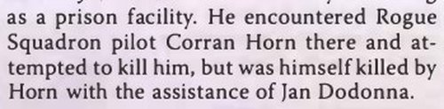
Our notes: `notes/materials/030-complete-star-wars-encyclopedia-vol-1/04-v1-scan-161-200.md:343`

> Although rebuffed, she tried again when they were paired for an undercover mis­ sion on Coruscant. Again she failed. When Director of Imperial Intelligence Ysanne Isard fled Coruscant after the Alliance invasion, she took the traitor Dlarit with her to Thyferra and gave her a post in the Thyferran Horne Defense Corps. As a commander, she was placed in charge oftraining TIE fighter pilots to defend the bacta convoys that Isard was using to gain money and power. Her unit was called to defend Isard's Super Star Destroyer Lusankya during the final moments of the Bacta War. As the ship was being pounded byRogueSquadron, her fighter group engaged the X-wings. Dlarit was then ordered to provide cover for Isard's shuttle as she attempted to escape, but her TIE was destroyed by Corran Horn. DL-X2A Veril Line Systems DL-series droid that provided security for Star Tours. DnalvecA port city on Sriluur, the Weequay horne planet. DN bolt caster Drever Corp originally created the Phoenix II plasma disruptor as a tool for customs agents and special-forces commandos to use in breaching locked doors. But soldiers began improvising with the tool, wielding it against battle droids and other en­ emies.
— Source: scan pages 201–240; Corran Horn. POV: Corran Horn.
(Excerpt widened 2026-11-17 to the relevant passage, word for word from research primary cse vol1 (text copy `research_primary_cse_vol1_pdf_45a954be6d`).)
(Excerpt widened 2026-11-17 to the relevant passage, word for word from research primary cse vol1 (text copy `research_primary_cse_vol1_pdf_45a954be6d`).)
Note (our notes, around the quote): Corran Horn: "Dlarit was then ordered to provide cover for Isard's shuttle as she attempted to escape, but her TIE was destroyed by Corran Horn." Source: The Complete Star Wars Encyclopedia, Vol. I, p.193
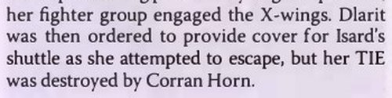
Our notes: `notes/materials/030-complete-star-wars-encyclopedia-vol-1/05-v1-scan-201-240.md:61`

> For her tactics in defeating the Harmzuay—which she acknowledged were really those of Rogue Squadron Jedi Corran Horn—she was promoted to True Invid and served aboard the Star Destroyer Jnvidious, which was controlled by Moff Leonia Tavira.
— Source: scan pages 361–398; Corran Horn. POV: Corran Horn.
Note (our notes, around the quote): Corran Horn: "For her tactics in defeating the Harmzuay—which she acknowledged were really those of Rogue Squadron Jedi Corran Horn—she was promoted to True Invid and served aboard the Star Destroyer Jnvidious, which was controlled by Moff Leonia Tavira." Source: The Complete Star Wars Encyclopedia, Vol. I, p.378
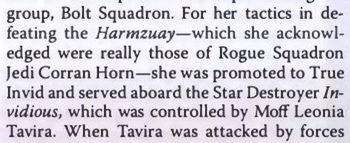
Our notes: `notes/materials/030-complete-star-wars-encyclopedia-vol-1/09-v1-scan-361-398.md:272`

## The Complete Star Wars Encyclopedia, Vol. II (H–O)

- Note (summary from our notes, not a quotation): Page contents: 1110 words, 23 paragraphs | headings/entries: Horch; Hord, Tulak; Hordon Cal; Horm, Threkin; Horme, Treva; Horn, Corran
  — Source: scan pages 41–80.
Our notes: `notes/materials/031-complete-star-wars-encyclopedia-vol-2/01-v2-scan-041-080.md:151`

> He helped defeat the menace of Exar Kun's evil spirit, but in the final battle he suffered injuries that required extensive bacta treatments.
— Source: scan pages 41–80; Corran Horn; Exar Kun — entry/section: Horn, Corran.
Note (our notes, around the quote): Corran Horn; Exar Kun — entry/section: Horn, Corran: "He helped defeat the menace of Exar Kun's evil spirit, but in the final battle he suffered injuries that required extensive bacta treatments." Source: The Complete Star Wars Encyclopedia, Vol. II, p.58
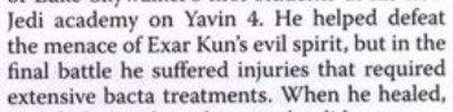
Our notes: `notes/materials/031-complete-star-wars-encyclopedia-vol-2/01-v2-scan-041-080.md:155`

> Horn eventually confronted Shedao Shai, and they agreed to a duel: Corran fighting for Ithor, and Shedao Shai for the remains of Mongei Shai.
— Source: scan pages 41–80; Corran Horn — entry/section: Horn, Corran.
Note (our notes, around the quote): Corran Horn — entry/section: Horn, Corran: "Horn eventually confronted Shedao Shai, and they agreed to a duel: Corran fighting for Ithor, and Shedao Shai for the remains of Mongei Shai." Source: The Complete Star Wars Encyclopedia, Vol. II, p.59
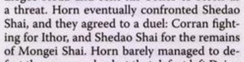
Our notes: `notes/materials/031-complete-star-wars-encyclopedia-vol-2/01-v2-scan-041-080.md:164`

> the man who destroyed Ithor.
> [fragment — full passage not on file]
— Source: scan pages 121–160. POV: Corran Horn.
Note (our notes, around the quote): Corran Horn: "Because of his part in destruction of the grand cruiser, Corran Horn was quickly targeted by the news agencies as "the man who destroyed Ithor."" Source: The Complete Star Wars Encyclopedia, Vol. II, p.123
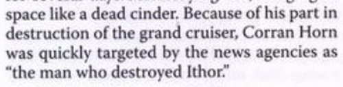
Our notes: `notes/materials/031-complete-star-wars-encyclopedia-vol-2/03-v2-scan-121-160.md:72`

> After Shedao Shai's death in his duel with Jedi Knight Corran Horn, Yuuzhan Vong warrior Deign Lian seized command of Legacy of Torment and used it to deliver lethal bioweapons that destroyed the jungles of Ithor.
— Source: scan pages 241–280; Corran Horn. POV: Corran Horn.
Note (our notes, around the quote): Corran Horn: "After Shedao Shai's death in his duel with Jedi Knight Corran Horn, Yuuzhan Vong warrior Deign Lian seized command of Legacy of Torment and used it to deliver lethal bioweapons that destroyed the jungles of Ithor." Source: The Complete Star Wars Encyclopedia, Vol. II, p.248
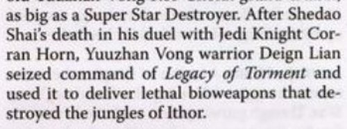
Our notes: `notes/materials/031-complete-star-wars-encyclopedia-vol-2/06-v2-scan-241-280.md:129`

## The Complete Star Wars Encyclopedia, Vol. III (P–Z)

> In the end, Shedao turned Elegos into a statement: He killed him, prepared his corpse in the appropriate Yuuzhan Vong manner, and returned the artistically decorated skeleton to Corran Horn at Ithor.
— Source: scan pages 121–160; Corran Horn. POV: Corran Horn.
Note (our notes, around the quote): Corran Horn: "In the end, Shedao turned Elegos into a statement: He killed him, prepared his corpse in the appropriate Yuuzhan Vong manner, and returned the artistically decorated skeleton to Corran Horn at Ithor." Source: The Complete Star Wars Encyclopedia, Vol. III, p.143
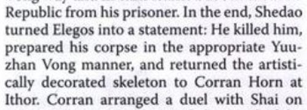
Our notes: `notes/materials/032-complete-star-wars-encyclopedia-vol-3/03-v3-scan-121-160.md:232`

> Corran arranged a duel with Shai on Ithor, with the winner awarded control of the planet.
— Source: scan pages 121–160; Corran Horn. POV: Corran Horn.
Note (our notes, around the quote): Corran Horn: "Corran arranged a duel with Shai on Ithor, with the winner awarded control of the planet." Source: The Complete Star Wars Encyclopedia, Vol. III, p.143
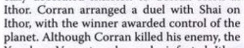
Our notes: `notes/materials/032-complete-star-wars-encyclopedia-vol-3/03-v3-scan-121-160.md:234`

> The Silaban's crew found that they were no match for the combined firepower of the two fugitives, especially when Corran Horn and Wedge Antilles arrived in X-wings to serve as escorts.
— Source: scan pages 121–160; Corran Horn. POV: Corran Horn.
Note (our notes, around the quote): Corran Horn: "The Silaban's crew found that they were no match for the combined firepower of the two fugitives, especially when Corran Horn and Wedge Antilles arrived in X-wings to serve as escorts." Source: The Complete Star Wars Encyclopedia, Vol. III, p.151
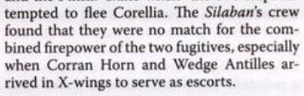
Our notes: `notes/materials/032-complete-star-wars-encyclopedia-vol-3/03-v3-scan-121-160.md:322`

> It was destroyed by the combined efforts of Rogue Squadron pilots Corran Horn and Tycho Celchu as it attempted to make a run to hyperspace during the Bacta War.
— Source: scan pages 241–280; Corran Horn. POV: Corran Horn.
Note (our notes, around the quote): Corran Horn: "It was destroyed by the combined efforts of Rogue Squadron pilots Corran Horn and Tycho Celchu as it attempted to make a run to hyperspace during the Bacta War." Source: The Complete Star Wars Encyclopedia, Vol. III, p.242
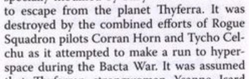
Our notes: `notes/materials/032-complete-star-wars-encyclopedia-vol-3/06-v3-scan-241-280.md:81`

## The New Essential Guide to Characters (2002)

- Note (summary from our notes, not a quotation): Page contents: 474 words, 18 paragraphs | headings/entries: TEAR ts; ERP ND TIR TPCT AS FT; Corran joined the; Pars ECTS; PUNE S ST SES
  — Source: scan pages 61–90.
Our notes: `notes/materials/034-new-essential-guide-to-characters/02-negc-scan-061-090.md:87`

> Kirtan Loor, now working directly for Ysanne Isard, tried to destroy Corran and his squadron mates.
— Source: scan pages 61–90; Corran Horn. POV: Corran Horn.
Note (our notes, around the quote): Corran Horn: "Kirtan Loor, now working directly for Ysanne Isard, tried to destroy Corran and his squadron mates." Source: The New Essential Guide to Characters, p.79
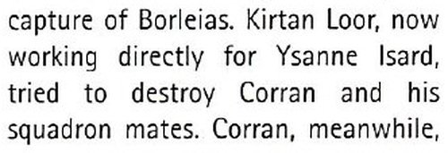
Our notes: `notes/materials/034-new-essential-guide-to-characters/02-negc-scan-061-090.md:89`

- Note (summary from our notes, not a quotation): Corran Horn: "Eventually he rescued Mirax from Tavira's "Jedi advisers"—members of the hidden Jensaarai sect founded by a Dark Jedi whom Corran's grandfather had killed." Source: The New Essential Guide to Characters, p.80
  — Source: scan pages 61–90. POV: Corran Horn.
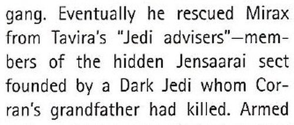
Our notes: `notes/materials/034-new-essential-guide-to-characters/02-negc-scan-061-090.md:96`

> Though Corran had no talent for telekinesis, he became one of the academy's experts at projecting images into the minds of others.
— Source: scan pages 61–90; Corran Horn. POV: Corran Horn.
Note (our notes, around the quote): Corran Horn: "Though Corran had no talent for telekinesis, he became one of the academy's experts at projecting images into the minds of others." Source: The New Essential Guide to Characters, p.80
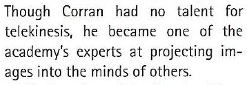
Our notes: `notes/materials/034-new-essential-guide-to-characters/02-negc-scan-061-090.md:98`

> The Yuuzhan Vong were also looking for the skeleton, and Corran killed two of them—almost at the expense of his own life.
— Source: scan pages 61–90; Corran Horn. POV: Corran Horn.
Note (our notes, around the quote): Corran Horn: "The Yuuzhan Vong were also looking for the skeleton, and Corran killed two of them—almost at the expense of his own life." Source: The New Essential Guide to Characters, p.80
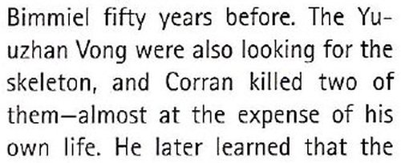
Our notes: `notes/materials/034-new-essential-guide-to-characters/02-negc-scan-061-090.md:100`

> Knowing his actions skirted dangerously close to the dark side, Corran challenged Shedao Shai to a duel.
— Source: scan pages 61–90; Corran Horn. POV: Corran Horn.
Note (our notes, around the quote): Corran Horn: "Knowing his actions skirted dangerously close to the dark side, Corran challenged Shedao Shai to a duel." Source: The New Essential Guide to Characters, p.80
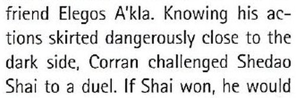
Our notes: `notes/materials/034-new-essential-guide-to-characters/02-negc-scan-061-090.md:102`

> Corran won the fatal contest, but Shai's treacherous assistant destroyed Ithor anyway.
— Source: scan pages 61–90; Corran Horn. POV: Corran Horn.
Note (our notes, around the quote): Corran Horn: "Corran won the fatal contest, but Shai's treacherous assistant destroyed Ithor anyway." Source: The New Essential Guide to Characters, p.80
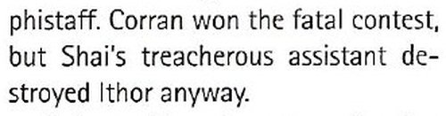
Our notes: `notes/materials/034-new-essential-guide-to-characters/02-negc-scan-061-090.md:104`

> Rogue pilot Corran Horn—making it appear as if he'd been killed in a crash—and retreated to the buried Lusankya.
— Source: scan pages 61–90; Corran Horn. POV: Corran Horn.
Note (our notes, around the quote): Corran Horn: "Rogue pilot Corran Horn—making it appear as if he'd been killed in a crash—and retreated to the buried Lusankya." Source: The New Essential Guide to Characters, p.85
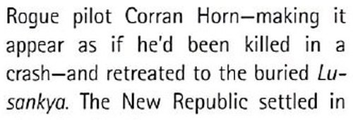
Our notes: `notes/materials/034-new-essential-guide-to-characters/02-negc-scan-061-090.md:133`

## Dark Side Sourcebook (d20, 2001)

> In the four thousand years since Exar Kun's spirit was entombed in the very temples he fortified, the battle hydras regressed into typical predator behavior. A small population survived by lurking in mountain caves and emerging only to hunt. Despite their fearsome appearance, the creatures are actually quite shy and generally hunt alone, only attacking in numbers when commanded. Battle hydras were forgotten for millennia until the early days of Skywalker's Jedi academy. Exar Kun's dark shade summoned mutated hydras to attack the comatose body of Luke Skywalker. Though they very nearly destroyed the Jedi Master, Skywalker was able to act through his nephew Jacen Solo and fight the monsters off with his lightsaber. Exar Kun called up another swarm of the creatures to kill Skywalker, but these were destroyed by Rogue Squadron pilot Corran Horn in a borrowed Z-95 Headhunter. Since that time, Skywalker's students have only occasionally encountered battle hydras. Without Exar Kun's control, the beasts either flee on contact with sentients or, in rare cases, attack out of defensive Overview instinct when surprised. Now that Exar Kun's spirit has been destroyed, the creatures may die out or even revert to their natural forms. Whether hunting in the jungles of Yavin 4 or attacking a Jedi Master, the battle hydra's first attack usually comes from above.
— Source: Chapter Six: Creatures and Archetypes; Exar Kun; Corran Horn.
(Excerpt widened 2026-11-17 to the relevant passage, word for word from research primary dark side sourcebook dss (text copy `research_primary_dark_side_sourcebook_dss_pdf_9cd3453f4a`).)
(Excerpt widened 2026-11-17 to the relevant passage, word for word from research primary dark side sourcebook dss (text copy `research_primary_dark_side_sourcebook_dss_pdf_9cd3453f4a`).)
Note (our notes, around the quote): Exar Kun; Corran Horn: "Exar Kun called up another swarm of the creatures to kill Skywalker, but these were destroyed by Rogue Squadron pilot Corran Horn in a borrowed Z-95 Headhunter." Source: Dark Side Sourcebook, p.111
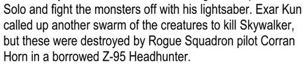
Our notes: `notes/materials/035-dark-side-sourcebook/06-ch6-creatures-archetypes.md:14`

## Sourcebooks/The New Jedi Order Sourcebook.pdf [Star Wars Roleplaying Game (d20, 2000)] (scan pages 1–60)

- Note (summary from our notes, not a quotation): Page contents: 834 words, 25 paragraphs | headings/entries: Corran Horn, Jedi Knight; AGE PEAT: RUSOOD GNEREY; Ganner Rhysode, Jedi Knight
  — Source: Sourcebooks/The New Jedi Order Sourcebook.pdf [Star Wars Roleplaying Game.
Our notes: `notes/materials/037-sw-d20-folder/049-the-new-jedi-order-sourcebook-scan-001-060.md:297`

> He became one of the first formal students at Luke Skywalker’s Jedi academy, While training, he realized that he was virtually incapable of moving objects with the Force—telekinesis was beyond his abilities except with the most taxing effort.
— Source: Sourcebooks/The New Jedi Order Sourcebook.pdf [Star Wars Roleplaying Game.
Note (our notes, around the quote): Corran Horn — entry/section: Corran Horn, Jedi Knight (The New Jedi Order Sourcebook, Ch2): "He became one of the first formal students at Luke Skywalker’s Jedi academy, While training, he realized that he was virtually incapable of moving objects with the Force—telekinesis was beyond his abilities except with the most taxing effort." Source: *The New Jedi Order Sourcebook* (SWRPG d20), scan p.52
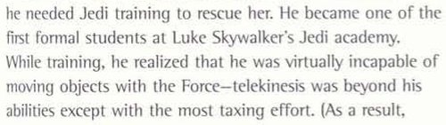
Our notes: `notes/materials/037-sw-d20-folder/049-the-new-jedi-order-sourcebook-scan-001-060.md:299`

> Now, with the Yuuzhan Vong invasion just beginning, Corran Horn prepares to use his Jedi skills to defend the galaxy, but he’s also keenly aware that the alien warriors are immune to his strongest and most useful ability.
— Source: Sourcebooks/The New Jedi Order Sourcebook.pdf [Star Wars Roleplaying Game.
Note (our notes, around the quote): Corran Horn — entry/section: Corran Horn, Jedi Knight (The New Jedi Order Sourcebook, Ch2): "Now, with the Yuuzhan Vong invasion just beginning, Corran Horn prepares to use his Jedi skills to defend the galaxy, but he’s also keenly aware that the alien warriors are immune to his strongest and most useful ability." Source: *The New Jedi Order Sourcebook* (SWRPG d20), scan p.52
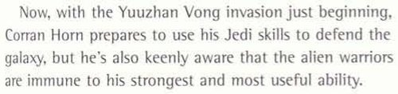
Our notes: `notes/materials/037-sw-d20-folder/049-the-new-jedi-order-sourcebook-scan-001-060.md:301`

> (As a result, Corran Horn can only use telekinetic Force abilities when he expends a Force Point to do so.)
— Source: Sourcebooks/The New Jedi Order Sourcebook.pdf [Star Wars Roleplaying Game; Corran Horn — entry/section: Corran Horn, Jedi Knight.
Note (our notes, around the quote): Corran Horn — entry/section: Corran Horn, Jedi Knight: "(As a result, Corran Horn can only use telekinetic Force abilities when he expends a Force Point to do so.)" Source: *The New Jedi Order Sourcebook* (SWRPG d20), scan p.52
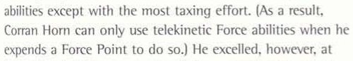
Our notes: `notes/materials/037-sw-d20-folder/049-the-new-jedi-order-sourcebook-scan-001-060.md:303`

## Sourcebooks/The New Jedi Order Sourcebook.pdf [Star Wars Roleplaying Game (d20, 2000)] (scan pages 61–120)

> Reluctantly, Corran Horn orders the bafforr tree grove commandos goes with them. , 5 zal ' ; ee : destroyed, along with the rest of the gardens, By accident, The situation on Garqi proves more grim than expected. eee ra ; ; ; : the reconnaissance mission has uncovered a fatal weak- The Yuuzhan Vong have implanted surge-coral to 5 ; : s ' ?
— Source: Sourcebooks/The New Jedi Order Sourcebook.pdf [Star Wars Roleplaying Game; Corran Horn. POV: Corran Horn.
Note (our notes, around the quote): Corran Horn: "Reluctantly, Corran Horn orders the bafforr tree grove commandos goes with them. , 5 zal ' ; ee : destroyed, along with the rest of the gardens, By accident, The situation on Garqi proves more grim than expected. eee ra ; ; ; : the reconnaissance mission has uncovered a fatal weak- The Yuuzhan Vong have implanted surge-coral to 5 ; : s ' ?" Source: *The New Jedi Order Sourcebook* (SWRPG d20), scan p.63
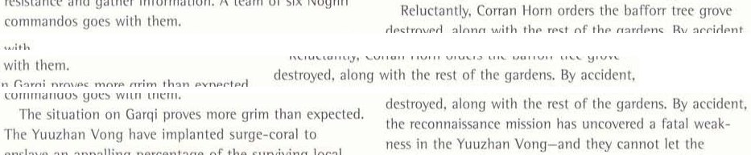
Our notes: `notes/materials/037-sw-d20-folder/049-the-new-jedi-order-sourcebook-scan-061-120.md:22`

> Though they suffer heavy casualties—including the Jedi Daeshara'cor, who is killed protecting Anakin Solo—the ground forces survive long enough for Corran Horn to find the Yuuzhan Vong communication center.
— Source: Sourcebooks/The New Jedi Order Sourcebook.pdf [Star Wars Roleplaying Game; Anakin Solo; Corran Horn.
Note (our notes, around the quote): Anakin Solo; Corran Horn: "Though they suffer heavy casualties—including the Jedi Daeshara'cor, who is killed protecting Anakin Solo—the ground forces survive long enough for Corran Horn to find the Yuuzhan Vong communication center." Source: *The New Jedi Order Sourcebook* (SWRPG d20), scan p.65
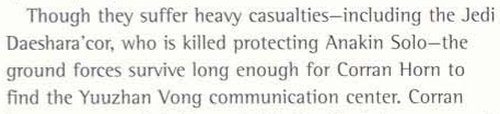
Our notes: `notes/materials/037-sw-d20-folder/049-the-new-jedi-order-sourcebook-scan-061-120.md:34`

> Corran Horn negotiates a temporary truce with Shedao Shai: a week's cease-fire, at the end of which Shedao Shai and Corran Horn would duel to the death.
— Source: Sourcebooks/The New Jedi Order Sourcebook.pdf [Star Wars Roleplaying Game; Corran Horn. POV: Corran Horn.
Note (our notes, around the quote): Corran Horn: "Corran Horn negotiates a temporary truce with Shedao Shai: a week's cease-fire, at the end of which Shedao Shai and Corran Horn would duel to the death." Source: *The New Jedi Order Sourcebook* (SWRPG d20), scan p.67
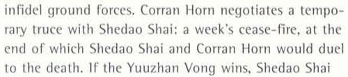
Our notes: `notes/materials/037-sw-d20-folder/049-the-new-jedi-order-sourcebook-scan-061-120.md:48`

> After Shedao Shai's death in his duel with the Jedi Knight Corran Horn, the Yuuzhan Vong warrior Deign Lian seizes command of Legacy of Torment, using it to deliver lethal bioweapons that destroy the jungles of Ithor.
— Source: Sourcebooks/The New Jedi Order Sourcebook.pdf [Star Wars Roleplaying Game; Corran Horn. POV: Corran Horn.
Note (our notes, around the quote): Corran Horn: "After Shedao Shai's death in his duel with the Jedi Knight Corran Horn, the Yuuzhan Vong warrior Deign Lian seizes command of Legacy of Torment, using it to deliver lethal bioweapons that destroy the jungles of Ithor." Source: *The New Jedi Order Sourcebook* (SWRPG d20), scan p.68
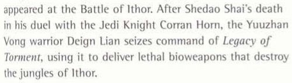
Our notes: `notes/materials/037-sw-d20-folder/049-the-new-jedi-order-sourcebook-scan-061-120.md:59`

> Meeting no resistance to his attack, Shedao Shai falls temporarily off balance—just long enough for Corran to press his lightsaber hilt to the Yuuzhan Vong’s abdomen and switch it on.
— Source: Sourcebooks/The New Jedi Order Sourcebook.pdf [Star Wars Roleplaying Game.
Note (our notes, around the quote): Corran Horn; Shedao Shai; Mara Jade Skywalker — entry/section: Duel, Betrayal, and Blame (The New Jedi Order Sourcebook, Ch3): "Meeting no resistance to his attack, Shedao Shai falls temporarily off balance—just long enough for Corran to press his lightsaber hilt to the Yuuzhan Vong’s abdomen and switch it on." Source: *The New Jedi Order Sourcebook* (SWRPG d20), scan p.69
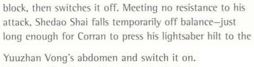
Our notes: `notes/materials/037-sw-d20-folder/049-the-new-jedi-order-sourcebook-scan-061-120.md:66`

> Though Corran Horn defeated Shedao Shai, the Jedi Master had, for a brief time, surrendered to the dark side.
— Source: Sourcebooks/The New Jedi Order Sourcebook.pdf [Star Wars Roleplaying Game.
Note (our notes, around the quote): Corran Horn; Shedao Shai — entry/section: Duel, Betrayal, and Blame (The New Jedi Order Sourcebook, Ch3): "Though Corran Horn defeated Shedao Shai, the Jedi Master had, for a brief time, surrendered to the dark side." Source: *The New Jedi Order Sourcebook* (SWRPG d20), scan p.69
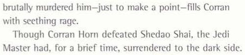
Our notes: `notes/materials/037-sw-d20-folder/049-the-new-jedi-order-sourcebook-scan-061-120.md:68`

> Soon, Horn is vilified as the most recent in a line of “world-killing Jedi” that includes Darth Vader and Kyp Durron.
— Source: Sourcebooks/The New Jedi Order Sourcebook.pdf [Star Wars Roleplaying Game.
Note (our notes, around the quote): Corran Horn; Darth Vader (Anakin Skywalker); Kyp Durron — entry/section: Duel, Betrayal, and Blame (The New Jedi Order Sourcebook, Ch3): "Soon, Horn is vilified as the most recent in a line of “world-killing Jedi” that includes Darth Vader and Kyp Durron." Source: *The New Jedi Order Sourcebook* (SWRPG d20), scan p.69
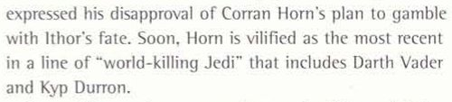
Our notes: `notes/materials/037-sw-d20-folder/049-the-new-jedi-order-sourcebook-scan-061-120.md:70`

> Duel, Betrayal, and Blame The Battle of Ithor ends when Corran Horn and Mara Jade Skywalker locate the Yuuzhan Vong command post and contact Shedao Shai, the Yuuzhan Vong commander.
— Source: Sourcebooks/The New Jedi Order Sourcebook.pdf [Star Wars Roleplaying Game; Corran Horn; Mara Jade Skywalker.
Note (our notes, around the quote): Corran Horn; Mara Jade Skywalker: "Duel, Betrayal, and Blame The Battle of Ithor ends when Corran Horn and Mara Jade Skywalker locate the Yuuzhan Vong command post and contact Shedao Shai, the Yuuzhan Vong commander." Source: *The New Jedi Order Sourcebook* (SWRPG d20), scan p.69
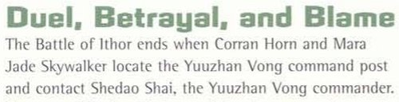
Our notes: `notes/materials/037-sw-d20-folder/049-the-new-jedi-order-sourcebook-scan-061-120.md:72`

> Corran and Shedao Shai agreed to a temporary truce—at the end of which, the two engage in a duel to decide Ithor's fate.
— Source: Sourcebooks/The New Jedi Order Sourcebook.pdf [Star Wars Roleplaying Game; Corran Horn. POV: Corran Horn.
Note (our notes, around the quote): Corran Horn: "Corran and Shedao Shai agreed to a temporary truce—at the end of which, the two engage in a duel to decide Ithor's fate." Source: *The New Jedi Order Sourcebook* (SWRPG d20), scan p.69
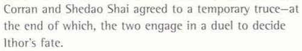
Our notes: `notes/materials/037-sw-d20-folder/049-the-new-jedi-order-sourcebook-scan-061-120.md:74`

> The duel takes place a week later, with Luke Skywalker as Corran Horn's witness, and Deign Lian as Shedao Shai's.
— Source: Sourcebooks/The New Jedi Order Sourcebook.pdf [Star Wars Roleplaying Game; Luke Skywalker; Corran Horn.
Note (our notes, around the quote): Luke Skywalker; Corran Horn: "The duel takes place a week later, with Luke Skywalker as Corran Horn's witness, and Deign Lian as Shedao Shai's." Source: *The New Jedi Order Sourcebook* (SWRPG d20), scan p.69
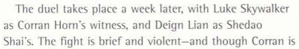
Our notes: `notes/materials/037-sw-d20-folder/049-the-new-jedi-order-sourcebook-scan-061-120.md:76`

> Corran Horn, destroyer of Ithor,
> [fragment — full passage not on file]
— Source: Sourcebooks/The New Jedi Order Sourcebook.pdf [Star Wars Roleplaying Game; Corran Horn: "To help disassociate the public image of. POV: Corran Horn.
Note (our notes, around the quote): Corran Horn: "To help disassociate the public image of "Corran Horn, destroyer of Ithor," from the rest of the Jedi, Corran exiles himself from the Jedi to seek his own peace." Source: *The New Jedi Order Sourcebook* (SWRPG d20), scan p.69
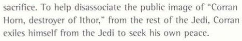
Our notes: `notes/materials/037-sw-d20-folder/049-the-new-jedi-order-sourcebook-scan-061-120.md:78`

> Though he has convinced himself that the duel with Shedao Shai was over the fate of Ithor, what Corran had really wanted was revenge—revenge for the gentle Caamasi senator Elegos A'Kla, one of Corran's dearest friends.
— Source: Sourcebooks/The New Jedi Order Sourcebook.pdf [Star Wars Roleplaying Game; Corran Horn. POV: Corran Horn.
Note (our notes, around the quote): Corran Horn: "Though he has convinced himself that the duel with Shedao Shai was over the fate of Ithor, what Corran had really wanted was revenge—revenge for the gentle Caamasi senator Elegos A'Kla, one of Corran's dearest friends." Source: *The New Jedi Order Sourcebook* (SWRPG d20), scan p.69
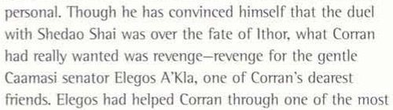
Our notes: `notes/materials/037-sw-d20-folder/049-the-new-jedi-order-sourcebook-scan-061-120.md:80`

> Booster reveals even more surprises: Not only does he transport his son-in-law, the expatriate Jedi Corran Horn, but, somehow Booster has picked up most of the Array's crew and Shada D'ukal, who got to an escape pod before Idiot's Array exploded.
— Source: Sourcebooks/The New Jedi Order Sourcebook.pdf [Star Wars Roleplaying Game; Corran Horn. POV: Corran Horn.
Note (our notes, around the quote): Corran Horn: "Booster reveals even more surprises: Not only does he transport his son-in-law, the expatriate Jedi Corran Horn, but, somehow Booster has picked up most of the Array's crew and Shada D'ukal, who got to an escape pod before Idiot's Array exploded." Source: *The New Jedi Order Sourcebook* (SWRPG d20), scan p.117
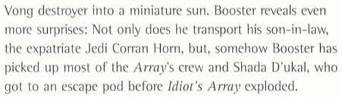
Our notes: `notes/materials/037-sw-d20-folder/049-the-new-jedi-order-sourcebook-scan-061-120.md:364`

## Sourcebooks/The New Jedi Order Sourcebook.pdf [Star Wars Roleplaying Game (d20, 2000)] (scan pages 121–162)

> Fortunately, Corran Horn, working from Errant Venture, concludes that taking the galaxy's only blood-red Star Destroyer into an inhabited system to pick up supplies is not the best way to keep its location a secret.
— Source: Sourcebooks/The New Jedi Order Sourcebook.pdf [Star Wars Roleplaying Game; Corran Horn. POV: Corran Horn.
Note (our notes, around the quote): Corran Horn: "Fortunately, Corran Horn, working from Errant Venture, concludes that taking the galaxy's only blood-red Star Destroyer into an inhabited system to pick up supplies is not the best way to keep its location a secret." Source: *The New Jedi Order Sourcebook* (SWRPG d20), scan p.123
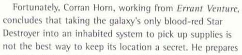
Our notes: `notes/materials/037-sw-d20-folder/049-the-new-jedi-order-sourcebook-scan-121-162.md:26`

- Note (summary from our notes, not a quotation): Page contents: Anakin Solo vs Executor (Nom Anor turns down the duel, p.127); Corran's lightsaber cuts the ship hull; p.123 Jacen offers to duel Tsavong Lah. p.112-116 Anakin alone on Yavin 4 with grenade fungi and the Force; repairs lightsaber with lambent crystal. (hand-read)
  — Source: Sourcebooks/The New Jedi Order Sourcebook.pdf [Star Wars Roleplaying Game.
Our notes: `notes/materials/037-sw-d20-folder/049-the-new-jedi-order-sourcebook-scan-121-162.md:41`

## Star Wars Gamer/Star Wars Gamer 09.pdf [Star Wars Roleplaying Game (d20, 2000)] (scan pages 1–60)

- Note (summary from our notes, not a quotation): Page contents: Squadron campaigns: Plourr Ilo, Rogue Squadron's 'warrior princess'; class roles (scoundrel supply officers, scout recon, soldier aces, Jedi pilots in the tradition of Luke, Corran Horn, Kyp Durron and Jaina Solo); GMs may grant 1–4 free Pilot points; Colonel Alask Vrei, a former Twi'lek baron ruined in a clan power struggle, who calls his crew his 'subjects' and commands 'harsh but fair' (hand-read)
  — Source: Star Wars Gamer/Star Wars Gamer 09.pdf [Star Wars Roleplaying Game (d20,.
Our notes: `notes/materials/037-sw-d20-folder/058-star-wars-gamer-09-scan-001-060.md:241`

> Force adepts and Jedi guardians can uti lize thelr uncanny abilities with The Force to make them formidable fighter pilots unmatched by most normal beings. in the tradition of Jedi pilots like Luke Skywalker Corran Horn, Kyp Durron, and Jaina Solo, adepts and guardians can take on piloting skills, but only as an addendum to their Force abilities.
— Source: Star Wars Gamer/Star Wars Gamer 09.pdf [Star Wars Roleplaying Game (d20,; Luke Skywalker; Corran Horn; Kyp Durron; Jaina Solo.
Note (our notes, around the quote): Luke Skywalker; Corran Horn; Kyp Durron; Jaina Solo: "Force adepts and Jedi guardians can uti lize thelr uncanny abilities with The Force to make them formidable fighter pilots unmatched by most normal beings. in the tradition of Jedi pilots like Luke Skywalker Corran Horn, Kyp Durron, and Jaina Solo, adepts and guardians can take on piloting skills, but only as an addendum to their Force abilities." Source: *Star Wars Gamer 09* (SWRPG d20), scan p.37
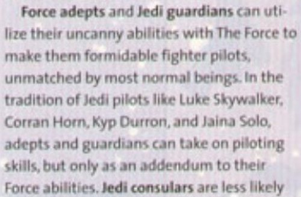
Our notes: `notes/materials/037-sw-d20-folder/058-star-wars-gamer-09-scan-001-060.md:243`

## Sourcebooks/Galactic Campaign Guide.pdf [Star Wars Roleplaying Game Revised Core (d20, 2002)] (scan pages 121–162)

- Note (summary from our notes, not a quotation): Page contents: Option: Heroic Qualities (Anakin's Force strength; Anakin Solo machine affinity; Corran Horn mind tricks; Luke's secret extra Force die); Assigning Heroic Qualities (hand-read)
  — Source: Sourcebooks/Galactic Campaign Guide.pdf [Star Wars Roleplaying Game Revis.
Our notes: `notes/materials/037-sw-d20-folder/666-galactic-campaign-guide-scan-121-162.md:119`

- Note (summary from our notes, not a quotation): Page contents: Corran Horn (The Legacy); Anakin Solo (The Specialty); The Extraordinary Talent (hand-read)
  — Source: Sourcebooks/Galactic Campaign Guide.pdf [Star Wars Roleplaying Game Revis.
Our notes: `notes/materials/037-sw-d20-folder/666-galactic-campaign-guide-scan-121-162.md:148`

> Bonuses: Corran’s maximum ranks with Affect Mind or Illusion are calculated from his character level, not his Force-user level.
— Source: Sourcebooks/Galactic Campaign Guide.pdf [Star Wars Roleplaying Game Revis; Corran Horn — entry/section: Corran Horn (The Legacy) bonus.
Note (our notes, around the quote): Corran Horn — entry/section: Corran Horn (The Legacy) bonus: "Bonuses: Corran’s maximum ranks with Affect Mind or Illusion are calculated from his character level, not his Force-user level." Source: *Galactic Campaign Guide* (SWRPG d20 Revised Core), scan p.145
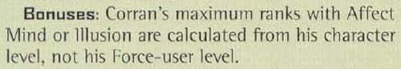
Our notes: `notes/materials/037-sw-d20-folder/666-galactic-campaign-guide-scan-121-162.md:150`

> Manifestations: When Corran attempts to use telekinetic Force powers, he instead taps into his innate talent for mind tricks.
— Source: Sourcebooks/Galactic Campaign Guide.pdf [Star Wars Roleplaying Game Revis; Corran Horn — entry/section: Corran Horn (The "Legacy").
Note (our notes, around the quote): Corran Horn — entry/section: Corran Horn (The "Legacy"): "Manifestations: When Corran attempts to use telekinetic Force powers, he instead taps into his innate talent for mind tricks." Source: *Galactic Campaign Guide* (SWRPG d20 Revised Core), scan p.145
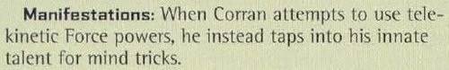
Our notes: `notes/materials/037-sw-d20-folder/666-galactic-campaign-guide-scan-121-162.md:164`

> Drawbacks: Corran may not purchase ranks in any telekinetic Force skill, such as Move Object or Force Strike.
— Source: Sourcebooks/Galactic Campaign Guide.pdf [Star Wars Roleplaying Game Revis; Corran Horn — entry/section: Corran Horn (The "Legacy").
Note (our notes, around the quote): Corran Horn — entry/section: Corran Horn (The "Legacy"): "Drawbacks: Corran may not purchase ranks in any telekinetic Force skill, such as Move Object or Force Strike." Source: *Galactic Campaign Guide* (SWRPG d20 Revised Core), scan p.145
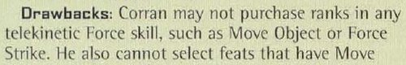
Our notes: `notes/materials/037-sw-d20-folder/666-galactic-campaign-guide-scan-121-162.md:166`

> For Corran to use telekinetic Force skills at all, he must first spend a Force Point.
— Source: Sourcebooks/Galactic Campaign Guide.pdf [Star Wars Roleplaying Game Revis; Corran Horn — entry/section: Corran Horn (The "Legacy").
Note (our notes, around the quote): Corran Horn — entry/section: Corran Horn (The "Legacy"): "For Corran to use telekinetic Force skills at all, he must first spend a Force Point." Source: *Galactic Campaign Guide* (SWRPG d20 Revised Core), scan p.145
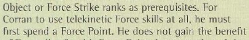
Our notes: `notes/materials/037-sw-d20-folder/666-galactic-campaign-guide-scan-121-162.md:168`

> Note that the text is worded in such a way that those skills are only examples: if more telekinetic Force skills become available later in the campaign, Corran won't be able to take them, either.
— Source: Sourcebooks/Galactic Campaign Guide.pdf [Star Wars Roleplaying Game Revis; Corran Horn — entry/section: Corran Horn (The "Legacy").
Note (our notes, around the quote): Corran Horn — entry/section: Corran Horn (The "Legacy"): "Note that the text is worded in such a way that those skills are only examples: if more telekinetic Force skills become available later in the campaign, Corran won't be able to take them, either." Source: *Galactic Campaign Guide* (SWRPG d20 Revised Core), scan p.145
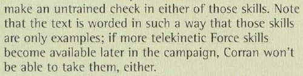
Our notes: `notes/materials/037-sw-d20-folder/666-galactic-campaign-guide-scan-121-162.md:170`

## Sourcebooks/Hero's Guide.pdf [Star Wars Roleplaying Game Revised Core (d20, 2002)] (scan pages 61–120)

- Note (summary from our notes, not a quotation): Page contents: CorSec Joining cont.; Leaving (Corran Horn went undercover); Criminal Investigation feat; CorSec Officer prestige class and Table 5-6. (hand-read)
  — Source: Sourcebooks/Hero's Guide.pdf [Star Wars Roleplaying Game Revised Core (d2.
Our notes: `notes/materials/037-sw-d20-folder/668-heros-guide-scan-061-120.md:163`

## Sourcebooks/Revised Core Rulebook.pdf [Star Wars Roleplaying Game Revised Core (d20, 2002)] (scan pages 121–180)

> In The New Jedi Order era, Luke Skywalker has trained about one hundred Jedi and identified perhaps a dozen others to start training. Prominent Force-users such as Mara Jade Skywalker and Corran Horn help Skywalker train and coordinate the efforts of these Jedi, while promising students such as the Solo children and Ganner Rhysode show great promise for the future,
> [fragment — full passage not on file]
— Source: Sourcebooks/Revised Core Rulebook.pdf [Star Wars Roleplaying Game Revised.
Note (our notes, around the quote): Luke Skywalker; Mara Jade Skywalker; Corran Horn; Ganner Rhysode; Jaina Solo; Jacen Solo (Darth Caedus); Anakin Solo — entry/section: The Jedi — New Jedi Order era (Revised Core Rulebook, Ch9): "In The New Jedi Order era, Luke Skywalker has trained about one hundred Jedi and identified perhaps a dozen others to start training. Prominent Force-users such as Mara Jade Skywalker and Corran Horn help Skywalker train and coordinate the efforts of these Jedi, while promising students such as the Solo children and Ganner Rhysode show great promise for the future," Source: *Revised Core Rulebook* (SWRPG d20 Revised Core), scan p.178

Our notes: `notes/materials/037-sw-d20-folder/671-revised-core-rulebook-scan-121-180.md:301`

## Sourcebooks/Scum and Villany.pdf [Star Wars Roleplaying Game Saga Edition (2007)] (scan pages 61–120)

- Note (summary from our notes, not a quotation): Page contents: Table 3-6 Bounties (d20 wanted-for/description/reward; roll 20 = treason, sedition: NPC such as Han Solo, Talon Karrde, Corran Horn, reward Special). Gather Information to locate target; example Lesk Hisshar hunting a Duros on Nar Shaddaa (Palace Casino). Survival tracking; DC 25 Use Computer to analyze Cronau radiation signature. Capturing Targets. (hand-read)
  — Source: Sourcebooks/Scum and Villany.pdf [Star Wars Roleplaying Game Saga Edition.
Our notes: `notes/materials/037-sw-d20-folder/725-scum-and-villany-scan-061-120.md:153`

- Note (summary from our notes, not a quotation): Page contents: Booster Terrik cont. (Pulsar Skate; Antilles family, Wedge; Z-95; 5 years on Kessel; released after Hoth; fought Ysanne Isard; Yag'Dhul Station; Hutts and Talon Karrde; Star Destroyer Virulence renamed Errant Venture; Corran Horn, Rogue Squadron). Stat block CL 12 (Medium Human scoundrel 5/soldier 5/crime lord 2). Boushh begins (Ubese bounty hunter impersonated by Leia Organa at Jabba's Palace). (hand-read)
  — Source: Sourcebooks/Scum and Villany.pdf [Star Wars Roleplaying Game Saga Edition.
Our notes: `notes/materials/037-sw-d20-folder/725-scum-and-villany-scan-061-120.md:279`

## Sourcebooks/Scum and Villany.pdf [Star Wars Roleplaying Game Saga Edition (2007)] (scan pages 121–180)

- Note (summary from our notes, not a quotation): Page contents: Y164 Slave Transport (stat block CL 13, Colossal (frigate) space transport; 12,400 slaves). LOCALES intro. The Errant Venture (ex-Virulence, Imperial II-class Star Destroyer; Battle of Endor, Battle of Thyferra; Booster Terrik; painted red; Talon Karrde; Thrawn's "return"; Yuuzhan Vong; Second Corellian Insurrection; Jedi Academy; son-in-law Corran Horn). (hand-read)
  — Source: Sourcebooks/Scum and Villany.pdf [Star Wars Roleplaying Game Saga Edition.
Our notes: `notes/materials/037-sw-d20-folder/725-scum-and-villany-scan-121-180.md:56`

## Sourcebooks/The Force Unleashed Campaign Guide.pdf [Star Wars Roleplaying Game Saga Edition (2007)] (scan pages 1–60)

- Note (summary from our notes, not a quotation): Page contents: Examples of enforcers (CSA Security, Corran Horn, CorSec agents, Sector Rangers, ISB, COMPNOR). Requirements; game rules; Defense bonuses; Resources; Talents; Enforcement talent tree (Cover Bracing, Intentional Crash, Nonlethal Tactics, Pursuit, Respected Officer, Slowing Stun, Takedown); Targeted Suspect. (hand-read)
  — Source: Sourcebooks/The Force Unleashed Campaign Guide.pdf [Star Wars Roleplaying.
Our notes: `notes/materials/037-sw-d20-folder/729-the-force-unleashed-campaign-guide-scan-001-060.md:294`

## Sourcebooks/Threats of the Galaxy.pdf [Star Wars Roleplaying Game Saga Edition (2007)] (scan pages 61–120)

> You’re good, Corran, but you’re no Luke Skywalker. Corran Horn’s cheeks still burned at the memory of Commander Antilles’s evaluation of his last simulator exercise. The line had been a simple comment, not meant to be cruel nor delivered that way, but it cut deep into Corran. I’ve never tried to suggest I’m that good of a pilot.
— Source: Sourcebooks/Threats of the Galaxy.pdf [Star Wars Roleplaying Game Saga Ed; Wedge Antilles; Corran Horn; Luke Skywalker — entry/section: Pull quote.
(Excerpt widened 2026-11-17 to the relevant passage, word for word from Luke Skywalker and the Shadows of Mindor (Matthew Stover), Chapter 1 (text copy `MEGA_Legend_Standalones_Star_Wars_Luke_Skywalker_and_the_Shadows_of_Mindor_Matthew_Stover_epub`).)
Note (our notes, around the quote): Wedge Antilles; Corran Horn; Luke Skywalker — entry/section: Pull quote: ""You're good, Corran, but you're no Luke Skywalker." —Wedge Antilles" Source: *Threats of the Galaxy* (SWRPG Saga Edition), scan p.65

Our notes: `notes/materials/037-sw-d20-folder/731-threats-of-the-galaxy-scan-061-120.md:34`

## Star Wars Insider #47 (1999)

- Note (summary from our notes, not a quotation): Page contents: Union: Imperial remnants plan to spoil the wedding; cast incl. Karrde, Wedge, Booster, Mirax, Corran Horn; Stackpole quotes. Publishing commentary. (hand-read)
  — Source: Star Wars Insider #47 (1999).
Our notes: `notes/materials/038-star-wars-insider/047-ins047.md:395`

## Star Wars Insider #57 (2001)

- Note (summary from our notes, not a quotation): Page contents: Who's Who, Jedi Knights (magazine p. 56): Tam Azur-Jamin, Eryl Besa (died), Cheklev, Daeshara'cor (died), Dorsk 82 (died), Jovan Drark (died), Eelysa (died), Keyan Farlander (Jedi piloting instructor, the Y-wing pilot fleeing the Death Star), Swilja Fenn (died), Corran Horn, Seyyerin Itoklo (died). Line portraits. (hand-read)
  — Source: Star Wars Insider #57 (2001).
Our notes: `notes/materials/038-star-wars-insider/057-ins057.md:333`

> Corran's defeat of the warriors earned him the enmity of enemy commander Shedao Shai. The two eventually squared off in a one-on-one duel for the planet Ithor. Though Corran won, the Yuuzhan Vong destroyed Ithor anyway.
— Source: Star Wars Insider #57 (2001); Corran Horn; Shedao Shai — entry/section: Corran Horn.
Note (our notes, around the quote): Corran Horn; Shedao Shai — entry/section: Corran Horn: "Corran's defeat of the warriors earned him the enmity of enemy commander Shedao Shai. The two eventually squared off in a one-on-one duel for the planet Ithor. Though Corran won, the Yuuzhan Vong destroyed Ithor anyway." Source: *Star Wars Insider #57* (2001), scan p.46
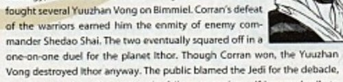
Our notes: `notes/materials/038-star-wars-insider/057-ins057.md:335`

## Star Wars Insider #58 (2002)

> The droid names used in the movies are merely fragments of much longer serial numbers. This makes sense when you think about it, since the number of letter-number combinations in droid naming conventions is pretty limiting. That's why you can have an Episode I-R5 unit named G8-R3 (he's on the Queen's starship). His name might have really been something like R5-X41238-G8-R3-3124-D2, and the middle portion is just what he is called. —Pablo Hidalgo, Star Wars Insider 58, p. 97
> [fragment — full passage not on file]
— Source: Star Wars Insider #58 (2002).
Note (our notes, around the quote): R2-D2; Corran Horn — entry/section: Pablo Hidalgo on droid names: "The droid names used in the movies are merely fragments of much longer serial numbers. This makes sense when you think about it, since the number of letter-number combinations in droid naming conventions is pretty limiting. That's why you can have an Episode I-R5 unit named G8-R3 (he's on the Queen's starship). His name might have really been something like R5-X41238-G8-R3-3124-D2, and the middle portion is just what he is called. —Pablo Hidalgo, Star Wars Insider 58, p. 97" Source: *Star Wars Insider #58* (2002), scan p.76
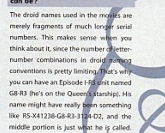
Our notes: `notes/materials/038-star-wars-insider/058-ins058.md:489`

## Star Wars Insider #59 (2002)

- Note (summary from our notes, not a quotation): Page contents: Who's Who cont. (magazine p. 57), "Rogue Squadron: The Later Years" with line portraits: Pash Cracken, Gavin Darklighter, Corran Horn, Bror Jace (Thyferran, staged his own death), Erisi Dlarit (Thyferran Imperial mole, shot down by Corran at Thyferra), Aril Nunb, Ooryl Qrygg (Gand, "name reduction," declared janwuine), Inyri Forge (sister of Lujayne Forge, shot Zekka Thyne), Asyr Sei'lar (Bothan, resisted Borsk Fey'lya). (hand-read)
  — Source: Star Wars Insider #59 (2002).
Our notes: `notes/materials/038-star-wars-insider/059-ins059.md:413`

> He married the smuggler Mirax Terrik, daughter of the legendary Corellian smuggler Booster Terrik—who had been sent to Kessel by Corran's father.
— Source: Star Wars Insider #59 (2002); Corran Horn — entry/section: Corran Horn.
Note (our notes, around the quote): Corran Horn — entry/section: Corran Horn: "He married the smuggler Mirax Terrik, daughter of the legendary Corellian smuggler Booster Terrik—who had been sent to Kessel by Corran's father." Source: *Star Wars Insider #59* (2002), scan p.57
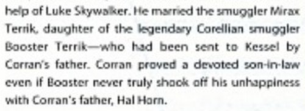
Our notes: `notes/materials/038-star-wars-insider/059-ins059.md:415`

## Star Wars Insider #61 (2002)

- Note (summary from our notes, not a quotation): Page contents: Power of the Jedi review cont.: five new prestige classes (Force warrior, Jedi healer, instructor, scholar, weapon master); gamemastering chapter; Jedi Traditions chapter with 50+ Jedi heroes; equipment (Corran Horn's dual-phase lightsaber, Whitecloak fighter, Qel-Droma's Nebulon Ranger); Where the Force Is Strong locations (Ambria, Ruusan, Pelgrim, Nam Chorios). "Show & Tell" sidebar of sourcebook excerpts: Jedi Weapon Master, Miraluka, Kieran Halcyon, Force Training Aids. Art by Dan Brereton and Jeff Carlisle. (hand-read)
  — Source: Star Wars Insider #61 (2002).
Our notes: `notes/materials/038-star-wars-insider/061-ins061.md:490`

## Star Wars Insider #71 (2003)

- Note (summary from our notes, not a quotation): Page contents: Greg Keyes profile opens: his Chosen of the Changeling, Age of Unreason and Kingdoms of Thorn and Bone series; The Final Prophecy (Nen Yim, Harrar, Yu'shaa with Corran Horn and Tahiri seeking Zonama Sekot; Wedge at Bilbringi; Yu'shaa really Nom Anor). (hand-read)
  — Source: Star Wars Insider #71 (2003).
Our notes: `notes/materials/038-star-wars-insider/071-ins071.md:338`

## Star Wars Insider #74 (2004)

- Note (summary from our notes, not a quotation): Page contents: NJO synopses: Dark Tide II: Ruin (Elegos A'Kla dies as emissary; Corran Horn duels Shedao Shai over Ithor; Jagged Fel and Tsavong Lah introduced); the author's five favourite books (Vector Prime, Hero's Trial, Star by Star, Traitor, The Unifying Force); Agents of Chaos I: Hero's Trial (a grieving Han, Droma, Vergere introduced). (hand-read)
  — Source: Star Wars Insider #74 (2004).
Our notes: `notes/materials/038-star-wars-insider/074-ins074.md:138`

> Corran Horn and the invaders’ warmaster, Shedac Shai, duel, with the fate of the planet Ithor in the balance.
— Source: Star Wars Insider #74 (2004); Corran Horn — entry/section: Star Wars Insider 074 (2004).
Note (our notes, around the quote): Corran Horn — entry/section: Star Wars Insider 074 (2004): "Corran Horn and the invaders’ warmaster, Shedac Shai, duel, with the fate of the planet Ithor in the balance." Source: *Star Wars Insider #74* (2004), scan p.23
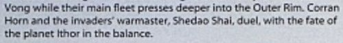
Our notes: `notes/materials/038-star-wars-insider/074-ins074.md:140`

> Horn then kills Shedao Shai in a duel
> [fragment — full passage not on file]
— Source: Star Wars Insider #74 (2004).
Note (our notes, around the quote): Corran Horn; Shedao Shai — entry/section: Star Wars Insider 074 (2004): "Horn then kills Shedao Shai in a duel" Source: *Star Wars Insider #74* (2004), scan p.27
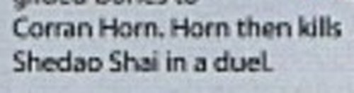
Our notes: `notes/materials/038-star-wars-insider/074-ins074.md:174`

- Note (summary from our notes, not a quotation): Page contents: NJO: Force Heretic II: Refugee (Bakura, the Ssi-Ruuk) and III: Reunion (Zonama Sekot rediscovered) synopses; great showdowns: Chewie vs. Dobido, Luke wading into a Vong camp in Onslaught, Corran Horn vs. Shedao Shai, the Falcon vs. Tsavong Lah's Sunulok, Fey'lya's fusillade, Anakin's sacrifice, Jacen in arms, Ganner's last stand, the endgame at Ebaq 9. (hand-read)
  — Source: Star Wars Insider #74 (2004).
Our notes: `notes/materials/038-star-wars-insider/074-ins074.md:200`

## Star Wars Insider #135 (2012)

- Note (summary from our notes, not a quotation): Page contents: History of the X-Wing series: Stackpole's comics and novels (Ysanne Isard, Corran Horn); Allston's Wraith Squadron; Face led an infiltration of captured Coruscant with Luke during the Vong war; Mercy Kill out August 7, 2012. (hand-read)
  — Source: Star Wars Insider #135 (2012).
Our notes: `notes/materials/038-star-wars-insider/135-ins135.md:174`

## Legacy of the Force, own full read (Betrayal, Revelation, Invincible)

> “How do you do it?” Luke asked. One of Corran’s few weaknesses as a Jedi was his lack of ability with telekinetic disciplines; Corran couldn’t, under most circumstances, operate the crossbar and pull-weight machinery.
— Source: Legacy of the Force 1: Betrayal (Aaron Allston, 2006) — own full read; | S5 | c22 ¶61 | Narration |.
(Excerpt widened 2026-11-17 to the relevant passage, word for word from Betrayal (Aaron Allston), Chapter Twenty-Two (text copy `MEGA_Legend_The_Legacy_of_the_Force_Series_Star_Wars_Legacy_of_the_Force_01_Betrayal_Aaron_Allston_epub`).)
(Full sentence/passage taken from the source text on file: `lotf_tmp_b1_epub`.)
Label in our notes: | High |
Context: | # | Ref | Speaker | Statement | Reliability |
Our notes: `notes/materials/040-lotf-own-read/lotf-1-betrayal.md:54`

- Note (summary from our notes, not a quotation): Jaina > Kolir on TK speed (F5). Corran TK < most Jedi (S5).
  — Source: Legacy of the Force 1: Betrayal (Aaron Allston, 2006) — own full read.
Our notes: `notes/materials/040-lotf-own-read/lotf-1-betrayal.md:97`

## The Thrawn Trilogy (Timothy Zahn): Heir to the Empire, Dark Force Rising, The Last Command, plus the Heir 20th Anniversary extras

What it shows (our notes): *X-Wing: Rogue Squadron* (Stackpole), ch. 1: Corran's simulator run. Shield stat: an X-wing aft shield "demisphere approximately twenty meters behind"; a TIE bomber impact against it is "roughly equivalent to a vehicle hitting a ferrocrete wall at sixty kilometers per hour".
> The deflector shield materialized as a demisphere approximately twenty meters behind the X-wing. Designed to dissipate both energy and kinetic weapons, it had no trouble protecting the fighter from the bomber’s twin laser blasts. Had the bomber used missiles, the shields could even have handled all the damage they could do, though that would have been enough to destroy the shields themselves.
>
> The same could not be said of the unshielded bomber. The impact with the shield was roughly equivalent to a vehicle hitting a ferrocrete wall at sixty kilometers per hour. While that might not do a land vehicle much damage, land vehicles are decidedly less delicate than starfighters. The starboard wing crumpled inward, wrapping itself around the bomber’s cockpit. Both pods of the ship twisted out of alignment so the engines shot it off into an uncontrolled tumble through the simulator’s dataspace.
— Source: Heir to the Empire — notes part 11: Back matter (Del Rey Legends edition, lines 4023–5560).
(Excerpt widened 2026-11-17 to the relevant passage, word for word from The Empire Strikes Back (Donald F. Glut) (text copy `MEGA_Legend_The_Episode_Novelizations_Star_Wars_Episode_V_The_Empire_Strikes_Back_Donald_F_Glut_epub`).)
(Full sentence/passage taken from the source text on file: `cw_novels_tmp_cestus_deception_epub`.)
(Fragment completed 2026-11-17: full sentence/passage matched word for word in the source text on file: `MEGA_Legend_The_Episode_Novelizations_Star_Wars_Episode_V_The_Empire_Strikes_Back_Donald_F_Glut_epub`.)
Our notes: `notes/materials/044-thrawn-trilogy/heir-11.md:24`

## The Dark Nest Trilogy (Troy Denning, Del Rey 2005): FULL consecutive re-read (2026-11-16 CST)

What it shows (our notes): The Jedi are overstretched
> the newest Jedi Masters
> [fragment — full passage not on file]
>
> No one rushed to answer. The Jedi were spread too thin already, with most Jedi Knights—and even some apprentices—already assigned three tasks. And as the ranks of the greedy and the selfish grew ever more adept at manipulating the Galactic Alliance Senate, the situation seemed increasingly desperate.
— Source: Dark Nest I: The Joiner King (Troy Denning, Del Rey 2005): notes part 1; The council meets: Corran, Mara, Kyp, Saba (one of.
(Excerpt widened 2026-11-17 to the relevant passage, word for word from The Joiner King (Troy Denning) (text copy `MEGA_Legend_The_Dark_Nest_Trilogy_Star_Wars_Dark_Nest_01_The_Joiner_King_Troy_Denning_epub`).)
(Full sentence/passage taken from the source text on file: `dn_tmp_jk_epub`.)
Our notes: `notes/materials/051-dark-nest-trilogy/jk-01.md:21`

> “Perhaps,” Tekli said. “But our mistakes shouldn’t condemn the Qoribu nests.”
>
> “And they shouldn’t commit the Jedi to any action the Masters haven’t authorized.” Corran turned away from the trio and addressed the other Masters. “Our first concern must be the stability of the Galactic Alliance.”
>
> “No.” Kyp Durron surprised everyone by stepping to Tahiri’s side. “The Jedi are no one’s mercenaries—not even the Galactic Alliance’s. Our first concern, our only concern, is our own conscience. We must follow it wherever it leads.”
— Source: Dark Nest I: The Joiner King: notes part 3 (ch. 18 onward); The council splits. Corran. POV: The council splits. Corran.
(Excerpt widened 2026-11-17 to the relevant passage, word for word from The Joiner King (Troy Denning) (text copy `MEGA_Legend_The_Dark_Nest_Trilogy_Star_Wars_Dark_Nest_01_The_Joiner_King_Troy_Denning_epub`).)
(Excerpt widened 2026-11-17 to the relevant passage, word for word from The Joiner King (Troy Denning) (text copy `MEGA_Legend_The_Dark_Nest_Trilogy_Star_Wars_Dark_Nest_01_The_Joiner_King_Troy_Denning_epub`).)
(Full sentence/passage taken from the source text on file: `dn_tmp_jk_epub`.)
Label in our notes: Kyp
Our notes: `notes/materials/051-dark-nest-trilogy/jk-03.md:28`

What it shows (our notes): The council splits: Corran and Kenth for the Galactic Alliance, Kyp and Mara for conscience. Omas: "Then let the rest of the galaxy pay your bills". He threatens to "slash the Jedi budget". Kyp: "Are we mercenaries, or are we Jedi?" Omas: "a quaint morality no one else understands."
> “Even if it means war in another part of the galaxy?” Mara retorted. “Because Jacen’s right about this. The Force extends beyond the Galactic Alliance—and so does our responsibility.”
>
> “Then let the rest of the galaxy pay your bills,” Omas snapped. “Until that happens, I expect the Jedi to put Galactic Alliance interests first.”
>
> slash the Jedi budget
> [fragment — full passage not on file]
>
> Kyp planted his elbows on a wedge of black tabletop and ran his gaze around the circle of Masters. “Well, at least the question is out in the open now. Are we mercenaries, or are we Jedi?”
>
> “Master Skywalker, I quite simply do not care,” he said. “The Chiss’s trouble with the Colony is no concern of ours. We can’t put Galactic Alliance lives at risk just because a few Jedi feel bound by a quaint morality no one else understands.”
— Source: Dark Nest I: The Joiner King: notes part 4 (end of ch. 29 onward).
(Excerpt widened 2026-11-17 to the relevant passage, word for word from The Joiner King (Troy Denning) (text copy `MEGA_Legend_The_Dark_Nest_Trilogy_Star_Wars_Dark_Nest_01_The_Joiner_King_Troy_Denning_epub`).)
(Full sentence/passage taken from the source text on file: `dn_tmp_jk_epub`.)
Our notes: `notes/materials/051-dark-nest-trilogy/jk-04.md:17`

> “Actually, that’s what I do want,” Luke said. “Our problem now is that everybody puts the order last. Corran thinks we exist to serve the Alliance, and Kyp is convinced we should follow nothing but our own consciences. Meanwhile, Jaina and her team believe our first duty is to protect the weak from aggression.”
— Source: Dark Nest III: *The Swarm War* (Troy Denning, 2006), notes part 1: front matter, prologue, ch. 1–; Luke's diagnosis. POV: Luke's diagnosis, about Corran Horn.
(Excerpt widened 2026-11-17 to the relevant passage, word for word from The Swarm War (Troy Denning) (text copy `MEGA_Legend_The_Dark_Nest_Trilogy_Star_Wars_Dark_Nest_03_The_Swarm_War_Troy_Denning_epub`).)
(Full sentence/passage taken from the source text on file: `dn_tmp_sw_epub`.)
Our notes: `notes/materials/051-dark-nest-trilogy/sw-01.md:22`

> “I see.” Luke braced his elbows on the writing table, then rested his chin on his steepled fingers. “Corran, isn’t this the second time you have offered to leave the order for its own good?”
>
> Corran nodded. “It is. After the destruction of Ithor—”
>
> “Don’t let there be a third,” Luke interrupted. “I won’t stop you next time.”
>
> Corran frowned, clearly confused. “Stop me?”
>
> “Corran, you may have been naïve for believing the Yuuzhan Vong would honor their word, but they destroyed Ithor, not you,” Luke said. “And the mistakes that led the Jedi into our current crisis are more mine than anyone else’s. So please stop trying to shoulder the entire galaxy’s guilt by yourself. To be honest, it makes you look a bit pompous.”
— Source: Dark Nest III: *The Swarm War* (Troy Denning, 2006), notes part 1: front matter, prologue, ch. 1–; Corran apologizes. Luke. POV: Corran apologizes. Luke.
(Excerpt widened 2026-11-17 to the relevant passage, word for word from The Swarm War (Troy Denning) (text copy `MEGA_Legend_The_Dark_Nest_Trilogy_Star_Wars_Dark_Nest_03_The_Swarm_War_Troy_Denning_epub`).)
(Excerpt widened 2026-11-17 to the relevant passage, word for word from The Swarm War (Troy Denning) (text copy `MEGA_Legend_The_Dark_Nest_Trilogy_Star_Wars_Dark_Nest_03_The_Swarm_War_Troy_Denning_epub`).)
(Full sentence/passage taken from the source text on file: `dn_tmp_sw_epub`.)
Our notes: `notes/materials/051-dark-nest-trilogy/sw-01.md:24`

> “That is always possible,” Cilghal admitted. “But it explains everything we have observed, and that makes it the best working theory we have.”
>
> “So we kill one of our own?” Corran shook his head harshly. “I can’t believe that’s our best option. It goes against everything I feel as a Jedi. We’re not assassins, we don’t betray our own, and we don’t destroy entire civilizations.”
>
> “Corran, we talked about that, too,” Leia reminded him. “It’s because Raynar is a Jedi that we must act. He’s become a threat to the galaxy, and it’s our responsibility to stop him.”
>
> “They’re Joiners, too,” Corran pointed out, still looking at Leia. “Will you be so eager to kill them when they take Raynar’s place?”
>
> “May the Force be with you on that!” Han scoffed. “You’ll need it. Raynar’s more powerful than Luke, and he doesn’t want your help.”
— Source: Dark Nest III: *The Swarm War* (Troy Denning, 2006), notes part 1: front matter, prologue, ch. 1–; Corran. POV: Corran.
(Excerpt widened 2026-11-17 to the relevant passage, word for word from The Swarm War (Troy Denning) (text copy `MEGA_Legend_The_Dark_Nest_Trilogy_Star_Wars_Dark_Nest_03_The_Swarm_War_Troy_Denning_epub`).)
(Full sentence/passage taken from the source text on file: `dn_tmp_sw_epub`.)
(Fragment completed 2026-11-17: full sentence/passage matched word for word in the source text on file: `MEGA_Legend_The_Dark_Nest_Trilogy_Star_Wars_Dark_Nest_03_The_Swarm_War_Troy_Denning_epub`.)
Label in our notes: Leia: . Corran: Han
Our notes: `notes/materials/051-dark-nest-trilogy/sw-01.md:27`

What it shows (our notes): Mara's R9 astromech is "Nine": "I never take more than one hit per sortie." Pellaeon arrives in the *Megador*: "there were Jedi waiting almost everywhere that the Killiks have attacked". But "The Killiks have taken control of our bacta supply" on Thyferra (Corran's team was blocked by the GA garrison).
> “Relax, Nine,” Mara said. “I never take more than one hit per sortie.”
>
> The droid chirped doubtfully, then asked if she usually flew blind.
>
> Mara felt Luke’s curiosity pour into the meld, and Jacen asked, “Why’s that?”
>
> “Because I’ve been getting reports that there were Jedi waiting almost everywhere that the Killiks have attacked so far.”
>
> The meld filled with alarm, though Mara could not say whether it was hers or Luke’s or Jacen’s, and Jacen asked, “You don’t mean to say—”
>
> “I’m afraid I do,” Pellaeon replied. “The Killiks have taken control of our bacta supply.”
— Source: *The Swarm War* notes part 2: ch. 10–; Mara's R9 astromech is "Nine".
(Excerpt widened 2026-11-17 to the relevant passage, word for word from The Swarm War (Troy Denning) (text copy `MEGA_Legend_The_Dark_Nest_Trilogy_Star_Wars_Dark_Nest_03_The_Swarm_War_Troy_Denning_epub`).)
(Excerpt widened 2026-11-17 to the relevant passage, word for word from The Swarm War (Troy Denning) (text copy `MEGA_Legend_The_Dark_Nest_Trilogy_Star_Wars_Dark_Nest_03_The_Swarm_War_Troy_Denning_epub`).)
(Full sentence/passage taken from the source text on file: `dn_tmp_sw_epub`.)
Our notes: `notes/materials/051-dark-nest-trilogy/sw-02.md:9`

What it shows (our notes): Supreme Commander Sien Sovv and more than 200 staff died when Vratix pilots, drunk on black membrosia, collided with his transport. Omas vows justice "no matter what nebula they try to hide within" and refuses to be Force-calmed: "Don’t you dare use the Force on me." Corran suspects more than an accident.
> Omas took a deep breath, then spoke. “I speak for everyone in the Galactic Alliance when I say that we share Sullust’s shock and sorrow over the collision that took the lives of Admiral Sovv and so many others. Sien was my good friend, as well as the esteemed commander of the Galactic Alliance military, and I promise you that we will bring those who are truly responsible for this tragedy to justice … no matter what nebula they try to hide within.”
>
> “Don’t you dare use the Force on me.” Omas stepped close to Kenth and spoke in a low, icy tone. “Sien Sovv and most of his staff-beings are dead, Master Hamner. I will not be calmed.”
— Source: Dark Nest II: *The Unseen Queen* (Troy Denning, 2005), notes part 1: front matter, prologue, ch. 1–5.
(Excerpt widened 2026-11-17 to the relevant passage, word for word from The Unseen Queen (Troy Denning) (text copy `MEGA_Legend_The_Dark_Nest_Trilogy_Star_Wars_Dark_Nest_02_The_Unseen_Queen_Troy_Denning_epub`).)
(Full sentence/passage taken from the source text on file: `dn_tmp_uq_epub`.)
Our notes: `notes/materials/051-dark-nest-trilogy/uq-01.md:28`

> “Reasoning. That is a skill you have already mastered.” Saba’s tone grew stern. “What you have not yet learned is obedience.”
— Source: Dark Nest II: *The Unseen Queen* (Troy Denning, 2005), notes part 1: front matter, prologue, ch. 1–5; Saba trains Leia in obedience. POV: Saba trains Leia in obedience, about Corran Horn.
(Full sentence/passage taken from the source text on file: `dn_tmp_uq_epub`.)
Label in our notes: Corran's apprentice was Raltharan
Our notes: `notes/materials/051-dark-nest-trilogy/uq-01.md:37`

What it shows (our notes): Leia warns that Omas may take control of the order. Corran: "The will of the government is not always the will of the Force."
> “Of course. The will of the government is not always the will of the Force.” Corran fell silent for a moment, then finally shook his head and started walking again. “You’re worrying about nothing, Princess. Omas will never take direct control of the Jedi order.”
— Source: Dark Nest II: *The Unseen Queen* (Troy Denning, 2005), notes part 1: front matter, prologue, ch. 1–5.
(Excerpt widened 2026-11-17 to the relevant passage, word for word from The Unseen Queen (Troy Denning) (text copy `MEGA_Legend_The_Dark_Nest_Trilogy_Star_Wars_Dark_Nest_02_The_Unseen_Queen_Troy_Denning_epub`).)
Our notes: `notes/materials/051-dark-nest-trilogy/uq-01.md:38`

What it shows (our notes): The assassination debate. Kyp: "We just take out Raynar and the Unu" / "Raynar is a Jedi, and now he’s becoming a threat to the galaxy. He’s our responsibility". Corran: "taking out Raynar is murder." Zekk to Leia: "Because you’re afraid you’ll lose us the way you lost Anakin?" Saba on Gorog: "There is too much methane in them. They taste like a—".
> “Of course,” Kyp said. “We just take out Raynar and the Unu.”
>
> “Kill them?” Corran’s tone was shocked.
>
> “It doesn’t matter,” Kyp said. “You guys are really overthinking this. It’s simple: Raynar is a Jedi, and now he’s becoming a threat to the galaxy. He’s our responsibility, and we have to stop him. How we do that matters a lot less than whether we still can.”
>
> Corran Horn, as usual in matters of conscience, came to his answer more quickly than most. “War is one thing, but taking out Raynar is murder.”
>
> “Why?” Zekk demanded. “Because you’re afraid you’ll lose us the way you lost Anakin?”
>
> Coming from Zekk’s mouth instead of Jaina’s, the question felt just bizarre enough that the dagger of loss it drove into Leia’s chest did not find her heart. She retained her composure and studied her daughter’s image in silence, but Jaina was too tough to be stared down over the HoloNet. She simply accepted Leia’s glare with the unblinking eyes of a Joiner, then spoke in an even voice.
>
> “Good?” Saba sissed in amused disbelief. “You spent too much of your life in the spice minez, Kyp Durron. There is too much methane in them. They taste like a—”
— Source: Dark Nest II: *The Unseen Queen* (Troy Denning, 2005), notes part 1: front matter, prologue, ch. 1–5; The assassination debate. Kyp. POV: The assassination debate. Kyp, about Corran Horn.
(Excerpt widened 2026-11-17 to the relevant passage, word for word from The Unseen Queen (Troy Denning) (text copy `MEGA_Legend_The_Dark_Nest_Trilogy_Star_Wars_Dark_Nest_02_The_Unseen_Queen_Troy_Denning_epub`).)
(Excerpt widened 2026-11-17 to the relevant passage, word for word from The Unseen Queen (Troy Denning) (text copy `MEGA_Legend_The_Dark_Nest_Trilogy_Star_Wars_Dark_Nest_02_The_Unseen_Queen_Troy_Denning_epub`).)
(Full sentence/passage taken from the source text on file: `dn_tmp_uq_epub`.)
(Fragment completed 2026-11-17: full sentence/passage matched word for word in the source text on file: `MEGA_Legend_The_Dark_Nest_Trilogy_Star_Wars_Dark_Nest_02_The_Unseen_Queen_Troy_Denning_epub`.)
Our notes: `notes/materials/051-dark-nest-trilogy/uq-01.md:53`

What it shows (our notes): The masters' position. Hamner: "We can’t allow the Jedi to become a tool of office ... We are guardians as well as servants". Kyp: "What’s good for the Galactic Alliance isn’t always what serves the Force." Kyp and Cilghal walk out. Omas installs Corran Horn as temporary leader, choosing someone "incapable of uniting the Jedi". Kyle Katarn and Tresina Lobi (a Chev) are present.
> “We can’t allow the Jedi to become a tool of office,” Hamner explained. “We are guardians as well as servants, and we cannot make ourselves beholden to the same authority we are pledged to watch.”
>
> “Right,” Kyp said. “The point is, we have more to worry about. What’s good for the Galactic Alliance isn’t always what serves the Force.”
>
> “Of course not.” Omas smiled. Now that he had brought the Masters in line, he needed a temporary leader who was incapable of uniting the Jedi in support of the Killiks—and who would have no choice but to yield the position once Luke Skywalker was allowed to return. After all, Omas was not trying to destroy the Jedi, merely keep them out of the way while the Chiss dealt with the Killiks. “Perhaps you would care to be the one who nominates Master Horn as the temporary leader of the order?”
— Source: The Unseen Queen: notes part 2, ch. 10–; The masters' position. Hamner. POV: The masters' position. Hamner, about Corran Horn.
(Excerpt widened 2026-11-17 to the relevant passage, word for word from The Unseen Queen (Troy Denning) (text copy `MEGA_Legend_The_Dark_Nest_Trilogy_Star_Wars_Dark_Nest_02_The_Unseen_Queen_Troy_Denning_epub`).)
(Excerpt widened 2026-11-17 to the relevant passage, word for word from The Unseen Queen (Troy Denning) (text copy `MEGA_Legend_The_Dark_Nest_Trilogy_Star_Wars_Dark_Nest_02_The_Unseen_Queen_Troy_Denning_epub`).)
(Full sentence/passage taken from the source text on file: `dn_tmp_uq_epub`.)
(Fragment completed 2026-11-17: full sentence/passage matched word for word in the source text on file: `MEGA_Legend_The_Dark_Nest_Trilogy_Star_Wars_Dark_Nest_02_The_Unseen_Queen_Troy_Denning_epub`.)
Our notes: `notes/materials/051-dark-nest-trilogy/uq-02.md:21`

What it shows (our notes): Kyp Force-flicks Corran across the hangar ("Corran could not respond in kind, having never been able to master the skill of Force telekinesis"); Kenth pins Kyp to his StealthX
> Kyp looked up. “I authorized it.”
>
> He flicked his wrist, and Corran went sailing across the hangar back toward Kenth and the other Jedi. It was a particularly insulting dismissal, since Corran could not respond in kind, having never been able to master the skill of Force telekinesis.
>
> The same was not true of Kenth Hamner. He extended his arm, and Kyp flew back against the hull of his StealthX and remained there, pinned.
>
> “You were not appointed the leader of the Jedi order,” Kenth said, leading Corran and the rest of the Jedi back toward Kyp. “Master Horn was.”
— Source: The Unseen Queen (Troy Denning, Del Rey 2005), UQ ch. 14 — 051 Dark Nest trilogy notes (re-read 2026-11-16).
(Excerpt widened 2026-11-17 to the relevant passage, word for word from The Unseen Queen (Troy Denning) (text copy `MEGA_Legend_The_Dark_Nest_Trilogy_Star_Wars_Dark_Nest_02_The_Unseen_Queen_Troy_Denning_epub`).)
(Excerpt widened 2026-11-17 to the relevant passage, word for word from The Unseen Queen (Troy Denning) (text copy `MEGA_Legend_The_Dark_Nest_Trilogy_Star_Wars_Dark_Nest_02_The_Unseen_Queen_Troy_Denning_epub`).)
(Fragment completed 2026-11-17: full sentence/passage matched word for word in the source text on file: `MEGA_Legend_The_Dark_Nest_Trilogy_Star_Wars_Dark_Nest_02_The_Unseen_Queen_Troy_Denning_epub`.)
Note text that was attached to the quote line: (UQ ch. 14) — **Kyp Force-flicks Corran across the hangar ("Corran could not respond in kind, having never been able to master the skill of Force telekinesis"); Kenth pins Kyp to his StealthX**
Our notes: `notes/materials/051-dark-nest-trilogy/uq-02.md:22`

What it shows (our notes): Corran cuts Kyp's StealthX hydraulic line with a lightsaber. Kyp sends Corran flying; Kenth pins Kyp. Corran "having never been able to master the skill of Force telekinesis". Izal Waz, Wonetun, Kirana Ti and Tam Azur-Jamin appear.
> He flicked his wrist, and Corran went sailing across the hangar back toward Kenth and the other Jedi. It was a particularly insulting dismissal, since Corran could not respond in kind, having never been able to master the skill of Force telekinesis.
— Source: The Unseen Queen: notes part 2, ch. 10–.
(Excerpt widened 2026-11-17 to the relevant passage, word for word from The Unseen Queen (Troy Denning) (text copy `MEGA_Legend_The_Dark_Nest_Trilogy_Star_Wars_Dark_Nest_02_The_Unseen_Queen_Troy_Denning_epub`).)
(Full sentence/passage taken from the source text on file: `dn_tmp_uq_epub`.)
Our notes: `notes/materials/051-dark-nest-trilogy/uq-02.md:24`

## NJO 2, *Dark Tide I: Onslaught* (Michael A. Stackpole, Del Rey 2000): FULL consecutive re-read (2026-11-16 CST)

What it shows (our notes): Corran and Ganner sent to Bimmiel; Corran: "I can't move a rock with my mind, but, boy, can I make that rock think it's been moved"; Luke: "what I'm dreading here is that the Yuuzhan Vong will show us how very weak a line that is"
> Luke laughed. “Okay, so yours is the second most dangerous mission. Out on the Rim there’s a system designated MZX33291 by Imperial surveyors. It has a pulsar in the area that disrupts communications from the only habitable world in the system. The Empire had made the planet off-limits to everyone for reasons that are unclear. There is some evidence that they had xenoarchaeological teams out there, but no trace of what they might have discovered.”
>
> “Okay. You think the Yuuzhan Vong are there?”
>
> “I don’t know.” Luke shrugged. “The University of Agamar uncovered the records concerning the fifth world there, which they’ve named Bimmiel after the Imperial survey team leader. About three months ago they sent a xenoarch survey team out as part of a for-credit course. No one has heard from them, which isn’t wholly unexpected. We were sent word by the university administrators, who thought, if we had Jedi in the area, we could swing by and make sure everything was okay.”
>
> The Corellian smiled. “They think our budget for interstellar travel is bigger than theirs?”
>
> “Somethíng like that. I also think they believe Jedi will be better in the rescuing department than students they might send out.” Luke sighed. “Initial reports from the team indicated the climate had changed from that seen by the Imperial surveyors. The students arrived during the stormy season there. It’s pretty severe.”
>
> Corran nodded. “Bad weather doesn’t sound that dangerous.”
>
> “I want you to take Ganner Rhysode with you. He’ll be your partner.”
>
> The Corellian hissed. “That trade offer still good, Jacen?”
>
> “If it’s any consolation, Corran, Ganner was no more in favor of this pairing than you were when I told him what he’d be doing.” Luke gave his friend a simple smile. “Look, if there is nothing going on out there, then the mission should be simple. You get in, you locate the university’s people and evacuate them.”
>
> “Ganner could do that by himself.”
>
> “He could, but if the Yuuzhan Vong are there, I think he’d be likely to launch into them, and that would leave the folks he came to save in a very bad position. You’re in charge, and he will obey you, albeit rather reluctantly.”
>
> Jacen smiled at Corran. “Besides, Corran, you have to admit that your lacking telekinetic abilities does put you at a bit of a disadvantage.”
>
> “Sure. I can’t move a rock with my mind, but, boy, can I make that rock think it’s been moved.” He sighed. “Ganner is pretty good with TK. Makes sense to include him. And things could have been worse. You could have paired me with Kyp.”
>
> “I’d not be so cruel to either of you.”
>
> “Hey, I’m not that bad.” Corran arched an eyebrow at Luke. “Or are you thinking this is one of those from-a-certain-point-of-view things?”
>
> “See, all that training did pay off.” The Jedi Master nodded. “This is also a chance, Corran, to show Ganner that Kyp’s approach to the Force isn’t the only way to do things.”
>
> “Got it.” Corran smiled. “Well, may the Force be with all of us, I guess.”
>
> “Yes, please.” Luke nodded solemnly. “You know, I like the fact that the Jedi are the galaxy’s first line of defense, but what I’m dreading here is that the Yuuzhan Vong will show us how very weak a line that is.”
— Source: The New Jedi Order: Dark Tide I: Onslaught (Michael A. Stackpole, Del Rey 2000), DTO ch. 5 — 115 Dark Tide I notes (re-read 2026-11-16).
(Excerpt widened 2026-11-17 to the relevant passage, word for word from Onslaught: Dark Tide I (Michael A. Stackpole) (text copy `MEGA_Legend_The_New_Jedi_Order_Series_Star_Wars_New_Jedi_Order_02_Dark_Tide_01_Onslaught_Michael_A_Stackpole_epub`).)
(Excerpt widened 2026-11-17 to the relevant passage, word for word from Onslaught: Dark Tide I (Michael A. Stackpole) (text copy `MEGA_Legend_The_New_Jedi_Order_Series_Star_Wars_New_Jedi_Order_02_Dark_Tide_01_Onslaught_Michael_A_Stackpole_epub`).)
(Fragment completed 2026-11-17: full sentence/passage matched word for word in the source text on file: `MEGA_Legend_The_New_Jedi_Order_Series_Star_Wars_New_Jedi_Order_02_Dark_Tide_01_Onslaught_Michael_A_Stackpole_epub`.)
Note text that was attached to the quote line: (DTO ch. 5) — **Corran and Ganner sent to Bimmiel; Corran: "I can't move a rock with my mind, but, boy, can I make that rock think it's been moved"; Luke: "what I'm dreading here is that the Yuuzhan Vong will show us how very weak a line that is"**
Our notes: `notes/materials/115-njo-02-dark-tide-onslaught/dto-01.md:56`

What it shows (our notes): Valin uses the Force to make garnants move the rock; Corran: "closer to the borderline with the dark side than you want"
> “I know what I saw.”
>
> Valin smiled and fingered the hair off his cheek. “Remember how you’ve talked about points of view?”
>
> “Yes?”
>
> “It’s a point-of-view thing.” Valin squatted down and waved his father down with him. “Look again.”
>
> Corran studied the rock. The ground at its base was alive with small, purple insects. They were swarming up through the dirt and around the base of the stone. “I don’t get it. You set the rock on the entrance to one of their colonies?”
>
> “No. I have been studying the garnants. They communicate through vibration and scent. I used the Force. I reached down and made them think there was a trail up. I made them think the rock was food. The first one marked it with food scent.” Valin shrugged sheepishly and pulled a small morsel of food from a pocket. “I have a reward for them, so it’s not like I’m forcing them to do anything.”
>
> Corran frowned for a moment. Compelling the behavior of a sapient individual, especially if it was against the individual’s will and for the selfish benefit of the Jedi, undoubtedly would be of the dark side. Luring nonsapients into doing something natural didn’t fall into that class at all, especially when the task was harmless and they were paid back for their actions by something that would replace the energy they’d expended.
>
> “It’s probably closer to the borderline with the dark side than you want to be playing with, but I’m very impressed.” Corran reached out and stroked his son’s head. “Communicating with another species isn’t easy.”
>
> “Not really communicating, Dad.” Valin rolled his eyes. “They’re just bugs. I make them think a rock is food.”
>
> “More than I could do at your age.”
>
> “But you weren’t trained.”
>
> “True enough.” Corran stood. “That notwithstanding, I’m very proud of you.”
>
> “I’d like to make you prouder.” Valin stood and sighed heavily. “I’d been trying to move the rock with my mind for a while first. Then I decided to try that other way. I guess I’ll never be a powerful Jedi.”
> [fragment — full passage not on file]
— Source: The New Jedi Order: Dark Tide I: Onslaught (Michael A. Stackpole, Del Rey 2000), DTO ch. 6 — 115 Dark Tide I notes (re-read 2026-11-16).
(Fragment completed 2026-11-17 with the full excerpt, word for word from Onslaught: Dark Tide I (Michael A. Stackpole) (text copy `MEGA_Legend_The_New_Jedi_Order_Series_Star_Wars_New_Jedi_Order_02_Dark_Tide_01_Onslaught_Michael_A_Stackpole_epub`).)
(Excerpt widened 2026-11-17 to the relevant passage, word for word from Onslaught: Dark Tide I (Michael A. Stackpole) (text copy `MEGA_Legend_The_New_Jedi_Order_Series_Star_Wars_New_Jedi_Order_02_Dark_Tide_01_Onslaught_Michael_A_Stackpole_epub`).)
(Fragment completed 2026-11-17 with the full excerpt, word for word from Onslaught: Dark Tide I (Michael A. Stackpole) (text copy `MEGA_Legend_The_New_Jedi_Order_Series_Star_Wars_New_Jedi_Order_02_Dark_Tide_01_Onslaught_Michael_A_Stackpole_epub`).)
(Fragment completed 2026-11-17 with the full excerpt, word for word from Onslaught: Dark Tide I (Michael A. Stackpole) (text copy `MEGA_Legend_The_New_Jedi_Order_Series_Star_Wars_New_Jedi_Order_02_Dark_Tide_01_Onslaught_Michael_A_Stackpole_epub`).)
(Excerpt widened 2026-11-17 to the relevant passage, word for word from Onslaught: Dark Tide I (Michael A. Stackpole) (text copy `MEGA_Legend_The_New_Jedi_Order_Series_Star_Wars_New_Jedi_Order_02_Dark_Tide_01_Onslaught_Michael_A_Stackpole_epub`).)
(Fragment completed 2026-11-17: full sentence/passage matched word for word in the source text on file: `MEGA_Legend_The_New_Jedi_Order_Series_Star_Wars_New_Jedi_Order_02_Dark_Tide_01_Onslaught_Michael_A_Stackpole_epub`.)
Note text that was attached to the quote line: (DTO ch. 6) — **Valin uses the Force to make garnants move the rock; Corran: "closer to the borderline with the dark side than you want"**
Our notes: `notes/materials/115-njo-02-dark-tide-onslaught/dto-01.md:60`

> Corran rested his hands on his son’s shoulders and touched his forehead to Valin’s. “There are those among the Jedi that view strength as how far you can move something, or how easily you can break something. The real strength of a Jedi comes from within, from his heart and mind. Some Jedi move rocks just to prove they can move them, but the strongest Jedi don’t see any reason to move rocks when that isn’t going to solve the immediate problem.”
— Source: The New Jedi Order: Dark Tide I: Onslaught (Michael A. Stackpole, Del Rey 2000), DTO ch. 6 — 115 Dark Tide I notes (re-read 2026-11-16).
(Fragment completed 2026-11-17: full sentence/passage matched word for word in the source text on file: `MEGA_Legend_The_New_Jedi_Order_Series_Star_Wars_New_Jedi_Order_02_Dark_Tide_01_Onslaught_Michael_A_Stackpole_epub`.)
Note text that was attached to the quote line: (DTO ch. 6) — **Corran: "The real strength of a Jedi comes from within … the strongest Jedi don't see any reason to move rocks when that isn't going to solve the immediate problem"**
Context: Corran: "The real strength of a Jedi comes from within … the strongest Jedi don't see any reason to move rocks when that isn't going to solve the immediate problem"
Our notes: `notes/materials/115-njo-02-dark-tide-onslaught/dto-01.md:61`

What it shows (our notes): Ganner: "I'm a much more powerful Jedi than you are"; he throws a rock at Corran with TK
> Corran watched him go, then slowly looked back at Ganner. “Okay, and now the real reason you wanted to meet me here, away from the others.”
>
> “Perceptive, good.” Ganner’s arctic eyes narrowed. “You’re nominally in charge of our expedition—”
>
> “Correction, I’m in charge of it.” Corran folded his arms across his chest. “You are my aide on this run.”
>
> “In the data files, yes, that’s it. In reality …”
>
> “Meaning?”
>
> “Meaning you’re an old-style Jedi, you and your dual-phase lightsaber. Meaning I’m a much more powerful Jedi than you are. Meaning I know that you don’t care for Kyp Durron’s philosophy—a philosophy that I think must be embraced if the Jedi order is to fulfill its destiny in the galaxy.” Ganner gestured easily, and the rock rose in the air as if lodged in some invisible turbolift. “I will do what must be done for us to complete our mission, but I will not brook interference from you.”
>
> The rock shot straight at Corran. He dodged to the right. The rock veered wide to the left, then tumbled and crashed back through the underbrush.
>
> Ganner smirked at him. “Do you understand what I am saying?”
>
> “Sure.” Corran let his hands fall to his sides easily. “You’re saying that your philosophy is more important than the job we’re being sent to do.”
>
— Source: The New Jedi Order: Dark Tide I: Onslaught (Michael A. Stackpole, Del Rey 2000), DTO ch. 6 — 115 Dark Tide I notes (re-read 2026-11-16).
(A fragment line was removed 2026-11-17: its words appear word for word inside the full excerpt in this entry.)
(Excerpt widened 2026-11-17 to the relevant passage, word for word from Onslaught: Dark Tide I (Michael A. Stackpole) (text copy `MEGA_Legend_The_New_Jedi_Order_Series_Star_Wars_New_Jedi_Order_02_Dark_Tide_01_Onslaught_Michael_A_Stackpole_epub`).)
(Fragment completed 2026-11-17 with the full excerpt, word for word from Onslaught: Dark Tide I (Michael A. Stackpole) (text copy `MEGA_Legend_The_New_Jedi_Order_Series_Star_Wars_New_Jedi_Order_02_Dark_Tide_01_Onslaught_Michael_A_Stackpole_epub`).)
(Fragment completed 2026-11-17 with the full excerpt, word for word from Onslaught: Dark Tide I (Michael A. Stackpole) (text copy `MEGA_Legend_The_New_Jedi_Order_Series_Star_Wars_New_Jedi_Order_02_Dark_Tide_01_Onslaught_Michael_A_Stackpole_epub`).)
(Excerpt widened 2026-11-17 to the relevant passage, word for word from Onslaught: Dark Tide I (Michael A. Stackpole) (text copy `MEGA_Legend_The_New_Jedi_Order_Series_Star_Wars_New_Jedi_Order_02_Dark_Tide_01_Onslaught_Michael_A_Stackpole_epub`).)
(Fragment completed 2026-11-17: full sentence/passage matched word for word in the source text on file: `MEGA_Legend_The_New_Jedi_Order_Series_Star_Wars_New_Jedi_Order_02_Dark_Tide_01_Onslaught_Michael_A_Stackpole_epub`.)
Note text that was attached to the quote line: (DTO ch. 6) — **Ganner: "I'm a much more powerful Jedi than you are"; he throws a rock at Corran with TK**
Our notes: `notes/materials/115-njo-02-dark-tide-onslaught/dto-01.md:63`

What it shows (our notes): Corran: "Luke Skywalker earned the galaxy's respect, not the rest of us"; Courkrus; "Fear, regardless of what good it might accomplish, is a stepping-stone on the path to the dark side"
> “Sure.” Corran let his hands fall to his sides easily. “You’re saying that your philosophy is more important than the job we’re being sent to do.”
>
> “That’s not it at all.”
>
> “Sure it is, but I don’t expect you to understand that.” Corran shook his head. “You and Kyp and the others that believe the way you do—you’re working very hard to establish what the Jedi mean to this galaxy. You’re doing that by wearing sharp uniforms and taking strong stands. Much of the time you’re probably right in the stands you take—I can’t disagree with them. What I don’t like is how you make the stands, and how you work. You’re all saying, ‘Hey, we are Jedi. We deserve your respect.’ I happen to think we need to earn it.”
>
> Ganner’s expression darkened. “We have earned it. The Jedi made order out of the chaos of the Empire.”
>
> “No, a Jedi did that, the only Jedi there was at the time who was willing to stand up and fight the Empire. Luke Skywalker earned the galaxy’s respect, not the rest of us. Our fight has to be waged each and every day out there, and here’s a hologram you’d best study from all sides: People end up being inherently suspicious and resentful of anyone who sets himself up to sort right from wrong.” Corran gave him a half smile. “I saw it when I worked for CorSec, and I’ve seen it as a Jedi.”
>
> The taller man threw his head back and laughed. “You, of all people, have the least call to criticize us for trying to establish an image that makes our jobs easier.”
>
> “How do you plot that course?”
>
> “What you did on Courkrus. You terrorized people. Made them see frightening things that weren’t there.” A triumphant smirk played over Ganner’s features. “You might have been going by the name Keiran Halcyon then, but you used the methods we use. You know how effective they can be.”
>
> “No, no, no.” Corran shook his head. “You’re not going to use what I did at Courkrus to justify your actions. Courkrus was an outlaw planet, ruled by pirates. I used their fear against them to break down their confederation. I made those who deserved to fear someone bringing justice, actually fear justice having arrived. You all come into a situation and hold yourselves back, aloof, judging always. No one can feel safe around you—they always have to wonder when you will come to judge them.”
>
> “We deter them from turning to the dark side that way.”
>
> “Yeah, I’ve heard that argument before, from guys at CorSec and in every security service on any planet I’ve ever visited. Fear, regardless of what good it might accomplish, is a stepping-stone on the path to the dark side.” Corran held his hands up. “None of that matters, though. You don’t want me interfering with you on this mission of ours, fine. Don’t give me cause to interfere with you. We’re to go, find some academics, and bring them home. It’s very simple.”
— Source: The New Jedi Order: Dark Tide I: Onslaught (Michael A. Stackpole, Del Rey 2000), DTO ch. 6 — 115 Dark Tide I notes (re-read 2026-11-16).
(Excerpt widened 2026-11-17 to the relevant passage, word for word from Onslaught: Dark Tide I (Michael A. Stackpole) (text copy `MEGA_Legend_The_New_Jedi_Order_Series_Star_Wars_New_Jedi_Order_02_Dark_Tide_01_Onslaught_Michael_A_Stackpole_epub`).)
(Excerpt widened 2026-11-17 to the relevant passage, word for word from Onslaught: Dark Tide I (Michael A. Stackpole) (text copy `MEGA_Legend_The_New_Jedi_Order_Series_Star_Wars_New_Jedi_Order_02_Dark_Tide_01_Onslaught_Michael_A_Stackpole_epub`).)
(Fragment completed 2026-11-17: full sentence/passage matched word for word in the source text on file: `MEGA_Legend_The_New_Jedi_Order_Series_Star_Wars_New_Jedi_Order_02_Dark_Tide_01_Onslaught_Michael_A_Stackpole_epub`.)
Note text that was attached to the quote line: (DTO ch. 6) — **Corran: "Luke Skywalker earned the galaxy's respect, not the rest of us"; Courkrus; "Fear, regardless of what good it might accomplish, is a stepping-stone on the path to the dark side"**
Our notes: `notes/materials/115-njo-02-dark-tide-onslaught/dto-01.md:64`

What it shows (our notes): Ganner: "I'll do whatever it takes to show these invaders why they never should have come here"; the garnant prank; Corran: "we'll find out just who really is the stronger Jedi"
> Ganner Rhysode snorted at his description of the mission, and Corran felt just a glimmer of respect for the man’s rejection of that description. Perhaps you are a little bit sharper than I am willing to grant.
>
> “I do hope it will be simple, but these things never are.” Ganner waved a hand back toward the Great Temple. “Though some are taking refuge in the idea that the hyperspace disturbance around the galaxy will keep out all but the few Yuuzhan Vong who squirted through, I think the analogy that it’s like a storm, a storm that may be abating, is more likely true. If so, we will likely find Yuuzhan Vong on that world and many others. I’ll be ready.”
>
> Ganner dropped a hand to his lightsaber. “I’ll do whatever it takes to show these invaders why they never should have come here.”
>
> “Aren’t you forgetting something?”
>
> “What?” Ganner snarled a bit as he slapped at a garnant on his neck. “The Yuuzhan Vong are invaders. We need to drive them back.”
>
> “Our mission is to save the academics.” Corran smiled carefully as the larger man slapped at more insects. “It’s a little detail, but you can see how painful missing the little things can be.”
>
> Ganner growled again and brushed garnants from his clothes. “You did this to me.”
>
> “Not me. Perhaps you stepped on a colony’s main tunnel.” Corran kept his mirth in check. I will have to speak to Valin about this. He admired his son’s sense of family, but the Force wasn’t a tool for playing practical jokes. I think he knows that. I just have to remind him of it and make sure he doesn’t make that mistake again.
>
> Ganner angrily scratched at his clothes and slapped at garnants. “They’re everywhere.”
>
> A shiver ran down Corran’s spine as he caught a mental image of the Yuuzhan Vong swarming over Ganner the way the insects were. “Head back to the temple and hit a refresher station. They’ve painted you with a scent that will draw more to you. We’ll go as soon as you are rid of them.”
>
> “You may think this is funny, Horn, but I’m serious about what I’ve said. Don’t get in my way.” The taller man tore his tunic off and started running toward the Great Temple.
>
> Corran watched him go until he could no longer see the red bite bumps all over Ganner’s back. “I have no intention of being in your way, Ganner, unless you force me to be there,” he muttered at the retreating figure. “If you do, I guess we’ll find out just who really is the stronger Jedi.”
— Source: The New Jedi Order: Dark Tide I: Onslaught (Michael A. Stackpole, Del Rey 2000), DTO ch. 6 — 115 Dark Tide I notes (re-read 2026-11-16).
(Excerpt widened 2026-11-17 to the relevant passage, word for word from Onslaught: Dark Tide I (Michael A. Stackpole) (text copy `MEGA_Legend_The_New_Jedi_Order_Series_Star_Wars_New_Jedi_Order_02_Dark_Tide_01_Onslaught_Michael_A_Stackpole_epub`).)
(Excerpt widened 2026-11-17 to the relevant passage, word for word from Onslaught: Dark Tide I (Michael A. Stackpole) (text copy `MEGA_Legend_The_New_Jedi_Order_Series_Star_Wars_New_Jedi_Order_02_Dark_Tide_01_Onslaught_Michael_A_Stackpole_epub`).)
(Fragment completed 2026-11-17: full sentence/passage matched word for word in the source text on file: `MEGA_Legend_The_New_Jedi_Order_Series_Star_Wars_New_Jedi_Order_02_Dark_Tide_01_Onslaught_Michael_A_Stackpole_epub`.)
Note text that was attached to the quote line: (DTO ch. 6) — **Ganner: "I'll do whatever it takes to show these invaders why they never should have come here"; the garnant prank; Corran: "we'll find out just who really is the stronger Jedi"**
Our notes: `notes/materials/115-njo-02-dark-tide-onslaught/dto-01.md:65`

> “I should have thought to bring water, though.” Corran frowned, then his head came up as something tickled his awareness. Something is moving out there. He glanced at Ganner. “Feel it?”
>
> “Yes, coming in along this dune line, coming fast.” Ganner pointed directly north. “The sand is shifting a bit there.”
>
> Corran turned and fingered his lightsaber. Sand moved, ever so slightly, falling from the crest of dunes and down. He sensed a life-form speeding within the lighter, dusty layer of sand near the surface. It burned brightly in the Force, almost blinding in intensity as it raced closer. Corran took a half step back by reflex and tapered down his sense of the Force.
>
> The thing burst from the dune. Nothing more than a gray and white blur, it shot past Corran and dived into the next dune. Its powerful flat tail snapped back and forth, then disappeared within the sand. The beast shot off to the south, and both men watched the sand shift in its wake.
>
> It wasn’t until Ganner turned to look at him that Corran felt the stinging across his left thigh. His dusty black trousers had a neat gash slashed in them, and the pale flesh below was smeared with blood. The wound wasn’t deep and didn’t hurt that much, but if he’d not recoiled, it would have taken a huge chunk from his thigh.
— Source: The New Jedi Order: Dark Tide I: Onslaught (Michael A. Stackpole, Del Rey 2000), DTO ch. 10 — 115 Dark Tide I notes (re-read 2026-11-16).
(Fragment completed 2026-11-17: full sentence/passage matched word for word in the source text on file: `MEGA_Legend_The_New_Jedi_Order_Series_Star_Wars_New_Jedi_Order_02_Dark_Tide_01_Onslaught_Michael_A_Stackpole_epub`.)
Note text that was attached to the quote line: (DTO ch. 10) — **a slashrat "burned brightly in the Force, almost blinding in intensity"; Corran gashed**
Context: a slashrat "burned brightly in the Force, almost blinding in intensity"; Corran gashed
Our notes: `notes/materials/115-njo-02-dark-tide-onslaught/dto-02.md:10`

What it shows (our notes): FIGHT: slashrats. Corran beheads one with his lightsaber, then uses the dual-phase blade ("His lightsaber blade doubled in length and went from silver to purple") to skewer one in the sand: "Old-style Jedi, indeed!"; Ganner leaps "dunes in prodigious bounds"
> “No, but it could be.” Corran turned and pointed to the south. “It’s coming back.”
>
> “Two of them, and another starting from the north.” Ganner pulled his lightsaber from his belt and ignited a sulfurous-yellow blade. “We can stop them.”
>
> “Yeah, maybe those three, but there are more out there.” Corran could feel the shwpi burrowing deeper. He rejected that as a plan that he and Ganner could follow, which meant there was only one thing they could do. “Run for the rocks! Now!”
>
> The things—and that was about the best Corran could do in making up any sort of name for the gray blur that had slashed him—came on fast and oriented on the two Jedi as they made their dash for the rocks. Corran threw himself up over a dune and did a shoulder roll down the other side. He saw the sand rippling in a line toward him, so he dropped into a crouch.
>
> The thing burst from the dune and dove straight at him. Corran ignited his lightsaber and brought it up and around in a parry. The sizzling silver blade caught the creature behind the jaw and right in front of its shoulders, at what should have been a neck. Gray fur combusted into acrid smoke, and black blood splashed over the sand. The creature’s head snapped at Corran’s leg, once, then kept snapping and rolling across the ground until life drained from it. The body, stuck halfway into a dune, whipped the tail back in slackening slashes.
>
> The creature’s snout was long and tapered back into a wedge-shaped skull that was entirely covered in chitin or keratin, like fingernails, but much thicker and polished smooth by moving through the sand. Short but powerful limbs sprouted long claws, clearly designed for digging. The creature’s gray fur was little more than down except for a fringe at the back of the skull, and the long flat tail was covered with keratin scales. Its side-to-side undulation obviously helped propel the supple body through the sand.
>
> As striking as the creature’s physical presence was the horrid stink it gave off. It smelled to Corran like vapor from rotting ronto meat mixed with the sourest ale and harshest cigarra he’d ever tasted. He choked back a desire to vomit and didn’t terribly mind the scent of his gorge burning the creature’s odor from his nostrils.
>
> Corran leapt past the thrashing body and sprinted as fast as he could along the dune trough. He could feel two of the things pacing him. They’ll catch me, unless …
>
> He skidded to a stop, then lunged back at one dune. As he did so, he twisted the grip of his lightsaber, cutting in the dual-phase function. His lightsaber blade doubled in length and went from silver to purple. It sparked as he plunged it deep into the sand to skewer one of the things. The sand immediately boiled as the creature writhed out the last of its life.
>
> Old-style Jedi, indeed!
>
> The Corellian Jedi flattened as the second creature burst from the dune to his right and dived at him. Its attack tore a strip of cloth from his tunic, but missed scoring flesh. The creature’s flight took it into the dune where its fellow was dying, and the second creature attacked the wounded one. Its jaws closed hard, cracking bones and making wet popping sounds that inspired Corran to get up and run again without looking back.
>
> He went over another dune, and another, with Ganner pacing him slightly to the south, leaping dunes in prodigious bounds. Some of the creatures seemed to still be following them, but a growing number broke off and oriented toward the rolling bloody balls that were corpses being worried and devoured. The beasts arced from dune crest to dune crest, like fish leaping from the waves, and let loose with undulating little cries that made them sound like feral R2 units on a rampage.
>
> Two men appeared on the rocky outcropping toward which the Jedi ran. Each of them bore a blaster carbine and started triggering off random shots, scattering them across the most direct route to the caves. More of the creatures moved away from the shots, letting Corran and Ganner come in fast.
— Source: The New Jedi Order: Dark Tide I: Onslaught (Michael A. Stackpole, Del Rey 2000), DTO ch. 10 — 115 Dark Tide I notes (re-read 2026-11-16).
(Excerpt widened 2026-11-17 to the relevant passage, word for word from Onslaught: Dark Tide I (Michael A. Stackpole) (text copy `MEGA_Legend_The_New_Jedi_Order_Series_Star_Wars_New_Jedi_Order_02_Dark_Tide_01_Onslaught_Michael_A_Stackpole_epub`).)
(Excerpt widened 2026-11-17 to the relevant passage, word for word from Onslaught: Dark Tide I (Michael A. Stackpole) (text copy `MEGA_Legend_The_New_Jedi_Order_Series_Star_Wars_New_Jedi_Order_02_Dark_Tide_01_Onslaught_Michael_A_Stackpole_epub`).)
(Fragment completed 2026-11-17: full sentence/passage matched word for word in the source text on file: `MEGA_Legend_The_New_Jedi_Order_Series_Star_Wars_New_Jedi_Order_02_Dark_Tide_01_Onslaught_Michael_A_Stackpole_epub`.)
Note text that was attached to the quote line: (DTO ch. 10) — **FIGHT: slashrats. Corran beheads one with his lightsaber, then uses the dual-phase blade ("His lightsaber blade doubled in length and went from silver to purple") to skewer one in the sand: "Old-style Jedi, indeed!"; Ganner leaps "dunes in prodigious bounds"**
Our notes: `notes/materials/115-njo-02-dark-tide-onslaught/dto-02.md:11`

What it shows (our notes): thefts of Jedi artifacts and memory wipes; Corran's abilities: "adept at projecting thoughts and images into the minds of others … dump people's short-term memories"; Kyp's memory wipe of Qwi Xux
> “I remember a lot of men in uniform.” She offered him her hand. “I’m Anki Pace. I’m running this archaeological survey of Bimmiel for the University of Agamar.”
>
> Corran noted stiffness in her grip and tension in her voice. “Why is it you think we’re here, Dr. Pace?”
>
> “Various sites, archaeologically significant sites, have suffered thefts. The items, though they’ve not been studied enough for us to be certain, have been suggested to be related to the Jedi Knights, before the purge. They’re priceless, of course, since the Empire tried to destroy as much of that material as they could. More importantly, though, they can tell us much of how the Jedi used to be.”
>
> “And you think Jedi Knights have been coming to these sites and taking these things?”
>
> One of the young men snarled. “I have a friend who was on a dig. They left another student at the site to watch over it at night. When they came back, stuff was gone, and she couldn’t remember anything.”
>
> Corran’s head came up. “The thief had induced amnesia so she couldn’t remember who had taken the items that were missing?”
>
> “No,” the man spat, “she couldn’t remember anything. All she’d learned that year and the year before was all gone. It was as if she’d missed two years of life. The Jedi can do that. They can blank your memories or make you remember things you didn’t see.”
>
> Corran shivered. He had no talent for telekinesis, but he was adept at projecting thoughts and images into the minds of others. He’d even used that ability to dump people’s short-term memories—the last ten seconds of what they had seen—to blind them to covert entries and escapes. And I know Kyp used that ability to wipe the memory of Qwi Xux, the architect of the Death Star and the Sun Crusher. He broke her, left her shattered. It was years before she was able to put her life back together and move on after that tragedy.
— Source: The New Jedi Order: Dark Tide I: Onslaught (Michael A. Stackpole, Del Rey 2000), DTO ch. 13 — 115 Dark Tide I notes (re-read 2026-11-16).
(Excerpt widened 2026-11-17 to the relevant passage, word for word from Onslaught: Dark Tide I (Michael A. Stackpole) (text copy `MEGA_Legend_The_New_Jedi_Order_Series_Star_Wars_New_Jedi_Order_02_Dark_Tide_01_Onslaught_Michael_A_Stackpole_epub`).)
(Excerpt widened 2026-11-17 to the relevant passage, word for word from Onslaught: Dark Tide I (Michael A. Stackpole) (text copy `MEGA_Legend_The_New_Jedi_Order_Series_Star_Wars_New_Jedi_Order_02_Dark_Tide_01_Onslaught_Michael_A_Stackpole_epub`).)
(Fragment completed 2026-11-17: full sentence/passage matched word for word in the source text on file: `MEGA_Legend_The_New_Jedi_Order_Series_Star_Wars_New_Jedi_Order_02_Dark_Tide_01_Onslaught_Michael_A_Stackpole_epub`.)
Note text that was attached to the quote line: (DTO ch. 13) — **thefts of Jedi artifacts and memory wipes; Corran's abilities: "adept at projecting thoughts and images into the minds of others … dump people's short-term memories"; Kyp's memory wipe of Qwi Xux**
Our notes: `notes/materials/115-njo-02-dark-tide-onslaught/dto-02.md:33`

What it shows (our notes): a mummified Yuuzhan Vong forty to fifty years old ("It killed at least two slashrats"); Corran: "if they've been here once, there's little reason to think they won't be back"
> Corran tossed him a wink, then headed deeper into the cave. The passage began to shrink, so Corran stooped as he descended into the planet’s flesh. The passageway also began to narrow, then broadened out abruptly and provided access to a large, round chamber. Lights had been set up in it, and a half-dozen students were working with brushes and small trowels to shift sand around. Two other students were at a table running a digitizer over artifacts and monitoring the data coming up on their datapads.
>
> Dr. Pace stopped beside Corran. “Until the storm trapped us in these caverns, we’d not looked much into them. We cleared sand from the passage and discovered this chamber. The sand in here was washed in with the rains, so it was laid down in even layers over the years at a fairly constant rate. We don’t have a solid chronology, but as we began poking around we discovered something that we think has been here for forty years, maybe fifty.”
>
> She led him over to the computer table. “Jens, call up scan AR-312.”
>
> As the young woman punched up a request for that data, Dr. Pace faced Corran. “We’ve recovered a body, the mummified remains of some creature. As nearly as we can make out, it retreated here and was felled by slashrats. The teeth marks on the long bones and ragged edges of dried flesh were consistent with …”
>
> Corran stopped listening as the holographic image of a skull appeared above a holoprojector plate. It had a low cranial ridge, but was longer than a human skull. The features appeared sharper, and the computer enhanced the fracture lines and deformities on the face. The cheekbones had been broken and set oddly, so the face had a slope from right to left, and the nose bones had clearly been shattered.
>
> “Emperor’s black bones!”
>
> Dr. Pace nodded. “Not very pretty. Bony, with hooks and claws on the hands, elbows, shoulders, toes, heels, and knees. It killed at least two slashrats. It also had some artifacts that we recovered—armor, some weapons. It’s a major find. I’ve never seen anything like it.”
>
> “That’s the problem, Doc, I have.” Corran shuddered, remembering the images of the Yuuzhan Vong corpses he’d seen in Luke Skywalker’s report. “I think you’ve got one of the raiders there, and if they’ve been here once, there’s little reason to think they won’t be back.”
> [fragment — full passage not on file]
— Source: The New Jedi Order: Dark Tide I: Onslaught (Michael A. Stackpole, Del Rey 2000), DTO ch. 13 — 115 Dark Tide I notes (re-read 2026-11-16).
(Fragment completed 2026-11-17 with the full excerpt, word for word from Onslaught: Dark Tide I (Michael A. Stackpole) (text copy `MEGA_Legend_The_New_Jedi_Order_Series_Star_Wars_New_Jedi_Order_02_Dark_Tide_01_Onslaught_Michael_A_Stackpole_epub`).)
(Excerpt widened 2026-11-17 to the relevant passage, word for word from Onslaught: Dark Tide I (Michael A. Stackpole) (text copy `MEGA_Legend_The_New_Jedi_Order_Series_Star_Wars_New_Jedi_Order_02_Dark_Tide_01_Onslaught_Michael_A_Stackpole_epub`).)
(Fragment completed 2026-11-17 with the full excerpt, word for word from Onslaught: Dark Tide I (Michael A. Stackpole) (text copy `MEGA_Legend_The_New_Jedi_Order_Series_Star_Wars_New_Jedi_Order_02_Dark_Tide_01_Onslaught_Michael_A_Stackpole_epub`).)
(Fragment completed 2026-11-17 with the full excerpt, word for word from Onslaught: Dark Tide I (Michael A. Stackpole) (text copy `MEGA_Legend_The_New_Jedi_Order_Series_Star_Wars_New_Jedi_Order_02_Dark_Tide_01_Onslaught_Michael_A_Stackpole_epub`).)
(Excerpt widened 2026-11-17 to the relevant passage, word for word from Onslaught: Dark Tide I (Michael A. Stackpole) (text copy `MEGA_Legend_The_New_Jedi_Order_Series_Star_Wars_New_Jedi_Order_02_Dark_Tide_01_Onslaught_Michael_A_Stackpole_epub`).)
(Fragment completed 2026-11-17: full sentence/passage matched word for word in the source text on file: `MEGA_Legend_The_New_Jedi_Order_Series_Star_Wars_New_Jedi_Order_02_Dark_Tide_01_Onslaught_Michael_A_Stackpole_epub`.)
Note text that was attached to the quote line: (DTO ch. 13) — **a mummified Yuuzhan Vong forty to fifty years old ("It killed at least two slashrats"); Corran: "if they've been here once, there's little reason to think they won't be back"**
Our notes: `notes/materials/115-njo-02-dark-tide-onslaught/dto-02.md:37`

What it shows (our notes): FIGHT: two Vong warriors beat a coral-implanted slave to death bare-handed; the "burst of static" turns his fear to fury; "Corran felt certain he'd heard ribs crack"; the beetles are alarm sensors
> All of a sudden something shrieked from within one of the shells. A desperate creature crawled from a shell between the two Jedi and stumbled to his feet. He looked vaguely human, but was knock-kneed and had growths on his arms and legs and spine that looked like coral outcroppings. He clawed at a big coral spike growing from his right cheek and shrieked in a hoarse voice that was more animal than man, and more pain than anything else.
>
> The creature ran past Ganner, then fell in the sand and struggled to get up again. The sand itself around the creature began to vibrate, with a dusty mist rising from it as if it were steam boiling off water. Corran couldn’t figure out what was causing the sand to shiver, but he felt a curious vibration from his own belt. He pulled out the beetles he’d captured, and one, the horned one, was beating wings furiously.
>
> Two long and lean Yuuzhan Vong warriors emerged from the first two medium-size shells—which had openings large enough so the tall aliens did not have to stoop as they came out. Neither of them seemed surprised or concerned about the slave. With a fluid grace that would have seemed almost sensual, were they not cadaverously slender, the Yuuzhan Vong split up and approached the slave from either side. One, then the other, taunted him with harsh and sharp comments, causing the slave to cower for a moment, and dart away from one, then back toward the other.
>
> All the while the sand around his feet danced as the beetles flapped their wings in alarm.
>
> Corran felt the slave’s fear spike through the Force, then a severe burst of static rattled through Corran. The slave’s fear vanished to be replaced by fury. With fingers hooked into claws and a feral scream falling from his lips, the slave charged headlong at one of the Yuuzhan Vong.
>
> The alien warrior barked abruptly in what Corran took to be a cruel laugh. The warrior dodged to the right, then brought his left fist up in a punch that caught the slave over his heart. The slave arced up into the air and flew back a meter or so, then landed on his heels and flopped onto his back. Corran felt certain he’d heard ribs crack, but the slave rolled to the left and stood again, then charged the other Yuuzhan Vong.
>
> The second warrior stopped the charge with a straight right hand to the slave’s face. The sharp pop of bones breaking overrode the slave’s muted whimper. The Yuuzhan Vong took a step back, then dropped another right hand onto the same cheek. The bony knobs on his knuckles came away dark and glistening. Then he swept his left leg up and around in a kick that slammed into the slave’s ribs and pitched him back toward the first Yuuzhan Vong.
>
> The first Yuuzhan Vong warrior opened his arms, almost in a welcoming gesture. He said something to the battered slave. It seemed like a question, and the reaction from the slave was one of disbelief. The slave spat, hugging arms to his ribs, then snarled and dashed at his interrogator.
>
> The first Yuuzhan Vong warrior hammered the slave with a left hook that snapped off the coral spike on the man’s right cheek. The blow spun him around. The Yuuzhan Vong then drove his right fist into the slave’s back, precisely over the kidneys. Corran winced in sympathy as the slave went to his knees.
— Source: The New Jedi Order: Dark Tide I: Onslaught (Michael A. Stackpole, Del Rey 2000), DTO ch. 17 — 115 Dark Tide I notes (re-read 2026-11-16).
(Excerpt widened 2026-11-17 to the relevant passage, word for word from Onslaught: Dark Tide I (Michael A. Stackpole) (text copy `MEGA_Legend_The_New_Jedi_Order_Series_Star_Wars_New_Jedi_Order_02_Dark_Tide_01_Onslaught_Michael_A_Stackpole_epub`).)
(Excerpt widened 2026-11-17 to the relevant passage, word for word from Onslaught: Dark Tide I (Michael A. Stackpole) (text copy `MEGA_Legend_The_New_Jedi_Order_Series_Star_Wars_New_Jedi_Order_02_Dark_Tide_01_Onslaught_Michael_A_Stackpole_epub`).)
(Fragment completed 2026-11-17: full sentence/passage matched word for word in the source text on file: `MEGA_Legend_The_New_Jedi_Order_Series_Star_Wars_New_Jedi_Order_02_Dark_Tide_01_Onslaught_Michael_A_Stackpole_epub`.)
Note text that was attached to the quote line: (DTO ch. 17) — **FIGHT: two Vong warriors beat a coral-implanted slave to death bare-handed; the "burst of static" turns his fear to fury; "Corran felt certain he'd heard ribs crack"; the beetles are alarm sensors**
Our notes: `notes/materials/115-njo-02-dark-tide-onslaught/dto-02.md:76`

What it shows (our notes): Corran stops Ganner by pumping the stink scent into his brain with the Force (Ganner vomits); the slave beaten to death, "their blows shattered his skeleton"; Corran projects an image into Ganner's mind
> A quick burst of fury alerted Corran to a new problem. Ganner had brought his lightsaber to hand but had not yet ignited it. Knowing what Ganner wanted to do, but also knowing it would get them and the students killed, Corran acted. He used the Force to drill through Ganner’s sense of outrage and pumped the acrid scent of stink straight into his brain.
>
> Ganner immediately dropped to his knees and doubled over. He covered his mouth with his gloved hands as his chest convulsed. What little was left of his supper leaked out through his fingers and puddled in the sand. He shot Corran an incendiary glance, then his body heaved again.
>
> Beyond him, in the space between the huts, the two Yuuzhan Vong towered over their slave. Both of them barked questions at him. Confusion rolled off the slave, then outrage. He coughed out an incoherent comment and composed his face into a mask of defiance. He pushed off the ground with one hand and tried to rise and run, but his captors never gave him the chance to escape.
>
> A kick to the stomach jetted dark fluid from the slave’s mouth. Blood rolled down from his cheeks like a flood of black tears. The Yuuzhan Vong circled the slave, their punches and kicks knocking him back and forth between them. If not for the sheer violence of their assault, he would have fallen to the sand. They kept him upright despite the fact that their blows shattered his skeleton and made it impossible for him to keep himself on his feet.
>
> Finally the slave sagged to the ground. He was so far gone that a few more kicks couldn’t even send a spark of pain from him to Corran through the Force. The Yuuzhan Vong looked at one another, traded laughter and comments. They mimed blows they had struck and used their hands to mimic the way the slave had bounced between them. Then they stooped and grabbed the slave, wrist and ankle, and carried him to the edge of the village. Swinging him back and forth four times, they lofted him out into the sand, and very quickly a slashrat killball marked the place he landed.
>
> The Yuuzhan Vong picked up handfuls of sand and used it to scrub blood from their bodies, then wandered back to their huts and disappeared back inside.
>
> Corran projected the image of the hills into Ganner’s mind, then began his own retreat from the village. He took it slowly and monitored Ganner’s progress. He waited close by until the younger Jedi actually got out on the sand outside of the village. He hoped the tang of killscent would remind Ganner how close death lay to them.
— Source: The New Jedi Order: Dark Tide I: Onslaught (Michael A. Stackpole, Del Rey 2000), DTO ch. 17 — 115 Dark Tide I notes (re-read 2026-11-16).
(Excerpt widened 2026-11-17 to the relevant passage, word for word from Onslaught: Dark Tide I (Michael A. Stackpole) (text copy `MEGA_Legend_The_New_Jedi_Order_Series_Star_Wars_New_Jedi_Order_02_Dark_Tide_01_Onslaught_Michael_A_Stackpole_epub`).)
(Excerpt widened 2026-11-17 to the relevant passage, word for word from Onslaught: Dark Tide I (Michael A. Stackpole) (text copy `MEGA_Legend_The_New_Jedi_Order_Series_Star_Wars_New_Jedi_Order_02_Dark_Tide_01_Onslaught_Michael_A_Stackpole_epub`).)
(Fragment completed 2026-11-17: full sentence/passage matched word for word in the source text on file: `MEGA_Legend_The_New_Jedi_Order_Series_Star_Wars_New_Jedi_Order_02_Dark_Tide_01_Onslaught_Michael_A_Stackpole_epub`.)
Note text that was attached to the quote line: (DTO ch. 17) — **Corran stops Ganner by pumping the stink scent into his brain with the Force (Ganner vomits); the slave beaten to death, "their blows shattered his skeleton"; Corran projects an image into Ganner's mind**
Our notes: `notes/materials/115-njo-02-dark-tide-onslaught/dto-02.md:77`

What it shows (our notes): Ganner: "If you ever do anything like that again, I will kill you"; Corran: "Maybe there are two, maybe there are two thousand"; "The first few times the Yuuzhan Vong fought Jedi, we won"
> Again nestled in the rocks of the hills, the two Jedi removed their sandshoes to begin their ascent. Ganner sullenly strapped the shoes across his back, then turned on Corran.
>
> “If you ever do anything like that again, I will kill you.”
>
> “At least then death will be deferred, not immediate, as it would have been here.”
>
> “That man, you watched them beat him to death, and you did nothing.”
>
> “That’s right, I did nothing because our tracks could be followed back to the students. We saw only two of the Yuuzhan Vong, but there could be dozens more, maybe hundreds in the big shell. Cutting those two down, right there, if you could have done it, would have doomed Dr. Pace and Trista and the others.”
>
> Ganner snorted angrily. “Not if they were the only two Yuuzhan Vong here.”
>
> “And what do you think the chances of that are?”
>
> The younger man arched a dark eyebrow. “There are only two Jedi here.”
>
> “Unassailable logic, that, Ganner.” Corran settled the sandshoes across his back, then tugged on the cuffs of his gloves. “Maybe there are two, maybe there are two thousand. I don’t doubt that before we get off this rock, we’re going to have to kill some of them, but the longer we can delay that confrontation, the better.”
>
> “So more people can die?”
>
> “No, so we have a good chance of stopping the Agamarians from being captured. What we saw here is a data point, and one I want to study. That wasn’t just a beating.”
>
> “It was sport, cruel sport.”
>
> “Maybe, at the end, yes, but there was something else.” Corran frowned. “The way they spoke to him, they expected something from him. Their contempt, their anger, as shown by the frenzy at the end—something else was going on there.”
>
> “Fine, you think about the motives of our murderers. I don’t think that data point will do you any good.”
>
> “Maybe not, but it’s not all we’ve got. Our soil samples are more data points—”
>
> “Killing Yuuzhan Vong will generate precious data points for you.”
>
> “Maybe. Dead Jedi would make for even more data points.” Corran tapped two fingers against his right temple. “The vital thing right now is that we get back to the students, see if they can help us figure out what’s going on here, then see if we can get away safely with what we know.”
>
> “And, if we can’t?”
>
> Corran shrugged. “The first few times the Yuuzhan Vong fought Jedi, we won. We’ll just have to see how far we can extend that streak.”
— Source: The New Jedi Order: Dark Tide I: Onslaught (Michael A. Stackpole, Del Rey 2000), DTO ch. 17 — 115 Dark Tide I notes (re-read 2026-11-16).
(Excerpt widened 2026-11-17 to the relevant passage, word for word from Onslaught: Dark Tide I (Michael A. Stackpole) (text copy `MEGA_Legend_The_New_Jedi_Order_Series_Star_Wars_New_Jedi_Order_02_Dark_Tide_01_Onslaught_Michael_A_Stackpole_epub`).)
(Excerpt widened 2026-11-17 to the relevant passage, word for word from Onslaught: Dark Tide I (Michael A. Stackpole) (text copy `MEGA_Legend_The_New_Jedi_Order_Series_Star_Wars_New_Jedi_Order_02_Dark_Tide_01_Onslaught_Michael_A_Stackpole_epub`).)
(Fragment completed 2026-11-17: full sentence/passage matched word for word in the source text on file: `MEGA_Legend_The_New_Jedi_Order_Series_Star_Wars_New_Jedi_Order_02_Dark_Tide_01_Onslaught_Michael_A_Stackpole_epub`.)
Note text that was attached to the quote line: (DTO ch. 17) — **Ganner: "If you ever do anything like that again, I will kill you"; Corran: "Maybe there are two, maybe there are two thousand"; "The first few times the Yuuzhan Vong fought Jedi, we won"**
Our notes: `notes/materials/115-njo-02-dark-tide-onslaught/dto-02.md:78`

> “I guess. Thanks. Give me a moment.” Corran slowly sat upright and pulled the soles of his feet together. Snugging his heels in as close as he could to his groin, he leaned forward, stretching out aching muscles. Using Jedi techniques to get rid of the pain was nothing, but that wouldn’t give him back the flexibility tight muscles stole away. The hike back from the lake-bed village they’d seen had been uneventful, and Corran hadn’t minded Ganner’s silent brooding. It gave him time alone with his thoughts, and what he was thinking demanded lots of brain sweat.
>
> In his years with the Corellian Security Force, he’d seen plenty of cruelty. Among the criminal classes, the strong tended to prey upon the weak, which really came as no surprise. In a world where the only rule was that the most lethal individual was at the top of the food chain, cruelty became a survival trait. Corran had seen the result of hideous tortures and casual cruelty. While all of it had been horrible, none of it quite equaled what he saw with the Yuuzhan Vong beating that prisoner to death.
>
> What got to Corran about the death was that the poor slave had clearly gone mad because of the growths on him—and the growths were something the Yuuzhan Vong had caused to become part of him. It struck Corran that if the growths were meant to be used as a means of control, one wouldn’t want those means of control to be something that eventually drove the slave beyond control. It would be akin to fastening a restraining bolt to a droid that, eventually, started issuing random commands that required the droid to be destroyed.
>
> From what he had witnessed, Corran began to get a sense of something else going on with the Yuuzhan Vong and their slaves. The abandon and apparent glee with which the two had killed the slave suggested to Corran that this was something they looked forward to. It almost seemed as if the small shells were presents that would unwrap themselves and give the Yuuzhan Vong a chance to indulge themselves in something they found pleasurable. It also seemed to be something beyond recreation for them, which disturbed Corran. While the growths were useful as a means of control, they were also meant to do more.
>
> It is as if the Yuuzhan Vong want to inflict pain and suffering just to see how long it takes for their slaves to break and run. The problem this idea gave Corran was that he primarily understood slavery in terms of greed. With a slave, one got work with minimal compensation to the worker—very economical for the owner of the slaves, especially if the slaves could be controlled enough that revolt was impossible. Using the slaves as agony engines just made no sense unless the pain in some way sustained the Yuuzhan Vong or had some other significance for them. If that is true, this invasion is going to be worse than any war of political or economic gain. Victory for the Yuuzhan Vong demands that every sentient creature live in pain.
— Source: The New Jedi Order: Dark Tide I: Onslaught (Michael A. Stackpole, Del Rey 2000), DTO ch. 22 — 115 Dark Tide I notes (re-read 2026-11-16).
(Fragment completed 2026-11-17: full sentence/passage matched word for word in the source text on file: `MEGA_Legend_The_New_Jedi_Order_Series_Star_Wars_New_Jedi_Order_02_Dark_Tide_01_Onslaught_Michael_A_Stackpole_epub`.)
Note text that was attached to the quote line: (DTO ch. 22) — **Corran on the Vong: "Using the slaves as agony engines"; "Victory for the Yuuzhan Vong demands that every sentient creature live in pain"**
Context: Corran on the Vong: "Using the slaves as agony engines"; "Victory for the Yuuzhan Vong demands that every sentient creature live in pain"
Our notes: `notes/materials/115-njo-02-dark-tide-onslaught/dto-03.md:29`

What it shows (our notes): the debate: Ganner sides with Pace ("We stop the Yuuzhan Vong very directly"); Corran proposes a vote
> “She’ll do none of them.” Pace stared hard and unblinking at Corran. “Unleashing such viruses could trigger a worldwide calamity that would alter Bimmiel forever.”
>
> “Unleashing them will counter the Yuuzhan Vong attempt to do exactly that sort of thing.” Corran pointed back toward the surface. “If the Yuuzhan Vong succeed in making changes to the ecology of the planet, they will use it as a base to continue their conquest in our galaxy. We have to stop them, and given the resources we have, using this sort of virus is our best bet. Jens can probably tinker with it so extreme cold will kill it, destroying the viruses when the planet gets to the apex of its orbit.”
>
> “Not tough at all.”
>
> Pace turned and pointed at Jens. “You’ll do nothing of the sort.”
>
> Trista weighed into the fray. “You seem to think, Horn, that we’re somehow involved in your fight with the Yuuzhan Vong here.”
>
> Corran’s jaw shot open. “You’re up to your neck in it. Best case here is that they’re just scouting. Worst case is that they’ve come to recover the body of a lost explorer and you’re sitting right on top of it. You dug it up, have measured and analyzed it. They might consider that some sort of desecration, and they might be looking to destroy anyone who would do such a thing.”
>
> She shook her head. “You don’t understand. We’re just here to study this world. We are just observers.”
>
> “Oh, I understand that attitude perfectly. I question whether or not the Vong will understand it or will see the distinction as significant.” Corran looked past her to Ganner. “Your thoughts?”
>
> “Dr. Pace and Trista are correct. Your plan could lead to a planetary holocaust that could render it sterile.” Ganner’s comment brought an adoring smile to Trista’s face. “There is another alternative.”
>
> Trista nodded. “There, you don’t need the virus.”
>
> Corran’s eyes narrowed. “And that choice is?”
>
> “We go back and do what we should have done last night when you stopped me.” Ganner’s hand dropped to his lightsaber. “We stop the Yuuzhan Vong very directly.”
>
> Pace got a sour look on her face, and Trista’s face drained of color. “Ganner, you can’t take that risk.”
>
> “It is what I do, Trista. You’re right. You and the others here are not combatants. Enlisting you in this struggle would compromise you and your beliefs. Corran and I will protect you as you make your escape.”
>
> Corran turned back to Dr. Pace. “You’ve seen the flaw with his plan.”
>
> She nodded. “You can’t kill all the beetles because you don’t know how widely they’ve been spread. Even destroying the Yuuzhan Vong won’t counter their work. Still, I can’t authorize this sort of action.”
>
> “I understand what you’re saying.” Corran sighed. “I’d also point out that, like it or not, combatants or not, you’re all right in the middle of a war zone. While I respect your position, we might do well to bring everyone in here, tell them what’s going on, and let them vote on what we should do.”
— Source: The New Jedi Order: Dark Tide I: Onslaught (Michael A. Stackpole, Del Rey 2000), DTO ch. 22 — 115 Dark Tide I notes (re-read 2026-11-16).
(Excerpt widened 2026-11-17 to the relevant passage, word for word from Onslaught: Dark Tide I (Michael A. Stackpole) (text copy `MEGA_Legend_The_New_Jedi_Order_Series_Star_Wars_New_Jedi_Order_02_Dark_Tide_01_Onslaught_Michael_A_Stackpole_epub`).)
(Excerpt widened 2026-11-17 to the relevant passage, word for word from Onslaught: Dark Tide I (Michael A. Stackpole) (text copy `MEGA_Legend_The_New_Jedi_Order_Series_Star_Wars_New_Jedi_Order_02_Dark_Tide_01_Onslaught_Michael_A_Stackpole_epub`).)
(Fragment completed 2026-11-17: full sentence/passage matched word for word in the source text on file: `MEGA_Legend_The_New_Jedi_Order_Series_Star_Wars_New_Jedi_Order_02_Dark_Tide_01_Onslaught_Michael_A_Stackpole_epub`.)
Note text that was attached to the quote line: (DTO ch. 22) — **the debate: Ganner sides with Pace ("We stop the Yuuzhan Vong very directly"); Corran proposes a vote**
Our notes: `notes/materials/115-njo-02-dark-tide-onslaught/dto-03.md:32`

What it shows (our notes): Corran's Force count of the cave finds two people missing (Vil and Denna)
> Dr. Pace fell silent as she considered his proposal. Corran purposely shut himself to the mixed emotions pouring off her and instead stretched his senses out to encompass the whole of the cave complex. If she goes for the vote, gathering up the twenty people here and polling them won’t take long.
>
> Corran suddenly frowned. “Ganner, counting us, how many people are here in the cave complex?”
>
> “Twenty.” The quick sneer on his face dissolved. “But there should be twenty-two here. Two people are missing.”
>
> Trista shook her head. “No one is missing. Vil and Denna just went out to their meteorological station to fix the antenna. They stopped getting data last night and headed out before you two returned.”
>
> Ganner blinked at her. “You let people go outside, let them head away from the base?”
>
> Her head came up defiantly. “Oh, so only you Jedi are brave enough to escape slashrats and do your duty? We’ve been here dealing with this world’s perils for longer than you have.”
>
> Dr. Pace dug for a comlink. She switched it over to a particular frequency. “Vil, this is Dr. Pace. Report.”
>
> Only static came back through the open channel.
>
> “Sithspawn!” Corran spun on the ball of his right foot and started pacing. “If the Vong have found the remote reporting station, they might have disabled it, given their hatred of technology. They could have left something in its place, something that those two disturbed. The Vong come out and get them—”
>
> Trista shook her head. “There is no evidence to suggest—”
>
> Ganner reached out and took Trista’s shoulders in his hands. He turned her to face him. “I find you intelligent, passionate, and fascinating, but you know, as well as we do, that the chances are excellent that your companions are now Yuuzhan Vong captives.”
>
> “No, no.” She shook her head, lashing her shoulders with black hair. “I never would have let them go if I thought—”
>
> Corran held a hand up. “Doesn’t matter. You let them go before we had proof the Yuuzhan Vong were here in the present, not just in the past. We have a problem, and we have to deal with it. Could be that Vil and Denna will come wandering back in with a comlink that had a bad power cell.”
>
> Dr. Pace swallowed hard. “And if they don’t?”
>
> “Someone will have to find them.” Corran forced a weak smile onto his lips. “And I think I know where our search will begin.”
— Source: The New Jedi Order: Dark Tide I: Onslaught (Michael A. Stackpole, Del Rey 2000), DTO ch. 22 — 115 Dark Tide I notes (re-read 2026-11-16).
(Excerpt widened 2026-11-17 to the relevant passage, word for word from Onslaught: Dark Tide I (Michael A. Stackpole) (text copy `MEGA_Legend_The_New_Jedi_Order_Series_Star_Wars_New_Jedi_Order_02_Dark_Tide_01_Onslaught_Michael_A_Stackpole_epub`).)
(Excerpt widened 2026-11-17 to the relevant passage, word for word from Onslaught: Dark Tide I (Michael A. Stackpole) (text copy `MEGA_Legend_The_New_Jedi_Order_Series_Star_Wars_New_Jedi_Order_02_Dark_Tide_01_Onslaught_Michael_A_Stackpole_epub`).)
(Fragment completed 2026-11-17: full sentence/passage matched word for word in the source text on file: `MEGA_Legend_The_New_Jedi_Order_Series_Star_Wars_New_Jedi_Order_02_Dark_Tide_01_Onslaught_Michael_A_Stackpole_epub`.)
Note text that was attached to the quote line: (DTO ch. 22) — **Corran's Force count of the cave finds two people missing (Vil and Denna)**
Our notes: `notes/materials/115-njo-02-dark-tide-onslaught/dto-03.md:33`

What it shows (our notes): Corran: the growths may be a plague trap; "when I have to choose between my death and the potential death of billions, I know which is the better choice. I serve the Force, and the Force is life itself."
> A chill writhed up Corran’s spine. “I know that, and I know we’ve asked you to trust us, to trust the sense Ganner and I have of the slaves. They’re dying by little bits and pieces. I’ve never felt anything similar through the Force, but I know they’re very sick and won’t survive.”
>
> His head came up. “And you know we can’t take them with us. We don’t know what the growths are, how they are spread. For all we know, it’s an infectious disease, and the Yuuzhan Vong have set up this village as something we can rescue folks from. They intend us to bring plague carriers along with us. If we do, we will do an incredible amount of harm to the New Republic and its people.”
>
> “But what if Vil and Denna are infected?”
>
> Corran sighed. “That’s the crux of it, isn’t it? I’ve been wrestling with it myself.”
>
> “And your decision?”
>
> He glanced out at the distant ship and the two figures slowly walking back toward the cave. “If they are sick, we have no choice but to leave them.”
>
> “And if we can cure them?”
>
> “You want to risk a planet on that chance?” Corran tapped his own chest. “I don’t. I remember the Krytos virus. I know how devastating that can be. If they are infected, they don’t make it off Bimmiel. If they aren’t, we get them out and into evac suits on the freighter. The same goes for Ganner and me, just to safeguard you against the chance that we do develop a problem.”
>
> “And, if you do, you expect us to space all four of you?”
>
> Corran turned and looked at her. “You know, Doctor, some choices just aren’t easy. Spacing Ganner might break Trista’s heart. I’ve got a wife and kids, and I think they’d not be too pleased at my dying; but when I have to choose between my death and the potential death of billions, I know which is the better choice. I serve the Force, and the Force is life itself. It doesn’t make the decision easy, but it makes it easier.”
>
> Pace snorted, then shook her head. “You make it sound so simple.”
>
> “From one point of view, it is.” Corran sighed. “I doubt, though, the Vong share that point of view, so this is going to be just plain hard and painful.”
— Source: The New Jedi Order: Dark Tide I: Onslaught (Michael A. Stackpole, Del Rey 2000), DTO ch. 26 — 115 Dark Tide I notes (re-read 2026-11-16).
(Excerpt widened 2026-11-17 to the relevant passage, word for word from Onslaught: Dark Tide I (Michael A. Stackpole) (text copy `MEGA_Legend_The_New_Jedi_Order_Series_Star_Wars_New_Jedi_Order_02_Dark_Tide_01_Onslaught_Michael_A_Stackpole_epub`).)
(Excerpt widened 2026-11-17 to the relevant passage, word for word from Onslaught: Dark Tide I (Michael A. Stackpole) (text copy `MEGA_Legend_The_New_Jedi_Order_Series_Star_Wars_New_Jedi_Order_02_Dark_Tide_01_Onslaught_Michael_A_Stackpole_epub`).)
(Fragment completed 2026-11-17: full sentence/passage matched word for word in the source text on file: `novels_tmp_dark_tide_onslaught_FULL_txt_feaa5c2a1b`.)
(Fragment completed 2026-11-17: full sentence/passage matched word for word in the source text on file: `MEGA_Legend_The_New_Jedi_Order_Series_Star_Wars_New_Jedi_Order_02_Dark_Tide_01_Onslaught_Michael_A_Stackpole_epub`.)
Note text that was attached to the quote line: (DTO ch. 26) — **Corran: the growths may be a plague trap; "when I have to choose between my death and the potential death of billions, I know which is the better choice. I serve the Force, and the Force is life itself."**
Our notes: `notes/materials/115-njo-02-dark-tide-onslaught/dto-03.md:65`

What it shows (our notes): Ganner flicks the pinchers off with the Force; Corran works out that the rack holds a constant level of pain and releases when the pain spikes
> Ganner stepped forward and waved a hand in Vil’s direction. The pinchers flew off his back and smashed into the wall. They descended into a glistening, slimy pile at the base of the wall. Ganner ignited his lightsaber and pulled it back for a blow that would clip one of the rack arms off, partially freeing Vil.
>
> Corran caught a spike of pain from Vil and held his hands up. “No, Ganner, wait.”
>
> “We don’t have time to wait, Corran.”
>
> “The pain spiked in him after you cleared off the pinchers. Do the same for Denna. See if the same thing happens.”
>
> Ganner nodded, and the pinchers on the other student flew off. Pain spiked in Denna, and Corran caught the related tightening of the arm restraints. “I thought so. The rack keeps them in a constant level of pain.”
>
> “Why?”
>
> “I don’t know.” Corran stared at Ganner with disbelief. “We’re dealing with Vong logic here. I don’t know what they are thinking or why they do what they do. We just have to find a way to get these guys out of these restraints.”
>
> Corran’s comlink buzzed. “Horn, go ahead.”
>
> “Jens here. The Yuuzhan Vong are headed back your way. They stopped chasing the probe.”
>
> “Not good. Buzz them. Do something to attract their attention. We need some time.”
>
> “You won’t have much. Trista is inbound.”
>
> “Sithspawn!” Corran’s nostrils flared. “No time to play, no time to think.”
>
> Ganner raised his lightsaber again. “We cut them free.”
>
> “And if one cut won’t do it? The restraints tighten and pop their arms out of their shoulder sockets or tear them clean off. No good.”
>
> “So, Caet, tell me,” I smiled as I waved her toward the small restaurant from which the scent of food emanated, “just what do we do to make me a Bolt?”
>
> Corran raked fingers back through his brown hair, then stepped up to Denna and stabbed his stiffened fingers deep into the man’s armpit. Through the Force, he could feel a jolt of pain running through the man. He also saw the rack’s restraints slacken slightly.
>
> “That’s it. They’re being held in a constant level of pain. If the rack senses too much, it lets the pressure off. We have to put them in more pain, a lot of pain, to get the rack to release them.”
>
> The younger Jedi frowned. “How? Beat them up? Break some bones? Stab them with lightsabers?”
>
> “It would do the trick, but it would kill them, obviously.” Corran smiled grimly. “I will just have to make them think they’re in pain.”
— Source: The New Jedi Order: Dark Tide I: Onslaught (Michael A. Stackpole, Del Rey 2000), DTO ch. 29 — 115 Dark Tide I notes (re-read 2026-11-16).
(Excerpt widened 2026-11-17 to the relevant passage, word for word from Onslaught: Dark Tide I (Michael A. Stackpole) (text copy `MEGA_Legend_The_New_Jedi_Order_Series_Star_Wars_New_Jedi_Order_02_Dark_Tide_01_Onslaught_Michael_A_Stackpole_epub`).)
(A fragment line was removed 2026-11-17: its words appear word for word inside the full excerpt in this entry.)
(Fragment completed 2026-11-17 with the full excerpt, word for word from Onslaught: Dark Tide I (Michael A. Stackpole) (text copy `MEGA_Legend_The_New_Jedi_Order_Series_Star_Wars_New_Jedi_Order_02_Dark_Tide_01_Onslaught_Michael_A_Stackpole_epub`).)
(Excerpt widened 2026-11-17 to the relevant passage, word for word from Onslaught: Dark Tide I (Michael A. Stackpole) (text copy `MEGA_Legend_The_New_Jedi_Order_Series_Star_Wars_New_Jedi_Order_02_Dark_Tide_01_Onslaught_Michael_A_Stackpole_epub`).)
(Fragment completed 2026-11-17: full sentence/passage matched word for word in the source text on file: `MEGA_Legend_Standalones_Star_Wars_I_Jedi_Michael_A_Stackpole_epub`.)
(Fragment completed 2026-11-17: full sentence/passage matched word for word in the source text on file: `MEGA_Legend_The_New_Jedi_Order_Series_Star_Wars_New_Jedi_Order_02_Dark_Tide_01_Onslaught_Michael_A_Stackpole_epub`.)
Note text that was attached to the quote line: (DTO ch. 29) — **Ganner flicks the pinchers off with the Force; Corran works out that the rack holds a constant level of pain and releases when the pain spikes**
Our notes: `notes/materials/115-njo-02-dark-tide-onslaught/dto-04.md:16`

What it shows (our notes): KEY FEAT: Corran: "One of the other Force abilities I have is pretty rare. I can, under certain circumstances, absorb a certain amount of energy without much damage to myself"; he raises his forearm into Ganner's lightsaber blade, soaks the energy, and "poured the torment out" into the students by projection
> “But you don’t remember how much it hurt. The mind is like that. You forget the really sharp pains so you’ll continue going on. Women forget the pain of childbirth or we’d all be only children.” Corran sighed. “I can project pain into them, but I’ve got to feel it to get it right.”
>
> “How?” Ganner’s question came very tentatively.
>
> Corran moved between the two racks and stood facing Vil, with Denna behind him. “You face Denna. When the machines slacken fully, you’ve got to make one cut, get the restraint straps. You do him, I’ll do Vil.”
>
> “Okay.”
>
> “Now the hard part.” Corran extended his left forearm toward Ganner, with his hand open and palm up. “One of the other Force abilities I have is pretty rare. I can, under certain circumstances, absorb a certain amount of energy without much damage to myself. To get the pain I need, I want you to press your lightsaber against my forearm. Not too hard—I like the limb just fine. Just hold it out, maybe, and I’ll move my arm up into it.”
>
> Ganner’s jaw dropped. “You can’t be serious.”
>
> “You want to save these two or not?”
>
> “But—”
>
> “But nothing. Are you ready?”
>
> Ganner nodded and extended the lightsaber.
>
> Corran could feel the buzz of it against his flesh as he slowly raised his arm. The blade’s heat vaporized hairs, filling the area with the stink of singed protein. Corran knew that scent was nothing compared to what would follow. He swallowed, once, hard, then flattened his hand and raised his arm another centimeter.
>
> Silver agony flashed right up his arm and into his brain. By reflex he started to use a Jedi technique to shunt the pain away, but then stopped himself. He concentrated, soaking in the energy of the blade. He looked out through slitted eyelids and saw his flesh reddening, then beginning to blister. Smoke rose from it, and the pain built. Then, as he saw the first hint of charring, he latched onto the Force and poured the torment out and into the students.
> [fragment — full passage not on file]
— Source: The New Jedi Order: Dark Tide I: Onslaught (Michael A. Stackpole, Del Rey 2000), DTO ch. 29 — 115 Dark Tide I notes (re-read 2026-11-16).
(Fragment completed 2026-11-17 with the full excerpt, word for word from Onslaught: Dark Tide I (Michael A. Stackpole) (text copy `MEGA_Legend_The_New_Jedi_Order_Series_Star_Wars_New_Jedi_Order_02_Dark_Tide_01_Onslaught_Michael_A_Stackpole_epub`).)
(Excerpt widened 2026-11-17 to the relevant passage, word for word from Onslaught: Dark Tide I (Michael A. Stackpole) (text copy `MEGA_Legend_The_New_Jedi_Order_Series_Star_Wars_New_Jedi_Order_02_Dark_Tide_01_Onslaught_Michael_A_Stackpole_epub`).)
(Fragment completed 2026-11-17 with the full excerpt, word for word from Onslaught: Dark Tide I (Michael A. Stackpole) (text copy `MEGA_Legend_The_New_Jedi_Order_Series_Star_Wars_New_Jedi_Order_02_Dark_Tide_01_Onslaught_Michael_A_Stackpole_epub`).)
(Fragment completed 2026-11-17 with the full excerpt, word for word from Onslaught: Dark Tide I (Michael A. Stackpole) (text copy `MEGA_Legend_The_New_Jedi_Order_Series_Star_Wars_New_Jedi_Order_02_Dark_Tide_01_Onslaught_Michael_A_Stackpole_epub`).)
(Excerpt widened 2026-11-17 to the relevant passage, word for word from Onslaught: Dark Tide I (Michael A. Stackpole) (text copy `MEGA_Legend_The_New_Jedi_Order_Series_Star_Wars_New_Jedi_Order_02_Dark_Tide_01_Onslaught_Michael_A_Stackpole_epub`).)
(Fragment completed 2026-11-17: full sentence/passage matched word for word in the source text on file: `MEGA_Legend_The_New_Jedi_Order_Series_Star_Wars_New_Jedi_Order_02_Dark_Tide_01_Onslaught_Michael_A_Stackpole_epub`.)
Note text that was attached to the quote line: (DTO ch. 29) — **KEY FEAT: Corran: "One of the other Force abilities I have is pretty rare. I can, under certain circumstances, absorb a certain amount of energy without much damage to myself"; he raises his forearm into Ganner's lightsaber blade, soaks the energy, and "poured the torment out" into the students by projection**
Our notes: `notes/materials/115-njo-02-dark-tide-onslaught/dto-04.md:17`

What it shows (our notes): killscent; Corran: "you float the students to the rear … I'm the slow guy here"; he invites single combat
> Before either Corran or Ganner could offer a new plan for escape, an explosion outside shook the giant shell building. The cloying odor of killscent wafted in and down the stairs. All around him Corran could feel slashrats gathering, coursing through the sand, looking for any morsel of food. Panic rose among the slaves, but, one by one, their weakening sense in the Force ended.
>
> Corran slipped past Ganner and ignited his lightsaber. “Okay, Ganner, here’s the new plan. You’re the telekinesis champ here, so you float the students to the rear of this shell, carve yourself an exit with your lightsaber, and get them out.”
>
> “You can’t possibly think, in your state, that you can beat these two.”
>
> “Immaterial, isn’t it? As they say on Tatooine, when being hunted by a krayt dragon, you don’t have to be faster than it is, you just have to be faster than the slowest guy in the group you’re with. I’m the slow guy here, and you’re getting them out.”
>
> Corran raised his left hand and extended two fingers toward the Yuuzhan Vong. He forced himself to ignore the pain and composed his face in an expression that suggested facing two Yuuzhan Vong was slightly less inconvenient than getting his beard trimmed. He bent his wrist to motion them forward, inviting them down to meet him in single combat.
— Source: The New Jedi Order: Dark Tide I: Onslaught (Michael A. Stackpole, Del Rey 2000), DTO ch. 31 — 115 Dark Tide I notes (re-read 2026-11-16).
(Excerpt widened 2026-11-17 to the relevant passage, word for word from Onslaught: Dark Tide I (Michael A. Stackpole) (text copy `MEGA_Legend_The_New_Jedi_Order_Series_Star_Wars_New_Jedi_Order_02_Dark_Tide_01_Onslaught_Michael_A_Stackpole_epub`).)
(Excerpt widened 2026-11-17 to the relevant passage, word for word from Onslaught: Dark Tide I (Michael A. Stackpole) (text copy `MEGA_Legend_The_New_Jedi_Order_Series_Star_Wars_New_Jedi_Order_02_Dark_Tide_01_Onslaught_Michael_A_Stackpole_epub`).)
(Fragment completed 2026-11-17: full sentence/passage matched word for word in the source text on file: `MEGA_Legend_The_New_Jedi_Order_Series_Star_Wars_New_Jedi_Order_02_Dark_Tide_01_Onslaught_Michael_A_Stackpole_epub`.)
Note text that was attached to the quote line: (DTO ch. 31) — **killscent; Corran: "you float the students to the rear … I'm the slow guy here"; he invites single combat**
Our notes: `notes/materials/115-njo-02-dark-tide-onslaught/dto-04.md:32`

What it shows (our notes): Ganner floats both students out with the Force; Corran: "I hope you two think this is a good day to die"
> The lead Yuuzhan Vong let his amphistaff coil itself around his waist. He stepped to the side and waved his subordinate forward. The other Yuuzhan Vong, whom Corran thought of as the younger, bounced down several steps, then set himself in a pose of great martial grandeur. His amphistaff slithered down into his hand and stiffened itself.
>
> “Ganner, I still hear you breathing back there. Go! Now, go! Get them aboard and get the ship out of here.” Corran glanced back and gave Ganner as hard a stare as he could. “You’re the only one who can save them, and I’m the only one who can buy you the time you need to do it. Go!”
>
> The younger Jedi Knight nodded once, then gestured, and the two students rose from the floor as if on invisible stretchers. Ganner started walking backward into one of the many tunnels, with the two of them floating behind him. The younger Yuuzhan Vong came down two more steps and raised his amphistaff like a spear, ready to throw.
>
> The elder Yuuzhan Vong hissed something, stopping his subordinate.
>
> Corran twirled his silver lightsaber blade around in a humming circle, then moved to interpose himself between the Yuuzhan Vong and Ganner’s line of retreat. “I hope you two think this is a good day to die.”
— Source: The New Jedi Order: Dark Tide I: Onslaught (Michael A. Stackpole, Del Rey 2000), DTO ch. 31 — 115 Dark Tide I notes (re-read 2026-11-16).
(Excerpt widened 2026-11-17 to the relevant passage, word for word from Onslaught: Dark Tide I (Michael A. Stackpole) (text copy `MEGA_Legend_The_New_Jedi_Order_Series_Star_Wars_New_Jedi_Order_02_Dark_Tide_01_Onslaught_Michael_A_Stackpole_epub`).)
(Excerpt widened 2026-11-17 to the relevant passage, word for word from Onslaught: Dark Tide I (Michael A. Stackpole) (text copy `MEGA_Legend_The_New_Jedi_Order_Series_Star_Wars_New_Jedi_Order_02_Dark_Tide_01_Onslaught_Michael_A_Stackpole_epub`).)
(Fragment completed 2026-11-17: full sentence/passage matched word for word in the source text on file: `MEGA_Legend_The_New_Jedi_Order_Series_Star_Wars_New_Jedi_Order_02_Dark_Tide_01_Onslaught_Michael_A_Stackpole_epub`.)
Note text that was attached to the quote line: (DTO ch. 31) — **Ganner floats both students out with the Force; Corran: "I hope you two think this is a good day to die"**
Our notes: `notes/materials/115-njo-02-dark-tide-onslaught/dto-04.md:33`

> The younger Yuuzhan Vong slowly stalked down the steps and spun his amphistaff in his right hand. He held his left hand out toward Corran, with his gauntleted fingers splayed out. The Yuuzhan Vong moved with the casual grace of a predator. He took one step toward Corran’s left, clearly as the first part of a gambit to make Corran circle around and present his back to the elder Yuuzhan Vong.
>
> Corran countered by stepping to his left and bringing his left hand onto the hilt of the lightsaber. The blade’s hilt had been constructed long ago from the throttle assembly of a speeder bike, so it had ample length to accommodate the second hand. Corran brought his hands down toward his waist and pointed the blade at the younger Yuuzhan Vong’s throat.
>
> The Yuuzhan Vong came in with a sweeping slash at Corran’s left leg. Corran blocked the cut low. The tip of his lightsaber sliced through the shell floor with ease, leaving a blackened scar between the two of them. At least now I know Ganner can cut his way out of this place. Corran stepped back and aimed his lightsaber at the Yuuzhan Vong again.
>
> The Yuuzhan Vong tried the same attack a second time. Corran parried a bit higher, then pivoted on his right foot. His left foot came around in a roundhouse kick that caught the Vong in the chest. The younger warrior fell back and went down, then rolled from beneath Corran’s overhand strike. That blow left another scar in the shell, but by the time Corran had pulled his blade free, the Vong had gotten up again and set himself for an attack.
>
> Corran squared off with him, presenting his left flank for attack. He held the lightsaber’s hilt up near his right ear, with the blade pointing straight forward. He leveled it at the Vong’s eyes, then gave the alien a nod. “You want me, come get me.”
>
> The Yuuzhan Vong took a step forward, and Corran cranked his right wrist around. The throttle assembly twisted, swapping a diamond for an emerald in the lightsaber’s interior assembly. The energy beam narrowed and went from silver to purple, then more than doubled in length. The blade’s tip stabbed deep through the younger Vong’s left eye socket.
>
> The Yuuzhan Vong jerked and bounced as his limbs snapped straight. He fell back, slipping from the blade’s tip, with smoke rising from his skull. He clattered to the shell floor, his limp limbs rebounding from the hard surface, then he twitched once and lay still.
>
> And Ganner ridiculed me for having an old-style, dual-phase lightsaber. Corran returned the blade to its normal length and nodded to the elder Yuuzhan Vong. “He was too eager. I knew I could use that trick once, and only with him.” The Jedi sincerely doubted the alien warrior understood what he’d said, but clearly the tone of his voice had conveyed some sort of message.
— Source: The New Jedi Order: Dark Tide I: Onslaught (Michael A. Stackpole, Del Rey 2000), DTO ch. 31 — 115 Dark Tide I notes (re-read 2026-11-16).
(Fragment completed 2026-11-17: full sentence/passage matched word for word in the source text on file: `MEGA_Legend_The_New_Jedi_Order_Series_Star_Wars_New_Jedi_Order_02_Dark_Tide_01_Onslaught_Michael_A_Stackpole_epub`.)
Note text that was attached to the quote line: (DTO ch. 31) — **KEY FIGHT: Corran vs the younger warrior: "The tip of his lightsaber sliced through the shell floor with ease"; a roundhouse kick; the dual-phase trick: "The energy beam narrowed and went from silver to purple, then more than doubled in length. The blade's tip stabbed deep through the younger Vong's left eye socket"**
Context: KEY FIGHT: Corran vs the younger warrior: "The tip of his lightsaber sliced through the shell floor with ease"; a roundhouse kick; the dual-phase trick: "The energy beam narrowed and went from silver to purple, then more than doubled in length. The blade's tip stabbed deep through the younger Vong's left eye socket"
Our notes: `notes/materials/115-njo-02-dark-tide-onslaught/dto-04.md:34`

> The elder Yuuzhan Vong moved down the steps with a fluid gait that was not hurried. He did not waste the effort to twirl his amphistaff, but instead held it in two hands, high right, low left, ready to fend off any long-bladed strike at his eyes. The leathery joints on his armor creaked as he moved, slowly circling. Hungry eyes watched Corran and seemed to take note of the fluid dripping from his left wrist when the Jedi let the arm hang at his side.
>
> The elder Yuuzhan Vong stopped and set himself. He pulled both hands up above his head. The amphistaff straightened itself into a spear, with its head flattening out into a thin blade. Corran crouched low, making himself a small target, with his lightsaber held in both hands. The sizzling silver beam splashed bright highlights over the Vong’s armor.
>
> They waited.
>
> Corran could not sense the Yuuzhan Vong through the Force, and the magnificence of the Vong warrior challenged his physical senses as well. All the other activity outside the shell vanished as Corran focused on his enemy. Despite all their differences—their nature, their origins—the two of them were shaped in the same mold. The Yuuzhan Vong had killed people Corran claimed as his own, and vice versa. Both of them were trained warriors now facing a skilled foe. Only one of them would walk away at best.
>
> Corran suspected he would not be the one. Images of his wife and children surfaced in his brain. He made himself remember them laughing and smiling. He refused to allow images of them grieving to enter his mind. If I am going to be lost to them and they to me, I want good memories, not bad.
>
> He wondered if the Yuuzhan Vong warrior was thinking the same thing, and then the Vong attacked. He slashed low and to the right. Corran parried, then lunged with his hissing blade. The Vong slipped to the right, trailing smoke from where the blade caught the armor over his right hip, then he slashed back with his amphistaff. The tip caught Corran on the right thigh, slicing through clothes and flesh, spraying blood up onto the walls.
>
> Corran whirled, shunting the pain aside, then darted in and slashed twice at the Yuuzhan Vong’s right flank. The Vong brought the amphistaff across in a vertical block and then, with a twist of his left wrist, powered the lightsaber blade up and around. Corran cocked his wrists, bringing the blade back so it almost touched the crown of his head, then lashed forward with it. The lightsaber sparked off the armor on the Vong’s right shoulder.
>
> The Yuuzhan Vong spun away from a cut at his neck, then continued the spin and slashed with a backhanded cut at Corran’s knees. The Jedi leapt above it, then sliced down at the Vong’s left elbow as it flashed past. The silver blade pierced the leathery joint and scored flesh, winning a hiss and a small black rivulet of blood from the Vong.
>
> The two combatants backed off for a second, each eyeing the other. Corran could feel the warmth spreading from his leg. The Yuuzhan Vong’s blood dripped down beneath the armor, forcing him to remove his gauntlet and dry his left hand against his chest. Each fighter nodded to the other, out of respect. And out of fear, just a hint of it.
> [fragment — full passage not on file]
— Source: The New Jedi Order: Dark Tide I: Onslaught (Michael A. Stackpole, Del Rey 2000), DTO ch. 31 — 115 Dark Tide I notes (re-read 2026-11-16).
(Fragment completed 2026-11-17 with the full excerpt, word for word from Onslaught: Dark Tide I (Michael A. Stackpole) (text copy `MEGA_Legend_The_New_Jedi_Order_Series_Star_Wars_New_Jedi_Order_02_Dark_Tide_01_Onslaught_Michael_A_Stackpole_epub`).)
(Fragment completed 2026-11-17 with the full excerpt, word for word from Onslaught: Dark Tide I (Michael A. Stackpole) (text copy `MEGA_Legend_The_New_Jedi_Order_Series_Star_Wars_New_Jedi_Order_02_Dark_Tide_01_Onslaught_Michael_A_Stackpole_epub`).)
(Fragment completed 2026-11-17 with the full excerpt, word for word from Onslaught: Dark Tide I (Michael A. Stackpole) (text copy `MEGA_Legend_The_New_Jedi_Order_Series_Star_Wars_New_Jedi_Order_02_Dark_Tide_01_Onslaught_Michael_A_Stackpole_epub`).)
(Fragment completed 2026-11-17: full sentence/passage matched word for word in the source text on file: `MEGA_Legend_The_New_Jedi_Order_Series_Star_Wars_New_Jedi_Order_02_Dark_Tide_01_Onslaught_Michael_A_Stackpole_epub`.)
Note text that was attached to the quote line: (DTO ch. 31) — **KEY FIGHT: Corran vs the elder warrior: "Corran could not sense the Yuuzhan Vong through the Force"; the blade trails smoke off the hip armor and "sparked off the armor on the … shoulder"; it pierces the elbow joint; the amphistaff gashes Corran's thigh**
Context: KEY FIGHT: Corran vs the elder warrior: "Corran could not sense the Yuuzhan Vong through the Force"; the blade trails smoke off the hip armor and "sparked off the armor on the … shoulder"; it pierces the elbow joint; the amphistaff gashes Corran's thigh
Our notes: `notes/materials/115-njo-02-dark-tide-onslaught/dto-04.md:35`

> They set themselves. The Yuuzhan Vong again raised his amphistaff above his head. Corran lowered the tip of his blade, letting it point at one of the Vong’s knees. He drew in a deep breath, then shifted his shoulders. This is it.
>
> War cries echoed within the chamber as each fighter sprinted across the floor at his foe. Corran ducked his head, letting the amphistaff flash past over his right shoulder. His lightsaber slipped into the space between the Yuuzhan Vong’s knees, then Corran brought both hands up. The silver blade split the armored joint at the Vong’s right hip. Corran sawed the blade forward and back once, lifting as he went, then spun away to the left.
>
> Inexplicably his spin went out of control, and he crashed to the ground. He felt a moment of pain in his back, near his spine, then his legs went numb. His lightsaber skittered from his hand, scoring a small circle in the shell. Corran landed hard on his back, but avoided smashing his head into the ground.
>
> Fear and urgency pounded him. He tried to sit up, but couldn’t. Past his feet he saw the Yuuzhan Vong’s amphistaff coiled near its master, hissing, flashing fangs, and he knew in an instant what had happened to him. He reached his right hand beneath his back and felt the torn cloth, the nasty bite mark. His hand came away slick with blood. Venom, too, I have no doubt. The numbness is spreading.
>
> The Yuuzhan Vong stirred, posting his body up on his hands. He gathered his left knee beneath him and tried to straighten up. He pushed off with his hands and almost made it upright, but his right leg swung awkwardly around. The weight of it pulled the Vong off balance and crashed him down to the ground again. The Vong’s helmet popped off and danced across the floor.
>
> His leg is all but severed and he’s still coming? Corran dragged himself over toward his lightsaber and got his right hand on it. If only these things didn’t cauterize the cuts they make, he’d bleed to death.
>
> The Yuuzhan Vong rolled onto his belly and grabbed his amphistaff. He started to crawl toward Corran. The Jedi Knight slashed at him with the silver lightsaber, gouging chunks from the shell. His strikes chewed the floor into rubble, spraying up sand from below, but the Vong seemed undaunted by Corran’s weak attacks.
— Source: The New Jedi Order: Dark Tide I: Onslaught (Michael A. Stackpole, Del Rey 2000), DTO ch. 31 — 115 Dark Tide I notes (re-read 2026-11-16).
(Fragment completed 2026-11-17: full sentence/passage matched word for word in the source text on file: `MEGA_Legend_The_New_Jedi_Order_Series_Star_Wars_New_Jedi_Order_02_Dark_Tide_01_Onslaught_Michael_A_Stackpole_epub`.)
Note text that was attached to the quote line: (DTO ch. 31) — **Corran's blade "split the armored joint at the Vong's right hip"; the coiled amphistaff bites Corran's back (venom, paralysis); "His leg is all but severed and he's still coming?"**
Context: Corran's blade "split the armored joint at the Vong's right hip"; the coiled amphistaff bites Corran's back (venom, paralysis); "His leg is all but severed and he's still coming?"
Our notes: `notes/materials/115-njo-02-dark-tide-onslaught/dto-04.md:36`

What it shows (our notes): KEY: the venom spreads ("the best techniques for that would drop him into a trance"); Corran summons slashrats through the Force, as Valin did with the garnants; they burst up and devour the warrior ("crushing it as if it were an eggshell"); Corran floats (Ganner's TK) and "passed into black oblivion a happy man"
> He knows the venom will get me. Corran already felt the numbness spreading up his back. It was becoming harder for him to breathe. He tried to use the Force to limit the damage, restrict blood flow, but the best techniques for that would drop him into a trance. And the Vong will kill me.
>
> Corran pushed himself back and back, leaving a bloody red smear on the floor. He slashed again and again at the Yuuzhan Vong, but the warrior kept coming, slowly, certainly, waiting for Corran’s arm to tire, his fingers to lose all sensation. And he won’t have long to wait.
>
> Corran’s breathing became labored. His chest heaved with every effort. He knew he was done and again called to himself images of his family. Happy images. Images that made him proud. He saw them through various times and situations, flashing finally on his most recent and strongest memories of them.
>
> He reached out through the Force in one last desperate gamble. He half closed his eyes and let his smile slacken. The Yuuzhan Vong, with the help of his amphistaff, had risen to his good left leg. The warrior stared down at him, his bare face all scrunched up, uneven teeth and uneven features giving Corran a nightmare image to carry with him into eternity.
>
> Then a frenzied explosion of slashrats burst up through the holes Corran had gouged in the shell’s floor. One of the toothy rodents sank its teeth into the Vong’s left forearm, crushing it as if it were an eggshell. Two others bit into the nearly severed right leg and tugged, dragging the Yuuzhan Vong out of Corran’s sight.
>
> If the Vong screamed—and Corran decided he never would have—the sounds of snarling slashrats fighting over his body drowned it out completely.
>
> With a smile on his face, Corran pushed himself back as best he could from the killballs that were feasting on the Yuuzhan Vong warriors. With his last memory of his son, he had recalled how Valin had made the garnants attack Ganner, so he had reached out with the Force to summon the slashrats for a Yuuzhan Vong meal. The snarling, growling packs of slashrats showed how effective that strategy had been.
>
> Corran laughed to himself and laid his head down. Of course, now I’m dessert. He exhaled slowly and closed his eyes before the creeping numbness would rob him of the ability to do even so simple a task. For a moment he wondered if he would fade from existence upon death, as had other Jedi, robbing the slashrats of their meal. No matter. The others are safe and away. My work here is done.
>
> Before the numbness consumed him completely, he felt himself floating. He would have smiled if he could have. So this is it. This is what it is like to die a Jedi and fade into nothingness. Though he gave no external sign, his spirit felt buoyed, and Corran Horn passed into black oblivion a happy man.
— Source: The New Jedi Order: Dark Tide I: Onslaught (Michael A. Stackpole, Del Rey 2000), DTO ch. 31 — 115 Dark Tide I notes (re-read 2026-11-16).
(Excerpt widened 2026-11-17 to the relevant passage, word for word from Onslaught: Dark Tide I (Michael A. Stackpole) (text copy `MEGA_Legend_The_New_Jedi_Order_Series_Star_Wars_New_Jedi_Order_02_Dark_Tide_01_Onslaught_Michael_A_Stackpole_epub`).)
(Excerpt widened 2026-11-17 to the relevant passage, word for word from Onslaught: Dark Tide I (Michael A. Stackpole) (text copy `MEGA_Legend_The_New_Jedi_Order_Series_Star_Wars_New_Jedi_Order_02_Dark_Tide_01_Onslaught_Michael_A_Stackpole_epub`).)
(Fragment completed 2026-11-17: full sentence/passage matched word for word in the source text on file: `MEGA_Legend_The_New_Jedi_Order_Series_Star_Wars_New_Jedi_Order_02_Dark_Tide_01_Onslaught_Michael_A_Stackpole_epub`.)
Note text that was attached to the quote line: (DTO ch. 31) — **KEY: the venom spreads ("the best techniques for that would drop him into a trance"); Corran summons slashrats through the Force, as Valin did with the garnants; they burst up and devour the warrior ("crushing it as if it were an eggshell"); Corran floats (Ganner's TK) and "passed into black oblivion a happy man"**
Our notes: `notes/materials/115-njo-02-dark-tide-onslaught/dto-04.md:37`

What it shows (our notes): Corran's survival: Ganner lifted him "above the slashrats and out of the shell"; the bacta tank on the Dalliance beat the venom
> “So there I was, feeling like I was floating, and I was thinking to myself, ‘So, this is what it’s like to die a Jedi and fade from existence like my grandfather.’ ” A sheepishly grinning Corran Horn toweled bacta off himself. “Then I noticed that despite the numbness I still had a touch of pain from my hand. I also realized I was being bumped around a bit, which didn’t strike me as appropriate for a disembodied spirit, but I couldn’t open my eyes, so I hung in for the ride.”
>
> Luke shook his head. “Which is when you discovered that Ganner had returned and was lifting you above the slashrats and out of the shell.”
>
> Corran nodded. “Yes. Against my orders he had Trista bring the Dalliance around, they lased the top off the big shell, and hanging from the landing ramp, Ganner pulled me up. If he hadn’t …”
>
> Corran’s wife, Mirax, tossed Corran a robe from the hospital room’s small wardrobe. “If he hadn’t, he’d be running from me. It’s also a good thing they stuck you in the bacta tank on the Dalliance. That venom would have killed you otherwise.”
>
> “Sure, but imagine their surprise if it hadn’t worked.” Corran gave a last rub of his hair with the towel. “They put me in, then only find torn up clothes.”
>
> Mirax arched an eyebrow at her husband. “And that is funny, how?”
>
> “I would have been amused.”
>
> “The dead, apparently, find almost anything entertaining.”
— Source: The New Jedi Order: Dark Tide I: Onslaught (Michael A. Stackpole, Del Rey 2000), DTO ch. 36 — 115 Dark Tide I notes (re-read 2026-11-16).
(Excerpt widened 2026-11-17 to the relevant passage, word for word from Onslaught: Dark Tide I (Michael A. Stackpole) (text copy `MEGA_Legend_The_New_Jedi_Order_Series_Star_Wars_New_Jedi_Order_02_Dark_Tide_01_Onslaught_Michael_A_Stackpole_epub`).)
(Excerpt widened 2026-11-17 to the relevant passage, word for word from Onslaught: Dark Tide I (Michael A. Stackpole) (text copy `MEGA_Legend_The_New_Jedi_Order_Series_Star_Wars_New_Jedi_Order_02_Dark_Tide_01_Onslaught_Michael_A_Stackpole_epub`).)
(Fragment completed 2026-11-17: full sentence/passage matched word for word in the source text on file: `MEGA_Legend_The_New_Jedi_Order_Series_Star_Wars_New_Jedi_Order_02_Dark_Tide_01_Onslaught_Michael_A_Stackpole_epub`.)
Note text that was attached to the quote line: (DTO ch. 36) — **Corran's survival: Ganner lifted him "above the slashrats and out of the shell"; the bacta tank on the Dalliance beat the venom**
Our notes: `notes/materials/115-njo-02-dark-tide-onslaught/dto-04.md:73`

> War cries echoed within the chamber as each fighter sprinted across the floor at his foe. Corran ducked his head, letting the amphistaff flash past over his right shoulder. His lightsaber slipped into the space between the Yuuzhan Vong’s knees, then Corran brought both hands up. The silver blade split the armored joint at the Vong’s right hip. Corran sawed the blade forward and back once, lifting as he went, then spun away to the left.
— Source: The New Jedi Order: Dark Tide I: Onslaught (Michael A. Stackpole, Del Rey 2000), DTO ch. 31 — 115 Dark Tide I notes (re-read 2026-11-16).
(Fragment completed 2026-11-17: full sentence/passage matched word for word in the source text on file: `MEGA_Legend_The_New_Jedi_Order_Series_Star_Wars_New_Jedi_Order_02_Dark_Tide_01_Onslaught_Michael_A_Stackpole_epub`.)
Note text that was attached to the quote line: (DTO ch. 31) — **Corran splits the hip joint**
Context: Corran splits the hip joint
Our notes: `notes/materials/115-njo-02-dark-tide-onslaught/summary.md:26`

> “Now the hard part.” Corran extended his left forearm toward Ganner, with his hand open and palm up. “One of the other Force abilities I have is pretty rare. I can, under certain circumstances, absorb a certain amount of energy without much damage to myself. To get the pain I need, I want you to press your lightsaber against my forearm. Not too hard—I like the limb just fine. Just hold it out, maybe, and I’ll move my arm up into it.”
— Source: The New Jedi Order: Dark Tide I: Onslaught (Michael A. Stackpole, Del Rey 2000), DTO ch. 29 — 115 Dark Tide I notes (re-read 2026-11-16).
(Fragment completed 2026-11-17: full sentence/passage matched word for word in the source text on file: `MEGA_Legend_The_New_Jedi_Order_Series_Star_Wars_New_Jedi_Order_02_Dark_Tide_01_Onslaught_Michael_A_Stackpole_epub`.)
Note text that was attached to the quote line: (DTO ch. 29) — **Corran's rare energy-absorption ability**
Context: Corran's rare energy-absorption ability
Our notes: `notes/materials/115-njo-02-dark-tide-onslaught/summary.md:40`

> With a smile on his face, Corran pushed himself back as best he could from the killballs that were feasting on the Yuuzhan Vong warriors. With his last memory of his son, he had recalled how Valin had made the garnants attack Ganner, so he had reached out with the Force to summon the slashrats for a Yuuzhan Vong meal. The snarling, growling packs of slashrats showed how effective that strategy had been.
— Source: The New Jedi Order: Dark Tide I: Onslaught (Michael A. Stackpole, Del Rey 2000), DTO ch. 31 — 115 Dark Tide I notes (re-read 2026-11-16).
(Fragment completed 2026-11-17: full sentence/passage matched word for word in the source text on file: `MEGA_Legend_The_New_Jedi_Order_Series_Star_Wars_New_Jedi_Order_02_Dark_Tide_01_Onslaught_Michael_A_Stackpole_epub`.)
Note text that was attached to the quote line: (DTO ch. 31) — **Corran summons the slashrats through the Force**
Context: Corran summons the slashrats through the Force
Our notes: `notes/materials/115-njo-02-dark-tide-onslaught/summary.md:42`

What it shows (our notes): Shedao Shai's vow against Corran
> “It tells me this jeedai is yet alive.” Shedao Shai plucked the plump ngdin from the floor and held it up. On its belly countless cilia glistened within bloodstained mucus. Shedao Shai leaned forward and bit deeply into the ngdin, tasting the blood, feeling the stings. He tore flesh from the creature and swallowed, paying no mind to the cool sensation of fluid running down over his chin.
>
> “This jeedai lives, and I will again taste his blood as he dies.”
>
> DEDICATION To Timothy Zahn For all the obvious reasons, and a few more.
>
> (Next time we’re in Tasmania, I want to try driving.)
— Source: The New Jedi Order: Dark Tide I: Onslaught (Michael A. Stackpole, Del Rey 2000), DTO epi — 115 Dark Tide I notes (re-read 2026-11-16).
(Excerpt widened 2026-11-17 to the relevant passage, word for word from Onslaught: Dark Tide I (Michael A. Stackpole) (text copy `MEGA_Legend_The_New_Jedi_Order_Series_Star_Wars_New_Jedi_Order_02_Dark_Tide_01_Onslaught_Michael_A_Stackpole_epub`).)
(Excerpt widened 2026-11-17 to the relevant passage, word for word from Onslaught: Dark Tide I (Michael A. Stackpole) (text copy `MEGA_Legend_The_New_Jedi_Order_Series_Star_Wars_New_Jedi_Order_02_Dark_Tide_01_Onslaught_Michael_A_Stackpole_epub`).)
Our notes: `notes/materials/115-njo-02-dark-tide-onslaught/summary.md:61`

## NJO 3, *Dark Tide II: Ruin* (Michael A. Stackpole, Del Rey 2000): FULL consecutive re-read (2026-11-16 CST)

> The hiss-crack of lightsaber smashing against lightsaber drowned out the sharp intake of Luke Skywalker’s breath. He watched as the blow that had been struck drove Mara Jade Skywalker back and had her stumbling. Luke could feel the way the Force flowed around her and through her. Jagged, precipitous lines seemed to attack her, to trip her up. He reached out with a hand, ready to smooth sharp lines into gentle curves.
>
> Yet even before he could do that, Mara used the physical momentum of her retreat. She rolled down onto her right hip, then came around, slashing wide and level with her blue lightsaber. Her red hair shone with reflected highlights as it lashed from one shoulder to another. Her green eyes blazed with another sort of light, one that matched the feral snarl on her face, betraying no sense of weakness from her debilitating illness.
>
> The foe leapt above the slash, though not as high or as gracefully as other Jedi might have. Corran Horn landed and shifted his silver lightsaber to his left hand and stabbed it toward the ground. It sparked as it caught Mara’s return cut. Corran then pivoted on the ball of his left foot and snapped a side kick at Mara’s head. She ducked back, rolling through a somersault, then came up on her feet.
>
> Her blade came up in a guard high by her right ear. Corran faced her, his blade held in two hands and running from his belly toward a point beside his right instep. The light from their blades turned their sweat into an iridescent sheen visible on Mara’s face and bare arms and on Corran’s dripping torso.
>
> Mara attacked and Corran parried. They exchanged blows, each retreating and attacking in turn. Luke marveled at the complexity of the Force flows around them. He had seen greater displays of the Force—years ago before I understood the Force’s subtleties—and more fluid displays of swordsmanship, but the fight he witnessed here was altogether different. Mara and Corran, longtime friends, each sought to push the other to the limit, and relied on guile and skill and strength to do it. They shifted from defense to attack, and through a myriad modes of each. The object was not to do damage, but to force the other person to prevent damage.
>
> What made it even more remarkable was that neither of them was in full, good health. Mara had been battling a disease that sapped her strength and defied Luke’s best efforts to help her. He knew things could have been worse: of a hundred people diagnosed with the ailment, only she had survived. Her strength in the Force has sustained her, and in combat she lets the Force race through her.
>
> Corran had only recently completed bacta therapy for life-threatening wounds he’d earned in a fight with the Yuuzhan Vong on Bimmiel. While the injuries had healed, including the long-term effects of a biotoxin, getting his conditioning back and regaining his combat edge was not easy. Luke could see Corran’s chest heaving with the exercise and smiled. Neither of us is as young as we once were.
— Source: The New Jedi Order: Dark Tide II: Ruin (Michael A. Stackpole, Del Rey 2000), RU ch. 2 — 116 Dark Tide II notes (re-read 2026-11-16).
(Fragment completed 2026-11-17: full sentence/passage matched word for word in the source text on file: `MEGA_Legend_The_New_Jedi_Order_Series_Star_Wars_New_Jedi_Order_03_Dark_Tide_02_Ruin_Michael_A_Stackpole_epub`.)
Note text that was attached to the quote line: (RU ch. 2) — **Mara vs Corran sparring duel as Luke observes the Force flows: "He had seen greater displays of the Force—years ago before I understood the Force's subtleties"; Mara survived the disease when 99 of 100 did not; Corran post-bacta**
Context: Mara vs Corran sparring duel as Luke observes the Force flows: "He had seen greater displays of the Force—years ago before I understood the Force's subtleties"; Mara survived the disease when 99 of 100 did not; Corran post-bacta
Our notes: `notes/materials/116-njo-03-dark-tide-ruin/ru-01.md:15`

What it shows (our notes): Corran's dual-phase blade trick beats Mara ("Another touch of the thumb and you get spitted"); Luke recalls Obi-Wan killing his blade
> Mara crashed her blade against Corran’s, driving him back. Corran’s right ankle twisted, dumping him to the workout room floor. He rolled back through a somersault and came up on his right knee, with his left flank closer to Mara than his right. He held his lightsaber in toward his belly, then rotated his right hand. The weapon’s internal assembly shifted, more than doubling the length of the lightsaber’s blade and infusing it with a deep amethyst hue.
>
> Mara laughed sharply and swung her blade at the slender purple energy rod opposing her. While Corran’s weapon did give him reach on her, a simple beat attack would swing the blade wide, then she could dart forward and spit Corran with a lunge. The surprise of Corran’s blade-lengthening tactic had worked on enemies before, but Luke knew Mara must have been expecting it and had long since worked out a strategy to deal with it.
>
> She swung her blue blade to batter Corran’s blade aside, but got no spark and no hiss from a collision of the blades. Her mighty swing spun her around, and as she completed the circle, the blue blade carved an infinity symbol in the air before her. She dropped back two steps, then thumbed her blade off and bowed in Corran’s direction, before slumping to her knees with sweat pasting locks of hair to her cheeks.
>
> Luke arched an eyebrow at Corran. “How long have you been waiting to use that tactic?”
>
> Corran shut his blade off, then rotated the assembly back into its original position. He slid off his right ankle and onto his butt, then sat cross-legged on the floor. “The Vong got me thinking about it. We can’t feel them through the Force, so we can’t feel where they are. That makes them difficult to defend against.”
>
> Mara snorted. “Turning your blade off in the middle of a fight like that is a foolish thing to do.”
>
> “I know, but I could have just as easily switched blade lengths as you went to beat my blade aside. A stop thrust is very effective against an incoming enemy, if you know the enemy is incoming. I figured you’d have to press your attack. I doubled the blade, giving you a way to take my weapon out of play, then killed the blade as you went to knock it aside. Another touch of the thumb and you get spitted.”
>
> Luke felt a chill run down his spine. He recalled his teacher, Obi-Wan Kenobi, raising his lightsaber in a salute, then killing the blade even as Darth Vader killed him. It worked that time as a tactic, too. The ultimate in self-sacrifice for the ultimate in victories.
— Source: The New Jedi Order: Dark Tide II: Ruin (Michael A. Stackpole, Del Rey 2000), RU ch. 2 — 116 Dark Tide II notes (re-read 2026-11-16).
(Excerpt widened 2026-11-17 to the relevant passage, word for word from Ruin: Dark Tide II (Michael A. Stackpole) (text copy `MEGA_Legend_The_New_Jedi_Order_Series_Star_Wars_New_Jedi_Order_03_Dark_Tide_02_Ruin_Michael_A_Stackpole_epub`).)
(Excerpt widened 2026-11-17 to the relevant passage, word for word from Ruin: Dark Tide II (Michael A. Stackpole) (text copy `MEGA_Legend_The_New_Jedi_Order_Series_Star_Wars_New_Jedi_Order_03_Dark_Tide_02_Ruin_Michael_A_Stackpole_epub`).)
(Fragment completed 2026-11-17: full sentence/passage matched word for word in the source text on file: `MEGA_Legend_The_New_Jedi_Order_Series_Star_Wars_New_Jedi_Order_03_Dark_Tide_02_Ruin_Michael_A_Stackpole_epub`.)
Note text that was attached to the quote line: (RU ch. 2) — **Corran's dual-phase blade trick beats Mara ("Another touch of the thumb and you get spitted"); Luke recalls Obi-Wan killing his blade**
Our notes: `notes/materials/116-njo-03-dark-tide-ruin/ru-01.md:16`

What it shows (our notes): Mara: "Locate a partially blocked artery in his brain, then just pinch it off"; Corran: "If I had any talent for telekinesis at all"; Luke: "I don't stop being a Jedi when stripped of the Force by an ysalamiri"
> “I know you find him annoying …” Luke said.
>
> Corran turned at the sound of Luke’s voice. “Annoying? Either I’m covering my feelings, or you’re being kind. If I had any talent for telekinesis at all, I’d have strangled him with his own cloak.”
>
> “Corran!” Mara frowned as she looked at him.
>
> “Sorry, I suppose that would have been out of character for me—”
>
> “Out of character to be so obvious.” Mara’s green eyes narrowed. “You need to be more subtle. Locate a partially blocked artery in his brain, then just pinch it off. Bang, he’s down and it’s over.”
>
> Corran smiled. “Now I’m really sorry I don’t have TK.”
>
> “Stop it, both of you.” Luke shook his head. “Even joking that way compounds the problem we have with Kyp and his faction. They’ve all grown up in the post-Empire era. They’ve always had dreams of being Jedi that could destroy the greatest evil we’ve ever known. What I did fighting the Empire, what I had to do fighting the Empire—that’s how they think we should handle all evil. The slash of a lightsaber is the last word injustice. They know better than that, but the Yuuzhan Vong, because they are outside the Force, seem to leave us with only the lightsaber to deal with them.”
>
> The Corellian Jedi flicked sweat out of his beard. “I suppose that killing two Vong at Bimmiel didn’t help dispel that impression, did it?”
>
> “You had no choice, Corran, and you came very close to dying on Bimmiel.” Luke sighed heavily. “That lesson was lost on Kyp’s faction, too. You got hurt; they see you as weak. They’re missing how good the Yuuzhan Vong are. Since Kyp’s followers see themselves as better than you, your ability to defeat the Yuuzhan Vong means they, too, can defeat them, and easily.”
>
> Mara nodded. “And Anakin killing even more of them on Dantooine likely has encouraged some to severely underestimate the Yuuzhan Vong. The lesson of Dantooine is a terrifying one. The Yuuzhan Vong care more about doing their duty than worrying about death. Those Jedi who use fear or intimidation to keep enemies in check should be terrified of an enemy that isn’t afraid to die.”
>
> Luke pressed fingertips to his temples. “That’s what has me worried the most: fear and terror, pain, envy, and contempt. They’re all of the dark side.”
>
> “Yes, but, Master, we have to be realistic.” Corran clipped his lightsaber to his belt. “The Vong are formidable and merciless. We can’t sense them with the Force. This takes away a lot of the abilities most Jedi have come to rely on. The loss of our edge has got to bring fear.”
>
> “No, Corran, you’re wrong.” Luke made his right hand into a fist and thumped it against his heart. “Being Jedi is what we are. It’s not the power we wield and the weapons we carry. I don’t stop being a Jedi when stripped of the Force by an ysalamiri. The others are letting fear distance themselves from this basic truth. We serve the Force, whether our enemies are part of it or not.”
>
> Corran frowned as he thought for a moment, then nodded. “I see your point, but I’m not sure they will. Face it, a normal reaction to fear is to strike out at that which frightens us.”
>
> “Or,” Mara added in ominous tones, “to curry favor with it in the hopes of being spared.”
>
> Luke hissed. “I don’t like the sound of that, Mara.” On Belkadan he had seen beings that had been enslaved by the Yuuzhan Vong, but he had wondered if some of them had accepted their role or welcomed it. Fear can motivate people to do all manner of irrational things. Having to fight people of the New Republic to fend off the Yuuzhan Vong was something Luke didn’t want to consider.
— Source: The New Jedi Order: Dark Tide II: Ruin (Michael A. Stackpole, Del Rey 2000), RU ch. 2 — 116 Dark Tide II notes (re-read 2026-11-16).
(Excerpt widened 2026-11-17 to the relevant passage, word for word from Ruin: Dark Tide II (Michael A. Stackpole) (text copy `MEGA_Legend_The_New_Jedi_Order_Series_Star_Wars_New_Jedi_Order_03_Dark_Tide_02_Ruin_Michael_A_Stackpole_epub`).)
(Excerpt widened 2026-11-17 to the relevant passage, word for word from Ruin: Dark Tide II (Michael A. Stackpole) (text copy `MEGA_Legend_The_New_Jedi_Order_Series_Star_Wars_New_Jedi_Order_03_Dark_Tide_02_Ruin_Michael_A_Stackpole_epub`).)
(Fragment completed 2026-11-17: full sentence/passage matched word for word in the source text on file: `MEGA_Legend_The_New_Jedi_Order_Series_Star_Wars_New_Jedi_Order_03_Dark_Tide_02_Ruin_Michael_A_Stackpole_epub`.)
Note text that was attached to the quote line: (RU ch. 2) — **Mara: "Locate a partially blocked artery in his brain, then just pinch it off"; Corran: "If I had any talent for telekinesis at all"; Luke: "I don't stop being a Jedi when stripped of the Force by an ysalamiri"**
Our notes: `notes/materials/116-njo-03-dark-tide-ruin/ru-01.md:18`

What it shows (our notes): "We are perhaps a hundred in number"; Corran reactivated as a colonel to lead Noghri to Garqi, with Ganner ("the equal of another dozen Noghri") and Jacen
> “It’s better they have.” Luke held his arms out. “We are perhaps a hundred in number. A hundred Jedi. If the New Republic was relying on us, they’d pitch us into the battle and expect us to take care of things. They did it before, more times than I care to remember.”
>
> He lowered his hands to the stage. “Face it, of late, our exploits have been less than awe inspiring. The problem at Rhommamool, for example, and even the loss of Dantooine. As Leia noted, the politicians can’t support the Jedi. This does not mean, however, that we will be totally alone out there. The military will be unable to help us overtly, but they are very sympathetic to us.”
>
> Kyp snorted. “What a surprise, warriors liking warriors.”
>
> Luke shook his head. “The leadership knows what is truly going on. Having us out there to deal with civilian difficulties will free up their people to do what they do best.”
>
> Luke shook his head. “The leadership knows what is truly going on. Having us out there to deal with civilian difficulties will free up their people to do what they do best.”
>
> Luke shook his head. “The leadership knows what is truly going on. Having us out there to deal with civilian difficulties will free up their people to do what they do best.”
>
> Skidder groaned. “So we baby-sit refugees while others do the fighting?”
>
> “We will protect them and guide them. If danger presents itself, then we take steps.”
>
> Kyp Durron raked fingers back through his dark hair. “And we do nothing more? We get no more active missions? Nothing going into Yuuzhan Vong territory?”
>
> Luke shifted his shoulders uneasily. “One mission. Corran is being sent to Garqi.”
>
> “Figures he’d be your choice.”
>
> “He wasn’t, actually, Kyp.” Luke smiled carefully. “That choice was taken away from me.”
>
> “He wasn’t, actually, Kyp.” Luke smiled carefully. “That choice was taken away from me.”
>
> “What?”
>
> Corran’s mirth at Kyp’s surprise leaked out through the Force. “I used to fly with Rogue Squadron and resigned my commission there five years ago. That left me in the military reserve, and they just reactivated me.”
>
> Luke nodded. “Colonel Horn will lead a team of six commandos and two civilian observers into Garqi to study the Yuuzhan Vong, coordinate with any resistance movement, and set up operations to try to get people off the world.”
>
> Ganner rested his fists on his hips. “A half-dozen commandos against a planet full of Yuuzhan Vong?”
>
> “They’re Noghri, Ganner.” Corran shrugged. “Besides, I figured to tap you as one of my civilian observers. Figured you had to be the equal of another dozen Noghri, right?”
>
> Ganner’s harsh expression lightened. “Noghri. The mission has merit.”
>
> Corran looked out into the audience. “Jacen, I’ve talked with Master Skywalker, and he’s consented to having you be the other observer. Want the slot?”
>
> Luke could feel the different emotions warring inside Jacen, but grudging adherence to duty won out.
>
> The youth stood. “I’m, ah, honored to be asked. If you think I should go, Master, I’ll go.”
>
> “Good, Jacen, I knew I could count on you.” Luke clapped his hands once. “I’m in the process of preparing assignments for the rest of you. They should be ready by the end of the week. We’re only waiting on transport scheduling. I know that what you’re being asked to do may not be what you think needs to be done. You may think your skills are being wasted. I appreciate that, but these are the tasks that need doing.”
> [fragment — full passage not on file]
— Source: The New Jedi Order: Dark Tide II: Ruin (Michael A. Stackpole, Del Rey 2000), RU ch. 5 — 116 Dark Tide II notes (re-read 2026-11-16).
(Fragment completed 2026-11-17 with the full excerpt, word for word from Ruin: Dark Tide II (Michael A. Stackpole) (text copy `MEGA_Legend_The_New_Jedi_Order_Series_Star_Wars_New_Jedi_Order_03_Dark_Tide_02_Ruin_Michael_A_Stackpole_epub`).)
(Excerpt widened 2026-11-17 to the relevant passage, word for word from Ruin: Dark Tide II (Michael A. Stackpole) (text copy `MEGA_Legend_The_New_Jedi_Order_Series_Star_Wars_New_Jedi_Order_03_Dark_Tide_02_Ruin_Michael_A_Stackpole_epub`).)
(Fragment completed 2026-11-17 with the full excerpt, word for word from Ruin: Dark Tide II (Michael A. Stackpole) (text copy `MEGA_Legend_The_New_Jedi_Order_Series_Star_Wars_New_Jedi_Order_03_Dark_Tide_02_Ruin_Michael_A_Stackpole_epub`).)
(Fragment completed 2026-11-17 with the full excerpt, word for word from Ruin: Dark Tide II (Michael A. Stackpole) (text copy `MEGA_Legend_The_New_Jedi_Order_Series_Star_Wars_New_Jedi_Order_03_Dark_Tide_02_Ruin_Michael_A_Stackpole_epub`).)
(Excerpt widened 2026-11-17 to the relevant passage, word for word from Ruin: Dark Tide II (Michael A. Stackpole) (text copy `MEGA_Legend_The_New_Jedi_Order_Series_Star_Wars_New_Jedi_Order_03_Dark_Tide_02_Ruin_Michael_A_Stackpole_epub`).)
(Fragment completed 2026-11-17: full sentence/passage matched word for word in the source text on file: `MEGA_Legend_The_New_Jedi_Order_Series_Star_Wars_New_Jedi_Order_03_Dark_Tide_02_Ruin_Michael_A_Stackpole_epub`.)
Note text that was attached to the quote line: (RU ch. 5) — **"We are perhaps a hundred in number"; Corran reactivated as a colonel to lead Noghri to Garqi, with Ganner ("the equal of another dozen Noghri") and Jacen**
Our notes: `notes/materials/116-njo-03-dark-tide-ruin/ru-01.md:40`

What it shows (our notes): Corran briefs Jacen: "you're going to have to follow orders"; Corran: "General Antilles and Colonel Celchu … still vape me"; Ganner "good in a fight"
> Seated in the ship’s galley, Jaina stiffened as she looked past Jacen. He turned to follow her gaze, and what he saw killed his smile. “Did you need me? I think my comlink is on, isn’t it?”
>
> Corran Horn smiled easily. “Not a problem, Jacen. Good to see you, Lieutenant Solo.”
>
> “Thank you, Colonel.” Jaina reached over and pulled a chair away from the small table where she and her brother were seated. “If you want to join us …”
>
> Corran ran a hand over his newly shaved jaw. “No, I was just coming down here to get some caf. Chances are, it’s the last we’ll have once we set down on Garqi. They grow plenty of the beans there, but never mastered the art of brewing it. At least, that was true two decades ago.”
>
> Jacen glanced in his own half-empty mug. “If this caf is considered good by Garqi standards …”
>
> “Too late, Jacen, no backing out of the mission now.” Corran patted him on the shoulder, then looked over at Jaina. “I understand you’ve taken well to being a Rogue.”
>
> “Yes, sir, I like it a lot.”
>
> “Different sort of responsibility than being a Jedi, but just as important a one. Colonel Darklighter suggested that when we get back from Garqi, I should run a sim against you and see how good you are.”
>
> Jaina blushed. “I’ll disappoint you, Colonel. General Antilles and Colonel Celchu regularly vape me in exercises.”
>
> Corran shrugged. “Well, they still vape me. Perhaps we should sim against them, teach them old guys a lesson or two.”
>
> “I’ll look forward to that, sir.”
>
> Jacen glanced up at Corran. “Do you prefer being back in the military to being a Jedi?”
>
> “It was nice to see the uniform still fit, and I like the extra pip. Even got rid of my beard.” Corran grinned. “But I’m no less a Jedi in this uniform than you are or Jaina is. It’s a convenient fiction to get done what needs to be done. I’d prefer it were otherwise, but if we have to play games to save some lives, I’ll play.”
>
> Corran set his empty mug on the table. “That being said, the mission on Garqi will be anything but a game.”
>
> “I know. I’ve studied up on the terrain and surroundings, the natural resources, the communications network, transit links and routes, energy generators and distribution patterns.” Jacen frowned as he ticked things off on his fingers. “I’ve also worked on sims of all of our basic equipment and know the workings of my sample scanner backwards and forwards.”
>
> “Good. I expected no less from you. One thing that is going to be very important—something I know your sister is learning with Rogue Squadron—you’re going to have to follow orders. I know that independent action the two of you took at Helska 4 saved Danni Quee. I also know your running off to free slaves on Belkadan didn’t end so well. Right now you’re going to be part of a team. We all depend upon each other, so no running off on some wild tear just because you think you know what has to happen. I’m never going to say no to something just to say no. If it makes sense, I’ll consider it. Understand?”
>
> Jacen nodded. He appreciated what Corran was telling him, and didn’t miss the very fatherly tone the older man was taking with him. “Yes, sir, I understand.”
>
> “Good. One other thing I think you should know: I chose you for this mission because of your experience with the Vong and because of the heart you’ve shown dealing with them. My own experience with them has not been pleasant, and given an option, I’d not be here. Your willingness to come back again is admirable.”
>
> Jacen glanced down again at his mug. “Thank you.”
>
> “If we do this mission right, we’ll be in and out and the Vong will have scant evidence we were ever there. I’m not expecting anything to require the sort of reckless heroics your family is famous for.” Corran smiled warmly. “On the other hand, knowing we’ve got a good dose of Corellian disdain for the odds, backed by Noghri combat skills, is enough to keep me confident about our chances for survival.”
>
> Jaina lifted an eyebrow. “What about Ganner?”
>
> “He’s from Teyr—he wouldn’t know odds from groats.” Corran retrieved his mug from the table. “He’s good in a fight, though, and smart when he thinks before acting. And handsome, too, as you’ve probably noticed.”
>
> Jaina blushed again. “Well, it’s hard not to.”
>
> “His preening all the time kind of makes it obvious.” Corran winked at Jacen. “We probably can keep that between us, though. Kind of outside mission parameters.”
>
> “Understood.”
>
> “Well, I’m off. Take some time with your sister, then double-check your gear. We have a day or two until we deploy, but being ready early is never a vice.”
>
> “Will do, Corran.”
>
> Jaina nodded. “Good to see you, Colonel.”
>
> “And you, Lieutenant. Keep improving that Rogue Squadron reputation, will you?”
>
> “Yes, sir.”
>
> Jacen waited until Corran had passed on before arching an eyebrow in his sister’s direction. “You were being awful formal there.”
>
> “In the military, Jacen, familiarity flows downhill, not up.” She smiled. “We’re playing by different rules now, I guess.”
>
> “Same goal, different paths.” Jacen sighed. “Which could get me thinking beyond the mission at hand, but I won’t. First things first. Get through them, and then worry about the future.”
>
> “Same goal, different paths.” Jacen sighed. “Which could get me thinking beyond the mission at hand, but I won’t. First things first. Get through them, and then worry about the future.”
>
> “That, my brother,” she allowed as she clicked her mug against his, “is a winning strategy.”
> [fragment — full passage not on file]
— Source: The New Jedi Order: Dark Tide II: Ruin (Michael A. Stackpole, Del Rey 2000), RU ch. 6 — 116 Dark Tide II notes (re-read 2026-11-16).
(Fragment completed 2026-11-17 with the full excerpt, word for word from Ruin: Dark Tide II (Michael A. Stackpole) (text copy `MEGA_Legend_The_New_Jedi_Order_Series_Star_Wars_New_Jedi_Order_03_Dark_Tide_02_Ruin_Michael_A_Stackpole_epub`).)
(Excerpt widened 2026-11-17 to the relevant passage, word for word from Ruin: Dark Tide II (Michael A. Stackpole) (text copy `MEGA_Legend_The_New_Jedi_Order_Series_Star_Wars_New_Jedi_Order_03_Dark_Tide_02_Ruin_Michael_A_Stackpole_epub`).)
(Fragment completed 2026-11-17 with the full excerpt, word for word from Ruin: Dark Tide II (Michael A. Stackpole) (text copy `MEGA_Legend_The_New_Jedi_Order_Series_Star_Wars_New_Jedi_Order_03_Dark_Tide_02_Ruin_Michael_A_Stackpole_epub`).)
(Fragment completed 2026-11-17 with the full excerpt, word for word from Ruin: Dark Tide II (Michael A. Stackpole) (text copy `MEGA_Legend_The_New_Jedi_Order_Series_Star_Wars_New_Jedi_Order_03_Dark_Tide_02_Ruin_Michael_A_Stackpole_epub`).)
(Fragment completed 2026-11-17 with the full excerpt, word for word from novels tmp dark tide ruin FULL, Chapter Six (text copy `novels_tmp_dark_tide_ruin_FULL_txt_6130dfbbe2`).)
(Excerpt widened 2026-11-17 to the relevant passage, word for word from Ruin: Dark Tide II (Michael A. Stackpole) (text copy `MEGA_Legend_The_New_Jedi_Order_Series_Star_Wars_New_Jedi_Order_03_Dark_Tide_02_Ruin_Michael_A_Stackpole_epub`).)
(Fragment completed 2026-11-17: full sentence/passage matched word for word in the source text on file: `MEGA_Legend_The_New_Jedi_Order_Series_Star_Wars_New_Jedi_Order_03_Dark_Tide_02_Ruin_Michael_A_Stackpole_epub`.)
(Fragment completed 2026-11-17: full sentence/passage matched word for word in the source text on file: `novels_tmp_dark_tide_ruin_FULL_txt_6130dfbbe2`.)
Note text that was attached to the quote line: (RU ch. 6) — **Corran briefs Jacen: "you're going to have to follow orders"; Corran: "General Antilles and Colonel Celchu … still vape me"; Ganner "good in a fight"**
Our notes: `notes/materials/116-njo-03-dark-tide-ruin/ru-01.md:47`

What it shows (our notes): Corran's 507-meter repulsor pull-out; Jacen hides from Jaina; Corran: "a little cruelty now saves more a lot later"
> The altimeter built into Jacen’s console scrolled off the meters to the planet’s surface dizzyingly fast. Six kilometers shrank swiftly to four, then three and two. Jacen recalled a single klick being their margin of safety and sought any sense of anxiety from Corran as the small ship plunged past that barrier.
>
> He got none, which brought a smile to his face. He could easily imagine his father sitting in the pilot’s chair, waiting and waiting to bring the ship to full power, pushing safety margins that he considered overly generous. Jacen didn’t necessarily think this willingness to undertake risks was part and parcel of being a Corellian as much as it was an artifact of the Rebellion. Pilots then had had to do outrageous things to win the freedom of everyone in the galaxy. For them, prudence gave way to efficacy.
>
> Five hundred and seven meters above Garqi’s rain forest—covered surface, Corran boosted full power to the repulsorlift coils. This marginally slowed their descent but didn’t prevent the ship from plunging into the trees, shearing off limbs, splintering wood, and scattering a colorful cloud of birds. The Best Chance crashed down through the upper canopy and through the midlevel before the repulsorlift coils met enough resistance in the planet’s mass to bounce the Chance backup.
>
> Corran let the small ship hang there in the air as the purple leaves and gnarled branches strewn over the forward viewport began to shrivel and smolder against the hot hull. “Everyone okay?”
>
> “I’m good.” Jacen glanced back at the others as they all reported in unharmed.
>
> The small ship’s comm speakers crackled. “This is Flight Command Ralroost recalling all fighters. Evac countdown has commenced.”
>
> “Rogue Eleven here. We have a freighter down.”
>
> “We’re aware of that, Eleven. The ship broke up. No life signs.”
>
> Jacen felt a shiver run down his spine. Jaina’s X-wing’s sensors would be too weak to pick up life signs at this great a range, so she had to believe he was dead. Just for a heartbeat he wanted to open himself up in the Force so she’d know he lived, but he stopped himself.
>
> Corran turned and nodded to him. “I know it’s tough, Jacen, but she’ll be told the truth once the ’Roost pulls out.”
>
> Jacen shook his head. “I don’t think I’ve ever done anything like that to her before—to anyone before.”
>
> “It would be great if you never had to do it again, either, but there are times when a little cruelty now saves more a lot later. It’s an unfortunate part of growing up.” Corran gave him a smile.
>
> “I copy.” Jacen hit a button on his console and punched up a specific frequency. “I have a locator beacon on our contact frequency. Heading two-one-nine.”
>
> Corran ruddered the ship around on that heading and fed power to the engines. The small ship began to move forward sliding through the forest. The branches scraped along the hull, and furry anthropoids scurried away in terror. The ship moved on, letting the purple world of Garqi swallow it and, hopefully, hide them and their mission from the Yuuzhan Vong.
— Source: The New Jedi Order: Dark Tide II: Ruin (Michael A. Stackpole, Del Rey 2000), RU ch. 10 — 116 Dark Tide II notes (re-read 2026-11-16).
(Excerpt widened 2026-11-17 to the relevant passage, word for word from Ruin: Dark Tide II (Michael A. Stackpole) (text copy `MEGA_Legend_The_New_Jedi_Order_Series_Star_Wars_New_Jedi_Order_03_Dark_Tide_02_Ruin_Michael_A_Stackpole_epub`).)
(Excerpt widened 2026-11-17 to the relevant passage, word for word from Ruin: Dark Tide II (Michael A. Stackpole) (text copy `MEGA_Legend_The_New_Jedi_Order_Series_Star_Wars_New_Jedi_Order_03_Dark_Tide_02_Ruin_Michael_A_Stackpole_epub`).)
(Fragment completed 2026-11-17: full sentence/passage matched word for word in the source text on file: `MEGA_Legend_The_New_Jedi_Order_Series_Star_Wars_New_Jedi_Order_03_Dark_Tide_02_Ruin_Michael_A_Stackpole_epub`.)
Note text that was attached to the quote line: (RU ch. 10) — **Corran's 507-meter repulsor pull-out; Jacen hides from Jaina; Corran: "a little cruelty now saves more a lot later"**
Our notes: `notes/materials/116-njo-03-dark-tide-ruin/ru-02.md:11`

> Corran Horn knelt on one knee in the brush near the rendezvous site he’d worked out with his local contact. He wore a padded combat suit that had been supplemented with some duraplast panels encasing his arms and legs. They, like the padded suit, were a motley pattern of red, gray, and purple, matching them to the vegetation on Garqi. Sunk as he was back in the brush, his suit made him all but invisible to the naked eye.
>
> His contact was late, and while Corran sensed nothing out of the ordinary through the Force, it didn’t lessen his apprehension at all. Of course, had the Yuuzhan Vong been closing in to ambush him, he’d have felt nothing through the Force. As a hedge against that possibility, Jacen, Ganner, and the Noghri had set up a perimeter. Corran was certain that if anything happened to them and somehow they were not able to use their comlinks to get him a message, he’d pick up their distress through the Force and be alerted.
>
> Having an alarm because I’m losing someone, though—that’s nothing I want. The mission to Garqi had, so far, passed a week without incident. The Best Chance had gotten well away from the crash site, and the Yuuzhan Vong seemed unable or uninterested in following up the little bits and pieces of the trail they’d left behind in making their escape. They’d brought the ship to ground at an agri-combine facility about forty kilometers north of Pesktda, the world’s capital, and secreted it away in buildings that had once housed the large harvester droids.
>
> Going in, they’d expected the Yuuzhan Vong to wreak havoc with the droids that were used to do all the farming on the world. The harvester droids of various shapes and sizes had been uniformly reduced to amorphous blobs of melted durasteel that stained the ferrocrete thoroughfares around the facilities. The crops themselves were close to time for harvest, but without the huge machines, there would be no way to get it all in. This worked to the team’s advantage, since it made living off the land much easier.
>
> Corran found it in himself to grudgingly admire the Yuuzhan Vong’s stand on machines. The world of Garqi was not terribly important in the overall scheme of things, but it did manage to produce a lot more food than the local population could use. Assuming the Yuuzhan Vong could actually eat the same food as the people of the galaxy they were invading, Garqi was one huge welcoming fruit basket waiting to be devoured. If I were the commander here, I would have harvested the food, then destroyed the machines because, barring machines of my own, there is no way all this can be gotten in. But he obviously decided it was better to let the food rot than to use hated machines to harvest it. Interesting stand on principle.
>
> This left open the question of what the Yuuzhan Vong were doing on Garqi. The survey team had seen no people as they slowly made their way in toward the capital. At the appropriate local times, they set their comlinks for the frequencies and scramble codes the New Republic had set up in the event an attack from the Remnant had overrun Garqi. For the first several nights they heard nothing, and then, four days in, they caught a quick burst of sound that, when fed into a datapad and decompressed, became a long text message to anyone who had survived the crash down south of Pesktda. The message included a list of times and places to meet, with several of the sites within easy range for the team.
>
> Ganner and Jacen had both argued that the message was a trap, but Corran had disagreed. “If the Vong aren’t going to use machines to harvest crops, which have obvious value, they aren’t going to use one on a task with little chance of return. Besides, the Vong haven’t shown a skill for guile. We stake out one site, watch it, see what happens, then make a meeting at the next site.”
>
> The Noghri offered no opinion one way or another about whether or not they were going to be walking into a trap. Corran suspected that because a Noghri had been killed by a Yuuzhan Vong who was trying to murder Leia Organa Solo, all Noghri saw themselves honor-bound to avenge that death. The reputation of the Noghri as being very lethal was quite well known, and Corran was more than happy to have them angry with the Yuuzhan Vong.
— Source: The New Jedi Order: Dark Tide II: Ruin (Michael A. Stackpole, Del Rey 2000), RU ch. 14 — 116 Dark Tide II notes (re-read 2026-11-16).
(Fragment completed 2026-11-17: full sentence/passage matched word for word in the source text on file: `MEGA_Legend_The_New_Jedi_Order_Series_Star_Wars_New_Jedi_Order_03_Dark_Tide_02_Ruin_Michael_A_Stackpole_epub`.)
Note text that was attached to the quote line: (RU ch. 14) — **Corran on Garqi: the Vong melted the harvester droids and let the crops rot; the Noghri want revenge**
Context: Corran on Garqi: the Vong melted the harvester droids and let the crops rot; the Noghri want revenge
Our notes: `notes/materials/116-njo-03-dark-tide-ruin/ru-02.md:33`

> At least I know they’re not going to let themselves get out of control. He had no similar assurances concerning Jacen and Ganner. Ganner’s enmity toward the Yuuzhan Vong stemmed from acts he’d witnessed on Bimmiel. While Corran didn’t think Ganner would be stupid and precipitate trouble, he did figure him for doing his utmost to take the fight to the Yuuzhan Vong. That desire to engage the Yuuzhan Vong could get Ganner in a lot of trouble.
>
> Jacen was another case altogether. On Belkadan he’d been defeated and captured by a Yuuzhan Vong warrior. While he had engaged and defeated warriors on Dantooine, and killed a lot of Yuuzhan Vong slave soldiers there, as well, he still hadn’t the distinction his younger brother did of having fought and possibly slain upwards of a dozen of the warriors on Dantooine. Corran didn’t think Jacen would go on a killing spree just to even up the score, but that put him a long way from being able to predict the younger man’s actions.
— Source: The New Jedi Order: Dark Tide II: Ruin (Michael A. Stackpole, Del Rey 2000), RU ch. 14 — 116 Dark Tide II notes (re-read 2026-11-16).
(Fragment completed 2026-11-17: full sentence/passage matched word for word in the source text on file: `MEGA_Legend_The_New_Jedi_Order_Series_Star_Wars_New_Jedi_Order_03_Dark_Tide_02_Ruin_Michael_A_Stackpole_epub`.)
Note text that was attached to the quote line: (RU ch. 14) — **Corran's read of Ganner and Jacen: Anakin "possibly slain upwards of a dozen of the warriors on Dantooine"**
Context: Corran's read of Ganner and Jacen: Anakin "possibly slain upwards of a dozen of the warriors on Dantooine"
Our notes: `notes/materials/116-njo-03-dark-tide-ruin/ru-02.md:34`

What it shows (our notes): Corran projects a Force illusion ("projected the image of someone moving swiftly through the brush"); meets Rade Dromath, son of Dynba Tesc; "They're growing an army."
> A sense of determination tinged with apprehension came to Corran through the Force. He looked to the south where a solitary young man ambled up the trail through the rain forest. Because of the Force, Corran had no trouble spotting him, yet the way the man moved through the forest would have made tracking him tough for anyone else. Clearly the man had lived on Garqi long enough to learn how to avoid detection in its forests.
>
> Corran gathered the Force and projected the image of someone moving swiftly through the brush off to the man’s left. The man turned quickly, bringing a blaster carbine around to cover the movement. Corran slipped from his hiding place and closed with the youth. The young man’s hand came up to press against his right ear—Corran assumed he was comlinked to someone else who’d seen the Jedi move—then the man spun and leveled the blaster at him.
>
> A jolt of fear rolled out of the man, but he quickly shut it down. “Green.”
>
> Corran nodded. “Yellow.”
>
> The youth smiled, straightened up, and lowered his blaster. The agreed-upon challenge had been a color in the visible light spectrum, and the countersign the color immediately contiguous with it. “I’m Rade Dromath.”
>
> Drawing closer, Corran found something familiar in the man’s face. The name likewise tickled at his memory. “Dromath, the name’s familiar.”
>
> “My father was with the New Republic. He died during the Thrawn war.”
>
> Things slowly trickled back into Corran’s brain. “Your mother, she was from Garqi.”
>
> The tall, blond man nodded. “Dynba Tesc. She fled the Empire, met my father, and married him. She came back after he died.”
>
> A shiver ran down Corran’s spine. “I met her once, here. How is she?”
>
> The young man shook his head. “She’s dead. The Yuuzhan Vong got her in the first wave. Because of the stories she told of the old days here, of fighting against the Empire, and being so close to the Remnant, she’d prepared things. Wasn’t like she was a nut about it, but just hid some things away. Her foresight is why we’re alive—the Resistance, that is.”
>
> “Sorry to hear she died.” Corran sighed. He remembered Dynba Tesc as a naive but enthusiastic woman who’d been brave enough to oppose the Empire on a world where no rebellion was really necessary. Her stand on principle, though it made trouble for her, had enabled him to escape the same world and eventually join Rogue Squadron. “She was very special, your mother.”
>
> Rade squinted his blue eyes and nodded. “Okay, now I know you. Horn, the one who got her off Garqi.”
>
> “She got herself away. I was just along for the ride.”
>
> Rade smiled. “My father was her hero and the love of her life, but she remembered you fondly and was proud of your successes.”
>
> A pang of regret arced through Corran. I should have gotten in touch with her, should have known to do something when her husband died. He shook his head. “If we have time, you’ll have to tell me more about her. This isn’t the time or place, I suspect. I’ll call my people in, you call yours. You have a safe place nearby?”
>
> “Right, a klick east of here. The Yuuzhan Vong haven’t been anywhere near it.”
>
> Corran quickly contacted his team. Jacen and Ganner arrived first, followed by three of the Noghri. Corran didn’t mention that three more Noghri were out there, knowing they would act as a rear guard. Rade brought in four people: two women, another man, and a female Trandoshan. Together they headed east and found a half-buried, overgrown bunker that appeared to predate even the Empire.
>
> Once inside, Rade explained. “In the early days of the colony they practiced slash-and-burn agriculture. They’d clear whole areas, overplant, exhaust the land, then move on and allow the forest to reclaim everything. This bunker once housed the agridroids working this area.”
>
> Jacen Solo leaned against a rusted girder that curved up to support the arched ferrocrete structure. “We saw what the Yuuzhan Vong did to the current crop of droids. We’ve not seen any signs of their setting up villip paddies or anything else I saw on Belkadan.”
>
> Ganner nodded. “This is such a fertile planet, I assumed they would be growing things here.”
>
> “They are.” Rade shivered. “Tomorrow, we’ll show you. They’re growing an army.”
— Source: The New Jedi Order: Dark Tide II: Ruin (Michael A. Stackpole, Del Rey 2000), RU ch. 14 — 116 Dark Tide II notes (re-read 2026-11-16).
(Excerpt widened 2026-11-17 to the relevant passage, word for word from Ruin: Dark Tide II (Michael A. Stackpole) (text copy `MEGA_Legend_The_New_Jedi_Order_Series_Star_Wars_New_Jedi_Order_03_Dark_Tide_02_Ruin_Michael_A_Stackpole_epub`).)
(Excerpt widened 2026-11-17 to the relevant passage, word for word from Ruin: Dark Tide II (Michael A. Stackpole) (text copy `MEGA_Legend_The_New_Jedi_Order_Series_Star_Wars_New_Jedi_Order_03_Dark_Tide_02_Ruin_Michael_A_Stackpole_epub`).)
(Fragment completed 2026-11-17: full sentence/passage matched word for word in the source text on file: `novels_tmp_dark_tide_ruin_FULL_txt_6130dfbbe2`.)
(Fragment completed 2026-11-17: full sentence/passage matched word for word in the source text on file: `MEGA_Legend_The_New_Jedi_Order_Series_Star_Wars_New_Jedi_Order_03_Dark_Tide_02_Ruin_Michael_A_Stackpole_epub`.)
Note text that was attached to the quote line: (RU ch. 14) — **Corran projects a Force illusion ("projected the image of someone moving swiftly through the brush"); meets Rade Dromath, son of Dynba Tesc; "They're growing an army."**
Our notes: `notes/materials/116-njo-03-dark-tide-ruin/ru-02.md:35`

> “Right. Now, on Bimmiel we used genetic manipulation to counter the threat of their insects, so we have to assume they know we not only use machines but can manipulate the machinery of life.” Corran pointed back at the cadres. “I think it is safe to assume that the modifications done to each successive cadre builds on the work done to earlier generations. This means their experimental line will continue, unless they know we have enough data to be able to counter it. If we can obtain samples without their knowing it, we might be able to work up some sort of inoculation against what they’re doing. I mean, if these implants function like, say, warts, then preparing a body’s defenses to fight them at the first will prevent the growths from sprouting.”
>
> Ganner scratched at the back of his neck. “You want a covert run to kidnap a couple of cadre members from their beds?”
>
> “No, that will give them evidence that we’ve been here. I have another idea.” Corran smiled. “The next time they’re out there running a cadre through a war game, we’ll be there, too. We snag some of the cadre and get out, letting the warfare cover our escape and the fact that a couple of bodies are missing.”
>
> “Are you just choosing to ignore the fact that we’ll be on the same killing ground with Yuuzhan Vong warriors and their little surrogates?” Jacen shook his head. “Kind of heightens our chance of discovery, doesn’t it?”
>
> Ganner straightened up and rested a hand on Jacen’s shoulder. “He knows that, Jacen, but those chances are high no matter where we are on this rock. We know they’re there, but they won’t know we’re there until too late.”
>
> “And if they figure it out, Ganner? What then?”
>
> The handsome Jedi smiled coldly. “They’ll learn that as deadly as their experimental troops may seem, they’re nothing compared to a trio of Jedi.”
— Source: The New Jedi Order: Dark Tide II: Ruin (Michael A. Stackpole, Del Rey 2000), RU ch. 14 — 116 Dark Tide II notes (re-read 2026-11-16).
(Fragment completed 2026-11-17: full sentence/passage matched word for word in the source text on file: `MEGA_Legend_The_New_Jedi_Order_Series_Star_Wars_New_Jedi_Order_03_Dark_Tide_02_Ruin_Michael_A_Stackpole_epub`.)
Note text that was attached to the quote line: (RU ch. 14) — **Corran's plan to snatch cadre members during a war game; Ganner: "they're nothing compared to a trio of Jedi."**
Context: Corran's plan to snatch cadre members during a war game; Ganner: "they're nothing compared to a trio of Jedi."
Our notes: `notes/materials/116-njo-03-dark-tide-ruin/ru-02.md:37`

> Off to his right, Corran and his silver lightsaber entered the fight. He swept past and through two reptoids, spilling smoking bodies left and right, then met the Yuuzhan Vong leader on equal footing. The Jedi feinted high, then slashed low. The lightsaber’s argent blade sparked off the vonduun crab armor covering the Yuuzhan Vong’s shins, but did not penetrate to the flesh.
>
> The warrior took a half step back, then scythed his staff around in a cut that came at Corran’s left flank. The Jedi spun inside the arc of the cut and parried it wide with the blade held in his right hand. This left Corran standing with his back to the Yuuzhan Vong’s front, just for a second. He continued his spin, pivoting now on his right foot, and brought his left foot up in a roundhouse kick that cracked his heel against the Yuuzhan Vong’s face mask.
>
> The Yuuzhan Vong staggered backwards and caught his legs against a planter. He fell back, off balance, and found his limbs trapped by the branches of a spindly ornamental fruit tree. Corran closed and slashed at him twice. The first cut traced a scar across the Yuuzhan Vong’s armored belly, then the return stroke opened him from hip to hip.
— Source: The New Jedi Order: Dark Tide II: Ruin (Michael A. Stackpole, Del Rey 2000), RU ch. 19 — 116 Dark Tide II notes (re-read 2026-11-16).
(Fragment completed 2026-11-17: full sentence/passage matched word for word in the source text on file: `MEGA_Legend_The_New_Jedi_Order_Series_Star_Wars_New_Jedi_Order_03_Dark_Tide_02_Ruin_Michael_A_Stackpole_epub`.)
Note text that was attached to the quote line: (RU ch. 19) — **Corran vs the Vong leader: the blade "sparked off the vonduun crab armor … but did not penetrate"; spin, roundhouse kick to the mask; "the return stroke opened him from hip to hip"**
Context: Corran vs the Vong leader: the blade "sparked off the vonduun crab armor … but did not penetrate"; spin, roundhouse kick to the mask; "the return stroke opened him from hip to hip"
Our notes: `notes/materials/116-njo-03-dark-tide-ruin/ru-03.md:5`

What it shows (our notes): Jacen jams the hatch cover against the coralskipper's cannon muzzle with the Force ("summoned all the strength he could to hold it there"); the plasma reflux destroys the skip; Corran "batted it from the air with ease"
> Ganner started sprinting west, but Jacen grabbed Corran’s sleeve. “You know what you’re doing?”
>
> “Nope, but that’s never stopped me before.” The Corellian Jedi winked at Jacen and stood, then darted east. He waved his lightsaber in the air and shouted. “C’mon, sparky, I dare you.”
>
> The plasma cannon’s muzzle swiveled in Corran’s direction like a bug’s eye on a stalk. The Jedi set himself, lightsaber in hand, ready to deflect the bolt. Light began to glow gold in the muzzle.
>
> “Go, Jacen, go!”
>
> The young Jedi frowned and gathered the Force to himself. He grabbed the hatch cover Ganner had used as a weapon and flicked it up into the air. He slammed it against the cannon muzzle and summoned all the strength he could to hold it there. Jacen felt an immediate shock of pressure through the Force, so he redoubled his effort.
>
> The hatch cover glowed red, then white, then evaporated from the center out. A little spurt of plasma squirted down, and Corran batted it from the air with ease. On the coralskipper, from the nose back, little golden lines traced their way along the ship’s black body. They seemed to define where bits and pieces of it had grown together. Then a nova filled the cockpit and blew out the viewports. Burning plasma geysered into the air, and the ship hung there for a moment before dipping its nose and plunging into the ferrocrete.
>
> It hit hard enough to ripple the surface, knocking Jacen down. Pieces of the ship shattered and started bouncing across the plaza. Jacen began to comprehend his danger from them, but before he could act, Corran came sprinting over, hauled him up by his shoulders, and pulled him clear. A huge section of the coralskipper’s tail toppled over on the spot where Jacen had fallen.
>
> He smiled up at Corran. “Thanks for saving my life.”
>
> “Sure, now don’t ever disobey another order.”
>
> The young Jedi blinked in confusion. “But I saved your life.”
>
> “Details, details.” Corran pulled him along as they sprinted to catch up with Ganner and the majority of the resistance fighters. “I lead this expedition, I get to decide the risks and who assumes them. You almost got yourself killed.”
>
> Jacen frowned. “But since I saved your life, you managed to save mine.”
>
> Corran’s eyes narrowed, but he smiled. “You know, if you’re going to keep using logic against me, I’m just going to have to send you home.”
>
> “Yes, sir.” (RU ch. 19) — **Jacen jams the hatch cover against the coralskipper's cannon muzzle with the Force ("summoned all the strength he could to hold it there"); the plasma reflux destroys the skip; Corran "batted it from the air with ease"**
> [fragment — full passage not on file]
— Source: The New Jedi Order: Dark Tide II: Ruin (Michael A. Stackpole, Del Rey 2000), RU ch. 19 — 116 Dark Tide II notes (re-read 2026-11-16).
(Excerpt widened 2026-11-17 to the relevant passage, word for word from novels tmp dark tide ruin FULL (text copy `novels_tmp_dark_tide_ruin_FULL_txt_6130dfbbe2`).)
(Fragment completed 2026-11-17 with the full excerpt, word for word from novels tmp dark tide ruin FULL (text copy `novels_tmp_dark_tide_ruin_FULL_txt_6130dfbbe2`).)
(Excerpt widened 2026-11-17 to the relevant passage, word for word from novels tmp dark tide ruin FULL (text copy `novels_tmp_dark_tide_ruin_FULL_txt_6130dfbbe2`).)
(Fragment completed 2026-11-17: full sentence/passage matched word for word in the source text on file: `novels_tmp_dark_tide_ruin_FULL_txt_6130dfbbe2`.)
Our notes: `notes/materials/116-njo-03-dark-tide-ruin/ru-03.md:7`

What it shows (our notes): the rearguard; Corran's purple long blade pops a razorbug
> His chest heaving as it hadn’t in years, Corran crouched in the shadow of one of the Xenobotanical Garden’s outbuildings. The retreat from the plaza had been easier initially than he had expected. While the human thralls did come after them, they did so with little organization. Corran had no desire to slay the thralls, but the resistance members seemed to regard setting their fellow Garqians free of their torment as a sacred duty. Corran had previously acknowledged on Bimmiel how those who could not be cured had to be destroyed, but he was glad he didn’t have to be the one pulling the trigger.
>
> He glanced across the small pathway to where Jacen Solo knelt on one knee. The boy had impressed him. Boy? Emperor’s black bones, he’s a young man, and growing up fast. The use of the hatch cover had likely saved Corran’s life. The fact that the plasma reflux blew out the plasma cannon and splashed plasma all through the interior of the coral skipper had been an added benefit. What he liked more about Jacen, though, was the way he had paced Corran in their retreat.
>
> Along with several of the resistance members, the two of them formed the group’s rear guard. Ganner and four of the Noghri went with the main body, while the remaining two Noghri were heading away with some resistance fighters and the two prisoners. The action the rear guard faced had not been that serious until a larger Yuuzhan Vong transport had descended. From that point forward, Yuuzhan Vong warriors entered the fight, and they clearly were something more than thrall trainers.
>
> Corran ducked as a hum rose and a slender, dark shape flew at him. The razorbug sailed past his head and landed in the dust a couple of meters behind him. It sprouted arms and legs and, if allowed to, would have taken wing again and returned to the warrior that had thrown it.
>
> The Jedi reversed his lightsaber and twisted the handle. The blade went purple and more than doubled in length. The coruscating purple blade tapped the bug, instantly converting the moisture in it into vapor. The bug popped crisply, spraying legs and chitin everywhere.
>
> “I hate those things.”
>
> Jacen nodded, then pointed off to the right.
>
> Returning his blade to its normal focal length, Corran ducked his head out past the edge of the building. He caught a fleeting glimpse of a Yuuzhan Vong warrior, then nothing. These warriors are very good. We’re not going to see them until too late.
>
> Gartner’s voice poured through his comlink’s earpiece. “Perimeter secure. Ithorian section is ours.”
>
> Corran double-tapped his comlink’s microphone, then glanced at Jacen and pointed toward the gardens and the tall grove of bafforr trees. The young man nodded, then took off at a run, cutting left and right at random intervals to make hitting him with any sort of missile weapon tougher. Good for you, Jacen.
>
> The eldest Jedi came up out of his crouch and gritted his teeth against the pain in his legs. He danced back from his shelter, watching for movement, then turned and sprinted. Like Jacen, he juked, and even threw in a few skips.
>
> Two razorbugs arced past him, then a fatter, blue thing hit the ground and exploded off to his right. He cut through an archway and dodged right, then heard something skip off the ferrocrete. He almost stopped for a half second, hunkering down in the archway’s shadow, to ambush the next Yuuzhan Vong through, but he knew he’d be overwhelmed by those following him.
>
> No, into the bafforr grove. That’s going to be our chance.
>
> The bafforr grove was a rarity from Ithor. The towering trees, with their dark green foliage, were semi-intelligent and certainly a big reason why the Ithorians worshiped the Mother Jungle. The Ithorians’ decision to transplant bafforr trees to Garqi signaled their belief that the Garqians shared that uniquely harmonious bond with their environment that the Ithorians had with theirs. Corran hoped that, through the Force, the Jedi could link with the trees and get an idea where those hunting them were. He was far from sure if that plan would succeed, but it was the best they had to work with at the time.
— Source: The New Jedi Order: Dark Tide II: Ruin (Michael A. Stackpole, Del Rey 2000), RU ch. 19 — 116 Dark Tide II notes (re-read 2026-11-16).
(Excerpt widened 2026-11-17 to the relevant passage, word for word from Ruin: Dark Tide II (Michael A. Stackpole) (text copy `MEGA_Legend_The_New_Jedi_Order_Series_Star_Wars_New_Jedi_Order_03_Dark_Tide_02_Ruin_Michael_A_Stackpole_epub`).)
(Excerpt widened 2026-11-17 to the relevant passage, word for word from Ruin: Dark Tide II (Michael A. Stackpole) (text copy `MEGA_Legend_The_New_Jedi_Order_Series_Star_Wars_New_Jedi_Order_03_Dark_Tide_02_Ruin_Michael_A_Stackpole_epub`).)
(Fragment completed 2026-11-17: full sentence/passage matched word for word in the source text on file: `MEGA_Legend_The_New_Jedi_Order_Series_Star_Wars_New_Jedi_Order_03_Dark_Tide_02_Ruin_Michael_A_Stackpole_epub`.)
Note text that was attached to the quote line: (RU ch. 19) — **the rearguard; Corran's purple long blade pops a razorbug**
Our notes: `notes/materials/116-njo-03-dark-tide-ruin/ru-03.md:8`

> Corran streaked past Jacen and leapt over the fallen Ganner. He blocked a slash meant to decapitate the downed Jedi, then whipped his blade down and around in a cut that scored a warrior’s breastplate. That warrior fell back, for a moment blocking one of his fellows. This gave Corran a chance to step on the dark end of Ganner’s lightsaber and kick it up into the air. He grabbed it in his left hand and held it with the blade trailing back behind him. He let the tip of his silver blade drift, as if he was going to connect the pollen dots on the Yuuzhan Vong’s armor with it.
>
> “C’mon, you two. Let’s go.” Corran stamped a foot and feinted at the warriors he faced. “I don’t have all day.”
>
> They glanced at each other, then one took a step forward, but it was a halting one. Corran knew it wasn’t a feint. The step ended abruptly and too much weight shifted onto that foot. In an instant Corran lunged high with his silver blade, then spun to the right, slashing Ganner’s trailing blade across the warrior’s knee.
>
> As he came around he brought the silver blade down and across in a parry he hoped would pick off the attack coming from the other warrior, but the blade met no resistance at all. He tightened the arc and left the blade pointed straight at his second foe. If the warrior came at him, he’d impale himself.
>
> But that’s not going to happen. Corran stared, wide-eyed, at the warriors. The soft, leathery tissue that covered the vonduun-crab-armor joints had begun to swell, stiffening limbs. Dark fluid oozed from holes beneath the warriors’ armpits, flooding down to erode the pollen stains. The swelling forced the warriors upright, then, stiff-limbed, they toppled over. Breath came short and shallow for them, and Corran had no doubt the armor’s swelling was suffocating them.
— Source: The New Jedi Order: Dark Tide II: Ruin (Michael A. Stackpole, Del Rey 2000), RU ch. 19 — 116 Dark Tide II notes (re-read 2026-11-16).
(Fragment completed 2026-11-17: full sentence/passage matched word for word in the source text on file: `MEGA_Legend_The_New_Jedi_Order_Series_Star_Wars_New_Jedi_Order_03_Dark_Tide_02_Ruin_Michael_A_Stackpole_epub`.)
Note text that was attached to the quote line: (RU ch. 19) — **Corran fights with two blades (his and Ganner's) against two warriors; bafforr pollen makes the vonduun armor swell and suffocate them**
Context: Corran fights with two blades (his and Ganner's) against two warriors; bafforr pollen makes the vonduun armor swell and suffocate them
Our notes: `notes/materials/116-njo-03-dark-tide-ruin/ru-03.md:12`

What it shows (our notes): "their living armor had a nasty allergic reaction to this pollen"; Corran orders the grove burned; Ithor is the key
> All around him the Yuuzhan Vong warriors were down, along with two more Noghri. Ganner had risen to hands and knees, his left glove covered with blood. Jacen stood over the body of another dying warrior while the resistance blasterfire broke the slaves and sent them scurrying from the garden.
>
> Jacen looked stunned. “What happened?”
>
> Corran waved a hand through the air. “If I had to guess, their living armor had a nasty allergic reaction to this pollen. It’s swollen up and is killing them.” He swept his silver blade around in a circle. “We have to burn this all down. Everything.”
>
> “What?” Jacen pointed at the bafforr trees. “They’re semi-intelligent. They saved us. How can we burn them down?”
>
> “We have to. We have to burn the entire garden.” Corran nodded at Rade. “Gotta be done. We know bafforr pollen can affect vonduun crab armor, and quickly, too. The Yuuzhan Vong don’t, otherwise we’d never have been allowed to retreat here. This knowledge is vital, and we have to delay the Vong figuring out what happened here.”
>
> The youngest Jedi shook his head. “What if it’s just the pollen from this grove? What if this grove’s genetics are unique?”
>
> “Take cuttings then, Jacen, take pollen samples, as much as you want.” Corran turned to Rade. “We need to start four fires, so the Yuuzhan Vong can’t trace this grove as what we’re trying to destroy by having the fire’s epicenter be here. We’ll also need to knock out the fire suppression system here to make sure it all goes. Their dead have to burn, too.”
>
> The resistance leader nodded. “I’m on it.”
>
> Jacen shook his head. “This place, so much greenery. Can’t you feel the Force here, Corran?”
>
> “I can, Jacen, but we have to look beyond it.” He dropped to a knee beside Ganner and helped one of the resistance fighters press a bandage over the left side of Ganner’s face. “The Vong will figure out what happened here, eventually. I just hope what we’re doing earns us enough time that we can mount a defense of Ithor. If we can’t, that world will die, and with it will go our best chances for driving the Yuuzhan Vong from our galaxy.”
— Source: The New Jedi Order: Dark Tide II: Ruin (Michael A. Stackpole, Del Rey 2000), RU ch. 19 — 116 Dark Tide II notes (re-read 2026-11-16).
(Excerpt widened 2026-11-17 to the relevant passage, word for word from Ruin: Dark Tide II (Michael A. Stackpole) (text copy `MEGA_Legend_The_New_Jedi_Order_Series_Star_Wars_New_Jedi_Order_03_Dark_Tide_02_Ruin_Michael_A_Stackpole_epub`).)
(Excerpt widened 2026-11-17 to the relevant passage, word for word from Ruin: Dark Tide II (Michael A. Stackpole) (text copy `MEGA_Legend_The_New_Jedi_Order_Series_Star_Wars_New_Jedi_Order_03_Dark_Tide_02_Ruin_Michael_A_Stackpole_epub`).)
(Fragment completed 2026-11-17: full sentence/passage matched word for word in the source text on file: `MEGA_Legend_The_New_Jedi_Order_Series_Star_Wars_New_Jedi_Order_03_Dark_Tide_02_Ruin_Michael_A_Stackpole_epub`.)
Note text that was attached to the quote line: (RU ch. 19) — **"their living armor had a nasty allergic reaction to this pollen"; Corran orders the grove burned; Ithor is the key**
Our notes: `notes/materials/116-njo-03-dark-tide-ruin/ru-03.md:13`

What it shows (our notes): the captives resist sedation; Rade stays; Corran: "He's a Jedi and he's in pain. I don't want him twitching TK that breaks something."
> Jacen looked at the digital readout on the sedative injector in his right hand. One dose left. The two captives had received enough of the drug to keep a small gang of men down for a week, and still they could move—though, not much, given how tightly the Noghri had bound them. Just how tough the Yuuzhan Vong’s creations were slammed into him, along with bloody visions of a long war against them.
>
> He turned from the back end of the Best Chance, sidled past where Ganner sat with a reddened pressure bandage against his face, and slipped out the hatch. Jacen crossed quickly to where Corran stood talking to Rade. He nodded to the both of them, but waited for their conversation to end before he said anything.
>
> The Garqian smiled wearily. “I appreciate the offer, Corran, but I’m not going to take up one of those open slots you have on the ship. I can’t abandon my people, and they’d refuse an order to evacuate. We’re here for the long haul.”
>
> “I’m not being altruistic here, Rade. You’ve got great intel on the Vong, and we need it.”
>
> “But what you need more is us being active here, making the Yuuzhan Vong think the whole Xenobotanical Garden fire was just a terrorist act.” The resistance leader clapped the elder Jedi on the shoulders. “Your coming here meant a lot, and we’ll get more information out to you. You have to go so you can find a way to turn our people back into our people. We need to be here to make sure there are some folks remaining to welcome the returnees back.”
>
> Corran’s green eyes narrowed. “You’re not being abandoned, you know. We’ll be back to liberate Garqi.”
>
> Rade’s smile broadened. “Better hurry back. We’re planning to do the job ourselves.”
>
> Jacen held up the injector. “Our guests are down, but I’m not sure for how long. There’s one dose left. Can I give it to Ganner?”
>
> “Did he ask for it?”
>
> The young man shook his head. “He’s suffering, though.”
>
> Corran thought for a moment, then nodded. “Ask him if he wants it. If he says no, give it to him anyway.”
>
> “Are you joking?”
>
> Corran shook his head. “He’s a Jedi and he’s in pain. I don’t want him twitching TK that breaks something. We can’t go until we get a signal, and I want us ready to sky when that happens. Our escape window here isn’t going to be that big.”
— Source: The New Jedi Order: Dark Tide II: Ruin (Michael A. Stackpole, Del Rey 2000), RU ch. 20 — 116 Dark Tide II notes (re-read 2026-11-16).
(Excerpt widened 2026-11-17 to the relevant passage, word for word from Ruin: Dark Tide II (Michael A. Stackpole) (text copy `MEGA_Legend_The_New_Jedi_Order_Series_Star_Wars_New_Jedi_Order_03_Dark_Tide_02_Ruin_Michael_A_Stackpole_epub`).)
(A fragment line was removed 2026-11-17: its words appear word for word inside the full excerpt in this entry.)
(Fragment completed 2026-11-17 with the full excerpt, word for word from Ruin: Dark Tide II (Michael A. Stackpole) (text copy `MEGA_Legend_The_New_Jedi_Order_Series_Star_Wars_New_Jedi_Order_03_Dark_Tide_02_Ruin_Michael_A_Stackpole_epub`).)
(Excerpt widened 2026-11-17 to the relevant passage, word for word from Ruin: Dark Tide II (Michael A. Stackpole) (text copy `MEGA_Legend_The_New_Jedi_Order_Series_Star_Wars_New_Jedi_Order_03_Dark_Tide_02_Ruin_Michael_A_Stackpole_epub`).)
(Fragment completed 2026-11-17: full sentence/passage matched word for word in the source text on file: `MEGA_Legend_The_New_Jedi_Order_Series_Star_Wars_New_Jedi_Order_03_Dark_Tide_02_Ruin_Michael_A_Stackpole_epub`.)
Note text that was attached to the quote line: (RU ch. 20) — **the captives resist sedation; Rade stays; Corran: "He's a Jedi and he's in pain. I don't want him twitching TK that breaks something."**
Our notes: `notes/materials/116-njo-03-dark-tide-ruin/ru-03.md:16`

What it shows (our notes): Pellaeon's Remnant ambush force jumps in; Corran: "you've impressed me on this mission"
> Admiral Gilad Pellaeon, seated in the chair from which Grand Admiral Thrawn had commanded the Chimaera, watched the holographic display of the battle raging at the heart of the Garqi system. He smoothed his mustache with the thumb and forefinger of his left hand, then stabbed his right index finger down on the command chair’s comm button.
>
> “Is force Spike deployed, guns?”
>
> His combat command officer replied affirmatively. “Confirmed now, Admiral.”
>
> “Good. Helm, five seconds to jump. Positions from Gamma file. Tell Spike Lead he is cleared to jump to point blood-niner.”
>
> “As ordered, Admiral.”
>
> The snowy Bothan then looked over at Tycho Celchu at the flight operations command center. “Colonel, if you would be so kind as to put our fighters on alert.”
>
> Pellaeon released the comm button and sat back, pressing his hands together. For decades he had dreamed of finding a New Republic task force in such a compromising position. He would plan out an ambush as he had done here, then order it executed. He smiled as he imagined their surprise.
>
> “Oh, they will still be surprised, I imagine.” He nodded slowly. “As will our targets.”
>
> Corran whipped the Best Chance through a roll, then brought the nose up in a half loop, before inverting and rolling out to port and diving. His sensors still showed two skips on his ship’s tail. His maneuvers were keeping them from getting good shots in on him, but the Yuuzhan Vong were slowly herding him away from the Ralroost.
>
> “Jacen, any more sedative in that injector?”
>
> “Ganner took the last of it. Why?”
>
> “Well, I always kinda figured I’d like to die in my sleep.” Corran laughed aloud. “Just so you know, kid, you’ve impressed me on this mission. Might not mean much when we’re free-floating atoms, but—”
>
> “Sithspawn!”
>
> “Didn’t think that comment warranted profanity.”
>
> “No, Corran, multiple new contacts coming in. I have two Star Destroyers, one Imp-class and another Vic. And a bunch of something else. ID transponders list them as Imperial Remnant forces.”
>
> Corran smiled. “Let them know we’re friendly, Jacen. Then hang on. We might just get out of this after all.”
> [fragment — full passage not on file]
— Source: The New Jedi Order: Dark Tide II: Ruin (Michael A. Stackpole, Del Rey 2000), RU ch. 21 — 116 Dark Tide II notes (re-read 2026-11-16).
(Fragment completed 2026-11-17 with the full excerpt, word for word from Ruin: Dark Tide II (Michael A. Stackpole) (text copy `MEGA_Legend_The_New_Jedi_Order_Series_Star_Wars_New_Jedi_Order_03_Dark_Tide_02_Ruin_Michael_A_Stackpole_epub`).)
(Excerpt widened 2026-11-17 to the relevant passage, word for word from Ruin: Dark Tide II (Michael A. Stackpole) (text copy `MEGA_Legend_The_New_Jedi_Order_Series_Star_Wars_New_Jedi_Order_03_Dark_Tide_02_Ruin_Michael_A_Stackpole_epub`).)
(Excerpt widened 2026-11-17 to the relevant passage, word for word from Ruin: Dark Tide II (Michael A. Stackpole) (text copy `MEGA_Legend_The_New_Jedi_Order_Series_Star_Wars_New_Jedi_Order_03_Dark_Tide_02_Ruin_Michael_A_Stackpole_epub`).)
(Fragment completed 2026-11-17 with the full excerpt, word for word from Ruin: Dark Tide II (Michael A. Stackpole) (text copy `MEGA_Legend_The_New_Jedi_Order_Series_Star_Wars_New_Jedi_Order_03_Dark_Tide_02_Ruin_Michael_A_Stackpole_epub`).)
(Fragment completed 2026-11-17 with the full excerpt, word for word from Ruin: Dark Tide II (Michael A. Stackpole) (text copy `MEGA_Legend_The_New_Jedi_Order_Series_Star_Wars_New_Jedi_Order_03_Dark_Tide_02_Ruin_Michael_A_Stackpole_epub`).)
(Excerpt widened 2026-11-17 to the relevant passage, word for word from Ruin: Dark Tide II (Michael A. Stackpole) (text copy `MEGA_Legend_The_New_Jedi_Order_Series_Star_Wars_New_Jedi_Order_03_Dark_Tide_02_Ruin_Michael_A_Stackpole_epub`).)
(Excerpt widened 2026-11-17 to the relevant passage, word for word from Ruin: Dark Tide II (Michael A. Stackpole) (text copy `MEGA_Legend_The_New_Jedi_Order_Series_Star_Wars_New_Jedi_Order_03_Dark_Tide_02_Ruin_Michael_A_Stackpole_epub`).)
(Fragment completed 2026-11-17: full sentence/passage matched word for word in the source text on file: `MEGA_Legend_The_New_Jedi_Order_Series_Star_Wars_New_Jedi_Order_03_Dark_Tide_02_Ruin_Michael_A_Stackpole_epub`.)
Note text that was attached to the quote line: (RU ch. 21) — **Pellaeon's Remnant ambush force jumps in; Corran: "you've impressed me on this mission"**
Our notes: `notes/materials/116-njo-03-dark-tide-ruin/ru-03.md:32`

What it shows (our notes): Vong burial honor vs the burned bodies; Elegos names Silverblade: "His name is Corran Horn."
> Shedao Shai turned his back on Lian and waited for the sound of his aide’s footsteps to fade to nothingness before he turned around again to regard his silent, golden shadow. “And what do you make of this destruction, Elegos?”
>
> The Caamasi shrugged with his full body. “This was a garden. It had no military value. They were pursued here, made a stand. Collateral damage.”
>
> The Yuuzhan Vong let a little chuckle roll from his throat. “Do you think me fooled so easily?”
>
> “Do you think I seek to fool you?” Elegos’s dark eyes remained wide open and innocent. “If Deign Lian cannot figure out why this place was burned despite the time he has now spent here, how am I to know with only an hour’s inspection?”
>
> Shedao Shai began to walk deeper into the scorched scar, then waved his right hand to indicate Elegos should accompany him. When the alien caught up, he glanced at him. “How is it you abide their company, Elegos? You are thoughtful and peaceful; they are neither. I see it here. I saw it at your world of Bimmiel. How do you stand being with such dishonorable creatures?”
>
> Elegos frowned. “What dishonor? The New Republic risked much to recover a force sent here. There is much honor in that.”
>
> “Yes, perhaps there is, but it pales in comparison to the other things.” Shedao Shai forced his hands open and spread them. “As you said, this place has no military value, but they destroyed it. Why? And this mission of which you speak. They took dead bodies and used them as refuse to plant on a ship.”
>
> “Even you believe the body is a vessel, Commander Shai; this I have learned from you.”
>
> Shedao Shai turned and stabbed a finger at Elegos. “Yes, but a sacred vessel. One to be honored and cherished. We have ways, rituals, that show respect for all a fallen ancestor means. I have shared with you the results of such rituals. Here—”
>
> The Yuuzhan Vong leader found his hand and finger quivering as rage coursed through him. He thought for a second to hide it, but instead resisted that impulse. “Here bodies were burned where they lay. Limbs were not straightened. Comrades were not placed together. They were treated as if they were rubbish, and not only our bodies. This I could understand, after a fashion, but their own?”
>
> “The treatment of dead Yuuzhan Vong bodies you can ascribe to ignorance.” Elegos squatted near a carbonized skeleton. “Of their own people, perhaps haste. We, too, honor our dead, when possible. With your forces gathering, that clearly was not possible.”
>
> “It could be as you suggest. I have learned much from you, but now I need to learn one more thing.”
>
> Elegos glanced up, the sun flashing white from his golden fur. “I do not think there is more I can tell you, Commander Shai.”
>
> “Oh, there is.” The Yuuzhan Vong pressed his two fists together. “At the mention of a jeedai called Silverblade you started, almost imperceptibly. When I mentioned Bimmiel, you again gave a sign of recognizing something. I shall assume you know this jeedai, Silverblade.”
>
> “I have never denied knowing Jedi.”
>
> “But Silverblade you know very well.”
>
> The Caamasi nodded and slowly stood. “His name is Corran Horn.”
>
> “Ko-run Horn.” Shedao Shai let the words roll around in his mouth. He linked the sound of them to the taste of the jeedai’s blood from Bimmiel. “You didn’t tell me he was the one who killed my kin at Bimmiel.”
>
> “You never asked.”
>
> “If you are willing to be that coy, Elegos, you not only know him, but you care for him. You think to shield your friend from my wrath?”
— Source: The New Jedi Order: Dark Tide II: Ruin (Michael A. Stackpole, Del Rey 2000), RU ch. 22 — 116 Dark Tide II notes (re-read 2026-11-16).
(Excerpt widened 2026-11-17 to the relevant passage, word for word from Ruin: Dark Tide II (Michael A. Stackpole) (text copy `MEGA_Legend_The_New_Jedi_Order_Series_Star_Wars_New_Jedi_Order_03_Dark_Tide_02_Ruin_Michael_A_Stackpole_epub`).)
(Excerpt widened 2026-11-17 to the relevant passage, word for word from Ruin: Dark Tide II (Michael A. Stackpole) (text copy `MEGA_Legend_The_New_Jedi_Order_Series_Star_Wars_New_Jedi_Order_03_Dark_Tide_02_Ruin_Michael_A_Stackpole_epub`).)
(Fragment completed 2026-11-17: full sentence/passage matched word for word in the source text on file: `MEGA_Legend_The_New_Jedi_Order_Series_Star_Wars_New_Jedi_Order_03_Dark_Tide_02_Ruin_Michael_A_Stackpole_epub`.)
(Fragment completed 2026-11-17: full sentence/passage matched word for word in the source text on file: `novels_tmp_dark_tide_ruin_FULL_txt_6130dfbbe2`.)
Note text that was attached to the quote line: (RU ch. 22) — **Vong burial honor vs the burned bodies; Elegos names Silverblade: "His name is Corran Horn."**
Our notes: `notes/materials/116-njo-03-dark-tide-ruin/ru-03.md:39`

What it shows (our notes): Corran on asteroid bombardment by dovin basals; defense planning
> Corran leaned forward. “We are all agreed, though, that the destruction of the Pesktda Xenobotanical Garden on Garqi is only buying us time. The Vong will attack Ithor. Given the threat it presents, I could see them just popping into the system and using dovin basals to pepper the planet with asteroids. One solid impact and pretty much everything dies.”
>
> “We can screen the planet against that, though.” Pellaeon nodded. “Asteroids would take long enough to come in that we could pulverize them.”
>
> “I would also have to think, Corran, that given how the Yuuzhan Vong view biological things the same way we do machines, they would want to learn more about Ithor.” Luke closed his eyes for a second, then opened them again. “The report of what you saw on Garqi could be a blueprint for what they could do with Ithor.”
>
> “No argument there, and we’ve not had another Sernpidal in this second wave, so the Vong leadership seems to be approaching things in a more logical manner.” The Corellian Jedi shrugged. “Standard defense, then? Engage in space to make landing troops difficult, then fight them as they come down and on the planet?”
>
> Kre’fey nodded. “I would prefer to stop them in space, but to neglect a planetary defense would be silly. We have some elite troops, both from the New Republic and Imperial Space, that can take up positions on the ground. They’re disciplined enough to work within the Ithorian strictures, at least until hot light starts flying.”
>
> The New Republic admiral looked to his Remnant counterpart. “That decision, though, will be up to you, Admiral.”
>
> Pellaeon looked startled. “What are you saying?”
>
> Kre’fey smiled carefully. “You are the senior officer here, with far more experience than I have. I’ve fought the Yuuzhan Vong several times and never come away with a clean victory, so I am not seeing something. I would like you to be in command of the defense of Ithor.”
— Source: The New Jedi Order: Dark Tide II: Ruin (Michael A. Stackpole, Del Rey 2000), RU ch. 23 — 116 Dark Tide II notes (re-read 2026-11-16).
(Excerpt widened 2026-11-17 to the relevant passage, word for word from Ruin: Dark Tide II (Michael A. Stackpole) (text copy `MEGA_Legend_The_New_Jedi_Order_Series_Star_Wars_New_Jedi_Order_03_Dark_Tide_02_Ruin_Michael_A_Stackpole_epub`).)
(Excerpt widened 2026-11-17 to the relevant passage, word for word from Ruin: Dark Tide II (Michael A. Stackpole) (text copy `MEGA_Legend_The_New_Jedi_Order_Series_Star_Wars_New_Jedi_Order_03_Dark_Tide_02_Ruin_Michael_A_Stackpole_epub`).)
(Fragment completed 2026-11-17: full sentence/passage matched word for word in the source text on file: `MEGA_Legend_The_New_Jedi_Order_Series_Star_Wars_New_Jedi_Order_03_Dark_Tide_02_Ruin_Michael_A_Stackpole_epub`.)
Note text that was attached to the quote line: (RU ch. 23) — **Corran on asteroid bombardment by dovin basals; defense planning**
Our notes: `notes/materials/116-njo-03-dark-tide-ruin/ru-03.md:45`

> The other Jedi began to make their own declarations. They came in no particular order, but were voiced as each person felt his time had come. Jacen listened to them, less trying to understand their words than marveling in the sense of peace their declarations seemed to kindle in them. He desperately sought that aspect of himself that locked him away from such peace, so he could feel inside how they felt.
>
> Anakin surprised him by stepping forward fairly quickly. His little brother’s shoulders straightened, and his voice did not waver. “I give up self-assuredness. I want so much to be right, to do the right thing, that I don’t look to see if another answer would be a better answer. Judging yourself right is a destination. I’m just on a journey.”
>
> At the far end of the line, Daeshara’cor looped one lekku back over her shoulder. “I renounce hatred. The description of the Yuuzhan Vong taking slaves made me hate them as I hated those who had enslaved my mother. That hatred made me do stupid things. No more. I will stop the Yuuzhan Vong because they must be stopped, but I will not hate them.”
>
> “I’ll ditch fear.” Corran ran his left hand over his mouth. “All my life I’ve been afraid of failing—my father, my wife, my children, my friends, all of you—but no more. Failure is not part of the menu here, so fearing it, fearing anything else, is pointless.”
>
> Ganner nodded once, sharply. “I can do without pride. It’s blinded me to many things, not the least of which is how deadly the Yuuzhan Vong can be. The jungle doesn’t need a blind guardian.”
>
> Octa Ramis slipped past Daeshara’cor. “Mourning a friend the Vong took from me has blinded me. I’ll lay him to rest.”
>
> Fear. Pride. Hatred. Even his brother’s retreat from assuming he knew more than he did. All of these things struck Jacen as laudable. Yet none of them is right for me, at least, not right now. He sighed, feeling a thousand questions bubbling up through his mind. Which one is right for me?
>
> His jaw dropped open as his flesh puckered. As his surprise at the answer shook him, he almost laughed, though to do so would destroy the dignity of the ceremony. The simplicity of the answer astounded him, and yet the peace that settled over him as a result of discovering it almost made him giddy.
>
> He stepped past Ganner and Anakin. “I renounce the need to know, now, what I will become later. In looking to my future, I have ignored the present and my role in it. The present is too critical for me to do that anymore.”
>
> Even before his uncle nodded to him, a warmth had begun to spread from his heart throughout his body. He’d not abandoned his search for his place as a Jedi, just drained the urgency from it. That energy he redirected into his efforts to defend Ithor. The sense of well-being he had as a result left him no question that he’d made the right choice. I just have to hope I live long enough to continue on my path, be it a circle, or toward a goal.
— Source: The New Jedi Order: Dark Tide II: Ruin (Michael A. Stackpole, Del Rey 2000), RU ch. 25 — 116 Dark Tide II notes (re-read 2026-11-16).
(Fragment completed 2026-11-17: full sentence/passage matched word for word in the source text on file: `MEGA_Legend_The_New_Jedi_Order_Series_Star_Wars_New_Jedi_Order_03_Dark_Tide_02_Ruin_Michael_A_Stackpole_epub`.)
Note text that was attached to the quote line: (RU ch. 25) — **the renunciations: Anakin (self-assuredness), Daeshara'cor (hatred), Corran ("I'll ditch fear"), Ganner (pride), Octa (mourning), Jacen ("the need to know, now, what I will become later")**
Context: the renunciations: Anakin (self-assuredness), Daeshara'cor (hatred), Corran ("I'll ditch fear"), Ganner (pride), Octa (mourning), Jacen ("the need to know, now, what I will become later")
Our notes: `notes/materials/116-njo-03-dark-tide-ruin/ru-03.md:63`

> “Yes, Master.” The woman approached, then looked down at her hands. Her lekku twitched ever so slightly, betraying her nervousness. “I just wanted to thank you for trusting me, inviting me here, allowing me to participate in this ceremony. I have been doing a lot of thinking—self-examination. Until asked to articulate things here, I had not understood exactly why I had done what I did, or what that was doing to me. I had allowed my hatred to make as much of a slave of me as my mother had been. I don’t regret opposing slavery, or opposing the Yuuzhan Vong, but I can’t do it for the wrong reasons. Winning or preserving freedom is good; seeking retribution is not.”
>
> The Jedi Master nodded. “That’s a lesson we all need to keep in mind. I’m glad to have you back with us, Daeshara’cor. The struggle we’ll face will demand the best, and here, I think, we have the best.”
>
> Corran, who had joined the group, sighed heavily. “We’ll just have to hope that our best is enough. I can’t shake the feeling the battle for Ithor will be the last for some of us. If we can’t stop them here, well, perhaps becoming one with the Mother Jungle won’t be the worst thing that could happen.”
— Source: The New Jedi Order: Dark Tide II: Ruin (Michael A. Stackpole, Del Rey 2000), RU ch. 25 — 116 Dark Tide II notes (re-read 2026-11-16).
(Fragment completed 2026-11-17: full sentence/passage matched word for word in the source text on file: `MEGA_Legend_The_New_Jedi_Order_Series_Star_Wars_New_Jedi_Order_03_Dark_Tide_02_Ruin_Michael_A_Stackpole_epub`.)
Note text that was attached to the quote line: (RU ch. 25) — **Daeshara'cor: "I had allowed my hatred to make as much of a slave of me as my mother had been"; Corran's foreboding**
Context: Daeshara'cor: "I had allowed my hatred to make as much of a slave of me as my mother had been"; Corran's foreboding
Our notes: `notes/materials/116-njo-03-dark-tide-ruin/ru-03.md:65`

What it shows (our notes): Corran and Mirax part: "The first time, they nearly killed me. The second time, I escaped in pretty good shape … it's the Vong who should be worried."
> Corran handed the last duraplast container up to the bald, heavy-set man helping to load the Pulsar Skate. “Looks like that’s it.”
>
> The man nodded. “I’ll secure the hatch and see to the passengers, then. Thanks for the help.”
>
> “No problem,” Corran turned from him as the hatch irised closed, and walked over to where Mirax was checking off the last of her passengers against the list in her datapad. All around them the docking bay on the Ithorian city-ships bustled with activity. Countless ships, large and small, were loading refugees and equipment on as fast as they could. Once they cleared the bay, other ships would come and take their place. Throughout the city, and on all the other city-ships, similar evacuations were taking place.
>
> The Jedi sidled up to his wife. “Got them all?”
>
> “Uh-huh.” She snapped the small device closed and slipped it into a thigh pocket on her cargo pants. “We’re fueled and about ready to go.”
>
> Corran reached out and stroked her cheek with the back of his left hand. “You know I don’t want you to go.”
>
> “I know, but you don’t want me here, either.” Mirax smiled and jerked a thumb at the freighter behind her. “I’m rolling this team out to Borleias. Climate there isn’t quite optimal for Ithorian plants, but they think they can make changes.”
>
> “I’m sure it will work.” He slipped an arm around her shoulders. “You going to be okay with this Chalco guy crewing the ship?”
>
> “From what I’ve seen so far, I think he’s worth trusting. We deliver the cargo, then I drop him back on Coruscant.” She leaned her head against Corran’s shoulder. “Then I’m coming back here.”
>
> “Mirax, don’t.”
>
> She turned to face him, pressing her hands against his chest. “Hey, listen up, Corran. The last time you went off and fought the Yuuzhan Vong you barely escaped, and the time before that you were more dead than alive when they brought you back.”
>
> “Mirax, having you here isn’t going to keep me safe.”
>
> “Maybe not, but I can certainly kill whoever it is who gets you.”
>
> Corran rested his hands on her shoulders. “First, I’m not planning on dying.”
>
> “Very few people do.”
>
> “True.” He sighed. “Mirax, I don’t want you here. The fighting is going to be nasty. What you’re doing now, taking Ithorians and their botanical bounty away, that’s more important than anything I’m likely to accomplish here. You’re going to be doing what you do well, and so will I.”
>
> Her brown eyes narrowed. “The chances of my being killed are rather slender.”
>
> “I know, and I like that.” He gave Anakin Solo a quick nod as the youth went running up the Skate’s landing ramp, then touched his forehead to his wife’s. “My grandfather died when my father was young, and I know you lost your mom young. I don’t want that to happen to our kids, but the only thing worse would be if both of us die here.”
>
> “If we both die, Booster will take care of the kids.”
>
> “Now there’s a comfort.”
>
> She lifted his chin with her hand. “Think of it as motivation to stay alive, Corran.”
>
> He ducked his head to kiss her hand, then looked up, his smile carrying all the way from his mouth to his green eyes. “I have motivation, love, and look at the record. The first time, they nearly killed me. The second time, I escaped in pretty good shape. Momentum and trajectory I’ve got—it’s the Vong who should be worried.”
>
> Mirax smiled grudgingly. “You know, that cockiness of yours really drives my father nuts.”
>
> “But you love it.”
>
> “Well, when you were a pilot it was attractive.” She shrugged. “In a Jedi Knight, well …”
>
> “Yes?”
>
> “Well, the Yuuzhan Vong should take it as a warning.” Mirax kissed him once, softly, then her kiss hardened. Corran let his hands slip down and around her back to draw her into a tight embrace. In her kiss, in her body, he felt an urgency and intensity, fueled more by love than any sense of loss or fear. “I will miss you, Corran, so much.”
>
> “Me, too, Mirax.” He clung to her fiercely. Through his mind flashed scenes from their life together. The first time he ever saw her, her face as she slept peacefully in the wake of passion, the tears and smiles after the birth of their children, and even that spark of pain hidden behind an impassive mask as she watched a child try and fail, knowing that she could not make the failure right. “I love you, Mirax. Always will.”
>
> “I know.” She kissed him again, then smiled. “You know, I’d love to take the next twelve hours to say good-bye to you properly, but they need the ship berth.”
>
> “Bureaucrats have no romance in their hearts.” Corran kissed her again. “Whatever you were thinking for us to say good-bye, figure that’s how we’ll say hello again, and take a week doing it.”
>
> “You have yourself a date.” She kissed her fingers, then pressed them to his lips. “Be careful, Corran. I know you’ll be brave.”
> [fragment — full passage not on file]
— Source: The New Jedi Order: Dark Tide II: Ruin (Michael A. Stackpole, Del Rey 2000), RU ch. 27 — 116 Dark Tide II notes (re-read 2026-11-16).
(Fragment completed 2026-11-17 with the full excerpt, word for word from Ruin: Dark Tide II (Michael A. Stackpole) (text copy `MEGA_Legend_The_New_Jedi_Order_Series_Star_Wars_New_Jedi_Order_03_Dark_Tide_02_Ruin_Michael_A_Stackpole_epub`).)
(Excerpt widened 2026-11-17 to the relevant passage, word for word from Ruin: Dark Tide II (Michael A. Stackpole) (text copy `MEGA_Legend_The_New_Jedi_Order_Series_Star_Wars_New_Jedi_Order_03_Dark_Tide_02_Ruin_Michael_A_Stackpole_epub`).)
(Fragment completed 2026-11-17 with the full excerpt, word for word from Ruin: Dark Tide II (Michael A. Stackpole) (text copy `MEGA_Legend_The_New_Jedi_Order_Series_Star_Wars_New_Jedi_Order_03_Dark_Tide_02_Ruin_Michael_A_Stackpole_epub`).)
(Fragment completed 2026-11-17 with the full excerpt, word for word from Ruin: Dark Tide II (Michael A. Stackpole) (text copy `MEGA_Legend_The_New_Jedi_Order_Series_Star_Wars_New_Jedi_Order_03_Dark_Tide_02_Ruin_Michael_A_Stackpole_epub`).)
(Excerpt widened 2026-11-17 to the relevant passage, word for word from Ruin: Dark Tide II (Michael A. Stackpole) (text copy `MEGA_Legend_The_New_Jedi_Order_Series_Star_Wars_New_Jedi_Order_03_Dark_Tide_02_Ruin_Michael_A_Stackpole_epub`).)
(Fragment completed 2026-11-17: full sentence/passage matched word for word in the source text on file: `MEGA_Legend_The_New_Jedi_Order_Series_Star_Wars_New_Jedi_Order_03_Dark_Tide_02_Ruin_Michael_A_Stackpole_epub`.)
Note text that was attached to the quote line: (RU ch. 27) — **Corran and Mirax part: "The first time, they nearly killed me. The second time, I escaped in pretty good shape … it's the Vong who should be worried."**
Our notes: `notes/materials/116-njo-03-dark-tide-ruin/ru-03.md:77`

What it shows (our notes): Chalco leaves with the Skate; Wedge: Elegos's shuttle returns with a recorded message "to Corran, conveying to him the compliments of a Yuuzhan Vong commander"
> Anakin found Chalco tightening the restraining straps on a couple of the Ithorians in the Skate’s lounge. “You weren’t going to tell me you were leaving?”
>
> Chalco parted the young Ithorian on the shoulder, then turned to face Anakin. “You’ve been busy doing Jedi stuff. I didn’t want to interrupt. Mirax needed some help, and one thing flowed into another, you know?”
>
> “That explains why you’re here, but not why you didn’t say good-bye.”
>
> The man frowned. “Always said you were a smart kid. It’s like this, Anakin.” Chalco leaned down, resting his hands on the youth’s shoulders. “Going after Daeshara’cor, I kinda wanted to be a hero, and you saw how that turned out. I went to rescue you, and you turned around and rescued me. I guess I figured, well, I’m not really hero material.”
>
> Anakin frowned at him. “Hey, you did rescue me. As you said, if you’d not brought the blaster, I’d not have taken Daeshara’cor down. And, you know, what you’re doing here, helping these people escape, is heroic.”
>
> “Sure, maybe, but not the sort of heroism you’re going to need.” Chalco patted him on the cheek. “Don’t get me wrong. I’m happy I met you. Proud, in fact, to know a Jedi like you. I mean, we’re friends, right? I’d like having a Jedi friend—and more important, I’d like having you as a friend.”
>
> “We’re friends, Chalco.”
>
> “Good. Then, look, my friend, the reason I’m getting my sorry carcass off this world is so there will be one less person that needs rescuing, okay?” He smiled and straightened up. “And I was planning to comm you, you know. Leave you a message or something, so we wouldn’t get weepy and all.”
>
> “I believe you.” Anakin smiled, then looked to his right as a comlink on a shelf started to beep. “Should I?”
>
> Chalco nodded. “It’s Corran’s.”
>
> Anakin picked it up and answered. “Anakin Solo here.”
>
> “Anakin, where’s Corran?” Wedge Antilles’s voice was easy to recognize even over the comlink. “I thought I was connecting with his comlink.”
>
> “You did. He’s outside with his wife. I can get him.”
>
> “It’s okay. Tell him to wait there. I’m on my way to that docking bay anyway.”
>
> Anakin frowned. “What’s the matter?”
>
> “A Yuuzhan Vong cruiser showed up at the edge of the system and dumped out a shuttle. Its ID transponder registers as the one Elegos A’Kla took out to meet with the Yuuzhan Vong.” Wedge’s voice became lower. “All we’re getting is a recorded message, playing over and over. It’s from Elegos, to Corran, conveying to him the compliments of a Yuuzhan Vong commander.”
— Source: The New Jedi Order: Dark Tide II: Ruin (Michael A. Stackpole, Del Rey 2000), RU ch. 27 — 116 Dark Tide II notes (re-read 2026-11-16).
(Excerpt widened 2026-11-17 to the relevant passage, word for word from Ruin: Dark Tide II (Michael A. Stackpole) (text copy `MEGA_Legend_The_New_Jedi_Order_Series_Star_Wars_New_Jedi_Order_03_Dark_Tide_02_Ruin_Michael_A_Stackpole_epub`).)
(Excerpt widened 2026-11-17 to the relevant passage, word for word from Ruin: Dark Tide II (Michael A. Stackpole) (text copy `MEGA_Legend_The_New_Jedi_Order_Series_Star_Wars_New_Jedi_Order_03_Dark_Tide_02_Ruin_Michael_A_Stackpole_epub`).)
(Fragment completed 2026-11-17: full sentence/passage matched word for word in the source text on file: `novels_tmp_dark_tide_ruin_FULL_txt_6130dfbbe2`.)
(Fragment completed 2026-11-17: full sentence/passage matched word for word in the source text on file: `MEGA_Legend_The_New_Jedi_Order_Series_Star_Wars_New_Jedi_Order_03_Dark_Tide_02_Ruin_Michael_A_Stackpole_epub`.)
Note text that was attached to the quote line: (RU ch. 27) — **Chalco leaves with the Skate; Wedge: Elegos's shuttle returns with a recorded message "to Corran, conveying to him the compliments of a Yuuzhan Vong commander"**
Our notes: `notes/materials/116-njo-03-dark-tide-ruin/ru-03.md:78`

What it shows (our notes): the blood-keyed lock: Corran's blood opens the shuttle; the internal growths decay "at light speed"
> “You’d listen to that order as well as I did.” Corran shook his head. “And you’re not feebleminded enough for some of the Jedi things to work. Okay, glad you’re on my wing.”
>
> The two men approached the shuttle and walked to the area of the landing ramp. Techs had pulled up a wheeled set of steps that would allow one of them to climb up and touch the underside of the hull. A huge growth, looking to Corran a lot like a giant scab—complete with that dark-brown-tinged-with-dried-blood-purple color—covered the whole landing ramp. The growth changed color over by the access panel, becoming lighter in color and a lot spikier.
>
> “What do you think, Wedge?”
>
> “Well, your lightsaber ought to be able to core through the hull, but you never know what you’re going to be cutting above.” He folded his arms across his chest. “Since this is being presented to you with the Yuuzhan Vong commander’s compliments, I’m not inclined to think he wants you carving up his handiwork.”
>
> “You’re right there.” Corran mounted the steps and took a close look at the growth covering the remote access panel. “This growth is a lot sharper than the others, with some of the edges looking serrated. And there are spines, almost like needles.”
>
> He raised a gloved hand toward the growth, and one of the spines shifted to orient toward it. In an eye blink a slender needle shot out, but failed to penetrate the glove. Still, it hit with enough impact to knock Corran’s hand back a couple of centimeters. Corran aided and abetted it by leaping backwards and found himself on the deck, with Wedge steadying him.
>
> “You okay?”
>
> Corran nodded. “Yeah, I’m fine.” He sighed. “If you were to send someone a token of your esteem, you’d want to make sure he got it, right? You’d lock it up and give him some sort of combination or code to open it, wouldn’t you?”
>
> “Makes sense.”
>
> “I was afraid of that.” Corran freed his lightsaber from his belt with his right hand and ignited it, letting the silver blade splash cold highlights over the shuttle. He extended his left hand to Wedge. “Take my glove off. I’m going to touch it with my bare hand. Something weird happens, the hand goes.”
>
> Wedge frowned. “Are you sure this is wise?”
>
> “Of course not, but I don’t think I’ve got much choice.” The green-eyed Jedi smiled. “I left enough blood on Bimmiel that the Vong have easily got samples. I’m betting that thing there is keyed to open when it gets another taste of me.”
>
> The older man stripped the Jedi’s left glove off. “Wouldn’t bleeding into a cup and offering that make more sense?”
>
> “Um, sure, in a non-Corellian sort of way.” Corran shrugged and climbed back up and raised his left hand toward the shuttle’s belly. One of the spines shifted over and flicked a needle into his palm. It pulled back fast enough, and Corran stared at the bead of blood rising from the little wound. “Guess we should have thought about venom, shouldn’t we?”
>
> Before Wedge could answer, the edges of the scab cracked, with little brittle pieces of it falling to the deck to shatter like ice. Thick, glistening lines of mucus flowed from around the edges, linking the hull to the descending ramp. The lines stretched thin, then broke in the middle, half of it retracting to drip from the hull, the other slowly flowing into a sluggish crystalline pool on the deck.
>
> Corran climbed off the stairs and headed up the ramp, his lightsaber still lit. Wedge came close on his heels, with a blaster in his right hand. Save for some bioluminescent lighting, the shuttle remained dark, with the lightsaber’s blaze deepening shadows and stretching them into grotesques as Corran waved it about.
>
> Throughout, the shuttle panels had been pulled open and smashed. Weird Yuuzhan Vong growths, some like roots, others just coral spikes, decorated the interior hull. They spread out in an ivylike pattern, but even as the two men entered the ship, the growths began to wither and sag. The external sheath on the long tendrils split, allowing black fluid to ooze out.
>
> Corran shook his head. “I don’t understand.”
>
> “I do. All that stuff was probably scanning us while we were scanning the shuttle. It was sending back information for as long as it took for the hull to be opened. Then it started dying, and dying so fast we aren’t going to get anything useful out of analysis.” Wedge pulled a piece of root from a wall, and it dissolved in his hand. “Something is metabolizing this stuff very fast. It’s like having a compost pile decaying at light speed.”
>
> “Well, if that’s the message Shedao Shai wants to send me, I don’t know how to take it. I mean, I’m not the Jedi who was a farm boy, and I’m not planning on dying that fast, thanks.” Corran held his lightsaber high to spread the light out. “Wait, what’s this?”
> [fragment — full passage not on file]
— Source: The New Jedi Order: Dark Tide II: Ruin (Michael A. Stackpole, Del Rey 2000), RU ch. 28 — 116 Dark Tide II notes (re-read 2026-11-16).
(Fragment completed 2026-11-17 with the full excerpt, word for word from Ruin: Dark Tide II (Michael A. Stackpole) (text copy `MEGA_Legend_The_New_Jedi_Order_Series_Star_Wars_New_Jedi_Order_03_Dark_Tide_02_Ruin_Michael_A_Stackpole_epub`).)
(Excerpt widened 2026-11-17 to the relevant passage, word for word from Ruin: Dark Tide II (Michael A. Stackpole) (text copy `MEGA_Legend_The_New_Jedi_Order_Series_Star_Wars_New_Jedi_Order_03_Dark_Tide_02_Ruin_Michael_A_Stackpole_epub`).)
(Fragment completed 2026-11-17 with the full excerpt, word for word from Ruin: Dark Tide II (Michael A. Stackpole) (text copy `MEGA_Legend_The_New_Jedi_Order_Series_Star_Wars_New_Jedi_Order_03_Dark_Tide_02_Ruin_Michael_A_Stackpole_epub`).)
(Fragment completed 2026-11-17 with the full excerpt, word for word from Ruin: Dark Tide II (Michael A. Stackpole) (text copy `MEGA_Legend_The_New_Jedi_Order_Series_Star_Wars_New_Jedi_Order_03_Dark_Tide_02_Ruin_Michael_A_Stackpole_epub`).)
(Excerpt widened 2026-11-17 to the relevant passage, word for word from Ruin: Dark Tide II (Michael A. Stackpole) (text copy `MEGA_Legend_The_New_Jedi_Order_Series_Star_Wars_New_Jedi_Order_03_Dark_Tide_02_Ruin_Michael_A_Stackpole_epub`).)
(Fragment completed 2026-11-17: full sentence/passage matched word for word in the source text on file: `MEGA_Legend_The_New_Jedi_Order_Series_Star_Wars_New_Jedi_Order_03_Dark_Tide_02_Ruin_Michael_A_Stackpole_epub`.)
Note text that was attached to the quote line: (RU ch. 28) — **the blood-keyed lock: Corran's blood opens the shuttle; the internal growths decay "at light speed"**
Our notes: `notes/materials/116-njo-03-dark-tide-ruin/ru-04.md:7`

What it shows (our notes): Elegos's villip message: "The Yuuzhan Vong are not mindless predators … Fear not for me, Corran."
> Up toward the front of the passenger compartment, flush against the bulkhead that backed up to the pilot’s compartment, sat a large and semiovoid shape, lying on its side. It had a seam running around the middle parallel to the deck and looked very much to Corran like the shell of a sea creature. It had a rough tan exterior, with stripes running from the spine to fan out along the front edge. Another of the stony growths with spines sealed the seam at the front.
>
> As the two men approached it down the aisle between banks of seats, the villip perched on top of it took on the features of Elegos. Though the protoplasmic ball lacked his golden down, it did take on a yellow hue and even had purple streaks around the eyes. It looked much akin to a static holograph where the lasers had been misaligned—recognizable, but only barely.
>
> The villip began to speak in Elegos’s voice. “There is much I would tell you about the Yuuzhan Vong, but I have little time. Shedao Shai has taught me much. The Yuuzhan Vong are not mindless predators, but a complex species whose philosophy is much the antithesis of ours. I have not discovered the origin of their hatred for machines, but in other things I believe there is room for compromise. My mission to the Yuuzhan Vong has been difficult, but not fruitless, and I have hopes for continued progress.”
>
> The image molded onto the villip smiled. “In our many discussions, Shedao Shai was especially intrigued by the tale of Grand Admiral Thrawn studying the art of the enemy and gleaning understanding from it. For you, Corran Horn, Shedao Shai has great respect. He knows you were at Bimmiel. The two warriors slain there were kin of his. He knows you were at Garqi. He believes the two of you will meet in the future, so he has prepared for you the enclosed, so you may study his handiwork as he has studied yours.”
>
> “Every day here, my understanding of the Yuuzhan Vong grows, as does their understanding of us.” Elegos’s eyes softened. “It is my hope that I will be again with you, soon, in a time of peace. Please give my love to my daughter and friends. Fear not for me, Corran. Though difficult, this mission is vital if there is to be any chance at peace at all.”
>
> At the message’s conclusion, the villip condensed back down into a ball, then rolled off to the left and dropped to the decking.
>
> Corran looked over at Wedge and shivered. “I don’t think I like Shedao Shai thinking the folks on this side of the firing line are the same caliber of genius as Thrawn was.”
— Source: The New Jedi Order: Dark Tide II: Ruin (Michael A. Stackpole, Del Rey 2000), RU ch. 28 — 116 Dark Tide II notes (re-read 2026-11-16).
(Excerpt widened 2026-11-17 to the relevant passage, word for word from Ruin: Dark Tide II (Michael A. Stackpole) (text copy `MEGA_Legend_The_New_Jedi_Order_Series_Star_Wars_New_Jedi_Order_03_Dark_Tide_02_Ruin_Michael_A_Stackpole_epub`).)
(Excerpt widened 2026-11-17 to the relevant passage, word for word from Ruin: Dark Tide II (Michael A. Stackpole) (text copy `MEGA_Legend_The_New_Jedi_Order_Series_Star_Wars_New_Jedi_Order_03_Dark_Tide_02_Ruin_Michael_A_Stackpole_epub`).)
(Fragment completed 2026-11-17: full sentence/passage matched word for word in the source text on file: `MEGA_Legend_The_New_Jedi_Order_Series_Star_Wars_New_Jedi_Order_03_Dark_Tide_02_Ruin_Michael_A_Stackpole_epub`.)
Note text that was attached to the quote line: (RU ch. 28) — **Elegos's villip message: "The Yuuzhan Vong are not mindless predators … Fear not for me, Corran."**
Our notes: `notes/materials/116-njo-03-dark-tide-ruin/ru-04.md:8`

> The voice softened almost imperceptibly. “I regret that your actions forced me to slay Elegos. I want you to know I did it myself, with my bare hands. As I strangled him, I read in his eyes betrayal, but only at the first. Before he died, he understood the necessity of his death. You must understand it, as well.”
>
> The Yuuzhan Vong’s eyes narrowed on the villip’s surface. “We will meet our respective forces, at the world you call Ithor. If you have any honor at all—and Elegos assured me you did—you will return to me the bones of my ancestor. If you do not, then it is you who renders our friend’s death meaningless.”
>
> Corran felt Wedge’s hands on his shoulders as the villip rounded itself again. The Jedi flicked off his lightsaber, sinking the cabin into darkness, all but hiding the skeleton displayed before him. He reached out with his left hand, seeking warmth, seeking something of Elegos’s essence, but just felt cold.
>
> “Wedge … he was … Elegos was so peaceful. He … he saved me and my sanity when I was with the pirates. He helped save Mirax.” Corran hung his head. “And his murderer tells me that his death is my fault? Elegos never did anything to hurt anyone and is slaughtered to make a point?”
>
> Wedge’s hands tightened on Corran’s shoulders. “To the Yuuzhan Vong, this was the only message they thought you would understand.”
>
> “Yeah, well, this Shedao Shai made his point.” Corran heaved himself to his feet. “He wants those bones back, he’ll get them, and in a big box, too. I’m going to pack his in with them, then the Vong can carry the whole stinking lot back to wherever they call home.”
— Source: The New Jedi Order: Dark Tide II: Ruin (Michael A. Stackpole, Del Rey 2000), RU ch. 28 — 116 Dark Tide II notes (re-read 2026-11-16).
(Fragment completed 2026-11-17: full sentence/passage matched word for word in the source text on file: `MEGA_Legend_The_New_Jedi_Order_Series_Star_Wars_New_Jedi_Order_03_Dark_Tide_02_Ruin_Michael_A_Stackpole_epub`.)
Note text that was attached to the quote line: (RU ch. 28) — **Shedao Shai: "I did it myself, with my bare hands. As I strangled him … you will return to me the bones of my ancestor"; Corran's grief and vow**
Context: Shedao Shai: "I did it myself, with my bare hands. As I strangled him … you will return to me the bones of my ancestor"; Corran's grief and vow
Our notes: `notes/materials/116-njo-03-dark-tide-ruin/ru-04.md:10`

What it shows (our notes): Corran proposes the duel: "He wins, he gets the bones. I win, I get Ithor"; Luke: "You challenge him to a duel, you become the aggressor … You're treading perilously close to the dark side"; Corran: "I can feel the focusing of Vong power"
> The Corellian Jedi blinked, then glanced down at his hands. “Well, it sounds as if what we really need, instead of just a standoff, is a truce.”
>
> Pelleaon nodded. “That would be most useful, but the fate of your Caamasi friend would suggest it’s unlikely.”
>
> “Maybe not.”
>
> Luke looked hard at Corran as a spiked wave of conflicting emotions erupted from the dark-haired Jedi. “What do you have in mind? You’ve been planning something.”
>
> “Caught red-handed.” Corran’s lips pressed into a flat line. “I didn’t mean to deceive you, Luke. I know that’s not possible, but … You all heard what Shedao Shai said to me. I sent a message to Agamar. A day from now I expect to get those bones from the archeological team that recovered them. I’ll have something Shedao Shai wants.”
>
> Luke shook his head. “You weren’t planning something stupid, were you? Were you going to bring them to the Tafanda Bay and use them as bait?”
>
> “I don’t know what I was thinking. I hadn’t gotten as far as planning.” Corran looked at his open hands, then pressed them flat on the table top. “I just knew, I mean I knew I had to have those bones here. Maybe I’d shoot them into the sun and tell Shedao Shai I’d done that so he’d race his ship into the sun’s gravity well trying to get them, and then get all burned up. I don’t know.”
>
> Kre’fey scratched at his chin. “Trade the bones for a truce? I’m not sure that would work.”
>
> Corran shook his head. “It wouldn’t.”
>
> Luke heard the uncertainty leave Corran’s voice. “What do you mean?”
>
> “I was wrong when I said I had something Shedao Shai wants. I have two things. I have the bones, and I have me. I killed two of his kin on Bimmiel, so he killed Elegos. He wants to kill me.”
>
> The Imperial admiral slowly smiled. “And you want to kill him.”
>
> “I wouldn’t mind it.” The Corellian Jedi’s head came up. “What I propose is this: I challenge the Vong leader to a duel. He wins, he gets the bones. I win, I get Ithor. To set it up, we have a truce. How long do you want? A week? Two?”
>
> “A week would be great, two would be better.” Kre’fey nodded. “This could work.”
>
> Luke shook his head. “No, this can’t happen.”
>
> Luke shook his head. “No, this can’t happen.”
>
> Luke shook his head. “No, this can’t happen.”
>
> “Master? Why not?”
>
> “First, Borsk Fey’lya will never agree to it.”
>
> Kre’fey cleared his throat. “What my cousin does not know will not hurt him.”
>
> Corran nodded. “And if it does not work, if Shedao Shai does not agree, we don’t have to explain yet another Jedi failure.”
>
> “Corran, it’s still not right. You challenge him to a duel, you become the aggressor. You’re coercing him into acting. That’s not what Jedi do.” You’re treading perilously close to the dark side, my friend. Luke did not voice his concern because he wasn’t at all sure how either Admiral would take it.
>
> The green-clad Jedi sat silently for a moment, then slowly nodded. “I think I understand your concern. Master, but this goes back to the discussion at our meeting months ago. I can feel the focusing of Vong power. I know that to do this is to preempt Vong action. Elegos sent himself out to try to stop the invasion and, um, if I can do that, even for a day, the chances of more people escaping goes up. It may not be the choice we want to make, but it’s the only one that seems to be offering itself at the moment.”
> [fragment — full passage not on file]
— Source: The New Jedi Order: Dark Tide II: Ruin (Michael A. Stackpole, Del Rey 2000), RU ch. 29 — 116 Dark Tide II notes (re-read 2026-11-16).
(Fragment completed 2026-11-17 with the full excerpt, word for word from Ruin: Dark Tide II (Michael A. Stackpole) (text copy `MEGA_Legend_The_New_Jedi_Order_Series_Star_Wars_New_Jedi_Order_03_Dark_Tide_02_Ruin_Michael_A_Stackpole_epub`).)
(Excerpt widened 2026-11-17 to the relevant passage, word for word from Ruin: Dark Tide II (Michael A. Stackpole) (text copy `MEGA_Legend_The_New_Jedi_Order_Series_Star_Wars_New_Jedi_Order_03_Dark_Tide_02_Ruin_Michael_A_Stackpole_epub`).)
(Fragment completed 2026-11-17 with the full excerpt, word for word from Ruin: Dark Tide II (Michael A. Stackpole) (text copy `MEGA_Legend_The_New_Jedi_Order_Series_Star_Wars_New_Jedi_Order_03_Dark_Tide_02_Ruin_Michael_A_Stackpole_epub`).)
(Fragment completed 2026-11-17 with the full excerpt, word for word from Ruin: Dark Tide II (Michael A. Stackpole) (text copy `MEGA_Legend_The_New_Jedi_Order_Series_Star_Wars_New_Jedi_Order_03_Dark_Tide_02_Ruin_Michael_A_Stackpole_epub`).)
(Fragment completed 2026-11-17 with the full excerpt, word for word from novels tmp dark tide ruin FULL, Chapter Twenty-Nine (text copy `novels_tmp_dark_tide_ruin_FULL_txt_6130dfbbe2`).)
(Excerpt widened 2026-11-17 to the relevant passage, word for word from Ruin: Dark Tide II (Michael A. Stackpole) (text copy `MEGA_Legend_The_New_Jedi_Order_Series_Star_Wars_New_Jedi_Order_03_Dark_Tide_02_Ruin_Michael_A_Stackpole_epub`).)
(Fragment completed 2026-11-17: full sentence/passage matched word for word in the source text on file: `MEGA_Legend_The_New_Jedi_Order_Series_Star_Wars_New_Jedi_Order_03_Dark_Tide_02_Ruin_Michael_A_Stackpole_epub`.)
(Fragment completed 2026-11-17: full sentence/passage matched word for word in the source text on file: `novels_tmp_dark_tide_ruin_FULL_txt_6130dfbbe2`.)
Note text that was attached to the quote line: (RU ch. 29) — **Corran proposes the duel: "He wins, he gets the bones. I win, I get Ithor"; Luke: "You challenge him to a duel, you become the aggressor … You're treading perilously close to the dark side"; Corran: "I can feel the focusing of Vong power"**
Our notes: `notes/materials/116-njo-03-dark-tide-ruin/ru-04.md:14`

What it shows (our notes): Jacen challenges Corran ("You want revenge"); Corran: "it's not about vengeance, which, you're right, would be of the dark side. It's about responsibility … He may well kill me and then he's your problem. Until then, he's mine."
> Jacen Solo watched the freighter captain accept the datapad back from Corran, check the receipt flashing on the screen, then wave forward the binary loadlifter with the brushed aluminum case. “You should know that Dr. Pace said she was going to protest this appropriation of Yuuzhan Vong artifacts to the highest levels.” The captain shook his head.
>
> “Noted.” Corran gave the man a curt nod. “Thanks for the diversion here. I won’t keep you.”
>
> “Not a problem. Your wife’s done me some good turns in the past. Glad to return the favor.” The man gave Corran a quick salute, then directed the loadlifter back to his freighter.
>
> “Want me to get that, Corran?”
>
> The elder Jedi hefted the case by its handle, then extended it toward Jacen. “Has your mind changed about this? You didn’t like the idea at the briefing. Second thoughts?”
>
> Jacen accepted the case and was surprised by how light it really was. “Not really. You’re making part of this war personal, you against Shedao Shai. That’s not right. It’s divisive. It’s of the—”
>
> “Don’t tell me it’s of the dark side, Jacen.” Corran held up a hand and shook his head. “I’m not in a mood—”
>
> “Yes, you are, Corran, you’re in a mood. And you don’t want to hear it because you know it’s true.” Jacen got a step ahead of the other Jedi, glancing back at him over his left shoulder. “You’re the one who told me we all have to be pulling in the same direction, but you’re going off on your own. You want revenge for your friend. I can’t blame you for that, but were the situation reversed, you’d be arguing with me to subordinate my feelings to what others thought was best.”
>
> “That’s probably true.”
>
> “So, why doesn’t the same work for you?”
>
> “Because …” Corran frowned, then grabbed a handful of Jacen’s tunic and tugged him down a side corridor. “Come here.”
>
> The two of them walked along in silence and emerged on a walkway that gave them a view across the expanse of the bowl that was the Tafanda Bay. Had Jacen not known they were floating over the Mother Jungle, he could have easily been led to believe that the Ithorian ship was a domed city nestled comfortably on the planet below. The transparisteel dome displayed a bright blue sky through which freighters streaked toward space, and the verdant foliage throughout the city let the white walls and walkways peek through only here and there.
>
> “Look out there, Jacen. This is a city that is now abandoned by the people who love it, who labored to create it. Why? Because it’s a target. We know the Vong are going to hit it, so we’ve moved the people and have rigged up some surprises for the enemy. We’re doing that on the planet itself, too.”
>
> The youth nodded. “I understand that.”
>
> “Well, understand this: Shedao Shai, because of what I did at Bimmiel, because of what we did at Garqi, has decided I’m a target. He’s going to be looking for me—and for the bones in that case—which means he’s going to be distracted. That’s what we want, because a distracted leader is one who will give us some time and, ultimately, is going to fail.”
>
> “I get that, but the rest of it …”
>
> Corran sighed and laid a hand on Jacen’s left shoulder. “Look, Jacen, I don’t want revenge for Elegos. His death hurt me, deeply, but I knew him well enough to know that the last thing he’d want is someone slain in his name. You remember on Dantooine, he took to flying that shuttle because he was willing to take responsibility for killing, to shield others from having to bear that burden. If I went out after Shedao Shai in Elegos’s name, Elegos would see that as his having thrust the burden of violence on me. I wouldn’t do that to him.”
>
> “But you do intend to kill Shedao Shai.”
>
> Corran’s face resolved itself into a solemn mask. “If the opportunity arises, yes. Look, Jacen, it’s not about vengeance, which, you’re right, would be of the dark side. It’s about responsibility. Shedao Shai wants to kill me. If I don’t engage him, then you or Ganner or someone else might be required to deal with him. Yes, he’s dangerous, of that I have no doubt. He may well kill me and then he’s your problem. Until then, he’s mine.”
>
> Jacen shivered. “I don’t know about that.”
>
> “Yeah, but you don’t have to.” The older man sighed, not wearily, but as if he were letting tension boil off. “I know what we are doing is right, Jacen. The battle here is for two ends. The first is to preserve Ithor and its fleeing population. The second, which is equally important, is to inflict a defeat on the Vong. We need them to know the easy course of their invasion so far isn’t going to continue. If they pay a price here, they may reconsider further action.
>
> “I don’t expect you to understand it at your age, because I didn’t until well past it, but I just know that what I’m doing is right.” He smiled. “I can feel it in my gut. It’s just what has to be done.”
>
> Jacen heard the conviction in Corran’s voice and took heart in it for a second, then frowned as his mouth soured. “I felt that way about freeing the slaves on Belkadan, and you know how that turned out.”
>
> Corran looped an arm over Jacen’s shoulders. “Um, kid, you’ve got a lot to learn about this morale thing.”
>
> “Just trying to be realistic.”
>
> “Yeah, I know.” Corran smiled grimly and steered Jacen along to their staging area. “I have a feeling we’re going to get realism washed over us in waves. I just hope we don’t drown.”
— Source: The New Jedi Order: Dark Tide II: Ruin (Michael A. Stackpole, Del Rey 2000), RU ch. 30 — 116 Dark Tide II notes (re-read 2026-11-16).
(Excerpt widened 2026-11-17 to the relevant passage, word for word from Ruin: Dark Tide II (Michael A. Stackpole) (text copy `MEGA_Legend_The_New_Jedi_Order_Series_Star_Wars_New_Jedi_Order_03_Dark_Tide_02_Ruin_Michael_A_Stackpole_epub`).)
(Excerpt widened 2026-11-17 to the relevant passage, word for word from Ruin: Dark Tide II (Michael A. Stackpole) (text copy `MEGA_Legend_The_New_Jedi_Order_Series_Star_Wars_New_Jedi_Order_03_Dark_Tide_02_Ruin_Michael_A_Stackpole_epub`).)
(Fragment completed 2026-11-17: full sentence/passage matched word for word in the source text on file: `MEGA_Legend_The_New_Jedi_Order_Series_Star_Wars_New_Jedi_Order_03_Dark_Tide_02_Ruin_Michael_A_Stackpole_epub`.)
(Fragment completed 2026-11-17: full sentence/passage matched word for word in the source text on file: `novels_tmp_dark_tide_ruin_FULL_txt_6130dfbbe2`.)
Note text that was attached to the quote line: (RU ch. 30) — **Jacen challenges Corran ("You want revenge"); Corran: "it's not about vengeance, which, you're right, would be of the dark side. It's about responsibility … He may well kill me and then he's your problem. Until then, he's mine."**
Our notes: `notes/materials/116-njo-03-dark-tide-ruin/ru-04.md:18`

What it shows (our notes): the Jedi strike team; Corran feels the trees through the Force; the case of bones as bait; the ennead charges
> “I copy, thanks, Range Lead.” Corran looked at the other half-dozen Jedi with him. “You heard that. General Dendo says they have taken the bait. Gavin’s flyby pinpointed the transport they’re using as a command center. Saddle up. We’re going in hot.”
>
> Corran, clad as were the other Jedi in black combat suits, climbed aboard a speeder bike that had a brushed aluminum case strapped to the back of it. He punched the ignition button and felt the engine thrum to life. A small holographic image of the darkened jungle popped up between the handlebars, painting in luminous details the trees hidden by darkness.
>
> He smiled. Through the Force he could feel those trees and avoid them. This will just paint any Vong lurkers for me as the thermal bleed from their bodies will betray their presence even if they are hiding.
>
> Corran looked around for a moment, then smiled at Jacen, swathed in shadow. “What are you looking at?”
>
> The younger man pointed at the case. “That case. Kinda hard to miss.”
>
> “It is, isn’t it.” Corran nodded confidently. “But then, having it be noticed is the purpose of this exercise. Shedao Shai is going to find himself in a fight, and with this, we can remind him once again what he’s fighting for.”
>
> *   *   *
>
> At Shedao Shai’s order, the Yuuzhan Vong ennead surged forward, breaking from the jungle to sprint across open ground at the Ithorian building. Red laser bolts began to burn out from the walls, with splinters of light streaking in every direction. Around Shedao Shai ran Chazrach, howling and barking. In their midst went Yuuzhan Vong warriors, longer and leaner than their minions, racing forward in a sea of bobbing heads.
> [fragment — full passage not on file]
— Source: The New Jedi Order: Dark Tide II: Ruin (Michael A. Stackpole, Del Rey 2000), RU ch. 33 — 116 Dark Tide II notes (re-read 2026-11-16).
(Fragment completed 2026-11-17 with the full excerpt, word for word from Ruin: Dark Tide II (Michael A. Stackpole) (text copy `MEGA_Legend_The_New_Jedi_Order_Series_Star_Wars_New_Jedi_Order_03_Dark_Tide_02_Ruin_Michael_A_Stackpole_epub`).)
(Excerpt widened 2026-11-17 to the relevant passage, word for word from Ruin: Dark Tide II (Michael A. Stackpole) (text copy `MEGA_Legend_The_New_Jedi_Order_Series_Star_Wars_New_Jedi_Order_03_Dark_Tide_02_Ruin_Michael_A_Stackpole_epub`).)
(Fragment completed 2026-11-17 with the full excerpt, word for word from Ruin: Dark Tide II (Michael A. Stackpole) (text copy `MEGA_Legend_The_New_Jedi_Order_Series_Star_Wars_New_Jedi_Order_03_Dark_Tide_02_Ruin_Michael_A_Stackpole_epub`).)
(Fragment completed 2026-11-17 with the full excerpt, word for word from Ruin: Dark Tide II (Michael A. Stackpole) (text copy `MEGA_Legend_The_New_Jedi_Order_Series_Star_Wars_New_Jedi_Order_03_Dark_Tide_02_Ruin_Michael_A_Stackpole_epub`).)
(Excerpt widened 2026-11-17 to the relevant passage, word for word from Ruin: Dark Tide II (Michael A. Stackpole) (text copy `MEGA_Legend_The_New_Jedi_Order_Series_Star_Wars_New_Jedi_Order_03_Dark_Tide_02_Ruin_Michael_A_Stackpole_epub`).)
(Fragment completed 2026-11-17: full sentence/passage matched word for word in the source text on file: `MEGA_Legend_The_New_Jedi_Order_Series_Star_Wars_New_Jedi_Order_03_Dark_Tide_02_Ruin_Michael_A_Stackpole_epub`.)
Note text that was attached to the quote line: (RU ch. 33) — **the Jedi strike team; Corran feels the trees through the Force; the case of bones as bait; the ennead charges**
Our notes: `notes/materials/116-njo-03-dark-tide-ruin/ru-04.md:42`

What it shows (our notes): the Jedi take the command crate; Corran's villip challenge: "the bones against Ithor"; "Seven planetary cycles … Come prepared to die."
> The Jedi jungle task force hit the Yuuzhan Vong command center hard. Jacen triggered two shots from the speeder bike’s blaster cannon. They struck a Yuuzhan Vong warrior, spinning his headless body around and smashing it against the hull of the crate. Other blaster shots killed reptoids, though several Jedi dismounted to finish the last few with their lightsabers. Jacen knew it was less because they wanted the kill than it was to prevent themselves from feeling so distant and insulated from the life they took.
>
> Corran leapt from his speeder bike’s seat and tugged the case free of its bindings. With his lightsaber unlit in his right hand, he ran to the crate. Jacen followed close at his heels, and Ganner came right behind. Jacen pounded up the landing ramp with his lightsaber at the ready, but found Corran alone in the ship’s interior save for one cowering reptoid tucked down in a corner.
>
> The elder Jedi stood before a bank of Villips and studied them. Most bore the likeness of a Yuuzhan Vong, though Jacen could not really tell them apart. A few of the Villips slackened and smoothed as he watched, leading him to assume the Yuuzhan Vong or villip paired with it was out of commission.
>
> “How do you know which one to talk to?”
>
> Corran had set the case down and had his left hand pressed to his mouth. “I’m looking for one who looks important. Chances of Shai being here are slender, but whoever is in command would have his … well, whatever the Vong have that passes for ears.”
>
> Jacen shrugged. “Sort on ugly?”
>
> “That might work.” Corran smiled suddenly. “It’s a good day for our team. Can’t forget that ugly face.” He reached out and slapped a particular villip none too softly. “Shedao Shai, this is Corran Horn. I own your command center, and it’s my people harrying your flanks. You have some regular New Republic commandos on your right, and Noghri on your left. Bet the left is real quiet.”
>
> The Yuuzhan Vong villip visage hardened. “You have less honor than a ngdin.”
>
> Corran glanced at Jacen, but the young man shrugged. “I don’t know what it is, but it doesn’t sound good.”
>
> “I might not have any honor, but I do have a packet of bones here. I think you wanted these.”
>
> “Their return does not mitigate your treachery.”
>
> “They haven’t been returned yet, pal. I have a deal for you. You don’t agree, I send these bones into the sun.”
>
> The Yuuzhan Vong’s eyes became slits. “Your deal is?”
>
> “What we both want. You, me, our seconds: the bones against Ithor. You win, you get the bones. I win, I get the planet.” Corran’s voice took on an edge. “Our forces have a truce until we can fight this out. We each recover our dead, then you and I settle this.”
>
> “You bargain like a merchant.” The villip’s lip curled into a sneer. “Elegos would have been ashamed at how low you’ve sunk.”
>
> “Well, you’ve taken care to see we won’t ever know what he thought, haven’t you? You and me, Shedao Shai; the bones against Ithor.”
>
> “How long until we meet?”
>
> Corran hesitated for a moment. “A lunar cycle. I’m a Jedi. I want to fight under a full moon.”
>
> “Remember the lesson of Sernpidal. I can make it so you will fight beneath a full moon. Two planetary cycles. There is a tabletop mountain west of here. We will do it there.”
>
> “Two weeks.”
>
> “Four days.”
>
> “Ten.”
>
> “I tire of this game, jeedai.” Fury poured through the words. “A week. No longer.”
>
> Corran nodded. “A week.”
>
> The villip’s face softened for a second, then sharpened. “Seven planetary cycles from now, a truce until then. It shall be done.”
>
> “Good, very good. I’ll see you then.”
>
> “Yes, you shall.” The villip’s voice sank to a gravelly growl. “Come prepared to die.”
— Source: The New Jedi Order: Dark Tide II: Ruin (Michael A. Stackpole, Del Rey 2000), RU ch. 33 — 116 Dark Tide II notes (re-read 2026-11-16).
(Excerpt widened 2026-11-17 to the relevant passage, word for word from Ruin: Dark Tide II (Michael A. Stackpole) (text copy `MEGA_Legend_The_New_Jedi_Order_Series_Star_Wars_New_Jedi_Order_03_Dark_Tide_02_Ruin_Michael_A_Stackpole_epub`).)
(A fragment line was removed 2026-11-17: its words appear word for word inside the full excerpt in this entry.)
(Fragment completed 2026-11-17 with the full excerpt, word for word from Ruin: Dark Tide II (Michael A. Stackpole) (text copy `MEGA_Legend_The_New_Jedi_Order_Series_Star_Wars_New_Jedi_Order_03_Dark_Tide_02_Ruin_Michael_A_Stackpole_epub`).)
(Excerpt widened 2026-11-17 to the relevant passage, word for word from Ruin: Dark Tide II (Michael A. Stackpole) (text copy `MEGA_Legend_The_New_Jedi_Order_Series_Star_Wars_New_Jedi_Order_03_Dark_Tide_02_Ruin_Michael_A_Stackpole_epub`).)
(Fragment completed 2026-11-17: full sentence/passage matched word for word in the source text on file: `MEGA_Legend_The_New_Jedi_Order_Series_Star_Wars_New_Jedi_Order_03_Dark_Tide_02_Ruin_Michael_A_Stackpole_epub`.)
Note text that was attached to the quote line: (RU ch. 33) — **the Jedi take the command crate; Corran's villip challenge: "the bones against Ithor"; "Seven planetary cycles … Come prepared to die."**
Our notes: `notes/materials/116-njo-03-dark-tide-ruin/ru-04.md:48`

What it shows (our notes): Corran resigns from the military and the Jedi to free them from Fey'lya's trap; "You telling me I couldn't have felt it through the Force?"; Luke will be his second; Corran: "The preservation of life and freedom are the only reasons ever to fight. In their cause, I will win."
> Corran slowly screwed the butt cap onto his freshly recharged lightsaber. “So, Chief Fey’lya, I’m getting the impression you don’t approve of my having made this deal with the Vong leader. For the four hundred twenty-seventh time, in fact.”
>
> The Bothan stabbed a clawed finger at him. “And I’ll make the point a thousand times more, if I need to. You had no right, no authority to usurp the New Republic’s perogative to make war with your stupid duel. I will make that point until you understand it and recant this bargain.”
>
> The Jedi’s green eyes hardened. “Perhaps you need to understand something: I don’t give a bucket of Hutt spit for what you think. I would remind you that because of your unwillingness to sanction the Jedi, I was recalled into the New Republic military. I made that deal under that authority.”
>
> “You were not the ranking officer on the ground.”
>
> “Actually, I was. General Dendo was wounded.”
>
> “But you didn’t know that.”
>
> Corran gave him a toothy grin. “You telling me I couldn’t have felt it through the Force?”
>
> That brought the Bothan up short, but earned Corran a frown from the third person in the crowded cabin, Luke Skywalker. “Corran, now is not the time to play such games with Chief Fey’lya.”
>
> “You’re correct, Master. No time for games at all.” The Corellian Jedi glanced down at the lightsaber in his hand. “Chief Fey’lya, you’ve forgotten our history. Over a decade and a half ago you forbade me to do something. I resigned from the New Republic military, as did the rest of Rogue Squadron, and we accomplished our goal anyway. So, consider this my resignation from the military again. Your authority over me ends now.”
>
> Fey’lya blinked his violet eyes, then glanced at Luke. “Master Skywalker, order him to leave off from this duel.”
>
> “No.”
>
> The Bothan’s eyes became amethyst slits. “The Jedi sanction this duel?”
>
> Luke stared back. “A week from now, I’m going down to Ithor to act as Corran’s second.”
>
> “So then, the Jedi claim the right to determine Ithor’s fate.”
>
> The sly tone in Fey’lya’s words sent a spark of anger through Corran. “He’s right, Master, the Jedi can’t be caught in that trap. I quit being a Jedi, too.”
>
> “You can’t.”
>
> “Okay, fire me.” Corran frowned. “Um, there are parts of the Jedi Code I don’t buy into, and these robes chafe. There’s insubordination for you. Ditch me. This is one trench run you don’t need to make.”
>
> The Jedi Master slowly shook his head. “What you do not understand. Chief Fey’lya, is that Corran has acted to preserve life. Even if he falls, he is but one life lost against all those we are evacuating. One family will weep, not many. And when he wins, Ithor will be safe and the Yuuzhan Vong will know this invasion will not be without gross cost to them.”
>
> Corran’s flesh tightened as Luke spoke. Looking at Borsk Fey’lya, it became apparent that while the Bothan heard the words, their true meanings never penetrated his brain. He’s off figuring how he will spin this, win or lose, to his advantage.
>
> Corran flipped his lightsaber around and offered the dark end to the Fey’lya. “Here, take it, go down and fight him yourself.”
>
> “No, I couldn’t.”
>
> “I know that, Chief, and not because I think you’re a coward.” Corran shook his head slowly, then reversed the blade, leaving his thumb poised over the ignition button. “This fight isn’t your fight, it’s mine. I’m suited to it, and since losing is not something I can do, I won’t.”
>
> The Bothan half-snarled at him. “If you fail, you will join Thrawn and Vader in the minds of the people.”
>
> “If I lose, Chief Fey’lya, Ithor will be forgotten in the bloodbath that follows.” Corran purged himself of anger and set his face in a calm mask. “It is to prevent just that which brings me to fight Shedao Shai. The preservation of life and freedom are the only reasons ever to fight. In their cause, I will win.”
> [fragment — full passage not on file]
— Source: The New Jedi Order: Dark Tide II: Ruin (Michael A. Stackpole, Del Rey 2000), RU ch. 34 — 116 Dark Tide II notes (re-read 2026-11-16).
(Fragment completed 2026-11-17 with the full excerpt, word for word from Ruin: Dark Tide II (Michael A. Stackpole) (text copy `MEGA_Legend_The_New_Jedi_Order_Series_Star_Wars_New_Jedi_Order_03_Dark_Tide_02_Ruin_Michael_A_Stackpole_epub`).)
(Excerpt widened 2026-11-17 to the relevant passage, word for word from Ruin: Dark Tide II (Michael A. Stackpole) (text copy `MEGA_Legend_The_New_Jedi_Order_Series_Star_Wars_New_Jedi_Order_03_Dark_Tide_02_Ruin_Michael_A_Stackpole_epub`).)
(Fragment completed 2026-11-17 with the full excerpt, word for word from Ruin: Dark Tide II (Michael A. Stackpole) (text copy `MEGA_Legend_The_New_Jedi_Order_Series_Star_Wars_New_Jedi_Order_03_Dark_Tide_02_Ruin_Michael_A_Stackpole_epub`).)
(Fragment completed 2026-11-17 with the full excerpt, word for word from Ruin: Dark Tide II (Michael A. Stackpole) (text copy `MEGA_Legend_The_New_Jedi_Order_Series_Star_Wars_New_Jedi_Order_03_Dark_Tide_02_Ruin_Michael_A_Stackpole_epub`).)
(Excerpt widened 2026-11-17 to the relevant passage, word for word from Ruin: Dark Tide II (Michael A. Stackpole) (text copy `MEGA_Legend_The_New_Jedi_Order_Series_Star_Wars_New_Jedi_Order_03_Dark_Tide_02_Ruin_Michael_A_Stackpole_epub`).)
(Fragment completed 2026-11-17: full sentence/passage matched word for word in the source text on file: `MEGA_Legend_The_New_Jedi_Order_Series_Star_Wars_New_Jedi_Order_03_Dark_Tide_02_Ruin_Michael_A_Stackpole_epub`.)
Note text that was attached to the quote line: (RU ch. 34) — **Corran resigns from the military and the Jedi to free them from Fey'lya's trap; "You telling me I couldn't have felt it through the Force?"; Luke will be his second; Corran: "The preservation of life and freedom are the only reasons ever to fight. In their cause, I will win."**
Our notes: `notes/materials/116-njo-03-dark-tide-ruin/ru-04.md:52`

What it shows (our notes): Shedao Shai and Deign Lian arrive; Corran: "It is not over the past we fight, but to win the future."
> So closely was Luke concentrating on Corran that Shedao Shai’s appearance with his second surprised the Jedi Master. The Yuuzhan Vong commander was nothing short of magnificent, clad in a sleeveless scarlet robe opened down the middle. Beneath it he wore boots and a gold loincloth with tails that reached knee level. His leathery gray-green flesh shone as if it had been polished, and a hardened mask of ebon inlay hid his face.
>
> He bore an amphistaff, which he stabbed tail-first into the ground. He raised a gauntleted hand, the dying sun glinting from his bracer, then pressed the hand back over his heart. “I am Shedao Domain Shai. This is my subordinate, Deign Domain Lian. He will stand as witness to this combat.”
>
> Corran remained seated. “I am Corran Horn, late of the New Republic Armed Forces, a Jedi Knight. This is my Master, Luke Skywalker. He will stand as witness to this combat.”
>
> The Yuuzhan Vong pointed at the case behind Luke. “Those are the bones of Mongei Domain Shai?”
>
> “As we agreed, yes, seven days ago.”
>
> “Very good.” Shedao Shai shrugged his robe off. Though the Yuuzhan Vong warrior was cadaverously slender, Luke could tell that did not translate into weakness. The warrior plucked the amphistaff from the ground, whirled it in a blurred circle, then snapped it to a stop against the back of his right arm, the hissing head at his wrist and the sharpened tail stabbing up into the blue sky. “You are the murderer of Neira Shai and Dranae Shai, my kinsmen.”
>
> Corran stood, slowly and deliberately. Luke could feel the Force gathering in him, swirling around him. “And you murdered my friend, Elegos A’Kla. It is not over the past we fight, but to win the future.”
>
> “You, perhaps.” The Yuuzhan Vong drew himself up tall and straight, then bowed his head toward Corran. “I fight for the honor of the Yuuzhan Vong and Domain Shai.”
>
> The Corellian returned the nod. “So much risk for such a paltry gain.”
>
> Amphistaff spun and lightsaber rose. A slash blocked high, a low cut burning grass but not leaping legs. Combatants slipping past each other, turning, striking, blocking. The amphistaff’s hiss rivaling that of the lightsaber. Weapons flashing forward, retreating, then riposting.
— Source: The New Jedi Order: Dark Tide II: Ruin (Michael A. Stackpole, Del Rey 2000), RU ch. 35 — 116 Dark Tide II notes (re-read 2026-11-16).
(Excerpt widened 2026-11-17 to the relevant passage, word for word from Ruin: Dark Tide II (Michael A. Stackpole) (text copy `MEGA_Legend_The_New_Jedi_Order_Series_Star_Wars_New_Jedi_Order_03_Dark_Tide_02_Ruin_Michael_A_Stackpole_epub`).)
(Excerpt widened 2026-11-17 to the relevant passage, word for word from Ruin: Dark Tide II (Michael A. Stackpole) (text copy `MEGA_Legend_The_New_Jedi_Order_Series_Star_Wars_New_Jedi_Order_03_Dark_Tide_02_Ruin_Michael_A_Stackpole_epub`).)
(Fragment completed 2026-11-17: full sentence/passage matched word for word in the source text on file: `MEGA_Legend_The_New_Jedi_Order_Series_Star_Wars_New_Jedi_Order_03_Dark_Tide_02_Ruin_Michael_A_Stackpole_epub`.)
Note text that was attached to the quote line: (RU ch. 35) — **Shedao Shai and Deign Lian arrive; Corran: "It is not over the past we fight, but to win the future."**
Our notes: `notes/materials/116-njo-03-dark-tide-ruin/ru-04.md:57`

> Amphistaff spun and lightsaber rose. A slash blocked high, a low cut burning grass but not leaping legs. Combatants slipping past each other, turning, striking, blocking. The amphistaff’s hiss rivaling that of the lightsaber. Weapons flashing forward, retreating, then riposting.
>
> Luke felt the Force wreathing Corran. It strengthened him and quickened him, but could not predict for him what his enemy would do. The amphistaff cut and stabbed, always missing Corran by centimeters, or being parried aside. The Yuuzhan Vong managed to whirl his amphistaff around in time to parry Corran’s lunges, or to bat away slashes. They seemed, the two of them, to be perfectly matched. Defeat will come from a single mistake.
>
> The argent lightsaber whirled in a grand arc, then sliced in at Shedao Shai. The Yuuzhan Vong warrior moved to block the cut, but Corran dipped the blade beneath the staff. He whipped his lightsaber up in a stroke that should have split the Yuuzhan Vong from groin to throat, but Shedao Shai danced back, leaving only the smoking tails of his loincloth fluttering to the ground in his wake.
— Source: The New Jedi Order: Dark Tide II: Ruin (Michael A. Stackpole, Del Rey 2000), RU ch. 35 — 116 Dark Tide II notes (re-read 2026-11-16).
(Fragment completed 2026-11-17: full sentence/passage matched word for word in the source text on file: `MEGA_Legend_The_New_Jedi_Order_Series_Star_Wars_New_Jedi_Order_03_Dark_Tide_02_Ruin_Michael_A_Stackpole_epub`.)
Note text that was attached to the quote line: (RU ch. 35) — **the duel: "Luke felt the Force wreathing Corran. It strengthened him and quickened him, but could not predict for him what his enemy would do … They seemed, the two of them, to be perfectly matched"; the loincloth cut**
Context: the duel: "Luke felt the Force wreathing Corran. It strengthened him and quickened him, but could not predict for him what his enemy would do … They seemed, the two of them, to be perfectly matched"; the loincloth cut
Our notes: `notes/materials/116-njo-03-dark-tide-ruin/ru-04.md:58`

What it shows (our notes): Shedao's amphistaff runs Corran through the guts; Shedao tastes his blood
> Corran closed and lunged at Shedao Shai’s upper chest. With two hands on the amphistaff, the Yuuzhan Vong parried the argent blade high, then ducked his head and whirled around in a circle. The amphistaff snapped straight against Shedao Shai’s right forearm, then he lunged.
>
> Pain exploded from the Jedi as the amphistaff’s tail stabbed deep into his guts. The tip tented the back of the robe over Corran’s right hip, then the Yuuzhan Vong yanked the amphistaff free, spinning the Jedi to the ground. Corran curled around the holes in his right flank, drawing his knees up. His lightsaber lay smoking on the grass.
>
> Luke wanted to reach out, to help quell Corran’s pain, but he held himself back. The Jedi Master drew some small comfort from the fact that the strike had not severed Corran’s spine. Could have gotten arteries, and his guts are holed, but he could survive this, if Shai gives him a chance.
>
> Shedao Shai drew back several steps, then tugged off his mask and tossed it aside. He raised the gore-streaked amphistaff to his lips and harvested incarnadine fluid with his tongue. His lips closed for a moment, his eyes following, then he nodded.
>
> “I vowed I would taste your blood as you die, and now I have done that.”
>
> Corran coughed once, pain flaring through the Force, then rolled up to his knees. “Good for you, pal, glad you’re happy.” He winced as he scooped up his lightsaber and staggered to his feet. “Had I been in your boots, I would have vowed something else.”
— Source: The New Jedi Order: Dark Tide II: Ruin (Michael A. Stackpole, Del Rey 2000), RU ch. 35 — 116 Dark Tide II notes (re-read 2026-11-16).
(Excerpt widened 2026-11-17 to the relevant passage, word for word from Ruin: Dark Tide II (Michael A. Stackpole) (text copy `MEGA_Legend_The_New_Jedi_Order_Series_Star_Wars_New_Jedi_Order_03_Dark_Tide_02_Ruin_Michael_A_Stackpole_epub`).)
(Excerpt widened 2026-11-17 to the relevant passage, word for word from Ruin: Dark Tide II (Michael A. Stackpole) (text copy `MEGA_Legend_The_New_Jedi_Order_Series_Star_Wars_New_Jedi_Order_03_Dark_Tide_02_Ruin_Michael_A_Stackpole_epub`).)
(Fragment completed 2026-11-17: full sentence/passage matched word for word in the source text on file: `MEGA_Legend_The_New_Jedi_Order_Series_Star_Wars_New_Jedi_Order_03_Dark_Tide_02_Ruin_Michael_A_Stackpole_epub`.)
Note text that was attached to the quote line: (RU ch. 35) — **Shedao's amphistaff runs Corran through the guts; Shedao tastes his blood**
Our notes: `notes/materials/116-njo-03-dark-tide-ruin/ru-04.md:59`

What it shows (our notes): "All sense of pain vanished from the Jedi as the Force again enshrouded him"; Corran taunts him; the overhead blows drive Corran to his knees; "With a flick of his thumb, Corran killed the blade"; the lightsaber to the stomach: "Argent light poured from Shedao Shai's mouth … his spine severed"
> Corran coughed once, pain flaring through the Force, then rolled up to his knees. “Good for you, pal, glad you’re happy.” He winced as he scooped up his lightsaber and staggered to his feet. “Had I been in your boots, I would have vowed something else.”
>
> “Oh?” The Yuuzhan Vong’s eyes opened a slit. “And what would that have been?”
>
> “I’ve have vowed to taste my blood after I was dead.” All sense of pain vanished from the Jedi as the Force again enshrouded him. Corran waved the invader forward with his bloody left hand. “So, is this inability to make a clean kill a Vong thing, or just a Domain Shai thing? You’re so sloppy those bones won’t want to come home with you.”
>
> Shedao Shai’s eyes snapped open. Though Luke could not read him through the Force, the fury and hatred coursing through the Yuuzhan Vong was unmistakable. The warrior darted forward, bringing the amphistaff up and around in a two-handed overhead blow. He smashed it down on Corran’s upraised lightsaber, driving the Jedi back a step.
>
> Again and again he rained the blows down with bone-jarring impact. Corran retreated, giving up a step or two with each attack. As Shedao Shai’s fury built, so did his strength, forcing Corran to raise his left hand from the hole in his side to the hilt of his lightsaber. Another blow battered the silver blade, and another, buckling Corran’s legs, dropping him to his knees.
>
> Shedao Shai towered over him, rising up on his tiptoes to deliver that final blow. The amphistaff rose and crashed down, set to bash the lightsaber back into its wielder, slaying an infidel with the blasphemous weapon he embraced.
>
> With a flick of his thumb, Corran killed the blade and sagged forward.
>
> Overbalanced because his weapon met no resistance, Shedao Shai buried his amphistaff deep in the ground and stumbled a half-step forward. The surprise registering on his face widened his eyes, then his lips peeled back in a feral grin as Corran pressed his lightsaber against the Yuuzhan Vong’s stomach. The lightsaber hissed. Argent light poured from Shedao Shai’s mouth a second before he vomited black blood and collapsed to the ground, his spine severed, his belly smoking.
— Source: The New Jedi Order: Dark Tide II: Ruin (Michael A. Stackpole, Del Rey 2000), RU ch. 35 — 116 Dark Tide II notes (re-read 2026-11-16).
(Excerpt widened 2026-11-17 to the relevant passage, word for word from Ruin: Dark Tide II (Michael A. Stackpole) (text copy `MEGA_Legend_The_New_Jedi_Order_Series_Star_Wars_New_Jedi_Order_03_Dark_Tide_02_Ruin_Michael_A_Stackpole_epub`).)
(Excerpt widened 2026-11-17 to the relevant passage, word for word from Ruin: Dark Tide II (Michael A. Stackpole) (text copy `MEGA_Legend_The_New_Jedi_Order_Series_Star_Wars_New_Jedi_Order_03_Dark_Tide_02_Ruin_Michael_A_Stackpole_epub`).)
(Fragment completed 2026-11-17: full sentence/passage matched word for word in the source text on file: `MEGA_Legend_The_New_Jedi_Order_Series_Star_Wars_New_Jedi_Order_03_Dark_Tide_02_Ruin_Michael_A_Stackpole_epub`.)
Note text that was attached to the quote line: (RU ch. 35) — **"All sense of pain vanished from the Jedi as the Force again enshrouded him"; Corran taunts him; the overhead blows drive Corran to his knees; "With a flick of his thumb, Corran killed the blade"; the lightsaber to the stomach: "Argent light poured from Shedao Shai's mouth … his spine severed"**
Our notes: `notes/materials/116-njo-03-dark-tide-ruin/ru-04.md:60`

What it shows (our notes): Deign Lian disowns the body ("He is no longer of the Yuuzhan Vong"); Corran takes the mask for Elegos's bones
> Luke ran to where Corran was dragging his legs from beneath the Yuuzhan Vong’s body. “Stay down, I’ll get you out of here.”
>
> “Wait.” Corran clutched at Luke’s shoulder. “Help me up for a moment.”
>
> The Jedi Master complied with the request.
>
> The Corellian Jedi pointed his lightsaber at Deign Lian. “You witnessed this fight. You know our bargain. Take his body and go.”
>
> The Yuuzhan Vong waved Corran’s comment aside. “I witnessed, but I will not take his body. He died at your hands. He is no longer of the Yuuzhan Vong.” Deign Lian gestured uncaringly. “His body is yours.”
>
> Corran shook his head. “I’ve no use for it.”
>
> “Then our business is concluded.” The Yuuzhan Vong spun on his heel and disappeared beyond the edge of the clearing.
>
> Luke started to turn Corran toward where they had landed their shuttle. “Let’s go.”
>
> “Wait just a second.” Corran pointed at the mask Shedao Shai had discarded. “I want that mask.”
>
> “Why?”
>
> Corran’s eyes closed for a moment as pain washed over him. “Elegos’s bones. They’re watching something. That mask will show him that the Vong are not invincible, and for Ithor at least there will be peace.”
> [fragment — full passage not on file]
— Source: The New Jedi Order: Dark Tide II: Ruin (Michael A. Stackpole, Del Rey 2000), RU ch. 35 — 116 Dark Tide II notes (re-read 2026-11-16).
(Fragment completed 2026-11-17 with the full excerpt, word for word from Ruin: Dark Tide II (Michael A. Stackpole) (text copy `MEGA_Legend_The_New_Jedi_Order_Series_Star_Wars_New_Jedi_Order_03_Dark_Tide_02_Ruin_Michael_A_Stackpole_epub`).)
(Excerpt widened 2026-11-17 to the relevant passage, word for word from Ruin: Dark Tide II (Michael A. Stackpole) (text copy `MEGA_Legend_The_New_Jedi_Order_Series_Star_Wars_New_Jedi_Order_03_Dark_Tide_02_Ruin_Michael_A_Stackpole_epub`).)
(Fragment completed 2026-11-17 with the full excerpt, word for word from Ruin: Dark Tide II (Michael A. Stackpole) (text copy `MEGA_Legend_The_New_Jedi_Order_Series_Star_Wars_New_Jedi_Order_03_Dark_Tide_02_Ruin_Michael_A_Stackpole_epub`).)
(Fragment completed 2026-11-17 with the full excerpt, word for word from Ruin: Dark Tide II (Michael A. Stackpole) (text copy `MEGA_Legend_The_New_Jedi_Order_Series_Star_Wars_New_Jedi_Order_03_Dark_Tide_02_Ruin_Michael_A_Stackpole_epub`).)
(Excerpt widened 2026-11-17 to the relevant passage, word for word from Ruin: Dark Tide II (Michael A. Stackpole) (text copy `MEGA_Legend_The_New_Jedi_Order_Series_Star_Wars_New_Jedi_Order_03_Dark_Tide_02_Ruin_Michael_A_Stackpole_epub`).)
(Fragment completed 2026-11-17: full sentence/passage matched word for word in the source text on file: `MEGA_Legend_The_New_Jedi_Order_Series_Star_Wars_New_Jedi_Order_03_Dark_Tide_02_Ruin_Michael_A_Stackpole_epub`.)
Note text that was attached to the quote line: (RU ch. 35) — **Deign Lian disowns the body ("He is no longer of the Yuuzhan Vong"); Corran takes the mask for Elegos's bones**
Our notes: `notes/materials/116-njo-03-dark-tide-ruin/ru-04.md:61`

What it shows (our notes): Pellaeon is recalled; Corran "the man who killed Ithor"; Jag Fel stays with two squadrons; Pellaeon: "There will come a time when they are more afraid of not helping you."
> Admiral Gilad Pellaeon paused at the landing ramp on his shuttle, turned, and shook Admiral Kre’fey’s hand. As he did so, he felt a sense of profound loss. “You do know, Admiral, that I wish things could have turned out differently. I found working with you fascinating, even enlightening. Imperial Space will benefit from what I learned here.”
>
> The Bothan nodded. “I know that, Admiral, and share your feelings. I also know, despite what others might whisper, that you harbor no antialien bias. I have never felt anything but respect from you, and have nothing but respect and admiration for you.”
>
> “Thank you, Traest.” The Imperial officer broke his grip and clasped his hands at the small of his back. “Had we managed to defend Ithor, to save it, I am certain my people would not be recalling me. They are scared, of course. That weapon would have been tough to stop no matter what. I’m not sure having fleets orbiting worlds could prevent the Yuuzhan Vong from doing that to any world they choose. But if I don’t have the fleet at home, the civil population will panic, and we are as good as lost if that happens. We have, in microcosm, the problem you have in the New Republic.”
>
> “I only wish it were as simple a problem as that suggests.” Kre’fey looked around the aft landing bay on the Ralroost and the knots of Ithorian refugees huddled here and there. “You don’t have the best hope for the New Republic being blamed for the loss of Ithor. You don’t have every little administrative sector deciding it has to defend itself. Ithor’s destruction has sent terror storming through the government Some people want to appease the Yuuzhan Vong, others want to fight them, and I have no doubt, some would willingly ally with them if they were given the chance to destroy old enemies.”
>
> Pellaeon nodded. “In some ways, victory over the Empire was the worst thing that could have happened to the New Republic. Your hatred of us united you. Now forces seek to divide you for their own gain. You are fortunate, though, because your role in all this has been nothing but praised.”
>
> The Bothan sighed. “My cousin is being lauded for his brave action in the first encounter. He comes out looking like a hero. He finds it expedient to elevate me to his side, making him yet greater, which is what the people want.”
>
> “It’s what they need: heroes to believe in.”
>
> “I know, Gilad, and I would not deny them heroes, but I would rather they believed in you or the Jedi, instead of someone who made the best of being at the wrong place at the wrong time.” Traest scratched his head. “I feel sorriest for Corran Horn.”
>
> Pellaeon nodded slowly. “Yes, the man who lost Ithor.”
>
> “Oh, then you’ve only seen the early news holos. As the week has dragged on he’s become the man who killed Ithor.”
>
> “Someone had to take the blame.” The Imperial admiral smiled. “You know, for the half hour between his victory and the planet’s death, I was proud of what he did, the stand he took. He’d won the day and managed to save countless lives. Now it is all for nothing.”
>
> “Worse than nothing. The Jedi are being held up to ridicule; the military will have senatorial oversight.” Traest smiled. “Any chance Imperial Space is recruiting?”
>
> Pellaeon laughed aloud. “And I was thinking I would ask you to save me a spot in that empire you’ll carve out of the Unknown Regions.”
>
> “It would be my pleasure, sir.” The Bothan flashed teeth in a friendly smile. “I will keep you informed of how we are faring.”
>
> “I’d appreciate that, and will reciprocate.” Pellaeon nodded, then looked at the other two men walking up to him. “General Antilles, Colonel Fel, what have you decided?”
>
> Jagged Fel clasped his hands at the small of his back. “I’ll be sending one of my squadrons back with you, sir. They will carry a report back to my father. I’ll remain here with two squadrons, liaising with Rogue Squadron. I hope, sir, you understand my desire to stay here.”
>
> “Understand, yes. Respect and envy, even.” Pellaeon offered the younger man his hand. They shook, then Pellaeon shook Wedge Antilles’s hand. “This is not the last you shall see of me, my friends. Right now, my people are afraid of helping you. There will come a time when they are more afraid of not helping you. I will return then. I just hope it won’t be too late.”
>
> “That is our hope, as well.” Traest Kre’fey again shook Admiral Pellaeon’s hand. “May your course plots be easy and your orbits safe.”
>
> “The same to you.” Pellaeon nodded and started up the ramp. He looked back once, just to make sure he would remember them because he was not certain at all that he would ever see them again. Then the landing ramp retracted, and his shuttle carried him home.
— Source: The New Jedi Order: Dark Tide II: Ruin (Michael A. Stackpole, Del Rey 2000), RU ch. 37 — 116 Dark Tide II notes (re-read 2026-11-16).
(Excerpt widened 2026-11-17 to the relevant passage, word for word from Ruin: Dark Tide II (Michael A. Stackpole) (text copy `MEGA_Legend_The_New_Jedi_Order_Series_Star_Wars_New_Jedi_Order_03_Dark_Tide_02_Ruin_Michael_A_Stackpole_epub`).)
(Excerpt widened 2026-11-17 to the relevant passage, word for word from Ruin: Dark Tide II (Michael A. Stackpole) (text copy `MEGA_Legend_The_New_Jedi_Order_Series_Star_Wars_New_Jedi_Order_03_Dark_Tide_02_Ruin_Michael_A_Stackpole_epub`).)
(Fragment completed 2026-11-17: full sentence/passage matched word for word in the source text on file: `MEGA_Legend_The_New_Jedi_Order_Series_Star_Wars_New_Jedi_Order_03_Dark_Tide_02_Ruin_Michael_A_Stackpole_epub`.)
Note text that was attached to the quote line: (RU ch. 37) — **Pellaeon is recalled; Corran "the man who killed Ithor"; Jag Fel stays with two squadrons; Pellaeon: "There will come a time when they are more afraid of not helping you."**
Our notes: `notes/materials/116-njo-03-dark-tide-ruin/ru-04.md:70`

What it shows (our notes): Corran felt Ithor die through the Force ("as if something were blotting out all the stars"); his confession to Elegos's bones: "I hesitated because I wanted Shedao Shai to know he was dead … In that one moment I crossed the line. I walked on the dark side … I heard the dark side calling to me."
> Through the Force he could feel their anguish. After his wounding he’d slipped into a Jedi trance and had been transferred immediately to a bacta tank. He had been floating there, barely conscious, when the Yuuzhan Vong attacked Ithor. He could feel life on the planet being extinguished, as if something were blotting out all the stars in the sky one by one.
>
> He’d been out of the bacta when the atmosphere ignited. The stunned shock of the Ralroost’s crew had hit him first, then the flood of grief from the distant city-ships slammed hard into him. The Mother Jungle, the living entity that had created the Ithorians, that had nurtured and sustained them, the entity they loved and dedicated their lives to preserving, had been destroyed. From their ships they saw the atmosphere burn like a solar corona around the planet, leaving in its wake a charred, sterile cinder.
>
> That wave of horror and grief retreated, leaving every Ithorian feeling as hollow inside as Corran had when … He glanced at the Yuuzhan Vong shell lying on the bunk in the small cabin. He took one step toward it, then sank to his knees. He touched a finger to the latch-creature, ignoring the sting of the needle as it drew his blood.
>
> The shell slowly opened. Bioluminescent tissue shed a pale green light that glowed softly from Elegos’ bones. It danced a bit in the gems that replaced his eyes, but in no way conveyed any of the life Corran had seen in what they imitated. Elegos’ skeleton peered down at him, and Corran fervently wished he could catch at least the hint of a smile there.
>
> The Jedi sank back on his heels and looked up into the jeweled eyes of what had once been his friend. From inside his robe he drew the mask Shedao Shai had worn. He rubbed a sleeve over its black surface, erasing a smudge, then reverently set it in Elegos’ lap.
>
> “Your murderer is dead.”
>
> Corran wanted to say more, but his throat closed and the glowing image before him blurred. He covered his eyes with a hand, smearing tears against his cheeks, then swallowed hard. He wiped away more tears, then took a deep breath and set his shoulders.
>
> “His death was supposed to save Ithor. It didn’t. I know you’d be horrified to think I killed him for you. I didn’t. I did it for Ithor.”
>
> The gold skeleton stared down at him, cold mercilessness glinting from the gems in its eye-sockets.
>
> Never any fooling you, was there, my friend? Corran screwed his eyes shut against more tears, then opened them again. He looked away, unable to stand Elegos’ dead gaze.
>
> “That’s what I told myself. It was for Ithor. That’s what I told everyone. Managed to fool some of them—most of them, I think. Not Master Skywalker. I think he knew the truth, but the chance to save Ithor had to be taken.”
>
> He glanced down at his right hand and could again feel the weight of his lightsaber in it. “I had myself convinced, I really did, until … There was a point in the fight. I’d turned my lightsaber off; Shedao Shai had overbalanced himself. His staff was buried in the turf. I shoved my lightsaber’s hilt against his stomach.”
>
> A shudder quaked through Corran. “There was a moment there. A nanosecond. I hesitated. Not because I thought of life as sacred and that taking any life was horrible—the way you would have, my friend. No … No, I hesitated because I wanted Shedao Shai to know he was dead. I wanted him to know I knew he was dead. If he was going to see his life flash before his eyes, I wanted him to take a good look at it. I wanted him to have a nice long look at it. I wanted him to know it was all for nothing.”
>
> Corran’s right hand curled into a fist. He hammered it against his thigh to loosen it, then flexed his fingers as wide open and straight as he could.
>
> “In that one moment, Elegos, I dishonored your sacrifice. I betrayed you. I betrayed the Jedi. I betrayed myself.” Corran sighed. “In that one moment I crossed the line. I walked on the dark side.”
>
> He raised his head and met Elegos’ bejeweled stare. “You Caamasi had a saying: If the wind no longer calls to you, it is time to see if you have forgotten your name. The problem I have, my friend, is that I heard the dark side calling to me. Without your help, without your guidance, I’m not sure how I can deal with that.”
— Source: The New Jedi Order: Dark Tide II: Ruin (Michael A. Stackpole, Del Rey 2000), RU ch. 37 — 116 Dark Tide II notes (re-read 2026-11-16).
(Excerpt widened 2026-11-17 to the relevant passage, word for word from Ruin: Dark Tide II (Michael A. Stackpole) (text copy `MEGA_Legend_The_New_Jedi_Order_Series_Star_Wars_New_Jedi_Order_03_Dark_Tide_02_Ruin_Michael_A_Stackpole_epub`).)
(Excerpt widened 2026-11-17 to the relevant passage, word for word from Ruin: Dark Tide II (Michael A. Stackpole) (text copy `MEGA_Legend_The_New_Jedi_Order_Series_Star_Wars_New_Jedi_Order_03_Dark_Tide_02_Ruin_Michael_A_Stackpole_epub`).)
(Fragment completed 2026-11-17: full sentence/passage matched word for word in the source text on file: `MEGA_Legend_The_New_Jedi_Order_Series_Star_Wars_New_Jedi_Order_03_Dark_Tide_02_Ruin_Michael_A_Stackpole_epub`.)
Note text that was attached to the quote line: (RU ch. 37) — **Corran felt Ithor die through the Force ("as if something were blotting out all the stars"); his confession to Elegos's bones: "I hesitated because I wanted Shedao Shai to know he was dead … In that one moment I crossed the line. I walked on the dark side … I heard the dark side calling to me."**
Our notes: `notes/materials/116-njo-03-dark-tide-ruin/ru-04.md:73`

What it shows (our notes): Corran asks Luke to repudiate him: "Vader to Kyp to Corran"; "now is a sister world to Alderaan"; Jacen: "You're letting the ends justify the means."
> Jacen Solo studied Corran Horn as the elder Jedi sat gathered into a tight ball in a chair. Bacta had healed the physical wound the Corellian had suffered, but a certain amount of psychic agony still poured from him. As far as Jacen could see, Corran had done everything right, hadn’t been out of control or acting like a rogue Jedi, and yet that was how he was being portrayed in the news reports about Ithor.
>
> Ganner paced impatiently. “I just can’t believe it. Corran puts his own life on the line, nearly dies to save Ithor, and has been transformed into ‘yet another world-killing Jedi.’ Vader to Kyp to Corran. I’m surprised they didn’t build a link to Caamas in there.”
>
> Luke pressed his hands together. “People are giving in to their fear. They’re not thinking clearly at all. We need calm.”
>
> “Calm isn’t all we need, Master. You will need something more.” Corran blinked slowly and looked up. “You have to disassociate the Jedi from me.”
>
> Ganner’s surprise pulsed out. “Abandon you?”
>
> Corran nodded slowly. “Borsk Fey’lya has already managed to point out a number of things. I was not an officer in the New Republic Armed Forces when on my rogue mission to Ithor. He’s noted my presence there was counter to Ithorian custom and law. He has made me complicit in desecrating Ithor because I invited Shedao Shai to meet me there.”
>
> Ganner frowned. “I’ve seen one report that suggests you should have known that a fallen Yuuzhan Vong leader is always immolated, so that by killing Shedao Shai there, you guaranteed the death of the world.”
>
> Mara snorted disgustedly. “That little bit of Vong cultural lore, that’s from that supposed holojournal of Elegos A’Kla? The one he was supposed to have recorded while with the Vong, even though they would have smashed every bit of technology he took with him?”
>
> The Jedi Master held a hand up. “We know that is a fraud. Someone did it and is publishing it to make money.”
>
> Jacen snarled. “And is making a bunch of it, too. That thing is selling wildly. It’s because people are afraid.”
>
> “And morbidly curious.” Ganner shook his head. “There is no doubt about it, the death of Ithor is a serious shock. Dubrillion, Belkadan, even Sernpidal—hardly anyone recognized those worlds. Ithor, on the other hand, is as well known as Coruscant.”
>
> Corran sighed. “And now is a sister world to Alderaan.”
>
> “Which takes us back to Uncle Luke’s first point. People are giving in to their fear. We can’t do that. If we abandon you, Corran, that’s what the Jedi will be doing.”
>
> The Corellian Jedi managed a weak smile. “Thank you, Jacen, but it’s not really a question of giving in to the fear of others, it’s a question of being overwhelmed by it. Master, you must repudiate me. Borsk Fey’lya is looking to avert a disaster. He can do it only by laying the blame on someone else. Right now he’s playing off memories of Carida and Alderaan. He’s dropping the blame on the Jedi. You have to let it land on me.”
>
> Luke shook his head adamantly. “The Jedi are not going to abandon you to political maneuvering.”
>
> “Luke.” Mara leaned toward her husband from her chair and rested a hand on his shoulder. “I love you dearly, but this is a fight we can’t win.”
>
> “Yes, we can, Mara.”
>
> “Okay, perhaps we can, but the effort we expend in doing it is going to detract from our ability to help people.” She sighed. “If we’re waging public opinion wars when we should be fighting the Yuuzhan Vong, we will lose horribly. Right now Borsk Fey’lya has given us a way out of this mess, and that’s to let Corran shoulder the blame for the loss of Ithor. All it will take is for you to issue a statement saying Corran’s actions were undertaken without your consultation or consent.”
>
> Luke’s face closed up. “That’s not true.”
>
> Corran sighed. “From a certain point of view it is. You had reservations all along about the duel. You had concerns over what fighting the duel would do to me. In fact, you noted many times that the Jedi are not warriors.”
>
> “Corran, I was your second in that fight.”
>
> “You chose to support me despite my errors because the opportunity offered through the duel was one that protected many.”
>
> A sense of resignation rolled off Luke Skywalker and surprised Jacen. “Uncle Luke, are you going to agree to this?”
>
> The Jedi Master looked up. “I can’t fault their logic.”
>
> “I can! They’re saying that lies told by Borsk Fey’lya and others are enough to destroy the reputation of a Jedi Knight. For the sake of making our lives a little easier, you’re going to pitch Corran aside. It isn’t right. I won’t stand for it.”
>
> “Yes, you will, Jacen.” Corran nodded wearily. “This is what has to be done.”
>
> “You’re letting the ends justify the means.” Jacen blinked his eyes in amazement. “Can’t you see that? To save us some pain, you become as evil as Darth Vader or Thrawn.”
— Source: The New Jedi Order: Dark Tide II: Ruin (Michael A. Stackpole, Del Rey 2000), RU ch. 37 — 116 Dark Tide II notes (re-read 2026-11-16).
(Excerpt widened 2026-11-17 to the relevant passage, word for word from Ruin: Dark Tide II (Michael A. Stackpole) (text copy `MEGA_Legend_The_New_Jedi_Order_Series_Star_Wars_New_Jedi_Order_03_Dark_Tide_02_Ruin_Michael_A_Stackpole_epub`).)
(Excerpt widened 2026-11-17 to the relevant passage, word for word from Ruin: Dark Tide II (Michael A. Stackpole) (text copy `MEGA_Legend_The_New_Jedi_Order_Series_Star_Wars_New_Jedi_Order_03_Dark_Tide_02_Ruin_Michael_A_Stackpole_epub`).)
(Fragment completed 2026-11-17: full sentence/passage matched word for word in the source text on file: `MEGA_Legend_The_New_Jedi_Order_Series_Star_Wars_New_Jedi_Order_03_Dark_Tide_02_Ruin_Michael_A_Stackpole_epub`.)
Note text that was attached to the quote line: (RU ch. 37) — **Corran asks Luke to repudiate him: "Vader to Kyp to Corran"; "now is a sister world to Alderaan"; Jacen: "You're letting the ends justify the means."**
Our notes: `notes/materials/116-njo-03-dark-tide-ruin/ru-04.md:74`

What it shows (our notes): Corran: "Some of the things Master Skywalker feared … about vengeance and the dark side, they were true"; he leaves for Corellia; Jacen: "If we serve life and the Force, how can we let politics turn one of us … away from that duty? … I have to find that other way."; "the return of the man who killed Ithor"
> “Jacen, if you look at the short-term ends, that’s how you can read it. I get hammered, but at least the Jedi won’t. That means you are still free to do the jobs that need to be done. If I didn’t do this, I’d deserve the reputation for being evil.”
>
> Corran sighed heavily and unfolded himself from within the chair. With elbows planted on knees, he held his head in his hands. “I’m not totally innocent here. Far from it. Some of the things Master Skywalker feared, some of the things you feared, Jacen, about vengeance and the dark side, they were true. I’m going to need time to sort them out. My being disowned, well, we get some good out of it. For the Jedi. For me.”
>
> Concern washed over Luke’s face and flooded his voice. “Corran, whatever you need …”
>
> “I know, Master, thank you. I think, I hope, it’s just time.”
>
> Ganner scratched at the scar on the left side of his face. “What will you do if you leave the Jedi?”
>
> Corran shifted his shoulders uneasily. “Well, Coruscant isn’t home anymore. I have exchanged messages with Mirax. We’ll return to Corellia. I can do things there. My grandfather still has enough pull with politicians that I can have asylum. Maybe Corellia can be motivated to do some positive things concerning the refugees created by the Vong. Worse comes to worst and I hook up with Booster to use the Errant Venture to help out.”
>
> He looked at Luke. “You know, despite problems I may be having, I’ll be there if you need help. It’s just, right now, I think this is the best thing I can do for the Jedi all the way around.”
>
> “I think you’re right, Corran.” Luke reached up and patted Mara’s hand. “You’re making a tough decision much easier.”
>
> Jacen just shook his head. He couldn’t believe it. The Jedi had done exactly what they were supposed to do at Ithor. They had helped whisk refugees away, evacuating the entire planet. They opposed the Yuuzhan Vong, putting themselves at risk to discourage the invaders. They’d suffered casualties and fatalities and had even won a duel that should have guaranteed the safety of the world. Their efforts had prevented countless deaths, and yet enemy treachery and political manipulation resulted in a Jedi being blamed for a disaster he had done all he could to prevent.
>
> And my uncle is accepting that this is what must happen. Jacen had long known that the heroic mold in which Luke and Corran had cast themselves as Jedi was not to his liking. It seemed a poor fit, and that fit worsened as the Jedi bowed to political considerations. If we serve life and the Force, how can we let politics turn one of us, all of us away from that duty? We can’t! There has to be another way.
>
> He sighed. I have to find that other way.
>
> “Jacen.”
>
> The young Jedi straightened. “Yes, Corran?”
>
> “You’re idealistic, and that’s good. I know this doesn’t sit well with you. I can see that in your eyes. Yours, too, Ganner. I appreciate that, but I need the both of you to do something for me. Something I can’t do.”
>
> Ganner nodded. “Name it.”
>
> Corran looked at the both of them, and when his green-eyed gaze met Jacen’s eyes, the younger Jedi felt a jolt. “Some Jedi, like Kyp and Wurth, will take my leaving as a good sign. They’ll consider the sort of discussion we’ve had here just a display of weakness. When I leave, they’ll think they’ve won some sort of victory. No persuasion on your part will change their minds. It will just lower you in their estimation. It will make their plays for power that much more effective.”
>
> He glanced at Luke. “You have to support Master Skywalker. If the Jedi aren’t together in opposing the Vong, Ithor will be just one more tragedy in what’s going to be a very long list.”
>
> “You have to support Master Skywalker. If the Jedi aren’t together in opposing the Vong, Ithor will be just one more tragedy in what’s going to be a very long list.”
>
> “You have to support Master Skywalker. If the Jedi aren’t together in opposing the Vong, Ithor will be just one more tragedy in what’s going to be a very long list.”
>
> “I’ll do it.” Ganner smiled. “Thanks for providing me an example to follow.”
>
> “Don’t follow it too closely, Ganner. Be yourself.
>
> “Don’t follow it too closely, Ganner. Be yourself. Set an example for others.”
>
> Corran shifted his gaze to Jacen. “What about you?”
>
> Corran shifted his gaze to Jacen. “What about you?”
>
> Corran shifted his gaze to Jacen. “What about you?”
>
> Jacen started to open his mouth, then closed it. Thoughts and emotions ran rampant through him. He wanted to agree, but it meant committing himself to a direction he wasn’t certain was for him. A direction that will take me away from where I need to be. Yet, despite his ambivalence, he nodded. “I’ll do my best.”
>
> “I’m sure that will be more than enough.” Corran straightened up, momentarily shaking off his weariness.
>
> “I’m sure that will be more than enough.” Corran straightened up, momentarily shaking off his weariness. “I’m sorry to abandon you. My ability to help … There are things I have to do. I just hope you are able to handle the Vong. If there ever comes a time when folks look forward to the return of the man who killed Ithor, well, we know that means the invasion is completely out of hand and things are truly beyond saving.”
>
> I just hope you are able to handle the Vong. If there ever comes a time when folks look forward to the return of the man who killed Ithor, well, we know that means the invasion is completely out of hand and things are truly beyond saving.”
>
> To Star Wars Fans Your knowledge and dedication makes writing these books a challenge.
>
> Your passion for the universe makes writing them indescribably rewarding.
>
> Until we meet again …
>
> Your passion for the universe makes writing them indescribably rewarding.
>
> Until we meet again …
>
> ACKNOWLEDGMENTS This book could not have been completed without the efforts of a legion of people. The author wishes to thank the following people without whose effort this book would not exist:
>
> Sue Rostoni, Lucy Autry Wilson, and Allan Kausch of Lucas Licensing Ltd.
>
> Shelly Shapiro of Del Rey.
> [fragment — full passage not on file]
— Source: The New Jedi Order: Dark Tide II: Ruin (Michael A. Stackpole, Del Rey 2000), RU ch. 37 — 116 Dark Tide II notes (re-read 2026-11-16).
(Fragment completed 2026-11-17 with the full excerpt, word for word from Ruin: Dark Tide II (Michael A. Stackpole) (text copy `MEGA_Legend_The_New_Jedi_Order_Series_Star_Wars_New_Jedi_Order_03_Dark_Tide_02_Ruin_Michael_A_Stackpole_epub`).)
(Excerpt widened 2026-11-17 to the relevant passage, word for word from Ruin: Dark Tide II (Michael A. Stackpole) (text copy `MEGA_Legend_The_New_Jedi_Order_Series_Star_Wars_New_Jedi_Order_03_Dark_Tide_02_Ruin_Michael_A_Stackpole_epub`).)
(Fragment completed 2026-11-17 with the full excerpt, word for word from Ruin: Dark Tide II (Michael A. Stackpole) (text copy `MEGA_Legend_The_New_Jedi_Order_Series_Star_Wars_New_Jedi_Order_03_Dark_Tide_02_Ruin_Michael_A_Stackpole_epub`).)
(Fragment completed 2026-11-17 with the full excerpt, word for word from Ruin: Dark Tide II (Michael A. Stackpole) (text copy `MEGA_Legend_The_New_Jedi_Order_Series_Star_Wars_New_Jedi_Order_03_Dark_Tide_02_Ruin_Michael_A_Stackpole_epub`).)
(Excerpt widened 2026-11-17 to the relevant passage, word for word from Ruin: Dark Tide II (Michael A. Stackpole) (text copy `MEGA_Legend_The_New_Jedi_Order_Series_Star_Wars_New_Jedi_Order_03_Dark_Tide_02_Ruin_Michael_A_Stackpole_epub`).)
(Fragment completed 2026-11-17: full sentence/passage matched word for word in the source text on file: `MEGA_Legend_The_New_Jedi_Order_Series_Star_Wars_New_Jedi_Order_03_Dark_Tide_02_Ruin_Michael_A_Stackpole_epub`.)
Note text that was attached to the quote line: (RU ch. 37) — **Corran: "Some of the things Master Skywalker feared … about vengeance and the dark side, they were true"; he leaves for Corellia; Jacen: "If we serve life and the Force, how can we let politics turn one of us … away from that duty? … I have to find that other way."; "the return of the man who killed Ithor"**
Our notes: `notes/materials/116-njo-03-dark-tide-ruin/ru-04.md:75`

> Luke felt the Force wreathing Corran. It strengthened him and quickened him, but could not predict for him what his enemy would do. The amphistaff cut and stabbed, always missing Corran by centimeters, or being parried aside. The Yuuzhan Vong managed to whirl his amphistaff around in time to parry Corran’s lunges, or to bat away slashes. They seemed, the two of them, to be perfectly matched. Defeat will come from a single mistake.
>
> The argent lightsaber whirled in a grand arc, then sliced in at Shedao Shai. The Yuuzhan Vong warrior moved to block the cut, but Corran dipped the blade beneath the staff. He whipped his lightsaber up in a stroke that should have split the Yuuzhan Vong from groin to throat, but Shedao Shai danced back, leaving only the smoking tails of his loincloth fluttering to the ground in his wake.
>
> Corran closed and lunged at Shedao Shai’s upper chest. With two hands on the amphistaff, the Yuuzhan Vong parried the argent blade high, then ducked his head and whirled around in a circle. The amphistaff snapped straight against Shedao Shai’s right forearm, then he lunged.
>
> Pain exploded from the Jedi as the amphistaff’s tail stabbed deep into his guts. The tip tented the back of the robe over Corran’s right hip, then the Yuuzhan Vong yanked the amphistaff free, spinning the Jedi to the ground. Corran curled around the holes in his right flank, drawing his knees up. His lightsaber lay smoking on the grass.
— Source: The New Jedi Order: Dark Tide II: Ruin (Michael A. Stackpole, Del Rey 2000), RU ch. 35 — 116 Dark Tide II notes (re-read 2026-11-16).
(Fragment completed 2026-11-17: full sentence/passage matched word for word in the source text on file: `MEGA_Legend_The_New_Jedi_Order_Series_Star_Wars_New_Jedi_Order_03_Dark_Tide_02_Ruin_Michael_A_Stackpole_epub`.)
Note text that was attached to the quote line: (RU ch. 35) — **Corran vs Shedao Shai: "perfectly matched"; Corran run through**
Context: Corran vs Shedao Shai: "perfectly matched"; Corran run through
Our notes: `notes/materials/116-njo-03-dark-tide-ruin/summary.md:15`

> Corran gathered the Force and projected the image of someone moving swiftly through the brush off to the man’s left. The man turned quickly, bringing a blaster carbine around to cover the movement. Corran slipped from his hiding place and closed with the youth. The young man’s hand came up to press against his right ear—Corran assumed he was comlinked to someone else who’d seen the Jedi move—then the man spun and leveled the blaster at him.
— Source: The New Jedi Order: Dark Tide II: Ruin (Michael A. Stackpole, Del Rey 2000), RU ch. 14 — 116 Dark Tide II notes (re-read 2026-11-16).
(Fragment completed 2026-11-17: full sentence/passage matched word for word in the source text on file: `MEGA_Legend_The_New_Jedi_Order_Series_Star_Wars_New_Jedi_Order_03_Dark_Tide_02_Ruin_Michael_A_Stackpole_epub`.)
Note text that was attached to the quote line: (RU ch. 14) — **Corran's Force illusion**
Context: Corran's Force illusion
Our notes: `notes/materials/116-njo-03-dark-tide-ruin/summary.md:22`

> A shudder quaked through Corran. “There was a moment there. A nanosecond. I hesitated. Not because I thought of life as sacred and that taking any life was horrible—the way you would have, my friend. No … No, I hesitated because I wanted Shedao Shai to know he was dead. I wanted him to know I knew he was dead. If he was going to see his life flash before his eyes, I wanted him to take a good look at it. I wanted him to have a nice long look at it. I wanted him to know it was all for nothing.”
>
> Corran’s right hand curled into a fist. He hammered it against his thigh to loosen it, then flexed his fingers as wide open and straight as he could.
>
> “In that one moment, Elegos, I dishonored your sacrifice. I betrayed you. I betrayed the Jedi. I betrayed myself.” Corran sighed. “In that one moment I crossed the line. I walked on the dark side.”
>
> He raised his head and met Elegos’ bejeweled stare. “You Caamasi had a saying: If the wind no longer calls to you, it is time to see if you have forgotten your name. The problem I have, my friend, is that I heard the dark side calling to me. Without your help, without your guidance, I’m not sure how I can deal with that.”
— Source: The New Jedi Order: Dark Tide II: Ruin (Michael A. Stackpole, Del Rey 2000), RU ch. 37 — 116 Dark Tide II notes (re-read 2026-11-16).
(Fragment completed 2026-11-17: full sentence/passage matched word for word in the source text on file: `MEGA_Legend_The_New_Jedi_Order_Series_Star_Wars_New_Jedi_Order_03_Dark_Tide_02_Ruin_Michael_A_Stackpole_epub`.)
Note text that was attached to the quote line: (RU ch. 37) — **Corran's dark-side confession**
Context: Corran's dark-side confession
Our notes: `notes/materials/116-njo-03-dark-tide-ruin/summary.md:63`

## NJO 6, *Balance Point* (Kathy Tyers, Del Rey 2000): FULL consecutive re-read (2026-11-16 CST)

What it shows (our notes): Nylykerka's map; Shesh of Kuat on the Council; Dravvad: Centerpoint malfunctioned after firing; Sovv; Corran in seclusion; Major Hallis Saper
> CHAPTER NINE
>
> Mara sat with Luke at a long briefing table, in a sequestered room protected by sonic containment fields. At the table’s head, Ayddar Nylykerka—chief of Fleet Intelligence—stood beside a three-dimensional galactic map that gleamed over the table’s modulasers. Most of its star field shone faintly blue, but a substantial slice starting near Belkadan had been reprogrammed to shine red, those systems that had been taken by the Yuuzhan Vong.
>
> Nylykerka swept his laser pointer through that sector. “As you see, our hyperspace probes are returning limited information. Kalarba, Druckenwell, and Falleen are lost. Even if we could retain Rodia,” he said, glancing at Rodian Councilor Narik, “the Corellian Run is cut.” He swept his pointer through that hyperspace lane. “Our scouts report having found several more points seeded with dovin basal interdiction mines.”
>
> Councilor Narik’s ears swiveled toward Chief of State Fey’lya. “Once again, a Mid Rim world is sacrificed in the name of protecting the Core … or Bothawui,” Narik said angrily.
>
> Mara frowned. The Bothan chief of state had managed to keep the remains of the Fifth Fleet deployed at home, but he looked twitchy. Defensive. Ripples danced almost constantly across his furred face.
>
> “With such grave damage to Fondor, we are equally concerned with protecting Kuat Drive Yards,” Councilor Triebakk of Kashyyyk said through his translator droid. He gestured toward the Advisory Council’s newest member, Senator Viqi Shesh of Kuat, who nodded acknowledgment.
>
> “Centerpoint Station,” Fyor Rodan of Commenor said, “is ideally positioned to defend Kuat. But what is Centerpoint’s current status? Can we count on Corellia?”
>
> Chelch Dravvad shifted in his seat, looking uncomfortable. Mara didn’t envy him. Corellia had been used as a trap, a target to tempt the Yuuzhan Vong into Centerpoint’s range. Now the Corellians had back-blading in mind.
>
> “My report isn’t good,” Dravvad answered. “After Centerpoint was fired toward Fondor, there was some kind of interior malfunction, probably due to Sal-Solo’s mishandling. That information must not reach the Yuuzhan Vong, though. As long as they consider Centerpoint operational, it provides a deterrent for this entire region.”
>
> Mara sensed uneasiness around the table. Several heads nodded somberly.
>
> Fey’lya crossed his arms over his tunic. “And now Corellia threatens to act alone, making the Centerpoint weapon its rallying point.” He glanced aside at Councilor Dravvad.
>
> “Without Fondor’s shipyards,” the Corellian said, “New Republic forces could not have used Centerpoint as planned anyway. The HIMS devices, which would’ve allowed our forces to maneuver in and out of the interdiction field, were built there.”
>
> Admiral Sien Sovv, the Sullustan fulcrum of the New Republic Defense Force, had been threatened with a senatorial vote of no confidence after the Centerpoint catastrophe. He’d barely survived. “Chief Nylykerka,” he asked, “what news from Kubindi?”
>
> The burly Tammarian shook his head. “Our only communication has come courtesy of Jedi Kyp Durron. I’m sure you’ve seen that on HoloNet.”
>
> Sovv’s jowls quivered with distaste. “Who hasn’t? I suppose Jedi Corran Horn has returned to his usual heroics as well, by now,” he suggested, turning to Luke.
>
> Sitting next to Mara, Luke shook his head. “Corran is still in seclusion on Corellia.” Lying low, Mara knew, after the Ithor catastrophe.
>
> Sovv sniffed loudly.
>
> Cal Omas, formerly of Alderaan, said, “I find it interesting that the enemy took Kubindi without harassing either Fwillsving or Kessel.”
>
> “The biology people,” Nylykerka said, “believe that the Kubaz’s history of genetically engineering insect species made that world’s resources appeal to the Yuuzhan Vong.”
>
> “And the disinformation campaign?” Fey’lya turned to a tall, slender woman standing behind Chief Nylykerka.
>
> Mara knew Major Hallis Saper by sight. The former documentarian, now employed by NRI, opened her hands. “We know the Yuuzhan Vong are superstitious. Unfortunately, until we can get a better sense of what they consider good and bad portents, there’s little we can do to convince them they’re seeing bad ones.”
>
> Admiral Sovv slowly shook his head. “Thank you, Major Saper. We will inform you as information becomes available.”
>
> Fey’lya raised the room lights to a slightly brighter level, and Nylykerka deactivated his map as Major Saper left the chamber.
>
> Borsk Fey’lya cleared his throat, making a braying noise. “Councilor Pwoe?” He indicated the tentacle-faced Quarren seated across from him. “You requested a place on the agenda.”
>
— Source: The New Jedi Order: Balance Point (Kathy Tyers, Del Rey 2000), BP ch. 9 — 119 Balance Point notes (re-read 2026-11-16).
(A fragment line was removed 2026-11-17: its words appear word for word inside the full excerpt in this entry.)
(Excerpt widened 2026-11-17 to the relevant passage, word for word from Balance Point (Kathy Tyers) (text copy `MEGA_Legend_The_New_Jedi_Order_Series_Star_Wars_New_Jedi_Order_06_Balance_Point_Kathy_Tyers_epub`).)
(Fragment completed 2026-11-17 with the full excerpt, word for word from Balance Point (Kathy Tyers) (text copy `MEGA_Legend_The_New_Jedi_Order_Series_Star_Wars_New_Jedi_Order_06_Balance_Point_Kathy_Tyers_epub`).)
(Fragment completed 2026-11-17 with the full excerpt, word for word from Balance Point (Kathy Tyers) (text copy `MEGA_Legend_The_New_Jedi_Order_Series_Star_Wars_New_Jedi_Order_06_Balance_Point_Kathy_Tyers_epub`).)
(Excerpt widened 2026-11-17 to the relevant passage, word for word from Balance Point (Kathy Tyers) (text copy `MEGA_Legend_The_New_Jedi_Order_Series_Star_Wars_New_Jedi_Order_06_Balance_Point_Kathy_Tyers_epub`).)
(Fragment completed 2026-11-17: full sentence/passage matched word for word in the source text on file: `MEGA_Legend_The_New_Jedi_Order_Series_Star_Wars_New_Jedi_Order_06_Balance_Point_Kathy_Tyers_epub`.)
Note text that was attached to the quote line: (BP ch. 9) — **Nylykerka's map; Shesh of Kuat on the Council; Dravvad: Centerpoint malfunctioned after firing; Sovv; Corran in seclusion; Major Hallis Saper**
Our notes: `notes/materials/119-njo-06-balance-point/bp-02.md:12`

## NJO 7, *Edge of Victory I: Conquest* (Greg Keyes, Del Rey 2001): FULL consecutive re-read (2026-11-16 CST)

What it shows (our notes): "a Jedi named Corran Horn was responsible for that" (Ithor); the three-count; Uldir ejects Doc's couch into vacuum and escapes to warn Master Skywalker
> “Don’t do this, Doc, I’m begging you. You know what the Yuuzhan Vong do to their victims. How can you even think of making deals with them? They destroyed Ithor, for space’s sake!”
>
> “The way I hear it, a Jedi named Corran Horn was responsible for that.”
>
> “Bantha fodder.”
>
> Dacholder sighed. “I’m giving you a three-count, Uldir.”
>
> “Don’t, Doc.”
>
> “One.”
>
> “I won’t go with them.”
>
> “Two.”
>
> “Please.”
>
> “Thr—”
>
> He never got it out. By the time he got to the end of the word, Dacholder was in vacuum, twenty meters away and still accelerating. Uldir sealed the cockpit back up, ears popping and face tingling from his brief brush with nothingness. He glanced at the missing acceleration couch.
>
> “I’m sorry, Doc,” he said. “You didn’t leave me much of a choice. I guess it’s just as well I never told you about all of my modifications.”
>
> He opened the throttle, gaining quick ground on the yacht. By the time they overcame their inertia and started to gain, Uldir had punched into lightspeed and was gone.
>
> To where, he didn’t know. If he survived the hyperspace jump, would he be safe?
>
> And if he wasn’t safe, what about the real Jedi? His friends from the academy?
>
> He couldn’t hide from this. Master Skywalker had to know what was happening. He could think about himself after that was done. (CQ prol.) — **"a Jedi named Corran Horn was responsible for that" (Ithor); the three-count; Uldir ejects Doc's couch into vacuum and escapes to warn Master Skywalker**
> [fragment — full passage not on file]
— Source: The New Jedi Order: Edge of Victory I: Conquest (Greg Keyes, Del Rey 2001), CQ prol. — 121 Conquest notes (re-read 2026-11-16).
(Excerpt widened 2026-11-17 to the relevant passage, word for word from Balance Point (Kathy Tyers) (text copy `MEGA_Legend_The_New_Jedi_Order_Series_Star_Wars_New_Jedi_Order_06_Balance_Point_Kathy_Tyers_epub`).)
(Fragment completed 2026-11-17 with the full excerpt, word for word from Balance Point (Kathy Tyers) (text copy `MEGA_Legend_The_New_Jedi_Order_Series_Star_Wars_New_Jedi_Order_06_Balance_Point_Kathy_Tyers_epub`).)
(Excerpt widened 2026-11-17 to the relevant passage, word for word from Balance Point (Kathy Tyers) (text copy `MEGA_Legend_The_New_Jedi_Order_Series_Star_Wars_New_Jedi_Order_06_Balance_Point_Kathy_Tyers_epub`).)
(Fragment completed 2026-11-17: full sentence/passage matched word for word in the source text on file: `MEGA_Legend_The_New_Jedi_Order_Series_Star_Wars_New_Jedi_Order_06_Balance_Point_Kathy_Tyers_epub`.)
Our notes: `notes/materials/121-njo-08-conquest/cq-01.md:14`

What it shows (our notes): Kyp's litany: Daeshara'cor, Corran Horn "slandered as the destroyer of Ithor", Wurth Skidder, Dorsk 82, Seyyerin Itoklo, Swilja Fenn: "When will you attack, Master Skywalker?"
> “That’s true, Kyp. I do.”
>
> “But you back down from the fight, Master Skywalker. You block and defend and never return the blow. Meanwhile the blades directed against you multiply. And you have begun to lose, Master Skywalker. One opportunity lost! And there lies Daeshara’cor, dead. Another slip in your defense, and Corran Horn is slandered as the destroyer of Ithor and driven to seclusion. Again an attack is neglected, and Wurth Skidder joins Daeshara’cor in death. And now a flurry of failures as a million blades swing at you, and there go Dorsk 82, and Seyyerin Itoklo, and Swilja Fenn, and who can count those we do not know of yet, or who will die tomorrow? When will you attack, Master Skywalker?”
— Source: The New Jedi Order: Edge of Victory I: Conquest (Greg Keyes, Del Rey 2001), CQ ch. 1 — 121 Conquest notes (re-read 2026-11-16).
(Excerpt widened 2026-11-17 to the relevant passage, word for word from Conquest: Edge of Victory I (Greg Keyes) (text copy `MEGA_Legend_The_New_Jedi_Order_Series_Star_Wars_New_Jedi_Order_08_Edge_of_Victory_01_Conquest_Greg_Keyes_epub`).)
(Excerpt widened 2026-11-17 to the relevant passage, word for word from Conquest: Edge of Victory I (Greg Keyes) (text copy `MEGA_Legend_The_New_Jedi_Order_Series_Star_Wars_New_Jedi_Order_08_Edge_of_Victory_01_Conquest_Greg_Keyes_epub`).)
(Fragment completed 2026-11-17: full sentence/passage matched word for word in the source text on file: `MEGA_Legend_The_New_Jedi_Order_Series_Star_Wars_New_Jedi_Order_08_Edge_of_Victory_01_Conquest_Greg_Keyes_epub`.)
Note text that was attached to the quote line: (CQ ch. 1) — **Kyp's litany: Daeshara'cor, Corran Horn "slandered as the destroyer of Ithor", Wurth Skidder, Dorsk 82, Seyyerin Itoklo, Swilja Fenn: "When will you attack, Master Skywalker?"**
Our notes: `notes/materials/121-njo-08-conquest/cq-01.md:24`

What it shows (our notes): "why do the Yuuzhan Vong want us so bad?"; "Jacen humiliated their warmaster"; Elegos A'Kla's "polished bones"; Valin's father Corran Horn: "a lot of them don't have any sense, and a lot of others are liars"; "I'm not a kid."
> “Anakin, why do the Yuuzhan Vong want us so bad?”
>
> Anakin blew out a breath. “I’m not sure. Mostly because they hate us. The fact that they don’t seem to exist in the Force cuts both ways. We can’t sense them or affect them directly, but we can do things they can’t understand. And we’re the ones who have hurt them most. I guess the last stroke was when Jacen humiliated their warmaster.”
>
> “But those guys with Vehn weren’t Yuuzhan Vong.”
>
> “No, they’re worse. They think by turning us in they’ll get the Yuuzhan Vong to stop their conquest at the planets they have.”
>
> “Will they?”
>
> Anakin snorted. “Senator Elegos A’Kla turned himself over to them. He hoped he could come to understand them, forge a common bond of trust, something to begin the process of finding a peaceful solution.”
>
> “They killed him,” Valin said quietly. “I heard about that.”
>
> “And sent his polished bones back to us.”
>
> “But then my dad killed the Yuuzhan Vong who killed Elegos.”
>
> Anakin hesitated. He hadn’t thought through where his example might lead.
>
> “Yeah,” he said briefly.
>
> “But now everyone hates my dad, and not the Yuuzhan Vong.”
>
> Anakin shook his head. “No. It’s not like that. It’s just—it’s politics, Valin.”
>
> “What does that mean?”
>
> “What does that mean?”
>
> “He left him,” Han blurted, ending with a sputtering growl. He shook his head and gently but firmly moved Leia aside. “We’ve got to get ready for the attack,” he said.
>
> “I don’t know. I hate politics. Ask my brother, next time you see him, or my mom.”
>
> “But—”
>
> “What it means,” Anakin interrupted, “is that your father, Corran Horn, is a good man, and everyone with even a little sense knows that. The problem with people is that a lot of them don’t have any sense, and a lot of others are liars.”
>
> “You mean they would say my dad was bad even if they didn’t think so?”
>
> “You got it, kid.”
>
> “I’m not a kid.”
>
> Anakin looked into the determined young face, and suddenly saw what Kam, Tionne, Uncle Luke, Aunt Mara—all the adults in his life—must be used to seeing by now on his face.
— Source: The New Jedi Order: Edge of Victory I: Conquest (Greg Keyes, Del Rey 2001), CQ ch. 11 — 121 Conquest notes (re-read 2026-11-16).
(Excerpt widened 2026-11-17 to the relevant passage, word for word from Conquest: Edge of Victory I (Greg Keyes) (text copy `MEGA_Legend_The_New_Jedi_Order_Series_Star_Wars_New_Jedi_Order_08_Edge_of_Victory_01_Conquest_Greg_Keyes_epub`).)
(Excerpt widened 2026-11-17 to the relevant passage, word for word from Vector Prime (R.A. Salvatore) (text copy `MEGA_Legend_The_New_Jedi_Order_Series_Star_Wars_New_Jedi_Order_01_Vector_Prime_R_A_Salvatore_epub`).)
(A fragment line was removed 2026-11-17: its words appear word for word inside the full excerpt in this entry.)
(Fragment completed 2026-11-17 with the full excerpt, word for word from Conquest: Edge of Victory I (Greg Keyes) (text copy `MEGA_Legend_The_New_Jedi_Order_Series_Star_Wars_New_Jedi_Order_08_Edge_of_Victory_01_Conquest_Greg_Keyes_epub`).)
(Fragment completed 2026-11-17 with the full excerpt, word for word from Vector Prime (R.A. Salvatore) (text copy `MEGA_Legend_The_New_Jedi_Order_Series_Star_Wars_New_Jedi_Order_01_Vector_Prime_R_A_Salvatore_epub`).)
(Excerpt widened 2026-11-17 to the relevant passage, word for word from Conquest: Edge of Victory I (Greg Keyes) (text copy `MEGA_Legend_The_New_Jedi_Order_Series_Star_Wars_New_Jedi_Order_08_Edge_of_Victory_01_Conquest_Greg_Keyes_epub`).)
(Excerpt widened 2026-11-17 to the relevant passage, word for word from Vector Prime (R.A. Salvatore) (text copy `MEGA_Legend_The_New_Jedi_Order_Series_Star_Wars_New_Jedi_Order_01_Vector_Prime_R_A_Salvatore_epub`).)
(Fragment completed 2026-11-17: full sentence/passage matched word for word in the source text on file: `MEGA_Legend_The_New_Jedi_Order_Series_Star_Wars_New_Jedi_Order_08_Edge_of_Victory_01_Conquest_Greg_Keyes_epub`.)
(Fragment completed 2026-11-17: full sentence/passage matched word for word in the source text on file: `MEGA_Legend_The_New_Jedi_Order_Series_Star_Wars_New_Jedi_Order_01_Vector_Prime_R_A_Salvatore_epub`.)
Note text that was attached to the quote line: (CQ ch. 11) — **"why do the Yuuzhan Vong want us so bad?"; "Jacen humiliated their warmaster"; Elegos A'Kla's "polished bones"; Valin's father Corran Horn: "a lot of them don't have any sense, and a lot of others are liars"; "I'm not a kid."**
Our notes: `notes/materials/121-njo-08-conquest/cq-02.md:20`

What it shows (our notes): "I hope the Vong do get you."; Anakin: "There are times to use the Force in self-defense … if I have to squeeze Vehn's brain … I might even do that. But torture for the sake of torture—never."; a vision of an older Valin like Corran
> Anakin knelt by Vehn. A swarm of multisegmented worms a centimeter in length were detaching themselves from the pilot’s arms and face, leaving purplish welts behind. Vehn pushed at them frantically, but when Anakin moved to help him, he jerked away with a hoarse rasp of anger.
>
> When they were all finally off, Vehn turned his head toward Valin. His chest was heaving.
>
> “You did that, didn’t you? With some kind of Jedi magic.” He rose clumsily to his feet. “I hope the Vong do get you. The whole lot of you.”
>
> “Yeah?” Valin started. “Well—”
>
> “Valin!” Anakin said a little sharply. “Keep quiet and listen. You know better than that. I know you know better than that, because we had the same teachers.” He turned on Sannah. “And you were laughing. You think it’s funny to use the Force to torture a helpless captive for no better reason than that he called you a name?”
>
> Sannah reddened. “No,” she said.
>
> “Valin?”
>
> “No,” the boy said. “I guess not.”
>
> “There are times to use the Force in self-defense, Valin, and there are times when defense means attack. And if I have to squeeze Vehn’s brain to learn what we need to rescue Tahiri, I might even do that. But torture for the sake of torture—never.”
>
> Valin nodded and sat down. To Anakin’s surprise Valin didn’t look so much sullen as reflective. In fact, like a flash, for an instant, he looked almost impossibly like his father, Corran. It was so bright and true that Anakin wondered if it was a real vision of an older Valin or just a striking resemblance.
>
> He cleared his throat. “Let’s just get to work, shall we? The engines aren’t as bad as they could be. I think with parts salvaged from the other ships we can get it limping, and that’s all I need—a way to orbit. At the very least we can get the comm unit fixed.”
>
> Anakin actually had his doubts about this, but it would give them something to do while he figured out how he was going to get halfway around the moon to find Tahiri. If they were occupied, they wouldn’t worry as much. Meanwhile, Talon Karrde must have arrived by now.
>
> And Tahiri—she was still here, and he was pretty sure she was even still on Yavin 4, not in orbit.
>
> Still, it galled him. It made his very bones ache not to set off on foot, though in his head he knew that it would take him months to cross the wilderness separating him from the Great Temple. Maybe he needed the work as much as Valin and Sannah.
>
> With a sigh, he went to see what the power cell couplings looked like.
>
> Something beeped and whistled. His hand was already on his lightsaber before he realized the sound was coming from his wrist comm. He was being hailed.
>
— Source: The New Jedi Order: Edge of Victory I: Conquest (Greg Keyes, Del Rey 2001), CQ ch. 11 — 121 Conquest notes (re-read 2026-11-16).
(A fragment line was removed 2026-11-17: its words appear word for word inside the full excerpt in this entry.)
(Excerpt widened 2026-11-17 to the relevant passage, word for word from Conquest: Edge of Victory I (Greg Keyes) (text copy `MEGA_Legend_The_New_Jedi_Order_Series_Star_Wars_New_Jedi_Order_08_Edge_of_Victory_01_Conquest_Greg_Keyes_epub`).)
(Fragment completed 2026-11-17 with the full excerpt, word for word from Conquest: Edge of Victory I (Greg Keyes) (text copy `MEGA_Legend_The_New_Jedi_Order_Series_Star_Wars_New_Jedi_Order_08_Edge_of_Victory_01_Conquest_Greg_Keyes_epub`).)
(Fragment completed 2026-11-17 with the full excerpt, word for word from Conquest: Edge of Victory I (Greg Keyes) (text copy `MEGA_Legend_The_New_Jedi_Order_Series_Star_Wars_New_Jedi_Order_08_Edge_of_Victory_01_Conquest_Greg_Keyes_epub`).)
(Excerpt widened 2026-11-17 to the relevant passage, word for word from Conquest: Edge of Victory I (Greg Keyes) (text copy `MEGA_Legend_The_New_Jedi_Order_Series_Star_Wars_New_Jedi_Order_08_Edge_of_Victory_01_Conquest_Greg_Keyes_epub`).)
(Fragment completed 2026-11-17: full sentence/passage matched word for word in the source text on file: `MEGA_Legend_The_New_Jedi_Order_Series_Star_Wars_New_Jedi_Order_08_Edge_of_Victory_01_Conquest_Greg_Keyes_epub`.)
Note text that was attached to the quote line: (CQ ch. 11) — **"I hope the Vong do get you."; Anakin: "There are times to use the Force in self-defense … if I have to squeeze Vehn's brain … I might even do that. But torture for the sake of torture—never."; a vision of an older Valin like Corran**
Our notes: `notes/materials/121-njo-08-conquest/cq-02.md:23`

What it shows (our notes): Corran "distanced himself from us after Ithor"; the students go on the Jade Shadow; Luke and Mara must stay; their silent Force exchange ("I don't like playing these games")
> “Corran distanced himself from us after Ithor,” Luke replied. “Fey’lya might suspect something, but he won’t be able to prove it. Which reminds me—Shada got here without revealing she has most of the Jedi candidates with her. If they turn up here on Coruscant, with us, Fey’lya will know we’re behind Karrde being there. That may or may not be a situation I can control. But they aren’t safe here anyway. When you go to find Terrik, I want you to take the candidates with you.”
>
> “What, in an X-wing?”
>
> “We have Shada’s ships—” Jacen began.
>
> “Oh, no,” Shada said. “They aren’t my ships, they’re Karrde’s, and he needs them. I’m returning to the Yavin system, and I’m doing it very soon, no matter what you work out here.”
>
> “We’ll take the Jade Shadow,” Mara said. “I can convert some space. It may still be a little cramped, with all of the kids, but she’ll do the job.”
>
> “You and I can’t leave Coruscant,” Luke said bluntly.
>
> Mara’s eyes flashed. “Skywalker, if this is about my ‘delicate state,’ you can shove—”
>
> “It’s not, Mara. We can’t attract suspicion. Fey’lya’s watching us. It’ll be hard enough to get Jacen and Jaina out without raising eyebrows, but that can be done.”
>
> Mara seemed to roll that around in her mouth. I don’t like playing these games, she practically hurled at him.
>
> I don’t either, he replied.
>
> The room was silent for a score of heartbeats, during which time Luke realized that everyone else in the room was staring at them. Their mouths were admirably closed, but their read in the Force was purely gape-jawed.
>
> No, not all of them are surprised, Luke suddenly knew.
>
> It was typically Jaina who broke the silence. “Mara? You’re? …”
— Source: The New Jedi Order: Edge of Victory I: Conquest (Greg Keyes, Del Rey 2001), CQ ch. 14 — 121 Conquest notes (re-read 2026-11-16).
(Excerpt widened 2026-11-17 to the relevant passage, word for word from Conquest: Edge of Victory I (Greg Keyes) (text copy `MEGA_Legend_The_New_Jedi_Order_Series_Star_Wars_New_Jedi_Order_08_Edge_of_Victory_01_Conquest_Greg_Keyes_epub`).)
(Excerpt widened 2026-11-17 to the relevant passage, word for word from Conquest: Edge of Victory I (Greg Keyes) (text copy `MEGA_Legend_The_New_Jedi_Order_Series_Star_Wars_New_Jedi_Order_08_Edge_of_Victory_01_Conquest_Greg_Keyes_epub`).)
(Fragment completed 2026-11-17: full sentence/passage matched word for word in the source text on file: `MEGA_Legend_The_New_Jedi_Order_Series_Star_Wars_New_Jedi_Order_08_Edge_of_Victory_01_Conquest_Greg_Keyes_epub`.)
Note text that was attached to the quote line: (CQ ch. 14) — **Corran "distanced himself from us after Ithor"; the students go on the Jade Shadow; Luke and Mara must stay; their silent Force exchange ("I don't like playing these games")**
Our notes: `notes/materials/121-njo-08-conquest/cq-02.md:49`

> CHAPTER TWENTY-ONE
>
> Everything went pale gold as Anakin dropped to his knees next to Vua Rapuung. His breath felt like broken shards in his lungs, and his head rang like an alarm.
>
> He lay flat, trying to find sweeter, cooler air, but if it was there, it was traveling in disguise. If he was going to find something he could breathe, it would be somewhere above him. Sure, it would be smoky up there, too, but it was worth a shot.
>
> Anakin reached up and pulled, creating a tube that sucked higher air straight down on him and the Yuuzhan Vong. His breathing eased immediately.
>
> The fire liked it, too. The underbrush exploded like a bomb. Anakin felt the heat briefly, heat he knew would blacken and crack his flesh in seconds. He had not tried to alter energy before, but Corran Horn could do it. Their lives depended on his success. Anakin opened himself again to the Force, focused his efforts, and leached the fire’s heat from a radius around them both.
>
> How long he kept this up, Anakin did not know. He slipped into a sort of fugue state, each breath pulling life from the sky, each exhalation bleeding heat into the crust of Yavin 4. But eventually he blinked and realized it was over, that the fire had burned past him and he knelt in ashes.
> [fragment — full passage not on file]
— Source: The New Jedi Order: Edge of Victory I: Conquest (Greg Keyes, Del Rey 2001), CQ ch. 21 — 121 Conquest notes (re-read 2026-11-16).
(Fragment completed 2026-11-17 with the full excerpt, word for word from Conquest: Edge of Victory I (Greg Keyes) (text copy `MEGA_Legend_The_New_Jedi_Order_Series_Star_Wars_New_Jedi_Order_08_Edge_of_Victory_01_Conquest_Greg_Keyes_epub`).)
(Fragment completed 2026-11-17 with the full excerpt, word for word from Conquest: Edge of Victory I (Greg Keyes) (text copy `MEGA_Legend_The_New_Jedi_Order_Series_Star_Wars_New_Jedi_Order_08_Edge_of_Victory_01_Conquest_Greg_Keyes_epub`).)
(Fragment completed 2026-11-17 with the full excerpt, word for word from Conquest: Edge of Victory I (Greg Keyes) (text copy `MEGA_Legend_The_New_Jedi_Order_Series_Star_Wars_New_Jedi_Order_08_Edge_of_Victory_01_Conquest_Greg_Keyes_epub`).)
(Fragment completed 2026-11-17: full sentence/passage matched word for word in the source text on file: `MEGA_Legend_The_New_Jedi_Order_Series_Star_Wars_New_Jedi_Order_08_Edge_of_Victory_01_Conquest_Greg_Keyes_epub`.)
Note text that was attached to the quote line: (CQ ch. 21) — **Anakin pulls a tube of high air down by the Force and, like Corran Horn, leaches the fire's heat from around them in a fugue state, "each exhalation bleeding heat into the crust of Yavin 4"**
Context: Anakin pulls a tube of high air down by the Force and, like Corran Horn, leaches the fire's heat from around them in a fugue state, "each exhalation bleeding heat into the crust of Yavin 4"
Our notes: `notes/materials/121-njo-08-conquest/cq-03.md:42`

What it shows (our notes): "as stingy with facts as a Bothan courier"; "I'm sorry, he told the forest."; "How close was he to the dark side?"; Corran Horn: selfishness evil, selflessness good; Mara's warning on Dantooine; revenge "was of the dark side"
> They crouched in a tangle of roots at the water’s edge on a tributary of the great river.
>
> “We’re farther away from the shaper base than we were yesterday,” Anakin complained.
>
> “Yes, but in the right place, now,” Rapuung said.
>
> “Right place for what?”
>
> “Wait. See.”
>
> Anakin’s mouth twitched around a retort but didn’t form it. Was this what people were complaining about when they accused him of being tight with words? Rapuung was as stingy with facts as a Bothan courier. Six days running and fighting together, and Anakin still knew nothing about the warrior except that he was mad about something. Maybe even crazy. He’d mentioned some “she” and seemed to have an obsession with his worthiness before his gods.
>
> But maybe all Yuuzhan Vong were like that. It was not like Anakin had chatted with a lot of them. Maybe Rapuung was as normal as normal could be. Maybe he kept his motives and plans secret because that’s just the way Yuuzhan Vong were.
>
> Or maybe he was afraid—afraid that if Anakin knew what he was up to or knew how to get into the shaper base, Anakin would kill him or abandon him.
>
> He sneaked a glance at the fierce, flat-nosed visage and gave that a silent negative. He couldn’t imagine Vua Rapuung being afraid of anything. Maybe prudent was a better word.
>
> So Anakin waited, quietly, and found himself gradually mesmerized by the gentle flow of the stream. He stretched out tentatively to the life around him, feeling again the shadow of the pain and death he had caused.
>
> I’m sorry, he told the forest.
>
> How close was he to the dark side? Was Rapuung right?
>
> He’d argued with Jacen that the Force was a tool that was neither good nor evil, but that could be used, like any tool, to do good or evil with. Could evil be as simple as not thinking? He supposed so. Corran Horn had once told him that selfishness was evil and selflessness good. In that light, selfishly causing death to save himself was evil, regardless of the fact that he simply hadn’t considered the consequences of his actions at the time. And yet he wasn’t just fighting for himself, was he? Tahiri’s life was at stake. Maybe more than her life, because if the Tahiri of his vision ever came to be, it could mean the end of a great many people.
>
> If he was honest, he had to admit he hadn’t been thinking about those larger consequences, either. He’d had a problem to solve, and he’d solved it, the same as he might solve a mathematical equation or a problem with the hyperdrive motivator in his X-wing. He just hadn’t thought about the problems his solution might cause, which seemed pretty typical of him lately.
>
> Mara Jade had pointed out this tendency of his ages ago, when they were camping together on Dantooine. Apparently he hadn’t learned anything. Maybe it was time he started to.
>
> Mara Jade had pointed out this tendency of his ages ago, when they were camping together on Dantooine. Apparently he hadn’t learned anything. Maybe it was time he started to.
>
> Which brought him back to Vua Rapuung. The man was self-admittedly out for revenge, and if there was one thing that had been drilled solidly into Anakin, it was that revenge was of the dark side. If he continued working with Rapuung, would he be implicated in that revenge? What tragedy was he helping to bring about by cooperating with this half-crazed Yuuzhan Vong?
> [fragment — full passage not on file]
— Source: The New Jedi Order: Edge of Victory I: Conquest (Greg Keyes, Del Rey 2001), CQ ch. 21 — 121 Conquest notes (re-read 2026-11-16).
(Fragment completed 2026-11-17 with the full excerpt, word for word from Conquest: Edge of Victory I (Greg Keyes) (text copy `MEGA_Legend_The_New_Jedi_Order_Series_Star_Wars_New_Jedi_Order_08_Edge_of_Victory_01_Conquest_Greg_Keyes_epub`).)
(Excerpt widened 2026-11-17 to the relevant passage, word for word from Conquest: Edge of Victory I (Greg Keyes) (text copy `MEGA_Legend_The_New_Jedi_Order_Series_Star_Wars_New_Jedi_Order_08_Edge_of_Victory_01_Conquest_Greg_Keyes_epub`).)
(Fragment completed 2026-11-17 with the full excerpt, word for word from Conquest: Edge of Victory I (Greg Keyes) (text copy `MEGA_Legend_The_New_Jedi_Order_Series_Star_Wars_New_Jedi_Order_08_Edge_of_Victory_01_Conquest_Greg_Keyes_epub`).)
(Fragment completed 2026-11-17 with the full excerpt, word for word from Conquest: Edge of Victory I (Greg Keyes) (text copy `MEGA_Legend_The_New_Jedi_Order_Series_Star_Wars_New_Jedi_Order_08_Edge_of_Victory_01_Conquest_Greg_Keyes_epub`).)
(Excerpt widened 2026-11-17 to the relevant passage, word for word from Conquest: Edge of Victory I (Greg Keyes) (text copy `MEGA_Legend_The_New_Jedi_Order_Series_Star_Wars_New_Jedi_Order_08_Edge_of_Victory_01_Conquest_Greg_Keyes_epub`).)
(Fragment completed 2026-11-17: full sentence/passage matched word for word in the source text on file: `MEGA_Legend_The_New_Jedi_Order_Series_Star_Wars_New_Jedi_Order_08_Edge_of_Victory_01_Conquest_Greg_Keyes_epub`.)
Note text that was attached to the quote line: (CQ ch. 21) — **"as stingy with facts as a Bothan courier"; "I'm sorry, he told the forest."; "How close was he to the dark side?"; Corran Horn: selfishness evil, selflessness good; Mara's warning on Dantooine; revenge "was of the dark side"**
Our notes: `notes/materials/121-njo-08-conquest/cq-03.md:47`

What it shows (our notes): "Need a hand, little brother?" / "Jaina!"; Jacen; "Corran Horn's out here, too. I almost pity the Vong."; the Errant Venture; the Vong ship "blazing like a newborn star"; "grinned wide enough to swallow a crescent moon"
> He felt them in the Force at the same time the coralskippers vanished in a searing white haze, and two X-wings whipped around the expanding cloud of gas and molten coral. His comm crackled.
>
> “Need a hand, little brother?”
>
> “Jaina!”
>
> “This is some mess you’ve gotten us into, Anakin,” a masculine voice replied.
>
> “Jacen! Where … how …”
>
> “Explanations later,” Jaina said. “Who’s flying that crate?”
>
> “That’s me,” Vehn cut in.
>
> “Get out of there, fast,” Jaina said. “We’ll keep these pups off you. Corran Horn’s out here, too. I almost pity the Vong.”
>
> “But if I clear …”
>
> “Believe me,” Jaina said, “you’ll want to be clear.”
>
> Anakin breathed a sigh of relief as the turbolaser came back on-line. “I’ve got the back door,” he told his siblings. “You just clear a path. Vehn, better do what they want.”
>
> “Whatever you say,” Vehn said sarcastically. And then he just gasped. Anakin didn’t see why until they were on the other side of the Errant Venture. By that time, the Yuuzhan Vong ship was blazing like a newborn star.
>
> Anakin stared through the transparisteel and grinned wide enough to swallow a crescent moon. (CQ ch. 32) — **"Need a hand, little brother?"
>
> "Jaina!"; Jacen; "Corran Horn's out here, too. I almost pity the Vong."; the Errant Venture; the Vong ship "blazing like a newborn star"; "grinned wide enough to swallow a crescent moon"**
> [fragment — full passage not on file]
— Source: The New Jedi Order: Edge of Victory I: Conquest (Greg Keyes, Del Rey 2001), CQ ch. 32 — 121 Conquest notes (re-read 2026-11-16).
(Excerpt widened 2026-11-17 to the relevant passage, word for word from Conquest: Edge of Victory I (Greg Keyes) (text copy `MEGA_Legend_The_New_Jedi_Order_Series_Star_Wars_New_Jedi_Order_08_Edge_of_Victory_01_Conquest_Greg_Keyes_epub`).)
(Fragment completed 2026-11-17 with the full excerpt, word for word from Conquest: Edge of Victory I (Greg Keyes) (text copy `MEGA_Legend_The_New_Jedi_Order_Series_Star_Wars_New_Jedi_Order_08_Edge_of_Victory_01_Conquest_Greg_Keyes_epub`).)
(Excerpt widened 2026-11-17 to the relevant passage, word for word from Conquest: Edge of Victory I (Greg Keyes) (text copy `MEGA_Legend_The_New_Jedi_Order_Series_Star_Wars_New_Jedi_Order_08_Edge_of_Victory_01_Conquest_Greg_Keyes_epub`).)
(Fragment completed 2026-11-17: full sentence/passage matched word for word in the source text on file: `MEGA_Legend_The_New_Jedi_Order_Series_Star_Wars_New_Jedi_Order_08_Edge_of_Victory_01_Conquest_Greg_Keyes_epub`.)
Our notes: `notes/materials/121-njo-08-conquest/cq-04.md:80`

What it shows (our notes): Karrde tallies his losses; Corran: "I want to thank you for saving my son and the other children. I know what it cost you." / No, you don't, Karrde thought.; "When I make promises, I do my best to keep them."; Shada alive: "You didn't think I was stupid enough to stay on a flaming ship, did you?"; "what's wrong with your eye?"; "They'd won."
> Karrde wasn’t grinning, a standard day later, when the Yuuzhan Vong ships finally packed it in and jumped to hyperspace. He was watching the drifting ruins of ships, Yuuzhan Vong and otherwise, and grimly tallying his losses.
>
> Yes, he was getting too old for this nonsense.
>
> “Captain. Message for you, sir,” H’sishi said.
>
> He considered ignoring it, but at this point—so soon after the battle—it could be something critical.
>
> “Put it on, H’sishi,” he said.
>
> A few seconds later a lean, middle-aged face appeared.
>
> “Corran Horn,” Karrde said. “It’s good to see you. I assume you were on your father-in-law’s Star Destroyer?”
>
> “When Jacen and Jaina found us, yes. I was one of the X-wings out there. I …” His face contorted very briefly, then returned to a neutral expression. “Karrde, I want to thank you for saving my son and the other children. I know what it cost you.”
>
> No, you don’t, Karrde thought. “You’re welcome,” he told Horn. “When I make promises, I do my best to keep them.”
>
> “We’re alike in that,” Horn replied. “And I also pay my debts. I owe you a big one.”
>
> Karrde received the sentiment with a nod of his head. “I’m glad your son is well. Is there anything else I can do for you? I’m sorry to be short, but I’m not much in the mood for conversation right now.”
>
> “I’ll let you go in a second. This doesn’t even come close to squaring us up, but I do have something for you.”
>
> “What’s that?”
>
> “Someone, I should say.” Horn moved aside and was replaced by Shada D’ukal’s wry features.
>
> “Shada!”
>
> “Come on, Karrde,” Shada said. “You didn’t think I was stupid enough to stay on a flaming ship, did you? Once I got the lock, we went for the escape pods. Horn ran across us in his X-wing, doing a slow spiral toward the gas giant.” She squinted at the screen. “Hey, boss, what’s wrong with your eye?”
>
> “The air unit has been blowing dust in from somewhere,” Karrde said, blinking away the suspicious moisture. “Get your tail back over here, so we can discuss how long it will take you to pay me back for the Idiot’s Array.”
>
> Shada rolled her eyes. “See you soon, boss.”
>
> Then, despite his losses, Talon Karrde did allow himself a small, quiet smile. Why not? They’d won.
>
> Then, despite his losses, Talon Karrde did allow himself a small, quiet smile. Why not? They’d won. (CQ ch. 32) — **Karrde tallies his losses; Corran: "I want to thank you for saving my son and the other children. I know what it cost you."
>
> No, you don't, Karrde thought.; "When I make promises, I do my best to keep them."; Shada alive: "You didn't think I was stupid enough to stay on a flaming ship, did you?"; "what's wrong with your eye?"; "They'd won."**
> [fragment — full passage not on file]
— Source: The New Jedi Order: Edge of Victory I: Conquest (Greg Keyes, Del Rey 2001), CQ ch. 32 — 121 Conquest notes (re-read 2026-11-16).
(Excerpt widened 2026-11-17 to the relevant passage, word for word from Conquest: Edge of Victory I (Greg Keyes) (text copy `MEGA_Legend_The_New_Jedi_Order_Series_Star_Wars_New_Jedi_Order_08_Edge_of_Victory_01_Conquest_Greg_Keyes_epub`).)
(Fragment completed 2026-11-17 with the full excerpt, word for word from Conquest: Edge of Victory I (Greg Keyes) (text copy `MEGA_Legend_The_New_Jedi_Order_Series_Star_Wars_New_Jedi_Order_08_Edge_of_Victory_01_Conquest_Greg_Keyes_epub`).)
(Excerpt widened 2026-11-17 to the relevant passage, word for word from Conquest: Edge of Victory I (Greg Keyes) (text copy `MEGA_Legend_The_New_Jedi_Order_Series_Star_Wars_New_Jedi_Order_08_Edge_of_Victory_01_Conquest_Greg_Keyes_epub`).)
(Fragment completed 2026-11-17: full sentence/passage matched word for word in the source text on file: `MEGA_Legend_The_New_Jedi_Order_Series_Star_Wars_New_Jedi_Order_08_Edge_of_Victory_01_Conquest_Greg_Keyes_epub`.)
Our notes: `notes/materials/121-njo-08-conquest/cq-04.md:81`

What it shows (our notes): finding Booster "Running weapons to the Hutt underground"; Jacen "spent a lot of time in deep meditation, trying to find Corran"; "Up until now … I had no way to think of the Yuuzhan Vong except as enemies." / "They are enemies," Jaina said.
> “We never thought we’d find Booster,” Jaina confessed, around a mouthful of food. “I was ready to hijack the Jade Shadow and fly straight to Yavin. When Booster doesn’t want to be found, he can really disappear.”
>
> “What was he doing?” Anakin asked.
>
> “Running weapons to the Hutt underground, actually,” Jaina replied. “I just asked myself where Booster would go if he wanted to help the war effort and still turn a profit without feeling bad about it.”
>
> “You’re kidding.”
>
> “It didn’t hurt that Corran was with him,” Jacen said. “We got hints of him in the Force.”
>
> “Still.”
>
> “Jacen’s being modest,” Jaina said. “He spent a lot of time in deep meditation, trying to find Corran. It was no accident.”
>
> “That’s pretty impressive,” Anakin allowed.
>
> “Thank you, Anakin,” Jacen said, as if surprised. His brow wrinkled in such a way that made him look briefly very much like their father. “Are you okay, Anakin?”
>
> Anakin nodded. “Yes, actually. I mean, my leg still hurts, even with the bacta patch, but otherwise, I think I’m fine. In fact, better than fine.”
>
> “What do you mean?” Jacen asked, perhaps a little suspiciously.
>
> Anakin chewed thoughtfully for a moment. “Up until now,” he said, “I had no way to think of the Yuuzhan Vong except as enemies.”
>
> “They are enemies,” Jaina said. (CQ epil.) — **finding Booster "Running weapons to the Hutt underground"; Jacen "spent a lot of time in deep meditation, trying to find Corran"; "Up until now … I had no way to think of the Yuuzhan Vong except as enemies."
>
> “They are enemies,” Jaina said.
>
> “Yes,” Anakin replied. “So was the Empire. But Palpatine aside, it must have been possible for Mom and Dad and Uncle Luke to at least conceive of the people they were fighting as possible friends. In fact, that’s how Uncle Luke destroyed the Emperor, right? He was able to imagine Darth Vader as his father, as a friend. The Yuuzhan Vong—well, to be frank, I didn’t even want to conceive of them that way.”
>
— Source: The New Jedi Order: Edge of Victory I: Conquest (Greg Keyes, Del Rey 2001), CQ epil. — 121 Conquest notes (re-read 2026-11-16).
(A fragment line was removed 2026-11-17: its words appear word for word inside the full excerpt in this entry.)
(Excerpt widened 2026-11-17 to the relevant passage, word for word from Conquest: Edge of Victory I (Greg Keyes) (text copy `MEGA_Legend_The_New_Jedi_Order_Series_Star_Wars_New_Jedi_Order_08_Edge_of_Victory_01_Conquest_Greg_Keyes_epub`).)
(Fragment completed 2026-11-17 with the full excerpt, word for word from Conquest: Edge of Victory I (Greg Keyes) (text copy `MEGA_Legend_The_New_Jedi_Order_Series_Star_Wars_New_Jedi_Order_08_Edge_of_Victory_01_Conquest_Greg_Keyes_epub`).)
(Fragment completed 2026-11-17 with the full excerpt, word for word from Conquest: Edge of Victory I (Greg Keyes) (text copy `MEGA_Legend_The_New_Jedi_Order_Series_Star_Wars_New_Jedi_Order_08_Edge_of_Victory_01_Conquest_Greg_Keyes_epub`).)
(Excerpt widened 2026-11-17 to the relevant passage, word for word from Conquest: Edge of Victory I (Greg Keyes) (text copy `MEGA_Legend_The_New_Jedi_Order_Series_Star_Wars_New_Jedi_Order_08_Edge_of_Victory_01_Conquest_Greg_Keyes_epub`).)
(Fragment completed 2026-11-17: full sentence/passage matched word for word in the source text on file: `MEGA_Legend_The_New_Jedi_Order_Series_Star_Wars_New_Jedi_Order_08_Edge_of_Victory_01_Conquest_Greg_Keyes_epub`.)
Our notes: `notes/materials/121-njo-08-conquest/cq-04.md:84`

## *Edge of Victory II: Rebirth* (Greg Keyes, Del Rey 2001): FULL consecutive re-read (2026-11-16 CST)

What it shows (our notes): Corran Horn blasts a droid's arm off; "It's not a lightsaber."; the training "amphistaffs" spit dye and shock; "I built it; I can fix it. I've got nothing but time."
> One of the staffs suddenly spit a stream of liquid at him. He twisted his body to avoid it, again allowing only a centimeter for the miss. At the same moment, the other droid broke tempo and leapt in deep.
>
> Anakin parried, but the staff wrapped around his wrist. He felt a distinct and painful electric shock. The other droid was an instant behind, leveling a blow at Anakin’s skull.
>
> Somewhere a blaster shrieked, and the droid suddenly didn’t have a weapon—or the arm that held it.
>
> “Halt!” Anakin shouted, and hurled himself away as the staff instantly released his hand. He came down in a fighting posture.
>
> A dark-haired man with a blaster stood in the doorway. He had a beard liberally tinseled with silver and wore green robes the same shade as his eyes. He held the blaster up in a nonthreatening way, as if surrendering.
>
> “Why did you do that?” Anakin asked, trying to suppress the anger suddenly boiling up. He had worked hard on that droid.
>
> “You’re welcome,” Corran Horn said, holstering his weapon.
>
> “Those are training droids. They wouldn’t have hurt me.”
>
> “Oh no? Are those training amphistaffs they’re holding? If he’d hit you with it …”
>
> “He wouldn’t have. They’re programmed to arrest their blows the second the staff touches my skin. And yes, they are training amphistaffs. They aren’t real.”
>
> Corran’s eyes widened in surprise. “How did you manage that? Why didn’t your lightsaber cut through them?”
>
> “It’s not a lightsaber.”
>
> Corran’s expression was almost worth the damage to the droid.
>
> “It’s just a blade-shaped force field, a weak one,” Anakin explained. “Wouldn’t cut anything. The things my droids have act like amphistaffs and move like them, but they just spit dye and deliver a shock when they hit. They only weigh a kilogram or so.”
>
> “I guess I ruined your droid for no good reason, then,” Corran said.
>
> Anakin’s anger was entirely mastered now. It was something he had been working on. “It’s okay. I built it; I can fix it. I’ve got nothing but time.”
— Source: The New Jedi Order: Edge of Victory II: Rebirth (Greg Keyes, Del Rey 2001), RB ch. 2 — 123 notes (re-read 2026-11-16).
(Excerpt widened 2026-11-17 to the relevant passage, word for word from Conquest: Edge of Victory I (Greg Keyes) (text copy `MEGA_Legend_The_New_Jedi_Order_Series_Star_Wars_New_Jedi_Order_08_Edge_of_Victory_01_Conquest_Greg_Keyes_epub`).)
(Excerpt widened 2026-11-17 to the relevant passage, word for word from Conquest: Edge of Victory I (Greg Keyes) (text copy `MEGA_Legend_The_New_Jedi_Order_Series_Star_Wars_New_Jedi_Order_08_Edge_of_Victory_01_Conquest_Greg_Keyes_epub`).)
(Fragment completed 2026-11-17: full sentence/passage matched word for word in the source text on file: `MEGA_Legend_The_New_Jedi_Order_Series_Star_Wars_New_Jedi_Order_08_Edge_of_Victory_01_Conquest_Greg_Keyes_epub`.)
Note text that was attached to the quote line: (RB ch. 2) — **Corran Horn blasts a droid's arm off; "It's not a lightsaber."; the training "amphistaffs" spit dye and shock; "I built it; I can fix it. I've got nothing but time."**
Our notes: `notes/materials/123-njo-09-rebirth/rb-01.md:22`

What it shows (our notes): "Duelist elites don't move like Yuuzhan Vong warriors."; "I'm training to fight without it."; Corran: "The Force isn't merely a tool, Anakin"; "the Force has become as much of a crutch for us as anything"; the lambent; "I've never believed the Yuuzhan Vong don't exist in the Force. They must. Everything does."
> “I’m just curious,” Corran said, eyeing the droids. “Booster has a couple of duelist elites in storage. Why not use one of them to train with?”
>
> Anakin deactivated the “weapon” and returned it to the cabinet. “Duelist elites don’t move like Yuuzhan Vong warriors. The droids I built do.”
>
> “I wondered what you’ve been puttering at for the last few weeks.”
>
> Anakin nodded. “I don’t want to lose my edge. You saw what happened—the one you shot had me.”
>
> “Practice is fine,” Corran said. “I just wish you had informed me of what you were doing. Might have saved me a skipped heartbeat and you a droid.”
>
> “Right. I forgot,” Anakin said.
>
> Corran nodded again, this time with a more thoughtful look in his eye. “You didn’t notice me coming. That’s not good. You have to learn to extend your sphere of responsibility beyond the immediate battle.”
>
> “I know,” Anakin replied. “I wasn’t using the Force. I’m training to fight without it.”
>
> “Because the Yuuzhan Vong can’t be sensed in the Force, I assume.”
>
> Anakin nodded. “Of course. The Force is a wonderful tool—”
>
> “The Force isn’t merely a tool, Anakin,” Corran admonished. “It’s much more than that.”
>
> “I know,” Anakin said, a bit peevishly. “But among other things it is a tool, and for fighting the Yuuzhan Vong, it’s just not the right tool for the job, no more than a hydrospanner is what you would use to calibrate the input feed of an astromech.”
>
> Corran cocked his head skeptically. “I can’t precisely dispute that, but it’s not because it isn’t wrong.”
>
> Anakin shrugged. “Try it like this, then. All Jedi training involves the Force, even combat training. Sensing blows and blaster bolts before they happen, that sort of thing. Shoving our enemies around telekinetically—”
>
> “With some exceptions,” Corran dryly reminded him.
>
> “Right. So you should know what I mean. What do you think of Jedi who can’t win a fight without resorting to telekinesis? For that matter, you were CorSec long before you were Jedi. You should be able to see that the Force has become as much of a crutch for us as anything. The Yuuzhan Vong prove that.”
>
> “Sounding a little like your brother. Are you abandoning the Force?”
>
> Anakin’s eyebrows arched up. “Of course not. I’ll use it when it works. When I was being hunted by the Yuuzhan Vong on Yavin Four, I discovered ways to use the Force against them. I looked for the holes in the Force around me. I listened to the voices of the jungle and felt the fear of its creatures when the Yuuzhan Vong warriors passed near.”
>
> “And you learned to sense the Yuuzhan Vong themselves,” Corran pointed out.
>
> “Not with the Force, though. With the lambent I used to rebuild my lightsaber.”
>
> “How can you be sure? I’ve never believed the Yuuzhan Vong don’t exist in the Force. They must. Everything does. We just don’t know how to do it. You attuned yourself to a piece of Vong biotech and now you can sense them. Can you be sure you haven’t found where they live in the Force?”
>
> “Maybe I did make some sort of metalinkage, but if I did I think it’s more of a translation from one to another. I can’t be sure. All I know is, I can use it. But if I lose my lightsaber, or it’s destroyed, or the lambent dies—I still want to be able to fight them.”
— Source: The New Jedi Order: Edge of Victory II: Rebirth (Greg Keyes, Del Rey 2001), RB ch. 2 — 123 notes (re-read 2026-11-16).
(Excerpt widened 2026-11-17 to the relevant passage, word for word from Conquest: Edge of Victory I (Greg Keyes) (text copy `MEGA_Legend_The_New_Jedi_Order_Series_Star_Wars_New_Jedi_Order_08_Edge_of_Victory_01_Conquest_Greg_Keyes_epub`).)
(Excerpt widened 2026-11-17 to the relevant passage, word for word from Conquest: Edge of Victory I (Greg Keyes) (text copy `MEGA_Legend_The_New_Jedi_Order_Series_Star_Wars_New_Jedi_Order_08_Edge_of_Victory_01_Conquest_Greg_Keyes_epub`).)
(Fragment completed 2026-11-17: full sentence/passage matched word for word in the source text on file: `MEGA_Legend_The_New_Jedi_Order_Series_Star_Wars_New_Jedi_Order_08_Edge_of_Victory_01_Conquest_Greg_Keyes_epub`.)
Note text that was attached to the quote line: (RB ch. 2) — **"Duelist elites don't move like Yuuzhan Vong warriors."; "I'm training to fight without it."; Corran: "The Force isn't merely a tool, Anakin"; "the Force has become as much of a crutch for us as anything"; the lambent; "I've never believed the Yuuzhan Vong don't exist in the Force. They must. Everything does."**
Our notes: `notes/materials/123-njo-09-rebirth/rb-01.md:23`

What it shows (our notes): Corran: "You can't allow yourself to hate."; Anakin: "I do not hate them. I can fight them without anger."; "anger is a quick-change artist and a trickster"
> Corran placed a hand on Anakin’s shoulder. “Anakin, I understand you’ve been through a lot. The Yuuzhan Vong have taken much that was precious from you. I’ll always be grateful for what you did for my children, and so I’m telling you this as a friend. You need to control your emotions. You can’t allow yourself to hate.”
>
> Anakin shook his head. “I don’t hate the Yuuzhan Vong, Corran. My time with them helped me to understand them. More than ever, I think they must be stopped, but I promise you, I do not hate them. I can fight them without anger.”
>
> “I hope what you say is true, but anger is a quick-change artist and a trickster. More often than not, you don’t see it for what it is.”
>
> “Thanks,” Anakin said. “I appreciate the advice.”
>
> Corran again looked slightly skeptical. Then he motioned toward the droids. “These droids were a good idea. I’d be happy to help you repair that one.”
— Source: The New Jedi Order: Edge of Victory II: Rebirth (Greg Keyes, Del Rey 2001), RB ch. 2 — 123 notes (re-read 2026-11-16).
(Excerpt widened 2026-11-17 to the relevant passage, word for word from Conquest: Edge of Victory I (Greg Keyes) (text copy `MEGA_Legend_The_New_Jedi_Order_Series_Star_Wars_New_Jedi_Order_08_Edge_of_Victory_01_Conquest_Greg_Keyes_epub`).)
(Excerpt widened 2026-11-17 to the relevant passage, word for word from Conquest: Edge of Victory I (Greg Keyes) (text copy `MEGA_Legend_The_New_Jedi_Order_Series_Star_Wars_New_Jedi_Order_08_Edge_of_Victory_01_Conquest_Greg_Keyes_epub`).)
(Fragment completed 2026-11-17: full sentence/passage matched word for word in the source text on file: `MEGA_Legend_The_New_Jedi_Order_Series_Star_Wars_New_Jedi_Order_08_Edge_of_Victory_01_Conquest_Greg_Keyes_epub`.)
Note text that was attached to the quote line: (RB ch. 2) — **Corran: "You can't allow yourself to hate."; Anakin: "I do not hate them. I can fight them without anger."; "anger is a quick-change artist and a trickster"**
Our notes: `notes/materials/123-njo-09-rebirth/rb-01.md:24`

What it shows (our notes): Rogue Squadron blocks the security ships; Gavin Darklighter: "First Corran, now you? Enough is enough. Fey'lya is selling us off to the Yuuzhan Vong a piece at a time."; Luke: "A civil war can only make us weaker." / "Not if we make it quick and painless."
> Luke watched the blockade grow larger.
>
> “Oh, boy,” Mara said.
>
> “No,” Luke murmured, placing his hand on her shoulder. “Don’t you see? They’re no danger to us.”
>
> Jaina’s voice crackled over the comm. “That’s Rogue Squadron! I can’t believe they would—”
>
> She was interrupted by a hail that came simultaneously to the Jade Shadow.
>
> Gavin Darklighter’s image appeared on the Shadow’s display.
>
> “Jade Shadow—it looks like you could use some help.”
>
> “This is unwise, Gavin,” Luke responded carefully. “Those are Coruscant security forces pursuing us.”
>
> “I’ve explained their mistake to them,” Gavin replied. “They won’t trouble you again.”
>
> “They’ll just send for more ships. This could really develop into a situation.”
>
> “Maybe the sort of situation the New Republic needs,” Gavin replied. “First Corran, now you? Enough is enough. Fey’lya is selling us off to the Yuuzhan Vong a piece at a time.”
>
> “No, he’s not. I have my disagreements with him, obviously, but he’s trying to save the New Republic, in his own way. A civil war can only make us weaker.”
>
> “Not if we make it quick and painless. Not if we have real leadership when it’s over, rather than the fractured, squabbling crowd that’s got us sitting on our thumbs.” (RB ch. 11) — **Rogue Squadron blocks the security ships; Gavin Darklighter: "First Corran, now you? Enough is enough. Fey'lya is selling us off to the Yuuzhan Vong a piece at a time."; Luke: "A civil war can only make us weaker."
>
> “Not if we make it quick and painless. Not if we have real leadership when it’s over, rather than the fractured, squabbling crowd that’s got us sitting on our thumbs.”
— Source: The New Jedi Order: Edge of Victory II: Rebirth (Greg Keyes, Del Rey 2001), RB ch. 11 — 123 notes (re-read 2026-11-16).
(Excerpt widened 2026-11-17 to the relevant passage, word for word from Star Wars: The New Jedi Order: Edge of Victory II: Rebirth (Greg Keyes) (text copy `MEGA_Legend_The_New_Jedi_Order_Series_Star_Wars_New_Jedi_Order_09_Edge_of_Victory_02_Rebirth_Greg_Keyes_epub`).)
(Excerpt widened 2026-11-17 to the relevant passage, word for word from Star Wars: The New Jedi Order: Edge of Victory II: Rebirth (Greg Keyes) (text copy `MEGA_Legend_The_New_Jedi_Order_Series_Star_Wars_New_Jedi_Order_09_Edge_of_Victory_02_Rebirth_Greg_Keyes_epub`).)
(Fragment completed 2026-11-17: full sentence/passage matched word for word in the source text on file: `MEGA_Legend_The_New_Jedi_Order_Series_Star_Wars_New_Jedi_Order_09_Edge_of_Victory_02_Rebirth_Greg_Keyes_epub`.)
Our notes: `notes/materials/123-njo-09-rebirth/rb-01.md:100`

What it shows (our notes): Corran leaves them to guard the ship; "Do you think people from here think clean worlds smell weird?"; Tahiri on Yavin Four's blueleaf: "What do you think the Yuuzhan Vong did to Yavin Four after we left?"
> “Okay,” Corran said. “I’m going to arrange for the supplies we need. You two—”
>
> “Stay and guard the ship, I bet,” Anakin muttered.
>
> “Right.”
>
> Tahiri’s brow ruffled. “You mean I came all this way and don’t even get to see the place?”
>
> “No,” Corran said. “When I get back, we’ll go into town and find someplace to eat. We’ll do a little exploring. But I don’t want to stay long; there’s no reason for anyone to double-check our transponder code, but if they do, we could run into a little trouble.”
>
> “Well … okay,” Tahiri assented. She sat on the landing ramp, legs folded underneath her. Together she and Anakin watched Corran flag a ground transport and enter it. A few moments later, the blocky vehicle vanished from sight.
>
> “Do you think people from here think clean worlds smell weird?” Tahiri asked.
>
> “Probably. What did you think of Yavin Four, after all those years on Tatooine?”
>
> “I thought it smelled weird,” she concluded, after a bit of thought. “But in a good way. Mostly in a good way. I mean, part of it smelled like a kitchen midden or a ’fresher sump. But the blueleaf, and the flowers …” She trailed off, and her expression changed. “What do you think the Yuuzhan Vong did to Yavin Four after we left? Do you think they changed it, you know, like they did some of the other planets they captured?”
> [fragment — full passage not on file]
— Source: The New Jedi Order: Edge of Victory II: Rebirth (Greg Keyes, Del Rey 2001), RB ch. 12 — 123 notes (re-read 2026-11-16).
(Fragment completed 2026-11-17 with the full excerpt, word for word from Star Wars: The New Jedi Order: Edge of Victory II: Rebirth (Greg Keyes) (text copy `MEGA_Legend_The_New_Jedi_Order_Series_Star_Wars_New_Jedi_Order_09_Edge_of_Victory_02_Rebirth_Greg_Keyes_epub`).)
(Excerpt widened 2026-11-17 to the relevant passage, word for word from Star Wars: The New Jedi Order: Edge of Victory II: Rebirth (Greg Keyes) (text copy `MEGA_Legend_The_New_Jedi_Order_Series_Star_Wars_New_Jedi_Order_09_Edge_of_Victory_02_Rebirth_Greg_Keyes_epub`).)
(Fragment completed 2026-11-17 with the full excerpt, word for word from Star Wars: The New Jedi Order: Edge of Victory II: Rebirth (Greg Keyes) (text copy `MEGA_Legend_The_New_Jedi_Order_Series_Star_Wars_New_Jedi_Order_09_Edge_of_Victory_02_Rebirth_Greg_Keyes_epub`).)
(Fragment completed 2026-11-17 with the full excerpt, word for word from Star Wars: The New Jedi Order: Edge of Victory II: Rebirth (Greg Keyes) (text copy `MEGA_Legend_The_New_Jedi_Order_Series_Star_Wars_New_Jedi_Order_09_Edge_of_Victory_02_Rebirth_Greg_Keyes_epub`).)
(Excerpt widened 2026-11-17 to the relevant passage, word for word from Star Wars: The New Jedi Order: Edge of Victory II: Rebirth (Greg Keyes) (text copy `MEGA_Legend_The_New_Jedi_Order_Series_Star_Wars_New_Jedi_Order_09_Edge_of_Victory_02_Rebirth_Greg_Keyes_epub`).)
(Fragment completed 2026-11-17: full sentence/passage matched word for word in the source text on file: `MEGA_Legend_The_New_Jedi_Order_Series_Star_Wars_New_Jedi_Order_09_Edge_of_Victory_02_Rebirth_Greg_Keyes_epub`.)
Note text that was attached to the quote line: (RB ch. 12) — **Corran leaves them to guard the ship; "Do you think people from here think clean worlds smell weird?"; Tahiri on Yavin Four's blueleaf: "What do you think the Yuuzhan Vong did to Yavin Four after we left?"**
Our notes: `notes/materials/123-njo-09-rebirth/rb-02.md:5`

What it shows (our notes): an advocate "Not until your trial" / "You mean my sentencing."; calling the ship would expose Corran; Themion slaps him; Tahiri feels it: "Anakin! And pain, and fear, and anger."; "Your friend has already confessed"
> Uh-oh, Anakin thought. So his suspicion had been correct. The police and the Peace Brigade were in this together.
>
> “Am I entitled to an advocate?” Anakin asked.
>
> “One has been assigned you.”
>
> “When can we meet?”
>
> “Not until your trial, of course.”
>
> “You mean my sentencing.”
>
> The officer smiled. “It might go easier on you if you tell us the rest. Who sent you. Which ship is yours. Your name.”
>
> “I want to see the ambassador from Coruscant.”
>
> “Yeah? I’m afraid I don’t have that comm ID handy. If you want to call someone on your ship, and have them contact the ambassador, that’s fine.”
>
> Right. Then they’ll get Corran, too.
>
> “No, thanks,” Anakin said.
>
> The officer stepped forward quickly and slapped him so hard his head rang.
>
> Tahiri, wherever she was, felt it. She responded in the Force in one of those rare, clear-as-transparisteel moments.
>
> Anakin! And pain, and fear, and anger.
>
> “Tahiri!” Anakin shouted. “No!”
>
> “Your friend has already confessed,” Themion said. “She was stubborn, too.” He hit Anakin again. This time Anakin faded a little from the blow to reduce the impact, but it still hurt.
>
> “You mean my sentencing.”
>
> The officer smiled. “It might go easier on you if you tell us the rest. Who sent you. Which ship is yours. Your name.”
> [fragment — full passage not on file]
— Source: The New Jedi Order: Edge of Victory II: Rebirth (Greg Keyes, Del Rey 2001), RB ch. 16 — 123 notes (re-read 2026-11-16).
(Fragment completed 2026-11-17 with the full excerpt, word for word from Star Wars: The New Jedi Order: Edge of Victory II: Rebirth (Greg Keyes) (text copy `MEGA_Legend_The_New_Jedi_Order_Series_Star_Wars_New_Jedi_Order_09_Edge_of_Victory_02_Rebirth_Greg_Keyes_epub`).)
Note text that was attached to the quote line: calling the ship would expose Corran; Themion slaps him; Tahiri feels it: "Anakin! And pain, and fear, and anger."; "Your friend has already confessed"**
(Excerpt widened 2026-11-17 to the relevant passage, word for word from Star Wars: The New Jedi Order: Edge of Victory II: Rebirth (Greg Keyes) (text copy `MEGA_Legend_The_New_Jedi_Order_Series_Star_Wars_New_Jedi_Order_09_Edge_of_Victory_02_Rebirth_Greg_Keyes_epub`).)
(Fragment completed 2026-11-17 with the full excerpt, word for word from Star Wars: The New Jedi Order: Edge of Victory II: Rebirth (Greg Keyes) (text copy `MEGA_Legend_The_New_Jedi_Order_Series_Star_Wars_New_Jedi_Order_09_Edge_of_Victory_02_Rebirth_Greg_Keyes_epub`).)
(Excerpt widened 2026-11-17 to the relevant passage, word for word from Star Wars: The New Jedi Order: Edge of Victory II: Rebirth (Greg Keyes) (text copy `MEGA_Legend_The_New_Jedi_Order_Series_Star_Wars_New_Jedi_Order_09_Edge_of_Victory_02_Rebirth_Greg_Keyes_epub`).)
(Fragment completed 2026-11-17: full sentence/passage matched word for word in the source text on file: `MEGA_Legend_The_New_Jedi_Order_Series_Star_Wars_New_Jedi_Order_09_Edge_of_Victory_02_Rebirth_Greg_Keyes_epub`.)
Note text that was attached to the quote line: (RB ch. 16) — **an advocate "Not until your trial"
Our notes: `notes/materials/123-njo-09-rebirth/rb-02.md:43`

What it shows (our notes): the tail is shaken; Corran: "I understand why you did it … But you shouldn't have."; Tahiri: "the Jedi can count on no one but ourselves" / "Your dad is no Jedi, Talon Karrde is no Jedi"; "this youthful, idiotic self-confidence of yours"
> The first jump took them no more than half a light-year, and Corran had time to see that one of the interceptors had correctly guessed their vector before they jumped again, seconds later. The second jump was longer, followed immediately by a third. It was hard to tell, but it looked as if they lost their tail on that one.
>
> “How long is this jump, Anakin?”
>
> “A few hours.”
>
> “Great. Then why don’t you explain to me, in great detail, why you were joyriding on a judicial speeder. And do not leave out the part that explains why people were shooting at me, and why you two disobeyed my direct order.”
>
> “A few hours.”
>
> “A few hours.”
>
> “I understand why you did it,” Corran said when the two had finished relating their story. “But you shouldn’t have.”
>
> “Why?” Tahiri demanded. “Wouldn’t you have done the same?”
>
> Corran hesitated fractionally. “No. I felt Kelbis Nu, too, but so dimly I couldn’t figure out where he was. But even if I’d known, I have both of you to think of. As you should have been thinking of me. Anakin, you’ve always been impulsive—”
>
> “This was my fault,” Tahiri interrupted.
>
> “Yes. Emphatically, yes. But Anakin set the example. Didn’t either of you learn anything on Yavin Four?”
>
> “Yes,” Tahiri said. “I learned that the Jedi can count on no one but ourselves.”
>
> “Really? Your dad is no Jedi, Talon Karrde is no Jedi, nor were the people under his command who died trying to rescue you.”
>
> “Well, no one was going to rescue Kelbis,” Anakin pointed out.
>
> “Including you.”
>
> “But we might have. We had to try.”
>
> Corran looked at them both tiredly.
>
> “This isn’t over,” he said. “When we get back to the Errant Venture, we’re going to have this talk again, with Kam and Tionne and anyone else I think of who might be able to get a word past this youthful, idiotic self-confidence of yours. But for the moment—you say Kelbis said something about Yag’Dhul?”
>
> “Really? Your dad is no Jedi, Talon Karrde is no Jedi, nor were the people under his command who died trying to rescue you.”
> [fragment — full passage not on file]
— Source: The New Jedi Order: Edge of Victory II: Rebirth (Greg Keyes, Del Rey 2001), RB ch. 16 — 123 notes (re-read 2026-11-16).
(Fragment completed 2026-11-17 with the full excerpt, word for word from Star Wars: The New Jedi Order: Edge of Victory II: Rebirth (Greg Keyes) (text copy `MEGA_Legend_The_New_Jedi_Order_Series_Star_Wars_New_Jedi_Order_09_Edge_of_Victory_02_Rebirth_Greg_Keyes_epub`).)
Note text that was attached to the quote line: "this youthful, idiotic self-confidence of yours"**
(Excerpt widened 2026-11-17 to the relevant passage, word for word from Star Wars: The New Jedi Order: Edge of Victory II: Rebirth (Greg Keyes) (text copy `MEGA_Legend_The_New_Jedi_Order_Series_Star_Wars_New_Jedi_Order_09_Edge_of_Victory_02_Rebirth_Greg_Keyes_epub`).)
(Fragment completed 2026-11-17 with the full excerpt, word for word from Star Wars: The New Jedi Order: Edge of Victory II: Rebirth (Greg Keyes) (text copy `MEGA_Legend_The_New_Jedi_Order_Series_Star_Wars_New_Jedi_Order_09_Edge_of_Victory_02_Rebirth_Greg_Keyes_epub`).)
(Excerpt widened 2026-11-17 to the relevant passage, word for word from Star Wars: The New Jedi Order: Edge of Victory II: Rebirth (Greg Keyes) (text copy `MEGA_Legend_The_New_Jedi_Order_Series_Star_Wars_New_Jedi_Order_09_Edge_of_Victory_02_Rebirth_Greg_Keyes_epub`).)
(Fragment completed 2026-11-17: full sentence/passage matched word for word in the source text on file: `MEGA_Legend_The_New_Jedi_Order_Series_Star_Wars_New_Jedi_Order_09_Edge_of_Victory_02_Rebirth_Greg_Keyes_epub`.)
Note text that was attached to the quote line: (RB ch. 16) — **the tail is shaken; Corran: "I understand why you did it … But you shouldn't have."; Tahiri: "the Jedi can count on no one but ourselves"
Our notes: `notes/materials/123-njo-09-rebirth/rb-02.md:48`

What it shows (our notes): Anakin and Tahiri went with Corran; Booster: "When that CorSec whelp my daughter married gets back"; Kam: "He took Anakin and Tahiri, together? No, I doubt he has any idea whatsoever what he's doing."
> “Speaking of Corran,” Luke said, after smaller versions of Booster’s laughter had wandered around the table, “where is he? I didn’t see Anakin either.”
>
> “Boy was getting deck fever,” Booster said. “He went with Corran for supplies.”
>
> “They took Tahiri with them?”
>
> “I don’t know about that,” Booster said.
>
> “He did,” Kam said.
>
> Booster’s eyes narrowed in anger. “Without asking my permission? Who’s captain here, anyway? When that CorSec whelp my daughter married gets back, I’m going to teach him who is, that’s for sure.”
>
> “I’m sure Corran knew what he was doing,” Luke said.
>
> “Oh, I wouldn’t go that far,” Kam averred. “He took Anakin and Tahiri, together? No, I doubt he has any idea whatsoever what he’s doing.”
— Source: The New Jedi Order: Edge of Victory II: Rebirth (Greg Keyes, Del Rey 2001), RB ch. 17 — 123 notes (re-read 2026-11-16).
(Excerpt widened 2026-11-17 to the relevant passage, word for word from Star Wars: The New Jedi Order: Edge of Victory II: Rebirth (Greg Keyes) (text copy `MEGA_Legend_The_New_Jedi_Order_Series_Star_Wars_New_Jedi_Order_09_Edge_of_Victory_02_Rebirth_Greg_Keyes_epub`).)
(Excerpt widened 2026-11-17 to the relevant passage, word for word from Star Wars: The New Jedi Order: Edge of Victory II: Rebirth (Greg Keyes) (text copy `MEGA_Legend_The_New_Jedi_Order_Series_Star_Wars_New_Jedi_Order_09_Edge_of_Victory_02_Rebirth_Greg_Keyes_epub`).)
(Fragment completed 2026-11-17: full sentence/passage matched word for word in the source text on file: `MEGA_Legend_The_New_Jedi_Order_Series_Star_Wars_New_Jedi_Order_09_Edge_of_Victory_02_Rebirth_Greg_Keyes_epub`.)
Note text that was attached to the quote line: (RB ch. 17) — **Anakin and Tahiri went with Corran; Booster: "When that CorSec whelp my daughter married gets back"; Kam: "He took Anakin and Tahiri, together? No, I doubt he has any idea whatsoever what he's doing."**
Our notes: `notes/materials/123-njo-09-rebirth/rb-02.md:58`

What it shows (our notes): Tahiri defends Anakin; Corran: "You can't stroll up to every reactor going supercritical and walk away again … one day, the fraction is going to tip"; "Everyone gets a nasty surprise someday … I'd rather get it standing up than lying down."; "I'll go to the dark side … So I keep hearing."; "The Emperor touched me through her womb."; "Inoculation doesn't make you immune." / "It does in medicine"
> “Captain Horn,” Tahiri said suddenly, “if it weren’t for Anakin trying to do the right thing, your kids would be Yuuzhan Vong captives right now. In fact, along with me and the rest of the candidates, they would basically be Yuuzhan Vong. He got us out of that; he’ll get us out of this.”
>
> Corran was silent for a moment. “You know I’m grateful for what you did on Yavin Four, Anakin. Tahiri’s right. But I’m afraid you learned the wrong lesson there, and Tahiri along with you. You can’t stroll up to every reactor going supercritical and walk away again. You aren’t immortal, and you aren’t invincible. So far your quick thinking and strength in the Force have just barely managed to counterbalance your recklessness. But one day, the fraction is going to tip on the other side of the line. Maybe it already has. If you don’t come to terms with that, you’re going to get a nasty surprise.”
>
> Anakin thought of Chewie, of Daeshara’cor, of Vua Rapuung, the Yuuzhan Vong who had saved his life. All dead now. “Everyone gets a nasty surprise someday,” he said. “I’d rather get it standing up than lying down.”
>
> “Getting killed isn’t the only danger, Anakin. You rely heavily on the Force. It informs your every action. Just now you pulled Tahiri and me back to the surface of the asteroid with it, when you might have done so with your hand.”
>
> “And I might have drifted off with you. It was easier, more certain.”
>
> “And you made that decision reflexively, without thinking. In emergency situations, in battle, you make a lot of decisions like that. If you make the wrong one—”
>
> “I’ll go to the dark side,” Anakin said. “So I keep hearing.”
>
> “Being cavalier about it won’t help.”
>
> “Captain Horn, I’ve thought about the dark side for most of my life. My mother named me after the man who became Darth Vader. The Emperor touched me through her womb. Every night I had nightmares that ended with me in my grandfather’s armor. With all due respect, I think I’ve probably thought a lot more about the dark side than anyone I know.”
>
> “Probably. Inoculation doesn’t make you immune.”
>
> “It does in medicine,” Anakin said.
>
> “I’m guilty of a bad analogy then. I do not stand corrected on the point.”
>
> “This is going to be a fun three days,” Tahiri said.
>
> A standard day passed, though of course they only knew that by their chronometers. The asteroid wheeled slowly, about once every four hours. Anakin spent much of his time watching the fleet through the narrow window the fissure left them, trying to estimate how many ships there were. With electrobinoculars, he managed to reckon at least four capital ship analogs and as many as thirty smaller warcraft. That wasn’t counting coralskippers, of which about one-third were at any given time flying patrol. The rest remained docked to their larger brethren.
— Source: The New Jedi Order: Edge of Victory II: Rebirth (Greg Keyes, Del Rey 2001), RB ch. 18 — 123 notes (re-read 2026-11-16).
(Excerpt widened 2026-11-17 to the relevant passage, word for word from Star Wars: The New Jedi Order: Edge of Victory II: Rebirth (Greg Keyes) (text copy `MEGA_Legend_The_New_Jedi_Order_Series_Star_Wars_New_Jedi_Order_09_Edge_of_Victory_02_Rebirth_Greg_Keyes_epub`).)
(Excerpt widened 2026-11-17 to the relevant passage, word for word from Star Wars: The New Jedi Order: Edge of Victory II: Rebirth (Greg Keyes) (text copy `MEGA_Legend_The_New_Jedi_Order_Series_Star_Wars_New_Jedi_Order_09_Edge_of_Victory_02_Rebirth_Greg_Keyes_epub`).)
(Fragment completed 2026-11-17: full sentence/passage matched word for word in the source text on file: `MEGA_Legend_The_New_Jedi_Order_Series_Star_Wars_New_Jedi_Order_09_Edge_of_Victory_02_Rebirth_Greg_Keyes_epub`.)
Note text that was attached to the quote line: (RB ch. 18) — **Tahiri defends Anakin; Corran: "You can't stroll up to every reactor going supercritical and walk away again … one day, the fraction is going to tip"; "Everyone gets a nasty surprise someday … I'd rather get it standing up than lying down."; "I'll go to the dark side … So I keep hearing."; "The Emperor touched me through her womb."; "Inoculation doesn't make you immune."
Our notes: `notes/materials/123-njo-09-rebirth/rb-02.md:63`

What it shows (our notes): a private channel; Corran: "all of the younger Jedi and a lot of the older ones look up to you. The buzz is you're the next Luke Skywalker"; "I don't encourage those rumors"
> Corran had reached him now. The mirrored faceplate of the vac suit still gave back only stars, but he could feel the older man’s serious expression.
>
> “Anakin, switch to a private channel.”
>
> “Hey!” Tahiri broadcast, from somewhere.
>
> “I need to talk to Anakin alone,” Corran said. “It won’t take long.”
>
> “Better not. It’s spooky enough out here without you guys getting all secretive on me.”
>
> They changed frequencies. “Look, Anakin,” Corran began. “I was a little hard on you back there. But I want you to understand that it’s not just about you. You may not know it, but all of the younger Jedi and a lot of the older ones look up to you. The buzz is you’re the next Luke Sky-walker, at the very least.”
>
> “I don’t encourage those rumors,” Anakin said. “I don’t like them.”
>
> “I believe that. It’s also irrelevant. They’re starting to emulate you. Tahiri, back on Eriadu and on Yavin Four—classic Anakin. On Yavin Four, Sannah and my son, Valin, were trying to be like you when they pulled their foolish stunt. All the candidates want to be like you, but the fact is, most of them can’t. They don’t have the raw strength or the talent to pull themselves out of the kind of scrapes you get into. Part of being a Jedi is setting an example.”
— Source: The New Jedi Order: Edge of Victory II: Rebirth (Greg Keyes, Del Rey 2001), RB ch. 18 — 123 notes (re-read 2026-11-16).
(Excerpt widened 2026-11-17 to the relevant passage, word for word from Star Wars: The New Jedi Order: Edge of Victory II: Rebirth (Greg Keyes) (text copy `MEGA_Legend_The_New_Jedi_Order_Series_Star_Wars_New_Jedi_Order_09_Edge_of_Victory_02_Rebirth_Greg_Keyes_epub`).)
(Excerpt widened 2026-11-17 to the relevant passage, word for word from Star Wars: The New Jedi Order: Edge of Victory II: Rebirth (Greg Keyes) (text copy `MEGA_Legend_The_New_Jedi_Order_Series_Star_Wars_New_Jedi_Order_09_Edge_of_Victory_02_Rebirth_Greg_Keyes_epub`).)
(Fragment completed 2026-11-17: full sentence/passage matched word for word in the source text on file: `MEGA_Legend_The_New_Jedi_Order_Series_Star_Wars_New_Jedi_Order_09_Edge_of_Victory_02_Rebirth_Greg_Keyes_epub`.)
Note text that was attached to the quote line: (RB ch. 18) — **a private channel; Corran: "all of the younger Jedi and a lot of the older ones look up to you. The buzz is you're the next Luke Skywalker"; "I don't encourage those rumors"**
Our notes: `notes/materials/123-njo-09-rebirth/rb-02.md:65`

What it shows (our notes): Corran's dual-phase blade drives into the warrior's armpit, but the amphistaff cracks his helmet; Anakin presses a glove over the crack and boosts his oxygen; Tahiri cycles the lock; "Thanks, Anakin, Tahiri. I owe you both."
> The other warrior was battling Corran, while Tahiri tried to work the lock.
>
> Corran’s dual-phase weapon moved in tightly controlled arcs, always where it needed to be. That fight was nearing its end, too. Corran had stripped a long patch of cloaker from his enemy’s arm. It was already healing, but vacuum and frostbite had done their damage; the arm hung uselessly. Corran parried a flurry of increasingly wilder and more desperate attacks. Taking the last in a parry that pushed his opponent’s staff high above their heads, he then turned his point down and drove it into the warrior’s exposed armpit. The blade sank deep, but the warrior still brought his weapon down, cracking solidly against Corran’s head. Both men fell away, Corran with his hands to his helmet, the Yuuzhan Vong writhing in death throes.
>
> Anakin spun to face their remaining enemies, but none was moving toward them. Not warriors, he thought. But still dangerous, he amended, remembering the deadly tools on the shaper Mezhan Kwaad’s hands. Still, he ought to feel them approaching, if they tried.
>
> Anakin knelt by Corran. The amphistaff had dented the helmet of the vac suit, but worse, a crack had formed between the metal and the transparisteel—he could tell by the rime of frost forming on it. Corran was already struggling for consciousness.
>
> Tahiri was still working at the lock. Anakin pressed his gloved hand over the crack, wishing he had a patch, but those were in the emergency pack, on the other side of the room past the Yuuzhan Vong. By the time he went there and got back—assuming he didn’t have to stop and fight—Corran would be dead.
>
> He increased the feed of Corran’s oxygen in hopes of keeping the pressure high enough to prevent his blood boiling.
>
> Pale light fell across them, and he looked up to see that Tahiri had finally cycled the lock. He dragged Corran through, and within seconds the smaller chamber beyond was pressurized. They passed through the inner lock more easily and into another corridor, this one still illuminated by the phosphorescent fungi.
>
> Anakin quickly worked Corran’s helmet off. The older man was red-faced and had a nasty bump on his head, but otherwise seemed to be in pretty good shape. Within a minute he was standing, albeit shakily.
>
> “Thanks, Anakin, Tahiri. I owe you both.” His head jerked this way and that. “We need to keep moving,” he said. “A ship this size could have a hundred warriors on it.”
— Source: The New Jedi Order: Edge of Victory II: Rebirth (Greg Keyes, Del Rey 2001), RB ch. 21 — 123 notes (re-read 2026-11-16).
(Excerpt widened 2026-11-17 to the relevant passage, word for word from Star Wars: The New Jedi Order: Edge of Victory II: Rebirth (Greg Keyes) (text copy `MEGA_Legend_The_New_Jedi_Order_Series_Star_Wars_New_Jedi_Order_09_Edge_of_Victory_02_Rebirth_Greg_Keyes_epub`).)
(Excerpt widened 2026-11-17 to the relevant passage, word for word from Star Wars: The New Jedi Order: Edge of Victory II: Rebirth (Greg Keyes) (text copy `MEGA_Legend_The_New_Jedi_Order_Series_Star_Wars_New_Jedi_Order_09_Edge_of_Victory_02_Rebirth_Greg_Keyes_epub`).)
(Fragment completed 2026-11-17: full sentence/passage matched word for word in the source text on file: `MEGA_Legend_The_New_Jedi_Order_Series_Star_Wars_New_Jedi_Order_09_Edge_of_Victory_02_Rebirth_Greg_Keyes_epub`.)
Note text that was attached to the quote line: (RB ch. 21) — **Corran's dual-phase blade drives into the warrior's armpit, but the amphistaff cracks his helmet; Anakin presses a glove over the crack and boosts his oxygen; Tahiri cycles the lock; "Thanks, Anakin, Tahiri. I owe you both."**
Our notes: `notes/materials/123-njo-09-rebirth/rb-02.md:91`

What it shows (our notes): the hood writhes to fit; the ship is Stalking Moon, its jump laid in for "'next prey to feel our talons and glory'"; "Yag'Dhul?"; the Givin; Corran: "We're in this deep. Might as well see what the bottom looks like."
> Tahiri nodded and placed the cap over her short golden hair. It writhed and contracted to fit. Her eyes clouded, and sweat started on her brow. Her breath chopped raggedly.
>
> “Take it off,” Corran said.
>
> “No, wait,” Tahiri said. “It was just a little different that time. I can handle it. I’m adjusting.” Her brow furrowed in concentration. “The ship’s name is Stalking Moon. A hyperdrive jump has been laid in. It’s coming up in about five minutes.”
>
> Two organisms suddenly waggled to life, and between them appeared a hologram, showing something that might have been a map, complete with unfamiliar icons. One, shaped like a three-pointed star, was highlighted in red and moving rapidly. A few of the others were moving as well.
>
> “That’s the fleet,” she said. “The fast-moving thing is us.” Her head turned toward them, though her eyes were hidden by the hood. “I don’t think anyone is following us.”
>
> “Can you tell where the jump is taking us?”
>
> Tahiri shook her head. “There’s a designation. It translates to something like ‘next prey to feel our talons and glory.’ ”
>
> “Yag’Dhul?” Anakin speculated.
>
> “We’ll see soon enough,” Corran replied. “If so, this ship may have been sent ahead to make tactical maps or something. We may be the first of the fleet to arrive. Anakin, you may get your chance to warn Yag’Dhul.”
>
> “True,” Anakin said. “If the—who lives at Yag’Dhul, anyway?”
>
> “The Givin,” Corran said.
>
> “The Givin don’t blow us out of the sky. We are, after all, in a Yuuzhan Vong ship.”
>
> “Well, there is that,” Corran said. “But we have a better chance there than staying here. If Yag’Dhul is where we’re going. We’re headed back to a Yuuzhan Vong base, for all we know.”
>
> “You want me to try and stop the jump?” Tahiri asked.
>
> Anakin watched Corran consider that. Then the older Jedi shook his head in the negative.
>
> “No,” he said. “We’re in this deep. Might as well see what the bottom looks like.”
— Source: The New Jedi Order: Edge of Victory II: Rebirth (Greg Keyes, Del Rey 2001), RB ch. 21 — 123 notes (re-read 2026-11-16).
(Excerpt widened 2026-11-17 to the relevant passage, word for word from Star Wars: The New Jedi Order: Edge of Victory II: Rebirth (Greg Keyes) (text copy `MEGA_Legend_The_New_Jedi_Order_Series_Star_Wars_New_Jedi_Order_09_Edge_of_Victory_02_Rebirth_Greg_Keyes_epub`).)
(Excerpt widened 2026-11-17 to the relevant passage, word for word from Star Wars: The New Jedi Order: Edge of Victory II: Rebirth (Greg Keyes) (text copy `MEGA_Legend_The_New_Jedi_Order_Series_Star_Wars_New_Jedi_Order_09_Edge_of_Victory_02_Rebirth_Greg_Keyes_epub`).)
(Fragment completed 2026-11-17: full sentence/passage matched word for word in the source text on file: `MEGA_Legend_The_New_Jedi_Order_Series_Star_Wars_New_Jedi_Order_09_Edge_of_Victory_02_Rebirth_Greg_Keyes_epub`.)
Note text that was attached to the quote line: (RB ch. 21) — **the hood writhes to fit; the ship is Stalking Moon, its jump laid in for "'next prey to feel our talons and glory'"; "Yag'Dhul?"; the Givin; Corran: "We're in this deep. Might as well see what the bottom looks like."**
Our notes: `notes/materials/123-njo-09-rebirth/rb-02.md:93`

What it shows (our notes): "I would be happy to vivisect you … So that your death might offer the Yuuzhan Vong knowledge" / "I don't get an offer like that every day. Every other day, maybe …"; Corran takes a Shamed One with burn-puckered cheeks to Tahiri; "Yuuzhan Vong," Tahiri corrected
> Corran’s eyes narrowed—not at Kotaa’s words, but at something he had caught from the corner of his eye when the shaper had said the word Jeedai.
>
> “I don’t suppose you want to tell me when they will strike if they don’t hear from us?”
>
> “I would be happy to vivisect you,” the shaper offered. “So that your death might offer the Yuuzhan Vong knowledge and thus have meaning. I am inclined to do you no other favor.”
>
> “I’ll keep that in mind,” Corran said. “I don’t get an offer like that every day. Every other day, maybe …” He turned away from the shaper and looked more closely at the others. “Anyone else care to insult me?”
>
> “I alone am able to mutter in your tuneless language,” Kotaa Zun-qin said.
>
> “That’s fine,” Corran said. “I have a translator.” He approached one of the Shamed Ones. This was a smallish female, her only identifying marks a trio of poorly healed puckered burns on each cheek. He cut her free of the med tape binding her to the bulkhead. The shaper yammered something at the Shamed One in Yuuzhan Vong, and she answered tersely.
>
> Corran pulled his blaster and motioned for the Shamed One to go ahead of him. Together they went up the corridor and into the control room.
>
> “What’s going on, Tahiri?” Corran asked.
>
> “Not much. We’re still not noticed, so far as I can tell, and no more Yuuzhan Vong ships have jumped.”
>
> “No news is good news. Can you talk to one of the Vong for me?”
>
> “Yuuzhan Vong,” Tahiri corrected.
>
> “Yuuzhan Vong,” Tahiri corrected absently.
>
> “Right. Maybe it’s just the language barrier. Maybe … Tahiri, you try it.”
>
> “Me? I’m no pilot.”
>
> “I know. Try it anyway.”
>
> Tahiri shrugged and placed the sack over her head.
>
> It squirmed and shrank to fit.
>
> “Whatever. Can you translate?”
>
> “Sure,” she said cheerfully, removing the control mask from her head.
>
> When the Shamed One saw Tahiri’s scars, her eyes widened, and she gabbled something in her own language.
>
> “I’ll keep that in mind,” Corran said. “I don’t get an offer like that every day. Every other day, maybe …” He turned away from the shaper and looked more closely at the others. “Anyone else care to insult me?”
> [fragment — full passage not on file]
— Source: The New Jedi Order: Edge of Victory II: Rebirth (Greg Keyes, Del Rey 2001), RB ch. 25 — 123 notes (re-read 2026-11-16).
(Fragment completed 2026-11-17 with the full excerpt, word for word from Star Wars: The New Jedi Order: Edge of Victory II: Rebirth (Greg Keyes) (text copy `MEGA_Legend_The_New_Jedi_Order_Series_Star_Wars_New_Jedi_Order_09_Edge_of_Victory_02_Rebirth_Greg_Keyes_epub`).)
Note text that was attached to the quote line: Corran takes a Shamed One with burn-puckered cheeks to Tahiri; "Yuuzhan Vong," Tahiri corrected**
(Excerpt widened 2026-11-17 to the relevant passage, word for word from Star Wars: The New Jedi Order: Edge of Victory II: Rebirth (Greg Keyes) (text copy `MEGA_Legend_The_New_Jedi_Order_Series_Star_Wars_New_Jedi_Order_09_Edge_of_Victory_02_Rebirth_Greg_Keyes_epub`).)
(Excerpt widened 2026-11-17 to the relevant passage, word for word from Conquest: Edge of Victory I (Greg Keyes) (text copy `MEGA_Legend_The_New_Jedi_Order_Series_Star_Wars_New_Jedi_Order_08_Edge_of_Victory_01_Conquest_Greg_Keyes_epub`).)
(Fragment completed 2026-11-17 with the full excerpt, word for word from Star Wars: The New Jedi Order: Edge of Victory II: Rebirth (Greg Keyes) (text copy `MEGA_Legend_The_New_Jedi_Order_Series_Star_Wars_New_Jedi_Order_09_Edge_of_Victory_02_Rebirth_Greg_Keyes_epub`).)
(Fragment completed 2026-11-17 with the full excerpt, word for word from Conquest: Edge of Victory I (Greg Keyes) (text copy `MEGA_Legend_The_New_Jedi_Order_Series_Star_Wars_New_Jedi_Order_08_Edge_of_Victory_01_Conquest_Greg_Keyes_epub`).)
(Excerpt widened 2026-11-17 to the relevant passage, word for word from Star Wars: The New Jedi Order: Edge of Victory II: Rebirth (Greg Keyes) (text copy `MEGA_Legend_The_New_Jedi_Order_Series_Star_Wars_New_Jedi_Order_09_Edge_of_Victory_02_Rebirth_Greg_Keyes_epub`).)
(Excerpt widened 2026-11-17 to the relevant passage, word for word from Conquest: Edge of Victory I (Greg Keyes) (text copy `MEGA_Legend_The_New_Jedi_Order_Series_Star_Wars_New_Jedi_Order_08_Edge_of_Victory_01_Conquest_Greg_Keyes_epub`).)
(Fragment completed 2026-11-17: full sentence/passage matched word for word in the source text on file: `MEGA_Legend_The_New_Jedi_Order_Series_Star_Wars_New_Jedi_Order_09_Edge_of_Victory_02_Rebirth_Greg_Keyes_epub`.)
(Fragment completed 2026-11-17: full sentence/passage matched word for word in the source text on file: `MEGA_Legend_The_New_Jedi_Order_Series_Star_Wars_New_Jedi_Order_08_Edge_of_Victory_01_Conquest_Greg_Keyes_epub`.)
Note text that was attached to the quote line: (RB ch. 25) — **"I would be happy to vivisect you … So that your death might offer the Yuuzhan Vong knowledge"
Our notes: `notes/materials/123-njo-09-rebirth/rb-03.md:13`

What it shows (our notes): "the sound of them speaking the Yuuzhan Vong language so poorly is insulting to us"; Corran imitates Shedao Shai's accented Basic as "Commander Hul Lah"; "The defense grid will fail in 15.08357462 standard hours."; "The Body Calculus is completely unaware of our vector with you."; "It's just some faction."
> “Tell them it’s none of their business,” he said. “Make it sound like we’re mad about something. No—wait. Tell them—tell them the sound of them speaking the Yuuzhan Vong language so poorly is insulting to us. Tell them we’ll speak the infidel language, Basic, and that the commander is about to speak to them.”
>
> Tahiri did so, after which Corran took up the comm unit. Keeping the visual off, he tried to remember the cadence of Shedao Shai’s accented Basic, back when he had dueled with the man.
>
> Here goes nothing. He started to open his mouth, then quickly changed his mind. “Tahiri, Anakin—give me a name. A credible name.”
>
> “Hul,” Anakin said. “It’s a warrior’s name.”
>
> Corran nodded, flicked the comm back on. “This is Commander Hul Lah,” he snarled. “Is everything prepared?”
>
> “All is in readiness, Commander,” the Givin answered. “The defense grid will fail in 15.08357462 standard hours. You may bring your fleet from hyperspace then.”
>
> Corran blinked. Something about that …
>
> “There is no suspicion, then?” he asked.
>
> “None. The Body Calculus is completely unaware of our vector with you. The failure of the defense grid and longrange communications will seem accidental. Only when you take possession of our system will the truth be known. We have hidden our factors carefully.”
>
> “Commendable. We will verify this, of course, but you may rest assured that if you are telling the truth, the glorious Yuuzhan Vong will honor our agreement with you.”
>
> “Thank you, Commander.”
>
> “Hul Lah, out.”
>
> Corran pursed his lips thoughtfully. “Those guys aren’t the government,” he said. “Or at least, not all of it. It’s just some faction.”
— Source: The New Jedi Order: Edge of Victory II: Rebirth (Greg Keyes, Del Rey 2001), RB ch. 30 — 123 notes (re-read 2026-11-16).
(Excerpt widened 2026-11-17 to the relevant passage, word for word from Star Wars: The New Jedi Order: Edge of Victory II: Rebirth (Greg Keyes) (text copy `MEGA_Legend_The_New_Jedi_Order_Series_Star_Wars_New_Jedi_Order_09_Edge_of_Victory_02_Rebirth_Greg_Keyes_epub`).)
(Excerpt widened 2026-11-17 to the relevant passage, word for word from Star Wars: The New Jedi Order: Edge of Victory II: Rebirth (Greg Keyes) (text copy `MEGA_Legend_The_New_Jedi_Order_Series_Star_Wars_New_Jedi_Order_09_Edge_of_Victory_02_Rebirth_Greg_Keyes_epub`).)
(Fragment completed 2026-11-17: full sentence/passage matched word for word in the source text on file: `MEGA_Legend_The_New_Jedi_Order_Series_Star_Wars_New_Jedi_Order_09_Edge_of_Victory_02_Rebirth_Greg_Keyes_epub`.)
Note text that was attached to the quote line: (RB ch. 30) — **"the sound of them speaking the Yuuzhan Vong language so poorly is insulting to us"; Corran imitates Shedao Shai's accented Basic as "Commander Hul Lah"; "The defense grid will fail in 15.08357462 standard hours."; "The Body Calculus is completely unaware of our vector with you."; "It's just some faction."**
Our notes: `notes/materials/123-njo-09-rebirth/rb-03.md:51`

What it shows (our notes): "You are not Yuuzhan Vong." / "It's a long story"; "Our attention you have, Corran Horn. Prepare to be boarded."
> “You are not Yuuzhan Vong,” the Givin said.
>
> “It’s a long story,” Corran replied. “We did not intend to attack you, only to get your attention.”
>
> The Givin paused, listening to someone off-screen, then turned his empty eyes back to Corran.
>
> “Our attention you have, Corran Horn. Prepare to be boarded.”
>
> “Our attention you have, Corran Horn. Prepare to be boarded.” (RB ch. 30) — **"You are not Yuuzhan Vong."
>
> “It’s a long story,” Han said, “even longer than yours.”
>
> Bunji nodded. “If I were you, Han, I wouldn’t be so quick to catch up with Reck Desh.”
— Source: The New Jedi Order: Edge of Victory II: Rebirth (Greg Keyes, Del Rey 2001), RB ch. 30 — 123 notes (re-read 2026-11-16).
(Fragment completed 2026-11-17 with the full excerpt, word for word from Hero's Trial: Agents of Chaos I (James Luceno) (text copy `MEGA_Legend_The_New_Jedi_Order_Series_Star_Wars_New_Jedi_Order_04_Agents_of_Chaos_01_Hero_s_Trial_James_Luceno_epub`).)
Note text that was attached to the quote line: "Our attention you have, Corran Horn. Prepare to be boarded."**
(Excerpt widened 2026-11-17 to the relevant passage, word for word from Star Wars: The New Jedi Order: Edge of Victory II: Rebirth (Greg Keyes) (text copy `MEGA_Legend_The_New_Jedi_Order_Series_Star_Wars_New_Jedi_Order_09_Edge_of_Victory_02_Rebirth_Greg_Keyes_epub`).)
(Excerpt widened 2026-11-17 to the relevant passage, word for word from Star Wars: The New Jedi Order: Edge of Victory II: Rebirth (Greg Keyes) (text copy `MEGA_Legend_The_New_Jedi_Order_Series_Star_Wars_New_Jedi_Order_09_Edge_of_Victory_02_Rebirth_Greg_Keyes_epub`).)
Our notes: `notes/materials/123-njo-09-rebirth/rb-03.md:55`

What it shows (our notes): "Any grievance you have against Rogue Squadron is mine."; "It is so noted and numerated. I shall be happy to hear you balance the equation"; "I think these are the right guys, Corran."; "You leave us with too many unknown factors. More detail."
> “I am Corran Horn, yes,” Corran replied. “Any grievance you have against Rogue Squadron is mine. It does not adhere to these two.”
>
> “The only grievance against you is entering our system and apparently beginning an attack run on our station. That, however, is a rather severe charge.”
>
> “I apologize again,” Corran said. “I hope it was noted that we did not fire on you, even when fired upon.”
>
> “It is so noted and numerated. I shall be happy to hear you balance the equation before us.”
>
> Anakin couldn’t feel a trace of deception in the dodecian, and he was trying. That seemed a good sign, at least.
>
> “I think these are the right guys, Corran.”
>
> Corran shot him a cautioning glance, but addressed his next sentence to the Givin.
>
> “We’ve come to warn you, Dodecian Illiet, that a Yuuzhan Vong fleet is preparing an invasion of this system. The ship we were piloting was a scout ship we captured. It was designed to come here unnoticed and contact some faction of your own people. This faction has apparently arranged for your defensive grid to collapse shortly, to facilitate the invasion.”
>
> The Givin absorbed this silently, though Anakin got the impression he was also listening to someone else, commenting on what Corran was saying.
>
> “Explain in detail,” the Givin finally said.
>
> “There’s not much time—”
>
> “You leave us with too many unknown factors. More detail.”
>
> Corran laid it all out, starting from their jump into the Yuuzhan Vong fleet, ending with their surrender. The Givin asked few questions, seeming content mostly to listen. When Corran was finished, the dodecian rapped his fingers against the table. They sounded almost as if they were made of ceramic.
— Source: The New Jedi Order: Edge of Victory II: Rebirth (Greg Keyes, Del Rey 2001), RB ch. 34 — 123 notes (re-read 2026-11-16).
(Excerpt widened 2026-11-17 to the relevant passage, word for word from Star Wars: The New Jedi Order: Edge of Victory II: Rebirth (Greg Keyes) (text copy `MEGA_Legend_The_New_Jedi_Order_Series_Star_Wars_New_Jedi_Order_09_Edge_of_Victory_02_Rebirth_Greg_Keyes_epub`).)
(Excerpt widened 2026-11-17 to the relevant passage, word for word from Star Wars: The New Jedi Order: Edge of Victory II: Rebirth (Greg Keyes) (text copy `MEGA_Legend_The_New_Jedi_Order_Series_Star_Wars_New_Jedi_Order_09_Edge_of_Victory_02_Rebirth_Greg_Keyes_epub`).)
(Fragment completed 2026-11-17: full sentence/passage matched word for word in the source text on file: `MEGA_Legend_The_New_Jedi_Order_Series_Star_Wars_New_Jedi_Order_09_Edge_of_Victory_02_Rebirth_Greg_Keyes_epub`.)
Note text that was attached to the quote line: (RB ch. 34) — **"Any grievance you have against Rogue Squadron is mine."; "It is so noted and numerated. I shall be happy to hear you balance the equation"; "I think these are the right guys, Corran."; "You leave us with too many unknown factors. More detail."**
Our notes: `notes/materials/123-njo-09-rebirth/rb-03.md:80`

What it shows (our notes): "You are Jedi … The Yuuzhan Vong seek you."; "So they have the same use for our system that you did, Corran Horn."; "Our politics are … complex"; the Coalition of Factors; "perhaps we will hide the ships until they have gone"
> Corran laid it all out, starting from their jump into the Yuuzhan Vong fleet, ending with their surrender. The Givin asked few questions, seeming content mostly to listen. When Corran was finished, the dodecian rapped his fingers against the table. They sounded almost as if they were made of ceramic.
>
> “You are Jedi,” he said at last. “The Yuuzhan Vong seek you.”
>
> “Yes.”
>
> “Perhaps you tell me this only to save yourselves.”
>
> “If you don’t believe me, double-check your defensive grid.”
>
> “It is being done,” the Givin replied.
>
> “You’ll have proof enough when the Yuuzhan Vong show up,” Tahiri blurted.
>
> “True,” the Givin said, apparently not caring which of the humans it was speaking to. “But even so, what use have they for our system?”
>
> “We think they wish to stage a strike at Thyferra, and perhaps then the Core.”
>
> “Ah. So they have the same use for our system that you did, Corran Horn.”
>
> “Umm … yes.”
>
> “And perhaps as little impact on our way of life.”
>
> “You think so? And yet these Givin I first spoke to were collaborating with the Yuuzhan Vong for some reason.”
>
> “Yes, that is of concern,” the dodecian said. “Our politics are … complex, and needn’t concern you. However, though such collusion with the Yuuzhan Vong might have been designed to upset the Coalition of Factors, there is still no reason to suspect that the Yuuzhan Vong actually pose a threat to our species.”
>
> “But,” Anakin said, “they pose a threat to this station, and to your shipyards. The Yuuzhan Vong hate all technology.”
>
> “Then perhaps we will hide the ships until they have gone.”
>
> “Consider,” Corran said. “Since I was last here you’ve taken pains to integrate with the economy of the New Republic. You crewed this station, as I understand it, so your system would no longer be a battleground for foreign powers. You expanded your shipbuilding capabilities. Will you risk sacrificing that?”
>
> “We certainly risk it if we engage the Yuuzhan Vong in combat. From what we understand, they can be quite formidable.”
> [fragment — full passage not on file]
— Source: The New Jedi Order: Edge of Victory II: Rebirth (Greg Keyes, Del Rey 2001), RB ch. 34 — 123 notes (re-read 2026-11-16).
(Fragment completed 2026-11-17 with the full excerpt, word for word from Star Wars: The New Jedi Order: Edge of Victory II: Rebirth (Greg Keyes) (text copy `MEGA_Legend_The_New_Jedi_Order_Series_Star_Wars_New_Jedi_Order_09_Edge_of_Victory_02_Rebirth_Greg_Keyes_epub`).)
(Excerpt widened 2026-11-17 to the relevant passage, word for word from Star Wars: The New Jedi Order: Edge of Victory II: Rebirth (Greg Keyes) (text copy `MEGA_Legend_The_New_Jedi_Order_Series_Star_Wars_New_Jedi_Order_09_Edge_of_Victory_02_Rebirth_Greg_Keyes_epub`).)
(Fragment completed 2026-11-17 with the full excerpt, word for word from Star Wars: The New Jedi Order: Edge of Victory II: Rebirth (Greg Keyes) (text copy `MEGA_Legend_The_New_Jedi_Order_Series_Star_Wars_New_Jedi_Order_09_Edge_of_Victory_02_Rebirth_Greg_Keyes_epub`).)
(Fragment completed 2026-11-17 with the full excerpt, word for word from Star Wars: The New Jedi Order: Edge of Victory II: Rebirth (Greg Keyes) (text copy `MEGA_Legend_The_New_Jedi_Order_Series_Star_Wars_New_Jedi_Order_09_Edge_of_Victory_02_Rebirth_Greg_Keyes_epub`).)
(Excerpt widened 2026-11-17 to the relevant passage, word for word from Star Wars: The New Jedi Order: Edge of Victory II: Rebirth (Greg Keyes) (text copy `MEGA_Legend_The_New_Jedi_Order_Series_Star_Wars_New_Jedi_Order_09_Edge_of_Victory_02_Rebirth_Greg_Keyes_epub`).)
(Fragment completed 2026-11-17: full sentence/passage matched word for word in the source text on file: `MEGA_Legend_The_New_Jedi_Order_Series_Star_Wars_New_Jedi_Order_09_Edge_of_Victory_02_Rebirth_Greg_Keyes_epub`.)
Note text that was attached to the quote line: (RB ch. 34) — **"You are Jedi … The Yuuzhan Vong seek you."; "So they have the same use for our system that you did, Corran Horn."; "Our politics are … complex"; the Coalition of Factors; "perhaps we will hide the ships until they have gone"**
Our notes: `notes/materials/123-njo-09-rebirth/rb-03.md:81`

What it shows (our notes): "It is confirmed … The defensive grid has been sabotaged."; "That decision does not lie with me."; Corran asks to contact Coruscant; the captives are being questioned; "But Taan—"
> The Givin paused again, and again Anakin got the impression he was listening to some far-off voice.
>
> “It is confirmed,” the dodecian said. “The defensive grid has been sabotaged. Fortunately, it can be remedied.”
>
> “Does that mean you’ll fight?” Corran asked.
>
> “I do not know. That decision does not lie with me. But we have taken into account all you said.”
>
> “Let me contact Coruscant,” Corran said. “I can try to get more ships here, though I can’t promise anything.”
>
> “I will enter that request,” the Givin said.
>
> “Another thing. What have you done with the Yuuzhan Vong we took captive?”
>
> “They are being questioned, to verify or dispute your story.”
>
> “But Taan—” Tahiri began.
>
> “Will be fine,” Corran said, cutting her off.
— Source: The New Jedi Order: Edge of Victory II: Rebirth (Greg Keyes, Del Rey 2001), RB ch. 34 — 123 notes (re-read 2026-11-16).
(Excerpt widened 2026-11-17 to the relevant passage, word for word from Star Wars: The New Jedi Order: Edge of Victory II: Rebirth (Greg Keyes) (text copy `MEGA_Legend_The_New_Jedi_Order_Series_Star_Wars_New_Jedi_Order_09_Edge_of_Victory_02_Rebirth_Greg_Keyes_epub`).)
(Excerpt widened 2026-11-17 to the relevant passage, word for word from Star Wars: The New Jedi Order: Edge of Victory II: Rebirth (Greg Keyes) (text copy `MEGA_Legend_The_New_Jedi_Order_Series_Star_Wars_New_Jedi_Order_09_Edge_of_Victory_02_Rebirth_Greg_Keyes_epub`).)
(Fragment completed 2026-11-17: full sentence/passage matched word for word in the source text on file: `MEGA_Legend_The_New_Jedi_Order_Series_Star_Wars_New_Jedi_Order_09_Edge_of_Victory_02_Rebirth_Greg_Keyes_epub`.)
Note text that was attached to the quote line: (RB ch. 34) — **"It is confirmed … The defensive grid has been sabotaged."; "That decision does not lie with me."; Corran asks to contact Coruscant; the captives are being questioned; "But Taan—"**
Our notes: `notes/materials/123-njo-09-rebirth/rb-03.md:83`

What it shows (our notes): "dying on Yag'Dhul Station won't help Mara"; "why not at least wish for vac suits first"; Corran: "You're not going to the dark side on my watch. Do it on Luke's."; "Since when did a Corellian ever care about odds?"; "look at it from their point of view"
> “Anakin, we can’t,” Corran said. “The dodecian wasn’t kidding when he threatened to decompress the station. The Givin can survive in vacuum, remember?”
>
> “We have to do something,” Anakin said hotly.
>
> “Anakin, dying on Yag’Dhul Station won’t help Mara. We have to keep our heads.”
>
> “I won’t just sit here and wait for them to come for us. We can’t leave it up to the Givin to decide whether we live or die.”
>
> “I say we escape,” Tahiri said. “All we need is another ship.”
>
> “As long as you’re wishing for the unlikely,” Corran said, “why not at least wish for vac suits first. That way we would at least stand a chance of reaching the imaginary ship we’re going to steal.”
>
> “You used this place as a base once,” Anakin reminded him. “Don’t you know where they would keep vac suits?”
>
> “Well, I’ve considered that, of course, but I don’t see any reason the Givin would still have those around. Or that they would be in the same place they were twenty years ago.”
>
> “We could use the Force, make one of the guards take us to them,” Tahiri said.
>
> “Absolutely not,” Corran said with a frown. “You’re not going to the dark side on my watch. Do it on Luke’s.”
>
> “What, then?” Anakin asked.
>
> “Consider also that the odds this room is being monitored are extraordinarily high,” Corran said.
>
> “Since when did a Corellian ever care about odds?” Anakin muttered.
>
> “Fine. No odds. They are listening to us. Count on it.”
>
> Anakin knotted his fingers in frustration. “Then I hope they hear me when I point out how ridiculous this is. We came here to warn them, and this is how they repay us?”
>
> “Anakin, look at it from their point of view. We came here in a Yuuzhan Vong vessel and acted as if we were going to attack their station. Now we claim a huge fleet is on the way to conquer their planet, and further we accuse them of having at least one faction collaborating with the Yuuzhan Vong. It would be hard for me to swallow.”
>
> “Well, they have their proof by now.”
>
> “There is that,” Corran admitted. “You can’t tell how close the Yuuzhan Vong are?”
>
> Anakin shook his head. “No. It’s not like that. It’s just—it’s politics, Valin.”
>
> “What does that mean?”
— Source: The New Jedi Order: Edge of Victory II: Rebirth (Greg Keyes, Del Rey 2001), RB ch. 37 — 123 notes (re-read 2026-11-16).
(Excerpt widened 2026-11-17 to the relevant passage, word for word from Star Wars: The New Jedi Order: Edge of Victory II: Rebirth (Greg Keyes) (text copy `MEGA_Legend_The_New_Jedi_Order_Series_Star_Wars_New_Jedi_Order_09_Edge_of_Victory_02_Rebirth_Greg_Keyes_epub`).)
(Excerpt widened 2026-11-17 to the relevant passage, word for word from Conquest: Edge of Victory I (Greg Keyes) (text copy `MEGA_Legend_The_New_Jedi_Order_Series_Star_Wars_New_Jedi_Order_08_Edge_of_Victory_01_Conquest_Greg_Keyes_epub`).)
(Excerpt widened 2026-11-17 to the relevant passage, word for word from Star Wars: The New Jedi Order: Edge of Victory II: Rebirth (Greg Keyes) (text copy `MEGA_Legend_The_New_Jedi_Order_Series_Star_Wars_New_Jedi_Order_09_Edge_of_Victory_02_Rebirth_Greg_Keyes_epub`).)
(Excerpt widened 2026-11-17 to the relevant passage, word for word from Conquest: Edge of Victory I (Greg Keyes) (text copy `MEGA_Legend_The_New_Jedi_Order_Series_Star_Wars_New_Jedi_Order_08_Edge_of_Victory_01_Conquest_Greg_Keyes_epub`).)
(Fragment completed 2026-11-17: full sentence/passage matched word for word in the source text on file: `MEGA_Legend_The_New_Jedi_Order_Series_Star_Wars_New_Jedi_Order_09_Edge_of_Victory_02_Rebirth_Greg_Keyes_epub`.)
(Fragment completed 2026-11-17: full sentence/passage matched word for word in the source text on file: `MEGA_Legend_The_New_Jedi_Order_Series_Star_Wars_New_Jedi_Order_08_Edge_of_Victory_01_Conquest_Greg_Keyes_epub`.)
Note text that was attached to the quote line: (RB ch. 37) — **"dying on Yag'Dhul Station won't help Mara"; "why not at least wish for vac suits first"; Corran: "You're not going to the dark side on my watch. Do it on Luke's."; "Since when did a Corellian ever care about odds?"; "look at it from their point of view"**
Our notes: `notes/materials/123-njo-09-rebirth/rb-04.md:12`

What it shows (our notes): Corran: "I'll be sorry to see this place go"; Anakin "very much sick of being treated like a kid"; "Mara had treated him more like an adult"; "That's not a wish … That's the lambent."; six Yuuzhan Vong at the lift door, "But the lambent said six" while he counts five
> Anakin, Tahiri, and Corran followed the Givin through the cramped corridors of the Yag’Dhul space station, their footing upset by ever-more-violent explosions.
>
> “Do you have any idea where we’re going?” Anakin asked Corran.
>
> “The basic layout hasn’t changed that much,” Corran said. “We’re headed down toward the berths.”
>
> “Yes. Going to the berths,” the Givin said helpfully.
>
> They reached an axis a few moments later and piled into the turbolift, which, at the Givin’s command, whirred them down toward the anterior berths. Power flickered, and the lift jarred to a halt, only to start again a moment later when the lights came back on, albeit dimmed.
>
> “I’ll be sorry to see this place go,” Corran murmured.
>
> Anakin caught a thread of wistfulness in that, something like he got from his father now and then. Almost … almost as if Corran wished he were younger again.
>
> Which was ridiculous. The older you got, the more people took you seriously. Anakin was very much sick of being treated like a kid, especially by people who knew less than him.
>
> Mara … Mara had treated him more like an adult. And Mara was dying, and there was nothing he could do. He almost wished the turbolift would open to a bunch of Yuuzhan Vong, so he’d at least have someone to …
>
> That’s not a wish, he realized. That’s the lambent.
>
> “Guys,” he said quietly, “you’d better activate your lightsabers.”
>
> At least Corran didn’t ask questions, this time. He just did it.
>
> The door whisked open, and there they were. Six Yuuzhan Vong with amphistaffs.
>
> “Me first,” Corran said, leaping out, lightsaber blazing. Tahiri was a blur, and Anakin right behind her when he realized he only counted five Yuuzhan Vong warriors outside.
>
> But the lambent said six.
— Source: The New Jedi Order: Edge of Victory II: Rebirth (Greg Keyes, Del Rey 2001), RB ch. 39 — 123 notes (re-read 2026-11-16).
(Excerpt widened 2026-11-17 to the relevant passage, word for word from Star Wars: The New Jedi Order: Edge of Victory II: Rebirth (Greg Keyes) (text copy `MEGA_Legend_The_New_Jedi_Order_Series_Star_Wars_New_Jedi_Order_09_Edge_of_Victory_02_Rebirth_Greg_Keyes_epub`).)
(Excerpt widened 2026-11-17 to the relevant passage, word for word from Star Wars: The New Jedi Order: Edge of Victory II: Rebirth (Greg Keyes) (text copy `MEGA_Legend_The_New_Jedi_Order_Series_Star_Wars_New_Jedi_Order_09_Edge_of_Victory_02_Rebirth_Greg_Keyes_epub`).)
(Fragment completed 2026-11-17: full sentence/passage matched word for word in the source text on file: `MEGA_Legend_The_New_Jedi_Order_Series_Star_Wars_New_Jedi_Order_09_Edge_of_Victory_02_Rebirth_Greg_Keyes_epub`.)
Note text that was attached to the quote line: (RB ch. 39) — **Corran: "I'll be sorry to see this place go"; Anakin "very much sick of being treated like a kid"; "Mara had treated him more like an adult"; "That's not a wish … That's the lambent."; six Yuuzhan Vong at the lift door, "But the lambent said six" while he counts five**
Our notes: `notes/materials/123-njo-09-rebirth/rb-04.md:27`

What it shows (our notes): "I am Nom Anor, and you may consider yourself my captive."; "You must not know much about Corellians"; "If you were not infidels, I might even call you warriors."; Corran challenges him "man to man" / "my duty to my people forces me to decline your offer"
> “I don’t know you,” Anakin said.
>
> “No. But your mother and I have met. I am Nom Anor, and you may consider yourself my captive.”
>
> “We’d rather not jump to that conclusion, if you don’t mind,” Corran said.
>
> “The odds are against you.”
>
> “You must not know much about Corellians,” Corran said.
>
> “Don’t be tiresome. You three have earned respect. If you were not infidels, I might even call you warriors.”
>
> “I can’t say the same for you,” Corran said. “What about it, Nom Anor? Me and you, man to man.”
>
> “Duel you as you dueled Shedao Shai? And if I win, the rest of you would surrender?”
>
> “No. But you could prove you aren’t afraid to face me.”
>
> “Sadly, my duty to my people forces me to decline your offer,” Nom Anor said.
>
> Tahiri suddenly began shouting in Yuuzhan Vong. The warriors looked at her, first puzzled, then angry. One turned and spat something at Nom Anor.
— Source: The New Jedi Order: Edge of Victory II: Rebirth (Greg Keyes, Del Rey 2001), RB ch. 39 — 123 notes (re-read 2026-11-16).
(Excerpt widened 2026-11-17 to the relevant passage, word for word from Star Wars: The New Jedi Order: Edge of Victory II: Rebirth (Greg Keyes) (text copy `MEGA_Legend_The_New_Jedi_Order_Series_Star_Wars_New_Jedi_Order_09_Edge_of_Victory_02_Rebirth_Greg_Keyes_epub`).)
(Excerpt widened 2026-11-17 to the relevant passage, word for word from Star Wars: The New Jedi Order: Edge of Victory II: Rebirth (Greg Keyes) (text copy `MEGA_Legend_The_New_Jedi_Order_Series_Star_Wars_New_Jedi_Order_09_Edge_of_Victory_02_Rebirth_Greg_Keyes_epub`).)
(Fragment completed 2026-11-17: full sentence/passage matched word for word in the source text on file: `MEGA_Legend_The_New_Jedi_Order_Series_Star_Wars_New_Jedi_Order_09_Edge_of_Victory_02_Rebirth_Greg_Keyes_epub`.)
Note text that was attached to the quote line: (RB ch. 39) — **"I am Nom Anor, and you may consider yourself my captive."; "You must not know much about Corellians"; "If you were not infidels, I might even call you warriors."; Corran challenges him "man to man"
Our notes: `notes/materials/123-njo-09-rebirth/rb-04.md:29`

What it shows (our notes): FEAT: Anakin's duel with Shok Choka: he circles with his blade off, then parries "as if he were defending for two people", letting the "wild" slashes cut the bulkhead; swept off his feet and cut in the shoulder, he drives his blade through the warrior's knee joint and beheads him; Corran finishes the triangle cut, they escape and Anakin slashes the bulkhead controls
> Anakin cut his lightsaber off and held it loosely at his side. He began to circle the warrior slowly in a relaxed, almost contemptuous manner. Calm flowed through him. Shok Choka followed him with his predator gaze.
>
> Anakin stopped, smiled faintly, then stepped into the warrior’s range.
>
> The Yuuzhan Vong moved almost faster than vision could process, the rigid amphistaff chopping down. Anakin’s saber burred on, and he raised it in a wide, high block. Choka, anticipating that, arrested the slash and instead lunged in to spear Anakin in the throat. Anakin retreated, dropped his parry, again low and wide, as if he were defending for two people instead of one. That placed Choka’s weapon so far out of line he couldn’t make the third parry, but instead had to flip back toward Anakin and Tahiri. His still-live blade, slashing wildly, scored a meter-long cut through the bulkhead that only just missed Corran.
>
> Stamping and howling, Shok Choka came on. Anakin blocked a powerful blow that carried his blade into the bulkhead for a second time in a long, elliptical slash. He ducked a vicious jab that spanged into the wall and rolled forward, past Shok Choka’s stamping feet and back out into the center of the room. Even as he stood, the warrior was renewing his attack.
>
> Now, suddenly, Anakin tightened his defense, so that rather than pushing the Yuuzhan Vong’s blows as far away from him as he could, they were missing him by centimeters. Still smiling, he fell into the counterrhythm of the dance, the amphistaff whipping and whirling, spearing and slashing.
>
> The warrior suddenly dropped and swept Anakin’s feet from under him, something the young Jedi hadn’t seen coming at all. He thudded to the floor awkwardly and threw his blade up to catch the inevitable downward blow, but the staff whipped around and cut his shoulder, the deadly poisonous head slapping against the floor centimeters from his arm. Anakin caught the amphistaff with his left hand and with his right, lifting from a prostrate position, drove his weapon through the knee joint of Shok Choka’s armor. The warrior grunted and aimed a powerful punch with his left fist toward Anakin’s head, but Anakin wasn’t there. Releasing the amphistaff, ignoring the cut in his hand grabbing it had caused, he bounded up and was suddenly standing above the warrior, who had overcommitted to the punch. In the split second while Shok Choka decided whether to tumble forward or attempt to regain his balance, Anakin cut his head off.
>
> Before the body could hit the floor, Anakin bounded toward his friends. Corran had already seen the plan, and with a single swipe of his own blade finished cutting the bulge-sided triangle Anakin had begun in the bulkhead with his “wild” parries. The other Yuuzhan Vong, stunned by the death of their war captain, hesitated an instant too long. One got a parting shot at Anakin, the last of the three to duck through the small opening. Several somethings cracked against the metal bulkhead—thud bugs, probably. Then he was through, turning a corner in the corridor behind Tahiri, and they were all running as fast as they could manage. They passed through a pneumatic bulkhead. Anakin slashed the controls as it sighed closed. He caught a glimpse of a Yuuzhan Vong face turning the corner, and a second later heard a thud on the other side of the door, then several more. Glancing back over his shoulder as he continued to run, he didn’t see it open.
— Source: The New Jedi Order: Edge of Victory II: Rebirth (Greg Keyes, Del Rey 2001), RB ch. 40 — 123 notes (re-read 2026-11-16).
(Excerpt widened 2026-11-17 to the relevant passage, word for word from Star Wars: The New Jedi Order: Edge of Victory II: Rebirth (Greg Keyes) (text copy `MEGA_Legend_The_New_Jedi_Order_Series_Star_Wars_New_Jedi_Order_09_Edge_of_Victory_02_Rebirth_Greg_Keyes_epub`).)
(Excerpt widened 2026-11-17 to the relevant passage, word for word from Star Wars: The New Jedi Order: Edge of Victory II: Rebirth (Greg Keyes) (text copy `MEGA_Legend_The_New_Jedi_Order_Series_Star_Wars_New_Jedi_Order_09_Edge_of_Victory_02_Rebirth_Greg_Keyes_epub`).)
(Fragment completed 2026-11-17: full sentence/passage matched word for word in the source text on file: `MEGA_Legend_The_New_Jedi_Order_Series_Star_Wars_New_Jedi_Order_09_Edge_of_Victory_02_Rebirth_Greg_Keyes_epub`.)
Note text that was attached to the quote line: (RB ch. 40) — **FEAT: Anakin's duel with Shok Choka: he circles with his blade off, then parries "as if he were defending for two people", letting the "wild" slashes cut the bulkhead; swept off his feet and cut in the shoulder, he drives his blade through the warrior's knee joint and beheads him; Corran finishes the triangle cut, they escape and Anakin slashes the bulkhead controls**
Our notes: `notes/materials/123-njo-09-rebirth/rb-04.md:36`

What it shows (our notes): "I doubt it. If he was, why such an unwieldy trap?"; a twenty-year-old vac suit and an airpack; Tahiri giggling with hypoxia; "This one time, please, without questions, just do what I tell you to."; Corran shuts them in a locker with the airpack: "I'll be back."; "Maybe his luck had finally run out."; "Corran's been out of more scrapes than the two of us put together"
> Anakin did, feeling the air grow thinner and colder as he did so. Most were empty. “But what if Illiet was in with Nom Anor?”
>
> “I doubt it. If he was, why such an unwieldy trap? Nom Anor must have contacted the other Yuuzhan Vong to meet him, to get him off the station. Hah!” He yanked a large vac suit from one of the lockers. “Look at this thing,” he said. “It must be twenty years old.”
>
> The next locker turned up an airpack, but no suit. Neither did the next few, and Tahiri was starting to giggle with hypoxia. Anakin felt symptoms himself.
>
> “Okay, that’s it,” Corran said. “You two. Get in there.” He pointed to one of the large lockers.
>
> “Why?” Anakin asked.
>
> “Because she loved him,” Uunu said, “and he spurned her.”
>
> “Love?” Somehow it had never occurred to Anakin that Yuuzhan Vong fell in love.
>
> “Just do as I say. This one time, please, without questions, just do what I tell you to.”
>
> It seemed funny that Corran was shouting at him again. Part of Anakin knew that was a bad sign.
>
> He grabbed Tahiri’s hand and pulled her into the locker. Corran shoved the airpack in behind them.
>
> “Minimum feed to keep you alive. Remember the locker is probably leaky.” He swayed on his feet, seeming to nearly collapse. “I’ll be back. There’s another set of lockers down the hall.”
>
> He slammed the locker door, and they were in total darkness. Anakin felt around for the feed valve, and soon a small hiss escaped the airpack. He turned it up until his dizziness subsided.
>
> “What if he doesn’t have enough strength to get the suit on?” Tahiri said. “What if it’s leaky?”
>
> “Don’t think about it,” Anakin said. “We can only wait now.”
>
> “The walls are getting cold,” she said.
>
> They’ll get a lot colder before it’s over, Anakin thought. Unless the Yuuzhan Vong light the station up and blow it to atoms. Either way it won’t be long before we don’t care anymore. Maybe Corran was right. Maybe his luck had finally run out.
>
> “Don’t worry, Tahiri,” Anakin said, contrary to what he was thinking. “Corran’s been out of more scrapes than the two of us put together. He’ll be back.”
— Source: The New Jedi Order: Edge of Victory II: Rebirth (Greg Keyes, Del Rey 2001), RB ch. 40 — 123 notes (re-read 2026-11-16).
(Excerpt widened 2026-11-17 to the relevant passage, word for word from Conquest: Edge of Victory I (Greg Keyes) (text copy `MEGA_Legend_The_New_Jedi_Order_Series_Star_Wars_New_Jedi_Order_08_Edge_of_Victory_01_Conquest_Greg_Keyes_epub`).)
(Excerpt widened 2026-11-17 to the relevant passage, word for word from Star Wars: The New Jedi Order: Edge of Victory II: Rebirth (Greg Keyes) (text copy `MEGA_Legend_The_New_Jedi_Order_Series_Star_Wars_New_Jedi_Order_09_Edge_of_Victory_02_Rebirth_Greg_Keyes_epub`).)
(Excerpt widened 2026-11-17 to the relevant passage, word for word from Conquest: Edge of Victory I (Greg Keyes) (text copy `MEGA_Legend_The_New_Jedi_Order_Series_Star_Wars_New_Jedi_Order_08_Edge_of_Victory_01_Conquest_Greg_Keyes_epub`).)
(Excerpt widened 2026-11-17 to the relevant passage, word for word from Star Wars: The New Jedi Order: Edge of Victory II: Rebirth (Greg Keyes) (text copy `MEGA_Legend_The_New_Jedi_Order_Series_Star_Wars_New_Jedi_Order_09_Edge_of_Victory_02_Rebirth_Greg_Keyes_epub`).)
(Fragment completed 2026-11-17: full sentence/passage matched word for word in the source text on file: `MEGA_Legend_The_New_Jedi_Order_Series_Star_Wars_New_Jedi_Order_08_Edge_of_Victory_01_Conquest_Greg_Keyes_epub`.)
(Fragment completed 2026-11-17: full sentence/passage matched word for word in the source text on file: `MEGA_Legend_The_New_Jedi_Order_Series_Star_Wars_New_Jedi_Order_09_Edge_of_Victory_02_Rebirth_Greg_Keyes_epub`.)
Note text that was attached to the quote line: (RB ch. 40) — **"I doubt it. If he was, why such an unwieldy trap?"; a twenty-year-old vac suit and an airpack; Tahiri giggling with hypoxia; "This one time, please, without questions, just do what I tell you to."; Corran shuts them in a locker with the airpack: "I'll be back."; "Maybe his luck had finally run out."; "Corran's been out of more scrapes than the two of us put together"**
Our notes: `notes/materials/123-njo-09-rebirth/rb-04.md:38`

What it shows (our notes): in the locker: "Corran's been gone a long time" / "Only about five minutes."; "If we can yank Massassi trees out of the ground with the Force"; "You'd feel it if I did."; "Oh, just shut up."; "I'm scared, too, Tahiri."
> “Corran’s been gone a long time,” Tahiri whispered.
>
> “Not so long,” Anakin replied. “Only about five minutes.”
>
> “Seems longer.” He felt her shiver, probably from the biting cold. In fact, the only part of Anakin that wasn’t freezing was the strip along his side where he was pressed against the younger Jedi.
>
> “There has to be something we can do,” she said. “If we can yank Massassi trees out of the ground with the Force, surely we can—”
>
> “What? Pull a bunch of oxygen molecules up here from Yag’Dhul, seal up the station, and repressurize it?”
>
> “Hey, at least I’m trying to think of something.”
>
> “So am I,” Anakin said, his voice rising a little. “If you have an idea, let’s hear it.”
>
> “You know very well I don’t have an idea,” Tahiri snapped back. “You’d feel it if I did.”
>
> “Tahiri—”
>
> “Oh, just shut up.”
>
> Anakin suddenly understood. Tahiri was frightened, as frightened as he had ever known her to be.
>
> “I’m scared, too, Tahiri.”
>
> “No, you’re not. You’re never scared. Even when you are, you aren’t by normal standards.”
>
> “Not so long,” Anakin replied. “Only about five minutes.”
>
> “Seems longer.” He felt her shiver, probably from the biting cold. In fact, the only part of Anakin that wasn’t freezing was the strip along his side where he was pressed against the younger Jedi.
> [fragment — full passage not on file]
— Source: The New Jedi Order: Edge of Victory II: Rebirth (Greg Keyes, Del Rey 2001), RB ch. 41 — 123 notes (re-read 2026-11-16).
(Fragment completed 2026-11-17 with the full excerpt, word for word from Star Wars: The New Jedi Order: Edge of Victory II: Rebirth (Greg Keyes) (text copy `MEGA_Legend_The_New_Jedi_Order_Series_Star_Wars_New_Jedi_Order_09_Edge_of_Victory_02_Rebirth_Greg_Keyes_epub`).)
Note text that was attached to the quote line: "If we can yank Massassi trees out of the ground with the Force"; "You'd feel it if I did."; "Oh, just shut up."; "I'm scared, too, Tahiri."**
(Excerpt widened 2026-11-17 to the relevant passage, word for word from Star Wars: The New Jedi Order: Edge of Victory II: Rebirth (Greg Keyes) (text copy `MEGA_Legend_The_New_Jedi_Order_Series_Star_Wars_New_Jedi_Order_09_Edge_of_Victory_02_Rebirth_Greg_Keyes_epub`).)
(Fragment completed 2026-11-17 with the full excerpt, word for word from Star Wars: The New Jedi Order: Edge of Victory II: Rebirth (Greg Keyes) (text copy `MEGA_Legend_The_New_Jedi_Order_Series_Star_Wars_New_Jedi_Order_09_Edge_of_Victory_02_Rebirth_Greg_Keyes_epub`).)
(Excerpt widened 2026-11-17 to the relevant passage, word for word from Star Wars: The New Jedi Order: Edge of Victory II: Rebirth (Greg Keyes) (text copy `MEGA_Legend_The_New_Jedi_Order_Series_Star_Wars_New_Jedi_Order_09_Edge_of_Victory_02_Rebirth_Greg_Keyes_epub`).)
(Fragment completed 2026-11-17: full sentence/passage matched word for word in the source text on file: `MEGA_Legend_The_New_Jedi_Order_Series_Star_Wars_New_Jedi_Order_09_Edge_of_Victory_02_Rebirth_Greg_Keyes_epub`.)
Note text that was attached to the quote line: (RB ch. 41) — **in the locker: "Corran's been gone a long time"
Our notes: `notes/materials/123-njo-09-rebirth/rb-04.md:47`

What it shows (our notes): a hibernation trance? "It's like there's a tribe of Ewoks dancing in there."; Corran repressurizes the room with the modular backup; "Should I have left you two unchaperoned?"; "Vaping Moffs! Does it show?"; "Just once, he wished most of the people he knew weren't Jedi."
> “So let’s survive,” Anakin said, “so we get a chance to figure this out, okay? Do you think you can manage a hibernation trance? Our air will last a lot longer that way.”
>
> “I’m not sure. I’ve never done it.”
>
> “I’ll help. Just clear your mind—”
>
> “Maybe you don’t know very much about girls. You just kissed me, and now you want me to clear my mind? It’s like there’s a tribe of Ewoks dancing in there.”
>
> He squeezed her hand. “C’mon. Try.”
>
> Something clanked outside.
>
> “Did you hear that?” Tahiri whispered.
>
> “Yeah. But how? There shouldn’t be any air to carry the sound.” He reached for his lightsaber.
>
> Something started working at the locker door. It swung open, and Corran was crouched there, an expression of extreme concern on his face. He still had a vac suit on, but without the helmet.
>
> “You’re okay,” he breathed.
>
> “We’re okay,” Anakin acknowledged. “Where did the air come from?” He started crawling out of the cramped space.
>
> “I remembered there was a modular backup system. I was afraid the Givin had taken it out, but they haven’t. I sealed up the room and pumped air in. It probably won’t last long, so get into those, quick.” He gestured toward a pair of smaller vac suits.
>
> As they were scrambling into them, Corran shot Anakin a peculiar look.
>
> “What?” Anakin said.
>
> “Should I have left you two unchaperoned?”
>
> Vaping Moffs! Does it show? Anakin wondered.
>
> Just once, he wished most of the people he knew weren’t Jedi.
— Source: The New Jedi Order: Edge of Victory II: Rebirth (Greg Keyes, Del Rey 2001), RB ch. 41 — 123 notes (re-read 2026-11-16).
(Excerpt widened 2026-11-17 to the relevant passage, word for word from Star Wars: The New Jedi Order: Edge of Victory II: Rebirth (Greg Keyes) (text copy `MEGA_Legend_The_New_Jedi_Order_Series_Star_Wars_New_Jedi_Order_09_Edge_of_Victory_02_Rebirth_Greg_Keyes_epub`).)
(Excerpt widened 2026-11-17 to the relevant passage, word for word from Star Wars: The New Jedi Order: Edge of Victory II: Rebirth (Greg Keyes) (text copy `MEGA_Legend_The_New_Jedi_Order_Series_Star_Wars_New_Jedi_Order_09_Edge_of_Victory_02_Rebirth_Greg_Keyes_epub`).)
(Fragment completed 2026-11-17: full sentence/passage matched word for word in the source text on file: `MEGA_Legend_The_New_Jedi_Order_Series_Star_Wars_New_Jedi_Order_09_Edge_of_Victory_02_Rebirth_Greg_Keyes_epub`.)
Note text that was attached to the quote line: (RB ch. 41) — **a hibernation trance? "It's like there's a tribe of Ewoks dancing in there."; Corran repressurizes the room with the modular backup; "Should I have left you two unchaperoned?"; "Vaping Moffs! Does it show?"; "Just once, he wished most of the people he knew weren't Jedi."**
Our notes: `notes/materials/123-njo-09-rebirth/rb-04.md:49`

What it shows (our notes): "If you're running, it is"; two heavy cruiser analogs ahead; "Thick as gluttonbugs"; Corran dives toward the battle: "Anakin, I was flying when you were nothing more than a fight brewing between Han and Leia … Give me credit for knowing a thing or two."
> “If you’re running, it is,” Anakin replied reasonably, as they streaked past a patrol of coralskippers. They turned late, like a herd of startled banthas, and began pursuit. Within a minute the skips must have been under top acceleration, but they looked almost as if they were standing still.
>
> As Anakin studied the sensor readouts from the copilot’s station and began calculating a series of jumps, he began to feel less cheery.
>
> “We’ve got some ahead of us, closing. Heavy cruiser analogs, two of them.”
>
> “We’ll see how well the Givin build shields, then,” Corran replied.
>
> Minutes later, Corran was juking and jinking through heavy fire. The shields held admirably well, but as predicted, the laser was useless. Corran cut the ship onto a course perpendicular to Yag’Dhul’s ecliptic plane, fighting for enough distance from the planet and its three massive moons for a safe jump, but they ran into trouble there, too, in the form of more Yuuzhan Vong ships.
>
> “Thick as gluttonbugs,” Corran remarked.
>
> “I can lay in a short jump,” Anakin said.
>
> “In an unfamiliar ship? Very dangerous.”
>
> “What choice do we have?” Anakin replied.
>
> In response, Corran turned back toward Yag’Dhul, diving toward the thick of the fighting, where the delicate-looking Givin ships were taking on twice their number of Yuuzhan Vong vessels. To Anakin, it didn’t look like a very good place to be. “We should jump,” Anakin repeated.
>
> “Anakin, I was flying when you were nothing more than a fight brewing between Han and Leia. Before that, even. Give me credit for knowing a thing or two.”
>
> “Yes, sir.”
>
> “Program the jump, just in case. But we’re not going to try it unless we run out of options.”
>
> They whipped through the Yuuzhan Vong perimeter, shaving as near the big ships as Corran dared—which was pretty near—and dancing evasively through skips. Anakin took potshots with the laser, and though he never managed to get through the void defenses the ships generated, it still felt better than doing nothing.
> [fragment — full passage not on file]
— Source: The New Jedi Order: Edge of Victory II: Rebirth (Greg Keyes, Del Rey 2001), RB ch. 44 — 123 notes (re-read 2026-11-16).
(Fragment completed 2026-11-17 with the full excerpt, word for word from Star Wars: The New Jedi Order: Edge of Victory II: Rebirth (Greg Keyes) (text copy `MEGA_Legend_The_New_Jedi_Order_Series_Star_Wars_New_Jedi_Order_09_Edge_of_Victory_02_Rebirth_Greg_Keyes_epub`).)
(Excerpt widened 2026-11-17 to the relevant passage, word for word from Star Wars: The New Jedi Order: Edge of Victory II: Rebirth (Greg Keyes) (text copy `MEGA_Legend_The_New_Jedi_Order_Series_Star_Wars_New_Jedi_Order_09_Edge_of_Victory_02_Rebirth_Greg_Keyes_epub`).)
(Fragment completed 2026-11-17 with the full excerpt, word for word from Star Wars: The New Jedi Order: Edge of Victory II: Rebirth (Greg Keyes) (text copy `MEGA_Legend_The_New_Jedi_Order_Series_Star_Wars_New_Jedi_Order_09_Edge_of_Victory_02_Rebirth_Greg_Keyes_epub`).)
(Fragment completed 2026-11-17 with the full excerpt, word for word from Star Wars: The New Jedi Order: Edge of Victory II: Rebirth (Greg Keyes) (text copy `MEGA_Legend_The_New_Jedi_Order_Series_Star_Wars_New_Jedi_Order_09_Edge_of_Victory_02_Rebirth_Greg_Keyes_epub`).)
(Excerpt widened 2026-11-17 to the relevant passage, word for word from Star Wars: The New Jedi Order: Edge of Victory II: Rebirth (Greg Keyes) (text copy `MEGA_Legend_The_New_Jedi_Order_Series_Star_Wars_New_Jedi_Order_09_Edge_of_Victory_02_Rebirth_Greg_Keyes_epub`).)
(Fragment completed 2026-11-17: full sentence/passage matched word for word in the source text on file: `MEGA_Legend_The_New_Jedi_Order_Series_Star_Wars_New_Jedi_Order_09_Edge_of_Victory_02_Rebirth_Greg_Keyes_epub`.)
Note text that was attached to the quote line: (RB ch. 44) — **"If you're running, it is"; two heavy cruiser analogs ahead; "Thick as gluttonbugs"; Corran dives toward the battle: "Anakin, I was flying when you were nothing more than a fight brewing between Han and Leia … Give me credit for knowing a thing or two."**
Our notes: `notes/materials/123-njo-09-rebirth/rb-04.md:67`

What it shows (our notes): Corran: "The Force isn't merely a tool, Anakin"
> “The Force isn’t merely a tool, Anakin,” Corran admonished. “It’s much more than that.”
>
> “I know,” Anakin said, a bit peevishly. “But among other things it is a tool, and for fighting the Yuuzhan Vong, it’s just not the right tool for the job, no more than a hydrospanner is what you would use to calibrate the input feed of an astromech.”
— Source: The New Jedi Order: Edge of Victory II: Rebirth (Greg Keyes, Del Rey 2001), RB ch. 2 — 123 notes (re-read 2026-11-16).
(Excerpt widened 2026-11-17 to the relevant passage, word for word from Conquest: Edge of Victory I (Greg Keyes) (text copy `MEGA_Legend_The_New_Jedi_Order_Series_Star_Wars_New_Jedi_Order_08_Edge_of_Victory_01_Conquest_Greg_Keyes_epub`).)
(Excerpt widened 2026-11-17 to the relevant passage, word for word from Conquest: Edge of Victory I (Greg Keyes) (text copy `MEGA_Legend_The_New_Jedi_Order_Series_Star_Wars_New_Jedi_Order_08_Edge_of_Victory_01_Conquest_Greg_Keyes_epub`).)
Our notes: `notes/materials/123-njo-09-rebirth/summary.md:23`

What it shows (our notes): Corran: "Inoculation doesn't make you immune."
> “Probably. Inoculation doesn’t make you immune.”
>
> “It does in medicine,” Anakin said.
>
> “I’m guilty of a bad analogy then. I do not stand corrected on the point.”
— Source: The New Jedi Order: Edge of Victory II: Rebirth (Greg Keyes, Del Rey 2001), RB ch. 18 — 123 notes (re-read 2026-11-16).
(Excerpt widened 2026-11-17 to the relevant passage, word for word from Star Wars: The New Jedi Order: Edge of Victory II: Rebirth (Greg Keyes) (text copy `MEGA_Legend_The_New_Jedi_Order_Series_Star_Wars_New_Jedi_Order_09_Edge_of_Victory_02_Rebirth_Greg_Keyes_epub`).)
(Excerpt widened 2026-11-17 to the relevant passage, word for word from Star Wars: The New Jedi Order: Edge of Victory II: Rebirth (Greg Keyes) (text copy `MEGA_Legend_The_New_Jedi_Order_Series_Star_Wars_New_Jedi_Order_09_Edge_of_Victory_02_Rebirth_Greg_Keyes_epub`).)
Our notes: `notes/materials/123-njo-09-rebirth/summary.md:27`

> Corran’s mirrored face stared back at him. “Yes,” he said. “And one day, hopefully, you’ll be able to understand something about what it cost me.”
— Source: The New Jedi Order: Edge of Victory II: Rebirth (Greg Keyes, Del Rey 2001), RB ch. 18 — 123 notes (re-read 2026-11-16).
(Fragment completed 2026-11-17: full sentence/passage matched word for word in the source text on file: `MEGA_Legend_The_New_Jedi_Order_Series_Star_Wars_New_Jedi_Order_09_Edge_of_Victory_02_Rebirth_Greg_Keyes_epub`.)
Note text that was attached to the quote line: (RB ch. 18) — **Corran on recklessness: "what it cost me"**
Context: Corran on recklessness: "what it cost me"
Our notes: `notes/materials/123-njo-09-rebirth/summary.md:28`

## *Star by Star* (Troy Denning, Del Rey 2001): FULL consecutive re-read (2026-11-16 CST)

> With the milky splendor of the galactic core pouring down through its transparisteel ceiling, the crater room on Eclipse was one of the few that still had light. An attempt to feed more power to the central cooling system had blown a primary switching bank, shutting down all nonvital systems and compelling the Jedi to hold their assembly in one of the Eclipse Program’s labs. Several empty villip tanks—even Cilghal could not make the things grow—had been moved aside to create a gathering area. Han and Lando stood a little off to the side with Leia’s Noghri bodyguards. After the close call on Coruscant, the Noghri had emerged from their bacta tanks a day early and now refused to let Leia out of their sight.
>
> Leia was near the front with Mara, Cilghal, and the older Jedi, while Jacen and Jaina stood with Tenel Ka, Lowie, Raynar, Zekk, and the more thoughtful of the younger Jedi Knights. Anakin, with his pretty friend Tahiri at his side, was surrounded by his growing gaggle of companions, now including the three Barabel hatchmates, Ulaha Kore, a red-haired human woman named Eryl Besa, and the Twi’lek dancer, Alema Rar.
>
> Han was only slightly less pleased than Tahiri to see how closely Alema pressed into his son’s space. Though the Twi’lek was about the same age as Anakin, he could tell by how she used her eyes and touch that she was much older in at least one sense—and now was not a particularly good time for Anakin to learn those lessons. Though Luke had called the gathering to report a breakthrough in Cilghal’s research, they had just received word that Anakin’s friend Lyric had fallen to the voxyn. Almost as alarming, Corran Horn had been seen with his wife, Mirax, fleeing a pack of the creatures while resupplying on Corellia. No one had been able to contact them since.
>
> Cilghal was the first to break the silence. “I asked Master Skywalker to call this meeting because I wanted to give you some hopeful news. Instead, I must again apologize for my tardiness in solving the problem.” The Mon Calamari turned her bulbous eyes toward the floor. “Forgive me.”
>
> “Don’t think like that.” Though Anakin’s eyes were wet with barely restrained tears, his tone was warm. “No one could do better. Without you, we wouldn’t even know these things were part vornskr.”
>
> Anakin’s words made Han proud. He knew from his own experience how difficult it was not to lash out after the loss of someone close, and his son’s reassurances would help ease Cilghal’s overactive conscience.
>
> “That’s right,” Ganner Rhysode agreed. The big man’s scarred cheek lent a dangerous air to an otherwise rakishly handsome face. “Everyone knows how hard you’ve been working—just by how hard we’ve been working.”
— Source: The New Jedi Order: Star by Star (Troy Denning, Del Rey 2001), SBS ch. 13 — 124 notes (re-read 2026-11-16).
(Fragment completed 2026-11-17: full sentence/passage matched word for word in the source text on file: `MEGA_Legend_The_New_Jedi_Order_Series_Star_Wars_New_Jedi_Order_10_Star_by_Star_Troy_Denning_epub`.)
Note text that was attached to the quote line: (SBS ch. 13) — **the assembly in an Eclipse Program lab; Anakin's gaggle (the Barabels, Ulaha, Eryl Besa, Alema pressing close); Lyric fallen to voxyn; Corran and Mirax fled a pack on Corellia; Anakin: "Without you, we wouldn't even know these things were part vornskr."; Ganner**
Context: the assembly in an Eclipse Program lab; Anakin's gaggle (the Barabels, Ulaha, Eryl Besa, Alema pressing close); Lyric fallen to voxyn; Corran and Mirax fled a pack on Corellia; Anakin: "Without you, we wouldn't even know these things were part vornskr."; Ganner
Our notes: `notes/materials/124-njo-10-star-by-star/sbs-03.md:23`

What it shows (our notes): the hunt for "the queen"; all voxyn are clones, and their cells decay fast (a few months' life); Booster may go after Corran and Mirax, but not with Tionne, Kam and the students (Valin and Jysella) aboard; Ben in Mara's arms: "the glue that held it together remained"
> This drew a chorus of agreement, for Cilghal was keeping many of the Jedi busy trying to identify the location of the original voxyn—the queen, as they now called her. Ganner had retraced the Sweet Surprise’s route to and from Nova Station, Streen had searched the log for suspicious gaps, and Cheklev was still keeping a dozen scientists busy analyzing pieces of the destroyed ship. Meanwhile, Anakin and his group rushed from planet to planet retrieving voxyn corpses for Cilghal, who plotted dispersal patterns and correlated data. The result of all that effort had been to confirm that all voxyn were indeed clones of a single creature, but also—and more importantly—to establish that their cells deteriorated at an accelerated rate. Cilghal estimated that the creatures could survive no more than a few months after release, and Han knew she had been searching for a way to use the Force to make them age even more rapidly. With any luck, she had called today’s meeting to announce her success.
>
> Luke allowed everyone a chance to express their support, then raised a hand to quiet the gathering. “We have no complaints about Cilghal’s progress, but there is reason for concern. If Corran and Mirax are missing, Booster Terrik may take it on himself to go into the war zone after them.”
>
> “Not with Tionne and Kam aboard,” Han said. He and Leia had finally caught up to Booster between trips to Coruscant. “They know where to find us. They won’t let him try anything stupid without swinging by here to drop the students off.”
>
> “You’re sure?” Luke asked. “That ship is carrying the next generation of Jedi Knights.”
>
> “Two of whom are his own grandchildren,” Leia said. “Booster won’t risk Valin and Jysella, even for Mirax.”
>
> Luke considered this, then nodded. “Good. I’ve been friends with Corran long enough to know he can take care of himself, but we’ll all breathe easier if we don’t have to worry about the academy students.” He fell silent for a moment, then said, “Let’s turn our attention to preventing the voxyn from taking any more of us. Cilghal has some interesting news.”
>
> Luke stepped over to Mara and smiled at the infant sleeping in her arms. The sight filled Han with a sense of calm, and he wondered if that was what it felt like to touch the Force. For a moment, the galaxy did not seem to be coming apart after all; the glue that held it together remained, and Yuuzhan Vong or not, it would still be there tomorrow.
— Source: The New Jedi Order: Star by Star (Troy Denning, Del Rey 2001), SBS ch. 13 — 124 notes (re-read 2026-11-16).
(Excerpt widened 2026-11-17 to the relevant passage, word for word from Star by Star (Troy Denning) (text copy `MEGA_Legend_The_New_Jedi_Order_Series_Star_Wars_New_Jedi_Order_10_Star_by_Star_Troy_Denning_epub`).)
(Excerpt widened 2026-11-17 to the relevant passage, word for word from Star by Star (Troy Denning) (text copy `MEGA_Legend_The_New_Jedi_Order_Series_Star_Wars_New_Jedi_Order_10_Star_by_Star_Troy_Denning_epub`).)
(Fragment completed 2026-11-17: full sentence/passage matched word for word in the source text on file: `MEGA_Legend_The_New_Jedi_Order_Series_Star_Wars_New_Jedi_Order_10_Star_by_Star_Troy_Denning_epub`.)
Note text that was attached to the quote line: (SBS ch. 13) — **the hunt for "the queen"; all voxyn are clones, and their cells decay fast (a few months' life); Booster may go after Corran and Mirax, but not with Tionne, Kam and the students (Valin and Jysella) aboard; Ben in Mara's arms: "the glue that held it together remained"**
Our notes: `notes/materials/124-njo-10-star-by-star/sbs-03.md:24`

What it shows (our notes): aboard the Errant Venture over Eclipse; Corran and Mirax escaped (a corroded hovertaxi to repay); Ben cries until Leia takes him: "I was thinking about Anakin … wishing there had been more time for me to hold him when he was this age."
> Instead of taking the sanibuffed corridor to the Errant Venture’s parade deck, where two dozen eager academy students stood waiting to display their Force skills, Luke and his companions followed a freshly preened Booster Terrik into a lift tube and ascended directly to the bridge. The Star Destroyer could orbit Eclipse only so long before it risked exposing the base’s location, so the last thing anyone in the group wanted was to spend time watching the HoloNet. Unfortunately, they had just received word that Nom Anor was about to address the senate regarding the Talfaglion hostages, and that Borsk Fey’lya himself had asked both Wedge Antilles and Garm Bel Iblis to attend. There could be no doubt that something major was about to happen, and that it would be of great importance to the Jedi.
>
> Booster led them along the back of the bridge into the ship’s comm center, where an old Imperial holoprojector sat at the far end of a conference table littered with datapads, science projects, and flimsiplast dye-paintings. In addition to Luke and Booster, there were Corran and Mirax Horn, Han and Leia, R2-D2 and C-3PO, and, fussing discontentedly in Mara’s arms, Ben. Tionne and Kam Solusar were on the parade deck with their students, explaining that Master Skywalker was looking forward to seeing them very much and would be along soon.
>
> Luke had not yet heard how Corran and Mirax had escaped from the voxyn on Corellia. Their story had been interrupted by news of Nom Anor’s address, but they claimed it was nothing too exciting, save that they would need to find some way of quietly reimbursing Corellian Transport Services for a badly corroded hovertaxi.
>
> Ben grew more disgruntled as the group gathered around the transceiver pad. He was normally the most imperturbable of babies—but there were times when he simply could not be consoled. Now, as R2-D2 tuned the ancient transceiver to the senate holoband, Ben broke into a fit of wailing. Luke felt Mara reaching out through the Force to calm him. When that did not help, he did so himself. Ben only cried harder. Mara sighed heavily and turned to take the baby into the next room.
>
> Leia intercepted her. “Let me. I really don’t need to see this.”
>
> Mara nodded and passed Ben over.
>
> The infant calmed almost instantly.
>
> Luke and Mara exchanged surprised glances, both feeling a little distressed that they had not been able to comfort their son themselves, but knowing there was more to it than that.
>
> “I was thinking about Anakin,” Leia said, her eyes fixed on Ben’s face. “I was watching Mara and wishing there had been more time for me to hold him when he was this age.”
>
> Luke smiled and turned back to the holopad, where the cam was zooming in on a figure in the Grand Convocation Chamber.
>
> To Viqi Shesh’s eye, Nom Anor looked too certain of himself. Though Fey’lya had denied him the privilege of appearing in warrior’s garb, the executor carried himself tall and haughtily, all but deaf to the taunts of the jeering senators, his one eye fixed on the high councilors’ dais. He wore a shimmering robe of living glistaweb, nearly as proof against blaster bolts as vonduun crab armor, but far more innocuous—at least to those who did not know the secret of its charge-neutralizing fibers.
— Source: The New Jedi Order: Star by Star (Troy Denning, Del Rey 2001), SBS ch. 18 — 124 notes (re-read 2026-11-16).
(Excerpt widened 2026-11-17 to the relevant passage, word for word from Star by Star (Troy Denning) (text copy `MEGA_Legend_The_New_Jedi_Order_Series_Star_Wars_New_Jedi_Order_10_Star_by_Star_Troy_Denning_epub`).)
(Excerpt widened 2026-11-17 to the relevant passage, word for word from Star by Star (Troy Denning) (text copy `MEGA_Legend_The_New_Jedi_Order_Series_Star_Wars_New_Jedi_Order_10_Star_by_Star_Troy_Denning_epub`).)
(Fragment completed 2026-11-17: full sentence/passage matched word for word in the source text on file: `MEGA_Legend_The_New_Jedi_Order_Series_Star_Wars_New_Jedi_Order_10_Star_by_Star_Troy_Denning_epub`.)
Note text that was attached to the quote line: (SBS ch. 18) — **aboard the Errant Venture over Eclipse; Corran and Mirax escaped (a corroded hovertaxi to repay); Ben cries until Leia takes him: "I was thinking about Anakin … wishing there had been more time for me to hold him when he was this age."**
Our notes: `notes/materials/124-njo-10-star-by-star/sbs-03.md:64`

What it shows (our notes): Corran: "Han, Leia … I'm so sorry." / "There's something you ought to know."; the secret; "the man who killed Ithor … the time has come"; Luke asks Corran to teach the young pilots; Mirax: "Hang around with this old grouch?"; Booster sent to Kre'fey's rear base at Reecee: "I know what you're doing, young fellow." / "I was starting to think you were slipping."
> “Maybe palace security will pick him up.” Leia turned to Corran, who, as an ex-member of Corellian Security, had more experience in such matters than anyone else. “What do you think?”
>
> Instead of answering, Corran only looked at her and Han with an expression of infinite sadness. He spread his arms and came around the table, Mirax following close behind.
>
> “Han, Leia … I’m so sorry.”
>
> “Hold on there, fella.” Han backed away, one hand raised to ward off the embrace of the former CorSec officer who, a few decades earlier, might have been hunting him down instead of offering him comfort. “There’s something you ought to know.”
>
> Corran stopped, looking equal parts hurt and confused.
>
> Luke chuckled. “Corran, there’s a reason I’m asking the Jedi to gather.” He glanced in Booster’s direction, then said, “But this has to stay secret—very secret.”
>
> Booster spread his palms and looked around the cabin. “Who am I going to tell?”
>
> Luke explained what Anakin and the strike team were doing, and how Eclipse was trying to put together a group of Jedi to defend the Talfaglion hostages.
>
> “Do you remember what you told Jacen after the fall of Ithor, that if there ever came a time when folks looked forward to the return of the man who killed Ithor—”
>
> “Master, I was a little, uh, disappointed then,” Corran said. “I didn’t mean to sound bitter.”
>
> “And you didn’t,” Luke assured him. “But, Corran, the time has come. The invasion is out of hand, and the Jedi need someone of your experience to help us prepare … to teach our young pilots how to fight as a unit and survive.”
>
> Corran considered this for a moment, then cast a querying look in Mirax’s direction.
>
> “What else are we going to do?” She hooked a thumb at her father. “Hang around with this old grouch?”
>
> Booster scowled and started to retort, then threw up his hands. “I’m sworn to secrecy.” He eyed Luke. “I suppose you’ll be needing a Star Destroyer for this fleet of yours?”
>
> “Not yet—where could we hide you?” As tempting as the offer was, Luke still wanted the academy students kept out of harm’s way. “Admiral Kre’fey has converted that old smugglers’ hole at Reecee into a rear base. He’d welcome an extra Star Destroyer there, and you’ll be close enough to Eclipse to come running when things start to look bad.”
>
> Booster fixed Luke with a sour glare. “I know what you’re doing, young fellow.”
>
> Luke smiled. “Good. I was starting to think you were slipping.”
>
> "There's something you ought to know."; the secret; "the man who killed Ithor … the time has come"; Luke asks Corran to teach the young pilots; Mirax: "Hang around with this old grouch?"; Booster sent to Kre'fey's rear base at Reecee: "I know what you're doing, young fellow."
— Source: The New Jedi Order: Star by Star (Troy Denning, Del Rey 2001), SBS ch. 18 — 124 notes (re-read 2026-11-16).
(Excerpt widened 2026-11-17 to the relevant passage, word for word from Star by Star (Troy Denning) (text copy `MEGA_Legend_The_New_Jedi_Order_Series_Star_Wars_New_Jedi_Order_10_Star_by_Star_Troy_Denning_epub`).)
(A fragment line was removed 2026-11-17: its words appear word for word inside the full excerpt in this entry.)
(Fragment completed 2026-11-17 with the full excerpt, word for word from Star by Star (Troy Denning) (text copy `MEGA_Legend_The_New_Jedi_Order_Series_Star_Wars_New_Jedi_Order_10_Star_by_Star_Troy_Denning_epub`).)
(Excerpt widened 2026-11-17 to the relevant passage, word for word from Star by Star (Troy Denning) (text copy `MEGA_Legend_The_New_Jedi_Order_Series_Star_Wars_New_Jedi_Order_10_Star_by_Star_Troy_Denning_epub`).)
(Fragment completed 2026-11-17: full sentence/passage matched word for word in the source text on file: `MEGA_Legend_The_New_Jedi_Order_Series_Star_Wars_New_Jedi_Order_10_Star_by_Star_Troy_Denning_epub`.)
Note text that was attached to the quote line: (SBS ch. 18) — **Corran: "Han, Leia … I'm so sorry."
Our notes: `notes/materials/124-njo-10-star-by-star/sbs-03.md:71`

What it shows (our notes): Corran with the Dozen, the Wild Knights and the Shockers (Rigard Matl, an ex-TIE pilot who hates war); Kyp: "Jedi don't wait for orders while the enemy carries their friends off for sacrifice."; Saba: "when someone stickz an arm out too far, she is liable to lose a hand."; "Blasters! … Kyp again."
> The picture zoomed in on the area between the new X-wings and the older starfighters. Corran Horn stood surrounded by pilots from Kyp’s Dozen, the Wild Knights, and the Shockers. This last squadron was Eclipse’s own, made up equally of untested Jedi and space-blooded non-Jedi veterans. The three leaders, Kyp Durron, Saba Sebatyne, and the non-Jedi Rigard Matl, were all talking at once while an impatient-looking Corran Horn stood looking into the ceiling holocam.
>
> Luke sighed, then asked Mara, “Do you mind?”
>
> “I’ll mind more if we don’t win this war,” she said. “Corran might seem rigid and moralistic, but he’s not the sort who calls for help unless he needs it. Artoo, give us some sound.”
>
> Kyp Durron’s impatient voice came over the speaker. “… don’t see what we’re waiting for. Maybe Danni will figure out how to jam the yammosks and maybe she won’t, but in the meantime the Yuuzhan Vong have Anakin and the others.” Like most pilots who had not promised to remain at Eclipse, Kyp had not yet been informed that the strike team’s capture was a ruse. “While we train, they move deeper into Yuuzhan Vong territory.”
>
> “We’ll go after them when Master Skywalker says we go after them,” Corran replied. “Until then, we sit tight and wait for orders.”
>
> “Orders?” Kyp scoffed. “This isn’t the military, Corran. Jedi don’t wait for orders while the enemy carries their friends off for sacrifice.”
>
> “Perhaps not, but they don’t rush into battle ill prepared,” Rigard said. A former TIE pilot with a battle-scarred face nearly as gruesome as a Yuuzhan Vong’s, Rigard hated war with a passion, yet had somehow found himself fighting on one side or the other—and sometimes both—in every major galactic conflict since the Rebellion. “We’re waiting for more to fall in place than Danni’s research on gravitic modulation. We don’t want to lock in our cards until everything’s ready.”
>
> “It is locking in the cardz that worries this one.” Saba Sebatyne addressed this to the holocam, making clear that she was speaking directly to Luke. “She is thinking that when someone stickz an arm out too far, she is liable to lose a hand.”
>
> “Blasters!” Luke hissed, echoing a curse Mara had not heard since Jaina and Jacen were at the Jedi academy. “Kyp again.”
>
> “Better get down there,” Mara said, reaching across the work counter for her comlink. “I’ll let Corran know we’re coming.”
— Source: The New Jedi Order: Star by Star (Troy Denning, Del Rey 2001), SBS ch. 22 — 124 notes (re-read 2026-11-16).
(Excerpt widened 2026-11-17 to the relevant passage, word for word from Star by Star (Troy Denning) (text copy `MEGA_Legend_The_New_Jedi_Order_Series_Star_Wars_New_Jedi_Order_10_Star_by_Star_Troy_Denning_epub`).)
(Excerpt widened 2026-11-17 to the relevant passage, word for word from Star by Star (Troy Denning) (text copy `MEGA_Legend_The_New_Jedi_Order_Series_Star_Wars_New_Jedi_Order_10_Star_by_Star_Troy_Denning_epub`).)
(Fragment completed 2026-11-17: full sentence/passage matched word for word in the source text on file: `MEGA_Legend_The_New_Jedi_Order_Series_Star_Wars_New_Jedi_Order_10_Star_by_Star_Troy_Denning_epub`.)
Note text that was attached to the quote line: (SBS ch. 22) — **Corran with the Dozen, the Wild Knights and the Shockers (Rigard Matl, an ex-TIE pilot who hates war); Kyp: "Jedi don't wait for orders while the enemy carries their friends off for sacrifice."; Saba: "when someone stickz an arm out too far, she is liable to lose a hand."; "Blasters! … Kyp again."**
Our notes: `notes/materials/124-njo-10-star-by-star/sbs-04.md:28`

What it shows (our notes): Luke's stern act with Corran; the Lady Luck arrives; "How can we tell you anything, when you are always so ready to leave us?"; Han: "You can take the Dozen and leave … but you can't go after Anakin and the twins—not if friendship means anything to you."; "I want them back alive"; "There won't be a backup mission"; "If you want to be part of this, I need your promise."
> Corran stepped aside, yielding his place at the head of the gathering to Luke.
>
> Luke allowed a note of irritation to creep into his voice and focused only on Corran. “Corran, what’s happening here? Why aren’t you analyzing the morning exercise?”
>
> Corran’s eyes betrayed surprise at Luke’s stern tone, but he stiffened his bearing. “Master Skywalker, our exercise came to an early end when the Lady Luck entered the system. It should be arriving shortly.”
>
> Luke heard Han and Leia approaching and, with a dart of his eyes, sent Mara to intercept them. The sense of purpose he felt from her confirmed that she understood what she needed to do.
>
> As Mara departed, Luke continued to look at Corran. “I don’t understand.” His voice remained even but firm. “If Lando was in trouble, what are you doing here?”
>
> Saba Sebatyne stepped forward. “It is not Jedi Horn’s fault, Master Skywalker. This one left.”
>
> Luke raised his brow and waited.
>
> “This one wanted to hear how it went.”
>
> “How what went?” Kyp demanded, completely ignorant of the part Lando had played in Anakin’s “capture.”
>
> “Somebody had better tell me what’s going on around here before I take the Dozen and leave.”
>
> Luke stepped toward Kyp. “How can we tell you anything, when you are always so ready to leave us?”
>
> Kyp frowned, then glanced over his shoulder at his pilots. “Are you saying you can’t trust us?”
>
> “It isn’t a matter of trust,” Luke replied.
>
> He let the statement hang and continued to study Kyp as Han and Leia came up behind him. Neither spoke, and they both fixed silent gazes on Kyp.
>
> Finally, Kyp looked from Luke to Saba. “Saba knows what this is all about,” he complained. “And she isn’t promising to stay.”
>
> “Saba has a right to know. Her son is with Anakin,” Luke said. “So are her apprentices.”
>
> Kyp considered this for a moment, then turned to Saba. “We don’t have to take this, you know. We can go after them ourselves.”
>
> Han shook his head. “No, kid, you can’t.” He pointed at the blast doors. “You can take the Dozen and leave if you like, but you can’t go after Anakin and the twins—not if friendship means anything to you.”
>
> A look of stunned confusion came over Kyp. “Those are your kids, Han. You should want us to go after them!”
>
> “I want them back alive,” Han said. “And that’s not going to happen if you go after them.”
>
> “Depending on what Lando Calrissian has to report,” Saba corrected. “If he has learned through his villip that the breaking worked—”
>
> “There won’t be a backup mission,” Luke said. He saw Han stiffen and felt Leia’s dismay through the Force, but Mara had prepared them well enough that they betrayed no other sign of concern. “The strike team must succeed or fail on its own. Even if we could reach them, we’ll be too busy with other things.”
>
> “Strike team?” Kyp looked to Han for enlightenment. “What other things?”
>
> “Sorry, Kyp. You’ll have to ask Luke.” Ever the gambler, Han sweetened the pot. “There’s too much at risk for me to talk out of turn.”
>
> Kyp looked back to Luke. “Have you figured out what that feint at Arkania was about? Are we finally going to take the war to the Yuuzhan Vong?”
>
> Luke fought to keep a deadpan face. “I don’t know that ‘we’ are going to do anything.” As he spoke, the Lady Luck appeared outside the hangar door and hovered on the other side of the magnetic containment field while the technicians moved the last vessel, Tendra Risant Calrissian’s Gentleman Caller, out of the way. “If you want to be part of this, I need your promise.”
— Source: The New Jedi Order: Star by Star (Troy Denning, Del Rey 2001), SBS ch. 22 — 124 notes (re-read 2026-11-16).
(Excerpt widened 2026-11-17 to the relevant passage, word for word from Star by Star (Troy Denning) (text copy `MEGA_Legend_The_New_Jedi_Order_Series_Star_Wars_New_Jedi_Order_10_Star_by_Star_Troy_Denning_epub`).)
(Excerpt widened 2026-11-17 to the relevant passage, word for word from Star by Star (Troy Denning) (text copy `MEGA_Legend_The_New_Jedi_Order_Series_Star_Wars_New_Jedi_Order_10_Star_by_Star_Troy_Denning_epub`).)
(Fragment completed 2026-11-17: full sentence/passage matched word for word in the source text on file: `MEGA_Legend_The_New_Jedi_Order_Series_Star_Wars_New_Jedi_Order_10_Star_by_Star_Troy_Denning_epub`.)
Note text that was attached to the quote line: (SBS ch. 22) — **Luke's stern act with Corran; the Lady Luck arrives; "How can we tell you anything, when you are always so ready to leave us?"; Han: "You can take the Dozen and leave … but you can't go after Anakin and the twins—not if friendship means anything to you."; "I want them back alive"; "There won't be a backup mission"; "If you want to be part of this, I need your promise."**
Our notes: `notes/materials/124-njo-10-star-by-star/sbs-04.md:30`

> By the time she reached her starfighter, the mechs were already lowering her astromech droid—she called him Dancer for no particular reason—into his socket. She grabbed her flight suit off the side of the cockpit and pulled it on, listening intently as the watch officer updated the alarm over her comlink.
>
> “Sentry stations report a light-cruiser-analog task force inbound, in pursuit of a Mark II-class Imperial Star Destroyer, possibly the Errant Venture.”
>
> Corran Horn was instantly on the channel, demanding answers the watch officer could not provide. The Destroyer was not transmitting a transponder signal—not at all unusual for Booster Terrik—nor had it hailed the base. Mara’s bewilderment mirrored what she sensed in Luke. The Errant Venture was supposed to be hiding the Jedi academy students in the New Republic rear base at Reecee, not hazarding trips to Eclipse, and a light-cruiser task force was hardly the type of fleet the Yuuzhan Vong would send to assault the base of the hated Jeedai. Something odd was happening here—something that felt faintly connected to the Shadow’s presence at Borleias, and yet something that did not really follow from it.
>
> Mara stopped at the top of her cockpit ladder and glanced over at Luke, whom she sensed looking in her direction. She knew instantly what was troubling him. Corran Horn was still on the comlink, yelling at the duty officer to break base protocol and hail the Destroyer.
>
> Mara nodded, and Luke activated his own comlink.
>
> “Negative on hailing the Destroyer, Watch.”
>
> “Negative?” Corran’s voice was close to a shriek. “My kids are on that Destroyer—I feel them!”
>
> “Then we can assume it is the Venture,” Mara said. She empathized with his feelings; were Ben being chased by a Yuuzhan Vong flotilla, she did not doubt that she would be just as concerned—and a whole lot more dangerous. “We can also assume Booster has a good reason for staying quiet.”
>
> “The Star Destroyer is taking heavy fire,” Watch reported. “It’s possible that all sensor dishes have been destroyed.”
>
> Stang! Mara thought. Very helpful, Watch.
>
> Corran’s X-wing fired its repulsors and lifted off the hangar floor.
>
> “Commander Horn!” Luke barked. “Where do you think you’re going?”
>
> “Where do you think?” This from Mirax. The steady click of heels striking duracrete suggested she was in a corridor somewhere, walking fast. “To chase those rocks off the Venture’s tail!”
>
> Corran’s X-wing started toward the containment field at the mouth of the hangar. A handful of starfighters followed him. “Watch, request shield deactivation for combat departure.”
>
> “Too early,” Mara commed. She powered up her systems and had Dancer start running diagnostics to warm the circuits. “We’re not ready to form up, and we can take them by surprise if we wait.”
>
> “Easy to say when Ben is safe inside and you’re still worried about hiding Eclipse’s location,” Mirax countered. “Not so easy when the Venture might go up any minute, taking Valin and Jysella with it.”
>
> “Watch, acknowledge departure.” Corran’s voice had an alarming edge to it. “Deactivate this shield—”
>
> “Corran, Mirax, you’re not the only ones with children at risk,” Han said. Given the risk that his children were facing at the moment, his words made even Mara feel a little guilty for thinking only of Ben’s safety; Corran, they shamed into silence. “And neither of you is thinking very clearly right now. If Booster was in trouble, you can bet he’d be rattling this rock with concussion missiles.”
— Source: The New Jedi Order: Star by Star (Troy Denning, Del Rey 2001), SBS ch. 34 — 124 notes (re-read 2026-11-16).
(Excerpt widened 2026-11-17 to the relevant passage, word for word from Star by Star (Troy Denning) (text copy `MEGA_Legend_The_New_Jedi_Order_Series_Star_Wars_New_Jedi_Order_10_Star_by_Star_Troy_Denning_epub`).)
(Excerpt widened 2026-11-17 to the relevant passage, word for word from Star by Star (Troy Denning) (text copy `MEGA_Legend_The_New_Jedi_Order_Series_Star_Wars_New_Jedi_Order_10_Star_by_Star_Troy_Denning_epub`).)
(Fragment completed 2026-11-17: full sentence/passage matched word for word in the source text on file: `MEGA_Legend_The_New_Jedi_Order_Series_Star_Wars_New_Jedi_Order_10_Star_by_Star_Troy_Denning_epub`.)
Note text that was attached to the quote line: (SBS ch. 34) — **Dancer; the Errant Venture chased by a light-cruiser task force; Luke: "Negative on hailing the Destroyer"; Corran: "My kids are on that Destroyer—I feel them!"; "Stang! … Very helpful, Watch."; Mirax: "Easy to say when Ben is safe inside"; Han: "Corran, Mirax, you're not the only ones with children at risk … If Booster was in trouble, you can bet he'd be rattling this rock with concussion missiles."**
Context: Dancer; the Errant Venture chased by a light-cruiser task force; Luke: "Negative on hailing the Destroyer"; Corran: "My kids are on that Destroyer—I feel them!"; "Stang! … Very helpful, Watch."; Mirax: "Easy to say when Ben is safe inside"; Han: "Corran, Mirax, you're not the only ones with children at risk … If Booster was in trouble, you can bet he'd be rattling this rock with concussion missiles."
Our notes: `notes/materials/124-njo-10-star-by-star/sbs-05.md:62`

What it shows (our notes): Corran: "I apologize, Master Skywalker." / "I'm sure you'd do the same for me"; Han takes Battle Control (veterans "content to go where he was needed"); "The Venture has been hulled"; Mara: "Booster wasn't hit—he threw that stuff at us." — escape pods with the academy students; "launch—carefully—by squadrons"
> “Contacts have entered visual range,” Watch reported. “Identity confirmed as Errant Venture.”
>
> They were coming fast. Mara activated her tactical display and saw the Star Destroyer streaking toward Eclipse’s star, its forward turbolaser batteries blasting a clear path through the enormous asteroid disk that passed for a planetary system even at the edge of the Deep Core. There were eight light cruisers and twice that number of frigate and corvette analogs on his tail, and they were all traveling far too fast to intend decelerating anywhere near Eclipse.
>
> “Corran, what’s happening?” Mirax commed. “Why aren’t you launching?”
>
> “Han’s right, Mirax. Booster has something up his sleeve.” There was a moment’s pause, then Corran added, “I apologize, Master Skywalker.”
>
> Mara was not sure whether the relief she felt was her own or Luke’s—or both.
>
> “I’m sure you’d do the same for me, Corran,” Luke said. There was no hint of irritation in either his voice or his emotions. “We’ll launch after they pass. Can I count on you to keep a clear head?”
>
> “It might be better if Han took Battle Control,” Corran admitted. “I seem to have, uh, seated myself in the wrong vessel.”
>
> Han did not argue. Like Mara and Luke and most others old enough to have fought in the Rebellion, he had engaged in enough heroics to last five lifetimes; now, he was content to go where he was needed and let the combat come to him.
>
> “The Venture has been hulled,” Watch reported.
>
> Somehow, Mirax managed to limit her outcry to a strangled gasp. Mara would have filled the channel with curses that would have made even Rigard Matl blush.
>
> “Venting debris now.”
>
> Mara looked to her tactical display and saw a cloud of flotsam drifting in Eclipse’s general direction as the Venture flashed past. The Star Destroyer swayed wildly from side to side, as though struggling to retain control after the hit, then suddenly cleared a new path with a volley from its port turbolasers. Turning as sharply as a Star Destroyer could, it angled for a dense mass of asteroids just in-sun from Eclipse.
>
> “He’s setting us up,” Han said. “Launch by—”
>
> “Wait!” Mara said, still watching the debris cloud descend toward Eclipse. “Watch, scan that flotsam for life-forms. Booster wasn’t hit—he threw that stuff at us.”
>
> Before Watch could comply, Corran said, “Mara, thank you. I can feel Jysella and Valin reaching out to me.”
>
> “Affirmative,” Watch said. “Those are escape pods.”
>
> “Leia, can you send Han up to Control and oversee the pod recovery in the Falcon?” Luke asked. “And you and Mirax can help her, Corran.”
>
> Corran was already setting his X-wing down next to the Falcon. “I’d like nothing better. Thank you.”
>
> “Everyone else, launch—carefully—by squadrons,” Luke ordered. “Watch, lower the shield. Sabers … three, two, mark.”
>
> Mara activated her repulsorlift and followed Luke’s X-wing out of the hangar, sweeping around an escape pod and waving at a pair of wide-eyed young Jedi students watching her through their viewport. By the time the other three squadrons had formed up behind them, the Star Destroyer and its pursuers were already out of visual range and, as they eased into the asteroid cluster, growing difficult to find even on the tactical display.
>
> “I’m sure you’d do the same for me, Corran,” Luke said. There was no hint of irritation in either his voice or his emotions. “We’ll launch after they pass. Can I count on you to keep a clear head?”
> [fragment — full passage not on file]
— Source: The New Jedi Order: Star by Star (Troy Denning, Del Rey 2001), SBS ch. 34 — 124 notes (re-read 2026-11-16).
(Fragment completed 2026-11-17 with the full excerpt, word for word from Star by Star (Troy Denning) (text copy `MEGA_Legend_The_New_Jedi_Order_Series_Star_Wars_New_Jedi_Order_10_Star_by_Star_Troy_Denning_epub`).)
Note text that was attached to the quote line: Han takes Battle Control (veterans "content to go where he was needed"); "The Venture has been hulled"; Mara: "Booster wasn't hit—he threw that stuff at us." — escape pods with the academy students; "launch—carefully—by squadrons"**
(Excerpt widened 2026-11-17 to the relevant passage, word for word from Star by Star (Troy Denning) (text copy `MEGA_Legend_The_New_Jedi_Order_Series_Star_Wars_New_Jedi_Order_10_Star_by_Star_Troy_Denning_epub`).)
(Fragment completed 2026-11-17 with the full excerpt, word for word from Star by Star (Troy Denning) (text copy `MEGA_Legend_The_New_Jedi_Order_Series_Star_Wars_New_Jedi_Order_10_Star_by_Star_Troy_Denning_epub`).)
(Excerpt widened 2026-11-17 to the relevant passage, word for word from Star by Star (Troy Denning) (text copy `MEGA_Legend_The_New_Jedi_Order_Series_Star_Wars_New_Jedi_Order_10_Star_by_Star_Troy_Denning_epub`).)
(Fragment completed 2026-11-17: full sentence/passage matched word for word in the source text on file: `MEGA_Legend_The_New_Jedi_Order_Series_Star_Wars_New_Jedi_Order_10_Star_by_Star_Troy_Denning_epub`.)
Note text that was attached to the quote line: (SBS ch. 34) — **Corran: "I apologize, Master Skywalker."
Our notes: `notes/materials/124-njo-10-star-by-star/sbs-05.md:63`

What it shows (our notes): "a black void in his heart"; Mara: "Luke, stop! … You've got to shut it down. Ben will feel you."; Luke slams the holoprojector; "It's Anakin"; Corran: "what can we do?"; "Anakin … Anakin died for a reason."
> Luke felt like the Yuuzhan Vong had reached inside and torn his nephew out of his own body. There was a black void in his heart, a tempest so fierce and cold he began to shake uncontrollably.
>
> “Luke, stop!” Mara’s fingers dug into his arm and jerked him around to face her. “You’ve got to shut it down. Ben will feel you. Think of what this will do to him!”
>
> “Ben …”
>
> Luke covered Mara’s hand with his and drew in on himself, dampening his presence in the Force—and losing his connection to the twins. Unable to contain the anger rising up inside him, and unwilling to inflict it on his son, he turned and brought his hand down on the holoprojector.
>
> “Master Skywalker!” Kenth gasped.
>
> “It’s Anakin,” Mara said.
>
> “Anakin? Oh …” The room broke into groans and startled outcries, then Corran managed to ask, “Master Skywalker … what can we do?”
>
> What indeed, Luke wondered. He looked to Mara, struggling to regain his composure and focus his thoughts. The question was not what they could do, but what they had to do.
>
> “Anakin …” Luke choked on the words, tried again. “Anakin died for a reason.”
>
> Corran and the others waited in silence, and looked to him expectantly.
>
> “What we need to do is prep our battle wings,” Mara said, taking charge. She turned to Kenth. “And get in touch with Admiral Sovv. We’re going to need a place to berth when we get to Coruscant.”
> [fragment — full passage not on file]
— Source: The New Jedi Order: Star by Star (Troy Denning, Del Rey 2001), SBS ch. 44 — 124 notes (re-read 2026-11-16).
(Fragment completed 2026-11-17 with the full excerpt, word for word from Star by Star (Troy Denning) (text copy `MEGA_Legend_The_New_Jedi_Order_Series_Star_Wars_New_Jedi_Order_10_Star_by_Star_Troy_Denning_epub`).)
(Excerpt widened 2026-11-17 to the relevant passage, word for word from Star by Star (Troy Denning) (text copy `MEGA_Legend_The_New_Jedi_Order_Series_Star_Wars_New_Jedi_Order_10_Star_by_Star_Troy_Denning_epub`).)
(Fragment completed 2026-11-17 with the full excerpt, word for word from Star by Star (Troy Denning) (text copy `MEGA_Legend_The_New_Jedi_Order_Series_Star_Wars_New_Jedi_Order_10_Star_by_Star_Troy_Denning_epub`).)
(Fragment completed 2026-11-17 with the full excerpt, word for word from Star by Star (Troy Denning) (text copy `MEGA_Legend_The_New_Jedi_Order_Series_Star_Wars_New_Jedi_Order_10_Star_by_Star_Troy_Denning_epub`).)
(Excerpt widened 2026-11-17 to the relevant passage, word for word from Star by Star (Troy Denning) (text copy `MEGA_Legend_The_New_Jedi_Order_Series_Star_Wars_New_Jedi_Order_10_Star_by_Star_Troy_Denning_epub`).)
(Fragment completed 2026-11-17: full sentence/passage matched word for word in the source text on file: `MEGA_Legend_The_New_Jedi_Order_Series_Star_Wars_New_Jedi_Order_10_Star_by_Star_Troy_Denning_epub`.)
Note text that was attached to the quote line: (SBS ch. 44) — **"a black void in his heart"; Mara: "Luke, stop! … You've got to shut it down. Ben will feel you."; Luke slams the holoprojector; "It's Anakin"; Corran: "what can we do?"; "Anakin … Anakin died for a reason."**
Our notes: `notes/materials/124-njo-10-star-by-star/sbs-06.md:86`

What it shows (our notes): Corran's gravity-lock targeting system bends quadded lasers around singularities: "Almost as good as the Force"; "Already spoken for … Sorry, Farmboy." / "You're forgiven"; "Fire everything you have—we won't be coming back."; "Close, Farmboy." / "You're one to talk"
> The yammosk cruiser’s wing of skips began to fire at maximum range, no doubt trying to force their attackers to decelerate and be caught from behind. Instead, the X-wings and blastboats continued forward at maximum firing velocity.
>
> Luke clicked off with Corran and had R2-D2 activate his supplementary targeting system. The reticle quickly locked onto the gravitational pulses coming from the dovin basal in his target’s nose. With lasers quadded on full power, he squeezed the trigger. One bolt streaked out a millisecond ahead of the others, following the targeting lock straight toward the skip’s nose. The rest diverged according to a carefully calculated ratio of distance and velocity until they were caught by the gravity of the skip’s shielding system and bent back inward. The first bolt vanished into the singularity; the other three converged three meters behind it, taking the coralskipper directly in the pilot’s compartment.
>
> “Almost as good as the Force,” Luke said.
>
> He found a pair of skips coming out of the field of detonations that had been the cruiser wing a moment before and set his targeting reticle on the one on the left.
>
> “Already spoken for,” Mara said. She and Tam fired simultaneously; a moment later, both skips vanished. “Sorry, Farmboy.”
>
> “You’re forgiven,” Luke said.
>
> With its entire detachment of skips eliminated in the flash of an eye, the cruiser began to concentrate its fire in the approach lane. Knowing that even one of its big plasma balls would take out an entire shielding trio, Luke ordered his wings to fan out. As quick as the pilots were to obey, one trio of Sabers evaporated into the flame, and the Shockers lost their last blastboat.
>
> But now the cruiser was laid out before them, a kilometer-long lozenge of dark yorik coral striped with bands of knobby weapons banks. With Mara to one side and Tam to the other, Luke juked and jinked for a three count, firing his quadded lasers into roiling clouds of flame while he gave the rest of his pilots time to reach firing position.
>
> Finally, they were ready. “Fire everything you have—we won’t be coming back.”
>
> Luke fired the two proton torpedoes from his open bank, fired three more from the other bank, then dropped the shadow bombs stored in the XJ3’s third set of launchers and used the Force to send them on their way. He saw the first two torpedoes vanish into a shielding singularity, then a plasma ball erupted from a weapon nodule ahead, coming so quickly at this distance that he barely had time to slide out of the way and kiss wings with Mara.
>
> “Close, Farmboy.”
>
> Luke eased away, then winced inwardly as she dipped her own X-wing and sent a magma missile ricocheting off her shields.
>
> “You’re one to talk,” Luke commed.
>
> "You're forgiven"; "Fire everything you have—we won't be coming back."; "Close, Farmboy."
>
> “I guess he’s a good tipper,” Revan answered with a shrug.
>
> Nobody else paid them much attention as they crossed the cantina floor and took a seat at the Mandalorian’s table.
>
> “You look like death warmed over,” Canderous said by way of greeting. “Is being married to Bastila really that bad?”
>
> “I’m not getting much sleep lately,” Revan admitted. “Bad dreams,” he added as Canderous arched an eyebrow.
>
> “I’m not getting much sleep lately,” Revan admitted. “Bad dreams,” he added as Canderous arched an eyebrow. “Besides, you’re one to talk. Looks like you haven’t shaved in three days.”
>
> “Besides, you’re one to talk. Looks like you haven’t shaved in three days.”
>
> “Besides, you’re one to talk. Looks like you haven’t shaved in three days.”
>
> The Mandalorian smiled and caressed the stubble across his cheeks and chin with an open palm. “The ladies around here like their men to have rough edges. You want something to drink?”
>
> Revan shook his head. “Not from here.
> [fragment — full passage not on file]
— Source: The New Jedi Order: Star by Star (Troy Denning, Del Rey 2001), SBS ch. 45 — 124 notes (re-read 2026-11-16).
(Fragment completed 2026-11-17 with the full excerpt, word for word from Star Wars: Fate of the Jedi: Apocalypse (Troy Denning) (text copy `MEGA_Legend_The_Fate_of_the_Jedi_Series_Star_Wars_Fate_of_the_Jedi_09_Apocalypse_Troy_Denning_epub`).)
(Excerpt widened 2026-11-17 to the relevant passage, word for word from Star by Star (Troy Denning) (text copy `MEGA_Legend_The_New_Jedi_Order_Series_Star_Wars_New_Jedi_Order_10_Star_by_Star_Troy_Denning_epub`).)
(Excerpt widened 2026-11-17 to the relevant passage, word for word from Star Wars: Fate of the Jedi: Apocalypse (Troy Denning) (text copy `MEGA_Legend_The_Fate_of_the_Jedi_Series_Star_Wars_Fate_of_the_Jedi_09_Apocalypse_Troy_Denning_epub`).)
(Fragment completed 2026-11-17 with the full excerpt, word for word from Star Wars: Fate of the Jedi: Apocalypse (Troy Denning) (text copy `MEGA_Legend_The_Fate_of_the_Jedi_Series_Star_Wars_Fate_of_the_Jedi_09_Apocalypse_Troy_Denning_epub`).)
(Fragment completed 2026-11-17 with the full excerpt, word for word from Star by Star (Troy Denning) (text copy `MEGA_Legend_The_New_Jedi_Order_Series_Star_Wars_New_Jedi_Order_10_Star_by_Star_Troy_Denning_epub`).)
(Fragment completed 2026-11-17 with the full excerpt, word for word from Star Wars: Fate of the Jedi: Apocalypse (Troy Denning) (text copy `MEGA_Legend_The_Fate_of_the_Jedi_Series_Star_Wars_Fate_of_the_Jedi_09_Apocalypse_Troy_Denning_epub`).)
(Excerpt widened 2026-11-17 to the relevant passage, word for word from Star by Star (Troy Denning) (text copy `MEGA_Legend_The_New_Jedi_Order_Series_Star_Wars_New_Jedi_Order_10_Star_by_Star_Troy_Denning_epub`).)
(Fragment completed 2026-11-17: full sentence/passage matched word for word in the source text on file: `MEGA_Legend_The_New_Jedi_Order_Series_Star_Wars_New_Jedi_Order_10_Star_by_Star_Troy_Denning_epub`.)
Note text that was attached to the quote line: (SBS ch. 45) — **Corran's gravity-lock targeting system bends quadded lasers around singularities: "Almost as good as the Force"; "Already spoken for … Sorry, Farmboy."
(Fragment completed 2026-11-17: full sentence/passage matched word for word in the source text on file: `MEGA_Legend_The_Fate_of_the_Jedi_Series_Star_Wars_Fate_of_the_Jedi_09_Apocalypse_Troy_Denning_epub`.)
Our notes: `notes/materials/124-njo-10-star-by-star/sbs-06.md:105`

What it shows (our notes): capture tentacles reach for the Byrt; Corran's targeting system; the yacht closes on Mara; "No!" / "Behind you"; the Wicked Pleasure fires; Mara: "Go!" (her panic is for Ben); "eject"; Luke "let his fury go with it", then marks the yacht as a target of opportunity
> Luke finished his turn, found skips swarming over the corvette to cut him off. The Byrt’s two laser cannons began to spray red bolts at the vessel’s nose. The corvette held its fire and extruded capture tentacles.
>
> Luke deployed his S-foils and began to trade fire with the skips. With Corran’s new targeting system, he quickly destroyed the first pair and forced the rest to spread out. A notice alarm beeped on the tactical display. The unidentified staryacht had changed vector, was coming in behind Mara.
>
> “What now?” Luke grumbled. “Get this onto Mara’s display.”
>
> R2-D2 whistled doubtfully.
>
> “Try.” Luke juked past a plasma ball and poured cannon bolts into the skip that had launched it. “And open a channel to that yacht.”
>
> “Then show us that,” Luke said to R2-D2. “And no tricks. I need to see this.”
>
> R2-D2 whistled doubtfully.
>
> A half-dozen skips swung toward Mara. He started after them, then heard her voice in his mind.
>
> No!
>
> The image of the corvette flashed in Luke’s mind, and he knew that Mara wanted him to concentrate on saving Ben.
>
> Behind you, Luke returned. He sent a flurry of bolts streaming at the skips, then rolled back toward the corvette. “How about that channel, Artoo?”
>
> An explanation appeared on the primary display.
>
> “They won’t?”
>
> The reason for the staryacht’s silence grew clear when it fired on Mara from behind. Luke twisted around and saw bolts streaming into her starfighter, then the bright flash of a hit. A piece of wing spun off flaming.
>
> Go! Mara urged. The panic in her thought was for Ben, not herself.
>
> A single word more, eject, came to Luke’s mind. Mara wheeled toward the planet, using the Force to hold her X-wing level so it would not go into a tumble when she hit the atmosphere. Luke reached out to envelop her with his love, then looked to his tactical display and found her craft already marked for tracking. There was now a transponder identification below the staryacht: the Wicked Pleasure, registered to Senator Viqi Shesh. Luke took a breath and let it out, let his fury go with it. Then he marked the vessel as a target of opportunity.
>
> A single word more, eject, came to Luke’s mind. Mara wheeled toward the planet, using the Force to hold her X-wing level so it would not go into a tumble when she hit the atmosphere. Luke reached out to envelop her with his love, then looked to his tactical display and found her craft already marked for tracking. There was now a transponder identification below the staryacht: the Wicked Pleasure, registered to Senator Viqi Shesh. Luke took a breath and let it out, let his fury go with it. Then he marked the vessel as a target of opportunity. (SBS ch. 52) — **capture tentacles reach for the Byrt; Corran's targeting system; the yacht closes on Mara; "No!"
>
> "Behind you"; the Wicked Pleasure fires; Mara: "Go!" (her panic is for Ben); "eject"; Luke "let his fury go with it", then marks the yacht as a target of opportunity**
> [fragment — full passage not on file]
— Source: The New Jedi Order: Star by Star (Troy Denning, Del Rey 2001), SBS ch. 52 — 124 notes (re-read 2026-11-16).
(Excerpt widened 2026-11-17 to the relevant passage, word for word from Star by Star (Troy Denning) (text copy `MEGA_Legend_The_New_Jedi_Order_Series_Star_Wars_New_Jedi_Order_10_Star_by_Star_Troy_Denning_epub`).)
(Excerpt widened 2026-11-17 to the relevant passage, word for word from The Swarm War (Troy Denning) (text copy `MEGA_Legend_The_Dark_Nest_Trilogy_Star_Wars_Dark_Nest_03_The_Swarm_War_Troy_Denning_epub`).)
(Fragment completed 2026-11-17 with the full excerpt, word for word from The Swarm War (Troy Denning) (text copy `MEGA_Legend_The_Dark_Nest_Trilogy_Star_Wars_Dark_Nest_03_The_Swarm_War_Troy_Denning_epub`).)
(Excerpt widened 2026-11-17 to the relevant passage, word for word from Star by Star (Troy Denning) (text copy `MEGA_Legend_The_New_Jedi_Order_Series_Star_Wars_New_Jedi_Order_10_Star_by_Star_Troy_Denning_epub`).)
(Fragment completed 2026-11-17: full sentence/passage matched word for word in the source text on file: `MEGA_Legend_The_Dark_Nest_Trilogy_Star_Wars_Dark_Nest_03_The_Swarm_War_Troy_Denning_epub`.)
Our notes: `notes/materials/124-njo-10-star-by-star/sbs-07.md:65`

What it shows (our notes): the Falcon packed with passengers, flying through the hoverlanes; "Missed our turn." / "I knew that." / "Of course, dear."; through the catacombs under the Western Sea; "Not bad for an old man … Maybe Corran can teach you to fly an X-wing" / "If Eclipse has any left,"
> Generally speaking, it was not good to skim a planetary surface with a ship’s artificial gravity fully activated. The conflicting perceptions of up and down played havoc with most species’ sense of balance, and Leia could feel the effects in her own queasy stomach and spinning head. She could also hear over the intercom, and smell in the circulation system, the effect it was having on the passengers.
>
> There was nothing to be done about it. With the holds packed full of unrestrained passengers and the Falcon dodging and swinging through Coruscant’s hoverlanes and a skip squadron nosing their tail, they needed some way to hold everyone on the floor. If that meant Leia had to sanisteam the entire ship later, she would consider it a privilege to be alive to do it.
>
> Han rolled the Falcon upside down and bobbed over a bridge, then found two skips coming head-on and had to dive for the dark underlevels. Both laser turrets chuffed as Meewalh and a gunner from the palace poured fire over the stern. One of them hit, and a deafening rumble shook the towers. Their success had no effect on the number of magma balls streaking down all around.
>
> Leia pulled herself back to the center of the oversized copilot’s chair, checked the map on her vid display, and cursed. “Missed our turn.”
>
> “I knew that.”
>
> “Of course, dear.”
>
> Han leveled the Falcon out and headed back. The upper quad cannons chuffed constantly as Meewalh ripped into the bellies of half a dozen surprised skips, then Han stood the Falcon on its side and banked into the narrow side lane, and Leia had to grab the arm of her chair to hold herself up where she could see the map display.
>
> “Of course, dear.” Han sounded sincere—or close enough to draw an accepting nod from Fey’lya. “Chief Fey’lya can count on us.”
>
> “Left in three, two—”
>
> “Got it.”
>
> Han flipped the Falcon over on its other side, then they were shooting through the dank catacombs beneath the Great Western Sea. Meewalh and the palace gunner took out another pair of skips. Han splashed the Falcon through a swirling waterfall, made three quick turns, and the skips were gone.
>
> “Not bad for an old man.” Leia centered herself in her chair. “Maybe Corran can teach you to fly an X-wing when we get out of this.”
>
> “If Eclipse has any left,” Han said. (SBS ch. 55) — **the Falcon packed with passengers, flying through the hoverlanes; "Missed our turn."
>
> "Of course, dear."; through the catacombs under the Western Sea; "Not bad for an old man … Maybe Corran can teach you to fly an X-wing"
>
> “If Eclipse has any left,” Han said.
>
> They picked their way through the dark maze of mildewed buildings and mossy pillars that supported the lake bed, then poked the Falcon’s nose out from under the ferrocrete beach and hovered on their repulsor engines. Directly ahead lay the smoking ruins of a planetary turbolaser battery. The weapons themselves were melted to slag. The massive support structure looked more like a meteor crater than a building.
>
— Source: The New Jedi Order: Star by Star (Troy Denning, Del Rey 2001), SBS ch. 55 — 124 notes (re-read 2026-11-16).
(A fragment line was removed 2026-11-17: its words appear word for word inside the full excerpt in this entry.)
(Excerpt widened 2026-11-17 to the relevant passage, word for word from Star by Star (Troy Denning) (text copy `MEGA_Legend_The_New_Jedi_Order_Series_Star_Wars_New_Jedi_Order_10_Star_by_Star_Troy_Denning_epub`).)
(Fragment completed 2026-11-17 with the full excerpt, word for word from Star by Star (Troy Denning) (text copy `MEGA_Legend_The_New_Jedi_Order_Series_Star_Wars_New_Jedi_Order_10_Star_by_Star_Troy_Denning_epub`).)
(Fragment completed 2026-11-17 with the full excerpt, word for word from Star by Star (Troy Denning) (text copy `MEGA_Legend_The_New_Jedi_Order_Series_Star_Wars_New_Jedi_Order_10_Star_by_Star_Troy_Denning_epub`).)
(Excerpt widened 2026-11-17 to the relevant passage, word for word from Star by Star (Troy Denning) (text copy `MEGA_Legend_The_New_Jedi_Order_Series_Star_Wars_New_Jedi_Order_10_Star_by_Star_Troy_Denning_epub`).)
(Fragment completed 2026-11-17: full sentence/passage matched word for word in the source text on file: `MEGA_Legend_The_New_Jedi_Order_Series_Star_Wars_New_Jedi_Order_10_Star_by_Star_Troy_Denning_epub`.)
Our notes: `notes/materials/124-njo-10-star-by-star/sbs-07.md:128`

## NJO 15: Destiny’s Way (Walter Jon Williams) — DONE

- Note (summary from our notes, not a quotation): Farlander fleet; Force-meld (Corran Rogues, Kyp’s Dozen, Madurrin on Mon Adapyne); Wraith jammer.
  — Source: Destiny’s Way — Notes batch 01 (FULL.txt l.1–~3684) — 130-njo-15-destinys-way/dw-01-front-ch1-9.md.
Our notes: `notes/materials/130-njo-15-destinys-way/dw-01-front-ch1-9.md:30`

## Specter of the Past (Timothy Zahn) — Hand of Thrawn 1

- Note (summary from our notes, not a quotation): Bridge: Mirax + Corran Horn + son Valin (6; chordokeylo). Quiet Bel Iblis mission: Corran investigating group/org name “Vengeance” amid Caamas riots—home-grown vs Imperial help (ll.2023–2037). Karrde warns against automatic Empire blame; Bel Iblis sent Corran secretly.
  — Source: Specter of the Past — Notes 03: Chapters 11–16 — locator ll.2023 — 139-specter-of-the-past/sotp-03-ch11-16.md.
Our notes: `notes/materials/139-specter-of-the-past/sotp-03-ch11-16.md:7`

> you owe me one *(ll.2161–2173)*
> [fragment — full passage not on file]
— Source: Specter of the Past — Notes 03: Chapters 11–16 — locator l.2145 — 139-specter-of-the-past/sotp-03-ch11-16.md.
Note (our notes, around the quote): Faughn plots intercept: Nirauan system, Gradilis, Wild Space/Unknown Regions boundary (l.2145). Mara/Starry Ice go; Karrde notes Corran’s Force talent privately—“you owe me one” (ll.2161–2173).
Our notes: `notes/materials/139-specter-of-the-past/sotp-03-ch11-16.md:10`

## Vision of the Future (Timothy Zahn) — Hand of Thrawn 2

- Note (summary from our notes, not a quotation): Corran uneasy about Bel Iblis using ID Tyrannic/Captain Nalgol—Jedi hunch; launch in 1 hr.
  — Source: Vision of the Future — Notes 09: Chapters 32–35 — 140-vision-of-the-future/votf-09-ch32-35.md.
Our notes: `notes/materials/140-vision-of-the-future/votf-09-ch32-35.md:39`

## Conquest — Part Three climax + Epilogue (l.5664–6930)

- Note (summary from our notes, not a quotation): Karrde fleet + Idiot’s Array sacrifice (Shada survives pods) + Errant Venture (Booster; Jacen/Jaina/Corran X-wings) break blockade.
  — Source: Conquest — Part Three climax + Epilogue (l.5664–6930) — 121-njo-08-conquest/cq-04-climax-epilogue.md.
Our notes: `notes/_superseded/121-njo-08-conquest-2026-11-09/cq-04-climax-epilogue.md:8`

## Star by Star — notes 07 (FULL.txt l.12237–15136) — all back matter

- Note (summary from our notes, not a quotation): 13632–13905: NEW REPUBLIC intro + excerpt X-Wing: Rogue Squadron (Corran Horn Redemption scenario).
  — Source: Star by Star — notes 07 (FULL.txt l.12237–15136) — all back matter — 124-njo-10-star-by-star/sbs-07.md.
Our notes: `notes/_superseded/124-njo-10-star-by-star-2026-11-09/sbs-07.md:12`

## "My Problems with Caedus Wank: Why I find Caedus = Maul more believable than Caedus = Yoda" (Master Azronger)

> She paused and began to glance around the table at the other Masters, and Jaina knew that the Barabel was trying to decide whether any of the other Masters were better prepared than she was to hunt down a Sith Lord.
>
> Before Saba could act, Jaina stepped to her uncle’s side. “Let me go.”
>
> “You?” This came from the other end of the table, where Corran sat looking surprised and worried. “You’re only a Jedi Knight.”
>
> “So is Jacen,” Jaina replied, relying on a technicality—but knowing that it would work in her favor if anybody tried to argue that a Jedi Knight wasn’t powerful enough to confront [… truncated here for length; full passage in raw thread.txt from line 2007]
> [fragment — full passage not on file]
— Source: Why I find Caedus = Maul more believable than Caedus = Yoda" (Master Azronger) — https://www.suspectinsightforums.com/t4493-my-problems-with-caedus-wank-why-i-find-caedus-maul-more-believable-than-caedus-yoda.
(Excerpt widened 2026-11-17 to the relevant passage, word for word from Invincible (Troy Denning) (text copy `MEGA_Legend_The_Legacy_of_the_Force_Series_Star_Wars_Legacy_of_the_Force_09_Invincible_Troy_Denning_epub`).)
(Excerpt widened 2026-11-17 to the relevant passage, word for word from Invincible (Troy Denning) (text copy `MEGA_Legend_The_Legacy_of_the_Force_Series_Star_Wars_Legacy_of_the_Force_09_Invincible_Troy_Denning_epub`).)
Context: A35. Source as labelled by blogger: Star Wars: Legacy of the Force - Invincible (raw thread.txt line 2007)
Our notes: `notes/materials/008-caedus-wank-problems-caedus-maul-vs-yoda.md:443`

## https://starwars.fandom.com/wiki/Exar_Kun ; https://starwars.fandom.com/wiki/Exar_Kun/Legends

> Kun also attempted to influence the Jedi apprentice and former New Republic ace starfighter pilot Corran Horn to turn to the dark side and kill Skywalker, but was not able to affect the Corellian—the two would clash again when Horn intruded upon Kun's temple. After Horn mocked Kun, the former Dark Lord sent the pilot flying from the structure, breaking the man's arm.
— Source: I, Jedi [per Wookieepedia "Exar Kun/Legends" rev 15679816, ref 33; exact text match]; per Wookieepedia "Exar Kun/Legends" rev 15679816, ref 33; exact text match — Exar Kun — Legends article extraction — https://starwars.fandom.com/wiki/Exar_Kun ; https://starwars.fandom.com/wiki/Exar_Kun/Legends.
(Classification: Concrete telekinetic feat with an explicit failure.)
(Scaling: Kun’s influence fails against Corran Horn, but Kun’s later attack sends Horn from the temple and breaks his arm.)
(Source: I, Jedi [per Wookieepedia "Exar Kun/Legends" rev 15679816, ref 33; exact text match])
Our notes: `external/mega-notes/exar-kun-legends-quotes.txt:224`

> Although Corran Horn offered the possible explanation that, after 4,000 years in solitude, the exertion it took to possess Kyp Durron and defeat Luke Skywalker had simply tired Exar Kun out.
— Source: Jedi vs. Sith: The Essential Guide to the Force [per Wookieepedia "Exar Kun/Legends" rev 15679816, ref 16; exact text match]; per Wookieepedia "Exar Kun/Legends" rev 15679816, ref 16; exact text match — Exar Kun — Legends article extraction — https://starwars.fandom.com/wiki/Exar_Kun ; https://starwars.fandom.com/wiki/Exar_Kun/Legends.
(Classification: Character explanation/speculation, not a feat.)
(Scaling: The proposed explanation connects Kun’s exertion to possessing Kyp Durron and defeating Luke Skywalker, but the article labels it as Corran Horn’s possible explanation.)
(Source: Jedi vs. Sith: The Essential Guide to the Force [per Wookieepedia "Exar Kun/Legends" rev 15679816, ref 16; exact text match])
Our notes: `external/mega-notes/exar-kun-legends-quotes.txt:266`

## https://starwars.fandom.com/wiki/Mara_Jade_Skywalker

- Note (summary from our notes, not a quotation): At Ithor she fought Yuuzhan Vong troops while weakened, saved Anakin Solo, and acquitted herself well; Corran Horn, not Mara, killed commander Shedao Shai in single combat. [52]
  — Source: Mara Jade Skywalker — research extraction — https://starwars.fandom.com/wiki/Mara_Jade_Skywalker.
Our notes: `external/mega-notes/mara-jade-quotes.txt:82`

## Legends Feats & Quotes (Star Wars Legends / EU)

- Note (summary from our notes, not a quotation): FotJ Apocalypse: on Luke's shield-generator strike team, prolonged fight vs Sith sabers until 'glowing from force energy' (per Grey) (debate #63)
  — Source: (debate #63) — Legends Feats & Quotes (Star Wars Legends / EU).
Our notes: `legends-feats.md:616`

- Note (summary from our notes, not a quotation): I, Jedi: implants a vision in Dorsk 81's (and Kyp's) mind from half a kilometer away; Halcyon line has limited TK (debate #95)
  — Source: (debate #95) — Legends Feats & Quotes (Star Wars Legends / EU).
Our notes: `legends-feats.md:618`

# Debate and forum claims (unverified)

Forum posts, Suspect Insight debates and Discord debates, respect threads, and verdicts. These are posters' arguments or quotations they typed; none is checked against the book here unless the entry says so.

## Legacy of the Force 1–9: novel notes from the other agent (reference copy)

- Note (summary from our notes, not a quotation): No Mara, Alema, Kyp, Corran, or Tenel Ka combat data in this book.
  — Source: Legacy of the Force 2: Bloodlines (novel), feats and scaling notes.
Posted by: not named in our notes (see thread/notes link).
Our notes: `notes/materials/021-legacy-of-the-force/lotf-2-bloodlines-notes.md:183`

- Note (summary from our notes, not a quotation): No Kyp, Corran, or Boba Fett data.
  — Source: Legacy of the Force 3: Tempest (novel), feats and scaling notes.
Posted by: not named in our notes (see thread/notes link).
Our notes: `notes/materials/021-legacy-of-the-force/lotf-3-tempest-notes.md:168`

- Note (summary from our notes, not a quotation): No Boba Fett or Tenel Ka. Kyp and Corran have only minor feats.
  — Source: Legacy of the Force 4: Exile (novel), feats and scaling notes.
Posted by: not named in our notes (see thread/notes link).
Our notes: `notes/materials/021-legacy-of-the-force/lotf-4-exile-notes.md:141`

- Note (summary from our notes, not a quotation): Masters: Saba (Caedus: beatable only «with difficulty», S16) ≥ Katarn (lost to Caedus in Fight A) ≈ Kyp and Corran.
  — Source: Legacy of the Force 7: Fury (novel, read in full): feats, scaling and story notes.
Posted by: not named in our notes (see thread/notes link).
Our notes: `notes/materials/021-legacy-of-the-force/lotf-7-fury-notes.md:153`

- Note (summary from our notes, not a quotation): Caedus vs. Luke: *Fury* pulls back from *Inferno*'s decisive Luke win. Caedus's POV calls the duel even (S1), and Luke's POV calls a fresh Caedus «Luke's match» (S18). But Caedus himself still excepts Luke (S7), Corran ranks Luke first (S4), the injuries took weeks to heal (S15), and Luke out-senses him in the Blur fight. Luke > Caedus still holds, at slightly reduced confidence.
  — Source: Legacy of the Force 7: Fury (novel, read in full): feats, scaling and story notes.
Posted by: not named in our notes (see thread/notes link).
Our notes: `notes/materials/021-legacy-of-the-force/lotf-7-fury-notes.md:214`

## https://comicvine.gamespot.com/profile/sithrevenant/blog/exar-kun-the-chronological-respect-thread-2019/134756/ ; https://comicvine.gamespot.com/profile/deactivated-5e8a1f5fafc4e/blog/exar-kun-respect-thread-updated-2014/101338/ ; https://comicvine.gamespot.com/profile/silver2467/blog/exar-kun-respect-thread/67101/

> Kun flicked a finger at me, sending me whirling across the courtyard... I heard a bone in my right forearm crack... Ribs crunched
> [fragment — full passage not on file]
>
> If Exar Kun could mask the attack on me in such a way that Master Skywalker could not feel it barely fifteen meters away, then we were up against something more powerful than I'd cared to imagine existing.
— Source: Exar Kun: Comic Vine respect threads, read 2026-10-18 (DEEP-layer pass) — https://comicvine.gamespot.com/profile/sithrevenant/blog/exar-kun-the-chronological-respect-thread-2019/134756/ ; https://comicvine.gamespot.com/profile/deactivated-5e8a1f5fafc4e/blog/exar-kun-respect-thread-updated-2014/101338/ ; https://comicvine.gamespot.com/profile/silver2467/blog/exar-kun-respect-thread/67101/; I, Jedi (Michael A. Stackpole), vs Corran Horn.
(Full sentence/passage taken from the source text on file: `research_suspect_insight_respect_threads_raw_053_exar_kun_ancient_power_txt`.)
Note (our notes, around the quote): I, Jedi (Michael A. Stackpole), vs Corran Horn: "Kun flicked a finger at me, sending me whirling across the courtyard... I heard a bone in my right forearm crack... Ribs crunched". Corran: Kun masked an attack so that Luke "could not feel it barely fifteen meters away... we were up against something more powerful than I'd cared to imagine existing." Corran also says Luke's power "had been redoubled" after Dark Empire.
Posted by: not named in our notes (see thread/notes link).
Our notes: `external/mega-notes/exar-kun-comicvine-respect.txt:34`

## Legends feat notes

- Note (summary from our notes, not a quotation): The Errant Venture trap on Alema (L5555-5659): Leia reverses Alema's dart into her mouth (L5593), Corran catches a dart, and Jag breaks her clavicle. Alema escapes.
  — Source: L5555-5659; L5593 — Legends feat notes — https://starwars.fandom.com/wiki/Palpatine/Legends ; https://comicvine.gamespot.com/emperor-palpatine/4005-16164/ ; https://www.suspectinsightforums.com/t1921-darth-krayt-versus-darth-sidious.
Posted by: not named in our notes (see thread/notes link).
Our notes: `external/mega-notes/legends-feats.md:568`

## Verdicts and rankings (living file)

> with no visible effort *(lotf-6 Fight A, L2559-2639)*
> [fragment — full passage not on file]
>
> Luke had beaten him
> [fragment — full passage not on file]
>
> Caedus picked up his utility belt, then motioned for Orlopp to follow and left the infirmary feeling more cheerful inside than he had in ages. His parents had turned the Wookiees against him, his classmate Lowbacca had hurled a shadow bomb at him, his uncle had nearly killed him, and his cousin had planted a vibrodagger so near his heart that the handle had twitched in time to his pulse.
>
> Not even Jacen had that kind of control. *(Inferno L4741)*
>
> Luke can still take you in a lightsaber fight. *(L3958)*
>
> But he was still the best lightsaber swordsman around—excepting possibly Luke, perhaps the best there ever had been. *(L1717)*
— Source: L5067; L3958; L1717; L783 — Verdicts and rankings (living file); Reasoning: Inferno Ch11: Luke Force-pins Caedus.
(Excerpt widened 2026-11-17 to the relevant passage, word for word from Inferno (Troy Denning) (text copy `MEGA_Legend_The_Legacy_of_the_Force_Series_Star_Wars_Legacy_of_the_Force_06_Inferno_Troy_Denning_epub`).)
(Full sentence/passage taken from the source text on file: `novels_tmp_fury_fury_epub`.)
(Fragment completed 2026-11-17: full sentence/passage matched word for word in the source text on file: `MEGA_Legend_The_Legacy_of_the_Force_Series_Star_Wars_Legacy_of_the_Force_06_Inferno_Troy_Denning_epub`.)
Note text that was attached to the quote line: *(L5067)*
Note (our notes, around the quote): Reasoning: Inferno Ch11: Luke Force-pins Caedus «with no visible effort» (lotf-6 Fight A, L2559-2639). Inferno Ch19: Luke beats Caedus in the Embrace-of-Pain duel. Caedus's own POV says «Luke had beaten him» and admits Luke had escaped the garrote before Ben's stab (Inferno L4961), and that «his uncle had nearly killed him» (L5067). Luke out-hides him: «Not even Jacen had that kind of control.» (Inferno L4741). Sacrifice: Lumiya, «Luke can still take you in a lightsaber fight.» (L3958). Fury: Caedus calls himself «the best lightsaber swordsman around-excepting possibly Luke» (L1717). Corran ranks Luke #1 and Jacen #2 (L783). The Inferno injuries took weeks to heal (Fury L5573). Luke out-senses him and hits the stealth Blur by feel (Fury L3215).
Posted by: verdict file (verdicts.md).
Our notes: `external/mega-notes/verdicts.md:35`

## Darth Tenebrous (The Ellimist) vs Exar Kun (Decaf Wizard)

> a week or so of training
> [fragment — full passage not on file]
— Source: Darth Tenebrous (The Ellimist) vs Exar Kun (Decaf Wizard) — https://www.suspectinsightforums.com/t12-ss-the-tyrannical-ten-darth-tenebrous-the-ellimist-vs-exar-kun-decaf-wizard.
Note (our notes, around the quote): Only as quoted by Ellimist (see Theses). Additional Kun showings referenced and dismissed by Ellimist: ragdolling Corran Horn (Ellimist: Corran had "a week or so of training").
Posted by: not named in our notes (see thread/notes link).
Our notes: `suspect-insight/debates/003-darth-tenebrous-vs-exar-kun.md:34`

## Antares Draco (Informal Geek) vs TUF Jacen Solo (RNGesus)

> Fel slapped [Draco] aside and only got killed by a cheapshot *(Q17 image)*
> [fragment — full passage not on file]
>
> only cheapshotted Krayt at the end *(Q25)*
> [fragment — full passage not on file]
— Source: Antares Draco (Informal Geek) vs TUF Jacen Solo (RNGesus) — https://www.suspectinsightforums.com/t4375-stomper-showdown-r2-8-antares-draco-informal-geek-vs-tuf-jacen-solo-rngesus4.
Note (our notes, around the quote): R2 (4,231): Jacen, Luke and Jaina vs Vong slayers (elite, bred to fight like Jedi, lightsaber-resistant armour, regen; "Two against eleven" scene, Q16); "Fel slapped [Draco] aside and only got killed by a cheapshot" (Q17 image); blaster ≈ lightsaber energy (Jedi vs Sith image, Q18); Corran Horn absorbing a lightsaber blade/bolts (Q19–Q20); Cade struggles with one Vong warrior (Q22 image) while Jacen's first Vong fights go better (Q23–Q24); Cade "dominated" by Krayt and "only cheapshotted Krayt at the end" (Q25) → chain: Jacen > Vong > Cade ≥ Draco.
Posted by: not named in our notes (see thread/notes link).
Our notes: `suspect-insight/debates/017-antares-draco-vs-tuf-jacen-solo.md:21`

> Jacens the first one to get hit
> [fragment — full passage not on file]
>
> did next to nothing
> [fragment — full passage not on file]
>
> Cade force pulled a saber, turned, jumped, and impaled Krayt all before he could react… not a cheap shot.
> [fragment — full passage not on file]
— Source: Antares Draco (Informal Geek) vs TUF Jacen Solo (RNGesus) — https://www.suspectinsightforums.com/t4375-stomper-showdown-r2-8-antares-draco-informal-geek-vs-tuf-jacen-solo-rngesus4.
Note (our notes, around the quote): R2: Vong armour has weaknesses vs phrik; Luke did most of the Slayer work, "Jacens the first one to get hit"; tutaminis only shown by specialists (Corran, Nejaa); Wolf Sazen's chosen Jedi; Draco's push from Cade "did next to nothing"; the Cade who struggled with the Vong had atrophied skills after only 2 weeks of training; Cade's Krayt kill: "Cade force pulled a saber, turned, jumped, and impaled Krayt all before he could react… not a cheap shot."
Posted by: not named in our notes (see thread/notes link).
Our notes: `suspect-insight/debates/017-antares-draco-vs-tuf-jacen-solo.md:28`

> Ganner nodded and extended the lightsaber.
>
> Corran could feel the buzz of it against his flesh as he slowly raised his arm. The blade's heat vaporized hairs, filling the area with the stink of singed protein. Corran knew that scent was nothing compared to what would follow. He swallowed, once, hard, then flattened his hand and raised his arm another centimeter.
>
> Silver agony flashed right up his arm and into his brain. By reflex he started to use a Jedi technique to shunt the pain away, but then stopped himself. He concentrated, soaking in the energy of the blade. He looked out through slitted eyelids and saw his flesh reddening, then beginning to blister. Smoke rose from it, and the pain built. Then, as he saw the first hint of charring, he latched onto the Force and poured the torment out and into the students.
>
> One second, two, three. Corran let the burning sharpness flow through him and into Vil and Denna. They twitched while he trembled. They shrieked while his flesh crackled. His clenched jaw ground his teeth together, and he tasted blood.
>
> The racks slackened, dropping each student half a meter toward the floor. The restraining straps snapped taut, all glossy and black like wet leather. Corran ignited his own lightsaber and whipped the blade around, severing each strap, then he dropped to his knees and fell over Vil's prostrate form.
>
> -Dark Tide 2
> [fragment — full passage not on file]
— Source: Antares Draco (Informal Geek) vs TUF Jacen Solo (RNGesus) — https://www.suspectinsightforums.com/t4375-stomper-showdown-r2-8-antares-draco-informal-geek-vs-tuf-jacen-solo-rngesus4.
Context: Q19 — Source: [source not stated adjacent] (preceding line: "<<END QUOTE>>")
Posted by: not named in our notes (see thread/notes link).
Our notes: `suspect-insight/debates/017-antares-draco-vs-tuf-jacen-solo.md:163`

## Asajj Ventress and Kao Cen Darach (Rogue Emperor) vs Corran Horn and Brakiss (Corran Horn)

- Note (summary from our notes, not a quotation): Discord Chat Debate, November 21, 2021-January 3, 2022 | Victor: Corran Horn (Judge Decision 1:0)
  — Source: Asajj Ventress and Kao Cen Darach (Rogue Emperor) vs Corran Horn and Brakiss (Corran Horn).
Posted by: not named in our notes (see thread/notes link).
Our notes: `suspect-insight/debates/033-asajj-ventress-and-kao-cen-darach-vs-corran-horn-and-brakiss.md:16`

## Darth Caedus (DC77) vs Darth Tyranus (Meatpants and greysentinel365)

> Jacen negates all of his attacks with casual elegance, while ragdolling his allies.
— Source: Darth Caedus (DC77) vs Darth Tyranus (Meatpants and greysentinel365) — https://www.suspectinsightforums.com/t532-ss-darth-caedus-dc77-vs-darth-tyranus-greysentinel365; He negates Corran's attacks.
(Full sentence/passage taken from the source text on file: `research_suspect_insight_raw_threads_058_txt`.)
Posted by: not named in our notes (see thread/notes link).
Context: P22:
Our notes: `suspect-insight/debates/058-darth-caedus-vs-darth-tyranus.md:52`

> **[size=13]Other members of the squadron counted off, their roll call suggesting a Starfighter Command hall of fame. Five, Corran Horn, leading the second flight.**
>
> **-LotF Fury**[/size]
> [fragment — full passage not on file]
— Source: Darth Caedus (DC77) vs Darth Tyranus (Meatpants and greysentinel365) — https://www.suspectinsightforums.com/t532-ss-darth-caedus-dc77-vs-darth-tyranus-greysentinel365.
Context: Q40 — Source: [source not stated adjacent] (preceding line: "Later, when Luke actually chooses a team to take down Jacen, he picks Saba. While Corran is sorted to the side based on his piloting history and skills")
Posted by: not named in our notes (see thread/notes link).
Our notes: `suspect-insight/debates/058-darth-caedus-vs-darth-tyranus.md:421`

> The flesh around her eyes tightened: “My Imperial training directed me toward using dark-side techniques for tapping the Force. I let emotions fuel what I did. I came here thinking Luke would show me new things I could do, new abilities to learn, but what he did instead was show me how to employ the light side. I’m still doing the same things, but I have a new fuel source.”
>
> **- I, Jedi**
> [fragment — full passage not on file]
— Source: Darth Caedus (DC77) vs Darth Tyranus (Meatpants and greysentinel365) — https://www.suspectinsightforums.com/t532-ss-darth-caedus-dc77-vs-darth-tyranus-greysentinel365.
(Fragment completed 2026-11-17: full sentence/passage matched word for word in the source text on file: `MEGA_Legend_Standalones_Star_Wars_I_Jedi_Michael_A_Stackpole_epub`.)
Context: Q86 — Source: [source not stated adjacent] (preceding line: "For starters, the sparring you used earlier in the debate refers only to trainee Corran and Mara. Mara makes it clear that she is not learning anything from the academy.")
Posted by: not named in our notes (see thread/notes link).
Our notes: `suspect-insight/debates/058-darth-caedus-vs-darth-tyranus.md:1020`

> **I hesitated for a moment and let the question roam around in my brain. I shook my head. "I know I'm competitive, and I would have thought you'd be right, but I don't see Kyp as some-one I'm competing with. I've been second best before. That's a role I can accept. I make it my mission to make sure the front runner can't relax, but I'm more concerned with doing my best than I am with beating someone else's best."**
>
> Kam’s expression lightened considerably. “That shows a fair amount of maturity.”
>
> “Kinda scary, isn’t it?”
>
> “Not in a Jedi Knight.” Kam tossed the remote into the air and it withdrew to a range of four meters. “Go again, Keiran Halcyon. Concentrate. Show me your best.”
>
> Of course, my best was nothing compared to Kyp Durron’s best. Kyp’s growth in the Force was nothing shy of incredible. In just over a week he surpassed anything the rest of us were doing by light-years. Master Skywalker didn’t know what to do with him, he was so good. Kyp gave us hope that reestablishing the Jedi Order could be and would be done.
>
> **- I, Jedi**
> [fragment — full passage not on file]
— Source: Darth Caedus (DC77) vs Darth Tyranus (Meatpants and greysentinel365) — https://www.suspectinsightforums.com/t532-ss-darth-caedus-dc77-vs-darth-tyranus-greysentinel365.
(Excerpt widened 2026-11-17 to the relevant passage, word for word from Star Wars: I, Jedi (Michael A. Stackpole) (text copy `MEGA_Legend_Standalones_Star_Wars_I_Jedi_Michael_A_Stackpole_epub`).)
(A fragment line was removed 2026-11-17: its words appear word for word inside the full excerpt in this entry.)
(Fragment completed 2026-11-17 with the full excerpt, word for word from Star Wars: I, Jedi (Michael A. Stackpole) (text copy `MEGA_Legend_Standalones_Star_Wars_I_Jedi_Michael_A_Stackpole_epub`).)
(Excerpt widened 2026-11-17 to the relevant passage, word for word from Star Wars: I, Jedi (Michael A. Stackpole) (text copy `MEGA_Legend_Standalones_Star_Wars_I_Jedi_Michael_A_Stackpole_epub`).)
(Fragment completed 2026-11-17: full sentence/passage matched word for word in the source text on file: `MEGA_Legend_Standalones_Star_Wars_I_Jedi_Michael_A_Stackpole_epub`.)
Context: Q87 — Source: [source not stated adjacent] (preceding line: "Likewise Corran concedes inferiority to Kyp by a wide margin.")
Posted by: not named in our notes (see thread/notes link).
Our notes: `suspect-insight/debates/058-darth-caedus-vs-darth-tyranus.md:1025`

> **What made it even more remarkable was that neither of them was in full, good health.**** Mara had been battling a disease that sapped her strength and defied Luke's best efforts to help her. He knew things could have been worse: of a hundred people diagnosed with the ailment, only she had survived. Her strength in the Force has sustained her, and in combat she lets the Force race through her.**
>
> **Corran had only recently completed bacta therapy for life-threatening wounds he'd earned in a fight with the Yuuzhan Vong on Bimmiel. While the injuries had healed, including the long-term effects of a biotoxin, getting his conditioning back and regaining his combat edge was not easy. Luke could see Corran's chest heaving with the exercise and smiled. Neither of us is as young as we once were.**
>
> **Mara crashed her blade against Corran's, driving him back. Corran's right ankle twisted, dumping him to the workout room floor. He rolled back through a somersault and came up on his right knee, with his left flank closer to Mara than his right. He held his lightsaber in toward his belly, then rotated his right hand. The weapon's internal assembly shifted, more than doubling the length of the lightsaber's blade and infusing it with a deep amethyst hue.**
>
> **Mara laughed sharply and swung her blade at the slender purple energy rod opposing her. While Corran's weapon did give him reach on her, a simple beat attack would swing the blade wide, then she could dart forward and spit Corran with a lunge. The surprise of Corran's blade-lengthening tactic had worked on enemies before, but Luke knew Mara must have been expecting it and had long since worked out a strategy to deal with it.**
>
> **She swung her blue blade to batter Corran's blade aside, but got no spark and no hiss from a collision of the blades. Her mighty swing spun her around, and as she completed the circle, the blue blade carved an infinity symbol in the air before her. She dropped back two steps, then thumbed her blade off and bowed in Corran's direction, before slumping to her knees with sweat pasting locks of hair to her cheeks.
>
> This is further cemented by the sparring match Horn and Mara share in The New Jedi Order: Dark Tide II: Ruin.
— Source: Darth Caedus (DC77) vs Darth Tyranus (Meatpants and greysentinel365) — https://www.suspectinsightforums.com/t532-ss-darth-caedus-dc77-vs-darth-tyranus-greysentinel365.
(Full sentence/passage taken from the source text on file: `research_suspect_insight_raw_threads_058_txt`.)
Context: Q89 — Source: [source not stated adjacent] (preceding line: "[IMG: https://i.servimg.com/u/f98/20/06/74/52/mara_w10.png] [LINK: https://servimg.com/view/20067452/19]")
Posted by: not named in our notes (see thread/notes link).
Our notes: `suspect-insight/debates/058-darth-caedus-vs-darth-tyranus.md:1043`

## Corran Horn (greysentinel365) vs Kyle Katarn (MasterCilghal)

- Note (summary from our notes, not a quotation): Raw full-thread text (all pages): raw/threads/063.txt
  — Source: Corran Horn (greysentinel365) vs Kyle Katarn (MasterCilghal) — https://www.suspectinsightforums.com/t841-ss-corran-horn-greysentinel365-vs-kyle-katarn-mastercilghal.
Posted by: not named in our notes (see thread/notes link).
Our notes: `suspect-insight/debates/063-corran-horn-vs-kyle-katarn.md:6`

- Note (summary from our notes, not a quotation): Corran Horn vs Kyle Katarn. Legends, Miscellaneous.
  — Source: Corran Horn (greysentinel365) vs Kyle Katarn (MasterCilghal) — https://www.suspectinsightforums.com/t841-ss-corran-horn-greysentinel365-vs-kyle-katarn-mastercilghal.
Posted by: not named in our notes (see thread/notes link).
Our notes: `suspect-insight/debates/063-corran-horn-vs-kyle-katarn.md:10`

- Note (summary from our notes, not a quotation): Corran was argued by greysentinel365, posting as "HeartoftheForce" ("Grey"). Kyle was argued by MasterCilghal.
  — Source: Corran Horn (greysentinel365) vs Kyle Katarn (MasterCilghal) — https://www.suspectinsightforums.com/t841-ss-corran-horn-greysentinel365-vs-kyle-katarn-mastercilghal.
Posted by: not named in our notes (see thread/notes link).
Our notes: `suspect-insight/debates/063-corran-horn-vs-kyle-katarn.md:11`

> Master Katarn will lead this mis[sion]
> [fragment — full passage not on file]
>
> an overall superior combatant to Horn and Kyp
> [fragment — full passage not on file]
— Source: Corran Horn (greysentinel365) vs Kyle Katarn (MasterCilghal) — https://www.suspectinsightforums.com/t841-ss-corran-horn-greysentinel365-vs-kyle-katarn-mastercilghal.
Note (our notes, around the quote): "Canonical superiority": in LotF: Fury, Kyp, Corran and Kyle volunteer to lead the strike team against Caedus, and Luke decides: "Master Katarn will lead this mis[sion]". Cilghal reads this as Luke judging Kyle "an overall superior combatant to Horn and Kyp".
Posted by: not named in our notes (see thread/notes link).
Our notes: `suspect-insight/debates/063-corran-horn-vs-kyle-katarn.md:23`

> blocked the mental strike…
> [fragment — full passage not on file]
— Source: Corran Horn (greysentinel365) vs Kyle Katarn (MasterCilghal) — https://www.suspectinsightforums.com/t841-ss-corran-horn-greysentinel365-vs-kyle-katarn-mastercilghal.
Note (our notes, around the quote): Corran's tricks: Kyle won't use lightning, since Corran absorbs it. His experience blocking mental strikes (Dark Forces: Jedi Knight: "blocked the mental strike…", Desann, Sariss) prepares him for Corran's illusions.
Posted by: not named in our notes (see thread/notes link).
Our notes: `suspect-insight/debates/063-corran-horn-vs-kyle-katarn.md:25`

> purely a piloting one
> [fragment — full passage not on file]
— Source: Corran Horn (greysentinel365) vs Kyle Katarn (MasterCilghal) — https://www.suspectinsightforums.com/t841-ss-corran-horn-greysentinel365-vs-kyle-katarn-mastercilghal.
Note (our notes, around the quote): Luke's choice: the mission objective never changed. Corran's support in the later sequence was "purely a piloting one". Luke calls Kyp and Kyle comparable duelists.
Posted by: not named in our notes (see thread/notes link).
Our notes: `suspect-insight/debates/063-corran-horn-vs-kyle-katarn.md:28`

> cutting down fodder, even for an extended period
> [fragment — full passage not on file]
— Source: Corran Horn (greysentinel365) vs Kyle Katarn (MasterCilghal) — https://www.suspectinsightforums.com/t841-ss-corran-horn-greysentinel365-vs-kyle-katarn-mastercilghal.
Note (our notes, around the quote): Apocalypse: Corran "never" fought Abeloth. "cutting down fodder, even for an extended period" ≠ facing a single powerful opponent.
Posted by: not named in our notes (see thread/notes link).
Our notes: `suspect-insight/debates/063-corran-horn-vs-kyle-katarn.md:29`

> Kyle wasn't chosen because he stood the best chance against Caedus… He was sent as a sacrificial lamb
> [fragment — full passage not on file]
— Source: Corran Horn (greysentinel365) vs Kyle Katarn (MasterCilghal) — https://www.suspectinsightforums.com/t841-ss-corran-horn-greysentinel365-vs-kyle-katarn-mastercilghal; On Luke's choice.
Note (our notes, around the quote): On Luke's choice: "Kyle wasn't chosen because he stood the best chance against Caedus… He was sent as a sacrificial lamb". When it came to actually taking Caedus down, Luke wanted Corran and Kyp with him.
Posted by: not named in our notes (see thread/notes link).
Our notes: `suspect-insight/debates/063-corran-horn-vs-kyle-katarn.md:39`

> a prolonged battle against a slew of Sith forces and Abeloth
> [fragment — full passage not on file]
>
> glowing from force energy
> [fragment — full passage not on file]
>
> Kyle got punked easily by injured Caedus.
— Source: Corran Horn (greysentinel365) vs Kyle Katarn (MasterCilghal) — https://www.suspectinsightforums.com/t841-ss-corran-horn-greysentinel365-vs-kyle-katarn-mastercilghal.
Note (our notes, around the quote): Apocalypse: Luke chose Corran over Katarn for the shield-generator strike. Corran matched Luke against the Sith sabers and fought "a prolonged battle against a slew of Sith forces and Abeloth" until they were "glowing from force energy". "Kyle got punked easily by injured Caedus."
Posted by: not named in our notes (see thread/notes link).
Our notes: `suspect-insight/debates/063-corran-horn-vs-kyle-katarn.md:40`

- Note (summary from our notes, not a quotation): Jerec's Dark Jedi are "basically featless".
  — Source: Corran Horn (greysentinel365) vs Kyle Katarn (MasterCilghal) — https://www.suspectinsightforums.com/t841-ss-corran-horn-greysentinel365-vs-kyle-katarn-mastercilghal.
Posted by: not named in our notes (see thread/notes link).
Our notes: `suspect-insight/debates/063-corran-horn-vs-kyle-katarn.md:41`

> all but perfected the fine art of li[ghtsaber combat]
> [fragment — full passage not on file]
— Source: Corran Horn (greysentinel365) vs Kyle Katarn (MasterCilghal) — https://www.suspectinsightforums.com/t841-ss-corran-horn-greysentinel365-vs-kyle-katarn-mastercilghal; Galen.
Note (our notes, around the quote): Galen "all but perfected the fine art of li[ghtsaber combat]" and matched an amped Shaak Ti ("Master of Makashi and Ataru…").
Posted by: not named in our notes (see thread/notes link).
Context: Accolade chain:
Our notes: `suspect-insight/debates/063-corran-horn-vs-kyle-katarn.md:43`

- Note (summary from our notes, not a quotation): Shadow Guards matched Galen.
  — Source: Corran Horn (greysentinel365) vs Kyle Katarn (MasterCilghal) — https://www.suspectinsightforums.com/t841-ss-corran-horn-greysentinel365-vs-kyle-katarn-mastercilghal.
Posted by: not named in our notes (see thread/notes link).
Context: Accolade chain:
Our notes: `suspect-insight/debates/063-corran-horn-vs-kyle-katarn.md:44`

- Note (summary from our notes, not a quotation): Vill Goir (a lightsaber teacher in the Dark Side Elite) is above the guards.
  — Source: Corran Horn (greysentinel365) vs Kyle Katarn (MasterCilghal) — https://www.suspectinsightforums.com/t841-ss-corran-horn-greysentinel365-vs-kyle-katarn-mastercilghal.
Posted by: not named in our notes (see thread/notes link).
Context: Accolade chain:
Our notes: `suspect-insight/debates/063-corran-horn-vs-kyle-katarn.md:45`

- Note (summary from our notes, not a quotation): Kam challenged DE Luke ("KAM: DIE, SKYWALKER!!!"), then beat Goir in one move.
  — Source: Corran Horn (greysentinel365) vs Kyle Katarn (MasterCilghal) — https://www.suspectinsightforums.com/t841-ss-corran-horn-greysentinel365-vs-kyle-katarn-mastercilghal.
Posted by: not named in our notes (see thread/notes link).
Context: Accolade chain:
Our notes: `suspect-insight/debates/063-corran-horn-vs-kyle-katarn.md:46`

- Note (summary from our notes, not a quotation): Corran consistently edged Kam in spars.
  — Source: Corran Horn (greysentinel365) vs Kyle Katarn (MasterCilghal) — https://www.suspectinsightforums.com/t841-ss-corran-horn-greysentinel365-vs-kyle-katarn-mastercilghal.
Posted by: not named in our notes (see thread/notes link).
Context: Accolade chain:
Our notes: `suspect-insight/debates/063-corran-horn-vs-kyle-katarn.md:47`

- Note (summary from our notes, not a quotation): Corran's spars with Mara could have been fatal, and later he beat a toxin-recovering Mara.
  — Source: Corran Horn (greysentinel365) vs Kyle Katarn (MasterCilghal) — https://www.suspectinsightforums.com/t841-ss-corran-horn-greysentinel365-vs-kyle-katarn-mastercilghal.
Posted by: not named in our notes (see thread/notes link).
Context: Accolade chain:
Our notes: `suspect-insight/debates/063-corran-horn-vs-kyle-katarn.md:48`

> The Empire's deadliest agent
> [fragment — full passage not on file]
— Source: Corran Horn (greysentinel365) vs Kyle Katarn (MasterCilghal) — https://www.suspectinsightforums.com/t841-ss-corran-horn-greysentinel365-vs-kyle-katarn-mastercilghal; Mara was.
Posted by: not named in our notes (see thread/notes link).
Context: Accolade chain:
Our notes: `suspect-insight/debates/063-corran-horn-vs-kyle-katarn.md:49`

- Note (summary from our notes, not a quotation): A section titled "Kyle gets TP'd" argues Corran's illusions and telepathy.
  — Source: Corran Horn (greysentinel365) vs Kyle Katarn (MasterCilghal) — https://www.suspectinsightforums.com/t841-ss-corran-horn-greysentinel365-vs-kyle-katarn-mastercilghal.
Posted by: not named in our notes (see thread/notes link).
Our notes: `suspect-insight/debates/063-corran-horn-vs-kyle-katarn.md:51`

- Note (summary from our notes, not a quotation): The crux is how to read Luke's mission choices (Fury vs Apocalypse) and the long Corran accolade chain through Mara, Kam, Goir and Galen.
  — Source: Corran Horn (greysentinel365) vs Kyle Katarn (MasterCilghal) — https://www.suspectinsightforums.com/t841-ss-corran-horn-greysentinel365-vs-kyle-katarn-mastercilghal.
Posted by: not named in our notes (see thread/notes link).
Our notes: `suspect-insight/debates/063-corran-horn-vs-kyle-katarn.md:54`

> **He could begin to make out the identity of his ambush-ers now. Luke, the shining presence. Kyp Durron. Corran Horn. Two or three others he didn't know well enough to recognize.**
> [fragment — full passage not on file]
>
> Three Masters this time. They’d learned their lesson at the Senate Building when he’d finished off Kyle Katarn.
>
> - LotF Fury**
> [fragment — full passage not on file]
— Source: Corran Horn (greysentinel365) vs Kyle Katarn (MasterCilghal) — https://www.suspectinsightforums.com/t841-ss-corran-horn-greysentinel365-vs-kyle-katarn-mastercilghal.
(Fragment completed 2026-11-17: full sentence/passage matched word for word in the source text on file: `MEGA_Legend_The_Legacy_of_the_Force_Series_Star_Wars_Legacy_of_the_Force_07_Fury_Aaron_Allston_epub`.)
Context: Q7 — Source: [source not stated adjacent] (preceding line: "He was sent as a sacrificial lamb to give the NJO a better shot a Jacen later. And when it came time to take that shot, guess who Luke wants with him?")
Posted by: not named in our notes (see thread/notes link).
Our notes: `suspect-insight/debates/063-corran-horn-vs-kyle-katarn.md:112`

> Not even taking the time to lower her foot, Jaina flipped her lightsaber down and drove it into the man upon whom she was standing. She whipped the tip around inside—just to make sure the Sith was done fighting for good—then brought her leg down and turned back to the dark-haired woman.
>
> A blue lightsaber was already protruding from the Sith woman’s sternum, slicing down toward her hip. The anguish in her eyes faded to emptiness, then she collapsed and landed in a heap on the deck. Behind the corpse, standing shoulder–to-shoulder with Valin Horn and staring at the dead body with an expression halfway between horror and relief, was Jysella.
>
> Jaina dipped her head in acknowledgment, then spun to meet her next attacker—and found Luke picking his way toward her. His lightsaber was already deactivated, and his expression was serene, as though fighting Sith at three-to-one odds was only meditation for him.
>
> Following a step behind him was Ben. The young man looked a bit awestruck, but he was spattered with enough blood to suggest he had not been idle.
>
> **In the opposite direction, Jaina found Corran coming to join them. His nose was wrinkled at the stench of so much death, but he seemed no more troubled by the fight than did Luke
> [fragment — full passage not on file]
>
> **- **LotF Fury**
> [fragment — full passage not on file]
— Source: Corran Horn (greysentinel365) vs Kyle Katarn (MasterCilghal) — https://www.suspectinsightforums.com/t841-ss-corran-horn-greysentinel365-vs-kyle-katarn-mastercilghal.
(Excerpt widened 2026-11-17 to the relevant passage, word for word from Star Wars: Fate of the Jedi: Apocalypse (Troy Denning) (text copy `MEGA_Legend_The_Fate_of_the_Jedi_Series_Star_Wars_Fate_of_the_Jedi_09_Apocalypse_Troy_Denning_epub`).)
(Excerpt widened 2026-11-17 to the relevant passage, word for word from Star Wars: Fate of the Jedi: Apocalypse (Troy Denning) (text copy `MEGA_Legend_The_Fate_of_the_Jedi_Series_Star_Wars_Fate_of_the_Jedi_09_Apocalypse_Troy_Denning_epub`).)
(Fragment completed 2026-11-17: full sentence/passage matched word for word in the source text on file: `MEGA_Legend_The_Fate_of_the_Jedi_Series_Star_Wars_Fate_of_the_Jedi_09_Apocalypse_Troy_Denning_epub`.)
Context: Q8 — Source: [source not stated adjacent] (preceding line: "During this mission Corran not only matched Luke against the Sith Sabers")
Posted by: not named in our notes (see thread/notes link).
Our notes: `suspect-insight/debates/063-corran-horn-vs-kyle-katarn.md:119`

> This new assault plan would cost many more Galactic Alliance lives than the admiral’s original plan. But the Sith would quickly find themselves cornered and outnumbered, and the Jedi and their allies would, sooner or later, liberate the Jedi Temple.
>
> Liberating the Temple would not win the war against the Sith, or even end the battle for Coruscant. But Luke and his allies were counting on it to be the turning point, when the Sith went from entrenched defenders to hunted quarry, and momentum swung back toward the Jedi.
>
> All Luke’s team had to do was take out that shield generator.
>
> On most days, that would have been an easy job for two Jedi Masters and Jaina Solo, who, as the Sword of the Jedi, had proven time and again that she was the combat equal of anyone in the Order.
>
> But Luke and his two companions were not at their “normal” best.
>
> But Luke and his two companions were not at their “normal” best. They had been fighting and retreating—mostly retreating—for far too long. At this point, they were all suffering from serious wounds. Jaina had a broken arm and probably several broken ribs. Corran had lost two fingers to a stray blaster bolt, and he was limping around on a knee swollen to the size of a hubba gourd. Luke had taken a blow to the head that still had him seeing stars, and he had a painful lightsaber burn along his left side. They were all drawing on the Force so heavily that they were virtually glowing with cell overload.
>
> **- LotF Apocalypse **
> [fragment — full passage not on file]
— Source: Corran Horn (greysentinel365) vs Kyle Katarn (MasterCilghal) — https://www.suspectinsightforums.com/t841-ss-corran-horn-greysentinel365-vs-kyle-katarn-mastercilghal.
(Excerpt widened 2026-11-17 to the relevant passage, word for word from Star Wars: Fate of the Jedi: Apocalypse (Troy Denning) (text copy `MEGA_Legend_The_Fate_of_the_Jedi_Series_Star_Wars_Fate_of_the_Jedi_09_Apocalypse_Troy_Denning_epub`).)
(Excerpt widened 2026-11-17 to the relevant passage, word for word from Star Wars: Fate of the Jedi: Apocalypse (Troy Denning) (text copy `MEGA_Legend_The_Fate_of_the_Jedi_Series_Star_Wars_Fate_of_the_Jedi_09_Apocalypse_Troy_Denning_epub`).)
(Fragment completed 2026-11-17: full sentence/passage matched word for word in the source text on file: `MEGA_Legend_The_Fate_of_the_Jedi_Series_Star_Wars_Fate_of_the_Jedi_09_Apocalypse_Troy_Denning_epub`.)
Context: Q9 — Source: [source not stated adjacent] (preceding line: "But fought a prolonged battle against a slew of Sith forces and Abeloth. To the point where all of them were glowing from force energy.")
Posted by: not named in our notes (see thread/notes link).
Our notes: `suspect-insight/debates/063-corran-horn-vs-kyle-katarn.md:126`

> **This fact is made all that more damning because we actually saw very little of each other. In the mornings we would run together, then Luke would concentrate on working with Mara much as he had Kyp. That left Kam instructing the rest of us. After lunch we would listen to more Jedi lore from the Holocron, then Mara and I would practice with the lightsaber. While I was not her equal with the shimmering blade, we would have been closely enough matched to seriously hurt each other, so Kam just pitted us against remotes.**
> [fragment — full passage not on file]
>
> **- I, Jedi**
> [fragment — full passage not on file]
— Source: Corran Horn (greysentinel365) vs Kyle Katarn (MasterCilghal) — https://www.suspectinsightforums.com/t841-ss-corran-horn-greysentinel365-vs-kyle-katarn-mastercilghal.
Context: Q15 — Source: [source not stated adjacent] (preceding line: "Now we get to Mara. While only in training on Yavin IV, Corran is close enough to Mara that a proper spar could fatal.")
Posted by: not named in our notes (see thread/notes link).
Our notes: `suspect-insight/debates/063-corran-horn-vs-kyle-katarn.md:172`; `suspect-insight/respect-threads/mara-jade.md:199`; `suspect-insight/debates/110-jaden-korr-vs-kam-solusar.md:873`

> **Yet even before he could do that, Mara used the physical momentum of her retreat. She rolled down onto her right hip, then came around, slashing wide and level with her blue lightsaber. Her red hair shone with reflected highlights as it lashed from one shoulder to another. Her green eyes blazed with another sort of light, one that matched the feral snarl on her face, betraying no sense of weakness from her debilitating illness.**
>
> **The foe leapt above the slash, though not as high or as gracefully as other Jedi might have. Corran Horn landed and shifted his silver lightsaber to his left hand and stabbed it toward the ground. It sparked as it caught Mara's return cut. Corran then pivoted on the ball of his left foot and snapped a side kick at Mara's head. She ducked back, rolling through a somersault, then came up on her feet.**
>
> **Her blade came up in a guard high by her right ear. Corran faced her, his blade held in two hands and running from his belly toward a point beside his right instep. The light from their blades turned their sweat into an iridescent sheen visible on Mara's face and bare arms and on Corran's dripping torso.**
>
> **Mara attacked and Corran parried. They exchanged blows, each retreating and attacking in turn. Luke marveled at the complexity of the Force flows around them. He had seen greater displays of the Force - years ago before I understood the Force's subtleties - and more fluid displays of swordsmanship, but the fight he witnessed here was altogether different. Mara and Corran, longtime friends, each sought to push the other to the limit, and relied on guile and skill and strength to do it. They shifted from defense to attack, and through a myriad modes of each. The object was not to do damage, but to force the other person to prevent damage.**
>
> **What made it even more remarkable was that neither of them was in full, good health. Mara had been battling a disease that sapped her strength and defied Luke's best efforts to help her. He knew things could have been worse: of a hundred people diagnosed with the ailment, only she had survived. Her strength in the Force has sustained her, and in combat she lets the Force race through her.**
>
> **Corran had only recently completed bacta therapy for life-threatening wounds he'd earned in a fight with the Yuuzhan Vong on Bimmiel. While the injuries had healed, including the long-term effects of a biotoxin, getting his conditioning back and regaining his combat edge was not easy. Luke could see Corran's chest heaving with the exercise and smiled. Neither of us is as young as we once were.**
>
> **Mara crashed her blade against Corran's, driving him back. Corran's right ankle twisted, dumping him to the workout room floor. He rolled back through a somersault and came up on his right knee, with his left flank closer to Mara than his right. He held his lightsaber in toward his belly, then rotated his right hand. The weapon's internal assembly shifted, more than doubling the length of the lightsaber's blade and infusing it with a deep amethyst hue.**
>
> **Mara laughed sharply and swung her blade at the slender purple energy rod opposing her. While Corran's weapon did give him reach on her, a simple beat attack would swing the blade wide, then she could dart forward and spit Corran with a lunge. The surprise of Corran's blade-lengthening tactic had worked on enemies before, but Luke knew Mara must have been expecting it and had long since worked out a strategy to deal with it.**
>
> **She swung her blue blade to batter Corran's blade aside, but got no spark and no hiss from a collision of the blades. Her mighty swing spun her around, and as she completed the circle, the blue blade carved an infinity symbol in the air before her. She dropped back two steps, then thumbed her blade off and bowed in Corran's direction, before slumping to her knees with sweat pasting locks of hair to her cheeks.**
>
> Luke arched an eyebrow at Corran. “How long have you been waiting to use that tactic?”
>
> Corran shut his blade off, then rotated the assembly back into its original position. He slid off his right ankle and onto his butt, then sat cross-legged on the floor. “The Vong got me thinking about it. We can’t feel them through the Force, so we can’t feel where they are. That makes them difficult to defend against.”
>
> **Mara snorted. "Turning your blade off in the middle of a fight like that is a foolish thing to do."**
>
> **"I know, but I could have just as easily switched blade lengths as you went to beat my blade aside. A stop thrust is very effective against an incoming enemy, if you know the enemy is incoming. I figured you'd have to press your attack. I doubled the blade, giving you a way to take my weapon out of play, then killed the blade as you went to knock it aside. Another touch of the thumb and you get spitted."**
>
> **Luke felt a chill run down his spine**
>
> This is further cemented by the sparring match Horn and Mara share in The New Jedi Order: Dark Tide II: Ruin.
— Source: Corran Horn (greysentinel365) vs Kyle Katarn (MasterCilghal) — https://www.suspectinsightforums.com/t841-ss-corran-horn-greysentinel365-vs-kyle-katarn-mastercilghal.
(Excerpt widened 2026-11-17 to the relevant passage, word for word from Ruin: Dark Tide II (Michael A. Stackpole) (text copy `MEGA_Legend_The_New_Jedi_Order_Series_Star_Wars_New_Jedi_Order_03_Dark_Tide_02_Ruin_Michael_A_Stackpole_epub`).)
(Excerpt widened 2026-11-17 to the relevant passage, word for word from Ruin: Dark Tide II (Michael A. Stackpole) (text copy `MEGA_Legend_The_New_Jedi_Order_Series_Star_Wars_New_Jedi_Order_03_Dark_Tide_02_Ruin_Michael_A_Stackpole_epub`).)
(Full sentence/passage taken from the source text on file: `research_suspect_insight_raw_threads_058_txt`.)
Context: Q17 — Source: [source not stated adjacent]
Posted by: not named in our notes (see thread/notes link).
Our notes: `suspect-insight/debates/063-corran-horn-vs-kyle-katarn.md:180`

> Corran squared off with him, presenting his left flank for attack. He held the lightsaber’s hilt up near his right ear, with the blade pointing straight forward. He leveled it at the Vong’s eyes, then gave the alien a nod. “You want me, come get me.”
>
> The Yuuzhan Vong took a step forward, and Corran cranked his right wrist around. The throttle assembly twisted, swapping a diamond for an emerald in the lightsaber’s interior assembly. The energy beam narrowed and went from silver to purple, then more than doubled in length. The blade’s tip stabbed deep through the younger Vong’s left eye socket.
>
> **- Dark Tide Onslaught**
> [fragment — full passage not on file]
— Source: Corran Horn (greysentinel365) vs Kyle Katarn (MasterCilghal) — https://www.suspectinsightforums.com/t841-ss-corran-horn-greysentinel365-vs-kyle-katarn-mastercilghal.
(Excerpt widened 2026-11-17 to the relevant passage, word for word from Onslaught: Dark Tide I (Michael A. Stackpole), Chapter Thirty-One (text copy `MEGA_Legend_The_New_Jedi_Order_Series_Star_Wars_New_Jedi_Order_02_Dark_Tide_01_Onslaught_Michael_A_Stackpole_epub`).)
(Fragment completed 2026-11-17: full sentence/passage matched word for word in the source text on file: `MEGA_Legend_The_New_Jedi_Order_Series_Star_Wars_New_Jedi_Order_02_Dark_Tide_01_Onslaught_Michael_A_Stackpole_epub`.)
Context: Q21 — Source: [source not stated adjacent] (preceding line: "Corran flanks around and TP's Kyle whether by illusion or lurching him violently with a TP attack. Then without moving uses his dual phase saber to extend his blade into his skull as such.")
Posted by: not named in our notes (see thread/notes link).
Our notes: `suspect-insight/debates/063-corran-horn-vs-kyle-katarn.md:226`

> There are a number of factors to consider:
> [fragment — full passage not on file]
>
> - To my knowledge, the book never mentions that Luke chose Corran personally or, for example, that Corran volunteered for the mission, which is possible considering that it was an extremely high-risk one.
> [fragment — full passage not on file]
>
> - Jaina, a fighter who, in the past, you have repeatedly labeled as relatively unimpressive and below Luminara Unduli was also part of that mission.
> [fragment — full passage not on file]
>
> - From what I can understand, it wasn’t just Corran and Luke who were supposed to infiltrate the temple and lower the shield generator, rather it was the goal of the entire jedi strike team, which included several knights.
> [fragment — full passage not on file]
>
> I don’t see why this is particularly impressive. Honestly, I can very well envision Katarn replicating this, given his parity with Galaan, as I will explain later. Furthermore, the sequence is told from an external point of view, we don’t know whether he was actually besting sith sabers with the same ease as Luke.
>
> Corran’s feat here is impressive, however you’re wrong in saying that Corran fought Abeloth. It never happened. In fact, as soon as Corran defeated the last sith before reaching the shield generator Abeloth (note that this is just an avatar of her, whose power is comparable to that of an extremely weakened Luke Skywalker, as we see Luke defeating her later) is able to knock out Corran with a single bolt of force lightning:
> [fragment — full passage not on file]
>
> The Caedus example will be addressed in the next post, for now I can say that cutting down fodder, even for an extended period, and facing a single, powerful opponent are feats completely different in nature. Furthermore, I disagree that Kyle can’t replicate that. Let’s look at some of his  stamina/durability feats, some of which do come close to Corran’s one:
> [fragment — full passage not on file]
>
> In jedi outcast, Kyle defeated groups of reborn force users and stormtroopers before engaging Desann in a duel that is described as “furious”:
> [fragment — full passage not on file]
>
> [EMBED: https://www.youtube.com/embed/p8bFOf7GhCQ]
> [fragment — full passage not on file]
>
> In jedi academy, he he participated in a mission with Jaden Korr on Vjun, a particularly powerful DS nexus, and still menaged to tank Tavion’s lightning, and hold several tons or debris with the force after cutting down cultists and recieving injuries:
> [fragment — full passage not on file]
>
> [EMBED: https://www.youtube.com/embed/PKbUncPlq_g]
> [fragment — full passage not on file]
>
> (From databank: Vjun)
> [fragment — full passage not on file]
>
> Note that the nexus of Vjun is noted as a particularly potent one in YDR:
> [fragment — full passage not on file]
— Source: Corran Horn (greysentinel365) vs Kyle Katarn (MasterCilghal) — https://www.suspectinsightforums.com/t841-ss-corran-horn-greysentinel365-vs-kyle-katarn-mastercilghal.
Context: Q26 — Source: (inline bold passage)
Posted by: not named in our notes (see thread/notes link).
>  [IMG: https://lh4.googleusercontent.com/E9D9YfheH-DiT9BAq68xrpIiwglc0vhUVwgSs7JPhT_wpx-jfYs5hYek_F-oPzyyM_t168Olh9qISxC9aTs5cF2cIusJy6TEXvCrnqpl-Nyy7EQ8CJiW9hZRwzKnD-7BpFXpHq8l]
Our notes: `suspect-insight/debates/063-corran-horn-vs-kyle-katarn.md:269`

> You’ve arguably done this more times than I did: once with Kyp, once with Corran/Abeloth, twice with with Kam.
>
> I will admit that was not the strongest of arguments, however my point was not that Kyle resisted said illusions but rather:
> [fragment — full passage not on file]
>
> Essentially what I argued is that he will be expecting the illusions, unlike against Desann, and that it is the experience that he has obtained that will be helpful. Also, is there any evidence that  Corran’s illusions are stronger than Desann’s?
>
> The fact that novice!Katarn menages to defend from a telepathic attack, even if only partially, as you correctly pointed out, is sufficient proof to me that, in his prime, he should be even less susceptible to such an attack, given he still didn’t have any formal jedi training (jedi training deals with developing your mind defenses as well). It is also worth noting that Sariss is noted as being particularly strong in the mental parts of the force:
> [fragment — full passage not on file]
>
> So, we’ve essentially got Galen defending against energies massively more potent than those Plagueis can unleash - even if I agree Sidious’s biological Force Potential is capped - and you think he has a shot against Galen? That’s some suspect insight.
>
> I disagree. I already explained the nature of Kyle’s tecnique in that it is quite varied and makes him extremely adaptable. In fact he was able to counter an extremely erratic fighting style as a novice, when dueling Boc:
> [fragment — full passage not on file]
>
> This is without including the other 6 dark jedi, all of whom employed different fighting styles, all fairly uncommon. I doubt Corran’s dual phase lightsaber is going to be all that effective, especially considering that Kyle and Corran likely sparred countless times by this point.
— Source: Corran Horn (greysentinel365) vs Kyle Katarn (MasterCilghal) — https://www.suspectinsightforums.com/t841-ss-corran-horn-greysentinel365-vs-kyle-katarn-mastercilghal.
(Full sentence/passage taken from the source text on file: `research_suspect_insight_raw_threads_066_txt`.)
Context: Q33 — Source: (inline bold passage)
Posted by: not named in our notes (see thread/notes link).
>  [IMG: https://lh4.googleusercontent.com/vhAx-V-Wc6Gn79yodjWF1PzgEYOMN9CqPo8TEimwE0zi46V3_lNLqJWNFRvJuX_EkmneP9SVllJ6LDujo1_H3TxorPaqPjKfsOCCwiLJw5BF8otGlsybp3X7iHXJhrH_hDDRxzqU]
Our notes: `suspect-insight/debates/063-corran-horn-vs-kyle-katarn.md:356`

## Daegen Lok (Cheth) vs Wolf Sazen (Xolthol)

> “He flicked his wrist, and Corran went sailing across the hangar back toward Kenth and the other Jedi. It was a particularly insulting dismissal, since Corran could not respond in kind, having never been able to master the skill of Force telekinesis.”
— Source: Daegen Lok (Cheth) vs Wolf Sazen (Xolthol) — https://www.suspectinsightforums.com/t1530-ss-daegen-lok-cheth-vs-wolf-sazen-xolthol.
Context: Q24 — Source: Dark Nest II: The Unseen Queen
Posted by: not named in our notes (see thread/notes link).
Our notes: `suspect-insight/debates/067-daegen-lok-vs-wolf-sazen.md:206`

## Exar Kun (AncientPower) vs Darth Sidious (Meatpants)

- Note (summary from our notes, not a quotation): Corran Horn thinks 11 ABY Luke could more than handle him.
  — Source: Exar Kun (AncientPower) vs Darth Sidious (Meatpants) — https://www.suspectinsightforums.com/t4381-ss-champion-of-the-dark-side-exar-kun-ladykulvax-vs-darth-sidious-meatpants.
Posted by: not named in our notes (see thread/notes link).
Context: DE Luke near Dark Emperor Palpatine:
Our notes: `suspect-insight/debates/087-exar-kun-vs-darth-sidious.md:32`

## Mara Jade Skywalker (EmperorCaedus) vs Darth Wyyrlok III (DC77)

> No, it was eight streams. Luke's burst, aimed at the starboard side of the skip, never reached its target; a blackness appeared before it, **distorting space around it like a gigantic magnifying lens**, drawing the laserfire into it. Those four red lances of energy simply bent and disappeared. But Mara's burst, aimed at the port side, hit the coralskipper an instant after Luke's vanished. He grinned; she must have been using her own Force abilities to monitor him, as well. She couldn't have timed it so expertly otherwise. Her lasers raked across the enemy starfighter's hull until the distortion flicked over to interpose itself, then Luke fired again, chipping away at the coralskipper's stern. His blasts were joined by Corran's. The coral-like material of the skip's hull superheated and the lasers tore red-hot gouges along the surface.
— Source: Mara Jade Skywalker (EmperorCaedus) vs Darth Wyyrlok III (DC77) — https://www.suspectinsightforums.com/t4396-ss-mara-jade-skywalker-emperorcaedus-vs-darth-wyyrlok-iii-dc77.
Context: Q8 — Source: Star Wars: New Jedi Order: Enemy Lines 1: Rebel's Dreams
Posted by: not named in our notes (see thread/notes link).
Our notes: `suspect-insight/debates/093-mara-jade-skywalker-vs-darth-wyyrlok-iii.md:134`

## Ki-Adi-Mundi (Rogue Emperor) vs Corran Horn (Corran Horn)

- Note (summary from our notes, not a quotation): Raw full-thread text (all pages): raw/threads/095.txt
  — Source: Ki-Adi-Mundi (Rogue Emperor) vs Corran Horn (Corran Horn) — https://www.suspectinsightforums.com/t4402-ki-adi-mundi-rogue-emperor-vs-corran-horn-admiral-ackbar.
Posted by: not named in our notes (see thread/notes link).
Our notes: `suspect-insight/debates/095-ki-adi-mundi-vs-corran-horn.md:6`

- Note (summary from our notes, not a quotation): Ki-Adi-Mundi (RotS), argued by Rogue Emperor, vs Corran Horn (Fate of the Jedi: Apocalypse), argued by the user "Corran Horn". Legends. Holocron/LFL policy.
  — Source: Ki-Adi-Mundi (Rogue Emperor) vs Corran Horn (Corran Horn) — https://www.suspectinsightforums.com/t4402-ki-adi-mundi-rogue-emperor-vs-corran-horn-admiral-ackbar.
Posted by: RotS.
Our notes: `suspect-insight/debates/095-ki-adi-mundi-vs-corran-horn.md:10`

- Note (summary from our notes, not a quotation): Corran Horn opener: P2 (~32k).
  — Source: Ki-Adi-Mundi (Rogue Emperor) vs Corran Horn (Corran Horn) — https://www.suspectinsightforums.com/t4402-ki-adi-mundi-rogue-emperor-vs-corran-horn-admiral-ackbar.
Posted by: not named in our notes (see thread/notes link).
Context: One round each:
Our notes: `suspect-insight/debates/095-ki-adi-mundi-vs-corran-horn.md:16`

> Chain seems to have cut out. Chain: Corran Horn=Suited Vader
> [fragment — full passage not on file]
— Source: Ki-Adi-Mundi (Rogue Emperor) vs Corran Horn (Corran Horn) — https://www.suspectinsightforums.com/t4402-ki-adi-mundi-rogue-emperor-vs-corran-horn-admiral-ackbar.
Note (our notes, around the quote): Rogue Emperor: P4 and P5 (~18.6k). His posted chain reads "Chain seems to have cut out. Chain: Corran Horn=Suited Vader".
Posted by: not named in our notes (see thread/notes link).
Context: One round each:
Our notes: `suspect-insight/debates/095-ki-adi-mundi-vs-corran-horn.md:17`

- Note (summary from our notes, not a quotation): Corran Horn counter: P6 (~15.3k).
  — Source: Ki-Adi-Mundi (Rogue Emperor) vs Corran Horn (Corran Horn) — https://www.suspectinsightforums.com/t4402-ki-adi-mundi-rogue-emperor-vs-corran-horn-admiral-ackbar.
Posted by: not named in our notes (see thread/notes link).
Context: One round each:
Our notes: `suspect-insight/debates/095-ki-adi-mundi-vs-corran-horn.md:18`

> A master of mind control and manipulation, Corran Horn was able to manipulate the minds of powerful Jedi such as Luke Skywalker and Kyp Durron
> [fragment — full passage not on file]
— Source: Ki-Adi-Mundi (Rogue Emperor) vs Corran Horn (Corran Horn) — https://www.suspectinsightforums.com/t4402-ki-adi-mundi-rogue-emperor-vs-corran-horn-admiral-ackbar.
Posted by: not named in our notes (see thread/notes link).
Our notes: `suspect-insight/debates/095-ki-adi-mundi-vs-corran-horn.md:22`

> Luke remembered the dark-haired teen Han had rescued from the black spice mines. When Luke had used a Jedi testing technique to see if Kyp had potential to use the Force, the boy’s response had knocked Luke across the room. In his entire Jedi search, Luke had never encountered such power.
— Source: Ki-Adi-Mundi (Rogue Emperor) vs Corran Horn (Corran Horn) — https://www.suspectinsightforums.com/t4402-ki-adi-mundi-rogue-emperor-vs-corran-horn-admiral-ackbar; In 11 ABY, Kyp's response to Luke's probe.
(Excerpt widened 2026-11-17 to the relevant passage, word for word from Jedi Search (Kevin Anderson), Chapter 1 (text copy `MEGA_Legend_The_Jedi_Academy_Trilogy_Star_Wars_Jedi_Academy_01_Jedi_Search_Kevin_J_Anderson_epub`).)
(Full sentence/passage taken from the source text on file: `research_suspect_insight_raw_threads_093_txt`.)
Posted by: not named in our notes (see thread/notes link).
Context: I, Jedi:
Our notes: `suspect-insight/debates/095-ki-adi-mundi-vs-corran-horn.md:26`

- Note (summary from our notes, not a quotation): Corran mind-tricked "the entir[e]…" (cut off in my extract).
  — Source: Ki-Adi-Mundi (Rogue Emperor) vs Corran Horn (Corran Horn) — https://www.suspectinsightforums.com/t4402-ki-adi-mundi-rogue-emperor-vs-corran-horn-admiral-ackbar.
Posted by: not named in our notes (see thread/notes link).
Context: I, Jedi:
Our notes: `suspect-insight/debates/095-ki-adi-mundi-vs-corran-horn.md:27`

- Note (summary from our notes, not a quotation): Halcyon TK limitation:
  — Source: Ki-Adi-Mundi (Rogue Emperor) vs Corran Horn (Corran Horn) — https://www.suspectinsightforums.com/t4402-ki-adi-mundi-rogue-emperor-vs-corran-horn-admiral-ackbar.
Posted by: not named in our notes (see thread/notes link).
Our notes: `suspect-insight/debates/095-ki-adi-mundi-vs-corran-horn.md:28`

> members of the Halcyon Jedi bloodline inherited the inability to use the Force to perform telekinetic feats… this trait was often mistaken for a weakness
> [fragment — full passage not on file]
— Source: Ki-Adi-Mundi (Rogue Emperor) vs Corran Horn (Corran Horn) — https://www.suspectinsightforums.com/t4402-ki-adi-mundi-rogue-emperor-vs-corran-horn-admiral-ackbar.
Posted by: not named in our notes (see thread/notes link).
Context: Halcyon TK limitation:
Our notes: `suspect-insight/debates/095-ki-adi-mundi-vs-corran-horn.md:29`

- Note (summary from our notes, not a quotation): Final Prophecy: a slowed fall down a shaft.
  — Source: Ki-Adi-Mundi (Rogue Emperor) vs Corran Horn (Corran Horn) — https://www.suspectinsightforums.com/t4402-ki-adi-mundi-rogue-emperor-vs-corran-horn-admiral-ackbar.
Posted by: not named in our notes (see thread/notes link).
Context: Halcyon TK limitation:
Our notes: `suspect-insight/debates/095-ki-adi-mundi-vs-corran-horn.md:31`

> Should Mundi, say, throw a skiff at Corran, Corran could push the skiff out of the way just enough
> [fragment — full passage not on file]
— Source: Ki-Adi-Mundi (Rogue Emperor) vs Corran Horn (Corran Horn) — https://www.suspectinsightforums.com/t4402-ki-adi-mundi-rogue-emperor-vs-corran-horn-admiral-ackbar.
Posted by: not named in our notes (see thread/notes link).
Context: Halcyon TK limitation:
Our notes: `suspect-insight/debates/095-ki-adi-mundi-vs-corran-horn.md:32`

> While Corran is a very powerful and strong opponent for Mundi, Corran is outmatched.
— Source: Ki-Adi-Mundi (Rogue Emperor) vs Corran Horn (Corran Horn) — https://www.suspectinsightforums.com/t4402-ki-adi-mundi-rogue-emperor-vs-corran-horn-admiral-ackbar.
Posted by: not named in our notes (see thread/notes link).
Our notes: `suspect-insight/debates/095-ki-adi-mundi-vs-corran-horn.md:35`

> Mundi is able to lift a skiff while injured… Corran is struggling to lift a pebble.
> [fragment — full passage not on file]
— Source: Ki-Adi-Mundi (Rogue Emperor) vs Corran Horn (Corran Horn) — https://www.suspectinsightforums.com/t4402-ki-adi-mundi-rogue-emperor-vs-corran-horn-admiral-ackbar.
Posted by: not named in our notes (see thread/notes link).
Our notes: `suspect-insight/debates/095-ki-adi-mundi-vs-corran-horn.md:36`

- Note (summary from our notes, not a quotation): Chain as posted: "Corran Horn=Suited Vader". The surrounding chain is truncated in the post itself.
  — Source: Ki-Adi-Mundi (Rogue Emperor) vs Corran Horn (Corran Horn) — https://www.suspectinsightforums.com/t4402-ki-adi-mundi-rogue-emperor-vs-corran-horn-admiral-ackbar. POV: Chain as posted.
Posted by: not named in our notes (see thread/notes link).
Our notes: `suspect-insight/debates/095-ki-adi-mundi-vs-corran-horn.md:41`

- Note (summary from our notes, not a quotation): FotJ-era Corran has long experience and mental tricks; RotS Mundi is a PT council master with better TK.
  — Source: Ki-Adi-Mundi (Rogue Emperor) vs Corran Horn (Corran Horn) — https://www.suspectinsightforums.com/t4402-ki-adi-mundi-rogue-emperor-vs-corran-horn-admiral-ackbar.
Posted by: not named in our notes (see thread/notes link).
Our notes: `suspect-insight/debates/095-ki-adi-mundi-vs-corran-horn.md:44`

> “Horn, who has become one of the most capable Jedi of Luke Skywalker’s new order, grew up never knowing his true heritage” -Star Wars Databank (Old)
> [fragment — full passage not on file]
— Source: Ki-Adi-Mundi (Rogue Emperor) vs Corran Horn (Corran Horn) — https://www.suspectinsightforums.com/t4402-ki-adi-mundi-rogue-emperor-vs-corran-horn-admiral-ackbar.
Context: Q1 — Source: https://comicvine.gamespot.com/a/uploads/original/11117/111173561/6965227-5874135278-50435.png
Posted by: not named in our notes (see thread/notes link).
Our notes: `suspect-insight/debates/095-ki-adi-mundi-vs-corran-horn.md:55`; `suspect-insight/debates/095-ki-adi-mundi-vs-corran-horn.md:23`

> In addition to working with Tionne to uncover more data about the Jedi, I got to spend more time with Kam learning how to use a lightsaber. We managed to expand my sphere of responsibility up to sixteen meters for fine control, which meant I could pretty much own a city block. If I focused in one direction I was good up to two hundred fifty meters for fine control on picking off blaster bolts, or line of sight for sensing presence. In one experiment, I implanted a vision of dinner being served in Dorsk 81’s mind, summoning him and Kyp back from one of their hikes though they were still half a kilometer away.
— Source: Ki-Adi-Mundi (Rogue Emperor) vs Corran Horn (Corran Horn) — https://www.suspectinsightforums.com/t4402-ki-adi-mundi-rogue-emperor-vs-corran-horn-admiral-ackbar.
(Excerpt widened 2026-11-17 to the relevant passage, word for word from Star Wars: I, Jedi (Michael A. Stackpole) (text copy `MEGA_Legend_Standalones_Star_Wars_I_Jedi_Michael_A_Stackpole_epub`).)
(Fragment completed 2026-11-17: full sentence/passage matched word for word in the source text on file: `MEGA_Legend_Standalones_Star_Wars_I_Jedi_Michael_A_Stackpole_epub`.)
Note text that was attached to the quote line: (I, Jedi)
Context: Q2 — Source: [source not stated adjacent] (preceding line: "Corran Horn was extremely proficient at the tactic of manipulating minds.")
Posted by: not named in our notes (see thread/notes link).
Our notes: `suspect-insight/debates/095-ki-adi-mundi-vs-corran-horn.md:58`; `legends-feats.md:620`; `suspect-insight/debates/095-ki-adi-mundi-vs-corran-horn.md:25`

> Luke remembered the dark-haired teen Han had rescued from the black spice mines. When Luke had used a Jedi testing technique to see if Kyp had potential to use the Force, the boy’s response had knocked Luke across the room. In his entire Jedi search, Luke had never encountered such power.
— Source: Ki-Adi-Mundi (Rogue Emperor) vs Corran Horn (Corran Horn) — https://www.suspectinsightforums.com/t4402-ki-adi-mundi-rogue-emperor-vs-corran-horn-admiral-ackbar.
(Fragment completed 2026-11-17: full sentence/passage matched word for word in the source text on file: `MEGA_Legend_The_Jedi_Academy_Trilogy_Star_Wars_Jedi_Academy_01_Jedi_Search_Kevin_J_Anderson_epub`.)
Note text that was attached to the quote line: (Jedi Academy II - Dark Apprentice)
Context: Q3 — Source: [source not stated adjacent] (preceding line: "To give you an idea of how impressive this is, in 11 ABY, Luke attempted to probe Kyp Durron’s mind. This is what happened:")
Posted by: not named in our notes (see thread/notes link).
Our notes: `suspect-insight/debates/095-ki-adi-mundi-vs-corran-horn.md:61`

> Something had to give, and I thought I saw a way to make it give. Luke had arranged us in a circle around a huge boulder buried halfway into the ground. He nodded toward it. “You have all been told repeatedly that size does not matter. This is true. However, this does not mean all tasks will be simple. This rock, for all we know, is really just the top of a long plinth. We don’t know how big it is. Moving it may not only take a titanic effort, but a sustained effort. With the Force flowing through you, you will be able to move it. If the Force is not flowing, the task will not be completed.”
>
> He looked at each and every one of us openly. "Who would be first to try?"
>
> Gantoris took a step forward. “Master, I would.”
>
> “Master, if you please.” I bowed my head toward him. “I would be the first to do.”
>
> Gantoris sneered in my direction. “You? You will do nothing.”
>
> Luke looked at me. “Do you think you are ready?”
>
> I shrugged. "I believe I must do this. Perhaps in focusing on small things I have closed myself down to the Force. To feel it I must open myself to something more grand." I looked around the circle, making eye contact with everyone. "I must move this rock, therefore I will move it. This I believe."
>
> Newly empowered, I reached out for the stone. In a heartbeat I plumbed its depths. I knew its size and mass, I knew its contours and its weaknesses. I knew I could shape the Force into a hammer and shatter it, but that was not the task at hand. My task was to move it, to rip it from the ground, to raise it up so all could see what I had done.
>
> I poured the Force into my effort. At first I felt resistance, but I expected that. The stone had been firmly stuck in the ground for years. I tugged at it and could see it rocking back and forth. Small pebbles cascaded off it, bouncing down into the grasses at its base. I worried it like a loose tooth, then I prepared to pull it.
>
> I gritted my teeth against the effort. I felt the stone shift. Before my mind's eye I saw it quiver and shake. Slowly, slowly at first it began to move upward. A micron here, a millimeter there, then a centimeter, then two. Then four and six and twenty. Rich brown loam fell from it as the lower half of the stone began to rise above the surface. Faster it moved now, slowed only by the occasional clumsy bump against the side of the hole it had inhabited. My control was not yet fine, but I knew it would get better, so I pushed on, working on lifting it higher.
>
> The stone came fully clear of the ground, but that was not enough for me. I could feel the Force pulsing into me, full and insistent. I channeled it back out through my mind and made the rock's ascent smooth. I lifted it and lifted it up so high that when I opened my eyes, I knew I would be able to see beneath it and find Master Luke across the circle from me. I would lift it so high, in fact, that not even Gantoris could deny what I had done.
>
> Finally I had success. The stone hung in the air better than two meters above the ground. I held it there and redoubled my effort to quell the list in it. I wanted it as firmly embedded in the Force and air as it had been in the ground. When it stopped moving, I smiled and opened my eyes.
>
> The rock remained in the ground.
>
> I stared at it and tried to remember if I had heard it crash back down into the ground. I couldn’t remember such a sound, nor could I remember feeling the shockwave that would have resulted from a crash landing. I glanced up at where the rock should have been, then back down. I couldn’t believe it had not moved because I knew I had felt the Force, and I knew the rock had flown.
>
> Then I noticed that all the others, every single one of them, were looking at the spot in the air where I had seen the rock floating. Tionne and Streen wore open expressions of wonderment. Kam wore the smirk with which he rewarded good efforts. Gantoris looked as if he'd seen a ghost and the others just looked amazed.
>
> Across from me Luke should his head, then passed a hand over his eyes. He glanced back at the spot in the air where the rock should have been, then his gaze flicked toward where it really lay. He looked around at the other students, then gently passed a hand through the air, causing them to blink and rub their eyes.” (I, Jedi)
> [fragment — full passage not on file]
— Source: Ki-Adi-Mundi (Rogue Emperor) vs Corran Horn (Corran Horn) — https://www.suspectinsightforums.com/t4402-ki-adi-mundi-rogue-emperor-vs-corran-horn-admiral-ackbar.
(Excerpt widened 2026-11-17 to the relevant passage, word for word from Star Wars: I, Jedi (Michael A. Stackpole) (text copy `MEGA_Legend_Standalones_Star_Wars_I_Jedi_Michael_A_Stackpole_epub`).)
(Excerpt widened 2026-11-17 to the relevant passage, word for word from Star Wars: I, Jedi (Michael A. Stackpole) (text copy `MEGA_Legend_Standalones_Star_Wars_I_Jedi_Michael_A_Stackpole_epub`).)
Context: Q4 — Source: [source not stated adjacent] (preceding line: "me, Kyp Durron was more powerful than Corran Horn, the fact that Corran was able to implant visions in Kyp’s mind speaks to his impressive power. This is not an isolated event. He was able to mind trick the entire Jedi Academy, including Luke Skywalk")
Posted by: not named in our notes (see thread/notes link).
Our notes: `suspect-insight/debates/095-ki-adi-mundi-vs-corran-horn.md:64`

> “I could have just as easily switched blade lengths as you went to beat my blade aside. A stop thrust is very effective against an incoming enemy, if you know the enemy is incoming. I figured you'd have to press your attack. I doubled the blade, giving you a way to take my weapon out of play, then killed the blade as you went to knock it aside. Another touch of the thumb and you get spitted.”" (Dark Tide II: Ruin) (Corran is talking to Mara)
> [fragment — full passage not on file]
— Source: Ki-Adi-Mundi (Rogue Emperor) vs Corran Horn (Corran Horn) — https://www.suspectinsightforums.com/t4402-ki-adi-mundi-rogue-emperor-vs-corran-horn-admiral-ackbar.
Context: Q5 — Source: [source not stated adjacent] (preceding line: "He defeated Mara Jade in combat. Corran noted that he could have easily killed Mara.")
Posted by: not named in our notes (see thread/notes link).
Our notes: `suspect-insight/debates/095-ki-adi-mundi-vs-corran-horn.md:83`

> "They said that the human body was capable of extraordinary feats of strength when in extremis. For a Jedi, it was something else entirely.
>
> Jacen Solo wasn’t ready to die, not now, not so close to his ascendance, and not in a stinking drain like vermin.
>
> He deflected the energy bolt with one last surge of the Force and sent the rubble erupting off his crushed and bleeding body like a detonation. Bricks hammered the walls and rained fragments, knocking Mara flat like a bomb blast. She made an animal noise that was more anger than pain and flailed for a moment as she tried to get up.
>
> The effort froze Jacen for two vital seconds. But he knew if he didn't get up now and fight back, Mara would come in for the kill, again and again, until he was worn down and too weak to fend her off.
>
> He scrambled to his feet, staggering more than standing, and suddenly understood.
>
> It was Mara who had to die to fulfill his destiny.
>
> Killing her was the test: the words of the prophecy were meaningless, and at a visceral level he knew that her death was the pivotal act. He didn't know how, and this wasn't the time to stop and think about it. He surrendered totally to instinct for the first time in ages. Whatever guided a Sith's hand had to guide him now.
>
> But he was hurt, and badly.
>
> Ben … he didn’t know where Ben fitted into this, but now he knew he did, as surely as he knew anything. Jacen didn’t care, because he knew he had to kill Mara now and nothing else would make sense until he did that.
>
> He fumbled for his lightsaber and thumbed it into life again. Mara was already back on her feet, coming at him with the shoto and vibroblade, brick dust and black-red blood snaking down her forehead from a scalp cut. She leapt at him with the shoto held left-handed, fencing-style, seared the angle of his cheekbone, and caught him under the tip of chin with the vibroblade as he jerked back.
>
> She shouldn't have been able to get near him. He had total mastery, and she was just athletic and fast. He pushed back at her in the Force, sending her crashing against a wall with a loud grunt, but she kept coming at him, one-two, one-two with the shoto and the blade, and he was being driven back, his strength ebbing. He needed space to fight.
>
> He drew his dart gun and fired one after the other, but Mara scattered all four needles in a blur of blue light. They fell to the ground. He turned and scrambled through the collapsed brick, using the Force to hurl debris up at her from the floor of the passage while she leapt from block to boulder to chunk of masonry, until she Force-leapt onto his back and brought him down.
>
> They rolled. This wasn't a duel: it was a brawl. She thrust her vibroblade up under his chin and he jerked his head to one side, feeling the tip skate from his jaw to his hairline as it missed his jugular. He couldn't draw the weapons he needed. He was losing blood, losing strength, waning, flailing his lightsaber to fend her off. It was almost useless in such a close-quarters struggle. Mara, manic and panting, flicked the shoto to counter every desperate stabbing thrust.
>
> “Ben … I’ll see you dead first … before … you get … Ben.”
>
> Jacen was on the knife-edge between dying and killing. They grappled, Force-pushed, Force-crushed: he threw her back again, trying to Force-jolt her spine and paralyze her for a moment, but somehow she deflected it and bricks flew out of the wall as if someone had punched them through from the other side. She almost Force-snatched the lightsaber from his hand, but even with his injuries he hung on to it. He wouldn’t die. He couldn’t, not now.
>
> “You can’t beat me,” he gasped. “It’s not meant to be.”
>
> “Really?” Mara snarled. “I say it is.”
>
> Then she launched herself at him—unthinking, a wild woman, hair flying—and he Force-pushed to send her slamming against a pillar in midleap. But the battering he'd taken and the ferocity of her relentless attack had blinded him to danger from another quarter. As he lurched backward to avoid her, his legs went from under him and he stumbled into a gaping crack opened up by the subsidence. He fell badly: red-hot pain seared from ankle to knee. His lightsaber went flying. Pain could be ignored, but the moment it took him to get to his feet again was enough for Mara to right herself and come back at him with the shoto and plunge it into the soft tissue just under the end of his collarbone.
>
> Lightsaber wounds hurt a lot more than he ever imagined. Jacen screamed. He summoned his own weapon back to his hand and Mara crashed into him, knocking him flat again and pinning him down. Her vibroblade stopped a hand span from his throat as he managed to grab her hair and drag her face nearer and nearer to his lightsaber. She struggled to pull back, hacking at him with the shoto but blocked by his dwindling Force power each time.
>
> Her vibroblade grazed his neck. He fumbled in his belt for a dart. She jerked back with a massive effort, leaving him clutching a handful of red hair, and the only thing that crossed his mind as she arched her back and held her arms high to bring both shoto and vibroblade down into his chest was that she would never, ever harm Ben.
>
> Jacen stared into her eyes and instantly created the illusion of Ben’s face beneath her. She blinked.
>
> It gave him the edge for that fraction of a moment. It was long enough to ram the poison dart into her leg with its protective plastoid cone still in place.
>
> It was just a small needle, ten centimeters long. He stabbed her so hard that the sharp end punched through the cone and the fabric of her pants.
>
> Mara gasped and looked down at her leg as if she was puzzled rather than hurt. The dart quivered as she moved, and then fell to the floor.
>
> "Oh . . . it's done . . ." Jacen said. The shoto fell from her hand and she made a vague and uncontrolled pawing movement with the vibroblade. It caught him in the bicep, but there was no strength behind the blow, and she dropped the weapon. "I'm sorry, Mara. Had to be you. Thought it was Ben. But it's over now, it's over . . ."
>
> "What have you done? What the stang have you done to me?" But she was already losing her balance as the poison paralyzed her, and she slumped to one side as he got to his feet, staring up at him more with shock than rage or fear.
>
> "The prophecy." It didn't matter now: the toxin—complex, relatively painless—was circulating through her body. "Don't fight it. No healing trance. Just let go . . ."
>
> Mara tried to get up but sank back to sit on her heels, with an expression as if she'd forgotten something and was trying to remember. She crumpled against the wall. Jacen had never felt such relief. It didn't have to be Allana, or Tenel Ka, or even Ben. It was over, all over.
>
> "What?" Mara said. She tried to put her fingers to her lips, shaking, but her hand fell back to her lap. She looked at them as if expecting to see blood.
>
> Jacen suppressed his instinct to help her. "It's my destiny, Mara—to be a Sith Lord, and bring order and justice. I had to kill you to do it. You're going to save so many people, Mara. You've saved Ben. You've saved Allana, too. It's not a waste, believe me."
>
> “You’re … as vile as he was.”
>
> Jacen could hardly understand what she was saying. “Who?”
>
> Jacen could hardly understand what she was saying. “Who?”
>
> "Palpatine."
> [fragment — full passage not on file]
>
> "It's not like that," he said. He had to make her see what was happening. It was important. He owed her that revelation. She'd made the sacrifice, although he was now starting to wonder what that meant for whatever love he had to give up. "It's not about ambition. It's about the galaxy, about peace. It's about building a different world."
>
> She stared back at him, and now he could see—and feel—her disgust. He wasn't sure if it was aimed at him or at herself.
>
> Jacen hurt. He was starting to feel the full extent of his injuries, and he needed to heal himself. He also needed to get out of this tunnel.
>
> Mara was breathing heavily now, one hand slack in her lap but the other still clenching and unclenching as if trying to form a fist to give him one final punch. Her vivid green eyes were still bright with relentless purpose. He knew he would try to forget them every day of his life.
>
> “You think … you’ve won,” she said, slurred, but utterly lucid and unafraid. “But Luke will crush you … and I refuse … to let you … destroy the future … for my Ben.”
>
> Jacen sat and waited, almost expecting a prophecy from her to help him make sense of what he'd done. But after a few moments, he felt the final discharge of elemental energy that every Force-user would notice and comprehend.
>
> Ben was the last word she ever spoke.
— Source: Ki-Adi-Mundi (Rogue Emperor) vs Corran Horn (Corran Horn) — https://www.suspectinsightforums.com/t4402-ki-adi-mundi-rogue-emperor-vs-corran-horn-admiral-ackbar.
(Excerpt widened 2026-11-17 to the relevant passage, word for word from Sacrifice (Karen Traviss) (text copy `MEGA_Legend_The_Legacy_of_the_Force_Series_Star_Wars_Legacy_of_the_Force_05_Sacrifice_Karen_Traviss_epub`).)
(Fragment completed 2026-11-17 with the full excerpt, word for word from Sacrifice (Karen Traviss) (text copy `MEGA_Legend_The_Legacy_of_the_Force_Series_Star_Wars_Legacy_of_the_Force_05_Sacrifice_Karen_Traviss_epub`).)
(Excerpt widened 2026-11-17 to the relevant passage, word for word from Sacrifice (Karen Traviss) (text copy `MEGA_Legend_The_Legacy_of_the_Force_Series_Star_Wars_Legacy_of_the_Force_05_Sacrifice_Karen_Traviss_epub`).)
(Fragment completed 2026-11-17: full sentence/passage matched word for word in the source text on file: `MEGA_Legend_The_Legacy_of_the_Force_Series_Star_Wars_Legacy_of_the_Force_05_Sacrifice_Karen_Traviss_epub`.)
Note text that was attached to the quote line: (Legacy of the Force: Sacrifice)
Context: Q6 — Source: [source not stated adjacent] (preceding line: "In order to demonstrate how impressive this is, firstly we must note that Mara Jade is near the level of Jacen Solo in Legacy of the Force: Sacrifice. Indeed, she duels, injures, and nearly defeats Jacen- who, by that point, was a “complete master of")
Posted by: not named in our notes (see thread/notes link).
Our notes: `suspect-insight/debates/095-ki-adi-mundi-vs-corran-horn.md:86`

> "The Empire's deadliest agent married to the Rebel Alliance's greatest hero. The irony is thick, but many on both sides relish the symbolism. As Luke Skywalker's wife and one of the few Jedi Masters of the New Jedi Order, Mara Jade finds it hard to stay out of the public's eye.” (The New Essential Guide to Characters)
> [fragment — full passage not on file]
— Source: Ki-Adi-Mundi (Rogue Emperor) vs Corran Horn (Corran Horn) — https://www.suspectinsightforums.com/t4402-ki-adi-mundi-rogue-emperor-vs-corran-horn-admiral-ackbar.
Context: Q7 — Source: [source not stated adjacent] (preceding line: "Mara is also more powerful than Lumiya.")
Posted by: not named in our notes (see thread/notes link).
Our notes: `suspect-insight/debates/095-ki-adi-mundi-vs-corran-horn.md:128`

> “Mara's autopilot kicked in and she was the Emperor's Hand again, silent and focused. There was nothing worth saying anyway. Amateurs gave speeches; professionals got on with the job.
>
> She Force-leapt five meters at Lumiya, slashing down right to left, two-handed. The stroke—all power, no finesse—clipped the Sith's headdress as she sprang back, slicing off a section. Lumiya's eyes widened, pupils dilated, but she was already whirling her lightwhip about her head. The tails crackled and hissed, missing Mara only because she threw all her energy into a Force push to slow them a fraction.
>
> Mara didn't take that weapon lightly. It was the worst of both worlds, leather strips studded with impervious Mandalorian iron fragments and tendrils of sheer, raw, murderous dark energy. Mara drew her blaster and rolled under the hull of the ship next to her. The light-whip gouged through the durasteel with a shriek of tearing metal, filling the air with the smell of hydraulic fluid, and the spurt of liquid turned into a torrent that began spreading in a thick pool. As Mara rolled clear on the other side of the ship, Lumiya landed heavily on both feet and brought the whip down so close to Mara's head that she felt the rush of air on her right cheek like a breath. The crack was deafening.
>
> Mara wasn't even thinking when she aimed the blaster. Lumiya's whip hand was raised to throw as much weight as possible from the back stroke. A puff of white vapor burst from Lumiya's shoulder, and she staggered a few paces.
>
> Metal. Maybe I hit metal.
>
> Maybe she had, because Lumiya teetered for a second but came right back. Mara sprang horizontally from a crouch and cannoned into Lumiya’s legs with all the power she could muster from the Force. She hit solid durasteel. Blood filled her mouth but she couldn’t feel a thing—yet. Clinging to Lumiya’s knees with one arm, denying her the space to swing the whip, she brought her down like a felled tree before smashing her head into the woman’s face.
>
> And that hurt. Oh yes, Mara felt that. She'd caught not Lumiya's nose but the cybernetic jaw, and it cut deep into her forehead. Fighting on pure reflex now, part stunned, she killed the lightsaber blade for a second and held the hilt like a dagger, stabbing it down into Lumiya's chest before flicking the energy back on. Lumiya pulled to the side as the blade punched through flesh. Mara smelled it. She flicked off the blade to pull back again, triumphant.
>
> I’ve done it. Dead. Dead, you—
>
> But Lumiya was screaming, and that wasn’t right at all. The scream seared through Mara’s spinning head. It was more than sound. It was—
>
> Mara scrambled to her knees to look down at what should have been a dead woman, and stared into green eyes that were utterly devoid of any emotion, and then the world darkened like an eclipse.
>
> Maybe I’m the one who’s dead.
>
> Something hit her square in the back, pitching her forward onto Lumiya. Mara struggled to turn over without letting go of either lightsaber or blaster, but something coiled around her neck and jerked her backward. The lightwhip was still in Lumiya’s fist, she could see the thing, she could see it, so what was around her neck, choking her? She felt as if she was flying backward at high speed, and then she hit something so hard that it punched every bit of breath out of her lungs and left her gulping for air.
>
> A second or two was all it took. Mara lay trying to suck in air in painful, straining gulps, eyes stinging, and saw Lumiya's boots run past her face at a stagger, missing her by centimeters.
>
> What’s in my eyes? What’s stinging?
>
> She raised her hand to rub them and her knuckles came away red and wet. It was blood. The last thing she saw as she looked up was the orange sphere, that impossible Sith ship, soaring vertically into the air and extending webbed vanes like living wings.
— Source: Ki-Adi-Mundi (Rogue Emperor) vs Corran Horn (Corran Horn) — https://www.suspectinsightforums.com/t4402-ki-adi-mundi-rogue-emperor-vs-corran-horn-admiral-ackbar.
(Excerpt widened 2026-11-17 to the relevant passage, word for word from Sacrifice (Karen Traviss) (text copy `MEGA_Legend_The_Legacy_of_the_Force_Series_Star_Wars_Legacy_of_the_Force_05_Sacrifice_Karen_Traviss_epub`).)
(Excerpt widened 2026-11-17 to the relevant passage, word for word from Sacrifice (Karen Traviss) (text copy `MEGA_Legend_The_Legacy_of_the_Force_Series_Star_Wars_Legacy_of_the_Force_05_Sacrifice_Karen_Traviss_epub`).)
(Fragment completed 2026-11-17: full sentence/passage matched word for word in the source text on file: `MEGA_Legend_The_Legacy_of_the_Force_Series_Star_Wars_Legacy_of_the_Force_05_Sacrifice_Karen_Traviss_epub`.)
Note text that was attached to the quote line: (Legacy of the Force: Sacrifice)
Context: Q8 — Source: [source not stated adjacent] (preceding line: "She later sends Lumiya running.")
Posted by: not named in our notes (see thread/notes link).
Our notes: `suspect-insight/debates/095-ki-adi-mundi-vs-corran-horn.md:131`

> Luke shook his head. “We don’t know that Jacen wounded Brisha. How could he have done so and then left the habitat without thinking of her as an enemy? Ben must have done it, during one of the periods of time his memory doesn’t cover. Which would make Ben the target.” His stomach began doing flip-flops. In addition to being a cocky teenager alone in a galaxy at war, Ben might now be the target of one of the galaxy’s deadliest killers—a woman who had fought Luke to a standstill mere weeks before.
>
> (Legacy of the Force: Exile)
> [fragment — full passage not on file]
— Source: Ki-Adi-Mundi (Rogue Emperor) vs Corran Horn (Corran Horn) — https://www.suspectinsightforums.com/t4402-ki-adi-mundi-rogue-emperor-vs-corran-horn-admiral-ackbar.
(Excerpt widened 2026-11-17 to the relevant passage, word for word from Exile (Aaron Allston) (text copy `MEGA_Legend_The_Legacy_of_the_Force_Series_Star_Wars_Legacy_of_the_Force_04_Exile_Aaron_Allston_epub`).)
Context: Q9 — Source: [source not stated adjacent] (preceding line: "quite powerful- she fights Luke Skywalker to a standstill. The same Luke Skywalker who moved black holes, was more powerful than UnuThul, and saw 15 years into the future, along with other impressive feats. This means that at the very least, Mara, an")
Posted by: not named in our notes (see thread/notes link).
Our notes: `suspect-insight/debates/095-ki-adi-mundi-vs-corran-horn.md:148`

> Zekk returned to stand over the two of them. “I don’t think the three of us are a match for Lumiya. She fought the Grand Master to a standstill. She’s Master level. We’re two Jedi Knights and one Force-blind space jockey.”
— Source: Ki-Adi-Mundi (Rogue Emperor) vs Corran Horn (Corran Horn) — https://www.suspectinsightforums.com/t4402-ki-adi-mundi-rogue-emperor-vs-corran-horn-admiral-ackbar.
(Fragment completed 2026-11-17: full sentence/passage matched word for word in the source text on file: `MEGA_Legend_The_Legacy_of_the_Force_Series_Star_Wars_Legacy_of_the_Force_04_Exile_Aaron_Allston_epub`.)
Note text that was attached to the quote line: (Legacy of the Force: Exile)
Context: Q10 — Source: [source not stated adjacent] (preceding line: "<<END QUOTE>>")
Posted by: not named in our notes (see thread/notes link).
Our notes: `suspect-insight/debates/095-ki-adi-mundi-vs-corran-horn.md:152`

> “Shedao Shai is a powerful Yuuzhan Vong warrior and commander of the battle fleet that assaults Garqi, Agamar, Dathomir, and Ithor. Lean and fierce, he is a frightening figure, deadly in combat and nigh invincible in battle. His body bears the marks of dozens of honors, a sign of the respect accorded him by his people.” (New Jedi Order Sourcebook)
> [fragment — full passage not on file]
— Source: Ki-Adi-Mundi (Rogue Emperor) vs Corran Horn (Corran Horn) — https://www.suspectinsightforums.com/t4402-ki-adi-mundi-rogue-emperor-vs-corran-horn-admiral-ackbar.
Context: Q11 — Source: [source not stated adjacent] (preceding line: "Shai was one of the highest ranking Yuuzhan Vong commanders. Seeing as the rank one obtains in the Vong society is based off of combat skill, Shai was certainly an impressive fighter. The New Jedi Sourcebook even calls him nigh invincible.")
Posted by: not named in our notes (see thread/notes link).
Our notes: `suspect-insight/debates/095-ki-adi-mundi-vs-corran-horn.md:155`

> Horn eventually confronted Shedao Shai, and they agreed to a duel: Corran fighting for Ithor, and Shedao Shai for the remains of Mongei Shai. Horn barely managed to defeat the commander, but that left Deign Lian in command of the alien fleet.” (The Complete Star Wars Encyclopedia)
> [fragment — full passage not on file]
— Source: Ki-Adi-Mundi (Rogue Emperor) vs Corran Horn (Corran Horn) — https://www.suspectinsightforums.com/t4402-ki-adi-mundi-rogue-emperor-vs-corran-horn-admiral-ackbar.
Context: Q12 — Source: [source not stated adjacent] (preceding line: "Despite this, Corran is able to defeat Shai.")
Posted by: not named in our notes (see thread/notes link).
Our notes: `suspect-insight/debates/095-ki-adi-mundi-vs-corran-horn.md:158`

> “A heartbeat later Corran was on the far side of the stack head. Nothing remained between him and the stack heads but the four still-tumbling Sith… Corran cut down the last of the Sith between him and the shield generator.”
> [fragment — full passage not on file]
— Source: Ki-Adi-Mundi (Rogue Emperor) vs Corran Horn (Corran Horn) — https://www.suspectinsightforums.com/t4402-ki-adi-mundi-rogue-emperor-vs-corran-horn-admiral-ackbar.
Context: Q13 — Source: [source not stated adjacent] (preceding line: "Despite this, Corran duels four Sith Sabers- and wins.")
Posted by: not named in our notes (see thread/notes link).
Our notes: `suspect-insight/debates/095-ki-adi-mundi-vs-corran-horn.md:161`

> “The few passengers onboard seemed transfixed by her silky, hypnotic voice, which rolled across the platform in a steady, hypnotic pattern that Luke recognized as a force technique used to lull listeners into a receptive state of mind.
>
> Civilians are advised to avoid confronting members of the spice cartel,” the newscaster was saying. Eramuth Bwua’tu had recognized her as Kayala Fei, a Sith Saber who had been planted on the staff of the BAMR News Network.”
— Source: Ki-Adi-Mundi (Rogue Emperor) vs Corran Horn (Corran Horn) — https://www.suspectinsightforums.com/t4402-ki-adi-mundi-rogue-emperor-vs-corran-horn-admiral-ackbar.
Context: Q14 — Source: [source not stated adjacent] (preceding line: "Now, Sith Sabers are quite impressive. Their role is equal to that of a Jedi Knight, and they have trained for decades in combat. One example of their power is they mind trick millions of Coruscanti civilians into believing the Jedi were running a sp")
Posted by: not named in our notes (see thread/notes link).
Our notes: `suspect-insight/debates/095-ki-adi-mundi-vs-corran-horn.md:164`

> She turned her head to see a thick-chested man with a thin, greying beard and startling green eyes. He stood two meters from her, staring at her, smiling. He wore Jedi robes.
>
> “I’ll say this once,” Corran said. “Give up now.”
>
> She raised her blowgun and fired.
>
> Horn plucked the dart from the air. He opened a datapad, dropped the dart onto the screen, and snapped the device closed.
>
> She raised the blowgun and fired.
— Source: Ki-Adi-Mundi (Rogue Emperor) vs Corran Horn (Corran Horn) — https://www.suspectinsightforums.com/t4402-ki-adi-mundi-rogue-emperor-vs-corran-horn-admiral-ackbar.
(Excerpt widened 2026-11-17 to the relevant passage, word for word from Exile (Aaron Allston) (text copy `MEGA_Legend_The_Legacy_of_the_Force_Series_Star_Wars_Legacy_of_the_Force_04_Exile_Aaron_Allston_epub`).)
(Excerpt widened 2026-11-17 to the relevant passage, word for word from Exile (Aaron Allston) (text copy `MEGA_Legend_The_Legacy_of_the_Force_Series_Star_Wars_Legacy_of_the_Force_04_Exile_Aaron_Allston_epub`).)
(Fragment completed 2026-11-17: full sentence/passage matched word for word in the source text on file: `MEGA_Legend_The_Legacy_of_the_Force_Series_Star_Wars_Legacy_of_the_Force_04_Exile_Aaron_Allston_epub`.)
Note text that was attached to the quote line: (Legacy of the Force: Exile)
Context: Q15 — Source: [source not stated adjacent] (preceding line: "Corran is quite fast as well. He literally has inhuman reaction times.")
Posted by: not named in our notes (see thread/notes link).
Our notes: `suspect-insight/debates/095-ki-adi-mundi-vs-corran-horn.md:168`

> Kyp struck at me again through the Force, but I expected it this time. I relaxed and let the Force energy flow over and through me. I absorbed enough of it to let me create a shield that split the attack. The fact that I didn’t end up being ground back against the wall surprised him.
— Source: Ki-Adi-Mundi (Rogue Emperor) vs Corran Horn (Corran Horn) — https://www.suspectinsightforums.com/t4402-ki-adi-mundi-rogue-emperor-vs-corran-horn-admiral-ackbar.
(Fragment completed 2026-11-17: full sentence/passage matched word for word in the source text on file: `MEGA_Legend_Standalones_Star_Wars_I_Jedi_Michael_A_Stackpole_epub`.)
Note text that was attached to the quote line: ( I, Jedi)
Context: Q16 — Source: [source not stated adjacent] (preceding line: "Corran is very proficient at tutaminis. Indeed, he stops an attack from Kyp Durron, an extremely powerful force user as I explained earlier.")
Posted by: not named in our notes (see thread/notes link).
Our notes: `suspect-insight/debates/095-ki-adi-mundi-vs-corran-horn.md:174`

> Rather than resisting the effects of energy damage, you actually absorb the damage and turn it to your advantage. Corran Horn is one of the few Jedi who have mastered this esoteric technique. (The New Jedi Order Sourcebook)
> [fragment — full passage not on file]
— Source: Ki-Adi-Mundi (Rogue Emperor) vs Corran Horn (Corran Horn) — https://www.suspectinsightforums.com/t4402-ki-adi-mundi-rogue-emperor-vs-corran-horn-admiral-ackbar.
Context: Q17 — Source: https://comicvine.gamespot.com/a/uploads/original/11117/111173561/6964760-corran%20tutaminis%201.png
Posted by: not named in our notes (see thread/notes link).
Our notes: `suspect-insight/debates/095-ki-adi-mundi-vs-corran-horn.md:177`

> “It has already been noted that members of the Halcyon Jedi bloodline inherited the inability to use the Force to perform telekinetic feats. Dating back thousands of years, this trait was often mistaken for a weakness, but the Halcyon Jedi so greatly excelled in other areas of the Force that they easily compensated for this "flaw."
— Source: Ki-Adi-Mundi (Rogue Emperor) vs Corran Horn (Corran Horn) — https://www.suspectinsightforums.com/t4402-ki-adi-mundi-rogue-emperor-vs-corran-horn-admiral-ackbar.
Context: Q19 — Source: Jedi vs Sith: The Essential Guide to the Force
Posted by: not named in our notes (see thread/notes link).
Our notes: `suspect-insight/debates/095-ki-adi-mundi-vs-corran-horn.md:187`

> “Just watch those lifts,” Corran reminded her.
>
> Then he let his body slide out into the air.
>
> For the first few seconds, he was in true free fall, accelerating toward the bottom of the shaft at the exponential speed of gravity. Then he began to tighten his grip, creating friction against the cable. His rate of fall slowed, but his arms complained, and the jacket warmed quickly. He relaxed again, clamped down again, alternating.
>
> Above him, the top of the shaft had already diminished to a circle so small that Tahiri's face was barely visible. Below him, the light strips on the walls still met together in a point.
>
> He had a long way to go, and proceeding like this he wasn't going to make it. His arms would wear out long before he reached the bottom, or more likely the jacket would burn through. He'd known that from the start, but had needed to experiment with the cable for what he was about to do.
>
> He closed his eyes, feeling the air rush past, feeling the living Force around him, the great pulsing life of Sekot, the unseen floor, his own body, all one in the Force—
>
> And relaxed. He kept his hands loosely around the cable, but put no pressure on it. He was really falling now, his body trending horizontal as the atmosphere pushed against it. Fear tried to rise up and take him, but he batted it away. There was nothing to be afraid of—he knew he could do this.
>
> Of course, he’d always had a little trouble with levitation …
>
> He had to get the moment exactly right, and he had to trust the Force to let him know when it was.
>
> It came. He clamped down on the jacket, and his arms felt like they were coming out of their sockets. The smell of scorched synthleather filled his nostrils, and he felt the floor coming up, still too fast. He pushed, pushed in the Force—
>
> —and slammed into the ground. He felt his knees buckle, released the jacket, and rolled.
> [fragment — full passage not on file]
>
> “Ouch,” he murmured.
>
> Nom Anor heard something strike the floor, not too far away, and without even having to look, he knew the Jedi had somehow found a way to come down the shaft after him.
— Source: Ki-Adi-Mundi (Rogue Emperor) vs Corran Horn (Corran Horn) — https://www.suspectinsightforums.com/t4402-ki-adi-mundi-rogue-emperor-vs-corran-horn-admiral-ackbar.
(Excerpt widened 2026-11-17 to the relevant passage, word for word from The Final Prophecy (Greg Keyes) (text copy `MEGA_Legend_The_New_Jedi_Order_Series_Star_Wars_New_Jedi_Order_20_The_Final_Prophecy_Greg_Keyes_epub`).)
(Fragment completed 2026-11-17 with the full excerpt, word for word from The Final Prophecy (Greg Keyes) (text copy `MEGA_Legend_The_New_Jedi_Order_Series_Star_Wars_New_Jedi_Order_20_The_Final_Prophecy_Greg_Keyes_epub`).)
(Excerpt widened 2026-11-17 to the relevant passage, word for word from The Final Prophecy (Greg Keyes) (text copy `MEGA_Legend_The_New_Jedi_Order_Series_Star_Wars_New_Jedi_Order_20_The_Final_Prophecy_Greg_Keyes_epub`).)
(Fragment completed 2026-11-17: full sentence/passage matched word for word in the source text on file: `MEGA_Legend_The_New_Jedi_Order_Series_Star_Wars_New_Jedi_Order_20_The_Final_Prophecy_Greg_Keyes_epub`.)
Context: Q20 — Source: The New Jedi Order: The Final Prophecy,
Posted by: not named in our notes (see thread/notes link).
Our notes: `suspect-insight/debates/095-ki-adi-mundi-vs-corran-horn.md:190`

> “Sparring matches aren't always decisive in showing who the better duelist is. For example in AoTC Anakin beat Kit and Kenobi.”
— Source: Ki-Adi-Mundi (Rogue Emperor) vs Corran Horn (Corran Horn) — https://www.suspectinsightforums.com/t4402-ki-adi-mundi-rogue-emperor-vs-corran-horn-admiral-ackbar.
Context: Q21 — Source: RogueEmperor
Posted by: not named in our notes (see thread/notes link).
Our notes: `suspect-insight/debates/095-ki-adi-mundi-vs-corran-horn.md:213`

> “Like Mara Jade, Shira Brie was one of the Emperor’s Hands.”
— Source: Ki-Adi-Mundi (Rogue Emperor) vs Corran Horn (Corran Horn) — https://www.suspectinsightforums.com/t4402-ki-adi-mundi-rogue-emperor-vs-corran-horn-admiral-ackbar.
Context: Q22 — Source: The New Essential Guide to Characters
Posted by: not named in our notes (see thread/notes link).
Our notes: `suspect-insight/debates/095-ki-adi-mundi-vs-corran-horn.md:216`

> “Luke is unfamiliar with Lumiya's lighwhip which is a disadvantage.”
— Source: Ki-Adi-Mundi (Rogue Emperor) vs Corran Horn (Corran Horn) — https://www.suspectinsightforums.com/t4402-ki-adi-mundi-rogue-emperor-vs-corran-horn-admiral-ackbar.
Context: Q23 — Source: RogueEmperor
Posted by: not named in our notes (see thread/notes link).
Our notes: `suspect-insight/debates/095-ki-adi-mundi-vs-corran-horn.md:219`

> “Tasty, have you given any thought to the canon level of the sheer Force power Darth Vader's Apprentice displays in the upcoming Force Unleashed game?” Leland Chee: The Force is definitely amped up to enhance gameplay. Star Wars in its various forms is always going to be taylored to specific mediums, whether it be for gameplay, artistic, or technical reasons. What we see in the films are the true representation of Force abilities.”
— Source: Ki-Adi-Mundi (Rogue Emperor) vs Corran Horn (Corran Horn) — https://www.suspectinsightforums.com/t4402-ki-adi-mundi-rogue-emperor-vs-corran-horn-admiral-ackbar.
Context: Q24 — Source: RogueEmperor (Leeland Chee)
Posted by: not named in our notes (see thread/notes link).
Our notes: `suspect-insight/debates/095-ki-adi-mundi-vs-corran-horn.md:222`

> “After all the evidence I've shown whose to say Mundi can't do this?”
— Source: Ki-Adi-Mundi (Rogue Emperor) vs Corran Horn (Corran Horn) — https://www.suspectinsightforums.com/t4402-ki-adi-mundi-rogue-emperor-vs-corran-horn-admiral-ackbar.
Context: Q25 — Source: RogueEmperor
Posted by: not named in our notes (see thread/notes link).
Our notes: `suspect-insight/debates/095-ki-adi-mundi-vs-corran-horn.md:225`

> “2003 CW is a very heavily exaggerated medium. CW Grievous was able to contend and beat with battle worn Jedi but in TCW he is only able to contend with Kit Fisto until he needs to call on his magna-guards for help.”
— Source: Ki-Adi-Mundi (Rogue Emperor) vs Corran Horn (Corran Horn) — https://www.suspectinsightforums.com/t4402-ki-adi-mundi-rogue-emperor-vs-corran-horn-admiral-ackbar.
Context: Q26 — Source: RogueEmperor
Posted by: not named in our notes (see thread/notes link).
Our notes: `suspect-insight/debates/095-ki-adi-mundi-vs-corran-horn.md:228`

> A few meters away, Saba Sabetyne and Corran Horn dueled, each adopting a traditional, formalized posture- Saba using a lightsaber in each hand, Corran with his own weapon adjusted to its second setting, its blade now three meters in length and a brilliant purple instead of silver.
— Source: Ki-Adi-Mundi (Rogue Emperor) vs Corran Horn (Corran Horn) — https://www.suspectinsightforums.com/t4402-ki-adi-mundi-rogue-emperor-vs-corran-horn-admiral-ackbar.
Context: Q27 — Source: Legacy of the Force: Fury.
Posted by: not named in our notes (see thread/notes link).
Our notes: `suspect-insight/debates/095-ki-adi-mundi-vs-corran-horn.md:231`

> Cighal caught it [Kyle's lightsaber] out of the air, called "Thank you" and dashed towards Corran.
— Source: Ki-Adi-Mundi (Rogue Emperor) vs Corran Horn (Corran Horn) — https://www.suspectinsightforums.com/t4402-ki-adi-mundi-rogue-emperor-vs-corran-horn-admiral-ackbar.
Context: Q28 — Source: Legacy of the Force: Fury.
Posted by: not named in our notes (see thread/notes link).
Our notes: `suspect-insight/debates/095-ki-adi-mundi-vs-corran-horn.md:234`

> Corran and Kyle's voices rose simultaneously: "Me."
— Source: Ki-Adi-Mundi (Rogue Emperor) vs Corran Horn (Corran Horn) — https://www.suspectinsightforums.com/t4402-ki-adi-mundi-rogue-emperor-vs-corran-horn-admiral-ackbar.
Context: Q29 — Source: Legacy of the Force: Fury.
Posted by: not named in our notes (see thread/notes link).
Our notes: `suspect-insight/debates/095-ki-adi-mundi-vs-corran-horn.md:237`

> "Not as far as I can throw her." That was Corran, his voice punctuated by zaps as Saba advanced on him, trying to throw his longer blade aside.
— Source: Ki-Adi-Mundi (Rogue Emperor) vs Corran Horn (Corran Horn) — https://www.suspectinsightforums.com/t4402-ki-adi-mundi-rogue-emperor-vs-corran-horn-admiral-ackbar.
Context: Q30 — Source: Legacy of the Force: Fury.
Posted by: not named in our notes (see thread/notes link).
Our notes: `suspect-insight/debates/095-ki-adi-mundi-vs-corran-horn.md:240`

> Saba felt metal buckling and clearplas shattering, then they tumbled off on opposite sides, Saba hitting the deck near Tahiri and Abeloth landing on her feet by the balcony’s edge. Fearing that her prey would attempt to retreat into the computer core, Saba grabbed at Abeloth in the Force, at the same time slashing her lightsaber through the console that separated them.
>
> The blade suddenly died. For an instant Saba thought the pulse bomb had detonated early. She cursed her pack’s lack of faith in her skill, but then Abeloth was racing toward her, coming in faster than she was being pulled, and Saba realized that her prey had extinguished the blade.
>
> Even with no arms left to fight with, Abeloth remained determined to take Saba’s body.
>
> Her huge mouth gaped open, revealing two rows of fangs—fangs sharp enough to shred blast armor, set in jaws wide enough to bite through a rancor neck.
>
> That was no way to fight a Barabel.
>
> Saba brought both fists up together, jamming them into Abeloth’s mouth in a Force-enhanced double punch.
>
> That was no way to fight a Barabel.
>
> Saba brought both fists up together, jamming them into Abeloth's mouth in a Force-enhanced double punch. The blow knocked a ten-centimeter hole through both sets of fangs, and when Abeloth bit down there was nothing but toothless gum clamping Saba's scaly forearms.
>
> Saba brought both fists up together, jamming them into Abeloth’s mouth in a Force-enhanced double punch. The blow knocked a ten-centimeter hole through both sets of fangs, and when Abeloth bit down there was nothing but toothless gum clamping Saba’s scaly forearms.
>
> Still, the pain was excruciating, and Saba came close to stopping before she felt her forearms snapping. Hissing in pain, she balled her fists anyway, locking her talons deep into the back of Abeloth’s throat. In one smooth jerk, she pulled her prey’s head down sideways and exposed the neck.
>
> Then Saba sank her fangs in deep. They sliced through skin and gristle and just kept sinking, cutting through muscle and bone and spinal cord.
>
> Then Saba sank her fangs in deep. They sliced through skin and gristle and just kept sinking, cutting through muscle and bone and spinal cord. Abeloth’s body went limp with shock. Saba used her broken arms to jerk the head down farther, exposing even more neck. She ripped flesh. She gnashed sinew. She crushed vertebrae. She whipped her muzzle back and forth, and she felt the prey’s head pop loose.
>
> She crushed vertebrae. She whipped her muzzle back and forth, and she felt the prey’s head pop loose.
>
> Only then did Abeloth’s jaws open and release Saba’s broken arms. She let her hands open, and her claws slipped free. The head went flying across the balcony and landed at the feet of Tahiri and the two Void Jumpers. All three stared at the gruesome thing in open shock, until Tahiri finally seemed to recover her wits and look toward Saba.
— Source: Ki-Adi-Mundi (Rogue Emperor) vs Corran Horn (Corran Horn) — https://www.suspectinsightforums.com/t4402-ki-adi-mundi-rogue-emperor-vs-corran-horn-admiral-ackbar.
(Excerpt widened 2026-11-17 to the relevant passage, word for word from Star Wars: Fate of the Jedi: Apocalypse (Troy Denning) (text copy `MEGA_Legend_The_Fate_of_the_Jedi_Series_Star_Wars_Fate_of_the_Jedi_09_Apocalypse_Troy_Denning_epub`).)
(Excerpt widened 2026-11-17 to the relevant passage, word for word from Star Wars: Fate of the Jedi: Apocalypse (Troy Denning) (text copy `MEGA_Legend_The_Fate_of_the_Jedi_Series_Star_Wars_Fate_of_the_Jedi_09_Apocalypse_Troy_Denning_epub`).)
Context: Q31 — Source: Fate of the Jedi: Apocalypse
Posted by: not named in our notes (see thread/notes link).
Our notes: `suspect-insight/debates/095-ki-adi-mundi-vs-corran-horn.md:243`

## Jaden Korr (Fated Xtasy) vs Kam Solusar (RNGesus)

> NJO Corran
>
> Kyp
>
> Kam ~ Hand Mara < < JA Mara > ~ JA Corran < < < NJO Corran/Kyp/Kam
— Source: Jaden Korr (Fated Xtasy) vs Kam Solusar (RNGesus) — https://www.suspectinsightforums.com/t4437-jaden-korr-fatedxtasy-vs-kam-solusar-chris-cortosis-rng.
Posted by: not named in our notes (see thread/notes link).
Our notes: `suspect-insight/debates/110-jaden-korr-vs-kam-solusar.md:70`

> **-NJO Sourcebook**
> [fragment — full passage not on file]
— Source: Jaden Korr (Fated Xtasy) vs Kam Solusar (RNGesus) — https://www.suspectinsightforums.com/t4437-jaden-korr-fatedxtasy-vs-kam-solusar-chris-cortosis-rng.
Context: Q72 — Source: [source not stated adjacent] (preceding line: "Kam vs Corran and Kyp:")
Posted by: not named in our notes (see thread/notes link).
> [IMG: https://cdn.discordapp.com/attachments/[id]/[id]/unknown.png]
>  [IMG: https://cdn.discordapp.com/attachments/[id]/[id]/unknown.png]
>  [IMG: https://cdn.discordapp.com/attachments/[id]/[id]/unknown.png]
Our notes: `suspect-insight/debates/110-jaden-korr-vs-kam-solusar.md:444`

> Indulge me a moment and review what’s been presented, will you?
>
> - Luke firmly believes Kam’s Dark Side powers are “nothing.”
— Source: Jaden Korr (Fated Xtasy) vs Kam Solusar (RNGesus) — https://www.suspectinsightforums.com/t4437-jaden-korr-fatedxtasy-vs-kam-solusar-chris-cortosis-rng.
Context: I1 — Source line: - Kam admits to Corran that he lacks the control to spar with him, thus his base skill set is called into question”
Posted by: not named in our notes (see thread/notes link).
Our notes: `suspect-insight/debates/110-jaden-korr-vs-kam-solusar.md:1111`

## Darth Caedus (HelloThere) vs Kyle Katarn and Mara Jade (Fated Xtasy)

> One of the GAG vehicles was circling ahead and to starboard of the descending shuttle. Its arc, intended to put it toward the bow of the shuttle so it could fire on the cockpit, would bring it near the combatants, just a few meters above them. The pilot's maneuver was smooth, the vehicle clearly under control. Caedus could see the Jedi barely registering its presence, since it did not figure into the combat.
>
> <<QUOTE “Caedus flexed his injured leg experimentally and decided it was not too bad. It would take his weight and allow him some footwork.” Source: Legacy of the Force: Fury wrote:>>
>
> Which rather explicitly illustrates the disparity between the two. If Kyle was in any way close to Caedus then he should of been able to cut down Caedus swiftly whilst the latter was distracted by the four vehicles. This is on top of Caedus keeping focus on the three other Jedi present as well.
>
> Following swiftly, Caedus pulls down the oncoming GAG speeder at them all, which knocks Kyle towards Caedus, and disperses the other three Jedi present. Caedus then stabs Kyle in the chest:
> [fragment — full passage not on file]
>
> Caedus reached out a hand as if intending to hurl Katarn away from him. The Master raised his own hand, a deflecting gesture. But Caedus exerted himself against the oncoming GAG speeder, yanking it down and toward all of them. A moment's inattention or focus elsewhere. That's all it ever took. By the time Katarn felt the speeder coming toward him-spinning, its stern a mere two meters from his back-it was already too late for him to send a command even to Force-augmented nerves and muscles. His face changed with the awareness of danger. Then the speeder's port quarter hit his back, hurling him forward to slam into Caedus. The speeder, continuing its out-of-control motion, slid through the location of the other Jedi, knocking Hu'lya to the permacrete, causing Horn and Mithric to leap to safety. Katarn now stood so close to Caedus that every facial feature was visible, every scar and line in his weathered face, every hair on his brow, mustache, and beard. Caedus felt a rush of satisfaction, enjoyment, as Katarn's expression turned from one of surprise to pain. Katarn looked down to see Caedus's lightsaber buried to its hilt in his chest. A noise, something halfway between a groan and a death rattle, emerged from Katarn's lips. Smiling, Caedus yanked his lightsaber free and let the stricken Jedi Master fall face-first on the pavement.
>
> <<QUOTE “Caedus flexed his injured leg experimentally and decided it was not too bad. It would take his weight and allow him some footwork.” Source: Legacy of the Force: Fury wrote:>>
>
> At this point Caedus's stamina has begun to diminish, due to it already being weakened from his prior fight with Luke. Allowing one of the Jedi, Mithric to pressure him along with Corran deflecting a volley of blaster bolts towards him. Despite this he still manages to adapt the the new situation and kills Mithric shortly afterward.
>
> Let's summarise this fight:
> [fragment — full passage not on file]
>
> >Caedus is already exhausted from the onset of the duel.
> [fragment — full passage not on file]
>
> >Caedus didn't want to kill the Jedi for a significant portion of the duel, which inherently leads to him not following through with potentially fatal attacks.
> [fragment — full passage not on file]
>
> >Despite these circumstances, Caedus casually blocks Katarn's initial attack.
> [fragment — full passage not on file]
>
> >And mere moments later, Caedus almost amputates Kyle with the latter only surviving due to one of the other Jedi blocking the attack.
> [fragment — full passage not on file]
>
> >Caedus manages to keep track of the trajectories of four vehicles while simultaneously duelling the Jedi. Speaking volumes about his superiority.
> [fragment — full passage not on file]
>
> >Caedus then pulls one of the vehicles down onto the Jedi and manages to disperse the Jedi and hit Katarn. Allowing Caedus to stab him shortly afterwards.
> [fragment — full passage not on file]
>
> > Caedus's stamina then begins to diminish and as a result he struggles momentarily against Mithric and the blaster bolts deflected at him by Horn.
> [fragment — full passage not on file]
>
> > Despite this he still succeeds in killing Mithric shortly afterward.
> [fragment — full passage not on file]
>
> While Katarn certainly wasn't fodder to Caedus, he wasn't exactly close either. With Mara locked decently beneath Katarn nevermind Caedus, it's not looking great to them right now. But let's put the final nail in the coffin and address how Caedus as of his prime compares with Caedus here.
>
> Caedus's Growth:
> [fragment — full passage not on file]
>
> In Inferno, a stronger version of Caedus than the one who fought Katarn is casually dominated by Luke:
> [fragment — full passage not on file]
>
> In the next instant, Caedus found himself flying across the cabin toward his observation bubble.[b:2172:
> [fragment — full passage not on file]
>
> In the next instant, Caedus found himself flying across the cabin toward his observation bubble. Luke had not gestured, had not flinched, had not even shifted his gaze; he had simply grabbed Caedus in the Force and hurled him five meters into his chair.
>
> “Don’t lie.” Luke started across the cabin. “I’m getting tired of it.”
>
> Caedus sprang out of the chair … or attempted to. Instead, he found himself struggling against an invisible weight. He felt as if he were accelerating to lightspeed with a faulty inertial compensator.
— Source: Darth Caedus (HelloThere) vs Kyle Katarn and Mara Jade (Fated Xtasy) — https://www.suspectinsightforums.com/t4441-darth-caedus-hellothere-vs-kyle-katarn-and-mara-jade-fated-xtasy.
(Excerpt widened 2026-11-17 to the relevant passage, word for word from Inferno (Troy Denning) (text copy `MEGA_Legend_The_Legacy_of_the_Force_Series_Star_Wars_Legacy_of_the_Force_06_Inferno_Troy_Denning_epub`).)
(Fragment completed 2026-11-17 from the forum thread text on file, not from the book itself: research materials raw 008 caedus wank problems caedus maul vs yoda thread (text copy `research_materials_raw_008_caedus_wank_problems_caedus_maul_vs_yoda_thread_txt_f40a4c895c`).)
(Excerpt widened 2026-11-17 to the relevant passage, word for word from Inferno (Troy Denning) (text copy `MEGA_Legend_The_Legacy_of_the_Force_Series_Star_Wars_Legacy_of_the_Force_06_Inferno_Troy_Denning_epub`).)
(Fragment completed 2026-11-17 from the forum thread text on file, not from the book itself: `research_materials_raw_008_caedus_wank_problems_caedus_maul_vs_yoda_thread_txt_f40a4c895c`.)
Context: Q1 — Source: (inline bold passage)
Posted by: not named in our notes (see thread/notes link).
Our notes: `suspect-insight/debates/111-darth-caedus-vs-kyle-katarn-and-mara-jade.md:60`

> When Jedi Master Luke Skywalker began his study into how to train the new generation of Jedi Knights, the histories of two men, both very strong in the Force, did much to confuse issues. One of those men was Corran Horn, a fromer Correlian Security operative and Rogue Squadron pilot. The other was Kyle Katarn.
— Source: Darth Caedus (HelloThere) vs Kyle Katarn and Mara Jade (Fated Xtasy) — https://www.suspectinsightforums.com/t4441-darth-caedus-hellothere-vs-kyle-katarn-and-mara-jade-fated-xtasy.
Context: Q31 — Source: The Official Star Wars Fact File #124
Posted by: not named in our notes (see thread/notes link).
Our notes: `suspect-insight/debates/111-darth-caedus-vs-kyle-katarn-and-mara-jade.md:322`

## Exar Kun (AncientPower) vs Darth Sidious (Darth Durin's Baneling)

> He located other candidates, including the clone Dorsk 81, the warrior woman Kirana Ti from Dathomir, and Corran Horn from Rogue Squadron. New Republic Commander Kyle Katarn also joined the first batch of students...
— Source: Exar Kun (AncientPower) vs Darth Sidious (Darth Durin's Baneling) — https://www.suspectinsightforums.com/t4488-ss-exar-kun-ancientpower-vs-darth-sidious-durin.
Context: Q179 — Source: New Essential Chronology
Posted by: not named in our notes (see thread/notes link).
Our notes: `suspect-insight/debates/123-exar-kun-vs-darth-sidious.md:1249`; `suspect-insight/debates/101-exar-kun-vs-darth-plagueis.md:341`; `suspect-insight/debates/102-darth-tyranus-vs-marka-ragnos.md:302`

> Kyle realized he still carried the taint of the dark side from his conflict with Jerec. When Master Skywalker made a second offer to train him, Kyle immediately took him up on it, believing it would help him tame his dark feelings. Kyle developed a friendship with fellow Jedi trainee Corran Horn, but when two of Luke's students fell to the dark side, the anxiety Kyle felt about his earlier brush with darkness multiplied.
— Source: Exar Kun (AncientPower) vs Darth Sidious (Darth Durin's Baneling) — https://www.suspectinsightforums.com/t4488-ss-exar-kun-ancientpower-vs-darth-sidious-durin.
Context: Q180 — Source: Dark Forces Saga Part 1, wizards.com
Posted by: not named in our notes (see thread/notes link).
Our notes: `suspect-insight/debates/123-exar-kun-vs-darth-sidious.md:1252`; `suspect-insight/debates/101-exar-kun-vs-darth-plagueis.md:344`; `suspect-insight/debates/102-darth-tyranus-vs-marka-ragnos.md:305`

> The only vaguely positive explanation for Exar Kun's dormancy that I could come up with was that his effort to draw the Suncrusher from Yavin and to down Luke had tired him out. I had no way to determine how powerful Exar Kun could be, but it struck me as possible that he'd expended a lot of energy to defeat a Jedi Master.
— Source: Exar Kun (AncientPower) vs Darth Sidious (Darth Durin's Baneling) — https://www.suspectinsightforums.com/t4488-ss-exar-kun-ancientpower-vs-darth-sidious-durin.
Context: Q183 — Source: - Corran Horn, Jedi vs Sith The Essential Guide to the Force.
Posted by: not named in our notes (see thread/notes link).
Our notes: `suspect-insight/debates/123-exar-kun-vs-darth-sidious.md:1261`; `suspect-insight/debates/101-exar-kun-vs-darth-plagueis.md:425`

## Abeloth Respect Thread — respect-thread notes

What it shows (our notes): A single bolt of Abeloth's force lightning left Corran Horn on the ground convulsing, and left residual forks of energy surrounding him.
> Korelei was no more a “normal” Keshiri female than was Luke. She was some other kind of creature.
>
> And she was halfway to Jaina, who was kneeling in the middle of the duct, slumped over and so motionless that Luke thought she might be dead.
>
> A cry of anguish echoed down the duct as Corran cut down the last Sith between him and the shield generator.
>
> Korelei—or whoever, whatever she was—raised an arm, and a powerful bolt of Force lightning crackled down the run.
>
> Korelei—or whoever, whatever she was—raised an arm, and a powerful bolt of Force lightning crackled down the run. Taken by surprise, Corran screamed and went down, then lay on the duct floor convulsing and shaking, swaddled in dancing forks of blue energy and unable to free himself.
>
> Luke opened fire with his blaster, managing to burn several bolts into the Korelei-thing even at a distance of over thirty meters. Of course, they barely slowed her down.
— Source: SI respect-thread directory: Abeloth Respect Thread — https://comicvine.gamespot.com/profile/emperordmb/blog/abeloth-respect-thread/125991/.
(Excerpt widened 2026-11-17 to the relevant passage, word for word from Star Wars: Fate of the Jedi: Apocalypse (Troy Denning) (text copy `MEGA_Legend_The_Fate_of_the_Jedi_Series_Star_Wars_Fate_of_the_Jedi_09_Apocalypse_Troy_Denning_epub`).)
(Excerpt widened 2026-11-17 to the relevant passage, word for word from Star Wars: Fate of the Jedi: Apocalypse (Troy Denning) (text copy `MEGA_Legend_The_Fate_of_the_Jedi_Series_Star_Wars_Fate_of_the_Jedi_09_Apocalypse_Troy_Denning_epub`).)
Posted by: not named in our notes (see thread/notes link).
(Source (as named in the post's quote header): Fate of the Jedi: Apocalypse)
Also cited as: Corran Horn (greysentinel365) vs Kyle Katarn (MasterCilghal) — https://www.suspectinsightforums.com/t841-ss-corran-horn-greysentinel365-vs-kyle-katarn-mastercilghal.
Also noted as: Q27 — Source: Apocalypse
Our notes: `suspect-insight/respect-threads/abeloth.md:557`; `suspect-insight/debates/063-corran-horn-vs-kyle-katarn.md:307`

What it shows (our notes): Abeloth, in her Lady Korelei avatar, foresaw every attempt Luke and his allies made to escape her.
> “I know,” Luke said. “But we can’t wait.”
>
> “I know,” Luke said. “But we can’t wait.”
>
> “But if we blow the generator early,” Jaina insisted, “every gunner on this side of the Temple will be taking aim up the assault corridor!”
>
> “Jaina, they are now.” Corran’s voice was gruff and impatient, a sign that he was in such bad shape himself that he didn’t seem to recognize what was happening to Jaina.
>
> "Jaina, they are now." Corran's voice was gruff and impatient, a sign that he was in such bad shape himself that he didn't seem to recognize what was happening to Jaina. "When have we done anything to surprise that she-voork chasing us?"
>
> "We haven't." Luke watched Korelei pause in the duct. Perhaps sensing the blaster in his hand, she waved several of her followers ahead of her.
— Source: SI respect-thread directory: Abeloth Respect Thread — https://comicvine.gamespot.com/profile/emperordmb/blog/abeloth-respect-thread/125991/.
(Excerpt widened 2026-11-17 to the relevant passage, word for word from Star Wars: Fate of the Jedi: Apocalypse (Troy Denning) (text copy `MEGA_Legend_The_Fate_of_the_Jedi_Series_Star_Wars_Fate_of_the_Jedi_09_Apocalypse_Troy_Denning_epub`).)
(Excerpt widened 2026-11-17 to the relevant passage, word for word from Star Wars: Fate of the Jedi: Apocalypse (Troy Denning) (text copy `MEGA_Legend_The_Fate_of_the_Jedi_Series_Star_Wars_Fate_of_the_Jedi_09_Apocalypse_Troy_Denning_epub`).)
Posted by: not named in our notes (see thread/notes link).
(Source (as named in the post's quote header): Fate of the Jedi: Apocalypse)
Our notes: `suspect-insight/respect-threads/abeloth.md:611`

## Cilghal respect thread (in progress) — respect-thread notes

- Note (summary from our notes, not a quotation): Only several of them were present and the only ones who took part in the discussion were Kyp Durron, Corran Horn, Kenth Hamner and Saba Sebatyne.
  — Source: SI respect-thread directory: Cilghal respect thread (in progress) — https://www.suspectinsightforums.com/t356-cilghal-respect-thread-in-progress.
Posted by: not named in our notes (see thread/notes link).
Our notes: `suspect-insight/respect-threads/cilghal.md:192`

## Exar Kun Supreme Respect Thread (NEW UPDATE 8/28/2022) — respect-thread notes

What it shows (our notes): Exar Kun's spirit aids Kyp Durron in levelling Corran Horn so hard he was knocked out whilst simultaneously masking the attack from the senses of a hall full of Jedi merely fifteen meters away, including Luke Skywalker himself who was already actively searching for Kun:
> The Force blow he aimed at me glanced off my chest, yet it was strong enough to bounce me off the corrider wall. I managed to catch myself against the rough stone, but not before I'd slid half-way down the wall.
>
> "You are not my master!" Kyp pointed back toward the dining room, "He is not my master! What good is it being a Jedi if we do not act?"
>
> "What good is it being Jedi if we don't act responsibly?" I hauled myself upright, "Remember Kyp, the 'no good Jedi' kicked Kun's butt.." Kyp struck at me again through the Force but I expected it this time, I absorbed enough of it to let me create a shield.
>
> "You're involved with someone who lost a long time ago, don't compound his error."
>
> "And who will stop me?" I hesitated because Kyp's words seemed to echo within themselves, we were not alone, which meant Kyp's mentor had come to aid his apprentice.
>
> “I will, if you make it necessary.”
>
> An ancient sneer of contempt twisted Kyp’s features. “Puny Jedi, you are of no concern to me.”
>
> Even though I braced myself for another attack, it did no good. Kyp’s previous Force blows were like light breezes compared with a full-out gale. I slammed back into the wall with a teeth-rattling impact. As my body absorbed Force energy and fed it back out, the shield I’d created grew in size. More importantly, my surprise and survival instinct opened me up to the Force and allowed it to flow into the shield. Even so, Kyp’s attack jammed the shield back against the wall and I watched stone crumble beneath its rim.
>
> "Puny Jedi, you are of no concern to me." Even though I had braced myself for another attack, it did no good. Kyp's previous blows were like light breezes compared to this full-on gale. I slammed back into the wall with teeth rattling-impact.
>
> "What happened to you?"
> [fragment — full passage not on file]
>
> "Kyp didn't like the menu." I winced as a twing rang through my ribs. "We had a discussion in the hallway, you didn't feel anything?" Heads all around the hallway shook, and I felt a cold dread begin to congeal in my stomach. If Exar Kun could mask the attack on me in such a way that Master Skywalker could not feel it barely fifteen meters away, then we were up against something more powerful than I'd cared to imagine existing.
— Source: SI respect-thread directory: Exar Kun Supreme Respect Thread (NEW UPDATE 8/28/2022) — https://www.suspectinsightforums.com/t822-exar-kun-supreme-respect-thread-new-update-8-28-2022.
(Excerpt widened 2026-11-17 to the relevant passage, word for word from Star Wars: I, Jedi (Michael A. Stackpole) (text copy `MEGA_Legend_Standalones_Star_Wars_I_Jedi_Michael_A_Stackpole_epub`).)
(Excerpt widened 2026-11-17 to the relevant passage, word for word from Star Wars: I, Jedi (Michael A. Stackpole) (text copy `MEGA_Legend_Standalones_Star_Wars_I_Jedi_Michael_A_Stackpole_epub`).)
Posted by: not named in our notes (see thread/notes link).
(Source (as named in the post's quote header): I, Jedi wrote:)
Our notes: `suspect-insight/respect-threads/exar-kun--exar-kun-ancient-power.md:797`; `suspect-insight/respect-threads/exar-kun--exar-kun-ancient-power.md:760`; `suspect-insight/respect-threads/exar-kun--exar-kun-ancient-power.md:2149`

What it shows (our notes): It's said that the prior two feats; drawing out the Suncrusher and taking down Luke, severely depleted Exar Kun's energy:
> The only vaguely positive explanation for Exar Kun’s dormancy that I could come up with was that his effort to draw the Sun Crusher from Yavin and to down Luke had tired him out. I had no way to determine how powerful Exar Kun could be, but it struck me as possible that he’d expended a lot of energy to defeat a Jedi Master. There was no telling how long it would take for him to recover, but with each passing day the apprentices grew in strength as well.
— Source: SI respect-thread directory: Exar Kun Supreme Respect Thread (NEW UPDATE 8/28/2022) — https://www.suspectinsightforums.com/t822-exar-kun-supreme-respect-thread-new-update-8-28-2022.
(Excerpt widened 2026-11-17 to the relevant passage, word for word from Star Wars: I, Jedi (Michael A. Stackpole) (text copy `MEGA_Legend_Standalones_Star_Wars_I_Jedi_Michael_A_Stackpole_epub`).)
Posted by: not named in our notes (see thread/notes link).
(Source (as named in the post's quote header): Corran Horn, Jedi VS. Sith: The Essential Guide to the Force wrote:)
Our notes: `suspect-insight/respect-threads/exar-kun--exar-kun-ancient-power.md:889`; `suspect-insight/debates/087-exar-kun-vs-darth-sidious.md:501`

What it shows (our notes): Corran Horn attempted to rationalize away Exar Kun's power, but realizes Kun is genuinely more powerful than Luke Skywalker:
> The despair in her voice found an ally in the fear writhing into my belly. It had never seemed odd to me that Kyp had been able to slam me into a wall because he had always been more powerful than me. Even when I felt the other presence reinforcing him and got hammered by the combination of them, I never imagined that they could be more powerful than Luke Skywalker. I had even rationalized away the dark man's ability to avoid detection as his being talented in that area, just as I was talented in the area of image projection.
>
> The pure arrogance and stupidity of those ideas slammed hard into me. Luke Skywalker had dealt with Darth Vader and the Emperor, even the Emperor Reborn. If they weren’t monsters, monsters didn’t exist. Master Skywalker was more than capable of dealing with them, which made his condition now that much more stunning and terrifying.
— Source: SI respect-thread directory: Exar Kun Supreme Respect Thread (NEW UPDATE 8/28/2022) — https://www.suspectinsightforums.com/t822-exar-kun-supreme-respect-thread-new-update-8-28-2022.
(Excerpt widened 2026-11-17 to the relevant passage, word for word from Star Wars: I, Jedi (Michael A. Stackpole) (text copy `MEGA_Legend_Standalones_Star_Wars_I_Jedi_Michael_A_Stackpole_epub`).)
Posted by: not named in our notes (see thread/notes link).
(Source (as named in the post's quote header): I, Jedi wrote:)
Our notes: `suspect-insight/respect-threads/exar-kun--exar-kun-ancient-power.md:893`

What it shows (our notes): Indeed, Corran Horn surmises that Exar Kun had actually been losing power:
> “Yes, you do.” I nodded carefully. “And again and again that cycle repeats itself and you let it go on because you’ve forgotten the most fundamental truth of reality: Life creates the Force. When Kyp destroyed Carida, he diminished your power. When you destroyed Gantoris, you diminished your power. You’re a predator over-grazing your prey, but you can’t stop because the dark side fills you with this aching hunger that will never be satisfied.”
— Source: SI respect-thread directory: Exar Kun Supreme Respect Thread (NEW UPDATE 8/28/2022) — https://www.suspectinsightforums.com/t822-exar-kun-supreme-respect-thread-new-update-8-28-2022.
(Excerpt widened 2026-11-17 to the relevant passage, word for word from Star Wars: I, Jedi (Michael A. Stackpole) (text copy `MEGA_Legend_Standalones_Star_Wars_I_Jedi_Michael_A_Stackpole_epub`).)
Posted by: not named in our notes (see thread/notes link).
(Source (as named in the post's quote header): I, Jedi wrote:)
Our notes: `suspect-insight/respect-threads/exar-kun--exar-kun-ancient-power.md:994`

## Exar Kun Respect Thread - Updated 2014 — respect-thread notes

What it shows (our notes): As a Spirit with a hindered ability to affect the physical realm, Exar Kun easily ragdolls Corran Horn, slamming him into walls hard enough to break a myriad of bones.
> Kun flicked a finger at me, sending me whirling across the courtyard. I tried to gather the Force around me to protect myself, but the shock at my error kept me from it. I slammed into an obsidian wall and heard a bone in my right forearm crack. I clutched the limb to my chest, but Kun spun me again, smashing my flank into a low wall. Ribs crunched with that impact and I felt something inside go, as well.
>
> Kun was enjoying himself, probably for the first time in millennia, the very thought of which made me vomit. Kun’s laughter echoed through his stronghold as he pitched me around, dancing me and rolling me back and forth across the courtyard. I thought his actions were haphazard, especially when he lifted me into the air, then dashed me down, shattering my left leg, but even through the pain I had a clarity of mind. He wanted me thinking, not dead, yet, and that made my stomach roil again.
— Source: SI respect-thread directory: Exar Kun Respect Thread - Updated 2014 — https://comicvine.gamespot.com/profile/i_like_swords/blog/exar-kun-respect-thread-updated-2014/101338/.
(Excerpt widened 2026-11-17 to the relevant passage, word for word from Star Wars: I, Jedi (Michael A. Stackpole) (text copy `MEGA_Legend_Standalones_Star_Wars_I_Jedi_Michael_A_Stackpole_epub`).)
Posted by: not named in our notes (see thread/notes link).
Our notes: `suspect-insight/respect-threads/exar-kun--exar-kun-i-like-swords.md:327`

## Kam Solusar respect thread — respect-thread notes

What it shows (our notes): As a student, his powers are noted to be broad and strong, along with others, and unlike Corran Horn or Cilghal, who were specialized in specific areas:
> Others, such as Dorsk 81, Kam Solusar, and Kirana Ti had not exhibited their particular aptitudes yet, though their powers were broad and strong. Some of the new Jedi would stay on Yavin 4 and continue to train and grow; others would take their skills out to the galaxy, as knights to defend the New Republic.
— Source: SI respect-thread directory: Kam Solusar respect thread — https://www.suspectinsightforums.com/t2330-kam-solusar-respect-thread.
(Excerpt widened 2026-11-17 to the relevant passage, word for word from Champions of the Force (Kevin Anderson), Chapter 44 (text copy `MEGA_Legend_The_Jedi_Academy_Trilogy_Star_Wars_Jedi_Academy_03_Champions_of_the_Force_Kevin_J_Anderson_epub`).)
Posted by: not named in our notes (see thread/notes link).
(Source (as named in the post's quote header): Champions of the force wrote:)
Our notes: `suspect-insight/respect-threads/kam-solusar.md:49`

- Note (summary from our notes, not a quotation): This would obviously include a mastery of all seven forms, along with the three rings of defense, which he brought into the new jedi order from his training as a DS elite and refined along with Corran Horn:
  — Source: SI respect-thread directory: Kam Solusar respect thread — https://www.suspectinsightforums.com/t2330-kam-solusar-respect-thread.
Posted by: not named in our notes (see thread/notes link).
Our notes: `suspect-insight/respect-threads/kam-solusar.md:63`

- Note (summary from our notes, not a quotation): [image: https://lh6.googleusercontent.com/KaY0-zM-3lMk2hnvopvEWCi4t44IAZElPanOyOxksEqZ7Q7uHv0XlXt9Gs6cpTFB2m7hcQQTBjCPAoqYC87VwgTlyyUbl6cYktCi2YiULGGH7pjoz9wyLCEKD_UGfXfuaNNJZIih]
  — Source: SI respect-thread directory: Kam Solusar respect thread — https://www.suspectinsightforums.com/t2330-kam-solusar-respect-thread.
Posted by: not named in our notes (see thread/notes link).
Context: This would obviously include a mastery of all seven forms, along with the three rings of defense, which he brought into the new jedi order from his training as a DS elite and refined along with Corran Horn:
Our notes: `suspect-insight/respect-threads/kam-solusar.md:64`

- Note (summary from our notes, not a quotation): He fights Corran Horn in a sparring session, although he only wins by means of telekinesis, where Horn is at a clear disadvantage because of an innate deficiency with the ability, they clearly seem to be evenly matched from the very beginning:
  — Source: SI respect-thread directory: Kam Solusar respect thread — https://www.suspectinsightforums.com/t2330-kam-solusar-respect-thread.
Posted by: not named in our notes (see thread/notes link).
Our notes: `suspect-insight/respect-threads/kam-solusar.md:131`

- Note (summary from our notes, not a quotation): [image: https://lh5.googleusercontent.com/M3_ivk_VrgsFGR4FDUbH-qCPLBEtDIs46OFnemSr3ouwkoVTOgrmF6vwy1g08Ee--Uq6xRLiS80rRLsbzMD3zUwXNd2_HaEepkD21tAHWBGZYWRHxLN6EE49QE1M0mroM81w7Aci]
  — Source: SI respect-thread directory: Kam Solusar respect thread — https://www.suspectinsightforums.com/t2330-kam-solusar-respect-thread.
Posted by: not named in our notes (see thread/notes link).
Context: He fights Corran Horn in a sparring session, although he only wins by means of telekinesis, where Horn is at a clear disadvantage because of an innate deficiency with the ability, they clearly seem to be evenly matched from the very beginning:
Our notes: `suspect-insight/respect-threads/kam-solusar.md:132`

- Note (summary from our notes, not a quotation): [image: https://lh5.googleusercontent.com/AyK02pkPz0kz0EYpJUQozBfuCZnCYsWBou8aC4h9aPtnBPj04R2-UrAmdZyDqGsNvrWNQuxaFZfXBb6Q5VkbrX1tvG-DRuk6eGgulhRV4s3KiX-0CVaBUjeN3hKo1rT5rqAxdj6B]
  — Source: SI respect-thread directory: Kam Solusar respect thread — https://www.suspectinsightforums.com/t2330-kam-solusar-respect-thread.
Posted by: not named in our notes (see thread/notes link).
Context: He fights Corran Horn in a sparring session, although he only wins by means of telekinesis, where Horn is at a clear disadvantage because of an innate deficiency with the ability, they clearly seem to be evenly matched from the very beginning:
Our notes: `suspect-insight/respect-threads/kam-solusar.md:133`

What it shows (our notes): Notably, Corran Horn around this time period was noted to be a near-equal of Mara Jade, herself “the empire’s deadliest agent”:
> This fact was made all that more damning because we actually saw very little of each other. In the mornings we would run together, then Luke would concentrate on working with Mara much as he had with Kyp. That left Kam instructing the rest of us. After lunch we would listen to more Jedi lore from the Holocron, then Mara and I would practice with the lightsaber. While I was not her equal with the shimmering blade, we would have been closely enough matched to seriously hurt each other, so Kam just pitted us against remotes.
>
> The Empire's deadliest agent married to the Rebel Alliance's greatest hero. The irony is thick, but many on both sides relish the symbolism.
— Source: SI respect-thread directory: Kam Solusar respect thread — https://www.suspectinsightforums.com/t2330-kam-solusar-respect-thread.
(Excerpt widened 2026-11-17 to the relevant passage, word for word from Star Wars: I, Jedi (Michael A. Stackpole) (text copy `MEGA_Legend_Standalones_Star_Wars_I_Jedi_Michael_A_Stackpole_epub`).)
Posted by: not named in our notes (see thread/notes link).
(Source (as named in the post's quote header): I, jedi wrote:)
(Source (as named in the post's quote header): The new essential guide to characters wrote:)
Our notes: `suspect-insight/respect-threads/kam-solusar.md:137`

## Mara Jade Skywalker Respect Thread (2022) — respect-thread notes

> STACKPOLE: In looking at the contrast between Luke and Corran, and how they would be compared, I knew I could never have a Jedi that would out-power Luke. KJA had done that with Kyp, so the act was old.
— Source: SI respect-thread directory: Mara Jade Skywalker Respect Thread (2022) — https://www.suspectinsightforums.com/t4439-mara-jade-skywalker-respect-thread-2022.
Context: [image: https://i.servimg.com/u/f21/20/06/49/72/unknow33.png]
Posted by: not named in our notes (see thread/notes link).
Context: Kyp Durron was at least Luke's equal or his outright superior:
Our notes: `suspect-insight/respect-threads/mara-jade.md:185`

- Note (summary from our notes, not a quotation): Corran Horn is otherwise one of the two best duelists in the Academy alongside Kam Solusar:
  — Source: SI respect-thread directory: Mara Jade Skywalker Respect Thread (2022) — https://www.suspectinsightforums.com/t4439-mara-jade-skywalker-respect-thread-2022.
Posted by: not named in our notes (see thread/notes link).
Our notes: `suspect-insight/respect-threads/mara-jade.md:203`

- Note (summary from our notes, not a quotation): [image: https://i.servimg.com/u/f21/20/06/49/72/79612810.jpg]
  — Source: SI respect-thread directory: Mara Jade Skywalker Respect Thread (2022) — https://www.suspectinsightforums.com/t4439-mara-jade-skywalker-respect-thread-2022.
Posted by: not named in our notes (see thread/notes link).
Context: Corran Horn is otherwise one of the two best duelists in the Academy alongside Kam Solusar:
Our notes: `suspect-insight/respect-threads/mara-jade.md:204`

## Marka Ragnos Respect Thread — respect-thread notes

- Note (summary from our notes, not a quotation): Now I know the obvious backlash is, lel Sion. Well here's the thing about Sion, all of his power is in immortality. He's a Corran Horn. His immortality is driven by his rage and willpower, it's his full focus.
  — Source: SI respect-thread directory: Marka Ragnos Respect Thread — https://www.suspectinsightforums.com/t4117-marka-ragnos-respect-thread.
Posted by: not named in our notes (see thread/notes link).
Our notes: `suspect-insight/respect-threads/marka-ragnos.md:781`

## Matchup Verdicts — Research Log

- Note (summary from our notes, not a quotation): Forum result (FORUM OPINION): Victor: Corran Horn (Judge Decision 1:0) [from directory; debate content inaccessible]
  — Source: Matchup Verdicts — Research Log.
Posted by: FORUM OPINION.
Our notes: `verdicts.md:939`

- Note (summary from our notes, not a quotation): Date compiled: 2026-10-20
  — Source: Matchup Verdicts — Research Log.
Posted by: verdict file (verdicts.md).
Our notes: `verdicts.md:1307`; `verdicts.md:1743`

- Note (summary from our notes, not a quotation): Versions/conditions: Both at FotJ: Apocalypse, peak combative state
  — Source: Matchup Verdicts — Research Log.
Posted by: verdict file (verdicts.md).
Our notes: `verdicts.md:1308`

- Note (summary from our notes, not a quotation): Forum result (FORUM OPINION): MasterCilghal won by opponent concession (Grey conceded for lack of time and interest).
  — Source: Matchup Verdicts — Research Log.
Posted by: FORUM OPINION.
Our notes: `verdicts.md:1309`

> "LotF Corran > NJO Corran >> In training Corran >/= Mara(Empire deadliest agent) > Kam >>>>> Goir >> Shadow Guard > Galen Marek (Perfected Lightsaber Combat) > Shaak Ti > Kyle's generic lightsaber acolades." — greysentinel365
> [fragment — full passage not on file]
>
> "Katarn~Viun Galaan>>Sinkhole station Luke( beginning of the fight)>>Near death Luke>Olaris Rhea>>Xal>Gavar Khai>/~Apocalypse!Vestara Khai" — MasterCilghal
> [fragment — full passage not on file]
— Source: Matchup Verdicts — Research Log.
Context: Key reasoning: Cilghal: Luke chose Katarn to lead the Caedus strike in Fury; Kyle's versatility and mental-attack experience; chain Katarn ~ Viun Galaan >> Luke (Sinkhole) > ... > Vestara. Grey: Kyle was a 'sacrificial lamb'; Luke chose Corran in Apocalypse; chain LotF Corran > ... > Mara > Kam > Goir > Shadow Guard > Galen > Shaak Ti. Grey never answered Cilghal's P25.
Posted by: verdict file (verdicts.md).
Our notes: `verdicts.md:1310`; `suspect-insight/debates/063-corran-horn-vs-kyle-katarn.md:50`

- Note (summary from our notes, not a quotation): What could flip it: Settling which of Luke's mission choices signals combat ranking.
  — Source: Matchup Verdicts — Research Log.
Posted by: verdict file (verdicts.md).
Our notes: `verdicts.md:1316`

- Note (summary from our notes, not a quotation): Deep notes: suspect-insight/debates/063-corran-horn-vs-kyle-katarn.md
  — Source: Matchup Verdicts — Research Log.
Posted by: verdict file (verdicts.md).
Our notes: `verdicts.md:1317`

- Note (summary from our notes, not a quotation): Versions/conditions: RotS Ki-Adi-Mundi vs FotJ Apocalypse Corran Horn
  — Source: Matchup Verdicts — Research Log.
Posted by: verdict file (verdicts.md).
Our notes: `verdicts.md:1744`

- Note (summary from our notes, not a quotation): Forum result (FORUM OPINION): Draw (Inconclusive): one round each.
  — Source: Matchup Verdicts — Research Log.
Posted by: FORUM OPINION.
Our notes: `verdicts.md:1745`

What it shows (our notes): Key reasoning: Corran: a master of mind manipulation (implanted visions in Dorsk 81 and Kyp from half a kilometer away); the Halcyon TK weakness is offset by his TK-absorption ability. Mundi: lifts a skiff while injured while Corran struggled with a pebble; PT Jedi prime (Lucas).
> In addition to working with Tionne to uncover more data about the Jedi, I got to spend more time with Kam learning how to use a lightsaber. We managed to expand my sphere of responsibility up to sixteen meters for fine control, which meant I could pretty much own a city block. If I focused in one direction I was good up to two hundred fifty meters for fine control on picking off blaster bolts, or line of sight for sensing presence. In one experiment, I implanted a vision of dinner being served in Dorsk 81’s mind, summoning him and Kyp back from one of their hikes though they were still half a kilometer away.
>
> "In a battle of pure telekinesis, Ki-Adi Mundi could win." — Corran Horn (debater)
> [fragment — full passage not on file]
— Source: Matchup Verdicts — Research Log.
(Excerpt widened 2026-11-17 to the relevant passage, word for word from Star Wars: I, Jedi (Michael A. Stackpole) (text copy `MEGA_Legend_Standalones_Star_Wars_I_Jedi_Michael_A_Stackpole_epub`).)
(Fragment completed 2026-11-17: full sentence/passage matched word for word in the source text on file: `MEGA_Legend_Standalones_Star_Wars_I_Jedi_Michael_A_Stackpole_epub`.)
Note text that was attached to the quote line: — I, Jedi (quoted by Corran Horn)
Posted by: verdict file (verdicts.md).
Our notes: `verdicts.md:1746`; `suspect-insight/debates/095-ki-adi-mundi-vs-corran-horn.md:30`

- Note (summary from our notes, not a quotation): What could flip it: A completed exchange on whether Corran's mind tricks work on a PT council master.
  — Source: Matchup Verdicts — Research Log.
Posted by: verdict file (verdicts.md).
Our notes: `verdicts.md:1752`

- Note (summary from our notes, not a quotation): Deep notes: suspect-insight/debates/095-ki-adi-mundi-vs-corran-horn.md
  — Source: Matchup Verdicts — Research Log.
Posted by: verdict file (verdicts.md).
Our notes: `verdicts.md:1753`

## Verdict pointers

- `verdicts.md:936` — #33 — Asajj Ventress and Kao Cen Darach (Rogue Emperor) vs Corran Horn and Brakiss (Corran Horn)
- `verdicts.md:1306` — #63 — Corran Horn (greysentinel365/HeartoftheForce) vs Kyle Katarn (MasterCilghal)
- `verdicts.md:1742` — #95 — Ki-Adi-Mundi (Rogue Emperor) vs Corran Horn (user 'Corran Horn')
- `suspect-insight/debates/033-asajj-ventress-and-kao-cen-darach-vs-corran-horn-and-brakiss.md` — SI debate #33: Asajj Ventress and Kao Cen Darach (Rogue Emperor) vs Corran Horn and Brakiss (Corran Horn) — Result (FORUM OPINION): 
- `suspect-insight/debates/063-corran-horn-vs-kyle-katarn.md` — SI debate #63: Corran Horn (greysentinel365) vs Kyle Katarn (MasterCilghal) — Result (FORUM OPINION): **Directory: "Victor: MasterCilghal (Opponent Concession)"** (Sep 10, 2019 – Mar 7, 2020).
- `suspect-insight/debates/095-ki-adi-mundi-vs-corran-horn.md` — SI debate #95: Ki-Adi-Mundi (Rogue Emperor) vs Corran Horn (Corran Horn) — Result (FORUM OPINION): **Directory: "Draw (Inconclusive)"** (Aug 12, 2021–).

# NJO FULL re-read additions (2026-11-17)
Verbatim excerpts from the full consecutive re-read of the New Jedi Order novels (Dark Journey through The Unifying Force), each shown with the text around it and its source chapter.

## *Rebel Stand*
Corran shouts a break to Teep as plasma arrives and then watches Teep die: "This war was gobbling up children like a starved wampa.".

> As Corran and Leth cleared the building’s shields and dropped toward the jungle on the far side, a plasma barrage from the cruiser analog they were supposed to destroy arced toward them. If it had been slightly better aimed, it might have slid in between the top of the vertical shields and bottom of the horizontal. As it was, it angled in toward Teep, directly over Corran’s head. “Seven,” he shouted, “break to port—”
>
> Corran chose port over starboard only because it took half the time to say, giving Teep one more fraction of a second to comprehend and react. Teep did veer to port, as much on repulsorlifts as thrusters, and the main ball of plasma flashed harmlessly past him.
>
> Then it hit the building’s vertical shields and exploded. The concussion hammered Teep, Corran, and Leth. His cockpit swathed in flame, Corran watched his artificial horizon gauge spin. Relying on instinct more than his gauges, he leveled off and hit his thrusters. A moment later, the fire peeled away from his cockpit and he could see again.
>
> Teep and Leth were both rolling as they fell, out of control, toward the jungle below.
>
> Leth came out of her roll, leveling off not far above the treetops, and Corran heard her over the comm board, her voice raised in a wordless shout of both fear and exultation.
>
> Teep didn’t come out of his roll. He punched through the treetops, and a moment later a fireball roiled up through the hole he’d made.

— Source: *Rebel Stand* (Aaron Allston, Del Rey 2003), chapter 2 (RS).

Corran pulls his X-wing into the path of a coralskipper and shoots through its canopy.

> Corran drifted to starboard, spraying fire against the skip on that side and in the center. Leth drifted to port and followed suit. Their combined fire was too much for the center skip; some of Corran’s laserfire got past its voids, and nearly all of Leth’s did. That coralskipper nose-dived, smashing into the ground at the outer range of the kill zone. It did not explode; skips, not loaded with fuel, did not always detonate. It just came to pieces, scattering chunks of itself.
>
> That gave each pilot one enemy to concentrate on. Corran kept the pressure on, spraying the oncoming skip with laserfire as if it were water from a hose, and saw his attacks chewing away at the forward portions of the craft.
>
> He could see in his peripheral vision that Leth was having less luck with the other oncoming skip. But he couldn’t deal with that, not with his target spraying plasma at him.
>
> Corran maneuvered his X-wing directly into the path of the oncoming skip. If its pilot’s objective really was the shields, it would have to maneuver around him. If not—well, he’d be taking that opponent out of the battle the hard way.
>
> But it maneuvered, bouncing down to fly under him, and his lasers punched through the skip’s canopy. The vehicle veered, losing control.
>
> Then it exploded, hurling pieces in all directions. Corran veered, was caught in the explosion for a moment, emerged out the other side with diagnostics complaining of no damage worse than a superheated external temperature sensor.

— Source: *Rebel Stand* (Aaron Allston, Del Rey 2003), chapter 2 (RS).

## *The Final Prophecy*
Corran meets Tahiri guarded about whether she is friend or foe.

> “In the aging flesh,” he said. “It’s nice to meet you, Tahiri.”
>
> The surge of joy she’d felt at seeing the former CorSec officer faded a little at the odd turn of phrase. So he knew she had changed, of course—and he had that guarded look in his eyes. That was Corran—suspicion was as natural a part of him as it was her. Still, it felt bad.
>
> He’s wondering if I’m friend or foe, she realized. That felt worse.
>
> “I do remember you, Corran,” she said, trying not to let the hurt and anger show in her voice. “I’m just happy you’re still talking to me after the mess I got you into at Eriadu.” She hoped the shared reference would set him more at ease.
>
> “There was plenty of blame to go around,” Corran said. “Anyway, I turned out okay. The Givin have written a poetic theorem about you, did you know that?”
>
> “I shudder to think what that even means,” Tahiri said.

— Source: *The Final Prophecy* (Greg Keyes, Del Rey 2003), chapter 9 (FP).

Corran says the mission will happen with Tahiri or he is out.

> “I’m laying it on the table now so we can talk about it,” Kenth said. “Tahiri speaks their language and knows their ways. She’s flown ships like this before. I doubt very much this mission could succeed without her.”
>
> “Well, it’s blinking well going to,” Corran replied. “Or I’m out.”

— Source: *The Final Prophecy* (Greg Keyes, Del Rey 2003), chapter 9 (FP).

Corran asks Tahiri whether she would kill every Yuuzhan Vong to win.

> Corran smiled. “I didn’t trust you even when I knew who you were. Your impulsive actions nearly cost me my life on a couple of occasions, remember? I know you mean well—”
>
> So much for there being plenty of blame to go around, Tahiri thought.
>
> “I’ve helped betray the Yuuzhan Vong once already,” she pointed out.
>
> “You helped betray a military commander to save yourself and your friends. Tell me—if we discovered the only way to win this war was to kill every Yuuzhan Vong, would you do it?”
>
> “No. Neither would Luke or Jacen.”
>
> Corran nodded and stroked his beard. “Don’t dodge. What if it really came down to them or us?”

— Source: *The Final Prophecy* (Greg Keyes, Del Rey 2003), chapter 9 (FP).

Corran orders the plasma cannon fired inside the predator to escape.

> “Fire the plasma cannon.”
>
> “In an enclosed space?” Was Corran crazy? “That could be bad.”
>
> “So could being digested.”
>
> “Right.”
>
> She bit back a shriek as plasma ejected into the water and brought it instantly to boiling, scalding and compressing her hull. The pressure and heat mounted, peaked—and then they were tumbling free. When they finally stabilized, the water in the eyelamps had gone dark blackish red, and nasty chunks of pulverized meat floated all around them.

— Source: *The Final Prophecy* (Greg Keyes, Del Rey 2003), chapter 10 (FP).

Corran says he doesn't know who Tahiri is or what might be sleeping in her.

> “No, we didn’t. Or, rather, none of my worries were really resolved. You asked if I trusted you. It’s not that I don’t trust you, Tahiri—I don’t know who you are. I don’t know what might be sleeping in you, waiting to wake up when the right stimulus comes along. And I can’t believe that you can be sure about that either.”

— Source: *The Final Prophecy* (Greg Keyes, Del Rey 2003), chapter 11 (FP).

Corran tells Tahiri Kenth was right to send her and he couldn't have made the masquer call.

> “Of course. I thought you would be the one to object.”
>
> “We’re in pretty deep already. You’ve shown me you can handle yourself. And Kenth was right to send you along—I couldn’t have made the call about the masquer. Let’s at least see what the plan is.”

— Source: *The Final Prophecy* (Greg Keyes, Del Rey 2003), chapter 11 (FP).

Corran refuses to let the Shamed Ones die for him.

> “Ah,” Corran said. “Then your people, the ones creating the distraction—”
>
> “Will likely be killed, yes. But they are willing to die.”
>
> “But I’m not willing to let them die,” Corran said. “Not for me.”
>
> “They die for their own redemption, Jedi Horn, not for you. It is only if our mission fails that they will have died in vain.”

— Source: *The Final Prophecy* (Greg Keyes, Del Rey 2003), chapter 11 (FP).

Corran decapitates the warrior and carries Tahiri to the ship.

> She grabbed the amphistaff that had impaled her, but she barely felt it. She tried to focus beyond the pain, use the Force to throw herself back, but all she saw was the snarling face of the warrior who was about to kill her, and all she felt was her body husking out, going light, fading …
>
> She saw the warrior look away, and then suddenly he was headless. His body dropped away almost gently.
>
> Corran stood above her. “Come on,” he said.

— Source: *The Final Prophecy* (Greg Keyes, Del Rey 2003), chapter 12 (FP).

Corran cuts through the wounds to hide the shaper's kills.

> Corran grinned wryly. “I thought so.” He did as instructed, cutting through the wounds that were already there, erasing any sign that they had been killed by a shaper’s hand. Tahiri watched in disgust. A Yuuzhan Vong ought to own the violence she did.

— Source: *The Final Prophecy* (Greg Keyes, Del Rey 2003), chapter 12 (FP).

Corran takes charge of the jump plan for the Sekotan ship.

> “Watch her,” Corran told the Prophet, casting a glance at the priest as he did so. This thing was going sourer every second. He moved quickly to stand next to the shaper.
>
> “Okay,” he said, “let’s—look, we’ll make a short jump first—Borleias. Do you have a star chart in there, anything like that?”
>
> She shook her head. “No,” she said. “Or maybe. I’m not attuned enough to see it if there is one. But there are ships approaching.”

— Source: *The Final Prophecy* (Greg Keyes, Del Rey 2003), chapter 12 (FP).

Corran finds hidden controls and takes the helm.

> “Jink!” Corran said. “Jink!”
>
> “I’ve no idea what you mean by that,” Nen Yim said.
>
> Corran felt like strangling something—possibly himself, for letting such a relatively simple mission get so far out of control. “Why can’t any of these stinking ships have normal controls?” he muttered.
>
> “You mean controls of metal and plasteel?” the shaper asked.
>
> “Yes. Yes!”
>
> “It does,” she replied. “This ship is a grafting of machine and biotechnology. The original controls were—I could not understand them.”
>
> A grafting of machine and bio—later. “You took them out?”
>
> “No, they’re beneath that screen, covered by a lamina. The sight of them offended me.”
>
> “Oh, I see,” Corran said, as he staggered toward the place she had indicated. “You’re completely insane. You’ve appointed yourself pilot, you’ve no idea what you’re doing, and you don’t mention to the only qualified pilot that there are controls—” He ripped off the lamina, revealing an entirely familiar set of instruments.
>
> “I can fly this,” Corran grunted. “I can fly this! Get back there and help Tahiri!”

— Source: *The Final Prophecy* (Greg Keyes, Del Rey 2003), chapter 12 (FP).

Corran jinks past skips and lures them into friendly fire.

> Well, let’s see if they work. He veered hard port and up, making the turn in half the time a ship this size ought to, and came in above one of the pursuing skips. Hopefully, he squeezed off a few shots.
>
> The console said he had four forward lasers. Only one fired. The beam scorched out—and was swallowed by the skip’s void.
>
> Corran wisped by the skip, feeling rather than seeing the other two on his tail, and then pulled up, hard, and grinned when the fire from the two pursuing skips struck the one he’d just shot at.
>
> “I guess they don’t have their war coordinator on-line yet,” he said.

— Source: *The Final Prophecy* (Greg Keyes, Del Rey 2003), chapter 12 (FP).

Corran fires on the training satellite to cover the jump.

> He fired his single laser at the sphere, and whooped when the blue sheen of a shield went up.
>
> Laser light was suddenly everywhere as the sphere began to whirl in complex maneuvers, firing at every ship it saw. Corran ignored those shots directed at him and just punched the drive as hard as it would go, which was hard. The skips went wild, spinning around the satellite, firing at it. Only one or two recovered from the surprise quickly enough to follow his new vector, and by the time they were even thinking about catching him he’d laid in his calculations and was watching the stars sleet away.

— Source: *The Final Prophecy* (Greg Keyes, Del Rey 2003), chapter 12 (FP).

Corran tells Yu'shaa he put his faith in the promise it would be him alone.

> Yu’shaa was the first to speak. “Blessed One, what can you mean? After all we’ve done? My followers died so that we might make this voyage. They put their faith in you.”
>
> “And I put my faith in your words, Yu’shaa—your promise that this voyage would include you and you alone. Now we have a shaper and a priest, and I don’t know anything about either of them.”

— Source: *The Final Prophecy* (Greg Keyes, Del Rey 2003), chapter 13 (FP).

Corran tells Tahiri he lied about their destination to test the others.

> “We could go to Mon Calamari, get a decision from the council.”
>
> Corran lowered his voice. “That’s where I’m going to tell them we’re going.”
>
> “But we aren’t? Where are we actually going?”
>
> “Zonama Sekot.”
>
> “What? But you said—”
>
> “I lied. I wanted to see what their reaction would be.”

— Source: *The Final Prophecy* (Greg Keyes, Del Rey 2003), chapter 13 (FP).

Corran hints that if things go sour none of them will reach Zonama Sekot.

> “Sorry. The old man has to have some secrets. But if this goes sour, none of us will make it to Zonama Sekot. Orders from headquarters. Do you understand what I’m saying?”
>
> “Yes,” Tahiri replied. “I understand you perfectly.”

— Source: *The Final Prophecy* (Greg Keyes, Del Rey 2003), chapter 13 (FP).

Corran identifies an Imperial interdictor and calls them allies not friends.

> “Yep. Let’s hope we have an easier time of—oh, Sith spawn.” He’d been rolling the ship to try to discover the cause of their sudden reversion. Now he saw it.
>
> It wasn’t what he was expecting.
>
> He was staring down the pointy end of a white wedge larger than many planetbound cities, and he suddenly felt much younger, not in a good way.
>
> “That’s an interdictor, all right,” he said. “An Imperial interdictor.”
>
> “I suppose there’s something to be said for not jumping to hasty conclusions,” Harrar put in, a bit sarcastically.
>
> “No apologies,” Corran said. “It was still a good bet. This, on the other hand …”
>
> “But aren’t they our friends now?” Tahiri asked.
>
> Corran snorted. “Friends? No. Allies, yes.” He pushed the engines and went into a series of extemporaneous maneuvers as salvos of coherent green light flashed around them.

— Source: *The Final Prophecy* (Greg Keyes, Del Rey 2003), chapter 15 (FP).

Corran explains interdictors work on Yuuzhan Vong hyperdrives.

> “I can’t. It’s an interdictor—it’ll pull us right out again and probably fry the engines as well.”
>
> “Not necessarily,” Nen Yim said.
>
> “No, interdictors work just fine on Yuuzhan Vong hyperdrives. It’s simple physics.”
>
> “Yes, but—” She suddenly stopped.

— Source: *The Final Prophecy* (Greg Keyes, Del Rey 2003), chapter 15 (FP).

Corran waits for Nen Yim's shaping then jumps clear.

> “Well, let’s find out!” Corran said. “Because in about ten seconds …”
>
> Nen Yim nodded and slipped on her cognition hood.
>
> A moment later Corran felt something pass through the ship and then—release.
>
> “What did we just do?”
>
> Nen Yim actually smiled. “If this works, the artificial gravitic anomaly should vanish in a moment. I suggest when the moment arrives, you take us into hyperspace.”
>
> “Tahiri, lay in a microjump,” Corran said.
>
> The young woman nodded and bent to the task.
>
> A laser tore through the cabin behind them, a direct hit that pierced both hulls. Air screamed away into vacuum, and Corran felt as if he had a hot wire through his gut. He could only imagine what a pilot truly attuned to the ship would feel.
>
> Then the wound healed, and the air stopped getting thinner. Neat trick, that. But he wondered what the ship’s healing limits were.
>
> And got an answer, of sorts, from the ship itself. Another hit like that would be too much.
>
> “We’re no longer being held,” Tahiri said.
>
> “Life is good,” Corran replied, and punched them to where the stars didn’t shine.

— Source: *The Final Prophecy* (Greg Keyes, Del Rey 2003), chapter 15 (FP).

Corran thinks the Prophet's analysis sounds like espionage.

> The Prophet drew himself to his full height and crossed his arms. “To see how we would react,” he said. “If we had tried to force the location of the planet from him, then he would have known we were not to be trusted, and we would never have finished the trip.” He looked pointedly at Corran. “Isn’t that correct, Jeedai Horn?”
>
> “That about sums it up,” Corran replied. “That’s a pretty savvy analysis for a holy man.”
>
> “Understanding is the essence of enlightenment.”
>
> And also the basis of espionage, Corran added to himself. I wonder what your job used to be before you were a Prophet.
>
> Maybe Tahiri could tell from—something. He made a mental note to ask her later.

— Source: *The Final Prophecy* (Greg Keyes, Del Rey 2003), chapter 15 (FP).

Corran crash lands the Sekotan ship on Zonama Sekot and feels Sekot catch them.

> He hit the atmosphere too steeply, and had to apply a hard push from the dovin basal to correct. The ship winced, but did its job, and they whistled down through the upper atmosphere. He felt the skin temperature climb, and again cut the engine in, trying to stay above terminal velocity. Burning up would be no better than crashing.
>
> Water and jungle whipped by beneath, and Corran had to agree with Harrar—it looked like any of a hundred worlds. But it felt different. Tahiri was right—the Force was strong here, but strange, and put up a sort of white noise he couldn’t filter through. Now and then he thought he might feel Luke, but it was never more than a glimpse or a glimmer.
>
> He had more important things to worry about. The treetops were coming up fast. It was time to brake for real.
>
> He engaged the dovin basal and felt it falter almost immediately, and then kick back in. Their airspeed dropped, but not nearly quickly enough. He couldn’t push the engine any harder even if he wanted to, though. He’d diverted all its ability to cancel inertia in the cabin so he could use it to fly, and the g’s were already mounting to his own tolerance level, which was pretty high. He cut the angle harder, traveling closer and closer to horizontal to the ground, wishing the Sekotan craft had wings, so if the dovin basal failed entirely he would at least have a chance.
>
> A hundred meters from the ground, he still wasn’t level. Fifty, almost there …

— Source: *The Final Prophecy* (Greg Keyes, Del Rey 2003), chapter 18 (FP).

Corran thanks the dying ship for getting them there.

> Everyone but the ship, that is. The glow was going out of it, and the little voice in his head was a whisper, fading.
>
> Sorry, he sent through the Force. But you got us here. Thank you.
>
> Then he felt it go.
>
> He looked out through the viewport at a forested landscape.

— Source: *The Final Prophecy* (Greg Keyes, Del Rey 2003), chapter 18 (FP).

Corran admits he hadn't thought and thanks Harrar for his objection to killing living things.

> “I never thought I would hear a Yuuzhan Vong say anything remotely like that,” Corran said. “You guys started this war by wiping out not just a few saplings but entire ecosystems. Remember Belkadan? Remember Ithor?”
>
> “Yes,” Harrar said, stonily. He seemed to want to say more, but he didn’t.
>
> Corran glanced at the saplings. “Unfortunately,” he confessed, “you’re right, I wasn’t thinking. Which means, I suppose, we need to find some sort of natural shelter. A cave, maybe, or a rock shelter. There might be some in the high ground to the east of here. Would you care to accompany me, Harrar?”
>
> “I would,” the priest said. “And—thank you for considering my words.”

— Source: *The Final Prophecy* (Greg Keyes, Del Rey 2003), chapter 20 (FP).

Corran warns Harrar and declines a fight with him.

> “You’re not scoring big with me right now, Harrar,” Corran pointed out. He let his hand drift toward his lightsaber.
>
> Harrar cocked his head, and a grim smile played across his scarred features. “Do not think I fear you, Jeedai. I do not doubt that you—the slayer of Shedao Shai—could best me in combat. But you would remember the fight.”
>
> “Is that what you want?” Corran asked. “To fight me?”
>
> “Of course not.”
>
> “Fine. Then we won’t.”

— Source: *The Final Prophecy* (Greg Keyes, Del Rey 2003), chapter 21 (FP).

Corran explains why he fought Shedao Shai for Ithor.

> Corran frowned, wondering where Harrar could possibly be going with this. “Three reasons,” he said. “The first was that I couldn’t stand aside and let Ithor be destroyed if there was something I could do about it. And there was—Shai had a vendetta against me. I was the only one around who could tempt him with such a duel with such stakes. The second reason was that I had something of a vendetta against him, as well—he murdered my friend Elegos when he tried to make peace with your people.”
>
> “That last I can understand,” Harrar said. “Revenge is desirable.”
>
> “Not for a Jedi,” Corran said. “It was foolish and dangerous of me to fight Shai with those feelings in my heart. If I had been fighting primarily for revenge, rather than for Ithor, it would have been wrong.”

— Source: *The Final Prophecy* (Greg Keyes, Del Rey 2003), chapter 21 (FP).

Corran vents about the disgrace after Ithor and what people did not understand about the Yuuzhan Vong.

> “Think what you want. The reason for my disgrace after Ithor was because a lot of people hadn’t quite figured you guys out. They didn’t realize that you weren’t planning to stop until every last one of us was dead or enslaved. They couldn’t imagine why anyone would poison an entire planet—a planet that, as you say, had no military or commercial value—just because they could. They thought it must have been because the Jedi put up a fight and angered you. A lot of people figured that Ithor was destroyed because I killed Shai rather than in spite of it.” He realized, suddenly, that his voice had been rising, and that he had just delivered a genuine diatribe. He hadn’t realized how much bitterness lingered in him.

— Source: *The Final Prophecy* (Greg Keyes, Del Rey 2003), chapter 21 (FP).

Corran says he doesn't understand how a people who worship life destroy a pristine planet.

> “Here is my dilemma,” Harrar said. “I do not understand how a people who placed such value on Ithor could also hold dear the abomination that was Coruscant.”
>
> Corran snorted. “And I don’t understand how a people who claim to worship life would destroy a pristine planet,” he replied.

— Source: *The Final Prophecy* (Greg Keyes, Del Rey 2003), chapter 21 (FP).

Corran tells Harrar the galaxy is many peoples and technology and life can coexist.

> “Oh. That’s simple—we’re not really one people. There are thousands of ‘peoples’ in this galaxy, and often we don’t have a whole lot in common. If there’s one thing you can say about ‘us,’ it’s that we’re a diverse lot. There are some cultures that probably would have made Ithor like Coruscant or a wasteland like Bonadan. There are beings in this galaxy who don’t value life at all, and others who worship it to the exclusion of all else. Most of us fall somewhere in between. Believe it or not, technology and ‘life’ really can coexist.”

— Source: *The Final Prophecy* (Greg Keyes, Del Rey 2003), chapter 21 (FP).

Corran says the planet bioformed itself.

> “Doesn’t seem too wild to me, this planet,” Corran said, not entirely certain what he meant.
>
> “Well. Natural planets then. Nonbioformed worlds.”
>
> “I think this world is bioformed,” Corran replied. “I think it bioformed itself.”

— Source: *The Final Prophecy* (Greg Keyes, Del Rey 2003), chapter 21 (FP).

Corran recognizes the metal vanes and lies he is not sure.

> The priest wasn’t pointing. He didn’t have to. Rising from the forest were three gigantic identical metal vanes. They looked to be at least three hundred meters tall. They were utterly familiar, but it still took him a long moment to recognize them. When he did, he felt suddenly light-headed.
>
> “I’m not sure,” he lied.

— Source: *The Final Prophecy* (Greg Keyes, Del Rey 2003), chapter 21 (FP).

Corran tells Tahiri to stay behind and brush up her meditation.

> “We don’t,” Corran replied. “Harrar will go with me. I need you to stay and look after the other two.”
>
> “Again? I’m sick of baby-sitting. Don’t you trust them yet? They’re completely moon-eyed over this place, both of them. Harrar is the one we ought to worry about.”
>
> “I do worry about Harrar. That’s why I’m keeping an eye on him. But the other two—they’re still the enemy, Tahiri. No matter how well we seem to be getting along with them as individuals, we can’t lose sight of the fact that our goals might be quite different.”
>
> “I understand that. It’s just that Nen Yim and the Prophet are boring. All they do is poke at bugs and twigs all day. Why don’t you let me go and you stay here, if you think someone has to?”
>
> “Because this is how I want it, that’s why. Brush up on your meditation technique and practice your lightsaber footwork.”
>
> “That’s all I’ve been doing for the past week.”
>
> “Well, life is hard,” Corran said, more sarcastically than he needed to. “Sometimes you actually have to spend a week without going into battle. I’m sure you can handle it.”

— Source: *The Final Prophecy* (Greg Keyes, Del Rey 2003), chapter 27 (FP).

Corran says the other two are still the enemy.

> “I do worry about Harrar. That’s why I’m keeping an eye on him. But the other two—they’re still the enemy, Tahiri. No matter how well we seem to be getting along with them as individuals, we can’t lose sight of the fact that our goals might be quite different.”

— Source: *The Final Prophecy* (Greg Keyes, Del Rey 2003), chapter 27 (FP).

Corran plans to go to the giant hyperdrive.

> “Maybe there aren’t that many,” Tahiri said, reaching up to pick an oblong fruit with a serrated corona of leaf at the top. They had dubbed it a pingpear, and it was one of the eight fruits that Nen Yim had identified as edible and nutritious. Since their food stores were limited, Corran had insisted that they eat native food when possible. The gathering expeditions also gave them an opportunity to talk away from the Yuuzhan Vong without leaving them too long unobserved.
>
> “Or maybe we had the misfortune to crash in the one uninhabited region they have left,” Corran said. “It doesn’t matter—we can’t stay here forever. I’ve been trying to think of a way to attract the attention of that Imperial frigate, if nothing else.”
>
> “Any thoughts on how to go about that?”
>
> He nodded. “Yes. I’ll have to go to the one place I’ve been avoiding.”
>
> “Oh. The giant hyperdrive.”
>
> “Right.”
>
> “Which you don’t want the Yuuzhan Vong to know is a giant hyperdrive because you’re afraid it will disillusion them somehow.”
>
> “You get two marks,” Corran said. “But it’s the only sign of civilization around. There might be someone tending it. Failing that, there might be other things—a hyperwave, for instance, or even a subspace transceiver. And Harrar’s been after me to check it out, anyway.”
>
> “How do you think he’ll react when he finds out what it is?”

— Source: *The Final Prophecy* (Greg Keyes, Del Rey 2003), chapter 27 (FP).

Corran says he has a bad feeling and trusts what he has learned over the years.

> Corran looked up, his eyes sharp. “I don’t know,” he said. “But the longer we’re here, the itchier I feel.”
>
> “Maybe you’re bored, too.”
>
> “It’s more than that. I’ve got a bad feeling about this whole deal. But there’s nothing I can do about it until I have some way to contact Luke.”
>
> “If he’s still here.”
>
> “I think he is. I get occasional glimpses.”
>
> “So do I,” Tahiri said, “especially of Jacen. But the Force doesn’t care how far away they are. They could be back on Mon Calamari.”
>
> “That’s not how it feels,” Corran said. “You’re going to have to trust I’ve learned a thing or two over the years.”

— Source: *The Final Prophecy* (Greg Keyes, Del Rey 2003), chapter 27 (FP).

Corran agrees provisionally to train Tahiri until Luke decides.

> “No,” Corran said. “But it’s not that simple. We’d have to ask Master Skywalker. And at the least it means you’ll stop talking back and do what I say. Do you understand that?”
>
> “You mean you’ll take me on?”
>
> “Provisionally, since there are no Masters around, and until I get Luke’s yes or no on the matter—if you agree to those conditions.”

— Source: *The Final Prophecy* (Greg Keyes, Del Rey 2003), chapter 27 (FP).

Corran admits the engines are a hyperdrive and Harrar rebukes him.

> Might as well get it over with, Corran thought. “Yes. These are part of a hyperdrive engine.”
>
> “A hyper—the planet can be moved?”
>
> “It has been moved. It took the Jedi quite some time to find it because it had left the system where it was last recorded.”
>
> “I see now why you avoided bringing me here,” Harrar said. “No, don’t deny it—it was clear that you wished to keep this from me for as long as possible.”
>
> “I don’t deny that,” Corran said. “I thought it might—cloud the issue of Zonama Sekot.”
>
> “You underestimate my ability to reason,” Harrar said. “Do you think all Yuuzhan Vong react without consideration? You insult me.”
>
> “I’m sorry,” Corran said. “No insult was intended.”
>
> Harrar shrugged. “You should have told me sooner, but you did not. Now I know. The issue is moot—unless you are still holding information back.” He looked out over the nearest pit. “We move planets,” he said. “But we use dovin basals. There is no—how would you say it? Push-back?”

— Source: *The Final Prophecy* (Greg Keyes, Del Rey 2003), chapter 29 (FP).

Corran tells Harrar they think Sekot fled the Yuuzhan Vong.

> “We think they were fleeing you,” Corran explained. “The Yuuzhan Vong.”
>
> The priest seemed to absorb that. “Shimrra fears Zonama Sekot,” he said. “Zonama Sekot fears the Yuuzhan Vong. What can be the explanation?”
>
> “I’ve no idea.”
>
> “Nor do I understand how this planet’s consciousness, if it indeed has one, can countenance this—thing—driven into its very surface.”
>
> “Perhaps Sekot believes that life and technology can coexist peacefully,” Corran suggested.
>
> “Perhaps,” Harrar said dubiously. “Or perhaps the infi—the sentients who dwell here have enslaved the planet and imposed this technology upon it.”
>
> “That’s also a possibility,” Corran admitted. “But as Nen Yim might say, we’re not going to find the truth by merely speculating.”

— Source: *The Final Prophecy* (Greg Keyes, Del Rey 2003), chapter 29 (FP).

Corran tells Tahiri anger is a trap and holds her to their deal.

> “Which means we have to find him fast,” Tahiri said. “So what are we waiting for?”
>
> “For you to calm down, for one thing,” Corran said. “I’m not having an apprentice of mine run into battle in your state.”
>
> “I’m okay,” Tahiri said, defensively.
>
> “No, you’re angry. Remember our deal. Especially the part where you have to do what I say.”
>
> She nodded, then took a deep breath. “I’ll try. It’s hard.”
>
> “The Yuuzhan Vong belief in revenge is very strong,” Harrar said.
>
> “I’m aware of that,” Tahiri said. “Sometimes it doesn’t feel right to fight it.”
>
> “Anger always makes you feel good at the time,” Corran said. “Makes you feel bigger than yourself, makes you feel that everything you do is justified. But it’s a trap.”
>
> She closed her eyes, and when she opened them, she looked calmer. “Thank you,” she said.

— Source: *The Final Prophecy* (Greg Keyes, Del Rey 2003), chapter 29 (FP).

Corran decides to slide down the cable and leaves Tahiri at the top.

> “You’re looking at that superconducting cable, aren’t you?” Tahiri asked.
>
> “Yes.” The cable was smooth and just small enough that his hands could fit around it. It looked like it went all the way down, and hung ten centimeters away from the wall.
>
> “I’m game,” Tahiri said.
>
> Corran shook his head. “No. If Anor hears me coming down, he’ll just come back up on a turbolift. You have to be here in case he does that. Harrar doesn’t have any weapons.” And maybe Harrar wouldn’t stop him if he could. The two of them might still be in on this together.
>
> Which meant he could be leaving Tahiri in a bad position. There was nothing he could do about that, though. This was too important.
>
> He took his jacket off. Outside, a steady pounding began as the rain came. Thunder crashed nearby. He reached out and touched the cable experimentally, then wrapped the jacket around it, getting a firm grip. He swung himself over the guardrail and reaffirmed the grip.
>
> “This should be fun,” he said.

— Source: *The Final Prophecy* (Greg Keyes, Del Rey 2003), chapter 29 (FP).

Corran challenges Nom Anor to fight.

> Only then did he look up to see how close his pursuer was. Corran Horn was just rounding a bank of equipment, his lightsaber blazing. He was coming fast, but not fast enough.
>
> “Nom Anor!” he shouted. “Fight me!”
>
> Nom Anor actually laughed at that. “I wouldn’t fight the Solo brat at Yag’Dhul,” he shouted, as the door closed. “Why in the galaxy would I fight you?”

— Source: *The Final Prophecy* (Greg Keyes, Del Rey 2003), chapter 29 (FP).

Corran hauls Tahiri out of the shaft with a conduit rope.

> “And leave you dangling? No. I don’t think so. You just hang on there.”
>
> He went back to the lifts. Someone had indeed cut through the power couplings—with a lightsaber, it appeared. He reached cautiously inside and grabbed a rope-sized fiberoptic conduit and began to pull it out. When he thought he had enough, he cut it with his weapon and then tied a loop in the end.
>
> Tahiri hadn’t made much progress in the intervening time. He threw the loop end down to her.
>
> “Put your foot in that,” he said, “and hang on with your hands. I’ll pull you up.”
>
> She nodded wearily and did as instructed. Bracing his end of the rope over the safety rail, Corran hauled her up.

— Source: *The Final Prophecy* (Greg Keyes, Del Rey 2003), chapter 31 (FP).

Corran orders Nom Anor to call off the ship or die.

> “But he’s not going on it,” Corran said. “You have a villip, don’t you, Nom Anor? You’ll call them off, now, or I’ll cut your head off myself. And that, my friend, is absolutely not a bluff.”
>
> “They will not obey me,” Nom Anor said.
>
> “Maybe they won’t,” Corran told him, “but you’d sure better try to make them.”

— Source: *The Final Prophecy* (Greg Keyes, Del Rey 2003), chapter 31 (FP).

Corran knocks Tahiri down before the thud bugs hit.

> Without warning, Corran lashed out at her, sending her sprawling. Even before a sense of betrayal could register, she saw he was going down, too. Less than a heartbeat later, a swarm of thud bugs whirred through the space where they’d just been.

— Source: *The Final Prophecy* (Greg Keyes, Del Rey 2003), chapter 31 (FP).

Corran jokes that the wise Jedi avoids situations like this.

> “Remember, you’re supposed to be training me,” Tahiri commented as she and Corran moved to stand back to back. “What does the wise Jedi do in a situation like this?” The warriors were advancing toward them in a tightening circle. In the distance, near where the tops of the field guides could be seen, the sky was a mass of white vapor.
>
> “The wise Jedi avoids situations like this,” Corran said.
>
> “Oh,” Tahiri said. “I don’t guess I know any wise Jedi, then. Very disillusioning.”
>
> She counted thirty warriors.
>
> “Right,” Corran said. “And that’s your lesson for the day—don’t hang on to your illusions.”
>
> “I was hoping more for a crash course in ‘how to kick butt when you’re outnumbered thirty to two.’ ”
>
> “Well, if you’re going to be picky about what I teach …”

— Source: *The Final Prophecy* (Greg Keyes, Del Rey 2003), chapter 33 (FP).

Corran recognizes Jade Shadow.

> “Jade Shadow!” Corran whooped. “It’s Mara and Luke!”
>
> Even as he said it, the landing ramp dropped down, and Luke Skywalker and Jacen Solo leapt out, followed by the hulking reptilian figure of Saba Sebatyne. Three new lightsabers flared to life. Then the Shadow leapt back up, turned, and began raining fire on the Yuuzhan Vong craft.

— Source: *The Final Prophecy* (Greg Keyes, Del Rey 2003), chapter 33 (FP).

Corran tells Tahiri everything looks clearer in hindsight and he thought they could handle it.

> “Tahiri, you weren’t the only one who thought it was a good idea,” Corran said. “Everything always looks clearer in hindsight.” He put his hand on her shoulder. “You came here for all the right reasons—to end the war, to somehow find common ground between us and the Yuuzhan Vong. I thought we could handle the situation. I was wrong.”

— Source: *The Final Prophecy* (Greg Keyes, Del Rey 2003), Epilogue (FP).

## *The Unifying Force*
Corran's arrival on Zonama three weeks earlier is recalled.

> The three Jedi hurried for the ladder. Whereas Luke and Mara had been on Zonama Sekot for almost three months, Corran had arrived only three weeks earlier, in the company of Tahiri Veila and three Yuuzhan Vong agents. Two of the Yuuzhan Vong were now dead, and the third was believed to have escaped from the living world short of the act of sabotage that had hurled it through hyperspace.

— Source: *The Unifying Force* (James Luceno, Del Rey 2004), chapter 7 (UF).

Corran tells Harrar Zonama Sekot jumped to hyperspace and has not helped them.

> “That remains to be seen,” Corran said. “Either as a result of Nom Anor’s actions, or as a way of protecting itself, Zonama Sekot jumped into hyperspace. To where, we’ve yet to learn. Maybe deeper into the Unknown Regions; maybe closer to known space. If this rain ever stops, we may be able to figure out where we are. But so far Sekot hasn’t seen fit to help us.”

— Source: *The Unifying Force* (James Luceno, Del Rey 2004), chapter 10 (UF).

Corran tells Harrar the capital is called Coruscant.

> Harrar absorbed it. “Yet more similarities with Yuuzhan’tar …”
>
> “Or Coruscant, as we like to call it,” Corran said roughly.
>
> Harrar glanced at him and smiled faintly. “I speak not of your reshaped galactic capital, but of the primordial home-world of the Yuuzhan Vong. Well before she died at Nom Anor’s hand, Nen Yim had come to believe that this world is startlingly similar to the descriptions of Yuuzhan’tar that have passed down to us in history and legends.”

— Source: *The Unifying Force* (James Luceno, Del Rey 2004), chapter 10 (UF).

Corran says Harrar's people will perish by their teachings.

> Harrar shook his head. “If they could be persuaded to answer truthfully, Jacen and Tahiri would tell you otherwise. We accept that birth into life is pain because it is separation from the gods—or the Force, if you will. But since we would not exist without the gods and their sacrifice, we thank the gods by emulating them, and giving of ourselves in their name. Pain is our means of reuniting with Yun-Yuuzhan. We wonder why the gods created us, only to have us suffer all our lives in order to return to them. But this is unknowable. The creative cannot but create, and this is what the gods do. These things are beyond our understanding, and we accept them as being beyond our understanding. If our teachings are false, then they will pass away. Until that time, we must abide by them.”
>
> “Perish by them, you mean,” Corran said.

— Source: *The Unifying Force* (James Luceno, Del Rey 2004), chapter 10 (UF).

Corran tells Kyp the ships are learning.

> “Kyp, you getting the hang of these things?” Corran Horn asked. The intership comlink transmission was being relayed through Jade Shadow, which was in stationary orbit at the edge of the battle zone, unpiloted, but slave circuit and all countermeasures enabled.
>
> “I’ve been wondering if the ship is having trouble getting the hang of me.”
>
> “You and me both. I did a lot better with the Sekotan ship Tahiri and I piloted from Coruscant. I mean, I know I’m targeting correctly, but a lot of my shots are going wide—even when there aren’t voids standing between me and the target.”
>
> “Something about Sekot’s need for us not to be killers.”
>
> “I’ve got a theory about that,” Corran said, “but I’ll save it for another time.”
>
> “Then why are we up here—just for show?”
>
> “Maybe it’s the same between Sekot and us as it is between the ships and us. Sekot’s still trying to get a feel for us. Once that happens, we’ll be able to target more accurately.”
>
> “So I should think of this as some kind of insane simulation,” Kyp said.
>
> “With one difference. It’s the ships that are learning.”

— Source: *The Unifying Force* (James Luceno, Del Rey 2004), chapter 36 (UF).

Corran suggests the Alpha Red ship may already have crashed.

> “The craft Lando reported seeing at Caluula could have been a decoy,” Corran said to Kyp over the comlink. “The Alpha Red vessel could have already crashed on the surface.”
>
> “That would explain why no one’s been able to communicate with Sekot,” Kyp said. “The planet’s already poisoned.”
>
> “Then the war is lost for everyone.”

— Source: *The Unifying Force* (James Luceno, Del Rey 2004), chapter 39 (UF).

Corran says ignoring a threat is another thing from silence.

> “Were you able to locate Sekot?” Kyp was first to ask.
>
> “Sekot is everywhere,” Jabitha told him. Her dismay was evident, but her tone was sincere. “Sekot is merely silent.”
>
> “Silence is one thing,” Corran said, “but ignoring a threat is another.” He gestured overhead. “Somewhere out there is a vessel that could end up killing this planet. Maybe not as quickly as Ithor died, but just as thoroughly.”

— Source: *The Unifying Force* (James Luceno, Del Rey 2004), chapter 40 (UF).

Corran doubts Sekot would martyr itself.

> Corran shook his head slowly. “I can’t see Sekot martyring itself. Besides, what’s to prevent any of us from spreading the toxin offworld by accident? Unless Sekot plans to keep us grounded, permanently.”
>
> “It’s highly improbable that Alpha Red can be spread by human contagion,” Cilghal said. “Early tests of the bioweapon support that. Kyp, Han, and Leia were already exposed at Caluula, and ruled out as potential carriers.”
>
> Corran’s eyes darted about. “What about Mon Calamarians, Cilghal? What about Chadra-Fans or Twi’leks—or Ferroans, for that matter?” He shook his head again. “I don’t think Sekot would risk it.”

— Source: *The Unifying Force* (James Luceno, Del Rey 2004), chapter 40 (UF).

Corran asks about the insect craft and Sekot.

> Corran gave his head a confused shake. “I thought the idea was to keep the fight from the surface?”
>
> “Only until Sekot was ready to launch the grappler ships,” Danni explained at last. “Sekot’s promise to Jacen was that the planet would only fight without fighting.” She saw from the expressions that greeted her that she’d opened the floodgates. “Sekot is only interested in welcoming the Yuuzhan Vong home.”
>
> “Home?” Corran and Kyp said at the same time.

— Source: *The Unifying Force* (James Luceno, Del Rey 2004), chapter 42 (UF).

