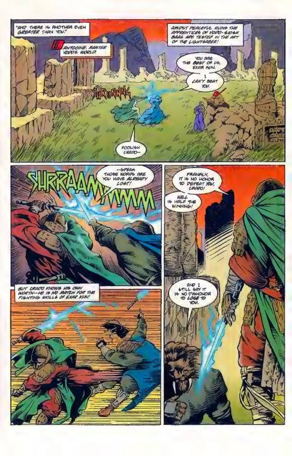
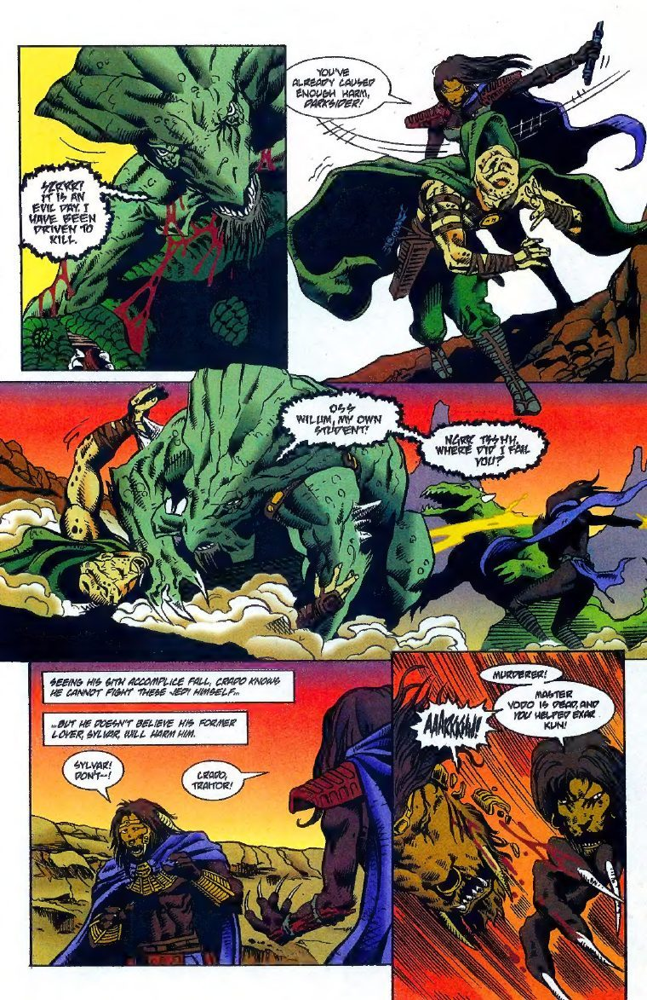
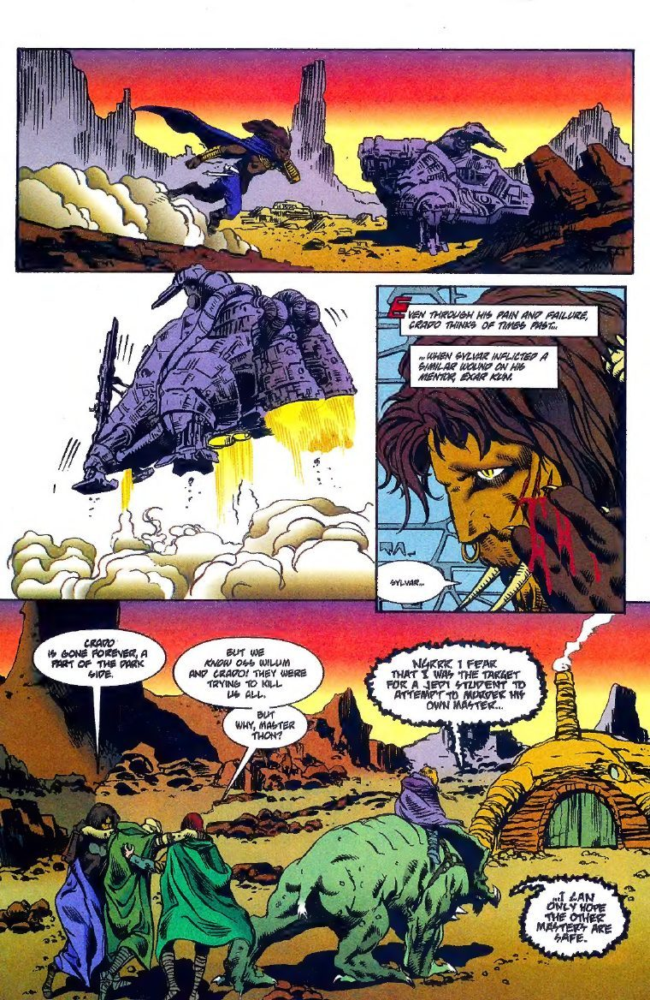
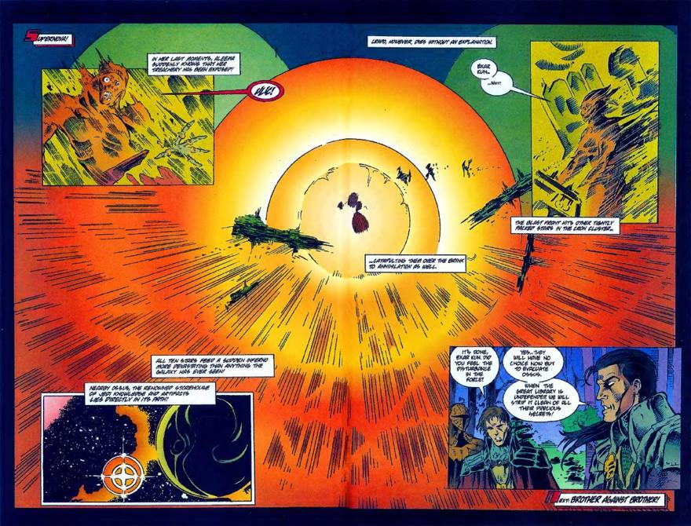

# Crado

- **Aliases:** —
- **Era:** Great Sith War
- **Continuity:** default Legends; entries present for: Legends
- **Research tier:** MASTERY (Tales of the Jedi 024 version only: Freedon Nadd Uprising #1–2, Dark Lords of the Sith #1–6, The Sith War #1–6; primary read 2026-10-27)
- **Entries:** 38 (16 with quotations; 1 quotations extended to the full sentence/passage from the source text on file; 8 marked as fragments). Rebuilt 2026-11-17 from 45 old entries; old file: `characters/_bak/crado.md.bak-20261117`.
- **How to read:** each entry is the quotation in full (block quote), then its source and point of view. "Note" lines are summaries from our notes, not quotations. `[fragment — full passage not on file]` means the source text is not on the box, so only the words in our notes are shown. Debate and forum material is in the last section and is unverified.

# LEGENDS (Legends / EU — main focus)

## Tales of the Jedi: Freedon Nadd Uprising #1–2, Dark Lords of the Sith #1–6, The Sith War #1–6, plus the WEG Tales of the Jedi Companion (power-scaling notes)

- Note (summary from our notes, not a quotation): Disarms fellow student Crado in a sparring bout. Source: Dark Lords of the Sith #1, p22
  — Source: Dark Lords of the Sith #1, p22 — Owner Material 024b — Tales of the Jedi: Dark Lords of the Sith #1–6 (1994–95): power-scaling notes.
Our notes: `notes/materials/024-tales-of-the-jedi/dark-lords-of-the-sith.md:53`

> YOU ARE THE BEST OF US, EXAR KUN.
>
> I CAN'T BEAT YOU.
> [fragment — full passage not on file]
— Source: Dark Lords of the Sith #1, p22 — Owner Material 024b — Tales of the Jedi: Dark Lords of the Sith #1–6 (1994–95): power-scaling notes; Crado to Exar Kun. POV: Crado.
Note (our notes, around the quote): Crado to Exar Kun: "YOU ARE THE BEST OF US, EXAR KUN." "I CAN'T BEAT YOU." Source: Dark Lords of the Sith #1, p22
Our notes: `notes/materials/024-tales-of-the-jedi/dark-lords-of-the-sith.md:89`

- Note (summary from our notes, not a quotation): Disarmed by Exar Kun in sparring. Source: Dark Lords of the Sith #1, p22
  — Source: Dark Lords of the Sith #1, p22 — Owner Material 024b — Tales of the Jedi: Dark Lords of the Sith #1–6 (1994–95): power-scaling notes.

Our notes: `notes/materials/024-tales-of-the-jedi/dark-lords-of-the-sith.md:230`

- Note (summary from our notes, not a quotation): | 1 | Exar Kun vs Crado | Dantooine | p22 (#1) | Exar disarms Crado | Sparring |
  — Source: Owner Material 024b — Tales of the Jedi: Dark Lords of the Sith #1–6 (1994–95): power-scaling notes.
Context: | # | Fight | Where | Pages (issue) | Outcome | Conditions |
Our notes: `notes/materials/024-tales-of-the-jedi/dark-lords-of-the-sith.md:272`

- Note (summary from our notes, not a quotation): 
  — Source: Owner Material 024b — Tales of the Jedi: Dark Lords of the Sith #1–6 (1994–95): power-scaling notes.
Our notes: `notes/materials/024-tales-of-the-jedi/dark-lords-of-the-sith.md:287`

- Note (summary from our notes, not a quotation): 
  — Source: Owner Material 024b — Tales of the Jedi: Dark Lords of the Sith #1–6 (1994–95): power-scaling notes.

Our notes: `notes/materials/024-tales-of-the-jedi/dark-lords-of-the-sith.md:289`

- Note (summary from our notes, not a quotation): | #4 | 1–26 | Jedi Holocaust | Ambria, galaxy montage, Cron Cluster | Oss Wilum and Crado attack Thon; Sylvar claws Crado. Students murder their masters. Aleema rips a star's core out and kills Dace, Shoaneb and Qrrrl Toq; the Cron supernova kills Aleema and Crado. |
  — Source: Owner Material 024c — Tales of the Jedi: The Sith War #1–6 (1995–96): power-scaling notes.
Context: | Issue | PDF pages | Title | Setting | Main events |
Our notes: `notes/materials/024-tales-of-the-jedi/the-sith-war.md:18`

> IF ONLY CRADO WASN'T SO EAGER. HE IS COMPLETELY LOYAL...
> [fragment — full passage not on file]
>
> ...BUT HE'S WEAK--AND BECOMING A NUISANCE.
> [fragment — full passage not on file]
— Source: The Sith War #4, p15 — Owner Material 024c — Tales of the Jedi: The Sith War #1–6 (1995–96): power-scaling notes; Exar Kun about Crado. POV: Exar Kun, about Crado.
Note (our notes, around the quote): Exar Kun about Crado: "IF ONLY CRADO WASN'T SO EAGER. HE IS COMPLETELY LOYAL..." "...BUT HE'S WEAK--AND BECOMING A NUISANCE." Source: The Sith War #4, p15
Our notes: `notes/materials/024-tales-of-the-jedi/the-sith-war.md:93`

- Note (summary from our notes, not a quotation): Knocks Oss Wilum unconscious and claws Crado's face on Ambria. Source: The Sith War #4, p9
  — Source: Owner Material 024c — Tales of the Jedi: The Sith War #1–6 (1995–96): power-scaling notes.

Our notes: `notes/materials/024-tales-of-the-jedi/the-sith-war.md:212`

- Note (summary from our notes, not a quotation): Flees Ambria after Sylvar claws his face. Source: The Sith War #4, p9–10
  — Source: Owner Material 024c — Tales of the Jedi: The Sith War #1–6 (1995–96): power-scaling notes.

Our notes: `notes/materials/024-tales-of-the-jedi/the-sith-war.md:217`

- Note (summary from our notes, not a quotation): Killed in the Cron supernova: Crado (burning): "EXAR KUN..." "...WHY?" Source: The Sith War #4, p24
  — Source: The Sith War #4, p24 — Owner Material 024c — Tales of the Jedi: The Sith War #1–6 (1995–96): power-scaling notes.

Our notes: `notes/materials/024-tales-of-the-jedi/the-sith-war.md:220`

> SZRRR! IT IS AN EVIL DAY. I HAVE BEEN DRIVEN TO KILL.
— Source: Owner Material 024c — Tales of the Jedi: The Sith War #1–6 (1995–96): power-scaling notes; Kills one of the Ambria lake beasts.
Note (our notes, around the quote): Kills one of the Ambria lake beasts: "SZRRR! IT IS AN EVIL DAY. I HAVE BEEN DRIVEN TO KILL." Source: The Sith War #4, p9

Our notes: `notes/materials/024-tales-of-the-jedi/the-sith-war.md:231`

- Note (summary from our notes, not a quotation): | 7 | Thon, Nomi, Sylvar vs Oss Wilum, Crado + beasts | Ambria | p5–10 (#4) | Jedi win; Crado flees | Nomi carrying Vima |
  — Source: Owner Material 024c — Tales of the Jedi: The Sith War #1–6 (1995–96): power-scaling notes.
Context: | # | Fight | Where | Pages (issue) | Outcome | Conditions |
Our notes: `notes/materials/024-tales-of-the-jedi/the-sith-war.md:275`

## Star Wars: The New Essential Chronology (Del Rey, 2005): power-scaling and lore notes

> Kun easily defeated Crado in a lightsaber duel, then fought against Sylvar; as tensions escalated, she slashed him across the face with her claws. Master Vodo stepped in, and Kun met the challenge, defeating his own teacher.
— Source: Part One: Tales of the Ancient Republic.
Note (our notes, around the quote): Exar Kun; Crado; Sylvar; Vodo-Siosk Baas — Exar Kun defeats Crado, Sylvar and Master Vodo: "Kun easily defeated Crado in a lightsaber duel, then fought against Sylvar; as tensions escalated, she slashed him across the face with her claws. Master Vodo stepped in, and Kun met the challenge, defeating his own teacher." Source: The New Essential Chronology, p.15
Our notes: `notes/materials/027-new-essential-chronology/01-part-one-ancient-republic.md:107`

> Master Vodo Slosk-Baas stepped = % battle his former pupIl. Exar Kun, now armed with a Seebie- bladed lightsaber and the tricks of Sith magic, struck Sown and killed Master Vodo. Utic and Kun left the Jedi and Semetors behind, returning to their stronghokl on Yavin 4, Vodo wasn't the only Jedi to die that day. Exar Kun sad dispatched his Sith-possessed disciples on an insidious mission to assassinate their own Masters.
>
> The bloodbath of slaughtered Jedi Masters shook the Republic. Kun’s lieutenant, Crado, attempted to kill his former Master, but Thon defeated him and Crado fled.
>
> Crado then teamed with Aleema to ex: ecute a military strike using Naga Sadow’s Sith flagship. Armed with the vessel's star-destroying weapon, they intended to destroy the suns of the Cron Cluster, not realizing that thelr Masters had set them up for a fall.
— Source: Part One: Tales of the Ancient Republic; Crado; Master Thon — Thon defeats Crado.
(Excerpt widened 2026-11-17 to the relevant passage, word for word from research primary new essential chronology nec paged (text copy `research_primary_new_essential_chronology_nec_paged_txt_88b808b5bc`).)
(Excerpt widened 2026-11-17 to the relevant passage, word for word from research primary new essential chronology nec paged (text copy `research_primary_new_essential_chronology_nec_paged_txt_88b808b5bc`).)
Note (our notes, around the quote): Crado; Master Thon — Thon defeats Crado: "Kun's lieutenant, Crado, attempted to kill his former Master, but Thon defeated him and Crado fled." Source: The New Essential Chronology, p.19
Our notes: `notes/materials/027-new-essential-chronology/01-part-one-ancient-republic.md:149`

## The Complete Star Wars Encyclopedia, Vol. I (A–G)

- Note (summary from our notes, not a quotation): Page contents: 1158 words, 29 paragraphs | headings/entries: Crado; Cranscoc; Cravus, Lord; Craw, Dictator-Forever; CRC-09/571; Creative Surgery; Créche; Cree'Ar, Dr. Dassid
  — Source: scan pages 161–200.
Our notes: `notes/materials/030-complete-star-wars-encyclopedia-vol-1/04-v1-scan-161-200.md:49`

> Crado was killed along with dark sider Aleema ina multiple supernova eruption that they triggered.
— Source: scan pages 161–200; Crado; Aleema Keto — entry/section: Crado.
Note (our notes, around the quote): Crado; Aleema Keto — entry/section: Crado: "Crado was killed along with dark sider Aleema ina multiple supernova eruption that they triggered." Source: The Complete Star Wars Encyclopedia, Vol. I, p.151
Our notes: `notes/materials/030-complete-star-wars-encyclopedia-vol-1/04-v1-scan-161-200.md:51`

## Power of the Jedi Sourcebook (d20, 2002)

> While Nomi and Vima discussed her training, others arrived: the Jedi Knight Sylvar, whose mate Crado had been slain by the supernova; and Hoggon, the tramp freighter pilot who had brought Ulic to Rhen Var in the first place.
— Source: Chapter One: History of the Jedi; Nomi Sunrider; Vima-Da-Boda; Sylvar; Crado; Ulic Qel-Droma.
Note (our notes, around the quote): Nomi Sunrider; Vima-Da-Boda; Sylvar; Crado; Ulic Qel-Droma: "While Nomi and Vima discussed her training, others arrived: the Jedi Knight Sylvar, whose mate Crado had been slain by the supernova; and Hoggon, the tramp freighter pilot who had brought Ulic to Rhen Var in the first place." Source: Power of the Jedi Sourcebook, p.7
Our notes: `notes/materials/033-power-of-the-jedi-sourcebook/01-ch1-history.md:36`

## Sourcebooks/Geonosis and the Outer Rim Worlds.pdf [Star Wars Roleplaying Game Revised Core (d20, 2002)] (scan pages 61–120)

- Note (summary from our notes, not a quotation): Page contents: Ossus: moons Mim and Nerit; history (Jedi stronghold; Great Sith War - Crado and Aleema with Ulic Qel-Droma and Exar Kun ignite the Cron Cluster; Ysanna descendants met by Luke Skywalker and Kam Solusar; Ood Bnar guards the lightsaber vaults and later aids them against Executor Sedriss; NJO era); people; Knossa Spaceport begins. (hand-read)
  — Source: Sourcebooks/Geonosis and the Outer Rim Worlds.pdf [Star Wars Roleplaying.
Our notes: `notes/materials/037-sw-d20-folder/667-geonosis-and-the-outer-rim-worlds-scan-061-120.md:375`

> Ossus changed dramatically during the Great Sith War. Former Jedi Crado and Aleema Kato, working with Ulic Qel-Droma and Exar Kun, succeed in igniting the ten stars of the nearby Cron Cluster.
— Source: Sourcebooks/Geonosis and the Outer Rim Worlds.pdf [Star Wars Roleplaying.
Note (our notes, around the quote): Crado; Aleema Keto; Ulic Qel-Droma; Exar Kun — entry/section: The Cron Cluster ignited: "Ossus changed dramatically during the Great Sith War. Former Jedi Crado and Aleema Kato, working with Ulic Qel-Droma and Exar Kun, succeed in igniting the ten stars of the nearby Cron Cluster." Source: *Geonosis and the Outer Rim Worlds* (SWRPG d20 Revised Core), scan p.110
Our notes: `notes/materials/037-sw-d20-folder/667-geonosis-and-the-outer-rim-worlds-scan-061-120.md:377`

## Sourcebooks/Ultimate Alien Anthology.pdf [Star Wars Roleplaying Game Revised Core (d20, 2002)] (scan pages 1–60)

- Note (summary from our notes, not a quotation): Page contents: Caarite commoner; Cathar (Sylvar and Crado). (hand-read)
  — Source: Sourcebooks/Ultimate Alien Anthology.pdf [Star Wars Roleplaying Game Revi.
Our notes: `notes/materials/037-sw-d20-folder/673-ultimate-alien-anthology-scan-001-060.md:156`

> Two of the greatest Cathar heroes, the female Sylvar and her mate Crado, were powerful Jedi Knights. Four thousand years before the Galactic Civil War, Crado fell to the dark side under the tutelage of Exar Kun. He was destroyed in an explosion after trying to activate an ancient Sith superweapon for his master. Sylvar, angry over the death of her mate, almost fell to the dark side herself before regaining the Jedi path. Both are remembered on Cathar itself in meticulously carved works of tree-art.
— Source: Sourcebooks/Ultimate Alien Anthology.pdf [Star Wars Roleplaying Game Revi; Sylvar; Crado; Exar Kun — entry/section: Cathar heroes.
Note (our notes, around the quote): Sylvar; Crado; Exar Kun — entry/section: Cathar heroes: "Two of the greatest Cathar heroes, the female Sylvar and her mate Crado, were powerful Jedi Knights. Four thousand years before the Galactic Civil War, Crado fell to the dark side under the tutelage of Exar Kun. He was destroyed in an explosion after trying to activate an ancient Sith superweapon for his master. Sylvar, angry over the death of her mate, almost fell to the dark side herself before regaining the Jedi path. Both are remembered on Cathar itself in meticulously carved works of tree-art." Source: *Ultimate Alien Anthology* (SWRPG d20 Revised Core), scan p.29
Our notes: `notes/materials/037-sw-d20-folder/673-ultimate-alien-anthology-scan-001-060.md:158`

## Sourcebooks/Knights of the Old Rebuplic Campaign Guide.pdf [Star Wars Roleplaying Game Saga Edition (2007)] (scan pages 1–60)

- Note (summary from our notes, not a quotation): Page contents: Cathar (city-trees; Crado's fall under Exar Kun; devastated in Mandalorian Wars, atrocity revealed by Revan's expedition); Cathar species traits; Draethos intro. (hand-read)
  — Source: Sourcebooks/Knights of the Old Rebuplic Campaign Guide.pdf [Star Wars Rol.
Our notes: `notes/materials/037-sw-d20-folder/718-knights-of-the-old-rebuplic-campaign-guide-scan-001-060.md:99`

## Star Wars Insider #26 (1995)

- Note (summary from our notes, not a quotation): Page contents: Tales of the Jedi guide continued (printed p. 13): Andur through Dominis entries (Arca, Bogga, Cay, Crado, Cron system, Denarii Nova, etc.); "to be continued". (hand-read)
  — Source: Star Wars Insider #26 (1995).
Our notes: `notes/materials/038-star-wars-insider/026-ins026.md:87`

## Prima *Star Wars Knights of the Old Republic II: The Sith Lords* Official Game Guide (2004)

> Given how completely Crado was killed, it is questionable whether this robe ever actually belonged to him *(p. 244)*
> [fragment — full passage not on file]
— Source: Prima *KOTOR II* guide, part 5: Appendices I–XII and "Paths of Destiny" (PDF pp. 213–304); The Crado robe. POV: The Crado robe.
Label in our notes: p. 244
Context: Old Republic deep lore in the item notes:
Our notes: `notes/materials/058-prima-kotor2/kt-05.md:15`

## https://starwars.fandom.com/wiki/Exar_Kun ; https://starwars.fandom.com/wiki/Exar_Kun/Legends

> Recognized as an extremely promising talent, Kun apprenticed under the venerable[4] Krevaaki[13] Jedi Master Vodo-Siosk Baas, training on the planet Dantooine alongside the Cathar mates Crado and Sylvar.
— Source: Tales of the Jedi – Dark Lords of the Sith 1 ; Power of the Jedi Sourcebook ; "The Dark Side" — Star Wars Galaxy Magazine 8 [per Wookieepedia "Exar Kun/Legends" rev 15679816, ref 4,13,14; exact text match; agrees with the entry's own ref marker]; per Wookieepedia "Exar Kun/Legends" rev 15679816, ref 4,13,14; exact text match; agrees with the entry's own ref marker — Exar Kun — Legends article extraction — https://starwars.fandom.com/wiki/Exar_Kun ; https://starwars.fandom.com/wiki/Exar_Kun/Legends.
(Classification: Cited ability/status statement, not a combat feat.)
(Scaling: Baas is identified as his Jedi Master; Crado and Sylvar are his training partners.)
(Source: Tales of the Jedi – Dark Lords of the Sith 1 ; Power of the Jedi Sourcebook ; "The Dark Side" — Star Wars Galaxy Magazine 8 [per Wookieepedia "Exar Kun/Legends" rev 15679816, ref 4,13,14; exact text match; agrees with the entry's own ref marker])
Our notes: `external/mega-notes/exar-kun-legends-quotes.txt:22`

> Kun swiftly and easily defeated the weak-willed Crado, before engaging the Cathar's fierce and determined lover Sylvar.
— Source: Tales of the Jedi – Dark Lords of the Sith 1 [per Wookieepedia "Exar Kun/Legends" rev 15679816, ref 4; exact text match]; per Wookieepedia "Exar Kun/Legends" rev 15679816, ref 4; exact text match — Exar Kun — Legends article extraction — https://starwars.fandom.com/wiki/Exar_Kun ; https://starwars.fandom.com/wiki/Exar_Kun/Legends.
(Classification: Concrete combat feat.)
(Scaling: Directly scales Kun above Crado in that training encounter; the article contrasts Crado with Sylvar rather than giving a result against Sylvar here.)
(Source: Tales of the Jedi – Dark Lords of the Sith 1 [per Wookieepedia "Exar Kun/Legends" rev 15679816, ref 4; exact text match])
Our notes: `external/mega-notes/exar-kun-legends-quotes.txt:26`

> At the end of the day, Kun had a total of 20 Jedi ready to follow him, a number that included Wilum, Luka, Crado[7] and the Human Jorak Uln.[29]
> [fragment — full passage not on file]
— Source: Tales of the Jedi – The Sith War 1 ; Star Wars: Knights of the Old Republic [per Wookieepedia "Exar Kun/Legends" rev 15679816, ref 7,29; exact text match; agrees with the entry's own ref marker]; per Wookieepedia "Exar Kun/Legends" rev 15679816, ref 7,29; exact text match; agrees with the entry's own ref marker — Exar Kun — Legends article extraction — https://starwars.fandom.com/wiki/Exar_Kun ; https://starwars.fandom.com/wiki/Exar_Kun/Legends.
(Classification: Concrete recruitment/leadership result.)
(Scaling: The article connects the recruitment to Kun’s lies, half-truths, and display of power; it does not say the 20 Jedi were equal to him.)
(Source: Tales of the Jedi – The Sith War 1 ; Star Wars: Knights of the Old Republic [per Wookieepedia "Exar Kun/Legends" rev 15679816, ref 7,29; exact text match; agrees with the entry's own ref marker])
Our notes: `external/mega-notes/exar-kun-legends-quotes.txt:134`

> The holocron shattered into dozens of crystal shards that became embedded within Kun's Jedi followers, immediately incorporating themselves into their targets, corrupting them with the dark side[30] and reshaping them into Kun's Brotherhood of the Sith.[3]
> [fragment — full passage not on file]
— Source: Tales of the Jedi – The Sith War 3 ; Champions of the Force [per Wookieepedia "Exar Kun/Legends" rev 15679816, ref 30,3; exact text match; agrees with the entry's own ref marker]; per Wookieepedia "Exar Kun/Legends" rev 15679816, ref 30,3; exact text match; agrees with the entry's own ref marker — Exar Kun — Legends article extraction — https://starwars.fandom.com/wiki/Exar_Kun ; https://starwars.fandom.com/wiki/Exar_Kun/Legends.
(Classification: Concrete Sith-sorcery feat.)
(Scaling: The corruption directly produces Kun’s Brotherhood; Crado is explicitly the only one remaining unaffected, though still loyal.)
(Source: Tales of the Jedi – The Sith War 3 ; Champions of the Force [per Wookieepedia "Exar Kun/Legends" rev 15679816, ref 30,3; exact text match; agrees with the entry's own ref marker])
Our notes: `external/mega-notes/exar-kun-legends-quotes.txt:140`

# Debate and forum claims (unverified)

Forum posts, Suspect Insight debates and Discord debates, respect threads, and verdicts. These are posters' arguments or quotations they typed; none is checked against the book here unless the entry says so.

## https://comicvine.gamespot.com/profile/sithrevenant/blog/exar-kun-the-chronological-respect-thread-2019/134756/ ; https://comicvine.gamespot.com/profile/deactivated-5e8a1f5fafc4e/blog/exar-kun-respect-thread-updated-2014/101338/ ; https://comicvine.gamespot.com/profile/silver2467/blog/exar-kun-respect-thread/67101/

> Kun was a master of lightsaber combat and had even bested Master Vodo's quarterstaff during a sparring practice.
>
> Force Feats: Alter, Burst of Speed, Control, Deflect Blasters, Knight Defense, Lightsaber Defense, Rage, Sense. Exar Kun, Former Jedi Knight, Sith Lord Tempted by the promise of powers he arrogantly believed he could control, Exar Kun went from promising Jedi apprentice to formidable Sith Lord with barely a backward glance. Filled with curiosity and convinced there was nothing he could not handle, he heeded the advice of the Dark Jedi spirit Freedon Nadd, who found in Exar Kun an apt and willing pupil. But even Freedon Nadd was surprised at how eagerly Exar Kun embraced the dark side. Consumed by pride and ambition, Jedi student Exar Kun had a dark place in his heart that even his vaunted master, Vodo-Siosk Baas, could not reach. An excellent student and a master swordsman, Exar Kun was fascinated with the powers of the ancient Sith Lords. Supremely confident, Kun felt that he could separate out the dark side from the abilities used by the Sith and use those abilities to greatly expand the Jedi Order's understanding of the Force. But Kun was stymied by Master Vodo, who constantly warned his student to heed only the lessons Vodo himself taught him. Impatient and irritated, Exar Kun abandoned Master Vodo's training and went in search of darker power.
>
> and trains multiple apprentices at a time. His strongest apprentice, however, is a young pupil named Exar Kun. Kun's skill with a lightsaber is so great that he claimed victory over his master many times when they sparred together.
>
> FMOLOCRON LESSON:
>
> KREVAAKI SPECIES TRAITS All Krevaaki share the following species traits.
>
> Through long practice he achieved unparalleled prowess in lightsaber combat.
— Source: Exar Kun: Comic Vine respect threads, read 2026-10-18 (DEEP-layer pass) — https://comicvine.gamespot.com/profile/sithrevenant/blog/exar-kun-the-chronological-respect-thread-2019/134756/ ; https://comicvine.gamespot.com/profile/deactivated-5e8a1f5fafc4e/blog/exar-kun-respect-thread-updated-2014/101338/ ; https://comicvine.gamespot.com/profile/silver2467/blog/exar-kun-respect-thread/67101/; Training-era skill. Power of the Jedi Sourcebook.
(Excerpt widened 2026-11-17 to the relevant passage, word for word from research primary dark side sourcebook dss (text copy `research_primary_dark_side_sourcebook_dss_pdf_9cd3453f4a`).)
(Excerpt widened 2026-11-17 to the relevant passage, word for word from research primary jedi academy training manual jatm paged (text copy `research_primary_jedi_academy_training_manual_jatm_paged_txt_fea130719f`).)
(Excerpt widened 2026-11-17 to the relevant passage, word for word from research primary dark side sourcebook dss (text copy `research_primary_dark_side_sourcebook_dss_pdf_9cd3453f4a`).)
(Excerpt widened 2026-11-17 to the relevant passage, word for word from research primary jedi academy training manual jatm paged (text copy `research_primary_jedi_academy_training_manual_jatm_paged_txt_fea130719f`).)
(Full sentence/passage taken from the source text on file: `research_primary_dark_side_sourcebook_dss_pdf`.)
Note (our notes, around the quote): Training-era skill. Power of the Jedi Sourcebook: "Kun was a master of lightsaber combat and had even bested Master Vodo's quarterstaff during a sparring practice." Dark Side Sourcebook: "An excellent student and a master swordsman". Jedi Academy Training Manual: "Kun's skill with a lightsaber is so great that he claimed victory over his master many times when they sparred together." SWTOR Timeline (Gnost-Dural): "Through long practice he achieved unparalleled prowess in lightsaber combat." Primary: DLotS #1 (Crado beaten easily, Baas sends him flying with one staff blow, then Kun smashes the staff) [issue via Wookieepedia].
Posted by: not named in our notes (see thread/notes link).
Our notes: `external/mega-notes/exar-kun-comicvine-respect.txt:11`

> shattered the Dark Holocron with a single punch
> [fragment — full passage not on file]
>
> smashed in over a hundred places *(DLotS #3 per Wookieepedia)*
> [fragment — full passage not on file]
— Source: per Wookieepedia: "shattered the Dark Holocron with a single punch"); smashes Mandalorian-iron tomb wall (DLotS #2 per Wookieepedia, after "a strange power" surrounds him); blade afterimages vs Baas; survives temple collapse with bones "smashed in over a hundred places" (DLotS #3 per Wookieepedia);  — Exar Kun: Comic Vine respect threads, read 2026-10-18 (DEEP-layer pass) — https://comicvine.gamespot.com/profile/sithrevenant/blog/exar-kun-the-chronological-respect-thread-2019/134756/ ; https://comicvine.gamespot.com/profile/deactivated-5e8a1f5fafc4e/blog/exar-kun-respect-thread-updated-2014/101338/ ; https://comicvine.gamespot.com/profile/silver2467/blog/exar-kun-respect-thread/67101/.
Note (our notes, around the quote): Strikes "heard for kilometers"; snaps Baas's Force-imbued staff twice; smashes holocron bare-handed (Sith War #2 per Wookieepedia: "shattered the Dark Holocron with a single punch"); smashes Mandalorian-iron tomb wall (DLotS #2 per Wookieepedia, after "a strange power" surrounds him); blade afterimages vs Baas; survives temple collapse with bones "smashed in over a hundred places" (DLotS #3 per Wookieepedia); deflects an Aleema magic blast; conceals presence from Odan-Urr and Nomi; softened long fall into the wyrm pit; sparring wins vs Crado and Sylvar. [panel: panels/exar-kun/exar-kun-smashes-down-wall-mandalorian-iron-1.png; panels/exar-kun/exar-kun-smashes-down-wall-mandalorian-iron-2.png; panels/exar-kun/exar-kun-smashes-down-wall-mandalorian-iron-3.png]
Posted by: not named in our notes (see thread/notes link).
Our notes: `external/mega-notes/exar-kun-comicvine-respect.txt:41`

- Note (summary from our notes, not a quotation): Kun humbles Crado in a sparring match. (issue unknown (source not named in thread)) [panel: panels/exar-kun/exar-kun-kun-humbles-crado-sparring-match-1.png; panels/exar-kun/exar-kun-kun-humbles-crado-sparring-match-2.png]
  — Source: Exar Kun: Comic Vine respect threads, read 2026-10-18 (DEEP-layer pass) — https://comicvine.gamespot.com/profile/sithrevenant/blog/exar-kun-the-chronological-respect-thread-2019/134756/ ; https://comicvine.gamespot.com/profile/deactivated-5e8a1f5fafc4e/blog/exar-kun-respect-thread-updated-2014/101338/ ; https://comicvine.gamespot.com/profile/silver2467/blog/exar-kun-respect-thread/67101/.
Posted by: not named in our notes (see thread/notes link).
Our notes: `external/mega-notes/exar-kun-comicvine-respect.txt:88`

## Exar Kun Supreme Respect Thread (NEW UPDATE 8/28/2022) — respect-thread notes

- Note (summary from our notes, not a quotation): Crado, who is one of the aforementioned students accepted by the Jedi Enclave and Vodo Siosk-Baas for training on Dantooine, is no match for Padawan Exar Kun:
  — Source: SI respect-thread directory: Exar Kun Supreme Respect Thread (NEW UPDATE 8/28/2022) — https://www.suspectinsightforums.com/t822-exar-kun-supreme-respect-thread-new-update-8-28-2022.
Posted by: not named in our notes (see thread/notes link).
Our notes: `suspect-insight/respect-threads/exar-kun--exar-kun-ancient-power.md:68`

- Note (summary from our notes, not a quotation): [image: https://i.servimg.com/u/f21/20/06/49/72/2e278a10.jpg]
  — Source: SI respect-thread directory: Exar Kun Supreme Respect Thread (NEW UPDATE 8/28/2022) — https://www.suspectinsightforums.com/t822-exar-kun-supreme-respect-thread-new-update-8-28-2022.
Posted by: not named in our notes (see thread/notes link).
Context: Crado, who is one of the aforementioned students accepted by the Jedi Enclave and Vodo Siosk-Baas for training on Dantooine, is no match for Padawan Exar Kun:
Our notes: `suspect-insight/respect-threads/exar-kun--exar-kun-ancient-power.md:69`

## Exar Kun Respect Thread - Updated 2014 — respect-thread notes

- Note (summary from our notes, not a quotation): Kun humbles Crado in a sparring match.
  — Source: SI respect-thread directory: Exar Kun Respect Thread - Updated 2014 — https://comicvine.gamespot.com/profile/i_like_swords/blog/exar-kun-respect-thread-updated-2014/101338/.
Posted by: not named in our notes (see thread/notes link).
Our notes: `suspect-insight/respect-threads/exar-kun--exar-kun-i-like-swords.md:97`

- Note (summary from our notes, not a quotation): [image: data:image/gif;base64,R0lGODlhAQABAAAAACH5BAEKAAEALAAAAAABAAEAAAICTAEAOw==]
  — Source: SI respect-thread directory: Exar Kun Respect Thread - Updated 2014 — https://comicvine.gamespot.com/profile/i_like_swords/blog/exar-kun-respect-thread-updated-2014/101338/.
Posted by: not named in our notes (see thread/notes link).
Context: Kun humbles Crado in a sparring match.
Our notes: `suspect-insight/respect-threads/exar-kun--exar-kun-i-like-swords.md:98`

## Sylvar respect thread — respect-thread notes

- Note (summary from our notes, not a quotation): Sylvar scars Crado's face.
  — Source: SI respect-thread directory: Sylvar respect thread — https://www.suspectinsightforums.com/t3864-sylvar-respect-thread.
Posted by: not named in our notes (see thread/notes link).
Our notes: `suspect-insight/respect-threads/sylvar.md:69`

- Note (summary from our notes, not a quotation): [image: https://i.servimg.com/u/f86/20/26/12/82/sith_b11.jpg]
  — Source: SI respect-thread directory: Sylvar respect thread — https://www.suspectinsightforums.com/t3864-sylvar-respect-thread.
Posted by: not named in our notes (see thread/notes link).
Context: Sylvar scars Crado's face.
Our notes: `suspect-insight/respect-threads/sylvar.md:70`
