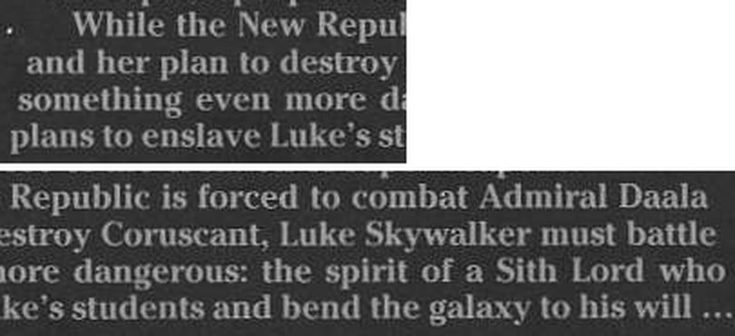
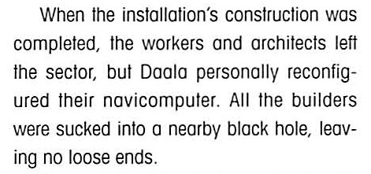
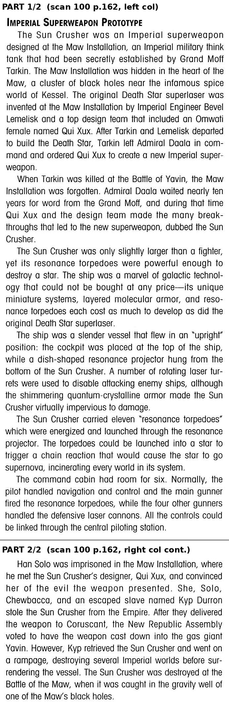

# Admiral Daala

- **Aliases:** Daala
- **Era:** NR
- **Continuity:** default Legends; entries present for: Canon, Legends
- **Research tier:** MASTERY (Jedi Academy trilogy 026 version only: Jedi Search, Dark Apprentice, Champions of the Force; primary read 2026-10-28)
- **Entries:** 163 (136 with quotations; 9 quotations extended to the full sentence/passage from the source text on file; 3 marked as fragments; 4 before the 2026-11-17 fragment fill). Rebuilt 2026-11-17 from 252 old entries; old file: `characters/_bak/daala.md.bak-20261117`.
- **How to read:** each entry is the quotation in full (block quote), then its source and point of view. "Note" lines are summaries from our notes, not quotations. `[fragment — full passage not on file]` means the source text is not on the box, so only the words in our notes are shown. Debate and forum material is in the last section and is unverified.

# LEGENDS (Legends / EU — main focus)

## Legacy of the Force 1–9: novel notes from the other agent (reference copy)

- Note (summary from our notes, not a quotation): Headline: the Mandalorian training / Mara-evidence book. Jaina goes to Boba Fett and is trained in anti-Jedi thinking (Fett, Beviin, Mirta, ex-Jedi Bardan Jusik). Ben and Shevu prove Jacen killed Mara (her hair in his StealthX; his recorded confession). Luke beats Caedus in a StealthX duel at Fondor, ripping his fighter apart with the Force, but lets him escape rather than kill civilians. Caedus brings down Fondor's planetary shield by mass mind-influence and bombs Oridin City. Niathal relieves him; the GA splits. Tahiri murders Pellaeon and becomes Caedus's apprentice. Daala returns. On *Bloodfin*, Mirta and Jaina gut Tahiri, Jaina breaks Caedus's Force choke, and a Mandalorian kneecaps Caedus. Jaina resolves to kill her brother «out of love».
  — Source: Legacy of the Force 8: Revelation (novel, read in full): feats, scaling and story notes.
Our notes: `notes/materials/021-legacy-of-the-force/lotf-8-revelation-notes.md:11`

- Note (summary from our notes, not a quotation): Ch15–16 · L6437–6447 · Caedus (misread): assumes Daala's real fleet is another Luke illusion; he no longer trusts his senses.
  — Source: Legacy of the Force 8: Revelation (novel, read in full): feats, scaling and story notes.
Our notes: `notes/materials/021-legacy-of-the-force/lotf-8-revelation-notes.md:53`

- Note (summary from our notes, not a quotation): Niathal / Pellaeon / Daala: Niathal's guilt over the leaked minelayers (L4635–4655); Pellaeon dies on principle (L6281–6289); Daala returns as kingmaker.
  — Source: L4635–4655; L6281–6289 — Legacy of the Force 8: Revelation (novel, read in full): feats, scaling and story notes.
Our notes: `notes/materials/021-legacy-of-the-force/lotf-8-revelation-notes.md:148`

- Note (summary from our notes, not a quotation): 41 ABY, twelve-plus weeks after Mara's death. Sets up *Invincible*: Jaina trained and resolved; the Jedi in the Transitory Mists; Tahiri found the old Endor base (L8019); Niathal's government in exile; Daala allied with Fett; Caedus kneecapped with a cracked chest.
  — Source: L8019 — Legacy of the Force 8: Revelation (novel, read in full): feats, scaling and story notes.
Our notes: `notes/materials/021-legacy-of-the-force/lotf-8-revelation-notes.md:174`

- Note (summary from our notes, not a quotation): Role/arc: trains Jaina, contracts with Daala, and refuses to kill Jacen himself (L7681).
  — Source: L7681 — Legacy of the Force 8: Revelation (novel, read in full): feats, scaling and story notes.
Our notes: `notes/materials/021-legacy-of-the-force/lotf-8-revelation-notes.md:342`

What it shows (our notes): Caedus/Jacen: tries to recommit to «To serve.» (L887), but kills Isolder, tortures Mirta, and uses Tahiri's grief («That was kind of the point», L4632). His love for Allana survives to the end: he vetoes the nanokiller (L4596) and dies warning Tenel Ka (L5184). Jaina's verdict: «he became Jacen again for a second» (L5914); the galaxy he wanted is born under Daala (L5904).
> “Okay,” Tahiri said. “But letting me believe we could bring Anakin back was a terrible way to use me. I still haven’t forgiven you.”
>
> “And I doubt you ever will,” Caedus said. “That was kind of the point.”
>
> “I think he became Jacen again for a second before I … *(L5914)*
— Source: L887; L4596; L5184; L5914 — Legacy of the Force 9: Invincible (novel, read in full): feats, scaling and story notes.
(Excerpt widened 2026-11-17 to the relevant passage, word for word from Invincible (Troy Denning) (text copy `MEGA_Legend_The_Legacy_of_the_Force_Series_Star_Wars_Legacy_of_the_Force_09_Invincible_Troy_Denning_epub`).)
(Full sentence/passage taken from the source text on file: `lotf_tmp_b9_epub`.)
Our notes: `notes/materials/021-legacy-of-the-force/lotf-9-invincible-notes.md:144`

- Note (summary from our notes, not a quotation): Jacen's vision fulfilled by others: Daala's peace (L5902–5904).
  — Source: L5902–5904 — Legacy of the Force 9: Invincible (novel, read in full): feats, scaling and story notes.
Our notes: `notes/materials/021-legacy-of-the-force/lotf-9-invincible-notes.md:157`

- Note (summary from our notes, not a quotation): 41 ABY, ending LotF. Leads to *Fate of the Jedi* (Daala's government, Jedi distrust, Allana as Amelia Solo, Tahiri's trial; «THE STORY CONTINUES», L5944).
  — Source: Legacy of the Force 9: Invincible (novel, read in full): feats, scaling and story notes.
Our notes: `notes/materials/021-legacy-of-the-force/lotf-9-invincible-notes.md:175`

## Jedi Academy Trilogy (Kevin J. Anderson, 1994): Jedi Search, Dark Apprentice, Champions of the Force (power-scaling notes)

> The windowports dimmed, but still Daala did not close her emerald eyes. Presumably only she knew the detailed route, but young Kyp Durron had found his way, and she assumed that other Jedi Knights could perform the same feat.
— Source: Champions of the Force, ch.26, PDF p.166 — Owner Material 026 — Jedi Academy Trilogy: Champions of the Force (Kevin J. Anderson); Daala on Jedi navigating the Maw (also: Admiral Daala). POV: Daala.
(Excerpt widened 2026-11-17 to the relevant passage, word for word from Champions of the Force (Kevin Anderson), Chapter 26 (text copy `MEGA_Legend_The_Jedi_Academy_Trilogy_Star_Wars_Jedi_Academy_03_Champions_of_the_Force_Kevin_J_Anderson_epub`).)
Note (our notes, around the quote): Daala on Jedi navigating the Maw (also: Admiral Daala): "Presumably only she knew the detailed route, but young Kyp Durron had found his way, and she assumed that other Jedi Knights could perform the same feat." Source: Champions of the Force, ch.26, PDF p.166
Our notes: `notes/materials/026-jedi-academy-trilogy/champions-of-the-force.md:123`

> She had been lucky fleeing from the exploding suns, while only seconds behind her the Basilisk had vaporized in flame, disintegrated by the outrushing supernova shock wave. But Daala had ordered the Gorgon to plunge blindly into hyperspace mere moments before the explosive front had reached her rear thrusters. The desperate leap knocked them headlong on a reckless course through the hazards of the universe. The Gorgon would have been obliterated if they had stumbled onto an interdimensional path that passed through the core of a star or planet. But through some miracle of fate that had not happened.
— Source: Champions of the Force, ch.26, PDF p.164 — Owner Material 026 — Jedi Academy Trilogy: Champions of the Force (Kevin J. Anderson); Daala escapes the Cauldron supernova.
(Excerpt widened 2026-11-17 to the relevant passage, word for word from Champions of the Force (Kevin Anderson), Chapter 26 (text copy `MEGA_Legend_The_Jedi_Academy_Trilogy_Star_Wars_Jedi_Academy_03_Champions_of_the_Force_Kevin_J_Anderson_epub`).)
Note (our notes, around the quote): Daala escapes the Cauldron supernova: "But Daala had ordered the Gorgon to plunge blindly into hyperspace mere moments before the explosive front had reached her rear thrusters. The desperate leap knocked them headlong on a reckless course through the hazards of the universe." Source: Champions of the Force, ch.26, PDF p.164
Our notes: `notes/materials/026-jedi-academy-trilogy/champions-of-the-force.md:148`

> Kratas tried to regain his composure but did not succeed in wiping the idiotic grin from his lips. “Transfer successful, Admiral. Complete core dump of all the Maw’s backup computer files.” He lowered his voice. “You were correct. Director Sivron never bothered to change his password. He was still using the same one you obtained ten years ago.”
— Source: Champions of the Force, ch.38, PDF p.224 — Owner Material 026 — Jedi Academy Trilogy: Champions of the Force (Kevin J. Anderson); Daala dumps Maw data (Sivron’s old password). POV: Daala dumps Maw data.
(Excerpt widened 2026-11-17 to the relevant passage, word for word from Champions of the Force (Kevin Anderson), Chapter 38 (text copy `MEGA_Legend_The_Jedi_Academy_Trilogy_Star_Wars_Jedi_Academy_03_Champions_of_the_Force_Kevin_J_Anderson_epub`).)
Note (our notes, around the quote): Daala dumps Maw data (Sivron’s old password): "“Transfer successful, Admiral. Complete core dump of all the Maw’s backup computer files.” He lowered his voice. “You were correct. Director Sivron never bothered to change his password. He was still using the same one you obtained ten years ago.”" Source: Champions of the Force, ch.38, PDF p.224
Our notes: `notes/materials/026-jedi-academy-trilogy/champions-of-the-force.md:149`

> “Rebel scum, you’ll not leave Maw Installation alive. The information contained in this facility is now forfeit, tainted by your sabotage. I’m not interested in your surrender or your flight. Only your destruction.”
— Source: Champions of the Force, ch.30, PDF p.188 — Owner Material 026 — Jedi Academy Trilogy: Champions of the Force (Kevin J. Anderson); Daala to Wedge. POV: Daala.
Note (our notes, around the quote): Daala to Wedge: "“Rebel scum, you’ll not leave Maw Installation alive. The information contained in this facility is now forfeit, tainted by your sabotage. I’m not interested in your surrender or your flight. Only your destruction.”" Source: Champions of the Force, ch.30, PDF p.188
Our notes: `notes/materials/026-jedi-academy-trilogy/champions-of-the-force.md:153`

> She glared to make it clear she hadn’t expected an answer. “Tol Sivron has never had any initiative in his entire life,” she said. “I should have known I couldn’t expect him to do his duty now. Redouble our efforts against the Installation. Let us show Tol Sivron how it must be done.”
— Source: Champions of the Force, ch.36, PDF p.218 — Owner Material 026 — Jedi Academy Trilogy: Champions of the Force (Kevin J. Anderson); Daala on Sivron (also: Tol Sivron). POV: Daala.
(Excerpt widened 2026-11-17 to the relevant passage, word for word from Champions of the Force (Kevin Anderson), Chapter 36 (text copy `MEGA_Legend_The_Jedi_Academy_Trilogy_Star_Wars_Jedi_Academy_03_Champions_of_the_Force_Kevin_J_Anderson_epub`).)
Note (our notes, around the quote): Daala on Sivron (also: Tol Sivron): "“Tol Sivron has never had any initiative in his entire life,” she said. “I should have known I couldn’t expect him to do his duty now. Redouble our efforts against the Installation. Let us show Tol Sivron how it must be done.”" Source: Champions of the Force, ch.36, PDF p.218
Our notes: `notes/materials/026-jedi-academy-trilogy/champions-of-the-force.md:154`

> She paused before raising her voice. “Yes, the Gorgon has been damaged. Yes, we have suffered severe losses. We have been wounded—but we will never be defeated!
— Source: Champions of the Force, ch.42, PDF p.247 — Owner Material 026 — Jedi Academy Trilogy: Champions of the Force (Kevin J. Anderson); Daala’s address to her crew. POV: Daala’s address.
(Excerpt widened 2026-11-17 to the relevant passage, word for word from Champions of the Force (Kevin Anderson), Chapter 42 (text copy `MEGA_Legend_The_Jedi_Academy_Trilogy_Star_Wars_Jedi_Academy_03_Champions_of_the_Force_Kevin_J_Anderson_epub`).)
Note (our notes, around the quote): Daala’s address to her crew: "“Yes, the Gorgon has been damaged. Yes, we have suffered severe losses. We have been wounded—but we will never be defeated!”" Source: Champions of the Force, ch.42, PDF p.247
Our notes: `notes/materials/026-jedi-academy-trilogy/champions-of-the-force.md:155`

> During the long days of repairs Daala had come to terms with her failure. She had misplaced her priorities. Her only reason for existence should have been to protect Maw Installation, not to wage a private war against the Rebellion. Once the Rebels knew of the Installation, they would no doubt attempt to steal its secrets. Her priority now was to fulfill the mission that Tarkin had given her.
— Source: Champions of the Force, ch.26, PDF p.165 — Owner Material 026 — Jedi Academy Trilogy: Champions of the Force (Kevin J. Anderson); Daala recommits to Tarkin’s mission (also: Grand Moff Tarkin). POV: Daala recommits.
(Excerpt widened 2026-11-17 to the relevant passage, word for word from Champions of the Force (Kevin Anderson), Chapter 26 (text copy `MEGA_Legend_The_Jedi_Academy_Trilogy_Star_Wars_Jedi_Academy_03_Champions_of_the_Force_Kevin_J_Anderson_epub`).)
Note (our notes, around the quote): Daala recommits to Tarkin’s mission (also: Grand Moff Tarkin): "During the long days of repairs Daala had come to terms with her failure. She had misplaced her priorities. Her only reason for existence should have been to protect Maw Installation, not to wage a private war against the Rebellion." Source: Champions of the Force, ch.26, PDF p.165
Our notes: `notes/materials/026-jedi-academy-trilogy/champions-of-the-force.md:159`

> “It was not originally my intention to join with one of the Imperial warlords struggling for dominance, but it now appears that we must fight the larger fight. We need to convince them of their real enemy and show those still faithful to the Emperor that we must be united to be strong.”
— Source: Champions of the Force, ch.42, PDF p.247 — Owner Material 026 — Jedi Academy Trilogy: Champions of the Force (Kevin J. Anderson); Daala heads to the Core warlords (also: Palpatine (the Emperor)).
Note (our notes, around the quote): Daala heads to the Core warlords (also: Palpatine (the Emperor)): "“It was not originally my intention to join with one of the Imperial warlords struggling for dominance, but it now appears that we must fight the larger fight. We need to convince them of their real enemy and show those still faithful to the Emperor that we must be united to be strong.”" Source: Champions of the Force, ch.42, PDF p.247
Our notes: `notes/materials/026-jedi-academy-trilogy/champions-of-the-force.md:160`

> Battered and blackened, an Imperial Star Destroyer came through the Maw with its weapons already powering up. Its once-white hull was blistered and streaked with burn marks; its shielding plates damaged by an inferno of destruction.
>
> Admiral Daala’s flagship, the Gorgon, had returned to Maw Installation.
— Source: Champions of the Force, ch.18, PDF p.128 — Owner Material 026 — Jedi Academy Trilogy: Champions of the Force (Kevin J. Anderson); The Gorgon returns. POV: The Gorgon returns, about Admiral Daala.
(Excerpt widened 2026-11-17 to the relevant passage, word for word from Champions of the Force (Kevin Anderson), Chapter 18 (text copy `MEGA_Legend_The_Jedi_Academy_Trilogy_Star_Wars_Jedi_Academy_03_Champions_of_the_Force_Kevin_J_Anderson_epub`).)
Note (our notes, around the quote): The Gorgon returns: "Admiral Daala’s flagship, the Gorgon, had returned to Maw Installation." Source: Champions of the Force, ch.18, PDF p.128
Our notes: `notes/materials/026-jedi-academy-trilogy/champions-of-the-force.md:164`

> “Over half of the atmosphere factories are out of commission,” Mara explained. “Admiral Daala did a lot of damage. Seems she thought this was a Rebel base, so she struck at anything that showed up on her targeting screens.”
— Source: Champions of the Force, ch.24, PDF p.158 — Owner Material 026 — Jedi Academy Trilogy: Champions of the Force (Kevin J. Anderson); Daala’s damage to Kessel. POV: Daala’s damage.
Note (our notes, around the quote): Daala’s damage to Kessel: "“Over half of the atmosphere factories are out of commission,” Mara explained. “Admiral Daala did a lot of damage. Seems she thought this was a Rebel base, so she struck at anything that showed up on her targeting screens.”" Source: Champions of the Force, ch.24, PDF p.158
Our notes: `notes/materials/026-jedi-academy-trilogy/champions-of-the-force.md:165`

> The Gorgon came on, unstoppable until—just as she soared over at closest approach—the attack breached the containment housing the unstable power reactor. Sitting in the cockpit of the personnel transport, Wedge and Luke both flinched as the entire Maw Installation suddenly became a blaze of light, like a miniature exploding star. The center of the Maw was filled with an incandescent purifying fire. The glare flooded outward, automatically causing the viewscreens to darken. Wedge flew blind, trusting the navigation computer’s controls and aiming toward the waiting New Republic flagships. When his vision finally cleared, he looked back to the stable point that had held the Empire’s most sophisticated weapons-research laboratory. He saw only a far-flung swarm of broken rocks and smoldering gases in an expanding backwash of energy. Eventually, the debris would drift far enough to be siphoned down to infinity through one of the black holes. As the glare faded and the fiery gases cleared, he saw no sign whatsoever of Admiral Daala or her last Star Destroyer.
— Source: Champions of the Force, ch.38, PDF p.226-227 — Owner Material 026 — Jedi Academy Trilogy: Champions of the Force (Kevin J. Anderson); Daala’s final run; Maw Installation explodes; Gorgon vanishes.
(Full sentence/passage taken from the source text on file: `research_primary_jedi_academy_trilogy_champions_of_the_force_pdf`.)
Note (our notes, around the quote): Daala’s final run; Maw Installation explodes; Gorgon vanishes: "Sitting in the cockpit of the personnel transport, Wedge and Luke both flinched as the entire Maw Installation suddenly became a blaze of light, like a miniature exploding star. … As the glare faded and the fiery gases cleared, he saw no sign whatsoever of Admiral Daala or her last Star Destroyer." Source: Champions of the Force, ch.38, PDF p.226-227
Our notes: `notes/materials/026-jedi-academy-trilogy/champions-of-the-force.md:166`

> Watching Maw Installation vaporize, Daala had ordered full shields and full speed, throwing caution aside as she drove the Gorgon straight to the walls of the Maw, seeking her own way out. Now, crawling away from the energetic outbursts of the black hole cluster, the battered Imperial battle cruiser would not be noticed on any Rebel scopes.
— Source: Champions of the Force, ch.42, PDF p.245 — Owner Material 026 — Jedi Academy Trilogy: Champions of the Force (Kevin J. Anderson); Daala survived the Maw explosion.
(Excerpt widened 2026-11-17 to the relevant passage, word for word from Champions of the Force (Kevin Anderson), Chapter 42 (text copy `MEGA_Legend_The_Jedi_Academy_Trilogy_Star_Wars_Jedi_Academy_03_Champions_of_the_Force_Kevin_J_Anderson_epub`).)
Note (our notes, around the quote): Daala survived the Maw explosion: "Watching Maw Installation vaporize, Daala had ordered full shields and full speed, throwing caution aside as she drove the Gorgon straight to the walls of the Maw, seeking her own way out." Source: Champions of the Force, ch.42, PDF p.245
Our notes: `notes/materials/026-jedi-academy-trilogy/champions-of-the-force.md:167`

> “Ninety percent of Doole’s ships were obliterated in their tangle with Daala’s Star Destroyers. Most of the surviving pilots took their ships and fled into hyperspace. No one knows where they are now—and frankly, I don’t really care.
— Source: Champions of the Force, ch.24, PDF p.157 — Owner Material 026 — Jedi Academy Trilogy: Champions of the Force (Kevin J. Anderson); Mara on Doole’s fleet. POV: Mara, about Admiral Daala.
(Excerpt widened 2026-11-17 to the relevant passage, word for word from Champions of the Force (Kevin Anderson), Chapter 24 (text copy `MEGA_Legend_The_Jedi_Academy_Trilogy_Star_Wars_Jedi_Academy_03_Champions_of_the_Force_Kevin_J_Anderson_epub`).)
Note (our notes, around the quote): Mara on Doole’s fleet: "“Ninety percent of Doole’s ships were obliterated in their tangle with Daala’s Star Destroyers. Most of the surviving pilots took their ships and fled into hyperspace.”" Source: Champions of the Force, ch.24, PDF p.157
Our notes: `notes/materials/026-jedi-academy-trilogy/champions-of-the-force.md:204`

> Kyp stretched out with the Force, dropping his inhibitions and letting the power burst from him like compressed gas. After the effort of yanking the Sun Crusher from the core of Yavin, finding a few Star Destroyers seemed a simple exercise.
— Source: Dark Apprentice, ch.33, PDF p.237 — Owner Material 026 — Jedi Academy Trilogy: Dark Apprentice (Kevin J. Anderson).
Note (our notes, around the quote): Kyp locates Daala’s fleet in the Cauldron Nebula with the Force (also: Admiral Daala): "Kyp stretched out with the Force, dropping his inhibitions and letting the power burst from him like compressed gas. After the effort of yanking the Sun Crusher from the core of Yavin, finding a few Star Destroyers seemed a simple exercise." Source: Dark Apprentice, ch.33, PDF p.237
Our notes: `notes/materials/026-jedi-academy-trilogy/dark-apprentice.md:106`

> Curtains of fire overtook the Basilisk, washing over the Star Destroyer and igniting it like another tiny nova erupting in the nebula, as the firestorm front swept on. The viewscreen blackened, but where the Gorgon had been Kyp saw another flash—and then the firestorm obliterated all detail.
— Source: Dark Apprentice, ch.33, PDF p.242 — Owner Material 026 — Jedi Academy Trilogy: Dark Apprentice (Kevin J. Anderson).
Note (our notes, around the quote): Cauldron supernovae destroy the Basilisk and engulf the Gorgon (also: Admiral Daala, Sun Crusher (superweapon)): "Curtains of fire overtook the Basilisk, washing over the Star Destroyer and igniting it like another tiny nova erupting in the nebula, as the firestorm front swept on. The viewscreen blackened, but where the Gorgon had been Kyp saw another flash—and then the firestorm obliterated all detail." Source: Dark Apprentice, ch.33, PDF p.242
Our notes: `notes/materials/026-jedi-academy-trilogy/dark-apprentice.md:108`

> With a crackle the thin voice of a mere boy echoed through the Gorgon’s command center. “Admiral Daala, I’m Kyp Durron—remember me? I hope so. You put me under a death sentence. That made quite an impression on me. I hope it made some sort of impression on you.”
— Source: Dark Apprentice, ch.33, PDF p.241 — Owner Material 026 — Jedi Academy Trilogy: Dark Apprentice (Kevin J. Anderson); Kyp taunts Daala (also: Admiral Daala). POV: Kyp taunts Daala.
(Excerpt widened 2026-11-17 to the relevant passage, word for word from Dark Apprentice (Kevin Anderson), Chapter 33 (text copy `MEGA_Legend_The_Jedi_Academy_Trilogy_Star_Wars_Jedi_Academy_02_Dark_Apprentice_Kevin_J_Anderson_epub`).)
Note (our notes, around the quote): Kyp taunts Daala (also: Admiral Daala): "“Admiral Daala, I’m Kyp Durron—remember me? I hope so. You put me under a death sentence. That made quite an impression on me. I hope it made some sort of impression on you.”" Source: Dark Apprentice, ch.33, PDF p.241
Our notes: `notes/materials/026-jedi-academy-trilogy/dark-apprentice.md:116`

> Finally she had created a false identity for herself through Carida’s vast computer networks and used that identity in combat simulation rooms. She had won repeatedly, creating breakthrough tactics that had been adopted by many of the Imperial Army’s ground assault forces. After Moff Tarkin had discovered Daala’s true identity and realized her talent, he had secretly whisked her away, using his new authority as Grand Moff of the Outer Rim territories. He had promoted her to the rank of admiral—as far as she knew, the only female admiral in the entire Imperial Fleet.
— Source: Dark Apprentice, ch.4, PDF p.43 — Owner Material 026 — Jedi Academy Trilogy: Dark Apprentice (Kevin J. Anderson); Daala’s Carida simulation record. POV: Daala’s Carida simulation record.
(Excerpt widened 2026-11-17 to the relevant passage, word for word from Dark Apprentice (Kevin Anderson), Chapter 4 (text copy `MEGA_Legend_The_Jedi_Academy_Trilogy_Star_Wars_Jedi_Academy_02_Dark_Apprentice_Kevin_J_Anderson_epub`).)
Note (our notes, around the quote): Daala’s Carida simulation record: "She had won repeatedly, creating breakthrough tactics that had been adopted by many of the Imperial Army’s ground assault forces." Source: Dark Apprentice, ch.4, PDF p.43
Our notes: `notes/materials/026-jedi-academy-trilogy/dark-apprentice.md:156`

> “You’re sure nothing is left alive down there?” Daala said. “Nothing, Admiral. No structure is left standing. The place is a wasteland.” “Good,” Daala said with a slight nod. “You may return to the ships. I believe we’ve made our point. We’ve had our practice.”
— Source: Dark Apprentice, ch.9, PDF p.84-86 — Owner Material 026 — Jedi Academy Trilogy: Dark Apprentice (Kevin J. Anderson); Daala’s Dantooine massacre (Kratas and six AT-ATs). POV: Daala’s Dantooine massacre.
Note (our notes, around the quote): Daala’s Dantooine massacre (Kratas and six AT-ATs): "“You’re sure nothing is left alive down there?” Daala said. “Nothing, Admiral. No structure is left standing. The place is a wasteland.” “Good,” Daala said with a slight nod. “You may return to the ships. I believe we’ve made our point. We’ve had our practice.”" Source: Dark Apprentice, ch.9, PDF p.84-86
Our notes: `notes/materials/026-jedi-academy-trilogy/dark-apprentice.md:157`

> “Commander,” one of the Calamarian tacticians spoke up, touching an implanted microphone at his ear hole. “We’ve lost all contact with Reef Home. Their last transmissions showed the outer hull breached in at least fifteen separate places, water rushing in. The final image showed a large-scale explosion. Static signature analysis implies that the entire city has been destroyed.”
— Source: Dark Apprentice, ch.17, PDF p.136 — Owner Material 026 — Jedi Academy Trilogy: Dark Apprentice (Kevin J. Anderson); Daala’s ships destroy Reef Home City.
(Excerpt widened 2026-11-17 to the relevant passage, word for word from Dark Apprentice (Kevin Anderson), Chapter 17 (text copy `MEGA_Legend_The_Jedi_Academy_Trilogy_Star_Wars_Jedi_Academy_02_Dark_Apprentice_Kevin_J_Anderson_epub`).)
Note (our notes, around the quote): Daala’s ships destroy Reef Home City: "“We’ve lost all contact with Reef Home. Their last transmissions showed the outer hull breached in at least fifteen separate places, water rushing in. The final image showed a large-scale explosion. Static signature analysis implies that the entire city has been destroyed.”" Source: Dark Apprentice, ch.17, PDF p.136
Our notes: `notes/materials/026-jedi-academy-trilogy/dark-apprentice.md:158`

> “There’s a third Star Destroyer hiding behind our moon.”
>
> When Ackbar said that, half of the chattering voices in the room fell silent. The others turned toward him in amazement. “What proof do you have?”
— Source: Dark Apprentice, ch.17, PDF p.137-138 — Owner Material 026 — Jedi Academy Trilogy: Dark Apprentice (Kevin J. Anderson); Ackbar deduces the hidden third Star Destroyer (also: Admiral Ackbar).
(Excerpt widened 2026-11-17 to the relevant passage, word for word from Dark Apprentice (Kevin Anderson) (text copy `MEGA_Legend_The_Jedi_Academy_Trilogy_Star_Wars_Jedi_Academy_02_Dark_Apprentice_Kevin_J_Anderson_epub`).)
(Excerpt widened 2026-11-17 to the relevant passage, word for word from Dark Apprentice (Kevin Anderson) (text copy `MEGA_Legend_The_Jedi_Academy_Trilogy_Star_Wars_Jedi_Academy_02_Dark_Apprentice_Kevin_J_Anderson_epub`).)
Note (our notes, around the quote): Ackbar deduces the hidden third Star Destroyer (also: Admiral Ackbar): "“There’s a third Star Destroyer hiding behind our moon.”" Source: Dark Apprentice, ch.17, PDF p.137-138
Our notes: `notes/materials/026-jedi-academy-trilogy/dark-apprentice.md:159`

> The Calamarian battleship struck the underbelly of the Manticore. Just before the impact, though, the Startide went nova, erupting into blinding waves of energy that tore the Manticore apart.
— Source: Dark Apprentice, ch.17, PDF p.141 — Owner Material 026 — Jedi Academy Trilogy: Dark Apprentice (Kevin J. Anderson); Ackbar rams the Startide into the Manticore (also: Admiral Ackbar).
Note (our notes, around the quote): Ackbar rams the Startide into the Manticore (also: Admiral Ackbar): "The Calamarian battleship struck the underbelly of the Manticore. Just before the impact, though, the Startide went nova, erupting into blinding waves of energy that tore the Manticore apart." Source: Dark Apprentice, ch.17, PDF p.141
Our notes: `notes/materials/026-jedi-academy-trilogy/dark-apprentice.md:160`

> Kratas’s eyes widened, but Daala shook her head. Her long hair swirled like flickering flames. “No, Commander, I have no intention of putting in my bid for what is left of the Empire. That’s not a job I would relish. We’ll leave that to the petty dictators. I just want to cause damage. Lots of it.”
— Source: Dark Apprentice, ch.4, PDF p.44 — Owner Material 026 — Jedi Academy Trilogy: Dark Apprentice (Kevin J. Anderson); Daala’s strategy. POV: Daala’s strategy.
(Excerpt widened 2026-11-17 to the relevant passage, word for word from Dark Apprentice (Kevin Anderson), Chapter 4 (text copy `MEGA_Legend_The_Jedi_Academy_Trilogy_Star_Wars_Jedi_Academy_02_Dark_Apprentice_Kevin_J_Anderson_epub`).)
Note (our notes, around the quote): Daala’s strategy: "“No, Commander, I have no intention of putting in my bid for what is left of the Empire. That’s not a job I would relish. We’ll leave that to the petty dictators. I just want to cause damage. Lots of it.”" Source: Dark Apprentice, ch.4, PDF p.44
Our notes: `notes/materials/026-jedi-academy-trilogy/dark-apprentice.md:165`

> “Ships vanish all the time, Commander,” Daala said. “If we simply destroyed this ship, it could be written off as some accident in transportation. A meteor storm, a breached reactor plate, bad navigation through hyperspace. But if we let this captain send a message first, then the Rebel Alliance will know what we have done. We can accomplish the same task, but increase the terror and chaos. Do you agree?”
— Source: Dark Apprentice, ch.4, PDF p.50 — Owner Material 026 — Jedi Academy Trilogy: Dark Apprentice (Kevin J. Anderson); Daala explains letting the Corvette signal before destroying it.
Note (our notes, around the quote): Daala explains letting the Corvette signal before destroying it: "“Ships vanish all the time, Commander,” Daala said. “If we simply destroyed this ship, it could be written off as some accident in transportation. A meteor storm, a breached reactor plate, bad navigation through hyperspace. But if we let this captain send a message first, then the Rebel Alliance will know what we have done. We can accomplish the same task, but increase the terror and chaos. Do you agree?”" Source: Dark Apprentice, ch.4, PDF p.50
Our notes: `notes/materials/026-jedi-academy-trilogy/dark-apprentice.md:167`

> “Liquidating a dozen small threats is easier than rooting out one well-established center of defiance,” his image said, in a speech given on Carida explaining the “Tarkin Doctrine.” “Rule through the fear of force rather than through force itself. If we use our strength wisely, we shall intimidate thousands of worlds with the example of a select few.”
— Source: Dark Apprentice, ch.17, PDF p.131 — Owner Material 026 — Jedi Academy Trilogy: Dark Apprentice (Kevin J. Anderson).
Note (our notes, around the quote): Tarkin hologram (Tarkin Doctrine) watched by Daala (also: Grand Moff Tarkin): "“Liquidating a dozen small threats is easier than rooting out one well-established center of defiance,” his image said, in a speech given on Carida explaining the “Tarkin Doctrine.” “Rule through the fear of force rather than through force itself. If we use our strength wisely, we shall intimidate thousands of worlds with the example of a select few.”" Source: Dark Apprentice, ch.17, PDF p.131
Our notes: `notes/materials/026-jedi-academy-trilogy/dark-apprentice.md:168`

> “We are through practicing,” Daala said to Kratas. “After our strike the planet Calamari will be nothing more than a rubble heap.”
— Source: Dark Apprentice, ch.17, PDF p.132 — Owner Material 026 — Jedi Academy Trilogy: Dark Apprentice (Kevin J. Anderson); Daala before Calamari. POV: Daala before Calamari.
Note (our notes, around the quote): Daala before Calamari: "“We are through practicing,” Daala said to Kratas. “After our strike the planet Calamari will be nothing more than a rubble heap.”" Source: Dark Apprentice, ch.17, PDF p.132
Our notes: `notes/materials/026-jedi-academy-trilogy/dark-apprentice.md:169`

> “Recall all TIE squadrons,” Daala said. “Plot a straight-line vector through hyperspace to the Cauldron Nebula. We’ll go back and reassess our tactics, determine our losses.” She paused, then raised her voice like a torch of anger. “And we’ll prepare our next attack!”
— Source: Dark Apprentice, ch.22, PDF p.171 — Owner Material 026 — Jedi Academy Trilogy: Dark Apprentice (Kevin J. Anderson); Daala retreats. POV: Daala retreats.
(Excerpt widened 2026-11-17 to the relevant passage, word for word from Dark Apprentice (Kevin Anderson), Chapter 22 (text copy `MEGA_Legend_The_Jedi_Academy_Trilogy_Star_Wars_Jedi_Academy_02_Dark_Apprentice_Kevin_J_Anderson_epub`).)
Note (our notes, around the quote): Daala retreats: "“And we’ll prepare our next attack!”" Source: Dark Apprentice, ch.22, PDF p.171
Our notes: `notes/materials/026-jedi-academy-trilogy/dark-apprentice.md:170`

> He cut her off. “No question in my mind about it. Daala has no political motives—she just wants to destroy things.”
— Source: Dark Apprentice, ch.22, PDF p.173 — Owner Material 026 — Jedi Academy Trilogy: Dark Apprentice (Kevin J. Anderson); Han on Daala (also: Han Solo). POV: Han, about Admiral Daala.
(Excerpt widened 2026-11-17 to the relevant passage, word for word from Dark Apprentice (Kevin Anderson), Chapter 22 (text copy `MEGA_Legend_The_Jedi_Academy_Trilogy_Star_Wars_Jedi_Academy_02_Dark_Apprentice_Kevin_J_Anderson_epub`).)
Note (our notes, around the quote): Han on Daala (also: Han Solo): "“No question in my mind about it. Daala has no political motives—she just wants to destroy things.”" Source: Dark Apprentice, ch.22, PDF p.173
Our notes: `notes/materials/026-jedi-academy-trilogy/dark-apprentice.md:171`

> Mara Jade looked at him as if noticing the young dark-haired man for the first time. “She still has two Star Destroyers, and no inhibitions. Admiral Daala can still cause incredible destruction, and she has a weapon no one else seems to have: she knows she’s got nothing to lose.”
— Source: Dark Apprentice, ch.23, PDF p.180 — Owner Material 026 — Jedi Academy Trilogy: Dark Apprentice (Kevin J. Anderson); Mara on Daala (also: Mara Jade). POV: Mara, about Admiral Daala.
(Excerpt widened 2026-11-17 to the relevant passage, word for word from Dark Apprentice (Kevin Anderson), Chapter 23 (text copy `MEGA_Legend_The_Jedi_Academy_Trilogy_Star_Wars_Jedi_Academy_02_Dark_Apprentice_Kevin_J_Anderson_epub`).)
Note (our notes, around the quote): Mara on Daala (also: Mara Jade): "“She still has two Star Destroyers, and no inhibitions. Admiral Daala can still cause incredible destruction, and she has a weapon no one else seems to have: she knows she’s got nothing to lose.”" Source: Dark Apprentice, ch.23, PDF p.180
Our notes: `notes/materials/026-jedi-academy-trilogy/dark-apprentice.md:172`

> Even this surprise new threat by renegade Admiral Daala disturbed Furgan. At least Daala was putting her Star Destroyers to an appropriate use, attacking Rebel worlds and creating as much havoc as possible. But Daala had no overriding plan, no strategy that would bring her ultimate success. She was simply a juggernaut, striking target after target for the satisfaction of causing pain.
— Source: Dark Apprentice, ch.24, PDF p.185 — Owner Material 026 — Jedi Academy Trilogy: Dark Apprentice (Kevin J. Anderson); Furgan’s view of Daala (also: Ambassador Furgan). POV: Furgan’s view of Daala.
(Excerpt widened 2026-11-17 to the relevant passage, word for word from Dark Apprentice (Kevin Anderson), Chapter 24 (text copy `MEGA_Legend_The_Jedi_Academy_Trilogy_Star_Wars_Jedi_Academy_02_Dark_Apprentice_Kevin_J_Anderson_epub`).)
Note (our notes, around the quote): Furgan’s view of Daala (also: Ambassador Furgan): "But Daala had no overriding plan, no strategy that would bring her ultimate success. She was simply a juggernaut, striking target after target for the satisfaction of causing pain." Source: Dark Apprentice, ch.24, PDF p.185
Our notes: `notes/materials/026-jedi-academy-trilogy/dark-apprentice.md:173`

> “I am fully aware of the battle statistics, Commander. I see the numbers in my sleep. I have studied the datapads over and over.” Her voice rose and became molten with anger. “No matter how much damage we have done to the Rebellion, their losses have been insignificant compared to ours.”
— Source: Dark Apprentice, ch.28, PDF p.209 — Owner Material 026 — Jedi Academy Trilogy: Dark Apprentice (Kevin J. Anderson); Daala’s war council. POV: Daala’s war council.
(Excerpt widened 2026-11-17 to the relevant passage, word for word from Dark Apprentice (Kevin Anderson), Chapter 28 (text copy `MEGA_Legend_The_Jedi_Academy_Trilogy_Star_Wars_Jedi_Academy_02_Dark_Apprentice_Kevin_J_Anderson_epub`).)
Note (our notes, around the quote): Daala’s war council: "“No matter how much damage we have done to the Rebellion, their losses have been insignificant compared to ours.”" Source: Dark Apprentice, ch.28, PDF p.209
Our notes: `notes/materials/026-jedi-academy-trilogy/dark-apprentice.md:174`

> “The explosion will be sufficient to level the buildings on half a continent. The shock wave traveling through the planetary core could topple cities on the other side of the world. The underground reservoirs will break open. Tidal waves will cause damage along the coasts. For the price of one Star Destroyer, we can lay waste to Coruscant.”
— Source: Dark Apprentice, ch.28, PDF p.210-211 — Owner Material 026 — Jedi Academy Trilogy: Dark Apprentice (Kevin J. Anderson); Daala’s Coruscant plan. POV: Daala’s Coruscant plan.
Note (our notes, around the quote): Daala’s Coruscant plan: "“The explosion will be sufficient to level the buildings on half a continent. The shock wave traveling through the planetary core could topple cities on the other side of the world. The underground reservoirs will break open. Tidal waves will cause damage along the coasts. For the price of one Star Destroyer, we can lay waste to Coruscant.”" Source: Dark Apprentice, ch.28, PDF p.210-211
Our notes: `notes/materials/026-jedi-academy-trilogy/dark-apprentice.md:175`

> Daala’s need for vengeance forged her heart into a white-hot brand that threatened to burst its way steaming and pulsing out of her chest. “Grand Moff Tarkin once said that setbacks are merely an opportunity for us to do twice as much damage the second time around.”
— Source: Dark Apprentice, ch.28, PDF p.211 — Owner Material 026 — Jedi Academy Trilogy: Dark Apprentice (Kevin J. Anderson); Tarkin maxim (also: Grand Moff Tarkin). POV: Tarkin maxim, about Admiral Daala.
(Excerpt widened 2026-11-17 to the relevant passage, word for word from Dark Apprentice (Kevin Anderson), Chapter 28 (text copy `MEGA_Legend_The_Jedi_Academy_Trilogy_Star_Wars_Jedi_Academy_02_Dark_Apprentice_Kevin_J_Anderson_epub`).)
Note (our notes, around the quote): Tarkin maxim (also: Grand Moff Tarkin): "“Grand Moff Tarkin once said that setbacks are merely an opportunity for us to do twice as much damage the second time around.”" Source: Dark Apprentice, ch.28, PDF p.211
Our notes: `notes/materials/026-jedi-academy-trilogy/dark-apprentice.md:176`

> She had failed. Utterly.
>
> Beside the Gorgon in a companion flightpath rode the Basilisk. Together, they fired volleys of turbolasers into the oceans, incinerating submerged Calamarian structures. In moments they would cross the terminator line between day and night, where they could fire down upon two more of the massive floating cities. They would vaporize the structures, sending all the inhabitants to a watery death.
— Source: Dark Apprentice, ch.22, PDF p.170 — Owner Material 026 — Jedi Academy Trilogy: Dark Apprentice (Kevin J. Anderson); Daala’s self-assessment after the Manticore.
(Excerpt widened 2026-11-17 to the relevant passage, word for word from Dark Apprentice (Kevin Anderson) (text copy `MEGA_Legend_The_Jedi_Academy_Trilogy_Star_Wars_Jedi_Academy_02_Dark_Apprentice_Kevin_J_Anderson_epub`).)
(Excerpt widened 2026-11-17 to the relevant passage, word for word from Dark Apprentice (Kevin Anderson) (text copy `MEGA_Legend_The_Jedi_Academy_Trilogy_Star_Wars_Jedi_Academy_02_Dark_Apprentice_Kevin_J_Anderson_epub`).)
(Fragment completed 2026-11-17: full sentence/passage matched word for word in the source text on file: `MEGA_Legend_The_Jedi_Academy_Trilogy_Star_Wars_Jedi_Academy_02_Dark_Apprentice_Kevin_J_Anderson_epub`.)
Note (our notes, around the quote): Daala’s self-assessment after the Manticore: "She had failed. Utterly." Source: Dark Apprentice, ch.22, PDF p.170
Our notes: `notes/materials/026-jedi-academy-trilogy/dark-apprentice.md:180`

> Daala’s Star Destroyers controlled enough power to turn entire planets to slag, but she didn’t want to do that here. “Dantooine is too remote for an effective demonstration,” she said, “but we can make use of it nonetheless. Commander Kratas, I want you to lead a strike force. Take two AT-ATs from the Gorgon and a pair from each of the other two ships. Six Armored Transports should be enough.”
— Source: Dark Apprentice, ch.9, PDF p.83 — Owner Material 026 — Jedi Academy Trilogy: Dark Apprentice (Kevin J. Anderson); Daala on her fleet’s power before Dantooine.
(Excerpt widened 2026-11-17 to the relevant passage, word for word from Dark Apprentice (Kevin Anderson), Chapter 9 (text copy `MEGA_Legend_The_Jedi_Academy_Trilogy_Star_Wars_Jedi_Academy_02_Dark_Apprentice_Kevin_J_Anderson_epub`).)
Note (our notes, around the quote): Daala on her fleet’s power before Dantooine: "Daala’s Star Destroyers controlled enough power to turn entire planets to slag, but she didn’t want to do that here." Source: Dark Apprentice, ch.9, PDF p.83
Our notes: `notes/materials/026-jedi-academy-trilogy/dark-apprentice.md:184`

> In the privacy of her chambers, she allowed herself to miss the one person in the Imperial Military Academy who had seen her talent. Tarkin had raised her rank to admiral—as far as she knew, the highest rank held by any female in the Imperial armed forces.
— Source: Dark Apprentice, ch.17, PDF p.131 — Owner Material 026 — Jedi Academy Trilogy: Dark Apprentice (Kevin J. Anderson); Daala’s rank (also: Grand Moff Tarkin). POV: Daala’s rank.
(Excerpt widened 2026-11-17 to the relevant passage, word for word from Dark Apprentice (Kevin Anderson), Chapter 17 (text copy `MEGA_Legend_The_Jedi_Academy_Trilogy_Star_Wars_Jedi_Academy_02_Dark_Apprentice_Kevin_J_Anderson_epub`).)
Note (our notes, around the quote): Daala’s rank (also: Grand Moff Tarkin): "Tarkin had raised her rank to admiral—as far as she knew, the highest rank held by any female in the Imperial armed forces." Source: Dark Apprentice, ch.17, PDF p.131
Our notes: `notes/materials/026-jedi-academy-trilogy/dark-apprentice.md:185`

> Furgan had discovered to his surprise that Daala herself had been trained on Carida. Digging through old records, he had uncovered many disciplinary actions taken against her, reprimands in her file. Even then she had been a maverick, performing admirably but refusing to learn her place, insisting that she deserved promotions instead of others. Furgan had no record of her advancement to admiral, but Moff Tarkin had transferred her to his personal staff after one of his brief inspection tours. Furgan had no other information about Daala since that time.
— Source: Dark Apprentice, ch.24, PDF p.185 — Owner Material 026 — Jedi Academy Trilogy: Dark Apprentice (Kevin J. Anderson); Daala’s Carida record (also: Grand Moff Tarkin). POV: Daala’s Carida record.
(Excerpt widened 2026-11-17 to the relevant passage, word for word from Dark Apprentice (Kevin Anderson), Chapter 24 (text copy `MEGA_Legend_The_Jedi_Academy_Trilogy_Star_Wars_Jedi_Academy_02_Dark_Apprentice_Kevin_J_Anderson_epub`).)
Note (our notes, around the quote): Daala’s Carida record (also: Grand Moff Tarkin): "Even then she had been a maverick, performing admirably but refusing to learn her place, insisting that she deserved promotions instead of others. Furgan had no record of her advancement to admiral, but Moff Tarkin had transferred her to his personal staff after one of his brief inspection tours." Source: Dark Apprentice, ch.24, PDF p.185
Our notes: `notes/materials/026-jedi-academy-trilogy/dark-apprentice.md:186`

> Daala’s primary mistake had been overestimating the abilities of her mentor, Tarkin. She had graduated from the Imperial military academy on Carida, one of the toughest training grounds for military service in the Empire. She had excelled in every curriculum, defeated many warriors in single combat, used her strategic skills to wipe out entire armies in war games.
— Source: Jedi Search, ch.19, PDF p.194 — Owner Material 026 — Jedi Academy Trilogy: Jedi Search (Kevin J. Anderson); Daala’s record at Carida. POV: Daala’s record at Carida.
(Excerpt widened 2026-11-17 to the relevant passage, word for word from Jedi Search (Kevin Anderson), Chapter 19 (text copy `MEGA_Legend_The_Jedi_Academy_Trilogy_Star_Wars_Jedi_Academy_01_Jedi_Search_Kevin_J_Anderson_epub`).)
Note (our notes, around the quote): Daala’s record at Carida: "She had graduated from the Imperial military academy on Carida, one of the toughest training grounds for military service in the Empire. She had excelled in every curriculum, defeated many warriors in single combat, used her strategic skills to wipe out entire armies in war games." Source: Jedi Search, ch.19, PDF p.194
Our notes: `notes/materials/026-jedi-academy-trilogy/jedi-search.md:140`

> The last thing they saw was Kessel’s massive Loronar strike cruiser exploding under the concerted fire from the Manticore and the Gorgon. They watched the flaming hulk reel and ram into the Star Destroyer Basilisk, causing the bottom of the arrowhead hull to buckle and burn.
— Source: Jedi Search, ch.28, PDF p.265 — Owner Material 026 — Jedi Academy Trilogy: Jedi Search (Kevin J. Anderson); Daala’s fleet destroys Kessel’s strike cruiser.
Note (our notes, around the quote): Daala’s fleet destroys Kessel’s strike cruiser: "The last thing they saw was Kessel’s massive Loronar strike cruiser exploding under the concerted fire from the Manticore and the Gorgon. They watched the flaming hulk reel and ram into the Star Destroyer Basilisk, causing the bottom of the arrowhead hull to buckle and burn." Source: Jedi Search, ch.28, PDF p.265
Our notes: `notes/materials/026-jedi-academy-trilogy/jedi-search.md:141`

> “I am Admiral Daala, in charge of the fleet guarding Maw Installation.” She flashed her green glance to each of them in turn. “You three are in a lot of trouble.”
— Source: Jedi Search, ch.17, PDF p.178 — Owner Material 026 — Jedi Academy Trilogy: Jedi Search (Kevin J. Anderson); Daala introduces herself. POV: Daala introduces herself.
Note (our notes, around the quote): Daala introduces herself: "“I am Admiral Daala, in charge of the fleet guarding Maw Installation.” She flashed her green glance to each of them in turn. “You three are in a lot of trouble.”" Source: Jedi Search, ch.17, PDF p.178
Our notes: `notes/materials/026-jedi-academy-trilogy/jedi-search.md:145`

> Tarkin had placed a hand on her shoulders, squeezing with a grip made of steel cords. “Daala,” he said, “I am giving you enough power to turn any planet to slag.”
— Source: Jedi Search, ch.19, PDF p.190 — Owner Material 026 — Jedi Academy Trilogy: Jedi Search (Kevin J. Anderson); Tarkin to Daala at Kuat (also: Grand Moff Tarkin). POV: Tarkin, about Admiral Daala.
Note (our notes, around the quote): Tarkin to Daala at Kuat (also: Grand Moff Tarkin): "Tarkin had placed a hand on her shoulders, squeezing with a grip made of steel cords. “Daala,” he said, “I am giving you enough power to turn any planet to slag.”" Source: Jedi Search, ch.19, PDF p.190
Our notes: `notes/materials/026-jedi-academy-trilogy/jedi-search.md:146`

> She crossed her arms over her chest. “We can take the new Sun Crusher and destroy the New Republic system by system.” She stared at him with her green eyes, not blinking.
— Source: Jedi Search, ch.19, PDF p.195-196 — Owner Material 026 — Jedi Academy Trilogy: Jedi Search (Kevin J. Anderson).
(Excerpt widened 2026-11-17 to the relevant passage, word for word from Jedi Search (Kevin Anderson), Chapter 19 (text copy `MEGA_Legend_The_Jedi_Academy_Trilogy_Star_Wars_Jedi_Academy_01_Jedi_Search_Kevin_J_Anderson_epub`).)
Note (our notes, around the quote): Daala resolves to take the Sun Crusher (also: Sun Crusher (superweapon)): "“We can take the new Sun Crusher and destroy the New Republic system by system.” She stared at him with her green eyes, not blinking." Source: Jedi Search, ch.19, PDF p.195-196
Our notes: `notes/materials/026-jedi-academy-trilogy/jedi-search.md:147`

> “If Solo is telling the truth,” Daala said, “then my fleet could be the most powerful remnant of the Imperial Navy.” She picked up one of Tol Sivron’s small models. “We can’t just wait here any longer. Now it’s our turn to show them what we can do.”
— Source: Jedi Search, ch.19, PDF p.196 — Owner Material 026 — Jedi Academy Trilogy: Jedi Search (Kevin J. Anderson); Daala on her fleet. POV: Daala.
Note (our notes, around the quote): Daala on her fleet: "“If Solo is telling the truth,” Daala said, “then my fleet could be the most powerful remnant of the Imperial Navy.” She picked up one of Tol Sivron’s small models. “We can’t just wait here any longer. Now it’s our turn to show them what we can do.”" Source: Jedi Search, ch.19, PDF p.196
Our notes: `notes/materials/026-jedi-academy-trilogy/jedi-search.md:148`

> Daala whirled back at her, wearing a sour expression. “We have received new information. The Empire lies wounded and vulnerable on the outside, and we can’t just sit here and wait. We have four Star Destroyers, a full fleet the Rebellion knows nothing about. Since the Death Star prototype is not capable of hyperspace travel, it is useless to us in this operation—but we will have the Sun Crusher. Your beautiful Sun Crusher.” The lights of the fiery gases outside glimmered in Daala’s eyes. “With it we can destroy the New Republic, system by system.”
— Source: Jedi Search, ch.23, PDF p.232-233 — Owner Material 026 — Jedi Academy Trilogy: Jedi Search (Kevin J. Anderson).
(Excerpt widened 2026-11-17 to the relevant passage, word for word from Jedi Search (Kevin Anderson), Chapter 23 (text copy `MEGA_Legend_The_Jedi_Academy_Trilogy_Star_Wars_Jedi_Academy_01_Jedi_Search_Kevin_J_Anderson_epub`).)
Note (our notes, around the quote): Daala orders Qwi to finish the Sun Crusher (also: Sun Crusher (superweapon)): "“We have received new information. The Empire lies wounded and vulnerable on the outside, and we can’t just sit here and wait. We have four Star Destroyers, a full fleet the Rebellion knows nothing about. Since the Death Star prototype is not capable of hyperspace travel, it is useless to us in this operation—but we will have the Sun Crusher. Your beautiful Sun Crusher.” The lights of the fiery gases outside glimmered in Daala’s eyes. “With it we can destroy the New Republic, system by system.”" Source: Jedi Search, ch.23, PDF p.232-233
Our notes: `notes/materials/026-jedi-academy-trilogy/jedi-search.md:149`

> She fixed Kratas with her gaze. Her hair seemed to rise by itself, as if threatening to become a garrote for his throat. “Make certain you understand this, Commander. I don’t care how many losses we take, we cannot forfeit the Sun Crusher. That one weapon is worth more to me than all six TIE fighter squadrons onboard this Star Destroyer. Retrieve it at all costs.”
— Source: Jedi Search, ch.27, PDF p.257 — Owner Material 026 — Jedi Academy Trilogy: Jedi Search (Kevin J. Anderson); Daala on the Sun Crusher’s value (also: Sun Crusher (superweapon)).
(Excerpt widened 2026-11-17 to the relevant passage, word for word from Jedi Search (Kevin Anderson), Chapter 27 (text copy `MEGA_Legend_The_Jedi_Academy_Trilogy_Star_Wars_Jedi_Academy_01_Jedi_Search_Kevin_J_Anderson_epub`).)
Note (our notes, around the quote): Daala on the Sun Crusher’s value (also: Sun Crusher (superweapon)): "“Make certain you understand this, Commander. I don’t care how many losses we take, we cannot forfeit the Sun Crusher. That one weapon is worth more to me than all six TIE fighter squadrons onboard this Star Destroyer. Retrieve it at all costs.”" Source: Jedi Search, ch.27, PDF p.257
Our notes: `notes/materials/026-jedi-academy-trilogy/jedi-search.md:150`

> Her most striking feature was a full head of hair that billowed around her shoulders and disappeared to some unknown length down her back. Her hair was the color of hot copper and seemed to crackle with an electric life of its own. Her eyes were green and piercing, like turbolaser bolts.
— Source: Jedi Search, ch.17, PDF p.178 — Owner Material 026 — Jedi Academy Trilogy: Jedi Search (Kevin J. Anderson); First appearance of Admiral Daala. POV: First appearance of Admiral Daala.
Note (our notes, around the quote): First appearance of Admiral Daala: "Her most striking feature was a full head of hair that billowed around her shoulders and disappeared to some unknown length down her back. Her hair was the color of hot copper and seemed to crackle with an electric life of its own. Her eyes were green and piercing, like turbolaser bolts." Source: Jedi Search, ch.17, PDF p.178
Our notes: `notes/materials/026-jedi-academy-trilogy/jedi-search.md:154`

> She walked straight toward them. Han saw the insignia at her collar and was taken aback to recognize the rank of a full admiral. Han had attended the Imperial academy himself when he was young and knew that a woman reaching the rank of admiral was unheard of. Emperor Palpatine had had a well-known prejudice against nonhumans, but he sustained more subtle discrimination against women, rarely promoting even those who passed the rigorous tests. For this woman to have the rank of full admiral—especially of a small fleet of Imperial-class Star Destroyers—was remarkable. Han put himself immediately on guard; this was no person to be trifled with.
— Source: Jedi Search, ch.17, PDF p.178 — Owner Material 026 — Jedi Academy Trilogy: Jedi Search (Kevin J. Anderson); Han on Daala’s rank (also: Palpatine (the Emperor)).
(Excerpt widened 2026-11-17 to the relevant passage, word for word from Jedi Search (Kevin Anderson), Chapter 17 (text copy `MEGA_Legend_The_Jedi_Academy_Trilogy_Star_Wars_Jedi_Academy_01_Jedi_Search_Kevin_J_Anderson_epub`).)
Note (our notes, around the quote): Han on Daala’s rank (also: Palpatine (the Emperor)): "Han had attended the Imperial academy himself when he was young and knew that a woman reaching the rank of admiral was unheard of. Emperor Palpatine had had a well-known prejudice against nonhumans, but he sustained more subtle discrimination against women, rarely promoting even those who passed the rigorous tests. For this woman to have the rank of full admiral—especially of a small fleet of Imperial-class Star Destroyers—was remarkable." Source: Jedi Search, ch.17, PDF p.178
Our notes: `notes/materials/026-jedi-academy-trilogy/jedi-search.md:155`

> That tactic had been one of Tarkin’s prime lessons. Command through the fear of force rather than force itself. Daala had 180,000 people at her disposal, not counting the weapons designers in Maw Installation itself. She did not want to waste them.
— Source: Jedi Search, ch.19, PDF p.191 — Owner Material 026 — Jedi Academy Trilogy: Jedi Search (Kevin J. Anderson); Daala’s command philosophy (also: Grand Moff Tarkin). POV: Daala’s command philosophy.
(Excerpt widened 2026-11-17 to the relevant passage, word for word from Jedi Search (Kevin Anderson), Chapter 19 (text copy `MEGA_Legend_The_Jedi_Academy_Trilogy_Star_Wars_Jedi_Academy_01_Jedi_Search_Kevin_J_Anderson_epub`).)
Note (our notes, around the quote): Daala’s command philosophy (also: Grand Moff Tarkin): "That tactic had been one of Tarkin’s prime lessons. Command through the fear of force rather than force itself. Daala had 180,000 people at her disposal, not counting the weapons designers in Maw Installation itself." Source: Jedi Search, ch.19, PDF p.191
Our notes: `notes/materials/026-jedi-academy-trilogy/jedi-search.md:156`

> The workers and architects who built the place had boarded a return ship, thinking their job finished, but Daala had reprogrammed their navicomputers herself with an incorrect course out of the Maw. Instead of flying to their freedom, they had plunged straight into the mouth of a black hole. No loose ends.
— Source: Jedi Search, ch.19, PDF p.192 — Owner Material 026 — Jedi Academy Trilogy: Jedi Search (Kevin J. Anderson); Daala killed the Installation’s builders.
Note (our notes, around the quote): Daala killed the Installation’s builders: "The workers and architects who built the place had boarded a return ship, thinking their job finished, but Daala had reprogrammed their navicomputers herself with an incorrect course out of the Maw. Instead of flying to their freedom, they had plunged straight into the mouth of a black hole. No loose ends." Source: Jedi Search, ch.19, PDF p.192
Our notes: `notes/materials/026-jedi-academy-trilogy/jedi-search.md:157`

> They became lovers, two like minds, hard in spirit and unforgiving. Though he was older than she, Tarkin had a power and a charisma that Daala admired. Gaunt and tireless in his quiet viciousness, he had a self-confidence so great that he did not flinch even in the presence of Darth Vader.
— Source: Jedi Search, ch.19, PDF p.195 — Owner Material 026 — Jedi Academy Trilogy: Jedi Search (Kevin J. Anderson); Daala and Tarkin (also: Grand Moff Tarkin, Darth Vader). POV: Daala and Tarkin.
Note (our notes, around the quote): Daala and Tarkin (also: Grand Moff Tarkin, Darth Vader): "They became lovers, two like minds, hard in spirit and unforgiving. Though he was older than she, Tarkin had a power and a charisma that Daala admired. Gaunt and tireless in his quiet viciousness, he had a self-confidence so great that he did not flinch even in the presence of Darth Vader." Source: Jedi Search, ch.19, PDF p.195
Our notes: `notes/materials/026-jedi-academy-trilogy/jedi-search.md:158`

> Failure crashed down on her like an anvil. She had been hiding in the Maw for too long, drilling her troops, putting them through practice exercises and dress rehearsals—but that had not been enough. In her first actual battle Daala had lost a quarter of her command—against four escaped prisoners!
— Source: Jedi Search, ch.28, PDF p.260 — Owner Material 026 — Jedi Academy Trilogy: Jedi Search (Kevin J. Anderson); Daala after losing the Hydra.
(Excerpt widened 2026-11-17 to the relevant passage, word for word from Jedi Search (Kevin Anderson), Chapter 28 (text copy `MEGA_Legend_The_Jedi_Academy_Trilogy_Star_Wars_Jedi_Academy_01_Jedi_Search_Kevin_J_Anderson_epub`).)
Note (our notes, around the quote): Daala after losing the Hydra: "In her first actual battle Daala had lost a quarter of her command—against four escaped prisoners!" Source: Jedi Search, ch.28, PDF p.260
Our notes: `notes/materials/026-jedi-academy-trilogy/jedi-search.md:159`

> “You have obviously not been sent by Grand Moff Tarkin. Shuttle Endor, you are to be taken prisoner immediately and brought aboard Imperial Star Destroyer Gorgon for deep interrogation. Any attempt at escape or resistance will result in your being destroyed.”
— Source: Jedi Search, ch.17, PDF p.176 — Owner Material 026 — Jedi Academy Trilogy: Jedi Search (Kevin J. Anderson); The Gorgon still answers to Tarkin (also: Grand Moff Tarkin). POV: The Gorgon still answers, about Admiral Daala.
Note (our notes, around the quote): The Gorgon still answers to Tarkin (also: Grand Moff Tarkin): "“You have obviously not been sent by Grand Moff Tarkin. Shuttle Endor, you are to be taken prisoner immediately and brought aboard Imperial Star Destroyer Gorgon for deep interrogation. Any attempt at escape or resistance will result in your being destroyed.”" Source: Jedi Search, ch.17, PDF p.176
Our notes: `notes/materials/026-jedi-academy-trilogy/jedi-search.md:163`

> At her fingertips Daala had the might of sixty turbolaser batteries, sixty ion cannons, and ten tractor-beam projectors, one of which had just been used to capture the battered Imperial shuttle. Inside the hangar bays the Gorgon alone carried six TIE fighter squadrons, two gamma-class assault shuttles, twenty AT-AT walkers, and thirty AT-ST scout walkers.
— Source: Jedi Search, ch.19, PDF p.190 — Owner Material 026 — Jedi Academy Trilogy: Jedi Search (Kevin J. Anderson); Daala’s fleet at Maw Installation. POV: Daala’s fleet at Maw Installation.
Note (our notes, around the quote): Daala’s fleet at Maw Installation: "At her fingertips Daala had the might of sixty turbolaser batteries, sixty ion cannons, and ten tractor-beam projectors, one of which had just been used to capture the battered Imperial shuttle. Inside the hangar bays the Gorgon alone carried six TIE fighter squadrons, two gamma-class assault shuttles, twenty AT-AT walkers, and thirty AT-ST scout walkers." Source: Jedi Search, ch.19, PDF p.190
Our notes: `notes/materials/026-jedi-academy-trilogy/jedi-search.md:164`

## Star Wars: The New Essential Chronology (Del Rey, 2005): power-scaling and lore notes

> Now unleashed from her confinement, Daala decided to make up for lost time. With her three Star Destroyers, she vowed to fight a guerrilla war against the New Republic.
— Source: Part Eight: The Return of the Jedi Knights; Admiral Daala — Daala's guerrilla war. POV: speaker not named in our notes.
Note (our notes, around the quote): Admiral Daala — Daala's guerrilla war: "Now unleashed from her confinement, Daala decided to make up for lost time. With her three Star Destroyers, she vowed to fight a guerrilla war against the New Republic." Source: The New Essential Chronology, p.164
Our notes: `notes/materials/027-new-essential-chronology/08-part-eight-return-of-the-jedi-knights.md:33`

- Note (summary from our notes, not a quotation): Admiral Daala — art caption: "Admiral Daala" Source: The New Essential Chronology, p.165, caption
  — Source: Part Eight: The Return of the Jedi Knights. POV: speaker not named in our notes.
Our notes: `notes/materials/027-new-essential-chronology/08-part-eight-return-of-the-jedi-knights.md:54`

> Unlike Grand Admiral Thrawn, throughout her reign of terror Daala had never claimed to be a great military leader or strategist.
— Source: Part Eight: The Return of the Jedi Knights; Admiral Daala; Grand Admiral Thrawn — Daala no strategist. POV: speaker not named in our notes.
Note (our notes, around the quote): Admiral Daala; Grand Admiral Thrawn — Daala no strategist: "Unlike Grand Admiral Thrawn, throughout her reign of terror Daala had never claimed to be a great military leader or strategist." Source: The New Essential Chronology, p.166
Our notes: `notes/materials/027-new-essential-chronology/08-part-eight-return-of-the-jedi-knights.md:63`

> Prepared to do anything necessary in the name of the Empire, Daala murdered thirteen of the strongest Imperial warlords, including Harrsk, Teradoc, Yzu, and Delvardus, and gathered their forces under her own banner.
— Source: Part Eight: The Return of the Jedi Knights; Admiral Daala — Daala kills thirteen warlords. POV: speaker not named in our notes.
Note (our notes, around the quote): Admiral Daala — Daala kills thirteen warlords: "Prepared to do anything necessary in the name of the Empire, Daala murdered thirteen of the strongest Imperial warlords, including Harrsk, Teradoc, Yzu, and Delvardus, and gathered their forces under her own banner." Source: The New Essential Chronology, p.169
Our notes: `notes/materials/027-new-essential-chronology/08-part-eight-return-of-the-jedi-knights.md:92`

> At last Callista sensed the potential for using the Force again, but her anger only allowed her to feel the cold tendrils of the dark side. Daala tricked her, however, blasting Callista with a stunner and fleeing as the gas giant Yavin dragged Knight Hammer down forever.
— Source: Part Eight: The Return of the Jedi Knights; Admiral Daala — Callista stunned by Daala. POV: speaker not named in our notes.
Note (our notes, around the quote): Admiral Daala — Callista stunned by Daala: "At last Callista sensed the potential for using the Force again, but her anger only allowed her to feel the cold tendrils of the dark side. Daala tricked her, however, blasting Callista with a stunner and fleeing as the gas giant Yavin dragged Knight Hammer down forever." Source: The New Essential Chronology, p.171
Our notes: `notes/materials/027-new-essential-chronology/08-part-eight-return-of-the-jedi-knights.md:108`

> She relinquished full command of all Imperial forces to Pellaeon in the hopes that he could lead the Empire better than she had.
— Source: Part Eight: The Return of the Jedi Knights; Admiral Daala — Daala relinquishes command. POV: speaker not named in our notes.
Note (our notes, around the quote): Admiral Daala — Daala relinquishes command: "She relinquished full command of all Imperial forces to Pellaeon in the hopes that he could lead the Empire better than she had." Source: The New Essential Chronology, p.173
Our notes: `notes/materials/027-new-essential-chronology/08-part-eight-return-of-the-jedi-knights.md:120`

> Daala had nothing but contempt for an Imperial who would ally himself with a schemer and a madman like Ashgad. Commanding her own warships, she defeated Getelles in the name of Imperial honor.
— Source: Part Eight: The Return of the Jedi Knights; Admiral Daala — Daala defeats Getelles. POV: speaker not named in our notes.
Note (our notes, around the quote): Admiral Daala — Daala defeats Getelles: "Daala had nothing but contempt for an Imperial who would ally himself with a schemer and a madman like Ashgad. Commanding her own warships, she defeated Getelles in the name of Imperial honor." Source: The New Essential Chronology, p.175
Our notes: `notes/materials/027-new-essential-chronology/08-part-eight-return-of-the-jedi-knights.md:142`

> In a shocking move, Daala's lead frigate rammed one of the CC-7700s, destroying it, and eliminating its projected mass shadow.
— Source: Part Nine: Uprisings and Insurgencies; Admiral Daala — Daala rams a CC-7700.
Note (our notes, around the quote): Admiral Daala — Daala rams a CC-7700: "In a shocking move, Daala's lead frigate rammed one of the CC-7700s, destroying it, and eliminating its projected mass shadow." Source: The New Essential Chronology, p.184
Our notes: `notes/materials/027-new-essential-chronology/09-part-nine-uprisings-and-insurgencies.md:86`

> New Republic Intelligence was tempted to declare Daala killed in action, but it had learned from past experience never to presume an enemy's death—especially not hers.
— Source: Part Nine: Uprisings and Insurgencies; Admiral Daala — never presume her death.
Note (our notes, around the quote): Admiral Daala — never presume her death: "New Republic Intelligence was tempted to declare Daala killed in action, but it had learned from past experience never to presume an enemy's death—especially not hers." Source: The New Essential Chronology, p.185
Our notes: `notes/materials/027-new-essential-chronology/09-part-nine-uprisings-and-insurgencies.md:93`

## Star Wars Saga Edition: Jedi Academy Training Manual (WotC, 2009): power-scaling and lore notes

- Note (summary from our notes, not a quotation): Not in this book: Kyp Durron, Gantoris, Streen, Kam Solusar, Admiral Daala, the Sun Crusher and Tionne are not named anywhere in it (both OCR passes searched, fuzzy matching).
  — Source: Front matter and Introduction.
Our notes: `notes/materials/028-jedi-academy-training-manual/00-front-matter-introduction.md:6`; `notes/materials/028-jedi-academy-training-manual/01-ch1-power-of-the-force.md:6`; `notes/materials/028-jedi-academy-training-manual/02-ch2-philosophy.md:6`; `notes/materials/028-jedi-academy-training-manual/03-ch3-equipment-and-artifacts.md:6`; `notes/materials/028-jedi-academy-training-manual/04-ch4-affiliated-programs.md:6`; `notes/materials/028-jedi-academy-training-manual/05-ch5-instructors-and-alumni.md:6`; `notes/materials/028-jedi-academy-training-manual/06-ch6-dangers-of-study.md:6`; `notes/materials/028-jedi-academy-training-manual/07-ch7-studying-abroad-back-cover.md:6`

## The Jedi Academy Sourcebook (WEG, 1996): power-scaling and lore notes

> === sp1 8) ee ee ee === sp2 The New Republic has entered a period of relative co peace, rebuilding after the Empire’s unsuccessful bid for . | dominance. Palpatine’s grip on thousands of worlds has... weakened following the resurrected Emperor's defeat. ~ While Leia Organa Solo attempts to persuade new worlds to : :join the New Republic, Luke Skywalker begins his search for : Jedi students to teach, and a place to teach them. :
>
> But the Empire is restless. A new commander emerges - from the secret Maw Installation, an Imperial facility builtfor ~~ the express purpose of the creation of superweapons. ts <a While the New Republic is forced to combat Admiral Daala Cao and her plan to destroy Coruscant, Luke Skywalker must battle - something even more dangerous: the spirit of a Sith Lord who plans to enslave Luke’s students and bend the galaxy to his will ..
>
> === sp3 Design: Paul Sudlow Development and Editing: Bill Smith and Eric S. Trautmann Additional Design: Greg Costikyan and Greg Gorden (“Contort/escape,” “force of will,” “shift sense”); —.
>
> Palpatine’s grip on thousands of worlds has weakened following the resurrected Emperor's defeat.
>
> While Leia Organa Solo attempts to persuade new worlds to join the New Republic, Luke Skywalker begins his search for - Jedi students to teach, and a place to teach them. ; But the Empire is restless. A new commander emerges from the secret Maw Installation, an Imperial facility built for the express purpose of the creation of superweapons.
>
> ‘ . While the New Republic is forced to combat Admiral Daala and her plan to destroy Coruscant, Luke Skywalker must battle something even more dangerous: the spirit of a Sith Lord who plans to enslave Luke’s students and bend the galaxy to his will ...
>
> ' * This is the galaxy of «.., tlh === sp3 === sp4 === sp5 C ON T E N T S Chapter One: The New Republic ..............:.::00000 is ddaannbusidersnasiass sidiseeanienecsunensaeee excsenevenenesusseenes ) Chapter Two: Coruscant............. {eeauanvesocsiebincesss TAGUULSPADUET SEEN URSGHNEEGAEGESER snpegagucnnessackamiiosnnapnacs ey Chapter Three: The Jedi Academy.......... popcawaneesses sdaswisenacboneiusibasiannbackateccbessaucundebesncesneblusesaene 30 Chapter Four: Echoes of the Sith ............ccccssssceeesssssseessseseceesssntnseseeenees sciddiiduuasunuiscabonasuseueaee 48 Chapter Five: Forces of the Empire ................. iunsuckeuebacctuncdenneussetenssepasenen snnadasessnsvenconsererecnsnneten Chapter Six: Maw Installation.............ccsscsssseserseseessenceeseserersesssenneeenns SE eAONAGaREaAaasnenscebanasnasares tlie Chapter Seven: The Fringe ............... Soethdinanesexes Peatesenave aosoppanspaienhsecanecadenevccsen ssecapuscdaavabensaddacnes 82 Chapter Eight: Kessel ..............ssssseseeeeees PSGdaGeCeaensb i eadasesdanabnvanes hte cubavancva Genledbabaedsbesmcsvedesetevent 85 Chapter Nine: The Independent Class ...........:sssseen sasiselvsssbeuddenccenssusweateaves (acanbenslweveseuecinvitns 96 Chapter
>
> ' * This is the galaxy of «.., tlh === sp3 === sp4 === sp5 C ON T E N T S Chapter One: The New Republic ..............:.::00000 is ddaannbusidersnasiass sidiseeanienecsunensaeee excsenevenenesusseenes ) Chapter Two: Coruscant............. {eeauanvesocsiebincesss TAGUULSPADUET SEEN URSGHNEEGAEGESER snpegagucnnessackamiiosnnapnacs ey Chapter Three: The Jedi Academy.......... popcawaneesses sdaswisenacboneiusibasiannbackateccbessaucundebesncesneblusesaene 30 Chapter Four: Echoes of the Sith ............ccccssssceeesssssseessseseceesssntnseseeenees sciddiiduuasunuiscabonasuseueaee 48 Chapter Five: Forces of the Empire ................. iunsuckeuebacctuncdenneussetenssepasenen snnadasessnsvenconsererecnsnneten Chapter Six: Maw Installation.............ccsscsssseserseseessenceeseserersesssenneeenns SE eAONAGaREaAaasnenscebanasnasares tlie Chapter Seven: The Fringe ............... Soethdinanesexes Peatesenave aosoppanspaienhsecanecadenevccsen ssecapuscdaavabensaddacnes 82 Chapter Eight: Kessel ..............ssssseseeeeees PSGdaGeCeaensb i eadasesdanabnvanes hte cubavancva Genledbabaedsbesmcsvedesetevent 85 Chapter Nine: The Independent Class ...........:sssseen sasiselvsssbeuddenccenssusweateaves (acanbenslweveseuecinvitns 96 Chapter Ten: Plamets .....c..scssssssoressssessessvsscescessesseccessorascnssncensenesersasanessenssarsesscsesenceasscssrscseree 100 Chapter Eleven: Creatures ...........cccesessceessseseeees paseparesseussevaacnses sskacuouaseuavaeseevnsusecane siuesousenane
— Source: Front matter (covers, credits, contents); Admiral Daala; Luke Skywalker; Exar Kun — Inside cover blurb.
(Excerpt widened 2026-11-17 to the relevant passage, word for word from research primary jedi academy sourcebook jas clean (text copy `research_primary_jedi_academy_sourcebook_jas_clean_txt_04b8ab0d44`).)
(Excerpt widened 2026-11-17 to the relevant passage, word for word from research primary jedi academy sourcebook jas paged1 (text copy `research_primary_jedi_academy_sourcebook_jas_paged1_txt_2e98b5e043`).)
(Excerpt widened 2026-11-17 to the relevant passage, word for word from research primary jedi academy sourcebook jas paged1 (text copy `research_primary_jedi_academy_sourcebook_jas_paged1_txt_2e98b5e043`).)
Note (our notes, around the quote): Admiral Daala; Luke Skywalker; Exar Kun — Inside cover blurb: "While the New Republic is forced to combat Admiral Daala and her plan to destroy Coruscant, Luke Skywalker must battle something even more dangerous: the spirit of a Sith Lord who plans to enslave Luke's students and bend the galaxy to his will." Source: The Jedi Academy Sourcebook, inside front cover, sidebar/caption

Our notes: `notes/materials/029-jedi-academy-sourcebook/00-front-matter.md:16`

> In Kyp’s view, Luke refuses to learn from that failure. To bring the new Jedi Knights to greater power, he should recognize new abilities, to make his Jedi Knights powerful enough to resist a purge like Vader's, Kyp believes that the pow- ers of the Sith, as revealed by Exar Kun, is the source of a greater power.
>
> Ultimately, Kyp openly defies Luke, and aided by Exar Kun's power, places the Jedi Master in a deep trance. He steals the Sun Crusher, which had been cast into the heart of the Yavin gas giant.
>
> Armed with the dread superweapon, Kyp begins a rampage of destruction aimed at crip- pling the remaining Imperial forces. He destroys one of Daala’s Star Destroyers, destroys Carida in a failed attempt to rescue his brother, and goes on to destroy a major Imperial depot in a peripheral Imperial Core system.
>
> Armed with the dread superweapon, Kyp begins a rampage of destruction aimed at crip- pling the remaining Imperial forces. He destroys one of Daala’s Star Destroyers, destroys Carida in a failed attempt to rescue his brother, and goes on to destroy a major Imperial depot in a peripheral Imperial Core system. Along the way, he stops by Ithor to wipe Qwi Xux’s memory of the Sun Crusher and all knowledge she used to invent it. Only the death of Exar Kun breaks the spell that holds Kyp in thrall to the shade of the ancient Sith Lord.
— Source: Chapter Three: The Jedi Academy.
(Excerpt widened 2026-11-17 to the relevant passage, word for word from research primary jedi academy sourcebook jas clean (text copy `research_primary_jedi_academy_sourcebook_jas_clean_txt_04b8ab0d44`).)
(Excerpt widened 2026-11-17 to the relevant passage, word for word from research primary jedi academy sourcebook jas clean (text copy `research_primary_jedi_academy_sourcebook_jas_clean_txt_04b8ab0d44`).)
Note (our notes, around the quote): Kyp Durron; Sun Crusher; Admiral Daala — Kyp Durron — the Sun Crusher rampage: "He destroys one of Daala's Star Destroyers, destroys Carida in a failed attempt to rescue his brother, and goes on to destroy a major Imperial depot in a peripheral Imperial Core system." Source: The Jedi Academy Sourcebook, p.36
Our notes: `notes/materials/029-jedi-academy-sourcebook/03-ch3-the-jedi-academy.md:93`

> 4D, lightsaber 3D, pick pocket 3D+2, running 4D KNOWLEDGE 4D Alien species 5D, business 4D+2, cultures 4D+1, lan- guages 4D+1, planetary systems 4D+2, scholar: folklore 5D+2, scholar: Holocron 5D, scholar: Jedi history 6D, streetwise 5D+1, survival 4D+2, survival: Yavin Four 5D, value 5D+1 MECHANICAL 3D+1 Beast riding 4D, musical instrument operation: double viol 6D, repulsorlift operation 4D+2, sensors 4D, space transports 4D+1, swoop operation 4D PERCEPTION 4D Bargain 5D+1, con 5D, gambling 4D+2, persuasion 5D, persuasion: storytelling 6D+1, search 4D+2, sneak 5D STRENGTH 2D Brawling 3D, climbing/jumping 3D+1, swimming 4D TECHNICAL 2D Blaster repair 3D, computer programming/repair 3D, droid programming 3D+1, first aid 4D, lightsaber repair 3D, musical instrument repair: stringed instruments 4D +2 Special Abilities:
>
> Force Skills: Control 2D+2, sense 2D, alter 1D+2 These are only some of the powers which Tionne has so far demonstrated:
>
> Control: Accelerate healing, concentration", control pain, reduce injury, remain conscious Sense: Danger sense**, life detection, life sense, magnify senses Alter: Telekinesis * Described in the Movie Trilogy Sourcebook ** Described in7he Thrawn Trilogy Sourcebook This character is Force-sensitive Force Points: 3 Character Points: 13 Move: 10 Equipment: Jedi robes, blaster pistol (4D), double viol, datapad See eee —<—<$<$<$<$$<$<$<<————
>
> Ambassador Cilghal Cilghal is a Mon Calamari ambassador who takes charge of Leia while the Minister of State is on Calamari looking for Ackbar. Together they search out Ackbar, and convince him to come out of hiding. When Admiral Daala attacks Calamari, Cilghal reveals a unique Force-driven talent for predicting which combatants are about to die.
>
> Intrigued, and sensing that Cilghal might bea strong Jedi candidate, Leia invites her to visit Luke on Yavin Four.
— Source: Chapter Three: The Jedi Academy; Cilghal; Admiral Daala — Ambassador Cilghal — the death-sight.
(Excerpt widened 2026-11-17 to the relevant passage, word for word from research primary jedi academy sourcebook jas clean (text copy `research_primary_jedi_academy_sourcebook_jas_clean_txt_04b8ab0d44`).)
(Excerpt widened 2026-11-17 to the relevant passage, word for word from research primary jedi academy sourcebook jas clean (text copy `research_primary_jedi_academy_sourcebook_jas_clean_txt_04b8ab0d44`).)
Note (our notes, around the quote): Cilghal; Admiral Daala — Ambassador Cilghal — the death-sight: "When Admiral Daala attacks Calamari, Cilghal reveals a unique Force-driven talent for predicting which combatants are about to die." Source: The Jedi Academy Sourcebook, p.40
Our notes: `notes/materials/029-jedi-academy-sourcebook/03-ch3-the-jedi-academy.md:161`

> As a cadet, she pushed herself to her physical and mental limits, and occasionally beyond. She excelled in every curriculum, and used her strategic skills to wipe out entire navies in wargames.
— Source: Chapter Five: Forces of the Empire; Admiral Daala — Admiral Daala — as a cadet.
Note (our notes, around the quote): Admiral Daala — Admiral Daala — as a cadet: "As a cadet, she pushed herself to her physical and mental limits, and occasionally beyond. She excelled in every curriculum, and used her strategic skills to wipe out entire navies in wargames." Source: The Jedi Academy Sourcebook, p.56
Our notes: `notes/materials/029-jedi-academy-sourcebook/05-ch5-forces-of-the-empire.md:51`

> She soon developed a reputation as a bril- liant tactician, and might have gone on to an equally brilliant career in the fleet, but for one seemingly insurmountable problem — the anti- female prejudices present through every layer of the Imperial Navy, all the way up to the Emperor himself. Daala found herself in a dead- end career, watching less qualified men pass her by on their way to their own commands.
>
> Out of frustration and a desperate desire to be heard and respected by her peers, Daala created a false persona in the computer net- works to serve as her mouthpiece. This fictional person rapidly made a name for “himself” by proposing radical but effective tactics and ideas, and drew the attention of Moff Tarkin. He trav- eled to Carida to find this brilliant new tactician and found Daala instead.
>
> More innovative and open-minded than the Emperor (or perhaps simply more willing to make use of all resources available to him), Tarkin quietly took Daala under his wing, reas- signing her to his personal staff in the Outer Rim, and set her to work. She absorbed every lesson Tarkin taught her, and came to analyze every scenario and situation in light of how he might respond to it.
>
> More innovative and open-minded than the Emperor (or perhaps simply more willing to make use of all resources available to him), Tarkin quietly took Daala under his wing, reas- signing her to his personal staff in the Outer Rim, and set her to work. She absorbed every lesson Tarkin taught her, and came to analyze every scenario and situation in light of how he might respond to it. She became his prize pro- tege and lover. Under his supervision, she be- came a commander, and then a captain.
— Source: Chapter Five: Forces of the Empire; Admiral Daala — Admiral Daala — Tarkin's protege.
(Excerpt widened 2026-11-17 to the relevant passage, word for word from research primary jedi academy sourcebook jas clean (text copy `research_primary_jedi_academy_sourcebook_jas_clean_txt_04b8ab0d44`).)
(Excerpt widened 2026-11-17 to the relevant passage, word for word from research primary jedi academy sourcebook jas clean (text copy `research_primary_jedi_academy_sourcebook_jas_clean_txt_04b8ab0d44`).)
Note (our notes, around the quote): Admiral Daala — Admiral Daala — Tarkin's protege: "She absorbed every lesson Tarkin taught her, and came to analyze every scenario and situation in light of how he might respond to it." Source: The Jedi Academy Sourcebook, p.56
Our notes: `notes/materials/029-jedi-academy-sourcebook/05-ch5-forces-of-the-empire.md:53`

> He trav- eled to Carida to find this brilliant new tactician and found Daala instead.
>
> More innovative and open-minded than the Emperor (or perhaps simply more willing to make use of all resources available to him), Tarkin quietly took Daala under his wing, reas- signing her to his personal staff in the Outer Rim, and set her to work. She absorbed every lesson Tarkin taught her, and came to analyze every scenario and situation in light of how he might respond to it. She became his prize pro- tege and lover. Under his supervision, she be- came a commander, and then a captain.
>
> To keep her hidden from other Imperial lead- ers — and perhaps because he was tiring of her as alover — Tarkin ultimately gave her four Star Destroyers and charged her with protecting his precious Maw Installation. He promoted her to admiral, making her one of the only females to reach that rank in the Imperial Navy.
>
> Though Admiral Daala has spent over 10 years isolated and cut off in the Maw, she has Chapter Five: Forces of the Empire EEE a... | = kept herself and her troops at peak perfor- mance, honed to a fine point through constant drilling and wargames. She prides herself on keeping her men primed foractionatamoment’s notice.
— Source: Chapter Five: Forces of the Empire; Admiral Daala — Admiral Daala — rank.
(Excerpt widened 2026-11-17 to the relevant passage, word for word from research primary jedi academy sourcebook jas clean (text copy `research_primary_jedi_academy_sourcebook_jas_clean_txt_04b8ab0d44`).)
(Excerpt widened 2026-11-17 to the relevant passage, word for word from research primary jedi academy sourcebook jas clean (text copy `research_primary_jedi_academy_sourcebook_jas_clean_txt_04b8ab0d44`).)
Note (our notes, around the quote): Admiral Daala — Admiral Daala — rank: "He promoted her to admiral, making her one of the only females to reach that rank in the Imperial Navy." Source: The Jedi Academy Sourcebook, p.56
Our notes: `notes/materials/029-jedi-academy-sourcebook/05-ch5-forces-of-the-empire.md:55`

> Daala soon learns that an aptitude for theory is no substitute for experience. Her inability to alter her plans to take into account the unexpected is instrumental in her eventual downfall.
— Source: Chapter Five: Forces of the Empire; Admiral Daala — Admiral Daala — theory versus experience.
Note (our notes, around the quote): Admiral Daala — Admiral Daala — theory versus experience: "Daala soon learns that an aptitude for theory is no substitute for experience. Her inability to alter her plans to take into account the unexpected is instrumental in her eventual downfall." Source: The Jedi Academy Sourcebook, p.56
Our notes: `notes/materials/029-jedi-academy-sourcebook/05-ch5-forces-of-the-empire.md:57`

> The news that the Empire lies broken, along with Tarkin and his mighty Death Star. shakes her to her core. She resolves to hit the New Republic as hard as she can, with her arsenal of experimental weapons.
>
> Unfortunately, things go wrong for her al- most immediately. Daala soon learns that an aptitude for theory is no substitute for experi- ence. Her inability to alter her plans to take into account the unexpected is instrumental in her eventual downfall. Han Solo, Kyp, and Chewbacca escape with her prize superweapon, the Sun Crusher, and destroy the Hydra, one of her four Star Destroyers.
>
> After battling Moruth Doole’s forces at Kessel, Daala retreats to the Cauldron Nebula to re- cover and plot her next step. Refusing to submit to any of the warlords in the Imperial Core, she settles on a hit-and-run strategy designed to strike terror in the New Republic.
— Source: Chapter Five: Forces of the Empire.
(Excerpt widened 2026-11-17 to the relevant passage, word for word from research primary jedi academy sourcebook jas clean (text copy `research_primary_jedi_academy_sourcebook_jas_clean_txt_04b8ab0d44`).)
(Excerpt widened 2026-11-17 to the relevant passage, word for word from research primary jedi academy sourcebook jas clean (text copy `research_primary_jedi_academy_sourcebook_jas_clean_txt_04b8ab0d44`).)
Note (our notes, around the quote): Admiral Daala; Han Solo; Kyp Durron; Chewbacca; Sun Crusher — Admiral Daala — loss of the Sun Crusher: "Han Solo, Kyp, and Chewbacca escape with her prize superweapon, the Sun Crusher, and destroy the Hydra, one of her four Star Destroyers." Source: The Jedi Academy Sourcebook, p.56
Our notes: `notes/materials/029-jedi-academy-sourcebook/05-ch5-forces-of-the-empire.md:59`

> Her plan is tactically flawless, but it reveals her greatest weakness: her tendency to rely on Tarkin's strategies rather than her own instincts.
— Source: Chapter Five: Forces of the Empire; Admiral Daala — Admiral Daala — Calamari.
Note (our notes, around the quote): Admiral Daala — Admiral Daala — Calamari: "Her plan is tactically flawless, but it reveals her greatest weakness: her tendency to rely on Tarkin's strategies rather than her own instincts." Source: The Jedi Academy Sourcebook, p.56
Our notes: `notes/materials/029-jedi-academy-sourcebook/05-ch5-forces-of-the-empire.md:61`

> Her plan works foratime, until she decides to hit the orbital dockyards at Calamari. Her plan is tactically flawless, but it reveals her greatest weakness: her tendency to rely on Tarkin’s strat- egies rather than her own instincts. She uses one of Tarkin's classic maneuvers which is rec- ognized by Ackbar, who is also familiar with Tarkin’'s tactics. He recognizes her feint for what it is, and counter-strikes in a brilliant move which results in the loss of Daala’s second de- stroyer, the Manticore.
>
> Daala again reassesses her goals, and deter- mines that she has not been doing much dam- age to the New Republic. After briefly detaining (and then destroying) a Sullustan trader and learning from his records that the shield genera- tors on Coruscant have not yet been repaired, Daala forms a new attack plan.
>
> Daala again reassesses her goals, and deter- mines that she has not been doing much dam- age to the New Republic. After briefly detaining (and then destroying) a Sullustan trader and learning from his records that the shield genera- tors on Coruscant have not yet been repaired, Daala forms a new attack plan. She resolves to strike at Coruscant itself, ramming the stripped- down Star Destroyer Basilisk into Imperial City at full speed, leveling buildings for thousands of kilometers, and causing drastic damage to the crust of the planet.
>
> Alas, her plan is disrupted before it can even get underway — Kyp appears in the staging area piloting the Sun Crusher, and uses it to detonate the nebula her fleet is hiding in. She barely escapes, and the Basilisk is vaporized by the expanding explosion.
— Source: Chapter Five: Forces of the Empire; Admiral Daala — Admiral Daala — the Coruscant plan.
(Excerpt widened 2026-11-17 to the relevant passage, word for word from research primary jedi academy sourcebook jas clean (text copy `research_primary_jedi_academy_sourcebook_jas_clean_txt_04b8ab0d44`).)
(Excerpt widened 2026-11-17 to the relevant passage, word for word from research primary jedi academy sourcebook jas clean (text copy `research_primary_jedi_academy_sourcebook_jas_clean_txt_04b8ab0d44`).)
Note (our notes, around the quote): Admiral Daala — Admiral Daala — the Coruscant plan: "She resolves to strike at Coruscant itself, ramming the stripped-down Star Destroyer Basilisk into Imperial City at full speed, leveling buildings for thousands of kilometers, and causing drastic damage to the crust of the planet." Source: The Jedi Academy Sourcebook, p.56
Our notes: `notes/materials/029-jedi-academy-sourcebook/05-ch5-forces-of-the-empire.md:63`

> She uses one of Tarkin's classic maneuvers which is rec- ognized by Ackbar, who is also familiar with Tarkin’'s tactics. He recognizes her feint for what it is, and counter-strikes in a brilliant move which results in the loss of Daala’s second de- stroyer, the Manticore.
>
> Daala again reassesses her goals, and deter- mines that she has not been doing much dam- age to the New Republic. After briefly detaining (and then destroying) a Sullustan trader and learning from his records that the shield genera- tors on Coruscant have not yet been repaired, Daala forms a new attack plan. She resolves to strike at Coruscant itself, ramming the stripped- down Star Destroyer Basilisk into Imperial City at full speed, leveling buildings for thousands of kilometers, and causing drastic damage to the crust of the planet.
>
> Alas, her plan is disrupted before it can even get underway — Kyp appears in the staging area piloting the Sun Crusher, and uses it to detonate the nebula her fleet is hiding in. She barely escapes, and the Basilisk is vaporized by the expanding explosion.
>
> Alas, her plan is disrupted before it can even get underway — Kyp appears in the staging area piloting the Sun Crusher, and uses it to detonate the nebula her fleet is hiding in. She barely escapes, and the Basilisk is vaporized by the expanding explosion. Daala is down to her last ship.
>
> While repairing her ship, she has time to reflect on her mistakes and actions, and realizes that her priorities have been off kilter — her The Jedi Academy Sourcebook === sp58 cee A Rms ( Hapter Five: Forces of the Empire mn WA Admiral Daala’s Fleet Four Star Destroyers are stationed at Maw Installation, guarding the research facilities.
— Source: Chapter Five: Forces of the Empire.
(Excerpt widened 2026-11-17 to the relevant passage, word for word from research primary jedi academy sourcebook jas clean (text copy `research_primary_jedi_academy_sourcebook_jas_clean_txt_04b8ab0d44`).)
(Excerpt widened 2026-11-17 to the relevant passage, word for word from research primary jedi academy sourcebook jas clean (text copy `research_primary_jedi_academy_sourcebook_jas_clean_txt_04b8ab0d44`).)
Note (our notes, around the quote): Admiral Daala; Kyp Durron; Sun Crusher — Admiral Daala — the Cauldron Nebula: "Kyp appears in the staging area piloting the Sun Crusher, and uses it to detonate the nebula her fleet is hiding in. She barely escapes, and the Basilisk is vaporized by the expanding explosion." Source: The Jedi Academy Sourcebook, p.56
Our notes: `notes/materials/029-jedi-academy-sourcebook/05-ch5-forces-of-the-empire.md:65`

> She resolves to strike at Coruscant itself, ramming the stripped- down Star Destroyer Basilisk into Imperial City at full speed, leveling buildings for thousands of kilometers, and causing drastic damage to the crust of the planet.
>
> Alas, her plan is disrupted before it can even get underway — Kyp appears in the staging area piloting the Sun Crusher, and uses it to detonate the nebula her fleet is hiding in. She barely escapes, and the Basilisk is vaporized by the expanding explosion. Daala is down to her last ship.
>
> While repairing her ship, she has time to reflect on her mistakes and actions, and realizes that her priorities have been off kilter — her The Jedi Academy Sourcebook === sp58 cee A Rms ( Hapter Five: Forces of the Empire mn WA Admiral Daala’s Fleet Four Star Destroyers are stationed at Maw Installation, guarding the research facilities.
>
> The Gorgon is Admiral Daala’s flagship, and the other ships are the Manticore, the Basilisk and the Hydra.
>
> The Gorgon is Admiral Daala’s flagship, and the other ships are the Manticore, the Basilisk and the Hydra. The four ships each have 60 turbolaser batteries, 60 ion cannons and 10 tractor beam projectors. The Gorgon alone carries six TIE fighter squadrons, two Gamma- class assault shuttles, 20 AT-AT walkers, and 30 AT-ST scout walkers. The four capital ships represent an awesome concentration of fire- power, and at the height of Imperial power were considered more than enough to handle any non-Imperial force which might stumble into the Maw.
— Source: Chapter Five: Forces of the Empire; Admiral Daala — Admiral Daala's Fleet (sidebar).
(Excerpt widened 2026-11-17 to the relevant passage, word for word from research primary jedi academy sourcebook jas clean (text copy `research_primary_jedi_academy_sourcebook_jas_clean_txt_04b8ab0d44`).)
(Excerpt widened 2026-11-17 to the relevant passage, word for word from research primary jedi academy sourcebook jas clean (text copy `research_primary_jedi_academy_sourcebook_jas_clean_txt_04b8ab0d44`).)
Note (our notes, around the quote): Admiral Daala — Admiral Daala's Fleet (sidebar): "The four ships each have 60 turbolaser batteries, 60 ion cannons and 10 tractor beam projectors." Source: The Jedi Academy Sourcebook, p.57, sidebar/caption
Our notes: `notes/materials/029-jedi-academy-sourcebook/05-ch5-forces-of-the-empire.md:72`

> The four capital ships represent an awesome concentration of firepower, and at the height of Imperial power were considered more than enough to handle any non-Imperial force which might stumble into the Maw.
— Source: Chapter Five: Forces of the Empire; Admiral Daala — Admiral Daala's Fleet (sidebar) — firepower.
Note (our notes, around the quote): Admiral Daala — Admiral Daala's Fleet (sidebar) — firepower: "The four capital ships represent an awesome concentration of firepower, and at the height of Imperial power were considered more than enough to handle any non-Imperial force which might stumble into the Maw." Source: The Jedi Academy Sourcebook, p.57, sidebar/caption
Our notes: `notes/materials/029-jedi-academy-sourcebook/05-ch5-forces-of-the-empire.md:74`

> Atypical career soldier or navy man in the greater Imperial military changes jobs and is promoted several times in such a long pe- riod. The military men in the Maw face a unique situation; there is nowhere to be pro- moted to, from the top down.
>
> The result is that the men have remained at the same level for over a decade, regard- less of how qualified they are to advance. ° duty was to remain in the Maw and protect its assets, not gallivant around the galaxy in a slap- dash attempt to scare the New Republic. The New Republic was sure to return to the Maw once it knew of the place.
>
> Daala returns to the Maw resolved to defend it to the death. She catches the New Republic forces in occupation of the installation.
>
> Daala returns to the Maw resolved to defend it to the death. She catches the New Republic forces in occupation of the installation. During the ensuing battle, she accesses the personal logs of Sivron (the current director at Maw Installation) and downloads all of his research records.
— Source: Chapter Five: Forces of the Empire; Admiral Daala — Admiral Daala — return to the Maw.
(Excerpt widened 2026-11-17 to the relevant passage, word for word from research primary jedi academy sourcebook jas clean (text copy `research_primary_jedi_academy_sourcebook_jas_clean_txt_04b8ab0d44`).)
(Excerpt widened 2026-11-17 to the relevant passage, word for word from research primary jedi academy sourcebook jas clean (text copy `research_primary_jedi_academy_sourcebook_jas_clean_txt_04b8ab0d44`).)
Note (our notes, around the quote): Admiral Daala — Admiral Daala — return to the Maw: "Daala returns to the Maw resolved to defend it to the death." Source: The Jedi Academy Sourcebook, p.57
Our notes: `notes/materials/029-jedi-academy-sourcebook/05-ch5-forces-of-the-empire.md:76`

> Daala and General Odosk are very con- cerned that though their men are as experi- enced as drills can make them, they have lost the edge that makes the difference between victory and defeat. Only actual combat will answer that question. gm Admiral Daala Type: Imperial Navy Officer DEXTERITY 2D+1 Blaster 5D, blaster: blaster pistol 6D+2, blaster artillery 4D, brawling parry 7D, dodge 6D, grenade 4D+1, melee combat 5D+2, melee parry 5D, missile weapons 4D+1 KNOWLEDGE 3D+1 Alien species 4D+2, bureaucracy 5D, bureaucracy: Impe- rial Navy 8D+2, bureaucracy: Maw installation: 10D, busi- ness 6D+2, cultures 6D, intimidation 8D +2, languages 7D, law enforcement: Imperial law 11D, planetary systems 6D+2, survival 5D, tactics 7D, tactics: capital ships 7D+2, tactics: fleets 8D+1, tactics: ground assault tactics 7D+1, tactics: starfighters 8D+2, value 8D, willpower 7D+2 MECHANICAL 3D+2 Astrogation 6D, capital ship gunnery 6D+2, capital ship piloting 6D+2, capital ship piloting: Imperial Star De- stroyer 9D, capital ship shields 7D, communications 7D+1, repulsorlift operation 4D+2, sensors 6D, space transports 5D+1, starfighter piloting 4D, starship gun- nery 4D+2, starship shields 4D+1, walker operation 4D === sp59 PERCEPTION 3D+1 Bargain 8D, command 6D+2, command: Imperial Navy officers 11D, command: Maw fleet personnel 8D+2, con 9D, hide 7D+2, investigation 8D, persuasion 8D, search 8D+2, sneak 7D STRENGTH 2D+1 Brawling 8D, climbing/jumping 6D+2, lifting 5D, stamina TECHNICAL 3D Computer programming/repair 10D+2, demolitions 5D, droid programming 7D, first aid 5D, security 8D Force Points: 3 Dark Side Points: 19 Character Points: 26 Move: 10 Equipment: Comlink, datapad Commander Kratas Commander Kratas is the captain of Admiral Daala’s flagship, the Gorgon.
— Source: Chapter Five: Forces of the Empire.
(Excerpt widened 2026-11-17 to the relevant passage, word for word from research primary jedi academy sourcebook jas clean (text copy `research_primary_jedi_academy_sourcebook_jas_clean_txt_04b8ab0d44`).)
(Excerpt widened 2026-11-17 to the relevant passage, word for word from research primary jedi academy sourcebook jas clean (text copy `research_primary_jedi_academy_sourcebook_jas_clean_txt_04b8ab0d44`).)
(Full sentence/passage taken from the source text on file: `research_primary_jedi_academy_sourcebook_jas_clean_txt`.)
Note (our notes, around the quote): Admiral Daala — Admiral Daala — stat block, combat skills (RPG mechanics) — RPG mechanics (weaker source): "Blaster 5D, blaster: blaster pistol 6D+2, blaster artillery 4D, brawling parry 7D, dodge 6D," Source: The Jedi Academy Sourcebook, p.57, stat block
Our notes: `notes/materials/029-jedi-academy-sourcebook/05-ch5-forces-of-the-empire.md:78`

> Daala and General Odosk are very con- cerned that though their men are as experi- enced as drills can make them, they have lost the edge that makes the difference between victory and defeat. Only actual combat will answer that question. gm Admiral Daala Type: Imperial Navy Officer DEXTERITY 2D+1 Blaster 5D, blaster: blaster pistol 6D+2, blaster artillery 4D, brawling parry 7D, dodge 6D, grenade 4D+1, melee combat 5D+2, melee parry 5D, missile weapons 4D+1 KNOWLEDGE 3D+1 Alien species 4D+2, bureaucracy 5D, bureaucracy: Impe- rial Navy 8D+2, bureaucracy: Maw installation: 10D, busi- ness 6D+2, cultures 6D, intimidation 8D +2, languages 7D, law enforcement: Imperial law 11D, planetary systems 6D+2, survival 5D, tactics 7D, tactics: capital ships 7D+2, tactics: fleets 8D+1, tactics: ground assault tactics 7D+1, tactics: starfighters 8D+2, value 8D, willpower 7D+2 MECHANICAL 3D+2 Astrogation 6D, capital ship gunnery 6D+2, capital ship piloting 6D+2, capital ship piloting: Imperial Star De- stroyer 9D, capital ship shields 7D, communications 7D+1, repulsorlift operation 4D+2, sensors 6D, space transports 5D+1, starfighter piloting 4D, starship gun- nery 4D+2, starship shields 4D+1, walker operation 4D === sp59 PERCEPTION 3D+1 Bargain 8D, command 6D+2, command: Imperial Navy officers 11D, command: Maw fleet personnel 8D+2, con 9D, hide 7D+2, investigation 8D, persuasion 8D, search 8D+2, sneak 7D STRENGTH 2D+1 Brawling 8D, climbing/jumping 6D+2, lifting 5D, stamina TECHNICAL 3D Computer programming/repair 10D+2, demolitions 5D, droid programming 7D, first aid 5D, security 8D Force Points: 3 Dark Side Points: 19 Character Points: 26 Move: 10 Equipment: Comlink, datapad Commander Kratas Commander Kratas is the captain of Admiral Daala’s flagship, the Gorgon.
— Source: Chapter Five: Forces of the Empire.
(Excerpt widened 2026-11-17 to the relevant passage, word for word from research primary jedi academy sourcebook jas clean (text copy `research_primary_jedi_academy_sourcebook_jas_clean_txt_04b8ab0d44`).)
(Excerpt widened 2026-11-17 to the relevant passage, word for word from research primary jedi academy sourcebook jas clean (text copy `research_primary_jedi_academy_sourcebook_jas_clean_txt_04b8ab0d44`).)
(Full sentence/passage taken from the source text on file: `research_primary_jedi_academy_sourcebook_jas_clean_txt`.)
Note (our notes, around the quote): Admiral Daala — Admiral Daala — stat block, tactics (RPG mechanics) — RPG mechanics (weaker source): "tactics: fleets 8D+1, tactics: ground assault tactics 7D+1, tactics: starfighters 8D+2," Source: The Jedi Academy Sourcebook, p.57, stat block
Our notes: `notes/materials/029-jedi-academy-sourcebook/05-ch5-forces-of-the-empire.md:80`

- Note (summary from our notes, not a quotation): Admiral Daala — Admiral Daala — stat block, Force and Dark Side Points (RPG mechanics) — RPG mechanics (weaker source): "Force Points: 3 Dark Side Points: 19" Source: The Jedi Academy Sourcebook, p.58, stat block
  — Source: Chapter Five: Forces of the Empire.
Our notes: `notes/materials/029-jedi-academy-sourcebook/05-ch5-forces-of-the-empire.md:87`

> Indeed, he volunteers to command a skeleton crew on a suicide run into the surface of Coruscant. Unfor- tunately for Mullinore, he is unable to carry out his final order, because his ship is destroyed in a Sun Crusher-induced explosion before Daala’s force can approach Coruscant.
— Source: Chapter Five: Forces of the Empire; Sun Crusher; Admiral Daala — Captain Mullinore — the Basilisk.
(Excerpt widened 2026-11-17 to the relevant passage, word for word from research primary jedi academy sourcebook jas clean (text copy `research_primary_jedi_academy_sourcebook_jas_clean_txt_04b8ab0d44`).)
(Excerpt widened 2026-11-17 to the relevant passage, word for word from research primary jedi academy sourcebook jas clean (text copy `research_primary_jedi_academy_sourcebook_jas_clean_txt_04b8ab0d44`).)
(Full sentence/passage taken from the source text on file: `research_primary_jedi_academy_sourcebook_jas_clean_txt`.)
Note (our notes, around the quote): Sun Crusher; Admiral Daala — Captain Mullinore — the Basilisk: "because his ship is destroyed in a Sun Crusher-induced explosion before Daala's force can approach Coruscant." Source: The Jedi Academy Sourcebook, p.59
Our notes: `notes/materials/029-jedi-academy-sourcebook/05-ch5-forces-of-the-empire.md:96`

> From the very start, Tarkin stressed the need for a totally autonomous facility sealed off from all external influences. Because the Maw staff would be expected to produce working proto- types, often on a major scale, specialists in a wide variety of engineering and construction fields would have to be “acquired” in addition to the scientists and researchers, to allow the Maw teams to build their weapons without outside consultation or materials. These people, as well as the construction docks, foundries and a huge supply of raw materials, were also rounded up and transferred to the Maw.
>
> The Jedi Academy Sourcebook === sp66 Ng Eee a: ter Six: Maw Installation esa ee Tarkin proved to beas ruthlessinconcealing assemblies, access tubes and transit rails to theexistence of Maw Installationafteritscomple- form the main installation, while other con- tion as he was when he first located the eye in structions and skeletal debris hover around the the Maw. When the workers and architects who —_ asteroid archipelago, anchored to the base by built the place boarded a return ship to move on tractor beams. to other projects, they leapt into the heart of a black hole rather than safely back into Kessel The Hub system — Daala herself had recalibrated their The Hub is the primary asteroid upon which navicomputers to deliver them to theirdooms — most of the other asteroids are anchored.
>
> The Jedi Academy Sourcebook === sp66 Ng Eee a: ter Six: Maw Installation esa ee Tarkin proved to beas ruthlessinconcealing assemblies, access tubes and transit rails to theexistence of Maw Installationafteritscomple- form the main installation, while other con- tion as he was when he first located the eye in structions and skeletal debris hover around the the Maw. When the workers and architects who —_ asteroid archipelago, anchored to the base by built the place boarded a return ship to move on tractor beams. to other projects, they leapt into the heart of a black hole rather than safely back into Kessel The Hub system — Daala herself had recalibrated their The Hub is the primary asteroid upon which navicomputers to deliver them to theirdooms — most of the other asteroids are anchored. Many rather than back into the Empire where they — of the primary offices and labs are located in the might speak of their activities. Hub, as are the main computer core, the living Because he reported directly to the Emperor, quarters, cafeterias, and recreational facilities Tarkin was not required to submit progress for the scientists and engineers.
>
> Because the Maw staff would be expected to produce working proto- types, often on a major scale, specialists in a wide variety of engineering and construction fields would have to be “acquired” in addition to the scientists and researchers, to allow the Maw teams to build their weapons without outside consultation or materials. These people, as well as the construction docks, foundries and a huge supply of raw materials, were also rounded up and transferred to the Maw. eee re The Jedi Academy Sourcebook === sp66 Tarkin proved to be as ruthless in concealing theexistence of Maw Installation after its comple- tion as he was when he first located the eye in the Maw. When the workers and architects who built the place boarded a return ship to move on to other projects, they leapt into the heart of a black hole rather than safely back into Kessel system — Daala herself had recalibrated their ‘navicomputers to deliver them to their dooms rather than back into the Empire where they might speak of their activities.
>
> Because he reported directly to the Emperor, Tarkin was not required to submit progress ‘reports, budget requests and so on to organiza- tions and individuals in the Imperial hierarchy, ‘since funding for the Maw came under the bloated budget for the Death Star project.
>
> Because he reported directly to the Emperor, Tarkin was not required to submit progress ‘reports, budget requests and so on to organiza- tions and individuals in the Imperial hierarchy, ‘since funding for the Maw came under the bloated budget for the Death Star project. This allowed him to keep the location of Maw Instal- lation secret even from the upper levels of the government.
— Source: Chapter Six: Maw Installation; Admiral Daala — Maw Installation — the workers' fate.
(Excerpt widened 2026-11-17 to the relevant passage, word for word from research primary jedi academy sourcebook jas clean (text copy `research_primary_jedi_academy_sourcebook_jas_clean_txt_04b8ab0d44`).)
(Excerpt widened 2026-11-17 to the relevant passage, word for word from research primary jedi academy sourcebook jas paged1 (text copy `research_primary_jedi_academy_sourcebook_jas_paged1_txt_2e98b5e043`).)
(Excerpt widened 2026-11-17 to the relevant passage, word for word from research primary jedi academy sourcebook jas clean (text copy `research_primary_jedi_academy_sourcebook_jas_clean_txt_04b8ab0d44`).)
(Excerpt widened 2026-11-17 to the relevant passage, word for word from research primary jedi academy sourcebook jas paged1 (text copy `research_primary_jedi_academy_sourcebook_jas_paged1_txt_2e98b5e043`).)
(Full sentence/passage taken from the source text on file: `research_primary_jedi_academy_sourcebook_jas_paged1_txt`.)
Note (our notes, around the quote): Admiral Daala — Maw Installation — the workers' fate: "Daala herself had recalibrated their navicomputers to deliver them to their dooms" Source: The Jedi Academy Sourcebook, p.65
Our notes: `notes/materials/029-jedi-academy-sourcebook/06-ch6-maw-installation.md:26`

> This —_ asteroid). allowed him to keep the location of Maw Instal- The Hub is the only asteroid with an internal lation secret even from the upper levels of the — docking baylarge enough to accommodate more government, Tarkin successfully kept knowl- — than two shuttles at a time. There are weapon edge of the installation from otherImperiallead- _ batteries scattered here and there on the sur- ers, having no desire to subject his pet project face of the Hub, though they are not seriously totheir political games and intrigues. He played intended to fend off invaders. The Star Destroy- afar more dangerous game by seeking to hide —_— ers are intended to provide defense should Maw the specifics of his project from the Emperor. Installation come under attack.
>
> Tarkin and Daala believed that Palpatine never did learn the location of Maw Installation. The Lab Modules After several false starts, Bevel Lemelisk led The lab modules are where most of the super- theteam tocreatea working prototypeofamost weapon projects are developed and built.
>
> Tarkin and Daala believed that Palpatine never did learn the location of Maw Installation. The Lab Modules After several false starts, Bevel Lemelisk led The lab modules are where most of the super- theteam tocreatea working prototypeofamost weapon projects are developed and built. Lab A impressive superweapon, code-named Death was once the primary site for the Death Star Star.
— Source: Chapter Six: Maw Installation.
(Excerpt widened 2026-11-17 to the relevant passage, word for word from research primary jedi academy sourcebook jas clean (text copy `research_primary_jedi_academy_sourcebook_jas_clean_txt_04b8ab0d44`).)
(Excerpt widened 2026-11-17 to the relevant passage, word for word from research primary jedi academy sourcebook jas clean (text copy `research_primary_jedi_academy_sourcebook_jas_clean_txt_04b8ab0d44`).)
Note (our notes, around the quote): Palpatine (Darth Sidious); Admiral Daala — Maw Installation — secret from the Emperor: "Tarkin and Daala believed that Palpatine never did learn the location of Maw Installation." Source: The Jedi Academy Sourcebook, p.65
Our notes: `notes/materials/029-jedi-academy-sourcebook/06-ch6-maw-installation.md:28`

> Some have argued that “Smugglers’ Alliance” is not the best name fora group trying to achieve legitimacy as an established organization. There are those in the SA who would agree, but other smuggler groups see the name as a tie to their past — and a suitable reminder not to be fully co-opted by any government, however benevo- lent.
>
> _ Thesymbol of the SA’s affiliation is an elegant crosshatched insignia, which is prominently displayed on ship hulls, uniforms and docu- ments produced by the SA leadership.
>
> Mara Jade When she was appointed by the Smugglers’
>
> Alliance as an SA representative, Mara Jade thought she'd found a job that would employ her skills as a negotiator and businesswoman rather than as some sort of armed trouble- shooter. However, it seems that Mara is des- tined to keep in the thick of things one way or another.
>
> She travels to Coruscant to warn the New Republic through Han Solo that Admiral Daala has been putting out feelers in the fringe, trying to hire spies and saboteurs.
>
> She travels to Coruscant to warn the New Republic through Han Solo that Admiral Daala has been putting out feelers in the fringe, trying to hire spies and saboteurs. While there, she catches Lando’s eye.
>
> Mara attends Luke's Jedi academy for a time, but does not stay long; Kyp’s stealing of her ship sours her on the experience, and she begins to worry how the SA is getting on without her.
— Source: Chapter Seven: The Fringe.
(Excerpt widened 2026-11-17 to the relevant passage, word for word from research primary jedi academy sourcebook jas clean (text copy `research_primary_jedi_academy_sourcebook_jas_clean_txt_04b8ab0d44`).)
(Excerpt widened 2026-11-17 to the relevant passage, word for word from research primary jedi academy sourcebook jas clean (text copy `research_primary_jedi_academy_sourcebook_jas_clean_txt_04b8ab0d44`).)
Note (our notes, around the quote): Mara Jade Skywalker; Han Solo; Admiral Daala — Mara Jade — warning the New Republic: "She travels to Coruscant to warn the New Republic through Han Solo that Admiral Daala has been putting out feelers in the fringe, trying to hire spies and saboteurs." Source: The Jedi Academy Sourcebook, p.80
Our notes: `notes/materials/029-jedi-academy-sourcebook/07-ch7-the-fringe.md:11`

> After allowing Bdu to get off a message to the New Republic, Daala promptly destroys his ship.
>
> Clearly, the Admiral intended to send a message of her own. m T nun Bdu Type: Sullustan Trader DEXTERITY 3D Blaster 4D, blaster: hold-out blaster 5D, dodge 5D+2 KNOWLEDGE 2D+2 Alien species 5D, bureaucracy 4D+2, business 7D, cul- tures 4D+2, languages 3D+2, planetary systems 5D, streetwise 6D+2, value 5D MECHANICAL 3D+1 Astrogation 4D, capital ship piloting: Corellian corvette 4D, capital ship shields: Corellian corvette 4D+1, com- munications 5D, repulsorlift operation 4D, sensors 5D, space transports 5D, starship shields 5D PERCEPTION 2D+2 Bargain 6D+2, command: crew 4D+1, con 5D, persuasion STRENGTH 2D+1 Stamina 4D TECHNICAL 3D Capital ship repair: Corellian corvette 3D+-2, computer programming/repair 5D, droid programming 4D-+2, first aid 4D, repulsorlift repair 4D+1, security 5D+2, space transports repair 6D Special Abilities:
>
> Enhanced Senses; Sullustans have advanced sense of hearing and vision, Whenever they make Perception or search checks involving hearing or vision in low-light conditions, they receive a «2D bonus Location Sense; Once a Sullustan has visited an area, he always remembers how to return to the area — he === sp85 hapter Seven: The Fringe cannot get lost in a place that he has visited before.
— Source: Chapter Seven: The Fringe; Admiral Daala — T'nun Bdu — Daala's message.
(Excerpt widened 2026-11-17 to the relevant passage, word for word from research primary jedi academy sourcebook jas clean (text copy `research_primary_jedi_academy_sourcebook_jas_clean_txt_04b8ab0d44`).)
(Excerpt widened 2026-11-17 to the relevant passage, word for word from research primary jedi academy sourcebook jas clean (text copy `research_primary_jedi_academy_sourcebook_jas_clean_txt_04b8ab0d44`).)
Note (our notes, around the quote): Admiral Daala — T'nun Bdu — Daala's message: "After allowing Bdu to get off a message to the New Republic, Daala promptly destroys his ship. Clearly, the Admiral intended to send a message of her own." Source: The Jedi Academy Sourcebook, p.83
Our notes: `notes/materials/029-jedi-academy-sourcebook/07-ch7-the-fringe.md:42`

> Because the planetary shield is down for much of Doole’s tenure, he places a great em- phasis on his defensive fleet. Ever since taking control of Kessel, he has insisted on using a large portion of his annual budget to build up his navy.
>
> He had a good start in establishing a fleet because his men had seized a large number of Imperial ships during the uprising. Many of === sp89 Doole's Defense Fleet Doole manages to build up a fairly im- pressive navy over ten years. Together with the planetary shielding, he is in a good tactical and strategic position.
>
> Alas, nearly 90 percent of his defense navy is lost in the clash with Daala’s fleet, including all of the capital ships. Most of the remaining craft flee the system after the battle, leaving Kessel basically unde- fended.
>
> Starfighters 76 TIE/In fighters 34 Y-wing fighters 29 converted pleasure cruisers 22 TIE interceptors 19 X-wing fighters 14 Hornet interceptors 8 Imperial system patrol crafts 6 Gamma-ciass assault shuttles 4 TIE bombers 3 Skipray blastboats 1 B-wing fighter Capital Ships 3 Carrack cruisers 3 Lancer frigates 2 Corellian corvettes | Loronar strike cruiser these were damaged in the fighting, and in need of repair.
— Source: Chapter Eight: Kessel; Admiral Daala; Moruth Doole — Doole's Defense Fleet (sidebar).
(Excerpt widened 2026-11-17 to the relevant passage, word for word from research primary jedi academy sourcebook jas clean (text copy `research_primary_jedi_academy_sourcebook_jas_clean_txt_04b8ab0d44`).)
(Excerpt widened 2026-11-17 to the relevant passage, word for word from research primary jedi academy sourcebook jas clean (text copy `research_primary_jedi_academy_sourcebook_jas_clean_txt_04b8ab0d44`).)
Note (our notes, around the quote): Admiral Daala; Moruth Doole — Doole's Defense Fleet (sidebar): "Alas, nearly 90 percent of his defense navy is lost in the clash with Daala's fleet, including all of the capital ships." Source: The Jedi Academy Sourcebook, p.88, sidebar/caption
Our notes: `notes/materials/029-jedi-academy-sourcebook/08-ch8-kessel.md:30`

> Ironically, Admiral Daala knocks many of them out during her attack on Kessel, not because she means to destroy Kessel's atmosphere-producing plants, but because she thinks them to be extensions of a Rebel base.
— Source: Chapter Eight: Kessel; Admiral Daala — Atmosphere Towers — Daala's attack.
Note (our notes, around the quote): Admiral Daala — Atmosphere Towers — Daala's attack: "Ironically, Admiral Daala knocks many of them out during her attack on Kessel, not because she means to destroy Kessel's atmosphere-producing plants, but because she thinks them to be extensions of a Rebel base." Source: The Jedi Academy Sourcebook, p.94
Our notes: `notes/materials/029-jedi-academy-sourcebook/08-ch8-kessel.md:66`

> Numerous starship space dock hangars orbit the planet, each serving as a central hub around which supply platforms hover, dotted with wink- ing red, yellow, and green lights which demar- cate landing pads and docking bays. In each dock can be seen the skeletal ribbing of a new spaceship, each the unique expression of its design and construction crew.
>
> Hundreds of elegant work shuttles and crablike constructor pods flit in and around the spacedocks like tiny insects, moving workers and materials from place to place. Small girder impellers push huge mounds of plasteel ex- Storn Cook === sp107 truded from transorbital rubble shipments from the planet's single moon and from other sys- tems; the girders are used to construct the frameworks of the famous Mon Calamari starcruisers.
>
> Few of the ships currently in the docks are near completion. Since nearly all the ships in the docks when the Emperor’s World Devastators attacked were lost, nearly all of the ships under construction have been under construction for less than eight months.
>
> Few of the ships currently in the docks are near completion. Since nearly all the ships in the docks when the Emperor’s World Devastators attacked were lost, nearly all of the ships under construction have been under construction for less than eight months. Indeed, the only ship to survive the attack of a year ago was the Startide, which is only a few months from completion when Admiral Ackbar sacrifices it to stave off Admiral Daala’s attack on the shipyards.
>
> Foamwander City Foamwander City is one of the thousands of immense artificial cities which dot the surface of the oceans of Calamari. Built by the Mon Calamari over thousands of years as slowly evolving works of art, they represent the history and heritage of the Mon Calamari people.
— Source: Chapter Ten: Planets; Admiral Daala; Admiral Ackbar — Mon Calamari Orbital Shipyards — the Startide.
(Excerpt widened 2026-11-17 to the relevant passage, word for word from research primary jedi academy sourcebook jas clean (text copy `research_primary_jedi_academy_sourcebook_jas_clean_txt_04b8ab0d44`).)
(Excerpt widened 2026-11-17 to the relevant passage, word for word from research primary jedi academy sourcebook jas clean (text copy `research_primary_jedi_academy_sourcebook_jas_clean_txt_04b8ab0d44`).)
(Full sentence/passage taken from the source text on file: `research_primary_jedi_academy_sourcebook_jas_clean_txt`.)
Note (our notes, around the quote): Admiral Daala; Admiral Ackbar — Mon Calamari Orbital Shipyards — the Startide: "the only ship to survive the attack of a year ago was the Startide, which is only a few months from completion when Admiral Ackbar sacrifices it to stave off Admiral Daala's attack on the shipyards." Source: The Jedi Academy Sourcebook, p.106
Our notes: `notes/materials/029-jedi-academy-sourcebook/10-ch10-planets.md:43`

> Unfortunately for the colonists, Admiral Daala intercepted a supply ship enroute to Dantooine, and decided to send a message to the New Republic by wiping out the fledgling colony.
— Source: Chapter Ten: Planets; Admiral Daala — Dantooine — the Eol Sha colony wiped out.
Note (our notes, around the quote): Admiral Daala — Dantooine — the Eol Sha colony wiped out: "Unfortunately for the colonists, Admiral Daala intercepted a supply ship enroute to Dantooine, and decided to send a message to the New Republic by wiping out the fledgling colony." Source: The Jedi Academy Sourcebook, p.111
Our notes: `notes/materials/029-jedi-academy-sourcebook/10-ch10-planets.md:76`

> Wedge Antilles SS SS The Jedi Academy Sourcebook === sp112 en cr Chapter Ten: Planets headed up a resettlement force which drop- lifted an entire settlement of self-erecting living modules to a site not far from the old Alliance base, and sent the new colonists programming units and agricultural droids so they could es- tablish a viable colony right away. Soon after, New Republic engineers arrived to help restore the landing field and orbital traffic facilities at the abandoned Rebel base for use by the colo- nists.
>
> Unfortunately for the colonists, Admiral Daala intercepted asupply ship enroute to Dantooine, and decided to send a message to the New Republic by wiping out the fledgling colony.
>
> With that decision, the fate of the defenseless colony was sealed. When Daala dropped several Imperial walkers to the surface, they were quick to destroy everything in sight.
>
> With that decision, the fate of the defenseless colony was sealed. When Daala dropped several Imperial walkers to the surface, they were quick to destroy everything in sight. There were no survivors, and nothing is left of the colony but scorched earth.
>
> Deyer Deyer was once a fairly successful colony in the Anoat system. Over two generations, a fish- farming co-op of thousands of families trans- formed thousands of square kilometers of use- less swamp into a complex of large terraformed lakes, built large aquifer plants to maintain them, and stocked them with commercially valuable fish.
— Source: Chapter Ten: Planets; Admiral Daala — Dantooine — no survivors.
(Excerpt widened 2026-11-17 to the relevant passage, word for word from research primary jedi academy sourcebook jas clean (text copy `research_primary_jedi_academy_sourcebook_jas_clean_txt_04b8ab0d44`).)
(Excerpt widened 2026-11-17 to the relevant passage, word for word from research primary jedi academy sourcebook jas clean (text copy `research_primary_jedi_academy_sourcebook_jas_clean_txt_04b8ab0d44`).)
Note (our notes, around the quote): Admiral Daala — Dantooine — no survivors: "There were no survivors, and nothing is left of the colony but scorched earth." Source: The Jedi Academy Sourcebook, p.111
Our notes: `notes/materials/029-jedi-academy-sourcebook/10-ch10-planets.md:78`

> Unhappily, it turns out that they would have lived longer on Eol Sha than their new world of Dantooine, where they become examples of Admiral Daala's cruelty and ambition.
— Source: Chapter Ten: Planets; Admiral Daala — Eol Sha — the colonists' fate.
Note (our notes, around the quote): Admiral Daala — Eol Sha — the colonists' fate: "Unhappily, it turns out that they would have lived longer on Eol Sha than their new world of Dantooine, where they become examples of Admiral Daala's cruelty and ambition." Source: The Jedi Academy Sourcebook, p.112
Our notes: `notes/materials/029-jedi-academy-sourcebook/10-ch10-planets.md:89`

## The Complete Star Wars Encyclopedia, Vol. I (A–G)

> Basbakhan One of Leia Organa Solo's Noghri bodyguards during the Yuuzhan Vong War, he accompanied her to Bastion, Ord Mantell, and Duro. Basbakhan was taken cap­ tive by the Yuuzhan Vong. BaseDeltaZeroThe code namefororbital attacks that involved the complete destruction of all "assets of production;' including facto­ ries, arable land, mines, fisheries, and all sen­ tient beings and droids. Such strikes reduced a planet's crust to molten slag. BasicA language based on the tongue of the human inhabitants of the Core Worlds. Basic, which first emerged as the Republic's lan­ guage of diplomacy and trade, became com­ mon throughout the galaxy. Basilisk Commanded by Captain Mullinore, the Basilisk was one of Admiral Daala's four Star Destroyers. It suffered severe damage during a battle with Moruth Doole's forces over Kessel, but was later repaired. The Basiliskwas destroyed when Kyp Durron detonated the Cauldron Neb­ ula with the Sun Crusher superweapon. BasiliskAn ancient Core world once inhab­ ited by a native reptilian species known as the Basiliskans. About 4,000 years before the Ga­ lactic Civil War, during the Battle of Basilisk, the Basiliskans poisoned their own planet in a bid to defeat the invading Mandalorians.
— Source: scan pages 41–80; Admiral Daala. POV: Admiral Daala.
(Excerpt widened 2026-11-17 to the relevant passage, word for word from research primary cse vol1 (text copy `research_primary_cse_vol1_pdf_45a954be6d`).)
(Excerpt widened 2026-11-17 to the relevant passage, word for word from research primary cse vol1 (text copy `research_primary_cse_vol1_pdf_45a954be6d`).)
Note (our notes, around the quote): Admiral Daala: "Basilisk Commanded by Captain Mullinore, the Basilisk was one of Admiral Daala's four Star Destroyers." Source: The Complete Star Wars Encyclopedia, Vol. I, p.63
Our notes: `notes/materials/030-complete-star-wars-encyclopedia-vol-1/01-v1-scan-041-080.md:299`

> Four Victory-class Star Destroyers hooked up with Daala's warlords in the Deep Core, and two of the most advanced Star Destroyers, as well as the experimental weapons test bed EX-E chose to join Admiral Pellaeon's shrinking empire in the Outer Rim.
— Source: scan pages 81–120; Admiral Daala. POV: Admiral Daala.
Note (our notes, around the quote): Admiral Daala: "Four Victory-class Star Destroyers hooked up with Daala's warlords in the Deep Core, and two of the most advanced Star Destroyers, as well as the experimental weapons test bed EX-E chose to join Admiral Pellaeon's shrinking empire in the Outer Rim." Source: The Complete Star Wars Encyclopedia, Vol. I, p.77
Our notes: `notes/materials/030-complete-star-wars-encyclopedia-vol-1/02-v1-scan-081-120.md:87`

> Brusc, Captain The captain of the Star Destroyer Manticore, he served under the command of Admiral Daala.
— Source: scan pages 81–120; Admiral Daala. POV: Admiral Daala.
Note (our notes, around the quote): Admiral Daala: "Brusc, Captain The captain of the Star Destroyer Manticore, he served under the command of Admiral Daala." Source: The Complete Star Wars Encyclopedia, Vol. I, p.95
Our notes: `notes/materials/030-complete-star-wars-encyclopedia-vol-1/02-v1-scan-081-120.md:239`

> The gas clouds and electromagnetic radiation in the nebula made an ideal hiding place for Admiral Daala's Star Destroyers, until Jedi student Kyp Durron caused all seven stars to go nova through his use of the Empire's own secret superweapon, the Sun Crusher.
— Source: scan pages 121–160; Admiral Daala; Kyp Durron; Sun Crusher (superweapon).
Note (our notes, around the quote): Admiral Daala; Kyp Durron; Sun Crusher (superweapon): "The gas clouds and electromagnetic radiation in the nebula made an ideal hiding place for Admiral Daala's Star Destroyers, until Jedi student Kyp Durron caused all seven stars to go nova through his use of the Empire's own secret superweapon, the Sun Crusher." Source: The Complete Star Wars Encyclopedia, Vol. I, p.112
Our notes: `notes/materials/030-complete-star-wars-encyclopedia-vol-1/03-v1-scan-121-160.md:56`

> It was Tarkin's influence that allowed Daala to ascend to the rank of admiral, and he placed her in command of a quartet of Imperial Star Destroyers patrolling the Outer Rim Territories.
— Source: scan pages 161–200; Grand Moff Tarkin; Admiral Daala.
Note (our notes, around the quote): Grand Moff Tarkin; Admiral Daala: "It was Tarkin's influence that allowed Daala to ascend to the rank of admiral, and he placed her in command of a quartet of Imperial Star Destroyers patrolling the Outer Rim Territories." Source: The Complete Star Wars Encyclopedia, Vol. I, p.159
Our notes: `notes/materials/030-complete-star-wars-encyclopedia-vol-1/04-v1-scan-161-200.md:115`

> Admiral Natasi Daala 1 59 I D'aAlln,Joveh Though Daala was versed in many strategic theories, her inexperience hampered her efforts. Using decade-old tactics at a battle over Mon Calamari, Daala was easily thwarted by Admiral Ackbar. Before long, her task force of four de­ stroyers was reduced to just her flagship, Gorgon. Defeated, shejoined the squabbling Imperial war­ lords holed up in the Deep Core Worlds. Seeing the inefficiencies of the Emperor's heirs in person again gave fuel to Daala's fiery temper. In disgust, she murdered most of the warlords, then consolidated command over the remaining Imperial military. With Gilad Pellaeon at her side, Daala took command of the Super Star Destroyer Knight Hammer and engaged in an ill-advised strike against Luke Skywalker's Jedi academy on Yavin 4. The battle ended poorly for Daala, with the Knight Hammer falling victim to sabotage. Broken, Daala abandoned her command to Pel­ laeon and fled to the remote world of Pedducis Chorios. She settled into civilian life, leading a group ofsettlers on the distant world. A year later, the inhumane tactics of Moff Getelles brought Daala out of retirement.
— Source: scan pages 161–200; Admiral Daala; Luke Skywalker.
(Excerpt widened 2026-11-17 to the relevant passage, word for word from research primary cse vol1 (text copy `research_primary_cse_vol1_pdf_45a954be6d`).)
(Excerpt widened 2026-11-17 to the relevant passage, word for word from research primary cse vol1 (text copy `research_primary_cse_vol1_pdf_45a954be6d`).)
Note (our notes, around the quote): Admiral Daala; Luke Skywalker: "With Gilad Pellaeon at her side, Daala took command of the Super Star Destroyer Knight Hammer and engaged in an ill-advised strike against Luke Skywalker's Jedi academy on Yavin 4." Source: The Complete Star Wars Encyclopedia, Vol. I, p.160
Our notes: `notes/materials/030-complete-star-wars-encyclopedia-vol-1/04-v1-scan-161-200.md:124`

> But his im­ Kyp Durron (left) wos instrumental in many heroic missions, such as killing a Sith-bioengineered leviathan on Corbos. patience and anger made him a target for the dark side in the form of the long-dead Sith Lord Exar Kun, whose still-strong spirit was trapped in a Yavin temple. Kyp started training in secret with Kun but believed he could control the dark side. Still, in an act ofvengeance, he removed the memoriesfromthe mind ofreformed Imperial weapons developer Qwi Xux. He then joined Exar Kun to raise a major Imperial weapon, the Sun Crusher, from its burial grounds in the heart of the gas giant Yavin. When Luke Skywalker tried to intervene, Kyp and Kun trapped Luke's spirit outside his body, placing the Jedi in a state near death. Kyp tracked down his most hated enemy, Admiral Daala, as she was about to attack Coruscant, and nearly destroyed her. Next, he tried to find his brother on Carida, but the rescue attempt failed when he accidentally incinerated his brother along with the planet. Later, as Kyp was about to destroy the Millennium Falcon with Han Solo and Lando Calrissian aboard, he was freed from Exar Kun's influence when the other Jedi trainees succeeded in destroying Kun's spirit. A recov- Kyp Durron ered Luke offered to continue Kyp's training if he forever renounced the dark side.
— Source: scan pages 201–240; Kyp Durron; Admiral Daala.
(Excerpt widened 2026-11-17 to the relevant passage, word for word from research primary cse vol1 (text copy `research_primary_cse_vol1_pdf_45a954be6d`).)
(Excerpt widened 2026-11-17 to the relevant passage, word for word from research primary cse vol1 (text copy `research_primary_cse_vol1_pdf_45a954be6d`).)
Note (our notes, around the quote): Kyp Durron; Admiral Daala: "Kyp tracked down his most hated enemy, Admiral Daala, as she was about to attack Coruscant, and nearly destroyed her." Source: The Complete Star Wars Encyclopedia, Vol. I, p.218
Our notes: `notes/materials/030-complete-star-wars-encyclopedia-vol-1/05-v1-scan-201-240.md:256`

> When Luke Skywalker tried to intervene, Kyp and Kun trapped Luke's spirit outside his body, placing the Jedi in a state near death. Kyp tracked down his most hated enemy, Admiral Daala, as she was about to attack Coruscant, and nearly destroyed her. Next, he tried to find his brother on Carida, but the rescue attempt failed when he accidentally incinerated his brother along with the planet. Later, as Kyp was about to destroy the Millennium Falcon with Han Solo and Lando Calrissian aboard, he was freed from Exar Kun's influence when the other Jedi trainees succeeded in destroying Kun's spirit. A recov- Kyp Durron ered Luke offered to continue Kyp's training if he forever renounced the dark side. On their way to destroy the Sun Crusher once and for all, Luke and Kyp ran into another battle with Admiral Daala. Kyp managed to destroy both the Sun Crusher and a prototype Death Star, barely escaping with his life. Kyp grappled with the guilt ofhis transgres­ sion for years, dedicating himself to the Jedi Order. He was instrumental in many heroic missions, and eventually grew to mentor sev­ eral younger Jedi Knights. His exploits became legends to the younger students, who admired Kyp for his bold actions.
— Source: scan pages 201–240; Sun Crusher (superweapon); Luke Skywalker; Kyp Durron; Admiral Daala.
(Excerpt widened 2026-11-17 to the relevant passage, word for word from research primary cse vol1 (text copy `research_primary_cse_vol1_pdf_45a954be6d`).)
(Excerpt widened 2026-11-17 to the relevant passage, word for word from research primary cse vol1 (text copy `research_primary_cse_vol1_pdf_45a954be6d`).)
Note (our notes, around the quote): Sun Crusher (superweapon); Luke Skywalker; Kyp Durron; Admiral Daala: "On their way to destroy the Sun Crusher once and for | all, Luke and Kyp ran into another battle with Admiral Daala." Source: The Complete Star Wars Encyclopedia, Vol. I, p.218
Our notes: `notes/materials/030-complete-star-wars-encyclopedia-vol-1/05-v1-scan-201-240.md:260`

> Jaina Solo arrived on Mandalore asking for Fett's help in training her to defeat her brother Jacen, who by then had become Darth Caedus.
>
> Fett agreed and taught her how to fight like a Mandalorian. In the meantime, he was con­ tacted by Admiral Daala, who had come out of hiding to assist Gilad Pellaeon on a mission to capture the planet Fondor. Daala was Pellaeon's secret backup, and she wanted the Mandalori­ ans to provide additional firepower if necessary.
>
> With the ships of both the Galactic Alliance and Imperial Remnant refusing to follow Jacen Solo's increasingly belligerent commands and the sudden assassination of Pellaeon by Solo's apprentice Tahiri Veila, a group of opportunis­ tic Imperial Moffs tried to take over.
>
> Daala called Fett's small task force into the battle to secure the Destroyer Bloodfin.
>
> Fett agreed and taught her how to fight like a Mandalorian. In the meantime, he was con­ tacted by Admiral Daala, who had come out of hiding to assist Gilad Pellaeon on a mission to capture the planet Fondor. Daala was Pellaeon's secret backup, and she wanted the Mandalori­ ans to provide additional firepower ifnecessary. With the ships of both the Galactic Alliance and Imperial Remnant refusing to follow Jacen Solo's increasingly belligerent commands and the sudden assassination of Pellaeon by Solo's apprentice Tahiri Veila, a group of opportunis­ tic Imperial Moffs tried to take over. Daala called Fett's small task force into the battle to secure the DestroyerBlood fin. The Mandalorians stormed the ship, trapping the Moffs in the command center and killing them all.
>
> Daala called Fett's small task force into the battle to secure the Destroyer Bloodfin. The Mandalorians stormed the ship, trapping the Moffs in the command center and killing them all. Tahiri escaped when Jacen arrived to res­ cue her; Fett could have killed Solo, but he knew Jaina had to do that for closure.
— Source: scan pages 281–320; Admiral Daala. POV: Admiral Daala.
(Excerpt widened 2026-11-17 to the relevant passage, word for word from research audit work src m030 (text copy `research_audit_work_src_m030_txt_69ea9f4a41`).)
(Excerpt widened 2026-11-17 to the relevant passage, word for word from research primary cse vol1 (text copy `research_primary_cse_vol1_pdf_45a954be6d`).)
(Excerpt widened 2026-11-17 to the relevant passage, word for word from research audit work src m030 (text copy `research_audit_work_src_m030_txt_69ea9f4a41`).)
Note (our notes, around the quote): Admiral Daala: "Daala called Fett's small task force into the battle to secure the Destroyer Bloodfin." Source: The Complete Star Wars Encyclopedia, Vol. I, p.267
Our notes: `notes/materials/030-complete-star-wars-encyclopedia-vol-1/07-v1-scan-281-320.md:25`

> Gorgon (#) An Imperial Star Destroyer, it was Admiral Daala's flagship, the last of her remaining original Star Destroyers.
— Source: scan pages 361–398; Admiral Daala. POV: Admiral Daala.
Note (our notes, around the quote): Admiral Daala: "Gorgon (#) An Imperial Star Destroyer, it was Admiral Daala's flagship, the last of her remaining original Star Destroyers." Source: The Complete Star Wars Encyclopedia, Vol. I, p.353
Our notes: `notes/materials/030-complete-star-wars-encyclopedia-vol-1/09-v1-scan-361-398.md:61`

## The Complete Star Wars Encyclopedia, Vol. II (H–O)

> Hydra One of Admiral Daala's four Star Destroyers protecting the Maw Installation, it was demolished when Han Solo, Kyp Durron, and Qwi Xux escaped the secret facility in the Sun Crusher seven years after the Battle of Endor.
— Source: scan pages 41–80.
Note (our notes, around the quote): Admiral Daala; Han Solo; Kyp Durron; Qwi Xux; Sun Crusher (superweapon): "Hydra One of Admiral Daala's four Star Destroyers protecting the Maw Installation, it was demolished when Han Solo, Kyp Durron, and Qwi Xux escaped the secret facility in the Sun Crusher seven years after the Battle of Endor." Source: The Complete Star Wars Encyclopedia, Vol. II, p.69
Our notes: `notes/materials/031-complete-star-wars-encyclopedia-vol-2/01-v2-scan-041-080.md:248`

> But when the two later warned of a possible imminent Imperial attack, the complacent Kaell 116 ignored them—much to the peril of the planet, which was nearly annihilated in the attack ordered by Admiral Natasi Daala.
— Source: scan pages 161–200; Admiral Daala. POV: Admiral Daala.
Note (our notes, around the quote): Admiral Daala: "But when the two later warned of a possible imminent Imperial attack, the complacent Kaell 116 ignored them—much to the peril of the planet, which was nearly annihilated in the attack ordered by Admiral Natasi Daala." Source: The Complete Star Wars Encyclopedia, Vol. II, p.191
Our notes: `notes/materials/031-complete-star-wars-encyclopedia-vol-2/04-v2-scan-161-200.md:264`

> Kessel's moon, which once held an Imperial garrison and Doole's ragtag defensive fleet (decimated in a battle with Admiral Daala's Star Destroyers), was destroyed by a Death Star prototype from Maw Installation.
— Source: scan pages 201–240; Moruth Doole; Admiral Daala.
Note (our notes, around the quote): Moruth Doole; Admiral Daala: "Kessel's moon, which once held an Imperial garrison and Doole's ragtag defensive fleet (decimated in a battle with Admiral Daala's Star Destroyers), was destroyed by a Death Star prototype from Maw Installation." Source: The Complete Star Wars Encyclopedia, Vol. II, p.213
Our notes: `notes/materials/031-complete-star-wars-encyclopedia-vol-2/05-v2-scan-201-240.md:192`

> Kratas was one of the few members to survive a series of defeats suffered under Daala.
— Source: scan pages 201–240; Admiral Daala. POV: Admiral Daala.
Note (our notes, around the quote): Admiral Daala: "Kratas was one of the few members to survive a series of defeats suffered under Daala." Source: The Complete Star Wars Encyclopedia, Vol. II, p.230
Our notes: `notes/materials/031-complete-star-wars-encyclopedia-vol-2/05-v2-scan-201-240.md:369`

> The Manticore never completed its mission, however: It was destroyed when Admiral Ackbar recognized Daala's tactics as those of Tarkin.
— Source: scan pages 281–320; Admiral Ackbar; Admiral Daala; Grand Moff Tarkin.
Note (our notes, around the quote): Admiral Ackbar; Admiral Daala; Grand Moff Tarkin: "The Manticore never completed its mission, however: It was destroyed when Admiral Ackbar recognized Daala's tactics as those of Tarkin." Source: The Complete Star Wars Encyclopedia, Vol. II, p.287
Our notes: `notes/materials/031-complete-star-wars-encyclopedia-vol-2/07-v2-scan-281-320.md:114`

> She commandeered a TIE bomber and landed it on the Knight Hammer, quickly sabotaging the ship's complement of TIE bombers by detonating their payloads and ripping out the Super Star Destroyer's engines, She confronted Daala to try to kill her, allowing the dark side to wash over her.
— Source: scan pages 321–360; Admiral Daala. POV: Admiral Daala.
Note (our notes, around the quote): Admiral Daala: "She commandeered a TIE bomber and landed it on the Knight Hammer, quickly sabotaging the ship's complement of TIE bombers by detonating their payloads and ripping out the Super Star Destroyer's engines, She confronted Daala to try to kill her, allowing the dark side to wash over her." Source: The Complete Star Wars Encyclopedia, Vol. II, p.316
Our notes: `notes/materials/031-complete-star-wars-encyclopedia-vol-2/08-v2-scan-321-360.md:17`

> Mullinore, Captain The Imperial captain of the Star Destroyer Basilisk, he was a classmate of Admiral Daala on Carida during the early years of the New Order.
— Source: scan pages 321–360; Admiral Daala. POV: Admiral Daala.
Note (our notes, around the quote): Admiral Daala: "Mullinore, Captain The Imperial captain of the Star Destroyer Basilisk, he was a classmate of Admiral Daala on Carida during the early years of the New Order." Source: The Complete Star Wars Encyclopedia, Vol. II, p.342
Our notes: `notes/materials/031-complete-star-wars-encyclopedia-vol-2/08-v2-scan-321-360.md:195`

> Admiral Niathal and her faction of the Alliance then joined the Jedi Coalition and took part in the Second Battle of Roche alongside the Maw Irregular Fleet of Admiral Daala, but they were defeated and Niathal went missing in action.
— Source: scan pages 361–400; Admiral Daala. POV: Admiral Daala.
Note (our notes, around the quote): Admiral Daala: "Admiral Niathal and her faction of the Alliance then joined the Jedi Coalition and took part in the Second Battle of Roche alongside the Maw Irregular Fleet of Admiral Daala, but they were defeated and Niathal went missing in action." Source: The Complete Star Wars Encyclopedia, Vol. II, p.378
Our notes: `notes/materials/031-complete-star-wars-encyclopedia-vol-2/09-v2-scan-361-400.md:193`

> Odosk's men secured T'nun Bdu's corvette and rigged it to explode after Bdu spread word of Daala's return.
— Source: scan pages 401–440; Admiral Daala. POV: Admiral Daala.
Note (our notes, around the quote): Admiral Daala: "Odosk's men secured T'nun Bdu's corvette and rigged it to explode after Bdu spread word of Daala's return." Source: The Complete Star Wars Encyclopedia, Vol. II, p.404
Our notes: `notes/materials/031-complete-star-wars-encyclopedia-vol-2/10-v2-scan-401-440.md:73`

## The Complete Star Wars Encyclopedia, Vol. III (P–Z)

> Daala was defeated, and Pellaeon stepped in to fill the power vacuum.
— Source: scan pages 1–40; Admiral Daala. POV: Admiral Daala.
Note (our notes, around the quote): Admiral Daala: "Daala was defeated, and Pellaeon stepped in to fill the power vacuum." Source: The Complete Star Wars Encyclopedia, Vol. III, p.17
Our notes: `notes/materials/032-complete-star-wars-encyclopedia-vol-3/00-v3-scan-001-040.md:170`

> Reef Home One of the majestic Mon Calamarian cities that floated on water, it was destroyed in Admiral Daala's attack on Mon Calamari.
— Source: scan pages 81–120; Admiral Daala. POV: Admiral Daala.
Note (our notes, around the quote): Admiral Daala: "Reef Home One of the majestic Mon Calamarian cities that floated on water, it was destroyed in Admiral Daala's attack on Mon Calamari." Source: The Complete Star Wars Encyclopedia, Vol. III, p.88
Our notes: `notes/materials/032-complete-star-wars-encyclopedia-vol-3/02-v3-scan-081-120.md:125`

> Still, he helped defeat the threats from Imperial Admiral Daala and her superweapons; discovered the spirit of a Jedi woman, Callista, trapped in a computer on an Imperial battle station, and saw her made human through a transfer of essences with an eminent scientist; and helped rescue Han and Leia's children from dark side practitioners.
— Source: scan pages 161–200; Admiral Daala; Leia Organa Solo.
Note (our notes, around the quote): Admiral Daala; Leia Organa Solo: "Still, he helped defeat the threats from Imperial Admiral Daala and her superweapons; discovered the spirit of a Jedi woman, Callista, trapped in a computer on an Imperial battle station, and saw her made human through a transfer of essences with an eminent scientist; and helped rescue Han and Leia's children from dark side practitioners." Source: The Complete Star Wars Encyclopedia, Vol. III, p.165
Our notes: `notes/materials/032-complete-star-wars-encyclopedia-vol-3/04-v3-scan-161-200.md:120`

> Under Admiral Daala, a design team headed by the scientist Qwi Xux made many breakthroughs that led to the new Sun Crusher, Only slightly larger than a fighter, its resonance torpedoes were powerful enough to destroy a star.
— Source: scan pages 201–240.
Note (our notes, around the quote): Sun Crusher (superweapon); Admiral Daala; Qwi Xux — entry/section: Sun Crusher: "Under Admiral Daala, a design team headed by the scientist Qwi Xux made many breakthroughs that led to the new Sun Crusher, Only slightly larger than a fighter, its resonance torpedoes were powerful enough to destroy a star." Source: The Complete Star Wars Encyclopedia, Vol. III, p.197
Our notes: `notes/materials/032-complete-star-wars-encyclopedia-vol-3/05-v3-scan-201-240.md:26`

> He was constantly trying to win control of the remaining Imperial fleet from Supreme Warlord Harrsk, and used his crimson-colored fleet of Victory-class Star Destroyers to take out Harrsk's flagship, the Shockwave, during Harrsk's talks with Admiral Daala.
— Source: scan pages 201–240; Admiral Daala. POV: Admiral Daala.
Note (our notes, around the quote): Admiral Daala: "He was constantly trying to win control of the remaining Imperial fleet from Supreme Warlord Harrsk, and used his crimson-colored fleet of Victory-class Star Destroyers to take out Harrsk's flagship, the Shockwave, during Harrsk's talks with Admiral Daala." Source: The Complete Star Wars Encyclopedia, Vol. III, p.231
Our notes: `notes/materials/032-complete-star-wars-encyclopedia-vol-3/05-v3-scan-201-240.md:326`

> Vermel, Colonel Meizh An Imperial Navy officer who served under Admiral Pellaeon after the death of Grand Admiral Thrawn and the defeat of Admiral Daala.
— Source: scan pages 281–320; Grand Admiral Thrawn; Admiral Daala.
Note (our notes, around the quote): Grand Admiral Thrawn; Admiral Daala: "Vermel, Colonel Meizh An Imperial Navy officer who served under Admiral Pellaeon after the death of Grand Admiral Thrawn and the defeat of Admiral Daala." Source: The Complete Star Wars Encyclopedia, Vol. III, p.303
Our notes: `notes/materials/032-complete-star-wars-encyclopedia-vol-3/07-v3-scan-281-320.md:236`

> Vevut later served with the many Mandalorians who participated in the Second Battle of Fondor, where they were backup for Admiral Daala's Maw Irregular Fleet and recaptured the destroyer Bloodfin.
— Source: scan pages 281–320; Admiral Daala. POV: Admiral Daala.
Note (our notes, around the quote): Admiral Daala: "Vevut later served with the many Mandalorians who participated in the Second Battle of Fondor, where they were backup for Admiral Daala's Maw Irregular Fleet and recaptured the destroyer Bloodfin." Source: The Complete Star Wars Encyclopedia, Vol. III, p.305
Our notes: `notes/materials/032-complete-star-wars-encyclopedia-vol-3/07-v3-scan-281-320.md:248`

> One year later, following an intense battle at Yavin 4, Admiral Daala's Super Star Destroyer Knight Hammer plunged into Yavin's atmosphere and was destroyed.
— Source: scan pages 321–360; Admiral Daala. POV: Admiral Daala.
Note (our notes, around the quote): Admiral Daala: "One year later, following an intense battle at Yavin 4, Admiral Daala's Super Star Destroyer Knight Hammer plunged into Yavin's atmosphere and was destroyed." Source: The Complete Star Wars Encyclopedia, Vol. III, p.350
Our notes: `notes/materials/032-complete-star-wars-encyclopedia-vol-3/08-v3-scan-321-360.md:283`

> After a long, destructive battle, Daala's forces were defeated and her Super Star Destroyer Knight Hammer was demolished.
— Source: scan pages 321–360; Admiral Daala. POV: Admiral Daala.
Note (our notes, around the quote): Admiral Daala: "After a long, destructive battle, Daala's forces were defeated and her Super Star Destroyer Knight Hammer was demolished." Source: The Complete Star Wars Encyclopedia, Vol. III, p.351
Our notes: `notes/materials/032-complete-star-wars-encyclopedia-vol-3/08-v3-scan-321-360.md:296`

## Power of the Jedi Sourcebook (d20, 2002)

> As the earliest students began to prove their worth against threats such as the Black Fleet Crisis and Admiral Daala and her Super Star Destroyer, Knight Hammer, new students petitioned Skywalker for instruction.
— Source: Chapter One: History of the Jedi; Admiral Daala. POV: Admiral Daala.
Note (our notes, around the quote): Admiral Daala: "As the earliest students began to prove their worth against threats such as the Black Fleet Crisis and Admiral Daala and her Super Star Destroyer, Knight Hammer, new students petitioned Skywalker for instruction." Source: Power of the Jedi Sourcebook, p.10
Our notes: `notes/materials/033-power-of-the-jedi-sourcebook/01-ch1-history.md:73`

## The New Essential Guide to Characters (2002)

> Leia Organa Solo convinced him of his responsibilities to the greater galaxy, and Ackbar reclaimed his New Republic rank just in time to defeat Admiral Daala.
— Source: scan pages 1–30; Leia Organa Solo; Admiral Ackbar; Admiral Daala.
Note (our notes, around the quote): Leia Organa Solo; Admiral Ackbar; Admiral Daala: "Leia Organa Solo convinced him of his responsibilities to the greater galaxy, and Ackbar reclaimed his New Republic rank just in time to defeat Admiral Daala." Source: The New Essential Guide to Characters, p.17
Our notes: `notes/materials/034-new-essential-guide-to-characters/00-negc-scan-001-030.md:85`

> During Admiral Daala's assault on the academy, Callista single-handedly sabotaged the Super Star Destroyer Knight Hammer and boldly faced down Daala.
— Source: scan pages 31–60; Admiral Daala. POV: Admiral Daala.
Note (our notes, around the quote): Admiral Daala: "During Admiral Daala's assault on the academy, Callista single-handedly sabotaged the Super Star Destroyer Knight Hammer and boldly faced down Daala." Source: The New Essential Guide to Characters, p.38
Our notes: `notes/materials/034-new-essential-guide-to-characters/01-negc-scan-031-060.md:16`

> Daala's four Star Destroyers waited at Maw Installation for eleven excruciating years, until at last an Imperial shuttle arrived from the outside.
— Source: scan pages 31–60; Admiral Daala. POV: Admiral Daala.
Note (our notes, around the quote): Admiral Daala: "Daala's four Star Destroyers waited at Maw Installation for eleven excruciating years, until at last an Imperial shuttle arrived from the outside." Source: The New Essential Guide to Characters, p.48
Our notes: `notes/materials/034-new-essential-guide-to-characters/01-negc-scan-031-060.md:80`

> Daala struck at Dantooine and Mon Calamari, but lost two more Star Destroyers in the fierce fighting.
— Source: scan pages 31–60; Admiral Daala. POV: Admiral Daala.
Note (our notes, around the quote): Admiral Daala: "Daala struck at Dantooine and Mon Calamari, but lost two more Star Destroyers in the fierce fighting." Source: The New Essential Guide to Characters, p.49
Our notes: `notes/materials/034-new-essential-guide-to-characters/01-negc-scan-031-060.md:89`

> After Admiral Daala's first defeat, Mara entered into a partnership with Lando Calrissian for the administration of the spice mines of Kessel.
— Source: scan pages 151–180; Admiral Daala; Mara Jade Skywalker; Lando Calrissian.
Note (our notes, around the quote): Admiral Daala; Mara Jade Skywalker; Lando Calrissian: "After Admiral Daala's first defeat, Mara entered into a partnership with Lando Calrissian for the administration of the spice mines of Kessel." Source: The New Essential Guide to Characters, p.163
Our notes: `notes/materials/034-new-essential-guide-to-characters/05-negc-scan-151-180.md:61`

## Dark Side Sourcebook (d20, 2001)

> The other students found Gantoris's blackened corpse the next morning. Next Exar Kun turned his attention to Kyp Durron, whose own experiences with the dark side made him an ideal candidate for corruption. Convincing Kyp that he would be able to study the dark side without being tainted by it, Exar Kun drew the young Jedi apprentice farther and farther away from the light. He tempted Kyp into leaving the new Jedi academy and taking his revenge on Imperial Admiral Daala, who had imprisoned and tortured Kyp after he escaped the Kessel spice mines. For the best revenge-to ensure that Daala's evil was eradicated from the galaxy-Kyp used her own superweapon against her: the Sun Crusher, a ship capable of launching nova-triggering resonance torpedoes and destroying entire systems with one shot. Meanwhile, Exar Kun ensured that Luke Skywalker would be unable to oppose him. In acquiring the Sun Crusher, Kyp returned to Yavin 4, where he faced Skywalker in a duel that left the Jedi Master comatose, his spirit forced out of his body. So while Kyp Durron embarked on a reign of terror with the Sun Crusher, Exar Kun continued to launch attacks against Skywalker, sending dark side creatures to attack the Jedi's helpless body or possessing his students and using their powers to attack Skywalker somewhat more directly.
— Source: Chapter Five: Dark Side Traditions (Sith Empire, Set Harth, prophets, Brakiss…); Admiral Daala; Sun Crusher (superweapon).
(Excerpt widened 2026-11-17 to the relevant passage, word for word from research primary dark side sourcebook dss (text copy `research_primary_dark_side_sourcebook_dss_pdf_9cd3453f4a`).)
(Excerpt widened 2026-11-17 to the relevant passage, word for word from research primary dark side sourcebook dss (text copy `research_primary_dark_side_sourcebook_dss_pdf_9cd3453f4a`).)
Note (our notes, around the quote): Admiral Daala; Sun Crusher (superweapon): "For the best revenge-to ensure that Daala's evil was eradicated from the galaxy-Kyp used her own superweapon against her: the Sun Crusher, a ship capable of launching nova-triggering resonance torpedoes and destroying entire systems with one shot." Source: Dark Side Sourcebook, p.105
Our notes: `notes/materials/035-dark-side-sourcebook/05-ch5-traditions.md:320`

## Sourcebooks/Sourcebook Web Enhancements/Power of the Jedi Sourcebook - The Planet of Twilight.pdf [Star Wars Roleplaying Game Revised Core (d20, 2002)]

- Note (summary from our notes, not a quotation): Page contents: Tsils (intelligent crystals) keep the droch in check; Ashgad and Loronar (needle fighters, synthdroids); Rationalist Party; abducts Leia; Daala; Luke and Callista; the tsils destroy Ashgad's ship; description (Hweg Shul, about 8,000 people; gun-station grid about 250 km apart; ships Tiny or smaller can get through); Force storms (+20 to Force rolls, damage doubled) (hand-read)
  — Source: Sourcebooks/Sourcebook Web Enhancements/Power of the Jedi Sourcebook - Th.
Our notes: `notes/materials/037-sw-d20-folder/649-power-of-the-jedi-sourcebook-the-planet.md:19`

## Sourcebooks/Geonosis and the Outer Rim Worlds.pdf [Star Wars Roleplaying Game Revised Core (d20, 2002)] (scan pages 61–120)

- Note (summary from our notes, not a quotation): Page contents: Mon Calamari: Ackbar rescued from Tarkin; joins the Rebellion after Yavin; Ackbar at Endor; World Devastators of the reborn Emperor; Admiral Daala destroys Reef Home; New Republic capital at Heurkea under Cal Omas; people (Mon Cals and Quarren; Quarren War). Mon Calamari: sidebar on the name Dac; Dac Extremists; locations - the Floating Cities (Coral City, Foamwander, Heurkea and Kee-Piru damaged by Palpatine's World Devastators; Reef Home destroyed by Daala); the Sunken Cities (Hikahi, Coral Depths, Aquarius). (hand-read)
  — Source: Sourcebooks/Geonosis and the Outer Rim Worlds.pdf [Star Wars Roleplaying.
Our notes: `notes/materials/037-sw-d20-folder/667-geonosis-and-the-outer-rim-worlds-scan-061-120.md:278`

> Six years after Endor, the reborn Emperor brought destruction to Mon Calamari on a scale not seen since the reprisals that triggered the planet's uprising, as World Devastators slaughtered Mon Cal and Quarren cities. A year later, Admiral Daala raided the world with a small fleet of Star Destroyers, destroying the floating city of Reef Home.
— Source: Sourcebooks/Geonosis and the Outer Rim Worlds.pdf [Star Wars Roleplaying.
Note (our notes, around the quote): Palpatine (Darth Sidious); Admiral Daala — entry/section: World Devastators and Daala's raid: "Six years after Endor, the reborn Emperor brought destruction to Mon Calamari on a scale not seen since the reprisals that triggered the planet's uprising, as World Devastators slaughtered Mon Cal and Quarren cities. A year later, Admiral Daala raided the world with a small fleet of Star Destroyers, destroying the floating city of Reef Home." Source: *Geonosis and the Outer Rim Worlds* (SWRPG d20 Revised Core), scan p.98
Our notes: `notes/materials/037-sw-d20-folder/667-geonosis-and-the-outer-rim-worlds-scan-061-120.md:282`

> The damage inflicted upon the planet in the post-Endor era (first by the resurrected Emperor's World Devastators, then by Admiral Daala's Imperial fleet) widened the gap between the two populations.
— Source: Sourcebooks/Geonosis and the Outer Rim Worlds.pdf [Star Wars Roleplaying; Admiral Daala. POV: Admiral Daala.
Note (our notes, around the quote): Admiral Daala: "The damage inflicted upon the planet in the post-Endor era (first by the resurrected Emperor's World Devastators, then by Admiral Daala's Imperial fleet) widened the gap between the two populations." Source: *Geonosis and the Outer Rim Worlds* (SWRPG d20 Revised Core), scan p.98
Our notes: `notes/materials/037-sw-d20-folder/667-geonosis-and-the-outer-rim-worlds-scan-061-120.md:286`

## Sourcebooks/Hero's Guide.pdf [Star Wars Roleplaying Game Revised Core (d20, 2002)] (scan pages 61–120)

- Note (summary from our notes, not a quotation): Page contents: Rise of the Empire factions cont.; The New Republic era (Thrawn, Daala, Pellaeon, Xizor's death); The New Jedi Order era; Creating New Factions (Talon Karrde's Smugglers' Alliance). (hand-read)
  — Source: Sourcebooks/Hero's Guide.pdf [Star Wars Roleplaying Game Revised Core (d2.
Our notes: `notes/materials/037-sw-d20-folder/668-heros-guide-scan-061-120.md:304`

> Though various Imperial task forces arise to challenge the New Republic, including the cunning Grand Admiral Thrawn and the infamous Admiral Daala, their efforts ultimately fail, and the military leader of what's left of the Empire, Grand Admiral Pellaeon, sues for peace with the New Republic.
— Source: Sourcebooks/Hero's Guide.pdf [Star Wars Roleplaying Game Revised Core (d2.
Note (our notes, around the quote): Grand Admiral Thrawn; Admiral Daala; Gilad Pellaeon — entry/section: Imperial task forces after Endor: "Though various Imperial task forces arise to challenge the New Republic, including the cunning Grand Admiral Thrawn and the infamous Admiral Daala, their efforts ultimately fail, and the military leader of what's left of the Empire, Grand Admiral Pellaeon, sues for peace with the New Republic." Source: *Hero's Guide* (SWRPG d20 Revised Core), scan p.115
Our notes: `notes/materials/037-sw-d20-folder/668-heros-guide-scan-061-120.md:306`

## Sourcebooks/Ultimate Alien Anthology.pdf [Star Wars Roleplaying Game Revised Core (d20, 2002)] (scan pages 1–60)

- Note (summary from our notes, not a quotation): Page contents: Cragmoloid traits; Dantari (Vodo-Siosk Baas, Daala and Eol Sha). (hand-read)
  — Source: Sourcebooks/Ultimate Alien Anthology.pdf [Star Wars Roleplaying Game Revi.
Our notes: `notes/materials/037-sw-d20-folder/673-ultimate-alien-anthology-scan-001-060.md:234`

> The Dantari are so few that the New Republic, like the Empire and the Old Republic before it, considers Dantooine an uninhabited world—though Dantooine has been colonized at least twice in the past. Jedi Master Vodo-Siosk Baas settled there four thousand years before the Battle of Yavin, and refugees from the volcanic world of Eol Sha made a new home on Dantooine seven years after Battle of Endor. In between, before the Battle of Yavin, Dantooine served as a base for the Rebel Alliance. The settlers from Eol Sha met an unfortunate end, utterly wiped out by Admiral Daala, the Imperial commander in charge of the Maw Cluster installation near Kessel. Curiously, the arrival of Daala’s forces was an event of unprecedented awe to the primitive Dantari, who began incorporating Imperial symbology into their own belief systems.
— Source: Sourcebooks/Ultimate Alien Anthology.pdf [Star Wars Roleplaying Game Revi; Vodo-Siosk Baas; Admiral Daala — entry/section: Dantari: Dantooine's Colonists.
Note (our notes, around the quote): Vodo-Siosk Baas; Admiral Daala — entry/section: Dantari: Dantooine's Colonists: "The Dantari are so few that the New Republic, like the Empire and the Old Republic before it, considers Dantooine an uninhabited world—though Dantooine has been colonized at least twice in the past. Jedi Master Vodo-Siosk Baas settled there four thousand years before the Battle of Yavin, and refugees from the volcanic world of Eol Sha made a new home on Dantooine seven years after Battle of Endor. In between, before the Battle of Yavin, Dantooine served as a base for the Rebel Alliance. The settlers from Eol Sha met an unfortunate end, utterly wiped out by Admiral Daala, the Imperial commander in charge of the Maw Cluster installation near Kessel. Curiously, the arrival of Daala’s forces was an event of unprecedented awe to the primitive Dantari, who began incorporating Imperial symbology into their own belief systems." Source: *Ultimate Alien Anthology* (SWRPG d20 Revised Core), scan p.43
Our notes: `notes/materials/037-sw-d20-folder/673-ultimate-alien-anthology-scan-001-060.md:236`

## Sourcebooks/Galaxy of Intrigue.pdf [Star Wars Roleplaying Game Saga Edition (2007)] (scan pages 61–120)

- Note (summary from our notes, not a quotation): Page contents: The Galactic Alliance Guard: Cal Omas forms the Galactic Alliance; GAG secret police led by Jacen Solo; Lumiya; Darth Caedus; killed by Jaina Solo in 41 ABY; Goals (Anakin Solo Star Destroyer; Daala); Methods. (hand-read)
  — Source: Sourcebooks/Galaxy of Intrigue.pdf [Star Wars Roleplaying Game Saga Editi.
Our notes: `notes/materials/037-sw-d20-folder/716-galaxy-of-intrigue-scan-061-120.md:298`

## Web Articles.pdf [Star Wars Roleplaying Game Saga Edition (2007)] (scan pages 121–180)

- Note (summary from our notes, not a quotation): Page contents: Crusader-class Corvette by Patrick Stutzman: anti-starfighter corvette heavily armed for its size; point-defense lasers (+1 vs. missiles and torpedoes); very fast sublight drives; automated systems reduce crew; power failures, aft hull stress, false damage reports; tactical fire (adjacent allies +1 attack vs. Gargantuan or smaller); history: Mandal Hypernautics design offered to the Empire after the Clone Wars, two bought and sent to the Maw Installation; designer Danar Len left; sold to the Mandalorians and governments; updated for Tyber Zann; later used by Admiral Daala from the Maw. (hand-read)
  — Source: Web Articles.pdf [Star Wars Roleplaying Game Saga Edition (2007)] (scan p.
Our notes: `notes/materials/037-sw-d20-folder/732-web-articles-scan-121-180.md:89`

## Star Wars Insider #25 (1995)

- Note (summary from our notes, not a quotation): Page contents: Dorman's Magistrates of the Empire two-page spread pp55-56 (image-read, no text): Palpatine, Royal Guards, Emperor's clone, Vader, Tarkin, Daala, Thrawn, Star Destroyer and shuttle. (hand-read)
  — Source: Star Wars Insider #25 (1995).
Our notes: `notes/materials/038-star-wars-insider/025-ins025.md:297`

## Star Wars Insider #36 (1998)

- Note (summary from our notes, not a quotation): Page contents: Unseen Planets (printed 45): Dantooine (Leia's lie to Tarkin; Vodo-Siosk Baas's training centre from Dark Lords of the Sith; Daala flattens a colony with AT-ATs, T), Kessel (C-3PO's spice-mines line, the Kessel Run, Kevin J. Anderson's Jedi Search), start of Corellia. In-universe summary. (hand-read)
  — Source: Star Wars Insider #36 (1998).
Our notes: `notes/materials/038-star-wars-insider/036-ins036.md:262`

## Star Wars Insider #108 (2009)

> rogue soldiers too dangerous and unstable to leave unfettered
> [fragment — full passage not on file]
— Source: Star Wars Insider #108 (2009).
Note (our notes, around the quote): Page contents: Star Wars Books timeline 2009: FotJ: Outcast (Allston): two years after Darth Caedus' death, Chief of State Daala considers the Jedi "rogue soldiers too dangerous and unstable to leave unfettered"; Luke and Ben retrace Jacen's journey to find which Force-using groups influenced him. The Clone Wars: No Prisoners (Traviss): Ahsoka, Rex and the 501st on a shakedown cruise aboard Captain Gilad Pellaeon's assault ship become caught in a hostage situation. Also Omen, Abyss, Imperial Commando: 501st, Deathtroopers, the third Darth Bane novel (Bane and Zannah). Crop-verified. (hand-read)
Our notes: `notes/materials/038-star-wars-insider/108-ins108.md:50`

## Star Wars Insider #109 (2009)

- Note (summary from our notes, not a quotation): Page contents: Books (Jason Fry): Aaron Allston on Fate of the Jedi: Outcast — post-Legacy of the Force setting (Caedus died at Jaina's hands, Daala leads the GA), Valin Horn's madness, Luke's exile with Ben, Odyssey echoes, Kel Dor order on Dorin, Han on Kessel with Rogue and Wraith Squadrons. (hand-read)
  — Source: Star Wars Insider #109 (2009).
Our notes: `notes/materials/038-star-wars-insider/109-ins109.md:312`

## Star Wars Insider #116 (2010)

> The basic problem with Daala's outlook is that she, unlike the Star Wars readers, has no understanding of the Force. She knows it exists, but has no concept of what it really does.
— Source: Star Wars Insider #116 (2010); Admiral Daala — entry/section: Allston on Daala and the Force.
Note (our notes, around the quote): Admiral Daala — entry/section: Allston on Daala and the Force: ""The basic problem with Daala's outlook is that she, unlike the Star Wars readers, has no understanding of the Force. She knows it exists, but has no concept of what it really does." —Aaron Allston, Star Wars Insider 116, p. 70" Source: *Star Wars Insider #116* (2010), scan p.70
Our notes: `notes/materials/038-star-wars-insider/116-ins116.md:365`

## Star Wars Insider #117 (2010)

> Sith don't trust anybody, because they themselves cannot be trusted
> [fragment — full passage not on file]
— Source: Star Wars Insider #117 (2010).
Note (our notes, around the quote): Page contents: Books (Daniel Wallace): Fate of the Jedi: Allies, Jedi/Sith coalition; Golden: "Sith don't trust anybody, because they themselves cannot be trusted"; Daala, Hutts; Abeloth as FOTJ's nightmarish personification of evil; midpoint event comparable to Sacrifice. Ask Lobot (reader name omitted): wampa physiology conserves heat so wampas do not show on most life-form sensors; faint scent. (hand-read)
Our notes: `notes/materials/038-star-wars-insider/117-ins117.md:327`

## Star Wars Insider #127 (2011)

> the worst monster of all—bureaucracy!
> [fragment — full passage not on file]
— Source: Star Wars Insider #127 (2011).
Note (our notes, around the quote): Page contents: Ascension preview (Daniel Wallace): Vestara Khai and her father Gavar Khai; the Jedi ruling the government ("the worst monster of all—bureaucracy!"); Natasi Daala as an almost classic tragic hero; on sale August 14, series ends June 2012. (hand-read)
Our notes: `notes/materials/038-star-wars-insider/127-ins127.md:415`

## Star Wars Insider #132 (2012)

- Note (summary from our notes, not a quotation): Page contents: Fate of the Jedi feature: interview with Aaron Allston, Christie Golden and Troy Denning. Origins (a father/son odyssey to learn why Jacen fell, Homer's Odyssey model); the Maw entity idea; Daala banishes Luke; Golden's Ben/Vestara romance ("Jedi versus Sith"). (hand-read)
  — Source: Star Wars Insider #132 (2012).
Our notes: `notes/materials/038-star-wars-insider/132-ins132.md:177`

## Star Wars Insider #133 (2012)

- Note (summary from our notes, not a quotation): Page contents: Battles: Ruusan (Lord Hoth's gambit vs Kaan's Brotherhood); Bilbringi (Thrawn killed by his Noghri bodyguard; Karrde's smugglers hit the rear); Fondor (Jacen Solo vs Niathal; Daala's Maw Irregulars and Mandalorian commandos turn the tide). (hand-read)
  — Source: Star Wars Insider #133 (2012).
Our notes: `notes/materials/038-star-wars-insider/133-ins133.md:117`

## Star Wars Insider #147 (2014)

- Note (summary from our notes, not a quotation): Page contents: Also: 1993 letter from Karen Anderson on naming the Jedi Academy/Praxeum; Daala planned to die in Dark Apprentice, kept alive at test readers' insistence. (hand-read)
  — Source: Star Wars Insider #147 (2014).
Our notes: `notes/materials/038-star-wars-insider/147-ins147.md:228`

> I wanted somebody who was a little more of a loose cannon. I thought she was edgy, and dangerous, and a little bit unpredictable. And not the completely cool and analytical tactical genius.
— Source: Star Wars Insider #147 (2014); Admiral Daala; Grand Admiral Thrawn — entry/section: Anderson on Daala.
Note (our notes, around the quote): Admiral Daala; Grand Admiral Thrawn — entry/section: Anderson on Daala: ""I wanted somebody who was a little more of a loose cannon. I thought she was edgy, and dangerous, and a little bit unpredictable. And not the completely cool and analytical tactical genius." —Kevin J. Anderson, Star Wars Insider 147, p. 37" Source: *Star Wars Insider #147* (2014), scan p.37
Our notes: `notes/materials/038-star-wars-insider/147-ins147.md:230`

## Legacy of the Force, own full read (Betrayal, Revelation, Invincible)

- Note (summary from our notes, not a quotation): c04–c08: Caedus tests Tahiri at Fondor. Jaina reaches Keldabe and meets the Force-sensitive Mandalorians Gotab and Venku; Fett agrees to train her. On Kavan, Mara's Force ghost tugs her own hair for Ben [c05 ¶54–55]. Ben's forensic droid then finds that hair in Jacen's StealthX [c08 ¶125]. Jacen tells Niathal he is a Sith [c06 ¶122]. Pellaeon quietly calls in Daala.
  — Source: Legacy of the Force 8: Revelation (Karen Traviss, 2008) — own full read.
Our notes: `notes/materials/040-lotf-own-read/lotf-8-revelation.md:7`

- Note (summary from our notes, not a quotation): c13–c16: Second Battle of Fondor. The Jedi hide the Fondorian fleet. Caedus drives his commanders into a battle rage and uses the feedback to talk Fondor's shield crew into dropping the planetary shield. He then bombs Oridin [c13 ¶151–173]. Niathal accepts Fondor's surrender and relieves Caedus. Tahiri murders Pellaeon [c14 ¶122] and becomes Caedus's apprentice [c15 ¶40–43]. Daala's Maw Irregular Fleet routs Caedus, the GA splits, and Niathal forms a government in exile.
  — Source: Legacy of the Force 8: Revelation (Karen Traviss, 2008) — own full read.
Our notes: `notes/materials/040-lotf-own-read/lotf-8-revelation.md:9`

> “I forgot how effective your iron can be against Force-users,” Daala said, dragging him out of his thoughts. “You’d be amazed what ended up at the Maw Installation when the Emperor’s closets got cleared out.”
— Source: Legacy of the Force 8: Revelation (Karen Traviss, 2008) — own full read; | S24 | c18 ¶102 | Daala |.
(Excerpt widened 2026-11-17 to the relevant passage, word for word from Revelation (Karen Traviss), Chapter Eighteen (text copy `MEGA_Legend_The_Legacy_of_the_Force_Series_Star_Wars_Legacy_of_the_Force_08_Revelation_Karen_Traviss_epub`).)
(Full sentence/passage taken from the source text on file: `lotf_tmp_b8_epub`.)
Label in our notes: | Beskar hype |
Context: | # | Ref | Speaker | Statement | Reliability |
Our notes: `notes/materials/040-lotf-own-read/lotf-8-revelation.md:70`

- Note (summary from our notes, not a quotation): c19–c20, epl: Ben stops Tahiri's baradium warhead and she surrenders [c19 ¶107–152]. The Jedi take the *Anakin Solo*, and Luke puts Jag Fel over the Moffs [c20 ¶81–97]. Daala becomes Chief of State [epl ¶35]. Allana is alive as "Amelia" [epl ¶63–70].
  — Source: Legacy of the Force 9: Invincible (Troy Denning, 2008) — own full read.
Our notes: `notes/materials/040-lotf-own-read/lotf-9-invincible.md:12`

## Essential Guide to Characters (1995)

- Note (summary from our notes, not a quotation): When the installation's construction was completed, the workers and architects left the sector, but Daala personally reconfigured their navicomputer. All the builders were sucked into a nearby black hole, leaving no loose ends.
  — Source: The Essential Guide to Characters (Andy Mangels, Del Rey, 1995), printed p.36, scan p.045. The 1995 guide's telling, not a power feat..
Our notes: `notes/materials/147-essential-guide-to-characters-1995/egc-cbaoth-end-through-kyp.md`

## Essential Guide to Vehicles and Vessels (1996)

- Note (summary from our notes, not a quotation): The Sun Crusher was an Imperial superweapon designed at the Maw Installation, an Imperial military think tank that had been secretly established by Grand Moff Tarkin. The Maw Installation was hidden in the heart of the Maw, a cluster of black holes near the infamous spice world of Kessel. The original Death Star superlaser was invented at the Maw Installation by Imperial Engineer Bevel Lemelisk and a top design team that included an Omwati female named Qui Xux [sic]. After Tarkin and Lemelisk departed to build the Death Star, Tarkin left Admiral Daala in command and ordered Qui Xux [sic] to create a new Imperial superweapon.
  — Source: The Essential Guide to Vehicles and Vessels (Bill Smith, Del Rey, 1996), printed p.162, scan p.100. This 1996 printing spells the name Qui Xux. The character file remains Qwi Xux. The spelling is not normalized. These are the 1996 guide’s statements, not a power feat..
Our notes: `notes/materials/148-essential-guide-to-vehicles-vessels-1996/egvv-starlight-through-swoop.md`

# CANON (Disney canon — kept separate)

## Jedi Academy Trilogy (Kevin J. Anderson, 1994): Jedi Search, Dark Apprentice, Champions of the Force (power-scaling notes)

> “Since the factions seem to have forgotten that our true enemy is the Rebellion, I think we will set an example for them. We must focus their attention on the appropriate enemy—the Rebels who killed Grand Moff Tarkin, who destroyed the Death Star, who murdered the Emperor. Since Grand Admiral Thrawn was the only person in the Imperial fleet with a rank higher than my own, I must assume that my rank is now at least as high as any of the pretenders.”
— Source: Dark Apprentice, ch.4, PDF p.43-44 — Owner Material 026 — Jedi Academy Trilogy: Dark Apprentice (Kevin J. Anderson); Daala on rank after Thrawn (also: Grand Admiral Thrawn). POV: Daala.
Note (our notes, around the quote): Daala on rank after Thrawn (also: Grand Admiral Thrawn): "“Since the factions seem to have forgotten that our true enemy is the Rebellion, I think we will set an example for them. We must focus their attention on the appropriate enemy—the Rebels who killed Grand Moff Tarkin, who destroyed the Death Star, who murdered the Emperor. Since Grand Admiral Thrawn was the only person in the Imperial fleet with a rank higher than my own, I must assume that my rank is now at least as high as any of the pretenders.”" Source: Dark Apprentice, ch.4, PDF p.43-44
Our notes: `notes/materials/026-jedi-academy-trilogy/dark-apprentice.md:164`

> Her lips curled in a snarl, and her voice grew husky. “I think our best chance is to rely on hit-and-run tactics, guerrilla warfare. We have three Star Destroyers. That’s enough to wipe out the civilizations on any number of worlds. We must hit fast and run fast. We will continue to pound the Rebels for as long as we can.”
— Source: Dark Apprentice, ch.4, PDF p.44 — Owner Material 026 — Jedi Academy Trilogy: Dark Apprentice (Kevin J. Anderson); Daala’s hit-and-run doctrine. POV: Daala’s hit-and-run doctrine.
(Excerpt widened 2026-11-17 to the relevant passage, word for word from Dark Apprentice (Kevin Anderson), Chapter 4 (text copy `MEGA_Legend_The_Jedi_Academy_Trilogy_Star_Wars_Jedi_Academy_02_Dark_Apprentice_Kevin_J_Anderson_epub`).)
Note (our notes, around the quote): Daala’s hit-and-run doctrine: "“I think our best chance is to rely on hit-and-run tactics, guerrilla warfare. We have three Star Destroyers. That’s enough to wipe out the civilizations on any number of worlds. We must hit fast and run fast. We will continue to pound the Rebels for as long as we can.”" Source: Dark Apprentice, ch.4, PDF p.44
Our notes: `notes/materials/026-jedi-academy-trilogy/dark-apprentice.md:166`

# Debate and forum claims (unverified)

Forum posts, Suspect Insight debates and Discord debates, respect threads, and verdicts. These are posters' arguments or quotations they typed; none is checked against the book here unless the entry says so.

## Abeloth Respect Thread — respect-thread notes

What it shows (our notes): Abeloth used her powers to manipulate the minds of the Empire's citizens to substantially increase Daala's popularity.
> Tahiri recognized what was happening only because she felt the power of the Force in it, and even then the flimsi’s influence was difficult to resist until she crumpled it up and threw it on the floor.
>
> The second sled contained a stack of holosign projector pads. Rather than activate one and risk having a hologram of Daala pop up and start talking, Tahiri concentrated her Force awareness over the sled. There was a dark aura clinging to the projector pads, as though they had been imbued with a tiny amount of Force energy by a very powerful dark side Force-user.
>
> Abeloth.
>
> Tahiri started down the tunnel again, more concerned than ever.
>
> Abeloth.
>
> Tahiri started down the tunnel again, more concerned than ever. After the trouble Abeloth had gone to in running the blockade at Boreleo, it seemed all too likely that she had formed an alliance with Daala and was using her powers to boost Daala’s popularity in the Empire—and this discovery certainly supported those suspicions. But it also cast the campaign to elect the admiral in a whole new light. Tahiri could see only one reason for Abeloth to use her powers to guarantee Daala’s victory, and that was because she expected the admiral to become her puppet ruler.
>
> Abeloth intended to take the Empire for her own.
>
> Tahiri could see only one reason for Abeloth to use her powers to guarantee Daala’s victory, and that was because she expected the admiral to become her puppet ruler.
>
> Abeloth intended to take the Empire for her own.
>
> And once Abeloth had the Empire, there would be no stopping her. The Empire would be an ideal base from which to expand, and against their combined powers, even the Galactic Alliance would not be able to oppose her for long.
>
> As Tahiri continued to walk, the cleanliness of the tunnel began to fade.
— Source: SI respect-thread directory: Abeloth Respect Thread — https://comicvine.gamespot.com/profile/emperordmb/blog/abeloth-respect-thread/125991/.
(Excerpt widened 2026-11-17 to the relevant passage, word for word from Star Wars: Fate of the Jedi: Apocalypse (Troy Denning) (text copy `MEGA_Legend_The_Fate_of_the_Jedi_Series_Star_Wars_Fate_of_the_Jedi_09_Apocalypse_Troy_Denning_epub`).)
(Excerpt widened 2026-11-17 to the relevant passage, word for word from Star Wars: Fate of the Jedi: Apocalypse (Troy Denning) (text copy `MEGA_Legend_The_Fate_of_the_Jedi_Series_Star_Wars_Fate_of_the_Jedi_09_Apocalypse_Troy_Denning_epub`).)
Posted by: not named in our notes (see thread/notes link).
(Source (as named in the post's quote header): Fate of the Jedi: Apocalypse)
Our notes: `suspect-insight/respect-threads/abeloth.md:543`
