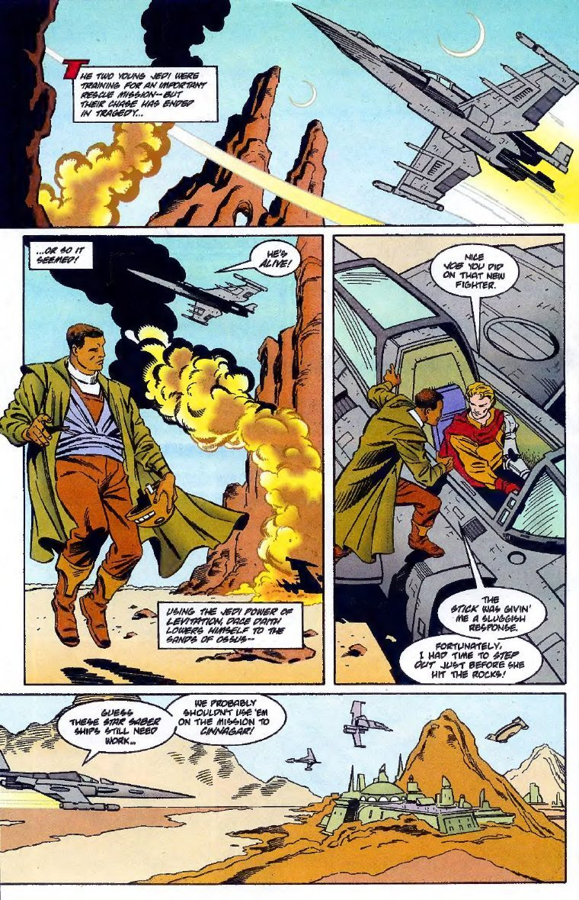
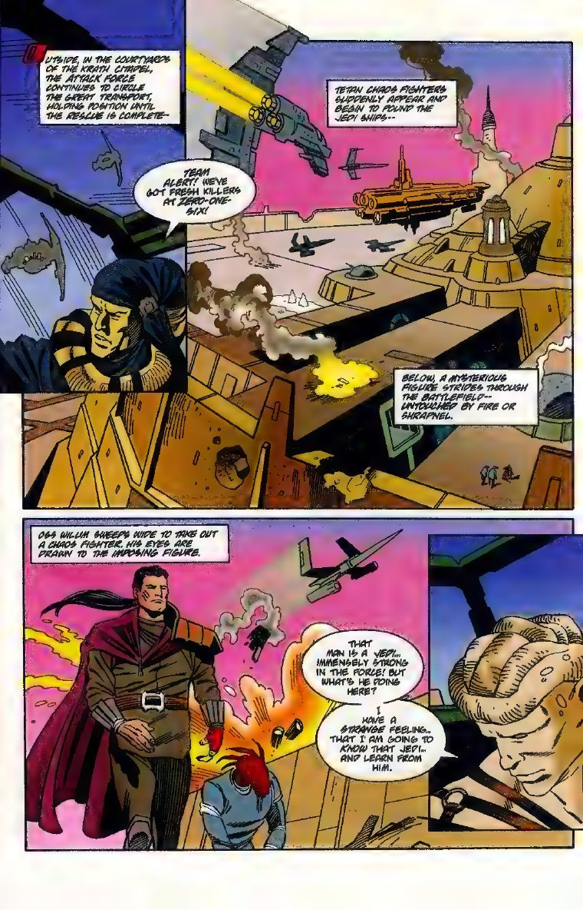
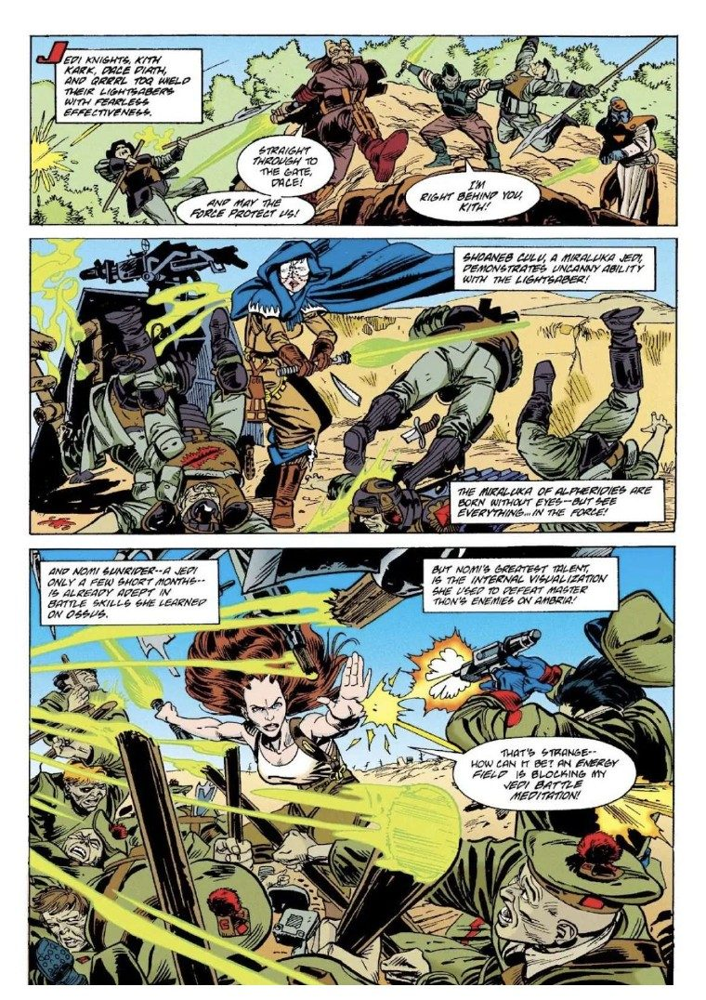
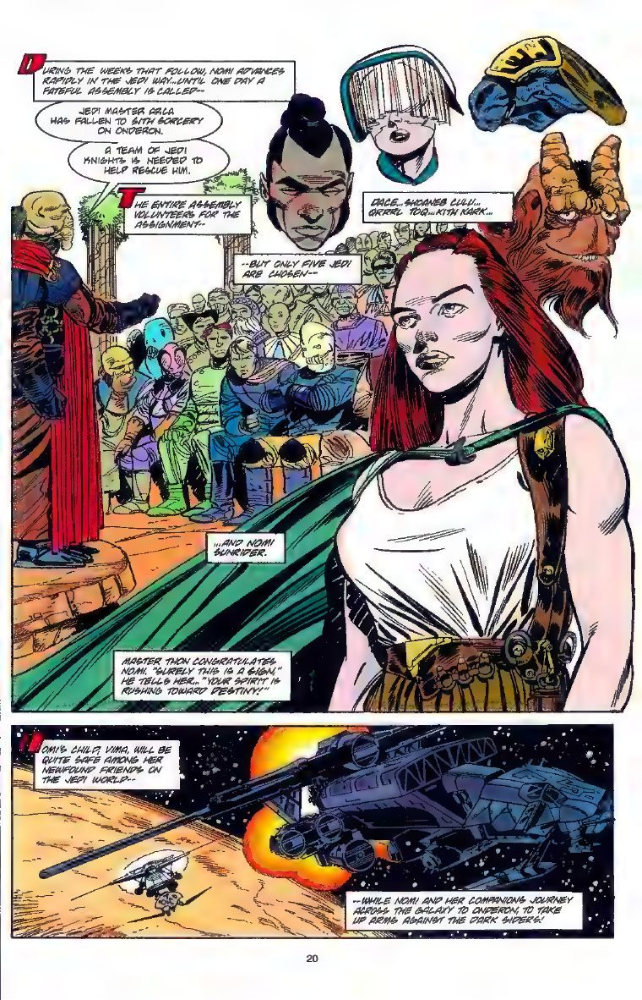
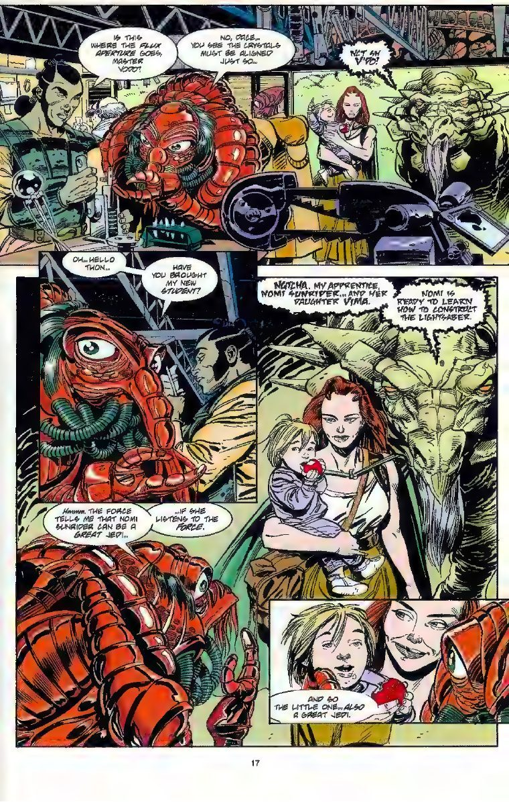
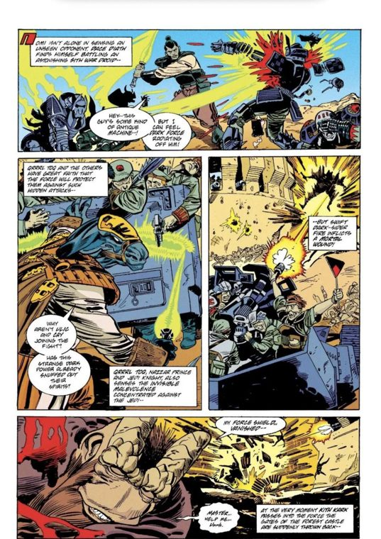
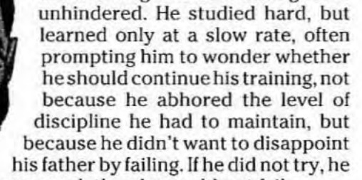
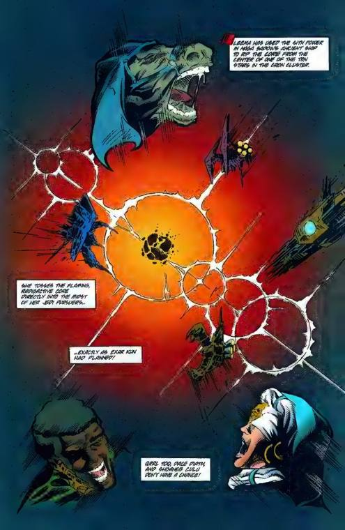

# Dace Diath

- **Aliases:** Dace
- **Era:** Great Sith War
- **Continuity:** default Legends; entries present for: Legends
- **Research tier:** untiered (not listed as INTRO/DEEP/MASTERY in legends-feats.md)
- **Entries:** 30 (15 with quotations; 1 quotations extended to the full sentence/passage from the source text on file; 4 marked as fragments). Rebuilt 2026-11-17 from 39 old entries; old file: `characters/_bak/dace-diath.md.bak-20261117`.
- **How to read:** each entry is the quotation in full (block quote), then its source and point of view. "Note" lines are summaries from our notes, not quotations. `[fragment — full passage not on file]` means the source text is not on the box, so only the words in our notes are shown. Debate and forum material is in the last section and is unverified.

# LEGENDS (Legends / EU — main focus)

## Tales of the Jedi: Freedon Nadd Uprising #1–2, Dark Lords of the Sith #1–6, The Sith War #1–6, plus the WEG Tales of the Jedi Companion (power-scaling notes)

- Note (summary from our notes, not a quotation): Dace crash-lands the Star Saber (p4–6). The masters' council (p8–9). The Jedi raid on Cinnagar (p12–17); Nomi's battle meditation dissolves Aleema's illusions; Ulic blasts Nomi with the amulet and she leaves him (p18–21). Exar blasts Aleema and duels Ulic; the amulets join and a Dark Lord's spirit anoints Exar and Ulic (p23–27).
  — Source: Owner Material 024b — Tales of the Jedi: Dark Lords of the Sith #1–6 (1994–95): power-scaling notes.

Our notes: `notes/materials/024-tales-of-the-jedi/dark-lords-of-the-sith.md:46`

- Note (summary from our notes, not a quotation): Crash-lands the Star Saber and levitates down safely. Source: Dark Lords of the Sith #6, p4–6
  — Source: Owner Material 024b — Tales of the Jedi: Dark Lords of the Sith #1–6 (1994–95): power-scaling notes.

Our notes: `notes/materials/024-tales-of-the-jedi/dark-lords-of-the-sith.md:243`

- Note (summary from our notes, not a quotation): Destroys the Cinnagar gun tower during the rescue raid. Source: Dark Lords of the Sith #6, p12–14
  — Source: Owner Material 024b — Tales of the Jedi: Dark Lords of the Sith #1–6 (1994–95): power-scaling notes.

Our notes: `notes/materials/024-tales-of-the-jedi/dark-lords-of-the-sith.md:245`

> AND NOMI SUNRIDER--A JEDI ONLY A FEW SHORT MONTHS--IS ALREADY ADEPT IN BATTLE SKILLS SHE LEARNED ON OSSUS.
>
> BUT NOMI'S GREATEST TALENT, IS THE INTERNAL VISUALIZATION SHE USED TO DEFEAT MASTER THON'S ENEMIES ON AMBRIA!
— Source: Owner Material 024a — Tales of the Jedi: The Freedon Nadd Uprising #1–2 (1994): power-scaling notes; Narration on Nomi Sunrider. POV: narrator, about Dace Diath.
Note (our notes, around the quote): Narration on Nomi Sunrider: "AND NOMI SUNRIDER--A JEDI ONLY A FEW SHORT MONTHS--IS ALREADY ADEPT IN BATTLE SKILLS SHE LEARNED ON OSSUS." "BUT NOMI'S GREATEST TALENT, IS THE INTERNAL VISUALIZATION SHE USED TO DEFEAT MASTER THON'S ENEMIES ON AMBRIA!" · NARRATION. Source: Freedon Nadd Uprising #2, p5

Our notes: `notes/materials/024-tales-of-the-jedi/freedon-nadd-uprising.md:167`

> THAT'S STRANGE-- HOW CAN IT BE? AN ENERGY FIELD IS BLOCKING MY JEDI BATTLE MEDITATION!
— Source: Owner Material 024a — Tales of the Jedi: The Freedon Nadd Uprising #1–2 (1994): power-scaling notes; Her battle meditation is blocked by Ommin.
Note (our notes, around the quote): Her battle meditation is blocked by Ommin: "THAT'S STRANGE-- HOW CAN IT BE? AN ENERGY FIELD IS BLOCKING MY JEDI BATTLE MEDITATION!" Source: Freedon Nadd Uprising #2, p5

Our notes: `notes/materials/024-tales-of-the-jedi/freedon-nadd-uprising.md:169`

> SHOANEB CULU, A MIRALUKA JEDI, DEMONSTRATES UNCANNY ABILITY WITH THE LIGHTSABER!
>
> THE MIRALUKA OF ALPHERIDIES ARE BORN WITHOUT EYES--BUT SEE EVERYTHING...IN THE FORCE!
> [fragment — full passage not on file]
— Source: Owner Material 024a — Tales of the Jedi: The Freedon Nadd Uprising #1–2 (1994): power-scaling notes; Narration on Shoaneb Culu. POV: narrator, about Dace Diath.
Note (our notes, around the quote): Narration on Shoaneb Culu: "SHOANEB CULU, A MIRALUKA JEDI, DEMONSTRATES UNCANNY ABILITY WITH THE LIGHTSABER!" "THE MIRALUKA OF ALPHERIDIES ARE BORN WITHOUT EYES--BUT SEE EVERYTHING...IN THE FORCE!" · NARRATION. Source: Freedon Nadd Uprising #2, p5

Our notes: `notes/materials/024-tales-of-the-jedi/freedon-nadd-uprising.md:201`

- Note (summary from our notes, not a quotation): Learning lightsaber construction under Vodo; chosen for the Onderon rescue team. Source: Freedon Nadd Uprising #1, p19, p22
  — Source: Owner Material 024a — Tales of the Jedi: The Freedon Nadd Uprising #1–2 (1994): power-scaling notes.

Our notes: `notes/materials/024-tales-of-the-jedi/freedon-nadd-uprising.md:205`

> JEDI KNIGHTS, KITH KARK, DACE DIATH, AND QRRRL TOQ WIELD THEIR LIGHTSABERS WITH FEARLESS EFFECTIVENESS.
— Source: Owner Material 024a — Tales of the Jedi: The Freedon Nadd Uprising #1–2 (1994): power-scaling notes; Narration on the rescue Knights. POV: narrator, about Dace Diath.
Note (our notes, around the quote): Narration on the rescue Knights: "JEDI KNIGHTS, KITH KARK, DACE DIATH, AND QRRRL TOQ WIELD THEIR LIGHTSABERS WITH FEARLESS EFFECTIVENESS." · NARRATION. Source: Freedon Nadd Uprising #2, p5

Our notes: `notes/materials/024-tales-of-the-jedi/freedon-nadd-uprising.md:208`; `notes/materials/024-tales-of-the-jedi/freedon-nadd-uprising.md:255`

> HEY--THIS GUY'S SOME KIND OF ANTIQUE MACHINE--!
>
> BUT I CAN FEEL DARK FORCE RADIATING OFF HIM!
— Source: Freedon Nadd Uprising #2, p6 — Owner Material 024a — Tales of the Jedi: The Freedon Nadd Uprising #1–2 (1994): power-scaling notes; Fights a Sith war droid and senses its dark Force.
Note (our notes, around the quote): Fights a Sith war droid and senses its dark Force: "HEY--THIS GUY'S SOME KIND OF ANTIQUE MACHINE--!" "BUT I CAN FEEL DARK FORCE RADIATING OFF HIM!" Source: Freedon Nadd Uprising #2, p6

Our notes: `notes/materials/024-tales-of-the-jedi/freedon-nadd-uprising.md:210`

- Note (summary from our notes, not a quotation): RPG MECHANICS: Dace Diath, Jedi Knight. Force skills Control 2D+1, Sense 2D, Alter 1D+2. Lightsaber 4D+1, Dexterity 2D+2. Source: Tales of the Jedi Companion (WEG, 1996), p.23
  — Source: Tales of the Jedi Companion (WEG, 1996), p.23 — Owner Material 024d — Tales of the Jedi Companion (West End Games, 1996): power-scaling notes.
Our notes: `notes/materials/024-tales-of-the-jedi/tales-of-the-jedi-companion.md:203`

> Feed on dark side, inflict pain Control, Sense, and Alter: Affect mind, telekinetic kill Sense and Alter: Dim other's senses, lesser Force shield This character is Force-sensitive Force Points: 24 Dark Side Points: Character Points: 28 Move: 10 Equipment: Ughtsaber (50) DACE DJATH The son of Jedi Master Sidrona Diath of Tatooine, Dace spent his entire life under the tutelage of his father. Only recently did he come to Ossus to begin training under Master Vodo. The seclusion of his remote homeworld allowed Dace to concentrate on understanding the Force and allowing it to flow through him unhindered. He studied hard, but learned only at a slow rate, often prompting him to wonder whether he should continue his training, not because he abhored the level of discipline he had to maintain, but because he didn't want to disappoint his lather by failing. II he did notlry, he reasoned, then he could not fail. Usually, his father noticed these times of doubt and did all he could to renew Dace's faith in himself and in the Force. Though Sidrona had not had such a difficult time mastering the Jedi Way, he had discovered over the years that those Jedi who had worked hardest to attain their connection to the Force often became the most proficient teachers, for they could better understand the trials their students had to overcome.
— Source: Owner Material 024d — Tales of the Jedi Companion (West End Games, 1996): power-scaling notes; Narrative bio: Dace.
(Excerpt widened 2026-11-17 to the relevant passage, word for word from research primary tales of the jedi WEG40082 (text copy `research_primary_tales_of_the_jedi_WEG40082_pdf_afa57d0500`).)
(Excerpt widened 2026-11-17 to the relevant passage, word for word from research primary tales of the jedi WEG40082 (text copy `research_primary_tales_of_the_jedi_WEG40082_pdf_afa57d0500`).)
(Full sentence/passage taken from the source text on file: `research_primary_tales_of_the_jedi_WEG40082_pdf`.)
Note (our notes, around the quote): Narrative bio: Dace "studied hard, but learned only at a slow rate". Source: Tales of the Jedi Companion (WEG, 1996), p.23

Our notes: `notes/materials/024-tales-of-the-jedi/tales-of-the-jedi-companion.md:204`

- Note (summary from our notes, not a quotation): | Dace Diath | 2D+1 | 2D | 1D+2 | 4D+1 | p.23 |
  — Source: Owner Material 024d — Tales of the Jedi Companion (West End Games, 1996): power-scaling notes.
Context: | Character | Control | Sense | Alter | Lightsaber | Page |
Our notes: `notes/materials/024-tales-of-the-jedi/tales-of-the-jedi-companion.md:346`

- Note (summary from our notes, not a quotation): | #4 | 1–26 | Jedi Holocaust | Ambria, galaxy montage, Cron Cluster | Oss Wilum and Crado attack Thon; Sylvar claws Crado. Students murder their masters. Aleema rips a star's core out and kills Dace, Shoaneb and Qrrrl Toq; the Cron supernova kills Aleema and Crado. |
  — Source: Owner Material 024c — Tales of the Jedi: The Sith War #1–6 (1995–96): power-scaling notes.
Context: | Issue | PDF pages | Title | Setting | Main events |
Our notes: `notes/materials/024-tales-of-the-jedi/the-sith-war.md:18`

- Note (summary from our notes, not a quotation): Using Naga Sadow's ship, rips the core out of one of the ten Cron stars and hurls it at the pursuing Jedi, killing Dace Diath, Shoaneb Culu and Qrrrl Toq. Source: The Sith War #4, p17–22
  — Source: The Sith War #4, p17–22 — Owner Material 024c — Tales of the Jedi: The Sith War #1–6 (1995–96): power-scaling notes.
Our notes: `notes/materials/024-tales-of-the-jedi/the-sith-war.md:149`

- Note (summary from our notes, not a quotation): Killed with Shoaneb Culu and Qrrrl Toq ("QREL TOQ") by Aleema's stellar core. Source: The Sith War #4, p21–22
  — Source: The Sith War #4, p21–22 — Owner Material 024c — Tales of the Jedi: The Sith War #1–6 (1995–96): power-scaling notes.

Our notes: `notes/materials/024-tales-of-the-jedi/the-sith-war.md:250`

- Note (summary from our notes, not a quotation): | 9 | Aleema vs Dace, Shoaneb, Qrrrl Toq | Cron Cluster | p17–22 (#4) | All three killed | Sadow's ship, stellar core |
  — Source: Owner Material 024c — Tales of the Jedi: The Sith War #1–6 (1995–96): power-scaling notes.
Context: | # | Fight | Where | Pages (issue) | Outcome | Conditions |
Our notes: `notes/materials/024-tales-of-the-jedi/the-sith-war.md:277`

## The Complete Star Wars Encyclopedia, Vol. I (A–G)

- Note (summary from our notes, not a quotation): Page contents: 1051 words, 32 paragraphs | headings/entries: Bondo; Bonearm, Dace; Bonearm, Uz; Boneyard Rendezvous; Bongomeken Cooperative; Booda, Fenn; Boog; Booldrum; Boon, Brookish; Boonta
  — Source: scan pages 81–120.
Our notes: `notes/materials/030-complete-star-wars-encyclopedia-vol-1/02-v1-scan-081-120.md:159`

- Note (summary from our notes, not a quotation): Page contents: 900 words, 30 paragraphs | headings/entries: Dezsetes, Second Officer; D'harhan; Dharrg, Shunta Osarian; Dha Werda Verda; Dhol, Lady; Dhur, Den; Diado; Diamala; Diamond; Diath, Dace; Diath, Nico
  — Source: scan pages 201–240.
Our notes: `notes/materials/030-complete-star-wars-encyclopedia-vol-1/05-v1-scan-201-240.md:24`

> Diath, Sidrona A Jedi Master and father of Jedi Dace Diath, he was killed in the Battle of Basilisk some 4,000 years before the Galactic Civil War.
— Source: scan pages 201–240; Dace Diath. POV: Dace Diath.
Note (our notes, around the quote): Dace Diath: "Diath, Sidrona A Jedi Master and father of Jedi Dace Diath, he was killed in the Battle of Basilisk some 4,000 years before the Galactic Civil War." Source: The Complete Star Wars Encyclopedia, Vol. I, p.189
Our notes: `notes/materials/030-complete-star-wars-encyclopedia-vol-1/05-v1-scan-201-240.md:33`

> After Dagore was taken captive by Dace Bonearm and IG-72, Godalhi took possession of the Moldy Crow and brought it back to the Alliance Dreadnaught New Hope.
— Source: scan pages 361–398; Dace Diath. POV: Dace Diath.
Note (our notes, around the quote): Dace Diath: "After Dagore was taken captive by Dace Bonearm and IG-72, Godalhi took possession of the Moldy Crow and brought it back to the Alliance Dreadnaught New Hope." Source: The Complete Star Wars Encyclopedia, Vol. I, p.349
Our notes: `notes/materials/030-complete-star-wars-encyclopedia-vol-1/09-v1-scan-361-398.md:31`

## Power of the Jedi Sourcebook (d20, 2002)

> In an instant, the resulting supemova incinerated many Jedi Knights, including Qrrrl Toq, Dace Diath, and Shoaneb Culu.
— Source: Chapter One: History of the Jedi; Qrrrl Toq; Dace Diath; Shoaneb Culu.
Note (our notes, around the quote): Qrrrl Toq; Dace Diath; Shoaneb Culu: "In an instant, the resulting supemova incinerated many Jedi Knights, including Qrrrl Toq, Dace Diath, and Shoaneb Culu." Source: Power of the Jedi Sourcebook, p.7
Our notes: `notes/materials/033-power-of-the-jedi-sourcebook/01-ch1-history.md:34`

- Note (summary from our notes, not a quotation): Page contents: 752 words, 20 paragraphs | headings/entries: JAC; Dace Diath, Jedi Knight
  — Source: Chapter Six: Jedi traditions and famous Jedi.
Our notes: `notes/materials/033-power-of-the-jedi-sourcebook/06-ch6-jedi-traditions.md:98`

> The Jedi forces defeated the Naddists and entombed Freedon Nadd's remains on Onderon's beast moon, Dxun.
— Source: Chapter Six: Jedi traditions and famous Jedi; Dace Diath; Freedon Nadd — entry/section: Dace Diath, Jedi Knight.
Note (our notes, around the quote): Dace Diath; Freedon Nadd — entry/section: Dace Diath, Jedi Knight: "The Jedi forces defeated the Naddists and entombed Freedon Nadd's remains on Onderon's beast moon, Dxun." Source: Power of the Jedi Sourcebook, p.106
Our notes: `notes/materials/033-power-of-the-jedi-sourcebook/06-ch6-jedi-traditions.md:102`

> Dace was one of the Jedi who survived.
— Source: Chapter Six: Jedi traditions and famous Jedi; Dace Diath — entry/section: Dace Diath, Jedi Knight.
Note (our notes, around the quote): Dace Diath — entry/section: Dace Diath, Jedi Knight: "Dace was one of the Jedi who survived." Source: Power of the Jedi Sourcebook, p.106
Our notes: `notes/materials/033-power-of-the-jedi-sourcebook/06-ch6-jedi-traditions.md:104`

> The starfighter exploded on impact, but Dace ejected and used the Force to break his fall.
— Source: Chapter Six: Jedi traditions and famous Jedi; Dace Diath — entry/section: Dace Diath, Jedi Knight.
Note (our notes, around the quote): Dace Diath — entry/section: Dace Diath, Jedi Knight: "The starfighter exploded on impact, but Dace ejected and used the Force to break his fall." Source: Power of the Jedi Sourcebook, p.106
Our notes: `notes/materials/033-power-of-the-jedi-sourcebook/06-ch6-jedi-traditions.md:106`

> While valiantly fighting for justice, Dace was vaporized along with the rest of the Republic ships.
— Source: Chapter Six: Jedi traditions and famous Jedi; Dace Diath — entry/section: Dace Diath, Jedi Knight.
Note (our notes, around the quote): Dace Diath — entry/section: Dace Diath, Jedi Knight: "While valiantly fighting for justice, Dace was vaporized along with the rest of the Republic ships." Source: Power of the Jedi Sourcebook, p.107
Our notes: `notes/materials/033-power-of-the-jedi-sourcebook/06-ch6-jedi-traditions.md:115`

## Sourcebooks/Secrets of Tatooine.pdf [Star Wars Roleplaying Game (d20, 2000)] (scan pages 1–60)

- Note (summary from our notes, not a quotation): Page contents: Jedi Knights Sidrona Diath and son Dace Diath came from Tatooine in the early-settler era; worrt once attacked its own reflection; Jabba keeps worrts at his palace (hand-read)
  — Source: Sourcebooks/Secrets of Tatooine.pdf [Star Wars Roleplaying Game (d20, 200.
Our notes: `notes/materials/037-sw-d20-folder/045-secrets-of-tatooine-scan-001-060.md:103`

## Characters/The Dark Forces Saga/The Dark Forces Saga, Part 2.pdf [Star Wars Roleplaying Game Revised Core (d20, 2002)]

- Note (summary from our notes, not a quotation): Page contents: Rahn skills/feats; Flights of the Moldy Crow: ship history (Roark Garnet, Grappa the Hutt, Dace Bonearm, IG-72, Winfrid Dagore, Palob Godalhi, Raven's Claw); HWK-290 stats (hand-read)
  — Source: Characters/The Dark Forces Saga/The Dark Forces Saga, Part 2.pdf [Star Wa.
Our notes: `notes/materials/037-sw-d20-folder/129-the-dark-forces-saga-part-2.md:46`

> The Moldy Crow was produced approximately a decade after the last Old Republic Battle of Coruscant as part of the Corellian Engineering Corporation's Hawk series of transports. One of the ship's earliest owners was the smuggler Roark Garnet, who, after inheriting the Dorion Discus from his dead gunslinging sister Neena, used it as payment for debts incurred to Grappa the Hutt. Filched from Grappa by Dace Bonearm and IG-72, the Moldy Crow was subsequently dumped on the planet Teth after the two hunters used it as a decoy to capture Rebel commander Winfrid Dagore and claim the Imperial bounty on her. The Crow then fell into the hands of Lieutenant Palob Godalhi, who gave up the beat-up freighter to the Rebel dreadnaught New Hope. There it was refitted and later requisitioned by Kyle Katarn, though Jan Ors more frequently piloted the ship. The Crow was demolished during Kyle and Jan's mission to the Valley of the Jedi, and eventually replaced by the ship Raven's Claw.
— Source: Characters/The Dark Forces Saga/The Dark Forces Saga, Part 2.pdf [Star Wa; Kyle Katarn; Jan Ors — entry/section: The Moldy Crow.
Note (our notes, around the quote): Kyle Katarn; Jan Ors — entry/section: The Moldy Crow: "The Moldy Crow was produced approximately a decade after the last Old Republic Battle of Coruscant as part of the Corellian Engineering Corporation's Hawk series of transports. One of the ship's earliest owners was the smuggler Roark Garnet, who, after inheriting the Dorion Discus from his dead gunslinging sister Neena, used it as payment for debts incurred to Grappa the Hutt. Filched from Grappa by Dace Bonearm and IG-72, the Moldy Crow was subsequently dumped on the planet Teth after the two hunters used it as a decoy to capture Rebel commander Winfrid Dagore and claim the Imperial bounty on her. The Crow then fell into the hands of Lieutenant Palob Godalhi, who gave up the beat-up freighter to the Rebel dreadnaught New Hope. There it was refitted and later requisitioned by Kyle Katarn, though Jan Ors more frequently piloted the ship. The Crow was demolished during Kyle and Jan's mission to the Valley of the Jedi, and eventually replaced by the ship Raven's Claw." Source: *The Dark Forces Saga, Part 2* (SWRPG d20 Revised Core), scan p.3
Our notes: `notes/materials/037-sw-d20-folder/129-the-dark-forces-saga-part-2.md:48`

# Debate and forum claims (unverified)

Forum posts, Suspect Insight debates and Discord debates, respect threads, and verdicts. These are posters' arguments or quotations they typed; none is checked against the book here unless the entry says so.

## Lord Hoth (Vaelias) vs Odan-Urr (Darthor)

> the key take-away here is that while 1-40 roll can all damage characters and DS spirits, it takes 41 or higher roll to even AFFECT a DS site, and it's "extremely difficult" to go from extreme to minor to not tainted
>
> Let's look at some of the release of DS power that was recorded by the Jedi shall we?
>
> Firstly: Ku'ar Danar:
> [fragment — full passage not on file]
>
> - The power of the DS gave Ku'ar Danar the ability to "move a planet" (which he did in a ritual that created a monolith). This feat was recorded by a Jedi named Dace and logically on the Jedi archive.
> [fragment — full passage not on file]
>
> Secondly Naga Sadow:
> [fragment — full passage not on file]
>
> He was capable of causing a supernova and destroy a star system:
— Source: Lord Hoth (Vaelias) vs Odan-Urr (Darthor) — https://www.suspectinsightforums.com/t4487-ss-lord-hoth-vaelias-vs-odan-urr-darthor.
Context: Q119 — Source: Darthor
Posted by: not named in our notes (see thread/notes link).
Our notes: `suspect-insight/debates/121-lord-hoth-vs-odan-urr.md:531`
