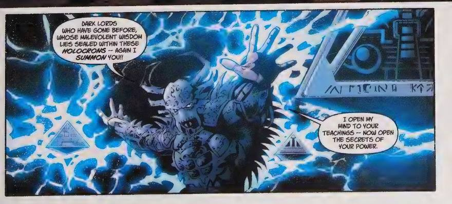
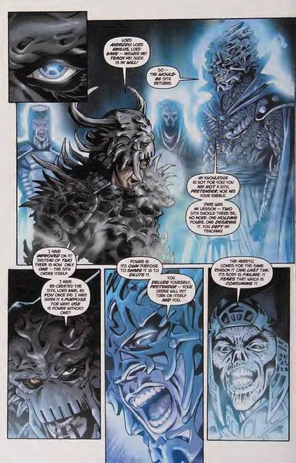
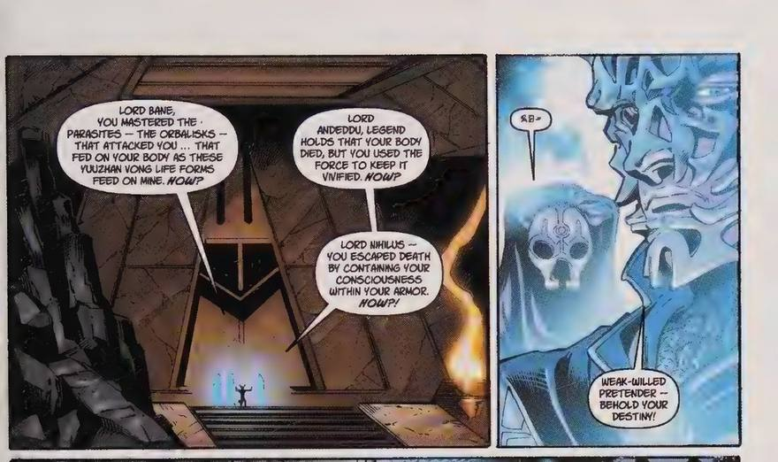
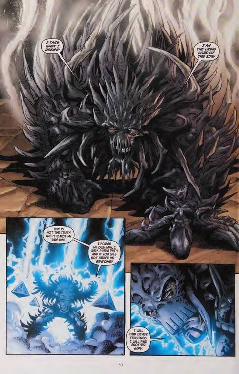
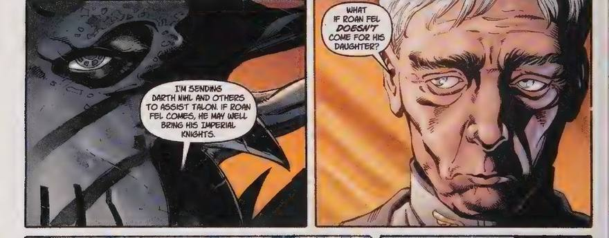
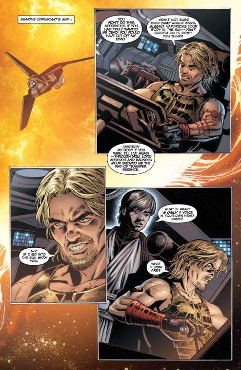

# Darth Andeddu

- **Aliases:** Andeddu
- **Era:** Pre-Republic / Legacy
- **Continuity:** default Legends; entries present for: Legends
- **Research tier:** untiered (not listed as INTRO/DEEP/MASTERY in legends-feats.md)
- **Entries:** 272 (84 with quotations; 15 quotations extended to the full sentence/passage from the source text on file; 34 marked as fragments; 36 before the 2026-11-17 fragment fill). Rebuilt 2026-11-17 from 335 old entries; old file: `characters/_bak/darth-andeddu.md.bak-20261117`.
- **How to read:** each entry is the quotation in full (block quote), then its source and point of view. "Note" lines are summaries from our notes, not quotations. `[fragment — full passage not on file]` means the source text is not on the box, so only the words in our notes are shown. Debate and forum material is in the last section and is unverified.

# LEGENDS (Legends / EU — main focus)

## Star Wars: The New Essential Chronology (Del Rey, 2005): power-scaling and lore notes

> The first was the suspicious explosion of Valorum’s transport as it lifted off from a Coruscant starport, killing Finis Valorum and everyone else aboard. The second was Palpatine’s exploitation of the incident to Pass another secu: rity bill, which gave him unprecedented central power.
>
> Clearly, aboveboard politkking was not enough, Over 71 === PDF p.82 === the next several months, Ball Organa and Mon Mothma, with the occasional help of other Senators including Garm Bel Iblis of Isolationist Corellia, began laying the groundwork for a political alliance opposed to Palpatine’s rule.
>
> CORUSCANT ASSASSINATION 20.63 B.B.Y.(1 year, 4 months after the Battle of Gconosis) Ooku wasted no time sending his new agent, Quinlan Vos, on missions, On the Sith tomb world of Korriban, Quinlan retrieved a holocron once belonging to the Sith Lord Darth Andeddu from a booby-trapped catacomb. On Coruscant, Quinian assassinated a doublevdeating Senator who had displeased Dooku.
>
> CORUSCANT ASSASSINATION 20.63 B.B.Y.(1 year, 4 months after the Battle of Gconosis) Ooku wasted no time sending his new agent, Quinlan Vos, on missions, On the Sith tomb world of Korriban, Quinlan retrieved a holocron once belonging to the Sith Lord Darth Andeddu from a booby-trapped catacomb. On Coruscant, Quinian assassinated a doublevdeating Senator who had displeased Dooku. While escaping from Coruscant, he ran afoul of the Whiphid Jedi Master K’Kruhk, hero of Teyr and former dissident Jedi.
— Source: Part Two: The Fall of the Republic; Quinlan Vos; Darth Andeddu — Andeddu holocron.
(Excerpt widened 2026-11-17 to the relevant passage, word for word from research primary new essential chronology nec paged (text copy `research_primary_new_essential_chronology_nec_paged_txt_88b808b5bc`).)
(Excerpt widened 2026-11-17 to the relevant passage, word for word from research primary new essential chronology nec paged (text copy `research_primary_new_essential_chronology_nec_paged_txt_88b808b5bc`).)
Note (our notes, around the quote): Quinlan Vos; Darth Andeddu — Andeddu holocron: "On the Sith tomb world of Korriban, Quinlan retrieved a holocron once belonging to the Sith Lord Darth Andeddu from a booby-trapped catacomb." Source: The New Essential Chronology, p.72
Our notes: `notes/materials/027-new-essential-chronology/02-part-two-fall-of-the-republic.md:378`

## The Complete Star Wars Encyclopedia, Vol. I (A–G)

- Note (summary from our notes, not a quotation): Page contents: 1124 words, 25 paragraphs | headings/entries: Anaxes; Anchorhead; Anchoron; Anda; Andara; Andeddu, Darth; Ando; Andona, Mari'ha; Ando Prime; Andosha Il; Andray, Moff
  — Source: scan pages 41–80.
Our notes: `notes/materials/030-complete-star-wars-encyclopedia-vol-1/01-v1-scan-041-080.md:36`

> Another planet in the sys­ tem, Ieria, was dissatisfied by Andaran repre­ sentation in the Senate and battled for its own representation. Andara was the site of the Leadership School, an elite private academy. Andeddu, Darth A long-dead Sith Lord whose holocron was sought by Quinlan Vos and Skorr on Korriban in order to curry favor with Count Dooku. Hidden within the holo­ cron was the red crystal that powered An­ deddu's lightsaber. Dooku gave this crystal to Quinlan Vos. Over a century later, during the time of Roan Fel's empire, Darth Krayt was in possession of Andeddu's holocron. Ando A watery planet in the Mid Rim with few solid landmasses, Ando was home to the belligerent, walrus-faced Aqualish. The higher-class Aquala ("webbed" Aqualish) pre­ ferred to live on floating raft cities and large sailing ships, while the low-status Quara ("fin- Ancient Order of Pessimists gered" Aqualish) inhabited the larger islands of Ando. Ando mainly exported foodstuffs from its seas. A sister planet in the same system had a blasted, uninhabitable surface, the appar­ ent aftermath of an Aqualish war soon after the species discovered space travel.
— Source: scan pages 41–80; Darth Andeddu; Roan Fel; Darth Krayt — entry/section: Andeddu, Darth.
(Excerpt widened 2026-11-17 to the relevant passage, word for word from research primary cse vol1 (text copy `research_primary_cse_vol1_pdf_45a954be6d`).)
(Excerpt widened 2026-11-17 to the relevant passage, word for word from research primary cse vol1 (text copy `research_primary_cse_vol1_pdf_45a954be6d`).)
Note (our notes, around the quote): Darth Andeddu; Roan Fel; Darth Krayt — entry/section: Andeddu, Darth: "Over a century later, during the time of Roan Fel's empire, Darth Krayt was in possession of Andeddu's holocron." Source: The Complete Star Wars Encyclopedia, Vol. I, p.30
Our notes: `notes/materials/030-complete-star-wars-encyclopedia-vol-1/01-v1-scan-041-080.md:40`

## Adventures/Dawn of Defiance/09 - Sword of the Empire.pdf [Star Wars Roleplaying Game Saga Edition (2007)]

- Note (summary from our notes, not a quotation): Page contents: Campaign update: days to weeks after The Gem of Alderaan; Lady Alya Aldrete gives access, not gifts. Summary: Jekk Seejo and mynocks; Prakith touched by the dark side as site of Darth Andeddu's tomb (undiscovered until the Legacy era); the native Stereb stoneworkers; Mining Guild; Prak City and the Citadel Inquisitorius 100+ km west in the Magraddor Range; Herdr'tui leads heroes to the Drains and the devourer; the Stereb see themselves as the planet's antibodies; speeder-bike flight over an underground ocean under fear moss; night raid on the Citadel; cybernetically improved Inquisitor Draco; Master Denia's self-sacrifice forces Draco to abandon the Citadel. (hand-read)
  — Source: Adventures/Dawn of Defiance/09 - Sword of the Empire.pdf [Star Wars Rolep.
Our notes: `notes/materials/037-sw-d20-folder/711-09-sword-of-the-empire.md:20`

> Service Entrance: The second point of entry, not too far away, is what appears to be a seldom-used service elevator with a control panel. This elevator leads to Route 3, which takes the heroes past the training center. To enter this way, the heroes must make a DC 30 Use Computer check (+10 if they have an Inquisitor’s code cylinder). Heroes cannot activate the elevators until any outstanding CST encounters triggered by their Stealth or Use Computer checks are resolved. The Citadel will not put the elevators into lockdown while they’re still running Response Teams downstairs. This is new to them— nobody’s ever been crazy enough to assault the Citadel before. Variant Methods for Citadel Entry Although the safest method for entering the Citadel is befriending the Stereb and traveling underground, you should allow the heroes to explore other methods if they choose. Most are unlikely to succeed, but their futility is not without good reason. The heroes might attempt subterfuge by stealing Inquisitor robes and garb in Prak City. Inquisitors are cycled back and forth from the Citadel on set duty rosters, with regular holographic check-ins along the way.
— Source: Adventures/Dawn of Defiance/09 - Sword of the Empire.pdf [Star Wars Rolep.
(Excerpt widened 2026-11-17 to the relevant passage, word for word from imary sw d20 folder files Star Wars Roleplaying Game Saga Edition Adventures Dawn of Defiance 09 Sword of the Empire (text copy `imary_sw_d20_folder_files_Star_Wars_Roleplaying_Game_Saga_Edition_Adventures_Dawn_of_Defiance_09_Sword_of_the_Empire_pdf_77329dcca1`).)
(Excerpt widened 2026-11-17 to the relevant passage, word for word from imary sw d20 folder files Star Wars Roleplaying Game Saga Edition Adventures Dawn of Defiance 09 Sword of the Empire (text copy `imary_sw_d20_folder_files_Star_Wars_Roleplaying_Game_Saga_Edition_Adventures_Dawn_of_Defiance_09_Sword_of_the_Empire_pdf_77329dcca1`).)
(Full sentence/passage taken from the source text on file: `imary_sw_d20_folder_files_Star_Wars_Roleplaying_Game_Saga_Edition_Adventures_Dawn_of_Defiance_09_Sword_of_the_Empire_pdf`.)
Note (our notes, around the quote): Page contents: Part 3: read-aloud of the Citadel Inquisitorius at night—a black-on-black spire amid an ancient plaza of eight 100-meter Stereb columns ("pores"), like a sundial; Imperial architects built on the Stereb clearing; possibly Darth Andeddu brought the Stereb to Prakith as slaves. Approaches: fast dash (DC 30 Stealth, DC 25 Use Computer; Route 1) or reconnoiter (two DC 25 Stealth) for the Prisoners' Entrance (Route 2, DC 25) or Service Entrance (Route 3, DC 30); "nobody's ever been crazy enough to assault the Citadel before." Other approaches sidebar (fresh OCR): stolen Inquisitor robes (paired speeders, holographic check-ins, code cylinders), supply transports (weights managed), letting themselves be captured (if identified as Force-users, foes of Valin Draco, or Bail Organa supporters; whole-party capture ends the adventure; Jekk Seejo can help an escape). (hand-read)
Our notes: `notes/materials/037-sw-d20-folder/711-09-sword-of-the-empire.md:122`

> Part 3: Into the Citadel When the heroes get their first glimpse of Citadel Inquisitorius from nearby, most likely when they emerge from the catacombs, read the following text aloud: If the heroes came through the Stereb tunnels, they emerge from an overgrown, crumbled opening just below the base of one of the stone columns. These are the “pores” of which Eldr’nol spoke: Each of the Stereb columns rises from deep underground, and, if the heroes saw them from the air, they’d recognize the columns as something akin to smokestacks. The Stereb built the circle of columns here centuries ago, and Imperial architects took advantage of the paved clearing within the mountains to build the Citadel. Aesthetics played a role, as well; locating amid the ancient ruins appealed to the architects’ dark side sensibilities. (Indeed, there is a remote chance that Darth Andeddu brought the Stereb to Prakith as enslaved builders in the first place, centuries ago, although this is only a possibility.) It is not difficult to scale the building-block stonework to the surface of the plaza, and the approach by night is a lucky break. The plaza is not the source of much activity even in daytime. Because of the Stereb columns, most larger transports serve the Citadel from a platform near the top of the spire.
— Source: Adventures/Dawn of Defiance/09 - Sword of the Empire.pdf [Star Wars Rolep; Darth Andeddu. POV: Darth Andeddu.
(Excerpt widened 2026-11-17 to the relevant passage, word for word from imary sw d20 folder files Star Wars Roleplaying Game Saga Edition Adventures Dawn of Defiance 09 Sword of the Empire (text copy `imary_sw_d20_folder_files_Star_Wars_Roleplaying_Game_Saga_Edition_Adventures_Dawn_of_Defiance_09_Sword_of_the_Empire_pdf_77329dcca1`).)
(Excerpt widened 2026-11-17 to the relevant passage, word for word from imary sw d20 folder files Star Wars Roleplaying Game Saga Edition Adventures Dawn of Defiance 09 Sword of the Empire (text copy `imary_sw_d20_folder_files_Star_Wars_Roleplaying_Game_Saga_Edition_Adventures_Dawn_of_Defiance_09_Sword_of_the_Empire_pdf_77329dcca1`).)
Note (our notes, around the quote): Darth Andeddu: "(Indeed, there is a remote chance that Darth Andeddu brought the Stereb to Prakith as enslaved builders in the first place, centuries ago, although this is only a possibility.)" Source: *09 - Sword of the Empire* (SWRPG Saga Edition), scan p.18
Our notes: `notes/materials/037-sw-d20-folder/711-09-sword-of-the-empire.md:124`

## Star Wars: Legacy (Dark Horse, 2006–2010) single issues #20–#50, hand-read

- Note (summary from our notes, not a quotation): Script John Ostrander · art Omar Francia · colors Brad Anderson · letters Michael Heisler · cover Omar Francia ("SITH vs. SITH"). 24 pages read (p1 cover, p2 credits/recap, p3–24 story). Set 137 ABY. The Deep Core and Andeddu's Keep on Prakith, with a flashback to the Sith Temple on Coruscant just after Cade's escape (p4–6).
  — Source: Star Wars: Legacy #27 — "Into the Core" (Dark Horse, August 2008).
Our notes: `notes/materials/039-legacy-2006/legacy-27.md:3`

> — caption, Star Wars: Legacy #27, p. 3
> [fragment — full passage not on file]
>
> "I AM OBLIGED TO SHARE MY KNOWLEDGE ONLY WITH THOSE SITH WISE ENOUGH, POWERFUL ENOUGH TO COMMAND IT." (Andeddu holocron) · "THE TOMB ON KORRIBAN IN WHICH THIS HOLOCRON WAS FOUND WAS NOT THE REAL TOMB OF DARTH ANDEDDU." (Wyyrlok)
> [fragment — full passage not on file]
>
> — Star Wars: Legacy #27, p. 7
> [fragment — full passage not on file]
— Source: Star Wars: Legacy #27 — "Into the Core" (Dark Horse, August 2008).
Context: > "THE THIRD OF THAT NAME TO SERVE THE LORD OF THE ONE SITH -- DARTH KRAYT. CONFIDANT, ADVISOR, SEER, MASTER OF SITH LORE."
Our notes: `notes/materials/039-legacy-2006/legacy-27.md:25`

> — Gerlun, Star Wars: Legacy #27, p. 16
> [fragment — full passage not on file]
— Source: Star Wars: Legacy #27 — "Into the Core" (Dark Horse, August 2008). POV: Gerlun, about Darth Andeddu.
Context: > "HA! I, TOO, CAN USE THE FORCE!" · "THIS IS MY HATE! THIS IS MY VENGEANCE!"
Our notes: `notes/materials/039-legacy-2006/legacy-27.md:43`

> "YOU TRANSFERRED YOUR INTELLECT TO WHAT WE ASSUMED WAS A HOLOCRON. IT WAS MORE. IT WAS A SHELL -- JUST AS THAT MOLDERING CORPSE IS A SHELL." (Wyyrlok) · "KNOWLEDGE IS POWER AND TRUE SITH DO NOT SHARE POWER. I WILL GIVE YOU NOTHING BUT YOUR OWN DEATH." (Andeddu)
> [fragment — full passage not on file]
>
> — Star Wars: Legacy #27, p. 17
> [fragment — full passage not on file]
>
> "YOU HAVE DOUBTS, LORD WYYRLOK, AND DOUBTS CAN CRIPPLE!" · "YOUR ONLY MASTER SHOULD BE YOURSELF OR YOU ARE A SLAVE!"
>
> — Darth Andeddu, Star Wars: Legacy #27, p. 18
> [fragment — full passage not on file]
>
> "YOUR POWER IS IN THE MIND! YOUR MIND FORCES YOUR BODY TO OBEY EVEN THOUGH DEAD! THIS -- ALL THIS -- IS NOTHING MORE THAN A FORCE ILLUSION" (Wyyrlok) · "NO LESS POWERFUL FOR ALL THAT! WHAT YOU BELIEVE TO BE REAL IS WHAT IS REAL! EVEN YOUR OWN DEATH!" (Andeddu)
> [fragment — full passage not on file]
>
> — Star Wars: Legacy #27, p. 19
> [fragment — full passage not on file]
>
> "I AM DESTROYING YOU, ALL TRACE OF YOU. YOUR 'HOLOCRON' I WILL ALSO DESTROY." · "THE OLD WAYS -- YOUR WAYS -- HAVE FAILED. HERE, NOW -- WE ARE THE SITH!"
>
> — Darth Wyyrlok, Star Wars: Legacy #27, p. 21
> [fragment — full passage not on file]
— Source: Star Wars: Legacy #27 — "Into the Core" (Dark Horse, August 2008). POV: Darth Andeddu.
Context: (p16: Gerlun sets the holocron on the corpse's chest, and Andeddu's essence passes from the corpse into him.)
Our notes: `notes/materials/039-legacy-2006/legacy-27.md:46`; `suspect-insight/respect-threads/darth-andeddu--andeddu-darth-i-like-swords.md:11`; `external/mega-notes/andeddu-quotes.txt:11`; `suspect-insight/respect-threads/darth-andeddu--andeddu-darth-victreebelvictr.md:17`

> THERE IS NO SUBSTANCE STRONGER THAN THE WILL OF THE SITH.
>
> IT WILL ALL BEND TO HIS WILL.
>
> MY BOOKS! MY SCROLLS!
> [fragment — full passage not on file]
— Source: Star Wars: Legacy #27 — "Into the Core" (Dark Horse, August 2008).
Note (our notes, around the quote): (p17: Wyyrlok blocks Andeddu's Force lightning with his hand. p18: there is a storm of rocks, which turns out to be illusion. p19–21: the fight moves to an illusory lava field. Wyyrlok sees through it and burns Andeddu's books and scrolls. p22: Andeddu dies, the holocron crystal shatters, and Wyyrlok disposes of the body. p23–24, captions: "THERE IS NO SUBSTANCE STRONGER THAN THE WILL OF THE SITH." · "IT WILL ALL BEND TO HIS WILL." Speaker check p21: the first balloon, "I SENSE FEAR.", is Wyyrlok's. "MY BOOKS! MY SCROLLS!" is Andeddu's. The tail placements fit that reading.)
Our notes: `notes/materials/039-legacy-2006/legacy-27.md:60`

- Note (summary from our notes, not a quotation): New in roster: Darth Reave, the horned Zabrak Sith from #29. He is named in the p3 caption. Already in the roster: Krayt, Talon, Stryfe, Wyyrlok, Maladi ("LADY MALADI", p4), Andeddu, and XoXaan. Named in Wyyrlok's history: the Hundred-Year Darkness, Corbos, Leviathans, and Korriban.
  — Source: Star Wars: Legacy #30 — "Vector, Part 11 of 12" (Dark Horse, November 2008).
Our notes: `notes/materials/039-legacy-2006/legacy-30.md:5`

## Daily Research — 2026-10-21 session

> LORD NIHILUS -- YOU ESCAPED DEATH BY CONTAINING YOUR CONSCIOUSNESS WITHIN YOUR ARMOR. HOW?!
— Source: Daily Research — 2026-10-21 session.
Note (our notes, around the quote): Armor-bound existence. He keeps his spirit in his mask and armor. Primary confirmation from our own *Legacy* #5 read (p83), Krayt: "LORD NIHILUS -- YOU ESCAPED DEATH BY CONTAINING YOUR CONSCIOUSNESS WITHIN YOUR ARMOR. HOW?!" Krayt, at his own weakest, asks Nihilus's holocron for help. The holocron calls him a pretender along with Bane and Andeddu (p81–84). Weight: it's a hax and durability point, not a power ranking.
Our notes: `notes/daily-research/2026-10-21-session.md:32`

## Star Wars: Legacy Book 1 (omnibus): power-scaling notes with panels

- Note (summary from our notes, not a quotation): #5: Krayt questions the Korriban holocrons of Bane, Andeddu and Nihilus. They call him a "PRETENDER", and he blasts them away (p81–84). On Vendaxa, Wolf and Shado meet Cade's crew. Talon fights Wolf and Shado and swats Marasiah aside. Cade instinctively stops a hurled wreck and Force-pushes Talon away (p85–99). Krayt sends Nihl (p101–102).
  — Source: Legacy Book 1 (omnibus): power-scaling notes with panels.

Our notes: `notes/materials/009-legacy-book-1.md:47`

> Krayt: "LORD ANDEDDU, LORD NIHILUS, LORD BANE -- ANSWER ME! TEACH ME! SUCH IS MY WILL!" · Bane: "MY KNOWLEDGE IS NOT FOR YOU! YOU ARE NOT A SITH, PRETENDER, NOR ARE YOUR RABBLE." · Krayt: "I HAVE IMPROVED ON IT! INSTEAD OF TWO THERE IS NOW ONLY ONE -- THE SITH ORDER ITSELF." · Bane: "POWER IS ITS OWN PURPOSE. TO SHARE IT IS TO DILUTE IT." · Andeddu holocron: "THE HERETIC COMES FOR THE SAME REASON IT CAME LAST TIME. ITS BODY IS FAILING. IT FEARS THAT WHICH IS CONSUMING IT." · (p83) Krayt: "LORD BANE, YOU MASTERED THE PARASITES -- THE ORBALISKS … HOW?" · "LORD NIHILUS -- YOU ESCAPED DEATH BY CONTAINING YOUR CONSCIOUSNESS WITHIN YOUR ARMOR. HOW?!" · (p84) Krayt: "I AM THE LIVING LORD OF THE SITH!" · "THIS IS NOT THE TRUTH AND IT IS NOT MY DESTINY!" · "I FORGE MY OWN WAY, I WALK A NEW PATH, AND IF YOU WILL NOT SERVE ME -- BEGONE!"
> [fragment — full passage not on file]
— Source: Legacy Book 1 (omnibus): power-scaling notes with panels.
Context: 7. Questions the Sith holocrons; Bane, Andeddu and Nihilus call him a pretender. p81 (#5 Broken)–p84 (#5 Broken)
Our notes: `notes/materials/009-legacy-book-1.md:139`

- Note (summary from our notes, not a quotation): 
  — Source: Legacy Book 1 (omnibus): power-scaling notes with panels.
(*Panel: p83 Krayt asks how Bane, Andeddu and Nihilus beat death — `p083-krayt-asks-bane-andeddu-nihilus.jpg`*)
Our notes: `notes/materials/009-legacy-book-1.md:148`

- Note (summary from our notes, not a quotation): XoXaan and Andeddu, Bane and Nihilus holocrons. See Krayt 7 and 18.
  — Source: Legacy Book 1 (omnibus): power-scaling notes with panels.
Our notes: `notes/materials/009-legacy-book-1.md:816`

## Star Wars: Legacy—War #1–6 (2010–11): power-scaling notes with panels

- Note (summary from our notes, not a quotation): Essence transfer claimed from Andeddu and Muur (p130).
  — Source: Legacy—War #1–6 (2010–11): power-scaling notes with panels.
Context: Use:

Our notes: `notes/materials/010-legacy-war.md:1109`

- Note (summary from our notes, not a quotation): | Krayt: essence transfer from "Andeddu and Karness Muur" | p130 | Lettered "LORD ANDEDDU" |
  — Source: Legacy—War #1–6 (2010–11): power-scaling notes with panels.
Context: | Intro-tier item | Page | Note |
Our notes: `notes/materials/010-legacy-war.md:1189`

> Muur showed him how to use and control it
> [fragment — full passage not on file]
— Source: Legacy—War #1–6 (2010–11): power-scaling notes with panels.
Note (our notes, around the quote): Dark-transfer teacher: Krayt credits Cade (p122). The Battle of Coruscant page's "Muur showed him how to use and control it" is not on the page. Muur and Andeddu are credited only for essence transfer (p130).
Our notes: `notes/materials/010-legacy-war.md:1197`

## Star Wars Saga Edition: *Legacy Era Campaign Guide* (WotC 2009): power-scaling notes with panels

- Note (summary from our notes, not a quotation): The Malevolence (p53): Prakith, tomb of Darth Andeddu.
  — Source: *Legacy Era Campaign Guide* (WotC 2009): power-scaling notes with panels.
Our notes: `notes/materials/011-legacy-era-campaign-guide.md:864`

## https://starwars.fandom.com/wiki/Darth_Andeddu

- Note (summary from our notes, not a quotation): Darth Andeddu — research extraction
  — Source: Darth Andeddu — research extraction — https://starwars.fandom.com/wiki/Darth_Andeddu.
Our notes: `external/mega-notes/andeddu-quotes.txt:1`

- Note (summary from our notes, not a quotation): Requested URL: https://starwars.fandom.com/wiki/Darth_Andeddu
  — Source: Darth Andeddu — research extraction — https://starwars.fandom.com/wiki/Darth_Andeddu.
Our notes: `external/mega-notes/andeddu-quotes.txt:4`

- Note (summary from our notes, not a quotation): Page label: Legends (the article is categorized under “Legends articles”); not labeled canon.
  — Source: UNRESOLVED (sentence not found in current Wookieepedia article revision; primary source not identified) — Darth Andeddu — research extraction — https://starwars.fandom.com/wiki/Darth_Andeddu.
(Source: UNRESOLVED (sentence not found in current Wookieepedia article revision; primary source not identified))
Our notes: `external/mega-notes/andeddu-quotes.txt:6`

- Note (summary from our notes, not a quotation): Scope note: I reviewed the rendered article through “Sources” and “Notes and references.”
  — Source: Darth Andeddu — research extraction — https://starwars.fandom.com/wiki/Darth_Andeddu.
Our notes: `external/mega-notes/andeddu-quotes.txt:8`

> Essence transfer is the secret of eternal life. The physical body will always weaken and fail, yet it is nothing but a shell or vessel. When it is time, it is possible to transfer your consciousness—your spirit—into a new vessel…as I have done with this Holocron.
> [fragment — full passage not on file]
— Source: Darth Andeddu — research extraction — https://starwars.fandom.com/wiki/Darth_Andeddu.
Label in our notes: Darth Andeddu [5]
Our notes: `external/mega-notes/andeddu-quotes.txt:12`

> Through this holocron, I have access to the long dead wisdom of Darth Andeddu. The wisdom and power of the Sith.
— Source: Darth Andeddu — research extraction — https://starwars.fandom.com/wiki/Darth_Andeddu.
Label in our notes: Darth Tyranus [4]
Our notes: `external/mega-notes/andeddu-quotes.txt:13`

> I am destroying you. All trace of you. Your ‘holocron’ I will also destroy. There will be nothing left.
— Source: Darth Andeddu — research extraction — https://starwars.fandom.com/wiki/Darth_Andeddu.
Label in our notes: Darth Wyyrlok [3]
Our notes: `external/mega-notes/andeddu-quotes.txt:14`

- Note (summary from our notes, not a quotation): DEMONSTRATED FEATS / EVENTS (as narrated by the article)
  — Source: Darth Andeddu — research extraction — https://starwars.fandom.com/wiki/Darth_Andeddu.
Our notes: `external/mega-notes/andeddu-quotes.txt:16`

- Note (summary from our notes, not a quotation): Andeddu developed a method to preserve his mind after physical death and learned essence transfer into another vessel; the article says his holocron preserved the details. [5][8]
  — Source: Darth Andeddu — research extraction — https://starwars.fandom.com/wiki/Darth_Andeddu.
Our notes: `external/mega-notes/andeddu-quotes.txt:17`

- Note (summary from our notes, not a quotation): He lived far beyond natural years and ruled Prakith for many centuries through dark-side abilities. [2][5]
  — Source: Darth Andeddu — research extraction — https://starwars.fandom.com/wiki/Darth_Andeddu.
Our notes: `external/mega-notes/andeddu-quotes.txt:18`

- Note (summary from our notes, not a quotation): The holocron, placed on Andeddu’s corpse, caused the life-force of the person who placed it there to be drained; Gerlun’s life-force entered the remains and Andeddu was resurrected. [3]
  — Source: Darth Andeddu — research extraction — https://starwars.fandom.com/wiki/Darth_Andeddu.
Our notes: `external/mega-notes/andeddu-quotes.txt:19`

- Note (summary from our notes, not a quotation): After revival, Andeddu used Force lightning against Wyyrlok; Wyyrlok absorbed the attack. [3]
  — Source: Darth Andeddu — research extraction — https://starwars.fandom.com/wiki/Darth_Andeddu.
Our notes: `external/mega-notes/andeddu-quotes.txt:20`

- Note (summary from our notes, not a quotation): Andeddu created lava-and-flame illusions in the Force duel with Wyyrlok. Wyyrlok turned the illusions against him, and Andeddu was defeated and died a second time. [3]
  — Source: Darth Andeddu — research extraction — https://starwars.fandom.com/wiki/Darth_Andeddu.
Our notes: `external/mega-notes/andeddu-quotes.txt:21`

- Note (summary from our notes, not a quotation): Wyyrlok defeated and killed the Malevolence cultists at the Keep, except Gerlun, before reaching the tomb. [3]
  — Source: Darth Andeddu — research extraction — https://starwars.fandom.com/wiki/Darth_Andeddu.
Our notes: `external/mega-notes/andeddu-quotes.txt:22`

- Note (summary from our notes, not a quotation): Andeddu’s holocron manifested a lightsaber-wielding avatar of his likeness when activated by Tyranus. [4]
  — Source: Darth Andeddu — research extraction — https://starwars.fandom.com/wiki/Darth_Andeddu.
Our notes: `external/mega-notes/andeddu-quotes.txt:23`

- Note (summary from our notes, not a quotation): Set Harth is reported to have mastered Andeddu’s essence-transfer ability and used it to live for centuries. This is a character/event claim in the article, not a directly shown Andeddu feat. [10]
  — Source: Darth Andeddu — research extraction — https://starwars.fandom.com/wiki/Darth_Andeddu.
Our notes: `external/mega-notes/andeddu-quotes.txt:24`

- Note (summary from our notes, not a quotation): HOLOCRON / KNOWLEDGE (artifact and source claims)
  — Source: Darth Andeddu — research extraction — https://starwars.fandom.com/wiki/Darth_Andeddu.
Our notes: `external/mega-notes/andeddu-quotes.txt:26`

- Note (summary from our notes, not a quotation): The holocron contained the sum of Andeddu’s wisdom, including the essence-transfer technique, and was kept in his sarcophagus with his remains. [5]
  — Source: Darth Andeddu — research extraction — https://starwars.fandom.com/wiki/Darth_Andeddu.
Our notes: `external/mega-notes/andeddu-quotes.txt:27`

- Note (summary from our notes, not a quotation): Bane found it in Andeddu’s tomb and learned its secrets; Harth later stole it. [5]
  — Source: Darth Andeddu — research extraction — https://starwars.fandom.com/wiki/Darth_Andeddu.
Our notes: `external/mega-notes/andeddu-quotes.txt:28`

- Note (summary from our notes, not a quotation): Tyranus retained it after using it to access Andeddu’s wisdom; it also contained a bloodshine lightsaber crystal that had powered Andeddu’s weapon. [4]
  — Source: Darth Andeddu — research extraction — https://starwars.fandom.com/wiki/Darth_Andeddu.
Our notes: `external/mega-notes/andeddu-quotes.txt:29`

- Note (summary from our notes, not a quotation): Krayt’s holocron encounters with Andeddu’s gatekeeper are described as rebukes and claimed demonstrations of power: Andeddu and Bane’s gatekeepers caused Krayt’s Vonduun crab armor to consume him, but Krayt resisted through the Force and reversed the transformation. [8]
  — Source: Darth Andeddu — research extraction — https://starwars.fandom.com/wiki/Darth_Andeddu.
Our notes: `external/mega-notes/andeddu-quotes.txt:30`

- Note (summary from our notes, not a quotation): Wyyrlok consulted the holocron, was guided to the Keep on Prakith, and used its gatekeeper to open the hidden tomb. [3]
  — Source: Darth Andeddu — research extraction — https://starwars.fandom.com/wiki/Darth_Andeddu.
Our notes: `external/mega-notes/andeddu-quotes.txt:31`

- Note (summary from our notes, not a quotation): The article describes the holocron’s gatekeeper as an armored, crowned figure; the gatekeeper spoke ancient Sith to unlock the sepulcher. [3][5]
  — Source: Darth Andeddu — research extraction — https://starwars.fandom.com/wiki/Darth_Andeddu.
Our notes: `external/mega-notes/andeddu-quotes.txt:32`

- Note (summary from our notes, not a quotation): TOMB / CODEX / CHARACTER CLAIMS (kept separate from demonstrated feats)
  — Source: Darth Andeddu — research extraction — https://starwars.fandom.com/wiki/Darth_Andeddu.
Our notes: `external/mega-notes/andeddu-quotes.txt:34`

- Note (summary from our notes, not a quotation): Andeddu made a false tomb on Korriban to mislead pursuers, then hid in a stronghold on Prakith. [3]
  — Source: Darth Andeddu — research extraction — https://starwars.fandom.com/wiki/Darth_Andeddu.
Our notes: `external/mega-notes/andeddu-quotes.txt:35`

- Note (summary from our notes, not a quotation): He entombed himself alive with books and scrolls; the holocron was in the sarcophagus with his remains, hidden for thousands of years. [3][5]
  — Source: Darth Andeddu — research extraction — https://starwars.fandom.com/wiki/Darth_Andeddu.
Our notes: `external/mega-notes/andeddu-quotes.txt:36`

- Note (summary from our notes, not a quotation): The Malevolence cult was instructed to guard the tomb and fortress while awaiting his resurrection. [2]
  — Source: Darth Andeddu — research extraction — https://starwars.fandom.com/wiki/Darth_Andeddu.
Our notes: `external/mega-notes/andeddu-quotes.txt:37`

- Note (summary from our notes, not a quotation): The article says Andeddu’s wisdom and Sith doctrines were recorded in spellbooks, scrolls, and the holocron; Wyyrlok later took some texts, but found nothing useful for saving Krayt. [3][5]
  — Source: Darth Andeddu — research extraction — https://starwars.fandom.com/wiki/Darth_Andeddu.
Our notes: `external/mega-notes/andeddu-quotes.txt:38`

- Note (summary from our notes, not a quotation): The article reports that Jedi feared Andeddu enough to attempt to erase references to him, and that later Sith regarded him as possessing great dark-side enlightenment and a legendary ability to transcend death. These are reputational/character claims. [3][4][5]
  — Source: Darth Andeddu — research extraction — https://starwars.fandom.com/wiki/Darth_Andeddu.
Our notes: `external/mega-notes/andeddu-quotes.txt:39`

- Note (summary from our notes, not a quotation): The claim that Andeddu may have been the first Sith to use the “Darth” title is explicitly presented as a suggestion and is discussed as subject to retcon; do not treat it as established fact. [11]
  — Source: Darth Andeddu — research extraction — https://starwars.fandom.com/wiki/Darth_Andeddu.
Our notes: `external/mega-notes/andeddu-quotes.txt:40`

- Note (summary from our notes, not a quotation): REFERENCE KEY (article’s Notes and references)
  — Source: Darth Andeddu — research extraction — https://starwars.fandom.com/wiki/Darth_Andeddu.
Our notes: `external/mega-notes/andeddu-quotes.txt:42`

- Note (summary from our notes, not a quotation): [2] Legacy Era Campaign Guide.
  — Source: Darth Andeddu — research extraction — https://starwars.fandom.com/wiki/Darth_Andeddu.
Our notes: `external/mega-notes/andeddu-quotes.txt:43`

- Note (summary from our notes, not a quotation): [5] Darth Bane: Dynasty of Evil.
  — Source: Darth Andeddu — research extraction — https://starwars.fandom.com/wiki/Darth_Andeddu.
Our notes: `external/mega-notes/andeddu-quotes.txt:46`

- Note (summary from our notes, not a quotation): [9] The Complete Star Wars Encyclopedia, Vol. II, p. 355 (“Nadd, Freedon”).
  — Source: Darth Andeddu — research extraction — https://starwars.fandom.com/wiki/Darth_Andeddu.
Our notes: `external/mega-notes/andeddu-quotes.txt:49`

- Note (summary from our notes, not a quotation): [10] Ultimate Adversaries.
  — Source: Darth Andeddu — research extraction — https://starwars.fandom.com/wiki/Darth_Andeddu.
Our notes: `external/mega-notes/andeddu-quotes.txt:50`

- Note (summary from our notes, not a quotation): [11] Jedi vs. Sith: The Essential Guide to the Force.
  — Source: Darth Andeddu — research extraction — https://starwars.fandom.com/wiki/Darth_Andeddu.
Our notes: `external/mega-notes/andeddu-quotes.txt:51`

- Note (summary from our notes, not a quotation): This extraction reports what the Wookieepedia Legends article states and preserves its citations; it does not upgrade in-universe claims into canon facts.
  — Source: UNRESOLVED (sentence not found in current Wookieepedia article revision; primary source not identified) — Darth Andeddu — research extraction — https://starwars.fandom.com/wiki/Darth_Andeddu.
(Source: UNRESOLVED (sentence not found in current Wookieepedia article revision; primary source not identified))
Our notes: `external/mega-notes/andeddu-quotes.txt:54`

- Note (summary from our notes, not a quotation): The article notes a date discrepancy in The Essential Guide to the Force concerning Vos’s recovery of the holocron (23 BBY versus 21 BBY in Republic 63). [11][4]
  — Source: Darth Andeddu — research extraction — https://starwars.fandom.com/wiki/Darth_Andeddu.
Our notes: `external/mega-notes/andeddu-quotes.txt:56`

## https://starwars.fandom.com/wiki/Freedon_Nadd/Legends ; https://starwars.fandom.com/wiki/Freedon_Nadd

- Note (summary from our notes, not a quotation): Nadd studied King Adas’s and Darth Andeddu’s holocrons and became a master of Sith sorcery under Naga Sadow. He recorded his knowledge in his own holocron. [5][8][13]
  — Source: FREEDON NADD — Wookieepedia extraction (Legends) — https://starwars.fandom.com/wiki/Freedon_Nadd/Legends ; https://starwars.fandom.com/wiki/Freedon_Nadd.
Our notes: `external/mega-notes/freedon-nadd-quotes.txt:50`

## https://starwars.fandom.com/wiki/Darth_Krayt

> Krayt smirked that if his body was destroyed, he would use Cade's body to return, having learned essence transfer from Darth Andeddu and Karness Muur.
— Source: Legacy — War 6 [per Wookieepedia "Darth Krayt" rev 15688608, ref 3; exact text match]; per Wookieepedia "Darth Krayt" rev 15688608, ref 3; exact text match — Darth Krayt — feat/statement extraction from Wookieepedia — https://starwars.fandom.com/wiki/Darth_Krayt.
Note (our notes, around the quote): [Statement / threat] Section: Ultimate death. “Krayt smirked that if his body was destroyed, he would use Cade's body to return, having learned essence transfer from Darth Andeddu and Karness Muur.” Scaling/context: the article says Cade escaped before the ship collided with the sun and Krayt’s corpse was incinerated; afterward Krayt’s spirit ceased troubling Cade.
(Source: Legacy — War 6 [per Wookieepedia "Darth Krayt" rev 15688608, ref 3; exact text match])
Our notes: `external/mega-notes/krayt-legends-quotes.txt:187`

## https://starwars.fandom.com/wiki/Darth_Nihilus

> The founder of the One Sith Order, Darth Krayt, came upon Nihilus' holocron.
— Source: The Complete Star Wars Encyclopedia, Vol. II, p. 380–381 ("Nihilus, Darth") [per Wookieepedia "Darth Nihilus" rev 15721905, ref 14; exact text match; agrees with the entry's own ref marker]; per Wookieepedia "Darth Nihilus" rev 15721905, ref 14; exact text match; agrees with the entry's own ref marker — Darth Nihilus — Wookieepedia extraction (article read through its end, including “Notes and references”) — https://starwars.fandom.com/wiki/Darth_Nihilus; [Legacy].
Label in our notes: [14]
(Scaling/context: Krayt sought advice from Nihilus' holocron along with holocrons of Darth Andeddu and Darth Bane; this is a posthumous/holocron connection, not a direct confrontation.)
(Source: The Complete Star Wars Encyclopedia, Vol. II, p. 380–381 ("Nihilus, Darth") [per Wookieepedia "Darth Nihilus" rev 15721905, ref 14; exact text match; agrees with the entry's own ref marker])
Our notes: `external/mega-notes/nihilus-legends-quotes.txt:229`

## https://starwars.fandom.com/wiki/Darth_Wyyrlok_III ; https://starwars.fandom.com/wiki/Darth_Wyyrlok_(III

- Note (summary from our notes, not a quotation): Against the reanimated Darth Andeddu, Wyyrlok deflected Force lightning with his open hand, recognized the apparent rock attack as an illusion, and fought a mind/illusion battle. He ended the contest by making Andeddu believe he was destroying all of Andeddu's books and scrolls; Andeddu returned to a lifeless corpse. Wyyrlok recovered books/documents and left.
  — Source: UNRESOLVED (sentence not found in current Wookieepedia article revision; primary source not identified) — WYYRLOK RESEARCH EXTRACTION — https://starwars.fandom.com/wiki/Darth_Wyyrlok_III ; https://starwars.fandom.com/wiki/Darth_Wyyrlok_(III.
(Source: UNRESOLVED (sentence not found in current Wookieepedia article revision; primary source not identified))
Our notes: `external/mega-notes/wyyrlok-quotes.txt:24`

## https://starwars.fandom.com/wiki/Darth_Zannah ; https://starwars.fandom.com/wiki/Darth_Zannah/Legends

- Note (summary from our notes, not a quotation): Bane then performed essence transfer using a magical ability learned from Andeddu's holocron. His body was destroyed as his consciousness invaded Zannah's body. The page says Zannah fought him in a battle of wills and defeated him, banishing his spirit into the void of the Force. [2]
  — Source: Darth Bane: Dynasty of Evil [per Wookieepedia "Darth Zannah/Legends" rev 15714903, ref 2; approximate match 0.90, verify; agrees with the entry's own ref marker]; per Wookieepedia "Darth Zannah/Legends" rev 15714903, ref 2; approximate match 0.90, verify; agrees with the entry's own ref marker — Darth Zannah research extraction — https://starwars.fandom.com/wiki/Darth_Zannah ; https://starwars.fandom.com/wiki/Darth_Zannah/Legends.
(Source: Darth Bane: Dynasty of Evil [per Wookieepedia "Darth Zannah/Legends" rev 15714903, ref 2; approximate match 0.90, verify; agrees with the entry's own ref marker])
Our notes: `external/mega-notes/zannah-quotes.txt:76`

## Legends Feats & Quotes (Star Wars Legends / EU)

- Note (summary from our notes, not a quotation): Dynasty of Evil: kills ~two dozen Andeddu cultists on Prakith with a deadly field that ages them 'a thousand years in only a few seconds' (nexus-amped, exhausting) (debate #83)
  — Source: (debate #83) — Legends Feats & Quotes (Star Wars Legends / EU).
Our notes: `legends-feats.md:740`

- Note (summary from our notes, not a quotation): Legacy: with an 'iota' of power forces illusions on ~a dozen Force-sensitive Sith devotees who kill each other; defeats Andeddu's spirit in mental combat; Memory Walk drops Krayt to his knees mid-duel (debate #60)
  — Source: (debate #60) — Legends Feats & Quotes (Star Wars Legends / EU).
Our notes: `legends-feats.md:1321`

> You have seen only an iota of the power I possess. It is nothing to enter your mind and feed you illusions.
— Source: Legends Feats & Quotes (Star Wars Legends / EU).
Label in our notes: Legacy (quoted by ILS
Context: Legacy: with an 'iota' of power forces illusions on ~a dozen Force-sensitive Sith devotees who kill each other; defeats Andeddu's spirit in mental combat; Memory Walk drops Krayt to his knees mid-duel (debate #60)
Our notes: `legends-feats.md:1323`

# Debate and forum claims (unverified)

Forum posts, Suspect Insight debates and Discord debates, respect threads, and verdicts. These are posters' arguments or quotations they typed; none is checked against the book here unless the entry says so.

## "Dissecting Legacy #4: Darth Krayt vs Yoda" (Suspect Insight Forums)

- Note (summary from our notes, not a quotation): (b) an Andeddu/Revan-style tether of essence to the corpse.
  — Source: Darth Krayt vs Yoda" (Suspect Insight Forums) — https://www.suspectinsightforums.com/t4461-dissecting-legacy-4-darth-krayt-vs-yoda.
Posted by: not named in our notes (see thread/notes link).
Context: Two alternatives for War's ending:
Our notes: `notes/materials/017-dissecting-legacy-4-krayt-vs-yoda.md:48`

- Note (summary from our notes, not a quotation): Andeddu essence transfer (War p130);
  — Source: Darth Krayt vs Yoda" (Suspect Insight Forums) — https://www.suspectinsightforums.com/t4461-dissecting-legacy-4-darth-krayt-vs-yoda.
Posted by: not named in our notes (see thread/notes link).
Context: Legacy lines used:
Our notes: `notes/materials/017-dissecting-legacy-4-krayt-vs-yoda.md:75`

- Note (summary from our notes, not a quotation): War p130 names *both* Andeddu and Karness Muur as Krayt's teachers of transfer essence. That is worth stating precisely in debates.
  — Source: Darth Krayt vs Yoda" (Suspect Insight Forums) — https://www.suspectinsightforums.com/t4461-dissecting-legacy-4-darth-krayt-vs-yoda.
Posted by: not named in our notes (see thread/notes link).
Our notes: `notes/materials/017-dissecting-legacy-4-krayt-vs-yoda.md:151`

> With respect to the Legacy: War ending, may I propose two alternatives:
> [fragment — full passage not on file]
>
> - Krayt is doing what he did before, thrusting his spirit deep within his body with the hope he can slowly revive it and/or transfer into Cade. Fits the precedent. And it's consistent with Krayt's spirit saying, "If you had truly wanted me dead, you would cut off my head."
> [fragment — full passage not on file]
>
> [scan image — see Appendix B] [scan image — see Appendix B]
> [fragment — full passage not on file]
>
> - Krayt's spirit is doing what Andeddu and Revan do, with Krayt even saying he's learned essence transfer from Andeddu. That is, Krayt's spirit tethers to his corpse, with this act seemingly/demonstrably preventing midi-chlorians from subsuming into the Force, hence why Revan and Andeddu can continue to be powerful despite being walking corpses.
> [fragment — full passage not on file]
>
> That is to say, I don't see any reason to believe that Krayt's spirit is actually disembodied. And that certainly shouldn't be the default assumption when it's explicitly the exception rather than the rule -- an exception only demonstrated by or attributed to Palpatine, Valkorion, and Exar Kun after the Massassi ritual.
— Source: Darth Krayt vs Yoda" (Suspect Insight Forums) — https://www.suspectinsightforums.com/t4461-dissecting-legacy-4-darth-krayt-vs-yoda.
Context: A33. Source as labelled by blogger: DarthAnt66 (raw thread.txt line 352)
Posted by: raw thread.txt line 352.
Our notes: `notes/materials/017-dissecting-legacy-4-krayt-vs-yoda.md:321`

## Forum debate: Reborn Krayt vs Vitiate (Suspect Insight)

> A dozen bolts of purple lightning arced from the Emperor toward him. Revan tried to draw them in and contain them, but the Emperor was infinitely more powerful than Darth Nyriss had ever been.
— Source: Forum debate: Reborn Krayt vs Vitiate (Suspect Insight) — https://www.suspectinsightforums.com/t619-reborn-krayt-vs-vitiate.
(Fragment completed 2026-11-17 with the full excerpt, word for word from Revan (Drew Karpyshyn), Chapter Twenty-Eight (text copy `MEGA_Legend_The_Old_Republic_Series_Star_Wars_Old_Republic_03_Revan_Drew_Karpyshyn_epub`).)
Note text that was attached to the quote line: *(`vitiate-comicvine-respect-part1.txt`)*
Note (our notes, around the quote): Supported in direction: Krayt learned essence transfer from Andeddu and Muur (`krayt-legends-quotes.txt`). Vitiate "infinitely more powerful than Darth Nyriss" (`vitiate-comicvine-respect-part1.txt`).
Posted by: not named in our notes (see thread/notes link).
Our notes: `external/mega-notes/debates-krayt-vs-vitiate.md:36`

- Note (summary from our notes, not a quotation): Krayt learning essence transfer from Andeddu and Muur → from our notes: see the Source lines in `krayt-legends-quotes.txt`.
  — Source: Forum debate: Reborn Krayt vs Vitiate (Suspect Insight) — https://www.suspectinsightforums.com/t619-reborn-krayt-vs-vitiate.
Posted by: not named in our notes (see thread/notes link).
Our notes: `external/mega-notes/debates-krayt-vs-vitiate.md:46`

## Forum debate: Karness Muur vs Darth Bane (Suspect Insight)

- Note (summary from our notes, not a quotation): Supported: Krayt learned essence transfer from Andeddu and Karness Muur (`krayt-legends-quotes.txt`). The Shryne / Dark Lord timing is in `dark-lord-novel-feats.md` and `vader-legends-quotes.txt`.
  — Source: Forum debate: Karness Muur vs Darth Bane (Suspect Insight) — https://www.suspectinsightforums.com/t2150-karness-muur-vs-darth-bane.
Posted by: not named in our notes (see thread/notes link).
Our notes: `external/mega-notes/debates-muur-vs-bane.md:34`

## https://comicvine.gamespot.com/forums/gen-discussion-1/emperor-krayt-respect-thread-1684455/

- Note (summary from our notes, not a quotation): Darth Krayt resists the Force Illusions of Darth Andeddu's spirit: (issue unknown (source not named in thread)) [panel: panels/krayt/krayt-darth-krayt-resists-force-illusions-darth-andeddus-1.png; panels/krayt/krayt-darth-krayt-resists-force-illusions-darth-andeddus-2.png]
  — Source: CITED EXTRACTION: "Emperor Krayt Respect Thread" (Comic Vine, NewGuy12, 6/19/2015, marked INCOMPLETE) — https://comicvine.gamespot.com/forums/gen-discussion-1/emperor-krayt-respect-thread-1684455/.
Posted by: not named in our notes (see thread/notes link).
Our notes: `external/mega-notes/krayt-comicvine-respect.txt:46`

- Note (summary from our notes, not a quotation): While suffering from a diminished connection to the Force, Darth Krayt uses Force Lightning to unlock the holocrons of Darth Bane, Darth Andeddu, and Darth Nihi (issue unknown (source not named in thread)) [panel: panels/krayt/krayt-suffering-diminished-connection-force-darth-krayt-uses-1.png]
  — Source: CITED EXTRACTION: "Emperor Krayt Respect Thread" (Comic Vine, NewGuy12, 6/19/2015, marked INCOMPLETE) — https://comicvine.gamespot.com/forums/gen-discussion-1/emperor-krayt-respect-thread-1684455/.
Posted by: not named in our notes (see thread/notes link).
Our notes: `external/mega-notes/krayt-comicvine-respect.txt:75`

## Legends feat notes

- Note (summary from our notes, not a quotation): URL: https://starwars.fandom.com/wiki/Darth_Andeddu
  — Source: Legends feat notes — https://starwars.fandom.com/wiki/Palpatine/Legends ; https://comicvine.gamespot.com/emperor-palpatine/4005-16164/ ; https://www.suspectinsightforums.com/t1921-darth-krayt-versus-darth-sidious.
Posted by: not named in our notes (see thread/notes link).
(The page is labeled Legends. Extraction is in [local path] (54 lines). Essence transfer and the holocron are in the file. Tomb or character claims are marked separately from demonstrated feats.)
Our notes: `external/mega-notes/legends-feats.md:420`

## https://comicvine.gamespot.com/forums/star-wars-universe-1943200/darth-sidioussheev-palpatine-super-respect-thread-1877280/

- Note (summary from our notes, not a quotation): [717] Type: feat
  — Source: Darth Sidious/Sheev Palpatine Super Respect Thread — cited-quote extraction — https://comicvine.gamespot.com/forums/star-wars-universe-1943200/darth-sidioussheev-palpatine-super-respect-thread-1877280/; Source named in post: Darth Andeddu, Darth Bane: Dynasty of Evil.
Posted by: not named in our notes (see thread/notes link).
(Section context: Feats)
(Quote/source-associated text (verbatim):)
(Note: The above scan reveals something interesting: Palpatine can exist inside another person’s body and speak with his voice without actually possessing or taking them over. Every other user of Essence Transfer has had to vanquish the soul of the body’s owner before they can take residence in it; they cannot coexist with another consciousness in the same vessel. This proves Palpatine has attained an unparallelled control and command of the Essence Transfer technique and his consciousness.)
("Choose your new vessel carefully. If you select a living being, be warned that their own spirit will fight you as you try to possess their body. If their will is strong, you will fail and your consciousness will be cast into the void, doomed to an eternity of suffering and torment.")
(Scaling stated in quote (verbatim):)
(None stated explicitly in this quote block.)
Our notes: `external/mega-notes/sidious-comicvine-respect.txt:8867`

## https://comicvine.gamespot.com/profile/s_w_legend/blog/tenebraevitiatevalkorion-character-overview-and-re/97466/ ; https://comicvine.gamespot.com/profile/s_w_legend/blog/tenebraevitiatevalkorion-character-overview-and-re/154767/ ; https://starwars.fandom.com/wiki/Tenebrae

> "Darth Bane had referred to sorcery as one of the purest expressions of the dark side of the Force, and yet he hadn’t been able to harness those energies with near the skill as had his onetime apprentice Zannah. Bane’s disciples, however, believed that he had experimented with a technique of even greater significance: that of essence transfer, which he had learned after acquiring and plundering the holocron of Darth Andeddu, and which involved the relocation of an individual’s consciousness into another body or, in some cases, a talisman, temple, or sarcophagus. Thus had the most powerful of the ancient Sith Lords survived death to haunt and harass those who would infiltrate their tombs.
>
> But none of this amounted to corporeal survival.
>
> Plagueis had no interest in being a lingering, disembodied presence, trapped between worlds and powerless to affect the material realm except through the actions of weak-minded beings he could goad, coax, or will into action. Nor did he seek to shunt his mind into the body of another, whether an apprentice, as Bane was thought to have attempted, or some vat-grown clone. Nothing less than the immortality of his body and mind would suffice.
— Source: CITED EXTRACTION: "Tenebrae/Vitiate/Valkorion - Character Overview and Respect Thread - PART 1" — https://comicvine.gamespot.com/profile/s_w_legend/blog/tenebraevitiatevalkorion-character-overview-and-re/97466/ ; https://comicvine.gamespot.com/profile/s_w_legend/blog/tenebraevitiatevalkorion-character-overview-and-re/154767/ ; https://starwars.fandom.com/wiki/Tenebrae; Source named in post: Star Wars: Darth Plagueis.
(Excerpt widened 2026-11-17 to the relevant passage, word for word from Darth Plagueis (James Luceno) (text copy `MEGA_Legend_Standalones_Star_Wars_Darth_Plagueis_James_Luceno_epub`).)
(Excerpt widened 2026-11-17 to the relevant passage, word for word from Darth Plagueis (James Luceno) (text copy `MEGA_Legend_Standalones_Star_Wars_Darth_Plagueis_James_Luceno_epub`).)
Context: [48]
Posted by: not named in our notes (see thread/notes link).
(Section heading: 2.2. PROLONGING LIFE (or Corporeal Survival) via SITH SORCERY)
(Type: statement (novel))
(Label: Legends)
(Scaling stated by quote: "the most powerful of the ancient Sith Lords" (general, not named) [panel: panels/vitiate/vitiate-mr-leland-chee-stated-no-absolutes-comes-1.jpg])
Our notes: `external/mega-notes/vitiate-comicvine-respect-part1.txt:450`; `suspect-insight/respect-threads/darth-andeddu--andeddu-darth-victreebelvictr.md:169`; `suspect-insight/respect-threads/darth-andeddu--andeddu-darth-victreebelvictr.md:165`; `suspect-insight/respect-threads/darth-andeddu--andeddu-darth-victreebelvictr.md:171`

> "Darth Bane had referred to sorcery as one of the purest expressions of the dark side of the Force, and yet he hadn’t been able to harness those energies with near the skill as had his onetime apprentice Zannah. Bane’s disciples, however, believed that he had experimented with a technique of even greater significance: that of essence transfer, which he had learned after acquiring and plundering the holocron of Darth Andeddu, and which involved the relocation of an individual’s consciousness into another body or, in some cases, a talisman, temple, or sarcophagus. Thus had the most powerful of the ancient Sith Lords survived death to haunt and harass those who would infiltrate their tombs."
— Source: CITED EXTRACTION: "Tenebrae/Vitiate/Valkorion - Character Overview and Respect Thread - PART 1" — https://comicvine.gamespot.com/profile/s_w_legend/blog/tenebraevitiatevalkorion-character-overview-and-re/97466/ ; https://comicvine.gamespot.com/profile/s_w_legend/blog/tenebraevitiatevalkorion-character-overview-and-re/154767/ ; https://starwars.fandom.com/wiki/Tenebrae; Source named in post: Star Wars: Darth Plagueis.
Context: [141]
Posted by: not named in our notes (see thread/notes link).
(Section heading: NOTABLE PRACTITIONERS, 1. Darth Bane)
(Type: statement (novel))
(Label: Legends)
(Scaling stated by quote: none direct (Bane "hadn't been able to harness those energies with near the skill" of Zannah))
(Note: the post's own note in the list says Bane "attempted this application on Darth Zannah in a duel but failed and met his end (Star Wars: Darth Bane: Rule of Two).")
Our notes: `external/mega-notes/vitiate-comicvine-respect-part1.txt:1461`

> "Set Harth studied the Sith Holocron of Darth Andeddu (Star Wars: Darth Bane: Dynasty of Evil), and utilized this application on a supply of clones that he sourced for himself (Star Wars - D20 - Ultimate Adversaries)." [panel: panels/vitiate/vitiate-set-harth-studied-sith-holocron-darth-andeddu-1.png]
> [fragment — full passage not on file]
— Source: CITED EXTRACTION: "Tenebrae/Vitiate/Valkorion - Character Overview and Respect Thread - PART 1" — https://comicvine.gamespot.com/profile/s_w_legend/blog/tenebraevitiatevalkorion-character-overview-and-re/97466/ ; https://comicvine.gamespot.com/profile/s_w_legend/blog/tenebraevitiatevalkorion-character-overview-and-re/154767/ ; https://starwars.fandom.com/wiki/Tenebrae; Source named in post: Star Wars - D20 - Ultimate Adversaries; Star Wars: Darth Bane: Dynasty of Evil.
Context: [142]
Posted by: not named in our notes (see thread/notes link).
(Section heading: NOTABLE PRACTITIONERS, 2. Set Harth)
(Type: statement (sourcebook))
(Label: Legends)
(Scaling stated by quote: none)
(Note: this is the post's summary text, not a direct quote from the sourcebook.)
Our notes: `external/mega-notes/vitiate-comicvine-respect-part1.txt:1470`

## Vong Krayt (Azronger) vs Revan (DarthBane77)

> Star Wars: Darth Bane - Dynasty of Evil
> [fragment — full passage not on file]
>
> Over a millennium later, Darth Wyyrlok III likewise makes a voyage to Andeddu’s keep. The intervention of one of Andeddu’s worshippers awakens the ancient Sith, who engages Wyyrlok.
>
> When Bane began his assault, he knew what he was getting into; he knew this would be a battle of the minds and should he fail, his will would be extinguished: “If Bane's will faltered, or if the power of Andeddu's Holocron was more than he could handle, then his mind would be destroyed.” Despite this, the very first thing that happens is Bane starts losing: “For a brief instant he could feel the burning inferno of power trapped within threatening to consume his identity.” Only shortly after does he begin to overwhelm Andeddu, but even then, very slowly: “Then, bit by bit, he began to impose order on the chaos, bending it to his will.” In contrast, Andeddu took Wyyrlok completely by surprise with his telepathic attack. However, as soon as Wyyrlok understood the illusion for what it was, he dispelled it **instantly**.
— Source: Vong Krayt (Azronger) vs Revan (DarthBane77) — https://www.suspectinsightforums.com/t489-ss-the-tyrannical-ten-darth-krayt-azronger-vs-revan-darthbane77.
(Full sentence/passage taken from the source text on file: `research_suspect_insight_raw_threads_006_txt`.)
Context: Q11 — Source: (inline bold passage)
Posted by: not named in our notes (see thread/notes link).
>  [IMG: https://static.comicvine.com/uploads/original/11111/111114474/6294968-4797186333-iDbyg6so0zQjVuw8mdH18P0W_mx5DBO_DoqWCf2q1tdl-73hgL_hSz4ee-eKxGoRUb2fxl_vOco%3Ds1600]
>  [IMG: https://static.comicvine.com/uploads/original/11111/111114474/6294970-5551480064-q90lsDuqPpxdTSNyti2YpEo9hdH7qF5L0Xc729uINDVfN0w8ADYH91yt4c-7x7Mtn3jHUaQrgFw%3Ds1600]
>  [IMG: https://static.comicvine.com/uploads/original/11111/111114474/6294972-5480406622-0MqeXACZ0g7mx5gb_MxPTdUAuLg_YX7PNDxX_ALonmqCVbn7h8X9QiqK7RMxF2jn88f7AowNBw4%3Ds1600]
>  [IMG: https://static.comicvine.com/uploads/original/11111/111114474/6294973-9075578752-aKS7QIlrnvBS4AhNWUzgB0c55lFyqcjLXY7YY2e0GqDdwIzxLwWh5BsDjIolpZEWLRZGkxHo0Lo%3Ds1600]
>  [IMG: https://static.comicvine.com/uploads/original/11111/111114474/6294974-3399835638-8UTKs5xC_97szENMPItNNBCSmpDsfCGubs8t0Uvcfbf3avMBmN1dJRd95u2eP1e-2LuXIYkH11Y%3Ds1600]
>  [IMG: https://static.comicvine.com/uploads/original/11111/111114474/6294975-7638978383-Gyfv8F8zsVTcbJwU2vkh2HBCiR86at6RQyXSC4eqTfQqv_eg_qTeXrRkSgwF1TxSlXtXYJ9n-nI%3Ds1600]
>  [IMG: https://static.comicvine.com/uploads/original/11111/111114474/6294976-1479314695-m_OrU47SL6AtSCovc5RtIH_vjlqGptQCeT0wlrmRz3_SVLgvPjB4xZEzpaU7L6papQyvwTv6gRM%3Ds1600]
Our notes: `suspect-insight/debates/006-vong-krayt-vs-revan.md:100`

> However, as soon as Wyyrlok understood the illusion for what it was, he dispelled it **instantly**. Wyyrlok then reverses Andeddu’s own attack back on him, and Andeddu isn’t even aware of this. He has no idea what’s happening; he thinks Wyyrlok is physically destroying his library when it was all taking place inside his head. Wyyrlok was able to completely hijack Andeddu’s psyche with a snap of his fingers, **from a point of disadvantage**, and then convince Andeddu of his own death in mere moments, killing him.
— Source: Vong Krayt (Azronger) vs Revan (DarthBane77) — https://www.suspectinsightforums.com/t489-ss-the-tyrannical-ten-darth-krayt-azronger-vs-revan-darthbane77.
(Full sentence/passage taken from the source text on file: `research_suspect_insight_raw_threads_006_txt`.)
Context: Q12 — Source: (inline bold passage)
Posted by: not named in our notes (see thread/notes link).
Our notes: `suspect-insight/debates/006-vong-krayt-vs-revan.md:121`

> - **Darth Krayt’s New Scaling**: DB77 resorted to author summaries which led Az to do the same. By author summaries Bane > Vitiate > KotOR Revan. By Bane’s encounter with Andeddu’s mind Wyyrlok > Bane therefore Krayt > Wyyrlok > Bane > Vitiate > KotOR Revan.
— Source: Vong Krayt (Azronger) vs Revan (DarthBane77) — https://www.suspectinsightforums.com/t489-ss-the-tyrannical-ten-darth-krayt-azronger-vs-revan-darthbane77.
(Full sentence/passage taken from the source text on file: `research_suspect_insight_raw_threads_006_txt`.)
Context: Q82 — Source: (inline bold passage)
Posted by: not named in our notes (see thread/notes link).
Our notes: `suspect-insight/debates/006-vong-krayt-vs-revan.md:453`

> Read the post and didn’t feel like writing everything down since a lot of the IH/Thon/Mustafar/Stamina stuff is rehash by this point. Claimed that Fact File/NEC quotes have questionable veracity since they are IU and written thousands of years after Revan’s time. Chee has said that the further you go back in history the less accurate information on that time period will be from an IU perspective. Claimed that the Bane v Wyyrlok comparison can’t be made due to the difference in the nature of their encounters with Andeddu. Bane was having to access a Holocron - an exceptionally difficult task per the claim - during his encounter with Andeddu while Wyyrlok didn’t have that disadvantage. “Both had difficulty with Andeddu, the difference is that once Bane gained control of the situation, he was able to thrall Andeddu and perform complex tasks. Wyyrlok struggled, gained control, and siezed the opportunity to kill Andeddu”. Didn’t really establish Foundry Revan’s standing in comparison to KOTOR Revan in a way that convinced me as no sources were provided regarding Foundry Revan’s state. Point on Ambria spirits being an active threat was good. Wasn’t really sold on the “blurb is contradictory since it takes into account all of history” point. I think DB may have misinterpreted what Az was doing by employing Chee. Az was just employing Chee against DB since DB decided to use him, not because Az actually believes in Chee has any authority.
— Source: Vong Krayt (Azronger) vs Revan (DarthBane77) — https://www.suspectinsightforums.com/t489-ss-the-tyrannical-ten-darth-krayt-azronger-vs-revan-darthbane77.
Context: Q87 — Source: (inline bold passage)
Posted by: not named in our notes (see thread/notes link).
Our notes: `suspect-insight/debates/006-vong-krayt-vs-revan.md:474`

## Arcann (XSupremeSkillzX) vs Vong Krayt (Azronger)

> But let’s put your Andeddu argument aside for now, as I’m more perplexed by your justification for Arcann’s victory in these paragraphs specifically. From what I understand, your point is that if I fail to prove Krayt is above Arcann, he loses, because somehow probability dictates that Krayt’s alleged dearth of feats and scaling makes it less likely for him to triumph over Arcann who is apparently swimming in them. That’s where you lose me, because Krayt having less material wouldn’t make it more probable for him to be below Arcann; it would just make him more unknown. Consider that in the context of a math equation where you have to solve for x: you wouldn’t give x a random value and conclude it’s less than, let’s say, 17, if you don’t first know the values of all the other variables.
— Source: Arcann (XSupremeSkillzX) vs Vong Krayt (Azronger) — https://www.suspectinsightforums.com/t2899-ss-the-tyrannical-ten-arcann-xsupremeskillz-vs-darth-krayt-azronger.
Context: Q78 — Source: Azronger in his second post
Posted by: not named in our notes (see thread/notes link).
Our notes: `suspect-insight/debates/008-arcann-vs-vong-krayt.md:883`

## Darth Angral (Darth Plagueis the Wise) vs K’Kruhk (AaylaSecuraFan)

- Note (summary from our notes, not a quotation): Wyyrlok needed Andeddu's fears, while Bane took Andeddu's knowledge directly. Zannah is exhausted mind-wiping one non-Force-sensitive, while Fulminiss does groups.
  — Source: Darth Angral (Darth Plagueis the Wise) vs K’Kruhk (AaylaSecuraFan) — https://www.suspectinsightforums.com/t4395-stomper-showdown-r4-2-darth-angral-darth-plagueis-the-wise-vs-k-kruhk-aaylasecurafan.
Posted by: not named in our notes (see thread/notes link).
Context: R2:
Our notes: `suspect-insight/debates/028-darth-angral-vs-k-kruhk.md:59`

> Angral ~ ToC Baras >>>> Spy >>> RoT Z << DoE Bane >>> Andeddu < Wyyrlock
— Source: Darth Angral (Darth Plagueis the Wise) vs K’Kruhk (AaylaSecuraFan) — https://www.suspectinsightforums.com/t4395-stomper-showdown-r4-2-darth-angral-darth-plagueis-the-wise-vs-k-kruhk-aaylasecurafan.
Posted by: not named in our notes (see thread/notes link).
Context: Chains:
Our notes: `suspect-insight/debates/028-darth-angral-vs-k-kruhk.md:61`

- Note (summary from our notes, not a quotation): Bane > Wyyrlok on taking Andeddu's knowledge.
  — Source: Darth Angral (Darth Plagueis the Wise) vs K’Kruhk (AaylaSecuraFan) — https://www.suspectinsightforums.com/t4395-stomper-showdown-r4-2-darth-angral-darth-plagueis-the-wise-vs-k-kruhk-aaylasecurafan.
Posted by: not named in our notes (see thread/notes link).
Our notes: `suspect-insight/debates/028-darth-angral-vs-k-kruhk.md:106`

> We see that Wyyrlock relied on Andeddu's own fears in order to defeat him telepathically.
— Source: Darth Angral (Darth Plagueis the Wise) vs K’Kruhk (AaylaSecuraFan) — https://www.suspectinsightforums.com/t4395-stomper-showdown-r4-2-darth-angral-darth-plagueis-the-wise-vs-k-kruhk-aaylasecurafan.
Context: Q139 — Source: Plagsus
Posted by: not named in our notes (see thread/notes link).
Our notes: `suspect-insight/debates/028-darth-angral-vs-k-kruhk.md:759`

> Angral > Fulminiss >>> RoT Z << DoE Bane >>> Andeddu < Wyyrlock
— Source: Darth Angral (Darth Plagueis the Wise) vs K’Kruhk (AaylaSecuraFan) — https://www.suspectinsightforums.com/t4395-stomper-showdown-r4-2-darth-angral-darth-plagueis-the-wise-vs-k-kruhk-aaylasecurafan.
Context: Q140 — Source: Plagsus
Posted by: not named in our notes (see thread/notes link).
Our notes: `suspect-insight/debates/028-darth-angral-vs-k-kruhk.md:762`

> This doesn't change my point. Bane managed to take Andeddu's knowledge from Andeddu with a far greater amount of ease than Wyyrlok.
>
> My scaling is explicitly in the use of sorcery. Within this area, Zannah performs far greater than she does in blades. Likewise, Bane performs far worse in this area than he does in blades. As such, comparing how they perform in blades is not the same as how they'd perform in sorcery. Likewise, part of the gap there is the orbalisks, not Bane's own power/skill.
>
> Zannah's Sorcery:
> [fragment — full passage not on file]
>
> Orbalisk:
> [fragment — full passage not on file]
>
> This is in regards to a cultist, not Andeddu.
>
> Wyyrlok muses the possibility of driving them insane. The fact he doesn't would suggests that it would take far more out of him to do, while on a nexus, and while fighting self trained plebs.
>
> Bane fought for far longer and against FAR more of them, and still viewed them as "no real threat". All that you've shown is that the method Bane chose, which Wyyrlok fails to show any comparison to, is taxing. We are even told that Orbalisk Bane would casually demolish all of Andeddu's cultists.
>
> Bane vs Cultists:
> [fragment — full passage not on file]
— Source: Darth Angral (Darth Plagueis the Wise) vs K’Kruhk (AaylaSecuraFan) — https://www.suspectinsightforums.com/t4395-stomper-showdown-r4-2-darth-angral-darth-plagueis-the-wise-vs-k-kruhk-aaylasecurafan.
Context: Q173 — Source: (inline bold passage)
Posted by: not named in our notes (see thread/notes link).
>  [IMG: https://media.discordapp.net/attachments/872953026627911780/872972485300191322/image0.jpg]
Our notes: `suspect-insight/debates/028-darth-angral-vs-k-kruhk.md:934`; `suspect-insight/debates/028-darth-angral-vs-k-kruhk.md:1346`; `suspect-insight/debates/028-darth-angral-vs-k-kruhk.md:1334`

> "As did Andeddu, and he utterly failed in that regard, despite being on a field of his own advantage. Wyyrlok outperforms him greatly and even deflects with ease Andeddu’s lightning. He also absorbs Andeddu’s own knowledge, and goes from being rivaled by Krayt in knowledge, to having “unparalleled” knowledge."
— Source: Darth Angral (Darth Plagueis the Wise) vs K’Kruhk (AaylaSecuraFan) — https://www.suspectinsightforums.com/t4395-stomper-showdown-r4-2-darth-angral-darth-plagueis-the-wise-vs-k-kruhk-aaylasecurafan.
Context: Q174 — Source: SubTalon Fan87
Posted by: not named in our notes (see thread/notes link).
Our notes: `suspect-insight/debates/028-darth-angral-vs-k-kruhk.md:965`

> ROT Zannah was ragdolled by ROT Bane, and only by DoE does she show any closeness to him (which is 10 years of constant growth after RoT). As said before, Wyyrlok greatly outperforms Andeddu, and, with only “an iota of the power I [Wyyrlok] possess”, performs the same feat Fulminiss did on Force users as well.
— Source: Darth Angral (Darth Plagueis the Wise) vs K’Kruhk (AaylaSecuraFan) — https://www.suspectinsightforums.com/t4395-stomper-showdown-r4-2-darth-angral-darth-plagueis-the-wise-vs-k-kruhk-aaylasecurafan.
(Full sentence/passage taken from the source text on file: `research_suspect_insight_raw_threads_028_txt`.)
Context: Q180 — Source: SubTalon Fan87
Posted by: not named in our notes (see thread/notes link).
Our notes: `suspect-insight/debates/028-darth-angral-vs-k-kruhk.md:983`

> “Bane ended their confusion by letting the field drop and drawing his lightsaber. His opponents were too slow and too few to challenge him, and their crude vibroweapons couldn’t even parry his glowing blade. Completely helpless against a superior foe, their mindless devotion to Andeddu still compelled them to attack the intruder of the sacred temple. Bane cut them down like dogs.”
— Source: Darth Angral (Darth Plagueis the Wise) vs K’Kruhk (AaylaSecuraFan) — https://www.suspectinsightforums.com/t4395-stomper-showdown-r4-2-darth-angral-darth-plagueis-the-wise-vs-k-kruhk-aaylasecurafan.
Context: Q186 — Source: Dynasty of Evil
Posted by: not named in our notes (see thread/notes link).
Our notes: `suspect-insight/debates/028-darth-angral-vs-k-kruhk.md:1001`

> “On his way back to his ship, only a few of Andeddu’s followers made any effort to do to him; those who did he brushed aside like gnats. He half expected to find a few dozen amassed on the roof against him in a last desperate stand, but except for his shuttle the roof was empty. Apparently wisdom and self-preservation had prevailed over their loyalty to Andeddu.”
— Source: Darth Angral (Darth Plagueis the Wise) vs K’Kruhk (AaylaSecuraFan) — https://www.suspectinsightforums.com/t4395-stomper-showdown-r4-2-darth-angral-darth-plagueis-the-wise-vs-k-kruhk-aaylasecurafan.
Context: Q187 — Source: Dynasty of Evil
Posted by: not named in our notes (see thread/notes link).
Our notes: `suspect-insight/debates/028-darth-angral-vs-k-kruhk.md:1004`

> As said before, Wyyrlok greatly outperforms Andeddu, and, with only “an iota of the power I [Wyyrlok] possess”, performs the same feat Fulminiss did on Force users as well.
— Source: Darth Angral (Darth Plagueis the Wise) vs K’Kruhk (AaylaSecuraFan) — https://www.suspectinsightforums.com/t4395-stomper-showdown-r4-2-darth-angral-darth-plagueis-the-wise-vs-k-kruhk-aaylasecurafan.
Context: Q241 — Source: I
Posted by: not named in our notes (see thread/notes link).
Our notes: `suspect-insight/debates/028-darth-angral-vs-k-kruhk.md:1337`

> Plag established a direct method of comparison with Wyyrlok being unable to do something that Bane could do (i.e. taking Andeddu's knowledge). Given this is far more direct, and went unaddressed by Aayla (who purely contested the fight between the two) I'll take it over the apples vs oranges comparison of how they perform vs the cultists.
>
> B) Shan Scaling
> [fragment — full passage not on file]
— Source: Darth Angral (Darth Plagueis the Wise) vs K’Kruhk (AaylaSecuraFan) — https://www.suspectinsightforums.com/t4395-stomper-showdown-r4-2-darth-angral-darth-plagueis-the-wise-vs-k-kruhk-aaylasecurafan.
Context: Q276 — Source: (inline bold passage)
Posted by: not named in our notes (see thread/notes link).
Our notes: `suspect-insight/debates/028-darth-angral-vs-k-kruhk.md:1542`; `suspect-insight/debates/028-darth-angral-vs-k-kruhk.md:24`

## Darth Wyyrlok III (i_like_swords) vs Darish Vol (MasterCilghal)

> You have doubts, Lord Wyyrlok, and doubts can cripple!
— Source: Darth Wyyrlok III (i_like_swords) vs Darish Vol (MasterCilghal) — https://www.suspectinsightforums.com/t657-ss-darth-wyyrlok-ils-vs-darish-vol-cilghal; Andeddu mental battle: Wyyrlok rebuked the attack (.
Note (our notes, around the quote): Andeddu mental battle: Wyyrlok rebuked the attack ("You have doubts, Lord Wyyrlok, and doubts can cripple!") and eradicated Andeddu's mind and spirit by attacking his fear of losing his knowledge. He planted the image of Andeddu's books and holocron destroyed in lava.
Posted by: not named in our notes (see thread/notes link).
Our notes: `suspect-insight/debates/060-darth-wyyrlok-iii-vs-darish-vol.md:28`

> Darth Wyyrlok believes that it is willpower that gives the Sith their strength
>
> carry both of them *(him and Krayt)*
> [fragment — full passage not on file]
— Source: Darth Wyyrlok III (i_like_swords) vs Darish Vol (MasterCilghal) — https://www.suspectinsightforums.com/t657-ss-darth-wyyrlok-ils-vs-darish-vol-cilghal; Willpower.
Note (our notes, around the quote): Willpower: "Darth Wyyrlok believes that it is willpower that gives the Sith their strength". This matches Plagueis and Sidious. After Andeddu, Wyyrlok's will can "carry both of them" (him and Krayt).
Posted by: not named in our notes (see thread/notes link).
Our notes: `suspect-insight/debates/060-darth-wyyrlok-iii-vs-darish-vol.md:29`

> “You have doubts, Lord Wyyrlok, and doubts can cripple!”
>
> Your mind forces your body to obey even though dead: this -- all this -- is nothing more than a Force Illusion like the one I crafted for the fools above!”
>
> “No less powerful for all that! What you believe to be real is what is real! Even your own death! Your mind is no match for mine!”
— Source: Darth Wyyrlok III (i_like_swords) vs Darish Vol (MasterCilghal) — https://www.suspectinsightforums.com/t657-ss-darth-wyyrlok-ils-vs-darish-vol-cilghal.
(Full sentence/passage taken from the source text on file: `research_suspect_insight_respect_threads_raw_186_wyyrlok_iii_txt`.)
Context: Q6 — Source: [source not stated adjacent] (preceding line: "h Andeddu could kill other beings - presumably other Sith during his own time - in such battles, Wyyrlok easily rebuked this attempt on his mind and eradicated the mind and spirit of Andeddu in short order. He did this by attacking Andeddu’s doubts a")
Posted by: not named in our notes (see thread/notes link).
Our notes: `suspect-insight/debates/060-darth-wyyrlok-iii-vs-darish-vol.md:84`

## Obi-Wan Kenobi (DC77) vs Arcann (IdrisianGraecus)

- Note (summary from our notes, not a quotation): Muur fights a weakened Krayt and others in a prolonged duel, while Andeddu was "thoroughly decimated" by Wyyrlok telepathically.
  — Source: Obi-Wan Kenobi (DC77) vs Arcann (IdrisianGraecus) — https://www.suspectinsightforums.com/t2912-ss-obi-wan-kenobi-dc77-vs-arcann-ig.
Posted by: not named in our notes (see thread/notes link).
Our notes: `suspect-insight/debates/080-obi-wan-kenobi-vs-arcann.md:31`

> This superiority to Andeddu is important because of Andeddu’s holocron. Upon obtaining Andeddu’s holocron, Dooku says, “Through this holocron I have access to the long dead wisdom of Darth Andeddu. The wisdom and power of the
> [fragment — full passage not on file]
— Source: Obi-Wan Kenobi (DC77) vs Arcann (IdrisianGraecus) — https://www.suspectinsightforums.com/t2912-ss-obi-wan-kenobi-dc77-vs-arcann-ig.
Context: Q8 — Source: (inline bold passage)
Posted by: not named in our notes (see thread/notes link).
Our notes: `suspect-insight/debates/080-obi-wan-kenobi-vs-arcann.md:143`; `suspect-insight/debates/080-obi-wan-kenobi-vs-arcann.md:32`

## Darth Baras (Xolthol) vs Darth Bane (Azronger)

What it shows (our notes): On Prakith, Bane used a "deadly field" on nearly two dozen Andeddu cultists, "ordinary men and women. The Force did not flow through their veins".
> Despite their numbers, Bane instantly realized they posed no real threat. Though they worshiped one of the ancient Sith, these were ordinary men and women. The Force did not flow through their veins; they were nothing but fodder. Their fury might be fueled by the dark side energies emanating from the temple, but Bane could just as easily draw upon the same power, letting it build until he unleashed it against his foes.
— Source: Darth Baras (Xolthol) vs Darth Bane (Azronger) — https://www.suspectinsightforums.com/t3651-ss-darth-baras-xolthol-vs-darth-bane-azronger.
(Excerpt widened 2026-11-17 to the relevant passage, word for word from Dynasty of Evil (Drew Karpyshyn) (text copy `MEGA_Legend_The_Darth_Bane_Trilogy_Star_Wars_Darth_Bane_03_Dynasty_of_Evil_Drew_Karpyshyn_epub`).)
(Full sentence/passage taken from the source text on file: `research_suspect_insight_raw_threads_028_txt`.)
Posted by: not named in our notes (see thread/notes link).
Our notes: `suspect-insight/debates/083-darth-baras-vs-darth-bane.md:26`

## Lord Hoth (Vaelias) vs Odan-Urr (Darthor)

> -Darth Plagueis wrote:
> [fragment — full passage not on file]
>
> While midi-chlorians appeared to resist manipulation of a sort that might imperil the balance of the Force, they remained passive, even compliant, in the case of a weak-willed being manipulated by one who was strong in the Force. Perhaps that explained why it was often easier to call on the Force to heal someone other than oneself. Extending life, then, could hinge on something as simple as being able to induce midi-chlorians to create new cells; to subdivide at will, increasing their numbers into the tens of thousands to heal or replace damaged, aging, or metastatic cells. Midi-chlorians had to be compelled to serve the needs of the body; to bestow strength when needed; to overcome physical insult, or prevent cells from reaching senescence.
>
> If one accepted the tales handed down in accounts and holocrons, the ancient Sith had known how to accomplish this. But had Sith like Naga Sadow and Exar Kun genuinely been more powerful, or had they benefited from the fact that the dark side had been more prominent in those bygone eras? **Some commentators claimed that the ability to survive death had been limited to those with a talent for sorcery and alchemy, and that the use of such practices actually predated the arrival of the Dark Jedi exiles on Korriban.** But sorcery had been employed less to extend life than to create illusions, fashion beasts, and resurrect the dead. Powerful adepts were said to have been able to saturate the atmosphere of planets with dark side energy, compel stars to explode, or induce paralysis in crowds, as Exar Kun apparently did to select members of the Republic Senate. Other adepts used sorcery merely as a means to better understand ancient Sith spells and sigils.
>
> Darth Bane had referred to sorcery as one of the purest expressions of the dark side of the Force, and yet he hadn’t been able to harness those energies with near the skill as had his onetime apprentice Zannah. Bane’s disciples, however, believed that he had experimented with a technique of even greater significance: that of essence transfer, which he had learned after acquiring and plundering the holocron of Darth Andeddu, and which involved the relocation of an individual’s consciousness into another body or, in some cases, a talisman, temple, or sarcophagus. Thus had the most powerful of the ancient Sith Lords survived death to haunt and harass those who would infiltrate their tombs.
— Source: Lord Hoth (Vaelias) vs Odan-Urr (Darthor) — https://www.suspectinsightforums.com/t4487-ss-lord-hoth-vaelias-vs-odan-urr-darthor.
Context: Q192 — Source: [source not stated adjacent]
Posted by: not named in our notes (see thread/notes link).
Our notes: `suspect-insight/debates/121-lord-hoth-vs-odan-urr.md:994`; `suspect-insight/respect-threads/darth-andeddu--andeddu-darth-i-like-swords.md:232`; `external/mega-notes/darth-plagueis-notes.md:1899`; `suspect-insight/respect-threads/darth-andeddu--andeddu-darth-victreebelvictr.md:181`; `suspect-insight/respect-threads/darth-andeddu--andeddu-darth-victreebelvictr.md:167`; `suspect-insight/respect-threads/darth-andeddu--andeddu-darth-victreebelvictr.md:175`; `suspect-insight/respect-threads/darth-andeddu--andeddu-darth-victreebelvictr.md:183`; `suspect-insight/respect-threads/darth-andeddu--andeddu-darth-victreebelvictr.md:179`; `suspect-insight/respect-threads/darth-andeddu--andeddu-darth-victreebelvictr.md:177`; `suspect-insight/respect-threads/darth-andeddu--andeddu-darth-victreebelvictr.md:173`

> quote]**Bane’s **disciples, however, believed that** he** had experimented with a technique of **even greater significance**: that of **essence transfer**, which he had learned after acquiring and plundering the holocron of Darth Andeddu, and which involved the relocation of an individual’s consciousness into another body or, in some cases, a talisman, temple, or sarcophagus.** Thus had the most powerful of the ancient Sith Lords survived death** to haunt and harass those who would infiltrate their tombs. -Darth Plagueis
— Source: Lord Hoth (Vaelias) vs Odan-Urr (Darthor) — https://www.suspectinsightforums.com/t4487-ss-lord-hoth-vaelias-vs-odan-urr-darthor.
Context: Q405 — Source: [source not stated adjacent] (preceding line: "Doesnt seem like he is talking about Sadow or Kun lol, I mean... look")
Posted by: not named in our notes (see thread/notes link).
Our notes: `suspect-insight/debates/121-lord-hoth-vs-odan-urr.md:1865`

> Andeddu's** knowledge was his now**; over the past few days his brain had processed the raw information he had stolen to the point of **full comprehension.** **He fully understood the ritual of essence transfer**; he had learned the techniques that would allow him to move his consciousness from his own failing body into another. He just needed to select an appropriate victim. -Dynasty of Evil
— Source: Lord Hoth (Vaelias) vs Odan-Urr (Darthor) — https://www.suspectinsightforums.com/t4487-ss-lord-hoth-vaelias-vs-odan-urr-darthor.
Context: Q406 — Source: [source not stated adjacent] (preceding line: "Bane's rediscovery of essence transfer, and subsequent passing of the knowledge of the ability to the Sith proceeding him allows for the most powerful Sith, that being Bane and those proceeding him to haunt their tombs")
Posted by: not named in our notes (see thread/notes link).
Our notes: `suspect-insight/debates/121-lord-hoth-vs-odan-urr.md:1868`

> No, the word "but" **directly** follows the passage of people believing the Ancients used sorcery to extend life, proving that they didn't. It's not to provide some contrasting perspective, it's to plainly point out that the commenters are wrong in their understanding of the way the Ancients extended life. It is not through some obscure sorcery, it is through supreme power. Period.
>
> --- You need to stop attempting to hide context by bolding parts of the sentences you like and hope readers don't read parts that are not bolded*. Your sentence literally mentions Darth Andeddu as the example of the Ancient Sith:
— Source: Lord Hoth (Vaelias) vs Odan-Urr (Darthor) — https://www.suspectinsightforums.com/t4487-ss-lord-hoth-vaelias-vs-odan-urr-darthor.
(Full sentence/passage taken from the source text on file: `research_suspect_insight_raw_threads_121_txt`.)
Context: Q548 — Source: (inline bold passage)
Posted by: not named in our notes (see thread/notes link).
Our notes: `suspect-insight/debates/121-lord-hoth-vs-odan-urr.md:2553`

> Vaelias wrote:
> [fragment — full passage not on file]
>
> Doesnt seem like he is talking about Sadow or Kun lol, I mean... look quote]Bane’s disciples, however, believed that he had experimented with a technique of even greater significance: that of essence transfer, which he had learned after acquiring and plundering the holocron of Darth Andeddu, and which involved the relocation of an individual’s consciousness into another body or, in some cases, a talisman, temple, or sarcophagus. Thus had the most powerful of the ancient Sith Lords survived death to haunt and harass those who would infiltrate their tombs. -Darth Plagueis
>
>  Bane learned essence transfer which is a technique of GREATER Significance than what those other guys did, so the most powerful Sith survived death with it.
>
> The use of the word "thus" in the passage indicates a logical conclusion or outcome based on the preceding information, (that Bane was a user of essence transfer) It suggests that Darth Bane's experimentation with essence transfer leads to a particular result or consequence, It implies a cause-and-effect relationship and signifies that essence transfer led to the stated outcome, that outcome being that the most powerful Sith survived to haunt their tombs with it.
>
> Bane's rediscovery of essence transfer, and subsequent passing of the knowledge of the ability to the Sith proceeding him allows for the most powerful Sith, that being Bane and those proceeding him to haunt their tombs
— Source: Lord Hoth (Vaelias) vs Odan-Urr (Darthor) — https://www.suspectinsightforums.com/t4487-ss-lord-hoth-vaelias-vs-odan-urr-darthor.
Context: Q549 — Source: [source not stated adjacent]
Posted by: not named in our notes (see thread/notes link).
Our notes: `suspect-insight/debates/121-lord-hoth-vs-odan-urr.md:2561`

## Darth Andeddu: An Overview — respect-thread notes

- Note (summary from our notes, not a quotation): Continuity (from the thread title/directory label): Legends unless the post says otherwise
  — Source: SI respect-thread directory: Darth Andeddu: An Overview — https://comicvine.gamespot.com/profile/i_like_swords/blog/darth-andeddu-an-overview/133419/.
Posted by: not named in our notes (see thread/notes link).
Our notes: `suspect-insight/respect-threads/darth-andeddu--andeddu-darth-i-like-swords.md:6`; `suspect-insight/respect-threads/darth-andeddu--andeddu-darth-victreebelvictr.md:6`

What it shows (our notes): Andeddu was worshipped as a God-King by the people of Prakith, where he established a cult called the "Malevolence." A great temple was built in his honor.
> Bane began to read the words, struggling with the archaic tongue. As Argel had promised, he was not disappointed with the contents. The scroll was a religious proclamation declaring Darth Andeddu the Immortal and Eternal King over the entire world of Prakith. To commemorate the momentous event, the proclamation continued, a great temple would be built in his honor.
>
> Satisfied, Bane carefully rolled the scroll up and slid it back into the protective tube. Despite being only a few paragraphs scrawled across a single sheet of parchment, it had given him what he needed.
>
> Andeddu's followers had built a temple in his honor on the Deep Core world of Prakith. There was no doubt in Bane's mind that this was where he would find the Dark Lord's Holocron. Unfortunately, he had to think of a way to acquire it that wouldn't raise Zannah's suspicions.
>
> Andeddu’s Holocron offered the promise of immortality; with it he could live long enough to find and train a new successor. It was unlikely his current apprentice would know the significance of the Holocron, but he wasn’t willing to take that chance. Though she was loath to challenge him directly, if she learned that he planned to replace her Bane had no doubt she would do everything in her power to stop him.
— Source: SI respect-thread directory: Darth Andeddu: An Overview — https://comicvine.gamespot.com/profile/i_like_swords/blog/darth-andeddu-an-overview/133419/.
(Excerpt widened 2026-11-17 to the relevant passage, word for word from Dynasty of Evil (Drew Karpyshyn) (text copy `MEGA_Legend_The_Darth_Bane_Trilogy_Star_Wars_Darth_Bane_03_Dynasty_of_Evil_Drew_Karpyshyn_epub`).)
Posted by: not named in our notes (see thread/notes link).
Our notes: `suspect-insight/respect-threads/darth-andeddu--andeddu-darth-i-like-swords.md:21`; `suspect-insight/respect-threads/darth-andeddu--andeddu-darth-victreebelvictr.md:98`; `suspect-insight/respect-threads/darth-andeddu--andeddu-darth-victreebelvictr.md:265`; `suspect-insight/respect-threads/darth-andeddu--andeddu-darth-victreebelvictr.md:91`; `suspect-insight/respect-threads/darth-andeddu--andeddu-darth-victreebelvictr.md:159`

> It wasn’t long before the stronghold itself came into view, a towering structure built on the flat plain of a valley hidden deep within the heart of the range. A four-sided, flat-topped pyramid chiseled from black obsidian, the two-hundred-meter tall building was part fortress and part monument to a self-proclaimed god.
>
> From the stories of the townspeople, Bane had learned that Andeddu had been worshiped as a deity during his long, long life before being overthrown. Yet even after his betrayal and death, a small cult of devoted followers believed his spirit still existed. They had continued their loyal service, preparing themselves for the day their Master would return.
— Source: SI respect-thread directory: Darth Andeddu: An Overview — https://comicvine.gamespot.com/profile/i_like_swords/blog/darth-andeddu-an-overview/133419/.
(Excerpt widened 2026-11-17 to the relevant passage, word for word from Dynasty of Evil (Drew Karpyshyn) (text copy `MEGA_Legend_The_Darth_Bane_Trilogy_Star_Wars_Darth_Bane_03_Dynasty_of_Evil_Drew_Karpyshyn_epub`).)
Context: (quoted passage)
Posted by: not named in our notes (see thread/notes link).
Our notes: `suspect-insight/respect-threads/darth-andeddu--andeddu-darth-i-like-swords.md:32`; `suspect-insight/respect-threads/darth-andeddu--andeddu-darth-i-like-swords.md:275`

> Here at the heart of the pyramid Andeddu's followers had built a shrine to their Master. Glow lamps in each corner illuminated the room with their eerie green light. The walls were covered with murals depicting images of the God-King unleashing his power against the armies of those who opposed him, and a great stone sarcophagus lay in the center, its lid carved with a relief of the long-dead Sith Lord.
— Source: SI respect-thread directory: Darth Andeddu: An Overview — https://comicvine.gamespot.com/profile/i_like_swords/blog/darth-andeddu-an-overview/133419/.
Context: According to ancient murals, during his life Andeddu unleashed his power against "armies," although this claim could be exaggerated.
Posted by: not named in our notes (see thread/notes link).
Our notes: `suspect-insight/respect-threads/darth-andeddu--andeddu-darth-i-like-swords.md:37`; `suspect-insight/respect-threads/darth-andeddu--andeddu-darth-victreebelvictr.md:40`

> In the typical fashion of the Sith before Bane's reformations, Andeddu's reign came to a violent end when he was betrayed and overthrown by his own followers. Yet his Holocron, the repository of his greatest secrets-including the secret of near-eternal life-was never found.
— Source: SI respect-thread directory: Darth Andeddu: An Overview — https://comicvine.gamespot.com/profile/i_like_swords/blog/darth-andeddu-an-overview/133419/.
Context: From what we know, Andeddu's reign over Prakith came to an end when he was betrayed and overthrown by his own followers.
Posted by: not named in our notes (see thread/notes link).
Our notes: `suspect-insight/respect-threads/darth-andeddu--andeddu-darth-i-like-swords.md:42`; `suspect-insight/respect-threads/darth-andeddu--andeddu-darth-victreebelvictr.md:47`

- Note (summary from our notes, not a quotation): It is noted that there is evidence of a "final siege" due to the damage left on Andeddu's ancient keep.
  — Source: SI respect-thread directory: Darth Andeddu: An Overview — https://comicvine.gamespot.com/profile/i_like_swords/blog/darth-andeddu-an-overview/133419/.
Posted by: not named in our notes (see thread/notes link).
Our notes: `suspect-insight/respect-threads/darth-andeddu--andeddu-darth-i-like-swords.md:47`

- Note (summary from our notes, not a quotation): [image: https://comicvine.gamespot.com/a/uploads/original/11111/111114474/6294712-7376655361-LqxDjv779kJDwRawJJ2EAw34J5iY8T7UVOLFOeSEswm5ySKt8CvBnSk1X2bZAvrR5LVfC1ldf3s%3Ds1600]
  — Source: SI respect-thread directory: Darth Andeddu: An Overview — https://comicvine.gamespot.com/profile/i_like_swords/blog/darth-andeddu-an-overview/133419/.
Posted by: not named in our notes (see thread/notes link).
Our notes: `suspect-insight/respect-threads/darth-andeddu--andeddu-darth-i-like-swords.md:49`

> [image: https://comicvine.gamespot.com/a/uploads/original/11111/111114474/6294702-screenshot%202018-02-22%20at%2021.52.15.png][image: https://comicvine.gamespot.com/a/uploads/original/11111/111114474/6294701-andedduetc.png]
> [fragment — full passage not on file]
— Source: SI respect-thread directory: Darth Andeddu: An Overview — https://comicvine.gamespot.com/profile/i_like_swords/blog/darth-andeddu-an-overview/133419/.
Context: Darth Andeddu was held in relatively high esteem by Darth Bane; when discussing the significance of the "Darth" title, which Bane notes is reserved only for those worthy, he includes Andeddu in a line of Sith including Darths Revan, Malak, Malgus and Ruin, leading to Bane himself. In contrast, he notes that the likes of Kaan and the Brotherhood were unworthy to bear such a title.
Posted by: not named in our notes (see thread/notes link).
Our notes: `suspect-insight/respect-threads/darth-andeddu--andeddu-darth-i-like-swords.md:53`

> For the past four days Bane had played the gatekeeper's games in an attempt to unlock the secrets of eternal life. He had delved deep into Andeddu's Holocron, accomplishing in less than a week what would have taken others months or even years. He had suffered through the tedious lessons; he had listened to the tiresome philosophical rants of the holographic image. He had learned nothing new about the Force, though the gatekeeper's words had revealed much about Darth Andeddu's personality and beliefs.
>
> Like many of the ancient Sith, he was cruel, arrogant, self-centered, and shortsighted. His lessons mirrored those of Bane's instructors at the Sith Academy on Korriban; lessons Bane had rejected decades ago as flawed. He had moved beyond their teachings. His understanding of the dark side had evolved. In creating the Rule of Two, he had ushered in a new era for the Sith. He had transcended the limited understanding of men like Andeddu, and he was done listening to the gatekeeper's ignorant litany.
— Source: SI respect-thread directory: Darth Andeddu: An Overview — https://comicvine.gamespot.com/profile/i_like_swords/blog/darth-andeddu-an-overview/133419/.
Context: As of Dynasty of Evil, however, Darth Bane found very little useful from Andeddu's holocron, nothing he had not already heard before, and he claimed that he had grown beyond the likes of Andeddu.
Posted by: not named in our notes (see thread/notes link).
Our notes: `suspect-insight/respect-threads/darth-andeddu--andeddu-darth-i-like-swords.md:58`; `suspect-insight/respect-threads/darth-andeddu--andeddu-darth-victreebelvictr.md:85`; `suspect-insight/respect-threads/darth-andeddu--andeddu-darth-victreebelvictr.md:83`

> The entire system was controlled by the capstone, a single piece of black crystal perched atop the apex of the pyramid. Imbued with incredible power, the capstone stabilized the matrix structure, allowing the individual pieces of data to be accessed instantaneously by the gatekeeper.
>
> However, it was possible to circumvent the gatekeeper: but only by one strong enough to survive the attempt. If Bane's will faltered, or if the power of Andeddu's Holocron was more than he could handle, then his mind would be destroyed. His identity would be devoured by the talisman, leaving his body a mindless husk. It was a desperate gamble, but there was no other way to get what he needed. Not in time to help him against Zannah.
>
> “If you will not give me what I want,” he shouted at the gatekeeper, “then I will take it!”
>
> Reaching out with the Force, he plunged his awareness into the depths of the pyramid’s inner workings as the gatekeeper let loose a howl of impotent rage. Thrusting his consciousness directly into the capstone, Bane let his will invade the small four-sided talisman just as he himself had invaded the stronghold of Andeddu’s cult back on Prakith.
>
> For a brief instant he could feel the burning inferno of power trapped within threatening to consume his identity. Bane welcomed the pain, feeding on it and transforming it along with all the frustration and anger he had built up over the past four days into a raging, swirling storm of dark side energy. Then, bit by bit, he began to impose order on the chaos, bending it to his will.
>
> Using the Force, Bane began to make subtle adjustments to the Holocron's crystal matrix. He began to manipulate the arrangement of the filaments, twisting, turning, and shifting them with subtle, immeasurable adjustments as he worked his way deeper and deeper into the data in pursuit of what he sought. In many ways it was like slicing a secure computer network, only a million times more complex.
>
> With each adjustment, the gatekeeper's image flickered and cried out, but Bane was oblivious to the simulation's artificial suffering. For several hours he continued his work, his body perspiring heavily, until he finally found what he sought: the ritual of essence transference; Andeddu's secret of eternal life.
>
> With one final push of the Force, he reached out with his mind and seized what he had been searching for. With the aid of the gatekeeper the information would have taken weeks to absorb and learn. Bane, however, had gone right to the source. The knowledge streamed directly from the Holocron into his mind, raw and unfiltered. Thousands of images flooded his consciousness, an explosion of sights, sounds, and thoughts that caused him to drop the Holocron to the floor, breaking the connection.
— Source: SI respect-thread directory: Darth Andeddu: An Overview — https://comicvine.gamespot.com/profile/i_like_swords/blog/darth-andeddu-an-overview/133419/.
(Excerpt widened 2026-11-17 to the relevant passage, word for word from Dynasty of Evil (Drew Karpyshyn) (text copy `MEGA_Legend_The_Darth_Bane_Trilogy_Star_Wars_Darth_Bane_03_Dynasty_of_Evil_Drew_Karpyshyn_epub`).)
(Excerpt widened 2026-11-17 to the relevant passage, word for word from Dynasty of Evil (Drew Karpyshyn) (text copy `MEGA_Legend_The_Darth_Bane_Trilogy_Star_Wars_Darth_Bane_03_Dynasty_of_Evil_Drew_Karpyshyn_epub`).)
Context: To Andeddu's credit, it required Darth Bane considerable effort when he breached the holocron by force, imposing his will on Andeddu's holocron gatekeeper. If Bane's will had faltered, or the power of the holocron was too much for him to handle, his mind would have been destroyed, and his identity would have been devoured by the holocron, leaving his body a lifeless husk. It's noted that when Bane learned Essence Transfer, it would have normally taken weeks to absorb and learn the knowledge, had he not plunged his mind into the holocron directly.
Posted by: not named in our notes (see thread/notes link).
Our notes: `suspect-insight/respect-threads/darth-andeddu--andeddu-darth-i-like-swords.md:66`; `suspect-insight/respect-threads/darth-bane--bane-darth-part-1.md:641`; `suspect-insight/respect-threads/darth-bane--bane-darth-part-1.md:365`; `suspect-insight/respect-threads/darth-wyyrlok.md:846`; `suspect-insight/respect-threads/darth-wyyrlok.md:852`; `suspect-insight/respect-threads/darth-andeddu--andeddu-darth-i-like-swords.md:223`

What it shows (our notes): Bane required a few days to process and fully comprehend the raw data he had absorbed regarding Essence Transfer.
> “Some of us might,” she replied, not mentioning the vision she had of Jedder’s broken body lying lifeless on the mansion’s marble floor.
>
> When Bane returned to Ciutric, he was surprised to find Zannah’s ship still gone, but he was grateful that she wouldn’t be waiting for him back at the mansion. He was in no shape to do battle with her now; he was even too tired to come up with a lie to explain his absence without raising her suspicions. Yet as his airspeeder approached his mansion on the horizon, he knew that even if Zannah had been waiting for him, his journey would still have been worthwhile. Andeddu’s knowledge was his now; over the past few days his brain had processed the raw information he had stolen to the point of full comprehension. He fully understood the ritual of essence transfer; he had learned the techniques that would allow him to move his consciousness from his own failing body into another. He just needed to select an appropriate victim.
>
> Finding a new body to inhabit was the most difficult part of the ritual. He needed someone physically strong enough to withstand the massive quantities of dark side energy he would call on over the coming years, but at the same time he needed someone mentally vulnerable enough for him to overpower their will. The best candidate would be an engineered clone body, an empty shell with no thoughts or identity of its own. But creating a suitable clone could take years, and Bane wasn't convinced he had that much time left.
>
> He would have to try to possess the body of a living victim:a very dangerous course of action. He would only have one chance: no matter the outcome, his own body would be destroyed in the process. And if his target possessed a will strong enough to resist his assault, the attempt would fail, banishing his spirit to the void for all eternity.
— Source: SI respect-thread directory: Darth Andeddu: An Overview — https://comicvine.gamespot.com/profile/i_like_swords/blog/darth-andeddu-an-overview/133419/.
(Excerpt widened 2026-11-17 to the relevant passage, word for word from Dynasty of Evil (Drew Karpyshyn) (text copy `MEGA_Legend_The_Darth_Bane_Trilogy_Star_Wars_Darth_Bane_03_Dynasty_of_Evil_Drew_Karpyshyn_epub`).)
(Excerpt widened 2026-11-17 to the relevant passage, word for word from Dynasty of Evil (Drew Karpyshyn) (text copy `MEGA_Legend_The_Darth_Bane_Trilogy_Star_Wars_Darth_Bane_03_Dynasty_of_Evil_Drew_Karpyshyn_epub`).)
Posted by: not named in our notes (see thread/notes link).
Our notes: `suspect-insight/respect-threads/darth-andeddu--andeddu-darth-i-like-swords.md:92`; `suspect-insight/respect-threads/darth-andeddu--andeddu-darth-victreebelvictr.md:198`

What it shows (our notes): Set Harth ended up in possession of Andeddu's holocron, and the gatekeeper warned it would take "years" for him to learn it's secrets, including Essence Transfer. Set Harth did go on to master this power.
> He was sitting cross-legged on the floor of the shuttle he had stolen from the Stone Prison, Andeddu's Holocron resting on a small table a few meters away. All his attention was focused on the small holographic figure being projected from the black pyramid's top.
>
> "It will take years for you to learn the lessons I must teach you," the gatekeeper warned him, its skeletal features serious and grim. "You must prove yourself worthy before I reveal the ritual of essence transfer to you."
>
> “Of course, Master,” he said, nodding eagerly. “I understand.”
>
> He had chafed under the tutelage of Master Obba and the Jedi. He had felt serious reservations about serving as an apprentice under Zannah. But Set was more than willing to do whatever the gatekeeper required of him.
— Source: SI respect-thread directory: Darth Andeddu: An Overview — https://comicvine.gamespot.com/profile/i_like_swords/blog/darth-andeddu-an-overview/133419/.
(Excerpt widened 2026-11-17 to the relevant passage, word for word from Dynasty of Evil (Drew Karpyshyn) (text copy `MEGA_Legend_The_Darth_Bane_Trilogy_Star_Wars_Darth_Bane_03_Dynasty_of_Evil_Drew_Karpyshyn_epub`).)
(Excerpt widened 2026-11-17 to the relevant passage, word for word from Dynasty of Evil (Drew Karpyshyn) (text copy `MEGA_Legend_The_Darth_Bane_Trilogy_Star_Wars_Darth_Bane_03_Dynasty_of_Evil_Drew_Karpyshyn_epub`).)
Posted by: not named in our notes (see thread/notes link).
Our notes: `suspect-insight/respect-threads/darth-andeddu--andeddu-darth-i-like-swords.md:103`; `suspect-insight/respect-threads/darth-andeddu--andeddu-darth-victreebelvictr.md:207`

- Note (summary from our notes, not a quotation): [image: https://comicvine.gamespot.com/a/uploads/original/11111/111114474/6294828-2956751987-50573.png]
  — Source: SI respect-thread directory: Darth Andeddu: An Overview — https://comicvine.gamespot.com/profile/i_like_swords/blog/darth-andeddu-an-overview/133419/.
Posted by: not named in our notes (see thread/notes link).
Our notes: `suspect-insight/respect-threads/darth-andeddu--andeddu-darth-i-like-swords.md:114`

- Note (summary from our notes, not a quotation): Count Dooku came into possession of Andeddu's holocron, and believed it was "magnificent."
  — Source: SI respect-thread directory: Darth Andeddu: An Overview — https://comicvine.gamespot.com/profile/i_like_swords/blog/darth-andeddu-an-overview/133419/.
Posted by: not named in our notes (see thread/notes link).
Our notes: `suspect-insight/respect-threads/darth-andeddu--andeddu-darth-i-like-swords.md:118`

- Note (summary from our notes, not a quotation): [image: https://comicvine.gamespot.com/a/uploads/original/11111/111114474/6294822-9448804057-p-ZByO8tp6dCHtDnYFudUZpgT8Z2heNYZDIuqf-dclPu0cg6b3yL2wB-0CU7mnVLxxxwNRMFb_kG%3Ds1600]
  — Source: SI respect-thread directory: Darth Andeddu: An Overview — https://comicvine.gamespot.com/profile/i_like_swords/blog/darth-andeddu-an-overview/133419/.
Posted by: not named in our notes (see thread/notes link).
Our notes: `suspect-insight/respect-threads/darth-andeddu--andeddu-darth-i-like-swords.md:120`

> HOU/P ANDEDDU, LEGEND HOLDS THAT YOUR BODY DIED, BUT YOU USED THE FORCE TO KEEP IT VIVIFIED. HOW/P LORD NIHILUS -- YOU ESCAPED DEATH BY CONTAINING YOUR CONSCIOUSNESS WITHIN YOUR ARMOR.
— Source: SI respect-thread directory: Darth Andeddu: An Overview — https://comicvine.gamespot.com/profile/i_like_swords/blog/darth-andeddu-an-overview/133419/.
(Full sentence/passage taken from the source text on file: `research_materials_raw_009_legacy_book_1_source_pdf`.)
Note (our notes, around the quote): Darth Krayt also came into possession of Andeddu's holocron, and coveted his secrets, to quote "legend holds that your body died, but you used the Force to keep it vivified. _How?"_
Posted by: not named in our notes (see thread/notes link).
Our notes: `suspect-insight/respect-threads/darth-andeddu--andeddu-darth-i-like-swords.md:124`

- Note (summary from our notes, not a quotation): [image: https://comicvine.gamespot.com/a/uploads/original/11111/111114474/6294871-4120935736-D7wByPRRA4sg4CHnsYLf11gpzectesCinlZKEK7UD3iNDrkJ9sVBJKfxOBQ2v6xSDz2ib5yQ9GZf%3Ds1600]
  — Source: SI respect-thread directory: Darth Andeddu: An Overview — https://comicvine.gamespot.com/profile/i_like_swords/blog/darth-andeddu-an-overview/133419/.
Posted by: not named in our notes (see thread/notes link).
Our notes: `suspect-insight/respect-threads/darth-andeddu--andeddu-darth-i-like-swords.md:126`

What it shows (our notes): This could be the same technique Plagueis refers to below, however full details on the technique are given later in any case.
> The dispersal of midi-chlorians at the moment of physical death was, for lack of a better term, inexorable. Analogous to his fated confrontation with the Woebegone crew, the moment of death appeared to be somehow fixed in space and time. According to his Sith education, since Captain Lah and the others had been in some sense dead from the moment Plagueis’s gaze had alighted on the freighter, it followed that the midi-chlorians that resided in alleged symbiosis with them must have been preparing to be subsumed into the reservoir of life energy that was the Force long before Plagueis had stowed away. His attempts to save them—to prolong that state of symbiosis—were comparable to using a sponge to dam a raging river. And yet the Sith Lords of old were said to have been able to draw on the energies released during death to extend their own lives, as well as the lives of others. Unfortunately, much like the technique of essence transfer, that ancient knowledge had been lost.
— Source: SI respect-thread directory: Darth Andeddu: An Overview — https://comicvine.gamespot.com/profile/i_like_swords/blog/darth-andeddu-an-overview/133419/.
(Excerpt widened 2026-11-17 to the relevant passage, word for word from Darth Plagueis (James Luceno) (text copy `MEGA_Legend_Standalones_Star_Wars_Darth_Plagueis_James_Luceno_epub`).)
(Excerpt widened 2026-11-17 to the relevant passage, word for word from Darth Plagueis (James Luceno) (text copy `MEGA_Legend_Standalones_Star_Wars_Darth_Plagueis_James_Luceno_epub`).)
Posted by: not named in our notes (see thread/notes link).
Our notes: `suspect-insight/respect-threads/darth-andeddu--andeddu-darth-i-like-swords.md:130`

- Note (summary from our notes, not a quotation): Andeddu had his own cult of Dark Side followers known as "The Malevolence." They have been loyal to Andeddu for millennia, and have passed down Sith knowledge from one generation to the next.
  — Source: SI respect-thread directory: Darth Andeddu: An Overview — https://comicvine.gamespot.com/profile/i_like_swords/blog/darth-andeddu-an-overview/133419/.
Posted by: not named in our notes (see thread/notes link).
Our notes: `suspect-insight/respect-threads/darth-andeddu--andeddu-darth-i-like-swords.md:135`

- Note (summary from our notes, not a quotation): [image: https://comicvine.gamespot.com/a/uploads/original/11111/111114474/6294897-1275884578-VWZSW.png]
  — Source: SI respect-thread directory: Darth Andeddu: An Overview — https://comicvine.gamespot.com/profile/i_like_swords/blog/darth-andeddu-an-overview/133419/.
Posted by: not named in our notes (see thread/notes link).
Our notes: `suspect-insight/respect-threads/darth-andeddu--andeddu-darth-i-like-swords.md:137`

- Note (summary from our notes, not a quotation): [image: https://comicvine.gamespot.com/a/uploads/original/11111/111114474/6294910-8833805205-cyjrp5nUcQhuV3XGK4aEVr6Mbdb3H3GYXoLXQ-3l_8xdhBu-zORbMZV3wxbss4PyBxPJuYMWLFM%3Ds1600]
  — Source: SI respect-thread directory: Darth Andeddu: An Overview — https://comicvine.gamespot.com/profile/i_like_swords/blog/darth-andeddu-an-overview/133419/.
Posted by: not named in our notes (see thread/notes link).
Our notes: `suspect-insight/respect-threads/darth-andeddu--andeddu-darth-i-like-swords.md:141`

> The remaining enemies were potentially more dangerous: the priests of Andeddu had no doubt ascended to their positions because of their affinity for the Force. Their training was probably limited, and Bane knew no single one among them was powerful enough to stop him. Together, though, they might have the potential to overwhelm him. However, he didn't intend to give them time to organize so they could attempt to unite their strength.
— Source: SI respect-thread directory: Darth Andeddu: An Overview — https://comicvine.gamespot.com/profile/i_like_swords/blog/darth-andeddu-an-overview/133419/.
Context: Darth Bane thought that the priests of Andeddu, who ascended to their rank due to their affinity for the Force, had the potential to overwhelm him if they had enough time to organise themselves and unite their strength.
Posted by: not named in our notes (see thread/notes link).
Our notes: `suspect-insight/respect-threads/darth-andeddu--andeddu-darth-i-like-swords.md:145`; `suspect-insight/respect-threads/darth-andeddu--andeddu-darth-victreebelvictr.md:63`

- Note (summary from our notes, not a quotation): However, Darth Wyyrlok III encountered a dozen lightsaber wielding Andeddu followers, and defeated them with an "iota" of his power.
  — Source: SI respect-thread directory: Darth Andeddu: An Overview — https://comicvine.gamespot.com/profile/i_like_swords/blog/darth-andeddu-an-overview/133419/.
Posted by: not named in our notes (see thread/notes link).
Our notes: `suspect-insight/respect-threads/darth-andeddu--andeddu-darth-i-like-swords.md:150`

- Note (summary from our notes, not a quotation): [image: https://static.comicvine.com/uploads/square_avatar/11111/111114474/6295027-5909717879-58333.jpg][image: https://static.comicvine.com/uploads/square_avatar/11111/111114474/6295028-2406291760-58333.jpg][image: https://static.comicvine.com/uploads/square_avatar/11111/111114474/6295029-1263975765-58333.jpg][image: https://static.comicvine.com/uploads/square_avatar/11111/111114474/6295030-2619101780-n1yVZ.jpg][image: https://static.comicvine.com/uploads/square_avatar/11111/111114474/6295031-1460549047-58333.jpg]
  — Source: SI respect-thread directory: Darth Andeddu: An Overview — https://comicvine.gamespot.com/profile/i_like_swords/blog/darth-andeddu-an-overview/133419/.
Posted by: not named in our notes (see thread/notes link).
Our notes: `suspect-insight/respect-threads/darth-andeddu--andeddu-darth-i-like-swords.md:154`

What it shows (our notes): Darth Andeddu's holocron was considerably powerful. Darth Bane was drawn to it's energy, and it's also noted that as a talisman of undeniable power, Bane could feel waves of dark side energy radiating from it. It's possible that the holocron was altering the space-time continuum of the Deep Core, destabilizing the hyperspace lanes.
> He jumped down the steep staircase revealed below, landing in a sloping corridor that led deeper into Andeddu’s stronghold. Igniting his lightsaber again, he moved with long, quick strides as he made his way unerringly through the labyrinthine halls, drawn by the power of Andeddu’s Holocron calling to him from the lower chambers.
— Source: SI respect-thread directory: Darth Andeddu: An Overview — https://comicvine.gamespot.com/profile/i_like_swords/blog/darth-andeddu-an-overview/133419/.
(Excerpt widened 2026-11-17 to the relevant passage, word for word from Dynasty of Evil (Drew Karpyshyn) (text copy `MEGA_Legend_The_Darth_Bane_Trilogy_Star_Wars_Darth_Bane_03_Dynasty_of_Evil_Drew_Karpyshyn_epub`).)
Posted by: not named in our notes (see thread/notes link).
Our notes: `suspect-insight/respect-threads/darth-andeddu--andeddu-darth-i-like-swords.md:158`

> Many believed the talismans of the dark side carried a curse; others claimed they were somehow alive, as if the inanimate materials used to make a ring, amulet, or Holocron could somehow achieve sentience. Those ignorant enough to believe in such superstition might have claimed that Andeddu's Holocron was fighting Bane. They would have declared the collapsing hyperspace routes were evidence of Andeddu's vengeful spirit trapped within the crystal pyramid seeking to destroy the thief who had defiled his sacred temple.
>
> Bane knew there was no inherent malevolence in the Holocron; it was merely a tool, a repository of knowledge. Yet he also understood how far reaching the effects of the Force could be. A storm of violence swirled around items imbued with the magic of the ancient Sith; the strong could ride the storm to even greater heights, the weak would be swept up in its wake and destroyed.
>
> Andeddu’s Holocron was a talisman of undeniable power; Bane could feel the waves of dark side energy radiating from it. It was possible the fragile matrix of the Deep Core’s space–time continuum had been subtly altered by these waves during his outbound journey, destabilizing the hyperlanes. He plotted a course of nearly one hundred brief jumps, minimizing the danger by spending as much of the journey in realspace as possible. It would take him nearly twice as long to get home, but it was better to be cautious than risk having his ship instantaneously crushed into a pinpoint singularity by the sudden collapse of a weakened hyperspace corridor.
— Source: SI respect-thread directory: Darth Andeddu: An Overview — https://comicvine.gamespot.com/profile/i_like_swords/blog/darth-andeddu-an-overview/133419/.
(Excerpt widened 2026-11-17 to the relevant passage, word for word from Dynasty of Evil (Drew Karpyshyn) (text copy `MEGA_Legend_The_Darth_Bane_Trilogy_Star_Wars_Darth_Bane_03_Dynasty_of_Evil_Drew_Karpyshyn_epub`).)
Context: > Many believed the talismans of the dark side carried a curse; others claimed they were somehow alive, as if the inanimate materials used to make a ring, amulet, or Holocron could somehow achieve sentience. Those ignorant enough to believe in such superstition might have claimed that Andeddu's Holocron was fighting Bane. They would have declared the collapsing hyperspace routes were evidence of Andeddu's vengeful spirit trapped within the crystal pyramid seeking to destroy the thief who had defiled his sacred temple.
Posted by: not named in our notes (see thread/notes link).
Our notes: `suspect-insight/respect-threads/darth-andeddu--andeddu-darth-i-like-swords.md:163`; `suspect-insight/respect-threads/darth-andeddu--andeddu-darth-victreebelvictr.md:127`

> felt hot and cold at the same time,
> [fragment — full passage not on file]
— Source: SI respect-thread directory: Darth Andeddu: An Overview — https://comicvine.gamespot.com/profile/i_like_swords/blog/darth-andeddu-an-overview/133419/; In addition, Quinlan Vos stated that the holocron.
Note (our notes, around the quote): In addition, Quinlan Vos stated that the holocron "felt hot and cold at the same time," and he "sensed something malevolent" about it's energy. It made him feel uneasy and nauseous.
Posted by: not named in our notes (see thread/notes link).
Our notes: `suspect-insight/respect-threads/darth-andeddu--andeddu-darth-i-like-swords.md:174`

- Note (summary from our notes, not a quotation): [image: https://comicvine.gamespot.com/a/uploads/original/11111/111114474/6295035-screenshot%202018-02-23%20at%2000.13.04.png]
  — Source: SI respect-thread directory: Darth Andeddu: An Overview — https://comicvine.gamespot.com/profile/i_like_swords/blog/darth-andeddu-an-overview/133419/.
Posted by: not named in our notes (see thread/notes link).
Our notes: `suspect-insight/respect-threads/darth-andeddu--andeddu-darth-i-like-swords.md:176`

- Note (summary from our notes, not a quotation): Darth Andeddu studied the teachings of Karness Muur, and some of his achievements - presumably those related to Essence Transfer and reanimation of the self - were built on his experiments.
  — Source: SI respect-thread directory: Darth Andeddu: An Overview — https://comicvine.gamespot.com/profile/i_like_swords/blog/darth-andeddu-an-overview/133419/.
Posted by: not named in our notes (see thread/notes link).
Our notes: `suspect-insight/respect-threads/darth-andeddu--andeddu-darth-i-like-swords.md:180`

- Note (summary from our notes, not a quotation): [image: https://comicvine.gamespot.com/a/uploads/original/11111/111114474/6294944-4326202969-yvBJFf35yH0_P-KFvcv3dU5eVH7nPyE9enyLXu3Oe-UjdLP_nyzIalLzmy3PINgjbyDE5Fg9zTc%3Ds1600]
  — Source: SI respect-thread directory: Darth Andeddu: An Overview — https://comicvine.gamespot.com/profile/i_like_swords/blog/darth-andeddu-an-overview/133419/.
Posted by: not named in our notes (see thread/notes link).
Our notes: `suspect-insight/respect-threads/darth-andeddu--andeddu-darth-i-like-swords.md:182`

> pulsing like a beacon
> [fragment — full passage not on file]
— Source: SI respect-thread directory: Darth Andeddu: An Overview — https://comicvine.gamespot.com/profile/i_like_swords/blog/darth-andeddu-an-overview/133419/.
Note (our notes, around the quote): Darth Andeddu's actions and death caused his stronghold to radiate with the dark side, such that Sidious' Inquisitorius were drawn to Prakith, and Darth Bane could feel it's dark side nexus "pulsing like a beacon" from the moment he emerged from hyperspace, still far from the planet itself.
Posted by: not named in our notes (see thread/notes link).
Our notes: `suspect-insight/respect-threads/darth-andeddu--andeddu-darth-i-like-swords.md:188`

- Note (summary from our notes, not a quotation): [image: https://comicvine.gamespot.com/a/uploads/original/11111/111114474/6294840-5918208250-JH1m8.png]
  — Source: SI respect-thread directory: Darth Andeddu: An Overview — https://comicvine.gamespot.com/profile/i_like_swords/blog/darth-andeddu-an-overview/133419/.
Posted by: not named in our notes (see thread/notes link).
Our notes: `suspect-insight/respect-threads/darth-andeddu--andeddu-darth-i-like-swords.md:190`

> He didn't know whether Andeddu's cult still existed or not, but from the moment he had come out of hyperspace he had been confident their stronghold still survived. He could feel its presence on the surface of the world-a nexus of dark side energy pulsing like a beacon from the heart of the mountains.
— Source: SI respect-thread directory: Darth Andeddu: An Overview — https://comicvine.gamespot.com/profile/i_like_swords/blog/darth-andeddu-an-overview/133419/.
Context: He didn't know whether Andeddu's cult still existed or not, but from the moment he had come out of hyperspace he had been confident their stronghold still survived. He could feel its presence on the surface of the world-a nexus of dark side energy pulsing like a beacon from the heart of the mountains.
Posted by: not named in our notes (see thread/notes link).
Our notes: `suspect-insight/respect-threads/darth-andeddu--andeddu-darth-i-like-swords.md:194`

- Note (summary from our notes, not a quotation): Andeddu's keep was also described as a "major dark vergence" in _Force and Destiny,_ which is another term used to describe a Force Nexus.
  — Source: SI respect-thread directory: Darth Andeddu: An Overview — https://comicvine.gamespot.com/profile/i_like_swords/blog/darth-andeddu-an-overview/133419/.
Posted by: not named in our notes (see thread/notes link).
Our notes: `suspect-insight/respect-threads/darth-andeddu--andeddu-darth-i-like-swords.md:199`

- Note (summary from our notes, not a quotation): [image: https://comicvine.gamespot.com/a/uploads/original/11111/111114474/6294846-2778370439-tK2lZ.png]
  — Source: SI respect-thread directory: Darth Andeddu: An Overview — https://comicvine.gamespot.com/profile/i_like_swords/blog/darth-andeddu-an-overview/133419/.
Posted by: not named in our notes (see thread/notes link).
Our notes: `suspect-insight/respect-threads/darth-andeddu--andeddu-darth-i-like-swords.md:201`

- Note (summary from our notes, not a quotation): In the same source, the Jedi Temple's Force nexus is described similarly as a "major vergence," and other areas such as those on Dromund Kaas are classified similarly as Dark vergences.
  — Source: SI respect-thread directory: Darth Andeddu: An Overview — https://comicvine.gamespot.com/profile/i_like_swords/blog/darth-andeddu-an-overview/133419/.
Posted by: not named in our notes (see thread/notes link).
Our notes: `suspect-insight/respect-threads/darth-andeddu--andeddu-darth-i-like-swords.md:205`

- Note (summary from our notes, not a quotation): [image: https://static.comicvine.com/uploads/square_avatar/11111/111114474/6294861-0988140338-YSIYX.jpg][image: https://static.comicvine.com/uploads/square_avatar/11111/111114474/6294862-9470320619-ESEOD.jpg]
  — Source: SI respect-thread directory: Darth Andeddu: An Overview — https://comicvine.gamespot.com/profile/i_like_swords/blog/darth-andeddu-an-overview/133419/.
Posted by: not named in our notes (see thread/notes link).
Our notes: `suspect-insight/respect-threads/darth-andeddu--andeddu-darth-i-like-swords.md:209`

- Note (summary from our notes, not a quotation): Below is a full clarification on what is meant by "vergence" and "Force nexus," and it's noted that the death of a powerful Force user can cause a location to become a vergence. The nexus of Lake Natth on Ambria is described similarly to Andeddu's keep as a "major dark vergence."
  — Source: SI respect-thread directory: Darth Andeddu: An Overview — https://comicvine.gamespot.com/profile/i_like_swords/blog/darth-andeddu-an-overview/133419/.
Posted by: not named in our notes (see thread/notes link).
Our notes: `suspect-insight/respect-threads/darth-andeddu--andeddu-darth-i-like-swords.md:213`

- Note (summary from our notes, not a quotation): [image: https://static.comicvine.com/uploads/square_avatar/11111/111114474/6294863-9720655497-nxzAt.jpg][image: https://static.comicvine.com/uploads/square_avatar/11111/111114474/6294864-5799477625-awYXz.jpg][image: https://static.comicvine.com/uploads/square_avatar/11111/111114474/6294865-7514678903-qPwcq.jpg]
  — Source: SI respect-thread directory: Darth Andeddu: An Overview — https://comicvine.gamespot.com/profile/i_like_swords/blog/darth-andeddu-an-overview/133419/.
Posted by: not named in our notes (see thread/notes link).
Our notes: `suspect-insight/respect-threads/darth-andeddu--andeddu-darth-i-like-swords.md:217`

- Note (summary from our notes, not a quotation): [image: https://comicvine.gamespot.com/a/uploads/original/11111/111114474/6294977-4156749879-Kk2f3.png]
  — Source: SI respect-thread directory: Darth Andeddu: An Overview — https://comicvine.gamespot.com/profile/i_like_swords/blog/darth-andeddu-an-overview/133419/.
Posted by: not named in our notes (see thread/notes link).
Our notes: `suspect-insight/respect-threads/darth-andeddu--andeddu-darth-i-like-swords.md:228`

> Everything went black. Blind and alone, he felt the void closing in. In desperation he reached out with his left hand, clutching Zannah's wrist as she lay on the ground beside him. With his last act, he summoned all his remaining power and invoked the ritual of essence transfer.
>
> Working at the speed of thought, his mind tapped into the currents of the Force, seizing on the power of the dark side, spinning, shaping, and twisting it into the intricate patterns he had ripped from Andeddu's Holocron.
>
> The cold darkness swallowing him up vanished, replaced by a searing burst of crimson light as the power of the ritual was unleashed. Bane was aware of his flesh being utterly consumed by the unimaginable heat, reduced to ashes in a thousandth of a second. But he was no longer a part of his own body. His spirit had discarded it like an old shell in favor of a new one.
>
> Bane was suddenly fully aware of his physical surroundings. He could see with Zannah's eyes, he could hear with her ears. He could feel the intense heat of the ritual's crimson glow through her skin. But Zannah was still there, too. She sensed his assault; he could feel her terror and confusion as if they were his own. And when she screamed in horror he screamed with her.
>
> The black tendrils vanished as her concentration was shattered, disappearing like smoke on the wind. Instinctively, she fought to repel the invader. Bane could feel her pushing him away, rejecting him, trying to drive him out even as he relentlessly tried to force his way in and snuff out her existence.
>
> It became a battle of wills, their two identities locked together inside Zannah's mind, grappling for possession of her body. They teetered on the precipice of the void, Bane seeking to obliterate all trace of her identity while she sought to cast him down into the blackness.
— Source: SI respect-thread directory: Darth Andeddu: An Overview — https://comicvine.gamespot.com/profile/i_like_swords/blog/darth-andeddu-an-overview/133419/.
Context: Below is a description of Darth Bane attempting to transfer his consciousness into Darth Zannah's body, but she succeeds in overpowering his will with her own. Had Bane succeeded, he would have "obliterated all trace of her identity."
Posted by: not named in our notes (see thread/notes link).
Our notes: `suspect-insight/respect-threads/darth-andeddu--andeddu-darth-i-like-swords.md:240`

- Note (summary from our notes, not a quotation): Darth Krayt's essence lingered after his death, and he states that he would be capable of returning to his own body and healing it with his Dark Healing power. He also states that he will possess Cade Skywalker's body. Cade additionally notes that Krayt is "infecting" him and "eating his mind."
  — Source: SI respect-thread directory: Darth Andeddu: An Overview — https://comicvine.gamespot.com/profile/i_like_swords/blog/darth-andeddu-an-overview/133419/.
Posted by: not named in our notes (see thread/notes link).
Our notes: `suspect-insight/respect-threads/darth-andeddu--andeddu-darth-i-like-swords.md:260`

- Note (summary from our notes, not a quotation): [image: https://static.comicvine.com/uploads/square_avatar/11111/111114474/6294981-4404000419-tPciCdoMK6ZFOAPqCovv4MiiZxw2uIZLmN1M5jf7du8dO7wg7JLqC_GfJkePXY84fNCwlnGQs34t%3Ds1600][image: https://static.comicvine.com/uploads/square_avatar/11111/111114474/6294982-8785191515-NwnpULeajqwEh_v-_0hOy_Tea4LVstjtJhl3HQJ1l0JxNwgeFizmjQ5ENIv1C1oaTSVhUa8igTpW%3Ds1600]
  — Source: SI respect-thread directory: Darth Andeddu: An Overview — https://comicvine.gamespot.com/profile/i_like_swords/blog/darth-andeddu-an-overview/133419/.
Posted by: not named in our notes (see thread/notes link).
Our notes: `suspect-insight/respect-threads/darth-andeddu--andeddu-darth-i-like-swords.md:264`

What it shows (our notes): Darth Wyyrlok III coveted Andeddu's secret of immortality, which allowed him to live a "long, long life" maintaining his body "well beyond its natural span."
> Like most of his collection, it was a historical account of one of the ancient Sith. Most of the pages contained names, dates, and other information that had no practical use for Bane. However, there was a small section that made a brief reference to a man named Darth Andeddu. Andeddu, the account claimed, had lived for centuries, using the dark side of the Force to extend his life and maintain his body well beyond its natural span.
— Source: SI respect-thread directory: Darth Andeddu: An Overview — https://comicvine.gamespot.com/profile/i_like_swords/blog/darth-andeddu-an-overview/133419/.
(Excerpt widened 2026-11-17 to the relevant passage, word for word from Dynasty of Evil (Drew Karpyshyn) (text copy `MEGA_Legend_The_Darth_Bane_Trilogy_Star_Wars_Darth_Bane_03_Dynasty_of_Evil_Drew_Karpyshyn_epub`).)
Posted by: not named in our notes (see thread/notes link).
Our notes: `suspect-insight/respect-threads/darth-andeddu--andeddu-darth-i-like-swords.md:270`; `suspect-insight/respect-threads/darth-andeddu--andeddu-darth-i-like-swords.md:16`; `suspect-insight/respect-threads/darth-andeddu--andeddu-darth-victreebelvictr.md:279`; `suspect-insight/respect-threads/darth-andeddu--andeddu-darth-victreebelvictr.md:148`

> "Lord Andeddu, legend holds that your body died, but you used the Force to keep it vivified."
— Source: SI respect-thread directory: Darth Andeddu: An Overview — https://comicvine.gamespot.com/profile/i_like_swords/blog/darth-andeddu-an-overview/133419/.
Context: "Lord Andeddu, legend holds that your body died, but you used the Force to keep it vivified."
Posted by: not named in our notes (see thread/notes link).
Our notes: `suspect-insight/respect-threads/darth-andeddu--andeddu-darth-i-like-swords.md:280`

> "We require knowledge only you possess. You animated your own body after its death. Your mind functioned. Your body responded to its commands."
— Source: SI respect-thread directory: Darth Andeddu: An Overview — https://comicvine.gamespot.com/profile/i_like_swords/blog/darth-andeddu-an-overview/133419/.
Context: "We require knowledge only you possess. You animated your own body after its death. Your mind functioned. Your body responded to its commands."
Posted by: not named in our notes (see thread/notes link).
Our notes: `suspect-insight/respect-threads/darth-andeddu--andeddu-darth-i-like-swords.md:285`

- Note (summary from our notes, not a quotation): [image: https://static.comicvine.com/uploads/square_avatar/11111/111114474/6294890-6272847909-6294871-4120935736-D7wByPRRA4sg4CHnsYLf11gpzectesCinlZKEK7UD3iNDrkJ9sVBJKfxOBQ2v6xSDz2ib5yQ9GZf%253Ds1600][image: https://static.comicvine.com/uploads/square_avatar/11111/111114474/6294891-3937817181-5EaJwAP_dfUcTQs5kre3wDGmrX2H-v2rbZhiwEiZu-hQitSl7uem-Bft8vVyB3WM8vWPxZtLkaM%3Ds1600][image: https://static.comicvine.com/uploads/square_avatar/11111/111114474/6294892-2423196896-TEgkIiYr1hwtvM25GbgWyTjXXB_ip2zJ0BFvRS4E2K4EKxnJ7-_fFnfCXBFLbPdfSl2DmkLALkc%3Ds1600]
  — Source: SI respect-thread directory: Darth Andeddu: An Overview — https://comicvine.gamespot.com/profile/i_like_swords/blog/darth-andeddu-an-overview/133419/.
Posted by: not named in our notes (see thread/notes link).
Our notes: `suspect-insight/respect-threads/darth-andeddu--andeddu-darth-i-like-swords.md:292`

> "You transferred your intellect to what we _assumed_ was a holocron. It was more. It was a shell -- just as that moldering corpse is a shell."
— Source: SI respect-thread directory: Darth Andeddu: An Overview — https://comicvine.gamespot.com/profile/i_like_swords/blog/darth-andeddu-an-overview/133419/.
Context: The secret of how Andeddu was able to reanimate his own dead body comes to light. He is able to transfer his consciousness or Force Essence into inanimate objects. He had transferred his essence to his holocron when he died, which is why he urged Wyyrlok to reunite his holocron with his body. Andeddu transferred his essence from the holocron to his body, and in the process, drained the life of one of his cultists to fuel his will.
Posted by: not named in our notes (see thread/notes link).
Our notes: `suspect-insight/respect-threads/darth-andeddu--andeddu-darth-i-like-swords.md:294`

- Note (summary from our notes, not a quotation): [image: https://static.comicvine.com/uploads/square_avatar/11111/111114474/6294950-8069578928-dcseknOwCOVCl8dsBx9AXf-IXtmw6IDqbRxgm3rw4-TBFOd5IqjQ4xJ2bKP88aE3vsODQ3ZepTc%3Ds1600][image: https://static.comicvine.com/uploads/square_avatar/11111/111114474/6294951-1736226716-iDbyg6so0zQjVuw8mdH18P0W_mx5DBO_DoqWCf2q1tdl-73hgL_hSz4ee-eKxGoRUb2fxl_vOco%3Ds1600][image: https://static.comicvine.com/uploads/square_avatar/11111/111114474/6294952-2197217429-q90lsDuqPpxdTSNyti2YpEo9hdH7qF5L0Xc729uINDVfN0w8ADYH91yt4c-7x7Mtn3jHUaQrgFw%3Ds1600]
  — Source: SI respect-thread directory: Darth Andeddu: An Overview — https://comicvine.gamespot.com/profile/i_like_swords/blog/darth-andeddu-an-overview/133419/.
Posted by: not named in our notes (see thread/notes link).
Our notes: `suspect-insight/respect-threads/darth-andeddu--andeddu-darth-i-like-swords.md:301`

- Note (summary from our notes, not a quotation): What's worth noting is that Sorzus Syn considered the "Reanimated Dead" spell to be complex. It was an amalgam of Sith Alchemy and Spellcasting which formed "perfect necromancy." This was only in regards to the reanimation of other beings; reanimating your own dead body is a far more unique occurrence, something only Revan was able to do (and perhaps others I am forgetting).
  — Source: SI respect-thread directory: Darth Andeddu: An Overview — https://comicvine.gamespot.com/profile/i_like_swords/blog/darth-andeddu-an-overview/133419/.
Posted by: not named in our notes (see thread/notes link).
Our notes: `suspect-insight/respect-threads/darth-andeddu--andeddu-darth-i-like-swords.md:305`

- Note (summary from our notes, not a quotation): [image: https://comicvine.gamespot.com/a/uploads/original/11111/111114474/6294989-8641888840-47797.png]
  — Source: SI respect-thread directory: Darth Andeddu: An Overview — https://comicvine.gamespot.com/profile/i_like_swords/blog/darth-andeddu-an-overview/133419/.
Posted by: not named in our notes (see thread/notes link).
Our notes: `suspect-insight/respect-threads/darth-andeddu--andeddu-darth-i-like-swords.md:307`

- Note (summary from our notes, not a quotation): Andeddu uses Force Lightning against Darth Wyyrlok III, to no avail.
  — Source: SI respect-thread directory: Darth Andeddu: An Overview — https://comicvine.gamespot.com/profile/i_like_swords/blog/darth-andeddu-an-overview/133419/.
Posted by: not named in our notes (see thread/notes link).
Our notes: `suspect-insight/respect-threads/darth-andeddu--andeddu-darth-i-like-swords.md:313`

- Note (summary from our notes, not a quotation): [image: https://comicvine.gamespot.com/a/uploads/original/11111/111114474/6294966-1392117057-q90lsDuqPpxdTSNyti2YpEo9hdH7qF5L0Xc729uINDVfN0w8ADYH91yt4c-7x7Mtn3jHUaQrgFw%3Ds1600]
  — Source: SI respect-thread directory: Darth Andeddu: An Overview — https://comicvine.gamespot.com/profile/i_like_swords/blog/darth-andeddu-an-overview/133419/.
Posted by: not named in our notes (see thread/notes link).
Our notes: `suspect-insight/respect-threads/darth-andeddu--andeddu-darth-i-like-swords.md:315`

- Note (summary from our notes, not a quotation): Andeddu demonstrates Drain Life as he kills one of his Force sensitive cultists.
  — Source: SI respect-thread directory: Darth Andeddu: An Overview — https://comicvine.gamespot.com/profile/i_like_swords/blog/darth-andeddu-an-overview/133419/.
Posted by: not named in our notes (see thread/notes link).
Our notes: `suspect-insight/respect-threads/darth-andeddu--andeddu-darth-i-like-swords.md:321`

- Note (summary from our notes, not a quotation): [image: https://comicvine.gamespot.com/a/uploads/original/11111/111114474/6294968-4797186333-iDbyg6so0zQjVuw8mdH18P0W_mx5DBO_DoqWCf2q1tdl-73hgL_hSz4ee-eKxGoRUb2fxl_vOco%3Ds1600]
  — Source: SI respect-thread directory: Darth Andeddu: An Overview — https://comicvine.gamespot.com/profile/i_like_swords/blog/darth-andeddu-an-overview/133419/.
Posted by: not named in our notes (see thread/notes link).
Our notes: `suspect-insight/respect-threads/darth-andeddu--andeddu-darth-i-like-swords.md:323`

- Note (summary from our notes, not a quotation): Andeddu is capable of using Telepathy to convince an opponent they have died in their mind, resulting in physical death, and presumably he can and has used this technique successfully in the past. However, against Darth Wyyrlok III, the technique is turned back against him, and his essence is destroyed by the superior Sith Lord.
  — Source: SI respect-thread directory: Darth Andeddu: An Overview — https://comicvine.gamespot.com/profile/i_like_swords/blog/darth-andeddu-an-overview/133419/.
Posted by: not named in our notes (see thread/notes link).
Our notes: `suspect-insight/respect-threads/darth-andeddu--andeddu-darth-i-like-swords.md:329`

- Note (summary from our notes, not a quotation): [image: https://static.comicvine.com/uploads/square_avatar/11111/111114474/6294970-5551480064-q90lsDuqPpxdTSNyti2YpEo9hdH7qF5L0Xc729uINDVfN0w8ADYH91yt4c-7x7Mtn3jHUaQrgFw%3Ds1600][image: https://static.comicvine.com/uploads/square_avatar/11111/111114474/6294972-5480406622-0MqeXACZ0g7mx5gb_MxPTdUAuLg_YX7PNDxX_ALonmqCVbn7h8X9QiqK7RMxF2jn88f7AowNBw4%3Ds1600][image: https://static.comicvine.com/uploads/square_avatar/11111/111114474/6294973-9075578752-aKS7QIlrnvBS4AhNWUzgB0c55lFyqcjLXY7YY2e0GqDdwIzxLwWh5BsDjIolpZEWLRZGkxHo0Lo%3Ds1600][image: https://static.comicvine.com/uploads/square_avatar/11111/111114474/6294974-3399835638-8UTKs5xC_97szENMPItNNBCSmpDsfCGubs8t0Uvcfbf3avMBmN1dJRd95u2eP1e-2LuXIYkH11Y%3Ds1600][image: https://static.comicvine.com/uploads/square_avatar/11111/111114474/6294975-7638978383-Gyfv8F8zsVTcbJwU2vkh2HBCiR86at6RQyXSC4eqTfQqv_eg_qTeXrRkSgwF1TxSlXtXYJ9n-nI%3Ds1600][image: https://static.comicvine.com/uploads/square_avatar/11111/111114474/6294976-1479314695-m_OrU47SL6AtSCovc5RtIH_vjlqGptQCeT0wlrmRz3_SVLgvPjB4xZEzpaU7L6papQyvwTv6gRM%3Ds1600]
  — Source: SI respect-thread directory: Darth Andeddu: An Overview — https://comicvine.gamespot.com/profile/i_like_swords/blog/darth-andeddu-an-overview/133419/.
Posted by: not named in our notes (see thread/notes link).
Our notes: `suspect-insight/respect-threads/darth-andeddu--andeddu-darth-i-like-swords.md:333`

## Darth Andeddu Respect Thread — respect-thread notes

- Note (summary from our notes, not a quotation): This is the largest collection of Andeddu’s feats and accolades. Be sure to read through it thoroughly and keep in mind that this is a tool because:
  — Source: SI respect-thread directory: Darth Andeddu Respect Thread — https://www.suspectinsightforums.com/t4309-darth-andeddu-respect-thread.
Posted by: not named in our notes (see thread/notes link).
Our notes: `suspect-insight/respect-threads/darth-andeddu--andeddu-darth-victreebelvictr.md:15`

- Note (summary from our notes, not a quotation): [image: https://i.servimg.com/u/f91/20/29/04/79/king_o10.png]
  — Source: SI respect-thread directory: Darth Andeddu Respect Thread — https://www.suspectinsightforums.com/t4309-darth-andeddu-respect-thread.
Posted by: not named in our notes (see thread/notes link).
Context: -Darth Andeddu
Our notes: `suspect-insight/respect-threads/darth-andeddu--andeddu-darth-victreebelvictr.md:20`

- Note (summary from our notes, not a quotation): Respect the Immortal King of Prakith.
  — Source: SI respect-thread directory: Darth Andeddu Respect Thread — https://www.suspectinsightforums.com/t4309-darth-andeddu-respect-thread.
Posted by: not named in our notes (see thread/notes link).
Our notes: `suspect-insight/respect-threads/darth-andeddu--andeddu-darth-victreebelvictr.md:22`

What it shows (our notes): Andeddu’s essence put up a fight to Darth Bane, but was ultimately defeated:
> However, it was possible to circumvent the gatekeeper … but only by one strong enough to survive the attempt. If Bane’s will faltered, or if the power of Andeddu’s Holocron was more than he could handle, then his mind would be destroyed. His identity would be devoured by the talisman, leaving his body a mindless husk. It was a desperate gamble, but there was no other way to get what he needed. Not in time to help him against Zannah.
>
> “If you will not give me what I want,” he shouted at the gatekeeper, “then I will take it!”
>
> Reaching out with the Force, he plunged his awareness into the depths of the pyramid’s inner workings as the gatekeeper let loose a howl of impotent rage. Thrusting his consciousness directly into the capstone, Bane let his will invade the small four-sided talisman just as he himself had invaded the stronghold of Andeddu’s cult back on Prakith.
>
> For a brief instant he could feel the burning inferno of power trapped within threatening to consume his identity. Bane welcomed the pain, feeding on it and transforming it along with all the frustration and anger he had built up over the past four days into a raging, swirling storm of dark side energy. Then, bit by bit, he began to impose order on the chaos, bending it to his will.
>
> Using the Force, Bane began to make subtle adjustments to the Holocron’s crystal matrix. He began to manipulate the arrangement of the filaments, twisting, turning, and shifting them with subtle, immeasurable adjustments as he worked his way deeper and deeper into the data in pursuit of what he sought. In many ways it was like slicing a secure computer network, only a million times more complex.
>
> With each adjustment, the gatekeeper’s image flickered and cried out, but Bane was oblivious to the simulation’s artificial suffering. For several hours he continued his work, his body perspiring heavily, until he finally found what he sought: the ritual of essence transference; Andeddu’s secret of eternal life.
>
> With one final push of the Force, he reached out with his mind and seized what he had been searching for. With the aid of the gatekeeper the information would have taken weeks to absorb and learn. Bane, however, had gone right to the source. The knowledge streamed directly from the Holocron into his mind, raw and unfiltered. Thousands of images flooded his consciousness, an explosion of sights, sounds, and thoughts that caused him to drop the Holocron to the floor, breaking the connection.
>
> The gatekeeper’s image vanished, leaving Bane alone in the ship, still sitting cross-legged on the floor. He was slumped forward, his breath coming in heavy gasps. His clothes were soaked in sweat; his body shivered with exhaustion.
— Source: SI respect-thread directory: Darth Andeddu Respect Thread — https://www.suspectinsightforums.com/t4309-darth-andeddu-respect-thread.
(Excerpt widened 2026-11-17 to the relevant passage, word for word from Dynasty of Evil (Drew Karpyshyn) (text copy `MEGA_Legend_The_Darth_Bane_Trilogy_Star_Wars_Darth_Bane_03_Dynasty_of_Evil_Drew_Karpyshyn_epub`).)
(Excerpt widened 2026-11-17 to the relevant passage, word for word from Dynasty of Evil (Drew Karpyshyn) (text copy `MEGA_Legend_The_Darth_Bane_Trilogy_Star_Wars_Darth_Bane_03_Dynasty_of_Evil_Drew_Karpyshyn_epub`).)
(Fragment completed 2026-11-17: full sentence/passage matched word for word in the source text on file: `MEGA_Legend_The_Darth_Bane_Trilogy_Star_Wars_Darth_Bane_03_Dynasty_of_Evil_Drew_Karpyshyn_epub`.)
Posted by: not named in our notes (see thread/notes link).
Our notes: `suspect-insight/respect-threads/darth-andeddu--andeddu-darth-victreebelvictr.md:26`

- Note (summary from our notes, not a quotation): -Darth Bane (III): Dynasty of Evil
  — Source: SI respect-thread directory: Darth Andeddu Respect Thread — https://www.suspectinsightforums.com/t4309-darth-andeddu-respect-thread.
Posted by: III.
Our notes: `suspect-insight/respect-threads/darth-andeddu--andeddu-darth-victreebelvictr.md:29`; `suspect-insight/respect-threads/darth-andeddu--andeddu-darth-victreebelvictr.md:65`; `suspect-insight/respect-threads/darth-andeddu--andeddu-darth-victreebelvictr.md:87`; `suspect-insight/respect-threads/darth-andeddu--andeddu-darth-victreebelvictr.md:94`; `suspect-insight/respect-threads/darth-andeddu--andeddu-darth-victreebelvictr.md:101`; `suspect-insight/respect-threads/darth-andeddu--andeddu-darth-victreebelvictr.md:130`; `suspect-insight/respect-threads/darth-andeddu--andeddu-darth-victreebelvictr.md:161`; `suspect-insight/respect-threads/darth-andeddu--andeddu-darth-victreebelvictr.md:201`; `suspect-insight/respect-threads/darth-andeddu--andeddu-darth-victreebelvictr.md:209`; `suspect-insight/respect-threads/darth-andeddu--andeddu-darth-victreebelvictr.md:268`

- Note (summary from our notes, not a quotation): Darth Andeddu fought well against (but was ultimately killed by) Darth Wyyrlok III:
  — Source: SI respect-thread directory: Darth Andeddu Respect Thread — https://www.suspectinsightforums.com/t4309-darth-andeddu-respect-thread.
Posted by: not named in our notes (see thread/notes link).
Our notes: `suspect-insight/respect-threads/darth-andeddu--andeddu-darth-victreebelvictr.md:33`

- Note (summary from our notes, not a quotation): [image: https://i.servimg.com/u/f91/20/29/04/79/211.jpg]
  — Source: SI respect-thread directory: Darth Andeddu Respect Thread — https://www.suspectinsightforums.com/t4309-darth-andeddu-respect-thread.
Posted by: not named in our notes (see thread/notes link).
Context: Darth Andeddu fought well against (but was ultimately killed by) Darth Wyyrlok III:
Our notes: `suspect-insight/respect-threads/darth-andeddu--andeddu-darth-victreebelvictr.md:34`

- Note (summary from our notes, not a quotation): Darth bane (III): Dynasty of Evil
  — Source: SI respect-thread directory: Darth Andeddu Respect Thread — https://www.suspectinsightforums.com/t4309-darth-andeddu-respect-thread.
Posted by: III.
Our notes: `suspect-insight/respect-threads/darth-andeddu--andeddu-darth-victreebelvictr.md:43`; `suspect-insight/respect-threads/darth-andeddu--andeddu-darth-victreebelvictr.md:50`

- Note (summary from our notes, not a quotation): Many of Darth Andeddu's achievements and works were built upon the powerful Sith Lord Karness Muur's experiments:
  — Source: SI respect-thread directory: Darth Andeddu Respect Thread — https://www.suspectinsightforums.com/t4309-darth-andeddu-respect-thread.
Posted by: not named in our notes (see thread/notes link).
Our notes: `suspect-insight/respect-threads/darth-andeddu--andeddu-darth-victreebelvictr.md:56`

- Note (summary from our notes, not a quotation): [image: https://i.servimg.com/u/f91/20/29/04/79/62949410.jpg]
  — Source: SI respect-thread directory: Darth Andeddu Respect Thread — https://www.suspectinsightforums.com/t4309-darth-andeddu-respect-thread.
Posted by: not named in our notes (see thread/notes link).
Context: Many of Darth Andeddu's achievements and works were built upon the powerful Sith Lord Karness Muur's experiments:
Our notes: `suspect-insight/respect-threads/darth-andeddu--andeddu-darth-victreebelvictr.md:57`

- Note (summary from our notes, not a quotation): Darth Bane considered it a possibility that Andeddu's disciples were capable of overwhelming him if they were united:
  — Source: SI respect-thread directory: Darth Andeddu Respect Thread — https://www.suspectinsightforums.com/t4309-darth-andeddu-respect-thread.
Posted by: not named in our notes (see thread/notes link).
Our notes: `suspect-insight/respect-threads/darth-andeddu--andeddu-darth-victreebelvictr.md:61`

- Note (summary from our notes, not a quotation): Darth Andeddu had many devoted followers before and after his death. This group survived for thousands of years:
  — Source: SI respect-thread directory: Darth Andeddu Respect Thread — https://www.suspectinsightforums.com/t4309-darth-andeddu-respect-thread.
Posted by: not named in our notes (see thread/notes link).
Our notes: `suspect-insight/respect-threads/darth-andeddu--andeddu-darth-victreebelvictr.md:69`

- Note (summary from our notes, not a quotation): [image: https://i.servimg.com/u/f91/20/29/04/79/62948910.png]
  — Source: SI respect-thread directory: Darth Andeddu Respect Thread — https://www.suspectinsightforums.com/t4309-darth-andeddu-respect-thread.
Posted by: not named in our notes (see thread/notes link).
Context: Darth Andeddu had many devoted followers before and after his death. This group survived for thousands of years:
Our notes: `suspect-insight/respect-threads/darth-andeddu--andeddu-darth-victreebelvictr.md:70`

- Note (summary from our notes, not a quotation): Darth Bane considered Andeddu to be worthy of the "Darth" title. This is directly after he described its powerful meaning:
  — Source: SI respect-thread directory: Darth Andeddu Respect Thread — https://www.suspectinsightforums.com/t4309-darth-andeddu-respect-thread.
Posted by: not named in our notes (see thread/notes link).
Our notes: `suspect-insight/respect-threads/darth-andeddu--andeddu-darth-victreebelvictr.md:74`

- Note (summary from our notes, not a quotation): [image: https://i.servimg.com/u/f91/20/29/04/79/62947010.png]
  — Source: SI respect-thread directory: Darth Andeddu Respect Thread — https://www.suspectinsightforums.com/t4309-darth-andeddu-respect-thread.
Posted by: not named in our notes (see thread/notes link).
Context: Darth Bane considered Andeddu to be worthy of the "Darth" title. This is directly after he described its powerful meaning:
Our notes: `suspect-insight/respect-threads/darth-andeddu--andeddu-darth-victreebelvictr.md:75`

- Note (summary from our notes, not a quotation): Though, ultimately, Bane considered himself to be superior to Darth Bane:
  — Source: SI respect-thread directory: Darth Andeddu Respect Thread — https://www.suspectinsightforums.com/t4309-darth-andeddu-respect-thread.
Posted by: not named in our notes (see thread/notes link).
Our notes: `suspect-insight/respect-threads/darth-andeddu--andeddu-darth-victreebelvictr.md:81`

- Note (summary from our notes, not a quotation): Quinlan Vos felt nauseous when he was near Darth Andeddu's holocron.
  — Source: SI respect-thread directory: Darth Andeddu Respect Thread — https://www.suspectinsightforums.com/t4309-darth-andeddu-respect-thread.
Posted by: not named in our notes (see thread/notes link).
Our notes: `suspect-insight/respect-threads/darth-andeddu--andeddu-darth-victreebelvictr.md:105`

- Note (summary from our notes, not a quotation): [image: https://i.servimg.com/u/f91/20/29/04/79/62950310.png]
  — Source: SI respect-thread directory: Darth Andeddu Respect Thread — https://www.suspectinsightforums.com/t4309-darth-andeddu-respect-thread.
Posted by: not named in our notes (see thread/notes link).
Context: Quinlan Vos felt nauseous when he was near Darth Andeddu's holocron.
Our notes: `suspect-insight/respect-threads/darth-andeddu--andeddu-darth-victreebelvictr.md:106`

- Note (summary from our notes, not a quotation): Darth Tyranus held the knowledge of Andeddu in high regards:
  — Source: SI respect-thread directory: Darth Andeddu Respect Thread — https://www.suspectinsightforums.com/t4309-darth-andeddu-respect-thread.
Posted by: not named in our notes (see thread/notes link).
Our notes: `suspect-insight/respect-threads/darth-andeddu--andeddu-darth-victreebelvictr.md:110`

- Note (summary from our notes, not a quotation): [image: https://i.servimg.com/u/f91/20/29/04/79/pasted11.jpg]
  — Source: SI respect-thread directory: Darth Andeddu Respect Thread — https://www.suspectinsightforums.com/t4309-darth-andeddu-respect-thread.
Posted by: not named in our notes (see thread/notes link).
Context: Darth Tyranus held the knowledge of Andeddu in high regards:
Our notes: `suspect-insight/respect-threads/darth-andeddu--andeddu-darth-victreebelvictr.md:111`

- Note (summary from our notes, not a quotation): -Republic 63: Striking from the Shadows
  — Source: SI respect-thread directory: Darth Andeddu Respect Thread — https://www.suspectinsightforums.com/t4309-darth-andeddu-respect-thread.
Posted by: not named in our notes (see thread/notes link).
Our notes: `suspect-insight/respect-threads/darth-andeddu--andeddu-darth-victreebelvictr.md:113`

- Note (summary from our notes, not a quotation): The tomb of Darth Andeddu gave Prakith’s surface a dreadful and gloomy feeling:
  — Source: SI respect-thread directory: Darth Andeddu Respect Thread — https://www.suspectinsightforums.com/t4309-darth-andeddu-respect-thread.
Posted by: not named in our notes (see thread/notes link).
Our notes: `suspect-insight/respect-threads/darth-andeddu--andeddu-darth-victreebelvictr.md:117`

- Note (summary from our notes, not a quotation): **Only recently surveyed by the Empire, Prakith has a much longer
  — Source: SI respect-thread directory: Darth Andeddu Respect Thread — https://www.suspectinsightforums.com/t4309-darth-andeddu-respect-thread.
Posted by: not named in our notes (see thread/notes link).
Our notes: `suspect-insight/respect-threads/darth-andeddu--andeddu-darth-victreebelvictr.md:119`

- Note (summary from our notes, not a quotation): history than its Imperial residents are aware of. Prakith was touched by the dark side centuries ago, when it became home to the tomb of Darth Andeddu. That fact is unknown in Imperial times, and the tomb is not discovered until the Legacy era, but its foul presence is enough to give this world of cracked and ruined surfaces a feeling of genuine dread and gloom.**
  — Source: SI respect-thread directory: Darth Andeddu Respect Thread — https://www.suspectinsightforums.com/t4309-darth-andeddu-respect-thread.
Posted by: not named in our notes (see thread/notes link).
Our notes: `suspect-insight/respect-threads/darth-andeddu--andeddu-darth-victreebelvictr.md:121`

- Note (summary from our notes, not a quotation): Darth Wyyrlok states that certain achievements of Andeddu were built off of Murr’s previous experiments:
  — Source: SI respect-thread directory: Darth Andeddu Respect Thread — https://www.suspectinsightforums.com/t4309-darth-andeddu-respect-thread.
Posted by: not named in our notes (see thread/notes link).
Our notes: `suspect-insight/respect-threads/darth-andeddu--andeddu-darth-victreebelvictr.md:134`

- Note (summary from our notes, not a quotation): [image: https://i.servimg.com/u/f91/20/29/04/79/unname10.png]
  — Source: SI respect-thread directory: Darth Andeddu Respect Thread — https://www.suspectinsightforums.com/t4309-darth-andeddu-respect-thread.
Posted by: not named in our notes (see thread/notes link).
Context: Darth Wyyrlok states that certain achievements of Andeddu were built off of Murr’s previous experiments:
Our notes: `suspect-insight/respect-threads/darth-andeddu--andeddu-darth-victreebelvictr.md:135`

- Note (summary from our notes, not a quotation): -Star Wars Legacy: Issue #30
  — Source: SI respect-thread directory: Darth Andeddu Respect Thread — https://www.suspectinsightforums.com/t4309-darth-andeddu-respect-thread.
Posted by: not named in our notes (see thread/notes link).
Our notes: `suspect-insight/respect-threads/darth-andeddu--andeddu-darth-victreebelvictr.md:137`

> **Andeddu was said to be a powerful Sith Lord consumed with the hunt for immortality.**
> [fragment — full passage not on file]
— Source: SI respect-thread directory: Darth Andeddu Respect Thread — https://www.suspectinsightforums.com/t4309-darth-andeddu-respect-thread.
Context: Darth Andeddu was a powerful Sith Lord:
Posted by: not named in our notes (see thread/notes link).
Our notes: `suspect-insight/respect-threads/darth-andeddu--andeddu-darth-victreebelvictr.md:141`

- Note (summary from our notes, not a quotation): -Force and Destiny - Core Rulebook
  — Source: SI respect-thread directory: Darth Andeddu Respect Thread — https://www.suspectinsightforums.com/t4309-darth-andeddu-respect-thread.
Posted by: not named in our notes (see thread/notes link).
Our notes: `suspect-insight/respect-threads/darth-andeddu--andeddu-darth-victreebelvictr.md:144`

- Note (summary from our notes, not a quotation): Andeddu's holocron offered immortality:
  — Source: SI respect-thread directory: Darth Andeddu Respect Thread — https://www.suspectinsightforums.com/t4309-darth-andeddu-respect-thread.
Posted by: not named in our notes (see thread/notes link).
Our notes: `suspect-insight/respect-threads/darth-andeddu--andeddu-darth-victreebelvictr.md:157`

- Note (summary from our notes, not a quotation): Bane’s disciples considered Andeddu’s essence transfer superior to the Sith sorcery of Darth Zannah:
  — Source: SI respect-thread directory: Darth Andeddu Respect Thread — https://www.suspectinsightforums.com/t4309-darth-andeddu-respect-thread.
Posted by: not named in our notes (see thread/notes link).
Our notes: `suspect-insight/respect-threads/darth-andeddu--andeddu-darth-victreebelvictr.md:163`

- Note (summary from our notes, not a quotation): Andeddu transferred his essence into what was previously thought of to be a simple holocron and then back into his dead body:
  — Source: SI respect-thread directory: Darth Andeddu Respect Thread — https://www.suspectinsightforums.com/t4309-darth-andeddu-respect-thread.
Posted by: not named in our notes (see thread/notes link).
Our notes: `suspect-insight/respect-threads/darth-andeddu--andeddu-darth-victreebelvictr.md:191`

- Note (summary from our notes, not a quotation): [image: https://i.servimg.com/u/f91/20/29/04/79/pasted12.jpg]
  — Source: SI respect-thread directory: Darth Andeddu Respect Thread — https://www.suspectinsightforums.com/t4309-darth-andeddu-respect-thread.
Posted by: not named in our notes (see thread/notes link).
Context: Andeddu transferred his essence into what was previously thought of to be a simple holocron and then back into his dead body:
Our notes: `suspect-insight/respect-threads/darth-andeddu--andeddu-darth-victreebelvictr.md:192`

- Note (summary from our notes, not a quotation): Andeddu stated that it takes years to master the technique of Essence Transfer:
  — Source: SI respect-thread directory: Darth Andeddu Respect Thread — https://www.suspectinsightforums.com/t4309-darth-andeddu-respect-thread.
Posted by: not named in our notes (see thread/notes link).
Our notes: `suspect-insight/respect-threads/darth-andeddu--andeddu-darth-victreebelvictr.md:205`

- Note (summary from our notes, not a quotation): Darth Krayt held Andeddu's knowledge in high regards:
  — Source: SI respect-thread directory: Darth Andeddu Respect Thread — https://www.suspectinsightforums.com/t4309-darth-andeddu-respect-thread.
Posted by: not named in our notes (see thread/notes link).
Our notes: `suspect-insight/respect-threads/darth-andeddu--andeddu-darth-victreebelvictr.md:213`

- Note (summary from our notes, not a quotation): [image: https://i.servimg.com/u/f91/20/29/04/79/62948710.jpg]
  — Source: SI respect-thread directory: Darth Andeddu Respect Thread — https://www.suspectinsightforums.com/t4309-darth-andeddu-respect-thread.
Posted by: not named in our notes (see thread/notes link).
Context: Darth Krayt held Andeddu's knowledge in high regards:
Our notes: `suspect-insight/respect-threads/darth-andeddu--andeddu-darth-victreebelvictr.md:214`

- Note (summary from our notes, not a quotation): Darth Andeddu might have been somewhat responsible for the illusion that was cast upon Darth Krayt:
  — Source: SI respect-thread directory: Darth Andeddu Respect Thread — https://www.suspectinsightforums.com/t4309-darth-andeddu-respect-thread.
Posted by: not named in our notes (see thread/notes link).
Our notes: `suspect-insight/respect-threads/darth-andeddu--andeddu-darth-victreebelvictr.md:220`

- Note (summary from our notes, not a quotation): [image: https://i.servimg.com/u/f91/20/29/04/79/pasted13.jpg]
  — Source: SI respect-thread directory: Darth Andeddu Respect Thread — https://www.suspectinsightforums.com/t4309-darth-andeddu-respect-thread.
Posted by: not named in our notes (see thread/notes link).
Context: Darth Andeddu might have been somewhat responsible for the illusion that was cast upon Darth Krayt:
Our notes: `suspect-insight/respect-threads/darth-andeddu--andeddu-darth-victreebelvictr.md:221`

- Note (summary from our notes, not a quotation): [image: https://i.servimg.com/u/f91/20/29/04/79/pasted14.jpg]
  — Source: SI respect-thread directory: Darth Andeddu Respect Thread — https://www.suspectinsightforums.com/t4309-darth-andeddu-respect-thread.
Posted by: not named in our notes (see thread/notes link).
Context: Darth Andeddu might have been somewhat responsible for the illusion that was cast upon Darth Krayt:
Our notes: `suspect-insight/respect-threads/darth-andeddu--andeddu-darth-victreebelvictr.md:222`

- Note (summary from our notes, not a quotation): -Star Wars Legacy: Issue #5
  — Source: SI respect-thread directory: Darth Andeddu Respect Thread — https://www.suspectinsightforums.com/t4309-darth-andeddu-respect-thread.
Posted by: not named in our notes (see thread/notes link).
Our notes: `suspect-insight/respect-threads/darth-andeddu--andeddu-darth-victreebelvictr.md:224`

- Note (summary from our notes, not a quotation): Andeddu force pushes Wyyrlok:
  — Source: SI respect-thread directory: Darth Andeddu Respect Thread — https://www.suspectinsightforums.com/t4309-darth-andeddu-respect-thread.
Posted by: not named in our notes (see thread/notes link).
Our notes: `suspect-insight/respect-threads/darth-andeddu--andeddu-darth-victreebelvictr.md:228`

- Note (summary from our notes, not a quotation): [image: https://i.servimg.com/u/f91/20/29/04/79/pasted10.png]
  — Source: SI respect-thread directory: Darth Andeddu Respect Thread — https://www.suspectinsightforums.com/t4309-darth-andeddu-respect-thread.
Posted by: not named in our notes (see thread/notes link).
Context: Andeddu force pushes Wyyrlok:
Our notes: `suspect-insight/respect-threads/darth-andeddu--andeddu-darth-victreebelvictr.md:229`

- Note (summary from our notes, not a quotation): Andeddu blows up the back wall of the room and uses the shattered rock as projectiles:
  — Source: SI respect-thread directory: Darth Andeddu Respect Thread — https://www.suspectinsightforums.com/t4309-darth-andeddu-respect-thread.
Posted by: not named in our notes (see thread/notes link).
Our notes: `suspect-insight/respect-threads/darth-andeddu--andeddu-darth-victreebelvictr.md:235`

- Note (summary from our notes, not a quotation): [image: https://i.servimg.com/u/f91/20/29/04/79/unname11.png]
  — Source: SI respect-thread directory: Darth Andeddu Respect Thread — https://www.suspectinsightforums.com/t4309-darth-andeddu-respect-thread.
Posted by: not named in our notes (see thread/notes link).
Context: Andeddu blows up the back wall of the room and uses the shattered rock as projectiles:
Our notes: `suspect-insight/respect-threads/darth-andeddu--andeddu-darth-victreebelvictr.md:236`

- Note (summary from our notes, not a quotation): These attacks do injure Wyyrlok as he is seen bleeding in the scan after:
  — Source: SI respect-thread directory: Darth Andeddu Respect Thread — https://www.suspectinsightforums.com/t4309-darth-andeddu-respect-thread.
Posted by: not named in our notes (see thread/notes link).
Our notes: `suspect-insight/respect-threads/darth-andeddu--andeddu-darth-victreebelvictr.md:242`

- Note (summary from our notes, not a quotation): [image: https://i.servimg.com/u/f91/20/29/04/79/unname12.png]
  — Source: SI respect-thread directory: Darth Andeddu Respect Thread — https://www.suspectinsightforums.com/t4309-darth-andeddu-respect-thread.
Posted by: not named in our notes (see thread/notes link).
Context: These attacks do injure Wyyrlok as he is seen bleeding in the scan after:
Our notes: `suspect-insight/respect-threads/darth-andeddu--andeddu-darth-victreebelvictr.md:243`

- Note (summary from our notes, not a quotation): Andeddu might be somewhat responsible for the setting’s volcanic-like appearance:
  — Source: SI respect-thread directory: Darth Andeddu Respect Thread — https://www.suspectinsightforums.com/t4309-darth-andeddu-respect-thread.
Posted by: not named in our notes (see thread/notes link).
Our notes: `suspect-insight/respect-threads/darth-andeddu--andeddu-darth-victreebelvictr.md:249`

- Note (summary from our notes, not a quotation): [image: https://i.servimg.com/u/f91/20/29/04/79/unname13.png]
  — Source: SI respect-thread directory: Darth Andeddu Respect Thread — https://www.suspectinsightforums.com/t4309-darth-andeddu-respect-thread.
Posted by: not named in our notes (see thread/notes link).
Context: Andeddu might be somewhat responsible for the setting’s volcanic-like appearance:
Our notes: `suspect-insight/respect-threads/darth-andeddu--andeddu-darth-victreebelvictr.md:250`

- Note (summary from our notes, not a quotation): Andeddu and Darth Wyyrlok manipulate lava throughout their quarrel:
  — Source: SI respect-thread directory: Darth Andeddu Respect Thread — https://www.suspectinsightforums.com/t4309-darth-andeddu-respect-thread.
Posted by: not named in our notes (see thread/notes link).
Our notes: `suspect-insight/respect-threads/darth-andeddu--andeddu-darth-victreebelvictr.md:256`

- Note (summary from our notes, not a quotation): [image: https://i.servimg.com/u/f91/20/29/04/79/pasted15.jpg]
  — Source: SI respect-thread directory: Darth Andeddu Respect Thread — https://www.suspectinsightforums.com/t4309-darth-andeddu-respect-thread.
Posted by: not named in our notes (see thread/notes link).
Context: Andeddu and Darth Wyyrlok manipulate lava throughout their quarrel:
Our notes: `suspect-insight/respect-threads/darth-andeddu--andeddu-darth-victreebelvictr.md:257`

- Note (summary from our notes, not a quotation): Andeddu was able to make his already dead body fully functional after inserting his essence into it. This knowledge is only held by Andeddu himself (at the time of Legacy at least).
  — Source: SI respect-thread directory: Darth Andeddu Respect Thread — https://www.suspectinsightforums.com/t4309-darth-andeddu-respect-thread.
Posted by: not named in our notes (see thread/notes link).
Our notes: `suspect-insight/respect-threads/darth-andeddu--andeddu-darth-victreebelvictr.md:272`

- Note (summary from our notes, not a quotation): [image: https://i.servimg.com/u/f91/20/29/04/79/pasted16.jpg]
  — Source: SI respect-thread directory: Darth Andeddu Respect Thread — https://www.suspectinsightforums.com/t4309-darth-andeddu-respect-thread.
Posted by: not named in our notes (see thread/notes link).
Context: Andeddu was able to make his already dead body fully functional after inserting his essence into it. This knowledge is only held by Andeddu himself (at the time of Legacy at least).
Our notes: `suspect-insight/respect-threads/darth-andeddu--andeddu-darth-victreebelvictr.md:273`

- Note (summary from our notes, not a quotation): -Star Wars Legacy: Issue #27
  — Source: SI respect-thread directory: Darth Andeddu Respect Thread — https://www.suspectinsightforums.com/t4309-darth-andeddu-respect-thread.
Posted by: not named in our notes (see thread/notes link).
Our notes: `suspect-insight/respect-threads/darth-andeddu--andeddu-darth-victreebelvictr.md:275`; `suspect-insight/respect-threads/darth-andeddu--andeddu-darth-victreebelvictr.md:291`

- Note (summary from our notes, not a quotation): Darth Andeddu attacks Darth Wyyrlok with force lightning:
  — Source: SI respect-thread directory: Darth Andeddu Respect Thread — https://www.suspectinsightforums.com/t4309-darth-andeddu-respect-thread.
Posted by: not named in our notes (see thread/notes link).
Our notes: `suspect-insight/respect-threads/darth-andeddu--andeddu-darth-victreebelvictr.md:288`

- Note (summary from our notes, not a quotation): [image: https://i.servimg.com/u/f91/20/29/04/79/pasted11.png]
  — Source: SI respect-thread directory: Darth Andeddu Respect Thread — https://www.suspectinsightforums.com/t4309-darth-andeddu-respect-thread.
Posted by: not named in our notes (see thread/notes link).
Context: Darth Andeddu attacks Darth Wyyrlok with force lightning:
Our notes: `suspect-insight/respect-threads/darth-andeddu--andeddu-darth-victreebelvictr.md:289`

- Note (summary from our notes, not a quotation): Andeddu drains the life of one of his disciples:
  — Source: SI respect-thread directory: Darth Andeddu Respect Thread — https://www.suspectinsightforums.com/t4309-darth-andeddu-respect-thread.
Posted by: not named in our notes (see thread/notes link).
Our notes: `suspect-insight/respect-threads/darth-andeddu--andeddu-darth-victreebelvictr.md:297`

- Note (summary from our notes, not a quotation): [image: https://i.servimg.com/u/f91/20/29/04/79/pasted19.jpg]
  — Source: SI respect-thread directory: Darth Andeddu Respect Thread — https://www.suspectinsightforums.com/t4309-darth-andeddu-respect-thread.
Posted by: not named in our notes (see thread/notes link).
Context: Andeddu drains the life of one of his disciples:
Our notes: `suspect-insight/respect-threads/darth-andeddu--andeddu-darth-victreebelvictr.md:298`

- Note (summary from our notes, not a quotation): Andeddu's stronghold was a focus of negative energy:
  — Source: SI respect-thread directory: Darth Andeddu Respect Thread — https://www.suspectinsightforums.com/t4309-darth-andeddu-respect-thread.
Posted by: not named in our notes (see thread/notes link).
Our notes: `suspect-insight/respect-threads/darth-andeddu--andeddu-darth-victreebelvictr.md:306`

- Note (summary from our notes, not a quotation): [/center] [image: https://i.servimg.com/u/f91/20/29/04/79/62948410.png]
  — Source: SI respect-thread directory: Darth Andeddu Respect Thread — https://www.suspectinsightforums.com/t4309-darth-andeddu-respect-thread.
Posted by: not named in our notes (see thread/notes link).
Our notes: `suspect-insight/respect-threads/darth-andeddu--andeddu-darth-victreebelvictr.md:308`

- Note (summary from our notes, not a quotation): This is my first respect thread, so assume that mistakes are littered over this RT.
  — Source: SI respect-thread directory: Darth Andeddu Respect Thread — https://www.suspectinsightforums.com/t4309-darth-andeddu-respect-thread.
Posted by: not named in our notes (see thread/notes link).
Our notes: `suspect-insight/respect-threads/darth-andeddu--andeddu-darth-victreebelvictr.md:312`

- Note (summary from our notes, not a quotation): I would really appreciate any tips regarding format, quality, and any other sources you guys might have that I should add (credit will be given) would be super appreciated.
  — Source: SI respect-thread directory: Darth Andeddu Respect Thread — https://www.suspectinsightforums.com/t4309-darth-andeddu-respect-thread.
Posted by: not named in our notes (see thread/notes link).
Our notes: `suspect-insight/respect-threads/darth-andeddu--andeddu-darth-victreebelvictr.md:314`

- Note (summary from our notes, not a quotation): This RT will likely change due to reasons for correction and Supernatural Encounters' release.
  — Source: SI respect-thread directory: Darth Andeddu Respect Thread — https://www.suspectinsightforums.com/t4309-darth-andeddu-respect-thread.
Posted by: not named in our notes (see thread/notes link).
Our notes: `suspect-insight/respect-threads/darth-andeddu--andeddu-darth-victreebelvictr.md:316`

- Note (summary from our notes, not a quotation): I saw that the SW Community lacked one of these, so I was quick to correct this issue.
  — Source: SI respect-thread directory: Darth Andeddu Respect Thread — https://www.suspectinsightforums.com/t4309-darth-andeddu-respect-thread.
Posted by: not named in our notes (see thread/notes link).
Our notes: `suspect-insight/respect-threads/darth-andeddu--andeddu-darth-victreebelvictr.md:318`

- Note (summary from our notes, not a quotation): Thank you, and I hope that you all enjoy the first official Darth Andeddu Respect Thread.
  — Source: SI respect-thread directory: Darth Andeddu Respect Thread — https://www.suspectinsightforums.com/t4309-darth-andeddu-respect-thread.
Posted by: not named in our notes (see thread/notes link).
Our notes: `suspect-insight/respect-threads/darth-andeddu--andeddu-darth-victreebelvictr.md:320`

## Darth Bane Respect Thread: Part 1 — respect-thread notes

What it shows (our notes): Darth Bane acquired the holocron of Darth Andeddu
> As it was, the search for Zannah’s replacement would have to wait. He had what he’d come for. It would take many days to traverse the hyperspace routes leading out of the Deep Core, but Bane welcomed the journey. It would give him time to explore the Holocron in greater detail. And if all went as planned, by the time he arrived back home all of Andeddu’s secrets would be his.
>
> “Some of us might,” she replied, not mentioning the vision she had of Jedder’s broken body lying lifeless on the mansion’s marble floor.
>
> When Bane returned to Ciutric, he was surprised to find Zannah’s ship still gone, but he was grateful that she wouldn’t be waiting for him back at the mansion. He was in no shape to do battle with her now; he was even too tired to come up with a lie to explain his absence without raising her suspicions. Yet as his airspeeder approached his mansion on the horizon, he knew that even if Zannah had been waiting for him, his journey would still have been worthwhile. Andeddu’s knowledge was his now; over the past few days his brain had processed the raw information he had stolen to the point of full comprehension. He fully understood the ritual of essence transfer; he had learned the techniques that would allow him to move his consciousness from his own failing body into another. He just needed to select an appropriate victim.
— Source: SI respect-thread directory: Darth Bane Respect Thread: Part 1 — https://comicvine.gamespot.com/profile/emperordmb/blog/darth-bane-respect-thread-part-1/116776/.
(Excerpt widened 2026-11-17 to the relevant passage, word for word from Dynasty of Evil (Drew Karpyshyn) (text copy `MEGA_Legend_The_Darth_Bane_Trilogy_Star_Wars_Darth_Bane_03_Dynasty_of_Evil_Drew_Karpyshyn_epub`).)
(Excerpt widened 2026-11-17 to the relevant passage, word for word from Dynasty of Evil (Drew Karpyshyn) (text copy `MEGA_Legend_The_Darth_Bane_Trilogy_Star_Wars_Darth_Bane_03_Dynasty_of_Evil_Drew_Karpyshyn_epub`).)
(Excerpt widened 2026-11-17 to the relevant passage, word for word from Dynasty of Evil (Drew Karpyshyn) (text copy `MEGA_Legend_The_Darth_Bane_Trilogy_Star_Wars_Darth_Bane_03_Dynasty_of_Evil_Drew_Karpyshyn_epub`).)
Posted by: not named in our notes (see thread/notes link).
(Source (as named in the post's quote header): Darth Bane: Dynasty of Evil)
Our notes: `suspect-insight/respect-threads/darth-bane--bane-darth-part-1.md:208`

What it shows (our notes): Darth Bane was capable of casually snapping priests of the cult of Andeddu's necks with the force.
> The interior architecture reminded him of the Sith Academy on Korriban: ancient stone walls, heavy wooden doors, and narrow halls dimly lit by torches sputtering in sconces along the wall. As he marched through the corridors, Bane sensed the occasional presence of one or two individuals on the other side of the doors he passed. Most simply cowered in their rooms, allowing him to continue on unhindered; they could sense his power, and they knew that interfering with his quest would only result in their pointless deaths. Every so often, however, a cultist whose devotion to Andeddu outweighed all sense of self-preservation would spring out to try to stop him.
>
> Bane responded to each of these attacks with brutal efficiency. Some he sliced in two with a single swipe of his lightsaber; with others he used the Force to cleanly snap their necks, never even breaking stride. By the time he reached the central chamber of the stronghold, all pretense of resistance was gone. Anyone still left in the temple had retreated to the lowest chambers, fleeing his wrath.
— Source: SI respect-thread directory: Darth Bane Respect Thread: Part 1 — https://comicvine.gamespot.com/profile/emperordmb/blog/darth-bane-respect-thread-part-1/116776/.
(Excerpt widened 2026-11-17 to the relevant passage, word for word from Dynasty of Evil (Drew Karpyshyn) (text copy `MEGA_Legend_The_Darth_Bane_Trilogy_Star_Wars_Darth_Bane_03_Dynasty_of_Evil_Drew_Karpyshyn_epub`).)
Posted by: not named in our notes (see thread/notes link).
(Source (as named in the post's quote header): Darth Bane: Dynasty of Evil)
Our notes: `suspect-insight/respect-threads/darth-bane--bane-darth-part-1.md:360`

What it shows (our notes): While drawing on the power of Andeddu's keep, Darth Bane projected a death field with a radius of ten meters.
> Bane extinguished his weapon and stood perfectly still, allowing the swarming horde to close in on him as he gathered his strength. He called upon the power of the temple itself, feeding on it to bolster his own abilities as he created a deadly field around his body. It began as a tight circle, but quickly spread outward until it extended to a radius of ten meters, with the Sith Lord at the center. The air within the circumference of the field suddenly became darker, as if the light from the red sun above had been suddenly dimmed.
>
> Cloaked in the shadowy gloom, Bane simply held his ground against the enemy assault. The front ranks of onrushing cultists shrieked in agony as they entered the field, their life essence violently sucked out of their bodies, aging them a thousand years in only a few seconds. Muscles and tendons atrophied instantaneously; their skin withered and shrank, pulling tight across their bones. Eyes and tongues shriveled, turning them into mummified husks before their desiccated flesh crumbled away, leaving only skeletal remains and a few strands of hair.
— Source: SI respect-thread directory: Darth Bane Respect Thread: Part 1 — https://comicvine.gamespot.com/profile/emperordmb/blog/darth-bane-respect-thread-part-1/116776/.
(Excerpt widened 2026-11-17 to the relevant passage, word for word from Dynasty of Evil (Drew Karpyshyn) (text copy `MEGA_Legend_The_Darth_Bane_Trilogy_Star_Wars_Darth_Bane_03_Dynasty_of_Evil_Drew_Karpyshyn_epub`).)
Posted by: not named in our notes (see thread/notes link).
(Source (as named in the post's quote header): Darth Bane: Dynasty of Evil)
Our notes: `suspect-insight/respect-threads/darth-bane--bane-darth-part-1.md:703`; `legends-feats.md:742`

## Darth Bane Respect Thread: Part 2 — respect-thread notes

> With his foe unarmed and helpless at his feet Bane brought his arm down for the coup de grace, only to have it intercepted mid-swing by one of the dark side tendrils. It wrapped itself around the elbow. Skin, muscle, sinew and bone dissolved instantaneously, severing the limb.
>
> His disembodied forearm and fist tumbled harmlessly to the ground, his lightsaber flicking off as the hilt slid from his suddenly nerveless fingers. The Dark Lord didn't scream this time; the pain was so intense it left him mute as he collapsed to the ground.
>
> Everything went black. Blind and alone, he felt the void closing in. In desperation he reached out with his left hand, clutching Zannah's wrist as she lay on the ground beside him. With his last act, he summoned all his remaining power and invoked the ritual of essence transfer.
>
> Working at the speed of thought, his mind tapped into the currents of the Force, seizing on the power of the dark side, spinning, shaping, and twisting it into the intricate patterns he had ripped from Andeddu's Holocron.
— Source: SI respect-thread directory: Darth Bane Respect Thread: Part 2 — https://comicvine.gamespot.com/profile/emperordmb/blog/darth-bane-respect-thread-part-2/124285/.
Context: After having his arm severed by a dark side tendril, Bane was able to stay conscious and muster up the focus and willpower to evoke the ritual of essence transfer.
Posted by: not named in our notes (see thread/notes link).
(Source (as named in the post's quote header): Dynasty of Evil)
Our notes: `suspect-insight/respect-threads/darth-bane--bane-darth-part-2.md:342`

What it shows (our notes): Darth Bane warded off the will of Darth Andeddu for several hours with unwavering concentration while performing a task more complex than slicing a computer system.
> However, it was possible to circumvent the gatekeeper, but only by one strong enough to survive the attempt. If Bane's will faltered, or if the power of Andeddu's Holocron was more than he could handle, then his mind would be destroyed. His identity would be devoured by the talisman, leaving his body a mindless husk. It was a desperate gamble, but there was no other way to get what he needed. Not in time to help him against Zannah.
>
> “If you will not give me what I want,” he shouted at the gatekeeper, “then I will take it!”
>
> Reaching out with the Force, he plunged his awareness into the depths of the pyramid’s inner workings as the gatekeeper let loose a howl of impotent rage. Thrusting his consciousness directly into the capstone, Bane let his will invade the small four-sided talisman just as he himself had invaded the stronghold of Andeddu’s cult back on Prakith.
>
> For a brief instant he could feel the burning inferno of power trapped within threatening to consume his identity. Bane welcomed the pain, feeding on it and transforming it along with all the frustration and anger he had built up over the past four days into a raging, swirling storm of dark side energy. Then, bit by bit, he began to impose order on the chaos, bending it to his will.
>
> Using the Force, Bane began to make subtle adjustments to the Holocron's crystal matrix. He began to manipulate the arrangement of the filaments, twisting, turning, and shifting them with subtle, immeasurable adjustments as he worked his way deeper and deeper into the data in pursuit of what he sought. In many ways it was like slicing a secure computer network, only a million times more complex.
>
> With each adjustment, the gatekeeper's image flickered and cried out, but Bane was oblivious to the simulation's artificial suffering. For several hours he continued his work, his body perspiring heavily, until he finally found what he sought: the ritual of essence transference; Andeddu's secret of eternal life.
>
> With one final push of the Force, he reached out with his mind and seized what he had been searching for. With the aid of the gatekeeper the information would have taken weeks to absorb and learn. Bane, however, had gone right to the source. The knowledge streamed directly from the Holocron into his mind, raw and unfiltered. Thousands of images flooded his consciousness, an explosion of sights, sounds, and thoughts that caused him to drop the Holocron to the floor, breaking the connection.
— Source: SI respect-thread directory: Darth Bane Respect Thread: Part 2 — https://comicvine.gamespot.com/profile/emperordmb/blog/darth-bane-respect-thread-part-2/124285/.
(Excerpt widened 2026-11-17 to the relevant passage, word for word from Dynasty of Evil (Drew Karpyshyn) (text copy `MEGA_Legend_The_Darth_Bane_Trilogy_Star_Wars_Darth_Bane_03_Dynasty_of_Evil_Drew_Karpyshyn_epub`).)
(Excerpt widened 2026-11-17 to the relevant passage, word for word from Dynasty of Evil (Drew Karpyshyn) (text copy `MEGA_Legend_The_Darth_Bane_Trilogy_Star_Wars_Darth_Bane_03_Dynasty_of_Evil_Drew_Karpyshyn_epub`).)
Posted by: not named in our notes (see thread/notes link).
(Source (as named in the post's quote header): Darth Bane: Dynasty of Evil)
Our notes: `suspect-insight/respect-threads/darth-bane--bane-darth-part-2.md:366`

## Darth Sidious/Sheev Palpatine Super Respect Thread - Star Wars Universe - Comic Vine — respect-thread notes

- Note (summary from our notes, not a quotation): --Darth Andeddu, Darth Bane: Dynasty of Evil
  — Source: SI respect-thread directory: Darth Sidious/Sheev Palpatine Super Respect Thread - Star Wars Universe - Comic Vine — https://comicvine.gamespot.com/star-wars-universe/4015-57038/forums/darth-sidioussheev-palpatine-super-respect-thread-1877280/.
Posted by: not named in our notes (see thread/notes link).
Our notes: `suspect-insight/respect-threads/darth-sidious--palpatine-emperor-legends.md:5051`

## Darth Wyyrlok III Respect Thread — respect-thread notes

- Note (summary from our notes, not a quotation): During the series, Wyyrlok also absorbed the knowledge of Darth Andeddu and his order, the Malevolence, who have trained in the dark side and preserved and passed down their knowledge for millennia in Andeddu’s fortress on Prakith. His battle with Andeddu also awarded him a profound increase in mental resolve, clarity, and focus, making him more assured than ever that the vision of the One Sith would be achieved. He purged doubt from his mind, believing with conviction that even should Krayt succumb to his illness, the Order would live on through him. More specifically, his belief that willpower gives the Sith their strength, and that by sheer force of will, a Sith can achieve almost anything, was strengthened.
  — Source: SI respect-thread directory: Darth Wyyrlok III Respect Thread — https://www.suspectinsightforums.com/t2805-darth-wyyrlok-iii-respect-thread.
Posted by: not named in our notes (see thread/notes link).
Our notes: `suspect-insight/respect-threads/darth-wyyrlok.md:559`

> **A small group found on the Deep Core world of Prakith, the Malevolence are the living protectors of the tomb of Darth Andeddu, an ancient Sith Lord who once claimed Prakith as his domain. The Malevolence is a relatively isolated dark side cult that dwells within the tomb of Darth Andeddu and has for thousands of years since his death. The cult has sent out members to recruit new guardians, and as the cultists grow old and die off while waiting on their master’s resurrection, they are replaced by new blood who see it as their duty to guard the tomb and eventually be rewarded for their loyal service. The Malevolence trains in the ways of the dark side of the Force, and their cult has preserved Sith knowledge for millennia by passing it down from one generation to the next.**
— Source: SI respect-thread directory: Darth Wyyrlok III Respect Thread — https://www.suspectinsightforums.com/t2805-darth-wyyrlok-iii-respect-thread.
Context: [image: https://www.suspectinsightforums.com/users/4212/12/22/43/album/malevo10.png]
Posted by: not named in our notes (see thread/notes link).
Context: Darth Wyyrlok, Star Wars: Legacy #27
Our notes: `suspect-insight/respect-threads/darth-wyyrlok.md:564`

- Note (summary from our notes, not a quotation): Darth Andeddu, Star Wars: Legacy #27
  — Source: SI respect-thread directory: Darth Wyyrlok III Respect Thread — https://www.suspectinsightforums.com/t2805-darth-wyyrlok-iii-respect-thread.
Posted by: not named in our notes (see thread/notes link).
Our notes: `suspect-insight/respect-threads/darth-wyyrlok.md:571`

- Note (summary from our notes, not a quotation): [image: https://www.suspectinsightforums.com/users/4212/12/22/43/album/wyyrlo10.jpg]
  — Source: SI respect-thread directory: Darth Wyyrlok III Respect Thread — https://www.suspectinsightforums.com/t2805-darth-wyyrlok-iii-respect-thread.
Posted by: not named in our notes (see thread/notes link).
Context: Darth Andeddu, Star Wars: Legacy #27
Our notes: `suspect-insight/respect-threads/darth-wyyrlok.md:572`

> **What is a Sith? Over time, the beliefs have changed, but one constant has remained. The imposition of one’s will on the Force, on the environment surrounding one, on the galaxy itself. There is no substance stronger than the will of the Sith. Not durasteel, not Mandalorian beskar, not the beliefs of the Jedi. Nothing. Never question, never doubt. Those are poisons that sap your will, steal your strength, make you the prey and not the predator. It is Darth Krayt’s doubt -- that he will live to see the completion of his vision, that his Sith Order will outlive him -- that is killing him. Wyyrlok sees that now. That does not matter. Wyyrlok’s belief, his mission, his will are strong enough for himself and Krayt. Time will be made. A way will be found. A solution will be forged. It will all bend to his will.**
— Source: SI respect-thread directory: Darth Wyyrlok III Respect Thread — https://www.suspectinsightforums.com/t2805-darth-wyyrlok-iii-respect-thread.
Context: [image: https://www.suspectinsightforums.com/users/4212/12/22/43/album/wyyrlo11.jpg]
Posted by: not named in our notes (see thread/notes link).
Context: Darth Andeddu, Star Wars: Legacy #27
Our notes: `suspect-insight/respect-threads/darth-wyyrlok.md:573`

- Note (summary from our notes, not a quotation): I. Darth Wyyrlok III senses Darth Andeddu’s fear.
  — Source: SI respect-thread directory: Darth Wyyrlok III Respect Thread — https://www.suspectinsightforums.com/t2805-darth-wyyrlok-iii-respect-thread.
Posted by: not named in our notes (see thread/notes link).
Our notes: `suspect-insight/respect-threads/darth-wyyrlok.md:680`

> **”I sense fear. You are a coward, Lord Andeddu, and you hid rather than face your foes. You do not deserve your knowledge or your power.”**
— Source: SI respect-thread directory: Darth Wyyrlok III Respect Thread — https://www.suspectinsightforums.com/t2805-darth-wyyrlok-iii-respect-thread.
Context: [image: https://www.suspectinsightforums.com/users/4212/12/22/43/album/sensin10.png]
Posted by: not named in our notes (see thread/notes link).
Context: I. Darth Wyyrlok III senses Darth Andeddu’s fear.
Our notes: `suspect-insight/respect-threads/darth-wyyrlok.md:681`

- Note (summary from our notes, not a quotation): Poster note: Gerlun was capable of levitating to the other side of Darth Andeddu’s sarcophagus and pulling Andeddu’s Holocron to his hand.
  — Source: SI respect-thread directory: Darth Wyyrlok III Respect Thread — https://www.suspectinsightforums.com/t2805-darth-wyyrlok-iii-respect-thread.
Posted by: not named in our notes (see thread/notes link).
Context: Darth Wyyrlok, Star Wars: Legacy #27
Our notes: `suspect-insight/respect-threads/darth-wyyrlok.md:705`

- Note (summary from our notes, not a quotation): II. Wyyrlok pulls Andeddu’s Holocron to his hand and shoves Gerlun down a pit.
  — Source: SI respect-thread directory: Darth Wyyrlok III Respect Thread — https://www.suspectinsightforums.com/t2805-darth-wyyrlok-iii-respect-thread.
Posted by: not named in our notes (see thread/notes link).
Our notes: `suspect-insight/respect-threads/darth-wyyrlok.md:711`

- Note (summary from our notes, not a quotation): [image: https://www.suspectinsightforums.com/users/4212/12/22/43/album/levita10.png]
  — Source: SI respect-thread directory: Darth Wyyrlok III Respect Thread — https://www.suspectinsightforums.com/t2805-darth-wyyrlok-iii-respect-thread.
Posted by: not named in our notes (see thread/notes link).
Context: II. Wyyrlok pulls Andeddu’s Holocron to his hand and shoves Gerlun down a pit.
Our notes: `suspect-insight/respect-threads/darth-wyyrlok.md:712`

- Note (summary from our notes, not a quotation): [image: https://www.suspectinsightforums.com/users/4212/12/22/43/album/levita11.png]
  — Source: SI respect-thread directory: Darth Wyyrlok III Respect Thread — https://www.suspectinsightforums.com/t2805-darth-wyyrlok-iii-respect-thread.
Posted by: not named in our notes (see thread/notes link).
Context: II. Wyyrlok pulls Andeddu’s Holocron to his hand and shoves Gerlun down a pit.
Our notes: `suspect-insight/respect-threads/darth-wyyrlok.md:713`

- Note (summary from our notes, not a quotation): III. Wyyrlok opens Andeddu’s sarcophagus.
  — Source: SI respect-thread directory: Darth Wyyrlok III Respect Thread — https://www.suspectinsightforums.com/t2805-darth-wyyrlok-iii-respect-thread.
Posted by: not named in our notes (see thread/notes link).
Our notes: `suspect-insight/respect-threads/darth-wyyrlok.md:721`

- Note (summary from our notes, not a quotation): [image: https://www.suspectinsightforums.com/users/4212/12/22/43/album/openin10.png]
  — Source: SI respect-thread directory: Darth Wyyrlok III Respect Thread — https://www.suspectinsightforums.com/t2805-darth-wyyrlok-iii-respect-thread.
Posted by: not named in our notes (see thread/notes link).
Context: III. Wyyrlok opens Andeddu’s sarcophagus.
Our notes: `suspect-insight/respect-threads/darth-wyyrlok.md:722`

- Note (summary from our notes, not a quotation): **”Is this your tomb, image of Andeddu?”
  — Source: SI respect-thread directory: Darth Wyyrlok III Respect Thread — https://www.suspectinsightforums.com/t2805-darth-wyyrlok-iii-respect-thread.
Posted by: not named in our notes (see thread/notes link).
Our notes: `suspect-insight/respect-threads/darth-wyyrlok.md:724`

- Note (summary from our notes, not a quotation): Darth Wyyrlok and Darth Andeddu, Star Wars: Legacy #27
  — Source: SI respect-thread directory: Darth Wyyrlok III Respect Thread — https://www.suspectinsightforums.com/t2805-darth-wyyrlok-iii-respect-thread.
Posted by: not named in our notes (see thread/notes link).
Our notes: `suspect-insight/respect-threads/darth-wyyrlok.md:728`; `suspect-insight/respect-threads/darth-wyyrlok.md:866`

- Note (summary from our notes, not a quotation): IV. Wyyrlok places Andeddu’s corpse within his sarcophagus and closes it.
  — Source: SI respect-thread directory: Darth Wyyrlok III Respect Thread — https://www.suspectinsightforums.com/t2805-darth-wyyrlok-iii-respect-thread.
Posted by: not named in our notes (see thread/notes link).
Our notes: `suspect-insight/respect-threads/darth-wyyrlok.md:730`

- Note (summary from our notes, not a quotation): [image: https://www.suspectinsightforums.com/users/4212/12/22/43/album/closin10.png]
  — Source: SI respect-thread directory: Darth Wyyrlok III Respect Thread — https://www.suspectinsightforums.com/t2805-darth-wyyrlok-iii-respect-thread.
Posted by: not named in our notes (see thread/notes link).
Context: IV. Wyyrlok places Andeddu’s corpse within his sarcophagus and closes it.
Our notes: `suspect-insight/respect-threads/darth-wyyrlok.md:731`

- Note (summary from our notes, not a quotation): I. Wyyrlok casually deflected Darth Andeddu’s lightning with Force deflection. Immediately after this Andeddu shifts the battle from the physical plane to the mental - his comfort zone.
  — Source: SI respect-thread directory: Darth Wyyrlok III Respect Thread — https://www.suspectinsightforums.com/t2805-darth-wyyrlok-iii-respect-thread.
Posted by: not named in our notes (see thread/notes link).
Our notes: `suspect-insight/respect-threads/darth-wyyrlok.md:791`

- Note (summary from our notes, not a quotation): [image: https://www.suspectinsightforums.com/users/4212/12/22/43/album/palmin10.png]
  — Source: SI respect-thread directory: Darth Wyyrlok III Respect Thread — https://www.suspectinsightforums.com/t2805-darth-wyyrlok-iii-respect-thread.
Posted by: not named in our notes (see thread/notes link).
Context: I. Wyyrlok casually deflected Darth Andeddu’s lightning with Force deflection. Immediately after this Andeddu shifts the battle from the physical plane to the mental - his comfort zone.
Our notes: `suspect-insight/respect-threads/darth-wyyrlok.md:792`

- Note (summary from our notes, not a quotation): Darth Andeddu and Darth Wyyrlok, Star Wars: Legacy #27
  — Source: SI respect-thread directory: Darth Wyyrlok III Respect Thread — https://www.suspectinsightforums.com/t2805-darth-wyyrlok-iii-respect-thread.
Posted by: not named in our notes (see thread/notes link).
Our notes: `suspect-insight/respect-threads/darth-wyyrlok.md:800`

- Note (summary from our notes, not a quotation): II. Wyyrlok stomps Darth Andeddu in a telepathic struggle of wills, destroying his essence.
  — Source: SI respect-thread directory: Darth Wyyrlok III Respect Thread — https://www.suspectinsightforums.com/t2805-darth-wyyrlok-iii-respect-thread.
Posted by: not named in our notes (see thread/notes link).
Our notes: `suspect-insight/respect-threads/darth-wyyrlok.md:831`

- Note (summary from our notes, not a quotation): [image: https://www.suspectinsightforums.com/users/4212/12/22/43/album/versus10.jpg]
  — Source: SI respect-thread directory: Darth Wyyrlok III Respect Thread — https://www.suspectinsightforums.com/t2805-darth-wyyrlok-iii-respect-thread.
Posted by: not named in our notes (see thread/notes link).
Context: II. Wyyrlok stomps Darth Andeddu in a telepathic struggle of wills, destroying his essence.
Our notes: `suspect-insight/respect-threads/darth-wyyrlok.md:832`

- Note (summary from our notes, not a quotation): [image: https://www.suspectinsightforums.com/users/4212/12/22/43/album/versus11.jpg]
  — Source: SI respect-thread directory: Darth Wyyrlok III Respect Thread — https://www.suspectinsightforums.com/t2805-darth-wyyrlok-iii-respect-thread.
Posted by: not named in our notes (see thread/notes link).
Context: II. Wyyrlok stomps Darth Andeddu in a telepathic struggle of wills, destroying his essence.
Our notes: `suspect-insight/respect-threads/darth-wyyrlok.md:833`

- Note (summary from our notes, not a quotation): [image: https://www.suspectinsightforums.com/users/4212/12/22/43/album/versus12.jpg]
  — Source: SI respect-thread directory: Darth Wyyrlok III Respect Thread — https://www.suspectinsightforums.com/t2805-darth-wyyrlok-iii-respect-thread.
Posted by: not named in our notes (see thread/notes link).
Context: II. Wyyrlok stomps Darth Andeddu in a telepathic struggle of wills, destroying his essence.
Our notes: `suspect-insight/respect-threads/darth-wyyrlok.md:834`

- Note (summary from our notes, not a quotation): [image: https://www.suspectinsightforums.com/users/4212/12/22/43/album/versus13.jpg]
  — Source: SI respect-thread directory: Darth Wyyrlok III Respect Thread — https://www.suspectinsightforums.com/t2805-darth-wyyrlok-iii-respect-thread.
Posted by: not named in our notes (see thread/notes link).
Context: II. Wyyrlok stomps Darth Andeddu in a telepathic struggle of wills, destroying his essence.
Our notes: `suspect-insight/respect-threads/darth-wyyrlok.md:835`

- Note (summary from our notes, not a quotation): [image: https://www.suspectinsightforums.com/users/4212/12/22/43/album/versus14.jpg]
  — Source: SI respect-thread directory: Darth Wyyrlok III Respect Thread — https://www.suspectinsightforums.com/t2805-darth-wyyrlok-iii-respect-thread.
Posted by: not named in our notes (see thread/notes link).
Context: II. Wyyrlok stomps Darth Andeddu in a telepathic struggle of wills, destroying his essence.
Our notes: `suspect-insight/respect-threads/darth-wyyrlok.md:836`

- Note (summary from our notes, not a quotation): [image: https://www.suspectinsightforums.com/users/4212/12/22/43/album/versus15.jpg]
  — Source: SI respect-thread directory: Darth Wyyrlok III Respect Thread — https://www.suspectinsightforums.com/t2805-darth-wyyrlok-iii-respect-thread.
Posted by: not named in our notes (see thread/notes link).
Context: II. Wyyrlok stomps Darth Andeddu in a telepathic struggle of wills, destroying his essence.
Our notes: `suspect-insight/respect-threads/darth-wyyrlok.md:837`

> He “could feel the burning inferno of power trapped within threatening to consume his identity”; “Then, bit by bit, he began to impose order on the chaos, bending it to his will.”
>
> For a brief instant he could feel the burning inferno of power trapped within threatening to consume his identity. Bane welcomed the pain, feeding on it and transforming it along with all the frustration and anger he had built up over the past four days into a raging, swirling storm of dark side energy. Then, bit by bit, he began to impose order on the chaos, bending it to his will.
— Source: SI respect-thread directory: Darth Wyyrlok III Respect Thread — https://www.suspectinsightforums.com/t2805-darth-wyyrlok-iii-respect-thread.
(Excerpt widened 2026-11-17 to the relevant passage, word for word from Dynasty of Evil (Drew Karpyshyn) (text copy `MEGA_Legend_The_Darth_Bane_Trilogy_Star_Wars_Darth_Bane_03_Dynasty_of_Evil_Drew_Karpyshyn_epub`).)
(Full sentence/passage taken from the source text on file: `research_suspect_insight_respect_threads_raw_186_wyyrlok_iii_txt`.)
Note (our notes, around the quote): Poster note: This feat can be compared to that of Darth Bane. Bane also pit the strength of his mind against what was either Andeddu’s holocron gatekeeper or Andeddu’s spirit itself (as we knew his spirit was stored inside the holocron). He “could feel the burning inferno of power trapped within threatening to consume his identity”; “Then, bit by bit, he began to impose order on the chaos, bending it to his will.”
Posted by: not named in our notes (see thread/notes link).
Context: Star Wars: Legacy #27
Our notes: `suspect-insight/respect-threads/darth-wyyrlok.md:840`

- Note (summary from our notes, not a quotation): **However, it was possible to circumvent the gatekeeper - but only by one strong enough to survive the attempt. If Bane's will faltered, or if the power of Andeddu's Holocron was more than he could handle, then his mind would be destroyed. His identity would be devoured by the talisman, leaving his body a mindless husk. It was a desperate gamble, but there was no other way to get what he needed. Not in time to help him against Zannah.
  — Source: SI respect-thread directory: Darth Wyyrlok III Respect Thread — https://www.suspectinsightforums.com/t2805-darth-wyyrlok-iii-respect-thread.
Posted by: not named in our notes (see thread/notes link).
Our notes: `suspect-insight/respect-threads/darth-wyyrlok.md:842`

> He “could feel the burning inferno of power trapped within threatening to consume his identity”; “Then, bit by bit, he began to impose order on the chaos, bending it to his will.”
>
> For a brief instant he could feel the burning inferno of power trapped within threatening to consume his identity. Bane welcomed the pain, feeding on it and transforming it along with all the frustration and anger he had built up over the past four days into a raging, swirling storm of dark side energy. Then, bit by bit, he began to impose order on the chaos, bending it to his will.
>
> He “could feel the burning inferno of power trapped within threatening to consume his identity”; “Then, bit by bit, he began to impose order on the chaos, bending it to his will.”
— Source: SI respect-thread directory: Darth Wyyrlok III Respect Thread — https://www.suspectinsightforums.com/t2805-darth-wyyrlok-iii-respect-thread.
(Excerpt widened 2026-11-17 to the relevant passage, word for word from Dynasty of Evil (Drew Karpyshyn) (text copy `MEGA_Legend_The_Darth_Bane_Trilogy_Star_Wars_Darth_Bane_03_Dynasty_of_Evil_Drew_Karpyshyn_epub`).)
(Full sentence/passage taken from the source text on file: `research_suspect_insight_respect_threads_raw_186_wyyrlok_iii_txt`.)
Note (our notes, around the quote): What is key to understanding the comparison is that we are not focusing on Bane’s manipulation of the Holocron’s crystal matrix: we are interested in Bane’s ability to defend himself from and subdue the gatekeeper/Andeddu. This portion of the feat is a pure telepathic struggle of willpower, and it is necessary for Bane to win this before he can manipulate the Holocron itself. In this case, victory is bending the Holocron’s guardian to his will. Bane does this, but despite the mental preparations he made first, he felt the guardian “threatening to consume his identity,” and only after “feeding on” and “transforming” the pain into a “swirling storm of dark side energy” was he able to, “bit by bit,” begin to “impose order on the chaos, bending it to his will.” It’s clear that this was a struggle for him, and something he thought might well be beyond his capabilities, putting him in mortal danger.
Posted by: not named in our notes (see thread/notes link).
Our notes: `suspect-insight/respect-threads/darth-wyyrlok.md:858`

> “Very well, whelp, we shall duel -- but on a field of my choosing!”**
— Source: SI respect-thread directory: Darth Wyyrlok III Respect Thread — https://www.suspectinsightforums.com/t2805-darth-wyyrlok-iii-respect-thread.
(Full sentence/passage taken from the source text on file: `research_suspect_insight_respect_threads_raw_186_wyyrlok_iii_txt`.)
Note (our notes, around the quote): To break it down further, you could say there is a defensive portion of the feat, where he resists the mental attack of Andeddu, and an offensive, where he bends Andeddu to his will. Wyyrlok, similarly, engaged in a telepathic battle of willpower with Andeddu. It starts with Andeddu’s lightning being easily absorbed. Andeddu then states he will duel Wyyrlok “on a field of my choosing,” the meaning of which is clarified with this exchange:
Posted by: not named in our notes (see thread/notes link).
Our notes: `suspect-insight/respect-threads/darth-wyyrlok.md:860`

- Note (summary from our notes, not a quotation): It’s clear, then, from what Andeddu has said that this is a battle of pure willpower. Despite catching Wyyrlok off-guard at first, Wyyrlok easily sees through the illusion and takes control back. He then stomps Andeddu thoroughly and destroys his mind. If the comic art is meant to accurately represent their mental struggle, then this is what happens: Andeddu throws some debris at Wyyrlok, catching him off-guard. Wyyrlok responds by summoning lava from the earth itself, engulfing not only Andeddu but every trace of him - all of his books and scrolls - completely annihilating him in short order. Andeddu’s will is broken immediately, and believing the entire situation to be real and literal - that Wyyrlok has summoned lava from the earth to annihilate him and every last trace of him -, he promptly dies.
  — Source: SI respect-thread directory: Darth Wyyrlok III Respect Thread — https://www.suspectinsightforums.com/t2805-darth-wyyrlok-iii-respect-thread.
Posted by: not named in our notes (see thread/notes link).
Our notes: `suspect-insight/respect-threads/darth-wyyrlok.md:874`

> However, it was possible to circumvent the gatekeeper … but only by one strong enough to survive the attempt. If Bane’s will faltered, or if the power of Andeddu’s Holocron was more than he could handle, then his mind would be destroyed. His identity would be devoured by the talisman, leaving his body a mindless husk. It was a desperate gamble, but there was no other way to get what he needed. Not in time to help him against Zannah.
>
> The gatekeeper “threatened to consume his identity” and it was only “bit by bit” that he began to impose his will on the Holocron.
— Source: SI respect-thread directory: Darth Wyyrlok III Respect Thread — https://www.suspectinsightforums.com/t2805-darth-wyyrlok-iii-respect-thread.
(Excerpt widened 2026-11-17 to the relevant passage, word for word from Dynasty of Evil (Drew Karpyshyn) (text copy `MEGA_Legend_The_Darth_Bane_Trilogy_Star_Wars_Darth_Bane_03_Dynasty_of_Evil_Drew_Karpyshyn_epub`).)
(Full sentence/passage taken from the source text on file: `research_suspect_insight_respect_threads_raw_186_wyyrlok_iii_txt`.)
Note (our notes, around the quote): Wyyrlok, at no point, was in any real danger of losing or dying, whereas, in stark contrast, it’s made clear repeatedly that Bane matching his mind against the Holocron gatekeeper is a potentially fatal undertaking: “If Bane's will faltered, or if the power of Andeddu's Holocron was more than he could handle, then his mind would be destroyed.” The gatekeeper “threatened to consume his identity” and it was only “bit by bit” that he began to impose his will on the Holocron. Not to mention, but if Bane did indeed fight Andeddu’s Holocron gatekeeper rather than the spirit of Andeddu himself, that’s even better for Wyyrlok, because while the gatekeeper is a sentient vestige of Andeddu’s spirit that has been etched into the Holocron… Andeddu’s spirit is the real thing, meaning Bane struggled to subdue a fraction of the entity which Wyyrlok stomped easily.
Posted by: not named in our notes (see thread/notes link).
Our notes: `suspect-insight/respect-threads/darth-wyyrlok.md:876`

- Note (summary from our notes, not a quotation): Moreover, it is possible to amplify the worst fears and insecurities of an enemy through the use of Force illusions. We saw this already with Wyyrlok making Andeddu believe that his books and scrolls were being drowned in lava, even though the room they were in remained unaffected. This ability to amplify the effects of Memory Walk is described in gruesome detail below when a Sorcerer of Tund named Rokur Gepta tortures members of his crew and Lando Calrissian.
  — Source: SI respect-thread directory: Darth Wyyrlok III Respect Thread — https://www.suspectinsightforums.com/t2805-darth-wyyrlok-iii-respect-thread.
Posted by: not named in our notes (see thread/notes link).
Our notes: `suspect-insight/respect-threads/darth-wyyrlok.md:899`

- Note (summary from our notes, not a quotation): While he carries two lightsabers, it’s apparent that this area of combat is not his strength. Additionally, based on what we’ve seen of both Wyyrlok and Saarai, they will opt to use virtually any other defence before a lightsaber - Saarai doesn’t appear to carry a saber despite her training as a Sith Lord being well under way. Wyyrlok doesn’t use a lightsaber when he attacks the Sith cultists on Prakith, but rather Force illusions and lightning, and he doesn’t brandish a lightsaber against Andeddu - the only time he does is when Krayt attacks him with a lightsaber first.
  — Source: SI respect-thread directory: Darth Wyyrlok III Respect Thread — https://www.suspectinsightforums.com/t2805-darth-wyyrlok-iii-respect-thread.
Posted by: not named in our notes (see thread/notes link).
Our notes: `suspect-insight/respect-threads/darth-wyyrlok.md:1145`

## Matchup Verdicts — Research Log

> "Arcann is not bound by the PT Titans." — IdrisianGraecus
> [fragment — full passage not on file]
>
> "The thread has been moved here on DC’s and IG’s request, as IG has decided to leave SW debating." — MasterCilghal
> [fragment — full passage not on file]
— Source: Matchup Verdicts — Research Log.
Context: Key reasoning: IG: Arcann withstands the 'Valklander' blast; HoT > Revan Reborn; Revan > Malak > Kun; the Exiles > Andeddu; Arcann is far beyond TPM-era figures, and Kenobi's growth can't bridge it; Soresu won't wear Arcann down.
Posted by: verdict file (verdicts.md).
Our notes: `verdicts.md:1541`
