# Darth Caedus / Jacen Solo — part 1 of 5

[All parts](README.md) · [Next](02-legends-legacy-of-the-force-own-full-read-betrayal.md)

# Darth Caedus / Jacen Solo

- **Aliases:** Caedus, Jacen Solo, Jacen, TUF Jacen
- **Era:** NJO–LotF
- **Continuity:** default Legends; entries present for: Canon, Legends
- **Research tier:** DEEP
- **Entries:** 2731 (1545 with quotations; 646 marked as fragments; recounted after the public-release cleanup). Rebuilt 2026-11-17 from 3285 old entries; old file: `characters/_bak/darth-caedus.md.bak-20261117`.
- **How to read:** each entry is the quotation in full (block quote), then its source and point of view. "Note" lines are summaries from our notes, not quotations. `[fragment — full passage not on file]` means the source text is not on the box, so only the words in our notes are shown. Debate and forum material is in the last section and is unverified.

# LEGENDS (Legends / EU — main focus)

## Legacy of the Force 1–9: novel notes from the other agent (reference copy)

- Note (summary from our notes, not a quotation): Headline: the Jacen-turns book. Jacen's commando raids (Adumar, Centerpoint) show a cold, efficient Knight. Lumiya, disguised as "Brisha Syo", lures him to the Vectivus asteroid near Bimmiel, tests him with Force phantoms (a phantom Luke nearly beats him), reveals herself, and argues that the Sith can rule without corruption. Jacen foresees that he kills Luke in every future where Nelani reports what she saw, so he cripples and kills Nelani, edits Ben's memory, and lets Lumiya go. Lumiya's closing scene confirms Luke's dream figure is the Sith Jacen will become.
  — Source: Legacy of the Force 1: Betrayal (novel): feats, scaling and story notes.
Our notes: `notes/materials/021-legacy-of-the-force/lotf-1-betrayal-notes.md:9`

> And he brings great pain to the galaxy … *(L93)*
— Source: L93 — Legacy of the Force 1: Betrayal (novel): feats, scaling and story notes.
(Full sentence/passage taken from the source text on file: `lotf_tmp_b1_epub`.)
Note (our notes, around the quote): Ch1–2: Luke dreams of a shadowed, Anakin-like figure who «brings great pain to the galaxy» (L93). Jacen and Ben raid an Adumari munitions factory and escape a missile-armed airspeeder.
Our notes: `notes/materials/021-legacy-of-the-force/lotf-1-betrayal-notes.md:16`

- Note (summary from our notes, not a quotation): Ch3–6: Solo–Skywalker family dinner; Han resents the GA's pressure on Corellia. The GA plans a show of force; Jacen is sent to sabotage Centerpoint Station.
  — Source: Legacy of the Force 1: Betrayal (novel): feats, scaling and story notes.
Our notes: `notes/materials/021-legacy-of-the-force/lotf-1-betrayal-notes.md:17`

- Note (summary from our notes, not a quotation): Ch7–16: Klauskin's fleet arrives off Corellia. Jaina, Zekk, Kolir and Thann fail to kidnap Prime Minister Saxan's convoy party (Ch9, Ch14). At Centerpoint, Thrackan Sal-Solo floors Jacen with a sonic weapon; Jacen fights through, then is tricked twice by Thrackan's recordings (Ch10–15). Ben, separately, faces the "Anakin Solo" droid (Ch15). Centerpoint's self-destruct is triggered; Thrackan escapes.
  — Source: Legacy of the Force 1: Betrayal (novel): feats, scaling and story notes.
Our notes: `notes/materials/021-legacy-of-the-force/lotf-1-betrayal-notes.md:18`

- Note (summary from our notes, not a quotation): Ch17–21: Peace talks at Toryaz Station. A commando raid hits every delegation at once; Luke, Mara, Jacen, Jaina, Zekk, Han and Leia repel it (Ch19–20). Investigation follows.
  — Source: Legacy of the Force 1: Betrayal (novel): feats, scaling and story notes.
Our notes: `notes/materials/021-legacy-of-the-force/lotf-1-betrayal-notes.md:19`

- Note (summary from our notes, not a quotation): Ch22–28: Luke and Corran in Coronet; Han throws in with Corellia; Jacen and Ben, with Nelani Dinn, track Jedi-linked "phantom" incidents on Lorrd and meet "Brisha Syo".
  — Source: Legacy of the Force 1: Betrayal (novel): feats, scaling and story notes.
Our notes: `notes/materials/021-legacy-of-the-force/lotf-1-betrayal-notes.md:20`

- Note (summary from our notes, not a quotation): Ch29–33: The Bimmiel-area asteroid. Phantoms separate Ben and Nelani; a phantom Luke tests Jacen. Simultaneously phantom Jacen and phantom Ben attack Luke and Mara on Coruscant. Brisha reveals she is Lumiya; Nelani fights her; Jacen's foresight shows Luke dying by his hand along every path where Nelani lives; he kills Nelani.
  — Source: Legacy of the Force 1: Betrayal (novel): feats, scaling and story notes.
Our notes: `notes/materials/021-legacy-of-the-force/lotf-1-betrayal-notes.md:21`

- Note (summary from our notes, not a quotation): Ch34: The Tralus battle ends; Leia renounces doing evil to protect family. Lumiya, alone, talks with a phantom of the Sith Jacen will become. Jacen lies to Ben. Luke senses «He exists» (L8269).
  — Source: L8269 — Legacy of the Force 1: Betrayal (novel): feats, scaling and story notes.
Our notes: `notes/materials/021-legacy-of-the-force/lotf-1-betrayal-notes.md:22`

> “No,” she admitted. “Lumiya isn’t using any Force techniques against you. *(L7917)*
— Source: L7917 — Legacy of the Force 1: Betrayal (novel): feats, scaling and story notes.
(Full sentence/passage taken from the source text on file: `lotf_tmp_b1_epub`.)
Note (our notes, around the quote): The reasonable road to the dark side. Lumiya never uses a mind trick on Jacen; Nelani herself confirms «Lumiya isn't using any Force techniques against you» (L7917). Jacen falls to an argument plus foresight.
Our notes: `notes/materials/021-legacy-of-the-force/lotf-1-betrayal-notes.md:25`

> He simply ignored most of the blaster bolts. When he felt them angling in toward him, he twirled his lightsaber blade in line and batted them away, usually back toward the crowd of troopers. *(factory troopers)*
— Source: Legacy of the Force 1: Betrayal (novel): feats, scaling and story notes; | F1 | Ch1 | L259 | Jacen |.
(Full sentence/passage taken from the source text on file: `cw_novels_tmp_cestus_deception_epub`.)
Label in our notes: factory troopers) |
Context: | # | Ch | Line | Character | Feat (exact quote) |
Our notes: `notes/materials/021-legacy-of-the-force/lotf-1-betrayal-notes.md:36`

> With the tip of his lightsaber blade, Jacen caught a blast that was crackling in toward his right shin. He popped the blast back toward its firer. It hit the woman’s blaster rifle, searing it into an unrecognizable lump, causing her green shoulder armor momentarily to catch fire. She retreated, one of her fellow soldiers patting out her flames. Now there were fewer than fifteen soldiers standing against the Jedi, and their temporary commander was obviously rethinking his make-a-stand orders.
— Source: Legacy of the Force 1: Betrayal (novel): feats, scaling and story notes; | F2 | Ch1 | L295 | Jacen |.
(Excerpt widened 2026-11-17 to the relevant passage, word for word from Betrayal (Aaron Allston) (text copy `MEGA_Legend_The_Legacy_of_the_Force_Series_Star_Wars_Legacy_of_the_Force_01_Betrayal_Aaron_Allston_epub`).)
Context: | # | Ch | Line | Character | Feat (exact quote) |
Our notes: `notes/materials/021-legacy-of-the-force/lotf-1-betrayal-notes.md:37`

> Then the rising car hit them. They absorbed the shock with their knees and with control over the Force, and suddenly they were hurtling upward along the darkened shaft. *(riding the top of a rising turbolift)*
— Source: Legacy of the Force 1: Betrayal (novel): feats, scaling and story notes; | F3 | Ch2 | L323 | Jacen + Ben |.
(Full sentence/passage taken from the source text on file: `lotf_tmp_b1_epub`.)
Note (our notes, around the quote): | F3 | Ch2 | L323 | Jacen + Ben | «They absorbed the shock with their knees and with control over the Force» (riding the top of a rising turbolift) |
Context: | # | Ch | Line | Character | Feat (exact quote) |
Our notes: `notes/materials/021-legacy-of-the-force/lotf-1-betrayal-notes.md:38`

> The blaster bolts came, illuminating the canister smoke in curiously beautiful lines as they flashed toward him. He batted them back the way they’d come, mercilessly picking off the soldiers who’d fired them.
>
> Then he changed tactics. There were curious gaps in the formation of the living ahead of them. Those gaps had to be where the droid generators of the sonic waves were situated. He began batting blasterfire toward them, and a moment later the pain-inducing shriek was reduced in volume by half. Three blaster bolts later, the sound and pain cut off entirely, and he could hear a mechanical cough as the motivator of the second sonic generator droid detonated dully within its housing.
— Source: Legacy of the Force 1: Betrayal (novel): feats, scaling and story notes; | F8 | Ch11 | L2275 | Jacen |.
(Excerpt widened 2026-11-17 to the relevant passage, word for word from Betrayal (Aaron Allston), Chapter Eleven (text copy `MEGA_Legend_The_Legacy_of_the_Force_Series_Star_Wars_Legacy_of_the_Force_01_Betrayal_Aaron_Allston_epub`).)
Context: | # | Ch | Line | Character | Feat (exact quote) |
Our notes: `notes/materials/021-legacy-of-the-force/lotf-1-betrayal-notes.md:43`

> Jacen turned to look back the few meters he’d just come. Eight of the CorSec agents lay on the walkway, unconscious, some bleeding, two of them missing their right forearms. Two sonic projectors installed on the lower bodies of R5 astromechs sat smoking and motionless.
— Source: Legacy of the Force 1: Betrayal (novel): feats, scaling and story notes; | F9 | Ch13 | L2617 | Jacen |.
(Excerpt widened 2026-11-17 to the relevant passage, word for word from Betrayal (Aaron Allston), Chapter Thirteen (text copy `MEGA_Legend_The_Legacy_of_the_Force_Series_Star_Wars_Legacy_of_the_Force_01_Betrayal_Aaron_Allston_epub`).)
Context: | # | Ch | Line | Character | Feat (exact quote) |
Our notes: `notes/materials/021-legacy-of-the-force/lotf-1-betrayal-notes.md:44`

> Thrackan was in the act of reaching toward a control panel on the wall when Jacen lashed out through the Force, hammering Thrackan into the wall. The older man bounced off, rolling painfully to his knees atop one of the silver discs.
— Source: Legacy of the Force 1: Betrayal (novel): feats, scaling and story notes; | F10 | Ch15 | L3215 | Jacen |.
(Excerpt widened 2026-11-17 to the relevant passage, word for word from Betrayal (Aaron Allston), Chapter Fifteen (text copy `MEGA_Legend_The_Legacy_of_the_Force_Series_Star_Wars_Legacy_of_the_Force_01_Betrayal_Aaron_Allston_epub`).)
(Full sentence/passage taken from the source text on file: `lotf_tmp_b1_epub`.)
Context: | # | Ch | Line | Character | Feat (exact quote) |
Our notes: `notes/materials/021-legacy-of-the-force/lotf-1-betrayal-notes.md:45`

> Jacen caught the shot—bare-handed, dissipating its energy before it reached his palm. He smiled and opened his hand, showing Thrackan his undamaged palm.
— Source: Legacy of the Force 1: Betrayal (novel): feats, scaling and story notes; | F11 | Ch15 | L3229 | Jacen |.
(Excerpt widened 2026-11-17 to the relevant passage, word for word from Betrayal (Aaron Allston), Chapter Fifteen (text copy `MEGA_Legend_The_Legacy_of_the_Force_Series_Star_Wars_Legacy_of_the_Force_01_Betrayal_Aaron_Allston_epub`).)
Context: | # | Ch | Line | Character | Feat (exact quote) |
Our notes: `notes/materials/021-legacy-of-the-force/lotf-1-betrayal-notes.md:46`

> Thrackan fired again. Jacen twitched his hand over to the left, caught the second shot.
>
> Then he crooked his finger with his left hand. The blaster flew from Thrackan’s grip into that hand. Jacen glanced back to where his lightsaber lay and gestured for it. It flew the four meters between them and dropped into his right hand. He activated it again and positioned its tip in front of Thrackan’s neck.
— Source: Legacy of the Force 1: Betrayal (novel): feats, scaling and story notes; | F12 | Ch15 | L3233 | Jacen |.
(Excerpt widened 2026-11-17 to the relevant passage, word for word from Betrayal (Aaron Allston) (text copy `MEGA_Legend_The_Legacy_of_the_Force_Series_Star_Wars_Legacy_of_the_Force_01_Betrayal_Aaron_Allston_epub`).)
(Excerpt widened 2026-11-17 to the relevant passage, word for word from Betrayal (Aaron Allston) (text copy `MEGA_Legend_The_Legacy_of_the_Force_Series_Star_Wars_Legacy_of_the_Force_01_Betrayal_Aaron_Allston_epub`).)
Context: | # | Ch | Line | Character | Feat (exact quote) |
Our notes: `notes/materials/021-legacy-of-the-force/lotf-1-betrayal-notes.md:47`

> Fast as an attacking slashrat, the rifleman stepped back in a crouch, drawing and firing a holstered blaster in a single, practiced move. Jacen tapped the bolt out of the way with a negligent readjustment of his lightsaber blade, then thrust, shoving the blade through the man’s armor at the shoulder. Jacen felt it penetrate the armor, burn its way through flesh and bone beneath, and emerge from the armor on the other side. The man screamed and fell, dragging his body off Jacen’s weapon.
— Source: Legacy of the Force 1: Betrayal (novel): feats, scaling and story notes; | F18 | Ch19 | L4157 | Jacen |.
(Excerpt widened 2026-11-17 to the relevant passage, word for word from Betrayal (Aaron Allston), Chapter Nineteen (text copy `MEGA_Legend_The_Legacy_of_the_Force_Series_Star_Wars_Legacy_of_the_Force_01_Betrayal_Aaron_Allston_epub`).)
(Full sentence/passage taken from the source text on file: `lotf_tmp_b1_epub`.)
Context: | # | Ch | Line | Character | Feat (exact quote) |
Our notes: `notes/materials/021-legacy-of-the-force/lotf-1-betrayal-notes.md:53`

> At the same moment, Jacen hurled his lightsaber. It spun in flight, catching the attacker as he was still off-balance from Han’s shot, crossing him at knee level, and severing both legs at the joint.
— Source: Legacy of the Force 1: Betrayal (novel): feats, scaling and story notes; | F20 | Ch20 | L4193 | Jacen |.
(Full sentence/passage taken from the source text on file: `lotf_tmp_b1_epub`.)
Context: | # | Ch | Line | Character | Feat (exact quote) |
Our notes: `notes/materials/021-legacy-of-the-force/lotf-1-betrayal-notes.md:55`

> The not-Jacen struck, a fast, powerful lateral blow that Luke met with little effort, without conscious thought. Not-Jacen’s blade was immediately in guard position for an anticipated counterstrike, but Luke held back. Oddly, the force of the impact sent his opponent floating backward. Not-Jacen drifted until he hit the corridor wall, which checked his motion, and he floated gently to the floor.
— Source: Legacy of the Force 1: Betrayal (novel): feats, scaling and story notes; | F21 | Ch31 | L7225 | Luke vs phantom Jacen |.
(Excerpt widened 2026-11-17 to the relevant passage, word for word from Betrayal (Aaron Allston), Chapter Thirty-One (text copy `MEGA_Legend_The_Legacy_of_the_Force_Series_Star_Wars_Legacy_of_the_Force_01_Betrayal_Aaron_Allston_epub`).)
(Full sentence/passage taken from the source text on file: `lotf_tmp_b1_epub`.)
Context: | # | Ch | Line | Character | Feat (exact quote) |
Also cited as: L8273 — Legacy of the Force 1: Betrayal (novel): feats, scaling and story notes; | D7 | Ch31 | L7225 | Luke vs phantom Jacen |.
Also noted as: | D7 | Ch31 | L7225 | Luke vs phantom Jacen | «Luke met with little effort» | Luke even-to-ahead; phantom breaks off when Luke senses the "creation" (L8273) |
Our notes: `notes/materials/021-legacy-of-the-force/lotf-1-betrayal-notes.md:56`; `notes/materials/021-legacy-of-the-force/lotf-1-betrayal-notes.md:113`

> Luke countered every blow and pitched attacks of his own. He felt the skin of his left forearm pucker a little from the heat of a near hit, saw the Not-Jacen’s robes catch fire just under the right armpit from an especially close thrust of Luke’s … but Not-Jacen patted the flames out and merely grinned at him.
— Source: Legacy of the Force 1: Betrayal (novel): feats, scaling and story notes; | F23 | Ch31 | L7449 | Luke vs phantom Jacen |.
(Excerpt widened 2026-11-17 to the relevant passage, word for word from Betrayal (Aaron Allston), Chapter Thirty-One (text copy `MEGA_Legend_The_Legacy_of_the_Force_Series_Star_Wars_Legacy_of_the_Force_01_Betrayal_Aaron_Allston_epub`).)
Context: | # | Ch | Line | Character | Feat (exact quote) |
Our notes: `notes/materials/021-legacy-of-the-force/lotf-1-betrayal-notes.md:58`

> It was no use. The false Luke adapted instantly to his change in tactics, reverting to a softer, defensive style, turning away each of Jacen’s all-out attacks. And he did so grinning, silently mocking.
— Source: Legacy of the Force 1: Betrayal (novel): feats, scaling and story notes; | F26 | Ch32 | L7507 | phantom Luke vs Jacen |.
(Excerpt widened 2026-11-17 to the relevant passage, word for word from Betrayal (Aaron Allston), Chapter Thirty-Two (text copy `MEGA_Legend_The_Legacy_of_the_Force_Series_Star_Wars_Legacy_of_the_Force_01_Betrayal_Aaron_Allston_epub`).)
Context: | # | Ch | Line | Character | Feat (exact quote) |
Also cited as: Legacy of the Force 1: Betrayal (Aaron Allston, 2006) — own full read.
Also noted as: D12 Jacen vs phantom Luke [c32 ¶2–12]: Jacen's low-gravity bounding tactics are read; he switches to Force-braced flurries; the phantom shifts to soft defense "turning away each of Jacen’s all-out attacks" [c32 ¶10], then sidesteps the fifth blow and counters into his back. Lumiya cancels it; Jacen still feels pain and his robe is burning [c32 ¶12]. Loss. CONDITION: the phantom drew on the asteroid's dark-side energy; Jacen did not.
Our notes: `notes/materials/021-legacy-of-the-force/lotf-1-betrayal-notes.md:61`; `notes/materials/040-lotf-own-read/lotf-1-betrayal.md:77`

> On Jacen’s. His blade held hers, his eyes held her eyes. “I’m not through here,” he said.
>
> There was despair in Nelani’s voice. “I don’t know how, but she’s turning you. Can’t you see it?”
— Source: Legacy of the Force 1: Betrayal (novel): feats, scaling and story notes; | F32 | Ch33 | L7909 | Jacen |.
(Excerpt widened 2026-11-17 to the relevant passage, word for word from Betrayal (Aaron Allston) (text copy `MEGA_Legend_The_Legacy_of_the_Force_Series_Star_Wars_Legacy_of_the_Force_01_Betrayal_Aaron_Allston_epub`).)
(Excerpt widened 2026-11-17 to the relevant passage, word for word from Betrayal (Aaron Allston) (text copy `MEGA_Legend_The_Legacy_of_the_Force_Series_Star_Wars_Legacy_of_the_Force_01_Betrayal_Aaron_Allston_epub`).)
Context: | # | Ch | Line | Character | Feat (exact quote) |
Our notes: `notes/materials/021-legacy-of-the-force/lotf-1-betrayal-notes.md:67`

> He struck again, a surgical thrust that entered the precise center of her breastbone, emerged from her spine.
>
> Jacen pulled the lightsaber free. Nelani slumped to the side, and he felt her begin to vanish into the Force.
— Source: Legacy of the Force 1: Betrayal (novel): feats, scaling and story notes; | F35 | Ch33 | L8125 | Jacen |.
(Excerpt widened 2026-11-17 to the relevant passage, word for word from Betrayal (Aaron Allston) (text copy `MEGA_Legend_The_Legacy_of_the_Force_Series_Star_Wars_Legacy_of_the_Force_01_Betrayal_Aaron_Allston_epub`).)
(Excerpt widened 2026-11-17 to the relevant passage, word for word from Betrayal (Aaron Allston) (text copy `MEGA_Legend_The_Legacy_of_the_Force_Series_Star_Wars_Legacy_of_the_Force_01_Betrayal_Aaron_Allston_epub`).)
(Full sentence/passage taken from the source text on file: `lotf_tmp_b1_epub`.)
Context: | # | Ch | Line | Character | Feat (exact quote) |
Our notes: `notes/materials/021-legacy-of-the-force/lotf-1-betrayal-notes.md:70`

> He nodded. “I’ve had the dream a couple of times before. It’s not just a dream. It’s coming to me through currents in the Force. He’s all wrapped up in shadows—a dark hooded cloak, but more than that, shadows of light and …” Luke shook his head, struggling for the correct word. “And ignorance. And denial. And he brings great pain to the galaxy … and to me.”
>
> And denial. And he brings great pain to the galaxy … and to me.”
>
> “Well, if he brings pain to the galaxy, you’re obviously going to feel it.”
>
> “No, to me personally, in addition to his other evil.” Luke sighed and lay down again.
— Source: Legacy of the Force 1: Betrayal (novel): feats, scaling and story notes; | S1 | Ch1 | L93 | Luke |.
(Excerpt widened 2026-11-17 to the relevant passage, word for word from Shadow Hunter (Michael Reaves) (text copy `MEGA_Legend_Darth_Maul_Star_Wars_Darth_Maul_02_Shadow_Hunter_Michael_Reaves_epub`).)
(Excerpt widened 2026-11-17 to the relevant passage, word for word from Betrayal (Aaron Allston) (text copy `MEGA_Legend_The_Legacy_of_the_Force_Series_Star_Wars_Legacy_of_the_Force_01_Betrayal_Aaron_Allston_epub`).)
(Excerpt widened 2026-11-17 to the relevant passage, word for word from Betrayal (Aaron Allston) (text copy `MEGA_Legend_The_Legacy_of_the_Force_Series_Star_Wars_Legacy_of_the_Force_01_Betrayal_Aaron_Allston_epub`).)
Note (our notes, around the quote): | S1 | Ch1 | L93 | Luke | «And he brings great pain to the galaxy . . and to me.» | High (Force vision; fulfilled by Caedus) |
Context: | # | Ch | Line | Speaker | Statement (exact quote) | Reliability |
Our notes: `notes/materials/021-legacy-of-the-force/lotf-1-betrayal-notes.md:79`

> “No. Before he was Darth Vader. Or just when he was becoming Vader.” Luke’s gaze lost focus as he tried to recapture the dream. “What little of his face I can see reminds me of the features of Anakin Skywalker as a Jedi. But his eyes … as I watch, they turn a molten gold or orange, transforming from Force-use and anger …”
— Source: Legacy of the Force 1: Betrayal (novel): feats, scaling and story notes; | S2 | Ch1 | L113 | Luke |.
(Excerpt widened 2026-11-17 to the relevant passage, word for word from Betrayal (Aaron Allston) (text copy `MEGA_Legend_The_Legacy_of_the_Force_Series_Star_Wars_Legacy_of_the_Force_01_Betrayal_Aaron_Allston_epub`).)
Label in our notes: | High (identifies Jacen, per L7905) |
Context: | # | Ch | Line | Speaker | Statement (exact quote) | Reliability |
Our notes: `notes/materials/021-legacy-of-the-force/lotf-1-betrayal-notes.md:80`

> No, just educated in different directions. *(asked if he is stronger than Luke)*
— Source: Legacy of the Force 1: Betrayal (novel): feats, scaling and story notes; | S3 | Ch10 | L1971 | Jacen |.
Note (our notes, around the quote): | S3 | Ch10 | L1971 | Jacen | «No, just educated in different directions.» (asked if he is stronger than Luke) | High; Jacen himself puts Luke above him in 40 ABY |
Context: | # | Ch | Line | Speaker | Statement (exact quote) | Reliability |
Our notes: `notes/materials/021-legacy-of-the-force/lotf-1-betrayal-notes.md:81`

> Not-Jacen seized a ceiling glow rod fixture and hung there as though his weight were nothing. “You’re just about as good as my true Master,” Not-Jacen said.
— Source: Legacy of the Force 1: Betrayal (novel): feats, scaling and story notes; | S7 | Ch31 | L7451 | phantom Jacen to Luke |.
(Full sentence/passage taken from the source text on file: `lotf_tmp_b1_epub`.)
Label in our notes: | Low-medium (phantom) |
Context: | # | Ch | Line | Speaker | Statement (exact quote) | Reliability |
Our notes: `notes/materials/021-legacy-of-the-force/lotf-1-betrayal-notes.md:85`

> This combat was not just pointless, being carried out at someone else’s wish for someone else’s ends, but also dangerous—the false Luke was potentially good enough to kill Jacen.
— Source: Legacy of the Force 1: Betrayal (novel): feats, scaling and story notes; | S9 | Ch32 | L7499 | Jacen POV |.
(Full sentence/passage taken from the source text on file: `lotf_tmp_b1_epub`.)
Label in our notes: | Medium-high |
Context: | # | Ch | Line | Speaker | Statement (exact quote) | Reliability |
Our notes: `notes/materials/021-legacy-of-the-force/lotf-1-betrayal-notes.md:87`

> That means that Darth Vader could never have become the Lord of the Sith . . . a true Master.
— Source: L7739 — Legacy of the Force 1: Betrayal (novel): feats, scaling and story notes; | S12 | Ch32 | L7737 | Jacen |.
Label in our notes: | Same; Lumiya agrees (L7739) |
Context: | # | Ch | Line | Speaker | Statement (exact quote) | Reliability |
Our notes: `notes/materials/021-legacy-of-the-force/lotf-1-betrayal-notes.md:90`

> Lumiya managed a laugh that was half-exhausted gasp. “Jacen, that’s you, visions of you. The Sith you will become. Luke can’t make out his features because he’s not willing to accept what he sees through the Force—your face where the next Lord of the Sith stands.” Her last words were little more than a gasp, and her control slipped at that point. The bust of the Bothan hurtled toward her. She cracked her whip at it, a foreshortened stroke that might have missed in any case, but the bust’s trajectory changed, sending the statuary beneath the tendrils. Instead of striking Lumiya’s head or chest, the bust cracked into her right hand, sending the whip spinning from her grip; its tendrils twisted across the floor like living things, scarring it with their passage.
— Source: Legacy of the Force 1: Betrayal (novel): feats, scaling and story notes; | S14 | Ch33 | L7905 | Lumiya |.
(Excerpt widened 2026-11-17 to the relevant passage, word for word from Betrayal (Aaron Allston), Chapter Thirty-Three (text copy `MEGA_Legend_The_Legacy_of_the_Force_Series_Star_Wars_Legacy_of_the_Force_01_Betrayal_Aaron_Allston_epub`).)
Label in our notes: | High (confirmed L8219–L8223, L8269) |
Context: | # | Ch | Line | Speaker | Statement (exact quote) | Reliability |
Our notes: `notes/materials/021-legacy-of-the-force/lotf-1-betrayal-notes.md:92`; `notes/materials/040-lotf-own-read/lotf-1-betrayal.md:60`

> For that moment, she was vulnerable to a counterattack. But Jacen merely kept his blade before hers. Lumiya did not attack, did not even summon her whip back to her; she merely held her forearm and hand where the bust had hit them. Finally Nelani’s eyes opened again and she seemed calmer. “No,” she admitted. “Lumiya isn’t using any Force techniques against you. You’re not being influenced by the dark side energies here. I don’t understand what’s happening.”
— Source: Legacy of the Force 1: Betrayal (novel): feats, scaling and story notes; | S15 | Ch33 | L7917 | Nelani |.
(Excerpt widened 2026-11-17 to the relevant passage, word for word from Betrayal (Aaron Allston), Chapter Thirty-Three (text copy `MEGA_Legend_The_Legacy_of_the_Force_Series_Star_Wars_Legacy_of_the_Force_01_Betrayal_Aaron_Allston_epub`).)
Note (our notes, around the quote): | S15 | Ch33 | L7917 | Nelani | «Lumiya isn't using any Force techniques against you.» | High (Jacen's fall is his own choice) |
Context: | # | Ch | Line | Speaker | Statement (exact quote) | Reliability |
Also cited as: Legacy of the Force 1: Betrayal (Aaron Allston, 2006) — own full read; | S12 | c33 ¶32 | Nelani |.
Also noted as: | S12 | c33 ¶32 | Nelani | "Lumiya isn’t using any Force techniques against you." | High: Jacen's choice is his own |
Our notes: `notes/materials/021-legacy-of-the-force/lotf-1-betrayal-notes.md:93`; `notes/materials/040-lotf-own-read/lotf-1-betrayal.md:61`

- Note (summary from our notes, not a quotation): | S17 | Ch33 | L7971 | Jacen | «She remains free» | Characterization: the betrayal |
  — Source: Legacy of the Force 1: Betrayal (novel): feats, scaling and story notes.
Context: | # | Ch | Line | Speaker | Statement (exact quote) | Reliability |
Our notes: `notes/materials/021-legacy-of-the-force/lotf-1-betrayal-notes.md:95`

> “Nelani,” he said, “I’m sorry. You’re … a deflector that would send the future spinning into tragedy. And you’re too young, too weak to understand it, to correct it.”
— Source: Legacy of the Force 1: Betrayal (novel): feats, scaling and story notes; | S18 | Ch33 | L8119 | Jacen |.
(Excerpt widened 2026-11-17 to the relevant passage, word for word from Betrayal (Aaron Allston), Chapter Thirty-Three (text copy `MEGA_Legend_The_Legacy_of_the_Force_Series_Star_Wars_Legacy_of_the_Force_01_Betrayal_Aaron_Allston_epub`).)
Label in our notes: | Characterization |
Context: | # | Ch | Line | Speaker | Statement (exact quote) | Reliability |
Our notes: `notes/materials/021-legacy-of-the-force/lotf-1-betrayal-notes.md:96`

> The troopers began firing. Jacen gave himself over to the Force, to his awareness of his surroundings, to his sudden oneness with the men and women trying to kill him.
— Source: Legacy of the Force 1: Betrayal (novel): feats, scaling and story notes; | D1 | Ch1 | L257 | Jacen (+Ben) vs Adumari factory troopers |.
(Full sentence/passage taken from the source text on file: `cw_novels_tmp_cestus_deception_epub`.)
Note (our notes, around the quote): | D1 | Ch1 | L257 | Jacen (+Ben) vs Adumari factory troopers | «Jacen gave himself over to the Force» | Jacen wins easily; routine Knight feat |
Context: | # | Ch | Line | Fight | Result (exact quote) | Context / what it suggests |
Our notes: `notes/materials/021-legacy-of-the-force/lotf-1-betrayal-notes.md:107`

> The soldiers opened fire. Jacen advanced, hurling the blaster bolts back the way they’d come—but over the firers’ shoulders, in the direction of Sal-Solo’s voice.
— Source: L2261–L2265 — Legacy of the Force 1: Betrayal (novel): feats, scaling and story notes; | D2 | Ch11 | L2285 | Jacen vs Thrackan's CorSec + sonic droids |.
(Full sentence/passage taken from the source text on file: `lotf_tmp_b1_epub`.)
Note (our notes, around the quote): | D2 | Ch11 | L2285 | Jacen vs Thrackan's CorSec + sonic droids | «Jacen advanced, hurling the blaster bolts back the way they'd come» | Jacen recovers from a Jedi-specific weapon by pain-tolerance (L2261–L2265) |
Context: | # | Ch | Line | Fight | Result (exact quote) | Context / what it suggests |
Our notes: `notes/materials/021-legacy-of-the-force/lotf-1-betrayal-notes.md:108`

> His cousin, panting and almost stunned, said, “I guess you win.”
>
> “I guess I—”
>
> “Time to die, Solo!” The voice was Thrackan’s but it came from behind. Reflexively, Jacen turned and began to bring his lightsaber up in a defensive posture.
>
> “I guess I—”
— Source: L3239 — Legacy of the Force 1: Betrayal (novel): feats, scaling and story notes; | D3 | Ch15 | L3219 | Jacen vs Thrackan |.
(Excerpt widened 2026-11-17 to the relevant passage, word for word from Betrayal (Aaron Allston) (text copy `MEGA_Legend_The_Legacy_of_the_Force_Series_Star_Wars_Legacy_of_the_Force_01_Betrayal_Aaron_Allston_epub`).)
(Excerpt widened 2026-11-17 to the relevant passage, word for word from Betrayal (Aaron Allston) (text copy `MEGA_Legend_The_Legacy_of_the_Force_Series_Star_Wars_Legacy_of_the_Force_01_Betrayal_Aaron_Allston_epub`).)
(Full sentence/passage taken from the source text on file: `lotf_tmp_b1_epub`.)
Note (our notes, around the quote): | D3 | Ch15 | L3219 | Jacen vs Thrackan | «I guess you win.» | Jacen wins physically, but is tricked by a recording (L3239) and a decoy at L3299 |
Context: | # | Ch | Line | Fight | Result (exact quote) | Context / what it suggests |
Our notes: `notes/materials/021-legacy-of-the-force/lotf-1-betrayal-notes.md:109`

> At the end of his spin, Luke stood up, and something fell away from each of his attackers
> [fragment — full passage not on file]
— Source: Legacy of the Force 1: Betrayal (novel): feats, scaling and story notes; | D5 | Ch19 | L4159 | Luke, Mara, Jacen vs commando raiders |.
Note (our notes, around the quote): | D5 | Ch19 | L4159 | Luke, Mara, Jacen vs commando raiders | «At the end of his spin, Luke stood up, and something fell away from each of his attackers» | Jedi rout an anti-Jedi team (nets, poison) |
Context: | # | Ch | Line | Fight | Result (exact quote) | Context / what it suggests |
Our notes: `notes/materials/021-legacy-of-the-force/lotf-1-betrayal-notes.md:111`

> “Enough,” Brisha said, and the false Luke vanished. Jacen, straightening, still felt a tremor of pain from the area where the blow would have landed, and looked down to see a portion of his robe, a long black mark, on fire. He patted it out and looked up at Brisha. “Who was that, really?”
— Source: Legacy of the Force 1: Betrayal (novel): feats, scaling and story notes; | D10 | Ch32 | L7511 | Jacen vs phantom Luke |.
(Excerpt widened 2026-11-17 to the relevant passage, word for word from Betrayal (Aaron Allston), Chapter Thirty-Two (text copy `MEGA_Legend_The_Legacy_of_the_Force_Series_Star_Wars_Legacy_of_the_Force_01_Betrayal_Aaron_Allston_epub`).)
Note (our notes, around the quote): | D10 | Ch32 | L7511 | Jacen vs phantom Luke | «"Enough," Brisha said, and the false Luke vanished.» | Jacen losing: the counterstrike was landing on his back; phantom = Luke + dark side energy (S10) |
Context: | # | Ch | Line | Fight | Result (exact quote) | Context / what it suggests |
Our notes: `notes/materials/021-legacy-of-the-force/lotf-1-betrayal-notes.md:116`

> emerged from her spine
> [fragment — full passage not on file]
— Source: Legacy of the Force 1: Betrayal (novel): feats, scaling and story notes; | D12 | Ch33 | L8125 | Jacen vs Nelani |.
Note (our notes, around the quote): | D12 | Ch33 | L8125 | Jacen vs Nelani | «emerged from her spine» | Jacen kills a Knight effortlessly (L8099, L8123) |
Context: | # | Ch | Line | Fight | Result (exact quote) | Context / what it suggests |
Our notes: `notes/materials/021-legacy-of-the-force/lotf-1-betrayal-notes.md:118`

What it shows (our notes): Luke vs Jacen (Betrayal-era): S3 (Jacen concedes), D10/S8–S10 (a phantom at roughly Luke's level, boosted by the place's dark side energy, beats Jacen; Jacen judges it «a fair match for Luke»). Indirect but consistent: Luke > Jacen at 40 ABY start, matching `lotf-2..4` and the high-confidence Luke > Caedus verdict.
> Jacen seized a rock outcropping and held it, keeping him from dropping once more toward the man with the face of Luke Skywalker. “You’re just about as good as my true Master,” Jacen said. And it was true—the phantom he fought had the speed and moves of a Jedi Master. He’d be a fair match for Luke.
— Source: Legacy of the Force 1: Betrayal (novel): feats, scaling and story notes.
(Excerpt widened 2026-11-17 to the relevant passage, word for word from Betrayal (Aaron Allston), Chapter Thirty-Two (text copy `MEGA_Legend_The_Legacy_of_the_Force_Series_Star_Wars_Legacy_of_the_Force_01_Betrayal_Aaron_Allston_epub`).)
(Full sentence/passage taken from the source text on file: `lotf_tmp_b1_epub`.)
Our notes: `notes/materials/021-legacy-of-the-force/lotf-1-betrayal-notes.md:123`

- Note (summary from our notes, not a quotation): Jacen's growth line: Betrayal Jacen = elite Knight (bolt-catching F11, decisive TK F10, perfect foresight F33, kills Nelani without effort). Already a top duelist below Luke, far below his Sacrifice–Invincible Caedus peak.
  — Source: Legacy of the Force 1: Betrayal (novel): feats, scaling and story notes.
Our notes: `notes/materials/021-legacy-of-the-force/lotf-1-betrayal-notes.md:124`

> Luke would have said that obedience to the guidance of the Force would give him direction and purpose, but since the end of the Yuuzhan Vong war, except for those times when he faced foes whose behavior lit up the Force like a KILL ME SOON sign, the life of the Jedi hadn’t given him the sense of purpose it seemed to have provided his uncle. *(L7785)*
— Source: L7785; L7983 — Legacy of the Force 1: Betrayal (novel): feats, scaling and story notes; Role/arc: a disillusioned Knight whose.
(Full sentence/passage taken from the source text on file: `lotf_tmp_b1_epub`.)
Note (our notes, around the quote): Role/arc: a disillusioned Knight whose «life of the Jedi hadn't given him the sense of purpose it seemed to have provided his uncle» (L7785). Persuaded by argument, not manipulation (S15), he frees Lumiya and kills Nelani to avert the future where he kills Luke (L7983).
Our notes: `notes/materials/021-legacy-of-the-force/lotf-1-betrayal-notes.md:135`

What it shows (our notes): Key feats: bolt redirection and saber deflection (F1–F2, F8); pain-mastery recovery from the sonic trap (L2263: «A sudden infliction of pain could surprise him, surely. But it couldn't keep him down.»); bare-handed bolt catch (F11); TK disarm and wall-slam of Thrackan (F10, F12); thrown-saber kill (F20); long-range foresight across «Scores of time lines» (F33, L7955); memory editing (F36).
> A sudden infliction of pain could surprise him, surely. But it couldn’t keep him down.
>
> He let the pain flow through him as though it were the Force. He internalized it, experiencing it as an old friend—albeit an old friend he didn’t necessarily want visiting him too often.
>
> Scores of time lines *(F33, L7955)*
> [fragment — full passage not on file]
— Source: Legacy of the Force 1: Betrayal (novel): feats, scaling and story notes.
(Excerpt widened 2026-11-17 to the relevant passage, word for word from Betrayal (Aaron Allston) (text copy `MEGA_Legend_The_Legacy_of_the_Force_Series_Star_Wars_Legacy_of_the_Force_01_Betrayal_Aaron_Allston_epub`).)
(Excerpt widened 2026-11-17 to the relevant passage, word for word from Betrayal (Aaron Allston) (text copy `MEGA_Legend_The_Legacy_of_the_Force_Series_Star_Wars_Legacy_of_the_Force_01_Betrayal_Aaron_Allston_epub`).)
Our notes: `notes/materials/021-legacy-of-the-force/lotf-1-betrayal-notes.md:136`

> That you’re destined to become the next Sith Lord—the first Sith Lord to be active in decades, the first one in centuries with the strength to use the Sith techniques to help others. *(S13, pitch)*
— Source: Legacy of the Force 1: Betrayal (novel): feats, scaling and story notes; Statements about him: Thrackan, impressed (S4). Lumiya.
(Full sentence/passage taken from the source text on file: `lotf_tmp_b1_epub`.)
Note (our notes, around the quote): Statements about him: Thrackan, impressed (S4). Lumiya: «the first one in centuries with the strength to use the Sith techniques to help others» (S13, pitch). Luke's dream: Anakin-like features (S2).
Our notes: `notes/materials/021-legacy-of-the-force/lotf-1-betrayal-notes.md:137`

> The law is what we make of it. *(L7933)*
— Source: L7933 — Legacy of the Force 1: Betrayal (novel): feats, scaling and story notes; Quote.
Label in our notes: L7933
Our notes: `notes/materials/021-legacy-of-the-force/lotf-1-betrayal-notes.md:138`

- Note (summary from our notes, not a quotation): Fights/results: wins D1–D3 (with Thrackan's tricks costing him twice), D12 (kills Nelani). Loses D10 to phantom Luke.
  — Source: Legacy of the Force 1: Betrayal (novel): feats, scaling and story notes.
Our notes: `notes/materials/021-legacy-of-the-force/lotf-1-betrayal-notes.md:139`

- Note (summary from our notes, not a quotation): Scaling: high Knight / near-Master; clearly below Luke here (S3, D10). LotF 1 adds no new peak to Caedus's tier (verdicts.md unchanged on tier).
  — Source: Legacy of the Force 1: Betrayal (novel): feats, scaling and story notes.
Our notes: `notes/materials/021-legacy-of-the-force/lotf-1-betrayal-notes.md:140`

- Note (summary from our notes, not a quotation): Key feats: reverses a blast-propelled door (F13); simultaneous Force sweeps (F14); tears down a ceiling on attackers (F15); rips a Jedi-trap net (F16); fends off phantom Jacen «with little effort» (F21, F23).
  — Source: Legacy of the Force 1: Betrayal (novel): feats, scaling and story notes.
Our notes: `notes/materials/021-legacy-of-the-force/lotf-1-betrayal-notes.md:144`

> Jacen offered a humorless smile. “No, just educated in different directions. Besides, it’s been my experience that anyone who claims to be stronger than Luke Skywalker receives a lot of grief from his admirers.”
— Source: Legacy of the Force 1: Betrayal (novel): feats, scaling and story notes; Statements: Jacen.
(Excerpt widened 2026-11-17 to the relevant passage, word for word from Betrayal (Aaron Allston), Chapter Ten (text copy `MEGA_Legend_The_Legacy_of_the_Force_Series_Star_Wars_Legacy_of_the_Force_01_Betrayal_Aaron_Allston_epub`).)
(Full sentence/passage taken from the source text on file: `lotf_tmp_b1_epub`.)
Note (our notes, around the quote): Statements: Jacen: «No, just educated in different directions» when asked if he's stronger than Luke (S3). The phantom built from him nearly kills Jacen (S9–S10).
Our notes: `notes/materials/021-legacy-of-the-force/lotf-1-betrayal-notes.md:145`

- Note (summary from our notes, not a quotation): Scaling: top of the LotF ladder; supports Luke > Jacen/Caedus (high).
  — Source: Legacy of the Force 1: Betrayal (novel): feats, scaling and story notes.
Our notes: `notes/materials/021-legacy-of-the-force/lotf-1-betrayal-notes.md:148`

- Note (summary from our notes, not a quotation): Role/arc: Jacen's apprentice; capable but young; his memories of Brisha erased (F36).
  — Source: Legacy of the Force 1: Betrayal (novel): feats, scaling and story notes.
Our notes: `notes/materials/021-legacy-of-the-force/lotf-1-betrayal-notes.md:151`

- Note (summary from our notes, not a quotation): Feats: helps Jacen through the factory and turbolift (F3); cuts the Adumari airspeeder (L417–L421); outmaneuvers phantom Mara's TK (F24).
  — Source: L417–L421 — Legacy of the Force 1: Betrayal (novel): feats, scaling and story notes.
Our notes: `notes/materials/021-legacy-of-the-force/lotf-1-betrayal-notes.md:152`

- Note (summary from our notes, not a quotation): Fights: D11 (ahead of Nelani); never fights Jacen.
  — Source: Legacy of the Force 1: Betrayal (novel): feats, scaling and story notes.
Our notes: `notes/materials/021-legacy-of-the-force/lotf-1-betrayal-notes.md:168`

- Note (summary from our notes, not a quotation): Feats (non-Force): shoots two raiders before Leia lands (L4171–L4173); hits a raider's armor to set up Jacen's thrown saber (L4191–L4193).
  — Source: L4171–L4173; L4191–L4193 — Legacy of the Force 1: Betrayal (novel): feats, scaling and story notes.
Our notes: `notes/materials/021-legacy-of-the-force/lotf-1-betrayal-notes.md:173`

- Note (summary from our notes, not a quotation): Statement: «C'mon, kid» (L4187), to Jacen as they run to the Corellian suite.
  — Source: L4187 — Legacy of the Force 1: Betrayal (novel): feats, scaling and story notes.
Our notes: `notes/materials/021-legacy-of-the-force/lotf-1-betrayal-notes.md:174`

- Note (summary from our notes, not a quotation): Scaling: Knight; below Luke/Mara/Jacen.
  — Source: Legacy of the Force 1: Betrayal (novel): feats, scaling and story notes.
Our notes: `notes/materials/021-legacy-of-the-force/lotf-1-betrayal-notes.md:181`

- Note (summary from our notes, not a quotation): Role/arc: Jedi Knight from Lorrd; the only witness to Jacen's turn; killed for it.
  — Source: Legacy of the Force 1: Betrayal (novel): feats, scaling and story notes.
Our notes: `notes/materials/021-legacy-of-the-force/lotf-1-betrayal-notes.md:190`

- Note (summary from our notes, not a quotation): Fights: D11 (losing to Lumiya), D12 (killed by Jacen).
  — Source: Legacy of the Force 1: Betrayal (novel): feats, scaling and story notes.
Our notes: `notes/materials/021-legacy-of-the-force/lotf-1-betrayal-notes.md:193`

- Note (summary from our notes, not a quotation): Feats (non-Force): a sonic weapon that floors a Jedi (F5); voice-recording decoys that beat Jacen twice (L3239, L3295).
  — Source: Legacy of the Force 1: Betrayal (novel): feats, scaling and story notes.
Our notes: `notes/materials/021-legacy-of-the-force/lotf-1-betrayal-notes.md:198`

> You can never prepare against Jedi. *(L1967)*
— Source: L1967; L1969 — Legacy of the Force 1: Betrayal (novel): feats, scaling and story notes; Quote: Jacen.
Note (our notes, around the quote): Quote: Jacen: «You can never prepare against Jedi.» (L1967). Thrackan: «Yes, you can.» (L1969).
Our notes: `notes/materials/021-legacy-of-the-force/lotf-1-betrayal-notes.md:199`

- Note (summary from our notes, not a quotation): Scaling: non-Force; shows anti-Jedi tech can neutralize even Jacen briefly.
  — Source: Legacy of the Force 1: Betrayal (novel): feats, scaling and story notes.
Our notes: `notes/materials/021-legacy-of-the-force/lotf-1-betrayal-notes.md:200`

- Note (summary from our notes, not a quotation): Structure: Prologue (Fett, first person), then Chapters 1–23. Each chapter opens with an in-universe epigraph (news reports, memoirs, messages). The POVs alternate between Jacen, Luke, Ben, Han/Leia, and Boba Fett. Karen Traviss gives Fett and the Mandalorians about a third of the book.
  — Source: Legacy of the Force 2: Bloodlines (novel), feats and scaling notes.
Our notes: `notes/materials/021-legacy-of-the-force/lotf-2-bloodlines-notes.md:9`

- Note (summary from our notes, not a quotation): Headline: this book has no lightsaber duel between major Force users. No Jacen vs. Luke, no Mara vs. Lumiya, and Alema Rar does not appear. Its scaling value comes from Jacen's stealth, illusion, and mind feats against Luke, from narration that directly compares Jacen with Luke and with Anakin/Vader, and from the Jacen–Lumiya power relationship.
  — Source: Legacy of the Force 2: Bloodlines (novel), feats and scaling notes.
Our notes: `notes/materials/021-legacy-of-the-force/lotf-2-bloodlines-notes.md:11`

- Note (summary from our notes, not a quotation): Ch2 · L873 · Jacen (FEAT, minor): levitates while meditating and touches Tenel Ka through the Force across the galaxy (L867).
  — Source: Ch2 · L873; L867 — Legacy of the Force 2: Bloodlines (novel), feats and scaling notes.
Our notes: `notes/materials/021-legacy-of-the-force/lotf-2-bloodlines-notes.md:42`

> Jacen jerked his head around, suddenly seized by such a powerful sense of immediate danger that his instinct was to fling himself on Niathal and wrap the taxi tight in a Force shield. The vessel bucked hard as if it had been hit by a tidal wave. There was a second of silence before a deafening whump shook it like a box and they were caught in an instant blizzard of what seemed to be glittering snow. It hammered the hull as Jacen fought to hold the taxi steady, oblivious of the pilot’s efforts.
>
> without Jacen's unseen assistance
> [fragment — full passage not on file]
— Source: Ch2 · L983–989 — Legacy of the Force 2: Bloodlines (novel), feats and scaling notes.
(Excerpt widened 2026-11-17 to the relevant passage, word for word from Bloodlines (Karen Traviss), Chapter Two (text copy `MEGA_Legend_The_Legacy_of_the_Force_Series_Star_Wars_Legacy_of_the_Force_02_Bloodlines_Karen_Traviss_epub`).)
(Full sentence/passage taken from the source text on file: `novels_tmp_bloodlines_bloodlines_epub`.)
Note (our notes, around the quote): Ch2 · L983–989 · Jacen (FEAT, KEY): the hotel bomb blast. His «instinct was to fling himself on Niathal and wrap the taxi tight in a Force shield», and «It hammered the hull as Jacen fought to hold the taxi steady, oblivious of the pilot's efforts.» The taxi survives «without Jacen's unseen assistance» … (L989: the pilot thinks it was his own doing). At L1009 he Force-pushes logjammed speeders apart. *Context:* surprise attack, reaction speed, shield plus telekinesis.
Our notes: `notes/materials/021-legacy-of-the-force/lotf-2-bloodlines-notes.md:43`

What it shows (our notes): Ch3 · L1157 · Jacen vs. Luke and Mara (FEAT, concealment): «He hadn't even felt Jacen enter the room. The fact that Jacen could startle him was disturbing.» (Luke POV). Jacen then floods the room with his presence: «So he wants to show me how powerful he is.» *Context:* Luke and Mara were not hunting for him, but neither felt him. Earlier, Mara feels him «just blinked out» (L1049).
> He hadn't even felt Jacen enter the room. The fact that Jacen could startle him was disturbing. *(Luke POV)*
>
> He hadn’t even felt Jacen enter the room. The fact that Jacen could startle him was disturbing. Mara turned, too, and even though Jacen was standing there in front of them, Luke couldn’t feel him, and—judging by her expression and her little flare of anxiety in the Force—Mara couldn’t, either. Then, like scent suddenly wafting up from a blossom, Jacen’s presence was there, all around them, magnified. So he wants to show me how powerful he is. Luke regretted the hostility in his thoughts. But it did nothing to reassure him.
— Source: Ch3 · L1157; L1049 — Legacy of the Force 2: Bloodlines (novel), feats and scaling notes; Ch3 · L1157 · Jacen vs. Luke and Mara (FEAT, concealment).
(Excerpt widened 2026-11-17 to the relevant passage, word for word from Bloodlines (Karen Traviss), Chapter Three (text copy `MEGA_Legend_The_Legacy_of_the_Force_Series_Star_Wars_Legacy_of_the_Force_02_Bloodlines_Karen_Traviss_epub`).)
Our notes: `notes/materials/021-legacy-of-the-force/lotf-2-bloodlines-notes.md:46`

What it shows (our notes): Ch4 · L1777 · Jacen (FEAT plus a statement of capability): senses Lumiya's emotions from Coruscant at her asteroid near Bimmiel. In the same passage: «She might be able to project totally false emotions, too, because he could do much the same himself and fool even other Jedi Masters into believing them.»
> She was still in her asteroid habitat near Bimmiel. He felt her there: when he concentrated, he could sense her emotions, which were an odd blend of relief and sincerity. But if she can create the kind of Force illusions we experienced in her home, then she could fake anything. She could have been anywhere, even on Coruscant. She might be able to project totally false emotions, too, because he could do much the same himself and fool even other Jedi Masters into believing them.
— Source: Ch4 · L1777 — Legacy of the Force 2: Bloodlines (novel), feats and scaling notes.
(Excerpt widened 2026-11-17 to the relevant passage, word for word from Bloodlines (Karen Traviss), Chapter Four (text copy `MEGA_Legend_The_Legacy_of_the_Force_Series_Star_Wars_Legacy_of_the_Force_02_Bloodlines_Karen_Traviss_epub`).)
Also cited as: Legacy of the Force 2: Bloodlines (novel), feats and scaling notes; S3 · L1777 · Jacen (POV): he can project false emotions and.
Also noted as: S3 · L1777 · Jacen (POV): he can project false emotions and «fool even other Jedi Masters». *Supported* by feats #10, #14, #26, #38.
Our notes: `notes/materials/021-legacy-of-the-force/lotf-2-bloodlines-notes.md:49`; `notes/materials/021-legacy-of-the-force/lotf-2-bloodlines-notes.md:114`

> Jacen could time-drift. *(L1813)*
>
> Anakin had been driven to the dark side by agonized love. *(L1829)*
— Source: Ch4 · L1813–1869; L1813; L1829 — Legacy of the Force 2: Bloodlines (novel), feats and scaling notes; Ch4 · L1813–1869 · Jacen (FEAT, flow-walking).
Note (our notes, around the quote): Ch4 · L1813–1869 · Jacen (FEAT, flow-walking): «Jacen could time-drift.» (L1813). He watches Anakin and the clone troopers in the Temple during Order 66 and reads Anakin's emotions: «Anakin had been driven to the dark side by agonized love.» (L1829).
Our notes: `notes/materials/021-legacy-of-the-force/lotf-2-bloodlines-notes.md:50`

What it shows (our notes): Ch4 · L1879–1883 · Jacen (FEAT, long-range command): reaches out «not as an open hand but as a commanding fist» and summons Lumiya from the Bimmiel system to Coruscant. She comes (Ch5).
> Crossing his legs in a mediation position, he let his consciousness reach out across the Force, not as an open hand but as a commanding fist.
>
> Lumiya. Come here, Lumiya.
— Source: Ch4 · L1879–1883 — Legacy of the Force 2: Bloodlines (novel), feats and scaling notes; Ch4 · L1879–1883 · Jacen (FEAT, long-range command): reaches out.
(Excerpt widened 2026-11-17 to the relevant passage, word for word from Bloodlines (Karen Traviss) (text copy `MEGA_Legend_The_Legacy_of_the_Force_Series_Star_Wars_Legacy_of_the_Force_02_Bloodlines_Karen_Traviss_epub`).)
(Excerpt widened 2026-11-17 to the relevant passage, word for word from Bloodlines (Karen Traviss) (text copy `MEGA_Legend_The_Legacy_of_the_Force_Series_Star_Wars_Legacy_of_the_Force_02_Bloodlines_Karen_Traviss_epub`).)
(Full sentence/passage taken from the source text on file: `novels_tmp_bloodlines_bloodlines_epub`.)
Our notes: `notes/materials/021-legacy-of-the-force/lotf-2-bloodlines-notes.md:51`

> Jacen cloaked Lumiya in a Force illusion and projected his own unconcerned calm as Luke approached. It was an exhausting maneuver, nothing beyond him when dealing with ordinary people, but something that took all his strength when deceiving a Jedi Master of Luke's stature. *(L2379)*
>
> Luke was sensing Lumiya, but very faintly. Jacen knew it. *(L2389)*
— Source: Ch5 · L2371–2389; L2379; L2389; L2385 — Legacy of the Force 2: Bloodlines (novel), feats and scaling notes; Ch5 · L2371–2389 · Jacen (+ Lumiya) vs. Luke (FEAT, KEY).
Note (our notes, around the quote): Ch5 · L2371–2389 · Jacen (+ Lumiya) vs. Luke (FEAT, KEY): «Jacen cloaked Lumiya in a Force illusion and projected his own unconcerned calm as Luke approached. It was an exhausting maneuver, nothing beyond him when dealing with ordinary people, but something that took all his strength when deceiving a Jedi Master of Luke's stature.» (L2379). «Luke was sensing Lumiya, but very faintly. Jacen knew it.» (L2389). *Context:* this is two people's concealment stacked (Lumiya's own cloak plus Jacen's illusion). Luke is rushing out of a Council meeting and suspects nothing. It costs Jacen «all his strength». Luke «seemed baffled» (L2385), so he still half-caught her. Read it as a partial win under favorable conditions, not proof that Jacen outclasses Luke.
Our notes: `notes/materials/021-legacy-of-the-force/lotf-2-bloodlines-notes.md:56`; `suspect-insight/respect-threads/darth-caedus.md:126`

> Jacen had mastered a Theran technique that let him use the Force to hear remotely. *(L2569)*
>
> That was what he needed to know. He was certain now that his mother was using the Force to stop the cracks in the drive housing from spreading and ripping the Falcon apart as the ship reentered the atmosphere. It was a massive task. She needed help.
>
> Use the Force I'm channeling through you. *(L2599–2603)*
>
> He had drowned out her presence in his own mind with the sheer strength of the telekinesis he was projecting. *(L2601, about Jaina)*
>
> But he had the sense of clutching something tight to his chest, and an awareness somewhere outside his mind and yet at its core showed him the Falcon enveloped in the Force, the hull around her drive assembly compressed instead of expanding catastrophically. *(L2605)*
>
> If Jacen hadn't projected the Force through Leia, you'd have needed a shovel to pick us up at the spaceport. *(L2985)*
>
> You've developed some impressive skills lately. *(L3033)*
— Source: Ch6 · L2569–2609; L2569; L2599–2603; L2605 — Legacy of the Force 2: Bloodlines (novel), feats and scaling notes; Ch6 · L2569–2609 · Jacen + Leia (FEAT, KEY, shared).
(Excerpt widened 2026-11-17 to the relevant passage, word for word from Bloodlines (Karen Traviss) (text copy `MEGA_Legend_The_Legacy_of_the_Force_Series_Star_Wars_Legacy_of_the_Force_02_Bloodlines_Karen_Traviss_epub`).)
(Full sentence/passage taken from the source text on file: `novels_tmp_bloodlines_bloodlines_epub`.)
Note (our notes, around the quote): Ch6 · L2569–2609 · Jacen + Leia (FEAT, KEY, shared): «Jacen had mastered a Theran technique that let him use the Force to hear remotely.» (L2569). From the Temple he listens to the Falcon's cockpit as it re-enters. Leia is holding the ship's cracking drive housing together with the Force («It was a massive task.», L2593). Jacen channels his telekinesis through her: «Use the Force I'm channeling through you.» (L2599–2603). «He had drowned out her presence in his own mind with the sheer strength of the telekinesis he was projecting.» (L2601, about Jaina). Result: «the hull around her drive assembly compressed instead of expanding catastrophically» (L2605). Afterward: Han, «If Jacen hadn't projected the Force through Leia, you'd have needed a shovel to pick us up at the spaceport.» (L2985). Luke: «You've developed some impressive skills lately.» (L3033).
Our notes: `notes/materials/021-legacy-of-the-force/lotf-2-bloodlines-notes.md:60`; `notes/materials/021-legacy-of-the-force/lotf-2-bloodlines-notes.md:291`

What it shows (our notes): Ch8 · L3495–3519 · Jacen vs. Luke, second time (FEAT): he «projected a Force illusion around Lumiya to bolster her own cloaking» (L3495), with a «ball of heat building in his chest». Luke walks past, and Jacen holds it for ten more minutes (L3517). Lumiya: «I'm impressed by your ability to deceive Luke» (L3519). *Context:* stacked concealment again. Luke was distracted after the Niathal meeting.
> He centered himself and projected a Force illusion around Lumiya to bolster her own cloaking of her identity again. *(L3495)*
>
> “Relax,” said Jacen. He centered himself and projected a Force illusion around Lumiya to bolster her own cloaking of her identity again. He felt the sensation of a ball of heat building in his chest, and he nudged her with his elbow. “Go on. Brief me on the strength of the Corellian fleet and don’t react to anyone passing by.”
>
> “I’m impressed by your ability to deceive Luke,” said Lumiya. *(L3519)*
— Source: Ch8 · L3495–3519; L3495; L3517; L3519 — Legacy of the Force 2: Bloodlines (novel), feats and scaling notes; Ch8 · L3495–3519 · Jacen vs. Luke, second time (FEAT): he.
(Excerpt widened 2026-11-17 to the relevant passage, word for word from Bloodlines (Karen Traviss), Chapter Eight (text copy `MEGA_Legend_The_Legacy_of_the_Force_Series_Star_Wars_Legacy_of_the_Force_02_Bloodlines_Karen_Traviss_epub`).)
(Full sentence/passage taken from the source text on file: `novels_tmp_bloodlines_bloodlines_epub`.)
Our notes: `notes/materials/021-legacy-of-the-force/lotf-2-bloodlines-notes.md:66`

> He could snatch the sounds out of the air from behind closed doors at the far end of the floor and witness for himself, but it was irrelevant, and he didn’t need to.
— Source: Ch8 · L3481 — Legacy of the Force 2: Bloodlines (novel), feats and scaling notes; Ch8 · L3481 · Jacen (statement of ability): he could.
(Full sentence/passage taken from the source text on file: `novels_tmp_bloodlines_bloodlines_epub`.)
Note (our notes, around the quote): Ch8 · L3481 · Jacen (statement of ability): he could «snatch the sounds out of the air from behind closed doors at the far end of the floor».
Our notes: `notes/materials/021-legacy-of-the-force/lotf-2-bloodlines-notes.md:67`

> Jacen didn’t hear the rest. He sent a Force jolt through all three targets simultaneously, paralyzing them, and a second later the doors blew open not with the punishing shock wave of a conventional blast but the contained violence of the Force. The squad of commandos threw themselves flat. It was the smart thing to do in an explosion, clearly ingrained by hard training.
>
> Just a shock to the spinal cord. *(L3721)*
— Source: Ch9 · L3713–3721; L3721 — Legacy of the Force 2: Bloodlines (novel), feats and scaling notes.
(Excerpt widened 2026-11-17 to the relevant passage, word for word from Bloodlines (Karen Traviss), Chapter Nine (text copy `MEGA_Legend_The_Legacy_of_the_Force_Series_Star_Wars_Legacy_of_the_Force_02_Bloodlines_Karen_Traviss_epub`).)
Note (our notes, around the quote): Ch9 · L3713–3721 · Jacen (FEAT, precision): Jabi Town raid. «He sent a Force jolt through all three targets simultaneously, paralyzing them, and a second later the doors blew open not with the punishing shock wave of a conventional blast but the contained violence of the Force.» The targets are out of sight in a back room. «Just a shock to the spinal cord.» (L3721). Troopers call it «REBJ» (Rapid Entry By Jedi, L3727).
Our notes: `notes/materials/021-legacy-of-the-force/lotf-2-bloodlines-notes.md:70`

>
> Jacen held up his left hand and lowered it along the line where the two doors joined, not touching them. He was a clear meter away. The doors shot apart, slamming back into the housing on either side, and Jacen’s lightsaber seemed to have a life of its own as he deflected red blaster bolts that flared from inside the apartment. Ben should have known better than to stand behind him and Shevu went to pull him aside, but he fended off a stray blaster bolt and piled in behind Jacen on blind instinct.
>
> Two people inside—yes, a man and a woman, he’d been right—aimed at Jacen, but the blasters flew from their hands as if snatched by an unseen hand. *(L4773)*
>
> Jacen slammed her flat against the wall with the Force and pinned her there. *(L4775, Ailyn)*
>
> Ben should have known better than to stand behind him and Shevu went to pull him aside, but he fended off a stray blaster bolt and piled in behind Jacen on blind instinct. *(L4771)*
>
> Can't quite keep up with your box of tricks. *(L4777)*
— Source: Ch11 · L4771–4777; L4773; L4771; L4777 — Legacy of the Force 2: Bloodlines (novel), feats and scaling notes; Ch11 · L4771–4777 · Jacen (FEAT, multitasking).
(A fragment line was removed 2026-11-17: its words appear word for word inside the full excerpt in this entry.)
(Excerpt widened 2026-11-17 to the relevant passage, word for word from Bloodlines (Karen Traviss), Chapter Eleven (text copy `MEGA_Legend_The_Legacy_of_the_Force_Series_Star_Wars_Legacy_of_the_Force_02_Bloodlines_Karen_Traviss_epub`).)
(Full sentence/passage taken from the source text on file: `novels_tmp_bloodlines_bloodlines_epub`.)
Note (our notes, around the quote): Ch11 · L4771–4777 · Jacen (FEAT, multitasking): «The doors shot apart» from a meter away; his «lightsaber seemed to have a life of its own as he deflected red blaster bolts»; «the blasters flew from their hands as if snatched by an unseen hand» (L4773); «Jacen slammed her flat against the wall with the Force and pinned her there.» (L4775, Ailyn). Ben «fended off a stray blaster bolt» (L4771). Shevu: «Can't quite keep up with your box of tricks.» (L4777).
Our notes: `notes/materials/021-legacy-of-the-force/lotf-2-bloodlines-notes.md:77`

What it shows (our notes): Ch13 · L5239 · Jacen (FEAT, self-cloaking): «he had withdrawn from the Force, cloaking himself against detection». He does this to hide Tenel Ka and Allana from Lumiya, because «Lumiya's Force skills were still not to be taken for granted».
> Jacen could feel Jaina’s anxiety, many decks below in the hangar. He knew she couldn’t feel his, because he had withdrawn from the Force, cloaking himself against detection. For a moment he considered reaching many light-years away, into the Hapes Cluster to brush gently against Tenel Ka’s presence, but he didn’t dare. He tried not to think of her at all. Even thought might put her at risk of discovery if he was careless. Lumiya’s Force skills were still not to be taken for granted, and Tenel Ka and Allana were in a far more dangerous position than he would ever be.
— Source: Ch13 · L5239 — Legacy of the Force 2: Bloodlines (novel), feats and scaling notes; Ch13 · L5239 · Jacen (FEAT, self-cloaking).
(Excerpt widened 2026-11-17 to the relevant passage, word for word from Bloodlines (Karen Traviss), Chapter Thirteen (text copy `MEGA_Legend_The_Legacy_of_the_Force_Series_Star_Wars_Legacy_of_the_Force_02_Bloodlines_Karen_Traviss_epub`).)
(Full sentence/passage taken from the source text on file: `novels_tmp_bloodlines_bloodlines_epub`.)
Our notes: `notes/materials/021-legacy-of-the-force/lotf-2-bloodlines-notes.md:80`

> Corellians were excellent pilots, but they weren't Jedi. *(L5641)*
>
> Jacen could have sent the Corellian spiraling harmlessly away by using the Force to tip his wings. *(L5659)*
>
> You fired the opening shot of the real war. *(L5671)*
— Source: Ch14 · L5637–5663; L5641; L5651; L5659 — Legacy of the Force 2: Bloodlines (novel), feats and scaling notes.
(Full sentence/passage taken from the source text on file: `novels_tmp_bloodlines_bloodlines_epub`.)
Note (our notes, around the quote): Ch14 · L5637–5663 · Jacen, Jaina, Zekk vs. 3 Corellian assault fighters (FEAT, piloting): «Corellians were excellent pilots, but they weren't Jedi.» (L5641). Jacen dodges a missile with chaff (L5651), then makes a deliberate choice: he «could have sent the Corellian spiraling harmlessly away by using the Force to tip his wings» (L5659), but kills him with lasers instead. Jaina: «You fired the opening shot of the real war.» (L5671).
Our notes: `notes/materials/021-legacy-of-the-force/lotf-2-bloodlines-notes.md:81`

> Jacen and Niathal got out, and he took the precaution of throwing up a Force-shield around them. *(L5797)*
>
> As they stepped out of the speeder, a hail of stones, old food containers, bottles, and other debris flew at them. All of it bounced back from the Force-barrier, some of it hitting the upturned riot shields. *(L5799)*
>
> Nothing violent. Mustn’t cause a crush, or a stampede. *(L5803)*
— Source: Ch15 · L5797–5805; L5769; L5797; L5799 — Legacy of the Force 2: Bloodlines (novel), feats and scaling notes.
(Full sentence/passage taken from the source text on file: `novels_tmp_bloodlines_bloodlines_epub`.)
Note (our notes, around the quote): Ch15 · L5797–5805 · Jacen (FEAT, KEY, crowd): about half a million protesters (L5769). He takes «the precaution of throwing up a Force-shield around them» (L5797). «All of it bounced back from the Force-barrier» (L5799). He pushes the crowd back while keeping restraint: «Nothing violent. Mustn't cause a crush» (L5803).
Our notes: `notes/materials/021-legacy-of-the-force/lotf-2-bloodlines-notes.md:85`

What it shows (our notes): Ch15 · L5869 · Jacen vs. Luke and Mara (FEAT, emotional masking): he «suppressed his detectable feelings further so that he presented quiet bewilderment to Luke and Mara». This works, though Luke had felt him «flinch as if he'd had an electric shock» (L5857) at a touch.
> Jacen inclined his head politely and suppressed his detectable feelings further so that he presented quiet bewilderment to Luke and Mara. The doors of the side room closed behind them.
>
> But Jacen sensed him flinch as if he’d had an electric shock. *(L5857)*
— Source: Ch15 · L5869; L5857 — Legacy of the Force 2: Bloodlines (novel), feats and scaling notes.
(Excerpt widened 2026-11-17 to the relevant passage, word for word from Bloodlines (Karen Traviss), Chapter Fifteen (text copy `MEGA_Legend_The_Legacy_of_the_Force_Series_Star_Wars_Legacy_of_the_Force_02_Bloodlines_Karen_Traviss_epub`).)
(Full sentence/passage taken from the source text on file: `novels_tmp_bloodlines_bloodlines_epub`.)
Our notes: `notes/materials/021-legacy-of-the-force/lotf-2-bloodlines-notes.md:86`

> Suddenly Habuur’s head slammed down on the table without warning. Ben flinched at the loud crack. Jacen hadn’t lifted a finger. *(L5969)*
>
> "I've entered people's minds before and they've always been fine afterward," said Jacen. He seemed surprised that his Force technique had caused so much damage to Habuur, but not sorry. *(L6023)*
>
> She must have had some physical weakness. She died of an aneurysm.” *(L8093)*
— Source: Ch15 · L5969–6023; L5969; L6023; L8093 — Legacy of the Force 2: Bloodlines (novel), feats and scaling notes; Ch15 · L5969–6023 · Jacen kills Ailyn Vel (FEAT, KEY, dark).
(Full sentence/passage taken from the source text on file: `novels_tmp_bloodlines_bloodlines_epub`.)
Note (our notes, around the quote): Ch15 · L5969–6023 · Jacen kills Ailyn Vel (FEAT, KEY, dark): «Suddenly Habuur's head slammed down on the table without warning … Jacen hadn't lifted a finger.» (L5969). After two hours of Force interrogation she dies. «"I've entered people's minds before and they've always been fine afterward," said Jacen. He seemed surprised that his Force technique had caused so much damage to Habuur, but not sorry.» (L6023). *Context:* a bound, non-Force-sensitive prisoner whom Girdun had already beaten. Jacen later says: «She died of an aneurysm.» (L8093).
Our notes: `notes/materials/021-legacy-of-the-force/lotf-2-bloodlines-notes.md:87`

> The room was soothing, an illusion that was almost a meditation chamber. The light around them was deep blue and distorted as if filtered through water. Jacen thought it was ironic that her power and energy could only find an expression in illusion, useful though that was. She could change nothing permanently.
>
> She could change nothing permanently. He could, though. *(L6243, POV)*
>
> “So do I,” said Jacen, and clapped his hands together once in a burst of Force energy. The beautiful blue underwater illusion vanished like shattering ice on a pond, and he was back in his sparse apartment again with a bag to pack and a war to win. *(L6305)*
— Source: Ch16 · L6243; L6305 — Legacy of the Force 2: Bloodlines (novel), feats and scaling notes.
(Excerpt widened 2026-11-17 to the relevant passage, word for word from Bloodlines (Karen Traviss), Chapter Sixteen (text copy `MEGA_Legend_The_Legacy_of_the_Force_Series_Star_Wars_Legacy_of_the_Force_02_Bloodlines_Karen_Traviss_epub`).)
(Full sentence/passage taken from the source text on file: `novels_tmp_bloodlines_bloodlines_epub`.)
Note (our notes, around the quote): Ch16 · L6243, L6305 · Lumiya illusion vs. Jacen dispel (FEAT, KEY for the master–apprentice scale): Lumiya fills the room with an underwater illusion. Jacen's view: «her power and energy could only find an expression in illusion» and «She could change nothing permanently. He could, though.» (L6243, POV). He ends it: he «clapped his hands together once in a burst of Force energy. The beautiful blue underwater illusion vanished like shattering ice» (L6305). *Context:* Lumiya was not resisting. It was a lesson, not a contest.
Our notes: `notes/materials/021-legacy-of-the-force/lotf-2-bloodlines-notes.md:90`

> It also needed a massive Force effort from him, because he had to make himself invisible at the same time as shutting down his Force presence and flow-walking back in time. He doubted he could hold all three elements together for long. *(L6595)*
>
> Jacen, back in his traditional robes again, wandered around the Temple archives room browsing the datafiles until there were only a few Jedi left reading at the terminals. They would hardly notice that he had disappeared among the shelves and not walked past them again. Concentrating on his body as if it were a shell, he used the Fallanassi skills he had learned to project an illusion of being nothing, of having transparency, and drew his Force presence so far inside himself that he vanished to all Jedi senses. A woman lost in thought while she stared unblinking at a screen took no notice of him when he sat down next to her. Now he could walk into the council chamber itself, unseen—he hoped.
>
> Concentrating on his body as if it were a shell, he used the Fallanassi skills he had learned to project an illusion of being nothing, of having transparency, and drew his Force presence so far inside himself that he vanished to all Jedi senses. *(L6597)*
>
> The effort of sustaining all the techniques at once was making him sweat. *(L6631)*
>
> “Good night, friend,” said Jacen, and mind-rubbed the memory from the man as he left. *(L6661)*
— Source: Ch17 · L6595–6661; L6595; L6597; L6631 — Legacy of the Force 2: Bloodlines (novel), feats and scaling notes; Ch17 · L6595–6661 · Jacen (FEAT, KEY, triple technique).
(Excerpt widened 2026-11-17 to the relevant passage, word for word from Bloodlines (Karen Traviss), Chapter Seventeen (text copy `MEGA_Legend_The_Legacy_of_the_Force_Series_Star_Wars_Legacy_of_the_Force_02_Bloodlines_Karen_Traviss_epub`).)
(Full sentence/passage taken from the source text on file: `novels_tmp_bloodlines_bloodlines_epub`.)
Note (our notes, around the quote): Ch17 · L6595–6661 · Jacen (FEAT, KEY, triple technique): «he had to make himself invisible at the same time as shutting down his Force presence and flow-walking back in time. He doubted he could hold all three elements together for long.» (L6595). He «used the Fallanassi skills he had learned to project an illusion of being nothing» and «drew his Force presence so far inside himself that he vanished to all Jedi senses.» (L6597). «The effort of sustaining all the techniques at once was making him sweat.» (L6631). Afterward he «mind-rubbed the memory from the man» (L6661), a maintenance worker.
Our notes: `notes/materials/021-legacy-of-the-force/lotf-2-bloodlines-notes.md:94`

What it shows (our notes): Ch17 · L6817–6819 · Jaina vs. Jacen (FEAT, mental): she shoves him out of her mind: «Get out of my head».
> Get out of my head. He could grasp the meaning as clearly as if she could share words with him. Back off.
— Source: Ch17 · L6817–6819 — Legacy of the Force 2: Bloodlines (novel), feats and scaling notes.
(Excerpt widened 2026-11-17 to the relevant passage, word for word from Bloodlines (Karen Traviss), Chapter Seventeen (text copy `MEGA_Legend_The_Legacy_of_the_Force_Series_Star_Wars_Legacy_of_the_Force_02_Bloodlines_Karen_Traviss_epub`).)
Our notes: `notes/materials/021-legacy-of-the-force/lotf-2-bloodlines-notes.md:95`

What it shows (our notes): Ch17 · L6913 · Jacen (FEAT, ruthless): he «sent a spread of five torpedoes into the freighter» after Jaina refuses («Colonel Solo, I'm refusing that order.», L6909).
> Jacen lined up the icons on his console and sent a spread of five torpedoes into the freighter.
>
> “Colonel Solo, I’m refusing that order.”
>
> Jaina cut her comlink and swung back to the picket line. Jacen seethed. She was crazy. Civilian or not, the freighter had opened fire. Retreating or not, it still had functioning cannons. It was a clear threat.
— Source: Ch17 · L6913 — Legacy of the Force 2: Bloodlines (novel), feats and scaling notes; Ch17 · L6913 · Jacen (FEAT, ruthless): he.
(Excerpt widened 2026-11-17 to the relevant passage, word for word from Bloodlines (Karen Traviss) (text copy `MEGA_Legend_The_Legacy_of_the_Force_Series_Star_Wars_Legacy_of_the_Force_02_Bloodlines_Karen_Traviss_epub`).)
(Excerpt widened 2026-11-17 to the relevant passage, word for word from Bloodlines (Karen Traviss) (text copy `MEGA_Legend_The_Legacy_of_the_Force_Series_Star_Wars_Legacy_of_the_Force_02_Bloodlines_Karen_Traviss_epub`).)
(Full sentence/passage taken from the source text on file: `novels_tmp_bloodlines_bloodlines_epub`.)
Our notes: `notes/materials/021-legacy-of-the-force/lotf-2-bloodlines-notes.md:96`

> snatched back under cover
> [fragment — full passage not on file]
>
> Maybe he could mask the presence of others. *(L7581)*
— Source: Ch19 · L7571–7581; L7581 — Legacy of the Force 2: Bloodlines (novel), feats and scaling notes.
(Full sentence/passage taken from the source text on file: `novels_tmp_bloodlines_bloodlines_epub`.)
Note (our notes, around the quote): Ch19 · L7571–7581 · Luke (FEAT, sensing, failed): Luke feels Ben's pain for a moment, then it is «snatched back under cover». He guesses Jacen «could mask the presence of others» (L7581).
Our notes: `notes/materials/021-legacy-of-the-force/lotf-2-bloodlines-notes.md:105`

What it shows (our notes): Ch23 · L8541 · Jacen vs. Lumiya (FEAT, masking): he «projected a sense of bewilderment to mask the dread and fear churning his stomach, and it took almost all his strength.» Lumiya does not detect his secret (Tenel Ka and Allana). At L8563 he holds his hand in a candle flame until the flesh chars.
> Jacen concentrated hard and projected a sense of bewilderment to mask the dread and fear churning his stomach, and it took almost all his strength. He picked up the candle from the table and stared into its flame as if distracted by it, using it to focus his control. “You’ll have to explain that.”
— Source: Ch23 · L8541 — Legacy of the Force 2: Bloodlines (novel), feats and scaling notes; Ch23 · L8541 · Jacen vs. Lumiya (FEAT, masking): he.
(Excerpt widened 2026-11-17 to the relevant passage, word for word from Bloodlines (Karen Traviss), Chapter Twenty-Three (text copy `MEGA_Legend_The_Legacy_of_the_Force_Series_Star_Wars_Legacy_of_the_Force_02_Bloodlines_Karen_Traviss_epub`).)
(Full sentence/passage taken from the source text on file: `novels_tmp_bloodlines_bloodlines_epub`.)
Our notes: `notes/materials/021-legacy-of-the-force/lotf-2-bloodlines-notes.md:106`

> a fraction of Jacen's
> [fragment — full passage not on file]
— Source: Legacy of the Force 2: Bloodlines (novel), feats and scaling notes; S1 · L295 · Narration on Ben: Ben's Force senses are.
Note (our notes, around the quote): S1 · L295 · Narration on Ben: Ben's Force senses are «a fraction of Jacen's». *Reliable* (narration).
Our notes: `notes/materials/021-legacy-of-the-force/lotf-2-bloodlines-notes.md:112`

What it shows (our notes): S2 · L837 · Mara on Jacen: «No, I feel that Jacen's developing powers way beyond mine, and that he's good for Ben». *Sincere.* Mara is biased toward Jacen at this point, but this is still a Jedi Master putting Jacen above herself. Important for Caedus vs. Mara (Sacrifice).
> “No, I feel that Jacen’s developing powers way beyond mine, and that he’s good for Ben, and that he would never harm him.” She stepped back from Luke and he sensed she was shutting him out now, perhaps to stop the conversation from degenerating into an argument that would have no winners. “That makes him a good influence. Without Jacen, we’d have a teenage son with strong Force powers who won’t listen to us. Now that’s really dangerous.”
— Source: Legacy of the Force 2: Bloodlines (novel), feats and scaling notes; S2 · L837 · Mara on Jacen.
(Excerpt widened 2026-11-17 to the relevant passage, word for word from Bloodlines (Karen Traviss), Chapter Two (text copy `MEGA_Legend_The_Legacy_of_the_Force_Series_Star_Wars_Legacy_of_the_Force_02_Bloodlines_Karen_Traviss_epub`).)
(Full sentence/passage taken from the source text on file: `novels_tmp_bloodlines_bloodlines_epub`.)
Also cited as: Star Wars Legacy of the Force Bloodlines.
Also noted as: Mara Jade Skywalker said Jacen Solo's powers were way beyond her powers.
Also cited as: SI respect-thread directory: Mara Jade Skywalker Respect Thread (2022) — https://www.suspectinsightforums.com/t4439-mara-jade-skywalker-respect-thread-2022.
Also noted as: As of 40ABY, Jacen is still only in the process of developing powers well beyond Mara, thus he hasn't actually reached this level yet:
Our notes: `notes/materials/021-legacy-of-the-force/lotf-2-bloodlines-notes.md:113`; `suspect-insight/respect-threads/darth-caedus.md:140`; `suspect-insight/respect-threads/mara-jade.md:308`

What it shows (our notes): S4 · L2275 · Jacen (POV): «there was little-if anything-that could present a serious threat to him now». *Self-assessment.* The book frames it as hubris.
> “Oh, yes, indeed.” Jacen got up and beckoned her to follow. He didn’t like being a stationary target: there was little—if anything—that could present a serious threat to him now, but old habits died hard. “I’ve thought of little else.”
— Source: Legacy of the Force 2: Bloodlines (novel), feats and scaling notes; S4 · L2275 · Jacen (POV).
(Excerpt widened 2026-11-17 to the relevant passage, word for word from Bloodlines (Karen Traviss), Chapter Five (text copy `MEGA_Legend_The_Legacy_of_the_Force_Series_Star_Wars_Legacy_of_the_Force_02_Bloodlines_Karen_Traviss_epub`).)
(Full sentence/passage taken from the source text on file: `novels_tmp_bloodlines_bloodlines_epub`.)
Our notes: `notes/materials/021-legacy-of-the-force/lotf-2-bloodlines-notes.md:115`

What it shows (our notes): S6 · L3027, L3033 · Luke: Jacen's skills are «getting stronger and more subtle every day»; «You've developed some impressive skills lately.» *Reliable.*
> It crossed Luke’s mind that Jacen should have been able to detect his and Mara’s presence in the Force, but it was an unkind thought. Perhaps part of shutting down his own presence was becoming insensitive to others. Luke realized Jacen’s Force skills seemed to be getting stronger and more subtle every day, and he felt uneasy.
>
> “Almost,” said Luke. No, they hadn’t quite done that: channeling the Force was a new one to him. “You’ve developed some impressive skills lately.”
— Source: Legacy of the Force 2: Bloodlines (novel), feats and scaling notes; S6 · L3027, L3033 · Luke: Jacen's skills are.
(Excerpt widened 2026-11-17 to the relevant passage, word for word from Bloodlines (Karen Traviss), Chapter Seven (text copy `MEGA_Legend_The_Legacy_of_the_Force_Series_Star_Wars_Legacy_of_the_Force_02_Bloodlines_Karen_Traviss_epub`).)
(Full sentence/passage taken from the source text on file: `novels_tmp_bloodlines_bloodlines_epub`.)
Our notes: `notes/materials/021-legacy-of-the-force/lotf-2-bloodlines-notes.md:117`

What it shows (our notes): S7 · L3035 · Luke (POV): «Jacen was the only other Jedi Luke knew who could defeat Lomi Plo's illusion of invisibility.» *Reliable.* This connects to the *Dark Nest* events.
> Jacen was the only other Jedi Luke knew who could defeat Lomi Plo’s illusion of invisibility. The trick was to have no doubts that could be turned against you as a diversion.
— Source: Legacy of the Force 2: Bloodlines (novel), feats and scaling notes; S7 · L3035 · Luke (POV).
(Excerpt widened 2026-11-17 to the relevant passage, word for word from Bloodlines (Karen Traviss), Chapter Seven (text copy `MEGA_Legend_The_Legacy_of_the_Force_Series_Star_Wars_Legacy_of_the_Force_02_Bloodlines_Karen_Traviss_epub`).)
Our notes: `notes/materials/021-legacy-of-the-force/lotf-2-bloodlines-notes.md:118`

What it shows (our notes): S8 · L5127 · Kyp: «It's time he became a Master. We all know what he can do.» *The Council's consensus on Jacen's power.*
> “It’s time he became a Master. We all know what he can do.”
>
> Luke had a sudden image of his father. His sense of déjà vu was both comforting, because his father had been redeemed, and terrifying—terrifying because Vader had once been a Jedi prodigy, too, a decent young man, but the dark side had claimed him nonetheless. And it might well claim Jacen. Luke could taste it.
— Source: Legacy of the Force 2: Bloodlines (novel), feats and scaling notes; S8 · L5127 · Kyp.
(Excerpt widened 2026-11-17 to the relevant passage, word for word from Bloodlines (Karen Traviss) (text copy `MEGA_Legend_The_Legacy_of_the_Force_Series_Star_Wars_Legacy_of_the_Force_02_Bloodlines_Karen_Traviss_epub`).)
(Excerpt widened 2026-11-17 to the relevant passage, word for word from Bloodlines (Karen Traviss) (text copy `MEGA_Legend_The_Legacy_of_the_Force_Series_Star_Wars_Legacy_of_the_Force_02_Bloodlines_Karen_Traviss_epub`).)
Our notes: `notes/materials/021-legacy-of-the-force/lotf-2-bloodlines-notes.md:119`

> As for Jacen being seen as the Jedi who kicked down doors … he couldn’t touch him. People were reassured by his hard line. And even if the Jedi order threw him out—by whatever mechanism they might have to draw up for that—Jacen would still be a massively powerful Force-user, and nothing could take that from him.
— Source: Legacy of the Force 2: Bloodlines (novel), feats and scaling notes; S9 · L5179 · Luke (POV).
(Excerpt widened 2026-11-17 to the relevant passage, word for word from Bloodlines (Karen Traviss), Chapter Twelve (text copy `MEGA_Legend_The_Legacy_of_the_Force_Series_Star_Wars_Legacy_of_the_Force_02_Bloodlines_Karen_Traviss_epub`).)
Our notes: `notes/materials/021-legacy-of-the-force/lotf-2-bloodlines-notes.md:120`

What it shows (our notes): S10 · L6243 · Jacen (POV) on Lumiya: «She could change nothing permanently. He could, though.» *Reliable as a description of their power styles.* Feat #28 supports it.
> The room was soothing, an illusion that was almost a meditation chamber. The light around them was deep blue and distorted as if filtered through water. Jacen thought it was ironic that her power and energy could only find an expression in illusion, useful though that was. She could change nothing permanently.
>
> He could, though.
— Source: Legacy of the Force 2: Bloodlines (novel), feats and scaling notes; S10 · L6243 · Jacen (POV) on Lumiya.
(Excerpt widened 2026-11-17 to the relevant passage, word for word from Bloodlines (Karen Traviss), Chapter Sixteen (text copy `MEGA_Legend_The_Legacy_of_the_Force_Series_Star_Wars_Legacy_of_the_Force_02_Bloodlines_Karen_Traviss_epub`).)
Our notes: `notes/materials/021-legacy-of-the-force/lotf-2-bloodlines-notes.md:121`

What it shows (our notes): S11 · L6265 · Lumiya on Anakin: «He also lacked your breadth of education in the Force.» *Self-serving.* She is grooming Jacen, but the book supports the claim that Jacen is unusually broadly trained (Fallanassi, Theran, Aing-Tii, Vergere).
> “He wanted power. Not political power, but the power to shape reality for those he loved. It diverted him and it flawed a great man. He also lacked your breadth of education in the Force. That’s my belief.”
— Source: Legacy of the Force 2: Bloodlines (novel), feats and scaling notes; S11 · L6265 · Lumiya on Anakin.
(Excerpt widened 2026-11-17 to the relevant passage, word for word from Bloodlines (Karen Traviss), Chapter Sixteen (text copy `MEGA_Legend_The_Legacy_of_the_Force_Series_Star_Wars_Legacy_of_the_Force_02_Bloodlines_Karen_Traviss_epub`).)
Our notes: `notes/materials/021-legacy-of-the-force/lotf-2-bloodlines-notes.md:122`

> It was a boy’s expression of anger, but it was true. And, as history repeated itself because it had no other choice, Jacen was more powerful than any of them except Luke. And he was growing closer to Luke’s strength by the day.
>
> When he achieved Sith Mastery, he would surpass him. He hadn’t yet thought how Luke and he would coexist after that point had been reached. For a brief and tempting moment Jacen considered Force-walking into the future, as he had done before, but his instinct said to leave it alone for the time being.
— Source: Legacy of the Force 2: Bloodlines (novel), feats and scaling notes; S12 · L6653–6655 · Narration (Jacen POV), KEY.
(Excerpt widened 2026-11-17 to the relevant passage, word for word from Bloodlines (Karen Traviss), Chapter Seventeen (text copy `MEGA_Legend_The_Legacy_of_the_Force_Series_Star_Wars_Legacy_of_the_Force_02_Bloodlines_Karen_Traviss_epub`).)
Note (our notes, around the quote): S12 · L6653–6655 · Narration (Jacen POV), KEY: «Jacen was more powerful than any of them except Luke. And he was growing closer to Luke's strength by the day.» Then «When he achieved Sith Mastery, he would surpass him.» *The first sentence reads as reliable narration about 40 ABY: Luke > Jacen > everyone else. The second is Jacen's expectation.* "Them" is the Jedi Order (the context is the Council chamber).
Our notes: `notes/materials/021-legacy-of-the-force/lotf-2-bloodlines-notes.md:123`

What it shows (our notes): S13 · L6643 · Jacen (POV) on Anakin: Anakin was «largely untrained», and «Had he received the training that Jacen had» things would have gone differently. *Jacen's opinion.*
> Jacen watched for a few moments and both pitied and understood Anakin, and knew that he wasn’t following his path, not at all. Poor Grandfather: gifted, exceptional, dismissed, barely tolerated, largely untrained, abandoned. No wonder he resorted to crazed, desperate violence. Had he received the training that Jacen had, if he had been able to perfect his powers and experience all uses of the Force—even those the Jedi academy shied away from teaching—then the galaxy might have been a very different place.
— Source: Legacy of the Force 2: Bloodlines (novel), feats and scaling notes.
(Excerpt widened 2026-11-17 to the relevant passage, word for word from Bloodlines (Karen Traviss), Chapter Seventeen (text copy `MEGA_Legend_The_Legacy_of_the_Force_Series_Star_Wars_Legacy_of_the_Force_02_Bloodlines_Karen_Traviss_epub`).)
(Full sentence/passage taken from the source text on file: `novels_tmp_bloodlines_bloodlines_epub`.)
Our notes: `notes/materials/021-legacy-of-the-force/lotf-2-bloodlines-notes.md:124`

What it shows (our notes): S17 · L7853 · Jacen (POV) on Fett: «He has a Mandalorian army that could take on the Yuuzhan Vong. Avoid him for as long as you can.» *Jacen's caution reflects Fett's resources, not personal combat.*
> Jacen considered how he would get Ailyn Habuur’s body to Corellia. He could beat a blockade alone. No, it was Ailyn Vel. So you killed Fett’s daughter. He has a Mandalorian army that could take on the Yuuzhan Vong. Avoid him for as long as you can. If Fett were placated, his parents could at least live on Corellia without looking over their shoulders the whole time. He considered explaining to Fett that he hadn’t planned to kill Ailyn, but Fett probably didn’t know exactly who had killed her, and it was better for everyone to leave it that way. There was no point adding more enemies to the list.
— Source: Legacy of the Force 2: Bloodlines (novel), feats and scaling notes; S17 · L7853 · Jacen (POV) on Fett.
(Excerpt widened 2026-11-17 to the relevant passage, word for word from Bloodlines (Karen Traviss), Chapter Twenty (text copy `MEGA_Legend_The_Legacy_of_the_Force_Series_Star_Wars_Legacy_of_the_Force_02_Bloodlines_Karen_Traviss_epub`).)
Our notes: `notes/materials/021-legacy-of-the-force/lotf-2-bloodlines-notes.md:128`

What it shows (our notes): S20 · L8543 · Lumiya: «I can't teach you any more skills.» Also L6233: «Technique is for apprentices. You know all you need to know.» *By the end of Bloodlines, the student has outgrown Lumiya's teaching. Jacen only needs the "final trial."*
> “I can’t teach you any more skills. You now have to pass through the final barrier and do what no ordinary man can—kill someone whose death will cause terrible suffering to those who love them, someone close to you.”
>
> “Not techniques so much as awareness.” Lumiya spread her arms and the room was suddenly both calm and charged with dark energy. It felt to Jacen like sitting in the company of dangerous men in a beautifully appointed office, a veneer of grace over savagery. “Technique is for apprentices. You know all you need to know. It’s within you. You only have to become aware of it and embrace it.”
— Source: Legacy of the Force 2: Bloodlines (novel), feats and scaling notes; S20 · L8543 · Lumiya.
(Excerpt widened 2026-11-17 to the relevant passage, word for word from Bloodlines (Karen Traviss) (text copy `MEGA_Legend_The_Legacy_of_the_Force_Series_Star_Wars_Legacy_of_the_Force_02_Bloodlines_Karen_Traviss_epub`).)
(Excerpt widened 2026-11-17 to the relevant passage, word for word from Bloodlines (Karen Traviss) (text copy `MEGA_Legend_The_Legacy_of_the_Force_Series_Star_Wars_Legacy_of_the_Force_02_Bloodlines_Karen_Traviss_epub`).)
Our notes: `notes/materials/021-legacy-of-the-force/lotf-2-bloodlines-notes.md:131`

What it shows (our notes): S21 · L8679 · Narration (Fett POV): «Jacen Solo was becoming a pale imitation of his grandfather, Lord Vader, and would take on more than he had ever bargained for.» *The closing line, and the author's framing of Jacen as a lesser Vader.*
> Either way, Boba Fett was going to let the Jedi and Han Solo fight their little war without his intervention this time.
>
> Because he had more pressing business.
>
> Because Jacen Solo was becoming a pale imitation of his grandfather, Lord Vader, and would take on more than he had ever bargained for.
— Source: Legacy of the Force 2: Bloodlines (novel), feats and scaling notes; S21 · L8679 · Narration (Fett POV).
(Excerpt widened 2026-11-17 to the relevant passage, word for word from Bloodlines (Karen Traviss) (text copy `MEGA_Legend_The_Legacy_of_the_Force_Series_Star_Wars_Legacy_of_the_Force_02_Bloodlines_Karen_Traviss_epub`).)
(Excerpt widened 2026-11-17 to the relevant passage, word for word from Bloodlines (Karen Traviss) (text copy `MEGA_Legend_The_Legacy_of_the_Force_Series_Star_Wars_Legacy_of_the_Force_02_Bloodlines_Karen_Traviss_epub`).)
Our notes: `notes/materials/021-legacy-of-the-force/lotf-2-bloodlines-notes.md:132`

- Note (summary from our notes, not a quotation): A. Jacen vs. Ailyn Vel (Ch11 capture, L4771–4777; Ch15 death, L5969–6023). She is a non-Force-sensitive bounty hunter. He wins easily: deflection, disarm, and pin. Her later death in custody is a torture-by-Force kill. The point is character, not power.
  — Source: Ch11 capture, L4771–4777; Ch15 death, L5969–6023 — Legacy of the Force 2: Bloodlines (novel), feats and scaling notes.
Our notes: `notes/materials/021-legacy-of-the-force/lotf-2-bloodlines-notes.md:139`

- Note (summary from our notes, not a quotation): B. Jacen/Jaina/Zekk vs. 3 Corellian fighters (Ch14). The Jedi win. Jacen chooses to kill even though he could have disabled.
  — Source: Legacy of the Force 2: Bloodlines (novel), feats and scaling notes.
Our notes: `notes/materials/021-legacy-of-the-force/lotf-2-bloodlines-notes.md:140`

- Note (summary from our notes, not a quotation): F. Contests of will rather than fights: Jacen's illusions vs. Luke (Ch5, Ch8, partly successful). Jacen vs. Jaina's mind (Ch17, Jaina pushes him out). Jacen's dispel vs. Lumiya's illusion (Ch16). Jacen's masking vs. Lumiya's reading (Ch23, Jacen wins).
  — Source: Legacy of the Force 2: Bloodlines (novel), feats and scaling notes.
Our notes: `notes/materials/021-legacy-of-the-force/lotf-2-bloodlines-notes.md:144`

- Note (summary from our notes, not a quotation): Jacen's stealth wins over Luke all come with conditions: concealment stacked with Lumiya's, Luke distracted, and Jacen using «all his strength» (L2379). Luke still half-senses Lumiya (L2389) and later identifies her (L3045).
  — Source: L2379; L2389; L3045 — Legacy of the Force 2: Bloodlines (novel), feats and scaling notes.
Our notes: `notes/materials/021-legacy-of-the-force/lotf-2-bloodlines-notes.md:152`

- Note (summary from our notes, not a quotation): Reading: Luke > Jacen in overall power. Jacen ≥ Luke at hiding and deception. This sets up Exile and Sacrifice. See `[local path]` and `luke-legends-quotes.txt` for the later endpoint (Invincible).
  — Source: Legacy of the Force 2: Bloodlines (novel), feats and scaling notes.
Our notes: `notes/materials/021-legacy-of-the-force/lotf-2-bloodlines-notes.md:153`

- Note (summary from our notes, not a quotation): Jacen's raw, physical Force exceeds Lumiya's. She is an illusion and stealth specialist (S10, feat #28). She tells him she has nothing left to teach (S20). He hides a secret from her at full strain (feat #38). Jacen > Lumiya in power by the end of Book 2, while she keeps the edge in Sith lore and manipulation.
  — Source: Legacy of the Force 2: Bloodlines (novel), feats and scaling notes.
Our notes: `notes/materials/021-legacy-of-the-force/lotf-2-bloodlines-notes.md:156`

> “No, I feel that Jacen’s developing powers way beyond mine, and that he’s good for Ben, and that he would never harm him.” *(L837)*
>
> She was far more attuned to Jacen than Luke was, and he wondered if she kept tabs on her nephew as a precaution. *(L1051)*
— Source: L837; L1051 — Legacy of the Force 2: Bloodlines (novel), feats and scaling notes; Mara: Jacen's.
(Full sentence/passage taken from the source text on file: `novels_tmp_bloodlines_bloodlines_epub`.)
Note (our notes, around the quote): Mara: Jacen's «developing powers way beyond mine» (L837). Mara is «far more attuned to Jacen than Luke was» (L1051), which foreshadows her being the one to find him out. No fight happens in this book.
Our notes: `notes/materials/021-legacy-of-the-force/lotf-2-bloodlines-notes.md:159`; `notes/materials/021-legacy-of-the-force/lotf-2-bloodlines-notes.md:269`

> They say he fancies himself as the new Vader.” *(L7987)*
— Source: L1813–1869; L6609–6655; L4031; L3539 — Legacy of the Force 2: Bloodlines (novel), feats and scaling notes.
(Full sentence/passage taken from the source text on file: `novels_tmp_bloodlines_bloodlines_epub`.)
Note (our notes, around the quote): The book draws the parallel constantly: Order 66 flow-walk (L1813–1869), Anakin's Mastery debate (L6609–6655), Lekauf's grandfather (L4031), Omas's memoir (L3539), Beviin's «he fancies himself as the new Vader» (L7987), and Fett's «pale imitation» (L8679).
Our notes: `notes/materials/021-legacy-of-the-force/lotf-2-bloodlines-notes.md:162`

- Note (summary from our notes, not a quotation): Power claims: S11, S13, and S14 say Jacen is better trained than Anakin was. Those claims come from Lumiya and from Jacen himself. The authorial verdict (S21) says Jacen is a *lesser* Vader. Treat Bloodlines as framing that favors Vader on stature, with no head-to-head data.
  — Source: Legacy of the Force 2: Bloodlines (novel), feats and scaling notes.
Our notes: `notes/materials/021-legacy-of-the-force/lotf-2-bloodlines-notes.md:163`

- Note (summary from our notes, not a quotation): Lomi Plo (S7): Luke and Jacen both beat her invisibility. That links to Dark Nest feats.
  — Source: Legacy of the Force 2: Bloodlines (novel), feats and scaling notes.
Our notes: `notes/materials/021-legacy-of-the-force/lotf-2-bloodlines-notes.md:169`

- Note (summary from our notes, not a quotation): Ben's level: deflects bolts at 13 and can clear a room with a shock wave. He is well below Jacen (S1).
  — Source: Legacy of the Force 2: Bloodlines (novel), feats and scaling notes.
Our notes: `notes/materials/021-legacy-of-the-force/lotf-2-bloodlines-notes.md:170`

- Note (summary from our notes, not a quotation): Jaina: pushes Jacen out of her mind (feat #31) and challenges Luke in the air (feat #19). This foreshadows her role in Invincible.
  — Source: Legacy of the Force 2: Bloodlines (novel), feats and scaling notes.
Our notes: `notes/materials/021-legacy-of-the-force/lotf-2-bloodlines-notes.md:171`

What it shows (our notes): Fathers and legacies: Jango/Boba/Ailyn/Mirta mirror Anakin/Jacen and Luke/Ben. The epigraph at L5371 reads «Train your sons to be strong but your daughters to be stronger.»
> Ke barjurir gar’ade, jagyc’ade kot’la a dalyc’ade kotla’shya.
>
> Train your sons to be strong but your daughters to be stronger.
— Source: Legacy of the Force 2: Bloodlines (novel), feats and scaling notes.
(Excerpt widened 2026-11-17 to the relevant passage, word for word from Bloodlines (Karen Traviss), Chapter Fourteen (text copy `MEGA_Legend_The_Legacy_of_the_Force_Series_Star_Wars_Legacy_of_the_Force_02_Bloodlines_Karen_Traviss_epub`).)
Our notes: `notes/materials/021-legacy-of-the-force/lotf-2-bloodlines-notes.md:206`

> Jacen was prepared to be hated in pursuit of a greater good. *(L3535)*
>
> He will immortalize his love. *(L8469)*
— Source: L3535; L8469 — Legacy of the Force 2: Bloodlines (novel), feats and scaling notes; Sacrifice as self-justification.
Note (our notes, around the quote): Sacrifice as self-justification: «Jacen was prepared to be hated in pursuit of a greater good.» (L3535). The Sith prophecy reads «He will immortalize his love.» (L8469).
Our notes: `notes/materials/021-legacy-of-the-force/lotf-2-bloodlines-notes.md:208`

> I thought you could do anything in the Force, Jacen. Why did you miss that? *(L6067–6071)*
— Source: L6067–6071 — Legacy of the Force 2: Bloodlines (novel), feats and scaling notes; Force-blindness to family: Ben asks.
Note (our notes, around the quote): Force-blindness to family: Ben asks, «I thought you could do anything in the Force, Jacen. Why did you miss that?» (L6067–6071).
Our notes: `notes/materials/021-legacy-of-the-force/lotf-2-bloodlines-notes.md:209`

> “I’ll take that as a no.” Jacen seemed perfectly calm. “I can tell you, with the certainty of the Force, that failing to stamp out dissent completely now will result in the deaths of billions in the coming years. We stand on a tipping point where we can choose chaos or order.”
— Source: Legacy of the Force 2: Bloodlines (novel), feats and scaling notes; L245 Jacen. POV: L245 Jacen.
(Excerpt widened 2026-11-17 to the relevant passage, word for word from Bloodlines (Karen Traviss) (text copy `MEGA_Legend_The_Legacy_of_the_Force_Series_Star_Wars_Legacy_of_the_Force_02_Bloodlines_Karen_Traviss_epub`).)
Our notes: `notes/materials/021-legacy-of-the-force/lotf-2-bloodlines-notes.md:212`

> Omas meshed his fingers, hands on the desk, and stared at them. “I agree we have a volatile situation here. Yes, this is a tipping point. But I think that escalating military action will be what tips us over into war, not what limits it. I remember the Empire, Jacen. I lived through it. And I dread seeing us become that kind of government.”
— Source: Legacy of the Force 2: Bloodlines (novel), feats and scaling notes; L247 Omas. POV: L247 Omas, about Darth Caedus / Jacen Solo.
(Excerpt widened 2026-11-17 to the relevant passage, word for word from Bloodlines (Karen Traviss) (text copy `MEGA_Legend_The_Legacy_of_the_Force_Series_Star_Wars_Legacy_of_the_Force_02_Bloodlines_Karen_Traviss_epub`).)
Our notes: `notes/materials/021-legacy-of-the-force/lotf-2-bloodlines-notes.md:213`

> Jacen accepted the burden in its entirety, and his heart-irrelevant, fragile, expendable-broke.
— Source: Legacy of the Force 2: Bloodlines (novel), feats and scaling notes; L8591.
Our notes: `notes/materials/021-legacy-of-the-force/lotf-2-bloodlines-notes.md:218`

- Note (summary from our notes, not a quotation): Galactic Alliance Guard: Jacen as colonel, Shevu, Girdun (ex-NRI), the 967 Commando (L3127–3159, L3665).
  — Source: Legacy of the Force 2: Bloodlines (novel), feats and scaling notes.
Our notes: `notes/materials/021-legacy-of-the-force/lotf-2-bloodlines-notes.md:222`

> “So you can only see what happened to Lord Vader on Coruscant.” *(L8505)*
— Source: L8505 — Legacy of the Force 2: Bloodlines (novel), feats and scaling notes; Flow-walking depends on location: Jacen.
(Full sentence/passage taken from the source text on file: `novels_tmp_bloodlines_bloodlines_epub`.)
Label in our notes: L8505
Our notes: `notes/materials/021-legacy-of-the-force/lotf-2-bloodlines-notes.md:223`

- Note (summary from our notes, not a quotation): From the text: 10 years after the Yuuzhan Vong War (L63). Sixteen days after Centerpoint (L143). Anakin's Order 66 was «fifty-nine years» earlier (L1809; Jacen POV). Fett is 71 (L503). Allana is 4 (L869).
  — Source: L63; L143; L503; L869 — Legacy of the Force 2: Bloodlines (novel), feats and scaling notes.
Our notes: `notes/materials/021-legacy-of-the-force/lotf-2-bloodlines-notes.md:230`

- Note (summary from our notes, not a quotation): Role/arc: GAG colonel and Lumiya's apprentice. He goes from shielding a taxi (Ch2) to his first deliberate kill (Ch14), the Force-interrogation death of Ailyn Vel (Ch15), torpedoing a freighter (Ch17), and accepting that his Sith trial means killing someone he loves (Ch23).
  — Source: Legacy of the Force 2: Bloodlines (novel), feats and scaling notes.
Our notes: `notes/materials/021-legacy-of-the-force/lotf-2-bloodlines-notes.md:243`

> as a commanding fist *(Ch4, L1879–1883)*
> [fragment — full passage not on file]
— Source: Ch2, L989; Ch4, L1879–1883; Ch5, L2379; Ch8, L3495; Ch6, L2599–2605 — Legacy of the Force 2: Bloodlines (novel), feats and scaling notes.
Note (our notes, around the quote): Key feats: Force shield around Niathal's taxi in a bomb blast (Ch2, L989). Summons Lumiya from the Bimmiel system «as a commanding fist» (Ch4, L1879–1883). Hides Lumiya from Luke twice by stacking illusion on her cloak, at «all his strength» (Ch5, L2379; Ch8, L3495). Channels telekinesis through Leia to keep the *Falcon*'s drive housing together (Ch6, L2599–2605). Paralyzes three unseen targets at once (Ch9, L3713). Shields a crowd of about half a million (Ch15, L5797–5799). Holds invisibility, presence-erasure and flow-walking at once (Ch17, L6595–6631). Dispels Lumiya's illusion with a clap (Ch16, L6305).
Our notes: `notes/materials/021-legacy-of-the-force/lotf-2-bloodlines-notes.md:244`

> “No, I feel that Jacen’s developing powers way beyond mine, and that he’s good for Ben, and that he would never harm him.” *(Ch2, L837)*
>
> Jacen was more powerful than any of them except Luke. And he was growing closer to Luke's strength by the day. *(Ch17, L6653)*
>
> You've developed some impressive skills lately. *(Ch6, L3033)*
>
> Because Jacen Solo was becoming a pale imitation of his grandfather, Lord Vader, and would take on more than he had ever bargained for. *(Ch23, L8679)*
— Source: Ch2, L837; Ch17, L6653; Ch6, L3033; Ch23, L8679 — Legacy of the Force 2: Bloodlines (novel), feats and scaling notes; Statements about him: Mara.
(Full sentence/passage taken from the source text on file: `novels_tmp_bloodlines_bloodlines_epub`.)
Note (our notes, around the quote): Statements about him: Mara: «No, I feel that Jacen's developing powers way beyond mine» (Ch2, L837). Narration: «Jacen was more powerful than any of them except Luke. And he was growing closer to Luke's strength by the day.» (Ch17, L6653). Luke: «You've developed some impressive skills lately.» (Ch6, L3033). Fett's closing line calls him «a pale imitation of his grandfather, Lord Vader» (Ch23, L8679).
Our notes: `notes/materials/021-legacy-of-the-force/lotf-2-bloodlines-notes.md:245`

> I did it for the galaxy, not for my own selfish love of a woman. *(Ch23, L8529)*
>
> Am I making the same mistake as Grandfather? *(Ch2, L565)*
— Source: Ch23, L8529; Ch2, L565 — Legacy of the Force 2: Bloodlines (novel), feats and scaling notes; Notable quotes.
Label in our notes: Ch23, L8529). (Ch2, L565
Our notes: `notes/materials/021-legacy-of-the-force/lotf-2-bloodlines-notes.md:246`

- Note (summary from our notes, not a quotation): Fights/results: beats Ailyn Vel easily (Ch11, L4771–4775). With Jaina and Zekk, beats three Corellian fighters and kills one he could have spared (Ch14, L5659). Jaina pushes him out of her mind (Ch17, L6817–6819).
  — Source: Ch11, L4771–4775; Ch14, L5659; Ch17, L6817–6819 — Legacy of the Force 2: Bloodlines (novel), feats and scaling notes.
Our notes: `notes/materials/021-legacy-of-the-force/lotf-2-bloodlines-notes.md:247`

- Note (summary from our notes, not a quotation): Scaling: Luke > Jacen in overall power, but Jacen is the best in the book at stealth, illusion and mind work, with the widest toolkit of the era. Jacen > Lumiya in raw power by the end of the book.
  — Source: Legacy of the Force 2: Bloodlines (novel), feats and scaling notes.
Our notes: `notes/materials/021-legacy-of-the-force/lotf-2-bloodlines-notes.md:248`

- Note (summary from our notes, not a quotation): Role/arc: a Sith teacher who comes to Coruscant when Jacen summons her and admits by the end that she has nothing left to teach him.
  — Source: Legacy of the Force 2: Bloodlines (novel), feats and scaling notes.
Our notes: `notes/materials/021-legacy-of-the-force/lotf-2-bloodlines-notes.md:251`

- Note (summary from our notes, not a quotation): Key feats: cloaks herself inside the Jedi Temple and no Jedi reacts (Ch5, L2311, L2345). Fills a room with an underwater illusion (Ch16, L6243). Long-range emotional projection is implied by Jacen (Ch4, L1777).
  — Source: Ch5, L2311, L2345; Ch16, L6243; Ch4, L1777; Ch5, L2311 — Legacy of the Force 2: Bloodlines (novel), feats and scaling notes.
Our notes: `notes/materials/021-legacy-of-the-force/lotf-2-bloodlines-notes.md:252`

> She replaced the veil. “I can hide indefinitely—anywhere.” *(Ch5, L2299)*
>
> She could change nothing permanently. He could, though. *(Ch16, L6243)*
>
> I can't teach you any more skills. *(Ch23, L8543)*
>
> It felt to Jacen like sitting in the company of dangerous men in a beautifully appointed office, a veneer of grace over savagery. “Technique is for apprentices. *(Ch16, L6233)*
— Source: Ch5, L2299; Ch16, L6243; Ch23, L8543; Ch16, L6233 — Legacy of the Force 2: Bloodlines (novel), feats and scaling notes; Statements.
(Full sentence/passage taken from the source text on file: `novels_tmp_bloodlines_bloodlines_epub`.)
Note (our notes, around the quote): Statements: «I can hide indefinitely-anywhere.» (Ch5, L2299). Jacen's POV: «She could change nothing permanently. He could, though.» (Ch16, L6243). Her own: «I can't teach you any more skills.» (Ch23, L8543); «Technique is for apprentices.» (Ch16, L6233).
Our notes: `notes/materials/021-legacy-of-the-force/lotf-2-bloodlines-notes.md:253`

> “I don’t need to create chaos, Jacen,” she said quietly. *(Ch5, L2365)*
>
> He also lacked your breadth of education in the Force. *(Ch16, L6265)*
— Source: Ch5, L2365; Ch16, L6265 — Legacy of the Force 2: Bloodlines (novel), feats and scaling notes; Notable quotes.
(Full sentence/passage taken from the source text on file: `novels_tmp_bloodlines_bloodlines_epub`.)
Note (our notes, around the quote): Notable quotes: «I don't need to create chaos, Jacen» (Ch5, L2365). On Anakin: «He also lacked your breadth of education in the Force.» (Ch16, L6265).
Our notes: `notes/materials/021-legacy-of-the-force/lotf-2-bloodlines-notes.md:254`

- Note (summary from our notes, not a quotation): Fights/results: none. Jacen breaks her illusion (Ch16, L6305, a lesson rather than a contest), and she fails to read his hidden secret (Ch23, L8541).
  — Source: Ch16, L6305, a lesson rather than a contest; Ch23, L8541; Ch16, L6305 — Legacy of the Force 2: Bloodlines (novel), feats and scaling notes.
Our notes: `notes/materials/021-legacy-of-the-force/lotf-2-bloodlines-notes.md:255`

- Note (summary from our notes, not a quotation): Scaling: an illusion and stealth specialist, below Jacen in power. Luke still identifies her (Ch7, L3045), so Luke > Lumiya at sensing. This lines up with Luke vs. Lumiya in Exile.
  — Source: Ch7, L3045 — Legacy of the Force 2: Bloodlines (novel), feats and scaling notes.
Our notes: `notes/materials/021-legacy-of-the-force/lotf-2-bloodlines-notes.md:256`

> Or maybe I'm slowing down. *(Ch11, L4563)*
>
> I know Jacen is turning to the dark side, and that it's beyond anything that you or I did when we ventured there. *(Ch19, L7533)*
— Source: Ch11, L4563; Ch19, L7533 — Legacy of the Force 2: Bloodlines (novel), feats and scaling notes.
Note (our notes, around the quote): Statements: narration still ranks him first (L6653, above). He admits to Jaina's flying, «Or maybe I'm slowing down.» (Ch11, L4563). Luke on Jacen: «I know Jacen is turning to the dark side, and that it's beyond anything that you or I did when we ventured there.» (Ch19, L7533).
Our notes: `notes/materials/021-legacy-of-the-force/lotf-2-bloodlines-notes.md:261`; `notes/materials/021-legacy-of-the-force/lotf-2-bloodlines-notes.md:127`

- Note (summary from our notes, not a quotation): Scaling: the top of this book on narration alone. Losing to Jacen's illusions came with conditions (distracted, double concealment), so it does not show Jacen > Luke.
  — Source: Legacy of the Force 2: Bloodlines (novel), feats and scaling notes.
Our notes: `notes/materials/021-legacy-of-the-force/lotf-2-bloodlines-notes.md:264`

- Note (summary from our notes, not a quotation): Role/arc: a Jedi Master who defends Jacen to Luke out of loyalty, though she is the one most «attuned» to him (L1051), which sets up Sacrifice.
  — Source: L1051 — Legacy of the Force 2: Bloodlines (novel), feats and scaling notes.
Our notes: `notes/materials/021-legacy-of-the-force/lotf-2-bloodlines-notes.md:267`

- Note (summary from our notes, not a quotation): Key feats: none in combat. She senses Jacen «just blinked out» (Ch2, L1049).
  — Source: Ch2, L1049 — Legacy of the Force 2: Bloodlines (novel), feats and scaling notes.
Our notes: `notes/materials/021-legacy-of-the-force/lotf-2-bloodlines-notes.md:268`

- Note (summary from our notes, not a quotation): Scaling: her own statement puts Jacen above her. That is an early data point for Caedus > Mara (Sacrifice), but it is a statement, not a feat.
  — Source: Legacy of the Force 2: Bloodlines (novel), feats and scaling notes.
Our notes: `notes/materials/021-legacy-of-the-force/lotf-2-bloodlines-notes.md:271`

- Note (summary from our notes, not a quotation): Role/arc: 13 years old (L145), a GAG recruit under Jacen. He makes his first kills and loses his innocence.
  — Source: L145 — Legacy of the Force 2: Bloodlines (novel), feats and scaling notes.
Our notes: `notes/materials/021-legacy-of-the-force/lotf-2-bloodlines-notes.md:274`

> a fraction of Jacen's *(L295)*
> [fragment — full passage not on file]
— Source: L295 — Legacy of the Force 2: Bloodlines (novel), feats and scaling notes; Statements: narration says his senses are.
Note (our notes, around the quote): Statements: narration says his senses are «a fraction of Jacen's» (L295).
Our notes: `notes/materials/021-legacy-of-the-force/lotf-2-bloodlines-notes.md:276`

- Note (summary from our notes, not a quotation): Scaling: a gifted teenager, far below Jacen. This is his baseline for his growth through Revelation and Invincible.
  — Source: Legacy of the Force 2: Bloodlines (novel), feats and scaling notes.
Our notes: `notes/materials/021-legacy-of-the-force/lotf-2-bloodlines-notes.md:279`

- Note (summary from our notes, not a quotation): Role/arc: a 31-year-old fighter pilot (L2867) who refuses Jacen's order to fire, an early sign of her role as the Sword.
  — Source: L2867 — Legacy of the Force 2: Bloodlines (novel), feats and scaling notes.
Our notes: `notes/materials/021-legacy-of-the-force/lotf-2-bloodlines-notes.md:282`

> He realized he could have taken a serious shot and he still might not have hit her. *(Ch11, L4577)*
>
> Get out of my head *(Ch17, L6817–6819)*
— Source: Ch11, L4577; Ch11, L4621; Ch17, L6817–6819 — Legacy of the Force 2: Bloodlines (novel), feats and scaling notes; Key feats: in training, Luke.
(Full sentence/passage taken from the source text on file: `novels_tmp_bloodlines_bloodlines_epub`.)
Note (our notes, around the quote): Key feats: in training, Luke «could have taken a serious shot and he still might not have hit her» (Ch11, L4577). She lands a Force push on Luke (Ch11, L4621). She expels Jacen from her mind: «Get out of my head» (Ch17, L6817–6819).
Our notes: `notes/materials/021-legacy-of-the-force/lotf-2-bloodlines-notes.md:283`

> Colonel Solo, I'm refusing that order. *(Ch17, L6909)*
>
> You fired the opening shot of the real war. *(Ch14, L5671)*
— Source: Ch17, L6909; Ch14, L5671 — Legacy of the Force 2: Bloodlines (novel), feats and scaling notes; Notable quote.
Note (our notes, around the quote): Notable quote: «Colonel Solo, I'm refusing that order.» (Ch17, L6909). To Jacen: «You fired the opening shot of the real war.» (Ch14, L5671).
Our notes: `notes/materials/021-legacy-of-the-force/lotf-2-bloodlines-notes.md:284`

- Note (summary from our notes, not a quotation): Fights/results: with Jacen and Zekk, beats three Corellian fighters (Ch14).
  — Source: Legacy of the Force 2: Bloodlines (novel), feats and scaling notes.
Our notes: `notes/materials/021-legacy-of-the-force/lotf-2-bloodlines-notes.md:285`

- Note (summary from our notes, not a quotation): Scaling: an elite pilot, close to Luke in a fighter. Her mental resistance to Jacen foreshadows the Invincible duel.
  — Source: Legacy of the Force 2: Bloodlines (novel), feats and scaling notes.
Our notes: `notes/materials/021-legacy-of-the-force/lotf-2-bloodlines-notes.md:286`

- Note (summary from our notes, not a quotation): Key feats: kills an ambusher with three saber strokes (Ch5, L2051). Holds the *Falcon*'s cracking drive housing together with the Force, «a massive task» (Ch6, L2593), with Jacen channeling through her. Disarms Mirta mid-shot and pins her (Ch19–20, L7683–7693).
  — Source: Ch5, L2051; Ch6, L2593; Ch19–20, L7683–7693 — Legacy of the Force 2: Bloodlines (novel), feats and scaling notes.
Our notes: `notes/materials/021-legacy-of-the-force/lotf-2-bloodlines-notes.md:290`

> I don't know who you are, but you aren't my son anymore. *(L8129)*
— Source: L8129 — Legacy of the Force 2: Bloodlines (novel), feats and scaling notes; Notable quote (with Han, to Jacen).
Note (our notes, around the quote): Notable quote (with Han, to Jacen): «I don't know who you are, but you aren't my son anymore.» (L8129).
Our notes: `notes/materials/021-legacy-of-the-force/lotf-2-bloodlines-notes.md:292`

- Note (summary from our notes, not a quotation): Scaling: a competent Knight-level user with fast reactions against non-Force threats. She sits below Jaina and Jacen.
  — Source: Legacy of the Force 2: Bloodlines (novel), feats and scaling notes.
Our notes: `notes/materials/021-legacy-of-the-force/lotf-2-bloodlines-notes.md:293`

- Note (summary from our notes, not a quotation): Role/arc: about 60 (L2059). He plots and carries out Thrackan's death and breaks with Jacen.
  — Source: L2059 — Legacy of the Force 2: Bloodlines (novel), feats and scaling notes.
Our notes: `notes/materials/021-legacy-of-the-force/lotf-2-bloodlines-notes.md:296`

> He has a Mandalorian army that could take on the Yuuzhan Vong. Avoid him for as long as you can. *(L7853)*
>
> Vader had been the master of causing pain and death without so much as a touch of his finger. *(L8013)*
— Source: L7853; L8013 — Legacy of the Force 2: Bloodlines (novel), feats and scaling notes; Statements: Jacen's POV.
Note (our notes, around the quote): Statements: Jacen's POV: «He has a Mandalorian army that could take on the Yuuzhan Vong. Avoid him for as long as you can.» (L7853). Fett on Vader: «Vader had been the master of causing pain and death without so much as a touch of his finger.» (L8013).
Our notes: `notes/materials/021-legacy-of-the-force/lotf-2-bloodlines-notes.md:304`; `notes/materials/021-legacy-of-the-force/lotf-2-bloodlines-notes.md:129`

- Note (summary from our notes, not a quotation): Scaling: the top non-Force fighter in the book, though dying. His threat to Jacen is his army, not personal combat.
  — Source: Legacy of the Force 2: Bloodlines (novel), feats and scaling notes.
Our notes: `notes/materials/021-legacy-of-the-force/lotf-2-bloodlines-notes.md:307`

- Note (summary from our notes, not a quotation): Role/arc: Fett's estranged daughter, hired against the Solos. Jacen captures her and she dies under his interrogation.
  — Source: Legacy of the Force 2: Bloodlines (novel), feats and scaling notes.
Our notes: `notes/materials/021-legacy-of-the-force/lotf-2-bloodlines-notes.md:315`

> Jacen slammed her flat against the wall with the Force and pinned her there. *(Ch11, L4775)*
>
> Suddenly Habuur’s head slammed down on the table without warning. Ben flinched at the loud crack. Jacen hadn’t lifted a finger. *(Ch15, L5969)*
>
> She must have had some physical weakness. She died of an aneurysm.” *(L8093)*
— Source: Ch11, L4775; Ch15, L5969; L8093 — Legacy of the Force 2: Bloodlines (novel), feats and scaling notes; Fights/results: loses to Jacen at once.
(Full sentence/passage taken from the source text on file: `novels_tmp_bloodlines_bloodlines_epub`.)
Note (our notes, around the quote): Fights/results: loses to Jacen at once: «Jacen slammed her flat against the wall with the Force and pinned her there.» (Ch11, L4775). Death: «Suddenly Habuur's head slammed down on the table without warning … Jacen hadn't lifted a finger.» (Ch15, L5969). Jacen: «She died of an aneurysm.» (L8093).
Our notes: `notes/materials/021-legacy-of-the-force/lotf-2-bloodlines-notes.md:316`

- Note (summary from our notes, not a quotation): Scaling: a character beat, not a power marker. It shows that Jacen can kill a non-sensitive through mind-probing, the parallel to Vader that Fett draws (L8013).
  — Source: L8013 — Legacy of the Force 2: Bloodlines (novel), feats and scaling notes.
Our notes: `notes/materials/021-legacy-of-the-force/lotf-2-bloodlines-notes.md:317`

- Note (summary from our notes, not a quotation): Headline: this is the combat book of the first LotF trilogy. It contains: Tresina Lobi vs. Lumiya + Alema (Ch6), Jacen vs. Aurra Sing (Ch19), Luke + Mara vs. Lumiya + Alema at Roqoo Depot (Ch21), and Jacen ordering the Anakin Solo to fire on the Falcon (Ch23).
  — Source: Legacy of the Force 3: Tempest (novel), feats and scaling notes.
Our notes: `notes/materials/021-legacy-of-the-force/lotf-3-tempest-notes.md:11`

What it shows (our notes): Prologue · L180 · Alema (FEAT, TK): «Still calling on the Force, she lifted him off his feet and squeezed until she heard the happy crackle of crushed cartilage.» *Opponent:* a Nikto thug. Also Force-pins and hurls boys (L96–114) and turns Quarren blasters aside (L182–194).
> “Why would someone like that come here?” The Nikto tried to sound uncertain, but Alema could sense his lie in the subtle tremor of his Force presence. “There’s nothing inside but housing—”
>
> “You dare lie to me?” Alema used the Force to raise her crippled arm, then grabbed him by the throat.
>
> “To a Jedi?”
>
> Still calling on the Force, she lifted him off his feet and squeezed until she heard the happy crackle of crushed cartilage.
>
> “To a Jedi?”
>
> Still calling on the Force, she lifted him off his feet and squeezed until she heard the happy crackle of crushed cartilage. The Nikto’s mouth fell open and a terrible gurgle came from his throat. Alema continued to hold him aloft until his eyes rolled back and his feet began kicking; only when she sensed the other two guards stepping into the doorway did she drop the Nikto on the balcony and turn to find a pair of tentacle-faced Quarren bringing their old E-11 blaster rifles to bear.
— Source: L96–114; L182–194 — Legacy of the Force 3: Tempest (novel), feats and scaling notes; Prologue · L180 · Alema (FEAT, TK).
(Excerpt widened 2026-11-17 to the relevant passage, word for word from Star Wars: Legacy of the Force: Tempest (Troy Denning) (text copy `MEGA_Legend_The_Legacy_of_the_Force_Series_Star_Wars_Legacy_of_the_Force_03_Tempest_Troy_Denning_epub`).)
(Excerpt widened 2026-11-17 to the relevant passage, word for word from Star Wars: Legacy of the Force: Tempest (Troy Denning) (text copy `MEGA_Legend_The_Legacy_of_the_Force_Series_Star_Wars_Legacy_of_the_Force_03_Tempest_Troy_Denning_epub`).)
Our notes: `notes/materials/021-legacy-of-the-force/lotf-3-tempest-notes.md:39`

What it shows (our notes): Prologue · L224 · Alema (FEAT, stealth ability): «Lomi Plo-had helped her develop a slippery presence in the Force. Now, as soon as Alema vanished from someone's sight, she also vanished from memory.» This is her signature tool, and it explains how she gets the drop on Luke and Mara later.
> “You must stop the intruder from entering.”
>
> Three Tentacle pressed a nerve bundle, closing the door, then both Quarren pointed their blaster rifles at the heart of the membrane.
>
> “Good,” Alema said.
>
> She turned away from the door, confident the two Quarren had already forgotten her.
>
> During her time with the Killiks, the queen of her nest—a Dark Jedi named Lomi Plo—had helped her develop a slippery presence in the Force.
>
> During her time with the Killiks, the queen of her nest—a Dark Jedi named Lomi Plo—had helped her develop a slippery presence in the Force. Now, as soon as Alema vanished from someone’s sight, she also vanished from memory.
>
> Alema left the vestibule and entered a warren of winding, tunnel-like passages lit by the bioluminescent lichen typical of Yuuzhan Vong-converted buildings. She selected the largest, most heavily trodden corridor and started forward at a brisk pace.
— Source: Legacy of the Force 3: Tempest (novel), feats and scaling notes; Prologue · L224 · Alema (FEAT, stealth ability).
(Excerpt widened 2026-11-17 to the relevant passage, word for word from Star Wars: Legacy of the Force: Tempest (Troy Denning) (text copy `MEGA_Legend_The_Legacy_of_the_Force_Series_Star_Wars_Legacy_of_the_Force_03_Tempest_Troy_Denning_epub`).)
(Excerpt widened 2026-11-17 to the relevant passage, word for word from Star Wars: Legacy of the Force: Tempest (Troy Denning) (text copy `MEGA_Legend_The_Legacy_of_the_Force_Series_Star_Wars_Legacy_of_the_Force_03_Tempest_Troy_Denning_epub`).)
Our notes: `notes/materials/021-legacy-of-the-force/lotf-3-tempest-notes.md:40`

What it shows (our notes): She cuts down Quarren guards
> No spice she had ever used was so harsh; if the odor grew any stronger, it would be foul enough to quell a rancor in rut.
>
> She had just reached a short side passage when the distant shriek of blaster rifles sang down the corridor—the vestibule guards opening fire on her mysterious stalker.
>
> Alema peered down the side passage and saw that it opened into something vaguely reminiscent of a Kala’uun joy cave: a central chamber surrounded by a number of privacy cells.
>
> Was that where she would find Jacen and his friend?
>
> A strange chorus of snap-hisses erupted from the entry vestibule, and the blasterfire ceased as suddenly as it had begun.
>
> A strange chorus of snap-hisses erupted from the entry vestibule, and the blasterfire ceased as suddenly as it had begun. By the sound of it, whoever was following Alema was using some sort of strange lightsaber technology—and using it well. The Quarren had bought Alema even less time than she had expected.
>
> By the sound of it, whoever was following Alema was using some sort of strange lightsaber technology—and using it well. The Quarren had bought Alema even less time than she had expected.
>
> But which way had Jacen gone—into the joy cave, or deeper into the building? Searching for him in the Force would do no good—indeed, would probably prove disastrous. Even if he wasn’t concealing his own presence, he would feel her looking for him, and Alema could not best Jacen Solo in a straight duel—not with one half-useless arm and one clumsy half foot.
— Source: Legacy of the Force 3: Tempest (novel), feats and scaling notes; Prologue · L232 · Lumiya (FEAT, lightwhip).
(Excerpt widened 2026-11-17 to the relevant passage, word for word from Star Wars: Legacy of the Force: Tempest (Troy Denning) (text copy `MEGA_Legend_The_Legacy_of_the_Force_Series_Star_Wars_Legacy_of_the_Force_03_Tempest_Troy_Denning_epub`).)
(Excerpt widened 2026-11-17 to the relevant passage, word for word from Star Wars: Legacy of the Force: Tempest (Troy Denning) (text copy `MEGA_Legend_The_Legacy_of_the_Force_Series_Star_Wars_Legacy_of_the_Force_03_Tempest_Troy_Denning_epub`).)
(Full sentence/passage taken from the source text on file: `novels_tmp_tempest_tempest_epub`.)
Our notes: `notes/materials/021-legacy-of-the-force/lotf-3-tempest-notes.md:41`

> blade was not rising to block. *(L320)*
>
> Then Jacen cried out and flew backward, as though hurled by an invisible hand, and *(L322)*
— Source: L320; L322 — Legacy of the Force 3: Tempest (novel), feats and scaling notes.
(Full sentence/passage taken from the source text on file: `novels_tmp_tempest_tempest_epub`.)
Note (our notes, around the quote): Prologue · L320–326 · Lumiya saves Jacen (FEAT): Alema's Force-hidden dart is incoming, and Jacen's blade «was not rising to block» (L320). Then «Jacen cried out and flew backward, as though hurled by an invisible hand» (L322). *Context:* Lumiya sensed Alema and Jacen did not. Jacen was distracted talking to the World Brain.
Our notes: `notes/materials/021-legacy-of-the-force/lotf-3-tempest-notes.md:42`

What it shows (our notes): Prologue · L332–336 · Force lightning hits Alema (the caster is ambiguous, L334). Jacen is «burning with a rage that Alema had not thought possible for him» (L336). Alema retreats: she «knew she lacked the power to kill Jacen with one attack-and that she would not have time for two» (L340).
> Alema turned to run, but the fog suddenly flashed blue, and a tremendous crack sounded from behind her. In the next moment she found herself sliding across the floor, snakes of Force lightning dancing across her anguished body until she finally passed from her attacker’s sight.
>
> Alema did not understand what had just happened—had Lumiya really warned Jacen? had he been the one who hurled the Force lightning at her?—but there was no time to figure it out. She forced her cramped muscles to drag her into the nearest corridor, then rose to a knee and drew a Force shadow over herself. She reached into her pocket for another dart … and that was when she realized the Force lightning had made her drop her blowgun.
>
> Jacen alit on the edge of the balcony, so obscured by yellow fog that he was barely more than a silhouette. But he was burning with a rage that Alema had not thought possible for him, an anger so fierce that it warmed the Force like fire.
>
> Jacen alit on the edge of the balcony, so obscured by yellow fog that he was barely more than a silhouette. But he was burning with a rage that Alema had not thought possible for him, an anger so fierce that it warmed the Force like fire. He ignited his lightsaber, casting a green reflection that made his eyes shine with murderous intent. His gaze fell on the blowgun, and he started forward.
>
> possible for him, an anger so fierce that it warmed the Force like fire. *(L336)*
>
> He ignited his lightsaber, casting a green reflection that made his eyes shine with murderous intent. His gaze fell on the blowgun, and he started forward.
>
> An ear-piercing screech rang out from the Well of the World Brain, then a dozen black tentacles rose out of the fog. They began to thrash about wildly, gashing themselves on the balcony and spraying the walls with blood. Jacen’s eyes darkened to the color of black holes, and he started forward, his gaze shifting to the corridor where Alema was hiding.
>
> Though Alema knew she lacked the power to kill Jacen with one attack—and that she would not have time for two—she opened herself to the Force, preparing to blast him with lightning.
>
> Then a second silhouette—this one a slender woman with a veiled face—dropped out of the fog, landing on the edge of the balcony and dancing past the thrashing tentacles as only someone trained in Force acrobatics could.
>
> Alema extended her hand.
>
> would not have time for two—she opened herself to the Force, preparing to blast him *(L340)*
— Source: L336; L340 — Legacy of the Force 3: Tempest (novel), feats and scaling notes.
(Excerpt widened 2026-11-17 to the relevant passage, word for word from Star Wars: Legacy of the Force: Tempest (Troy Denning) (text copy `MEGA_Legend_The_Legacy_of_the_Force_Series_Star_Wars_Legacy_of_the_Force_03_Tempest_Troy_Denning_epub`).)
(Excerpt widened 2026-11-17 to the relevant passage, word for word from Star Wars: Legacy of the Force: Tempest (Troy Denning) (text copy `MEGA_Legend_The_Legacy_of_the_Force_Series_Star_Wars_Legacy_of_the_Force_03_Tempest_Troy_Denning_epub`).)
(Full sentence/passage taken from the source text on file: `novels_tmp_tempest_tempest_epub`.)
Our notes: `notes/materials/021-legacy-of-the-force/lotf-3-tempest-notes.md:43`

> His gaze fell on the blowgun, and he started forward.
>
> An ear-piercing screech rang out from the Well of the World Brain, then a dozen black tentacles rose out of the fog. They began to thrash about wildly, gashing themselves on the balcony and spraying the walls with blood. Jacen’s eyes darkened to the color of black holes, and he started forward, his gaze shifting to the corridor where Alema was hiding.
>
> Though Alema knew she lacked the power to kill Jacen with one attack—and that she would not have time for two—she opened herself to the Force, preparing to blast him with lightning.
>
> Then a second silhouette—this one a slender woman with a veiled face—dropped out of the fog, landing on the edge of the balcony and dancing past the thrashing tentacles as only someone trained in Force acrobatics could.
>
> Alema extended her hand. Lumiya was not going to steal her kill.
— Source: Legacy of the Force 3: Tempest (novel), feats and scaling notes; Prologue · L342 · Lumiya (FEAT, acrobatics).
(Excerpt widened 2026-11-17 to the relevant passage, word for word from Star Wars: Legacy of the Force: Tempest (Troy Denning) (text copy `MEGA_Legend_The_Legacy_of_the_Force_Series_Star_Wars_Legacy_of_the_Force_03_Tempest_Troy_Denning_epub`).)
(Excerpt widened 2026-11-17 to the relevant passage, word for word from Star Wars: Legacy of the Force: Tempest (Troy Denning) (text copy `MEGA_Legend_The_Legacy_of_the_Force_Series_Star_Wars_Legacy_of_the_Force_03_Tempest_Troy_Denning_epub`).)
(Full sentence/passage taken from the source text on file: `novels_tmp_tempest_tempest_epub`.)
Our notes: `notes/materials/021-legacy-of-the-force/lotf-3-tempest-notes.md:44`

What it shows (our notes): Ch16 · L4256 · Jacen (FEAT, concealment): Luke cannot sense Jacen while Jacen is standing in front of him. See also L4352 and L4472 «Jacen was keeping his Force presence buried and unreadable».
> Tell Tenel Ka we’re sorry about that mess in the palace. Gejjen was using us to set her up, and we didn’t know.”
>
> The hologram vanished, leaving them to stand there in silence. Though Luke was intrigued by the mentions of Alema Rar and Jagged Fel, he didn’t give it much thought. He was more interested in his nephew’s reaction to what they had just seen.
>
> Jacen was keeping his Force presence buried and unreadable, but he was scowling at the floor and taking long breaths. Luke resisted the temptation to suggest that it had been wrong to doubt the Solos in the first place.
>
> Jacen was keeping his Force presence buried and unreadable, but he was scowling at the floor and taking long breaths. Luke resisted the temptation to suggest that it had been wrong to doubt the Solos in the first place. If Jacen was going to break the dark side’s hold, he had to rediscover for himself that a Jedi trusted his feelings as much as his eyes.
— Source: Ch16 · L4256 — Legacy of the Force 3: Tempest (novel), feats and scaling notes.
(Excerpt widened 2026-11-17 to the relevant passage, word for word from Star Wars: Legacy of the Force: Tempest (Troy Denning) (text copy `MEGA_Legend_The_Legacy_of_the_Force_Series_Star_Wars_Legacy_of_the_Force_03_Tempest_Troy_Denning_epub`).)
(Excerpt widened 2026-11-17 to the relevant passage, word for word from Star Wars: Legacy of the Force: Tempest (Troy Denning) (text copy `MEGA_Legend_The_Legacy_of_the_Force_Series_Star_Wars_Legacy_of_the_Force_03_Tempest_Troy_Denning_epub`).)
(Full sentence/passage taken from the source text on file: `novels_tmp_tempest_tempest_epub`.)
Our notes: `notes/materials/021-legacy-of-the-force/lotf-3-tempest-notes.md:63`

What it shows (our notes): Ch18 · L4936–4942 · Ben (FEAT, concealment): Ben «drew a veneer of calm over his Force presence so Jaina and Zekk would not sense his» lie (the text has the OCR typo "He" for "lie"). At L4942: «not even Jacen could always tell when he was lying».
> Jaina looked vaguely worried. “Where are you learning all this stuff?”
>
> Again, Ben winced inwardly. Weren’t other apprentices learning anything Jacen was teaching him?
>
> “It’s part of my GAG training.” Ben drew a veneer of calm over his Force presence so Jaina and Zekk would not sense his lie. “We need to know all that spy stuff.”
>
> Ben drew a veneer of calm over his Force presence so Jaina and Zekk would not sense his lie. “We need to know all that spy stuff.”
>
> “Well, you must be studying hard,” Zekk said. “Because I think you’re right.”
>
> Jaina nodded.
>
> “It makes sense. The real spy is probably one of Galney’s consorts.
>
> Tenel Ka would have no reason to talk to them anyway.” She glanced back to Ben. “And Hapan noblewomen have a bad habit of underestimating male duplicity.”
>
> The comment sent a bolt of alarm shooting through Ben, but he did his best to stay calm, reminding himself that during their practice sessions, not even Jacen could always tell when he was lying. “I’m glad that stuff finally came in useful.
>
> The comment sent a bolt of alarm shooting through Ben, but he did his best to stay calm, reminding himself that during their practice sessions, not even Jacen could always tell when he was lying. “I’m glad that stuff finally came in useful. To tell the truth, I was beginning to wonder if those instructors were making it up.”
— Source: Ch18 · L4936–4942 — Legacy of the Force 3: Tempest (novel), feats and scaling notes; Ch18 · L4936–4942 · Ben (FEAT, concealment): Ben.
(Excerpt widened 2026-11-17 to the relevant passage, word for word from Star Wars: Legacy of the Force: Tempest (Troy Denning) (text copy `MEGA_Legend_The_Legacy_of_the_Force_Series_Star_Wars_Legacy_of_the_Force_03_Tempest_Troy_Denning_epub`).)
(Excerpt widened 2026-11-17 to the relevant passage, word for word from Star Wars: Legacy of the Force: Tempest (Troy Denning) (text copy `MEGA_Legend_The_Legacy_of_the_Force_Series_Star_Wars_Legacy_of_the_Force_03_Tempest_Troy_Denning_epub`).)
(Full sentence/passage taken from the source text on file: `novels_tmp_tempest_tempest_epub`.)
Our notes: `notes/materials/021-legacy-of-the-force/lotf-3-tempest-notes.md:64`

> But pain was an old friend of Jacen's *(L5194)*
>
> He held his Force shove until he heard her thud into the wall opposite, then sprang to his feet.
>
> A fiery blur continued to blind one eye, and his sight in the other was still splashed with crimson blotches. But he could see clearly enough to be worried. Sing had landed near the refresher where Allana was hiding—close enough to fulfill her contract, if she was willing to risk Jacen attacking her from behind.
>
> Jacen did not give her that chance. He opened himself fully to his fear and anger, using the power of his emotions to bring the Force flooding into him, and his body began to crackle and burn with dark energy.
>
> Jacen did not give her that chance. He opened himself fully to his fear and anger, using the power of his emotions to bring the Force flooding into him, and his body began to crackle and burn with dark energy. He raised his arms in Sing’s direction, hands held level and fingers splayed wide.
>
> That was when the door to the refresher hissed open, and a pair of small gray eyes peered out.
>
> began to crackle and burn with dark energy. *(L5202)*
— Source: Ch19 · L5172–5214; L5172; L5174; L5178–5192 — Legacy of the Force 3: Tempest (novel), feats and scaling notes.
(Excerpt widened 2026-11-17 to the relevant passage, word for word from Star Wars: Legacy of the Force: Tempest (Troy Denning) (text copy `MEGA_Legend_The_Legacy_of_the_Force_Series_Star_Wars_Legacy_of_the_Force_03_Tempest_Troy_Denning_epub`).)
(Excerpt widened 2026-11-17 to the relevant passage, word for word from Star Wars: Legacy of the Force: Tempest (Troy Denning) (text copy `MEGA_Legend_The_Legacy_of_the_Force_Series_Star_Wars_Legacy_of_the_Force_03_Tempest_Troy_Denning_epub`).)
(Full sentence/passage taken from the source text on file: `novels_tmp_tempest_tempest_epub`.)
Note (our notes, around the quote): Ch19 · L5172–5214 · Jacen vs. Sing, melee (FEAT): she breaks free when arming a detonator (L5172). Jacen summons the detonator mid-throw (L5174), takes knee strikes and toe-knife kicks (L5178–5192), and blocks her saber thrust toward his eye in a blade lock (L5180–5182). «But pain was an old friend of Jacen's» (L5194). He Force-pushes her, but she disarms him as she flies (L5198). He readies lightning, «his body began to crackle and burn with dark energy» (L5202), then holds it because Allana is watching (L5206). He cartwheels over her blade and dislocates her knee (L5210–5214). Allana's «safety stick» sedates her (L5228–5236). *Context:* a solo assassin, about 80 years old. Jacen was surprised, guarding his daughter, holding back on lightning, and took real damage. Not a strong feat for the Caedus of later books.
Our notes: `notes/materials/021-legacy-of-the-force/lotf-3-tempest-notes.md:68`

What it shows (our notes): Ch23 · L6314–6318 · Jacen (FEAT, Force choke): «Jacen made a pinching motion with his fingers, and Espara was suddenly too busy gasping for breath» (L6314). «Jacen froze them with a glance» (her aides, L6318). This is his first on-page Vader-style choke of an ally.
> “Have the other two Battle Dragons stand off with the Anakin.”
>
> “Stand off?” Espara echoed. “Colonel Solo, a sixty-three percent chance of saving the Queen Mother’s life is not good enough. You may be too much of a coward to send in the Anakin, but I assure you every Hapan—”
>
> “That’s quite enough, Major.”
>
> Jacen made a pinching motion with his fingers, and Espara was suddenly too busy gasping for breath to continue speaking. Her accusation stung more than he cared to admit, in part because it was so true—at least when it came to Allana.
>
> Jacen made a pinching motion with his fingers, and Espara was suddenly too busy gasping for breath to continue speaking. Her accusation stung more than he cared to admit, in part because it was so true—at least when it came to Allana. He was too afraid of losing his daughter to risk her life in the middle of a pitched starship battle, and it really didn’t matter that Tenel Ka would want him to make this decision.
>
> for breath to continue speaking. *(L6314)*
>
> Jacen froze them with a glance, then turned back to Espara. *(her aides, L6318)*
— Source: Ch23 · L6314–6318; L6314 — Legacy of the Force 3: Tempest (novel), feats and scaling notes; Ch23 · L6314–6318 · Jacen (FEAT, Force choke).
(Excerpt widened 2026-11-17 to the relevant passage, word for word from Star Wars: Legacy of the Force: Tempest (Troy Denning) (text copy `MEGA_Legend_The_Legacy_of_the_Force_Series_Star_Wars_Legacy_of_the_Force_03_Tempest_Troy_Denning_epub`).)
(Excerpt widened 2026-11-17 to the relevant passage, word for word from Star Wars: Legacy of the Force: Tempest (Troy Denning) (text copy `MEGA_Legend_The_Legacy_of_the_Force_Series_Star_Wars_Legacy_of_the_Force_03_Tempest_Troy_Denning_epub`).)
(Full sentence/passage taken from the source text on file: `novels_tmp_tempest_tempest_epub`.)
Our notes: `notes/materials/021-legacy-of-the-force/lotf-3-tempest-notes.md:81`

- Note (summary from our notes, not a quotation): Ch23 · L6366, L6450 · Jacen: grabs Alema in the Force (L6366). He projects reassurance to Ben and Zekk across the battle zone (L6450).
  — Source: Ch23 · L6366; L6366; L6450 — Legacy of the Force 3: Tempest (novel), feats and scaling notes.
Our notes: `notes/materials/021-legacy-of-the-force/lotf-3-tempest-notes.md:82`

What it shows (our notes): *Reliable as her self-assessment.*
> By the sound of it, whoever was following Alema was using some sort of strange lightsaber technology—and using it well. The Quarren had bought Alema even less time than she had expected.
>
> But which way had Jacen gone—into the joy cave, or deeper into the building? Searching for him in the Force would do no good—indeed, would probably prove disastrous. Even if he wasn’t concealing his own presence, he would feel her looking for him, and Alema could not best Jacen Solo in a straight duel—not with one half-useless arm and one clumsy half foot.
>
> Fortunately, Alema knew males, and males—especially important males who pursued their secret passions in low places—did not like to wait for their pleasure.
>
> She went down the side passage and was surprised to find no panderer there to greet her, nor any spice dealers, nor any glitter girls waiting for new clients.
— Source: Legacy of the Force 3: Tempest (novel), feats and scaling notes; S1 · L234 · Alema (POV).
(Excerpt widened 2026-11-17 to the relevant passage, word for word from Star Wars: Legacy of the Force: Tempest (Troy Denning) (text copy `MEGA_Legend_The_Legacy_of_the_Force_Series_Star_Wars_Legacy_of_the_Force_03_Tempest_Troy_Denning_epub`).)
(Excerpt widened 2026-11-17 to the relevant passage, word for word from Star Wars: Legacy of the Force: Tempest (Troy Denning) (text copy `MEGA_Legend_The_Legacy_of_the_Force_Series_Star_Wars_Legacy_of_the_Force_03_Tempest_Troy_Denning_epub`).)
Our notes: `notes/materials/021-legacy-of-the-force/lotf-3-tempest-notes.md:88`

What it shows (our notes): *Reliable on Jacen's stealth.*
> The most dangerous thing Alema met was a foraging skrat pack, which skittered away into a tangle of slashvines almost as soon as she saw it. The only other oddity was the sporadic stream of Ferals disappearing through a door membrane near the corner of the building. They were of many species—Bith, Bothan, Ho’Din—and they were all bearing the carcasses of dead animals, including hawk-bats, granite slugs, a few slimy yanskacs. Once, there was even a Chevin clutching what looked like a dead Ewok in its huge claw. They were probably just Ferals returning home with the day’s hunt, but as Alema passed in front of the doorway, she kept her lightsaber at the ready.
>
> No one leapt out to attack her, but she sensed a trio of Force presences on the other side of the membrane. Alema did not bother to investigate; had it been Jacen lurking behind the door, she would have sensed nothing at all.
>
> No one leapt out to attack her, but she sensed a trio of Force presences on the other side of the membrane. Alema did not bother to investigate; had it been Jacen lurking behind the door, she would have sensed nothing at all. Instead, she exchanged her lightsaber for a short blowgun and armed it with a small cone-dart from a sealed container in her utility belt. She had eight more such darts—one for each of the Solos and the Skywalkers, plus two extras—all fashioned from the stinger and venom sac of a deadly Tenupian wasber.
— Source: Legacy of the Force 3: Tempest (novel), feats and scaling notes; S2 · L138 · Alema (POV).
(Excerpt widened 2026-11-17 to the relevant passage, word for word from Star Wars: Legacy of the Force: Tempest (Troy Denning) (text copy `MEGA_Legend_The_Legacy_of_the_Force_Series_Star_Wars_Legacy_of_the_Force_03_Tempest_Troy_Denning_epub`).)
(Excerpt widened 2026-11-17 to the relevant passage, word for word from Star Wars: Legacy of the Force: Tempest (Troy Denning) (text copy `MEGA_Legend_The_Legacy_of_the_Force_Series_Star_Wars_Legacy_of_the_Force_03_Tempest_Troy_Denning_epub`).)
(Full sentence/passage taken from the source text on file: `novels_tmp_tempest_tempest_epub`.)
Our notes: `notes/materials/021-legacy-of-the-force/lotf-3-tempest-notes.md:89`

What it shows (our notes): / *Shows the hierarchy.*
> Lumiya was not going to steal her kill.
>
> But instead of attacking Jacen, Lumiya merely caught him by the arm and spun him toward the thrashing tentacles.
>
> “Jacen, those are convulsions,” she said. “We have to slow the poison now, or your spy is dead.”
>
> Alema’s jaw dropped. Lumiya’s tone was one of command—a Master to a student.
>
> “But the assassin—”
>
> “Would you rather have vengeance or preserve an intelligence asset?”
>
> “This isn’t about vengeance.”
>
> It’s Reh’mwa and his lieutenants.”
>
> Jacen continued to stare at Alema’s corridor, his fury and desire to kill pouring into the Force.
>
> Lumiya released Jacen’s arm, pulling her hand away in disgust. “I can see it was a mistake to pick you. Go on.” She waved him toward Alema’s hiding place. “You are a servant to your emotions, not a master to them.”
>
> “This has nothing to do with my emotions.”
>
> “It has everything to do with your emotions,” Lumiya countered.
— Source: Legacy of the Force 3: Tempest (novel), feats and scaling notes; S3 · L350, L362 · Lumiya → Jacen.
(Excerpt widened 2026-11-17 to the relevant passage, word for word from Star Wars: Legacy of the Force: Tempest (Troy Denning) (text copy `MEGA_Legend_The_Legacy_of_the_Force_Series_Star_Wars_Legacy_of_the_Force_03_Tempest_Troy_Denning_epub`).)
(Excerpt widened 2026-11-17 to the relevant passage, word for word from Star Wars: Legacy of the Force: Tempest (Troy Denning) (text copy `MEGA_Legend_The_Legacy_of_the_Force_Series_Star_Wars_Legacy_of_the_Force_03_Tempest_Troy_Denning_epub`).)
Our notes: `notes/materials/021-legacy-of-the-force/lotf-3-tempest-notes.md:90`

What it shows (our notes): Mara: (L1006). *Opinion.*
> “Come on, Skywalker,” Mara said. “You can’t dispute Jacen’s Force knowledge. And being a Master might pull him back into the Jedi order. It might give you some control over him—at the least, you’d have a formal means to oversee how he’s training Ben.”
>
> The disapproval vanished from Luke’s face. “There’s something to what you’re saying, but I just can’t do it.
>
> The disapproval vanished from Luke’s face. “There’s something to what you’re saying, but I just can’t do it. Jacen isn’t ready to be a Master … and I don’t think he ever will be. The sooner we get Ben away from him, the better.”
>
> Jacen isn’t ready to be a Master … and I don’t think he ever will be. The sooner we get Ben away from him, the better.”
>
> He started through the door toward the changing rooms, but Mara caught him by the arm.
>
> “Actually, Luke, I’m not so sure of that.” She told him about the profound sense of certainty she had experienced earlier, about how convinced she was that the Force had drawn Ben to Jacen for a reason.
>
> You can't dispute Jacen's Force knowledge. *(L1006)*
— Source: L1006 — Legacy of the Force 3: Tempest (novel), feats and scaling notes; S6 · L1008 · Luke.
(Excerpt widened 2026-11-17 to the relevant passage, word for word from Star Wars: Legacy of the Force: Tempest (Troy Denning) (text copy `MEGA_Legend_The_Legacy_of_the_Force_Series_Star_Wars_Legacy_of_the_Force_03_Tempest_Troy_Denning_epub`).)
(Excerpt widened 2026-11-17 to the relevant passage, word for word from Star Wars: Legacy of the Force: Tempest (Troy Denning) (text copy `MEGA_Legend_The_Legacy_of_the_Force_Series_Star_Wars_Legacy_of_the_Force_03_Tempest_Troy_Denning_epub`).)
Our notes: `notes/materials/021-legacy-of-the-force/lotf-3-tempest-notes.md:93`

What it shows (our notes): *Sith-recruiting rhetoric.*
> “But the older your father grows, the more conservative he becomes. He’s afraid he hasn’t done a good job preparing the modern generation of Jedi—that they aren’t strong enough to employ all aspects of the Force.”
>
> “What do you think?” Ben asked.
>
> “I think he’s done a better job than he realizes. Many Jedi Knights aren’t strong enough to use the whole Force, but some are.”
>
> “I think he’s done a better job than he realizes. Many Jedi Knights aren’t strong enough to use the whole Force, but some are.” Jacen laid both hands on Ben’s shoulders. “You are.”
— Source: Legacy of the Force 3: Tempest (novel), feats and scaling notes; S8 · L1496 · Jacen → Ben.
(Excerpt widened 2026-11-17 to the relevant passage, word for word from Star Wars: Legacy of the Force: Tempest (Troy Denning) (text copy `MEGA_Legend_The_Legacy_of_the_Force_Series_Star_Wars_Legacy_of_the_Force_03_Tempest_Troy_Denning_epub`).)
(Excerpt widened 2026-11-17 to the relevant passage, word for word from Star Wars: Legacy of the Force: Tempest (Troy Denning) (text copy `MEGA_Legend_The_Legacy_of_the_Force_Series_Star_Wars_Legacy_of_the_Force_03_Tempest_Troy_Denning_epub`).)
Our notes: `notes/materials/021-legacy-of-the-force/lotf-3-tempest-notes.md:95`

> “And old grudges,” Jacen added. The long history of malice and betrayal between his uncle and Lumiya was one of the reasons he still had doubts about his decision to become a Sith. He was well aware that all Lumiya’s talk of saving the galaxy might be a ploy; that turning him and Ben into Sith would be a vengeance on Luke that surpassed even murder. “What about you or Vergere? Why bother making me a Sith when you were Sith?”
>
> “Because we wouldn’t have succeeded,” Lumiya said. “I’m as much machine as human, and you know how that limits me.”
>
> “I know the theory,” Jacen said. “The Force can be tapped only by living beings, so people with largely cybernetic bodies can’t use it to its full potential.
>
> “I know the theory,” Jacen said. “The Force can be tapped only by living beings, so people with largely cybernetic bodies can’t use it to its full potential. But, frankly, your Force powers don’t seem all that limited.”
>
> “Neither did your grandfather’s—except to the Emperor, whose power had no limit,” Lumiya replied. “You have the potential to succeed.
>
> You have the potential to succeed. I don't.
— Source: Legacy of the Force 3: Tempest (novel), feats and scaling notes; S12 · L2716–2720 · Lumiya (key).
(Excerpt widened 2026-11-17 to the relevant passage, word for word from Star Wars: Legacy of the Force: Tempest (Troy Denning) (text copy `MEGA_Legend_The_Legacy_of_the_Force_Series_Star_Wars_Legacy_of_the_Force_03_Tempest_Troy_Denning_epub`).)
(Excerpt widened 2026-11-17 to the relevant passage, word for word from Star Wars: Legacy of the Force: Tempest (Troy Denning) (text copy `MEGA_Legend_The_Legacy_of_the_Force_Series_Star_Wars_Legacy_of_the_Force_03_Tempest_Troy_Denning_epub`).)
(Full sentence/passage taken from the source text on file: `novels_tmp_tempest_tempest_epub`.)
Note (our notes, around the quote): S12 · L2716–2720 · Lumiya (key): «I'm as much machine as human, and you know how that limits me.» Jacen replies that her powers «don't seem all that limited». Lumiya: «Neither did your grandfather's-except to the Emperor, whose power had no limit». She adds: «You have the potential to succeed. I don't.» *An in-universe Sith claim that cybernetics capped both her and Vader, and that Sidious had no limit. Useful for Vader and Caedus scaling.*
Our notes: `notes/materials/021-legacy-of-the-force/lotf-3-tempest-notes.md:99`

- Note (summary from our notes, not a quotation): S14 · L2732: Vergere helped the Yuuzhan Vong capture Jacen to isolate him from Luke. *A retcon, from Lumiya.*
  — Source: Legacy of the Force 3: Tempest (novel), feats and scaling notes.
Our notes: `notes/materials/021-legacy-of-the-force/lotf-3-tempest-notes.md:101`

What it shows (our notes): S15 · L2626 · Jacen (POV): his Force-visions are «a sign of his growing power».
> Others turned red or gold and began to blink at regular intervals. They flowed together into narrow bands and began to circle the planet, like the rivers of flowing traffic that had once girdled Coruscant.
>
> Jacen took three deep breaths, exhaling slowly after each, and consciously stilling his mind. While he could not yet summon Force-visions on command, he had learned to welcome them when they came. They were a manifestation of his unity with the Force, a sign of his growing power, and the increasing frequency with which they came reassured him that he would succeed, that he was strong enough to hold the galaxy together.
>
> On the planet below, the island rain forests darkened to a deep, night-colored purple.
>
> Two white dots began to glow up from the heart of one of the shadowy islands, and Jacen found himself staring into the spots.
— Source: Legacy of the Force 3: Tempest (novel), feats and scaling notes; S15 · L2626 · Jacen (POV): his Force-visions are.
(Excerpt widened 2026-11-17 to the relevant passage, word for word from Star Wars: Legacy of the Force: Tempest (Troy Denning) (text copy `MEGA_Legend_The_Legacy_of_the_Force_Series_Star_Wars_Legacy_of_the_Force_03_Tempest_Troy_Denning_epub`).)
(Excerpt widened 2026-11-17 to the relevant passage, word for word from Star Wars: Legacy of the Force: Tempest (Troy Denning) (text copy `MEGA_Legend_The_Legacy_of_the_Force_Series_Star_Wars_Legacy_of_the_Force_03_Tempest_Troy_Denning_epub`).)
(Full sentence/passage taken from the source text on file: `novels_tmp_tempest_tempest_epub`.)
Our notes: `notes/materials/021-legacy-of-the-force/lotf-3-tempest-notes.md:102`

What it shows (our notes): S16 · L3046 · Aurra Sing: «I specialize in Jedi». Also L1924: «There is nothing I love more than killing Jedi.» *Hype; Jacen handles her.*
> I specialize in Jedi
> [fragment — full passage not on file]
>
> Suddenly she dropped into a squat, then whirled back into the doorway and poured a volley of blasterfire up the stairs. There was a chorus of anguished screams.
>
> “Lead!” Nashtah rose and waved them down the corridor, then tapped Leia’s arm with a blaster barrel so hot that it singed the fabric of her robe. “And this had better not be a double cross. There is nothing I love more than killing Jedi.” chapter eight The Consorts’ Sitting Room stank of smoke, scorched fabric, and seared flesh, and the floor was strewn with charred furniture and blaster-burned bodies. Emergency crews were evacuating the injured while palace security agents holorecorded the dead. On the far side of the chamber, a group of dazed-looking nobles was being sequestered by a detail of the Hapan royal guard.
>
> Jaina began to have a bad feeling about the CEC light transport that had jumped to hyperspace just as she and Zekk entered the system. It had been accelerating away from Hapes at a rate few freighters could achieve, and the fact that there had been two squadrons of Hapan star-fighters on the vessel’s tail only tended to confirm that it had been the Millennium Falcon.
— Source: Legacy of the Force 3: Tempest (novel), feats and scaling notes; S16 · L3046 · Aurra Sing.
(Excerpt widened 2026-11-17 to the relevant passage, word for word from Star Wars: Legacy of the Force: Tempest (Troy Denning) (text copy `MEGA_Legend_The_Legacy_of_the_Force_Series_Star_Wars_Legacy_of_the_Force_03_Tempest_Troy_Denning_epub`).)
(Excerpt widened 2026-11-17 to the relevant passage, word for word from Star Wars: Legacy of the Force: Tempest (Troy Denning) (text copy `MEGA_Legend_The_Legacy_of_the_Force_Series_Star_Wars_Legacy_of_the_Force_03_Tempest_Troy_Denning_epub`).)
Our notes: `notes/materials/021-legacy-of-the-force/lotf-3-tempest-notes.md:103`

What it shows (our notes): S17 · L4220 · Mara (key): «If you're right-if Jacen has been making a fool of me-he won't be easy to handle. It'll take both of us.» *Mara's own judgment: she and Luke would need to team up against Jacen. Strong framing for Mara < Jacen.*
> “That’s why we have to work together on this, Skywalker. We need to keep each other honest … and if we don’t like what we find, we’re going to need each other more than ever.”
>
> Her tone made Luke frown. “What are you saying?”
>
> “You know what I mean, Skywalker,” she replied. “If you’re right—if Jacen has been making a fool of me—he won’t be easy to handle.
>
> “You know what I mean, Skywalker,” she replied. “If you’re right—if Jacen has been making a fool of me—he won’t be easy to handle. It’ll take both of us.”
>
> Luke raised his brow, surprised by the ice in Mara’s voice. “What about that sense of certainty you experienced back at the Sparring Arena?
— Source: Legacy of the Force 3: Tempest (novel), feats and scaling notes; S17 · L4220 · Mara (key).
(Excerpt widened 2026-11-17 to the relevant passage, word for word from Star Wars: Legacy of the Force: Tempest (Troy Denning) (text copy `MEGA_Legend_The_Legacy_of_the_Force_Series_Star_Wars_Legacy_of_the_Force_03_Tempest_Troy_Denning_epub`).)
(Excerpt widened 2026-11-17 to the relevant passage, word for word from Star Wars: Legacy of the Force: Tempest (Troy Denning) (text copy `MEGA_Legend_The_Legacy_of_the_Force_Series_Star_Wars_Legacy_of_the_Force_03_Tempest_Troy_Denning_epub`).)
Our notes: `notes/materials/021-legacy-of-the-force/lotf-3-tempest-notes.md:104`

> sacrifice—and just as intolerant of those who did not share his commitment. Jacen
>
> Jacen stood.
>
> “My parents are terrorist scum, and that is why I have turned my back on them.”
>
> The fire in Jacen’s eyes was as anguished as it was intense, and Luke finally began to understand just how alone his nephew really was. He had lost his younger brother during the last pan-galactic war and renounced his sister and parents in an attempt to prevent another one, and in his unwavering battle against the evil he saw threatening the galaxy, he was clearly ready to surrender his relationship with his aunt and uncle, as well.
>
> Like the Yuuzhan Vong who had once held him captive, Jacen had become capable of any sacrifice—and just as intolerant of those who did not share his commitment. Jacen Solo had fallen not because he was selfish, Luke realized, but because he was selfless.
>
> “Jacen, I know your parents’ actions are confusing,” Mara said. “But you need to trust your—”
>
> “Let Jacen judge his parents for himself,” Luke interrupted.
— Source: Legacy of the Force 3: Tempest (novel), feats and scaling notes; S19 · L4326 · Luke (POV).
(Excerpt widened 2026-11-17 to the relevant passage, word for word from Star Wars: Legacy of the Force: Tempest (Troy Denning) (text copy `MEGA_Legend_The_Legacy_of_the_Force_Series_Star_Wars_Legacy_of_the_Force_03_Tempest_Troy_Denning_epub`).)
(Excerpt widened 2026-11-17 to the relevant passage, word for word from Star Wars: Legacy of the Force: Tempest (Troy Denning) (text copy `MEGA_Legend_The_Legacy_of_the_Force_Series_Star_Wars_Legacy_of_the_Force_03_Tempest_Troy_Denning_epub`).)
(Full sentence/passage taken from the source text on file: `novels_tmp_tempest_tempest_epub`.)
Label in our notes: *Authorial thesis.*
Our notes: `notes/materials/021-legacy-of-the-force/lotf-3-tempest-notes.md:106`

> Jacen came to me as soon as the Skywalkers ended their little visit.
>
> I fear I’ve become a liability.”
>
> Alema returned the light to Lumiya’s work. “You think Jacen is sending you into a trap?”
>
> “I know he is. He’s arranging a fight between me and Luke.”
>
> “I know he is. He’s arranging a fight between me and Luke.” Lumiya returned the fusioncutter to the weld and resumed work. “If I kill Luke, it creates an opening for Jacen to take over leadership of the Jedi order.
— Source: Legacy of the Force 3: Tempest (novel), feats and scaling notes; S20 · L4574 · Lumiya.
(Excerpt widened 2026-11-17 to the relevant passage, word for word from Star Wars: Legacy of the Force: Tempest (Troy Denning) (text copy `MEGA_Legend_The_Legacy_of_the_Force_Series_Star_Wars_Legacy_of_the_Force_03_Tempest_Troy_Denning_epub`).)
(Excerpt widened 2026-11-17 to the relevant passage, word for word from Star Wars: Legacy of the Force: Tempest (Troy Denning) (text copy `MEGA_Legend_The_Legacy_of_the_Force_Series_Star_Wars_Legacy_of_the_Force_03_Tempest_Troy_Denning_epub`).)
Our notes: `notes/materials/021-legacy-of-the-force/lotf-3-tempest-notes.md:107`

> “Commend the chief on his caution,” Jacen said. “And tell him to get that pilot up here now.”
>
> For someone like Lumiya, foreseeing the Anakin’s reversion coordinates would have required only a little guesswork and some Force meditation. Jacen was far more surprised that she had returned at all, since he had felt nothing in the Force to suggest that either Luke or Mara had been killed.
>
> It occurred to him that Lumiya might have foreseen his trap and avoided the confrontation entirely. He wondered briefly if her return ought to worry him, but—despite the reservations she had expressed recently about his ability to make the necessary sacrifices to bring order to the galaxy—he was well aware that Lumiya needed him more than he needed her.
>
> In the holodisplay, the Galney fleet began to glow more brightly as the Anakin Solo closed to within range of its new, long-distance turbolasers. The usurper reinforcements continued toward Hapes at maximum acceleration, clearly convinced they could reach the battle and kill Tenel Ka before Jacen’s task force caught up to them.
— Source: Legacy of the Force 3: Tempest (novel), feats and scaling notes; S26 · L6248 · Jacen (POV).
(Excerpt widened 2026-11-17 to the relevant passage, word for word from Star Wars: Legacy of the Force: Tempest (Troy Denning) (text copy `MEGA_Legend_The_Legacy_of_the_Force_Series_Star_Wars_Legacy_of_the_Force_03_Tempest_Troy_Denning_epub`).)
(Excerpt widened 2026-11-17 to the relevant passage, word for word from Star Wars: Legacy of the Force: Tempest (Troy Denning) (text copy `MEGA_Legend_The_Legacy_of_the_Force_Series_Star_Wars_Legacy_of_the_Force_03_Tempest_Troy_Denning_epub`).)
Our notes: `notes/materials/021-legacy-of-the-force/lotf-3-tempest-notes.md:113`

> “We would never try to use our powers on you, Jacen. You have already proved that you are too powerful and smart for us.” *(the text has the OCR typo "MS" for "us")*
— Source: Legacy of the Force 3: Tempest (novel), feats and scaling notes; S27 · L6466 · Alema to Jacen.
(Full sentence/passage taken from the source text on file: `novels_tmp_tempest_tempest_epub`.)
Note (our notes, around the quote): S27 · L6466 · Alema to Jacen: "You have already proved that you are too powerful and smart for us" (the text has the OCR typo "MS" for "us"). *She is flattering him, but it matches S1.*
Our notes: `notes/materials/021-legacy-of-the-force/lotf-3-tempest-notes.md:114`

> “He is to me,” Ben retorted. “No one’s as strong in the Force—” *(about Jacen; cut off)*
— Source: Legacy of the Force 3: Tempest (novel), feats and scaling notes; S28 · L7002 · Ben.
(Full sentence/passage taken from the source text on file: `novels_tmp_tempest_tempest_epub`.)
Label in our notes: about Jacen; cut off). *Biased.*
Our notes: `notes/materials/021-legacy-of-the-force/lotf-3-tempest-notes.md:115`

- Note (summary from our notes, not a quotation): | D1 | Alema vs. Jacen (+ Lumiya) | Prologue, Tenupe / World Brain | Alema driven off | Ambush; Lumiya detects Alema and saves Jacen |
  — Source: Legacy of the Force 3: Tempest (novel), feats and scaling notes.
Context: | # | Fight | Where | Result | Context |
Our notes: `notes/materials/021-legacy-of-the-force/lotf-3-tempest-notes.md:123`

- Note (summary from our notes, not a quotation): | D6 | Jacen vs. Aurra Sing | Ch19, *Anakin Solo* | Jacen wins (Allana sedates Sing) | Surprised; holding back on lightning; injured |
  — Source: Legacy of the Force 3: Tempest (novel), feats and scaling notes.
Context: | # | Fight | Where | Result | Context |
Our notes: `notes/materials/021-legacy-of-the-force/lotf-3-tempest-notes.md:128`

- Note (summary from our notes, not a quotation): Lumiya is still the "Master" in tone (S3) and out-senses Jacen in the Prologue (feat 4). But she says cybernetics cap her and that Jacen has potential she lacks (S12), and Jacen thinks she needs him more (S26). Taken with Bloodlines (L6243, L6305, L8543): Jacen > Lumiya in power; Lumiya > Jacen in situational sensing and craft at this point.
  — Source: Legacy of the Force 3: Tempest (novel), feats and scaling notes.
Our notes: `notes/materials/021-legacy-of-the-force/lotf-3-tempest-notes.md:144`

> “But we’d better work fast. Jacen is too powerful already, *(S24, L5696)*
— Source: Legacy of the Force 3: Tempest (novel), feats and scaling notes.
(Full sentence/passage taken from the source text on file: `novels_tmp_tempest_tempest_epub`.)
Note (our notes, around the quote): Jacen's concealment beats Luke's senses (feat 19). Mara says it would take both of them (S17) and «Jacen is too powerful already» (S24, L5696). No direct fight. This confirms the Bloodlines picture (Luke > Jacen in power, Jacen ≥ Luke at hiding) and points to *Sacrifice*. See `[local path]` §5A, `caedus-legends-quotes.txt`, and `mara-jade-quotes.txt`.
Also cited as: Legacy of the Force 3: Tempest (novel), feats and scaling notes; S24 · L5696 · Mara.
Also noted as: S24 · L5696 · Mara: «Jacen is too powerful already».
Our notes: `notes/materials/021-legacy-of-the-force/lotf-3-tempest-notes.md:147`; `notes/materials/021-legacy-of-the-force/lotf-3-tempest-notes.md:111`

- Note (summary from our notes, not a quotation): S12 is a useful in-universe line: cybernetics limited Vader (and Lumiya), and Sidious's power «had no limit» (L2720). Jacen's choke of Espara (feat 31) and firing on his own parents (Ch23) are explicit Vader echoes. No direct power comparison. See `vader-legends-quotes.txt`, `sidious-legends-quotes.txt`, and `debates-sidious-plagueis-tenebrous-vs-krayt-caedus-valkorion.md`.
  — Source: L2720 — Legacy of the Force 3: Tempest (novel), feats and scaling notes.
Our notes: `notes/materials/021-legacy-of-the-force/lotf-3-tempest-notes.md:150`

- Note (summary from our notes, not a quotation): Aurra Sing: prequel-era Jedi hunter (she saw Anakin's Boonta Eve race, L3070). Jacen beats her while surprised and holding back (D6). A modest data point.
  — Source: Legacy of the Force 3: Tempest (novel), feats and scaling notes.
Our notes: `notes/materials/021-legacy-of-the-force/lotf-3-tempest-notes.md:153`

- Note (summary from our notes, not a quotation): Tsavong Lah: Jacen defeated him «in personal combat» (S13, L2728).
  — Source: Legacy of the Force 3: Tempest (novel), feats and scaling notes.
Our notes: `notes/materials/021-legacy-of-the-force/lotf-3-tempest-notes.md:154`

> Lumiya inclined her head. “Great strength demands great sacrifice. *(L2736)*
— Source: L2736 — Legacy of the Force 3: Tempest (novel), feats and scaling notes; Sacrifice.
(Full sentence/passage taken from the source text on file: `novels_tmp_tempest_tempest_epub`.)
Note (our notes, around the quote): Sacrifice: «Great strength demands great sacrifice.» (L2736). Jacen's search for what he must sacrifice drives the book, and he ends it firing on his parents.
Our notes: `notes/materials/021-legacy-of-the-force/lotf-3-tempest-notes.md:193`

> Lumiya had been right. Jacen had put loyalty to family above his mission. *(L6510)*
— Source: L6510 — Legacy of the Force 3: Tempest (novel), feats and scaling notes; Family vs. duty.
Label in our notes: L6510
Our notes: `notes/materials/021-legacy-of-the-force/lotf-3-tempest-notes.md:194`

> “I’d like the vessel destroyed before it reaches those rescue beacons.”
>
> There was a moment of stunned silence, then Twizzl said, “Colonel Solo … the Longshot is almost on them now.”
>
> “I understand the risks, Commander.” Jacen checked the datapad one more time and found Allana smiling up into the cam. Her eyes were sparkling with confidence and trust, and he knew he was doing the right thing for her—and for all the children of the galaxy. “Assign our best gunnery team and fire away.” chapter twenty-four The air lock had almost finished equalizing when a boom like a meteor strike resonated through the Falcon’s hull. The corridor dropped away, and Han hit the ceiling—or rather, it hit him.
>
> An instant later he found himself plastered to the deck with no memory of leaving the ceiling. His head was aching and his shoulder was throbbing, and his ears weren’t ringing—they were blaring.
— Source: Legacy of the Force 3: Tempest (novel), feats and scaling notes; L6524: Jacen sees Allana's trust and orders.
(Excerpt widened 2026-11-17 to the relevant passage, word for word from Star Wars: Legacy of the Force: Tempest (Troy Denning) (text copy `MEGA_Legend_The_Legacy_of_the_Force_Series_Star_Wars_Legacy_of_the_Force_03_Tempest_Troy_Denning_epub`).)
(Excerpt widened 2026-11-17 to the relevant passage, word for word from Star Wars: Legacy of the Force: Tempest (Troy Denning) (text copy `MEGA_Legend_The_Legacy_of_the_Force_Series_Star_Wars_Legacy_of_the_Force_03_Tempest_Troy_Denning_epub`).)
Our notes: `notes/materials/021-legacy-of-the-force/lotf-3-tempest-notes.md:202`

- Note (summary from our notes, not a quotation): Role/arc: GAG colonel commanding the *Anakin Solo* and Allana's secret father. His loyalty to Allana is the one thing he won't sacrifice (L6314). By the end he chokes an ally and fires on his parents.
  — Source: L6314 — Legacy of the Force 3: Tempest (novel), feats and scaling notes.
Our notes: `notes/materials/021-legacy-of-the-force/lotf-3-tempest-notes.md:225`

What it shows (our notes): Key feats: Alema says that if he had been behind the door «she would have sensed nothing at all» (Prologue, L138). Luke cannot sense him face to face (Ch16, L4256). He dominates Aurra Sing's mind by surprise: «she simply was not strong enough» (Ch19, L5150). He chokes Espara: «Jacen made a pinching motion with his fingers» (Ch23, L6314).
> behind the door, she would have sensed nothing at all. *(Prologue, L138)*
>
> Jacen spoke the word with his mind instead of his mouth. At the same time, he was expanding his Force presence into Sing’s mind, opening himself fully to the Force and using its power to push himself deeper into her mind, to crush her own presence and force it deep down into the bottom of her being.
>
> “Wait,” he repeated.
>
> Sing fought back, trying to push him from her mind, but Jacen had taken her by surprise.
>
> He had the power of his anger and his fear and his hatred behind him, and she simply was not strong enough.
>
> Jacen started forward again, then dropped his blaster pistol and retrieved his comlink.
>
> “Double-Ex, open—”
>
> The doors to his stateroom slid open, grating loudly as the damaged area scraped past the jambs.
>
> was not strong enough. *(Ch19, L5150)*
>
> Jacen made a pinching motion with his fingers, and Espara was suddenly too busy gasping *(Ch23, L6314)*
— Source: Ch16, L4256; Ch19, L5150; Ch23, L6314 — Legacy of the Force 3: Tempest (novel), feats and scaling notes.
(Excerpt widened 2026-11-17 to the relevant passage, word for word from Star Wars: Legacy of the Force: Tempest (Troy Denning) (text copy `MEGA_Legend_The_Legacy_of_the_Force_Series_Star_Wars_Legacy_of_the_Force_03_Tempest_Troy_Denning_epub`).)
(Excerpt widened 2026-11-17 to the relevant passage, word for word from Star Wars: Legacy of the Force: Tempest (Troy Denning) (text copy `MEGA_Legend_The_Legacy_of_the_Force_Series_Star_Wars_Legacy_of_the_Force_03_Tempest_Troy_Denning_epub`).)
(Full sentence/passage taken from the source text on file: `novels_tmp_tempest_tempest_epub`.)
Our notes: `notes/materials/021-legacy-of-the-force/lotf-3-tempest-notes.md:226`

> If you're right-if Jacen has been making a fool of me-he won't be easy to handle. It'll take both of us. *(Ch16, L4220)*
>
> “But we’d better work fast. Jacen is too powerful already, *(Ch21, L5696)*
>
> By the sound of it, whoever was following Alema was using some sort of strange lightsaber technology—and using it well. The Quarren had bought Alema even less time than she had expected.
>
> But which way had Jacen gone—into the joy cave, or deeper into the building? Searching for him in the Force would do no good—indeed, would probably prove disastrous. Even if he wasn’t concealing his own presence, he would feel her looking for him, and Alema could not best Jacen Solo in a straight duel—not with one half-useless arm and one clumsy half foot.
>
> Fortunately, Alema knew males, and males—especially important males who pursued their secret passions in low places—did not like to wait for their pleasure.
>
> She went down the side passage and was surprised to find no panderer there to greet her, nor any spice dealers, nor any glitter girls waiting for new clients.
>
> could not best Jacen Solo in a straight duel—not with one half-useless arm and one *(L234)*
>
> a thernbee-sly, ruthless, and deadly. I couldn't be more proud. *(L4578)*
>
> Jacen isn't ready to be a Master . . . and I don't think he ever will be. *(L1008)*
— Source: Ch16, L4220; Ch21, L5696; L234; L4578 — Legacy of the Force 3: Tempest (novel), feats and scaling notes; Statements: Mara.
(Excerpt widened 2026-11-17 to the relevant passage, word for word from Star Wars: Legacy of the Force: Tempest (Troy Denning) (text copy `MEGA_Legend_The_Legacy_of_the_Force_Series_Star_Wars_Legacy_of_the_Force_03_Tempest_Troy_Denning_epub`).)
(Excerpt widened 2026-11-17 to the relevant passage, word for word from Star Wars: Legacy of the Force: Tempest (Troy Denning) (text copy `MEGA_Legend_The_Legacy_of_the_Force_Series_Star_Wars_Legacy_of_the_Force_03_Tempest_Troy_Denning_epub`).)
(Full sentence/passage taken from the source text on file: `novels_tmp_tempest_tempest_epub`.)
Note (our notes, around the quote): Statements: Mara: «If you're right-if Jacen has been making a fool of me-he won't be easy to handle. It'll take both of us.» (Ch16, L4220) and «Jacen is too powerful already» (Ch21, L5696). Alema: «Alema could not best Jacen Solo in a straight duel» (L234). Lumiya calls him «a thernbee-sly, ruthless, and deadly. I couldn't be more proud.» (L4578). Luke: «Jacen isn't ready to be a Master . . . and I don't think he ever will be.» (L1008).
Our notes: `notes/materials/021-legacy-of-the-force/lotf-3-tempest-notes.md:227`; `notes/materials/021-legacy-of-the-force/lotf-3-tempest-notes.md:109`

> There's one law, Jaina, and it applies to everyone- even to Solos. *(L6990)*
— Source: L6990 — Legacy of the Force 3: Tempest (novel), feats and scaling notes; Notable quotes.
Label in our notes: L6990
Our notes: `notes/materials/021-legacy-of-the-force/lotf-3-tempest-notes.md:228`

- Note (summary from our notes, not a quotation): Fights/results: Alema's prologue ambush. He missed her dart and Lumiya saved him (L320–322). Beats Aurra Sing (Ch19, L5146–5236), but he was surprised, held back his lightning (L5206), took knee and knife strikes, and Allana sedated Sing at the end. Pulls free of Tenel Ka's Force grip easily (Ch11, L2926).
  — Source: Ch19, L5146–5236; Ch11, L2926; L320–322; L5206 — Legacy of the Force 3: Tempest (novel), feats and scaling notes.
Our notes: `notes/materials/021-legacy-of-the-force/lotf-3-tempest-notes.md:229`

- Note (summary from our notes, not a quotation): Scaling: stealth and mind domination are elite. His saber showing is modest. Mara's statements put him above her alone, and Luke remains above him in power.
  — Source: Legacy of the Force 3: Tempest (novel), feats and scaling notes.
Our notes: `notes/materials/021-legacy-of-the-force/lotf-3-tempest-notes.md:230`

- Note (summary from our notes, not a quotation): Role/arc: moves from defending Jacen to preparing to «end it» (L4228), then softens again (L6974).
  — Source: L4228; L6974 — Legacy of the Force 3: Tempest (novel), feats and scaling notes.
Our notes: `notes/materials/021-legacy-of-the-force/lotf-3-tempest-notes.md:241`

> an all-out attack, but Alema was not much of a challenge and Luke was running out *(L5832)*
>
> As overconfidence always does, Mara's proved costly *(L5834)*
>
> You can't dispute Jacen's Force knowledge. *(L1006)*
— Source: L5832; L5834; L1006 — Legacy of the Force 3: Tempest (novel), feats and scaling notes; Statements: her own POV.
(Full sentence/passage taken from the source text on file: `novels_tmp_tempest_tempest_epub`.)
Note (our notes, around the quote): Statements: her own POV: «Alema was not much of a challenge» (L5832). Narration: «As overconfidence always does, Mara's proved costly» (L5834). To Luke: «You can't dispute Jacen's Force knowledge.» (L1006).
Our notes: `notes/materials/021-legacy-of-the-force/lotf-3-tempest-notes.md:243`

- Note (summary from our notes, not a quotation): Scaling: well above Alema. Her own judgment that it would take her and Luke together (L4220) places her below Jacen.
  — Source: L4220 — Legacy of the Force 3: Tempest (novel), feats and scaling notes.
Our notes: `notes/materials/021-legacy-of-the-force/lotf-3-tempest-notes.md:245`

> to the weld and resumed work. “If I kill Luke, it creates an opening for Jacen to *(L4574)*
— Source: L4574; L7014 — Legacy of the Force 3: Tempest (novel), feats and scaling notes.
(Full sentence/passage taken from the source text on file: `novels_tmp_tempest_tempest_epub`.)
Note (our notes, around the quote): Role/arc: a Sith Master who walks into Jacen's trap knowingly to clear his path: «If I kill Luke, it creates an opening for Jacen» (L4574). She is shot and her fate is left open (L7014).
Our notes: `notes/materials/021-legacy-of-the-force/lotf-3-tempest-notes.md:248`

- Note (summary from our notes, not a quotation): Key feats: lightwhip skill against Quarren guards (Prologue, L232). Senses Alema's hidden dart when Jacen does not and saves him (L320–322). Turns a cantina crowd's fear on Luke (Ch21, L5754).
  — Source: Ch21, L5754; L320–322 — Legacy of the Force 3: Tempest (novel), feats and scaling notes.
Our notes: `notes/materials/021-legacy-of-the-force/lotf-3-tempest-notes.md:249`

- Note (summary from our notes, not a quotation): Role/arc: the crippled last of the Gorog. She serves «the Balance» (L6392) and blackmails Jacen over Allana's paternity.
  — Source: L6392 — Legacy of the Force 3: Tempest (novel), feats and scaling notes.
Our notes: `notes/materials/021-legacy-of-the-force/lotf-3-tempest-notes.md:255`

> By the sound of it, whoever was following Alema was using some sort of strange lightsaber technology—and using it well. The Quarren had bought Alema even less time than she had expected.
>
> But which way had Jacen gone—into the joy cave, or deeper into the building? Searching for him in the Force would do no good—indeed, would probably prove disastrous. Even if he wasn’t concealing his own presence, he would feel her looking for him, and Alema could not best Jacen Solo in a straight duel—not with one half-useless arm and one clumsy half foot.
>
> Fortunately, Alema knew males, and males—especially important males who pursued their secret passions in low places—did not like to wait for their pleasure.
>
> She went down the side passage and was surprised to find no panderer there to greet her, nor any spice dealers, nor any glitter girls waiting for new clients.
>
> clumsy half foot. *(L234)*
>
> Though Alema knew she lacked the power to kill Jacen with one attack—and that she *(L340)*
— Source: L234; L340 — Legacy of the Force 3: Tempest (novel), feats and scaling notes; Statements: self-assessment, she cannot beat Jacen.
(Excerpt widened 2026-11-17 to the relevant passage, word for word from Star Wars: Legacy of the Force: Tempest (Troy Denning) (text copy `MEGA_Legend_The_Legacy_of_the_Force_Series_Star_Wars_Legacy_of_the_Force_03_Tempest_Troy_Denning_epub`).)
(Excerpt widened 2026-11-17 to the relevant passage, word for word from Star Wars: Legacy of the Force: Tempest (Troy Denning) (text copy `MEGA_Legend_The_Legacy_of_the_Force_Series_Star_Wars_Legacy_of_the_Force_03_Tempest_Troy_Denning_epub`).)
(Full sentence/passage taken from the source text on file: `novels_tmp_tempest_tempest_epub`.)
Note (our notes, around the quote): Statements: self-assessment, she cannot beat Jacen «in a straight duel-not with one half-useless arm and one clumsy half foot» (L234). Prologue: she «knew she lacked the power to kill Jacen with one attack» (L340).
Our notes: `notes/materials/021-legacy-of-the-force/lotf-3-tempest-notes.md:257`

- Note (summary from our notes, not a quotation): Scaling: a stealth specialist below Mara, Lobi and Jacen. Dangerous only with surprise.
  — Source: Legacy of the Force 3: Tempest (novel), feats and scaling notes.
Our notes: `notes/materials/021-legacy-of-the-force/lotf-3-tempest-notes.md:260`

> got started. That was why the galaxy needed someone like Jacen: to straighten things *(L6118)*
— Source: L6118; L6568 — Legacy of the Force 3: Tempest (novel), feats and scaling notes.
(Full sentence/passage taken from the source text on file: `novels_tmp_tempest_tempest_epub`.)
Note (our notes, around the quote): Role/arc: a zealous GAG loyalist at 13. «That was why the galaxy needed someone like Jacen» (L6118). He tries to arrest Han (L6568).
Our notes: `notes/materials/021-legacy-of-the-force/lotf-3-tempest-notes.md:270`

What it shows (our notes): Key feats: knocks Luke off the beam with a Force-shoved wobble ball (Ch3, L866). Hides a lie from Jaina and Zekk (Ch18, L4936). Narration: «not even Jacen could always tell when he was lying» (L4942).
> “It makes sense. The real spy is probably one of Galney’s consorts.
>
> Tenel Ka would have no reason to talk to them anyway.” She glanced back to Ben. “And Hapan noblewomen have a bad habit of underestimating male duplicity.”
>
> The comment sent a bolt of alarm shooting through Ben, but he did his best to stay calm, reminding himself that during their practice sessions, not even Jacen could always tell when he was lying. “I’m glad that stuff finally came in useful.
>
> The comment sent a bolt of alarm shooting through Ben, but he did his best to stay calm, reminding himself that during their practice sessions, not even Jacen could always tell when he was lying. “I’m glad that stuff finally came in useful. To tell the truth, I was beginning to wonder if those instructors were making it up.”
>
> always tell when he was lying. *(L4942)*
— Source: Ch3, L866; Ch18, L4936; L4942 — Legacy of the Force 3: Tempest (novel), feats and scaling notes.
(Excerpt widened 2026-11-17 to the relevant passage, word for word from Star Wars: Legacy of the Force: Tempest (Troy Denning) (text copy `MEGA_Legend_The_Legacy_of_the_Force_Series_Star_Wars_Legacy_of_the_Force_03_Tempest_Troy_Denning_epub`).)
(Excerpt widened 2026-11-17 to the relevant passage, word for word from Star Wars: Legacy of the Force: Tempest (Troy Denning) (text copy `MEGA_Legend_The_Legacy_of_the_Force_Series_Star_Wars_Legacy_of_the_Force_03_Tempest_Troy_Denning_epub`).)
(Full sentence/passage taken from the source text on file: `novels_tmp_tempest_tempest_epub`.)
Our notes: `notes/materials/021-legacy-of-the-force/lotf-3-tempest-notes.md:271`

> Jacen says I'm stronger in the Force than any of the academy's apprentices. *(L826)*
— Source: L826 — Legacy of the Force 3: Tempest (novel), feats and scaling notes; Statements: Ben.
Note (our notes, around the quote): Statements: Ben: «Jacen says I'm stronger in the Force than any of the academy's apprentices.» (L826). This is Jacen's flattery and low reliability.
Our notes: `notes/materials/021-legacy-of-the-force/lotf-3-tempest-notes.md:272`; `notes/materials/021-legacy-of-the-force/lotf-3-tempest-notes.md:92`

- Note (summary from our notes, not a quotation): Scaling: a strong Knight. She sits below Mara and Jacen here.
  — Source: Legacy of the Force 3: Tempest (novel), feats and scaling notes.
Our notes: `notes/materials/021-legacy-of-the-force/lotf-3-tempest-notes.md:280`

- Note (summary from our notes, not a quotation): Key feats: clears a Renatyl drug with a Force trance (Ch14, L3756). Head-shot kills (L3768–3792). In the duel she blocks into a blade lock and disarms Jacen while flying from his push (Ch19, L5180–5198).
  — Source: Ch14, L3756; Ch19, L5180–5198; L3768–3792 — Legacy of the Force 3: Tempest (novel), feats and scaling notes.
Our notes: `notes/materials/021-legacy-of-the-force/lotf-3-tempest-notes.md:289`

- Note (summary from our notes, not a quotation): Fights/results: loses to Jacen. Allana sedates her (L5228–5236).
  — Source: L5228–5236 — Legacy of the Force 3: Tempest (novel), feats and scaling notes.
Our notes: `notes/materials/021-legacy-of-the-force/lotf-3-tempest-notes.md:291`

- Note (summary from our notes, not a quotation): Scaling: a minor Force-sensitive and a skilled killer. She gives Jacen a real fight only because he holds back.
  — Source: Legacy of the Force 3: Tempest (novel), feats and scaling notes.
Our notes: `notes/materials/021-legacy-of-the-force/lotf-3-tempest-notes.md:292`

> just a little frightening *(L6984)*
> [fragment — full passage not on file]
— Source: L6984 — Legacy of the Force 3: Tempest (novel), feats and scaling notes; Role/arc: a modernizing Hapan Queen Mother. She finds Jacen.
Note (our notes, around the quote): Role/arc: a modernizing Hapan Queen Mother. She finds Jacen «just a little frightening» (L6984).
Our notes: `notes/materials/021-legacy-of-the-force/lotf-3-tempest-notes.md:295`

> He pulled his hands free of her Force grasp and resumed entering his parents’ data *(Ch11, L2926)*
— Source: Ch11, L2926; L6952 — Legacy of the Force 3: Tempest (novel), feats and scaling notes; Feats: Force-pulls Jacen's hands off a keyboard, and he.
(Full sentence/passage taken from the source text on file: `novels_tmp_tempest_tempest_epub`.)
Note (our notes, around the quote): Feats: Force-pulls Jacen's hands off a keyboard, and he «pulled his hands free of her Force grasp» (Ch11, L2926). She cannot feel him when he closes off (L6952).
Also cited as: Ch11 · L2922–2926; L2926 — Legacy of the Force 3: Tempest (novel), feats and scaling notes.
Also noted as: Ch11 · L2922–2926 · Tenel Ka vs. Jacen (FEAT, TK contest): Tenel Ka Force-pulls Jacen's hands off a keyboard, and he «pulled his hands free of her Force grasp» (L2926). Jacen wins easily.
Our notes: `notes/materials/021-legacy-of-the-force/lotf-3-tempest-notes.md:296`; `notes/materials/021-legacy-of-the-force/lotf-3-tempest-notes.md:60`

- Note (summary from our notes, not a quotation): Scaling: well below Jacen in Force strength.
  — Source: Legacy of the Force 3: Tempest (novel), feats and scaling notes.
Our notes: `notes/materials/021-legacy-of-the-force/lotf-3-tempest-notes.md:297`

- Note (summary from our notes, not a quotation): Role/arc: a Corellian envoy who turns on Corellia to save Tenel Ka. Jacen fires on the *Falcon* (Ch23).
  — Source: Legacy of the Force 3: Tempest (novel), feats and scaling notes.
Our notes: `notes/materials/021-legacy-of-the-force/lotf-3-tempest-notes.md:300`

What it shows (our notes): Ch4 · L847–861 · Jacen + Lumiya (FEAT, long-range sensing and projection): Jacen, levitating and «fully open to the Force», locates Lumiya across the galaxy (L849–851). Lumiya projects a phantom of herself to talk with him (L853–859). Jacen envies the technique (L859).
> For once, he was fully open to the Force, letting it flow through him, sustain him, support him in the air. He let the Force do as it wished, showing him pictures, flicking little traces of thought and emotion through him … and all the while he searched, peering as if the entirety of the Force were an ocean and he wanted to find one distant, familiar face among its waves and currents.
— Source: Ch4 · L847–861; L849–851; L853–859; L859 — Legacy of the Force 4: Exile (novel), feats and scaling notes.
(Excerpt widened 2026-11-17 to the relevant passage, word for word from Exile (Aaron Allston), Chapter Four (text copy `MEGA_Legend_The_Legacy_of_the_Force_Series_Star_Wars_Legacy_of_the_Force_04_Exile_Aaron_Allston_epub`).)
(Full sentence/passage taken from the source text on file: `novels_tmp_exile_exile_epub`.)
Our notes: `notes/materials/021-legacy-of-the-force/lotf-4-exile-notes.md:39`

> Even if Jacen had been lying, he was sure Luke would not have been able to detect it. *(L2355; Jacen POV)*
>
> Jacen smiled. Causing people to think and feel what he wanted them to, even without resorting to the Force, was becoming easier and easier … even with difficult subjects like the almighty Luke Skywalker. *(L2377)*
— Source: Ch9 · L2353–2377; L2377 — Legacy of the Force 4: Exile (novel), feats and scaling notes; Ch9 · L2353–2377 · Jacen deceives Luke (FEAT, concealment).
(Full sentence/passage taken from the source text on file: `novels_tmp_exile_exile_epub`.)
Label in our notes: L2355; Jacen POV). (L2377
Our notes: `notes/materials/021-legacy-of-the-force/lotf-4-exile-notes.md:45`

> Not too much damage. Jacen would have forgiven me if I’d killed you, and I didn’t even do that. *(L3353)*
— Source: Ch12 · L3347–3353; L3353 — Legacy of the Force 4: Exile (novel), feats and scaling notes.
(Full sentence/passage taken from the source text on file: `novels_tmp_exile_exile_epub`.)
Note (our notes, around the quote): Ch12 · L3347–3353 · Ben: punches a mechanic and breaks her jaw. «Jacen would have forgiven me if I'd killed you» (L3353).
Our notes: `notes/materials/021-legacy-of-the-force/lotf-4-exile-notes.md:50`

What it shows (our notes): Ch20 · L6319–6323 · Jacen → Luke (FEAT, telepathy): Jacen projects «It's a trap! Mines!» upward. Luke, in a StealthX hundreds of km away, relays it: «He's visualizing mines.» (L6323). Leia, outside the system, feels it too (L6363).
> Yes, he’d fight his way out. But he had something to do first. He gestured upward, toward Gilatter VIII, and put his whole heart into two thoughts: It’s a trap! Mines!
— Source: Ch20 · L6319–6323; L6323; L6363 — Legacy of the Force 4: Exile (novel), feats and scaling notes; Ch20 · L6319–6323 · Jacen → Luke (FEAT, telepathy): Jacen projects.
(Excerpt widened 2026-11-17 to the relevant passage, word for word from Exile (Aaron Allston), Chapter Twenty (text copy `MEGA_Legend_The_Legacy_of_the_Force_Series_Star_Wars_Legacy_of_the_Force_04_Exile_Aaron_Allston_epub`).)
(Full sentence/passage taken from the source text on file: `novels_tmp_exile_exile_epub`.)
Our notes: `notes/materials/021-legacy-of-the-force/lotf-4-exile-notes.md:61`

What it shows (our notes): landing behind the guards
> He stood alone, a semicircle of security guards from several different forces blocking his path, and as she watched they opened fire. He leapt above the torrent of blaster shots, igniting his lightsaber as he rose, and came down behind his enemies. He spun, and two of them were suddenly headless. The rest fell back from him, firing as they turned.
— Source: Ch20 · L6391 — Legacy of the Force 4: Exile (novel), feats and scaling notes; Ch20 · L6391 · Jacen (FEAT).
(Excerpt widened 2026-11-17 to the relevant passage, word for word from Exile (Aaron Allston), Chapter Twenty (text copy `MEGA_Legend_The_Legacy_of_the_Force_Series_Star_Wars_Legacy_of_the_Force_04_Exile_Aaron_Allston_epub`).)
(Full sentence/passage taken from the source text on file: `novels_tmp_exile_exile_epub`.)
Our notes: `notes/materials/021-legacy-of-the-force/lotf-4-exile-notes.md:62`

> He did not relinquish his anger, but he did concentrate on diminishing his own presence in the Force.
— Source: Ch20 · L6735 — Legacy of the Force 4: Exile (novel), feats and scaling notes; Ch20 · L6735 · Jacen (FEAT, concealment).
(Full sentence/passage taken from the source text on file: `novels_tmp_exile_exile_epub`.)
Label in our notes: when Lumiya tells him to
Our notes: `notes/materials/021-legacy-of-the-force/lotf-4-exile-notes.md:68`

What it shows (our notes): S2 · L85 · Jacen to a dream-Leia: «you're not a match for any Jedi Knight who's been fighting and training constantly throughout his career ... because you haven't.» *Jacen's view of Leia's level, in a dream.*
> “Perhaps not.” He shrugged. “I know you’re an experienced Jedi, Mother, but you’re not a match for any Jedi Knight who’s been fighting and training constantly throughout his career … because you haven’t.”
— Source: Legacy of the Force 4: Exile (novel), feats and scaling notes; S2 · L85 · Jacen to a dream-Leia.
(Excerpt widened 2026-11-17 to the relevant passage, word for word from Exile (Aaron Allston) (text copy `MEGA_Legend_The_Legacy_of_the_Force_Series_Star_Wars_Legacy_of_the_Force_04_Exile_Aaron_Allston_epub`).)
(Full sentence/passage taken from the source text on file: `novels_tmp_exile_exile_epub`.)
Our notes: `notes/materials/021-legacy-of-the-force/lotf-4-exile-notes.md:74`; `notes/materials/021-legacy-of-the-force/lotf-4-exile-notes.md:227`

What it shows (our notes): S3 · L589 · Omas: Jacen «possesses skills and power that not even most confirmed Masters can match.» *A politician's claim. Luke: Jacen «lacks the emotional maturity» (L583). Mara: «It's not a matter of power, either.» (L591).*
> Luke shrugged. “It’s not a question of age.”
>
> “And,” Omas continued, “he has demonstrated that he possesses skills and power that not even most confirmed Masters can match.”
>
> lacks the emotional maturity *(L583)*
> [fragment — full passage not on file]
>
> It's not a matter of power, either. *(L591)*
— Source: L583; L591 — Legacy of the Force 4: Exile (novel), feats and scaling notes; S3 · L589 · Omas: Jacen.
(Excerpt widened 2026-11-17 to the relevant passage, word for word from Exile (Aaron Allston) (text copy `MEGA_Legend_The_Legacy_of_the_Force_Series_Star_Wars_Legacy_of_the_Force_04_Exile_Aaron_Allston_epub`).)
(Excerpt widened 2026-11-17 to the relevant passage, word for word from Exile (Aaron Allston) (text copy `MEGA_Legend_The_Legacy_of_the_Force_Series_Star_Wars_Legacy_of_the_Force_04_Exile_Aaron_Allston_epub`).)
(Full sentence/passage taken from the source text on file: `novels_tmp_exile_exile_epub`.)
Our notes: `notes/materials/021-legacy-of-the-force/lotf-4-exile-notes.md:75`

What it shows (our notes): S8 · L2211 · Jacen (to Ben, part of the setup): the Amulet of Kalara makes its wearer «invisible in the Force. Even his use of the Force is invisible to other Force-users.» *Part of a test; the amulet is real dark-side jewelry (L4553).*
> “This is the Amulet of Kalara,” Jacen continued. “Now the important thing. Ben, if this gets into the hands of a Force-sensitive who knows the secrets of its activation, we’re all in trouble. Because while such a person has it activated, he will be invisible in the Force. Even his use of the Force is invisible to other Force-users.
— Source: L4553 — Legacy of the Force 4: Exile (novel), feats and scaling notes.
(Excerpt widened 2026-11-17 to the relevant passage, word for word from Exile (Aaron Allston), Chapter Eight (text copy `MEGA_Legend_The_Legacy_of_the_Force_Series_Star_Wars_Legacy_of_the_Force_04_Exile_Aaron_Allston_epub`).)
(Full sentence/passage taken from the source text on file: `novels_tmp_exile_exile_epub`.)
Our notes: `notes/materials/021-legacy-of-the-force/lotf-4-exile-notes.md:80`

What it shows (our notes): S12 · L4711 · Jacen: «I'm a Jedi. It would be next to impossible for one of my senior officers to deceive me that way.» *Irony: Lumiya used a GAG passcode.*
> “No one with access at a high enough level to make significant requests of the military network is a security risk.” Jacen kept his voice hard. “In addition to all the security measures we employ, I’m a Jedi. It would be next to impossible for one of my senior officers to deceive me that way.”
— Source: Legacy of the Force 4: Exile (novel), feats and scaling notes; S12 · L4711 · Jacen.
(Excerpt widened 2026-11-17 to the relevant passage, word for word from Exile (Aaron Allston), Chapter Sixteen (text copy `MEGA_Legend_The_Legacy_of_the_Force_Series_Star_Wars_Legacy_of_the_Force_04_Exile_Aaron_Allston_epub`).)
Our notes: `notes/materials/021-legacy-of-the-force/lotf-4-exile-notes.md:84`

> “I don’t hate.” She lowered her whip. “I’m sorry you think that of me. I haven’t hated for … a very long time. Yes, I’ve tried to kill you—but that was professional. Not personal.”
>
> Luke held up his own weapon long enough to deflect a stray blaster bolt, a security agent attack that merely strayed too near him, then lowered the lightsaber, matching Lumiya’s action. “You don’t hate. Somehow I don’t believe that.”
>
> “We belong to rival schools, Luke. That’s all. Shall I prove it?”
>
> “No tactic, Luke. Listen to my voice. Listen to my feelings. I’m not offering you poisoned fingers or Force lightning, just a touch.” Her voice became more sad. “If I’d wanted to hurt you tonight, I would have killed your nephew instead of letting him flee.”
— Source: L6591; L6709 — Legacy of the Force 4: Exile (novel), feats and scaling notes; S16 · L6565–6581 · Lumiya to Luke.
(Excerpt widened 2026-11-17 to the relevant passage, word for word from Exile (Aaron Allston) (text copy `MEGA_Legend_The_Legacy_of_the_Force_Series_Star_Wars_Legacy_of_the_Force_04_Exile_Aaron_Allston_epub`).)
(Excerpt widened 2026-11-17 to the relevant passage, word for word from Exile (Aaron Allston) (text copy `MEGA_Legend_The_Legacy_of_the_Force_Series_Star_Wars_Legacy_of_the_Force_04_Exile_Aaron_Allston_epub`).)
Note (our notes, around the quote): S16 · L6565–6581 · Lumiya to Luke: «Yes, I've tried to kill you-but that was professional. Not personal.»; «We belong to rival schools, Luke. That's all.»; «If I'd wanted to hurt you tonight, I would have killed your nephew instead of letting him flee.» *Manipulative and boastful. Jacen had in fact run off. Luke senses «only peaceful intent» (L6591) and later thinks her gentleness was real (L6709).*
Our notes: `notes/materials/021-legacy-of-the-force/lotf-4-exile-notes.md:88`

> “No. Battle meditation is something many very accomplished Force-users, Jedi and Sith, can do. Consider battle meditation to be the learner. The technique I’m talking about is the master. It is the capacity to sense, to coordinate, just by the power of the mind and the will. This is the ability that comes with the assumption of the title of Master of the Sith.”
>
> “I’m not, but I can. A blind woman who was once sighted can still experience colors in her memory. I learned everything there was to learn about this power … I can just never wield it.” Lumiya stared down at her limbs. Her expression did not suggest that she felt betrayed by them, by their robotic nature—only that they were a bit disappointing.
— Source: Legacy of the Force 4: Exile (novel), feats and scaling notes; S17 · L6755–6759 · Lumiya (key lore): beyond battle meditation is.
(Excerpt widened 2026-11-17 to the relevant passage, word for word from Exile (Aaron Allston), Chapter Twenty (text copy `MEGA_Legend_The_Legacy_of_the_Force_Series_Star_Wars_Legacy_of_the_Force_04_Exile_Aaron_Allston_epub`).)
(Full sentence/passage taken from the source text on file: `novels_tmp_exile_exile_epub`.)
Note (our notes, around the quote): S17 · L6755–6759 · Lumiya (key lore): beyond battle meditation is «the capacity to sense, to coordinate, just by the power of the mind and the will. This is the ability that comes with the assumption of the title of Master of the Sith.» Also: «I learned everything there was to learn about this power ... I can just never wield it.» *She again concedes her own ceiling (cybernetics, L6759), while saying Jacen can reach it. Points to Caedus's battle meditation in later books.*
Our notes: `notes/materials/021-legacy-of-the-force/lotf-4-exile-notes.md:89`

> That is not the Sith way. You must do both.”
>
> Jacen shook his head. “Emotion weakens you.”
>
> “Yet anger, an emotion, gives you strength. Emotion doesn’t weaken you, Jacen.
>
> “Yet anger, an emotion, gives you strength. Emotion doesn’t weaken you, Jacen. It scares you. You specifically.”
>
> It scares you. You specifically.”
>
> He stared at her, suddenly furious. “Nothing scares me.”
>
> He could not see her face beneath her scarf, but he knew that she was smiling.
>
> “Liar,” she said. Before he could formulate an answer, she rose and returned to the secret passage. “I was wrong,” she said. “You’re not quite ready. You don’t know yourself as well as you must. Find yourself, Jacen.
— Source: Legacy of the Force 4: Exile (novel), feats and scaling notes; S18 · L6797–6803 · Lumiya.
(Excerpt widened 2026-11-17 to the relevant passage, word for word from Exile (Aaron Allston) (text copy `MEGA_Legend_The_Legacy_of_the_Force_Series_Star_Wars_Legacy_of_the_Force_04_Exile_Aaron_Allston_epub`).)
(Excerpt widened 2026-11-17 to the relevant passage, word for word from Exile (Aaron Allston) (text copy `MEGA_Legend_The_Legacy_of_the_Force_Series_Star_Wars_Legacy_of_the_Force_04_Exile_Aaron_Allston_epub`).)
(Full sentence/passage taken from the source text on file: `novels_tmp_exile_exile_epub`.)
Our notes: `notes/materials/021-legacy-of-the-force/lotf-4-exile-notes.md:90`

- Note (summary from our notes, not a quotation): | D7 | Jacen vs. security | Ch20 | Jacen cuts his way out and leaves | Mook fight |
  — Source: Legacy of the Force 4: Exile (novel), feats and scaling notes.
Context: | # | Fight | Where | Result | Context |
Our notes: `notes/materials/021-legacy-of-the-force/lotf-4-exile-notes.md:103`

- Note (summary from our notes, not a quotation): Lumiya twice concedes her cybernetic ceiling: L6759 here and Tempest L2716–2720. She says Jacen can learn the Sith Master's coordination power that she cannot wield. Her long-range possession (feat #10) is a major technique feat, but it nearly kills her. Jacen > Lumiya in potential and raw power; Lumiya > Jacen in technique breadth at this moment.
  — Source: Legacy of the Force 4: Exile (novel), feats and scaling notes.
Our notes: `notes/materials/021-legacy-of-the-force/lotf-4-exile-notes.md:116`

- Note (summary from our notes, not a quotation): Jacen out-deceives Luke repeatedly (feat #8, L3803–3837). Jacen also sends a clear telepathic warning to Luke over a long distance (feat #24). There is no fight. The power gap is unchanged from *Bloodlines* L6653 (Luke ahead). See `caedus-legends-quotes.txt`.
  — Source: Legacy of the Force 4: Exile (novel), feats and scaling notes.
Our notes: `notes/materials/021-legacy-of-the-force/lotf-4-exile-notes.md:119`

- Note (summary from our notes, not a quotation): S17 is lore for Caedus's later fleet-coordination power ("Master of the Sith" ability). Compare Sidious's and Vader's battle meditation in `sidious-legends-quotes.txt` and `vader-legends-quotes.txt`, and see `debates-sidious-plagueis-tenebrous-vs-krayt-caedus-valkorion.md`.
  — Source: Legacy of the Force 4: Exile (novel), feats and scaling notes.
Our notes: `notes/materials/021-legacy-of-the-force/lotf-4-exile-notes.md:125`

> neither thinking nor feeling heeded [needed] to be the boss of the other *(L6023, OCR typo)*
> [fragment — full passage not on file]
>
> Emotion doesn't weaken you, Jacen. It scares you. *(L6797)*
— Source: L6797 — Legacy of the Force 4: Exile (novel), feats and scaling notes; Logic vs. feeling.
Note (our notes, around the quote): Logic vs. feeling: "neither thinking nor feeling heeded [needed] to be the boss of the other" (L6023, OCR typo), set against Lumiya's «Emotion doesn't weaken you, Jacen. It scares you.» (L6797).
Our notes: `notes/materials/021-legacy-of-the-force/lotf-4-exile-notes.md:164`

> It wasn't exactly guilt that kept Jacen awake night after night.
— Source: Legacy of the Force 4: Exile (novel), feats and scaling notes; L53. POV: L53.
Our notes: `notes/materials/021-legacy-of-the-force/lotf-4-exile-notes.md:167`

- Note (summary from our notes, not a quotation): 40 ABY, weeks after *Tempest*. Han and Leia's escape and the Noghri deaths are recalled (L807). LotF 4 of 9: after *Tempest*, before *Sacrifice* (Karen Traviss), where Jacen kills Mara and becomes Darth Caedus.
  — Source: L807 — Legacy of the Force 4: Exile (novel), feats and scaling notes.
Our notes: `notes/materials/021-legacy-of-the-force/lotf-4-exile-notes.md:179`

- Note (summary from our notes, not a quotation): Role/arc: clinical and openly contemptuous of Luke. He tests Ben through Lumiya and, by the end, is resolving to kill a loved one (L6809–6811).
  — Source: L6809–6811 — Legacy of the Force 4: Exile (novel), feats and scaling notes.
Our notes: `notes/materials/021-legacy-of-the-force/lotf-4-exile-notes.md:191`

What it shows (our notes): Key feats: finds Lumiya across the galaxy while levitating (Ch4, L849–851). Deceives Luke: «Even if Jacen had been lying, he was sure Luke would not have been able to detect it.» (Ch9, L2355). Sends a telepathic «It's a trap! Mines!» that Luke picks up in a StealthX hundreds of km away (Ch20, L6319–6323). «He leapt above the torrent of blaster shots» and beheads two guards (L6391).
> Even if Jacen had been lying, he was sure Luke would not have been able to detect it. *(Ch9, L2355)*
>
> Yes, he’d fight his way out. But he had something to do first. He gestured upward, toward Gilatter VIII, and put his whole heart into two thoughts: It’s a trap! Mines!
>
> He stood alone, a semicircle of security guards from several different forces blocking his path, and as she watched they opened fire. He leapt above the torrent of blaster shots, igniting his lightsaber as he rose, and came down behind his enemies. He spun, and two of them were suddenly headless. The rest fell back from him, firing as they turned.
— Source: Ch4, L849–851; Ch9, L2355; Ch20, L6319–6323; L6391 — Legacy of the Force 4: Exile (novel), feats and scaling notes.
(Excerpt widened 2026-11-17 to the relevant passage, word for word from Exile (Aaron Allston) (text copy `MEGA_Legend_The_Legacy_of_the_Force_Series_Star_Wars_Legacy_of_the_Force_04_Exile_Aaron_Allston_epub`).)
(Full sentence/passage taken from the source text on file: `novels_tmp_exile_exile_epub`.)
Our notes: `notes/materials/021-legacy-of-the-force/lotf-4-exile-notes.md:192`

> Luke shrugged. “It’s not a question of age.”
>
> “And,” Omas continued, “he has demonstrated that he possesses skills and power that not even most confirmed Masters can match.”
>
> lacks the emotional maturity *(L583)*
> [fragment — full passage not on file]
>
> “I was wrong,” she said. “You’re not quite ready. *(L6803)*
— Source: L589; L583; L6803 — Legacy of the Force 4: Exile (novel), feats and scaling notes; Statements: Omas: he.
(Excerpt widened 2026-11-17 to the relevant passage, word for word from Exile (Aaron Allston) (text copy `MEGA_Legend_The_Legacy_of_the_Force_Series_Star_Wars_Legacy_of_the_Force_04_Exile_Aaron_Allston_epub`).)
(Excerpt widened 2026-11-17 to the relevant passage, word for word from Exile (Aaron Allston) (text copy `MEGA_Legend_The_Legacy_of_the_Force_Series_Star_Wars_Legacy_of_the_Force_04_Exile_Aaron_Allston_epub`).)
(Full sentence/passage taken from the source text on file: `novels_tmp_exile_exile_epub`.)
(Fragment completed 2026-11-17: full sentence/passage matched word for word in the source text on file: `MEGA_Legend_The_Legacy_of_the_Force_Series_Star_Wars_Legacy_of_the_Force_04_Exile_Aaron_Allston_epub`.)
Note text that was attached to the quote line: *(L589)*
Note (our notes, around the quote): Statements: Omas: he «possesses skills and power that not even most confirmed Masters can match.» (L589). Luke says he «lacks the emotional maturity» (L583). Lumiya: «You're not quite ready.» (L6803).
Our notes: `notes/materials/021-legacy-of-the-force/lotf-4-exile-notes.md:193`

> It doesn't mean that I'm suddenly a fanatic. It just means that I've grown up. *(L457)*
>
> Ben is my apprentice. Though I realized not long ago that I can sacrifice him if I have to. *(L875)*
— Source: L457; L875 — Legacy of the Force 4: Exile (novel), feats and scaling notes; Notable quotes.
Label in our notes: L457). (L875
Our notes: `notes/materials/021-legacy-of-the-force/lotf-4-exile-notes.md:194`; `notes/materials/021-legacy-of-the-force/lotf-4-exile-notes.md:78`

- Note (summary from our notes, not a quotation): Fights: only mooks (Ch20).
  — Source: Legacy of the Force 4: Exile (novel), feats and scaling notes.
Our notes: `notes/materials/021-legacy-of-the-force/lotf-4-exile-notes.md:195`

- Note (summary from our notes, not a quotation): Scaling: unchanged from Bloodlines. Luke > Jacen in power, and Jacen is the best deceiver of the era.
  — Source: Legacy of the Force 4: Exile (novel), feats and scaling notes.
Our notes: `notes/materials/021-legacy-of-the-force/lotf-4-exile-notes.md:196`

> Like a spectral parasite *(Ch10, L2717–2813)*
> [fragment — full passage not on file]
>
> She wondered what would have happened if she had continued it to the point of her own collapse. Would she have died? *(L2823)*
— Source: Ch10, L2717–2813; Ch4, L853–859; Ch20, L6555; L2823 — Legacy of the Force 4: Exile (novel), feats and scaling notes.
(Full sentence/passage taken from the source text on file: `novels_tmp_exile_exile_epub`.)
Note (our notes, around the quote): Key feats: long-range possession. From near Bimmiel she reshapes and frees Klauskin on Coruscant through a Quarren nurse, «Like a spectral parasite» (Ch10, L2717–2813). It nearly kills her: «Would she have died?» (L2823). She projects a phantom of herself to Jacen (Ch4, L853–859). She TK-lifts a severed head into Luke's blow (Ch20, L6555).
Our notes: `notes/materials/021-legacy-of-the-force/lotf-4-exile-notes.md:207`

- Note (summary from our notes, not a quotation): Scaling: a top-tier manipulator who is physically capped, so Luke > Lumiya and Jacen > her in potential.
  — Source: Legacy of the Force 4: Exile (novel), feats and scaling notes.
Our notes: `notes/materials/021-legacy-of-the-force/lotf-4-exile-notes.md:210`

> In which case Mara couldn’t forge and sharpen her emotions, her dedication, to oppose and eliminate him as a former Emperor’s Hand should be able to. *(L3553)*
— Source: L3553 — Legacy of the Force 4: Exile (novel), feats and scaling notes; Role/arc: an investigator who wants to oppose Jacen.
(Full sentence/passage taken from the source text on file: `novels_tmp_exile_exile_epub`.)
Note (our notes, around the quote): Role/arc: an investigator who wants to oppose Jacen «as a former Emperor's Hand should be able to» (L3553).
Our notes: `notes/materials/021-legacy-of-the-force/lotf-4-exile-notes.md:213`

> For my fourteenth birthday, I killed a little girl. *(L4625)*
>
> Perhaps, sometimes, Jacen had been wrong, too. *(L5165)*
— Source: L4625; L5165 — Legacy of the Force 4: Exile (novel), feats and scaling notes.
Note (our notes, around the quote): Role/arc: the heart of the book. He slides toward Jacen's coldness, then breaks: «For my fourteenth birthday, I killed a little girl.» (L4625). Recovers his compassion: «Perhaps, sometimes, Jacen had been wrong, too.» (L5165).
Our notes: `notes/materials/021-legacy-of-the-force/lotf-4-exile-notes.md:218`

- Note (summary from our notes, not a quotation): Headline: this is the Mara vs. Jacen book. It has three real fights: Mara vs. Lumiya (+ the Sith sphere) on Hesperidium in Ch10, Mara vs. Jacen in the Kavan tunnels in Ch20–21, and Luke vs. Lumiya on Terephon in Ch22. On points, Mara is beating Jacen when he wins with an illusion of Ben's face and a poison dart.
  — Source: Legacy of the Force 5: Sacrifice (novel, read in full): feats, scaling and story notes.
Our notes: `notes/materials/021-legacy-of-the-force/lotf-5-sacrifice-notes.md:11`

What it shows (our notes): Ch1 · L224 · Jacen (POV Ben): «Jacen's trick of hiding in the Force had become permanent; Ben found he was impossible to track unless he wanted to be found». *Shows:* Jacen's presence suppression is constant. This sets up the whole book's stealth game.
> Ben occupied himself with trying to pinpoint Jacen before the ship could. But Jacen’s trick of hiding in the Force had become permanent; Ben found he was impossible to track unless he wanted to be found, and right then there was nothing of him, not a whisper or an echo. Ben thought he might have more luck persuading the ship to seek holonews channels—or maybe it was so old that it didn’t have the technology to find those frequencies.
— Source: Ch1 · L224 — Legacy of the Force 5: Sacrifice (novel, read in full): feats, scaling and story notes; Ch1 · L224 · Jacen (POV Ben).
(Excerpt widened 2026-11-17 to the relevant passage, word for word from Sacrifice (Karen Traviss) (text copy `MEGA_Legend_The_Legacy_of_the_Force_Series_Star_Wars_Legacy_of_the_Force_05_Sacrifice_Karen_Traviss_epub`).)
(Full sentence/passage taken from the source text on file: `novels_tmp_sacrifice_FULL_txt`.)
Our notes: `notes/materials/021-legacy-of-the-force/lotf-5-sacrifice-notes.md:39`

- Note (summary from our notes, not a quotation): Ch1 · L258–276 · Jacen: senses Ben across the Perlemian corridor, then magnifies his own presence to reach him. *Shows:* long-range sensing.
  — Source: Ch1 · L258–276 — Legacy of the Force 5: Sacrifice (novel, read in full): feats, scaling and story notes.
Our notes: `notes/materials/021-legacy-of-the-force/lotf-5-sacrifice-notes.md:40`

- Note (summary from our notes, not a quotation): Ch4 · L2057 · Jacen: «Force-enhanced hearing» to read a procurement meeting. Minor.
  — Source: Ch4 · L2057 — Legacy of the Force 5: Sacrifice (novel, read in full): feats, scaling and story notes.
Our notes: `notes/materials/021-legacy-of-the-force/lotf-5-sacrifice-notes.md:45`

> "Now," Jacen said softly, "you see why practice is necessary. But full marks for technique." *(L2565)*
— Source: Ch4 · L2545–2573; L2565 — Legacy of the Force 5: Sacrifice (novel, read in full): feats, scaling and story notes.
Note (our notes, around the quote): Ch4 · L2545–2573 · Ben: learns Force camouflage from Jacen on his first try. Jacen: «"Now," Jacen said softly, "you see why practice is necessary. But full marks for technique."» (L2565). *Shows:* Ben learns this very fast. The technique decides the book's climax.
Our notes: `notes/materials/021-legacy-of-the-force/lotf-5-sacrifice-notes.md:46`

What it shows (our notes): Ch5 · L3188 · Jacen vs. Mara (deception): he projects «a veneer of weary good humor in the Force» at Mara, and she does not see through him this time. *Shows:* Jacen fools a former Emperor's Hand.
> Jacen felt Mara approaching down the corridor, a little tornado of determination. Unlike Lekauf, she walked straight in. Jacen projected a veneer of weary good humor in the Force and smiled at her.
— Source: Ch5 · L3188 — Legacy of the Force 5: Sacrifice (novel, read in full): feats, scaling and story notes; Ch5 · L3188 · Jacen vs. Mara (deception): he projects.
(Excerpt widened 2026-11-17 to the relevant passage, word for word from Sacrifice (Karen Traviss), Chapter Five (text copy `MEGA_Legend_The_Legacy_of_the_Force_Series_Star_Wars_Legacy_of_the_Force_05_Sacrifice_Karen_Traviss_epub`).)
(Full sentence/passage taken from the source text on file: `novels_tmp_sacrifice_FULL_txt`.)
Our notes: `notes/materials/021-legacy-of-the-force/lotf-5-sacrifice-notes.md:50`

> This wing of the headquarters building was deserted, and Jacen probably relied on sensing people coming and going. *(L6597)*
— Source: Ch13 · L6577–6659; L6597 — Legacy of the Force 5: Sacrifice (novel, read in full): feats, scaling and story notes.
(Full sentence/passage taken from the source text on file: `novels_tmp_sacrifice_FULL_txt`.)
Note (our notes, around the quote): Ch13 · L6577–6659 · Ben vs. Jacen + Lumiya (stealth): Ben, camouflaged, walks up and eavesdrops undetected. Jacen «probably relied on sensing people coming and going» (L6597). *Shows:* Ben's camouflage beats Jacen's and Lumiya's sensing at this point.
Our notes: `notes/materials/021-legacy-of-the-force/lotf-5-sacrifice-notes.md:68`

> a little Force influence
> [fragment — full passage not on file]
— Source: Ch15 · L7143 — Legacy of the Force 5: Sacrifice (novel, read in full): feats, scaling and story notes; Ch15 · L7143 · Jacen.
Label in our notes: on CSF officers. Minor
Our notes: `notes/materials/021-legacy-of-the-force/lotf-5-sacrifice-notes.md:70`

What it shows (our notes): Ch16 · L7430 · Mara vs. Jacen (stealth): she reaches Jacen in the Senate lobby unsensed: «No, he hadn't felt her presence when it mattered. Thank you, Ben. Nice trick.»
> He registered genuine surprise, and that gave her more satisfaction than he’d ever know. No, he hadn’t felt her presence when it mattered. Thank you, Ben. Nice trick.
— Source: Ch16 · L7430 — Legacy of the Force 5: Sacrifice (novel, read in full): feats, scaling and story notes.
(Excerpt widened 2026-11-17 to the relevant passage, word for word from Sacrifice (Karen Traviss), Chapter Sixteen (text copy `MEGA_Legend_The_Legacy_of_the_Force_Series_Star_Wars_Legacy_of_the_Force_05_Sacrifice_Karen_Traviss_epub`).)
Our notes: `notes/materials/021-legacy-of-the-force/lotf-5-sacrifice-notes.md:71`

What it shows (our notes): Ch17 · L7839 · Jacen (POV Lumiya): when he lowers his guard on Hapes, «His Force presence could be strong enough to drown out everyone else's around him.» Through the sphere, Lumiya feels the toy in his hands and works out that Allana exists (L7857).
> Lumiya risked searching the Force more closely for him to try to get an impression of exactly where he was. The sphere said he was in the palace itself, and although the tidal wave of emotion that had burst through had ebbed, it was still powerful enough to focus on. She shut out everything else—even her constant obsession, Jacen’s destiny—and just opened her mind to the most basic impressions. His Force presence could be strong enough to drown out everyone else’s around him. Now that he thought he was unseen and undetected, his presence was as deafening as a shout.
— Source: Ch17 · L7839; L7857 — Legacy of the Force 5: Sacrifice (novel, read in full): feats, scaling and story notes.
(Excerpt widened 2026-11-17 to the relevant passage, word for word from Sacrifice (Karen Traviss), Chapter Seventeen (text copy `MEGA_Legend_The_Legacy_of_the_Force_Series_Star_Wars_Legacy_of_the_Force_05_Sacrifice_Karen_Traviss_epub`).)
Our notes: `notes/materials/021-legacy-of-the-force/lotf-5-sacrifice-notes.md:73`

What it shows (our notes): Ch18 · L8072 · Mara vs. Jacen (stealth piloting): her StealthX gets onto Jacen's tail undetected: «How did the proximity sensors miss it? How did he miss it?» Jacen did sense «something dark» first (L8046) but took it for Lumiya.
> “Lumiya, last chance …”
>
> Then a searing white beam flooded his cockpit and blinded him for a second; he rolled instinctively to break, suddenly aware it was a landing light so close on his tail that the vessel must have nearly collided with him. How did the proximity sensors miss it? How did he miss it?
— Source: Ch18 · L8072; L8046 — Legacy of the Force 5: Sacrifice (novel, read in full): feats, scaling and story notes.
(Excerpt widened 2026-11-17 to the relevant passage, word for word from Sacrifice (Karen Traviss) (text copy `MEGA_Legend_The_Legacy_of_the_Force_Series_Star_Wars_Legacy_of_the_Force_05_Sacrifice_Karen_Traviss_epub`).)
(Excerpt widened 2026-11-17 to the relevant passage, word for word from Sacrifice (Karen Traviss) (text copy `MEGA_Legend_The_Legacy_of_the_Force_Series_Star_Wars_Legacy_of_the_Force_05_Sacrifice_Karen_Traviss_epub`).)
Our notes: `notes/materials/021-legacy-of-the-force/lotf-5-sacrifice-notes.md:77`

What it shows (our notes): Ch19 · L8103–8105 · Mara = Jacen in a StealthX (narration via Jacen): «There was no advantage: same starfighter. No edge: she was as good a pilot.» Jacen loops away (L8117).
> There was no advantage: same starfighter. No edge: she was as good a pilot. No refuge: they were in open space. It was down to who hated who more, and who was more prepared to die to take out the other.
— Source: Ch19 · L8103–8105; L8117 — Legacy of the Force 5: Sacrifice (novel, read in full): feats, scaling and story notes.
(Excerpt widened 2026-11-17 to the relevant passage, word for word from Sacrifice (Karen Traviss), Chapter Nineteen (text copy `MEGA_Legend_The_Legacy_of_the_Force_Series_Star_Wars_Legacy_of_the_Force_05_Sacrifice_Karen_Traviss_epub`).)
Our notes: `notes/materials/021-legacy-of-the-force/lotf-5-sacrifice-notes.md:78`

What it shows (our notes): Ch19 · L8129–8131 · Lumiya (sphere) vs. Mara: on Jacen's order («Lumiya, crack her canopy. Weak shields.») the sphere strikes Mara's fighter: «Hull breach, she's venting atmosphere.» Context: 2v1. Mara ditches on Kavan.
> “Canopy,” he yelled. Ben’s report had said he’d used a magnetic accelerator in the Sith sphere. “Lumiya, crack her canopy. Weak shields.”
>
> He didn’t have to explain it to her. Suddenly he could see an orange ball accelerating toward him on a collision course and he flipped ninety degrees just in time for it to pass under him. The next thing he heard was Lumiya’s voice saying, “Hull breach, she’s venting atmosphere.”
— Source: Ch19 · L8129–8131 — Legacy of the Force 5: Sacrifice (novel, read in full): feats, scaling and story notes; Ch19 · L8129–8131 · Lumiya (sphere) vs. Mara: on Jacen's order (.
(Excerpt widened 2026-11-17 to the relevant passage, word for word from Sacrifice (Karen Traviss), Chapter Nineteen (text copy `MEGA_Legend_The_Legacy_of_the_Force_Series_Star_Wars_Legacy_of_the_Force_05_Sacrifice_Karen_Traviss_epub`).)
(Full sentence/passage taken from the source text on file: `novels_tmp_sacrifice_FULL_txt`.)
Our notes: `notes/materials/021-legacy-of-the-force/lotf-5-sacrifice-notes.md:79`

> “You certainly will,” he said, and locked all eight proton torpedoes on the Sith sphere. “This is what you taught me to be.”
— Source: Ch19 · L8143; L8147 — Legacy of the Force 5: Sacrifice (novel, read in full): feats, scaling and story notes; Ch19 · L8143 · Jacen vs. Lumiya.
(Full sentence/passage taken from the source text on file: `novels_tmp_sacrifice_FULL_txt`.)
Note (our notes, around the quote): Ch19 · L8143 · Jacen vs. Lumiya: «locked all eight proton torpedoes on the Sith sphere. "This is what you taught me to be."» The sphere survives, with no explosion seen (L8147).
Our notes: `notes/materials/021-legacy-of-the-force/lotf-5-sacrifice-notes.md:80`

What it shows (our notes): Ch20 · L8255 · Mara (prep): picks the terrain. «If I get him in a confined space, he can't use all his Force skills, but I can make the most of what I've got.» She hides in the Force, then makes her presence loud to lure him (L8259–8261).
> She grabbed her bag and everything from the cockpit that could be used as a weapon, then found some cover while she consulted her datapad for charts and surveys of Kavan. It was honeycombed with ruined monuments and tunnels. Fine. If I get him in a confined space, he can’t use all his Force skills, but I can make the most of what I’ve got. She decided to make her way into the maze of buried passages and get Jacen to follow her.
— Source: Ch20 · L8255; L8259–8261 — Legacy of the Force 5: Sacrifice (novel, read in full): feats, scaling and story notes.
(Excerpt widened 2026-11-17 to the relevant passage, word for word from Sacrifice (Karen Traviss), Chapter Nineteen (text copy `MEGA_Legend_The_Legacy_of_the_Force_Series_Star_Wars_Legacy_of_the_Force_05_Sacrifice_Karen_Traviss_epub`).)
Our notes: `notes/materials/021-legacy-of-the-force/lotf-5-sacrifice-notes.md:84`

What it shows (our notes): Ch20 · L8376 · Jacen (prep): «Jacen loaded four poisoned darts into an adapted blaster and slipped the others into slots on his belt». His loadout is shown at L8026: «blaster, lightsaber, vibroblade, and toxin darts».
> Jacen loaded four poisoned darts into an adapted blaster and slipped the others into slots on his belt, wondering how he could think such things so calmly. He approached the tunnel mouth with slow care. While he could sense the layout, Mara had vanished from the Force again. There was about a meter of headroom as he edged carefully along the central tunnel, and he could see horizontal shafts at about hip height branching off. It had been built to drain storm water; in harsh winters, local Kavani had once made emergency homes down here.
>
> “I think the phrase is lonely at the top, Jacen Solo.” She indicated the blaster, lightsaber, vibroblade, and toxin darts in the belt around his waist. “I see you’re getting used to the Hapan level of mistrust …”
— Source: Ch20 · L8376 — Legacy of the Force 5: Sacrifice (novel, read in full): feats, scaling and story notes; Ch20 · L8376 · Jacen (prep).
(Excerpt widened 2026-11-17 to the relevant passage, word for word from Sacrifice (Karen Traviss) (text copy `MEGA_Legend_The_Legacy_of_the_Force_Series_Star_Wars_Legacy_of_the_Force_05_Sacrifice_Karen_Traviss_epub`).)
(Excerpt widened 2026-11-17 to the relevant passage, word for word from Sacrifice (Karen Traviss) (text copy `MEGA_Legend_The_Legacy_of_the_Force_Series_Star_Wars_Legacy_of_the_Force_05_Sacrifice_Karen_Traviss_epub`).)
(Full sentence/passage taken from the source text on file: `novels_tmp_sacrifice_FULL_txt`.)
Our notes: `notes/materials/021-legacy-of-the-force/lotf-5-sacrifice-notes.md:85`

What it shows (our notes): Ch20 · L8402, L8426 · Mara (TK): «An intense Force shake of the brickwork and arches in front of and behind the metal plate weakened them, and then she stopped them from collapsing by Force pressure.» Then «She brought down both sections of tunnel, before and behind, with a massive exertion in the Force that made her breathless.» *Shows:* she buries Jacen under a tunnel collapse.
> So he wouldn’t oblige her by revealing his physical position in the Force. Fine. She spotted a rusty metal sheet about half a meter wide and laid it carefully across the tunnel floor, propped on stones so he’d tread on it and give her an audible warning when he reached that point. An intense Force shake of the brickwork and arches in front of and behind the metal plate weakened them, and then she stopped them from collapsing by Force pressure.
>
> The rumbling began. She brought down both sections of tunnel, before and behind, with a massive exertion in the Force that made her breathless. She didn’t hear him call out. Even in the damp conditions, clouds of fine debris filled the air and made her choke.
— Source: Ch20 · L8402 — Legacy of the Force 5: Sacrifice (novel, read in full): feats, scaling and story notes; Ch20 · L8402, L8426 · Mara (TK).
(Excerpt widened 2026-11-17 to the relevant passage, word for word from Sacrifice (Karen Traviss), Chapter Twenty (text copy `MEGA_Legend_The_Legacy_of_the_Force_Series_Star_Wars_Legacy_of_the_Force_05_Sacrifice_Karen_Traviss_epub`).)
Our notes: `notes/materials/021-legacy-of-the-force/lotf-5-sacrifice-notes.md:87`

- Note (summary from our notes, not a quotation): Ch20 · L8438–8444 · Mara: fires her blaster point-blank at the eye of the buried Jacen.
  — Source: Ch20 · L8438–8444 — Legacy of the Force 5: Sacrifice (novel, read in full): feats, scaling and story notes.
Our notes: `notes/materials/021-legacy-of-the-force/lotf-5-sacrifice-notes.md:88`

What it shows (our notes): Ch21 · L8503 · Jacen: «blocked by his dwindling Force power each time» against her shoto hacks while she pins him. He drags her face toward his blade by her hair.
> Lightsaber wounds hurt a lot more than he ever imagined. Jacen screamed. He summoned his own weapon back to his hand and Mara crashed into him, knocking him flat again and pinning him down. Her vibroblade stopped a hand span from his throat as he managed to grab her hair and drag her face nearer and nearer to his lightsaber. She struggled to pull back, hacking at him with the shoto but blocked by his dwindling Force power each time.
— Source: Ch21 · L8503 — Legacy of the Force 5: Sacrifice (novel, read in full): feats, scaling and story notes; Ch21 · L8503 · Jacen.
(Excerpt widened 2026-11-17 to the relevant passage, word for word from Sacrifice (Karen Traviss), Chapter Twenty-One (text copy `MEGA_Legend_The_Legacy_of_the_Force_Series_Star_Wars_Legacy_of_the_Force_05_Sacrifice_Karen_Traviss_epub`).)
(Full sentence/passage taken from the source text on file: `novels_tmp_sacrifice_FULL_txt`.)
Our notes: `notes/materials/021-legacy-of-the-force/lotf-5-sacrifice-notes.md:95`

> In the cockpit of his StealthX heading for Hapes, Luke Skywalker felt a hand brush his hair, and as he reached out involuntarily to touch it, he knew his world had ended.
— Source: Ch21 · L8567 — Legacy of the Force 5: Sacrifice (novel, read in full): feats, scaling and story notes.
(Full sentence/passage taken from the source text on file: `novels_tmp_sacrifice_FULL_txt`.)
Note (our notes, around the quote): Ch21 · L8567, L8577 · Ben, Luke: both feel her death at a distance. Luke «felt a hand brush his hair».
Our notes: `notes/materials/021-legacy-of-the-force/lotf-5-sacrifice-notes.md:97`

What it shows (our notes): Ch22 · L8676, L8712 · Jacen: «I'm hastening the healing trance as much as I can.» He meditates for an hour, then flies.
> “Ah. I’m hastening the healing trance as much as I can.”
>
> “What about Mara’s body?”
>
> “I left it where it was.”
— Source: Ch22 · L8676 — Legacy of the Force 5: Sacrifice (novel, read in full): feats, scaling and story notes; Ch22 · L8676, L8712 · Jacen.
(Excerpt widened 2026-11-17 to the relevant passage, word for word from Sacrifice (Karen Traviss) (text copy `MEGA_Legend_The_Legacy_of_the_Force_Series_Star_Wars_Legacy_of_the_Force_05_Sacrifice_Karen_Traviss_epub`).)
(Excerpt widened 2026-11-17 to the relevant passage, word for word from Sacrifice (Karen Traviss) (text copy `MEGA_Legend_The_Legacy_of_the_Force_Series_Star_Wars_Legacy_of_the_Force_05_Sacrifice_Karen_Traviss_epub`).)
Our notes: `notes/materials/021-legacy-of-the-force/lotf-5-sacrifice-notes.md:100`

> He drove her like a battering ram toward the edge of the mesa, pushing her within meters, then a step, of the edge. *(L9026)*
>
> "I'd never let you fall," Luke said, and pulled her back to safety. As she straightened up, he looked her in the eyes-calm, eerily calm-and swung his lightsaber in a single decapitating arc. *(L9034)*
>
> “My work and my life are done, Jacen. I’d really welcome a rest.”
>
> Death seemed a very routine commodity lately. Jacen wasn’t comfortable with that. He had a sudden urge to embrace life. Deep in him, for all the boy inside that still expected a lightning bolt to mark his passage into Sith maturity, there was a feeling of optimism, green and fresh. It took him aback.
— Source: Ch22 · L9008–9034; L9026; L9028; L9034 — Legacy of the Force 5: Sacrifice (novel, read in full): feats, scaling and story notes.
(Excerpt widened 2026-11-17 to the relevant passage, word for word from Sacrifice (Karen Traviss) (text copy `MEGA_Legend_The_Legacy_of_the_Force_Series_Star_Wars_Legacy_of_the_Force_05_Sacrifice_Karen_Traviss_epub`).)
(Excerpt widened 2026-11-17 to the relevant passage, word for word from Sacrifice (Karen Traviss) (text copy `MEGA_Legend_The_Legacy_of_the_Force_Series_Star_Wars_Legacy_of_the_Force_05_Sacrifice_Karen_Traviss_epub`).)
(Full sentence/passage taken from the source text on file: `novels_tmp_sacrifice_FULL_txt`.)
Note (our notes, around the quote): Ch22 · L9008–9034 · Luke vs. Lumiya, DUEL C: Luke uses only his lightsaber, no shoto. He gets inside the whip's range, drives her «like a battering ram toward the edge of the mesa» (L9026), and holds a blade lock against the whip handle (L9028). She slips, and he catches her hand: «"I'd never let you fall," Luke said, and pulled her back to safety. As she straightened up, he looked her in the eyes-calm, eerily calm-and swung his lightsaber in a single decapitating arc.» (L9034). Context: Lumiya came to die («My work and my life are done, Jacen. I'd really welcome a rest.» L8704) and falsely claimed Mara's killing (L8986).
Our notes: `notes/materials/021-legacy-of-the-force/lotf-5-sacrifice-notes.md:102`

What it shows (our notes): Ch22 · L9068 · Jacen vs. Ben (sensing): «Ben was still shut down, hiding his Force presence, but Jacen had found him.» (Ben suspects the death left a trace in the Force that Jacen followed, L9070.)
> Ben was still shut down, hiding his Force presence, but Jacen had found him. It was time to go to his father. He wanted to be with him now.
— Source: Ch22 · L9068 — Legacy of the Force 5: Sacrifice (novel, read in full): feats, scaling and story notes; Ch22 · L9068 · Jacen vs. Ben (sensing).
(Excerpt widened 2026-11-17 to the relevant passage, word for word from Sacrifice (Karen Traviss), Chapter Twenty-Two (text copy `MEGA_Legend_The_Legacy_of_the_Force_Series_Star_Wars_Legacy_of_the_Force_05_Sacrifice_Karen_Traviss_epub`).)
Our notes: `notes/materials/021-legacy-of-the-force/lotf-5-sacrifice-notes.md:103`

What it shows (our notes): Ch23 · L9285–9293 · Caedus (Sith battle-sight): reads a live holochart and predicts unseen ship movements: «I can see all this.» This is «a battlefield awareness and judgment that made ordinary battle meditation look like a finger painting» (L9293). *Shows:* this power arrives after Mara's death.
> I can see all this.
>
> “Can we check that out?” the officer of the watch called to a colleague. “Colonel Solo is rarely mistaken.”
>
> Lumiya had promised him a battlefield awareness and judgment that made ordinary battle meditation look like a finger painting—to sense and coordinate by the power of his mind and will alone, a power that only came to fruition in the Master of the Sith. *(L9293)*
— Source: Ch23 · L9285–9293; L9293 — Legacy of the Force 5: Sacrifice (novel, read in full): feats, scaling and story notes.
(Excerpt widened 2026-11-17 to the relevant passage, word for word from Sacrifice (Karen Traviss) (text copy `MEGA_Legend_The_Legacy_of_the_Force_Series_Star_Wars_Legacy_of_the_Force_05_Sacrifice_Karen_Traviss_epub`).)
(Excerpt widened 2026-11-17 to the relevant passage, word for word from Sacrifice (Karen Traviss) (text copy `MEGA_Legend_The_Legacy_of_the_Force_Series_Star_Wars_Legacy_of_the_Force_05_Sacrifice_Karen_Traviss_epub`).)
(Full sentence/passage taken from the source text on file: `novels_tmp_sacrifice_FULL_txt`.)
Our notes: `notes/materials/021-legacy-of-the-force/lotf-5-sacrifice-notes.md:104`

> “Think laterally,” Lumiya said gently. “Luke can still take you in a lightsaber fight.”
>
> “I’m already a few steps ahead of him. Trust me.”
— Source: Legacy of the Force 5: Sacrifice (novel, read in full): feats, scaling and story notes; | S1 | L3958 | Lumiya, to Jacen |.
(Excerpt widened 2026-11-17 to the relevant passage, word for word from Sacrifice (Karen Traviss) (text copy `MEGA_Legend_The_Legacy_of_the_Force_Series_Star_Wars_Legacy_of_the_Force_05_Sacrifice_Karen_Traviss_epub`).)
(Excerpt widened 2026-11-17 to the relevant passage, word for word from Sacrifice (Karen Traviss) (text copy `MEGA_Legend_The_Legacy_of_the_Force_Series_Star_Wars_Legacy_of_the_Force_05_Sacrifice_Karen_Traviss_epub`).)
Note (our notes, around the quote): | S1 | L3958 | Lumiya, to Jacen | «Luke can still take you in a lightsaber fight.» | High. She is his teacher and has fought Luke. It is mid-40 ABY, before Jacen becomes a Sith Lord. |
Context: | # | Line | Speaker / POV | Statement | Reliability |
Also cited as: L3958; L6948 — Legacy of the Force 5: Sacrifice (novel, read in full): feats, scaling and story notes; Caedus vs. Luke: this book only gives statements. Lumiya's.
Also noted as: Caedus vs. Luke: this book only gives statements. Lumiya's «Luke can still take you in a lightsaber fight.» (L3958) and Jacen's own poison planning (L6948) both point to Luke.
Our notes: `notes/materials/021-legacy-of-the-force/lotf-5-sacrifice-notes.md:112`; `notes/materials/021-legacy-of-the-force/lotf-5-sacrifice-notes.md:236`

> “I’m already a few steps ahead of him. Trust me.”
>
> She had to. The future of the galaxy depended on Jacen. He was the end of chaos and the beginning of order, and—like all forces of change—he would not be hailed by everyone as a savior. Some wouldn’t see how necessary he was. Some would try to stop him.
— Source: Legacy of the Force 5: Sacrifice (novel, read in full): feats, scaling and story notes; | S2 | L3960 | Jacen |.
(Excerpt widened 2026-11-17 to the relevant passage, word for word from Sacrifice (Karen Traviss) (text copy `MEGA_Legend_The_Legacy_of_the_Force_Series_Star_Wars_Legacy_of_the_Force_05_Sacrifice_Karen_Traviss_epub`).)
(Excerpt widened 2026-11-17 to the relevant passage, word for word from Sacrifice (Karen Traviss) (text copy `MEGA_Legend_The_Legacy_of_the_Force_Series_Star_Wars_Legacy_of_the_Force_05_Sacrifice_Karen_Traviss_epub`).)
Note (our notes, around the quote): | S2 | L3960 | Jacen | «I'm already a few steps ahead of him. Trust me.» | Low. Self-serving, and about strategy, not dueling. |
Context: | # | Line | Speaker / POV | Statement | Reliability |
Our notes: `notes/materials/021-legacy-of-the-force/lotf-5-sacrifice-notes.md:113`

> Jacen dried himself and spent the rest of the evening assembling his personal armory. He examined his lightsaber and blaster, and knew that those still wouldn’t be enough when Luke and Mara came after him to exact vengeance for Ben. He took out the box of assorted poisons and pathogens that could be delivered by dart or projectile, yet another range of weapons that might make it past the defenses of his most persistent enemies. He had all the bases covered: chemical, biological, mechanical.
— Source: Legacy of the Force 5: Sacrifice (novel, read in full): feats, scaling and story notes; | S4 | L6948 | Jacen (POV) | lightsaber and blaster.
(Excerpt widened 2026-11-17 to the relevant passage, word for word from Sacrifice (Karen Traviss), Chapter Fourteen (text copy `MEGA_Legend_The_Legacy_of_the_Force_Series_Star_Wars_Legacy_of_the_Force_05_Sacrifice_Karen_Traviss_epub`).)
(Full sentence/passage taken from the source text on file: `novels_tmp_sacrifice_FULL_txt`.)
Note (our notes, around the quote): | S4 | L6948 | Jacen (POV) | lightsaber and blaster «still wouldn't be enough when Luke and Mara came after him», so he prepares «poisons and pathogens» | High as self-assessment. Jacen does not think he can beat a vengeful Luke and Mara straight up. |
Context: | # | Line | Speaker / POV | Statement | Reliability |
Our notes: `notes/materials/021-legacy-of-the-force/lotf-5-sacrifice-notes.md:115`

> She shouldn’t have been able to get near him. He had total mastery, and she was just athletic and fast. He pushed back at her in the Force, sending her crashing against a wall with a loud grunt, but she kept coming at him, one–two, one–two with the shoto and the blade, and he was being driven back, his strength ebbing. He needed space to fight.
— Source: Legacy of the Force 5: Sacrifice (novel, read in full): feats, scaling and story notes; | S8 | L8487 | narration, Jacen POV |.
(Excerpt widened 2026-11-17 to the relevant passage, word for word from Sacrifice (Karen Traviss), Chapter Twenty-One (text copy `MEGA_Legend_The_Legacy_of_the_Force_Series_Star_Wars_Legacy_of_the_Force_05_Sacrifice_Karen_Traviss_epub`).)
Note (our notes, around the quote): | S8 | L8487 | narration, Jacen POV | «She shouldn't have been able to get near him. He had total mastery, and she was just athletic and fast.» | Mixed. On paper he is stronger, but the scene shows her getting near him again and again. |
Context: | # | Line | Speaker / POV | Statement | Reliability |
Our notes: `notes/materials/021-legacy-of-the-force/lotf-5-sacrifice-notes.md:119`

> There was no advantage: same starfighter. No edge: she was as good a pilot. No refuge: they were in open space. It was down to who hated who more, and who was more prepared to die to take out the other.
— Source: Legacy of the Force 5: Sacrifice (novel, read in full): feats, scaling and story notes; | S9 | L8103–8105 | narration, Jacen POV |.
(Excerpt widened 2026-11-17 to the relevant passage, word for word from Sacrifice (Karen Traviss), Chapter Nineteen (text copy `MEGA_Legend_The_Legacy_of_the_Force_Series_Star_Wars_Legacy_of_the_Force_05_Sacrifice_Karen_Traviss_epub`).)
Label in our notes: | High (piloting). |
Context: | # | Line | Speaker / POV | Statement | Reliability |
Our notes: `notes/materials/021-legacy-of-the-force/lotf-5-sacrifice-notes.md:120`

> The StealthX lifted clear, and Hapes dwindled into a sumptuous quilt of gardens and canals again. He had a good idea now of what he’d face when Ben was gone: Mara, an animal robbed of her young with all the primeval wounded rage that went with it, and Luke—he had no idea how Luke would react, only that a man who could bring down the Empire, and whose blood was closer to Vader’s even than his own, wouldn’t be paralyzed by grief.
— Source: Legacy of the Force 5: Sacrifice (novel, read in full): feats, scaling and story notes; | S11 | L8034 | Jacen (POV) | Luke is.
(Excerpt widened 2026-11-17 to the relevant passage, word for word from Sacrifice (Karen Traviss), Chapter Eighteen (text copy `MEGA_Legend_The_Legacy_of_the_Force_Series_Star_Wars_Legacy_of_the_Force_05_Sacrifice_Karen_Traviss_epub`).)
(Full sentence/passage taken from the source text on file: `novels_tmp_sacrifice_FULL_txt`.)
Label in our notes: | Respect and fear of Luke. |
Context: | # | Line | Speaker / POV | Statement | Reliability |
Our notes: `notes/materials/021-legacy-of-the-force/lotf-5-sacrifice-notes.md:122`

> Jacen was now more afraid of the Skywalkers discovering Allana’s parentage than of the Hapan nobles. He could probably protect her from the Hapans if he had to, but it would be far harder to protect her from the vengeance of Luke or Mara. Allana was his weak point.
— Source: Legacy of the Force 5: Sacrifice (novel, read in full): feats, scaling and story notes; | S12 | L8036 | Jacen (POV) | it would be.
(Excerpt widened 2026-11-17 to the relevant passage, word for word from Sacrifice (Karen Traviss), Chapter Eighteen (text copy `MEGA_Legend_The_Legacy_of_the_Force_Series_Star_Wars_Legacy_of_the_Force_05_Sacrifice_Karen_Traviss_epub`).)
(Full sentence/passage taken from the source text on file: `novels_tmp_sacrifice_FULL_txt`.)
Note (our notes, around the quote): | S12 | L8036 | Jacen (POV) | it would be «far harder to protect her from the vengeance of Luke or Mara» than from the Hapans | Fear statement. |
Context: | # | Line | Speaker / POV | Statement | Reliability |
Our notes: `notes/materials/021-legacy-of-the-force/lotf-5-sacrifice-notes.md:123`

> Lumiya had promised him a battlefield awareness and judgment that made ordinary battle meditation look like a finger painting—to sense and coordinate by the power of his mind and will alone, a power that only came to fruition in the Master of the Sith.
— Source: Legacy of the Force 5: Sacrifice (novel, read in full): feats, scaling and story notes; | S16 | L9293 | Caedus (POV) | battle awareness.
(Full sentence/passage taken from the source text on file: `novels_tmp_sacrifice_FULL_txt`.)
Note (our notes, around the quote): | S16 | L9293 | Caedus (POV) | battle awareness «that made ordinary battle meditation look like a finger painting» | Medium-high. Comparative to battle meditation. |
Context: | # | Line | Speaker / POV | Statement | Reliability |
Our notes: `notes/materials/021-legacy-of-the-force/lotf-5-sacrifice-notes.md:127`

> “No,” Leia said at last. “He’s stubborn and he’s his own man. She could make the difference between him doing something and hesitating, but she could never make him act totally against his will. I’ve had to come to terms with that, but he’s still my boy, and I still love him.”
— Source: Legacy of the Force 5: Sacrifice (novel, read in full): feats, scaling and story notes; | S21 | L7375 | Leia | Lumiya.
(Excerpt widened 2026-11-17 to the relevant passage, word for word from Sacrifice (Karen Traviss), Chapter Fifteen (text copy `MEGA_Legend_The_Legacy_of_the_Force_Series_Star_Wars_Legacy_of_the_Force_05_Sacrifice_Karen_Traviss_epub`).)
(Full sentence/passage taken from the source text on file: `novels_tmp_sacrifice_FULL_txt`.)
Note (our notes, around the quote): | S21 | L7375 | Leia | Lumiya «could never make him act totally against his will.» | High (mother). Establishes that Jacen acts by his own choice. |
Context: | # | Line | Speaker / POV | Statement | Reliability |
Also cited as: L7375 — Legacy of the Force 5: Sacrifice (novel, read in full): feats, scaling and story notes; Statement.
Also noted as: Statement: «could never make him act totally against his will.» (L7375). This confirms Jacen's agency.
Our notes: `notes/materials/021-legacy-of-the-force/lotf-5-sacrifice-notes.md:132`; `notes/materials/021-legacy-of-the-force/lotf-5-sacrifice-notes.md:510`

> She's not up to killing you. *(Lumiya vs. Ben)*
— Source: Legacy of the Force 5: Sacrifice (novel, read in full): feats, scaling and story notes; | S28 | L2537 | Jacen |.
Label in our notes: Lumiya vs. Ben) | Self-serving. |
Context: | # | Line | Speaker / POV | Statement | Reliability |
Our notes: `notes/materials/021-legacy-of-the-force/lotf-5-sacrifice-notes.md:139`

> No edge: she was as good a pilot. *(L8105)*
— Source: L8105 — Legacy of the Force 5: Sacrifice (novel, read in full): feats, scaling and story notes.
(Full sentence/passage taken from the source text on file: `novels_tmp_sacrifice_FULL_txt`.)
Note (our notes, around the quote): | B | Jacen (+Lumiya) vs. Mara, StealthX dogfight | Hapes, L8072–8135 | short | Mara's fighter is crippled by the sphere | 2v1. Same fighter type. «she was as good a pilot» (L8105). | Pilot parity. The only reason Mara lands on Kavan is the sphere's strike. |
Context: | # | Fight | Where (lines) | Length | Winner | Holding back / help / injuries | What it suggests |
Our notes: `notes/materials/021-legacy-of-the-force/lotf-5-sacrifice-notes.md:149`

- Note (summary from our notes, not a quotation): Sacrifice (the title): Lekauf's self-destruction (L5516), Mara's death, Lumiya's suicide, and Jacen sacrificing Ben's love (L9540).
  — Source: L5516; L9540 — Legacy of the Force 5: Sacrifice (novel, read in full): feats, scaling and story notes.
Our notes: `notes/materials/021-legacy-of-the-force/lotf-5-sacrifice-notes.md:202`

- Note (summary from our notes, not a quotation): Parents and children: Mara, Ben and Luke. Fett, Ailyn, Mirta and Sintas. Jacen and Allana. Han and Leia's absent grief (L8776).
  — Source: L8776 — Legacy of the Force 5: Sacrifice (novel, read in full): feats, scaling and story notes.
Our notes: `notes/materials/021-legacy-of-the-force/lotf-5-sacrifice-notes.md:205`

> It wasn't pretty, and it wouldn't capture the public's imagination like a lightsaber display at the academy, but her training was in destruction. Jacen's was in deception. *(L8410)*
— Source: L8410 — Legacy of the Force 5: Sacrifice (novel, read in full): feats, scaling and story notes.
Label in our notes: L8410
Also cited as: Legacy of the Force 5: Sacrifice (novel, read in full): feats, scaling and story notes; | S29 | L8410 | Mara (POV) |.
Also noted as: | S29 | L8410 | Mara (POV) | «her training was in destruction. Jacen's was in deception.» | Framing of their styles. Accurate to how the fight plays out. |
Our notes: `notes/materials/021-legacy-of-the-force/lotf-5-sacrifice-notes.md:210`; `notes/materials/021-legacy-of-the-force/lotf-5-sacrifice-notes.md:140`

> “Tell my mom I’m sorry I failed her,” Jacen whispered.
>
> “She knows,” Mara said, and squeezed the trigger.
>
> "She knows," Mara said, and squeezed the trigger. *(L8442–8444)*
— Source: L8442–8444 — Legacy of the Force 5: Sacrifice (novel, read in full): feats, scaling and story notes.
(Excerpt widened 2026-11-17 to the relevant passage, word for word from Sacrifice (Karen Traviss) (text copy `MEGA_Legend_The_Legacy_of_the_Force_Series_Star_Wars_Legacy_of_the_Force_05_Sacrifice_Karen_Traviss_epub`).)
(Excerpt widened 2026-11-17 to the relevant passage, word for word from Sacrifice (Karen Traviss) (text copy `MEGA_Legend_The_Legacy_of_the_Force_Series_Star_Wars_Legacy_of_the_Force_05_Sacrifice_Karen_Traviss_epub`).)
Label in our notes: L8442–8444
Our notes: `notes/materials/021-legacy-of-the-force/lotf-5-sacrifice-notes.md:211`

> "Caedus," he said. "My name is Darth Caedus." *(L9584)*
— Source: L9584 — Legacy of the Force 5: Sacrifice (novel, read in full): feats, scaling and story notes.
Label in our notes: L9584
Our notes: `notes/materials/021-legacy-of-the-force/lotf-5-sacrifice-notes.md:217`

> Once I fought. Now I educate and protect apprentices. *(L8193)*
>
> Masters may use their ships to fight but not involve apprentices. *(L8183)*
— Source: L8193; L8183; L7771; L7554 — Legacy of the Force 5: Sacrifice (novel, read in full): feats, scaling and story notes.
Note (our notes, around the quote): The Sith meditation sphere (from Ziost): a living training ship. «Once I fought. Now I educate and protect apprentices.» (L8193). «Masters may use their ships to fight but not involve apprentices.» (L8183). It senses darkness in Mara and Ben (L7771) and can track Jacen while he is hidden (L7554).
Our notes: `notes/materials/021-legacy-of-the-force/lotf-5-sacrifice-notes.md:220`

- Note (summary from our notes, not a quotation): 40 ABY. Follows *Exile* (Lumiya and Alema hunt; Gilatter VIII; Ailyn Vel's death under Jacen's interrogation, L727). Followed by *Inferno*, where Ben investigates Mara's murder, and later Luke vs. Caedus.
  — Source: Legacy of the Force 5: Sacrifice (novel, read in full): feats, scaling and story notes.
Our notes: `notes/materials/021-legacy-of-the-force/lotf-5-sacrifice-notes.md:228`

- Note (summary from our notes, not a quotation): Callbacks: Luke shot down Shira Brie's TIE (L883). Vergere's torture of Jacen (L9536). Kamino and the Null ARCs (Jaing). Geonosis (Fett, L9231).
  — Source: L883; L9536 — Legacy of the Force 5: Sacrifice (novel, read in full): feats, scaling and story notes.
Our notes: `notes/materials/021-legacy-of-the-force/lotf-5-sacrifice-notes.md:229`

> Luke will crush you *(L8541)*
> [fragment — full passage not on file]
>
> Alema is still prowling *(L8708)*
> [fragment — full passage not on file]
— Source: L8541; L9554; L8708; L9410 — Legacy of the Force 5: Sacrifice (novel, read in full): feats, scaling and story notes; Foreshadowing: Mara's last words.
Note (our notes, around the quote): Foreshadowing: Mara's last words «Luke will crush you» (L8541). Caedus expects Ben's future hatred (L9554). Lumiya warns «Alema is still prowling» (L8708). The sphere is stolen from Terephon (L9410).
Our notes: `notes/materials/021-legacy-of-the-force/lotf-5-sacrifice-notes.md:230`

- Note (summary from our notes, not a quotation): Role/arc: goes from GAG colonel to joint Chief of State. He kills Mara, gains Sith battle-sight, and names himself Darth Caedus (L9584).
  — Source: L9584 — Legacy of the Force 5: Sacrifice (novel, read in full): feats, scaling and story notes.
Our notes: `notes/materials/021-legacy-of-the-force/lotf-5-sacrifice-notes.md:454`

> But Jacen’s trick of hiding in the Force had become permanent; Ben found he was impossible to track unless he wanted to be found, and right then there was nothing of him, not a whisper or an echo. *(Ch1, L224)*
>
> Jacen projected a veneer of weary good humor in the Force and smiled at her. *(Ch5, L3188)*
>
> He deflected the energy bolt with one last surge of the Force and sent the rubble erupting off his crushed and bleeding body like a detonation. *(Ch21, L8471)*
>
> Lumiya had promised him a battlefield awareness and judgment that made ordinary battle meditation look like a finger painting—to sense and coordinate by the power of his mind and will alone, a power that only came to fruition in the Master of the Sith. *(Ch23, L9293)*
— Source: Ch1, L224; Ch5, L3188; Ch21, L8471; Ch23, L9293 — Legacy of the Force 5: Sacrifice (novel, read in full): feats, scaling and story notes; Key feats: permanent presence-hiding, so that Ben.
(Full sentence/passage taken from the source text on file: `novels_tmp_sacrifice_FULL_txt`.)
Note (our notes, around the quote): Key feats: permanent presence-hiding, so that Ben «found he was impossible to track unless he wanted to be found» (Ch1, L224). Fools Mara with «a veneer of weary good humor in the Force» (Ch5, L3188). Buried and point-blank under fire, «He deflected the energy bolt with one last surge of the Force and sent the rubble erupting off his crushed and bleeding body like a detonation.» (Ch21, L8471). Wins with an illusion of Ben's face and a poison dart (L8507–8511). Battle-sight «that made ordinary battle meditation look like a finger painting» (Ch23, L9293).
Our notes: `notes/materials/021-legacy-of-the-force/lotf-5-sacrifice-notes.md:455`

> Luke can still take you in a lightsaber fight. *(L3958)*
>
> He examined his lightsaber and blaster, and knew that those still wouldn’t be enough when Luke and Mara came after him to exact vengeance for Ben. *(L6948)*
>
> Either way, she was going to get a reaction out of him. She couldn’t outstrip his Force powers, but the tricks of flesh and blood put her on a more level playing field. *(L7444)*
>
> Jacen Solo, the boy who wants to be Vader when he grows up. *(L6682)*
— Source: L3958; L6948; L7444; L6682 — Legacy of the Force 5: Sacrifice (novel, read in full): feats, scaling and story notes; Statements: Lumiya.
(Full sentence/passage taken from the source text on file: `novels_tmp_sacrifice_FULL_txt`.)
Note (our notes, around the quote): Statements: Lumiya: «Luke can still take you in a lightsaber fight.» (L3958). Jacen's own fear: blade and blaster «still wouldn't be enough when Luke and Mara came after him» (L6948). Mara: «She couldn't outstrip his Force powers» (L7444). Fett: «Jacen Solo, the boy who wants to be Vader when he grows up.» (L6682).
Our notes: `notes/materials/021-legacy-of-the-force/lotf-5-sacrifice-notes.md:456`

> Killing didn't get any easier. He was just getting better at it. *(L8606)*
>
> I'm proud of my grandfather, but not blind to the weaknesses that brought him down. *(L9576)*
— Source: L8606; L9576 — Legacy of the Force 5: Sacrifice (novel, read in full): feats, scaling and story notes; Notable quotes.
Label in our notes: L8606). (L9576
Our notes: `notes/materials/021-legacy-of-the-force/lotf-5-sacrifice-notes.md:457`

- Note (summary from our notes, not a quotation): Scaling: Jacen > Mara in raw Force, but Mara ≥ him in close-quarters killing. Luke > Jacen with a saber (stated). His power jumps after Mara's death, which feeds into Inferno.
  — Source: Legacy of the Force 5: Sacrifice (novel, read in full): feats, scaling and story notes.
Our notes: `notes/materials/021-legacy-of-the-force/lotf-5-sacrifice-notes.md:459`

> She brought down both sections of tunnel, before and behind, with a massive exertion in the Force that made her breathless. *(L8426)*
>
> He drew his dart gun and fired one after the other, but Mara scattered all four needles in a blur of blue light. *(L8489)*
— Source: Ch10, L5248; Ch18, L8072; Ch20, L8392; L5258 — Legacy of the Force 5: Sacrifice (novel, read in full): feats, scaling and story notes.
(Full sentence/passage taken from the source text on file: `novels_tmp_sacrifice_FULL_txt`.)
Note (our notes, around the quote): Key feats: Force-leaps five meters at Lumiya (Ch10, L5248). Turns her saber off and stabs the hilt into Lumiya's chest before reigniting it (L5258). Gets her StealthX on Jacen's tail unseen (Ch18, L8072). Ambushes Jacen and rips his knee tendons (Ch20, L8392). Brings down both tunnel sections «with a massive exertion in the Force» (L8426). «Mara scattered all four needles in a blur of blue light» (L8489). Deflects his spine-jolt (L8495).
Our notes: `notes/materials/021-legacy-of-the-force/lotf-5-sacrifice-notes.md:463`

> I'm much more dangerous now I have a cub to protect. *(L1876)*
>
> No edge: she was as good a pilot. *(L8105)*
>
> It wasn’t pretty, and it wouldn’t capture the public’s imagination like a lightsaber display at the academy, but her training was in destruction. Jacen’s was in deception. *(L8410)*
>
> He’d promised her. If anyone could take Lumiya, Mara could, and he knew he had to put his own fixation with Lumiya out of his mind—stop it from clouding his judgment. *(L5943)*
— Source: L1876; L8105; L8410; L5943 — Legacy of the Force 5: Sacrifice (novel, read in full): feats, scaling and story notes; Statements: Mara.
(Full sentence/passage taken from the source text on file: `novels_tmp_sacrifice_FULL_txt`.)
Note (our notes, around the quote): Statements: Mara: «I'm much more dangerous now I have a cub to protect.» (L1876). Narration: «No edge: she was as good a pilot.» (L8105). Her own POV: «her training was in destruction. Jacen's was in deception.» (L8410). Luke's POV: «If anyone could take Lumiya, Mara could» (L5943).
Our notes: `notes/materials/021-legacy-of-the-force/lotf-5-sacrifice-notes.md:464`

- Note (summary from our notes, not a quotation): Fights/results: vs. Lumiya, no result, as the sphere ambushed her 2v1 (L5268). Lost the dogfight to Jacen plus the sphere, 2v1 (L8129–8131). Lost to Jacen (Kavan), narrowly, after nearly killing him twice.
  — Source: L5268; L8129–8131 — Legacy of the Force 5: Sacrifice (novel, read in full): feats, scaling and story notes.
Our notes: `notes/materials/021-legacy-of-the-force/lotf-5-sacrifice-notes.md:466`

- Note (summary from our notes, not a quotation): Scaling: Mara ≥ Lumiya 1v1. Mara < Jacen, narrowly and only through a trick. She is the closest anyone comes to killing pre-Caedus Jacen.
  — Source: Legacy of the Force 5: Sacrifice (novel, read in full): feats, scaling and story notes.
Our notes: `notes/materials/021-legacy-of-the-force/lotf-5-sacrifice-notes.md:467`

> Just because he had whatever gifts the Force had given him more generously than other Jedi, it didn’t mean he was cut out for … *(L4609)*
>
> He had a good idea now of what he’d face when Ben was gone: Mara, an animal robbed of her young with all the primeval wounded rage that went with it, and Luke—he had no idea how Luke would react, only that a man who could bring down the Empire, and whose blood was closer to Vader’s even than his own, wouldn’t be paralyzed by grief. *(L8034)*
— Source: L4609; L8034 — Legacy of the Force 5: Sacrifice (novel, read in full): feats, scaling and story notes; Statements: narration.
(Full sentence/passage taken from the source text on file: `novels_tmp_sacrifice_FULL_txt`.)
Note (our notes, around the quote): Statements: narration: «whatever gifts the Force had given him more generously than other Jedi» (L4609). Jacen's POV calls Luke «a man who could bring down the Empire» (L8034).
Our notes: `notes/materials/021-legacy-of-the-force/lotf-5-sacrifice-notes.md:472`

- Note (summary from our notes, not a quotation): Scaling: still the top Jedi. Luke > Jacen with a saber (L3958).
  — Source: L3958 — Legacy of the Force 5: Sacrifice (novel, read in full): feats, scaling and story notes.
Our notes: `notes/materials/021-legacy-of-the-force/lotf-5-sacrifice-notes.md:474`

What it shows (our notes): Key feats: learns camouflage on the first try. Jacen: «But full marks for technique.» (L2565). Force-guided sniping at 97 percent (L4423). Kills Gejjen: «a textbook head shot» (L5079). Camouflaged, he eavesdrops on Jacen and Lumiya undetected (Ch13, L6577–6659). Talks the sphere out of fighting: «Ben had caught a Sith.» (L8229).
> “Now,” Jacen said softly, “you see why practice is necessary. But full marks for technique.”
>
> “How does that hide me?”
>
> “You blend with the universe. Think of it as Force camouflage. The trick is to become so comfortable with it that you can slip into this state of being … dissolved, yet still carry on functioning, fully aware.”
>
> a textbook head shot *(L5079)*
> [fragment — full passage not on file]
>
> Ben had caught a Sith. *(L8229)*
— Source: Ch13, L6577–6659; L2565; L4423; L5079 — Legacy of the Force 5: Sacrifice (novel, read in full): feats, scaling and story notes; Key feats: learns camouflage on the first try. Jacen.
(Excerpt widened 2026-11-17 to the relevant passage, word for word from Sacrifice (Karen Traviss) (text copy `MEGA_Legend_The_Legacy_of_the_Force_Series_Star_Wars_Legacy_of_the_Force_05_Sacrifice_Karen_Traviss_epub`).)
(Fragment completed 2026-11-17 with the full excerpt, word for word from Sacrifice (Karen Traviss) (text copy `MEGA_Legend_The_Legacy_of_the_Force_Series_Star_Wars_Legacy_of_the_Force_05_Sacrifice_Karen_Traviss_epub`).)
(Excerpt widened 2026-11-17 to the relevant passage, word for word from Sacrifice (Karen Traviss) (text copy `MEGA_Legend_The_Legacy_of_the_Force_Series_Star_Wars_Legacy_of_the_Force_05_Sacrifice_Karen_Traviss_epub`).)
(Full sentence/passage taken from the source text on file: `novels_tmp_sacrifice_FULL_txt`.)
(Fragment completed 2026-11-17: full sentence/passage matched word for word in the source text on file: `MEGA_Legend_The_Legacy_of_the_Force_Series_Star_Wars_Legacy_of_the_Force_05_Sacrifice_Karen_Traviss_epub`.)
Note text that was attached to the quote line: *(L2565)*
Our notes: `notes/materials/021-legacy-of-the-force/lotf-5-sacrifice-notes.md:478`

> Ben would eventually become greater than his Jedi father could ever be. *(L9554)*
— Source: L9068; L9554 — Legacy of the Force 5: Sacrifice (novel, read in full): feats, scaling and story notes.
(Full sentence/passage taken from the source text on file: `novels_tmp_sacrifice_FULL_txt`.)
Note (our notes, around the quote): Scaling: his stealth beats Jacen's sensing at this point, though Jacen later finds him (L9068). Caedus thinks Ben «would eventually become greater than his Jedi father could ever be.» (L9554), which is speculation.
Also cited as: Legacy of the Force 5: Sacrifice (novel, read in full): feats, scaling and story notes; | S24 | L9554 | Caedus (POV) |.
Also noted as: | S24 | L9554 | Caedus (POV) | «Ben would eventually become greater than his Jedi father could ever be.» | Low (speculation and wish). |
Our notes: `notes/materials/021-legacy-of-the-force/lotf-5-sacrifice-notes.md:479`; `notes/materials/021-legacy-of-the-force/lotf-5-sacrifice-notes.md:135`

> I got bushwhacked by a living ship, a Sith ship. *(L6816)*
— Source: L6816; L8129–8131; L8143–8147 — Legacy of the Force 5: Sacrifice (novel, read in full): feats, scaling and story notes; Feats: wraps a cable around Mara's neck from behind; Mara.
Note (our notes, around the quote): Feats: wraps a cable around Mara's neck from behind; Mara: «I got bushwhacked by a living ship, a Sith ship.» (L6816). Cracks Mara's canopy on Jacen's order (L8129–8131). Survives eight proton torpedoes (L8143–8147).
Our notes: `notes/materials/021-legacy-of-the-force/lotf-5-sacrifice-notes.md:490`

- Note (summary from our notes, not a quotation): Scaling: no combat here. Included for her statement about Jacen.
  — Source: Legacy of the Force 5: Sacrifice (novel, read in full): feats, scaling and story notes.
Our notes: `notes/materials/021-legacy-of-the-force/lotf-5-sacrifice-notes.md:511`

> Luke had beaten him. *(L4961)*
— Source: L4961 — Legacy of the Force 6: Inferno (novel, read in full): feats, scaling and story notes.
Note (our notes, around the quote): Headline: this is the Luke vs. Caedus book. Luke humiliates Caedus with raw telekinesis in Ch11, hides from him completely (Ch8, Ch17, Ch19), and then beats him in a no-quarter duel in the Embrace-of-Pain chamber (Ch19). Caedus's own POV concedes: «Luke had beaten him.» (L4961). Also: Ben's assassination attempt on Caedus, Caedus burns Kashyyyk, Jaina "kills" Luke (he faked it), Tenel Ka turns on Caedus, Leia vs. Tahiri, and the One Sith on Korriban.
Our notes: `notes/materials/021-legacy-of-the-force/lotf-6-inferno-notes.md:11`

> “Trust me,” Jacen said. “I’ve been flow-walking for years, and the galaxy hasn’t come to an end yet.” *(L77)*
>
> Actually, Jacen should have said impossible. Any change they made in the past would be corrected by the Force, and the flow would return to its present course. *(L73)*
— Source: L77; L73 — Legacy of the Force 6: Inferno (novel, read in full): feats, scaling and story notes.
(Full sentence/passage taken from the source text on file: `novels_tmp_inferno_FULL_txt`.)
Note (our notes, around the quote): Prologue · L73–L159 · Caedus: flow-walks Tahiri into the past at Myrkr: «I've been flow-walking for years» (L77). *Shows:* time-perception power. Lore: «Any change they made in the past would be corrected by the Force» (L73).
Our notes: `notes/materials/021-legacy-of-the-force/lotf-6-inferno-notes.md:41`

> It was lurking in the black depths of the corner farthest from the entrance, a void so subtle she recognized it only by the surrounding stillness. *(L187)*
— Source: Ch1 · L187–211; L187 — Legacy of the Force 6: Inferno (novel, read in full): feats, scaling and story notes; Ch1 · L187–211 · Tenel Ka: detects the camouflaged Jacen.
(Full sentence/passage taken from the source text on file: `novels_tmp_inferno_FULL_txt`.)
Note (our notes, around the quote): Ch1 · L187–211 · Tenel Ka: detects the camouflaged Jacen: «a void so subtle she recognized it only by the surrounding stillness.» (L187). *Shows:* Tenel Ka's sensing beats his camouflage, helped by intimacy.
Our notes: `notes/materials/021-legacy-of-the-force/lotf-6-inferno-notes.md:42`

> Caedus strengthened his battle meditation until he started to touch individual beings, then tried to imbue his Force presence with confidence and calm. The fleet reflected back only confusion and fear—perhaps because Caedus himself did not understand exactly what he expected to happen.
>
> a humbling reminder that battle meditation was not infallible *(L1981)*
> [fragment — full passage not on file]
— Source: Ch8 · L1945; L1945; L1981 — Legacy of the Force 6: Inferno (novel, read in full): feats, scaling and story notes; Ch8 · L1945, L1981 · Caedus (limits): his battle meditation fails.
(Full sentence/passage taken from the source text on file: `novels_tmp_inferno_FULL_txt`.)
(Fragment completed 2026-11-17: full sentence/passage matched word for word in the source text on file: `MEGA_Legend_The_Legacy_of_the_Force_Series_Star_Wars_Legacy_of_the_Force_06_Inferno_Troy_Denning_epub`.)
Note text that was attached to the quote line: *(L1945)*
Note (our notes, around the quote): Ch8 · L1945, L1981 · Caedus (limits): his battle meditation fails: «The fleet reflected back only confusion and fear» (L1945); «a humbling reminder that battle meditation was not infallible» (L1981).
Our notes: `notes/materials/021-legacy-of-the-force/lotf-6-inferno-notes.md:51`

What it shows (our notes): Ch8 · L2007–2009 · Caedus: reacts to a sudden mass of Jedi presences with a «reverse flip over the seat back», landing «three meters inside his day cabin, his lightsaber in hand».
> And Caedus was even more surprised when, an instant later, the Force blossomed with Jedi presence. He felt dozens of them—perhaps as many as a hundred—all somewhere nearby, all strong and clear and resolute. His battle meditation vanished in an eruption of fear and anger, and he Force-leapt from his chair, doing a reverse flip over the seat back, his head passing so close beneath the upper bulkhead that his hair brushed durasteel.
>
> Caedus came down three meters inside his day cabin, his lightsaber in hand and ignited, his gaze fixed on the still-secure hatch on the wall opposite. There were no Jedi inside the day cabin with him. Nor could he sense any coming through the corridor, creeping through the ventilation ducts overhead, or crawling through the mechanical tunnels beneath the deck.
— Source: Ch8 · L2007–2009 — Legacy of the Force 6: Inferno (novel, read in full): feats, scaling and story notes.
(Excerpt widened 2026-11-17 to the relevant passage, word for word from Inferno (Troy Denning) (text copy `MEGA_Legend_The_Legacy_of_the_Force_Series_Star_Wars_Legacy_of_the_Force_06_Inferno_Troy_Denning_epub`).)
(Full sentence/passage taken from the source text on file: `novels_tmp_inferno_FULL_txt`.)
Our notes: `notes/materials/021-legacy-of-the-force/lotf-6-inferno-notes.md:52`

> Caedus frowned and extended his Force-awareness first to his entire day cabin, then to the entire Anakin Solo. He felt no sign of his uncle’s presence anywhere. *(L2117)*
— Source: Ch8 · L2061–2127; L2117 — Legacy of the Force 6: Inferno (novel, read in full): feats, scaling and story notes.
(Full sentence/passage taken from the source text on file: `novels_tmp_inferno_FULL_txt`.)
Note (our notes, around the quote): Ch8 · L2061–2127 · Luke: appears in Caedus's day cabin, speaks, and vanishes. Caedus searches «the entire Anakin Solo. He felt no sign of his uncle's presence anywhere.» (L2117). *Shows:* Luke's concealment or projection beats Caedus's senses on his own flagship.
Our notes: `notes/materials/021-legacy-of-the-force/lotf-6-inferno-notes.md:53`

- Note (summary from our notes, not a quotation): Ch11 · L2613–2619 · Luke: keeps Caedus pinned while walking to the door, with only part of his attention.
  — Source: Ch11 · L2613–2619 — Legacy of the Force 6: Inferno (novel, read in full): feats, scaling and story notes.
Our notes: `notes/materials/021-legacy-of-the-force/lotf-6-inferno-notes.md:60`

What it shows (our notes): Ch15 · L3623 · Caedus: in a regretful meld with Lowbacca he senses «the weight of a shadow bomb in Lowbacca's Force grasp».
> That was when Jacen located his old classmate in the Force and felt him coming up under the Anakin Solo’s bow. He also felt the presences of non-Jedi Wookiee pilots blinking out as the Star Destoyer’s cluster bombs and auto cannons did their work. And for an instant he sensed the weight of a shadow bomb in Lowbacca’s Force grasp.
— Source: Ch15 · L3623 — Legacy of the Force 6: Inferno (novel, read in full): feats, scaling and story notes.
(Excerpt widened 2026-11-17 to the relevant passage, word for word from Inferno (Troy Denning) (text copy `MEGA_Legend_The_Legacy_of_the_Force_Series_Star_Wars_Legacy_of_the_Force_06_Inferno_Troy_Denning_epub`).)
(Full sentence/passage taken from the source text on file: `novels_tmp_inferno_FULL_txt`.)
Our notes: `notes/materials/021-legacy-of-the-force/lotf-6-inferno-notes.md:70`

> Caedus did not feel what came next, not really. He simply realized a bolt of danger sense was sizzling down his spine and whirled away from the holodisplay, then felt the heat of a lightsaber brush across his ribs as Ben’s blade snapped to life and buried itself in the torso of Commander Twizzl.
>
> It might have been Lowbacca's shadow bomb or Caedus's own swift reflexes that saved his life. *(L3631)*
— Source: Ch15 · L3627; L3631 — Legacy of the Force 6: Inferno (novel, read in full): feats, scaling and story notes.
(Excerpt widened 2026-11-17 to the relevant passage, word for word from Inferno (Troy Denning) (text copy `MEGA_Legend_The_Legacy_of_the_Force_Series_Star_Wars_Legacy_of_the_Force_06_Inferno_Troy_Denning_epub`).)
(Full sentence/passage taken from the source text on file: `novels_tmp_inferno_FULL_txt`.)
Note (our notes, around the quote): Ch15 · L3627 · Ben vs. Caedus: Ben's surprise strike only grazes him: «a bolt of danger sense was sizzling down his spine and whirled away from the holodisplay, then felt the heat of a lightsaber brush across his ribs as Ben's blade snapped to life and buried itself in the torso of Commander Twizzl.» *Shows:* Caedus's danger sense saves him from a 14-year-old's well-hidden attack, barely. «It might have been Lowbacca's shadow bomb or Caedus's own swift reflexes that saved his life.» (L3631).
Our notes: `notes/materials/021-legacy-of-the-force/lotf-6-inferno-notes.md:71`

> Jacen had been looking for the Jedi combat-meld. *(L4253)*
— Source: Ch17 · L4261; L4253 — Legacy of the Force 6: Inferno (novel, read in full): feats, scaling and story notes.
(Full sentence/passage taken from the source text on file: `novels_tmp_inferno_FULL_txt`.)
Note (our notes, around the quote): Ch17 · L4261 · Luke and Jaina: both draw their presences in to hide from Caedus, who is «looking for the Jedi combat-meld» (L4253).
Our notes: `notes/materials/021-legacy-of-the-force/lotf-6-inferno-notes.md:76`

> Her brother seemed to anticipate every shot before she took it. *(L4303)*
— Source: Ch17 · L4285–4315; L4291; L4303; L4301 — Legacy of the Force 6: Inferno (novel, read in full): feats, scaling and story notes.
Note (our notes, around the quote): Ch17 · L4285–4315 · Caedus in a StealthX vs. Luke + Jaina: Caedus was waiting for them (L4291). «Her brother seemed to anticipate every shot before she took it.» (L4303). Jaina still lands hits (L4301) and takes off one of his wing cannons (L4315). Caedus goads her through the Force (L4307–4309).
Our notes: `notes/materials/021-legacy-of-the-force/lotf-6-inferno-notes.md:77`

> But Jacen thrived on pain, fed on it to make himself stronger and faster. *(L4815)*
— Source: Ch19 · L4813–4815; L4815 — Legacy of the Force 6: Inferno (novel, read in full): feats, scaling and story notes.
Note (our notes, around the quote): Ch19 · L4813–4815 · Luke opens: kidney stab from surprise; Caedus partly parries. «But Jacen thrived on pain, fed on it to make himself stronger and faster.» (L4815). He answers with a rib-crunching roundhouse.
Our notes: `notes/materials/021-legacy-of-the-force/lotf-6-inferno-notes.md:87`

What it shows (our notes): Ch19 · L4825–4827 · Caedus: feints lightning, then Force-hurls a thorn bed that pins Luke to the wall. «The lightning never came.»
> The lightning never came. Instead, Luke was blindsided by something heavy and spiky, and his body exploded into pain as he slammed into a durasteel wall. He found himself pinned in place, trapped by a bed of thorns Jacen had hurled across the cabin. He felt the hot sting of the thorns pumping their venom into him. His hearing faded and his head began to spin, and he saw Jacen, one hand still raised to keep Luke pinned, sneering and taking his time rising.
— Source: Ch19 · L4825–4827 — Legacy of the Force 6: Inferno (novel, read in full): feats, scaling and story notes.
(Excerpt widened 2026-11-17 to the relevant passage, word for word from Inferno (Troy Denning) (text copy `MEGA_Legend_The_Legacy_of_the_Force_Series_Star_Wars_Legacy_of_the_Force_06_Inferno_Troy_Denning_epub`).)
Our notes: `notes/materials/021-legacy-of-the-force/lotf-6-inferno-notes.md:89`

What it shows (our notes): Ch19 · L4835 · Luke (bind): «beating his nephew's guard down so far that Jacen's emerald blade bit into his own shoulder.» Caedus pops Luke's knee; Luke's sweep scorches Caedus's skull (L4837).
> Luke struck again with his lightsaber, using both hands and putting all his strength into the attack, beating his nephew’s guard down so far that Jacen’s emerald blade bit into his own shoulder. Jacen kicked at Luke’s legs, catching the side of a knee. Something popped and Luke felt himself going down. On the way, he swept his blade horizontally.
— Source: Ch19 · L4835; L4837 — Legacy of the Force 6: Inferno (novel, read in full): feats, scaling and story notes; Ch19 · L4835 · Luke (bind).
(Excerpt widened 2026-11-17 to the relevant passage, word for word from Inferno (Troy Denning) (text copy `MEGA_Legend_The_Legacy_of_the_Force_Series_Star_Wars_Legacy_of_the_Force_06_Inferno_Troy_Denning_epub`).)
(Full sentence/passage taken from the source text on file: `novels_tmp_inferno_FULL_txt`.)
Our notes: `notes/materials/021-legacy-of-the-force/lotf-6-inferno-notes.md:91`

- Note (summary from our notes, not a quotation): Ch19 · L4842–4843 · Luke: finger-strike to the eye, feint, then a Force wave: «Jacen went flying».
  — Source: Ch19 · L4842–4843 — Legacy of the Force 6: Inferno (novel, read in full): feats, scaling and story notes.
Our notes: `notes/materials/021-legacy-of-the-force/lotf-6-inferno-notes.md:92`

- Note (summary from our notes, not a quotation): Ch19 · L4865–4875 · Caedus: drops the ceiling light panel on Luke (breaks his nose), then flips over him and runs: «Jacen was running.» (L4875).
  — Source: Ch19 · L4865–4875; L4875 — Legacy of the Force 6: Inferno (novel, read in full): feats, scaling and story notes.
Our notes: `notes/materials/021-legacy-of-the-force/lotf-6-inferno-notes.md:93`

What it shows (our notes): Ch19 · L4877 · Luke: drags him back through the Force; «their blades colliding faster than the eye could follow ... He landed an elbow and felt a bone in Jacen's face shatter.»
> Luke spat out a mouthful of blood and Force-leapt after his nephew, at the same time reaching out to drag him back. They came together in a blinding flurry of sparks, their blades colliding faster than the eye could follow, filling the dark chamber with flashing fans of color. Blows came out of nowhere. Luke caught another kick in his knee and found himself calling on the Force to keep his balance. He landed an elbow and felt a bone in Jacen’s face shatter.
— Source: Ch19 · L4877 — Legacy of the Force 6: Inferno (novel, read in full): feats, scaling and story notes.
(Excerpt widened 2026-11-17 to the relevant passage, word for word from Inferno (Troy Denning) (text copy `MEGA_Legend_The_Legacy_of_the_Force_Series_Star_Wars_Legacy_of_the_Force_06_Inferno_Troy_Denning_epub`).)
(Full sentence/passage taken from the source text on file: `novels_tmp_inferno_FULL_txt`.)
Our notes: `notes/materials/021-legacy-of-the-force/lotf-6-inferno-notes.md:94`; `notes/materials/021-legacy-of-the-force/lotf-6-inferno-notes.md:392`

What it shows (our notes): Ch19 · L4885–4893 · Caedus garrote / Luke escape: Caedus baits Luke and garrotes him with a toxic tendril: «Should have let me go when you had the chance, "Jacen snarled. "Now you're done.» Luke Force-hurls them both into the wall, and «The garrote went completely slack.» (L4893).
> “Should have let me go when you had the chance,” Jacen snarled. “Now you’re done.”
>
> Luke slammed an elbow into Jacen’s ribs, but it was like hitting a permacrete wall. Instead of continuing to fight, he accelerated into the spin, using the Force to hurl them both into the nearest wall.
>
> The garrote went completely slack. *(L4893)*
— Source: Ch19 · L4885–4893; L4893 — Legacy of the Force 6: Inferno (novel, read in full): feats, scaling and story notes.
(Excerpt widened 2026-11-17 to the relevant passage, word for word from Inferno (Troy Denning) (text copy `MEGA_Legend_The_Legacy_of_the_Force_Series_Star_Wars_Legacy_of_the_Force_06_Inferno_Troy_Denning_epub`).)
(Excerpt widened 2026-11-17 to the relevant passage, word for word from Inferno (Troy Denning) (text copy `MEGA_Legend_The_Legacy_of_the_Force_Series_Star_Wars_Legacy_of_the_Force_06_Inferno_Troy_Denning_epub`).)
Our notes: `notes/materials/021-legacy-of-the-force/lotf-6-inferno-notes.md:95`

> His face was inflamed and misshapen, his clothes were smoking and tattered, a hand-sized rectangle of scorched skull showed through his scalp, and still he was stretching a hand toward his lightsaber. *(L4901)*
— Source: Ch19 · L4895–4901; L4901 — Legacy of the Force 6: Inferno (novel, read in full): feats, scaling and story notes.
(Full sentence/passage taken from the source text on file: `novels_tmp_inferno_FULL_txt`.)
Note (our notes, around the quote): Ch19 · L4895–4901 · Ben: stabs Caedus between the shoulder blades with the vibrodagger. Caedus: «a hand-sized rectangle of scorched skull showed through his scalp, and still he was stretching a hand toward his lightsaber.» (L4901). Luke spares him to keep Ben from the dark side.
Our notes: `notes/materials/021-legacy-of-the-force/lotf-6-inferno-notes.md:96`

- Note (summary from our notes, not a quotation): Ch19 · L4921 · Luke: sabotaged all four long-range turbolaser batteries; they blew during the fight.
  — Source: Ch19 · L4921 — Legacy of the Force 6: Inferno (novel, read in full): feats, scaling and story notes.
Our notes: `notes/materials/021-legacy-of-the-force/lotf-6-inferno-notes.md:97`

What it shows (our notes): Ch20 · L5007–5011 · Caedus (durability): «you have burn damage to your kidney and a perforation in your lung», plus brain swelling (L5007). He uses the Force to hold himself upright and keeps command.
> “In your condition, standing is out of the question,” the droid informed him. “Even if the swelling in your brain doesn’t destroy your balance, you have burn damage to your kidney and a perforation in your lung. You’re simply too weak.”
— Source: Ch20 · L5007–5011; L5007 — Legacy of the Force 6: Inferno (novel, read in full): feats, scaling and story notes; Ch20 · L5007–5011 · Caedus (durability).
(Excerpt widened 2026-11-17 to the relevant passage, word for word from Inferno (Troy Denning) (text copy `MEGA_Legend_The_Legacy_of_the_Force_Series_Star_Wars_Legacy_of_the_Force_06_Inferno_Troy_Denning_epub`).)
(Full sentence/passage taken from the source text on file: `novels_tmp_inferno_FULL_txt`.)
Our notes: `notes/materials/021-legacy-of-the-force/lotf-6-inferno-notes.md:100`

What it shows (our notes): Ch20 · L5261 · Caedus: presses on Admiral Atoko's mind across the fleet until «his resistance quickly yielded to obedience».
> Caedus filled his thoughts with the conviction that they would escape—that it was his destiny to survive and unite the galaxy—then began to press down on Atoko’s presence. The admiral seemed startled at first, then confused, but his resistance quickly yielded to obedience, and Caedus continued to press.
— Source: Ch20 · L5261 — Legacy of the Force 6: Inferno (novel, read in full): feats, scaling and story notes.
(Excerpt widened 2026-11-17 to the relevant passage, word for word from Inferno (Troy Denning) (text copy `MEGA_Legend_The_Legacy_of_the_Force_Series_Star_Wars_Legacy_of_the_Force_06_Inferno_Troy_Denning_epub`).)
(Full sentence/passage taken from the source text on file: `novels_tmp_inferno_FULL_txt`.)
Our notes: `notes/materials/021-legacy-of-the-force/lotf-6-inferno-notes.md:101`

- Note (summary from our notes, not a quotation): Ch20 · L5271–5277 · Caedus (+Alema and the sphere): builds on the indecision Alema planted in the Bothan commanders. They advance instead of falling back, and the Fifth Fleet escapes. *Shows:* fleet-scale battle meditation while badly hurt, with Sith-sphere help.
  — Source: Ch20 · L5271–5277 — Legacy of the Force 6: Inferno (novel, read in full): feats, scaling and story notes.
Our notes: `notes/materials/021-legacy-of-the-force/lotf-6-inferno-notes.md:102`

> Caedus picked up his utility belt, then motioned for Orlopp to follow and left the infirmary feeling more cheerful inside than he had in ages. His parents had turned the Wookiees against him, his classmate Lowbacca had hurled a shadow bomb at him, his uncle had nearly killed him, and his cousin had planted a vibrodagger so near his heart that the handle had twitched in time to his pulse.
— Source: Legacy of the Force 6: Inferno (novel, read in full): feats, scaling and story notes; | S2 | L5067 | Caedus (POV) |.
(Excerpt widened 2026-11-17 to the relevant passage, word for word from Inferno (Troy Denning) (text copy `MEGA_Legend_The_Legacy_of_the_Force_Series_Star_Wars_Legacy_of_the_Force_06_Inferno_Troy_Denning_epub`).)
(Full sentence/passage taken from the source text on file: `novels_tmp_inferno_FULL_txt`.)
Label in our notes: | Very high. Same reason. |
Context: | # | Line | Speaker / POV | Statement | Reliability |
Also cited as: Legacy of the Force 6: Inferno (novel, read in full): feats, scaling and story notes; **L5067 Caedus POV STATEMENT.
Also noted as: L5067 Caedus POV STATEMENT: «his uncle had nearly killed him, and his cousin had planted a vibrodagger so near his heart that the handle had twitched in time to his pulse.» — corroborates L4961.
Our notes: `notes/materials/021-legacy-of-the-force/lotf-6-inferno-notes.md:117`; `notes/materials/021-legacy-of-the-force/lotf-6-inferno-notes.md:402`

> It was a memory that both frightened Caedus and burned his pride, but it was one that he would have to contemplate at length. Now he knew what to expect when Luke discovered who really killed Mara—and when Luke came after him next time, Caedus would be ready.
— Source: Legacy of the Force 6: Inferno (novel, read in full): feats, scaling and story notes; | S3 | L4963 | Caedus (POV) |.
(Excerpt widened 2026-11-17 to the relevant passage, word for word from Inferno (Troy Denning) (text copy `MEGA_Legend_The_Legacy_of_the_Force_Series_Star_Wars_Legacy_of_the_Force_06_Inferno_Troy_Denning_epub`).)
(Full sentence/passage taken from the source text on file: `novels_tmp_inferno_FULL_txt`.)
Note (our notes, around the quote): | S3 | L4963 | Caedus (POV) | «when Luke came after him next time, Caedus would be ready» | Low–medium. Wounded pride. It does mark that he was caught unprepared. |
Context: | # | Line | Speaker / POV | Statement | Reliability |
Our notes: `notes/materials/021-legacy-of-the-force/lotf-6-inferno-notes.md:118`

> The irony of the statement was far from lost on Caedus, but he was too astonished—and too frightened—to take any pleasure in it. While it was true that Luke had taken him by surprise, it was equally true that he had done so with no visible effort—and that he was continuing to hold him with no apparent exertion.
— Source: Legacy of the Force 6: Inferno (novel, read in full): feats, scaling and story notes; | S4 | L2569 | Caedus (POV) | Luke surprised him, but.
(Excerpt widened 2026-11-17 to the relevant passage, word for word from Inferno (Troy Denning) (text copy `MEGA_Legend_The_Legacy_of_the_Force_Series_Star_Wars_Legacy_of_the_Force_06_Inferno_Troy_Denning_epub`).)
(Full sentence/passage taken from the source text on file: `novels_tmp_inferno_FULL_txt`.)
Note (our notes, around the quote): | S4 | L2569 | Caedus (POV) | Luke surprised him, but «with no visible effort ... with no apparent exertion» | High. Concedes the surprise caveat and the gap in raw power together. |
Context: | # | Line | Speaker / POV | Statement | Reliability |
Our notes: `notes/materials/021-legacy-of-the-force/lotf-6-inferno-notes.md:119`

> Keenly aware that all that stood between him and a quick death was Luke Skywalker’s much-strained sense of decency, Caedus let a little of his very real fear seep into the Force, just enough to seem properly alarmed.
>
> Caedus would have shaken his head, save that it was still being held motionless with the Force. Had it been Mara’s death instead of Omas’s that Luke had just heard about, Caedus knew he would already be dead. Another reminder that anyone could be surprised.
— Source: Legacy of the Force 6: Inferno (novel, read in full): feats, scaling and story notes; | S5 | L2571, L2585–2587 | Caedus (POV) | only.
(Excerpt widened 2026-11-17 to the relevant passage, word for word from Inferno (Troy Denning) (text copy `MEGA_Legend_The_Legacy_of_the_Force_Series_Star_Wars_Legacy_of_the_Force_06_Inferno_Troy_Denning_epub`).)
(Full sentence/passage taken from the source text on file: `novels_tmp_inferno_FULL_txt`.)
Note (our notes, around the quote): | S5 | L2571, L2585–2587 | Caedus (POV) | only «Luke Skywalker's much-strained sense of decency» stands between him and death; had it been Mara's death Luke had just learned of, «Caedus knew he would already be dead.» | High as Caedus's belief. |
Context: | # | Line | Speaker / POV | Statement | Reliability |
Our notes: `notes/materials/021-legacy-of-the-force/lotf-6-inferno-notes.md:120`

> But that didn’t mean they weren’t coming for him. If Caedus could hide his presence in the Force, so could the Masters—as Mara had demonstrated when she nearly killed him on Kavan.
— Source: Legacy of the Force 6: Inferno (novel, read in full): feats, scaling and story notes; | S7 | L2011 | Caedus (POV) |.
(Excerpt widened 2026-11-17 to the relevant passage, word for word from Inferno (Troy Denning) (text copy `MEGA_Legend_The_Legacy_of_the_Force_Series_Star_Wars_Legacy_of_the_Force_06_Inferno_Troy_Denning_epub`).)
(Full sentence/passage taken from the source text on file: `novels_tmp_inferno_FULL_txt`.)
Note (our notes, around the quote): | S7 | L2011 | Caedus (POV) | «so could the Masters-as Mara had demonstrated when she nearly killed him on Kavan.» | High. Caedus admits Mara nearly killed him (supports reading the Sacrifice duel as close). |
Context: | # | Line | Speaker / POV | Statement | Reliability |
Also cited as: L2011 — Legacy of the Force 6: Inferno (novel, read in full): feats, scaling and story notes; Caedus vs. Mara: Caedus's own admission that.
Also noted as: Caedus vs. Mara: Caedus's own admission that «Mara had demonstrated when she nearly killed him on Kavan» (L2011) supports the view that the *Sacrifice* duel was close and that prepared Mara is a real threat.
Our notes: `notes/materials/021-legacy-of-the-force/lotf-6-inferno-notes.md:122`; `external/mega-notes/legends-feats.md:596`; `notes/materials/021-legacy-of-the-force/lotf-6-inferno-notes.md:231`

> Jacen turned and strode down the aisle, driving his boot heels into the sturdimoss and using the Force to gently move people aside. Luke watched him go in equal parts hope and dread. If anything remained of the gentle-hearted boy he remembered from the Jedi academy on Yavin 4, he could no longer find it. Jacen was swaddled in a darkness deeper than any he had felt in recent memory—perhaps since the days of Darth Vader and the Emperor—and it was not at all clear that he could be drawn back into the light. Yet Luke had to try—if not for Jacen, then for Leia and even the Alliance … but most of all for himself. After the mistake he had made with Lumiya—after his erroneous vengeance killing of her—he could not bear the thought of making such an error with his own nephew. If there was still a way to reach Jacen, he had to try.
— Source: Legacy of the Force 6: Inferno (novel, read in full): feats, scaling and story notes; | S8 | L829 | Luke (POV) | Jacen's darkness is the deepest.
(Excerpt widened 2026-11-17 to the relevant passage, word for word from Inferno (Troy Denning) (text copy `MEGA_Legend_The_Legacy_of_the_Force_Series_Star_Wars_Legacy_of_the_Force_06_Inferno_Troy_Denning_epub`).)
(Full sentence/passage taken from the source text on file: `novels_tmp_inferno_FULL_txt`.)
Note (our notes, around the quote): | S8 | L829 | Luke (POV) | Jacen's darkness is the deepest «perhaps since the days of Darth Vader and the Emperor» | High on darkness; says nothing about power. |
Context: | # | Line | Speaker / POV | Statement | Reliability |
Our notes: `notes/materials/021-legacy-of-the-force/lotf-6-inferno-notes.md:123`

> Not even Jacen had that kind of control. *(Luke's selective presence-hiding)*
— Source: Legacy of the Force 6: Inferno (novel, read in full): feats, scaling and story notes; | S9 | L4741 | narration (Ben POV) |.
Note (our notes, around the quote): | S9 | L4741 | narration (Ben POV) | «Not even Jacen had that kind of control.» (Luke's selective presence-hiding) | High. Narration frames it as a Luke-only skill. |
Context: | # | Line | Speaker / POV | Statement | Reliability |
Our notes: `notes/materials/021-legacy-of-the-force/lotf-6-inferno-notes.md:124`

> Caedus had to bite back a smile at the idea of siccing Ben on Fett—except that he still hoped to make an apprentice of Ben, and he was fairly certain Fett would not come out at the worse end of that fight. *(Ben vs. Fett)*
— Source: Legacy of the Force 6: Inferno (novel, read in full): feats, scaling and story notes; | S15 | L1681 | Caedus (POV) | he.
(Full sentence/passage taken from the source text on file: `novels_tmp_inferno_FULL_txt`.)
Note (our notes, around the quote): | S15 | L1681 | Caedus (POV) | he «was fairly certain Fett would not come out at the worse end of that fight» (Ben vs. Fett) | Medium. Self-serving manipulation context. |
Context: | # | Line | Speaker / POV | Statement | Reliability |
Our notes: `notes/materials/021-legacy-of-the-force/lotf-6-inferno-notes.md:130`

> White Eyes shook his head. “Our Master met Vergere while he was a captive of the Yuuzhan Vong. She liked his vision of One Sith.”
>
> decided to create Jacen
> [fragment — full passage not on file]
— Source: Legacy of the Force 6: Inferno (novel, read in full): feats, scaling and story notes; | S18 | L4025–4029 | White Eyes / raspy woman |.
(Excerpt widened 2026-11-17 to the relevant passage, word for word from Inferno (Troy Denning) (text copy `MEGA_Legend_The_Legacy_of_the_Force_Series_Star_Wars_Legacy_of_the_Force_06_Inferno_Troy_Denning_epub`).)
Note (our notes, around the quote): | S18 | L4025–4029 | White Eyes / raspy woman | «Our Master met Vergere while he was a captive of the Yuuzhan Vong. She liked his vision of One Sith.» Lumiya and Vergere «decided to create Jacen». | Medium-high. In-universe Sith claim about Caedus's origin. |
Context: | # | Line | Speaker / POV | Statement | Reliability |
Our notes: `notes/materials/021-legacy-of-the-force/lotf-6-inferno-notes.md:133`

> “Which the enemy certainly realized,” Babo replied. “Your son is a master tactician, Captain Solo. We had to account for that in our thinking.”
>
> “There may also have been some Force pressure involved,” Luke added from the end of the table. With a bruised face, two black eyes, and half a dozen casts and bandages not quite hidden beneath his cloak, he looked like he had actually taken the beating that Leia and Jaina had threatened to give him if he ever faked his death again. “The colonel may be using ancient battle meditation techniques to confuse his opponents.”
— Source: Legacy of the Force 6: Inferno (novel, read in full): feats, scaling and story notes; | S20 | L5295, L5301 | Babo; Luke |.
(Excerpt widened 2026-11-17 to the relevant passage, word for word from Inferno (Troy Denning) (text copy `MEGA_Legend_The_Legacy_of_the_Force_Series_Star_Wars_Legacy_of_the_Force_06_Inferno_Troy_Denning_epub`).)
(Full sentence/passage taken from the source text on file: `novels_tmp_inferno_FULL_txt`.)
Label in our notes: Luke: Caedus | High. |
Context: | # | Line | Speaker / POV | Statement | Reliability |
Our notes: `notes/materials/021-legacy-of-the-force/lotf-6-inferno-notes.md:135`

> Karen Traviss: I’m afraid it was me who suggested that Jacen had to kill someone he loved. But I’m the Brit, remember. We’re always the bad guys.
>
> a typical Sith test
> [fragment — full passage not on file]
— Source: Legacy of the Force 6: Inferno (novel, read in full): feats, scaling and story notes; | S22 | L5391–5397 | Karen Traviss (author) |.
(Excerpt widened 2026-11-17 to the relevant passage, word for word from Inferno (Troy Denning) (text copy `MEGA_Legend_The_Legacy_of_the_Force_Series_Star_Wars_Legacy_of_the_Force_06_Inferno_Troy_Denning_epub`).)
Note (our notes, around the quote): | S22 | L5391–5397 | Karen Traviss (author) | «I'm afraid it was me who suggested that Jacen had to kill someone he loved.» The SS puppy test is «a typical Sith test» | Author intent. Mara's death is a Sith-sacrifice beat, not a power showcase. |
Context: | # | Line | Speaker / POV | Statement | Reliability |
Our notes: `notes/materials/021-legacy-of-the-force/lotf-6-inferno-notes.md:137`

- Note (summary from our notes, not a quotation): | A | Luke vs. Caedus, TK confrontation | Ch11, L2559–2639 | short | Luke (no blades) | Luke had surprise (L2569). Caedus had prepared weapons and traps at his desk (L2535) but never reached them. | Luke's raw TK is far above Caedus's. |
  — Source: Ch11, L2559–2639; L2569; L2535 — Legacy of the Force 6: Inferno (novel, read in full): feats, scaling and story notes.
Context: | # | Fight | Where (lines) | Length | Winner | Holding back / help / injuries | What it suggests |
Our notes: `notes/materials/021-legacy-of-the-force/lotf-6-inferno-notes.md:147`

- Note (summary from our notes, not a quotation): | B | Ben vs. Caedus (assassination) | Ch15, L3627–3641 | instant | Caedus | Full surprise. Lowbacca's shadow bomb hit at the same moment (L3631). Caedus's ribs were burned. | Caedus's danger sense and lightning beat a hidden apprentice, barely. |
  — Source: Ch15, L3627–3641; L3631 — Legacy of the Force 6: Inferno (novel, read in full): feats, scaling and story notes.
Context: | # | Fight | Where (lines) | Length | Winner | Holding back / help / injuries | What it suggests |
Our notes: `notes/materials/021-legacy-of-the-force/lotf-6-inferno-notes.md:148`

- Note (summary from our notes, not a quotation): | C | Caedus vs. Luke + Jaina, StealthX | Ch17, L4273–4319 | short | No result. Luke fakes his death | Caedus was waiting in ambush. Luke was flying a damaged fighter on purpose. | Caedus ≥ Jaina as a pilot here; his precognition beats her aim. |
  — Source: Ch17, L4273–4319 — Legacy of the Force 6: Inferno (novel, read in full): feats, scaling and story notes.
Context: | # | Fight | Where (lines) | Length | Winner | Holding back / help / injuries | What it suggests |
Our notes: `notes/materials/021-legacy-of-the-force/lotf-6-inferno-notes.md:149`

> With a bruised face, two black eyes, and half a dozen casts and bandages not quite hidden beneath his cloak, he looked like he had actually taken the beating that Leia and Jaina had threatened to give him if he ever faked his death again. *(L5301)*
— Source: Ch19, L4809–4943; L5301; L5007 — Legacy of the Force 6: Inferno (novel, read in full): feats, scaling and story notes.
(Full sentence/passage taken from the source text on file: `novels_tmp_inferno_FULL_txt`.)
Note (our notes, around the quote): | E | Luke vs. Caedus, Embrace-of-Pain chamber | Ch19, L4809–4943 | the book's main duel: several exchanges plus a Force-pulled re-engagement | Luke (Caedus's own POV, L4961) | Luke had surprise; Caedus believed him dead. Luke was in a battle rage. Luke's injuries: re-cracked Lumiya rib wound, a knee that "popped", broken nose, toxic garrote wound; later «two black eyes, and half a dozen casts» (L5301). Caedus's injuries: kidney stab, shoulder bitten by his own blade, scorched skull, eye injury, shattered facial bone, then Ben's vibrodagger near the heart; perforated lung and brain swelling (L5007). Ben's stab ended it, but Caedus says Luke had already escaped the garrote. | Luke wins a lightsaber-and-Force duel against Darth Caedus. Caedus's best moves are tricks (thorn bed, light panel, garrote), not straight dueling. |
Context: | # | Fight | Where (lines) | Length | Winner | Holding back / help / injuries | What it suggests |
Our notes: `notes/materials/021-legacy-of-the-force/lotf-6-inferno-notes.md:151`

- Note (summary from our notes, not a quotation): | F | Caedus vs. combined fleets (battle meditation) | Ch20, L5257–5277 | – | Caedus escapes | Alema and the sphere helped (L5271). Caedus was badly injured. | Caedus's battle meditation is a genuine strategic weapon. |
  — Source: Ch20, L5257–5277; L5271 — Legacy of the Force 6: Inferno (novel, read in full): feats, scaling and story notes.
Context: | # | Fight | Where (lines) | Length | Winner | Holding back / help / injuries | What it suggests |
Our notes: `notes/materials/021-legacy-of-the-force/lotf-6-inferno-notes.md:152`

- Note (summary from our notes, not a quotation): Parents losing a child who is still alive: Han and Leia declare Jacen dead (L3663–3671, L4359).
  — Source: Legacy of the Force 6: Inferno (novel, read in full): feats, scaling and story notes.
Our notes: `notes/materials/021-legacy-of-the-force/lotf-6-inferno-notes.md:198`

> That’s the difference between us. I’m willing to carry that burden.” *(L4697)*
— Source: L4697; L2317–2321 — Legacy of the Force 6: Inferno (novel, read in full): feats, scaling and story notes; Sacrifice as justification: Caedus's.
(Full sentence/passage taken from the source text on file: `novels_tmp_inferno_FULL_txt`.)
Note (our notes, around the quote): Sacrifice as justification: Caedus's «I'm willing to carry that burden» (L4697) against Omas's real self-sacrifice (L2317–2321).
Our notes: `notes/materials/021-legacy-of-the-force/lotf-6-inferno-notes.md:199`

- Note (summary from our notes, not a quotation): Deception against a deceiver: Luke's fake reconciliation and fake death, and Ben's double-agent play, turn Caedus's methods back on him.
  — Source: Legacy of the Force 6: Inferno (novel, read in full): feats, scaling and story notes.
Our notes: `notes/materials/021-legacy-of-the-force/lotf-6-inferno-notes.md:200`

> “You were taught the old ways,” the voice said. “We are only one Sith now.” *(L3923)*
— Source: L3923 — Legacy of the Force 6: Inferno (novel, read in full): feats, scaling and story notes; The Sith as an institution: the One Sith's.
(Full sentence/passage taken from the source text on file: `novels_tmp_inferno_FULL_txt`.)
Note (our notes, around the quote): The Sith as an institution: the One Sith's «We are only one Sith now» (L3923) against Caedus's lone-Sith project.
Our notes: `notes/materials/021-legacy-of-the-force/lotf-6-inferno-notes.md:201`

- Note (summary from our notes, not a quotation): «Jacen was running.» (L4875)
  — Source: L4875 — Legacy of the Force 6: Inferno (novel, read in full): feats, scaling and story notes.
Our notes: `notes/materials/021-legacy-of-the-force/lotf-6-inferno-notes.md:209`

- Note (summary from our notes, not a quotation): Embrace of Pain: Vong torture device; Caedus can cut a captive off from the Force (L4725).
  — Source: L4725 — Legacy of the Force 6: Inferno (novel, read in full): feats, scaling and story notes.
Our notes: `notes/materials/021-legacy-of-the-force/lotf-6-inferno-notes.md:218`

> I will use it when the time is right.
— Source: L95 — Legacy of the Force 6: Inferno (novel, read in full): feats, scaling and story notes.
(Full sentence/passage taken from the source text on file: `lotf_tmp_b1_epub`.)
Note (our notes, around the quote): 40 ABY, about a week after Mara's death (L95). It follows *Sacrifice* and leads into *Fury* (Alema and the One Sith, Luke and Ben's promise to come for Jacen «when the time is right», L4937).
Our notes: `notes/materials/021-legacy-of-the-force/lotf-6-inferno-notes.md:223`

> kill someone you love
> [fragment — full passage not on file]
>
> Ultimately, though, the only person responsible for what Jacen has become is Jacen himself. *(L5447)*
— Source: L5391–5397; L5437; L5447 — Legacy of the Force 6: Inferno (novel, read in full): feats, scaling and story notes; Author intent (back-matter interview): Mara's death came from Traviss's.
(Full sentence/passage taken from the source text on file: `novels_tmp_inferno_FULL_txt`.)
Note (our notes, around the quote): Author intent (back-matter interview): Mara's death came from Traviss's "kill someone you love" Sith test (L5391–5397). Denning seeded Jacen's fall in Dark Nest (L5437). Denning: «the only person responsible for what Jacen has become is Jacen himself» (L5447).
Our notes: `notes/materials/021-legacy-of-the-force/lotf-6-inferno-notes.md:225`

> Jacen Solo; Sith Lord (male human) *(L33)*
— Source: L33; L27 — Legacy of the Force 6: Inferno (novel, read in full): feats, scaling and story notes; Dramatis personae lists.
Note (our notes, around the quote): Dramatis personae lists «Jacen Solo; Sith Lord (male human)» (L33); Alema Rar still «Jedi Knight» (L27).
Our notes: `notes/materials/021-legacy-of-the-force/lotf-6-inferno-notes.md:244`

> “Trust me,” Jacen said. “I’ve been flow-walking for years, and the galaxy hasn’t come to an end yet.” *(L77)*
>
> Any change they made in the past would be corrected by the Force, and the flow would return to its present course. *(L73)*
— Source: L77; L73; L157–159 — Legacy of the Force 6: Inferno (novel, read in full): feats, scaling and story notes.
(Full sentence/passage taken from the source text on file: `novels_tmp_inferno_FULL_txt`.)
Note (our notes, around the quote): Caedus flow-walks Tahiri into the past (Myrkr grashal) to corrupt her: «I've been flow-walking for years» (L77). Lore: «Any change they made in the past would be corrected by the Force, and the flow would return to its present course.» (L73) — Jacen lies to her that it's risky. Flow-walkers cause blurs; reacting makes them visible (L113, L135). Older Tahiri pushes young Tahiri into Anakin's arms → the kiss (L157–159).
Our notes: `notes/materials/021-legacy-of-the-force/lotf-6-inferno-notes.md:246`

> This was what it meant to be Sith: to use friends without hesitation, to sacrifice family for destiny, to live with a stained soul. *(L179)*
>
> Jacen had foreseen that the Confederation’s boldness would soon put victory within the Alliance’s grasp—but only if the Jedi did not interfere with his plans. *(L95)*
— Source: L179; L95 — Legacy of the Force 6: Inferno (novel, read in full): feats, scaling and story notes; Caedus. POV: Caedus.
(Full sentence/passage taken from the source text on file: `novels_tmp_inferno_FULL_txt`.)
Note (our notes, around the quote): Caedus: «This was what it meant to be Sith: to use friends without hesitation, to sacrifice family for destiny, to live with a stained soul.» (L179). Murder of Mara «a week earlier» (L95). Jacen foresaw Confederation boldness would put victory in reach «but only if the Jedi did not interfere» (L95).
Our notes: `notes/materials/021-legacy-of-the-force/lotf-6-inferno-notes.md:247`; `notes/materials/021-legacy-of-the-force/lotf-6-inferno-notes.md:428`

> Tenel Ka sensed the hole in the Force the instant she entered the bedchamber. It was lurking in the black depths of the corner farthest from the entrance, a void so subtle she recognized it only by the surrounding stillness. *(L187)*
>
> My camouflage powers must be slipping. *(L209)*
>
> No, Jacen. I am just growing better at sensing your presence. *(L211)*
— Source: L187; L209; L211 — Legacy of the Force 6: Inferno (novel, read in full): feats, scaling and story notes; Tenel Ka detects camouflaged Jacen. POV: Tenel Ka detects camouflaged Jacen.
(Full sentence/passage taken from the source text on file: `novels_tmp_inferno_FULL_txt`.)
Note (our notes, around the quote): Tenel Ka detects camouflaged Jacen: «Tenel Ka sensed the hole in the Force the instant she entered the bedchamber ... a void so subtle she recognized it only by the surrounding stillness.» (L187). Jacen: «My camouflage powers must be slipping.» (L209); TK: «No, Jacen. I am just growing better at sensing your presence.» (L211) — FEAT (Tenel Ka sensing vs Jacen's camouflage, with familiarity advantage).
Our notes: `notes/materials/021-legacy-of-the-force/lotf-6-inferno-notes.md:249`

What it shows (our notes): Jacen's Force-vision: Confederation will mass at Kuat after Balmorra; «Whoever wins there wins the war.» (L265); «I've seen it... in the Force.» (L269). Tenel Ka: «she knew enough about his Force powers to think it would be [accurate]» (L271, statement).
> “Sorry—just making sure,” Jacen said. “But what the briefings don’t say—what they can’t say—is that after the battle at Balmorra, the Confederation is going to mass its fleets at Kuat. Whoever wins there wins the war.”
>
> I've seen it... in the Force. *(L269)*
> [fragment — full passage not on file]
>
> she knew enough about his Force powers to think it would be [accurate] *(L271, statement)*
> [fragment — full passage not on file]
— Source: L265; L269 — Legacy of the Force 6: Inferno (novel, read in full): feats, scaling and story notes.
(Excerpt widened 2026-11-17 to the relevant passage, word for word from Inferno (Troy Denning) (text copy `MEGA_Legend_The_Legacy_of_the_Force_Series_Star_Wars_Legacy_of_the_Force_06_Inferno_Troy_Denning_epub`).)
(Fragment completed 2026-11-17: full sentence/passage matched word for word in the source text on file: `MEGA_Legend_The_Legacy_of_the_Force_Series_Star_Wars_Legacy_of_the_Force_06_Inferno_Troy_Denning_epub`.)
Note text that was attached to the quote line: *(L265)*
Our notes: `notes/materials/021-legacy-of-the-force/lotf-6-inferno-notes.md:250`

> “He barely talks to anyone, and he’s drawn in on himself so far he’s practically cut off from the Force.” *(L315)*
>
> “I think he’s having a crisis of confidence, Tenel Ka. I think he’s stopped trusting himself … and the Force.” *(L327)*
— Source: L315; L327 — Legacy of the Force 6: Inferno (novel, read in full): feats, scaling and story notes; Jacen on Luke. POV: Jacen.
(Full sentence/passage taken from the source text on file: `novels_tmp_inferno_FULL_txt`.)
Note (our notes, around the quote): Jacen on Luke: «he's drawn in on himself so far he's practically cut off from the Force.» (L315); «I think he's stopped trusting himself... and the Force.» (L327) — STATEMENT (Jacen, self-serving but partially true).
Our notes: `notes/materials/021-legacy-of-the-force/lotf-6-inferno-notes.md:251`

What it shows (our notes): Jacen squeezes TK's arm hard (L381). Jacen: «I don't care about your subjects. I care about you and Allana.» (L383). TK gives the Hapan Home Fleet on condition: «You must make peace with Master Skywalker.» (L409–419). Jacen: Jedi «won't be interfering anymore» (L411) [foreshadow of moves vs Jedi].
> “I don’t care about your subjects. I care about you and Allana.” Jacen pulled her closer. “And I won’t take chances with your lives.”
>
> “That’s right—you aren’t.” Tenel Ka blinked her eyes dry, when drew herself up and turned to face Jacen. “You must make peace with Master Skywalker.”
>
> won't be interfering anymore *(L411)*
> [fragment — full passage not on file]
— Source: L381; L383; L409–419; L411 — Legacy of the Force 6: Inferno (novel, read in full): feats, scaling and story notes; Jacen squeezes TK's arm hard (L381). Jacen.
(Excerpt widened 2026-11-17 to the relevant passage, word for word from Inferno (Troy Denning) (text copy `MEGA_Legend_The_Legacy_of_the_Force_Series_Star_Wars_Legacy_of_the_Force_06_Inferno_Troy_Denning_epub`).)
(Fragment completed 2026-11-17: full sentence/passage matched word for word in the source text on file: `MEGA_Legend_The_Legacy_of_the_Force_Series_Star_Wars_Legacy_of_the_Force_06_Inferno_Troy_Denning_epub`.)
Note text that was attached to the quote line: *(L383)*
Note text that was attached to the quote line: *(L409–419)*
Our notes: `notes/materials/021-legacy-of-the-force/lotf-6-inferno-notes.md:252`

> Leia reached out in the Force to let him know they had arrived, but Luke’s presence was so drawn in on itself that it was almost undetectable—and it shrank even more when she tried to touch him. *(L445)*
— Source: L445; L453–455 — Legacy of the Force 6: Inferno (novel, read in full): feats, scaling and story notes; Luke's presence.
(Full sentence/passage taken from the source text on file: `novels_tmp_inferno_FULL_txt`.)
Note (our notes, around the quote): Luke's presence «so drawn in on itself that it was almost undetectable» (L445). Leia wonders when Jacen changed (L453–455).
Our notes: `notes/materials/021-legacy-of-the-force/lotf-6-inferno-notes.md:255`

> I'm not here as a Jedi. *(L689)*
>
> He pretended not to notice her indignation and continued down the aisle, taking care to keep his presence hidden from the Force so no one would sense how nervous he felt. *(L669)*
>
> Jacen, you know you're not a Master. *(L687)*
— Source: L689; L669; L687; L683 — Legacy of the Force 6: Inferno (novel, read in full): feats, scaling and story notes; Jacen arrives late in black, cloak, empty lightsaber snap.
(Full sentence/passage taken from the source text on file: `novels_tmp_inferno_FULL_txt`.)
Note (our notes, around the quote): Jacen arrives late in black, cloak, empty lightsaber snap: «I'm not here as a Jedi.» (L689). Jacen keeps presence hidden «so no one would sense how nervous he felt» (L669). Kenth: «Jacen, you know you're not a Master.» (L687). Jacen wants the public to see him as «his uncle's equal» (L683).
Our notes: `notes/materials/021-legacy-of-the-force/lotf-6-inferno-notes.md:261`

What it shows (our notes): ** (L713) — STATEMENT (Caedus's respect/fear
> “Mara was a great Jedi and a loving aunt.” As Jacen clasped arms, he took extra care to hide his feelings from the Force. It was hard to imagine his uncle having the strength to probe for guilty emotions right now, but the galaxy was littered with the body parts of those who had underestimated the strength of Luke Skywalker. “I would never have missed the chance to show my respect for her.”
— Source: L713 — Legacy of the Force 6: Inferno (novel, read in full): feats, scaling and story notes; **Jacen POV on Luke. POV: Jacen POV.
(Excerpt widened 2026-11-17 to the relevant passage, word for word from Inferno (Troy Denning) (text copy `MEGA_Legend_The_Legacy_of_the_Force_Series_Star_Wars_Legacy_of_the_Force_06_Inferno_Troy_Denning_epub`).)
Our notes: `notes/materials/021-legacy-of-the-force/lotf-6-inferno-notes.md:262`; `notes/materials/021-legacy-of-the-force/lotf-6-inferno-notes.md:121`

> Saba sissed in astonishment and several other Masters sighed in relief, but Jacen nearly choked on his shock. If Mara was trying to tell anyone anything, it had nothing to do with reconciliation—and everything to do with exposing her killer. *(L721)*
— Source: L723–727; L721 — Legacy of the Force 6: Inferno (novel, read in full): feats, scaling and story notes.
(Full sentence/passage taken from the source text on file: `novels_tmp_inferno_FULL_txt`.)
Note (our notes, around the quote): Mara's body dematerializes at the funeral (L721, L743, L771): Luke misreads it as a call to reconcile with Jacen (L723–727). Jacen: «If Mara was trying to tell anyone anything ... everything to do with exposing her killer.» (L721).
Our notes: `notes/materials/021-legacy-of-the-force/lotf-6-inferno-notes.md:263`

What it shows (our notes): Saba's eulogy compares Palpatine's «single galaxy with one justice ... bound in peace by a single fist» to Jacen (L755–761) — thematic. «If we wish to bring justice and peace to the galaxy, all we need do is step into the light.» (L775).
> After a moment, Saba continued. “And it iz good that Colonel Solo arrives at this point in our remembrances, because the greatest gift Mara Jade Skywalker left us is the lesson of her life—a life that began under the darkest of shadowz.” She half turned to face Jacen, Luke, and Ben. “As a young child, Mara was taken from her parentz and shaped into pure spy and assassin, and her keeper set her to doing terrible thingz when she was barely old enough for the hunt. She did them because she believed they were right, because she believed in the dream of a single galaxy with one justice, a galaxy bound in peace by a single fist.
>
> If we wish to bring justice and peace to the galaxy, all we need do is step into the light. *(L775)*
— Source: L755–761; L775 — Legacy of the Force 6: Inferno (novel, read in full): feats, scaling and story notes; Saba's eulogy compares Palpatine's.
(Excerpt widened 2026-11-17 to the relevant passage, word for word from Inferno (Troy Denning) (text copy `MEGA_Legend_The_Legacy_of_the_Force_Series_Star_Wars_Legacy_of_the_Force_06_Inferno_Troy_Denning_epub`).)
(Full sentence/passage taken from the source text on file: `novels_tmp_inferno_FULL_txt`.)
Our notes: `notes/materials/021-legacy-of-the-force/lotf-6-inferno-notes.md:264`

> Sooner or later, someone would discover the identity of Mara’s killer, and the Jedi had to be either firmly under Caedus’s control by then—or eliminated. *(L753)*
— Source: L753; L805 — Legacy of the Force 6: Inferno (novel, read in full): feats, scaling and story notes; Jacen: the Jedi.
(Full sentence/passage taken from the source text on file: `novels_tmp_inferno_FULL_txt`.)
Note (our notes, around the quote): Jacen: the Jedi «had to be either firmly under Caedus's control by then - or eliminated.» (L753). Caedus considers killing Ben to protect the secret, but still sees him as possible apprentice (L805).
Our notes: `notes/materials/021-legacy-of-the-force/lotf-6-inferno-notes.md:265`

> If anything remained of the gentle-hearted boy he remembered from the Jedi academy on Yavin 4, he could no longer find it. Jacen was swaddled in a darkness deeper than any he had felt in recent memory—perhaps since the days of Darth Vader and the Emperor—and it was not at all clear that he could be drawn back into the light. *(L829)*
>
> With only an aching void where there used to be Mara, Luke felt like the victim of a heart amputation, everything inside burning in grief, his thoughts whirling with memories of Mara’s death … that sudden awful pulling on their Force-bond, as though she were falling into a star, then trying to reach out and draw her to safety, but the bond just snapping and leaving him broken and lost and hurting. *(L833)*
— Source: L811; L829; L833 — Legacy of the Force 6: Inferno (novel, read in full): feats, scaling and story notes; Jacen accompanying Fourth Fleet, requested Jedi StealthXs (L811). Luke POV.
(Full sentence/passage taken from the source text on file: `novels_tmp_inferno_FULL_txt`.)
Note (our notes, around the quote): Jacen accompanying Fourth Fleet, requested Jedi StealthXs (L811). Luke POV: «Jacen was swaddled in a darkness deeper than any he had felt in recent memory - perhaps since the days of Darth Vader and the Emperor» (L829) — STATEMENT (Luke; high reliability re darkness, not power). Luke's guilt over killing Lumiya wrongly (L829). Mara's death felt as «that sudden awful pulling on their Force - bond, as though she were falling into a star» (L833).
Our notes: `notes/materials/021-legacy-of-the-force/lotf-6-inferno-notes.md:266`

> “We are not going to bring Jacen back at all,” Saba said. “Jacen is beyond saving.” *(L841)*
>
> “We don’t know.” he said, “They escaped into fellowship Plaza, and Leia’s been Force-flashing the security cams.” *(L881)*
>
> With everyone focused on finding Mara’s killer and worrying about me, there’ll never be a better time to cripple the Jedi.” *(L895)*
>
> “Maybe—but Jacen isn’t the only one who knows how to set a trap,” Luke said. *(L927)*
— Source: L841; L849–853; L855; L881 — Legacy of the Force 6: Inferno (novel, read in full): feats, scaling and story notes; Saba. POV: Saba, about Darth Caedus / Jacen Solo.
(Full sentence/passage taken from the source text on file: `novels_tmp_inferno_FULL_txt`.)
Note (our notes, around the quote): Saba: «Jacen is beyond saving.» (L841). Ben: Mom's message wasn't to trust Jacen (L849–853); Luke can't detect if Ben is lying (L855). Leia «Force-flashing the security cams» (L881). Luke: «there'll never be a better time to cripple the Jedi» (L895). Luke: «Jacen isn't the only one who knows how to set a trap» (L927) — Luke's counter-plan (fake reconciliation).
Our notes: `notes/materials/021-legacy-of-the-force/lotf-6-inferno-notes.md:267`

What it shows (our notes): Alema senses Jaina's battle-meld projection (L1339). Alema believes Jacen «had not blundered until his mentor was killed» (L1351). Lore: the meditation sphere is «a sort of Force-augmented control vessel, designed to amplify a commander's battle meditation abilities while also concealing his or her location from the enemy.» (L1353).
> Jacen had not blundered until his mentor was killed, then—within days of her death—he had overreached himself. *(L1351)*
>
> Alema linked her datapad to the archives computer she had been accessing, then downloaded the limited data she had found regarding the vessel she had inherited from Lumiya. According to Jedi histories, Ship—it refused to reveal its name, so Alema just called it Ship—was an ancient meditation sphere, a sort of thinking starship that had at one time been used by Jedi and Sith alike. From what little the records had revealed, the meditation sphere was a sort of Force-augmented control vessel, designed to amplify a commander’s battle meditation abilities while also concealing his or her location from the enemy.
— Source: L1339; L1351; L1353 — Legacy of the Force 6: Inferno (novel, read in full): feats, scaling and story notes; Alema senses Jaina's battle-meld projection (L1339). Alema believes Jacen.
(Excerpt widened 2026-11-17 to the relevant passage, word for word from Inferno (Troy Denning) (text copy `MEGA_Legend_The_Legacy_of_the_Force_Series_Star_Wars_Legacy_of_the_Force_06_Inferno_Troy_Denning_epub`).)
(Full sentence/passage taken from the source text on file: `novels_tmp_inferno_FULL_txt`.)
Our notes: `notes/materials/021-legacy-of-the-force/lotf-6-inferno-notes.md:276`

> Alema addressed herself to the man, who—as usual—was weaker-minded than his prospective mate. “We’re a friend of Jacen’s.”
>
> Confident that her slippery Force presence would rob their minds of any memory of her visit, she worked her way through the academy gardens into the forest where Ship was waiting. *(L1381)*
— Source: L1381 — Legacy of the Force 6: Inferno (novel, read in full): feats, scaling and story notes.
(Full sentence/passage taken from the source text on file: `novels_tmp_inferno_FULL_txt`.)
Note (our notes, around the quote): Alema mind-tricks two guards (power cells taken; «We're a friend of Jacen's.» L1365–1373); «slippery Force presence would rob their minds of any memory of her visit» (L1381) — feat.
Our notes: `notes/materials/021-legacy-of-the-force/lotf-6-inferno-notes.md:277`

> “So the Jedi would know we were near when Mara died,” Alema clarified. “So they would suspect us instead of Jacen.” *(L1417)*
>
> “She assigned us to keep watch on Mara.” *(L1409)*
— Source: L1417; L1409 — Legacy of the Force 6: Inferno (novel, read in full): feats, scaling and story notes; Alema reveals the Roqoo Depot massacre was to frame herself.
(Full sentence/passage taken from the source text on file: `novels_tmp_inferno_FULL_txt`.)
Note (our notes, around the quote): Alema reveals the Roqoo Depot massacre was to frame herself: «So the Jedi would know we were near when Mara died ... So they would suspect us instead of Jacen.» (L1417). Lumiya had assigned Alema «to keep watch on Mara» (L1409). (Alema knows Jacen killed Mara.)
Our notes: `notes/materials/021-legacy-of-the-force/lotf-6-inferno-notes.md:279`

What it shows (our notes): Jacen's battle meditation not working yet: «provided that he could finally bring his battle meditation into play» (L1535); he sees enemy fleets but cannot read his own crews' readiness (L1537); senses Ratobo's distaste (L1539); «the failed battle meditation» (L1555). [Contrast with Sacrifice L9293 Sith battle-sight — still developing.]
> To the starboard side of the observation bubble hung a crescent of smog-shrouded world, its planetary defense shields dappled with gold overload circles, its legendary defense platforms reduced to flickering twinkles of flame. Balmorra was lost. Jacen was certain of that. But the Confederation would pay dearly for victory here, provided that the pilots of the Fourth Fleet lived up to their fearless reputation—and provided that he could finally bring his battle meditation into play.
>
> the failed battle meditation *(L1555)*
> [fragment — full passage not on file]
— Source: L1535; L1537; L1539; L1555 — Legacy of the Force 6: Inferno (novel, read in full): feats, scaling and story notes; Jacen's battle meditation not working yet.
(Excerpt widened 2026-11-17 to the relevant passage, word for word from Inferno (Troy Denning) (text copy `MEGA_Legend_The_Legacy_of_the_Force_Series_Star_Wars_Legacy_of_the_Force_06_Inferno_Troy_Denning_epub`).)
(Full sentence/passage taken from the source text on file: `novels_tmp_inferno_FULL_txt`.)
(Fragment completed 2026-11-17: full sentence/passage matched word for word in the source text on file: `MEGA_Legend_The_Legacy_of_the_Force_Series_Star_Wars_Legacy_of_the_Force_06_Inferno_Troy_Denning_epub`.)
Note text that was attached to the quote line: *(L1535)*
Our notes: `notes/materials/021-legacy-of-the-force/lotf-6-inferno-notes.md:284`

- Note (summary from our notes, not a quotation): Caedus «secured» the academy as leverage/early warning vs Masters (L1545).
  — Source: L1545 — Legacy of the Force 6: Inferno (novel, read in full): feats, scaling and story notes.
Our notes: `notes/materials/021-legacy-of-the-force/lotf-6-inferno-notes.md:285`

What it shows (our notes): Krova: «Do a Habuur on him.» (L1565). Ben confronts Caedus by holo: «Did you kill Mom?» (L1579); «You're already confessing.» (L1587). Caedus: «It all pointed to how wrong Lumiya had been about him, to what a fine apprentice Ben still might make.» (L1571).
> “When you catch the dung-worm who killed her, don’t go easy,” she said. “Do a Habuur on him.” *(L1565)*
>
> Ben narrowed his eyes. “Did you kill Mom?”
>
> Caedus shot his brow up as though shocked, and it was not entirely an act: he was surprised at how directly Ben had put the question.
>
> It all pointed to how wrong Lumiya had been about him, to what a fine apprentice Ben still might make. *(L1571)*
— Source: L1565; L1579; L1587; L1571 — Legacy of the Force 6: Inferno (novel, read in full): feats, scaling and story notes; Krova. POV: Krova, about Darth Caedus / Jacen Solo.
(Excerpt widened 2026-11-17 to the relevant passage, word for word from Inferno (Troy Denning) (text copy `MEGA_Legend_The_Legacy_of_the_Force_Series_Star_Wars_Legacy_of_the_Force_06_Inferno_Troy_Denning_epub`).)
(Excerpt widened 2026-11-17 to the relevant passage, word for word from Inferno (Troy Denning) (text copy `MEGA_Legend_The_Legacy_of_the_Force_Series_Star_Wars_Legacy_of_the_Force_06_Inferno_Troy_Denning_epub`).)
(Full sentence/passage taken from the source text on file: `novels_tmp_inferno_FULL_txt`.)
Our notes: `notes/materials/021-legacy-of-the-force/lotf-6-inferno-notes.md:286`

> Caedus had to bite back a smile at the idea of siccing Ben on Fett—except that he still hoped to make an apprentice of Ben, and he was fairly certain Fett would not come out at the worse end of that fight. *(L1681)*
>
> You're the one who turned me into a killer. *(L1691)*
— Source: L1629–1631; L1665; L1661–1677; L1681 — Legacy of the Force 6: Inferno (novel, read in full): feats, scaling and story notes.
(Full sentence/passage taken from the source text on file: `novels_tmp_inferno_FULL_txt`.)
Note (our notes, around the quote): Caedus manipulates Ben: fake «slip» (L1629–1631); plays a doctored Omas recording, «digitally rearranged» (L1665), framing Omas for ordering Mara's killing (L1661–1677). Caedus POV: siccing Ben on Fett — «he was fairly certain Fett would not come out at the worse end of that fight» (L1681) — STATEMENT (Caedus: Fett > Ben, mid-40 ABY). Ben: «You're the one who turned me into a killer.» (L1691). Caedus then warns Omas's guard of an assassination attempt (L1699) — trap for Ben.
Our notes: `notes/materials/021-legacy-of-the-force/lotf-6-inferno-notes.md:287`

> The future was such a tangle of possibility that he could flow-walk only a short time forward—to the next battle, the one at Kuat that he had foreseen—before the path vanished into a miasma of uncertainty. *(L1877)*
— Source: L1873; L1877; L1883 — Legacy of the Force 6: Inferno (novel, read in full): feats, scaling and story notes.
(Full sentence/passage taken from the source text on file: `novels_tmp_inferno_FULL_txt`.)
Note (our notes, around the quote): Caedus senses doubt in the whole Fourth Fleet, the frigate *Zoli*'s death, Ratobo's fury (L1873). «he could flow-walk only a short time forward-to the next battle, the one at Kuat that he had foreseen» (L1877) — limit of his foresight. Senses Hutt smugness and defenders' desperation at range (L1883).
Our notes: `notes/materials/021-legacy-of-the-force/lotf-6-inferno-notes.md:292`

> Caedus took the time to concentrate on the Commenorian pilots, simultaneously following their progress and pushing his Force-awareness forward into the next few seconds. *(L1917)*
— Source: L1917; L1925; L1927 — Legacy of the Force 6: Inferno (novel, read in full): feats, scaling and story notes.
(Full sentence/passage taken from the source text on file: `novels_tmp_inferno_FULL_txt`.)
Note (our notes, around the quote): Precognition feat: Caedus predicts a flight of hostiles targeting *Peacebringer*'s bridge won't make it — «pushing his Force-awareness forward into the next few seconds» (L1917); they die (L1925). Ratobo: «Amazing!» (L1927).
Also cited as: Ch8 · L1917–1925; L1917 — Legacy of the Force 6: Inferno (novel, read in full): feats, scaling and story notes; Ch8 · L1917–1925 · Caedus: precognition. He pushes.
Also noted as: Ch8 · L1917–1925 · Caedus: precognition. He pushes «his Force-awareness forward into the next few seconds» (L1917) and calls the enemy flight's destruction.
Our notes: `notes/materials/021-legacy-of-the-force/lotf-6-inferno-notes.md:293`; `notes/materials/021-legacy-of-the-force/lotf-6-inferno-notes.md:50`

> Caedus strengthened his battle meditation until he started to touch individual beings, then tried to imbue his Force presence with confidence and calm. The fleet reflected back only confusion and fear—perhaps because Caedus himself did not understand exactly what he expected to happen. *(L1945)*
— Source: L1945; L1937–1955 — Legacy of the Force 6: Inferno (novel, read in full): feats, scaling and story notes; Battle meditation weakness. POV: Battle meditation weakness, about Darth Caedus / Jacen Solo.
(Full sentence/passage taken from the source text on file: `novels_tmp_inferno_FULL_txt`.)
Note (our notes, around the quote): Battle meditation weakness: «Caedus strengthened his battle meditation until he started to touch individual beings, then tried to imbue his Force presence with confidence and calm. The fleet reflected back only confusion and fear» (L1945). Foresees *Peacebringer*'s destruction, transfers flag to Darklighter before it dies (L1937–1955).
Our notes: `notes/materials/021-legacy-of-the-force/lotf-6-inferno-notes.md:294`

What it shows (our notes): Caedus Force-pressures Gavin Darklighter across ships: Darklighter «seemed more irritated than intimidated» (L1975–1977). The Commenorian retreat was something he «had not sensed it corning» — «a humbling reminder that battle meditation was not infallible» (L1981) — STATEMENT (narration via Caedus; limits).
> Darklighter seemed more irritated than intimidated, and the comm speaker remained silent.
>
> Caedus was about to press harder when the Commenorian turbolasers suddenly fell dark. The tiny specks of their capital ships began to drift across Balmorra’s pearly face, tails of blue efflux flickering at their sterns. Rather than gamble with Darklighter—and hope their starfighter complement would be as efficient as the well-trained wings of the Alliance—the Commenorians were retreating.
>
> had not sensed it corning
> [fragment — full passage not on file]
>
> a humbling reminder that battle meditation was not infallible *(L1981)*
> [fragment — full passage not on file]
— Source: L1975–1977; L1981 — Legacy of the Force 6: Inferno (novel, read in full): feats, scaling and story notes; Caedus Force-pressures Gavin Darklighter across ships: Darklighter.
(Excerpt widened 2026-11-17 to the relevant passage, word for word from Inferno (Troy Denning) (text copy `MEGA_Legend_The_Legacy_of_the_Force_Series_Star_Wars_Legacy_of_the_Force_06_Inferno_Troy_Denning_epub`).)
(Excerpt widened 2026-11-17 to the relevant passage, word for word from Inferno (Troy Denning) (text copy `MEGA_Legend_The_Legacy_of_the_Force_Series_Star_Wars_Legacy_of_the_Force_06_Inferno_Troy_Denning_epub`).)
(Full sentence/passage taken from the source text on file: `novels_tmp_inferno_FULL_txt`.)
(Fragment completed 2026-11-17: full sentence/passage matched word for word in the source text on file: `MEGA_Legend_The_Legacy_of_the_Force_Series_Star_Wars_Legacy_of_the_Force_06_Inferno_Troy_Denning_epub`.)
Note text that was attached to the quote line: *(L1975–1977)*
Our notes: `notes/materials/021-legacy-of-the-force/lotf-6-inferno-notes.md:295`

> “Don’t worry about it, Colonel,” Darklighter said. “You’re still young. You’ll learn.” *(L2001)*
— Source: L2001 — Legacy of the Force 6: Inferno (novel, read in full): feats, scaling and story notes; Darklighter. POV: Darklighter, about Darth Caedus / Jacen Solo.
(Full sentence/passage taken from the source text on file: `novels_tmp_inferno_FULL_txt`.)
Label in our notes: L2001
Our notes: `notes/materials/021-legacy-of-the-force/lotf-6-inferno-notes.md:296`

> And Caedus was even more surprised when, an instant later, the Force blossomed with Jedi presence. He felt dozens of them—perhaps as many as a hundred—all somewhere nearby, all strong and clear and resolute. His battle meditation vanished in an eruption of fear and anger, and he Force-leapt from his chair, doing a reverse flip over the seat back, his head passing so close beneath the upper bulkhead that his hair brushed durasteel.
>
> Caedus came down three meters inside his day cabin, his lightsaber in hand and ignited, his gaze fixed on the still-secure hatch on the wall opposite. *(L2007–2009)*
>
> It Caedus could hide his presence in the Force, so could the Masters-as Mara had demonstrated when she nearly killed him on Kavan. *(sic, OCR "It"="If")*
— Source: L2007; L2007–2009; L2011; L2015–2017 — Legacy of the Force 6: Inferno (novel, read in full): feats, scaling and story notes; Caedus senses ~100 Jedi presences suddenly (L2007).
(Excerpt widened 2026-11-17 to the relevant passage, word for word from Inferno (Troy Denning) (text copy `MEGA_Legend_The_Legacy_of_the_Force_Series_Star_Wars_Legacy_of_the_Force_06_Inferno_Troy_Denning_epub`).)
(Full sentence/passage taken from the source text on file: `novels_tmp_inferno_FULL_txt`.)
Note (our notes, around the quote): Caedus senses ~100 Jedi presences suddenly (L2007): «he Force-leapt from his chair, doing a reverse flip over the seat back ... came down three meters inside his day cabin, his lightsaber in hand» (L2007–2009). Caedus POV: «It Caedus could hide his presence in the Force, so could the Masters-as Mara had demonstrated when she nearly killed him on Kavan.» (sic, OCR "It"="If") (L2011) — KEY STATEMENT (Caedus admits Mara nearly killed him). Security droid SD-XX (Tendrando Arms) introduced (L2015–2017).
Our notes: `notes/materials/021-legacy-of-the-force/lotf-6-inferno-notes.md:297`

> Caedus returned to his bubble, but made no attempt to resume his battle meditation. The technique—at least as Lumiya had taught it to him—was Sith, and he did not want to risk using it while what felt like half the Jedi Order was attempting to draw him into a meld. *(L2037)*
>
> The Sith way was one of deep sacrifice, and only now was Caedus coming to understand that he had not sacrificed the ability to love—only the ability to be loved in return. *(L2041)*
— Source: L2021–2023; L2045; L2037; L2041 — Legacy of the Force 6: Inferno (novel, read in full): feats, scaling and story notes.
(Full sentence/passage taken from the source text on file: `novels_tmp_inferno_FULL_txt`.)
Note (our notes, around the quote): Jedi battle-meld (Saba, Kyp, Corran, Tesar, Lowbacca etc.) invites Caedus in (L2021–2023); ~70+ StealthXs (L2045). Caedus avoids Sith battle meditation in the meld: «The technique-at least as Lumiya had taught it to him-was Sith» (L2037). Caedus: he had «not sacrificed the ability to love-only the ability to be loved in return.» (L2041).
Our notes: `notes/materials/021-legacy-of-the-force/lotf-6-inferno-notes.md:298`

> Instead of looking smug, Luke’s face fell. “Nothing, Jacen. We didn’t set you up.” He reached into the battle-meld and urged the Jedi to attack. “I just wanted you to know we could have.”
>
> As the battle continued to unfold, Luke kept his distance from Caedus, watching the holodisplay from over near the observation bubble. Caedus was just as happy to have the extra space between them; he remained suspicious of Luke’s presence and was glad for the reaction time.
>
> He let the sentence trail off as he realized Luke was no longer standing there. Caedus frowned and extended his Force-awareness first to his entire day cabin, then to the entire Anakin Solo. He felt no sign of his uncle’s presence anywhere.
>
> “But there was no one here.
>
> I don't know how, but he was here. *(L2127)*
— Source: L2061–2127; L2077; L2089; L2117 — Legacy of the Force 6: Inferno (novel, read in full): feats, scaling and story notes.
(Excerpt widened 2026-11-17 to the relevant passage, word for word from Inferno (Troy Denning) (text copy `MEGA_Legend_The_Legacy_of_the_Force_Series_Star_Wars_Legacy_of_the_Force_06_Inferno_Troy_Denning_epub`).)
(Full sentence/passage taken from the source text on file: `novels_tmp_inferno_FULL_txt`.)
(Fragment completed 2026-11-17: full sentence/passage matched word for word in the source text on file: `MEGA_Legend_The_Legacy_of_the_Force_Series_Star_Wars_Legacy_of_the_Force_06_Inferno_Troy_Denning_epub`.)
Note text that was attached to the quote line: *(L2077)*
Note text that was attached to the quote line: *(L2089)*
Note text that was attached to the quote line: *(L2117)*
Note text that was attached to the quote line: *(L2123)*
Note (our notes, around the quote): Luke appears in Caedus's day cabin undetected (L2061–2127): speaks over Caedus's comm to Darklighter («Carry on, Gavin.» L2065); «I just wanted you to know we could have.» (L2077). Caedus keeps his distance «glad for the reaction time» (L2089). Luke vanishes; Caedus extends his awareness to «the entire Anakin Solo. He felt no sign of his uncle's presence anywhere.» (L2117); SD-XX: «there was no one here» (L2123); Caedus: «I don't know how, but he was here.» (L2127) — FEAT (Luke: undetectable presence/projection aboard Caedus's flagship; Caedus cannot explain it). [Likely a Force projection/illusion — the droid didn't see him, but Darklighter heard him.]
Our notes: `notes/materials/021-legacy-of-the-force/lotf-6-inferno-notes.md:299`

What it shows (our notes): Jedi StealthX strike cripples the Commenorian capital ships (L2079, L2087). Caedus orders the Fourth to abandon Balmorrans and hunt Hutt capital ships (L2099–2109). Luke: «You planned this. You sacrificed a whole planet...» / Caedus: «I foresaw it» (L2113–2115).
> “You planned this. You sacrificed a whole planet—”
>
> “I foresaw it,” Caedus interrupted, turning back to his uncle. “All I did was take advantage … of …”
— Source: L2099–2109; L2113–2115 — Legacy of the Force 6: Inferno (novel, read in full): feats, scaling and story notes.
(Excerpt widened 2026-11-17 to the relevant passage, word for word from Inferno (Troy Denning) (text copy `MEGA_Legend_The_Legacy_of_the_Force_Series_Star_Wars_Legacy_of_the_Force_06_Inferno_Troy_Denning_epub`).)
(Excerpt widened 2026-11-17 to the relevant passage, word for word from Inferno (Troy Denning) (text copy `MEGA_Legend_The_Legacy_of_the_Force_Series_Star_Wars_Legacy_of_the_Force_06_Inferno_Troy_Denning_epub`).)
Our notes: `notes/materials/021-legacy-of-the-force/lotf-6-inferno-notes.md:300`

> I'm fairly certain the killer was Jacen. *(L2265)*
>
> You want to kill Jacen. *(L2291)*
>
> Jacen would see through that kind of deception in a heartbeat. *(L2295, statement)*
— Source: L2209–2213; L2227–2229; L2239; L2265 — Legacy of the Force 6: Inferno (novel, read in full): feats, scaling and story notes.
Note (our notes, around the quote): Omas wears a death-trap heart scanner (L2209–2213). Ben holds Omas in a Force grasp mid-step (L2227–2229). Ben plays the doctored recording; Omas's shock in the Force convinces Ben (L2239). Ben: «I'm fairly certain the killer was Jacen.» (L2265). Ben's plan: fake Omas's death to regain Jacen's trust (L2285–2293). Omas: «You want to kill Jacen.» (L2291); «Jacen would see through that kind of deception in a heartbeat.» (L2295, statement).
Our notes: `notes/materials/021-legacy-of-the-force/lotf-6-inferno-notes.md:303`

> But Ben was hiding from the Force again—one more thing Jacen should not have taught him so early—and Luke felt nothing in return except the anonymous mass of life that called the planet home. *(L2359)*
— Source: L2359; L2355 — Legacy of the Force 6: Inferno (novel, read in full): feats, scaling and story notes; Luke can't sense Ben, who hides in the Force.
(Full sentence/passage taken from the source text on file: `novels_tmp_inferno_FULL_txt`.)
Note (our notes, around the quote): Luke can't sense Ben, who hides in the Force: «one more thing Jacen should not have taught him so early» (L2359). Luke senses Ben's guilt (L2355).
Our notes: `notes/materials/021-legacy-of-the-force/lotf-6-inferno-notes.md:306`

> Does it bother anyone else that we're delivering the galaxy to Jacen on an aurodium platter? *(L2413)*
>
> Given the choice between a despot and utter lawlessness, I think we have to go with the despot. For now. *(L2451)*
>
> Finally, Saba half turned in her chair, looking away. “You are the longfang, Master Skywalker. We draw the line where you say to draw it.” *(L2465)*
>
> We won't let Jacen push us much farther, I promise. *(L2471)*
— Source: L2413; L2451; L2465; L2471 — Legacy of the Force 6: Inferno (novel, read in full): feats, scaling and story notes; Council consensus: Kyp.
(Full sentence/passage taken from the source text on file: `novels_tmp_inferno_FULL_txt`.)
Note (our notes, around the quote): Council consensus: Kyp: «Does it bother anyone else that we're delivering the galaxy to Jacen on an aurodium platter?» (L2413); Kenth: «Given the choice between a despot and utter lawlessness, I think we have to go with the despot. For now.» (L2451); Saba: «You are the longfang ... We draw the line where you say to draw it.» (L2465). Luke: «We won't let Jacen push us much farther, I promise.» (L2471). Cilghal: Omas murdered, Ben was there (L2475).
Our notes: `notes/materials/021-legacy-of-the-force/lotf-6-inferno-notes.md:308`

- Note (summary from our notes, not a quotation): Caedus senses the whole battle: Corellians, Bothans hampered, Commenorians/Hutts relegated (L2485). Tahiri informs Caedus — she's his spy in the Jedi (L2505–2517); they've flow-walked twice more to Anakin (L2511).
  — Source: L2485; L2505–2517; L2511 — Legacy of the Force 6: Inferno (novel, read in full): feats, scaling and story notes.
Our notes: `notes/materials/021-legacy-of-the-force/lotf-6-inferno-notes.md:310`

> Luke’s presence was already close, ascending a nearby turbolift, and the Force was rolling and crashing with his anger. *(L2521)*
>
> Caedus was glad to see Luke’s lightsaber still hanging from its belt clip, but he took the precaution of slipping toward his desk, where he would have access to a dozen weapons and traps he had prepared in anticipation of just such a confrontation. *(L2535)*
— Source: L2521; L2535 — Legacy of the Force 6: Inferno (novel, read in full): feats, scaling and story notes; Caedus senses Luke's presence ascending a turbolift.
(Full sentence/passage taken from the source text on file: `novels_tmp_inferno_FULL_txt`.)
Note (our notes, around the quote): Caedus senses Luke's presence ascending a turbolift, «rolling and crashing with his anger» (L2521). Caedus moves to his desk «where he would have access to a dozen weapons and traps he had prepared in anticipation of just such a confrontation» (L2535) — PREP vs Luke.
Our notes: `notes/materials/021-legacy-of-the-force/lotf-6-inferno-notes.md:311`

- Note (summary from our notes, not a quotation): Caedus retains personal control of the Hapan Home Fleet (L2601).
  — Source: L2601 — Legacy of the Force 6: Inferno (novel, read in full): feats, scaling and story notes.
Our notes: `notes/materials/021-legacy-of-the-force/lotf-6-inferno-notes.md:315`

> Caedus knew he would be freed as soon as Luke turned his concentration to something other than Force-pinning him—but that might take minutes, and Caedus needed to send in the Home Fleet now. *(L2613)*
— Source: L2613; L2619 — Legacy of the Force 6: Inferno (novel, read in full): feats, scaling and story notes; Caedus remains Force-pinned while Luke walks to the door.
(Full sentence/passage taken from the source text on file: `novels_tmp_inferno_FULL_txt`.)
Note (our notes, around the quote): Caedus remains Force-pinned while Luke walks to the door: «Caedus knew he would be freed as soon as Luke turned his concentration to something other than Force-pinning him-but that might take minutes» (L2613); tries to rise again and can't (L2619) — Luke holds him without attention/at distance.
Our notes: `notes/materials/021-legacy-of-the-force/lotf-6-inferno-notes.md:316`

> "There is no Alliance." Luke turned to leave. "It died with Cal Omas." *(L2661)*
>
> Luke’s hand brushed the hilt of his lightsaber, and Caedus thought for a moment that the fight he had been anticipating since Mara’s death—anticipating, dreading, and wanting—was finally going to come. *(L2665)*
— Source: L2661; L2665; L2667 — Legacy of the Force 6: Inferno (novel, read in full): feats, scaling and story notes; Luke. POV: Luke, about Darth Caedus / Jacen Solo.
(Full sentence/passage taken from the source text on file: `novels_tmp_inferno_FULL_txt`.)
Note (our notes, around the quote): Luke: «"There is no Alliance." Luke turned to leave. "It died with Cal Omas."» (L2661). Luke's hand brushes his saber; Caedus anticipates «the fight he had been anticipating since Mara's death-anticipating, dreading, and wanting» (L2665); Luke declines because of the hostages (L2667).
Our notes: `notes/materials/021-legacy-of-the-force/lotf-6-inferno-notes.md:318`

- Note (summary from our notes, not a quotation): SD-XX: Caedus talks in his sleep about Mara and «your daughter» (L2685–2695).
  — Source: L2685–2695 — Legacy of the Force 6: Inferno (novel, read in full): feats, scaling and story notes.
Our notes: `notes/materials/021-legacy-of-the-force/lotf-6-inferno-notes.md:319`

> No matter how hard he exerted himself, it would not budge. *(L2733)*
— Source: L2733 — Legacy of the Force 6: Inferno (novel, read in full): feats, scaling and story notes.
Note (our notes, around the quote): Caedus later can't turn his damaged meditation chair even with the Force: «No matter how hard he exerted himself, it would not budge.» (L2733) [ambiguous: mechanical damage vs lingering Luke hold].
Our notes: `notes/materials/021-legacy-of-the-force/lotf-6-inferno-notes.md:320`

> Caedus closed his eyes and did his best to grasp the battle in all its complexity, nudging a task force commander forward here, warning off a Star Destroyer captain there, always keeping track of the Jedi StealthXs creeping along the edges of the fight toward the Bothan fleet. *(L2739)*
— Source: L2739 — Legacy of the Force 6: Inferno (novel, read in full): feats, scaling and story notes; Caedus's battle meditation at Kuat. POV: Caedus's battle meditation at Kuat.
(Full sentence/passage taken from the source text on file: `novels_tmp_inferno_FULL_txt`.)
Label in our notes: L2739) — works this time
Our notes: `notes/materials/021-legacy-of-the-force/lotf-6-inferno-notes.md:321`

What it shows (our notes): The Jedi desert at Kuat: StealthXs fly through the Hapan fleet and out of the system (L2753–2755). Bwua'tu won't press without them; Caedus calls off the attack to protect Tenel Ka and Allana (L2769–2775): «The Jedi have betrayed us.»
> “Then I’m afraid we can no longer press the attack, Admiral.” Caedus went cold inside. “The Jedi have betrayed us.”
— Source: L2753–2755; L2769–2775 — Legacy of the Force 6: Inferno (novel, read in full): feats, scaling and story notes.
(Excerpt widened 2026-11-17 to the relevant passage, word for word from Inferno (Troy Denning) (text copy `MEGA_Legend_The_Legacy_of_the_Force_Series_Star_Wars_Legacy_of_the_Force_06_Inferno_Troy_Denning_epub`).)
(Full sentence/passage taken from the source text on file: `novels_tmp_inferno_FULL_txt`.)
Our notes: `notes/materials/021-legacy-of-the-force/lotf-6-inferno-notes.md:322`

> Yet he’s imprisoned over a million Coruscanti residents—for what? *(L2929)*
— Source: L2929; L2933; L2939 — Legacy of the Force 6: Inferno (novel, read in full): feats, scaling and story notes; Leia's speech: Jacen imprisoned.
(Full sentence/passage taken from the source text on file: `novels_tmp_inferno_FULL_txt`.)
Note (our notes, around the quote): Leia's speech: Jacen imprisoned «over a million Coruscanti residents» (L2929); True Victory Party members dead (L2933); Jacen fired on the Falcon with Jaina and Ben aboard (L2939).
Our notes: `notes/materials/021-legacy-of-the-force/lotf-6-inferno-notes.md:326`

> “What you probably don’t know is that Jacen Solo arranged it.” The Rock Council received this news in utter, stunned silence, and Luke pressed on. “Therefore, the Jedi Council has voted to begin active opposition to his continued leadership of the Galactic Alliance, and we have come to Kashyyyk to ask the Wookiees to join us.”
>
> “But this is not a good day for anyone, Jedi Solo—especially not for you.” *(L2995)*
— Source: L2973–2977; L3003; L2995 — Legacy of the Force 6: Inferno (novel, read in full): feats, scaling and story notes.
(Full sentence/passage taken from the source text on file: `novels_tmp_inferno_FULL_txt`.)
Note (our notes, around the quote): Luke arrives with Saba and Council Masters (L2973–2977). Luke to Rock Council: «What you probably don't know is that Jacen Solo arranged it ... the Jedi Council has voted to begin active opposition to his continued leadership» (L3003) — Jedi openly break with Caedus. Saba: «this is not a good day for anyone, Jedi Solo-especially not for you.» (L2995).
Our notes: `notes/materials/021-legacy-of-the-force/lotf-6-inferno-notes.md:328`

> It occurred to Ben that he was finally seeing Jacen in his true form: a stain on the galaxy, a shadow spreading fire across the stars. *(L3011)*
>
> If Ben wanted to get close enough to kill his cousin, he had to keep his thoughts pure, to actually believe in the dark dream again. Jacen would see through anything less—Omas had been right about that much, at least. *(L3011)*
— Source: L3011 — Legacy of the Force 6: Inferno (novel, read in full): feats, scaling and story notes; Ben POV: Jacen as.
(Full sentence/passage taken from the source text on file: `novels_tmp_inferno_FULL_txt`.)
Note (our notes, around the quote): Ben POV: Jacen as «a stain on the galaxy, a shadow spreading fire across the stars» (L3011). Ben must «keep his thoughts pure, to actually believe in the dark dream again. Jacen would see through anything less» (L3011) — Ben's infiltration plan to kill Caedus.
Our notes: `notes/materials/021-legacy-of-the-force/lotf-6-inferno-notes.md:330`

What it shows (our notes): Caedus probes Ben with «a faculty other than sight» (L3017). Ben hides his intent; «He could probably have hidden an outright lie from Jacen» (L3041) — Ben POV statement on his concealment. Ben avoids an apparent bait (Caedus turning his back «a little too deliberate», L3075). Ben: «if I had told Dad that I thought you killed Mom ... One of you would be dead now.» (L3061).
> Ben was still trying to summon the feelings when his head began to prickle beneath the pressure of someone’s careful inspection. At first, he was confused about where the scrutiny came from, since the tactical staff continued to ignore him and his cousin’s eyes had not strayed from the unrelenting battle beyond the viewport. Then a small Force tug summoned Ben forward, and he realized Jacen had been studying him with a faculty other than sight.
>
> “Omas is the one I killed,” Ben answered. He could probably have hidden an outright lie from Jacen, but he found himself reluctant to actually speak the words, as though that might somehow absolve Jacen of the crime.
>
> a little too deliberate
> [fragment — full passage not on file]
>
> “Look,” Ben said, allowing his hand to drop toward his lightsaber, “if I had told Dad that I thought you killed Mom, he would have done a lot more than desert. One of you would be dead now.” *(L3061)*
— Source: L3017; L3041; L3061 — Legacy of the Force 6: Inferno (novel, read in full): feats, scaling and story notes; Caedus probes Ben with.
(Excerpt widened 2026-11-17 to the relevant passage, word for word from Inferno (Troy Denning) (text copy `MEGA_Legend_The_Legacy_of_the_Force_Series_Star_Wars_Legacy_of_the_Force_06_Inferno_Troy_Denning_epub`).)
(Full sentence/passage taken from the source text on file: `novels_tmp_inferno_FULL_txt`.)
(Fragment completed 2026-11-17: full sentence/passage matched word for word in the source text on file: `MEGA_Legend_The_Legacy_of_the_Force_Series_Star_Wars_Legacy_of_the_Force_06_Inferno_Troy_Denning_epub`.)
Note text that was attached to the quote line: *(L3017)*
Note text that was attached to the quote line: *(L3041)*
Our notes: `notes/materials/021-legacy-of-the-force/lotf-6-inferno-notes.md:331`

> “It might—but if you can’t handle an old man like Omas, how are you going to eliminate two Jedi Masters and Jaina?” *(L3129)*
>
> “No—we’re going to Kashyyyk to hunt down a band of traitors and deserters.” *(L3159–3163)*
>
> The Battle of Kuat had been raging for over a week now, and both sides were losing several capital ships a day and suffering casualties ten thousand at a time. *(L3153)*
— Source: L3129; L3137–3141; L3147; L3159–3163 — Legacy of the Force 6: Inferno (novel, read in full): feats, scaling and story notes; Caedus. POV: Caedus.
(Full sentence/passage taken from the source text on file: `novels_tmp_inferno_FULL_txt`.)
Note (our notes, around the quote): Caedus: «if you can't handle an old man like Omas, how are you going to eliminate two Jedi Masters and Jaina?» (L3129). Ben betrays Luke's Kashyyyk plan to regain trust (L3137–3141). Caedus punches the wall (L3147); orders Fifth Fleet + *Anakin Solo* to Kashyyyk «to hunt down a band of traitors and deserters» (L3159–3163). Battle of Kuat «raging for over a week» (L3153).
Our notes: `notes/materials/021-legacy-of-the-force/lotf-6-inferno-notes.md:332`

> Even were Jacen to convince them of their mistake, he could not absolve them of what they had done, could not pardon their treason against the Alliance. That was the burden and the fate of Darth Caedus, to deliver justice wherever it was deserved, and he dared not shirk his duty. *(L3427)*
>
> He didn’t mind Ben calling him by his first name, but it was starting to feel wrong to be addressed by his old moniker. Jacen Solo was gone. *(L3441)*
— Source: L3427; L3441 — Legacy of the Force 6: Inferno (novel, read in full): feats, scaling and story notes; Caedus. POV: Caedus.
(Full sentence/passage taken from the source text on file: `novels_tmp_inferno_FULL_txt`.)
Label in our notes: L3427). (L3441); insists on "Colonel"
Our notes: `notes/materials/021-legacy-of-the-force/lotf-6-inferno-notes.md:340`

> The mere attempt would be the catalyst that moved Ben to the next stage. *(L3471)*
>
> He wanted to give his cousin every chance to attack; if Ben did not strike soon, he would have to be eliminated as unworthy. *(L3519)*
— Source: L3471; L3519; L3483 — Legacy of the Force 6: Inferno (novel, read in full): feats, scaling and story notes.
(Full sentence/passage taken from the source text on file: `novels_tmp_inferno_FULL_txt`.)
Note (our notes, around the quote): Caedus repeatedly presents his back to Ben, inviting an attack as a Sith apprentice test: «The mere attempt would be the catalyst that moved Ben to the next stage.» (L3471); «if Ben did not strike soon, he would have to be eliminated as unworthy» (L3519). Caedus knows Ben suspects him (L3483). Ben hides his presence (L3469, L3521).
Our notes: `notes/materials/021-legacy-of-the-force/lotf-6-inferno-notes.md:341`

What it shows (our notes): Caedus orders the long-range batteries to burn Kashyyyk's wroshyr forests (L3515–3525): «Worlds will tremble at the thought of deserting us.» (L3555) — strategy: force Confederation to defend Kashyyyk and draw them from Coruscant; terror. Caedus «understood Shyrii-wook since I was five» (sic, OCR) (L3493).
> Caedus smiled. “Exactly, Commander. Worlds will tremble at the thought of deserting us. If we’re willing to burn the Kashyyyk forest as punishment, who knows what we might do to them?”
>
> understood Shyrii-wook since I was five *(sic, OCR)*
> [fragment — full passage not on file]
— Source: L3515–3525; L3555; L3493 — Legacy of the Force 6: Inferno (novel, read in full): feats, scaling and story notes.
(Excerpt widened 2026-11-17 to the relevant passage, word for word from Inferno (Troy Denning) (text copy `MEGA_Legend_The_Legacy_of_the_Force_Series_Star_Wars_Legacy_of_the_Force_06_Inferno_Troy_Denning_epub`).)
(Fragment completed 2026-11-17: full sentence/passage matched word for word in the source text on file: `MEGA_Legend_The_Legacy_of_the_Force_Series_Star_Wars_Legacy_of_the_Force_06_Inferno_Troy_Denning_epub`.)
Note text that was attached to the quote line: *(L3555)*
Our notes: `notes/materials/021-legacy-of-the-force/lotf-6-inferno-notes.md:342`

> And, for a moment, Caedus became Jacen once again, filled with sorrow for what he had become, yet still knowing how necessary it all was. *(L3617–3625)*
— Source: L3617–3625; L3623 — Legacy of the Force 6: Inferno (novel, read in full): feats, scaling and story notes; Caedus opens a regretful battle-meld to Lowbacca.
(Full sentence/passage taken from the source text on file: `novels_tmp_inferno_FULL_txt`.)
Note (our notes, around the quote): Caedus opens a regretful battle-meld to Lowbacca: «for a moment, Caedus became Jacen once again» (L3617–3625); senses the shadow bomb in Lowie's Force grasp (L3623).
Our notes: `notes/materials/021-legacy-of-the-force/lotf-6-inferno-notes.md:344`

> He simply realized a bolt of danger sense was sizzling down his spine and whirled away from the holodisplay, then felt the heat of a lightsaber brush across his ribs as Ben’s blade snapped to life and buried itself in the torso of Commander Twizzl. *(L3627)*
>
> It might have been Lowbacca's shadow bomb or Caedus's own swift reflexes that saved his life. *(L3631)*
>
> How terribly he had underestimated his young cousin! *(L3631)*
— Source: L3627–3641; L3627; L3631 — Legacy of the Force 6: Inferno (novel, read in full): feats, scaling and story notes; BEN vs CAEDUS (assassination attempt), flight deck (L3627–3641).
(Full sentence/passage taken from the source text on file: `novels_tmp_inferno_FULL_txt`.)
Note (our notes, around the quote): BEN vs CAEDUS (assassination attempt), flight deck (L3627–3641): «a bolt of danger sense was sizzling down his spine and whirled away ... then felt the heat of a lightsaber brush across his ribs as Ben's blade snapped to life and buried itself in the torso of Commander Twizzl.» (L3627) — Ben's surprise strike grazes/burns Caedus's ribs (scorched flesh, L3629). Lowbacca's shadow bomb hits simultaneously; «It might have been Lowbacca's shadow bomb or Caedus's own swift reflexes that saved his life.» (L3631). Caedus: «How terribly he had underestimated his young cousin!» (L3631).
Our notes: `notes/materials/021-legacy-of-the-force/lotf-6-inferno-notes.md:345`

> With no time to snatch his own weapon off his belt, Caedus lashed out, loosing a bolt of Force lightning that sent Ben tumbling across the floor in a smoking, convuls-ing heap. He summoned the boy's lightsaber to hand *(L3633)*
> [fragment — full passage not on file]
— Source: L3633 — Legacy of the Force 6: Inferno (novel, read in full): feats, scaling and story notes; Caedus Force lightning. POV: Caedus Force lightning.
Note (our notes, around the quote): Caedus Force lightning: «With no time to snatch his own weapon off his belt, Caedus lashed out, loosing a bolt of Force lightning that sent Ben tumbling across the floor in a smoking, convuls-ing heap. He summoned the boy's lightsaber to hand» (L3633) — FEAT (Caedus's first on-page lightning in these notes).
Context: BEN vs CAEDUS (assassination attempt), flight deck (L3627–3641): «a bolt of danger sense was sizzling down his spine and whirled away ... then felt the heat of a lightsaber brush across his ribs as Ben's blade snapped to life and buried itself in the torso of Commander Twizzl.» (L3627) — Ben's
Our notes: `notes/materials/021-legacy-of-the-force/lotf-6-inferno-notes.md:346`; `notes/materials/021-legacy-of-the-force/lotf-6-inferno-notes.md:72`

> Not bad ... Artfully done, even. *(L3637)*
> [fragment — full passage not on file]
>
> Caedus deactivated the lightsaber and tucked it into his belt, then used the Force to pull the boy to his feet. “Ben, we’re just getting started.” *(L3641)*
— Source: L3637; L3641 — Legacy of the Force 6: Inferno (novel, read in full): feats, scaling and story notes; Caedus. POV: Caedus.
(Full sentence/passage taken from the source text on file: `novels_tmp_inferno_FULL_txt`.)
Note (our notes, around the quote): Caedus: «Not bad ... Artfully done, even.» (L3637); «Ben, we're just getting started.» (L3641). Caedus Force-amplifies his voice over alarms (L3637).
Context: BEN vs CAEDUS (assassination attempt), flight deck (L3627–3641): «a bolt of danger sense was sizzling down his spine and whirled away ... then felt the heat of a lightsaber brush across his ribs as Ben's blade snapped to life and buried itself in the torso of Commander Twizzl.» (L3627) — Ben's
Our notes: `notes/materials/021-legacy-of-the-force/lotf-6-inferno-notes.md:347`

> Jacen Solo is dead. My son wouldn't do this. *(L3663)*
>
> Whatever Jacen has become, he was a hero once. Jacen Solo saved the galaxy.” *(L3661)*
>
> “I’m sorry, but you’re not in a good frame of mind to fight.” *(L3703)*
— Source: L3663; L3669–3671; L3661; L3703 — Legacy of the Force 6: Inferno (novel, read in full): feats, scaling and story notes; Han. POV: Han, about Darth Caedus / Jacen Solo.
(Full sentence/passage taken from the source text on file: `novels_tmp_inferno_FULL_txt`.)
Note (our notes, around the quote): Han: «Jacen Solo is dead. My son wouldn't do this.» (L3663); Leia accepts it (L3669–3671). Leia: «Jacen Solo saved the galaxy.» (L3661). Luke: Han and Leia «not in a good frame of mind to fight» (L3703). Leia's plan (unspecified) (L3739).
Our notes: `notes/materials/021-legacy-of-the-force/lotf-6-inferno-notes.md:349`

What it shows (our notes): White Eyes: «Lumiya's plan-not ours. Hers and Vergere's.» (L3983); raspy woman: «You didn't know that?» re Vergere being a Sith (L3985–3987) — STATEMENT (One Sith claim that Vergere was a Sith). White Eyes: «Jacen Solo is not our problem. Nor do we want him to be.» (L3991). Alema: «all it took to bring Palpatine down was a farmboy and a self-absorbed Princess» (L3975).
> At last, the white eyes seemed to glow with comprehension. “Lumiya’s plan—not ours. Hers and Vergere’s.”
>
> Now it was Alema’s turn to be surprised. “Vergere was a Sith?”
>
> “You didn’t know that?” asked the raspy-voiced woman. “I thought you were Lumiya’s apprentice?”
>
> “Do you tell your apprentice everything?” Alema countered.
>
> Jacen Solo is not our problem. Nor do we want him to be. *(L3991)*
>
> No wonder all it took to bring Palpatine down was a farmboy and a self-absorbed Princess.” *(L3975)*
— Source: L3983; L3985–3987; L3991; L3975 — Legacy of the Force 6: Inferno (novel, read in full): feats, scaling and story notes; **White Eyes. POV: White Eyes, about Darth Caedus / Jacen Solo.
(Excerpt widened 2026-11-17 to the relevant passage, word for word from Inferno (Troy Denning) (text copy `MEGA_Legend_The_Legacy_of_the_Force_Series_Star_Wars_Legacy_of_the_Force_06_Inferno_Troy_Denning_epub`).)
(Excerpt widened 2026-11-17 to the relevant passage, word for word from Inferno (Troy Denning) (text copy `MEGA_Legend_The_Legacy_of_the_Force_Series_Star_Wars_Legacy_of_the_Force_06_Inferno_Troy_Denning_epub`).)
(Full sentence/passage taken from the source text on file: `novels_tmp_inferno_FULL_txt`.)
Our notes: `notes/materials/021-legacy-of-the-force/lotf-6-inferno-notes.md:355`

> White Eyes shook his head. “Our Master met Vergere while he was a captive of the Yuuzhan Vong. She liked his vision of One Sith.”
>
> “So they decided to create Jacen,” White Eyes finished. *(L4029)*
— Source: L4005–4007; L4025; L4027; L4029 — Legacy of the Force 6: Inferno (novel, read in full): feats, scaling and story notes.
(Excerpt widened 2026-11-17 to the relevant passage, word for word from Inferno (Troy Denning) (text copy `MEGA_Legend_The_Legacy_of_the_Force_Series_Star_Wars_Legacy_of_the_Force_06_Inferno_Troy_Denning_epub`).)
(Full sentence/passage taken from the source text on file: `novels_tmp_inferno_FULL_txt`.)
Note (our notes, around the quote): One Sith lore: message was meant to invite Lumiya to join «our organization»; Lomi Plo and her apprentice were One Sith, ambushed by the Vong (L4005–4007); «Our Master met Vergere while he was a captive of the Yuuzhan Vong. She liked his vision of One Sith.» (L4025); Lumiya convinced Vergere the Master's plan «was too slow» (L4027); «So they decided to create Jacen» (L4029) — STATEMENT (One Sith account of Caedus's origins; links to Krayt — "our Master" captive of the Vong = Krayt per Legacy lore, not named here).
Our notes: `notes/materials/021-legacy-of-the-force/lotf-6-inferno-notes.md:356`

> Luke Skywalker will soon discover who killed his wife. Do you really want him to track us here? *(L4051)*
>
> We may have something for Jacen Solo after all. *(L4061)*
— Source: L4057; L4051; L4053; L4061 — Legacy of the Force 6: Inferno (novel, read in full): feats, scaling and story notes.
Note (our notes, around the quote): White Eyes Force-silences Alema with a gesture (L4039, L4045); hurls Morto into a pillar with a look (L4057). Alema's leverage: «Luke Skywalker will soon discover who killed his wife. Do you really want him to track us here?» (L4051) — the One Sith fear Luke (L4053). White Eyes: «We may have something for Jacen Solo after all.» (L4061).
Our notes: `notes/materials/021-legacy-of-the-force/lotf-6-inferno-notes.md:357`

> He’d become another Emperor, and he simply had to be stopped. *(L4175)*
— Source: L4169; L4175; L4179–4193; L4213 — Legacy of the Force 6: Inferno (novel, read in full): feats, scaling and story notes; Luke draws his presence in, won't meld (L4169). Jaina: Jacen.
(Full sentence/passage taken from the source text on file: `novels_tmp_inferno_FULL_txt`.)
Note (our notes, around the quote): Luke draws his presence in, won't meld (L4169). Jaina: Jacen «become another Emperor, and he simply had to be stopped» (L4175). A Bothan fleet arrives to defend Kashyyyk (L4179–4193) — Caedus's strategy working. StealthX wing splits into six squadrons (L4213).
Also cited as: L4175 — Legacy of the Force 6: Inferno (novel, read in full): feats, scaling and story notes; Role/arc: commando and ace. She decides Jacen will.
Also noted as: Role/arc: commando and ace. She decides Jacen will «become another Emperor, and he simply had to be stopped» (L4175).
Our notes: `notes/materials/021-legacy-of-the-force/lotf-6-inferno-notes.md:360`; `notes/materials/021-legacy-of-the-force/lotf-6-inferno-notes.md:449`

What it shows (our notes): Jaina realizes «Luke was hiding from Jacen» — Jacen had been «looking for the Jedi combat-meld» (L4251–4253). Luke and Jaina draw in their presences (L4261). Luke's wild maneuvers: «it was the Force instead of bolts and welds holding his craft together» (L4269).
> Luke was hiding from Jacen.
>
> Jacen was the reason the Fifth was so prepared, why they seemed to be expecting the StealthX attack—even with the distraction provided by the arrival of the Bothan fleet. Jacen had been looking for the Jedi combat-meld.
>
> Jacen had been looking for the Jedi combat-meld. *(L4251–4253)*
>
> Still, Luke pushed his StealthX harder, accelerating into a wild series of rolls that made her suspect it was the Force instead of bolts and welds holding his craft together. *(L4269)*
— Source: L4251–4253; L4261; L4269 — Legacy of the Force 6: Inferno (novel, read in full): feats, scaling and story notes; Jaina realizes.
(Excerpt widened 2026-11-17 to the relevant passage, word for word from Inferno (Troy Denning) (text copy `MEGA_Legend_The_Legacy_of_the_Force_Series_Star_Wars_Legacy_of_the_Force_06_Inferno_Troy_Denning_epub`).)
(Excerpt widened 2026-11-17 to the relevant passage, word for word from Inferno (Troy Denning) (text copy `MEGA_Legend_The_Legacy_of_the_Force_Series_Star_Wars_Legacy_of_the_Force_06_Inferno_Troy_Denning_epub`).)
(Full sentence/passage taken from the source text on file: `novels_tmp_inferno_FULL_txt`.)
Our notes: `notes/materials/021-legacy-of-the-force/lotf-6-inferno-notes.md:362`

> He anticipated and slipped in the opposite direction, and one of her bolts lit up Luke's rear shields. *(L4297)*
>
> Her brother seemed to anticipate every shot before she took it. *(L4303)*
>
> Jaina reached out to Luke, trying to draw him into a combat-meld—and found only Jacen’s presence, powerful and dark and mocking. She had no business flying here against real pilots, he seemed to be saying; she ought to be back at the academy looking after the young ones. *(L4307)*
>
> Jacen jinked out of the way, taking a wing hit that sent a laser cannon spinning away, and Jaina found herself looking at the stern of Luke’s StealthX, watching in relief as it veered away from her line of cannon bolts. *(L4315)*
— Source: L4297; L4303; L4307; L4309 — Legacy of the Force 6: Inferno (novel, read in full): feats, scaling and story notes; Jaina vs Caedus dogfight. POV: Jaina vs Caedus dogfight.
(Full sentence/passage taken from the source text on file: `novels_tmp_inferno_FULL_txt`.)
Note (our notes, around the quote): Jaina vs Caedus dogfight: «He anticipated and slipped in the opposite direction, and one of her bolts lit up Luke's rear shields.» (L4297); «Her brother seemed to anticipate every shot before she took it.» (L4303) — FEAT (Caedus precognitive evasion). Caedus mocks her in the Force: «She had no business flying here against real pilots» (L4307); «a dark chuckle» goading her (L4309). Jaina stitches bolts across his upper shields (L4301); Caedus takes «a wing hit that sent a laser cannon spinning away» (L4315).
Our notes: `notes/materials/021-legacy-of-the-force/lotf-6-inferno-notes.md:364`

> Leia shook her head. “I felt this surprise, then … this anguish. And Luke was just gone.” *(L4375)*
— Source: L4375; L4359 — Legacy of the Force 6: Inferno (novel, read in full): feats, scaling and story notes; Leia senses Luke's "death".
(Full sentence/passage taken from the source text on file: `novels_tmp_inferno_FULL_txt`.)
Note (our notes, around the quote): Leia senses Luke's "death": «I felt this surprise, then.... this anguish. And Luke was just gone.» (L4375). Han and Leia decided Jacen is dead to them (L4359).
Our notes: `notes/materials/021-legacy-of-the-force/lotf-6-inferno-notes.md:367`

> He's only doing what's necessary to save the Alliance. *(L4431)*
>
> Anakin would want me to support Jacen. *(L4435)*
— Source: L4431; L4435 — Legacy of the Force 6: Inferno (novel, read in full): feats, scaling and story notes; Tahiri arrives to detain the Solos. POV: Tahiri arrives, about Darth Caedus / Jacen Solo.
Label in our notes: L4431); (L4435
Our notes: `notes/materials/021-legacy-of-the-force/lotf-6-inferno-notes.md:368`

> “At the moment, Hapes provides nearly a fifth of the Alliance’s combat capacity,” Tenel Ka said. *(L4527)*
>
> She shook her head with what seemed equal parts sorrow and disgust. “He took my last fleet, Han.
>
> Tenel Ka pulled a small hand mirror from her pocket and began to examine her tear-streaked face. “I think the time has come for someone to do the same to him, don’t you?” *(L4603)*
— Source: L4495; L4547–4551; L4527; L4597 — Legacy of the Force 6: Inferno (novel, read in full): feats, scaling and story notes.
(Full sentence/passage taken from the source text on file: `novels_tmp_inferno_FULL_txt`.)
Note (our notes, around the quote): Tenel Ka intervenes with lightsaber (L4495); seizes Tahiri's StealthX and sends her to Jacen as a "prisoner of war" (L4547–4551). Tenel Ka: Hapes provides «nearly a fifth of the Alliance's combat capacity» (L4527). She lists Jacen's betrayals (L4597): «He took my last fleet» and is ready to switch sides: «I think the time has come for someone to do the same to him» (L4603). Uses the Force to reduce eye puffiness (L4607).
Our notes: `notes/materials/021-legacy-of-the-force/lotf-6-inferno-notes.md:370`

> We both know that if you aren't for Jacen, you're against him. *(L4611)*
— Source: L4611 — Legacy of the Force 6: Inferno (novel, read in full): feats, scaling and story notes; Tenel Ka. POV: Tenel Ka, about Darth Caedus / Jacen Solo.
Label in our notes: L4611
Our notes: `notes/materials/021-legacy-of-the-force/lotf-6-inferno-notes.md:371`

> He understood all this, and still he clung to the knowledge that he was Ben Skywalker, son of Luke and Mara Jade Skywalker, cousin and onetime apprentice to Colonel Jacen Solo, who is the murderer of my mother. *(L4621)*
>
> Jacen’s voice had shifted, and now it came from somewhere near Ben’s ear. “Hang on to your hate. It will help you endure.” The voice drew closer. “I couldn’t hate, and it nearly destroyed me.” *(L4635)*
— Source: L4621; L4635 — Legacy of the Force 6: Inferno (novel, read in full): feats, scaling and story notes; Ben clings to his hate. POV: Ben clings, about Darth Caedus / Jacen Solo.
(Full sentence/passage taken from the source text on file: `novels_tmp_inferno_FULL_txt`.)
Label in our notes: L4621). Jacen: (L4635
Our notes: `notes/materials/021-legacy-of-the-force/lotf-6-inferno-notes.md:373`

> “But it will take decades to develop the power to confront me openly. And I hope you understand the futility of trying to take me by surprise. *(L4639)*
— Source: L4639 — Legacy of the Force 6: Inferno (novel, read in full): feats, scaling and story notes; Caedus STATEMENT. POV: Caedus STATEMENT.
(Full sentence/passage taken from the source text on file: `novels_tmp_inferno_FULL_txt`.)
Note (our notes, around the quote): Caedus STATEMENT: «it will take decades to develop the power to confront me openly. And I hope you understand the futility of trying to take me by surprise.» (L4639) — self-assessment (Ben's surprise attack did graze him).
Our notes: `notes/materials/021-legacy-of-the-force/lotf-6-inferno-notes.md:374`; `notes/materials/021-legacy-of-the-force/lotf-6-inferno-notes.md:126`; `notes/materials/021-legacy-of-the-force/lotf-6-inferno-notes.md:445`

What it shows (our notes): Jacen shares the Embrace's pain: «Everything the Embrace of Pain does to you, I feel.» (L4653) (cf. Vergere). Jacen's "one life for billions" argument (L4693–4697): «And I didn't-but I would have. That's the difference between us. I'm willing to carry that burden.» (L4697).
> “How can you believe I want to do this?” Jacen pulled the tendril away, not even wincing as it wrapped itself around his forearm and sank its anguish-dripping barbs into his flesh. “I’m part of it, Ben. Everything the Embrace of Pain does to you, I feel. We’re in this together.”
>
> one life for billions
> [fragment — full passage not on file]
>
> And I didn't-but I would have. That's the difference between us. I'm willing to carry that burden. *(L4697)*
— Source: L4653; L4693–4697; L4697 — Legacy of the Force 6: Inferno (novel, read in full): feats, scaling and story notes; Jacen shares the Embrace's pain.
(Excerpt widened 2026-11-17 to the relevant passage, word for word from Inferno (Troy Denning) (text copy `MEGA_Legend_The_Legacy_of_the_Force_Series_Star_Wars_Legacy_of_the_Force_06_Inferno_Troy_Denning_epub`).)
(Fragment completed 2026-11-17: full sentence/passage matched word for word in the source text on file: `MEGA_Legend_The_Legacy_of_the_Force_Series_Star_Wars_Legacy_of_the_Force_06_Inferno_Troy_Denning_epub`.)
Note text that was attached to the quote line: *(L4653)*
Our notes: `notes/materials/021-legacy-of-the-force/lotf-6-inferno-notes.md:375`

> How long could the Embrace have held you, had I let you keep the Force? *(L4725)*
— Source: L4719–4729; L4725; L4735 — Legacy of the Force 6: Inferno (novel, read in full): feats, scaling and story notes; Caedus severs Ben from the Force (L4719–4729).
Note (our notes, around the quote): Caedus severs Ben from the Force (L4719–4729): «How long could the Embrace have held you, had I let you keep the Force?» (L4725) — FEAT; restores it by a touch (L4735).
Also cited as: Ch19 · L4719–4735; L4725 — Legacy of the Force 6: Inferno (novel, read in full): feats, scaling and story notes.
Also noted as: Ch19 · L4719–4735 · Caedus: cuts Ben off from the Force and restores it with a touch. «How long could the Embrace have held you, had I let you keep the Force?» (L4725).
Our notes: `notes/materials/021-legacy-of-the-force/lotf-6-inferno-notes.md:376`; `notes/materials/021-legacy-of-the-force/lotf-6-inferno-notes.md:85`

> But mostly, Ben sensed his father—a small, tight presence a deck or two above. *(L4739)*
>
> Ben was the only one whom his dad was allowing to sense him through the Force. Not even Jacen had that kind of control. *(L4741)*
>
> “It’s no trick, Ben. Even I’m not good enough to project emotions into other Force-users,” Jacen said. *(L4747)*
>
> “I know because I felt him die,” Jacen said. *(L4751)*
>
> “I’m afraid so,” he said. “I don’t feel any Jedi presence at all, and if I don’t, then neither do you—nothing real, anyway.” *(L4785)*
— Source: L4739; L4741; L4747; L4751 — Legacy of the Force 6: Inferno (novel, read in full): feats, scaling and story notes; LUKE HIDES FROM CAEDUS (fake death confirmed): Ben senses Luke.
(Full sentence/passage taken from the source text on file: `novels_tmp_inferno_FULL_txt`.)
Note (our notes, around the quote): LUKE HIDES FROM CAEDUS (fake death confirmed): Ben senses Luke «a small, tight presence a deck or two above» (L4739); «Ben was the only one whom his dad was allowing to sense him through the Force. Not even Jacen had that kind of control.» (L4741) — FEAT + narrator STATEMENT (Luke's Force concealment/selective projection > Caedus). Caedus: «Even I'm not good enough to project emotions into other Force-users» (L4747); «I know because I felt him die» (L4751) — Caedus fooled. Luke sabotages a long-range turbolaser (cooling coils, L4773–4777). Caedus searches and finds nothing: «I don't feel any Jedi presence at all» (L4785) — Luke undetected at close range (cf. Ch8 cabin, L2061–2127).
Our notes: `notes/materials/021-legacy-of-the-force/lotf-6-inferno-notes.md:377`; `notes/materials/021-legacy-of-the-force/lotf-6-inferno-notes.md:86`; `notes/materials/021-legacy-of-the-force/lotf-6-inferno-notes.md:125`

What it shows (our notes): Luke POV: Jacen using the Embrace on Ben (L4799–4807). «Luke didn't give Jacen a chance to surrender. He just sprang.» (L4809). Jacen spins, igniting his saber «in the same motion» (L4811). → DUEL: LUKE vs CAEDUS (Anakin Solo).
> Luke didn’t give Jacen a chance to surrender. He just sprang.
>
> Ben’s jaw dropped, and Jacen started to spin, snatching his lightsaber from his belt and igniting it in the same motion, bringing the emerald blade around high to protect his heart and head.
>
> in the same motion *(L4811)*
> [fragment — full passage not on file]
— Source: L4799–4807; L4809; L4811 — Legacy of the Force 6: Inferno (novel, read in full): feats, scaling and story notes; Luke POV: Jacen using the Embrace on Ben (L4799–4807). **.
(Excerpt widened 2026-11-17 to the relevant passage, word for word from Inferno (Troy Denning) (text copy `MEGA_Legend_The_Legacy_of_the_Force_Series_Star_Wars_Legacy_of_the_Force_06_Inferno_Troy_Denning_epub`).)
(Excerpt widened 2026-11-17 to the relevant passage, word for word from Inferno (Troy Denning) (text copy `MEGA_Legend_The_Legacy_of_the_Force_Series_Star_Wars_Legacy_of_the_Force_06_Inferno_Troy_Denning_epub`).)
Our notes: `notes/materials/021-legacy-of-the-force/lotf-6-inferno-notes.md:378`

> Jacen had caught him on the barely healed scar from his first fight with Lumiya, and now his breath was coming in short painful gasps. *(L4817)*
— Source: L4817 — Legacy of the Force 6: Inferno (novel, read in full): feats, scaling and story notes.
(Full sentence/passage taken from the source text on file: `novels_tmp_inferno_FULL_txt`.)
Note (our notes, around the quote): Context: Luke attacks from surprise (Caedus distracted taunting Ben). Luke is in a battle rage (grief over Mara + finding Ben tortured). Luke's ribs carry «the barely healed scar from his first fight with Lumiya» (L4817). No-quarter fight in the dark; ends with Ben's vibrodagger in Caedus's back.
Our notes: `notes/materials/021-legacy-of-the-force/lotf-6-inferno-notes.md:381`

What it shows (our notes): L4823–4827: Caedus Force-slides away; Luke anticipates lightning and raises a Force shield, but «The lightning never came. Instead, Luke was blindsided by something heavy and spiky» — Caedus TK-hurls a thorn bed, pinning Luke to the wall (L4827) — FEAT (Caedus feint/TK).
> The lightning never came. Instead, Luke was blindsided by something heavy and spiky, and his body exploded into pain as he slammed into a durasteel wall. He found himself pinned in place, trapped by a bed of thorns Jacen had hurled across the cabin. He felt the hot sting of the thorns pumping their venom into him. His hearing faded and his head began to spin, and he saw Jacen, one hand still raised to keep Luke pinned, sneering and taking his time rising.
— Source: L4827 — Legacy of the Force 6: Inferno (novel, read in full): feats, scaling and story notes.
(Excerpt widened 2026-11-17 to the relevant passage, word for word from Inferno (Troy Denning) (text copy `MEGA_Legend_The_Legacy_of_the_Force_Series_Star_Wars_Legacy_of_the_Force_06_Inferno_Troy_Denning_epub`).)
(Full sentence/passage taken from the source text on file: `novels_tmp_inferno_FULL_txt`.)
Our notes: `notes/materials/021-legacy-of-the-force/lotf-6-inferno-notes.md:384`

- Note (summary from our notes, not a quotation): L4839–4843: finger-strike to Jacen's eye; feint to the blind side; Force wave sends Jacen flying into the tendril rack (L4842–4843) — FEAT (Luke).
  — Source: L4842–4843 — Legacy of the Force 6: Inferno (novel, read in full): feats, scaling and story notes.
Our notes: `notes/materials/021-legacy-of-the-force/lotf-6-inferno-notes.md:388`

> The fixture smashed into his head and shoulders, slamming his face into the deck. He heard something crunch in his nose and was instantly choking on his own thick blood. *(L4869)*
— Source: L4869 — Legacy of the Force 6: Inferno (novel, read in full): feats, scaling and story notes.
(Full sentence/passage taken from the source text on file: `novels_tmp_inferno_FULL_txt`.)
Note (our notes, around the quote): L4865–4871: Caedus TK-drops the ceiling illumination panel on Luke — «He heard something crunch in his nose» (L4869). Luke Force-hurls it off.
Our notes: `notes/materials/021-legacy-of-the-force/lotf-6-inferno-notes.md:390`

- Note (summary from our notes, not a quotation): L4875: «Jacen was running.» — Caedus disengages toward the door (Force flip over Luke, L4873).
  — Source: Legacy of the Force 6: Inferno (novel, read in full): feats, scaling and story notes.
Our notes: `notes/materials/021-legacy-of-the-force/lotf-6-inferno-notes.md:391`

> “Should have let me go when you had the chance,” Jacen snarled. “Now you’re done.” *(L4887)*
>
> Luke slammed an elbow into Jacen’s ribs, but it was like hitting a permacrete wall. *(L4889)*
— Source: L4887; L4889 — Legacy of the Force 6: Inferno (novel, read in full): feats, scaling and story notes.
(Full sentence/passage taken from the source text on file: `novels_tmp_inferno_FULL_txt`.)
Note (our notes, around the quote): L4881–4887: Luke beats down his guard «too quickly» — a trap; Caedus garrotes Luke with a toxic tendril from behind: «Should have let me go when you had the chance ... Now you're done.» (L4887) — FEAT (Caedus guile). Elbow to Jacen's ribs «was like hitting a permacrete wall» (L4889).
Our notes: `notes/materials/021-legacy-of-the-force/lotf-6-inferno-notes.md:393`

> The garrote went completely slack. *(L4893)*
— Source: L4893 — Legacy of the Force 6: Inferno (novel, read in full): feats, scaling and story notes.
Note (our notes, around the quote): L4889–4893: Luke escapes the garrote himself — Force-hurls them both into the wall, Jacen's skull hits first; double-armed elbow under the chin; «The garrote went completely slack.» (L4893).
Our notes: `notes/materials/021-legacy-of-the-force/lotf-6-inferno-notes.md:394`

> I did that with Lumiya, and all it did was make me weak. *(L4909)*
— Source: L4943; L4909; L4921 — Legacy of the Force 6: Inferno (novel, read in full): feats, scaling and story notes.
Note (our notes, around the quote): Luke refuses to let Ben kill him; spares Caedus to save Ben from the dark side (L4909, L4933–4941); Luke takes Caedus's lightsaber (L4943). Luke: «I did that with Lumiya, and all it did was make me weak.» (L4909). Luke sabotaged all four long-range batteries (L4921) and they blew during the fight.
Our notes: `notes/materials/021-legacy-of-the-force/lotf-6-inferno-notes.md:396`

> Luke had beaten him. Luke had just kept coming despite his injuries. He had inflicted more damage on Caedus than he had suffered himself, and he had even escaped the garrote before Ben struck. In fact, it was probably that attack that had saved Caedus's life. Nothing else could have shocked Luke out of his battle rage-only the sight of Ben slipping so far to the dark side.
>
> Now he knew what to expect when Luke discovered who really killed Mara—and when Luke came after him next time, Caedus would be ready. *(L4963)*
— Source: Ch20, L4961; L4963 — Legacy of the Force 6: Inferno (novel, read in full): feats, scaling and story notes.
(Full sentence/passage taken from the source text on file: `novels_tmp_inferno_FULL_txt`.)
Note (our notes, around the quote): Caedus's own verdict (Ch20, L4961) — key STATEMENT (high reliability, loser's POV): «Luke had beaten him. Luke had just kept coming despite his injuries. He had inflicted more damage on Caedus than he had suffered himself, and he had even escaped the garrote before Ben struck. In fact, it was probably that attack that had saved Caedus's life. Nothing else could have shocked Luke out of his battle rage-only the sight of Ben slipping so far to the dark side.» Caedus: «when Luke came after him next time, Caedus would be ready» (L4963) — hedge: he was unprepared.
Our notes: `notes/materials/021-legacy-of-the-force/lotf-6-inferno-notes.md:397`

> He had only a few broken bones and some damaged organs. *(L4951)*
>
> Actually, Caedus was feeding on the pain, burning it like fuel to keep his hormone levels high and his mind alert. *(L4979)*
>
> Qilqu’s cheek folds flattened in alarm, and he looked to the droid. “The colonel has an extraordinary constitution, EmDee. *(L4975)*
>
> Caedus had sacrificed the lives and well-being of a couple of thousand crew members to draw the Confederation away from the Battle of Kuat. *(L4955)*
— Source: L4951; L4979; L4975; L4955 — Legacy of the Force 6: Inferno (novel, read in full): feats, scaling and story notes; Caedus. POV: Caedus.
(Full sentence/passage taken from the source text on file: `novels_tmp_inferno_FULL_txt`.)
Note (our notes, around the quote): Caedus: «only a few broken bones and some damaged organs» (L4951); «Caedus was feeding on the pain, burning it like fuel» (L4979); Qilqu: «The colonel has an extraordinary constitution» (L4975). Caedus sacrificed «a couple of thousand crew members to draw the Confederation away from the Battle of Kuat» (L4955) — his strategy worked; Fifth Fleet now surrounded (L4989); Niathal withheld Bwua'tu/Darklighter (L4993–4995). Atoko prepares to scuttle (L4997).
Our notes: `notes/materials/021-legacy-of-the-force/lotf-6-inferno-notes.md:400`

> Even if the swelling in your brain doesn't destroy your balance, you have burn damage to your kidney and a perforation in your lung. You're simply too weak. *(L5007)*
>
> “I’m a master of the Force, EmDee.” Caedus jerked his arm free of the droid’s grasp, then thrust the datapad back into Orlopp’s hands. “I’m never weak.” *(L5009)*
— Source: L5007; L5009; L5011 — Legacy of the Force 6: Inferno (novel, read in full): feats, scaling and story notes; Caedus's injury list after Luke+Ben (MD droid).
(Full sentence/passage taken from the source text on file: `novels_tmp_inferno_FULL_txt`.)
Note (our notes, around the quote): Caedus's injury list after Luke+Ben (MD droid): «Even if the swelling in your brain doesn't destroy your balance, you have burn damage to your kidney and a perforation in your lung. You're simply too weak.» (L5007). Caedus: «I'm a master of the Force, EmDee ... I'm never weak.» (L5009); uses the Force to hold himself upright (L5011) — FEAT (durability).
Our notes: `notes/materials/021-legacy-of-the-force/lotf-6-inferno-notes.md:401`

> Caedus settled back in his seat, sinking into his pain, and was surprised at how much he just wanted to sleep. The fight with Luke had drained him, of course, but this exhaustion was emotional and spiritual. *(L5091)*
— Source: L5019–5035; L5031; L5057–5069; L5091 — Legacy of the Force 6: Inferno (novel, read in full): feats, scaling and story notes.
(Full sentence/passage taken from the source text on file: `novels_tmp_inferno_FULL_txt`.)
Note (our notes, around the quote): Caedus considers having the Fifth Fleet (70,000+ crew) fight to the death (L5019–5035); planned to escape in a StealthX (L5031). Mistakes the arriving Hapans for allies (L5057–5069); «The fight with Luke had drained him» (L5091); isolation (L5091–5093).
Our notes: `notes/materials/021-legacy-of-the-force/lotf-6-inferno-notes.md:403`

> “I am a Hapan queen,” Tenel Ka interrupted. “You won’t deceive me with equivocation, Jacen. *(L5121)*
>
> “Because it is going to break my heart to open fire on you.” *(L5129)*
>
> Tenel Ka had deserted him, their love just one more offering to his Sith destiny. *(L5153)*
>
> Personally, I’d just as soon blast you back to atoms and pretend you died in that fight with Onimi.” *(L5135)*
>
> I wouldn't think of dying before I make you pay for this-both of you. *(L5141)*
— Source: L5103; L5121; L5129; L5131 — Legacy of the Force 6: Inferno (novel, read in full): feats, scaling and story notes.
(Full sentence/passage taken from the source text on file: `novels_tmp_inferno_FULL_txt`.)
Note (our notes, around the quote): Tenel Ka turns on Caedus: demands surrender (L5103); «I am a Hapan queen ... You won't deceive me with equivocation» (L5121); «it is going to break my heart to open fire on you» (L5129). She draws her aura in so he cannot touch it (L5131), then opens her heart to show the decision is hers (L5149–5151). Caedus: «Tenel Ka had deserted him, their love just one more offering to his Sith destiny.» (L5153). Han: «pretend you died in that fight with Onimi» (L5135). Caedus to his parents: «I wouldn't think of dying before I make you pay for this-both of you.» (L5141). Hapans open fire (L5163).
Our notes: `notes/materials/021-legacy-of-the-force/lotf-6-inferno-notes.md:404`

> Darth Vectivus had been a middle manager in a galactic mining conglomerate. *(L5177)*
— Source: L5173–5177; L5177 — Legacy of the Force 6: Inferno (novel, read in full): feats, scaling and story notes.
(Full sentence/passage taken from the source text on file: `novels_tmp_inferno_FULL_txt`.)
Note (our notes, around the quote): Alema trained 3 days by the One Sith in the meditation sphere; their gift to Jacen: the Holocron of Darth Vectivus (L5173–5177) — Alema mocks it. Ship: Vectivus was «a middle manager in a galactic mining conglomerate» (L5177).
Our notes: `notes/materials/021-legacy-of-the-force/lotf-6-inferno-notes.md:405`

> Her power seemed greatly magnified, far too ancient and somehow even darker than before. *(L5241)*
>
> Caedus filled his thoughts with the conviction that they would escape—that it was his destiny to survive and unite the galaxy—then began to press down on Atoko’s presence. The admiral seemed startled at first, then confused, but his resistance quickly yielded to obedience, and Caedus continued to press.
— Source: L5241; L5249; L5261; L5257–5259 — Legacy of the Force 6: Inferno (novel, read in full): feats, scaling and story notes; Caedus's battle meditation, badly injured: senses Alema's pull, her power.
(Excerpt widened 2026-11-17 to the relevant passage, word for word from Inferno (Troy Denning) (text copy `MEGA_Legend_The_Legacy_of_the_Force_Series_Star_Wars_Legacy_of_the_Force_06_Inferno_Troy_Denning_epub`).)
(Full sentence/passage taken from the source text on file: `novels_tmp_inferno_FULL_txt`.)
Note (our notes, around the quote): Caedus's battle meditation, badly injured: senses Alema's pull, her power «greatly magnified, far too ancient and somehow even darker than before» (L5241). Orders the Fifth to charge the Bothans head-on (L5249). Presses down on Admiral Atoko's presence until «his resistance quickly yielded to obedience» (L5261) — FEAT (mind-pressure on a fleet commander at range). Brushes calm onto the fleet's officers (L5257–5259).
Our notes: `notes/materials/021-legacy-of-the-force/lotf-6-inferno-notes.md:407`

> He drew the Force in through his love of them all, of the entire galaxy he was sacrificing himself to save. *(L5269)*
— Source: L5269; L5271–5277; L5277 — Legacy of the Force 6: Inferno (novel, read in full): feats, scaling and story notes; Caedus draws on the Force.
(Full sentence/passage taken from the source text on file: `novels_tmp_inferno_FULL_txt`.)
Note (our notes, around the quote): Caedus draws on the Force «through his love of them all» (L5269) — notable framing: love as his power source, even now. Presses the Bothan commanders' minds to build on Alema's induced indecision; they advance instead of falling back, letting the Fifth escape (L5271–5277) — FEAT (fleet-scale battle meditation, aided by Alema/sphere). He blacks out into a vision of peace (L5277).
Our notes: `notes/materials/021-legacy-of-the-force/lotf-6-inferno-notes.md:408`

What it shows (our notes): Tenel Ka: «Colonel Solo is not the Alliance» (L5309). Luke: «As long as Jacen controls the Alliance, there is no Alliance.» (L5325). Jedi will not interfere with Bothan assassins (L5365). Leia: «Han, what have we done?» Han: «What we had to.» (L5375–5377).
> “Colonel Solo is not the Alliance,” Tenel Ka replied simply. *(L5309)*
>
> Luke thought for a moment, then shifted forward in his chair. “Our position is this: As long as Jacen controls the Alliance, there is no Alliance.”
>
> “Han, what have we done?”
>
> Han slid around and took her in his arms. “The same thing we always have, Princess,” he said. “What we had to.”
>
> “The same thing we always have, Princess,” he said. “What we had to.” *(L5375–5377)*
— Source: L5309; L5325; L5365; L5375–5377 — Legacy of the Force 6: Inferno (novel, read in full): feats, scaling and story notes; Tenel Ka. POV: Tenel Ka, about Darth Caedus / Jacen Solo.
(Excerpt widened 2026-11-17 to the relevant passage, word for word from Inferno (Troy Denning) (text copy `MEGA_Legend_The_Legacy_of_the_Force_Series_Star_Wars_Legacy_of_the_Force_06_Inferno_Troy_Denning_epub`).)
(Excerpt widened 2026-11-17 to the relevant passage, word for word from Inferno (Troy Denning) (text copy `MEGA_Legend_The_Legacy_of_the_Force_Series_Star_Wars_Legacy_of_the_Force_06_Inferno_Troy_Denning_epub`).)
(Full sentence/passage taken from the source text on file: `novels_tmp_inferno_FULL_txt`.)
Our notes: `notes/materials/021-legacy-of-the-force/lotf-6-inferno-notes.md:411`; `notes/materials/021-legacy-of-the-force/lotf-6-inferno-notes.md:211`

> I'm afraid it was me who suggested that Jacen had to kill someone he loved. *(L5391)*
>
> We knew the storyline demanded a crisis that would shock Ben to the core and really make him think about what he was becoming. Nobody killed Mara just for the heck of it. *(L5395)*
>
> I said that would be a typical Sith test—to be so loyal to the Sith ideal that you’d obey orders and kill someone you loved to prove you could put the job first. *(L5397)*
— Source: L5391; L5395; L5397 — Legacy of the Force 6: Inferno (novel, read in full): feats, scaling and story notes; Mara's death: Traviss.
(Full sentence/passage taken from the source text on file: `novels_tmp_inferno_FULL_txt`.)
Note (our notes, around the quote): Mara's death: Traviss «I'm afraid it was me who suggested that Jacen had to kill someone he loved.» (L5391); Denning: «the storyline demanded a crisis that would shock Ben to the core ... Nobody killed Mara just for the heck of it.» (L5395). Traviss's SS-puppy test analogy: «a typical Sith test-to be so loyal to the Sith ideal that you'd obey orders and kill someone you loved» (L5397) — author intent: Mara's death = Jacen's Sith "sacrifice" test, not a power showcase.
Our notes: `notes/materials/021-legacy-of-the-force/lotf-6-inferno-notes.md:413`

> TD: Yes, the kernel of the idea occurred to me while I was writing that trilogy, trying to think about what Jacen discovered on his journey to learn more about the Force. *(Dark Nest)*
>
> Ultimately, though, the only person responsible for what Jacen has become is Jacen himself. *(L5447)*
>
> But Jacen is actually just a very smart guy with an excessively high opinion of himself. Like so many of those in power, especially the most able, he edges toward the bad stuff a slice at a time, and it’s all too easily done, all too easy to self-justify. *(L5449)*
— Source: L5437; L5447; L5449 — Legacy of the Force 6: Inferno (novel, read in full): feats, scaling and story notes; Jacen's fall: Denning.
(Full sentence/passage taken from the source text on file: `novels_tmp_inferno_FULL_txt`.)
Note (our notes, around the quote): Jacen's fall: Denning «the kernel of the idea occurred to me while I was writing that trilogy» (Dark Nest) (L5437); «the only person responsible for what Jacen has become is Jacen himself» (L5447). Traviss: «Jacen is actually just a very smart guy with an excessively high opinion of himself ... he edges toward the bad stuff a slice at a time» (L5449).
Our notes: `notes/materials/021-legacy-of-the-force/lotf-6-inferno-notes.md:415`

> These people are superweapons *(L5483)*
> [fragment — full passage not on file]
>
> As Boba says, it’s a small religious schismatic war within a tiny unelected elite that drags in trillions of folk. *(L5475)*
>
> We’ll have to see about Ben, but even Jacen was responsible for ending the Yuuzhan Vong war. *(L5485)*
>
> TD: You’ll definitely see some grand space battles and classic lightsaber duels. *(L5513)*
— Source: L5483; L5475; L5485; L5501 — Legacy of the Force 6: Inferno (novel, read in full): feats, scaling and story notes; Traviss on Jedi. POV: Traviss, about Darth Caedus / Jacen Solo.
(Full sentence/passage taken from the source text on file: `novels_tmp_inferno_FULL_txt`.)
Note (our notes, around the quote): Traviss on Jedi: «These people are superweapons» (L5483); «a small religious schismatic war within a tiny unelected elite» (L5475). Denning: «even Jacen was responsible for ending the Yuuzhan Vong war» (L5485). Lumiya was originally a role called «the wizard» (L5501). Denning hint: «grand space battles and classic lightsaber duels» (L5513).
Our notes: `notes/materials/021-legacy-of-the-force/lotf-6-inferno-notes.md:416`

> “Trust me,” Jacen said. “I’ve been flow-walking for years, and the galaxy hasn’t come to an end yet.” *(Prologue, L77)*
>
> With no time to snatch his own weapon off his belt, Caedus lashed out, loosing a bolt of Force lightning that sent Ben tumbling across the floor in a smoking, convulsing heap. *(Ch15, L3627–3633)*
— Source: Ch8, L1917; Ch15, L3627–3633; Ch19, L4719–4725; Ch20, L5007, L5261–5277 — Legacy of the Force 6: Inferno (novel, read in full): feats, scaling and story notes; Key feats: flow-walks Tahiri to Myrkr.
(Full sentence/passage taken from the source text on file: `novels_tmp_inferno_FULL_txt`.)
Note (our notes, around the quote): Key feats: flow-walks Tahiri to Myrkr: «I've been flow-walking for years» (Prologue, L77). Short-range precognition (Ch8, L1917). His danger sense survives Ben's surprise strike, and then «loosing a bolt of Force lightning that sent Ben tumbling across the floor» (Ch15, L3627–3633). Cuts Ben off from the Force in the Embrace of Pain (Ch19, L4719–4725). Fleet-scale battle meditation while his lung is perforated (Ch20, L5007, L5261–5277).
Our notes: `notes/materials/021-legacy-of-the-force/lotf-6-inferno-notes.md:429`

> a humbling reminder that battle meditation was not infallible *(L1981)*
> [fragment — full passage not on file]
>
> “It’s no trick, Ben. Even I’m not good enough to project emotions into other Force-users,” Jacen said. *(L4747)*
— Source: L1981; L4747 — Legacy of the Force 6: Inferno (novel, read in full): feats, scaling and story notes; Limits.
(Full sentence/passage taken from the source text on file: `novels_tmp_inferno_FULL_txt`.)
Label in our notes: L1981). (L4747
Our notes: `notes/materials/021-legacy-of-the-force/lotf-6-inferno-notes.md:430`

> Luke had beaten him. Luke had just kept coming despite his injuries. *(L4961)*
>
> His parents had turned the Wookiees against him, his classmate Lowbacca had hurled a shadow bomb at him, his uncle had nearly killed him, and his cousin had planted a vibrodagger so near his heart that the handle had twitched in time to his pulse. *(L5067)*
>
> If Caedus could hide his presence in the Force, so could the Masters—as Mara had demonstrated when she nearly killed him on Kavan. *(L2011)*
>
> Jacen is actually just a very smart guy with an excessively high opinion of himself. *(L5449, author interview)*
— Source: L4961; L5067; L2011 — Legacy of the Force 6: Inferno (novel, read in full): feats, scaling and story notes; Statements: his own POV after Ch19.
(Full sentence/passage taken from the source text on file: `novels_tmp_inferno_FULL_txt`.)
Note (our notes, around the quote): Statements: his own POV after Ch19: «Luke had beaten him. Luke had just kept coming despite his injuries.» (L4961); «his uncle had nearly killed him» (L5067). On Mara: «so could the Masters-as Mara had demonstrated when she nearly killed him on Kavan.» (L2011). Traviss: «Jacen is actually just a very smart guy with an excessively high opinion of himself.» (L5449, author interview).
Our notes: `notes/materials/021-legacy-of-the-force/lotf-6-inferno-notes.md:431`; `notes/materials/021-legacy-of-the-force/lotf-6-inferno-notes.md:139`

- Note (summary from our notes, not a quotation): Fights/results: loses to Luke twice (Ch11 TK, Ch19 duel). Beats Ben (Ch15). Draws the dogfight with Luke and Jaina (Ch17).
  — Source: Legacy of the Force 6: Inferno (novel, read in full): feats, scaling and story notes.
Our notes: `notes/materials/021-legacy-of-the-force/lotf-6-inferno-notes.md:432`

- Note (summary from our notes, not a quotation): Scaling: Luke > Caedus in TK and in a duel. Caedus's best tools are tricks and battle meditation.
  — Source: Legacy of the Force 6: Inferno (novel, read in full): feats, scaling and story notes.
Our notes: `notes/materials/021-legacy-of-the-force/lotf-6-inferno-notes.md:433`

> In the next instant, Caedus found himself flying across the cabin toward his observation bubble. Luke had not gestured, had not flinched, had not even shifted his gaze; he had simply grabbed Caedus in the Force and hurled him five meters into his chair.
>
> with no apparent exertion *(L2569)*
> [fragment — full passage not on file]
>
> Not even Jacen had that kind of control. *(Ch19, L4741)*
>
> Luke blocked and spun inside, landing an elbow smash to the temple that dropped Jacen to his knees. *(L4821)*
>
> Luke landed a snap-kick to the stomach that lifted Jacen a meter off the deck, then followed it with a slash to the neck— *(L4831)*
>
> Luke was weaving through the storm almost effortlessly, slipping away from turbolaser strikes half a second before they blossomed, ducking cannon bolts as though he had a telepathic connection to the gunner’s mind. *(Ch17, L4227)*
— Source: Ch11, L2559; Ch19, L4741; Ch17, L4227; L2569 — Legacy of the Force 6: Inferno (novel, read in full): feats, scaling and story notes; Key feats: pins Caedus without effort.
(Full sentence/passage taken from the source text on file: `novels_tmp_inferno_FULL_txt`.)
(Fragment completed 2026-11-17: full sentence/passage matched word for word in the source text on file: `MEGA_Legend_The_Legacy_of_the_Force_Series_Star_Wars_Legacy_of_the_Force_06_Inferno_Troy_Denning_epub`.)
Note text that was attached to the quote line: *(Ch11, L2559)*
Note (our notes, around the quote): Key feats: pins Caedus without effort: «he had simply grabbed Caedus in the Force and hurled him five meters into his chair.» (Ch11, L2559). Holds him «with no apparent exertion» (L2569), then collapses the chair pedestal with a finger tap (L2631–2635). Hides from all but Ben: «Not even Jacen had that kind of control.» (Ch19, L4741). In the duel he lands «an elbow smash to the temple that dropped Jacen to his knees» (L4821) and «a snap-kick to the stomach that lifted Jacen a meter off the deck» (L4831), and escapes the garrote (L4893). Flying: «ducking cannon bolts as though he had a telepathic connection to the gunner's mind» (Ch17, L4227).
Our notes: `notes/materials/021-legacy-of-the-force/lotf-6-inferno-notes.md:437`

> It was hard to imagine his uncle having the strength to probe for guilty emotions right now, but the galaxy was littered with the body parts of those who had underestimated the strength of Luke Skywalker. *(L713)*
>
> She had thought she had a fair understanding of his Force abilities, but if his flying was any example, he hadn’t revealed half of what he could do. Maybe not even a quarter. *(L4227)*
— Source: L713; L4227 — Legacy of the Force 6: Inferno (novel, read in full): feats, scaling and story notes; Statements: Caedus's POV.
(Full sentence/passage taken from the source text on file: `novels_tmp_inferno_FULL_txt`.)
Note (our notes, around the quote): Statements: Caedus's POV: «the galaxy was littered with the body parts of those who had underestimated the strength of Luke Skywalker.» (L713). Jaina's POV: he «hadn't revealed half of what he could do. Maybe not even a quarter.» (L4227).
Our notes: `notes/materials/021-legacy-of-the-force/lotf-6-inferno-notes.md:438`

- Note (summary from our notes, not a quotation): Fights/results: beats Caedus (Ch19). Injuries include a broken nose, a popped knee and a garrote wound. He had surprise and was in a battle rage.
  — Source: Legacy of the Force 6: Inferno (novel, read in full): feats, scaling and story notes.
Our notes: `notes/materials/021-legacy-of-the-force/lotf-6-inferno-notes.md:439`

- Note (summary from our notes, not a quotation): Scaling: the decisive Luke > Caedus data point (high confidence).
  — Source: Legacy of the Force 6: Inferno (novel, read in full): feats, scaling and story notes.
Our notes: `notes/materials/021-legacy-of-the-force/lotf-6-inferno-notes.md:440`

> He was losing his identity because he was more like Jacen than even Jacen knew. *(L4695)*
— Source: L4695 — Legacy of the Force 6: Inferno (novel, read in full): feats, scaling and story notes; Role/arc: a double agent.
(Full sentence/passage taken from the source text on file: `novels_tmp_inferno_FULL_txt`.)
Note (our notes, around the quote): Role/arc: a double agent «more like Jacen than even Jacen knew» (L4695). Luke pulls him back from the kill.
Our notes: `notes/materials/021-legacy-of-the-force/lotf-6-inferno-notes.md:443`

- Note (summary from our notes, not a quotation): Key feats: a Force-guided second strike through the cut in a Guardian droid's laminanium arm (Ch9, L2155). Surprise saber strike that only grazes Caedus (L3627). Vibrodagger between Caedus's shoulder blades (Ch19, L4895–4901).
  — Source: Ch9, L2155; Ch19, L4895–4901; L3627 — Legacy of the Force 6: Inferno (novel, read in full): feats, scaling and story notes.
Our notes: `notes/materials/021-legacy-of-the-force/lotf-6-inferno-notes.md:444`

- Note (summary from our notes, not a quotation): Scaling: far below Caedus head-on. Dangerous through stealth.
  — Source: Legacy of the Force 6: Inferno (novel, read in full): feats, scaling and story notes.
Our notes: `notes/materials/021-legacy-of-the-force/lotf-6-inferno-notes.md:446`

> Jaina ignited her lightsaber and batted half a dozen stun bolts back at the men who had fired them, then came down next to Orame. *(Ch4, L1159)*
>
> Jaina crossed the roof in two Force bounds and came down between the two troopers. *(L3341)*
— Source: Ch4, L1159; Ch14, L3197–3219; L3341; L4315 — Legacy of the Force 6: Inferno (novel, read in full): feats, scaling and story notes; Key feats.
(Full sentence/passage taken from the source text on file: `novels_tmp_inferno_FULL_txt`.)
Note (our notes, around the quote): Key feats: «batted half a dozen stun bolts back at the men who had fired them» (Ch4, L1159). Through coma gas, kills an officer with a Force-guided thrown spoon (Ch14, L3197–3219). Takes out two sniper teams, «crossed the roof in two Force bounds» (L3341). Shoots a wing cannon off Caedus's StealthX (L4315).
Our notes: `notes/materials/021-legacy-of-the-force/lotf-6-inferno-notes.md:450`

- Note (summary from our notes, not a quotation): Scaling: Caedus ≥ Jaina in a fighter here. Luke > Jaina in control.
  — Source: Legacy of the Force 6: Inferno (novel, read in full): feats, scaling and story notes.
Our notes: `notes/materials/021-legacy-of-the-force/lotf-6-inferno-notes.md:452`

> Jacen Solo is dead. My son wouldn't do this. *(L3663)*
— Source: L3663 — Legacy of the Force 6: Inferno (novel, read in full): feats, scaling and story notes; Role/arc: mourns her living son.
Note (our notes, around the quote): Role/arc: mourns her living son: «Jacen Solo is dead. My son wouldn't do this.» (L3663).
Our notes: `notes/materials/021-legacy-of-the-force/lotf-6-inferno-notes.md:455`

> Anakin would want me to support Jacen. *(L4435)*
— Source: L4435 — Legacy of the Force 6: Inferno (novel, read in full): feats, scaling and story notes.
Note (our notes, around the quote): Role/arc: a guilt-ridden collaborator and Caedus's flow-walk partner: «Anakin would want me to support Jacen.» (L4435).
Our notes: `notes/materials/021-legacy-of-the-force/lotf-6-inferno-notes.md:460`

> “I am a Hapan queen,” Tenel Ka interrupted. “You won’t deceive me with equivocation, Jacen. *(L5121)*
— Source: L5121 — Legacy of the Force 6: Inferno (novel, read in full): feats, scaling and story notes.
(Full sentence/passage taken from the source text on file: `novels_tmp_inferno_FULL_txt`.)
Note (our notes, around the quote): Role/arc: Jacen's loyal backer until Kashyyyk, then turns her fleet on him: «I am a Hapan queen ... You won't deceive me with equivocation» (L5121).
Our notes: `notes/materials/021-legacy-of-the-force/lotf-6-inferno-notes.md:465`

- Note (summary from our notes, not a quotation): Role/arc: "Balance" logic and Jacen's unwanted guardian angel.
  — Source: Legacy of the Force 6: Inferno (novel, read in full): feats, scaling and story notes.
Our notes: `notes/materials/021-legacy-of-the-force/lotf-6-inferno-notes.md:474`

> She pushed harder against its resolve, this time forsaking subtlety for sheer power. *(Ch5, L1399)*
— Source: Ch5, L1399; L1449–1471; L5271 — Legacy of the Force 6: Inferno (novel, read in full): feats, scaling and story notes; Key feats: overpowers the Sith sphere's will.
(Full sentence/passage taken from the source text on file: `novels_tmp_inferno_FULL_txt`.)
Note (our notes, around the quote): Key feats: overpowers the Sith sphere's will, «forsaking subtlety for sheer power» (Ch5, L1399). Gets through Lumiya's trap gauntlet, including a damage-reflecting illusion (L1449–1471). Helps Caedus's battle meditation with the sphere (L5271).
Our notes: `notes/materials/021-legacy-of-the-force/lotf-6-inferno-notes.md:475`

> Jacen was Luke's match *(L6729)*
> [fragment — full passage not on file]
— Source: L345; L6729 — Legacy of the Force 7: Fury (novel, read in full): feats, scaling and story notes.
Note (our notes, around the quote): Feat vs. statement: Section 2 covers what the narration shows happening. Section 3 covers what characters say or think, marked STATEMENT. Allston writes in rotating tight third person, so a lot of "narration" is a character's view; those are marked *(POV)*. Allston's framing of Caedus is kinder than Denning's. In Caedus's POV the Luke duel was even (L345), and in Luke's POV «Jacen was Luke's match» (L6729). Weigh that against *Inferno*, where Caedus's own POV says Luke beat him.
Our notes: `notes/materials/021-legacy-of-the-force/lotf-7-fury-notes.md:10`

What it shows (our notes): Ch5 · L871–875 · Caedus: finds Allana as «a bright, joyous flare in the Force» and sees through her eyes. He uses a stun hold-out because «stun bolts were far better than lethal attacks, lightsabers, or anything that manifested strongly in the Force» (L897). *Shows:* stealth infiltration of the Queen Mother's palace.
> Almost immediately he found Allana, a bright, joyous flare in the Force, not far away as the hawk-bat flew. But between the two of them were countless warriors and security measures.
>
> For someone trying to avoid alerting a Jedi-trained opponent, stun bolts were far better than lethal attacks, lightsabers, or anything that manifested strongly in the Force. *(L897)*
— Source: Ch5 · L871–875; L897 — Legacy of the Force 7: Fury (novel, read in full): feats, scaling and story notes; Ch5 · L871–875 · Caedus: finds Allana as.
(Excerpt widened 2026-11-17 to the relevant passage, word for word from Fury (Aaron Allston), Chapter Five (text copy `MEGA_Legend_The_Legacy_of_the_Force_Series_Star_Wars_Legacy_of_the_Force_07_Fury_Aaron_Allston_epub`).)
(Full sentence/passage taken from the source text on file: `novels_tmp_fury_FULL_txt`.)
Our notes: `notes/materials/021-legacy-of-the-force/lotf-7-fury-notes.md:47`

- Note (summary from our notes, not a quotation): Ch6 · L1003–1061 · Caedus: kills three palace staff (L1003, L1013), cuts through a floor, blows up the diplomatic shuttle and escapes in a StealthX with Allana. Tenel Ka arrives too late (L1009–1039).
  — Source: Ch6 · L1003–1061; L1009–1039 — Legacy of the Force 7: Fury (novel, read in full): feats, scaling and story notes.
Our notes: `notes/materials/021-legacy-of-the-force/lotf-7-fury-notes.md:48`

> Katarn looked down to see Caedus's lightsaber buried to its hilt in his chest. *(L1649)*
>
> The attack severed two ribs, penetrated his left lung, and exited through his left shoulder blade. A few centimeters off, and it would have gone clean through his heart. *(L2397)*
— Source: L1649; L2397 — Legacy of the Force 7: Fury (novel, read in full): feats, scaling and story notes.
Note (our notes, around the quote): L1641–1651 · Caedus: feints a push at Katarn and instead yanks a GAG speeder into Katarn's back, driving him onto his blade: «Katarn looked down to see Caedus's lightsaber buried to its hilt in his chest.» (L1649). Katarn survives. Cilghal on the wound: «The attack severed two ribs, penetrated his left lung, and exited through his left shoulder blade. A few centimeters off, and it would have gone clean through his heart.» (L2397).
Our notes: `notes/materials/021-legacy-of-the-force/lotf-7-fury-notes.md:53`; `notes/materials/021-legacy-of-the-force/lotf-7-fury-notes.md:301`

What it shows (our notes): L1719–1723 · Caedus: catches a bolt and Mithric's blade in one motion, deflects the bolt into Mithric's chest, then «Mithric's head fell from his shoulders.» *Caveat:* Caedus «wasn't yet recovered from his duel with Luke» (L1715). He is grazed by a bolt (L1685), and Mithric «was starting to beat down his parries» (L1713).
> Mithric’s head fell from his shoulders. His body toppled down half a second later.
>
> Caedus and Horn spun to face each other. An expression of sadness crossed Horn’s face, but his dismay did not distract him. He caught three more blaster bolts with his lightsaber blade without looking at their firers.
>
> wasn't yet recovered from his duel with Luke *(L1715)*
>
> And this madman of a Falleen Jedi was starting to beat down his parries. *(L1713)*
— Source: L1715; L1685; L1713 — Legacy of the Force 7: Fury (novel, read in full): feats, scaling and story notes.
(Excerpt widened 2026-11-17 to the relevant passage, word for word from Fury (Aaron Allston) (text copy `MEGA_Legend_The_Legacy_of_the_Force_Series_Star_Wars_Legacy_of_the_Force_07_Fury_Aaron_Allston_epub`).)
(Excerpt widened 2026-11-17 to the relevant passage, word for word from Fury (Aaron Allston) (text copy `MEGA_Legend_The_Legacy_of_the_Force_Series_Star_Wars_Legacy_of_the_Force_07_Fury_Aaron_Allston_epub`).)
(Full sentence/passage taken from the source text on file: `novels_tmp_fury_FULL_txt`.)
Our notes: `notes/materials/021-legacy-of-the-force/lotf-7-fury-notes.md:54`

- Note (summary from our notes, not a quotation): Ch15 · L2573–2575 · ysalamir: hides Jaina, Han, Zekk and Jag from Caedus aboard his own ship.
  — Source: Ch15 · L2573–2575 — Legacy of the Force 7: Fury (novel, read in full): feats, scaling and story notes.
Our notes: `notes/materials/021-legacy-of-the-force/lotf-7-fury-notes.md:62`

> He felt his enemies seeking him, felt them turning after him. He made himself smaller in the Force, reducing his presence to nothingness. He would give them nothing to work with.
>
> His anger grew, consuming him, casting everything he saw within the cockpit, every star outside the viewpoint, in a haze of redness. So great it was that he could no longer contain his presence in the Force—his anger flowed through him, through Allana, through his pursuers, through everything in tune with him or the Force.
>
> It was so strong it felt like a kick in the gut, and he wondered for an instant if Jacen had perfected some new Force attack. *(L3279)*
— Source: L3279 — Legacy of the Force 7: Fury (novel, read in full): feats, scaling and story notes; L3241, L3251 · Caedus.
(Excerpt widened 2026-11-17 to the relevant passage, word for word from Fury (Aaron Allston) (text copy `MEGA_Legend_The_Legacy_of_the_Force_Series_Star_Wars_Legacy_of_the_Force_07_Fury_Aaron_Allston_epub`).)
Note (our notes, around the quote): L3241, L3251 · Caedus: «made himself smaller in the Force, reducing his presence to nothingness», then loses it to rage: «So great it was that he could no longer contain his presence in the Force-his anger flowed through him, through Allana, through his pursuers, through everything in tune with him or the Force.» Luke: «It was so strong it felt like a kick in the gut, and he wondered for an instant if Jacen had perfected some new Force attack.» (L3279).
Our notes: `notes/materials/021-legacy-of-the-force/lotf-7-fury-notes.md:67`

> There was, in fact, a little girl in the cockpit with Jacen. *(L3343)*
— Source: L3343 — Legacy of the Force 7: Fury (novel, read in full): feats, scaling and story notes.
Note (our notes, around the quote): L3283 · Caedus (piloting): survives Luke, Kyp and Corran by «brilliant evasive flying». Luke breaks off on sensing Allana: «There was, in fact, a little girl in the cockpit with Jacen.» (L3343).
Our notes: `notes/materials/021-legacy-of-the-force/lotf-7-fury-notes.md:68`

- Note (summary from our notes, not a quotation): L6723–6725 · Luke: feints at Jacen and hurls a YVH through the weakened viewport. Caedus staggers in the decompression.
  — Source: Legacy of the Force 7: Fury (novel, read in full): feats, scaling and story notes.
Our notes: `notes/materials/021-legacy-of-the-force/lotf-7-fury-notes.md:93`

> With the Force lending him speed, Caedus hurtled down the side passage, his leaps carrying him over the bodies—some injured and moaning, some dead—of ship’s security personnel and, here and there, their severed arms.
— Source: Legacy of the Force 7: Fury (novel, read in full): feats, scaling and story notes; L6849 · Caedus.
(Full sentence/passage taken from the source text on file: `novels_tmp_fury_FULL_txt`.)
Note (our notes, around the quote): L6849 · Caedus: «With the Force lending him speed», he chases the rescuers but is too late.
Our notes: `notes/materials/021-legacy-of-the-force/lotf-7-fury-notes.md:95`

What it shows (our notes): L6957–6969 · Caedus: Force-lifts and chokes Tebut, flings Nevil across the bridge with his free hand (L6961), and breaks her neck: «The sound of Tebut's neck breaking was startlingly loud». *Shows:* Vader-style Force choke; he is losing control.
> The sound of Tebut’s neck breaking was startlingly loud over the hum of the bridge’s monitors and computer gear.
>
> Caedus dashed his hand down. Tebut’s body slammed to the deck plates below her. More bones snapped. She lay behind her security station, bent at an odd sideways angle at the waist, her eyes fixed open, staring at the ceiling.
— Source: L6961 — Legacy of the Force 7: Fury (novel, read in full): feats, scaling and story notes.
(Excerpt widened 2026-11-17 to the relevant passage, word for word from Fury (Aaron Allston) (text copy `MEGA_Legend_The_Legacy_of_the_Force_Series_Star_Wars_Legacy_of_the_Force_07_Fury_Aaron_Allston_epub`).)
(Excerpt widened 2026-11-17 to the relevant passage, word for word from Fury (Aaron Allston) (text copy `MEGA_Legend_The_Legacy_of_the_Force_Series_Star_Wars_Legacy_of_the_Force_07_Fury_Aaron_Allston_epub`).)
(Full sentence/passage taken from the source text on file: `novels_tmp_fury_FULL_txt`.)
Our notes: `notes/materials/021-legacy-of-the-force/lotf-7-fury-notes.md:96`

> That fight … Caedus wished he had a holorecording of it. It had gone on for what had felt like forever. It had been brutal, with the advantage being held first by Luke, then by Caedus, in what he knew had been brilliant demonstrations of lightsaber technique, of raw power within the Force, of subtle Jedi and Sith skills. For all his pain, Caedus felt a swelling of pride—not just that he had survived that duel, but that he had waged it so well.
— Source: Legacy of the Force 7: Fury (novel, read in full): feats, scaling and story notes; | S1 | L345 | Caedus (POV) on the *Inferno* duel |.
(Excerpt widened 2026-11-17 to the relevant passage, word for word from Fury (Aaron Allston), Chapter Two (text copy `MEGA_Legend_The_Legacy_of_the_Force_Series_Star_Wars_Legacy_of_the_Force_07_Fury_Aaron_Allston_epub`).)
(Full sentence/passage taken from the source text on file: `novels_tmp_fury_FULL_txt`.)
Note (our notes, around the quote): | S1 | L345 | Caedus (POV) on the *Inferno* duel | «with the advantage being held first by Luke, then by Caedus ... Caedus felt a swelling of pride» | Low–medium. Self-flattering. It contradicts Denning's *Inferno* L4961, also Caedus's POV, which concedes Luke beat him. Allston's framing. |
Context: | # | Line | Speaker / POV | Statement | Reliability |
Our notes: `notes/materials/021-legacy-of-the-force/lotf-7-fury-notes.md:104`

> At the end, Caedus had lost a position of advantage—Luke had slipped free of the poison-injecting torture vines with which Caedus had been strangling him—when Ben had driven a vibroblade deep into Caedus’s back, punching clean through a shoulder blade, nearly reaching his heart.
— Source: Legacy of the Force 7: Fury (novel, read in full): feats, scaling and story notes; | S2 | L347–351 | Caedus (POV) | Ben's vibroblade struck when.
(Full sentence/passage taken from the source text on file: `novels_tmp_fury_FULL_txt`.)
Note (our notes, around the quote): | S2 | L347–351 | Caedus (POV) | Ben's vibroblade struck when «Caedus had lost a position of advantage-Luke had slipped free of the poison-injecting torture vines»; injuries listed | High as fact. It matches *Inferno*. |
Context: | # | Line | Speaker / POV | Statement | Reliability |
Our notes: `notes/materials/021-legacy-of-the-force/lotf-7-fury-notes.md:105`

> “You’re no Jedi.” Corran’s voice was harsh. “Your emotions are all over the map. Even an apprentice knows that. So we can’t trust you as a Jedi, we can’t trust you to be a calm, collected operative, and now you’ve left the most dangerous man in the galaxy disappointed in you—” He gestured at Luke. “Plus, you’ve volunteered to go on a mission to capture the second-most dangerous man, when all you had to do to retain everyone’s trust was keep your mouth shut.”
— Source: L787 — Legacy of the Force 7: Fury (novel, read in full): feats, scaling and story notes; | S4 | L783 | Corran | Luke is.
(Excerpt widened 2026-11-17 to the relevant passage, word for word from Fury (Aaron Allston), Chapter Four (text copy `MEGA_Legend_The_Legacy_of_the_Force_Series_Star_Wars_Legacy_of_the_Force_07_Fury_Aaron_Allston_epub`).)
(Full sentence/passage taken from the source text on file: `novels_tmp_fury_FULL_txt`.)
Note (our notes, around the quote): | S4 | L783 | Corran | Luke is «the most dangerous man in the galaxy»; Jacen «the second-most dangerous man» | Medium–high. Partly a pep-talk act (L787), but it fits the book. |
Context: | # | Line | Speaker / POV | Statement | Reliability |
Our notes: `notes/materials/021-legacy-of-the-force/lotf-7-fury-notes.md:107`

> “You can. You should. Jacen is … extraordinarily dangerous. If he sees you, he might devote only a single, negligent attack to you. Such an attack would distract a Jedi Master, hurt a Jedi Knight … and kill you.”
— Source: Legacy of the Force 7: Fury (novel, read in full): feats, scaling and story notes; | S5 | L795 | Luke | a single «negligent attack» from Jacen would.
(Excerpt widened 2026-11-17 to the relevant passage, word for word from Fury (Aaron Allston), Chapter Four (text copy `MEGA_Legend_The_Legacy_of_the_Force_Series_Star_Wars_Legacy_of_the_Force_07_Fury_Aaron_Allston_epub`).)
(Full sentence/passage taken from the source text on file: `novels_tmp_fury_FULL_txt`.)
Label in our notes: | High. Master-tier framing. |
Context: | # | Line | Speaker / POV | Statement | Reliability |
Our notes: `notes/materials/021-legacy-of-the-force/lotf-7-fury-notes.md:108`

> “Not to a traitor.” Caedus looked at the other three as their Force-augmented sprints came to an end, leaving them in a semicircle before him. Three Jedi Knights: the younger Horn, the Falleen Mithric, the Bothan Hu’lya. He resisted the urge to snort. Separately or collectively, these Jedi Knights were no match for him.
>
> Katarn, though, was a threat. Still, the Jedi had only moments before GA reinforcements would arrive. Their attack was already a failure.
— Source: Legacy of the Force 7: Fury (novel, read in full): feats, scaling and story notes; | S6 | L1569–1571 | Caedus (POV) |.
(Excerpt widened 2026-11-17 to the relevant passage, word for word from Fury (Aaron Allston), Chapter Ten (text copy `MEGA_Legend_The_Legacy_of_the_Force_Series_Star_Wars_Legacy_of_the_Force_07_Fury_Aaron_Allston_epub`).)
Note (our notes, around the quote): | S6 | L1569–1571 | Caedus (POV) | «Separately or collectively, these Jedi Knights were no match for him.» / «Katarn, though, was a threat.» | High. The duel bears it out. |
Context: | # | Line | Speaker / POV | Statement | Reliability |
Our notes: `notes/materials/021-legacy-of-the-force/lotf-7-fury-notes.md:109`

> Caedus hadn’t spotted his mother, though he had felt her presence, as he had felt Luke, searching in the Force. Luke had found him easily enough—Caedus wasn’t hiding. Leia’s presence, however, had brushed over him and gone on. Caedus wondered if she might be wounded, which would account both for the fact that she wasn’t keeping up with the others and that her ability to detect him seemed to be reduced.
— Source: Legacy of the Force 7: Fury (novel, read in full): feats, scaling and story notes; | S17 | L6067 | Caedus (POV) |.
(Excerpt widened 2026-11-17 to the relevant passage, word for word from Fury (Aaron Allston), Chapter Thirty-Three (text copy `MEGA_Legend_The_Legacy_of_the_Force_Series_Star_Wars_Legacy_of_the_Force_07_Fury_Aaron_Allston_epub`).)
Label in our notes: | High. |
Context: | # | Line | Speaker / POV | Statement | Reliability |
Our notes: `notes/materials/021-legacy-of-the-force/lotf-7-fury-notes.md:120`

> Three YVH droids were left. And Jacen. Against Luke and Ben. Jacen was Luke’s match, which meant Ben had to cope with three combat droids. The odds weren’t good.
— Source: Legacy of the Force 7: Fury (novel, read in full): feats, scaling and story notes; | S18 | L6729 | Luke (POV) |.
(Excerpt widened 2026-11-17 to the relevant passage, word for word from Fury (Aaron Allston), Chapter Thirty-Six (text copy `MEGA_Legend_The_Legacy_of_the_Force_Series_Star_Wars_Legacy_of_the_Force_07_Fury_Aaron_Allston_epub`).)
Note (our notes, around the quote): | S18 | L6729 | Luke (POV) | «Jacen was Luke's match, which meant Ben had to cope with three combat droids.» | Medium–high. Luke's sober estimate of a fresh, healed Caedus. Allston's framing; this is the strongest pro-Caedus line on Luke in LOTF 5–7. |
Context: | # | Line | Speaker / POV | Statement | Reliability |
Our notes: `notes/materials/021-legacy-of-the-force/lotf-7-fury-notes.md:121`

- Note (summary from our notes, not a quotation): | A | Caedus vs. Katarn, Valin, Mithric, Hu'lya | Ch10–11, L1545–1745 | about 20–30 s of fighting | Caedus (Katarn down, Mithric killed); the Jedi plant the tracer anyway | Caedus was still recovering from Luke (L1715) and grazed by a bolt (L1685). The Jedi used gas and dazzle grenades. Katarn was downed by a speeder trick, not swordplay. | Caedus beats a Master plus three Knights while hurt. Strong Master tier. |
  — Source: L1715; L1685 — Legacy of the Force 7: Fury (novel, read in full): feats, scaling and story notes.
Context: | # | Fight | Where (lines) | Length | Winner | Holding back / help / injuries | What it suggests |
Our notes: `notes/materials/021-legacy-of-the-force/lotf-7-fury-notes.md:135`

- Note (summary from our notes, not a quotation): | B | Luke + Red Sword Flight vs. Caedus (TIE Blur) | Ch18–19, L3187–3377 | minutes | None. Luke withdraws to spare Allana | Allana in Caedus's lap. Caedus enraged and leaking presence. | Luke out-senses him (first-shot hit by feel). Caedus is an elite evasive pilot. |
  — Source: Legacy of the Force 7: Fury (novel, read in full): feats, scaling and story notes.
Context: | # | Fight | Where (lines) | Length | Winner | Holding back / help / injuries | What it suggests |
Our notes: `notes/materials/021-legacy-of-the-force/lotf-7-fury-notes.md:136`

- Note (summary from our notes, not a quotation): | E | Caedus + 8 YVHs vs. Luke, Saba, Ben (bridge) | Ch35–36, L6459–6755 | a minute or two | None. Caedus abandons the fight to chase Allana; the Jedi extract | Caedus was «fresh» (L6453). The Jedi were absorbing cannon fire all through. Saba was knocked out of the fight by Caedus's TK. Luke and Caedus never cross blades. | Caedus can remove a Master with opportunistic TK. Luke judges him «Luke's match» (L6729). |
  — Source: L6453; L6729 — Legacy of the Force 7: Fury (novel, read in full): feats, scaling and story notes.
Context: | # | Fight | Where (lines) | Length | Winner | Holding back / help / injuries | What it suggests |
Our notes: `notes/materials/021-legacy-of-the-force/lotf-7-fury-notes.md:139`

- Note (summary from our notes, not a quotation): | F | Caedus's battle meditation | L2207, L5723–5775 | – | Works until he senses the Jedi (L5977) | It breaks when he has to fight personally. | A strategic multiplier with limits. |
  — Source: L5977 — Legacy of the Force 7: Fury (novel, read in full): feats, scaling and story notes.
Context: | # | Fight | Where (lines) | Length | Winner | Holding back / help / injuries | What it suggests |
Our notes: `notes/materials/021-legacy-of-the-force/lotf-7-fury-notes.md:140`

- Note (summary from our notes, not a quotation): Fury / anger as weakness: Caedus's rage breaks his concealment (L3251) and leads him to murder (L6965–6971). The Jedi win by *not* hating (L3283, L6469).
  — Source: L3251; L6965–6971 — Legacy of the Force 7: Fury (novel, read in full): feats, scaling and story notes.
Our notes: `notes/materials/021-legacy-of-the-force/lotf-7-fury-notes.md:185`

- Note (summary from our notes, not a quotation): Attachment: Ben's definition (L5107–5109); Caedus's attachment to Allana is what defeats him on the bridge (L6733).
  — Source: L5107–5109; L6733 — Legacy of the Force 7: Fury (novel, read in full): feats, scaling and story notes.
Our notes: `notes/materials/021-legacy-of-the-force/lotf-7-fury-notes.md:186`

- Note (summary from our notes, not a quotation): Fathers and children: Luke/Ben, Caedus/Allana, Wedge/Syal, Han/Leia/Allana.
  — Source: Legacy of the Force 7: Fury (novel, read in full): feats, scaling and story notes.
Our notes: `notes/materials/021-legacy-of-the-force/lotf-7-fury-notes.md:188`

- Note (summary from our notes, not a quotation): Ysalamir: blocks Caedus's senses (L2573–2575).
  — Source: L2573–2575 — Legacy of the Force 7: Fury (novel, read in full): feats, scaling and story notes.
Our notes: `notes/materials/021-legacy-of-the-force/lotf-7-fury-notes.md:205`

- Note (summary from our notes, not a quotation): About 40–41 ABY, weeks after *Inferno*. It sets up *Revelation*: Jaina goes to Fett, Ben suspects Jacen, Allana is safe on Hapes, and the One Sith head toward Ziost.
  — Source: Legacy of the Force 7: Fury (novel, read in full): feats, scaling and story notes.
Our notes: `notes/materials/021-legacy-of-the-force/lotf-7-fury-notes.md:208`

- Note (summary from our notes, not a quotation): Author intent: there is no interview in this edition. Allston's narrative choices (S1, S7, S18) deliberately rebuild Caedus as Luke's near-equal after Denning's *Inferno*. Readers should treat these as one author's framing.
  — Source: Legacy of the Force 7: Fury (novel, read in full): feats, scaling and story notes.
Our notes: `notes/materials/021-legacy-of-the-force/lotf-7-fury-notes.md:209`

> Jacen Solo
>
> Darth Caedus; Sith, joint Chief of State of the Galactic Alliance (human male) *(L51)*
>
> Alema Rar; Jedi Knight (Twi'lek female) *(L39)*
— Source: L51; L39 — Legacy of the Force 7: Fury (novel, read in full): feats, scaling and story notes; Dramatis personae. POV: Dramatis personae, about Darth Caedus / Jacen Solo.
Label in our notes: L51); (L39). Author: Aaron Allston
Our notes: `notes/materials/021-legacy-of-the-force/lotf-7-fury-notes.md:229`

> “In conclusion, the withdrawal of the entire Hapan fleet from Alliance forces removes at least twenty percent of our naval strength and puts us into a game of withdrawal and entrenchment if we are to keep the Confederation from overrunning us. *(L327)*
— Source: L327 — Legacy of the Force 7: Fury (novel, read in full): feats, scaling and story notes; Hapan withdrawal removes.
(Full sentence/passage taken from the source text on file: `novels_tmp_fury_FULL_txt`.)
Label in our notes: L327
Our notes: `notes/materials/021-legacy-of-the-force/lotf-7-fury-notes.md:236`

> At the end, Caedus had lost a position of advantage-Luke had slipped free of the poison-injecting torture vines with which Caedus had been strangling him-when Ben had driven a vibroblade deep into Caedus's back, punching clean through a shoulder blade, nearly reaching his heart. *(L347)*
>
> Caedus should have been killed immediately. *(L349)*
>
> Bearing dozens of minor and major wounds, including the vibroblade puncture, a lightsaber-scored kidney, and a fierce scalp wound, Caedus had been treated and resumed command of the Anakin Solo, only to experience more injury—emotional injury, this time. *(L351)*
— Source: L347; L349; L351 — Legacy of the Force 7: Fury (novel, read in full): feats, scaling and story notes.
(Full sentence/passage taken from the source text on file: `novels_tmp_fury_FULL_txt`.)
Label in our notes: L347). (L349). Injuries: (L351
Context: Allston's Caedus POV on the Luke duel (contrasts Denning): «Mere days before, he had waged the most ferocious, most terrible lightsaber duel of his life.» (L343); «It had been brutal, with the advantage being held first by Luke, then by Caedus, in what he knew had been brilliant demonstrations
Our notes: `notes/materials/021-legacy-of-the-force/lotf-7-fury-notes.md:238`

What it shows (our notes): Caedus: «I have an operation in motion» to force the Hapans back (L365) [→ kidnap Allana?]. Orders Seyah's arrest/execution (L389). Isolation: «Everyone he had loved now hated him ... except Allana.» (L423); «He would cut down anyone who stood between him and his child. / Anyone.» (L423–425).
> “I guarantee it. I have an operation in motion that will ensure it.”
>
> “What resources do you need to carry it out?”
>
> Everyone he had loved now hated him ... except Allana. *(L423)*
>
> Everyone he had loved now hated him … except Allana. And he would not allow Tenel Ka to turn his daughter against him. He would cut down anyone who stood between him and his child.
>
> Anyone. *(L423–425)*
— Source: L365; L389; L423; L423–425 — Legacy of the Force 7: Fury (novel, read in full): feats, scaling and story notes; Caedus. POV: Caedus.
(Excerpt widened 2026-11-17 to the relevant passage, word for word from Fury (Aaron Allston) (text copy `MEGA_Legend_The_Legacy_of_the_Force_Series_Star_Wars_Legacy_of_the_Force_07_Fury_Aaron_Allston_epub`).)
(Excerpt widened 2026-11-17 to the relevant passage, word for word from Fury (Aaron Allston) (text copy `MEGA_Legend_The_Legacy_of_the_Force_Series_Star_Wars_Legacy_of_the_Force_07_Fury_Aaron_Allston_epub`).)
(Full sentence/passage taken from the source text on file: `novels_tmp_fury_FULL_txt`.)
Our notes: `notes/materials/021-legacy-of-the-force/lotf-7-fury-notes.md:239`

> The duel that followed, Luke against the nephew he’d once loved … the nephew who now commanded Master-level abilities in the Force, though he had not been, and never would be, elevated to the rank of Jedi Master. *(L441)*
>
> And Luke would be responsible. *(L453)*
— Source: L441; L453; L435 — Legacy of the Force 7: Fury (novel, read in full): feats, scaling and story notes; Luke POV (Endor): Jacen.
(Full sentence/passage taken from the source text on file: `novels_tmp_fury_FULL_txt`.)
Note (our notes, around the quote): Luke POV (Endor): Jacen «now commanded Master-level abilities in the Force, though he had not been, and never would be, elevated to the rank of Jedi Master.» (L441) — STATEMENT (Luke; Caedus = Master-tier). Luke agonizes over sparing Jacen: «And Luke would be responsible.» (L453). Yoda lore: electrical shocks prevent a Jedi from channeling the Force (L435).
Our notes: `notes/materials/021-legacy-of-the-force/lotf-7-fury-notes.md:240`; `notes/materials/021-legacy-of-the-force/lotf-7-fury-notes.md:106`

What it shows (our notes): Luke passive; turns his comlink off without noticing (L469); «I don't know. Why don't you arrange that?» re next action vs Jacen (L489). Memory of Jacen «bloodied and battered almost beyond recognition, crawling away from him» (L495).
> “Ah, yes.” Luke turned to look out the viewport again. “I don’t know. Why don’t you arrange that?”
>
> And confronted by the memory of Jacen, bloodied and battered almost beyond recognition, crawling away from him, Ben’s vibroblade lodged in his back. *(L495)*
— Source: L469; L489; L495 — Legacy of the Force 7: Fury (novel, read in full): feats, scaling and story notes.
(Excerpt widened 2026-11-17 to the relevant passage, word for word from Fury (Aaron Allston), Chapter Two (text copy `MEGA_Legend_The_Legacy_of_the_Force_Series_Star_Wars_Legacy_of_the_Force_07_Fury_Aaron_Allston_epub`).)
(Full sentence/passage taken from the source text on file: `novels_tmp_fury_FULL_txt`.)
Our notes: `notes/materials/021-legacy-of-the-force/lotf-7-fury-notes.md:241`

> I couldn't even feel her in the Force. Only Lumpy. I mean, Waroo. *(L573)*
>
> It seems more likely that she was a fiction. An agent of, or an alternate identity of, Lumiya herself.” *(L657)*
>
> She's going to use this technique again. And she'll get better with practice. *(L613)*
— Source: L557; L573; L589–593; L597 — Legacy of the Force 7: Fury (novel, read in full): feats, scaling and story notes.
(Full sentence/passage taken from the source text on file: `novels_tmp_fury_FULL_txt`.)
Note (our notes, around the quote): Jaina repaired the *Falcon*. Alema left no fingerprints, threads or skin cells (L557); Leia: «I couldn't even feel her in the Force. Only Lumpy. I mean, Waroo.» (L573). Jaina's theory: Alema is projecting a phantom, like Brisha Syo's evil Mara phantom that Ben fought (L589–593), via the Sith sphere (L597). Jag: Brisha Syo was likely «a fiction. An agent of, or an alternate identity of, Lumiya herself.» (L657). Jag: «She's going to use this technique again. And she'll get better with practice.» (L613). Han's plan: reconstruct the asteroid's location from Caedus's shuttle telemetry aboard the *Anakin Solo* (L615–623).
Our notes: `notes/materials/021-legacy-of-the-force/lotf-7-fury-notes.md:243`

> Horn, you can't throw anybody any distance. With the Force, anyway. *(L735)*
— Source: L705–721; L735 — Legacy of the Force 7: Fury (novel, read in full): feats, scaling and story notes.
Note (our notes, around the quote): Kyp's capture-or-neutralize mission plan vs Jacen at the Senate Building via the undercity (L705–721). Kyp: «Horn, you can't throw anybody any distance. With the Force, anyway.» (L735) — Corran's TK weakness.
Our notes: `notes/materials/021-legacy-of-the-force/lotf-7-fury-notes.md:248`

> “I don’t know how he could do that, send in a crazy man to bargain with the younglings’ lives, to torture Kam Solusar and Tionne and kill all those others.” *(L781)*
— Source: L765–769; L781 — Legacy of the Force 7: Fury (novel, read in full): feats, scaling and story notes.
(Full sentence/passage taken from the source text on file: `novels_tmp_fury_FULL_txt`.)
Note (our notes, around the quote): Seha (Jacen-sponsored apprentice, Temple spy for him) confesses: she helped Ben leave the Temple at Jacen's order (L765–769). Seha: «to torture Kam Solusar and Tionne and kill all those others» (L781).
Our notes: `notes/materials/021-legacy-of-the-force/lotf-7-fury-notes.md:249`

> So we can’t trust you as a Jedi, we can’t trust you to be a calm, collected operative, and now you’ve left the most dangerous man in the galaxy disappointed in you—” He gestured at Luke. *(gesturing at Luke)*
>
> “Plus, you’ve volunteered to go on a mission to capture the second-most dangerous man, when all you had to do to retain everyone’s trust was keep your mouth shut.” *(L783)*
— Source: L783 — Legacy of the Force 7: Fury (novel, read in full): feats, scaling and story notes; Corran STATEMENT. POV: Corran STATEMENT, about Darth Caedus / Jacen Solo.
(Full sentence/passage taken from the source text on file: `novels_tmp_fury_FULL_txt`.)
Note (our notes, around the quote): Corran STATEMENT: «you've left the most dangerous man in the galaxy disappointed in you» (gesturing at Luke) ... «you've volunteered to go on a mission to capture the second-most dangerous man» (L783) — Corran ranks Luke #1, Jacen #2 (partly simulated emotion, L787).
Our notes: `notes/materials/021-legacy-of-the-force/lotf-7-fury-notes.md:250`

> You should. Jacen is … extraordinarily dangerous. If he sees you, he might devote only a single, negligent attack to you. Such an attack would distract a Jedi Master, hurt a Jedi Knight … and kill you.” *(L795)*
— Source: L795 — Legacy of the Force 7: Fury (novel, read in full): feats, scaling and story notes; Luke STATEMENT. POV: Luke STATEMENT, about Darth Caedus / Jacen Solo.
(Full sentence/passage taken from the source text on file: `novels_tmp_fury_FULL_txt`.)
Label in our notes: L795
Our notes: `notes/materials/021-legacy-of-the-force/lotf-7-fury-notes.md:251`

> Opening himself up to the Force tended to make him easier to detect by Jedi. *(L869)*
>
> Almost immediately he found Allana, a bright, joyous flare in the Force, not far away as the hawk-bat flew. *(L871)*
— Source: L853–857; L869; L871; L873–875 — Legacy of the Force 7: Fury (novel, read in full): feats, scaling and story notes.
(Full sentence/passage taken from the source text on file: `novels_tmp_fury_FULL_txt`.)
Note (our notes, around the quote): Disguise: synthskin, whiskers, eye patch (L853–857). Opening himself to the Force «tended to make him easier to detect by Jedi» (L869). Finds Allana «a bright, joyous flare in the Force» (L871); remote viewing through her eyes (L873–875) — FEAT.
Our notes: `notes/materials/021-legacy-of-the-force/lotf-7-fury-notes.md:254`

> If he did, he would probably have to kill her. *(L885)*
>
> For someone trying to avoid alerting a Jedi-trained opponent, stun bolts were far better than lethal attacks, lightsabers, or anything that manifested strongly in the Force. *(L897)*
— Source: L885; L897; L901–909 — Legacy of the Force 7: Fury (novel, read in full): feats, scaling and story notes; Caedus would kill Tenel Ka if confronted.
(Full sentence/passage taken from the source text on file: `novels_tmp_fury_FULL_txt`.)
Note (our notes, around the quote): Caedus would kill Tenel Ka if confronted: «If he did, he would probably have to kill her.» (L885). Uses a stun hold-out blaster to avoid Force signature: «stun bolts were far better than lethal attacks, lightsabers, or anything that manifested strongly in the Force.» (L897). Brought a decoy child, "Tika", dressed as Allana (L901–909).
Our notes: `notes/materials/021-legacy-of-the-force/lotf-7-fury-notes.md:255`

> She felt it almost immediately, a short, distinct pulse in the Force. *(L977)*
>
> There is a Force-user in the palace. *(L979)*
— Source: L977; L979; L981–983; L995 — Legacy of the Force 7: Fury (novel, read in full): feats, scaling and story notes; Tenel Ka senses.
(Full sentence/passage taken from the source text on file: `novels_tmp_fury_FULL_txt`.)
Note (our notes, around the quote): Tenel Ka senses «a short, distinct pulse in the Force» (L977): «There is a Force-user in the palace.» (L979); the decoy at the modeling table (L981–983). Runs with Force speed (L995).
Our notes: `notes/materials/021-legacy-of-the-force/lotf-7-fury-notes.md:256`

- Note (summary from our notes, not a quotation): Caedus's trail: guardswoman throat slit, courtier neck broken, cook killed (L1003, L1013); cut a meter hole in the floor (L1005). Tenel Ka drops 10 m twice with Force cushioning (L1009, L1015).
  — Source: L1005 — Legacy of the Force 7: Fury (novel, read in full): feats, scaling and story notes.
Our notes: `notes/materials/021-legacy-of-the-force/lotf-7-fury-notes.md:258`

- Note (summary from our notes, not a quotation): Caedus in Tahiri's StealthX with Allana in his lap (L1029–1033). Tenel Ka's Force-broadcast warning to guards (L1039). Caedus detonates a shaped charge in the diplomatic shuttle with a tight smile (L1043–1045); blows a hole in the hangar wall and escapes to orbit (L1061). Tenel Ka knocked out. Diplomats were unwitting diversion (L1067).
  — Source: L1029–1033; L1039; L1043–1045; L1061 — Legacy of the Force 7: Fury (novel, read in full): feats, scaling and story notes.
Our notes: `notes/materials/021-legacy-of-the-force/lotf-7-fury-notes.md:259`

> You will put all Hapan military forces under my command, with ships’ senior officers to be supplied by the Galactic Alliance … or your daughter will die.” *(L1083)*
>
> “By doing what you did to me, you changed me into someone capable of doing exactly what I have promised. *(L1085)*
>
> They even seemed lighter in color than usual. *(L1085)*
>
> “I’ve watched the recording a dozen times, and each time I see a man whose humanity has been utterly extracted from him.” *(L1095)*
— Source: L1083; L1085; L1095 — Legacy of the Force 7: Fury (novel, read in full): feats, scaling and story notes; Caedus's ultimatum: all Hapan forces under his command.
(Full sentence/passage taken from the source text on file: `novels_tmp_fury_FULL_txt`.)
Note (our notes, around the quote): Caedus's ultimatum: all Hapan forces under his command «or your daughter will die» (L1083); «you changed me into someone capable of doing exactly what I have promised» (L1085); eyes «lighter in color than usual» (L1085) [Sith eyes]. Isolder: «a man whose humanity has been utterly extracted from him» (L1095).
Our notes: `notes/materials/021-legacy-of-the-force/lotf-7-fury-notes.md:260`

> She rolled over to see the whole room, and there he was—seated in a chair by the bed, tall and handsome, wearing his black uniform, his eyes so bright and intent they almost frightened her. *(L1221)*
— Source: L1221 — Legacy of the Force 7: Fury (novel, read in full): feats, scaling and story notes.
(Full sentence/passage taken from the source text on file: `novels_tmp_fury_FULL_txt`.)
Note (our notes, around the quote): Allana doesn't hear «the special words» from Jacen and grows suspicious (L1249, L1263); Jacen's eyes «so bright and intent they almost frightened her» (L1221).
Our notes: `notes/materials/021-legacy-of-the-force/lotf-7-fury-notes.md:265`

- Note (summary from our notes, not a quotation): Strike team: Kyle Katarn (former stormtrooper, L1273), Valin Horn, Thann Mithric (Falleen), Kolir Hu'lya (Bothan), Seha guide (L1273–1275). Katarn takes the position closest to Caedus's approach (L1319).
  — Source: L1273–1275; L1319 — Legacy of the Force 7: Fury (novel, read in full): feats, scaling and story notes.
Our notes: `notes/materials/021-legacy-of-the-force/lotf-7-fury-notes.md:266`

> Comlink transmissions might be detected, especially so close to the Senate Building, where security was so high. Exchanges of images or feelings through the Force might be detected by Jacen Solo. *(L1481)*
— Source: L1487–1491; L1481 — Legacy of the Force 7: Fury (novel, read in full): feats, scaling and story notes.
(Full sentence/passage taken from the source text on file: `novels_tmp_fury_FULL_txt`.)
Note (our notes, around the quote): HoloNet: Third Fleet dropped asteroids on Commenor population centers; commander acted on his own initiative (L1487–1491). Jedi avoid Force comms because «Exchanges of images or feelings through the Force might be detected by Jacen Solo» (L1481) — Caedus's sensing reputation.
Our notes: `notes/materials/021-legacy-of-the-force/lotf-7-fury-notes.md:270`

> wasn't yet recovered from his duel with Luke *(L1715)*
— Source: L1715; L1515 — Legacy of the Force 7: Fury (novel, read in full): feats, scaling and story notes.
Note (our notes, around the quote): Context: Jedi ambush with dazzle grenades and gas; Caedus escorting a crate with Allana inside (YVH-908 carries it, L1527, L1549). Caedus «wasn't yet recovered from his duel with Luke» (L1715). GAG troopers blinded at first, later firing. A YVH droid: Jedi Knight vs YVH «about even» (L1515).
Our notes: `notes/materials/021-legacy-of-the-force/lotf-7-fury-notes.md:273`

> Contemptuous, he flicked his hand toward the darkness and felt his own power turn the cylinders around. *(L1557)*
— Source: L1557; L1559–1561 — Legacy of the Force 7: Fury (novel, read in full): feats, scaling and story notes.
Note (our notes, around the quote): L1551–1557: Caedus senses falling and rolling grenade cylinders; «Contemptuous, he flicked his hand toward the darkness and felt his own power turn the cylinders around.» (L1557) — FEAT (TK vs multiple Force-propelled objects). Dazzle grenades still blind his troops (L1559–1561).
Our notes: `notes/materials/021-legacy-of-the-force/lotf-7-fury-notes.md:274`; `notes/materials/021-legacy-of-the-force/lotf-7-fury-notes.md:51`

> “Not to a traitor.” Caedus looked at the other three as their Force-augmented sprints came to an end, leaving them in a semicircle before him. Three Jedi Knights: the younger Horn, the Falleen Mithric, the Bothan Hu’lya. He resisted the urge to snort. Separately or collectively, these Jedi Knights were no match for him.
>
> Katarn, though, was a threat. Still, the Jedi had only moments before GA reinforcements would arrive. Their attack was already a failure.
— Source: Legacy of the Force 7: Fury (novel, read in full): feats, scaling and story notes; **L1569 Caedus POV STATEMENT. POV: L1569 Caedus POV STATEMENT.
(Excerpt widened 2026-11-17 to the relevant passage, word for word from Fury (Aaron Allston), Chapter Ten (text copy `MEGA_Legend_The_Legacy_of_the_Force_Series_Star_Wars_Legacy_of_the_Force_07_Fury_Aaron_Allston_epub`).)
Label in our notes: / L1571 **
Our notes: `notes/materials/021-legacy-of-the-force/lotf-7-fury-notes.md:275`

> Two seconds had passed since the attack began. *(L1577)*
— Source: L1577 — Legacy of the Force 7: Fury (novel, read in full): feats, scaling and story notes.
Note (our notes, around the quote): L1573–1577 (first two seconds): blocks Katarn by muscle memory; Force-hurls Hu'lya into Mithric; steps back from Katarn's spin; side kick to Valin's chin knocking him off his feet. «Two seconds had passed since the attack began.» (L1577) — FEAT.
Also noted as: L1573–1577 · Caedus: blocks Katarn, Force-hurls Hu'lya into Mithric, and kicks Valin off his feet. «Two seconds had passed since the attack began.» (L1577)
Our notes: `notes/materials/021-legacy-of-the-force/lotf-7-fury-notes.md:276`; `notes/materials/021-legacy-of-the-force/lotf-7-fury-notes.md:52`

> He kept his senses on Katarn’s lightsaber, and, when it vectored to fly toward him from the side, he negligently swatted it away with his own blade. *(Katarn's thrown saber, L1623)*
— Source: Legacy of the Force 7: Fury (novel, read in full): feats, scaling and story notes.
(Full sentence/passage taken from the source text on file: `novels_tmp_fury_FULL_txt`.)
Note (our notes, around the quote): L1619–1623: makes Valin flinch into Mithric; hurls Hu'lya at Katarn; «he negligently swatted it away with his own blade» (Katarn's thrown saber, L1623). L1635: TK-yanks Hu'lya into the path of Mithric's and Valin's Force attack.
Our notes: `notes/materials/021-legacy-of-the-force/lotf-7-fury-notes.md:278`

> exerted himself against the oncom-ing GAG speeder, yanking it down and toward all of them.
> [fragment — full passage not on file]
>
> Katarn looked down to see Caedus's lightsaber buried to its hilt in his chest. *(L1649)*
>
> Caedus felt a rush of satisfaction, enjoyment, as Katarn’s expression turned from one of surprise to pain. *(L1649)*
— Source: L1649 — Legacy of the Force 7: Fury (novel, read in full): feats, scaling and story notes; **L1641–1651: Caedus feints a Force push at Katarn, but.
(Full sentence/passage taken from the source text on file: `novels_tmp_fury_FULL_txt`.)
Note (our notes, around the quote): L1641–1651: Caedus feints a Force push at Katarn, but «exerted himself against the oncom-ing GAG speeder, yanking it down and toward all of them.» The speeder hits Katarn's back, hurling him onto Caedus's blade: «Katarn looked down to see Caedus's lightsaber buried to its hilt in his chest.» (L1649). «Caedus felt a rush of satisfaction, enjoyment» (L1649) — FEAT (Caedus kills/downs a Jedi Master via TK trick, ~15–20 s in). [Katarn survives: «"You're alive!"» L1693.]
Our notes: `notes/materials/021-legacy-of-the-force/lotf-7-fury-notes.md:279`

- Note (summary from our notes, not a quotation): Seha plants a tracking patch on Caedus's cloak hem (L1591–1599, L1671) — Katarn's real objective. Seha Force-drags Katarn's body away (L1675–1689).
  — Source: L1675–1689 — Legacy of the Force 7: Fury (novel, read in full): feats, scaling and story notes.
Our notes: `notes/materials/021-legacy-of-the-force/lotf-7-fury-notes.md:280`

> Seha saw the Jedi exchanging words. Valin spun away from the engagement with Jacen and moved toward the one sighted trooper. That man fired again and Valin deflected the bolt with his lightsaber—deflected it straight toward Jacen. The improvised attack evidently came as a surprise: The bolt grazed Jacen’s right leg, sending him to his knee. Mithric redoubled his attack, hammering away at Jacen’s defense like a toolsmith on a primitive world battering away at a stubborn harvester droid.
>
> Caedus hadn’t felt the blaster bolt coming. His concentration was slipping.
>
> And this madman of a Falleen Jedi was starting to beat down his parries. His strength was slipping.
>
> He wasn’t yet recovered from his duel with Luke. And now, as more of his troopers began firing, Horn began deflecting more bolts at him. The imprecise, barely aimed nature of the attacks worked in Horn’s favor. The shots were unpredictable and Caedus had to divide his attention between a mad swordsman and a growing number of half-blind snipers.
— Source: Legacy of the Force 7: Fury (novel, read in full): feats, scaling and story notes; L1685: Valin deflects a trooper's bolt into Caedus.
(Excerpt widened 2026-11-17 to the relevant passage, word for word from Fury (Aaron Allston) (text copy `MEGA_Legend_The_Legacy_of_the_Force_Series_Star_Wars_Legacy_of_the_Force_07_Fury_Aaron_Allston_epub`).)
(Excerpt widened 2026-11-17 to the relevant passage, word for word from Fury (Aaron Allston) (text copy `MEGA_Legend_The_Legacy_of_the_Force_Series_Star_Wars_Legacy_of_the_Force_07_Fury_Aaron_Allston_epub`).)
(Full sentence/passage taken from the source text on file: `novels_tmp_fury_FULL_txt`.)
Label in our notes: L1711: L1713: Mithric L1715
Our notes: `notes/materials/021-legacy-of-the-force/lotf-7-fury-notes.md:281`

What it shows (our notes): L1719–1723: times a blaster bolt with Mithric's blow, catches both in one move, deflects the bolt into Mithric's chest, then «a single, precise lateral blow. / Mithric's head fell from his shoulders.» — FEAT.
> Mithric staggered back, the center of his chest blackened, as the smell of burned skin and meat filled the air. Caedus leapt up and executed a single, precise lateral blow.
>
> Mithric’s head fell from his shoulders. His body toppled down half a second later.
>
> Caedus and Horn spun to face each other. An expression of sadness crossed Horn’s face, but his dismay did not distract him. He caught three more blaster bolts with his lightsaber blade without looking at their firers.
— Source: Legacy of the Force 7: Fury (novel, read in full): feats, scaling and story notes.
(Excerpt widened 2026-11-17 to the relevant passage, word for word from Fury (Aaron Allston) (text copy `MEGA_Legend_The_Legacy_of_the_Force_Series_Star_Wars_Legacy_of_the_Force_07_Fury_Aaron_Allston_epub`).)
(Excerpt widened 2026-11-17 to the relevant passage, word for word from Fury (Aaron Allston) (text copy `MEGA_Legend_The_Legacy_of_the_Force_Series_Star_Wars_Legacy_of_the_Force_07_Fury_Aaron_Allston_epub`).)
(Full sentence/passage taken from the source text on file: `novels_tmp_fury_FULL_txt`.)
Our notes: `notes/materials/021-legacy-of-the-force/lotf-7-fury-notes.md:283`

> Caedus smiled. “You’re a fraction of the man your father is.”
>
> “Funny. That’s what I was going to say to you.” Horn seemed to blur as he dashed toward the shuttle, his sprinting speed augmented by the Force.
>
> Funny. That's what I was going to say to you. *(L1733–1735)*
— Source: L1725; L1733–1735 — Legacy of the Force 7: Fury (novel, read in full): feats, scaling and story notes; Valin catches three bolts without looking (L1725). Caedus.
(Excerpt widened 2026-11-17 to the relevant passage, word for word from Fury (Aaron Allston) (text copy `MEGA_Legend_The_Legacy_of_the_Force_Series_Star_Wars_Legacy_of_the_Force_07_Fury_Aaron_Allston_epub`).)
(Excerpt widened 2026-11-17 to the relevant passage, word for word from Fury (Aaron Allston) (text copy `MEGA_Legend_The_Legacy_of_the_Force_Series_Star_Wars_Legacy_of_the_Force_07_Fury_Aaron_Allston_epub`).)
Label in our notes: Valin: (L1733–1735
Our notes: `notes/materials/021-legacy-of-the-force/lotf-7-fury-notes.md:284`

What it shows (our notes): Endor: Ben (narration, his POV): «He suspected-he knew, deep down-that it had been Jacen, not Alema Rar, who had killed his mother.» (L1803). Ben on Vader's isolation = what Jacen did to him (L1819–1823). Luke: «Ben, I would kill Jacen.» (L1861) — choosing Valin over Jacen; admits special treatment of Ben (L1865). Luke's condition: «you take your shot only if you can do it without hate» (L1881).
> He suspected-he knew, deep down-that it had been Jacen, not Alema Rar, who had killed his mother. *(L1803)*
>
> “Ben, I would kill Jacen.”
>
> “So you gave me special consideration you wouldn’t give Valin.”
>
> “Yes.” Luke lowered his gaze to his hands, which rested in his lap. “Speaking as the Grand Master … I shouldn’t have.”
>
> “If you’re ever in the same position you were on the Anakin Solo, with Jacen at your mercy, you take your shot only if you can do it without hate. *(L1881)*
— Source: L1803; L1819–1823; L1861; L1865 — Legacy of the Force 7: Fury (novel, read in full): feats, scaling and story notes; Endor: Ben (narration, his POV).
(Excerpt widened 2026-11-17 to the relevant passage, word for word from Fury (Aaron Allston) (text copy `MEGA_Legend_The_Legacy_of_the_Force_Series_Star_Wars_Legacy_of_the_Force_07_Fury_Aaron_Allston_epub`).)
(Excerpt widened 2026-11-17 to the relevant passage, word for word from Fury (Aaron Allston) (text copy `MEGA_Legend_The_Legacy_of_the_Force_Series_Star_Wars_Legacy_of_the_Force_07_Fury_Aaron_Allston_epub`).)
(Full sentence/passage taken from the source text on file: `novels_tmp_fury_FULL_txt`.)
Our notes: `notes/materials/021-legacy-of-the-force/lotf-7-fury-notes.md:287`; `notes/materials/021-legacy-of-the-force/lotf-7-fury-notes.md:122`

> Kyp’s voice became more sober. “The mission group reports partial success. *(L1905)*
>
> I was certain Kyle would be able to escape-or die before being broken. *(L1921)*
— Source: L1905; L1913–1921; L1921; L1927 — Legacy of the Force 7: Fury (novel, read in full): feats, scaling and story notes; Kyp. POV: Kyp, about Darth Caedus / Jacen Solo.
(Full sentence/passage taken from the source text on file: `novels_tmp_fury_FULL_txt`.)
Note (our notes, around the quote): Kyp: «The mission group reports partial success» (L1905); Katarn badly injured, Mithric dead; the ambush was designed to fail; the tracer was the real goal (L1913–1921). Luke: «I was certain Kyle would be able to escape-or die before being broken.» (L1921). Luke calls in Wedge, Booster, Karrde (L1927); Kyp: «Welcome back.» (L1929).
Our notes: `notes/materials/021-legacy-of-the-force/lotf-7-fury-notes.md:288`

> But in hand-to-hand combat, you’re nowhere near my equal. And you can’t begin to simulate Jacen’s abilities. *(L2013)*
>
> He's studied Alema Rar for years. He knows what she's capable of. I'm worse. *(L2019)*
— Source: L1987–1999; L2013; L2019 — Legacy of the Force 7: Fury (novel, read in full): feats, scaling and story notes.
(Full sentence/passage taken from the source text on file: `novels_tmp_fury_FULL_txt`.)
Note (our notes, around the quote): Jag arrives in Vader-like GAG armor (the beskar gift) to spar (L1987–1999). Jaina: «in hand-to-hand combat, you're nowhere near my equal. And you can't begin to simulate Jacen's abilities.» (L2013); «He's studied Alema Rar for years. He knows what she's capable of. I'm worse.» (L2019).
Our notes: `notes/materials/021-legacy-of-the-force/lotf-7-fury-notes.md:292`; `notes/materials/021-legacy-of-the-force/lotf-7-fury-notes.md:112`

> Almost faster than the eye could follow, Jaina lunged. Jag moved his blade laterally to sweep her point out of line, a clumsy maneuver suited to a first-year sword student. Jaina disengaged before their blades met and thrust, popping her blade across the side of Jag’s neck.
>
> “That you’re training yourself to lose. To die.” *(L2097)*
>
> You've been sharpening yourself into an amazing sword, but you've forgotten what it means to be a Jedi. *(L2107)*
>
> But you need to be thinking like someone who hunts Jedi. Like me.” *(L2115)*
>
> “On top of that, you’ve got no sense of humor, you’re more Force-blind than a rock, you handle a lightsaber like a drunken Hutt, and you’re short. *(L2165)*
— Source: L2065–2069; L2075; L2079–2081; L2097 — Legacy of the Force 7: Fury (novel, read in full): feats, scaling and story notes.
(Excerpt widened 2026-11-17 to the relevant passage, word for word from Fury (Aaron Allston), Chapter Twelve (text copy `MEGA_Legend_The_Legacy_of_the_Force_Series_Star_Wars_Legacy_of_the_Force_07_Fury_Aaron_Allston_epub`).)
(Full sentence/passage taken from the source text on file: `novels_tmp_fury_FULL_txt`.)
Note (our notes, around the quote): Jaina vs Jag (training sabers; Jag in beskar crushgaunts and breastplate, L2023–2121): Jaina wins bouts 1–2 easily («Almost faster than the eye could follow, Jaina lunged.» L2035). Bout 3: Jag takes the blade on his beskar forearm, crushes Jaina's practice saber hilt (L2065–2069), and wins with a neck strike (L2075). Jaina Force-throws Jag five meters into a tree in anger (L2079–2081). Jag: «you're training yourself to lose. To die.» (L2097); «You've been sharpening yourself into an amazing sword, but you've forgotten what it means to be a Jedi.» (L2107); «you need to be thinking like someone who hunts Jedi. Like me.» (L2115) — this is the seed of Jaina's later Mandalorian training and her anti-Jedi tactics vs Caedus (Invincible). Zekk: Jag is «more Force-blind than a rock, you handle a lightsaber like a drunken Hutt» (L2165).
Our notes: `notes/materials/021-legacy-of-the-force/lotf-7-fury-notes.md:293`

What it shows (our notes): Caedus keeps Allana secretly with him guarded by YVH-908 (L2197). «his Sith battle meditation ability helped his forces inflict heavy losses in both theaters of operation» (Kuat, Corellian outskirts) (L2207) — FEAT (summary).
> Meanwhile, the war raged on. With the Hapans back in play, the Alliance no longer had to worry about staging a fighting retreat. The balance of power was now once again slightly in the Alliance’s favor. Caedus personally led new fleet operations at Kuat and on the outskirts of the Corellian system, commanding elements of the Fifth and Second fleets, respectively, and his Sith battle meditation ability helped his forces inflict heavy losses in both theaters of operation.
— Source: L2197; L2207 — Legacy of the Force 7: Fury (novel, read in full): feats, scaling and story notes.
(Excerpt widened 2026-11-17 to the relevant passage, word for word from Fury (Aaron Allston), Chapter Thirteen (text copy `MEGA_Legend_The_Legacy_of_the_Force_Series_Star_Wars_Legacy_of_the_Force_07_Fury_Aaron_Allston_epub`).)
(Full sentence/passage taken from the source text on file: `novels_tmp_fury_FULL_txt`.)
Our notes: `notes/materials/021-legacy-of-the-force/lotf-7-fury-notes.md:295`; `notes/materials/021-legacy-of-the-force/lotf-7-fury-notes.md:60`

- Note (summary from our notes, not a quotation): Commenor retaliates with affliceria bioweapon on Coruscant (L2209–2213). Caedus now despises Anakin (L2205). Considers erasing Allana's memories of Tenel Ka (L2219). Tahiri can't find the Jedi (L2203).
  — Source: L2209–2213; L2205; L2219; L2203 — Legacy of the Force 7: Fury (novel, read in full): feats, scaling and story notes.
Our notes: `notes/materials/021-legacy-of-the-force/lotf-7-fury-notes.md:296`

- Note (summary from our notes, not a quotation): Caedus thinks of the *Anakin Solo* as home; plans a bigger flagship (L2315–2319). Captain Nevil (Quarren) commands it (L2325).
  — Source: L2315–2319; L2325 — Legacy of the Force 7: Fury (novel, read in full): feats, scaling and story notes.
Our notes: `notes/materials/021-legacy-of-the-force/lotf-7-fury-notes.md:298`

- Note (summary from our notes, not a quotation): Koyan offers secret talks with Caedus at a midpoint (L2341–2349). Caedus suspects a trap but accepts; his caution is about Allana (L2371).
  — Source: L2341–2349; L2371 — Legacy of the Force 7: Fury (novel, read in full): feats, scaling and story notes.
Our notes: `notes/materials/021-legacy-of-the-force/lotf-7-fury-notes.md:300`

- Note (summary from our notes, not a quotation): Caedus is building a red-bladed lightsaber to announce himself as «Lord of the Sith» (L2477).
  — Source: L2477 — Legacy of the Force 7: Fury (novel, read in full): feats, scaling and story notes.
Our notes: `notes/materials/021-legacy-of-the-force/lotf-7-fury-notes.md:304`

- Note (summary from our notes, not a quotation): Leia boards the *Anakin Solo* from Lando's yacht to "talk" (L2489–2515); Caedus senses only her aboard (L2509–2511) and plans to imprison her and Han.
  — Source: L2489–2515; L2509–2511 — Legacy of the Force 7: Fury (novel, read in full): feats, scaling and story notes.
Our notes: `notes/materials/021-legacy-of-the-force/lotf-7-fury-notes.md:305`

What it shows (our notes): Leia Force-presses Caedus's door button down against his intent: «She glanced at the button, and it clicked down without Caedus's help.» (L2543) — minor FEAT (Leia acts in front of him). Jacen on legitimacy; Leia: «Clearly, you got your intelligence and your political acumen from your grandfather.» He: «There we are in agreement.» (L2547).
> She glanced at the button, and it clicked down without Caedus's help. *(L2543)*
>
> Her expression graduated to scorn. “Have you ever studied Darth Vader? Clearly, you got your intelligence and your political acumen from your grandfather.”
>
> He nodded. “There we are in agreement.” *(L2547)*
— Source: L2543; L2547 — Legacy of the Force 7: Fury (novel, read in full): feats, scaling and story notes; Leia Force-presses Caedus's door button down against his intent.
(Excerpt widened 2026-11-17 to the relevant passage, word for word from Fury (Aaron Allston), Chapter Fifteen (text copy `MEGA_Legend_The_Legacy_of_the_Force_Series_Star_Wars_Legacy_of_the_Force_07_Fury_Aaron_Allston_epub`).)
(Full sentence/passage taken from the source text on file: `novels_tmp_fury_FULL_txt`.)
Our notes: `notes/materials/021-legacy-of-the-force/lotf-7-fury-notes.md:307`; `notes/materials/021-legacy-of-the-force/lotf-7-fury-notes.md:61`

> making everything inside its border un-detectable by Force-sensitives outside its range
> [fragment — full passage not on file]
— Source: L2573–2575 — Legacy of the Force 7: Fury (novel, read in full): feats, scaling and story notes.
Note (our notes, around the quote): An ysalamir hides Jaina, Han, Zekk and Jag from Caedus's senses (L2573–2575) — lore: «making everything inside its border un-detectable by Force-sensitives outside its range».
Our notes: `notes/materials/021-legacy-of-the-force/lotf-7-fury-notes.md:308`

What it shows (our notes): Holocam loop package by Iella Antilles (L2601–2603). Jaina's kick «breaking ribs despite his chest armor» (L2609). Zekk in GAG armor heads to the tractor beams with «very specialized holocomm gear» (L2629). Jaina into Caedus's shuttle (L2627) for the Lumiya-asteroid data.
> As the pair caught sight of the intruders in their peripheral vision, Jag hit the button to shut the doors. Jaina and Zekk stepped forward and launched attacks. Jaina’s kick took her target clean off his feet, breaking ribs despite his chest armor, sending him into deep unconsciousness. But Zekk’s opponent, clearly an experienced hand-to-hand combatant, blocked Zekk’s punch with his rifle butt and swung the barrel around to fire.
>
> very specialized holocomm gear *(L2629)*
> [fragment — full passage not on file]
— Source: L2601–2603; L2609; L2629; L2627 — Legacy of the Force 7: Fury (novel, read in full): feats, scaling and story notes; Holocam loop package by Iella Antilles (L2601–2603). Jaina's kick.
(Excerpt widened 2026-11-17 to the relevant passage, word for word from Fury (Aaron Allston), Chapter Fifteen (text copy `MEGA_Legend_The_Legacy_of_the_Force_Series_Star_Wars_Legacy_of_the_Force_07_Fury_Aaron_Allston_epub`).)
(Full sentence/passage taken from the source text on file: `novels_tmp_fury_FULL_txt`.)
(Fragment completed 2026-11-17: full sentence/passage matched word for word in the source text on file: `MEGA_Legend_The_Legacy_of_the_Force_Series_Star_Wars_Legacy_of_the_Force_07_Fury_Aaron_Allston_epub`.)
Note text that was attached to the quote line: *(L2609)*
Our notes: `notes/materials/021-legacy-of-the-force/lotf-7-fury-notes.md:309`

> I've already attained the highest rank you ever did, and I'm not done yet. *(L2669)*
— Source: L2689; L2669 — Legacy of the Force 7: Fury (novel, read in full): feats, scaling and story notes.
Note (our notes, around the quote): Negotiation site: Corellian ships are old (Victory-class *Valorum*, L2659–2665); Caedus's Second Fleet ambush force under Admiral Limpan on *Blue Diver*, jumps in if holocomm contact breaks for 15 s (L2689). Caedus: «I've already attained the highest rank you ever did, and I'm not done yet.» (L2669).
Our notes: `notes/materials/021-legacy-of-the-force/lotf-7-fury-notes.md:310`

- Note (summary from our notes, not a quotation): Leia detects the Corellian transmission has no bridge noise — the *Valorum* is automated/skeleton crew (L2755–2759, L2789). Caedus issues a 10-minute ultimatum (L2797).
  — Source: L2797 — Legacy of the Force 7: Fury (novel, read in full): feats, scaling and story notes.
Our notes: `notes/materials/021-legacy-of-the-force/lotf-7-fury-notes.md:312`

- Note (summary from our notes, not a quotation): Caedus finds the guard knocked out, Leia gone (L2889); doors open for her, holocams subverted, vent command fails (L2931–2935) — the Solos have hacked his ship. Caedus fears a bomb (his own Hapes trick) and takes Allana out (L2939–2943).
  — Source: L2889; L2931–2935; L2939–2943 — Legacy of the Force 7: Fury (novel, read in full): feats, scaling and story notes.
Our notes: `notes/materials/021-legacy-of-the-force/lotf-7-fury-notes.md:315`

> He snorted. He wouldn’t need to employ his Sith battle meditation technique to turn this into a gruesome victory for the Galactic Alliance. *(L3057)*
>
> Pilots were dying, and she was feeling the diminishment in the Force that accompanied each death. Inured as he was to death in combat, he paid no more attention to it than he would to a breeze stirring his hair. *(L3089)*
— Source: L2987–2995; L3057; L3077; L3083–3089 — Legacy of the Force 7: Fury (novel, read in full): feats, scaling and story notes.
(Full sentence/passage taken from the source text on file: `novels_tmp_fury_FULL_txt`.)
Note (our notes, around the quote): Caedus takes the prototype TIE Reconnaissance Fighter "Blur" (L2987–2995), Allana in his lap. «He wouldn't need to employ his Sith battle meditation technique to turn this into a gruesome victory» (L3057). Han's old warning about overconfidence (L3077). Allana feels pilots dying through the Force — «Somebody went away.» (L3083–3089); Caedus: «Inured as he was to death in combat» (L3089).
Our notes: `notes/materials/021-legacy-of-the-force/lotf-7-fury-notes.md:317`

- Note (summary from our notes, not a quotation): The Solos escape in the *Love Commander* hugging the Star Destroyer's hull (L3105).
  — Source: L3105 — Legacy of the Force 7: Fury (novel, read in full): feats, scaling and story notes.
Our notes: `notes/materials/021-legacy-of-the-force/lotf-7-fury-notes.md:318`

- Note (summary from our notes, not a quotation): Red Sword Flight: Luke, Kyp, Corran, Tyria Tainer, Twool (sensor StealthX tracking Caedus's tracer), Sanola Ti (L3177–3185).
  — Source: L3177–3185 — Legacy of the Force 7: Fury (novel, read in full): feats, scaling and story notes.
Our notes: `notes/materials/021-legacy-of-the-force/lotf-7-fury-notes.md:321`

> Simultaneously, not bothering to work with targeting computers, blips, and brackets, he swung his snubfighter’s nose a trifle to starboard, located his target by feel, and fired. *(L3215)*
— Source: L3215 — Legacy of the Force 7: Fury (novel, read in full): feats, scaling and story notes.
(Full sentence/passage taken from the source text on file: `novels_tmp_fury_FULL_txt`.)
Note (our notes, around the quote): Luke locates Jacen via Twool's tracer sensors; initiates the battle-meld at the moment of firing: «not bothering to work with targeting computers, blips, and brackets, he swung his snubfighter's nose a trifle to starboard, located his target by feel, and fired» (L3215) — FEAT (Luke Force-aimed first-shot hit on a stealth fighter).
Our notes: `notes/materials/021-legacy-of-the-force/lotf-7-fury-notes.md:324`; `notes/materials/021-legacy-of-the-force/lotf-7-fury-notes.md:66`

> made himself smaller in the Force, reducing his presence to nothingness *(L3241)*
— Source: L3223–3229; L3241; L3247–3249 — Legacy of the Force 7: Fury (novel, read in full): feats, scaling and story notes.
Note (our notes, around the quote): Caedus feels the meld, flees; Blur hit from behind (L3223–3229). Caedus «made himself smaller in the Force, reducing his presence to nothingness» (L3241); the Jedi still track him — he believes via Allana's presence (L3247–3249).
Our notes: `notes/materials/021-legacy-of-the-force/lotf-7-fury-notes.md:325`

> So great it was that he could no longer contain his presence in the Force-his anger flowed through him, through Allana, through his pursuers, through everything in tune with him or the Force. *(L3251)*
>
> Leia, seated in the captain’s chair, grew more restless … and then was hit by a wave of hatred. Redness and heat swamped her—hatred for the Jedi, hatred for Luke, for the Confederation, for lasers and explosives and chaos. *(L3261)*
>
> I've never felt him like this. *(L3265)*
— Source: L3251; L3261; L3265 — Legacy of the Force 7: Fury (novel, read in full): feats, scaling and story notes; Caedus's rage overwhelms his concealment. POV: Caedus's rage overwhelms his concealment.
(Full sentence/passage taken from the source text on file: `novels_tmp_fury_FULL_txt`.)
Note (our notes, around the quote): Caedus's rage overwhelms his concealment: «So great it was that he could no longer contain his presence in the Force-his anger flowed through him, through Allana, through his pursuers, through everything in tune with him or the Force.» (L3251). Leia far away is hit: «Redness and heat swamped her» (L3261); «I've never felt him like this.» (L3265).
Our notes: `notes/materials/021-legacy-of-the-force/lotf-7-fury-notes.md:326`

> Luke felt the wave of hatred flow through him. It was so strong it felt like a kick in the gut, and he wondered for an instant if Jacen had perfected some new Force attack.
>
> But no, the undercurrent was of frustration, helplessness, even fear. It was no attack. It was like a man in his last seconds of life, recognizing that fact.
>
> And Luke. ... did not hate.
> [fragment — full passage not on file]
>
> He could not comfort her. To comfort her now would be to die.
>
> Juking and jinking, his own skills and Force insights making him an unpredictable target, he moved away from the Alliance formation, driven by his pursuers, his maneuvers eating up so much of his speed that he had no chance of outdistancing them. Luke’s lasers, sometimes joined by Kyp’s or Corran’s, came perilously close to him, occasionally brightening his shields and rattling his Blur.
>
> lost in his rage *(L3311)*
> [fragment — full passage not on file]
— Source: L3279; L3281; L3283; L3301–3303 — Legacy of the Force 7: Fury (novel, read in full): feats, scaling and story notes; **Luke POV. POV: Luke POV, about Darth Caedus / Jacen Solo.
(Excerpt widened 2026-11-17 to the relevant passage, word for word from Fury (Aaron Allston) (text copy `MEGA_Legend_The_Legacy_of_the_Force_Series_Star_Wars_Legacy_of_the_Force_07_Fury_Aaron_Allston_epub`).)
(Excerpt widened 2026-11-17 to the relevant passage, word for word from Fury (Aaron Allston) (text copy `MEGA_Legend_The_Legacy_of_the_Force_Series_Star_Wars_Legacy_of_the_Force_07_Fury_Aaron_Allston_epub`).)
(Full sentence/passage taken from the source text on file: `novels_tmp_fury_FULL_txt`.)
(Fragment completed 2026-11-17: full sentence/passage matched word for word in the source text on file: `MEGA_Legend_The_Legacy_of_the_Force_Series_Star_Wars_Legacy_of_the_Force_07_Fury_Aaron_Allston_epub`.)
Note text that was attached to the quote line: *(L3281)*
Note text that was attached to the quote line: *(L3307)*
Note (our notes, around the quote): Luke POV: «It was so strong it felt like a kick in the gut, and he wondered for an instant if Jacen had perfected some new Force attack.» (L3279) — but reads it as «frustration, helplessness, even fear ... like a man in his last seconds of life» (L3281). «And Luke. ... did not hate.» (L3283) — Luke keeps his promise (cf. L1881). Caedus survives by «brilliant evasive flying» (L3283) — FEAT (Caedus pilot); Kyp and Corran herd him (L3301–3303). Caedus: «To comfort her now would be to die.» (L3307); «lost in his rage» (L3311).
Our notes: `notes/materials/021-legacy-of-the-force/lotf-7-fury-notes.md:327`

What it shows (our notes): Luke breaks off when he senses Allana: «There was, in fact, a little girl in the cockpit with Jacen.» (L3343); «Kill Jacen. ... kill an innocent.» (L3347). He withdraws the Jedi (L3349–3351). Syal Antilles's Aleph had grazed him (L3345).
> There was, in fact, a little girl in the cockpit with Jacen. Her presence had been washed out by the hatred Jacen was pouring into the Force, but now Jacen was calming, and the little girl’s distress made her a brighter presence.
>
> Kill Jacen. ... kill an innocent. *(L3347)*
> [fragment — full passage not on file]
— Source: L3343; L3347; L3349–3351; L3345 — Legacy of the Force 7: Fury (novel, read in full): feats, scaling and story notes; Luke breaks off when he senses Allana.
(Excerpt widened 2026-11-17 to the relevant passage, word for word from Fury (Aaron Allston), Chapter Nineteen (text copy `MEGA_Legend_The_Legacy_of_the_Force_Series_Star_Wars_Legacy_of_the_Force_07_Fury_Aaron_Allston_epub`).)
(Fragment completed 2026-11-17: full sentence/passage matched word for word in the source text on file: `MEGA_Legend_The_Legacy_of_the_Force_Series_Star_Wars_Legacy_of_the_Force_07_Fury_Aaron_Allston_epub`.)
Note text that was attached to the quote line: *(L3343)*
Our notes: `notes/materials/021-legacy-of-the-force/lotf-7-fury-notes.md:328`

> Antilles, you just sent Luke Skywalker into retreat. *(L3377)*
— Source: L3377 — Legacy of the Force 7: Fury (novel, read in full): feats, scaling and story notes; Caedus. POV: Caedus.
Note (our notes, around the quote): Caedus: «Antilles, you just sent Luke Skywalker into retreat.» (L3377) — Caedus's spin; real cause = Allana. RESULT: no result; Luke withdraws by choice.
Also cited as: L3343–3351 — Legacy of the Force 7: Fury (novel, read in full): feats, scaling and story notes; | S12 | L3377 | Caedus |.
Also noted as: | S12 | L3377 | Caedus | «Antilles, you just sent Luke Skywalker into retreat.» | Low. Spin; Luke withdrew because of Allana (L3343–3351). |
Our notes: `notes/materials/021-legacy-of-the-force/lotf-7-fury-notes.md:329`; `notes/materials/021-legacy-of-the-force/lotf-7-fury-notes.md:115`

> Caedus tried to feel sorry, tried to remember that Turl was to Nevil as Allana was to him, but that mathematical equation was as close as he could come. Turl Nevil was a nobody, and now he was a nobody twisted and compressed by unimaginable gravitational forces into a tiny spot in space. *(L3533)*
>
> “We go to the Corellian system and take Centerpoint Station from them. And then we point it at anyone we choose.”
>
> You and I, we are that will. *(L3581)*
— Source: L3515; L3517; L3533; L3549 — Legacy of the Force 7: Fury (novel, read in full): feats, scaling and story notes.
(Excerpt widened 2026-11-17 to the relevant passage, word for word from Fury (Aaron Allston), Chapter Twenty (text copy `MEGA_Legend_The_Legacy_of_the_Force_Series_Star_Wars_Legacy_of_the_Force_07_Fury_Aaron_Allston_epub`).)
(Full sentence/passage taken from the source text on file: `novels_tmp_fury_FULL_txt`.)
Note (our notes, around the quote): Caedus: the attempt «was a tribute» (L3515); he will make supporters of Corellia «pay» because they nearly killed Allana (L3517). Can't truly feel sympathy for Nevil's dead son: «Turl Nevil was a nobody» (L3533). Blue Diver and Admiral Limpan lost (L3549). Caedus's cover story to Niathal (L3555). Plan: seize Centerpoint and «point it at anyone we choose» (L3575); «You and I, we are that will.» (L3581).
Our notes: `notes/materials/021-legacy-of-the-force/lotf-7-fury-notes.md:333`

> Everyone's afraid of him. Everyone. Nobody talks about him. *(L3655)*
— Source: L3621; L3655; L3665; L3673–3681 — Legacy of the Force 7: Fury (novel, read in full): feats, scaling and story notes.
Note (our notes, around the quote): Syal lost her fiancé Tiom Rordan at Centerpoint (L3621). On Caedus: «Everyone's afraid of him. Everyone. Nobody talks about him.» (L3655) — Tycho compares Palpatine (L3665). Tycho (Niathal's analyst) orders Syal to contact Wedge (L3673–3681) — Niathal's side moving against Caedus.
Our notes: `notes/materials/021-legacy-of-the-force/lotf-7-fury-notes.md:335`

> for the first time in months, perhaps years, there was nothing of Sith training to his thoughts ... There was only what he felt. *(L3843)*
> [fragment — full passage not on file]
— Source: L3839–3847; L3843; L3845 — Legacy of the Force 7: Fury (novel, read in full): feats, scaling and story notes; Caedus tells Allana he is her father (L3839–3847).
Note (our notes, around the quote): Caedus tells Allana he is her father (L3839–3847): «for the first time in months, perhaps years, there was nothing of Sith training to his thoughts ... There was only what he felt.» (L3843). Allana: «Daddy.» (L3845). Allana had threatened him with her injector pen (L3805, L3827).
Our notes: `notes/materials/021-legacy-of-the-force/lotf-7-fury-notes.md:339`

> He felt a touch of regret—unlike Jacen, Alema Rar had insanity to blame for the evils she perpetrated. *(L4991)*
— Source: L5001; L5005; L4991 — Legacy of the Force 7: Fury (novel, read in full): feats, scaling and story notes.
(Full sentence/passage taken from the source text on file: `novels_tmp_fury_FULL_txt`.)
Note (our notes, around the quote): Luke believes Mara's killer has met justice (L5001); senses Ben's doubt (L5005). Luke on Alema: «unlike Jacen, Alema Rar had insanity to blame» (L4991).
Our notes: `notes/materials/021-legacy-of-the-force/lotf-7-fury-notes.md:374`

> “Let me make this clear, though.” Luke fixed Tycho with his gaze. “We serve the Galactic Alliance. When Jacen Solo is no longer a factor, we will return our seat of authority to Coruscant. We retain trust in Admiral Niathal.”
>
> Luke began looking from face to face as he spoke. “Wedge, handpick a starfighter squadron. We’ll use it to chase the shuttle to safety aboard the Anakin Solo, then to support any operation against Centerpoint Station. I’ll lead a unit of Jedi to assault Jacen; our job will be to take him out if possible, and to distract him from the rescue operation in any case. Han, Leia, I want you to lead the expedition to rescue the Chume’da. Master Katarn, I want you in reserve for extraction of the assault and rescue teams. Doctor Seyah and our scientific staff will come up with the best ways to destroy Centerpoint Station. Ben, owing to your experience there, I want you on that mission.”
>
> Not revenge?
>
> Yes, Grand Master. *(L5351–5355)*
> [fragment — full passage not on file]
— Source: L5253–5381; L5253; L5271; L5273 — Legacy of the Force 7: Fury (novel, read in full): feats, scaling and story notes.
(Excerpt widened 2026-11-17 to the relevant passage, word for word from Fury (Aaron Allston), Chapter Twenty-Nine (text copy `MEGA_Legend_The_Legacy_of_the_Force_Series_Star_Wars_Legacy_of_the_Force_07_Fury_Aaron_Allston_epub`).)
(Full sentence/passage taken from the source text on file: `novels_tmp_fury_FULL_txt`.)
(Fragment completed 2026-11-17: full sentence/passage matched word for word in the source text on file: `MEGA_Legend_The_Legacy_of_the_Force_Series_Star_Wars_Legacy_of_the_Force_07_Fury_Aaron_Allston_epub`.)
Note text that was attached to the quote line: *(L5273)*
Note text that was attached to the quote line: *(L5345)*
Note (our notes, around the quote): Planning session under the Death Star hull (L5253–5381): Katarn up and «moving well» (L5253). Luke refuses Niathal's request to return the Order to the GA under Jacen (L5271); «We retain trust in Admiral Niathal.» (L5273). Plan: rescue Allana; destroy Centerpoint when Jacen moves to capture it (L5277–5291). Zekk had planted a full-power holocomm beacon on the *Anakin Solo* (L5305–5307). Infiltrate via Tycho's shuttle. Luke leads a Jedi unit to assault Jacen — «to take him out if possible, and to distract him from the rescue operation in any case» (L5345); Han & Leia lead the Allana rescue; Ben insists on coming as a diversion, «Not revenge? / Yes, Grand Master.» (L5351–5355). Syal named GA envoy to the Jedi (L5371).
Our notes: `notes/materials/021-legacy-of-the-force/lotf-7-fury-notes.md:378`

What it shows (our notes): Caedus POV: Allana accepted him «instantly, with boundless affection-as her father» (L5573); «Caedus himself felt healthy again, fully healed for the first time since his fight with Luke.» (L5573) — STATEMENT (narrator via Caedus POV, reliable): the Luke duel's injuries lasted weeks. Overconfidence: «In a day, he would own Centerpoint.» (L5575).
> Allana was no longer afraid of him, and had accepted him—instantly, with boundless affection—as her father. *(L5573)*
>
> Allana was no longer afraid of him, and had accepted him—instantly, with boundless affection—as her father. The Hapans were still behaving well enough, now staging raids on critical Confederation sites and resources. Caedus himself felt healthy again, fully healed for the first time since his fight with Luke. And right up to the day of Caedus’s operation to capture Centerpoint, Corellia’s defenses had been growing weaker, more lax. Caedus was certain this was no ploy on the part of the Corellians—GA Intelligence believed that Confederation supply lines were being taxed past their limits, and Corellia was not being adequately reprovisioned.
>
> In a day, he would own Centerpoint. *(L5575)*
— Source: L5573; L5575 — Legacy of the Force 7: Fury (novel, read in full): feats, scaling and story notes; Caedus POV: Allana accepted him.
(Excerpt widened 2026-11-17 to the relevant passage, word for word from Fury (Aaron Allston), Chapter Thirty-One (text copy `MEGA_Legend_The_Legacy_of_the_Force_Series_Star_Wars_Legacy_of_the_Force_07_Fury_Aaron_Allston_epub`).)
(Full sentence/passage taken from the source text on file: `novels_tmp_fury_FULL_txt`.)
Our notes: `notes/materials/021-legacy-of-the-force/lotf-7-fury-notes.md:384`

- Note (summary from our notes, not a quotation): Lt. Tebut finds the tracer patch on Caedus's cloak (L5591–5603) — Caedus never sensed it (a mundane device evades his Force senses; compare Alema L4773 on droid intent).
  — Source: L5591–5603 — Legacy of the Force 7: Fury (novel, read in full): feats, scaling and story notes.
Our notes: `notes/materials/021-legacy-of-the-force/lotf-7-fury-notes.md:385`

- Note (summary from our notes, not a quotation): Errant Venture staging (L5621–5671). Jag flies the *Falcon* (L5629–5633). Assault team on the *Reveille*: Luke, Leia, Han, Ben, Saba, Iella, R2 (L5659–5665). Rakehell Squadron under Wedge: Sanola Ti, Tycho, Syal, Corran, Tyria Tainer, Jaina, Zekk, Wes Janson and others (L5681–5691). Kyp's Jedi disguised as GAG troops on the *Broadside*, with Seyah (L5701–5707).
  — Source: L5621–5671; L5629–5633; L5659–5665; L5681–5691 — Legacy of the Force 7: Fury (novel, read in full): feats, scaling and story notes.
Our notes: `notes/materials/021-legacy-of-the-force/lotf-7-fury-notes.md:386`

> And from them, probabilities and eventualities began streaming, glimpses of possible futures—some in logical succession, some mutually contradictory or exclusive. *(L5723)*
— Source: L5723; L5725 — Legacy of the Force 7: Fury (novel, read in full): feats, scaling and story notes; Caedus's Sith battle meditation precog.
(Full sentence/passage taken from the source text on file: `novels_tmp_fury_FULL_txt`.)
Note (our notes, around the quote): Caedus's Sith battle meditation precog: «from them, probabilities and eventualities began streaming, glimpses of possible futures» (L5723); held through a hyperspace jump (L5725) — FEAT (Caedus, fleet-scale).
Also cited as: L5725; L5771 — Legacy of the Force 7: Fury (novel, read in full): feats, scaling and story notes; L5723 · Caedus (battle meditation).
Also noted as: L5723 · Caedus (battle meditation): «from them, probabilities and eventualities began streaming, glimpses of possible futures»; held through a hyperspace jump (L5725). He nudges a Sullustan commander (L5771).
Our notes: `notes/materials/021-legacy-of-the-force/lotf-7-fury-notes.md:387`; `notes/materials/021-legacy-of-the-force/lotf-7-fury-notes.md:84`

> Rakehell Squadron dropped out of hyperspace, the stars snapping back to single unwinking gleams, and directly ahead of Syal was Centerpoint Station in all its majestic homeliness. A round-tipped cylinder 350 kilometers long, with the center third bulging out to a width of 100 kilometers, it was the largest artificial construction she had ever seen, and even at her current distance—hundreds of klicks away—it seemed vast. *(L5741)*
— Source: L5741 — Legacy of the Force 7: Fury (novel, read in full): feats, scaling and story notes; Centerpoint. POV: Centerpoint, about Darth Caedus / Jacen Solo.
(Full sentence/passage taken from the source text on file: `novels_tmp_fury_FULL_txt`.)
Label in our notes: L5741
Our notes: `notes/materials/021-legacy-of-the-force/lotf-7-fury-notes.md:388`

> He lent a touch of urgency to the Panther Star’s commander, subtly pushing the Sullustan to greater speed, greater confidence. *(L5771)*
— Source: L5771; L5775 — Legacy of the Force 7: Fury (novel, read in full): feats, scaling and story notes; Caedus's battle meditation. POV: Caedus's battle meditation.
(Full sentence/passage taken from the source text on file: `novels_tmp_fury_FULL_txt`.)
Note (our notes, around the quote): Caedus's battle meditation: «He lent a touch of urgency to the Panther Star's commander, subtly pushing the Sullustan» (L5771); he senses the Rakehells only through unaligned «streamers of possibility» (L5775) and misreads them as cowards.
Our notes: `notes/materials/021-legacy-of-the-force/lotf-7-fury-notes.md:390`

What it shows (our notes): Caedus senses «Luke. Ben. Saba Sebatyne. / His mother.» (L5973–5975); his battle meditation collapses (L5977). Plan Bastion: eight YVH droids on the bridge (L5991).
> On the other hand, he could not afford to ignore the possible presence of Jedi, either. He carefully withdrew from the active influence of his ship commanders, then opened himself up to a different flow of the Force.
>
> Yes, there were Jedi aboard. Luke. Ben. Saba Sebatyne.
>
> His mother. *(L5973–5975)*
— Source: L5973–5975; L5977; L5991 — Legacy of the Force 7: Fury (novel, read in full): feats, scaling and story notes; Caedus senses.
(Excerpt widened 2026-11-17 to the relevant passage, word for word from Fury (Aaron Allston) (text copy `MEGA_Legend_The_Legacy_of_the_Force_Series_Star_Wars_Legacy_of_the_Force_07_Fury_Aaron_Allston_epub`).)
(Excerpt widened 2026-11-17 to the relevant passage, word for word from Fury (Aaron Allston) (text copy `MEGA_Legend_The_Legacy_of_the_Force_Series_Star_Wars_Legacy_of_the_Force_07_Fury_Aaron_Allston_epub`).)
Our notes: `notes/materials/021-legacy-of-the-force/lotf-7-fury-notes.md:395`

> Caedus didn't think these measures would stop the Jedi. *(L5993)*
>
> Jacen could defeat his mother or Ben without trouble; Saba, with difficulty. Saba plus Luke would be impossible odds. One of the Masters had to fall if Caedus was to survive this day.
— Source: L5993; L5995 — Legacy of the Force 7: Fury (novel, read in full): feats, scaling and story notes.
Note (our notes, around the quote): Caedus's self-assessment (STATEMENT, Caedus POV, fairly reliable but self-serving): «Caedus didn't think these measures would stop the Jedi.» (L5993); «Jacen could defeat his mother or Ben without trouble; Saba, with difficulty. Saba plus Luke would be impossible odds. One of the Masters had to fall if Caedus was to survive this day.» (L5995) — he ranks Saba near his level and Luke + Saba as far beyond him.
Our notes: `notes/materials/021-legacy-of-the-force/lotf-7-fury-notes.md:396`; `notes/materials/021-legacy-of-the-force/lotf-7-fury-notes.md:119`

What it shows (our notes): Caedus watches Luke, Ben and Saba cut through hardpoints (L6065). He notes that «Luke had found him easily enough-Caedus wasn't hiding» and that Leia's presence slid past him (L6067). Leia is in fact hiding/on the rescue.
> Caedus hadn’t spotted his mother, though he had felt her presence, as he had felt Luke, searching in the Force. Luke had found him easily enough—Caedus wasn’t hiding. Leia’s presence, however, had brushed over him and gone on. Caedus wondered if she might be wounded, which would account both for the fact that she wasn’t keeping up with the others and that her ability to detect him seemed to be reduced.
— Source: L6065; L6067 — Legacy of the Force 7: Fury (novel, read in full): feats, scaling and story notes.
(Excerpt widened 2026-11-17 to the relevant passage, word for word from Fury (Aaron Allston), Chapter Thirty-Three (text copy `MEGA_Legend_The_Legacy_of_the_Force_Series_Star_Wars_Legacy_of_the_Force_07_Fury_Aaron_Allston_epub`).)
(Full sentence/passage taken from the source text on file: `novels_tmp_fury_FULL_txt`.)
Our notes: `notes/materials/021-legacy-of-the-force/lotf-7-fury-notes.md:398`

- Note (summary from our notes, not a quotation): Leia, Han and Iella crawl through the ducts; Leia tracks Allana's «bright, pure presence» and avoids touching Jacen (L6421–6427).
  — Source: L6421–6427 — Legacy of the Force 7: Fury (novel, read in full): feats, scaling and story notes.
Our notes: `notes/materials/021-legacy-of-the-force/lotf-7-fury-notes.md:410`

> was fresh. He had eight YVH droids. *(L6453)*
>
> Uncle Luke. Ben. Master Sabatyne. Care for some caf? *(L6461)*
>
> And yet, in the Force, he felt not one flicker of anger from either of them. *(L6469)*
— Source: L6453; L6461; L6465; L6469 — Legacy of the Force 7: Fury (novel, read in full): feats, scaling and story notes; Bridge confrontation: Caedus.
(Full sentence/passage taken from the source text on file: `novels_tmp_fury_FULL_txt`.)
Note (our notes, around the quote): Bridge confrontation: Caedus «was fresh. He had eight YVH droids.» (L6453). Caedus: «Uncle Luke. Ben. Master Sabatyne. Care for some caf?» (L6461). Luke: «Care to surrender?» (L6465). Caedus's taunt about Ben draws «not one flicker of anger from either of them» (L6469). «All right. Kill.» (L6471).
Our notes: `notes/materials/021-legacy-of-the-force/lotf-7-fury-notes.md:411`

> Complex but rugged wiring and circuitry, hardy cylinders of durasteel, a sophisticated and high-yield battery, familiar-looking buttons and brackets—someone was building a lightsaber. It was almost done; it needed only to have a shell chosen and decorated, a gem installed. *(L6593)*
— Source: L6593 — Legacy of the Force 7: Fury (novel, read in full): feats, scaling and story notes; Leia finds Caedus's unfinished lightsaber in the workshop.
(Full sentence/passage taken from the source text on file: `novels_tmp_fury_FULL_txt`.)
Note (our notes, around the quote): Leia finds Caedus's unfinished lightsaber in the workshop: «someone was building a lightsaber. It was almost done» (L6593). This is the red saber.
Our notes: `notes/materials/021-legacy-of-the-force/lotf-7-fury-notes.md:414`

- Note (summary from our notes, not a quotation): Caedus «waited, patient» while the Jedi absorb fire (L6619). Ben plants plundered YVH grenades on droids (L6621–6627); Luke and Saba kick two droids into the pits (L6627).
  — Source: L6619; L6621–6627; L6627 — Legacy of the Force 7: Fury (novel, read in full): feats, scaling and story notes.
Our notes: `notes/materials/021-legacy-of-the-force/lotf-7-fury-notes.md:417`

> He gestured, exerting himself telekinetically, and Saba Sebatyne slipped laterally into the starboard pit, almost atop the doomed droid there. *(L6629)*
>
> Her leap toward safety was almost instantaneous, but almost wasn’t good enough. The detonators went off. The blast caught Sebatyne when she was only a meter or two in the air. It propelled her like an old-fashioned munition to the port-side wall, slamming her into that surface five meters above the floor, and she slid, flaming, down into the pit.
— Source: L6629; L6631; L6633 — Legacy of the Force 7: Fury (novel, read in full): feats, scaling and story notes; Caedus Force-shoves Saba into the blast pit.
(Excerpt widened 2026-11-17 to the relevant passage, word for word from Fury (Aaron Allston), Chapter Thirty-Six (text copy `MEGA_Legend_The_Legacy_of_the_Force_Series_Star_Wars_Legacy_of_the_Force_07_Fury_Aaron_Allston_epub`).)
(Full sentence/passage taken from the source text on file: `novels_tmp_fury_FULL_txt`.)
Note (our notes, around the quote): Caedus Force-shoves Saba into the blast pit: «He gestured, exerting himself telekinetically, and Saba Sebatyne slipped laterally into the starboard pit, almost atop the doomed droid there.» (L6629). The blast slams her into the wall «five meters above the floor» and she slides down «flaming» (L6631). Caedus: «One down.» (L6633) — FEAT (Caedus TK on a Master, in a chaotic moment while she is busy with fire).
Our notes: `notes/materials/021-legacy-of-the-force/lotf-7-fury-notes.md:418`; `notes/materials/021-legacy-of-the-force/lotf-7-fury-notes.md:91`

- Note (summary from our notes, not a quotation): Luke's feint: Caedus guards against an attack while Luke hurls a YVH droid through the weakened viewport (L6723–6725).
  — Source: L6723–6725 — Legacy of the Force 7: Fury (novel, read in full): feats, scaling and story notes.
Our notes: `notes/materials/021-legacy-of-the-force/lotf-7-fury-notes.md:420`

> Keeping his father and the nearly impenetrable blaster shield Luke represented between himself and the YVH combat droids, Ben backflipped through the blast doors and darted to the right, getting behind the cover the door frame represented. *(L6745)*
— Source: L6731–6735; L6745; L6753 — Legacy of the Force 7: Fury (novel, read in full): feats, scaling and story notes.
(Full sentence/passage taken from the source text on file: `novels_tmp_fury_FULL_txt`.)
Note (our notes, around the quote): Caedus senses Allana's joy and abandons the fight (L6731–6735). Luke covers Ben's exit as «the nearly impenetrable blaster shield» (L6745); Ben welds the doors (L6753).
Our notes: `notes/materials/021-legacy-of-the-force/lotf-7-fury-notes.md:422`

> That boy can fly
> [fragment — full passage not on file]
— Source: L6785–6809; L6831; L6811 — Legacy of the Force 7: Fury (novel, read in full): feats, scaling and story notes.
Note (our notes, around the quote): Caedus chases them; Jag flies the *Falcon* to the air lock (L6785–6809); Katarn: «Two-Injured-Men-and-a-Droid Shuttle Service» (L6831). Wedge: «That boy can fly» / «another Jagged Antilles» (L6811).
Our notes: `notes/materials/021-legacy-of-the-force/lotf-7-fury-notes.md:426`

> With the Force lending him speed, Caedus hurtled down the side passage, his leaps carrying him over the bodies—some injured and moaning, some dead—of ship’s security personnel and, here and there, their severed arms. *(L6849)*
>
> Do not fire on the Millennium Falcon. Anyone who fires on her dies. *(L6853)*
>
> His legs failed him and he sank to the deck plates, kneeling in his pain and sudden grief. *(L6857–6859)*
— Source: L6849; L6853; L6857–6859 — Legacy of the Force 7: Fury (novel, read in full): feats, scaling and story notes; Caedus.
(Full sentence/passage taken from the source text on file: `novels_tmp_fury_FULL_txt`.)
Note (our notes, around the quote): Caedus «With the Force lending him speed» (L6849) arrives too late. «Do not fire on the Millennium Falcon. Anyone who fires on her dies.» (L6853). The *Falcon* jumps; «His legs failed him and he sank to the deck plates» (L6857–6859).
Our notes: `notes/materials/021-legacy-of-the-force/lotf-7-fury-notes.md:427`

> Centerpoint Station was a glowing ball, a perfect sphere of light perhaps five hundred kilometers in diameter. *(L6889)*
>
> “That was a massive loss of life. A cessation in the Force. *(L6899)*
— Source: L6883–6893; L6889; L6899; L6895 — Legacy of the Force 7: Fury (novel, read in full): feats, scaling and story notes.
(Full sentence/passage taken from the source text on file: `novels_tmp_fury_FULL_txt`.)
Note (our notes, around the quote): Centerpoint destroyed: Vibro fires on «Coruscant», but Seyah's data swap makes the station target itself (L6883–6893): «a perfect sphere of light perhaps five hundred kilometers in diameter» (L6889). Katarn: «A cessation in the Force.» (L6899). The *Anakin Solo* is unharmed (L6895).
Our notes: `notes/materials/021-legacy-of-the-force/lotf-7-fury-notes.md:428`

> The sound of Tebut’s neck breaking was startlingly loud over the hum of the bridge’s monitors and computer gear. *(L6969)*
>
> Loyal officers do not betray their command, their comrades, their oaths!” His outrage turned everything he saw a reddish hue, even Tebut’s face. *(L6965)*
>
> Tell Admiral Niathal there's been a problem. *(L6931)*
— Source: L6957–6959; L6961; L6969; L6965 — Legacy of the Force 7: Fury (novel, read in full): feats, scaling and story notes.
(Full sentence/passage taken from the source text on file: `novels_tmp_fury_FULL_txt`.)
Note (our notes, around the quote): Caedus kills Tebut: he Force-lifts and chokes her (L6957–6959), throws Captain Nevil across the bridge with his free hand (L6961), and «The sound of Tebut's neck breaking was startlingly loud» (L6969). «His outrage turned everything he saw a reddish hue» (L6965) — characterization (red vision/rage; Vader-echo Force choke). Caedus is dazed and grieving: «Tell Admiral Niathal there's been a problem.» (L6931).
Our notes: `notes/materials/021-legacy-of-the-force/lotf-7-fury-notes.md:429`

- Note (summary from our notes, not a quotation): Leia recognizes Allana as Jacen's daughter (L6993); Allana: «He's my daddy.» (L7003); «I'm your grandmother.» (L7007); Han: «I'm your grandfather.» (L7011).
  — Source: L6993; L7003; L7007; L7011 — Legacy of the Force 7: Fury (novel, read in full): feats, scaling and story notes.
Our notes: `notes/materials/021-legacy-of-the-force/lotf-7-fury-notes.md:431`

> She took a moment to consider her words. “I’m his twin. I have as much power as he does … potentially. But he’s had training I haven’t. I need to counter it with training he hasn’t had. *(L7039)*
>
> But I think Alema was just about my match. Jacen … he’s far more dangerous.” *(L7041)*
— Source: L7039; L7041 — Legacy of the Force 7: Fury (novel, read in full): feats, scaling and story notes; Jaina's self-assessment (STATEMENT, Jaina, reliable re: potential).
(Full sentence/passage taken from the source text on file: `novels_tmp_fury_FULL_txt`.)
Label in our notes: L7039). Jag (STATEMENT): (L7041
Our notes: `notes/materials/021-legacy-of-the-force/lotf-7-fury-notes.md:432`; `notes/materials/021-legacy-of-the-force/lotf-7-fury-notes.md:126`

> He did have other special words, though. “I love you, Allana.” *(L1773)*
— Source: L1773 — Legacy of the Force 7: Fury (novel, read in full): feats, scaling and story notes.
(Full sentence/passage taken from the source text on file: `novels_tmp_fury_FULL_txt`.)
Note (our notes, around the quote): Role/arc: a father first. He kidnaps Allana, survives the Katarn ambush, loses Allana and Centerpoint, and kills Tebut. «I love you, Allana.» (L1773).
Also cited as: L1773; L1771 — Legacy of the Force 7: Fury (novel, read in full): feats, scaling and story notes; Caedus to Allana.
Also noted as: Caedus to Allana: «I love you, Allana.» (L1773); she still waits for «the special words» (L1771).
Our notes: `notes/materials/021-legacy-of-the-force/lotf-7-fury-notes.md:445`; `notes/materials/021-legacy-of-the-force/lotf-7-fury-notes.md:286`

> Two seconds had passed since the attack began. *(L1577)*
>
> Katarn looked down to see Caedus's lightsaber buried to its hilt in his chest. *(L1649)*
>
> Mithric's head fell from his shoulders. *(L1719–1723)*
>
> Luke felt the wave of hatred flow through him. It was so strong it felt like a kick in the gut, and he wondered for an instant if Jacen had perfected some new Force attack. *(Ch19, L3279)*
>
> The sound of Tebut’s neck breaking was startlingly loud over the hum of the bridge’s monitors and computer gear. *(L6957–6969)*
— Source: Ch10, L1557; Ch19, L3279; Ch36, L6629–6633; L1577 — Legacy of the Force 7: Fury (novel, read in full): feats, scaling and story notes.
(Full sentence/passage taken from the source text on file: `novels_tmp_fury_FULL_txt`.)
Note (our notes, around the quote): Key feats: turns back rolling grenades with a contemptuous flick (Ch10, L1557). Downs three Jedi: «Two seconds had passed since the attack began.» (L1577). Yanks a speeder into Katarn's back so «Katarn looked down to see Caedus's lightsaber buried to its hilt in his chest.» (L1649). Deflects a bolt into Mithric, then «Mithric's head fell from his shoulders.» (L1719–1723). Rage leaks through the Force; Luke: «It was so strong it felt like a kick in the gut» (Ch19, L3279). TK-slips Saba into a grenade pit (Ch36, L6629–6633). Chokes Tebut: «The sound of Tebut's neck breaking was startlingly loud» (L6957–6969).
Our notes: `notes/materials/021-legacy-of-the-force/lotf-7-fury-notes.md:446`

> “You’re no Jedi.” Corran’s voice was harsh. “Your emotions are all over the map. Even an apprentice knows that. So we can’t trust you as a Jedi, we can’t trust you to be a calm, collected operative, and now you’ve left the most dangerous man in the galaxy disappointed in you—” He gestured at Luke. “Plus, you’ve volunteered to go on a mission to capture the second-most dangerous man, when all you had to do to retain everyone’s trust was keep your mouth shut.”
>
> But he was still the best lightsaber swordsman around—excepting possibly Luke, perhaps the best there ever had been.
>
> Caedus waited until the timing was perfect, waited until an incoming bolt arrived at the same moment as one of Mithric’s attacks so he could devote a single maneuver to both. He caught Mithric’s blow toward the hilt of his lightsaber. He caught the bolt near the tip, deflecting it up and straight into Mithric’s chest.
>
> They had to. Jacen could defeat his mother or Ben without trouble; Saba, with difficulty. Saba plus Luke would be impossible odds. One of the Masters had to fall if Caedus was to survive this day.
>
> Jacen was Luke's match *(L6729)*
> [fragment — full passage not on file]
>
> Caedus himself felt healthy again, fully healed for the first time since his fight with Luke. *(L5573)*
— Source: L783; L1717; L5993–5995; L6729 — Legacy of the Force 7: Fury (novel, read in full): feats, scaling and story notes; Statements: Corran calls him.
(Excerpt widened 2026-11-17 to the relevant passage, word for word from Fury (Aaron Allston) (text copy `MEGA_Legend_The_Legacy_of_the_Force_Series_Star_Wars_Legacy_of_the_Force_07_Fury_Aaron_Allston_epub`).)
(Excerpt widened 2026-11-17 to the relevant passage, word for word from Fury (Aaron Allston) (text copy `MEGA_Legend_The_Legacy_of_the_Force_Series_Star_Wars_Legacy_of_the_Force_07_Fury_Aaron_Allston_epub`).)
(Excerpt widened 2026-11-17 to the relevant passage, word for word from Fury (Aaron Allston) (text copy `MEGA_Legend_The_Legacy_of_the_Force_Series_Star_Wars_Legacy_of_the_Force_07_Fury_Aaron_Allston_epub`).)
(Excerpt widened 2026-11-17 to the relevant passage, word for word from Fury (Aaron Allston) (text copy `MEGA_Legend_The_Legacy_of_the_Force_Series_Star_Wars_Legacy_of_the_Force_07_Fury_Aaron_Allston_epub`).)
(Full sentence/passage taken from the source text on file: `novels_tmp_fury_FULL_txt`.)
(Fragment completed 2026-11-17: full sentence/passage matched word for word in the source text on file: `MEGA_Legend_The_Legacy_of_the_Force_Series_Star_Wars_Legacy_of_the_Force_07_Fury_Aaron_Allston_epub`.)
Note text that was attached to the quote line: *(L1717)*
(Fragment completed 2026-11-17: full sentence/passage matched word for word in the source text on file: `MEGA_Legend_The_Legacy_of_the_Force_Series_Star_Wars_Legacy_of_the_Force_07_Fury_Aaron_Allston_epub`.)
Note text that was attached to the quote line: *(L5993–5995)*
Note (our notes, around the quote): Statements: Corran calls him «the second-most dangerous man» after Luke (L783). His own POV: «But he was still the best lightsaber swordsman around-excepting possibly Luke» (L1717). His threat assessment: «Jacen could defeat his mother or Ben without trouble; Saba, with difficulty. Saba plus Luke would be impossible odds.» (L5993–5995). Luke's POV: «Jacen was Luke's match» (L6729). Healing: «fully healed for the first time since his fight with Luke.» (L5573).
Our notes: `notes/materials/021-legacy-of-the-force/lotf-7-fury-notes.md:447`; `external/mega-notes/legends-feats.md:605`

- Note (summary from our notes, not a quotation): Fights/results: beats Katarn, Valin, Mithric and Hu'lya while still hurt (L1715). Escapes Luke's flight in the Blur (Luke breaks off for Allana). The bridge fight has no result.
  — Source: L1715 — Legacy of the Force 7: Fury (novel, read in full): feats, scaling and story notes.
Our notes: `notes/materials/021-legacy-of-the-force/lotf-7-fury-notes.md:448`

- Note (summary from our notes, not a quotation): Scaling: strong Master tier, above every Jedi except Luke. Allston frames a healed Caedus as Luke's match, which is the strongest pro-Caedus line in LotF 5–7.
  — Source: Legacy of the Force 7: Fury (novel, read in full): feats, scaling and story notes.
Our notes: `notes/materials/021-legacy-of-the-force/lotf-7-fury-notes.md:449`

> So we can’t trust you as a Jedi, we can’t trust you to be a calm, collected operative, and now you’ve left the most dangerous man in the galaxy disappointed in you—” He gestured at Luke. *(L783)*
>
> Such an attack would distract a Jedi Master, hurt a Jedi Knight … and kill you.” *(L795)*
>
> No, they can't. They can't be Luke Skywalker. *(L5077)*
— Source: L783; L795; L5077 — Legacy of the Force 7: Fury (novel, read in full): feats, scaling and story notes; Statements: Corran.
(Full sentence/passage taken from the source text on file: `novels_tmp_fury_FULL_txt`.)
Note (our notes, around the quote): Statements: Corran: «the most dangerous man in the galaxy» (L783). Luke on Caedus: a single «negligent attack» would «distract a Jedi Master, hurt a Jedi Knight... . and kill you» (L795). Ben: «No, they can't. They can't be Luke Skywalker.» (L5077).
Our notes: `notes/materials/021-legacy-of-the-force/lotf-7-fury-notes.md:454`

- Note (summary from our notes, not a quotation): Scaling: at the top; ≈ Caedus here, and > Caedus on Inferno.
  — Source: Legacy of the Force 7: Fury (novel, read in full): feats, scaling and story notes.
Our notes: `notes/materials/021-legacy-of-the-force/lotf-7-fury-notes.md:455`

> He suspected—he knew, deep down—that it had been Jacen, not Alema Rar, who had killed his mother. *(L1803)*
— Source: L5169; L5353–5355; L1803 — Legacy of the Force 7: Fury (novel, read in full): feats, scaling and story notes.
(Full sentence/passage taken from the source text on file: `novels_tmp_fury_fury_epub`.)
Note (our notes, around the quote): Role/arc: maturing. His trials count as done (L5169). «Not revenge» (L5353–5355). He suspects the truth: «it had been Jacen, not Alema Rar, who had killed his mother.» (L1803).
Our notes: `notes/materials/021-legacy-of-the-force/lotf-7-fury-notes.md:458`

- Note (summary from our notes, not a quotation): Scaling: Caedus says he could beat Ben «without trouble» (L5993). Ben is a tactical problem-solver.
  — Source: L5993 — Legacy of the Force 7: Fury (novel, read in full): feats, scaling and story notes.
Our notes: `notes/materials/021-legacy-of-the-force/lotf-7-fury-notes.md:460`

> But you need to be thinking like someone who hunts Jedi. Like me.” *(L2115)*
>
> But I think Alema was just about my match. Jacen … he’s far more dangerous.” *(L7041)*
— Source: L2115; L7041 — Legacy of the Force 7: Fury (novel, read in full): feats, scaling and story notes; Statements.
(Full sentence/passage taken from the source text on file: `novels_tmp_fury_FULL_txt`.)
Label in our notes: L2115). (L7041
Our notes: `notes/materials/021-legacy-of-the-force/lotf-7-fury-notes.md:472`

> In their last exchange, the Twi’lek’s sledgehammerlike blows had grown weaker. *(L4535)*
>
> She glanced at the button, and it clicked down without Caedus’s help. *(L2543)*
— Source: L291–309; L4483; L4535; L2543 — Legacy of the Force 7: Fury (novel, read in full): feats, scaling and story notes.
(Full sentence/passage taken from the source text on file: `novels_tmp_fury_FULL_txt`.)
Note (our notes, around the quote): Feats: holds off Alema's phantom, which loses strength (L291–309). Rides a Force link to Han's piloting (L4483); Alema's «sledgehammerlike blows had grown weaker» (L4535). TK in front of Caedus: «it clicked down without Caedus's help» (L2543). Kills a YVH with an upward thrust into its skull (L6663–6665).
Our notes: `notes/materials/021-legacy-of-the-force/lotf-7-fury-notes.md:483`

- Note (summary from our notes, not a quotation): Scaling: Caedus says she is beatable «without trouble» (L5993). Leia ≥ the phantom Alema.
  — Source: L5993 — Legacy of the Force 7: Fury (novel, read in full): feats, scaling and story notes.
Our notes: `notes/materials/021-legacy-of-the-force/lotf-7-fury-notes.md:484`

- Note (summary from our notes, not a quotation): Scaling: Caedus can beat her only «with difficulty» (L5993). A top Master.
  — Source: L5993 — Legacy of the Force 7: Fury (novel, read in full): feats, scaling and story notes.
Our notes: `notes/materials/021-legacy-of-the-force/lotf-7-fury-notes.md:488`

> Katarn, though, was a threat. *(L1571)*
— Source: L1571 — Legacy of the Force 7: Fury (novel, read in full): feats, scaling and story notes; Statement: Caedus.
Label in our notes: Statement: Caedus: (L1571
Our notes: `notes/materials/021-legacy-of-the-force/lotf-7-fury-notes.md:492`

- Note (summary from our notes, not a quotation): Scaling: a Master who loses to Caedus in seconds, though to a trick.
  — Source: Legacy of the Force 7: Fury (novel, read in full): feats, scaling and story notes.
Our notes: `notes/materials/021-legacy-of-the-force/lotf-7-fury-notes.md:493`

- Note (summary from our notes, not a quotation): Fight/result: killed by Caedus (L1723).
  — Source: L1723 — Legacy of the Force 7: Fury (novel, read in full): feats, scaling and story notes.
Our notes: `notes/materials/021-legacy-of-the-force/lotf-7-fury-notes.md:497`

- Note (summary from our notes, not a quotation): Scaling: a strong Knight who briefly pressed a wounded Caedus.
  — Source: Legacy of the Force 7: Fury (novel, read in full): feats, scaling and story notes.
Our notes: `notes/materials/021-legacy-of-the-force/lotf-7-fury-notes.md:498`

- Note (summary from our notes, not a quotation): Fight: Caedus throws Hu'lya into Mithric and kicks Valin off his feet within two seconds (L1573–1577).
  — Source: L1573–1577 — Legacy of the Force 7: Fury (novel, read in full): feats, scaling and story notes.
Our notes: `notes/materials/021-legacy-of-the-force/lotf-7-fury-notes.md:505`

- Note (summary from our notes, not a quotation): Scaling: Knights far below Caedus.
  — Source: Legacy of the Force 7: Fury (novel, read in full): feats, scaling and story notes.
Our notes: `notes/materials/021-legacy-of-the-force/lotf-7-fury-notes.md:507`

- Note (summary from our notes, not a quotation): Method (be precise about depth): I went through every line in order, front matter to L8485. Because of length, most narrative paragraphs were read through a per-paragraph view (first 150–230 characters of each paragraph, with the file line number); every combat, Force-use, power-statement, and Caedus/Jaina/Luke/Ben/Fett/Tahiri passage that matters for verdicts was then pulled and read in full, and all «…» quotes below were copied from full lines. Politics-only passages (Moff Council, Niathal–Pellaeon talks, Fett family scenes) were read at the paragraph-opening level, so fine detail inside long paragraphs there could be missed. `L####` is the line number in the source file. There is no back-matter interview in this edition.
  — Source: Legacy of the Force 8: Revelation (novel, read in full): feats, scaling and story notes.
Our notes: `notes/materials/021-legacy-of-the-force/lotf-8-revelation-notes.md:8`

- Note (summary from our notes, not a quotation): Feat vs. statement: Section 2 is what the narration shows; Section 3 is what characters say or think (STATEMENT); *(POV)* marks narration filtered through a character. Traviss's framing: Caedus is shown as powerful but brittle, increasingly self-deceiving, and repeatedly beaten by *non-Force* means (mines destroyed undetected, Mandalorian beskar, a kneecapping). Luke is shown restraining himself, not lacking power. Treat Caedus-POV self-assessments as unreliable when they flatter him (see S6).
  — Source: Legacy of the Force 8: Revelation (novel, read in full): feats, scaling and story notes.
Our notes: `notes/materials/021-legacy-of-the-force/lotf-8-revelation-notes.md:10`

- Note (summary from our notes, not a quotation): Headline: the Mandalorian training / Mara-evidence book. Jaina goes to Boba Fett and is trained in anti-Jedi thinking (Fett, Beviin, Mirta, ex-Jedi Bardan Jusik). Ben and Shevu prove Jacen killed Mara (her hair in his StealthX; his recorded confession). Luke beats Caedus in a StealthX duel at Fondor, ripping his fighter apart with the Force, but lets him escape rather than kill civilians. Caedus brings down Fondor's planetary shield by mass mind-influence and bombs Oridin City. Niathal relieves him; the GA splits. Tahiri murders Pellaeon and becomes Caedus's apprentice. Daala returns. On *Bloodfin*, Mirta and Jaina gut Tahiri, Jaina breaks Caedus's Force choke, and a Mandalorian kneecaps Caedus. Jaina resolves to kill her brother «out of love».
  — Source: Legacy of the Force 8: Revelation (novel, read in full): feats, scaling and story notes.
Our notes: `notes/materials/021-legacy-of-the-force/lotf-8-revelation-notes.md:11`

- Note (summary from our notes, not a quotation): Ch8 · L3383 · Jaina (concealment): Caedus «couldn't feel Jaina» when he searches for her. *Shows:* her Force-hiding works on him at galactic range.
  — Source: Ch8 · L3383 — Legacy of the Force 8: Revelation (novel, read in full): feats, scaling and story notes.
Our notes: `notes/materials/021-legacy-of-the-force/lotf-8-revelation-notes.md:39`

- Note (summary from our notes, not a quotation): Ch8 · L3499 · Ben: Force-plucks the forensics droid out of Jacen's StealthX unseen.
  — Source: Ch8 · L3499 — Legacy of the Force 8: Revelation (novel, read in full): feats, scaling and story notes.
Our notes: `notes/materials/021-legacy-of-the-force/lotf-8-revelation-notes.md:40`

> A Force-user’s ability to sense danger and concealed weapons was a wonderful asset in a Coruscant tapcaf or a strange city, but it was next to useless on a battlefield. *(L4125)*
— Source: Ch9 · L4119–4197; L4125; L4197 — Legacy of the Force 8: Revelation (novel, read in full): feats, scaling and story notes.
(Full sentence/passage taken from the source text on file: `lotf_tmp_b8_epub`.)
Note (our notes, around the quote): Ch9 · L4119–4197 · Caedus (failure): five stealth minelayers destroyed before laying mines; his Force danger sense is «next to useless on a battlefield» (L4125). His eyes turn yellow (L4197).
Also cited as: Legacy of the Force 8: Revelation (Karen Traviss, 2008) — own full read.
Also noted as: | F8 | c09 ¶226 | Caedus (failure) | Five stealth minelayers die undetected; his danger sense is "next to useless on a battlefield" | Explicit limit |
Our notes: `notes/materials/021-legacy-of-the-force/lotf-8-revelation-notes.md:44`; `notes/materials/040-lotf-own-read/lotf-8-revelation.md:23`

What it shows (our notes): Ch11 · L5089, L5093 · Caedus (battle awareness): «a living grid of interconnected reactions»; drawback: blurs inner images and real sight.
> For a moment, Caedus thought he could feel familiar presences in the Force, but the sensation passed. It was replaced by his Sith battle awareness of his captains and commanders, a living grid of interconnected reactions that tilted, panned and zoomed like a holochart marked with transponder icons. Caedus had a better picture of the theater of war than instruments could give them, he knew; it was a hard act of faith for them to surrender judgment to something so nebulous.
— Source: Ch11 · L5089 — Legacy of the Force 8: Revelation (novel, read in full): feats, scaling and story notes; Ch11 · L5089, L5093 · Caedus (battle awareness).
(Excerpt widened 2026-11-17 to the relevant passage, word for word from Revelation (Karen Traviss), Chapter Eleven (text copy `MEGA_Legend_The_Legacy_of_the_Force_Series_Star_Wars_Legacy_of_the_Force_08_Revelation_Karen_Traviss_epub`).)
(Full sentence/passage taken from the source text on file: `lotf_tmp_b8_epub`.)
Our notes: `notes/materials/021-legacy-of-the-force/lotf-8-revelation-notes.md:45`

What it shows (our notes): Ch11 · L5127–5187 · Luke (illusion): a phantom fleet «in a complete 360- degree ring» (L5127), seen by Caedus alone (L5249); he broadcasts warnings to the whole fleet; nothing is there. Caedus later calls it «a brilliant Fallanassi illusion» (L5677).
> Caedus had jerked the StealthX ninety degrees to starboard before his retina—fractionally slower than Force senses—registered a slab of ship filling his vision. And it wasn’t the Anakin. He righted himself relative to the assembled fleet; but he was suddenly overwhelmed, ships popping into existence all around him in a complete 360-degree ring. Wherever he turned the StealthX, he was facing the spars and sensor masts and patchworked hatches of warships. Cannon turrets—he couldn’t identify the type, the navy, anything. It was a fleet from another time and place.
>
> a brilliant Fallanassi illusion *(L5677)*
> [fragment — full passage not on file]
— Source: Ch11 · L5127–5187; L5127; L5249; L5677 — Legacy of the Force 8: Revelation (novel, read in full): feats, scaling and story notes; Ch11 · L5127–5187 · Luke (illusion): a phantom fleet.
(Excerpt widened 2026-11-17 to the relevant passage, word for word from Revelation (Karen Traviss), Chapter Eleven (text copy `MEGA_Legend_The_Legacy_of_the_Force_Series_Star_Wars_Legacy_of_the_Force_08_Revelation_Karen_Traviss_epub`).)
(Full sentence/passage taken from the source text on file: `lotf_tmp_b8_epub`.)
(Fragment completed 2026-11-17: full sentence/passage matched word for word in the source text on file: `MEGA_Legend_The_Legacy_of_the_Force_Series_Star_Wars_Legacy_of_the_Force_08_Revelation_Karen_Traviss_epub`.)
Note text that was attached to the quote line: *(L5127)*
Our notes: `notes/materials/021-legacy-of-the-force/lotf-8-revelation-notes.md:46`

What it shows (our notes): Ch12 · L5281–5287 · Luke (concealment + flying): twice wingtip-rams Caedus undetected: «Caedus hadn't felt anyone. Luke-he could always sense Luke.»
> Caedus hadn’t felt anyone. Luke—he could always sense Luke. But Ben had taken to Force hiding instantly. Mara had managed it for critical moments and nearly killed him, but this smacked of Ben.
— Source: Ch12 · L5281–5287 — Legacy of the Force 8: Revelation (novel, read in full): feats, scaling and story notes.
(Excerpt widened 2026-11-17 to the relevant passage, word for word from Revelation (Karen Traviss), Chapter Twelve (text copy `MEGA_Legend_The_Legacy_of_the_Force_Series_Star_Wars_Legacy_of_the_Force_08_Revelation_Karen_Traviss_epub`).)
Also cited as: Legacy of the Force 8: Revelation (Karen Traviss, 2008) — own full read; | F11 | c12 ¶24–39 | Luke | Rams Caedus's StealthX twice undetected |.
Also noted as: | F11 | c12 ¶24–39 | Luke | Rams Caedus's StealthX twice undetected | "Caedus hadn’t felt anyone. Luke—he could always sense Luke." [c12 ¶36] |
Our notes: `notes/materials/021-legacy-of-the-force/lotf-8-revelation-notes.md:47`; `notes/materials/040-lotf-own-read/lotf-8-revelation.md:26`

What it shows (our notes): Ch12 · L5333–5335 · Luke vs Caedus (TK): Luke tears at the StealthX's drives through the Force; «Caedus tried to block Luke in the Force and suddenly got an idea of just how much power Luke could muster.» His seat shears off; «Something cracked in his chest.» Cannons ripped off (L5311–5313).
> Caedus tried to block Luke in the Force and suddenly got an idea of just how much power Luke could muster. His seat shot forward, sheared off the runners, tipped to one side, and he hit the console at an angle before he could buffer the collision with the Force. Something cracked in his chest. Pain flared, stopping his breathing. Then he was aware of brilliant white light coming right at him. In the moments before he managed to veer off to starboard, almost blinded, he got a glimpse of a StealthX’s uneven outline with two grappling arms extended, and the sense of a Jedi other than Luke.
— Source: Ch12 · L5333–5335; L5311–5313 — Legacy of the Force 8: Revelation (novel, read in full): feats, scaling and story notes.
(Excerpt widened 2026-11-17 to the relevant passage, word for word from Revelation (Karen Traviss), Chapter Twelve (text copy `MEGA_Legend_The_Legacy_of_the_Force_Series_Star_Wars_Legacy_of_the_Force_08_Revelation_Karen_Traviss_epub`).)
(Full sentence/passage taken from the source text on file: `lotf_tmp_b8_epub`.)
Our notes: `notes/materials/021-legacy-of-the-force/lotf-8-revelation-notes.md:48`

> He was holding the fighter steady as much by the Force as by its controls, and trying to slow it with the Force as well, because the braking burn wasn’t enough. *(L5363)*
— Source: Ch12 · L5339–5363; L5363 — Legacy of the Force 8: Revelation (novel, read in full): feats, scaling and story notes.
(Full sentence/passage taken from the source text on file: `lotf_tmp_b8_epub`.)
Note (our notes, around the quote): Ch12 · L5339–5363 · Caedus (escape): aims at a civilian replenishment tunnel so Luke balks (L5351, L5359); crash-lands holding the wreck «as much by the Force as by its controls» (L5363).
Our notes: `notes/materials/021-legacy-of-the-force/lotf-8-revelation-notes.md:49`

What it shows (our notes): Ch13 · L5849 · Jedi (collective concealment): the Fondorian fleet hidden inside the yards from Caedus: «putting all their effort into blocking his senses».
> Jedi. That’s where they were, putting all their effort into blocking his senses, no doubt persuading themselves that they were defending the civilian workforce or the orbitals. That fitted. Not rebel enough to come right out and fight side by side with Fondor but pious enough to aid their—
— Source: Ch13 · L5849 — Legacy of the Force 8: Revelation (novel, read in full): feats, scaling and story notes.
(Excerpt widened 2026-11-17 to the relevant passage, word for word from Revelation (Karen Traviss), Chapter Thirteen (text copy `MEGA_Legend_The_Legacy_of_the_Force_Series_Star_Wars_Legacy_of_the_Force_08_Revelation_Karen_Traviss_epub`).)
(Full sentence/passage taken from the source text on file: `lotf_tmp_b8_epub`.)
Our notes: `notes/materials/021-legacy-of-the-force/lotf-8-revelation-notes.md:50`

What it shows (our notes): Ch13 · L6001–6023 · Caedus (mass mind-influence) — biggest Caedus feat of the book: channels the fleet's rage into the minds of Fondor's planetary-shield operators: «Open up. Let us in.» → «"Shields down!"»; concussion missiles airburst over Oridin City. Cost: drained for hours (L6343, L7081).
> Open up. Let us in.
>
> He flooded the operators’ minds with an urge to get the ships to safety as soon as possible, all kinds of worries and concerns about family members who might be on board, a burning sense of saving people, of pulling out all the stops …
— Source: Ch13 · L6001–6023 — Legacy of the Force 8: Revelation (novel, read in full): feats, scaling and story notes.
(Excerpt widened 2026-11-17 to the relevant passage, word for word from Revelation (Karen Traviss) (text copy `MEGA_Legend_The_Legacy_of_the_Force_Series_Star_Wars_Legacy_of_the_Force_08_Revelation_Karen_Traviss_epub`).)
(Excerpt widened 2026-11-17 to the relevant passage, word for word from Revelation (Karen Traviss) (text copy `MEGA_Legend_The_Legacy_of_the_Force_Series_Star_Wars_Legacy_of_the_Force_08_Revelation_Karen_Traviss_epub`).)
Our notes: `notes/materials/021-legacy-of-the-force/lotf-8-revelation-notes.md:52`

- Note (summary from our notes, not a quotation): Ch15–16 · L6437–6447 · Caedus (misread): assumes Daala's real fleet is another Luke illusion; he no longer trusts his senses.
  — Source: Legacy of the Force 8: Revelation (novel, read in full): feats, scaling and story notes.
Our notes: `notes/materials/021-legacy-of-the-force/lotf-8-revelation-notes.md:53`

- Note (summary from our notes, not a quotation): L7135–7143 · Caedus vs Carid: Caedus projects Ailyn Vel's face (his Mara trick, L7135); Carid isn't fooled and shoots him through the knee; Caedus Force-punches the hatch and escapes with Tahiri.
  — Source: Legacy of the Force 8: Revelation (novel, read in full): feats, scaling and story notes.
Our notes: `notes/materials/021-legacy-of-the-force/lotf-8-revelation-notes.md:59`

> Jacen and I are matched in terms of Force strengths. But he's picked up training in Force tech-niques I don't even understand
> [fragment — full passage not on file]
— Source: Legacy of the Force 8: Revelation (novel, read in full): feats, scaling and story notes; | S2 | L2475 | Jaina to Fett |.
Note (our notes, around the quote): | S2 | L2475 | Jaina to Fett | «Jacen and I are matched in terms of Force strengths. But he's picked up training in Force tech-niques I don't even understand» | High. Third statement of equal power / unequal training. |
Context: | # | Line | Speaker / POV | Statement | Reliability |
Our notes: `notes/materials/021-legacy-of-the-force/lotf-8-revelation-notes.md:72`

> Luke looked strangely embarrassed. She wasn’t sure why. “Not really. He’s just very strong, and he has an ability to use a battle meditation technique that gives him a remarkable awareness of the battlefield.”
— Source: Legacy of the Force 8: Revelation (novel, read in full): feats, scaling and story notes; | S3 | L1059 | Luke to Niathal | Jacen has no special powers.
(Excerpt widened 2026-11-17 to the relevant passage, word for word from Revelation (Karen Traviss), Chapter Three (text copy `MEGA_Legend_The_Legacy_of_the_Force_Series_Star_Wars_Legacy_of_the_Force_08_Revelation_Karen_Traviss_epub`).)
Note (our notes, around the quote): | S3 | L1059 | Luke to Niathal | Jacen has no special powers: «He's just very strong, and he has an ability to use a battle meditation technique that gives him a remarkable awareness of the battlefield.» | High. Luke's sober, slightly dismissive rating. |
Context: | # | Line | Speaker / POV | Statement | Reliability |
Our notes: `notes/materials/021-legacy-of-the-force/lotf-8-revelation-notes.md:73`

> the best Luke ... could do
> [fragment — full passage not on file]
>
> Luke was the greatest Jedi Master, and he’d just exposed the absolute limits of his powers, a suicidal gamble in any war. No—no, the Force had laid out the evidence for Caedus, and all he had to do was look at it from the right perspective. Caedus truly knew his enemy now. And he knew that Luke’s best shot wasn’t good enough.
— Source: Legacy of the Force 8: Revelation (novel, read in full): feats, scaling and story notes.
(Excerpt widened 2026-11-17 to the relevant passage, word for word from Revelation (Karen Traviss), Chapter Thirteen (text copy `MEGA_Legend_The_Legacy_of_the_Force_Series_Star_Wars_Legacy_of_the_Force_08_Revelation_Karen_Traviss_epub`).)
Note (our notes, around the quote): | S6 | L5683–5687 | Caedus (POV) | the illusion and the StealthX attack were «the best Luke ... could do»; «Luke's best shot wasn't good enough.» | Low for power (rationalization; Luke was capturing, not killing). High as characterization: Caedus believes Luke won't kill him — the blind spot *Invincible* exploits via Jaina. |
Context: | # | Line | Speaker / POV | Statement | Reliability |
Our notes: `notes/materials/021-legacy-of-the-force/lotf-8-revelation-notes.md:76`

> I'm learn-ing to use combat powers way beyond those of the Jedi
> [fragment — full passage not on file]
— Source: Legacy of the Force 8: Revelation (novel, read in full): feats, scaling and story notes; | S8 | L5993 | Caedus to Nevil |.
Note (our notes, around the quote): | S8 | L5993 | Caedus to Nevil | «I'm learn-ing to use combat powers way beyond those of the Jedi» | Medium — the shield feat (15) backs the *breadth* claim. |
Context: | # | Line | Speaker / POV | Statement | Reliability |
Our notes: `notes/materials/021-legacy-of-the-force/lotf-8-revelation-notes.md:78`

> I’m not omnipotent. I have to understand my limits. I still need people to carry out my plans.
>
> No, I am not omnipotent.
>
> And he could pull up into the body of the med sprinter to save himself, and leave her to die.
— Source: Legacy of the Force 8: Revelation (novel, read in full): feats, scaling and story notes; | S9 | L5003, L7083 | Caedus (POV) |.
(Excerpt widened 2026-11-17 to the relevant passage, word for word from Revelation (Karen Traviss) (text copy `MEGA_Legend_The_Legacy_of_the_Force_Series_Star_Wars_Legacy_of_the_Force_08_Revelation_Karen_Traviss_epub`).)
(Excerpt widened 2026-11-17 to the relevant passage, word for word from Revelation (Karen Traviss) (text copy `MEGA_Legend_The_Legacy_of_the_Force_Series_Star_Wars_Legacy_of_the_Force_08_Revelation_Karen_Traviss_epub`).)
(Excerpt widened 2026-11-17 to the relevant passage, word for word from Revelation (Karen Traviss) (text copy `MEGA_Legend_The_Legacy_of_the_Force_Series_Star_Wars_Legacy_of_the_Force_08_Revelation_Karen_Traviss_epub`).)
Label in our notes: / | High. Self-aware limits. |
Context: | # | Line | Speaker / POV | Statement | Reliability |
Our notes: `notes/materials/021-legacy-of-the-force/lotf-8-revelation-notes.md:79`

> she brought down the ceiling and she was like a madwoman ... I had lightsaber, blaster, and crush in-juries, and the only way I could stop her was to use the poison darts I keep as a last line of defense.
> [fragment — full passage not on file]
— Source: Legacy of the Force 8: Revelation (novel, read in full): feats, scaling and story notes; | S11 | L7501 | Caedus to Shevu (recorded) |.
Label in our notes: | High. Confirms *Sacrifice* Duel C. |
Context: | # | Line | Speaker / POV | Statement | Reliability |
Our notes: `notes/materials/021-legacy-of-the-force/lotf-8-revelation-notes.md:81`

> Mara had managed it [Force-hiding] for critical moments and nearly killed him
> [fragment — full passage not on file]
— Source: Legacy of the Force 8: Revelation (novel, read in full): feats, scaling and story notes; | S13 | L5281 | Caedus (POV) |.
Label in our notes: | High. |
Context: | # | Line | Speaker / POV | Statement | Reliability |
Our notes: `notes/materials/021-legacy-of-the-force/lotf-8-revelation-notes.md:83`

> But what do you do with a Sith? What do you do to restrain a man who has powers like Luke Skywalker, but no rules, no moral limits? It was hard to see him as simply someone who believed in benign dictatorship but whose law-and-order policy sometimes got out of hand. His otherness disturbed her. She could barely remember Palpatine’s reign, just his image everywhere, and Vader at parades on the holonews—occasionally. But she hadn’t known they were Sith. She didn’t even know then that Jedi existed. When she studied history at school, she learned about the Sith—Jedi wars by rote, but now that she could actually put it in a personal context of individuals she worked with, it had taken on a whole new meaning. She was a little alarmed by both sides. The mind influence was the most corrosive realization she’d had; how much of what she’d done was purely of her own volition? Luke could even deceive Jacen into fighting a fleet that wasn’t there.
— Source: Legacy of the Force 8: Revelation (novel, read in full): feats, scaling and story notes; | S15 | L5413 | Niathal (POV) | Jacen is.
(Excerpt widened 2026-11-17 to the relevant passage, word for word from Revelation (Karen Traviss), Chapter Twelve (text copy `MEGA_Legend_The_Legacy_of_the_Force_Series_Star_Wars_Legacy_of_the_Force_08_Revelation_Karen_Traviss_epub`).)
(Full sentence/passage taken from the source text on file: `lotf_tmp_b8_epub`.)
Label in our notes: | Low-medium (non-Force observer). |
Context: | # | Line | Speaker / POV | Statement | Reliability |
Our notes: `notes/materials/021-legacy-of-the-force/lotf-8-revelation-notes.md:85`

> “This is about me and Jacen,” she said at last.
>
> “And you could have stopped him, any of you, if you’d united against him. One Sith can’t stand against hundreds of Jedi. Your problem is that he’s your own flesh and blood, and none of you have had the courage to do the job. You’ve been hoping that he’ll see the light and stop so that you don’t have to do the dirty work. How many ordinary beings have died while you made excuses for him because he’s family?”
>
> Caedus is beatable; the obstacle is will
> [fragment — full passage not on file]
— Source: Legacy of the Force 8: Revelation (novel, read in full): feats, scaling and story notes; | S18 | L8339 | Gotab (ex-Jedi) |.
(Excerpt widened 2026-11-17 to the relevant passage, word for word from Revelation (Karen Traviss) (text copy `MEGA_Legend_The_Legacy_of_the_Force_Series_Star_Wars_Legacy_of_the_Force_08_Revelation_Karen_Traviss_epub`).)
(Excerpt widened 2026-11-17 to the relevant passage, word for word from Revelation (Karen Traviss) (text copy `MEGA_Legend_The_Legacy_of_the_Force_Series_Star_Wars_Legacy_of_the_Force_08_Revelation_Karen_Traviss_epub`).)
Label in our notes: | Medium. Supports . |
Context: | # | Line | Speaker / POV | Statement | Reliability |
Our notes: `notes/materials/021-legacy-of-the-force/lotf-8-revelation-notes.md:88`

> He was utterly alone now, rejected even by his daughter, Allana.
>
> That … that was my sacrifice.
>
> He had convinced himself it was Mara Skywalker. Then he had convinced himself it was Ben’s adulation he’d sacrificed by killing her. Now he knew that whatever the ancient Sith tassels had prophesied in their arcane language of knots and colors, his sacrifice was an ordinary man’s precious connection to other beings—love, trust, and intimacy. He could never recover any of it. Allana was gone from him forever. His only comfort was that the galaxy would be safer for her.
— Source: Legacy of the Force 8: Revelation (novel, read in full): feats, scaling and story notes.
(Excerpt widened 2026-11-17 to the relevant passage, word for word from Revelation (Karen Traviss) (text copy `MEGA_Legend_The_Legacy_of_the_Force_Series_Star_Wars_Legacy_of_the_Force_08_Revelation_Karen_Traviss_epub`).)
(Excerpt widened 2026-11-17 to the relevant passage, word for word from Revelation (Karen Traviss) (text copy `MEGA_Legend_The_Legacy_of_the_Force_Series_Star_Wars_Legacy_of_the_Force_08_Revelation_Karen_Traviss_epub`).)
Note (our notes, around the quote): | S21 | L1537–1541 | Caedus (POV) | his Sith sacrifice was not Mara: «He was utterly alone now, rejected even by his daughter, Allana. / That.... that was my sacrifice.» | High (characterization). |
Context: | # | Line | Speaker / POV | Statement | Reliability |
Our notes: `notes/materials/021-legacy-of-the-force/lotf-8-revelation-notes.md:91`

> Jacen Solo. Gone, now; not concealed. Gone, and never coming back.
>
> Caedus spent the afternoon moving assets around imagined Fondor space, feeling fresh pleasure each time his finger connected with the amber lights representing the new assets, the battleships and fighter squadrons of the Imperial Remnant. This would not be the long, groaning, humiliating failure of trying to subdue Corellia. He had a good chunk of the Fourth Fleet, and nobody else was placed to come to Fondor’s aid. Everyone else now had their own woes and war to keep them busy.
>
> It would be different because there was no more Jacen Solo, or any of his levers left to pull.
>
> And if there was no more Jacen Solo, then Darth Caedus had no twin sister.
— Source: Legacy of the Force 8: Revelation (novel, read in full): feats, scaling and story notes; | S22 | L3387, L3395 | Caedus (POV) |.
(Excerpt widened 2026-11-17 to the relevant passage, word for word from Revelation (Karen Traviss) (text copy `MEGA_Legend_The_Legacy_of_the_Force_Series_Star_Wars_Legacy_of_the_Force_08_Revelation_Karen_Traviss_epub`).)
(Excerpt widened 2026-11-17 to the relevant passage, word for word from Revelation (Karen Traviss) (text copy `MEGA_Legend_The_Legacy_of_the_Force_Series_Star_Wars_Legacy_of_the_Force_08_Revelation_Karen_Traviss_epub`).)
Label in our notes: / | Characterization (dissociation). |
Context: | # | Line | Speaker / POV | Statement | Reliability |
Our notes: `notes/materials/021-legacy-of-the-force/lotf-8-revelation-notes.md:92`

> A Force-user’s ability to sense danger and concealed weapons was a wonderful asset in a Coruscant tapcaf or a strange city, but it was next to useless on a battlefield. Everything was danger and instruments of death; Caedus was a few hundred thousand kilometers off a planet that built warships and was on a high state of alert.
>
> Ironic: the Jedi danger senses that Jacen had, the ability to sense weapons and threats, had proved pretty useless to him in the end, because he was constantly surrounded by war and deceit, saturated in it. He’d grown too used to it all as background noise to be filtered out.
— Source: Legacy of the Force 8: Revelation (novel, read in full): feats, scaling and story notes; | S23 | L4125, L7555 | Caedus POV / Ben POV | Force danger sense.
(Excerpt widened 2026-11-17 to the relevant passage, word for word from Revelation (Karen Traviss) (text copy `MEGA_Legend_The_Legacy_of_the_Force_Series_Star_Wars_Legacy_of_the_Force_08_Revelation_Karen_Traviss_epub`).)
(Excerpt widened 2026-11-17 to the relevant passage, word for word from Revelation (Karen Traviss) (text copy `MEGA_Legend_The_Legacy_of_the_Force_Series_Star_Wars_Legacy_of_the_Force_08_Revelation_Karen_Traviss_epub`).)
(Full sentence/passage taken from the source text on file: `lotf_tmp_b8_epub`.)
Label in our notes: | High. A structural weakness. |
Context: | # | Line | Speaker / POV | Statement | Reliability |
Our notes: `notes/materials/021-legacy-of-the-force/lotf-8-revelation-notes.md:93`

- Note (summary from our notes, not a quotation): | A | Luke (+1 Jedi wingmate) vs Caedus, StealthX duel | Ch11–12, L5127–5389 | minutes | Luke on the exchange; Caedus escapes | Luke trying to capture, not kill (S4); a second Jedi with grappling arms; Caedus rested but in a fighter. Caedus: cracked chest, fighter gutted. He escapes by threatening civilians. | Luke > Caedus in illusion, concealment and raw TK (S5). Strongest LotF-8 data point on the Luke–Caedus gap. |
  — Source: Legacy of the Force 8: Revelation (novel, read in full): feats, scaling and story notes.
Context: | # | Fight | Where (lines) | Length | Winner | Holding back / help / injuries | What it suggests |
Our notes: `notes/materials/021-legacy-of-the-force/lotf-8-revelation-notes.md:101`

- Note (summary from our notes, not a quotation): | B | Caedus vs Fondor's shield crew (mind-influence) | Ch13, L5979–6023 | seconds–minutes | Caedus | Powered by battle-meditation feedback from 100+ commanders; drained for hours afterwards | Unique mass-influence feat; high strategic tier, not dueling. |
  — Source: Ch13, L5979–6023 — Legacy of the Force 8: Revelation (novel, read in full): feats, scaling and story notes.
Context: | # | Fight | Where (lines) | Length | Winner | Holding back / help / injuries | What it suggests |
Our notes: `notes/materials/021-legacy-of-the-force/lotf-8-revelation-notes.md:102`

- Note (summary from our notes, not a quotation): | C | Jedi vs Caedus's senses | L5849, L5281 | battle | Jedi | Collective effort | Caedus can be blinded; Ben-style Force-hiding defeats him. |
  — Source: Legacy of the Force 8: Revelation (novel, read in full): feats, scaling and story notes.
Context: | # | Fight | Where (lines) | Length | Winner | Holding back / help / injuries | What it suggests |
Our notes: `notes/materials/021-legacy-of-the-force/lotf-8-revelation-notes.md:103`

- Note (summary from our notes, not a quotation): | E | Caedus (choke) vs Jaina (break) | L7027 | a moment | Jaina breaks it | Caedus exhausted (L7081), blind through a hatch, multitasking | Jaina can contest Caedus's TK when he is drained. Low-medium weight. |
  — Source: L7081 — Legacy of the Force 8: Revelation (novel, read in full): feats, scaling and story notes.
Context: | # | Fight | Where (lines) | Length | Winner | Holding back / help / injuries | What it suggests |
Our notes: `notes/materials/021-legacy-of-the-force/lotf-8-revelation-notes.md:105`

- Note (summary from our notes, not a quotation): | F | Caedus vs Carid (docking tube) | L7051–7157 | seconds | Caedus escapes, kneecapped | Exhausted; holding Tahiri; illusion fails | Illusions don't stop a non-Force pro who expects them (sets up Jaina). |
  — Source: Legacy of the Force 8: Revelation (novel, read in full): feats, scaling and story notes.
Context: | # | Fight | Where (lines) | Length | Winner | Holding back / help / injuries | What it suggests |
Our notes: `notes/materials/021-legacy-of-the-force/lotf-8-revelation-notes.md:106`

- Note (summary from our notes, not a quotation): Caedus/Jacen: dissociating. He forgets Tebut is dead (L1417), rebrands his sacrifice as Allana (S21), stops feeling Jaina and declares Jacen «Gone» (S22), sees phantom fleets, spews his confession to the one honest man he trusts. Power grows in breadth (Fight B) while judgment and control decay (yellow eyes L4197, L5859; holozine rage L7409–7421). He still values loyalty (rescues Tahiri personally, L6415, L7089).
  — Source: L1417 — Legacy of the Force 8: Revelation (novel, read in full): feats, scaling and story notes.
Our notes: `notes/materials/021-legacy-of-the-force/lotf-8-revelation-notes.md:140`

- Note (summary from our notes, not a quotation): Luke: older, grieving, but capable and controlled. Beats Caedus in Fight A and refuses to kill civilians to finish him (L5359). Weeps with pride at Ben (L4271). Ends comforted by Mara's ghost (L8479).
  — Source: L5359; L4271; L8479 — Legacy of the Force 8: Revelation (novel, read in full): feats, scaling and story notes.
Our notes: `notes/materials/021-legacy-of-the-force/lotf-8-revelation-notes.md:141`

- Note (summary from our notes, not a quotation): Mara's aftermath: her ghost (L1843, L8479), her hair (L3461, L4447), her threat (L4207), and Caedus's own confession (S11) re-establish her as the one who nearly won.
  — Source: L4207 — Legacy of the Force 8: Revelation (novel, read in full): feats, scaling and story notes.
Our notes: `notes/materials/021-legacy-of-the-force/lotf-8-revelation-notes.md:144`

- Note (summary from our notes, not a quotation): Boba Fett: father/grandfather arc (Sintas, Mirta, Ailyn); principled refusal to kill Jacen himself (L7681); professional respect for Jaina (L7359).
  — Source: L7681; L7359 — Legacy of the Force 8: Revelation (novel, read in full): feats, scaling and story notes.
Our notes: `notes/materials/021-legacy-of-the-force/lotf-8-revelation-notes.md:145`

- Note (summary from our notes, not a quotation): The cost of restraint: Luke's mercy lets Caedus escape and bomb Oridin; Gotab calls the Jedi's restraint moral cowardice (L8339).
  — Source: L8339 — Legacy of the Force 8: Revelation (novel, read in full): feats, scaling and story notes.
Our notes: `notes/materials/021-legacy-of-the-force/lotf-8-revelation-notes.md:154`

> My brother died in the Yuuzhan Vong War.
>
> Not Anakin: Jacen. *(L79–81)*
— Source: L79–81 — Legacy of the Force 8: Revelation (novel, read in full): feats, scaling and story notes.
Label in our notes: L79–81
Our notes: `notes/materials/021-legacy-of-the-force/lotf-8-revelation-notes.md:157`

- Note (summary from our notes, not a quotation): 41 ABY, twelve-plus weeks after Mara's death. Sets up *Invincible*: Jaina trained and resolved; the Jedi in the Transitory Mists; Tahiri found the old Endor base (L8019); Niathal's government in exile; Daala allied with Fett; Caedus kneecapped with a cracked chest.
  — Source: L8019 — Legacy of the Force 8: Revelation (novel, read in full): feats, scaling and story notes.
Our notes: `notes/materials/021-legacy-of-the-force/lotf-8-revelation-notes.md:174`

- Note (summary from our notes, not a quotation): Author intent: Traviss consistently frames Jedi/Sith Force power as overrated against preparation and will (S19; L6577; L8339). She gives Luke the clear win in Fight A but makes his restraint the reason Caedus survives.
  — Source: Legacy of the Force 8: Revelation (novel, read in full): feats, scaling and story notes.
Our notes: `notes/materials/021-legacy-of-the-force/lotf-8-revelation-notes.md:175`

> Jacen Solo. Gone, now; not concealed. Gone, and never coming back. *(L3387)*
— Source: L3387 — Legacy of the Force 8: Revelation (novel, read in full): feats, scaling and story notes.
Note (our notes, around the quote): Role/arc: dissociating. «Jacen Solo. Gone, now; not concealed. Gone, and never coming back.» (L3387). His power grows in breadth while his judgment decays (yellow eyes, L4197).
Our notes: `notes/materials/021-legacy-of-the-force/lotf-8-revelation-notes.md:311`; `notes/materials/021-legacy-of-the-force/lotf-8-revelation-notes.md:159`

> It was replaced by his Sith battle awareness of his captains and commanders, a living grid of interconnected reactions that tilted, panned and zoomed like a holochart marked with transponder icons. *(Ch11, L5089)*
>
> It was almost like a back-pressure effect, that the passion for the battle that he was channeling into them gained power and momentum, and syphoned back into him as a changed and magnified thing that he felt he had to vent from his chest or scream. *(L5981)*
>
> He was holding the fighter steady as much by the Force as by its controls, and trying to slow it with the Force as well, because the braking burn wasn’t enough. *(L5363)*
— Source: Ch11, L5089; Ch13, L6001–6023; L5951; L5981 — Legacy of the Force 8: Revelation (novel, read in full): feats, scaling and story notes; Key feats: battle awareness as.
(Full sentence/passage taken from the source text on file: `lotf_tmp_b8_epub`.)
Note (our notes, around the quote): Key feats: battle awareness as «a living grid of interconnected reactions» (Ch11, L5089). Drives commanders «fighting mad» (L5951), with the feedback «syphoned back into him as a changed and magnified thing» (L5981). Mass mind-influence on Fondor's shield operators ends in «"Shields down!"» (Ch13, L6001–6023), which drains him for hours. Chokes Mirta through a hatch (L7027). Crash-lands his StealthX holding the wreck «as much by the Force as by its controls» (L5363).
Our notes: `notes/materials/021-legacy-of-the-force/lotf-8-revelation-notes.md:312`

> “Not really. He’s just very strong, and he has an ability to use a battle meditation technique that gives him a remarkable awareness of the battlefield.” *(L1059)*
>
> I'm not omnipotent. I have to understand my limits. *(L5003)*
>
> I had lightsaber, blaster, and crush injuries, and the only way I could stop her was to use the poison darts I keep as a last line of defense.” *(L7501)*
— Source: L1059; L5003; L7501; L7675 — Legacy of the Force 8: Revelation (novel, read in full): feats, scaling and story notes; Statements: Luke.
(Full sentence/passage taken from the source text on file: `lotf_tmp_b8_epub`.)
Note (our notes, around the quote): Statements: Luke: «He's just very strong, and he has an ability to use a battle meditation technique» (L1059). Caedus: «I'm not omnipotent. I have to understand my limits.» (L5003). His recorded confession about Mara: «the only way I could stop her was to use the poison darts I keep as a last line of defense.» (L7501). Fett: «She nearly succeeded.» (L7675).
Our notes: `notes/materials/021-legacy-of-the-force/lotf-8-revelation-notes.md:313`

- Note (summary from our notes, not a quotation): Fights/results: loses to Luke in fighters (Ch12). Jaina breaks his choke (L7027). Carid shoots him through the knee after seeing through the Ailyn Vel illusion (L7135–7143).
  — Source: L7027; L7135–7143 — Legacy of the Force 8: Revelation (novel, read in full): feats, scaling and story notes.
Our notes: `notes/materials/021-legacy-of-the-force/lotf-8-revelation-notes.md:314`

- Note (summary from our notes, not a quotation): Scaling: high Sith Lord tier, below Luke. Beatable by collective concealment, preparation, and when drained.
  — Source: Legacy of the Force 8: Revelation (novel, read in full): feats, scaling and story notes.
Our notes: `notes/materials/021-legacy-of-the-force/lotf-8-revelation-notes.md:315`

- Note (summary from our notes, not a quotation): Role/arc: grieving but controlled. Refuses to fire through civilians to finish Caedus (L5359). Ends comforted by Mara's ghost (L8479).
  — Source: L5359; L8479 — Legacy of the Force 8: Revelation (novel, read in full): feats, scaling and story notes.
Our notes: `notes/materials/021-legacy-of-the-force/lotf-8-revelation-notes.md:318`

What it shows (our notes): Key feats: a phantom fleet «in a complete 360- degree ring» seen only by Caedus (Ch11, L5127). Twice wingtip-rams Caedus unsensed: «Luke-he could always sense Luke.» (L5281–5287). The TK contest: «Caedus tried to block Luke in the Force and suddenly got an idea of just how much power Luke could muster.» (L5335).
> Caedus had jerked the StealthX ninety degrees to starboard before his retina—fractionally slower than Force senses—registered a slab of ship filling his vision. And it wasn’t the Anakin. He righted himself relative to the assembled fleet; but he was suddenly overwhelmed, ships popping into existence all around him in a complete 360-degree ring. Wherever he turned the StealthX, he was facing the spars and sensor masts and patchworked hatches of warships. Cannon turrets—he couldn’t identify the type, the navy, anything. It was a fleet from another time and place.
>
> Luke-he could always sense Luke. *(L5281–5287)*
>
> Caedus tried to block Luke in the Force and suddenly got an idea of just how much power Luke could muster. *(L5335)*
— Source: Ch11, L5127; L5281–5287; L5335 — Legacy of the Force 8: Revelation (novel, read in full): feats, scaling and story notes; Key feats: a phantom fleet.
(Excerpt widened 2026-11-17 to the relevant passage, word for word from Revelation (Karen Traviss) (text copy `MEGA_Legend_The_Legacy_of_the_Force_Series_Star_Wars_Legacy_of_the_Force_08_Revelation_Karen_Traviss_epub`).)
(Full sentence/passage taken from the source text on file: `lotf_tmp_b8_epub`.)
Our notes: `notes/materials/021-legacy-of-the-force/lotf-8-revelation-notes.md:319`; `notes/materials/021-legacy-of-the-force/lotf-8-revelation-notes.md:160`

> There was flash of blackness in the cockpit as the pursuing vessel blocked the sun for a moment. Luke’s presence faded back into the Force like a sunrise. “If I wanted to kill you, I could have done it several times over by now.”
>
> a brilliant Fallanassi illusion *(L5677)*
> [fragment — full passage not on file]
— Source: L5299; L5677 — Legacy of the Force 8: Revelation (novel, read in full): feats, scaling and story notes; Statements: to Caedus.
(Excerpt widened 2026-11-17 to the relevant passage, word for word from Revelation (Karen Traviss), Chapter Twelve (text copy `MEGA_Legend_The_Legacy_of_the_Force_Series_Star_Wars_Legacy_of_the_Force_08_Revelation_Karen_Traviss_epub`).)
(Fragment completed 2026-11-17: full sentence/passage matched word for word in the source text on file: `MEGA_Legend_The_Legacy_of_the_Force_Series_Star_Wars_Legacy_of_the_Force_08_Revelation_Karen_Traviss_epub`.)
Note text that was attached to the quote line: *(L5299)*
Note (our notes, around the quote): Statements: to Caedus: «If I wanted to kill you, I could have done it several times over by now.» (L5299). Caedus later calls the illusion «a brilliant Fallanassi illusion» (L5677).
Our notes: `notes/materials/021-legacy-of-the-force/lotf-8-revelation-notes.md:320`; `notes/materials/021-legacy-of-the-force/lotf-8-revelation-notes.md:74`

- Note (summary from our notes, not a quotation): Scaling: Luke > Caedus in illusion, concealment and TK (medium-high).
  — Source: Legacy of the Force 8: Revelation (novel, read in full): feats, scaling and story notes.
Our notes: `notes/materials/021-legacy-of-the-force/lotf-8-revelation-notes.md:321`

> up across Fett's chest
> [fragment — full passage not on file]
>
> Jaina put every scrap of strength she had into breaking Jacen’s invisible Force choke hold on Mirta. She saw it like a black chain and visualized the links flying apart just as Carid shot past her and scrambled up the ladder followed by Vevut. *(L7027)*
— Source: Ch7, L2909–2913; L3383; L7027; L7021 — Legacy of the Force 8: Revelation (novel, read in full): feats, scaling and story notes; Key feats: a reflex slash.
(Full sentence/passage taken from the source text on file: `lotf_tmp_b8_epub`.)
Note (our notes, around the quote): Key feats: a reflex slash «up across Fett's chest» that beskar stops (Ch7, L2909–2913). Caedus «couldn't feel Jaina» (L3383). Breaks his choke: «She saw it like a black chain and visualized the links flying apart» (L7027). Fights Tahiri in Beviin's «blind violence» mode (L7021).
Our notes: `notes/materials/021-legacy-of-the-force/lotf-8-revelation-notes.md:325`

- Note (summary from our notes, not a quotation): Scaling: equal to Caedus in potential and behind him in training. Her concealment beats his senses. This is the setup for Invincible.
  — Source: Legacy of the Force 8: Revelation (novel, read in full): feats, scaling and story notes.
Our notes: `notes/materials/021-legacy-of-the-force/lotf-8-revelation-notes.md:327`

- Note (summary from our notes, not a quotation): Feats: Force-overloads cameras and deflects Shevu's surprise shot (Ch3, L871–887). Force-plucks the forensics droid out of Jacen's StealthX (L3499).
  — Source: Ch3, L871–887; L3499 — Legacy of the Force 8: Revelation (novel, read in full): feats, scaling and story notes.
Our notes: `notes/materials/021-legacy-of-the-force/lotf-8-revelation-notes.md:331`

- Note (summary from our notes, not a quotation): Role/arc: trains Jaina, contracts with Daala, and refuses to kill Jacen himself (L7681).
  — Source: L7681 — Legacy of the Force 8: Revelation (novel, read in full): feats, scaling and story notes.
Our notes: `notes/materials/021-legacy-of-the-force/lotf-8-revelation-notes.md:342`

> Winning isn't about being better. It's finding your opponent's weakness and ex-ploiting it. *(L2961)*
>
> It's not about their powers. It's about their attitude. *(L6577)*
>
> “That’s a barve who nearly got his backside handed to him by Skywalker’s wife. *(L7669)*
— Source: L2961; L6577; L7669 — Legacy of the Force 8: Revelation (novel, read in full): feats, scaling and story notes; Statements/quotes.
(Full sentence/passage taken from the source text on file: `lotf_tmp_b8_epub`.)
Label in our notes: L2961). (L6577). On Caedus: (L7669
Our notes: `notes/materials/021-legacy-of-the-force/lotf-8-revelation-notes.md:344`

- Note (summary from our notes, not a quotation): Feats: her beskar turns Tahiri's blade, and she cuts Tahiri's femoral artery (L7019–7023). Caedus chokes her and Jaina frees her (L7027).
  — Source: L7019–7023; L7027 — Legacy of the Force 8: Revelation (novel, read in full): feats, scaling and story notes.
Our notes: `notes/materials/021-legacy-of-the-force/lotf-8-revelation-notes.md:352`

- Note (summary from our notes, not a quotation): Feats: sees through Caedus's illusion and kneecaps him (L7135–7143).
  — Source: L7135–7143 — Legacy of the Force 8: Revelation (novel, read in full): feats, scaling and story notes.
Our notes: `notes/materials/021-legacy-of-the-force/lotf-8-revelation-notes.md:356`

> But Ben had taken to Force hiding instantly. Mara had managed it for critical moments and nearly killed him, but this smacked of Ben. *(L5281)*
— Source: L5281; L7501; L7675 — Legacy of the Force 8: Revelation (novel, read in full): feats, scaling and story notes; Statements: Caedus's POV: (on Force-hiding).
(Full sentence/passage taken from the source text on file: `lotf_tmp_b8_epub`.)
Note (our notes, around the quote): Statements: Caedus's POV: (on Force-hiding) «Mara had managed it for critical moments and nearly killed him» (L5281). His confession (L7501) and Fett (L7675) confirm it.
Our notes: `notes/materials/021-legacy-of-the-force/lotf-8-revelation-notes.md:371`; `notes/materials/040-lotf-own-read/lotf-8-revelation.md:58`

- Note (summary from our notes, not a quotation): Scaling: confirms that she nearly beat pre-Caedus Jacen.
  — Source: Legacy of the Force 8: Revelation (novel, read in full): feats, scaling and story notes.
Our notes: `notes/materials/021-legacy-of-the-force/lotf-8-revelation-notes.md:372`

- Note (summary from our notes, not a quotation): Role: an admiral who leaks to Luke and breaks with Jacen.
  — Source: Legacy of the Force 8: Revelation (novel, read in full): feats, scaling and story notes.
Our notes: `notes/materials/021-legacy-of-the-force/lotf-8-revelation-notes.md:375`

> What do you do to restrain a man who has powers like Luke Skywalker, but no rules, no moral limits? *(L5413)*
>
> Not knowing how powerful he actually was-that troubled her. *(L2303–2305)*
— Source: L5413; L2303–2305 — Legacy of the Force 8: Revelation (novel, read in full): feats, scaling and story notes; Statements: Jacen is.
(Full sentence/passage taken from the source text on file: `lotf_tmp_b8_epub`.)
Note (our notes, around the quote): Statements: Jacen is «a man who has powers like Luke Skywalker, but no rules» (L5413). «Not knowing how powerful he actually was-that troubled her.» (L2303–2305).
Our notes: `notes/materials/021-legacy-of-the-force/lotf-8-revelation-notes.md:376`

- Note (summary from our notes, not a quotation): Method (be precise about depth): I went through every non-blank line in order, front matter to L5971. Most narrative paragraphs were read through a per-paragraph view (first ~105 characters, with the file line number). Every fight and Force-power passage was then pulled and read in full: Nickel One (Ch8–9), Ben vs Tahiri (Ch10, Ch19), shatterpoint (Ch14), the Throat battle (Ch15), the final duel (Ch18). So were every Caedus/Jaina/Luke power statement and the epilogue. All «…» quotes were copied from full lines. Politics and banter passages were read at the paragraph-opening level only. `L####` is the line number in the source file.
  — Source: Legacy of the Force 9: Invincible (novel, read in full): feats, scaling and story notes.
Our notes: `notes/materials/021-legacy-of-the-force/lotf-9-invincible-notes.md:8`

- Note (summary from our notes, not a quotation): Feat vs. statement: Section 2 is what the narration shows; Section 3 is what characters say or think (STATEMENT); *(POV)* marks narration filtered through a character. Denning's framing: the book is built to let Jaina win as the «Sword of the Jedi» (L799, L5632–5640). It does so by preparation (Mandalorian training, shatterpoint), by Caedus's arrogance (S9, S10), and by catching him wounded and distracted. Then it reframes his death as a half-redemption: he stops fighting to warn Tenel Ka (L5182–5184). It is not framed as Jaina out-powering him; she says the opposite (S6).
  — Source: L5182–5184 — Legacy of the Force 9: Invincible (novel, read in full): feats, scaling and story notes.
Our notes: `notes/materials/021-legacy-of-the-force/lotf-9-invincible-notes.md:10`

- Note (summary from our notes, not a quotation): Ch5 · L1469–1513 · Luke (foresight jamming): alters what Caedus sees in his visions and hides Jaina from them.
  — Source: Ch5 · L1469–1513 — Legacy of the Force 9: Invincible (novel, read in full): feats, scaling and story notes.
Our notes: `notes/materials/021-legacy-of-the-force/lotf-9-invincible-notes.md:37`

- Note (summary from our notes, not a quotation): L2289 · Caedus: Force-throws Mirta into a ceiling corner (paralyzed).
  — Source: Legacy of the Force 9: Invincible (novel, read in full): feats, scaling and story notes.
Our notes: `notes/materials/021-legacy-of-the-force/lotf-9-invincible-notes.md:41`

- Note (summary from our notes, not a quotation): L2315–2347 · Caedus vs Mandalorians + sniper Jaina: kills Roegr; a mag-pellet hits his shoulder (L2317); he fires Force lightning through the aperture (L2323). One-armed, he deflects for the Moffs, out-fights Vatok, and keeps Vatok between himself and Jaina's line of fire (L2341–2343), then kills him.
  — Source: L2317; L2323; L2341–2343 — Legacy of the Force 9: Invincible (novel, read in full): feats, scaling and story notes.
Our notes: `notes/materials/021-legacy-of-the-force/lotf-9-invincible-notes.md:43`

> Aing-Tii fighting-sight
> [fragment — full passage not on file]
— Source: L2503; L2517; L2525; L2533 — Legacy of the Force 9: Invincible (novel, read in full): feats, scaling and story notes.
Note (our notes, around the quote): L2503–2545 · "Luke"/Jaina vs Caedus (Caedus POV): a kick lands before his «Aing-Tii fighting-sight» warns him (L2503). A «pure relentless ferocity» combination (L2517); a Force blast «through the seats» (L2525); Caedus's darts dodged (L2533). He buries the attacker under a corpse and throws a grenade (L2535–2545).
Our notes: `notes/materials/021-legacy-of-the-force/lotf-9-invincible-notes.md:45`

> Despite the ringing in her ears and the gauze in her head—despite her hugely aching skull and the big knot of hurt swelling on her brow—Jaina had never been so filled with the Force. *(L2552)*
>
> Then Jaina experienced an abrupt draining as her Force energies returned to their normal level. *(L2598)*
— Source: L2552; L2556; L2564–2566; L2570 — Legacy of the Force 9: Invincible (novel, read in full): feats, scaling and story notes; L2552–2576 · Jaina (empowered).
(Full sentence/passage taken from the source text on file: `lotf_tmp_b9_epub`.)
Note (our notes, around the quote): L2552–2576 · Jaina (empowered): «had never been so filled with the Force» (L2552). Returns the grenade (L2556); cuts off Caedus's arm with Vatok's beskad after he trades shoulder for throat (L2564–2566); cuts his thigh (L2570). Caedus's point-blank Force lightning throws her into a wall and breaks her ribs (L2572–2574). The surge then drains: «her Force energies returned to their normal level» (L2598).
Our notes: `notes/materials/021-legacy-of-the-force/lotf-9-invincible-notes.md:46`

- Note (summary from our notes, not a quotation): L3682–3688 · Caedus (blood trail): locates the Jedi base by the Nightsister blood trail through Jaina's stains.
  — Source: Legacy of the Force 9: Invincible (novel, read in full): feats, scaling and story notes.
Our notes: `notes/materials/021-legacy-of-the-force/lotf-9-invincible-notes.md:53`

- Note (summary from our notes, not a quotation): L4310 · Caedus (sensing): senses Jaina and Zekk in the Throat through the blood trail/combat-meld; Zekk's StealthX is destroyed (L4330).
  — Source: L4330 — Legacy of the Force 9: Invincible (novel, read in full): feats, scaling and story notes.
Our notes: `notes/materials/021-legacy-of-the-force/lotf-9-invincible-notes.md:58`

- Note (summary from our notes, not a quotation): L4344–4354 · Luke: Bes'uliik bombing run on the bridge; Caedus survives by sealing a hatch (L4382).
  — Source: L4382 — Legacy of the Force 9: Invincible (novel, read in full): feats, scaling and story notes.
Our notes: `notes/materials/021-legacy-of-the-force/lotf-9-invincible-notes.md:59`

- Note (summary from our notes, not a quotation): L4766 · Jaina: Force-hurls a guard through a door. L4920 · Caedus: Force-snaps Isolder's neck.
  — Source: Legacy of the Force 9: Invincible (novel, read in full): feats, scaling and story notes.
Our notes: `notes/materials/021-legacy-of-the-force/lotf-9-invincible-notes.md:60`

- Note (summary from our notes, not a quotation): L5100–5102 · Jaina: ambush stab through Caedus's gut; he Force-blasts her into a wall anyway.
  — Source: Legacy of the Force 9: Invincible (novel, read in full): feats, scaling and story notes.
Our notes: `notes/materials/021-legacy-of-the-force/lotf-9-invincible-notes.md:63`

> anticipating her every move
> [fragment — full passage not on file]
— Source: Legacy of the Force 9: Invincible (novel, read in full): feats, scaling and story notes; L5112–5116 · Caedus (melee edge): impossible to sense.
Note (our notes, around the quote): L5112–5116 · Caedus (melee edge): impossible to sense, «anticipating her every move»; smashes her cheekbone.
Our notes: `notes/materials/021-legacy-of-the-force/lotf-9-invincible-notes.md:65`

> “It’s worse,” Luke said. “I win.”
>
> As usual, it was Jaina’s mother who understood first. “Oh,” she said simply. Her hand went to her mouth, then she reached for his arm. “Luke, I’m sorry. What I said earlier, about going to the dark side, I didn’t mean …”
— Source: Legacy of the Force 9: Invincible (novel, read in full): feats, scaling and story notes; | S1 | L1505 | Luke | (on fighting Caedus himself).
(Excerpt widened 2026-11-17 to the relevant passage, word for word from Invincible (Troy Denning) (text copy `MEGA_Legend_The_Legacy_of_the_Force_Series_Star_Wars_Legacy_of_the_Force_09_Invincible_Troy_Denning_epub`).)
(Excerpt widened 2026-11-17 to the relevant passage, word for word from Invincible (Troy Denning) (text copy `MEGA_Legend_The_Legacy_of_the_Force_Series_Star_Wars_Legacy_of_the_Force_09_Invincible_Troy_Denning_epub`).)
Note (our notes, around the quote): | S1 | L1505 | Luke | (on fighting Caedus himself) «"It's worse," Luke said. "I win."» | High (foresight; the price is his fall, not the outcome). Key Luke > Caedus statement. |
Context: | # | Line | Speaker / POV | Statement | Reliability |
Our notes: `notes/materials/021-legacy-of-the-force/lotf-9-invincible-notes.md:82`

> “But I’m not going to need support because I can’t kill Caedus.” *(meaning he must not; Saba: it would taint him, L769)*
— Source: Legacy of the Force 9: Invincible (novel, read in full): feats, scaling and story notes; | S2 | L743 | Luke |.
(Full sentence/passage taken from the source text on file: `lotf_tmp_b9_epub`.)
Note (our notes, around the quote): | S2 | L743 | Luke | «I can't kill Caedus.» (meaning he must not; Saba: it would taint him, L769) | High (moral, not power). |
Context: | # | Line | Speaker / POV | Statement | Reliability |
Our notes: `notes/materials/021-legacy-of-the-force/lotf-9-invincible-notes.md:83`

> barely managed to survive
> [fragment — full passage not on file]
— Source: Legacy of the Force 9: Invincible (novel, read in full): feats, scaling and story notes; | S4 | L2519 | Caedus POV | the last fight with Luke (*Inferno*).
Note (our notes, around the quote): | S4 | L2519 | Caedus POV | the last fight with Luke (*Inferno*): «barely managed to survive» | High. Confirms the Inferno result from Caedus's side. |
Context: | # | Line | Speaker / POV | Statement | Reliability |
Our notes: `notes/materials/021-legacy-of-the-force/lotf-9-invincible-notes.md:85`

> Then Caedus had spotted the Bes’uliik. When he realized Luke was flying it, his intestines had filled with ice. Knowing that Luke was coming for him—just as Caedus had seen in his visions—he had leapt from his meditation chair and rushed into the Tactical Salon, barely sealing the hatch before Luke launched his bombs.
— Source: Legacy of the Force 9: Invincible (novel, read in full): feats, scaling and story notes; | S5 | L4382 | Caedus POV | seeing Luke's Bes'uliik.
(Excerpt widened 2026-11-17 to the relevant passage, word for word from Invincible (Troy Denning) (text copy `MEGA_Legend_The_Legacy_of_the_Force_Series_Star_Wars_Legacy_of_the_Force_09_Invincible_Troy_Denning_epub`).)
(Full sentence/passage taken from the source text on file: `lotf_tmp_b9_epub`.)
Label in our notes: | High. |
Context: | # | Line | Speaker / POV | Statement | Reliability |
Our notes: `notes/materials/021-legacy-of-the-force/lotf-9-invincible-notes.md:86`

> “Jaina is coming for me,” Caedus explained, still laughing. “Luke Skywalker couldn’t kill me. What does she expect to do?”
>
> “Practically dead already,” Caedus said, starting toward the turbolift. “My sister is nothing to be concerned with. We’ve won. I’ve seen it.”
— Source: Legacy of the Force 9: Invincible (novel, read in full): feats, scaling and story notes; | S9 | L4400–4404 | Caedus |.
(Excerpt widened 2026-11-17 to the relevant passage, word for word from Invincible (Troy Denning) (text copy `MEGA_Legend_The_Legacy_of_the_Force_Series_Star_Wars_Legacy_of_the_Force_09_Invincible_Troy_Denning_epub`).)
Note (our notes, around the quote): | S9 | L4400–4404 | Caedus | «Luke Skywalker couldn't kill me. What does she expect to do?» / «My sister is nothing to be concerned with. We've won. I've seen it.» | Low for scaling (hubris, refuted). High as authorial set-up. |
Context: | # | Line | Speaker / POV | Statement | Reliability |
Our notes: `notes/materials/021-legacy-of-the-force/lotf-9-invincible-notes.md:90`; `notes/materials/040-lotf-own-read/lotf-9-invincible.md:72`

> Recalling the surge of Force power she had experienced when she fought Caedus the first time, Jaina wondered if she should reach out to her uncle Luke when the fight began. Perhaps he would be able to bolster her strength as he had on Nickel One. But then she recalled Mirta’s comment about her brother underestimating her, and she realized that calling on Luke would be a mistake. From what Mirta had said—and what she had observed herself on Nickel One—Caedus was obsessed with their uncle. He would be ready for Luke’s strength, prepared to see through Luke’s illusions as he had not been the first time.
>
> If Jaina expected to win this fight, she would have to fight in a different way—her own way.
>
> She stepped into the cargo lift and descended. There was a growing stench of disinfectant and hot metal, and the air grew warm and still. When she reached the morgue level, she was tempted to use the Force to probe for the location of Caedus’s guards. She resisted. Either the guards were waiting for her or they weren’t—and if they weren’t, she would only be giving Caedus a warning he did not need or deserve.
— Source: Legacy of the Force 9: Invincible (novel, read in full): feats, scaling and story notes; | S12 | L5004 | Jaina POV | Caedus.
(Excerpt widened 2026-11-17 to the relevant passage, word for word from Invincible (Troy Denning) (text copy `MEGA_Legend_The_Legacy_of_the_Force_Series_Star_Wars_Legacy_of_the_Force_09_Invincible_Troy_Denning_epub`).)
(Excerpt widened 2026-11-17 to the relevant passage, word for word from Invincible (Troy Denning) (text copy `MEGA_Legend_The_Legacy_of_the_Force_Series_Star_Wars_Legacy_of_the_Force_09_Invincible_Troy_Denning_epub`).)
(Full sentence/passage taken from the source text on file: `lotf_tmp_b9_epub`.)
Note (our notes, around the quote): | S12 | L5004 | Jaina POV | Caedus «would be ready for Luke's strength ... she would have to fight in a different way-her own way.» | High. The final duel is explicitly Jaina without Luke's boost. |
Context: | # | Line | Speaker / POV | Statement | Reliability |
Our notes: `notes/materials/021-legacy-of-the-force/lotf-9-invincible-notes.md:93`

> “I think he became Jacen again for a second before I … before I killed him.”
>
> “Jaina, it’s okay.” Her mother started to reach for her arm again, then barely caught herself. “If you had hesitated, you would be the dead one.”
— Source: Legacy of the Force 9: Invincible (novel, read in full): feats, scaling and story notes; | S15 | L5914, L5808 | Jaina |.
(Excerpt widened 2026-11-17 to the relevant passage, word for word from Invincible (Troy Denning) (text copy `MEGA_Legend_The_Legacy_of_the_Force_Series_Star_Wars_Legacy_of_the_Force_09_Invincible_Troy_Denning_epub`).)
(Excerpt widened 2026-11-17 to the relevant passage, word for word from Invincible (Troy Denning) (text copy `MEGA_Legend_The_Legacy_of_the_Force_Series_Star_Wars_Legacy_of_the_Force_09_Invincible_Troy_Denning_epub`).)
Label in our notes: | Characterization (author intent: partial redemption). |
Context: | # | Line | Speaker / POV | Statement | Reliability |
Our notes: `notes/materials/021-legacy-of-the-force/lotf-9-invincible-notes.md:96`; `notes/materials/021-legacy-of-the-force/lotf-9-invincible-notes.md:269`

> “We are all aware that you are very powerful in the Force, Darth Caedus,” he said. “But you seem to be forgetting that we are quite powerful in our own right. If not for us, that catastrophe at Fondor would have been the end of you and the Galactic Alliance.”
— Source: Legacy of the Force 9: Invincible (novel, read in full): feats, scaling and story notes; | S17 | L969 | Moff |.
(Excerpt widened 2026-11-17 to the relevant passage, word for word from Invincible (Troy Denning) (text copy `MEGA_Legend_The_Legacy_of_the_Force_Series_Star_Wars_Legacy_of_the_Force_09_Invincible_Troy_Denning_epub`).)
(Full sentence/passage taken from the source text on file: `lotf_tmp_b9_epub`.)
Label in our notes: | Low-medium. |
Context: | # | Line | Speaker / POV | Statement | Reliability |
Our notes: `notes/materials/021-legacy-of-the-force/lotf-9-invincible-notes.md:98`

- Note (summary from our notes, not a quotation): | A | Caedus vs 4 Mandalorian commandos + Jaina sniping | L2281–2347 | ~a minute | Caedus (kills Roegr, Vatok; paralyzes Mirta) | Shot in the shoulder, fought one-armed for the second half; Jaina without the Force | Caedus is elite vs non-Force pros even in beskar (shatterpoint). |
  — Source: Legacy of the Force 9: Invincible (novel, read in full): feats, scaling and story notes.
Context: | # | Fight | Where (lines) | Length | Winner | Holding back / help / injuries | What it suggests |
Our notes: `notes/materials/021-legacy-of-the-force/lotf-9-invincible-notes.md:109`

> filled with the Force
> [fragment — full passage not on file]
— Source: Legacy of the Force 9: Invincible (novel, read in full): feats, scaling and story notes.
Note (our notes, around the quote): | B | Jaina (Luke-boosted, seen as Luke) vs Caedus, Nickel One | L2499–2612 | under a minute | Jaina/Luke on damage (arm, thigh); Jaina also badly hurt by lightning | Caedus already pellet-shot; Jaina dazed but «filled with the Force» via Luke (L2552, L2598, S10) | Not clean Jaina-solo evidence; reads as Jaina+Luke > wounded Caedus. Caedus fears Luke one-on-one (S3). |
Context: | # | Fight | Where (lines) | Length | Winner | Holding back / help / injuries | What it suggests |
Our notes: `notes/materials/021-legacy-of-the-force/lotf-9-invincible-notes.md:110`

> Jaina wins the war she prepared for
> [fragment — full passage not on file]
— Source: Legacy of the Force 9: Invincible (novel, read in full): feats, scaling and story notes.
Note (our notes, around the quote): | C | Jaina (alone) vs Caedus, biodisposal pit — FINAL DUEL | L5088–5186 | ~a minute or two | Jaina kills Caedus | Caedus one-armed, gut-stabbed in the first second, distracted by the Allana threat, stops defending at the end. Jaina: ribs re-broken, cheekbone smashed, forearm broken, abdomen cut, back burned. No Luke boost (S12). | Jaina's prep, commitment and light-side surge beat a crippled, distracted Caedus. Caedus still had the edge in melee and TK until the tendon cut. Supports "Jaina wins the war she prepared for", not "Jaina > peak Caedus". |
Context: | # | Fight | Where (lines) | Length | Winner | Holding back / help / injuries | What it suggests |
Our notes: `notes/materials/021-legacy-of-the-force/lotf-9-invincible-notes.md:111`

- Note (summary from our notes, not a quotation): | D | Ben vs Tahiri | L5412–5430 | short | Ben (spares her) | Tahiri doesn't want to win (L5430) | Ben ≥ Tahiri; Tahiri broken by Caedus's betrayal (L4446–4476). |
  — Source: L5430; L4446–4476 — Legacy of the Force 9: Invincible (novel, read in full): feats, scaling and story notes.
Context: | # | Fight | Where (lines) | Length | Winner | Holding back / help / injuries | What it suggests |
Our notes: `notes/materials/021-legacy-of-the-force/lotf-9-invincible-notes.md:112`

- Note (summary from our notes, not a quotation): | E | Luke vs Caedus (indirect) | S1, S3–S5, L4382 | n/a | — | — | Luke foresees winning and fears what winning would make him; Caedus fears him and «barely» survived Inferno. Luke > Caedus. |
  — Source: Legacy of the Force 9: Invincible (novel, read in full): feats, scaling and story notes.
Context: | # | Fight | Where (lines) | Length | Winner | Holding back / help / injuries | What it suggests |
Our notes: `notes/materials/021-legacy-of-the-force/lotf-9-invincible-notes.md:113`

What it shows (our notes): Caedus/Jacen: tries to recommit to «To serve.» (L887), but kills Isolder, tortures Mirta, and uses Tahiri's grief («That was kind of the point», L4632). His love for Allana survives to the end: he vetoes the nanokiller (L4596) and dies warning Tenel Ka (L5184). Jaina's verdict: «he became Jacen again for a second» (L5914); the galaxy he wanted is born under Daala (L5904).
> “Okay,” Tahiri said. “But letting me believe we could bring Anakin back was a terrible way to use me. I still haven’t forgiven you.”
>
> “And I doubt you ever will,” Caedus said. “That was kind of the point.”
>
> “I think he became Jacen again for a second before I … *(L5914)*
— Source: L887; L4596; L5184; L5914 — Legacy of the Force 9: Invincible (novel, read in full): feats, scaling and story notes.
(Excerpt widened 2026-11-17 to the relevant passage, word for word from Invincible (Troy Denning) (text copy `MEGA_Legend_The_Legacy_of_the_Force_Series_Star_Wars_Legacy_of_the_Force_09_Invincible_Troy_Denning_epub`).)
(Full sentence/passage taken from the source text on file: `lotf_tmp_b9_epub`.)
Our notes: `notes/materials/021-legacy-of-the-force/lotf-9-invincible-notes.md:144`

- Note (summary from our notes, not a quotation): Luke: foresight strategist. He jams Caedus's visions, sacrifices Ben's freedom and Jaina's anonymity, and refuses to be the killer because «I win» would make him the next darkness (L1505, L769). Political endgame: Jag over the Moffs.
  — Source: Legacy of the Force 9: Invincible (novel, read in full): feats, scaling and story notes.
Our notes: `notes/materials/021-legacy-of-the-force/lotf-9-invincible-notes.md:146`

- Note (summary from our notes, not a quotation): Han and Leia: «Caedus must die» (L709) to grief; they adopt Allana (L5930–5938).
  — Source: L709; L5930–5938 — Legacy of the Force 9: Invincible (novel, read in full): feats, scaling and story notes.
Our notes: `notes/materials/021-legacy-of-the-force/lotf-9-invincible-notes.md:151`

- Note (summary from our notes, not a quotation): Sacrifice and its cost: Luke won't kill Caedus because victory would corrupt him; Jaina kills Caedus at the cost of her twin.
  — Source: Legacy of the Force 9: Invincible (novel, read in full): feats, scaling and story notes.
Our notes: `notes/materials/021-legacy-of-the-force/lotf-9-invincible-notes.md:154`

- Note (summary from our notes, not a quotation): Love as the light-side engine: L5154 is the thesis (contrast with Caedus feeding on pain, L5134).
  — Source: Legacy of the Force 9: Invincible (novel, read in full): feats, scaling and story notes.
Our notes: `notes/materials/021-legacy-of-the-force/lotf-9-invincible-notes.md:155`

- Note (summary from our notes, not a quotation): Hubris and foresight: Caedus «I've seen it» (L4404) vs Luke's jamming (L1469).
  — Source: L4404; L1469 — Legacy of the Force 9: Invincible (novel, read in full): feats, scaling and story notes.
Our notes: `notes/materials/021-legacy-of-the-force/lotf-9-invincible-notes.md:156`

- Note (summary from our notes, not a quotation): Jacen's vision fulfilled by others: Daala's peace (L5902–5904).
  — Source: L5902–5904 — Legacy of the Force 9: Invincible (novel, read in full): feats, scaling and story notes.
Our notes: `notes/materials/021-legacy-of-the-force/lotf-9-invincible-notes.md:157`

> Then the blade reached Caedus's heart, and he dropped at her feet, and Jaina felt nothing at all. *(L5186)*
— Source: L5186 — Legacy of the Force 9: Invincible (novel, read in full): feats, scaling and story notes.
Label in our notes: L5186
Our notes: `notes/materials/021-legacy-of-the-force/lotf-9-invincible-notes.md:164`

- Note (summary from our notes, not a quotation): Aing-Tii fighting-sight (L2503): Caedus's precognitive combat technique.
  — Source: L2503 — Legacy of the Force 9: Invincible (novel, read in full): feats, scaling and story notes.
Our notes: `notes/materials/021-legacy-of-the-force/lotf-9-invincible-notes.md:170`

- Note (summary from our notes, not a quotation): Flow-walking (L4446–4476): Caedus says it changes perception, not the past.
  — Source: L4446–4476 — Legacy of the Force 9: Invincible (novel, read in full): feats, scaling and story notes.
Our notes: `notes/materials/021-legacy-of-the-force/lotf-9-invincible-notes.md:171`

- Note (summary from our notes, not a quotation): Author intent: Denning chooses Jaina to win (Sword of the Jedi), Luke to remain the stronger but morally restrained Master (S1), and Caedus to die half-redeemed. He goes out of his way to show Caedus as frightening even crippled (L2586, L5102–5104, L5134), so the win reads as earned but not a power upset.
  — Source: Legacy of the Force 9: Invincible (novel, read in full): feats, scaling and story notes.
Our notes: `notes/materials/021-legacy-of-the-force/lotf-9-invincible-notes.md:176`

- Note (summary from our notes, not a quotation): Role/arc: a GA dictator who tries to recommit to «To serve.» (L887), then kills Roegr, Vatok and Isolder. He vetoes the nanokiller to save Allana (L4596) and dies warning Tenel Ka (L5184).
  — Source: L887; L4596; L5184 — Legacy of the Force 9: Invincible (novel, read in full): feats, scaling and story notes.
Our notes: `notes/materials/021-legacy-of-the-force/lotf-9-invincible-notes.md:258`

> Jaina was too disciplined to let her shock distract her, but she was shocked. Beskar’gam was some of the toughest armor in the galaxy, able to deflect blaster bolts and lightsaber strikes with little more than a scorch mark, and her brother had just destroyed a piece with a tap. Had he mastered the shatterpoint?
>
> Somehow, Caedus forced himself back to his feet. That would have been impressive—if it weren’t so kriffing scary.
>
> anticipating her every move *(L5112–5116)*
> [fragment — full passage not on file]
>
> In the next instant Jaina felt herself rushing toward its searing heat, and it took all her Force strength to pull herself aside the half meter that saved her life. *(L5150–5152)*
— Source: L2315–2347; L2586; L3682–3688; L4920 — Legacy of the Force 9: Invincible (novel, read in full): feats, scaling and story notes; Key feats.
(Full sentence/passage taken from the source text on file: `lotf_tmp_b9_epub`.)
(Fragment completed 2026-11-17: full sentence/passage matched word for word in the source text on file: `MEGA_Legend_The_Legacy_of_the_Force_Series_Star_Wars_Legacy_of_the_Force_09_Invincible_Troy_Denning_epub`.)
Note text that was attached to the quote line: *(Nickel One, L2305–2309)*
Note text that was attached to the quote line: *(L2586)*
Note (our notes, around the quote): Key feats: «her brother had just destroyed a piece with a tap. Had he mastered the shatterpoint?» (Nickel One, L2305–2309). Kills Roegr and Vatok one-armed, using Vatok as cover from Jaina's sniping (L2315–2347). Rises after losing his arm: «That would have been impressive-if it weren't so kriffing scary.» (L2586). Tracks the Jedi base by Jaina's blood trail (L3682–3688). Snaps Isolder's neck with the Force (L4920). In the final duel he is «anticipating her every move» (L5112–5116), and against his TK pull «it took all her Force strength to pull herself aside the half meter» (L5150–5152).
Our notes: `notes/materials/021-legacy-of-the-force/lotf-9-invincible-notes.md:259`; `notes/materials/021-legacy-of-the-force/lotf-9-invincible-notes.md:42`

> All that mattered was that Luke was here, somehow, and that he was the one swordsman in the galaxy whom Caedus did not dare fight one-armed. Even as Luke leapt forward weaving a basket of lightsaber slashes, Caedus sprang back out of the projection booth, launching himself into a high Force flip designed to put as much distance between himself and his attacker as possible.
>
> barely managed to survive *(L2519)*
> [fragment — full passage not on file]
>
> When he realized Luke was flying it, his intestines had filled with ice. *(L4382)*
>
> He's magnitudes stronger than me in the Force. *(L4836)*
>
> Not like your brother. Not anyone that powerful. *(L229)*
— Source: L2515; L2519; L4382; L4836 — Legacy of the Force 9: Invincible (novel, read in full): feats, scaling and story notes; Statements: his POV: Luke is.
(Excerpt widened 2026-11-17 to the relevant passage, word for word from Invincible (Troy Denning) (text copy `MEGA_Legend_The_Legacy_of_the_Force_Series_Star_Wars_Legacy_of_the_Force_09_Invincible_Troy_Denning_epub`).)
(Full sentence/passage taken from the source text on file: `lotf_tmp_b9_epub`.)
(Fragment completed 2026-11-17: full sentence/passage matched word for word in the source text on file: `MEGA_Legend_The_Legacy_of_the_Force_Series_Star_Wars_Legacy_of_the_Force_09_Invincible_Troy_Denning_epub`.)
Note text that was attached to the quote line: *(L2515)*
Note (our notes, around the quote): Statements: his POV: Luke is «the one swordsman in the galaxy whom Caedus did not dare fight one-armed» (L2515). On Inferno: he «barely managed to survive» (L2519). Seeing Luke's Bes'uliik, «his intestines had filled with ice» (L4382). Jaina: «He's magnitudes stronger than me in the Force.» (L4836). Fett: «Not like your brother. Not anyone that powerful.» (L229).
Our notes: `notes/materials/021-legacy-of-the-force/lotf-9-invincible-notes.md:260`; `notes/materials/040-lotf-own-read/lotf-9-invincible.md:63`

- Note (summary from our notes, not a quotation): Fights/results: beats four Mandalorian commandos. Loses an arm to Jaina, boosted by Luke (Nickel One). Killed by Jaina alone (Ch18) while one-armed and gut-stabbed in the first second, and he stops defending at the end (L5182–5184).
  — Source: L5182–5184 — Legacy of the Force 9: Invincible (novel, read in full): feats, scaling and story notes.
Our notes: `notes/materials/021-legacy-of-the-force/lotf-9-invincible-notes.md:262`

- Note (summary from our notes, not a quotation): Scaling: below Luke, above Jaina in raw power. Peak LotF Caedus is a top-tier Sith but not at the Sidious/Vader peak (see verdicts.md).
  — Source: Legacy of the Force 9: Invincible (novel, read in full): feats, scaling and story notes.
Our notes: `notes/materials/021-legacy-of-the-force/lotf-9-invincible-notes.md:263`

> The attack landed but did not slice, the blade sliding along a beskar neck guard to burn a dark furrow into Fett’s green armor. Jaina gasped in surprise, but managed to stifle the apology—regret is a weakness—that rose automatically to her lips.
>
> Despite the ringing in her ears and the gauze in her head—despite her hugely aching skull and the big knot of hurt swelling on her brow—Jaina had never been so filled with the Force. *(L2552)*
>
> The Force came pouring in from all sides, saturating Jaina and devouring her, filling her with a roaring maelstrom of power, carrying away her pain and leaving in its place the strength not only to survive, but to rise and fight. *(L5154–5160)*
— Source: Ch1, L481; L2552; L2564–2566; L3846–3858 — Legacy of the Force 9: Invincible (novel, read in full): feats, scaling and story notes; Key feats: her saber.
(Excerpt widened 2026-11-17 to the relevant passage, word for word from Invincible (Troy Denning) (text copy `MEGA_Legend_The_Legacy_of_the_Force_Series_Star_Wars_Legacy_of_the_Force_09_Invincible_Troy_Denning_epub`).)
(Full sentence/passage taken from the source text on file: `lotf_tmp_b8_epub`.)
Note (our notes, around the quote): Key feats: her saber «landed but did not slice» on Fett's beskar (Ch1, L481). Kills a twelve-man gun crew in seconds (Ch6–7). At Nickel One she «had never been so filled with the Force» (L2552) and cuts off Caedus's arm with a beskad (L2564–2566). Beats Zekk, Lowbacca, Tesar and Jag at once in training three days after surgery (L3846–3858). Shatterpoint crumbles raw beskar (L3896–3906). In the final duel she draws «a roaring maelstrom of power» (L5154–5160), cuts his Achilles tendon (L5164–5172) and kills him (L5180–5186).
Our notes: `notes/materials/021-legacy-of-the-force/lotf-9-invincible-notes.md:267`

- Note (summary from our notes, not a quotation): Scaling: Jaina beats a crippled, distracted Caedus. That does not make her stronger than peak Caedus.
  — Source: Legacy of the Force 9: Invincible (novel, read in full): feats, scaling and story notes.
Our notes: `notes/materials/021-legacy-of-the-force/lotf-9-invincible-notes.md:270`

> Now you know who to call if you need a mountain moved. *(L5684)*
— Source: Ch5, L1469–1513; L2469; L4344–4354; L5680 — Legacy of the Force 9: Invincible (novel, read in full): feats, scaling and story notes.
Note (our notes, around the quote): Key feats: jams and edits Caedus's visions (Ch5, L1469–1513). His body «just wasn't there» during Nickel One (L2469), meaning he was flow-walking or projecting through Jaina. Bes'uliik bombing run on the bridge (L4344–4354). Shears a blast door's thirty-centimeter locking pins (L5680). Han: «Now you know who to call if you need a mountain moved.» (L5684).
Our notes: `notes/materials/021-legacy-of-the-force/lotf-9-invincible-notes.md:274`

> "It's worse," Luke said. "I win." *(L1505)*
>
> He had been fighting Luke one moment, Jaina the next, and then they had both been there—not just illusions of them, but presences real enough to bat blaster bolts back at the stormtroopers attacking them. *(L3688)*
— Source: L1505; L3688 — Legacy of the Force 9: Invincible (novel, read in full): feats, scaling and story notes; Statements: on fighting Caedus himself.
(Full sentence/passage taken from the source text on file: `lotf_tmp_b9_epub`.)
Note (our notes, around the quote): Statements: on fighting Caedus himself: «"It's worse," Luke said. "I win."» (L1505). Caedus's POV: «fighting Luke one moment, Jaina the next, and then they had both been there-not just illusions» (L3688).
Our notes: `notes/materials/021-legacy-of-the-force/lotf-9-invincible-notes.md:275`; `notes/materials/021-legacy-of-the-force/lotf-9-invincible-notes.md:91`

- Note (summary from our notes, not a quotation): Scaling: Luke > Caedus. The strongest statement in the series, and Caedus agrees.
  — Source: Legacy of the Force 9: Invincible (novel, read in full): feats, scaling and story notes.
Our notes: `notes/materials/021-legacy-of-the-force/lotf-9-invincible-notes.md:276`

- Note (summary from our notes, not a quotation): Fight/result: Caedus Force-throws her into a ceiling corner and she is paralyzed (L2289).
  — Source: L2289 — Legacy of the Force 9: Invincible (novel, read in full): feats, scaling and story notes.
Our notes: `notes/materials/021-legacy-of-the-force/lotf-9-invincible-notes.md:295`

- Note (summary from our notes, not a quotation): Scaling: a non-Force fighter outclassed by Caedus.
  — Source: Legacy of the Force 9: Invincible (novel, read in full): feats, scaling and story notes.
Our notes: `notes/materials/021-legacy-of-the-force/lotf-9-invincible-notes.md:296`

- Note (summary from our notes, not a quotation): Fight/result: Caedus kills both, even one-armed. He out-fights Vatok and kills him (L2341–2343), and his shatterpoint tap crumbles beskar (L2305–2309).
  — Source: L2341–2343; L2305–2309 — Legacy of the Force 9: Invincible (novel, read in full): feats, scaling and story notes.
Our notes: `notes/materials/021-legacy-of-the-force/lotf-9-invincible-notes.md:299`

- Note (summary from our notes, not a quotation): Scaling: beskar is no longer a hard counter once Caedus has shatterpoint.
  — Source: Legacy of the Force 9: Invincible (novel, read in full): feats, scaling and story notes.
Our notes: `notes/materials/021-legacy-of-the-force/lotf-9-invincible-notes.md:300`

- Note (summary from our notes, not a quotation): Role: Hapan Queen Mother whose fleet joins the Jedi. Caedus dies trying to warn her (L5184).
  — Source: L5184 — Legacy of the Force 9: Invincible (novel, read in full): feats, scaling and story notes.
Our notes: `notes/materials/021-legacy-of-the-force/lotf-9-invincible-notes.md:307`

> “He knowz you are the Sword,” Saba corrected. “Does one win a battle by breaking the Sword, or the warrior who wieldz it?” *(L4028)*
— Source: L4028 — Legacy of the Force 9: Invincible (novel, read in full): feats, scaling and story notes; Statement.
(Full sentence/passage taken from the source text on file: `lotf_tmp_b9_epub`.)
Note (our notes, around the quote): Statement: «He knowz you are the Sword ... Does one win a battle by breaking the Sword, or the warrior who wieldz it?» (L4028). Caedus targets Luke instead of Jaina, which is his blind spot.
Our notes: `notes/materials/021-legacy-of-the-force/lotf-9-invincible-notes.md:311`; `notes/materials/021-legacy-of-the-force/lotf-9-invincible-notes.md:100`; `notes/materials/040-lotf-own-read/lotf-9-invincible.md:78`

- Note (summary from our notes, not a quotation): Fight/result: Caedus senses him through the combat-meld and his StealthX is destroyed. He goes missing (L4310–4330).
  — Source: L4310–4330 — Legacy of the Force 9: Invincible (novel, read in full): feats, scaling and story notes.
Our notes: `notes/materials/021-legacy-of-the-force/lotf-9-invincible-notes.md:315`

- Note (summary from our notes, not a quotation): Scaling: Caedus's sensing beats Knight-level concealment when there is a blood trail or meld to follow.
  — Source: Legacy of the Force 9: Invincible (novel, read in full): feats, scaling and story notes.
Our notes: `notes/materials/021-legacy-of-the-force/lotf-9-invincible-notes.md:316`

## Jedi Academy Trilogy (Kevin J. Anderson, 1994): Jedi Search, Dark Apprentice, Champions of the Force (power-scaling notes)

> Cilghal scooped Jaina up in her arms and ran down the halls as Dorsk 81 and Tionne joined her at the turbolift. They rose to the highest level, ready to battle for their Master, as they had done against the unleashed storm. But even Cilghal’s greatest fears did not prepare her for the astonishing sight that greeted her as she entered the grand audience chamber.
>
> Little Jacen held a lightsaber in his hand with all the grace and confidence of a master swordsman. The trio of flying creatures came at him, jabbing with their dripping stingers, snapping with long teeth, reaching with hooked claws. But Jacen pirouetted with the energy blade, wielding the lightsaber as if it were an extension of his arm. The blade crackled and hummed through the air.
— Source: Champions of the Force, ch.11, PDF p.90 — Owner Material 026 — Jedi Academy Trilogy: Champions of the Force (Kevin J. Anderson).
(Excerpt widened 2026-11-17 to the relevant passage, word for word from Champions of the Force (Kevin Anderson), Chapter 11 (text copy `MEGA_Legend_The_Jedi_Academy_Trilogy_Star_Wars_Jedi_Academy_03_Champions_of_the_Force_Kevin_J_Anderson_epub`).)
(Full sentence/passage taken from the source text on file: `research_primary_jedi_academy_trilogy_champions_of_the_force_pdf`.)
Note (our notes, around the quote): Jacen (guided by Luke’s spirit) fights the creatures with Luke’s lightsaber (also: Jacen Solo): "Little Jacen held a lightsaber in his hand with all the grace and confidence of a master swordsman. … But Jacen pirouetted with the energy blade, wielding the lightsaber as if it were an extension of his arm." Source: Champions of the Force, ch.11, PDF p.90
Our notes: `notes/materials/026-jedi-academy-trilogy/champions-of-the-force.md:19`

> Dorsk 81 and the other Jedi trainees came forward. “He fought as well as a Master!” Dorsk 81 said. “It reminded me of the duel between Gantoris and Master Skywalker.”
— Source: Champions of the Force, ch.11, PDF p.92 — Owner Material 026 — Jedi Academy Trilogy: Champions of the Force (Kevin J. Anderson); Dorsk 81 on Jacen (also: Jacen Solo). POV: Dorsk 81, about Darth Caedus / Jacen Solo.
(Excerpt widened 2026-11-17 to the relevant passage, word for word from Champions of the Force (Kevin Anderson), Chapter 11 (text copy `MEGA_Legend_The_Jedi_Academy_Trilogy_Star_Wars_Jedi_Academy_03_Champions_of_the_Force_Kevin_J_Anderson_epub`).)
Note (our notes, around the quote): Dorsk 81 on Jacen (also: Jacen Solo): "“He fought as well as a Master!” Dorsk 81 said. “It reminded me of the duel between Gantoris and Master Skywalker.”" Source: Champions of the Force, ch.11, PDF p.92
Our notes: `notes/materials/026-jedi-academy-trilogy/champions-of-the-force.md:259`

> Coolly, as the creature came in with dripping fangs and outstretched claws, Jacen swung in a clean arc with grace and skill, perfectly in command of his reflexes. The glowing blade struck and severed both throats in one sizzling flash. The carcass of the creature, reflexively convulsing its wings, crashed into Jacen and drove him to the floor.
— Source: Champions of the Force, ch.11, PDF p.91 — Owner Material 026 — Jedi Academy Trilogy: Champions of the Force (Kevin J. Anderson); Jacen severs both throats in one stroke.
(Excerpt widened 2026-11-17 to the relevant passage, word for word from Champions of the Force (Kevin Anderson), Chapter 11 (text copy `MEGA_Legend_The_Jedi_Academy_Trilogy_Star_Wars_Jedi_Academy_03_Champions_of_the_Force_Kevin_J_Anderson_epub`).)
Note (our notes, around the quote): Jacen severs both throats in one stroke: "Coolly, as the creature came in with dripping fangs and outstretched claws, Jacen swung in a clean arc with grace and skill, perfectly in command of his reflexes. The glowing blade struck and severed both throats in one sizzling flash." Source: Champions of the Force, ch.11, PDF p.91
Our notes: `notes/materials/026-jedi-academy-trilogy/champions-of-the-force.md:323`

> Han claimed that the two kids knew how to use their powers more than they admitted. He had found cabinet doors mysteriously unlocked after he had fastened them securely, and sometimes shiny baubles left on high shelves were suddenly found underfoot as if they had been played with. The food synthesizers, far out of reach, had once been reprogrammed to add a double portion of sweetening to all recipes, even the soup.
— Source: Dark Apprentice, ch.13, PDF p.104 — Owner Material 026 — Jedi Academy Trilogy: Dark Apprentice (Kevin J. Anderson); Twins’ telekinetic mischief (also: Jaina Solo). POV: Twins’ telekinetic mischief, about Darth Caedus / Jacen Solo.
(Excerpt widened 2026-11-17 to the relevant passage, word for word from Dark Apprentice (Kevin Anderson), Chapter 13 (text copy `MEGA_Legend_The_Jedi_Academy_Trilogy_Star_Wars_Jedi_Academy_02_Dark_Apprentice_Kevin_J_Anderson_epub`).)
Note (our notes, around the quote): Twins’ telekinetic mischief (also: Jaina Solo): "He had found cabinet doors mysteriously unlocked after he had fastened them securely, and sometimes shiny baubles left on high shelves were suddenly found underfoot as if they had been played with." Source: Dark Apprentice, ch.13, PDF p.104
Our notes: `notes/materials/026-jedi-academy-trilogy/dark-apprentice.md:281`

> While they couldn’t communicate telepathically with each other word for word, they did know in a clear but general way what the other was thinking. When Jacen broke away from Chewbacca to run through the glacier eyries of the Snow Falcons, he headed to the left. At the same time, Jaina sprinted in the opposite direction, brushing past a startled Threepio. The twins used their fledgling talent with the Force to guide them into one of the other openings that led to an exit corridor.
— Source: Dark Apprentice, ch.21, PDF p.163 — Owner Material 026 — Jedi Academy Trilogy: Dark Apprentice (Kevin J. Anderson); Twins use the Force to slip away (also: Jaina Solo).
(Excerpt widened 2026-11-17 to the relevant passage, word for word from Dark Apprentice (Kevin Anderson), Chapter 21 (text copy `MEGA_Legend_The_Jedi_Academy_Trilogy_Star_Wars_Jedi_Academy_02_Dark_Apprentice_Kevin_J_Anderson_epub`).)
Note (our notes, around the quote): Twins use the Force to slip away (also: Jaina Solo): "The twins used their fledgling talent with the Force to guide them into one of the other openings that led to an exit corridor." Source: Dark Apprentice, ch.21, PDF p.163
Our notes: `notes/materials/026-jedi-academy-trilogy/dark-apprentice.md:282`

> They popped out the cage pins two at a time in rapid succession. Small pieces of metal flew like tiny projectiles in all directions. Suddenly without support, the long metal fingers fell open to the ground with an incredible clang.
— Source: Dark Apprentice, ch.26, PDF p.196 — Owner Material 026 — Jedi Academy Trilogy: Dark Apprentice (Kevin J. Anderson).
(Excerpt widened 2026-11-17 to the relevant passage, word for word from Dark Apprentice (Kevin Anderson), Chapter 26 (text copy `MEGA_Legend_The_Jedi_Academy_Trilogy_Star_Wars_Jedi_Academy_02_Dark_Apprentice_Kevin_J_Anderson_epub`).)
Note (our notes, around the quote): Twins pop the cage pins with the Force (also: Jaina Solo): "They popped out the cage pins two at a time in rapid succession. Small pieces of metal flew like tiny projectiles in all directions." Source: Dark Apprentice, ch.26, PDF p.196
Our notes: `notes/materials/026-jedi-academy-trilogy/dark-apprentice.md:283`

> “Faster! Faster!” Jacen cried.
>
> Instead, just to tease him, Luke stopped the boy cold in the air, letting him hang motionless as Luke orbited Jaina around him. The little girl squealed and stretched out her hand, trying to grab her brother’s ear as she spun.
— Source: Jedi Search, ch.14, PDF p.152 — Owner Material 026 — Jedi Academy Trilogy: Jedi Search (Kevin J. Anderson).
(Excerpt widened 2026-11-17 to the relevant passage, word for word from Jedi Search (Kevin Anderson) (text copy `MEGA_Legend_The_Jedi_Academy_Trilogy_Star_Wars_Jedi_Academy_01_Jedi_Search_Kevin_J_Anderson_epub`).)
(Excerpt widened 2026-11-17 to the relevant passage, word for word from Jedi Search (Kevin Anderson) (text copy `MEGA_Legend_The_Jedi_Academy_Trilogy_Star_Wars_Jedi_Academy_01_Jedi_Search_Kevin_J_Anderson_epub`).)
Note (our notes, around the quote): Luke juggles the twins with the Force (also: Jacen Solo, Jaina Solo): "Instead, just to tease him, Luke stopped the boy cold in the air, letting him hang motionless as Luke orbited Jaina around him." Source: Jedi Search, ch.14, PDF p.152
Our notes: `notes/materials/026-jedi-academy-trilogy/jedi-search.md:28`

## Star Wars: The New Essential Chronology (Del Rey, 2005): power-scaling and lore notes

> He had found many new trainees, some human and some exotic.
>
> However, because Skywalker was frequently called away on his own adventures and also to spend time with Mara Jade, one of his first trainees—the scholar and minstrel Tionne— took over Luke's duties. Interplanetary squabbles and trade conflicts were as much a constant as always. At the urging of her friends in the government, Lela Organa Soto ran again for the post of New Republic Chief of State, and was elected back Into that office in 21 as. Organa Solo’s three children, the twins Jacen and Jaina and her younger son Anakin, all had a strong talent in the Force. The three youths spent much time at the Jedi academy.
>
> Tue Gotoen Grose AND KeNost's LIGHTSABER 22 ABY.
>
> “hough there had been a few lessons in historic Jedi Holexrons regarding the training of extremely young children, Luke Skywalker was unaware of any specific tule for the age at which a talented person could begin to learn the ways of the Force. Anakin Solo came to the Jedi academy when he was midway through his eleventh year.
— Source: Part Eleven: Generations of Jedi.
(Excerpt widened 2026-11-17 to the relevant passage, word for word from research primary new essential chronology nec paged (text copy `research_primary_new_essential_chronology_nec_paged_txt_88b808b5bc`).)
(Excerpt widened 2026-11-17 to the relevant passage, word for word from research primary new essential chronology nec paged (text copy `research_primary_new_essential_chronology_nec_paged_txt_88b808b5bc`).)
Note (our notes, around the quote): Leia Organa Solo; Jacen Solo; Jaina Solo; Anakin Solo — Solo children's talent: "Organa Solo's three children, the twins Jacen and Jaina and her younger son Anakin, all had a strong talent in the Force." Source: The New Essential Chronology, p.195
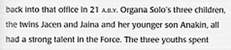
Our notes: `notes/materials/027-new-essential-chronology/11-part-eleven-generations-of-jedi.md:11`

> Since the Chiss had a moral principle against making first strikes, Formbi had hoped the Vagaari would take advantage of the Outbound Flight bait and make an aggressive move, Now that they had, war had been declared between the Chiss Ascendancy and the Vagaari.
>
> Dean Jinzler found closure, realizing that his sister had done everything she could to protect Outbound Right, and had died with honor during Thrawn’s attack. The Outbound Flight colonists teft the Redoubt, the only home they'd knovm for decades. Most of them began new fives in the Empire of the Hand.
>
> THe Stiapow Academy AND THE SECOND Imperium 23 A.B.Y.
>
> ™ 9" he Solo twins-Jacen with his quirky sense of humor | and rapport with animals, and Jaina with her aptitude for mechanics—became two of the most talented of the new Seneration of Jedi Knights. Together with their companions Tenel Ka, warrior daughter of Prince Isolder of Hapes and Tenenlel Djo of Dathomir, and Lowbacca, the Wookiee nephew of Chewbacca, they fought for the New Republic with as much bravery as the legendary Jedi Knights of old, SN 198 ) ey, During a training exerdse in the jungles of Yavin 4, the young Jedi Knights discovered the wreckage of a TIE fighter— an Imperial ship that had crashed there years before, during the Rebel battle against the first Death Star.
>
> ™ 9" he Solo twins-Jacen with his quirky sense of humor | and rapport with animals, and Jaina with her aptitude for mechanics—became two of the most talented of the new Seneration of Jedi Knights. Together with their companions Tenel Ka, warrior daughter of Prince Isolder of Hapes and Tenenlel Djo of Dathomir, and Lowbacca, the Wookiee nephew of Chewbacca, they fought for the New Republic with as much bravery as the legendary Jedi Knights of old, SN 198 ) ey, During a training exerdse in the jungles of Yavin 4, the young Jedi Knights discovered the wreckage of a TIE fighter— an Imperial ship that had crashed there years before, during the Rebel battle against the first Death Star. The Jedi Knights were unaware that the original pilot, a grizzled old man named Qorl, had survived the crash and had been eking out a living In the wilderness. Qorl forced the Jedi students {o complete the final repalrs so that he could flee the jungle moon, and then flew off to rejoin the Empire... wherever he could find it.
— Source: Part Eleven: Generations of Jedi; Jacen Solo; Jaina Solo — young Jedi Knights.
(Excerpt widened 2026-11-17 to the relevant passage, word for word from research primary new essential chronology nec paged (text copy `research_primary_new_essential_chronology_nec_paged_txt_88b808b5bc`).)
(Excerpt widened 2026-11-17 to the relevant passage, word for word from research primary new essential chronology nec paged (text copy `research_primary_new_essential_chronology_nec_paged_txt_88b808b5bc`).)
(Full sentence/passage taken from the source text on file: `research_primary_new_essential_chronology_nec_paged_txt`.)
Note (our notes, around the quote): Jacen Solo; Jaina Solo — young Jedi Knights: "Together with their companions Tenel Ka ... and Lowbacca, the Wookiee nephew of Chewbacca, they fought for the New Republic with as much bravery as the legendary Jedi Knights of old." Source: The New Essential Chronology, p.198
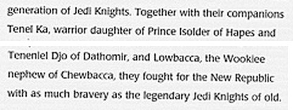
Our notes: `notes/materials/027-new-essential-chronology/11-part-eleven-generations-of-jedi.md:38`

> in a tragic accident during a sparring match against Jacen Solo, Tenel Ka lost her arm when her weapon failed.
> [fragment — full passage not on file]
— Source: Part Eleven: Generations of Jedi; Jacen Solo — Tenel Ka loses her arm.
Note (our notes, around the quote): Jacen Solo — Tenel Ka loses her arm: "in a tragic accident during a sparring match against Jacen Solo, Tenel Ka lost her arm when her weapon failed." Source: The New Essential Chronology, p.199
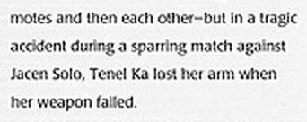
Our notes: `notes/materials/027-new-essential-chronology/11-part-eleven-generations-of-jedi.md:49`

- Note (summary from our notes, not a quotation): Jacen Solo — art caption: "Jacen Solo and Tenel Ka" Source: The New Essential Chronology, p.199, caption
  — Source: Part Eleven: Generations of Jedi.
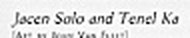
Our notes: `notes/materials/027-new-essential-chronology/11-part-eleven-generations-of-jedi.md:51`

> Other, more proactive Jedi Knights followed the lead of Kyp Durron and found new targets for their aggression. ... Jaina Solo found herself increasingly attracted to Kyp's aggressive faction; Anakin Solo remained loyal to his Uncle Luke. Jacen Solo found himself wondering if he could follow the Force without having to pick sides.
> [fragment — full passage not on file]
— Source: Part Twelve: The New Jedi Order; Kyp Durron; Jaina Solo; Anakin Solo; Jacen Solo — Jedi factions.
Note (our notes, around the quote): Kyp Durron; Jaina Solo; Anakin Solo; Jacen Solo — Jedi factions: "Other, more proactive Jedi Knights followed the lead of Kyp Durron and found new targets for their aggression. ... Jaina Solo found herself increasingly attracted to Kyp's aggressive faction; Anakin Solo remained loyal to his Uncle Luke. Jacen Solo found himself wondering if he could follow the Force without having to pick sides." Source: The New Essential Chronology, p.203
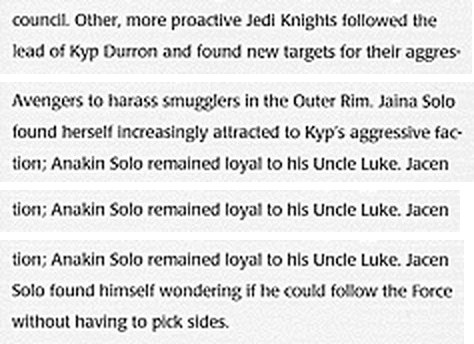
Our notes: `notes/materials/027-new-essential-chronology/12-part-twelve-new-jedi-order.md:11`

> Corran Horn and Ganner Rhysode went to sand-swept Bimmiel in the Outer Rim, where an archaeological team hac uncovered the remains of a Yuuzhan Vong warrior, mumm> fled after fifty years in the desert. They discovered that the Yuuzhan Vong had already beat them to Bimmiel, and Cor- ran and Ganner enlisted the planet's native slashrats to help them wipe out the enemy’s slave colony. Yuuzhan Vong commander Shedao Shal arrived in the aftermath of the battle, and saw that the hated Jeedai Knights had disturbed the body of his ancestor Monge Shai. Enraged, he vowed to kill Corran Horn and taste his blood.
>
> Luke and Jacen arrived at Belkadan, discovering that the Yuuzhan Vong-terraformed planet now served as a “farm” for growing new coralskipper starfighters. The slaves tolling In the jungle fields remained docile due to chunks of surge coral implanted In their faces.
>
> Luke and Jacen arrived at Belkadan, discovering that the Yuuzhan Vong-terraformed planet now served as a “farm” for growing new coralskipper starfighters. The slaves tolling In the jungle fields remained docile due to chunks of surge coral implanted In their faces. Jacen recklessly tried to rescue them and became a prisoner himself, but Luke fought for Jacen’s freedom and both Jedi escaped Belkadan.
>
> Mara Jade and Anakin Solo traveled to Dantcoine, where Mara hoped to halt the progress of her disease in the un- Cosran Horn bstlles Shedso Shai for the fate of Ithar.
>
> [Ane ey Tose Lat Comsaze) === PDF p.217 === spoiled expanses of the gentile grasslands. Yet the Yuuzhan Vong invaders had already reached Dantooine, and what should have been a peaceful convalescence turned into a gritty struggle to stay alive.
— Source: Part Twelve: The New Jedi Order; Luke Skywalker; Jacen Solo — Luke frees Jacen at Belkadan.
(Excerpt widened 2026-11-17 to the relevant passage, word for word from research primary new essential chronology nec paged (text copy `research_primary_new_essential_chronology_nec_paged_txt_88b808b5bc`).)
(Excerpt widened 2026-11-17 to the relevant passage, word for word from research primary new essential chronology nec paged (text copy `research_primary_new_essential_chronology_nec_paged_txt_88b808b5bc`).)
Note (our notes, around the quote): Luke Skywalker; Jacen Solo — Luke frees Jacen at Belkadan: "Jacen recklessly tried to rescue them and became a prisoner himself, but Luke fought for Jacen's freedom and both Jedi escaped Belkadan." Source: The New Essential Chronology, p.206
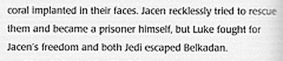
Our notes: `notes/materials/027-new-essential-chronology/12-part-twelve-new-jedi-order.md:42`

> Jacen advised against taking rash action, and Anakin hesitated—long enough for Thrackan to seize the controls and fire the superweapon himself.
— Source: Part Twelve: The New Jedi Order; Jacen Solo; Anakin Solo — Centerpoint fired at Fondor.
Note (our notes, around the quote): Jacen Solo; Anakin Solo — Centerpoint fired at Fondor: "Jacen advised against taking rash action, and Anakin hesitated—long enough for Thrackan to seize the controls and fire the superweapon himself." Source: The New Essential Chronology, p.210
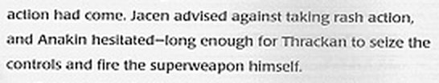
Our notes: `notes/materials/027-new-essential-chronology/12-part-twelve-new-jedi-order.md:74`

> Leia was rescued by her son Jacen, who abandoned his doubt in this critical moment and opened himself fully to the Force. The telekinetic storm summoned by Jacen picked up everything in the room and sent Tsavong Lah flying out a window.
— Source: Part Twelve: The New Jedi Order; Jacen Solo; Leia Organa Solo — Jacen's telekinetic storm.
Note (our notes, around the quote): Jacen Solo; Leia Organa Solo — Jacen's telekinetic storm: "Leia was rescued by her son Jacen, who abandoned his doubt in this critical moment and opened himself fully to the Force. The telekinetic storm summoned by Jacen picked up everything in the room and sent Tsavong Lah flying out a window." Source: The New Essential Chronology, p.211
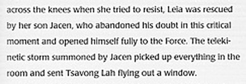
Our notes: `notes/materials/027-new-essential-chronology/12-part-twelve-new-jedi-order.md:83`

> Jacen, Jaina, and Anakin Solo face off against a ring of voxyn while infiltrating the worldship at Myrkr.
— Source: Part Twelve: The New Jedi Order; Jacen Solo; Jaina Solo; Anakin Solo — art caption.
Note (our notes, around the quote): Jacen Solo; Jaina Solo; Anakin Solo — art caption: "Jacen, Jaina, and Anakin Solo face off against a ring of voxyn while infiltrating the worldship at Myrkr." Source: The New Essential Chronology, p.213, caption
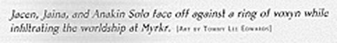
Our notes: `notes/materials/027-new-essential-chronology/12-part-twelve-new-jedi-order.md:105`

> He fought against hordes of enemies without ego or fear, and in the end sacrificed himself so that the other members of his team could live. Cut down by a rain of Yuuzhan Vong amphistaffs while buying time for the others to destroy the queen voxyn, Anakin passed Into the Force with a shudder felt halfway across the galaxy.
>
> The death of her younger brother sharpened the edge of Jaina Solo’s rage. Now bathing in the violence of the dark side, she burned several Yuuzhan Vong with Force lightning to retrieve Anakin’s body. When the fierce fighting sepa- fated her from Jacen, she left her twin behind on Baanu Rass and escaped with the surviving members of the strike team aboard the Yuuzhan Vong frigate Ksstar.
>
> Jacen Solo became a trophy captive. Ever since he had defeated Tsavong Lah on Duro, he had become the most- wanted enemy combatant on the Yuuzhan Vong rolls.
>
> Vergere, the former Jedi and current Yuuzhan Vong pet, wamed Jacen that his true education was about to begin, Te Fatt oF Coruscant 27 ABY.
>
> \n Coruscant, Chief of State Borsk Fey'lya had pulled UU a 180-degree attitude change from his former hostil- ity toward the Jedi. When Nom Anor came to address the Senate, Fey'lya denounced him as a coward and rallied the fractured New Republic.
— Source: Part Twelve: The New Jedi Order; Jacen Solo — Jacen most-wanted.
(Excerpt widened 2026-11-17 to the relevant passage, word for word from research primary new essential chronology nec paged (text copy `research_primary_new_essential_chronology_nec_paged_txt_88b808b5bc`).)
(Excerpt widened 2026-11-17 to the relevant passage, word for word from research primary new essential chronology nec paged (text copy `research_primary_new_essential_chronology_nec_paged_txt_88b808b5bc`).)
Note (our notes, around the quote): Jacen Solo — Jacen most-wanted: "Ever since he had defeated Tsavong Lah on Duro, he had become the most-wanted enemy combatant on the Yuuzhan Vong rolls." Source: The New Essential Chronology, p.216
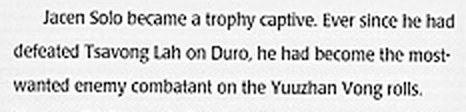
Our notes: `notes/materials/027-new-essential-chronology/12-part-twelve-new-jedi-order.md:130`

> Shaved bald and locked into a torture rack called the Embrace of Pain, he suffered for unknowable stretches of time while being visited by Vergere
> [fragment — full passage not on file]
— Source: Part Twelve: The New Jedi Order; Jacen Solo — Embrace of Pain.
Note (our notes, around the quote): Jacen Solo — Embrace of Pain: "Shaved bald and locked into a torture rack called the Embrace of Pain, he suffered for unknowable stretches of time while being visited by Vergere" Source: The New Essential Chronology, p.219
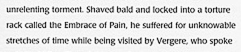
Our notes: `notes/materials/027-new-essential-chronology/12-part-twelve-new-jedi-order.md:157`

> When the seedship arrived at Coruscant, Jacen made his move, slaughtering the competing dhuryams and killing scores of Yuuzhan Vong warriors as the seedship prepared to implant itself on Coruscant.
— Source: Part Twelve: The New Jedi Order; Jacen Solo — Jacen slaughters the dhuryams.
Note (our notes, around the quote): Jacen Solo — Jacen slaughters the dhuryams: "When the seedship arrived at Coruscant, Jacen made his move, slaughtering the competing dhuryams and killing scores of Yuuzhan Vong warriors as the seedship prepared to implant itself on Coruscant." Source: The New Essential Chronology, p.220
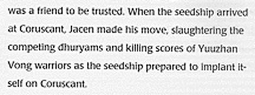
Our notes: `notes/materials/027-new-essential-chronology/12-part-twelve-new-jedi-order.md:164`

> To Vergere and Jacen, the Force had no light side and no dark side—the Force was simply what one made of it.
— Source: Part Twelve: The New Jedi Order; Jacen Solo — no light side and no dark side.
Note (our notes, around the quote): Jacen Solo — no light side and no dark side: "To Vergere and Jacen, the Force had no light side and no dark side—the Force was simply what one made of it." Source: The New Essential Chronology, p.221
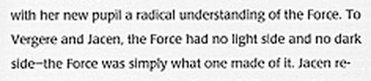
Our notes: `notes/materials/027-new-essential-chronology/12-part-twelve-new-jedi-order.md:175`

> After helping to quell the uprising, Jacen scoured the Chiss data library to learn Zonama Sekot's current location—an unknown system called Klasse Ephemora.
— Source: Part Twelve: The New Jedi Order; Jacen Solo — Jacen finds Zonama Sekot.
Note (our notes, around the quote): Jacen Solo — Jacen finds Zonama Sekot: "After helping to quell the uprising, Jacen scoured the Chiss data library to learn Zonama Sekot's current location—an unknown system called Klasse Ephemora." Source: The New Essential Chronology, p.224
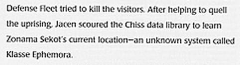
Our notes: `notes/materials/027-new-essential-chronology/12-part-twelve-new-jedi-order.md:202`

> The Supreme Overlord and his capering jester Onimi sent a phalanx of Slayers against the Jedi trio, only to see their finest warriors struck down.
— Source: Part Twelve: The New Jedi Order; Luke Skywalker; Jacen Solo; Jaina Solo — Slayers struck down.
Note (our notes, around the quote): Luke Skywalker; Jacen Solo; Jaina Solo — Slayers struck down: "The Supreme Overlord and his capering jester Onimi sent a phalanx of Slayers against the Jedi trio, only to see their finest warriors struck down." Source: The New Essential Chronology, p.225
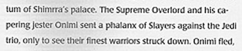
Our notes: `notes/materials/027-new-essential-chronology/12-part-twelve-new-jedi-order.md:211`

- Note (summary from our notes, not a quotation): Jacen Solo — Jacen the luminous being: "Reaching deeper into the Force than any known Jedi had ever done, Jacen briefly became a "luminous being" of pure Force energy. The power proved too much for Onimi, who faded into oblivion." Source: The New Essential Chronology, p.227
  — Source: Part Twelve: The New Jedi Order.
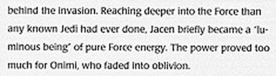
Our notes: `notes/materials/027-new-essential-chronology/12-part-twelve-new-jedi-order.md:227`

> Jacen Solo left on a personal journey, becoming a Jedi wanderer, not bound by the strictures of his uncle Luke's new Jedi order. Jacen intended to seek out other schools of thought regarding the Force in order to deepen his understanding of the immensity of the unifying Force.
— Source: Part Twelve: The New Jedi Order; Jacen Solo; Luke Skywalker — Jedi wanderer.
Note (our notes, around the quote): Jacen Solo; Luke Skywalker — Jedi wanderer: "Jacen Solo left on a personal journey, becoming a Jedi wanderer, not bound by the strictures of his uncle Luke's new Jedi order. Jacen intended to seek out other schools of thought regarding the Force in order to deepen his understanding of the immensity of the unifying Force." Source: The New Essential Chronology, p.227
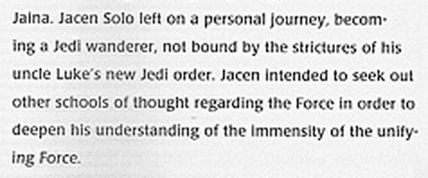
Our notes: `notes/materials/027-new-essential-chronology/12-part-twelve-new-jedi-order.md:231`

> Jacen Solo, the new Jedi order's wandering mystic, received a terrifying vision of an impending Chiss invasion.
— Source: Part Twelve: The New Jedi Order; Jacen Solo — Jacen's vision of the Killik war.
Note (our notes, around the quote): Jacen Solo — Jacen's vision of the Killik war: "Jacen Solo, the new Jedi order's wandering mystic, received a terrifying vision of an impending Chiss invasion." Source: The New Essential Chronology, p.229
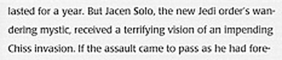
Our notes: `notes/materials/027-new-essential-chronology/12-part-twelve-new-jedi-order.md:247`

## The Jedi Academy Sourcebook (WEG, 1996): power-scaling and lore notes

> They immediately demonstrate a sensitivity for detecting the non-corporeal presences of Exar Kun and Luke in the complex, and play a key role in protecting Luke from the Sith Lord's attacks on Luke and the others.
— Source: Chapter One: The New Republic.
Note (our notes, around the quote): Jacen Solo; Jaina Solo; Exar Kun; Luke Skywalker — Jacen and Jaina Solo — protecting Luke: "They immediately demonstrate a sensitivity for detecting the non-corporeal presences of Exar Kun and Luke in the complex, and play a key role in protecting Luke from the Sith Lord's attacks on Luke and the others." Source: The Jedi Academy Sourcebook, p.12
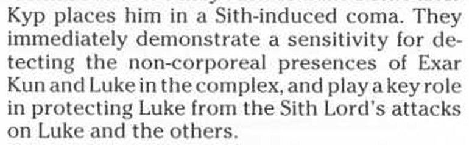
Our notes: `notes/materials/029-jedi-academy-sourcebook/01-ch1-the-new-republic.md:58`

## The Complete Star Wars Encyclopedia, Vol. I (A–G)

> The attack was led by onetime TIE fighter pilot Qorl, who had crashed in the jungles of Yavin 4 but survived until he was discovered by Jaina and Jacen Solo two decades later.
— Source: scan pages 1–40; Jaina Solo; Jacen Solo (Darth Caedus).
Note (our notes, around the quote): Jaina Solo; Jacen Solo (Darth Caedus): "The attack was led by onetime TIE fighter pilot Qorl, who had crashed in the jungles of Yavin 4 but survived until he was discovered by Jaina and Jacen Solo two decades later." Source: The Complete Star Wars Encyclopedia, Vol. I, p.10
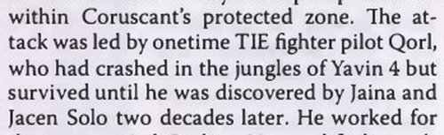
Our notes: `notes/materials/030-complete-star-wars-encyclopedia-vol-1/00-v1-scan-001-040.md:156`

> Sith battle meditation was a comparatively rare discipline, though Darth Sidious, Lumiya, and Darth Caedus proved capable of it.
— Source: scan pages 41–80; Palpatine (Darth Sidious); Lumiya; Jacen Solo (Darth Caedus).
Note (our notes, around the quote): Palpatine (Darth Sidious); Lumiya; Jacen Solo (Darth Caedus): "Sith battle meditation was a comparatively rare discipline, though Darth Sidious, Lumiya, and Darth Caedus proved capable of it." Source: The Complete Star Wars Encyclopedia, Vol. I, p.64
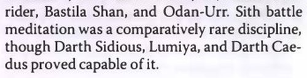
Our notes: `notes/materials/030-complete-star-wars-encyclopedia-vol-1/01-v1-scan-041-080.md:314`

> Isolder refused and Caedus angrily strangled him with the Force, then ordered the Beam Racer destroyed.
— Source: scan pages 41–80; Jacen Solo (Darth Caedus).
Note (our notes, around the quote): Jacen Solo (Darth Caedus): "Isolder refused and Caedus angrily strangled him with the Force, then ordered the Beam Racer destroyed." Source: The Complete Star Wars Encyclopedia, Vol. I, p.65
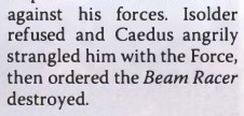
Our notes: `notes/materials/030-complete-star-wars-encyclopedia-vol-1/01-v1-scan-041-080.md:323`

> Much to Caedus's pleasure, Bhao was killed in the Mandalorian attack on the Nickel One asteroid, where a group of Moffs had convened to finalize their takeover of Verpine factories.
— Source: scan pages 81–120; Jacen Solo (Darth Caedus).
Note (our notes, around the quote): Jacen Solo (Darth Caedus): "Much to Caedus's pleasure, Bhao was killed in the Mandalorian attack on the Nickel One asteroid, where a group of Moffs had convened to finalize their takeover of Verpine factories." Source: The Complete Star Wars Encyclopedia, Vol. I, p.73
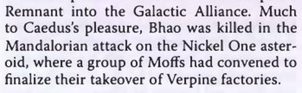
Our notes: `notes/materials/030-complete-star-wars-encyclopedia-vol-1/02-v1-scan-081-120.md:59`

> Solo, who had taken on the title of Darth Caedus, ordered the officer to track down the fleets that had harassed his actions at the Nickel One asteroid and destroy them.
— Source: scan pages 81–120; Jacen Solo (Darth Caedus).
Note (our notes, around the quote): Jacen Solo (Darth Caedus): "Solo, who had taken on the title of Darth Caedus, ordered the officer to track down the fleets that had harassed his actions at the Nickel One asteroid and destroy them." Source: The Complete Star Wars Encyclopedia, Vol. I, p.99
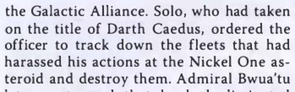
Our notes: `notes/materials/030-complete-star-wars-encyclopedia-vol-1/02-v1-scan-081-120.md:267`

> He would eventually command both the Fifth and Sixth fleets in battle with the Corellian Confederation that challenged the Galactic Alliance. Even though Bothans sided with the Confederation, Bwua'tu remained firmly loyal to the Alliance. As Jacen Solo consolidated his power over the GA and splintered from the com­ mand of Cha Niathal, Admiral Bwua'tu became the preeminent military officer in the Galactic Alliance. Solo, who had taken on the title of Darth Caedus, ordered the officer to track down the fleets that had harassed his actions at the Nickel One as­ teroid and destroy them. Admiral Bwua'tu later sent word that he had eliminated Niathal's small fleet of defectors, and had trapped the Corellian and Bothan fleets near Carbos XIII. However, after Caedus was killed and the Imperial Moffs surrendered to Jedi Grand Master Luke Skywalker, Admiral Bwua'tu was forced to stand down and break off his attacks. He was offered the chance to assume the role of Chief of State of the Galactic Al­ liance, but he politely refused in order to remain a military man. He suggested that Admiral Natisi Daala might be a better choice for the job. B'wuf A senior technical analyst aboard the Separatist vessel Corpulentus, serving under Pors Tonith during the Clone Wars. He had a habit ofspeaking with a slow drawl, which made it appear that he was choosing his words carefully.
— Source: scan pages 81–120; Jacen Solo (Darth Caedus); Luke Skywalker.
(Excerpt widened 2026-11-17 to the relevant passage, word for word from research primary cse vol1 (text copy `research_primary_cse_vol1_pdf_45a954be6d`).)
(Excerpt widened 2026-11-17 to the relevant passage, word for word from research primary cse vol1 (text copy `research_primary_cse_vol1_pdf_45a954be6d`).)
Note (our notes, around the quote): Jacen Solo (Darth Caedus); Luke Skywalker: "However, after Caedus was killed and the Imperial Moffs surrendered to Jedi Grand Master Luke Skywalker, Admiral Bwua'tu was forced to stand down and break off his attacks." Source: The Complete Star Wars Encyclopedia, Vol. I, p.99
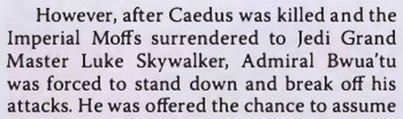
Our notes: `notes/materials/030-complete-star-wars-encyclopedia-vol-1/02-v1-scan-081-120.md:269`

- Note (summary from our notes, not a quotation): Page contents: 1013 words, 41 paragraphs | headings/entries: Cadgel Meadows; Cadinth; Cadmir, Jerem; Cadomai; Caedus, Darth; Cag, Captain; Cai; Cailshh; Wars.; Cairnwick, Drun; Cakhmaim; Calamar; Calamari; Calculator; Calders, Major; Caleb; Calfa-5; Calibop; Cal-i-Vaun
  — Source: scan pages 81–120.
Our notes: `notes/materials/030-complete-star-wars-encyclopedia-vol-1/02-v1-scan-081-120.md:304`

> These disgruntled systems joined Corellia in forming the Confederation, and allied them­ selves against the Galactic Alliance. A long, violent, and bloody war ensued be­ tween the GA and the Confederation some 40 years after the Battle of Yavin. It saw Thrackan Sal-Solo assassinated and Jacen Solo complete a transformation to Sith Lord, becoming Darth Caedus. Millions were killed and millions more became refugees. An attempt by Corellia to reactivate the Centerpoint Station weapon, and by Darth Caedus to control it himself, was sabotaged by the Jedi-and the ancient weapon self-destructed. With Caedus killed in a lightsaber duel with his twin sister, the war came to an end and all sides agreed to sign a peace treaty. Corellla Mining Corpo­ ration A Corellian corpora­ tion that produced Mining DiggerCrawlers,whichbecame better known as sandcrawlers when they were reclaimed by the Jawas of Tatooine. Corelllan Members of this human race inhabited the Corellia star system. Notable Corellians included Han Solo, General Crix Madine, General Garm Bel Iblis, and Wedge An­ tilles. corvettes included Princess Leia Organa's con­ sular ship T antive IV, the Scarlet Thranta used by Freedom's Sons, and the New Republic FarStar. Corelllan Defense Force The armed forces that guarded the plan­ ets of the Corellian sector.
— Source: scan pages 121–160; Jacen Solo (Darth Caedus).
(Excerpt widened 2026-11-17 to the relevant passage, word for word from research primary cse vol1 (text copy `research_primary_cse_vol1_pdf_45a954be6d`).)
(Excerpt widened 2026-11-17 to the relevant passage, word for word from research primary cse vol1 (text copy `research_primary_cse_vol1_pdf_45a954be6d`).)
Note (our notes, around the quote): Jacen Solo (Darth Caedus): "With Caedus killed in a lightsaber duel with his twin sister, the war came to an end and all sides agreed to sign a peace treaty." Source: The Complete Star Wars Encyclopedia, Vol. I, p.142
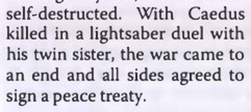
Our notes: `notes/materials/030-complete-star-wars-encyclopedia-vol-1/03-v1-scan-121-160.md:268`

> Czerka Corporation The galaxy's third largest arms manufacturer, this company produced blasters, artillery, melee weap­ ons, starship weapons, and starship defense systems. An ancient business, it existed for thousands of years, dating back to before the Sith War. During the Galactic Civil War, Czerka reluctantly agreed to establish an ex­ clusive distribution agreement with the Em­ pire, though it became a strong supporter of the New Republic when that government came to power. Czethros A former bounty hunter who was outsmarted by Han Solo, this humanoid cyborg ending up imprisoned at the spice mines of Kessel for a stint. He emerged as leader of what remained of Black Sun in the later years of the New Republic. He worked secretly to activate his scattered sleeper cells to rebuild Black Sun to its former glory, but was ultimately defeated thanks to the efforts of Jacen and Jaina Solo and their friends. Czethros was incarcerated, and Black Sun was effectively crushed. Czycz, Stauz A soldier whose world was ravaged by the Empire, Stauz Czycz plotted revenge by altering his body and disguising himselfas human bounty hunter Awarru Tark. Tark answered Darth Vader's call for hunters to pursue the Millennium Falcon after the Battle of Hoth. Tark confronted Vader, but the Dark Lord was able to defeat and decapitate the powerful alien warrior.
— Source: scan pages 161–200; Jacen Solo (Darth Caedus); Jaina Solo.
(Excerpt widened 2026-11-17 to the relevant passage, word for word from research primary cse vol1 (text copy `research_primary_cse_vol1_pdf_45a954be6d`).)
(Excerpt widened 2026-11-17 to the relevant passage, word for word from research primary cse vol1 (text copy `research_primary_cse_vol1_pdf_45a954be6d`).)
Note (our notes, around the quote): Jacen Solo (Darth Caedus); Jaina Solo: "He worked secretly to activate his scattered sleeper cells to rebuild Black Sun to its former glory, but was ultimately defeated thanks to the efforts of Jacen and Jaina Solo and their friends." Source: The Complete Star Wars Encyclopedia, Vol. I, p.157
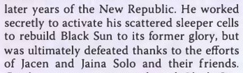
Our notes: `notes/materials/030-complete-star-wars-encyclopedia-vol-1/04-v1-scan-161-200.md:101`

> Darb, Sergeant Whelmo A sergeant in the security detail assigned to the maiden voyage of the Star Destroyer Anakin Solo, he was ordered by Jacen Solo to accompany Luke Skywalker and his entourage to the ship's Situation Room fora meeting with Tenel Ka.
— Source: scan pages 161–200; Anakin Solo; Jacen Solo (Darth Caedus); Luke Skywalker.
Note (our notes, around the quote): Anakin Solo; Jacen Solo (Darth Caedus); Luke Skywalker: "Darb, Sergeant Whelmo A sergeant in the security detail assigned to the maiden voyage of the Star Destroyer Anakin Solo, he was ordered by Jacen Solo to accompany Luke Skywalker and his entourage to the ship's Situation Room fora meeting with Tenel Ka." Source: The Complete Star Wars Encyclopedia, Vol. I, p.165
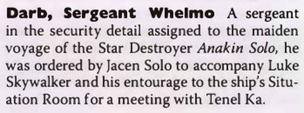
Our notes: `notes/materials/030-complete-star-wars-encyclopedia-vol-1/04-v1-scan-161-200.md:173`

> In the wake of the Battle of Bastion, the Defiant was equipped with a gravitic amplitude modulator and reprogrammed by Jacen Solo and the Galactic Alliance to allow Imperial forces to destroy a Yuuzhan Vong yammosk.
— Source: scan pages 161–200; Jacen Solo (Darth Caedus).
Note (our notes, around the quote): Jacen Solo (Darth Caedus): "In the wake of the Battle of Bastion, the Defiant was equipped with a gravitic amplitude modulator and reprogrammed by Jacen Solo and the Galactic Alliance to allow Imperial forces to destroy a Yuuzhan Vong yammosk." Source: The Complete Star Wars Encyclopedia, Vol. I, p.179
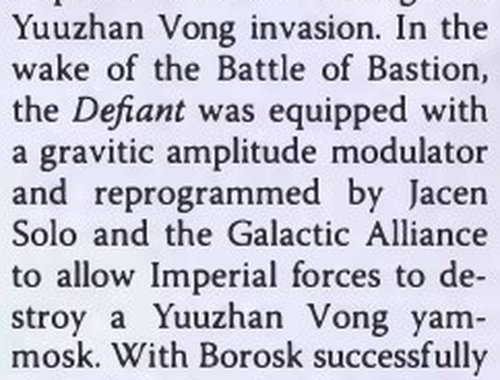
Our notes: `notes/materials/030-complete-star-wars-encyclopedia-vol-1/04-v1-scan-161-200.md:301`

> To that end, Jacen killed Nelani Dinn and altered Ben Skywalker's memories of the events.
— Source: scan pages 201–240; Jacen Solo (Darth Caedus); Ben Skywalker.
Note (our notes, around the quote): Jacen Solo (Darth Caedus); Ben Skywalker: "To that end, Jacen killed Nelani Dinn and altered Ben Skywalker's memories of the events." Source: The Complete Star Wars Encyclopedia, Vol. I, p.190
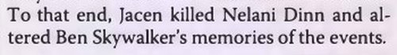
Our notes: `notes/materials/030-complete-star-wars-encyclopedia-vol-1/05-v1-scan-201-240.md:42`

> Embrace of Pain A gruesome Yuuzhan Vong restraint system used to control slaves, it stood over 2 meters tall and used leather-like, tentacular straps to bind the arms, legs, and torso of a captive. It then administered a con­ stantlevel ofpain to remind the captive that he or she was securely bound. The Embrace could vary the output of its painful stimuli in accor­ dance to the reactions of its victim, increasing it ifthe subject became too accustomed to the sensation, or lowering it if the subject seemed near death. In this way, a slave could be forced quickly into submission. The Embrace of Pain also could condition a victim. In the wake of the war against the Yuuzhan Vong, only one Embrace of Pain survived. Jacen Solo kept it in a secret location and later installed it aboard the Star Destroyer Anakin Solo. EmbratheHuttA "healthy-looking" Hutt who was a business associate of Jabba. Unlike his fellow Hutts, Embra was compassionate toward his underlings. He preferred nonvio­ lent resolutions whenever possible. For this, he garnered strong loyalty among his subjects.
— Source: scan pages 241–280; Jacen Solo (Darth Caedus); Anakin Solo.
(Excerpt widened 2026-11-17 to the relevant passage, word for word from research primary cse vol1 (text copy `research_primary_cse_vol1_pdf_45a954be6d`).)
(Excerpt widened 2026-11-17 to the relevant passage, word for word from research primary cse vol1 (text copy `research_primary_cse_vol1_pdf_45a954be6d`).)
Note (our notes, around the quote): Jacen Solo (Darth Caedus); Anakin Solo: "Jacen Solo kept it in a secret location and later installed it aboard the Star Destroyer Anakin Solo." Source: The Complete Star Wars Encyclopedia, Vol. I, p.231
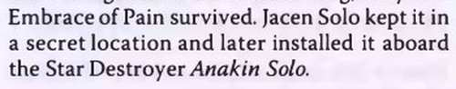
Our notes: `notes/materials/030-complete-star-wars-encyclopedia-vol-1/06-v1-scan-241-280.md:45`

> With the eventual defeat of Darth Caedus—the former Jacen Solo—Luke Skywalker offered a splinter group of Imperial Moffs a chance to rejoin the Galactic Alliance provided they submit to the command and leadership of Jagged Fel.
— Source: scan pages 241–280; Jacen Solo (Darth Caedus); Luke Skywalker.
Note (our notes, around the quote): Jacen Solo (Darth Caedus); Luke Skywalker: "With the eventual defeat of Darth Caedus—the former Jacen Solo—Luke Skywalker offered a splinter group of Imperial Moffs a chance to rejoin the Galactic Alliance provided they submit to the command and leadership of Jagged Fel." Source: The Complete Star Wars Encyclopedia, Vol. I, p.260
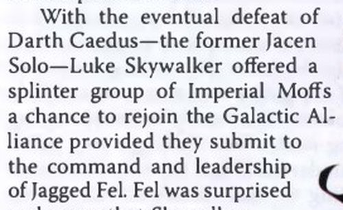
Our notes: `notes/materials/030-complete-star-wars-encyclopedia-vol-1/06-v1-scan-241-280.md:222`

> A doctor gave him just a year or two to live; there was no help this time from Taun We, since she had disappeared. Fett decided to locate his daughter Ailyn, who had been born during a three-year marriage to bounty hunter Sintas Vel. But Ailyn had vanished, secretly taking on Corellian secessionist Thrackan Sal-Solo's bounty on the heads of Han and Leia. Ailyn's daughter Mirta Gev approached Fett without revealing that she was his granddaughter to enlist him in the search for her mother. She Fett,Cassus Q accompanied the 71-year-old Fett when he took on the job of assassinating Thrackan, fir­ ing the first three shots into Sal-Solo's head. It was then that they learned that Ailyn had been captured, tortured, and killed by Jacen Solo. After confronting the animosity his grand­ daughter held toward him, Fett realized that it was time he reclaimed his Mandalorian roots. Fett and Gev journeyed to Mandalore and Fett resumed his role as leader, although he felt undeserving. Fett was able to obtain a serum that rapidly restored his health, and he helped Mandalore return as a power in the galaxy. It was with great trepidation that Fett dis­ covered that Sintas Vel, his former wife and grandmother of Mirta Gev, was still alive.
— Source: scan pages 281–320; Boba Fett; Jacen Solo (Darth Caedus) — entry/section: Fett, Boba.
(Excerpt widened 2026-11-17 to the relevant passage, word for word from research primary cse vol1 (text copy `research_primary_cse_vol1_pdf_45a954be6d`).)
(Excerpt widened 2026-11-17 to the relevant passage, word for word from research primary cse vol1 (text copy `research_primary_cse_vol1_pdf_45a954be6d`).)
Note (our notes, around the quote): Boba Fett; Jacen Solo (Darth Caedus) — entry/section: Fett, Boba: "It was then that they learned that Ailyn had been captured, tortured, and killed by Jacen Solo." Source: The Complete Star Wars Encyclopedia, Vol. I, p.267
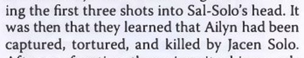
Our notes: `notes/materials/030-complete-star-wars-encyclopedia-vol-1/07-v1-scan-281-320.md:21`

> It was with great trepidation that Fett dis­ covered that Sintas Vel, his former wife and grandmother of Mirta Gev, was still alive. She had been frozen in carbonite decades earlier. Returned to Mandalore and thawed from her prison, Vel was disoriented and blind from the ordeal, but Gev worked to nurse her back to health. When she began recovering her memo­ ries, she held no ill will toward Fett. They spent days talking, hoping to repair the emotional scars of their past. They came to understand each other in time to celebrate the wedding of their granddaughter to Ghes Orade. Jaina Solo arrived on Mandalore asking for Fett's help in training her to defeat her brother Jacen, who by then had become Darth Caedus. Fett agreed and taught her how to fight like a Mandalorian. In the meantime, he was con­ tacted by Admiral Daala, who had come out of hiding to assist Gilad Pellaeon on a mission to capture the planet Fondor. Daala was Pellaeon's secret backup, and she wanted the Mandalori­ ans to provide additional firepower ifnecessary. With the ships of both the Galactic Alliance and Imperial Remnant refusing to follow Jacen Solo's increasingly belligerent commands and the sudden assassination of Pellaeon by Solo's apprentice Tahiri Veila, a group of opportunis­ tic Imperial Moffs tried to take over.
— Source: scan pages 281–320; Jaina Solo; Jacen Solo (Darth Caedus).
(Excerpt widened 2026-11-17 to the relevant passage, word for word from research primary cse vol1 (text copy `research_primary_cse_vol1_pdf_45a954be6d`).)
(Excerpt widened 2026-11-17 to the relevant passage, word for word from research primary cse vol1 (text copy `research_primary_cse_vol1_pdf_45a954be6d`).)
Note (our notes, around the quote): Jaina Solo; Jacen Solo (Darth Caedus): "Jaina Solo arrived on Mandalore asking for Fett's help in training her to defeat her brother Jacen, who by then had become Darth Caedus." Source: The Complete Star Wars Encyclopedia, Vol. I, p.267
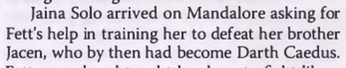
Our notes: `notes/materials/030-complete-star-wars-encyclopedia-vol-1/07-v1-scan-281-320.md:23`

> After Jacen Solo's rise to power, he made it a priority to capture the shipyards or destroy them as punishment for the planet's rebellion.
— Source: scan pages 281–320; Jacen Solo (Darth Caedus).
Note (our notes, around the quote): Jacen Solo (Darth Caedus): "After Jacen Solo's rise to power, he made it a priority to capture the shipyards or destroy them as punishment for the planet's rebellion." Source: The Complete Star Wars Encyclopedia, Vol. I, p.285
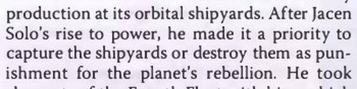
Our notes: `notes/materials/030-complete-star-wars-encyclopedia-vol-1/07-v1-scan-281-320.md:155`

> GlranThis Kadas'sa'Nikto worked with Mal­ akili to tend Jabba the Hutt's rancor. He hoped to trap a krayt dragon and bring it to Jabba as a present, but died when Jabba's sail barge ex­ ploded near the Pit ofCarkoon. Glrdun, Heol A captain in the Coruscant Security Force in the years following the Yuu­ zhan VongWar, he was later attached to the Ga­ lactic Alliance Guard. When Ailyn Habuur was captured in a raid, and it was learned that she had been hired by Thrackan Sal-Solo to assas­ sinate Han Solo and his family, Captain Girdun argued with Captain Shevu that she should be interrogated nonstop until she revealed every­ thing she knew. Girdun was dismayed, but not upset, when Habuur was killed in Jacen Solo's attempt to use the Force to extract information from her. Jacen then gave Girdun permission to interrogate Buroy, a Corellian agent who'd been brought in with Habuur. As Jacen began to influence other aspects of the military, including the court-martial of his twin sister, Jaina, Girdun began to wonder about his motivations and openly raised questions.
— Source: scan pages 321–360; Jacen Solo (Darth Caedus).
(Excerpt widened 2026-11-17 to the relevant passage, word for word from research primary cse vol1 (text copy `research_primary_cse_vol1_pdf_45a954be6d`).)
(Excerpt widened 2026-11-17 to the relevant passage, word for word from research primary cse vol1 (text copy `research_primary_cse_vol1_pdf_45a954be6d`).)
Note (our notes, around the quote): Jacen Solo (Darth Caedus): "Girdun was dismayed, but not upset, when Habuur was killed in Jacen Solo's attempt to use the Force to extract information from her." Source: The Complete Star Wars Encyclopedia, Vol. I, p.342
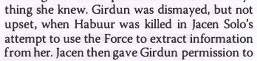
Our notes: `notes/materials/030-complete-star-wars-encyclopedia-vol-1/08-v1-scan-321-360.md:264`

## The Complete Star Wars Encyclopedia, Vol. II (H–O)

> Trooper H449-B7 was killed when Jaina Solo infiltrated the Nickel One facilities during her search for her brother Jacen, who had become Darth Caedus.
— Source: scan pages 1–40; Jaina Solo; Jacen Solo (Darth Caedus).
Note (our notes, around the quote): Jaina Solo; Jacen Solo (Darth Caedus): "Trooper H449-B7 was killed when Jaina Solo infiltrated the Nickel One facilities during her search for her brother Jacen, who had become Darth Caedus." Source: The Complete Star Wars Encyclopedia, Vol. II, p.3
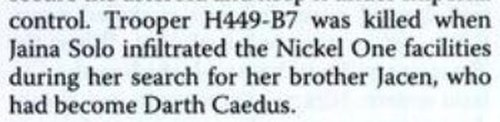
Our notes: `notes/materials/031-complete-star-wars-encyclopedia-vol-2/00-v2-scan-001-040.md:52`

> Thanks to support from the Galactic Alliance's navy, the Home Fleet was able to defeat the Heritage Fleet, thereby keeping Tenel Ka on the throne, However, the Hapan Home Fleet was unable to regain much strength before Tenel Ka agreed to turn its control over to Jacen Solo, provided that he make peace with Jedi Grand Master Luke Skywalker.
— Source: scan pages 1–40; Jacen Solo (Darth Caedus); Luke Skywalker.
Note (our notes, around the quote): Jacen Solo (Darth Caedus); Luke Skywalker: "Thanks to support from the Galactic Alliance's navy, the Home Fleet was able to defeat the Heritage Fleet, thereby keeping Tenel Ka on the throne, However, the Hapan Home Fleet was unable to regain much strength before Tenel Ka agreed to turn its control over to Jacen Solo, provided that he make peace with Jedi Grand Master Luke Skywalker." Source: The Complete Star Wars Encyclopedia, Vol. II, p.15
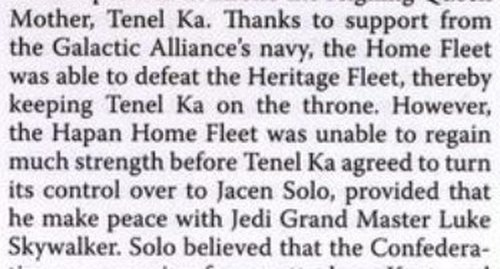
Our notes: `notes/materials/031-complete-star-wars-encyclopedia-vol-2/00-v2-scan-001-040.md:138`

> Horn was there at the end, after Jaina Solo killed Caedus, and he helped lead 50 Jedi aboard the Super Star Destroyer Megador to dictate peace terms to the Moff Council on the ship.
— Source: scan pages 41–80; Jaina Solo; Jacen Solo (Darth Caedus).
Note (our notes, around the quote): Jaina Solo; Jacen Solo (Darth Caedus): "Horn was there at the end, after Jaina Solo killed Caedus, and he helped lead 50 Jedi aboard the Super Star Destroyer Megador to dictate peace terms to the Moff Council on the ship." Source: The Complete Star Wars Encyclopedia, Vol. II, p.59
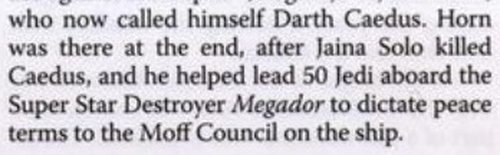
Our notes: `notes/materials/031-complete-star-wars-encyclopedia-vol-2/01-v2-scan-041-080.md:166`

> Caedus's arrival came during his attempt to destroy the Jedi Order's base in the Transitory Mists, and Isolder believed that his interrogation had finally come.
— Source: scan pages 121–160; Jacen Solo (Darth Caedus).
Note (our notes, around the quote): Jacen Solo (Darth Caedus): "Caedus's arrival came during his attempt to destroy the Jedi Order's base in the Transitory Mists, and Isolder believed that his interrogation had finally come." Source: The Complete Star Wars Encyclopedia, Vol. II, p.121
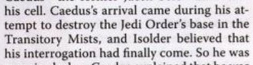
Our notes: `notes/materials/031-complete-star-wars-encyclopedia-vol-2/03-v2-scan-121-160.md:54`

> Isolder's freedom was only guaranteed if he removed himself from the battle zone, since Caedus and his technicians had rigged the Beam Racer to explode if it was shot just once.
— Source: scan pages 121–160; Jacen Solo (Darth Caedus).
Note (our notes, around the quote): Jacen Solo (Darth Caedus): "Isolder's freedom was only guaranteed if he removed himself from the battle zone, since Caedus and his technicians had rigged the Beam Racer to explode if it was shot just once." Source: The Complete Star Wars Encyclopedia, Vol. II, p.121
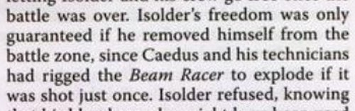
Our notes: `notes/materials/031-complete-star-wars-encyclopedia-vol-2/03-v2-scan-121-160.md:56`

> Caedus then ordered the Beam Racer to be destroyed with all hands aboard.
— Source: scan pages 121–160; Jacen Solo (Darth Caedus).
Note (our notes, around the quote): Jacen Solo (Darth Caedus): "Caedus then ordered the Beam Racer to be destroyed with all hands aboard." Source: The Complete Star Wars Encyclopedia, Vol. II, p.121
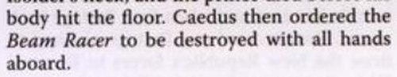
Our notes: `notes/materials/031-complete-star-wars-encyclopedia-vol-2/03-v2-scan-121-160.md:58`

> The timely intervention of a Galactic Alliance fleet led by Solo helped defeat the Heritage Fleet and reaffirmed Tenel Ka's rule, but it also strained her relationship with Jacen.
— Source: scan pages 161–200; Jacen Solo (Darth Caedus).
Note (our notes, around the quote): Jacen Solo (Darth Caedus): "The timely intervention of a Galactic Alliance fleet led by Solo helped defeat the Heritage Fleet and reaffirmed Tenel Ka's rule, but it also strained her relationship with Jacen." Source: The Complete Star Wars Encyclopedia, Vol. II, p.188
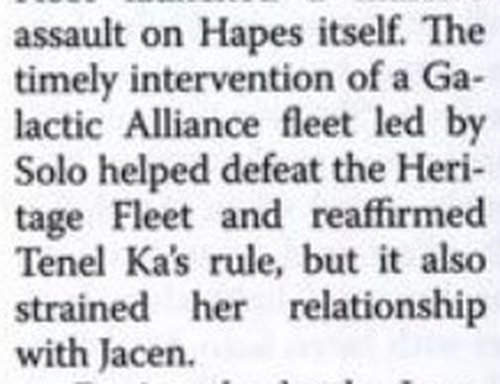
Our notes: `notes/materials/031-complete-star-wars-encyclopedia-vol-2/04-v2-scan-161-200.md:233`

> Peace didn't last long, however, and during the Confederation—GA War, after Jacen Solo declared the Jedi enemies of the state, Karrde provided his organization's information and equipment to help the Jedi successfully raid Solo's Star Destroyer.
— Source: scan pages 201–240; Jacen Solo (Darth Caedus).
Note (our notes, around the quote): Jacen Solo (Darth Caedus): "Peace didn't last long, however, and during the Confederation—GA War, after Jacen Solo declared the Jedi enemies of the state, Karrde provided his organization's information and equipment to help the Jedi successfully raid Solo's Star Destroyer." Source: The Complete Star Wars Encyclopedia, Vol. II, p.201
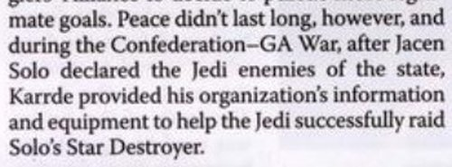
Our notes: `notes/materials/031-complete-star-wars-encyclopedia-vol-2/05-v2-scan-201-240.md:58`

> However, Randa the Hutt sacrificed himself to help Leia escape, and Lah was nearly killed in battle with Leia and her son Jacen.
— Source: scan pages 241–280; Leia Organa Solo; Jacen Solo (Darth Caedus).
Note (our notes, around the quote): Leia Organa Solo; Jacen Solo (Darth Caedus): "However, Randa the Hutt sacrificed himself to help Leia escape, and Lah was nearly killed in battle with Leia and her son Jacen." Source: The Complete Star Wars Encyclopedia, Vol. II, p.241
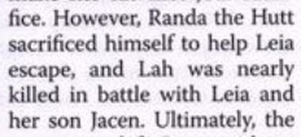
Our notes: `notes/materials/031-complete-star-wars-encyclopedia-vol-2/06-v2-scan-241-280.md:62`

> Jacen surprised her by taking possession of the Breathe My Jets, leaving her with enough credits to pay off her debts and purchase a stock YV-666 freighter known as the Duracrud.
— Source: scan pages 241–280; Jacen Solo (Darth Caedus).
Note (our notes, around the quote): Jacen Solo (Darth Caedus): "Jacen surprised her by taking possession of the Breathe My Jets, leaving her with enough credits to pay off her debts and purchase a stock YV-666 freighter known as the Duracrud." Source: The Complete Star Wars Encyclopedia, Vol. II, p.247
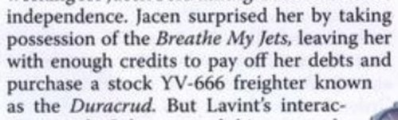
Our notes: `notes/materials/031-complete-star-wars-encyclopedia-vol-2/06-v2-scan-241-280.md:118`

> During Jacen Solo's attempt to capture Centerpoint Station, Lensi was shot down and killed in the fighting—ironically by Antilles, who was flying as Rakehell Leader ona mission for the Jedi Order.
— Source: scan pages 241–280; Jacen Solo (Darth Caedus).
Note (our notes, around the quote): Jacen Solo (Darth Caedus): "During Jacen Solo's attempt to capture Centerpoint Station, Lensi was shot down and killed in the fighting—ironically by Antilles, who was flying as Rakehell Leader ona mission for the Jedi Order." Source: The Complete Star Wars Encyclopedia, Vol. II, p.250
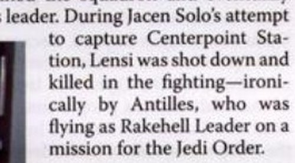
Our notes: `notes/materials/031-complete-star-wars-encyclopedia-vol-2/06-v2-scan-241-280.md:149`

> As part of Caedus's rise to power, he killed Mara Jade Skywalker, though his guilt as the murderer remained unknown for some time.
— Source: scan pages 241–280; Jacen Solo (Darth Caedus); Mara Jade Skywalker.
Note (our notes, around the quote): Jacen Solo (Darth Caedus); Mara Jade Skywalker: "As part of Caedus's rise to power, he killed Mara Jade Skywalker, though his guilt as the murderer remained unknown for some time." Source: The Complete Star Wars Encyclopedia, Vol. II, p.266
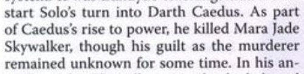
Our notes: `notes/materials/031-complete-star-wars-encyclopedia-vol-2/06-v2-scan-241-280.md:293`

> The base was soon abandoned in the wake of the Second Battle of Fondor, when Jacen Solo made a concerted ef- | fort to locate and destroy the Jedi.
— Source: scan pages 281–320; Jacen Solo (Darth Caedus).
Note (our notes, around the quote): Jacen Solo (Darth Caedus): "The base was soon abandoned in the wake of the Second Battle of Fondor, when Jacen Solo made a concerted ef- | fort to locate and destroy the Jedi." Source: The Complete Star Wars Encyclopedia, Vol. II, p.293
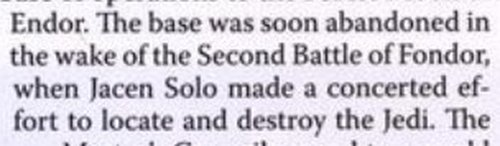
Our notes: `notes/materials/031-complete-star-wars-encyclopedia-vol-2/07-v2-scan-281-320.md:162`

> Med Evac 1014 A Galactic Alliance med runner deployed during the Second Battle of Fondor, Jacen Solo commandeered the ship to rescue Tahiri Veila from the Bloodfin, knowing that the ship's identity as a medical rescue vessel would allow him access to the destroyer.
— Source: scan pages 281–320; Jacen Solo (Darth Caedus); Tahiri Veila.
Note (our notes, around the quote): Jacen Solo (Darth Caedus); Tahiri Veila: "Med Evac 1014 A Galactic Alliance med runner deployed during the Second Battle of Fondor, Jacen Solo commandeered the ship to rescue Tahiri Veila from the Bloodfin, knowing that the ship's identity as a medical rescue vessel would allow him access to the destroyer." Source: The Complete Star Wars Encyclopedia, Vol. II, p.300
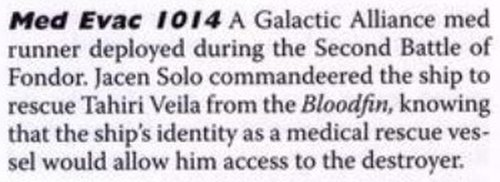
Our notes: `notes/materials/031-complete-star-wars-encyclopedia-vol-2/07-v2-scan-281-320.md:223`

> After the Second Battle of Fondor, the Megador accompanied Darth Caedus and the Anakin Solo into the Transitory Mists on a mission to hunt and destroy Luke Skywalker and the new Jedi Order.
— Source: scan pages 281–320; Jacen Solo (Darth Caedus); Anakin Solo; Luke Skywalker.
Note (our notes, around the quote): Jacen Solo (Darth Caedus); Anakin Solo; Luke Skywalker: "After the Second Battle of Fondor, the Megador accompanied Darth Caedus and the Anakin Solo into the Transitory Mists on a mission to hunt and destroy Luke Skywalker and the new Jedi Order." Source: The Complete Star Wars Encyclopedia, Vol. II, p.303

Our notes: `notes/materials/031-complete-star-wars-encyclopedia-vol-2/07-v2-scan-281-320.md:250`

> Merry Miner The vessel used by Jaina and Jacen Solo to maneuver a stylus ship into position over Helska 4 during the New Republic's first attempt to destroy the Yuuzhan Vong invasion force.
— Source: scan pages 281–320; Jaina Solo; Jacen Solo (Darth Caedus).
Note (our notes, around the quote): Jaina Solo; Jacen Solo (Darth Caedus): "Merry Miner The vessel used by Jaina and Jacen Solo to maneuver a stylus ship into position over Helska 4 during the New Republic's first attempt to destroy the Yuuzhan Vong invasion force." Source: The Complete Star Wars Encyclopedia, Vol. II, p.308

Our notes: `notes/materials/031-complete-star-wars-encyclopedia-vol-2/07-v2-scan-281-320.md:287`

> When Han Solo joined the mission to destroy Grand Admiral Thrawn's cloning facility on Wayland, Cakhmaim protected Leia, Winter, and the children, Jaina and Jacen Solo.
— Source: scan pages 321–360.
Note (our notes, around the quote): Han Solo; Grand Admiral Thrawn; Leia Organa Solo; Winter Celchu; Jaina Solo; Jacen Solo (Darth Caedus): "When Han Solo joined the mission to destroy Grand Admiral Thrawn's cloning facility on Wayland, Cakhmaim protected Leia, Winter, and the children, Jaina and Jacen Solo." Source: The Complete Star Wars Encyclopedia, Vol. II, p.322

Our notes: `notes/materials/031-complete-star-wars-encyclopedia-vol-2/08-v2-scan-321-360.md:55`

> Pellaeon survived, however, and threatened to take the entire Imperial fleet with him to join the Galactic Alliance if the Moffs didn't accept Jacen's terms to join.
— Source: scan pages 321–360; Jacen Solo (Darth Caedus).
Note (our notes, around the quote): Jacen Solo (Darth Caedus): "Pellaeon survived, however, and threatened to take the entire Imperial fleet with him to join the Galactic Alliance if the Moffs didn't accept Jacen's terms to join." Source: The Complete Star Wars Encyclopedia, Vol. II, p.323

Our notes: `notes/materials/031-complete-star-wars-encyclopedia-vol-2/08-v2-scan-321-360.md:62`

> The small droid was destroyed in the crash, although its carcass was later discovered in the Unknown Regions by Jacen Solo when he visited the site of the crash.
— Source: scan pages 321–360; Jacen Solo (Darth Caedus).
Note (our notes, around the quote): Jacen Solo (Darth Caedus): "The small droid was destroyed in the crash, although its carcass was later discovered in the Unknown Regions by Jacen Solo when he visited the site of the crash." Source: The Complete Star Wars Encyclopedia, Vol. II, p.340

Our notes: `notes/materials/031-complete-star-wars-encyclopedia-vol-2/08-v2-scan-321-360.md:183`

> Sadras Koyan and Corellia's leader fired the Centerpoint Station repulsor at the Anakin Solo, Captain Nevil and Jacen Solo survived the blast, but Nevil's son, Turl, was killed in the fighting.
— Source: scan pages 361–400; Anakin Solo; Jacen Solo (Darth Caedus).
Note (our notes, around the quote): Anakin Solo; Jacen Solo (Darth Caedus): "Sadras Koyan and Corellia's leader fired the Centerpoint Station repulsor at the Anakin Solo, Captain Nevil and Jacen Solo survived the blast, but Nevil's son, Turl, was killed in the fighting." Source: The Complete Star Wars Encyclopedia, Vol. II, p.373

Our notes: `notes/materials/031-complete-star-wars-encyclopedia-vol-2/09-v2-scan-361-400.md:162`

> Not to be cut off from a primary munitions source, several planetary fleets from the Confederation arrived too, hoping to take advantage of the situation to destroy Caedus and take the Roche asteroid field for themselves.
— Source: scan pages 361–400; Jacen Solo (Darth Caedus).
Note (our notes, around the quote): Jacen Solo (Darth Caedus): "Not to be cut off from a primary munitions source, several planetary fleets from the Confederation arrived too, hoping to take advantage of the situation to destroy Caedus and take the Roche asteroid field for themselves." Source: The Complete Star Wars Encyclopedia, Vol. II, p.378

Our notes: `notes/materials/031-complete-star-wars-encyclopedia-vol-2/09-v2-scan-361-400.md:195`

> When Ben confronted Omas, the beleaguered Chief of State revealed that he believed Jacen had been the one who killed Mara.
— Source: scan pages 401–440; Jacen Solo (Darth Caedus); Mara Jade Skywalker.
Note (our notes, around the quote): Jacen Solo (Darth Caedus); Mara Jade Skywalker: "When Ben confronted Omas, the beleaguered Chief of State revealed that he believed Jacen had been the one who killed Mara." Source: The Complete Star Wars Encyclopedia, Vol. II, p.410

Our notes: `notes/materials/031-complete-star-wars-encyclopedia-vol-2/10-v2-scan-401-440.md:115`

> Colonel Jacen Solo used the Force to influence the minds of the shield operators on Oridin, tricking them into lowering the protective shield and allowing for the devastating attack.
— Source: scan pages 401–440; Jacen Solo (Darth Caedus).
Note (our notes, around the quote): Jacen Solo (Darth Caedus): "Colonel Jacen Solo used the Force to influence the minds of the shield operators on Oridin, tricking them into lowering the protective shield and allowing for the devastating attack." Source: The Complete Star Wars Encyclopedia, Vol. II, p.423

Our notes: `notes/materials/031-complete-star-wars-encyclopedia-vol-2/10-v2-scan-401-440.md:216`

## The Complete Star Wars Encyclopedia, Vol. III (P–Z)

> Yal Phaath was killed aboard the Baanu Rass by Jacen Solo.
— Source: scan pages 1–40; Jacen Solo (Darth Caedus).
Note (our notes, around the quote): Jacen Solo (Darth Caedus): "Yal Phaath was killed aboard the Baanu Rass by Jacen Solo." Source: The Complete Star Wars Encyclopedia, Vol. III, p.22

Our notes: `notes/materials/032-complete-star-wars-encyclopedia-vol-3/00-v3-scan-001-040.md:203`

> The Bith tended to injuries Jacen sustained after dueling with Luke and Ben Skywalker.
— Source: scan pages 41–80; Jacen Solo (Darth Caedus); Luke Skywalker; Ben Skywalker.
Note (our notes, around the quote): Jacen Solo (Darth Caedus); Luke Skywalker; Ben Skywalker: "The Bith tended to injuries Jacen sustained after dueling with Luke and Ben Skywalker." Source: The Complete Star Wars Encyclopedia, Vol. III, p.56

Our notes: `notes/materials/032-complete-star-wars-encyclopedia-vol-3/01-v3-scan-041-080.md:171`

> He also revealed that he had killed Mara Jade Skywalker, although he firmly believed that the killing had been necessary to allow Jacen to continue his mission to save the galaxy.
— Source: scan pages 121–160; Mara Jade Skywalker; Jacen Solo (Darth Caedus).
Note (our notes, around the quote): Mara Jade Skywalker; Jacen Solo (Darth Caedus): "He also revealed that he had killed Mara Jade Skywalker, although he firmly believed that the killing had been necessary to allow Jacen to continue his mission to save the galaxy." Source: The Complete Star Wars Encyclopedia, Vol. III, p.146

Our notes: `notes/materials/032-complete-star-wars-encyclopedia-vol-3/03-v3-scan-121-160.md:265`

> Luke Skywalker beheaded Shimrra in a duel, while Jacen Solo eliminated Onimi.
— Source: scan pages 121–160; Luke Skywalker; Jacen Solo (Darth Caedus); Onimi.
Note (our notes, around the quote): Luke Skywalker; Jacen Solo (Darth Caedus); Onimi: "Luke Skywalker beheaded Shimrra in a duel, while Jacen Solo eliminated Onimi." Source: The Complete Star Wars Encyclopedia, Vol. III, p.147

Our notes: `notes/materials/032-complete-star-wars-encyclopedia-vol-3/03-v3-scan-121-160.md:274`

> Ben came to believe that Jacen had killed his mother, but Jacen instead implicated the former Galactic Alliance Chief of State, Cal Omas.
— Source: scan pages 161–200; Jacen Solo (Darth Caedus).
Note (our notes, around the quote): Jacen Solo (Darth Caedus): "Ben came to believe that Jacen had killed his mother, but Jacen instead implicated the former Galactic Alliance Chief of State, Cal Omas." Source: The Complete Star Wars Encyclopedia, Vol. III, p.162

Our notes: `notes/materials/032-complete-star-wars-encyclopedia-vol-3/04-v3-scan-161-200.md:79`

> Jacen placed him in the Embrace of Pain aboard the Star Destroyer Anakin Solo, but Luke infiltrated the ship and freed him.
— Source: scan pages 161–200; Jacen Solo (Darth Caedus); Anakin Solo; Luke Skywalker.
Note (our notes, around the quote): Jacen Solo (Darth Caedus); Anakin Solo; Luke Skywalker: "Jacen placed him in the Embrace of Pain aboard the Star Destroyer Anakin Solo, but Luke infiltrated the ship and freed him." Source: The Complete Star Wars Encyclopedia, Vol. III, p.162

Our notes: `notes/materials/032-complete-star-wars-encyclopedia-vol-3/04-v3-scan-161-200.md:81`

> Ben plunged a vibroblade into Jacen's back before he could attack Luke, and the two left Jacen to die, although Jacen—now Darth Caedus—survived to continue his scourge.
— Source: scan pages 161–200; Jacen Solo (Darth Caedus); Luke Skywalker.
Note (our notes, around the quote): Jacen Solo (Darth Caedus); Luke Skywalker: "Ben plunged a vibroblade into Jacen's back before he could attack Luke, and the two left Jacen to die, although Jacen—now Darth Caedus—survived to continue his scourge." Source: The Complete Star Wars Encyclopedia, Vol. III, p.162

Our notes: `notes/materials/032-complete-star-wars-encyclopedia-vol-3/04-v3-scan-161-200.md:83`

> Ben was elevated to the rank of Jedi Knight and assigned to accompany Jaina Solo on a Jedi-sanctioned mission to destroy Darth Caedus.
— Source: scan pages 161–200; Jaina Solo; Jacen Solo (Darth Caedus).
Note (our notes, around the quote): Jaina Solo; Jacen Solo (Darth Caedus): "Ben was elevated to the rank of Jedi Knight and assigned to accompany Jaina Solo on a Jedi-sanctioned mission to destroy Darth Caedus." Source: The Complete Star Wars Encyclopedia, Vol. III, p.162

Our notes: `notes/materials/032-complete-star-wars-encyclopedia-vol-3/04-v3-scan-161-200.md:85`

> With Caedus's defeat imminent, Veila's options were vanishing.
— Source: scan pages 161–200; Jacen Solo (Darth Caedus).
Note (our notes, around the quote): Jacen Solo (Darth Caedus): "With Caedus's defeat imminent, Veila's options were vanishing." Source: The Complete Star Wars Encyclopedia, Vol. III, p.163

Our notes: `notes/materials/032-complete-star-wars-encyclopedia-vol-3/04-v3-scan-161-200.md:92`

> The two of them left Jacen— now the self-proclaimed Darth Caedus—to die... but he survived the blow.
> [fragment — full passage not on file]
— Source: scan pages 161–200; Jacen Solo (Darth Caedus).
Note (our notes, around the quote): Jacen Solo (Darth Caedus): "The two of them left Jacen— now the self-proclaimed Darth Caedus—to die... but he survived the blow." Source: The Complete Star Wars Encyclopedia, Vol. III, p.165

Our notes: `notes/materials/032-complete-star-wars-encyclopedia-vol-3/04-v3-scan-161-200.md:132`

> Ben was determined to prove beyond any doubt that Jacen Solo killed his mother, not out of vengeance, but out of justice.
— Source: scan pages 161–200; Jacen Solo (Darth Caedus).
Note (our notes, around the quote): Jacen Solo (Darth Caedus): "Ben was determined to prove beyond any doubt that Jacen Solo killed his mother, not out of vengeance, but out of justice." Source: The Complete Star Wars Encyclopedia, Vol. III, p.165

Our notes: `notes/materials/032-complete-star-wars-encyclopedia-vol-3/04-v3-scan-161-200.md:134`

> With new resolve, Luke set plans into motion to finally confront and defeat Caedus.
— Source: scan pages 161–200; Luke Skywalker; Jacen Solo (Darth Caedus).
Note (our notes, around the quote): Luke Skywalker; Jacen Solo (Darth Caedus): "With new resolve, Luke set plans into motion to finally confront and defeat Caedus." Source: The Complete Star Wars Encyclopedia, Vol. III, p.165

Our notes: `notes/materials/032-complete-star-wars-encyclopedia-vol-3/04-v3-scan-161-200.md:136`

> Jaina defeated her brother, ending his attacks against the Jedi, while Luke and Han stopped the opportunistic Moffs of the Imperial Remnant from their attempts at conquest that accompanied Caedus's rise.
— Source: scan pages 161–200; Jaina Solo; Luke Skywalker; Jacen Solo (Darth Caedus).
Note (our notes, around the quote): Jaina Solo; Luke Skywalker; Jacen Solo (Darth Caedus): "Jaina defeated her brother, ending his attacks against the Jedi, while Luke and Han stopped the opportunistic Moffs of the Imperial Remnant from their attempts at conquest that accompanied Caedus's rise." Source: The Complete Star Wars Encyclopedia, Vol. III, p.165

Our notes: `notes/materials/032-complete-star-wars-encyclopedia-vol-3/04-v3-scan-161-200.md:138`

> Just as Jacen showed up, Mara's body disappeared, becoming one with the Force—a sure sign to Ben Skywalker that his mother was revealing that she had been killed by Jacen.
— Source: scan pages 161–200; Jacen Solo (Darth Caedus); Mara Jade Skywalker; Ben Skywalker.
Note (our notes, around the quote): Jacen Solo (Darth Caedus); Mara Jade Skywalker; Ben Skywalker: "Just as Jacen showed up, Mara's body disappeared, becoming one with the Force—a sure sign to Ben Skywalker that his mother was revealing that she had been killed by Jacen." Source: The Complete Star Wars Encyclopedia, Vol. III, p.166

Our notes: `notes/materials/032-complete-star-wars-encyclopedia-vol-3/04-v3-scan-161-200.md:157`

> Ben was determined to prove that Jacen had killed his mother, but he sought justice, not vengeance.
— Source: scan pages 161–200; Jacen Solo (Darth Caedus).
Note (our notes, around the quote): Jacen Solo (Darth Caedus): "Ben was determined to prove that Jacen had killed his mother, but he sought justice, not vengeance." Source: The Complete Star Wars Encyclopedia, Vol. III, p.166

Our notes: `notes/materials/032-complete-star-wars-encyclopedia-vol-3/04-v3-scan-161-200.md:161`

> With new resolve, Luke developed plans to finally confront and defeat Caedus.
— Source: scan pages 161–200; Luke Skywalker; Jacen Solo (Darth Caedus).
Note (our notes, around the quote): Luke Skywalker; Jacen Solo (Darth Caedus): "With new resolve, Luke developed plans to finally confront and defeat Caedus." Source: The Complete Star Wars Encyclopedia, Vol. III, p.166

Our notes: `notes/materials/032-complete-star-wars-encyclopedia-vol-3/04-v3-scan-161-200.md:163`

- Note (summary from our notes, not a quotation): Page contents: 1259 words, 27 paragraphs | headings/entries: Solo, Jacen
  — Source: scan pages 161–200.
Our notes: `notes/materials/032-complete-star-wars-encyclopedia-vol-3/04-v3-scan-161-200.md:236`

> Later, Jacen joined forces with the other Jedi students in destroying Exar Kun's spirit forever and freeing Luke's spirit.
— Source: scan pages 161–200.
Note (our notes, around the quote): Jacen Solo (Darth Caedus); Exar Kun; Luke Skywalker — entry/section: Solo, Jacen: "Later, Jacen joined forces with the other Jedi students in destroying Exar Kun's spirit forever and freeing Luke's spirit." Source: The Complete Star Wars Encyclopedia, Vol. III, p.175

Also cited as: Exar Kun (AncientPower) vs Darth Plagueis (Vaelias) — https://www.suspectinsightforums.com/t4421-ss-exar-kun-ladykulvax-vs-darth-plagueis-vaelias.
Also noted as: Q145 — Source: Jacen Solo, The Complete Star Wars Encyclopedia | <<QUOTE Kirana Ti, The Complete Star Wars Encyclopedia wrote:>>
Our notes: `notes/materials/032-complete-star-wars-encyclopedia-vol-3/04-v3-scan-161-200.md:238`; `suspect-insight/debates/101-exar-kun-vs-darth-plagueis.md:674`; `suspect-insight/debates/123-exar-kun-vs-darth-sidious.md:1277`; `suspect-insight/debates/087-exar-kun-vs-darth-sidious.md:202`

> When Thrackan Sal-Solo fired it instead and destroyed the Hapan fleet, Jacen felt himself lost in his struggle to understand the Force.
— Source: scan pages 161–200; Jacen Solo (Darth Caedus) — entry/section: Solo, Jacen.
Note (our notes, around the quote): Jacen Solo (Darth Caedus) — entry/section: Solo, Jacen: "When Thrackan Sal-Solo fired it instead and destroyed the Hapan fleet, Jacen felt himself lost in his struggle to understand the Force." Source: The Complete Star Wars Encyclopedia, Vol. III, p.175

Our notes: `notes/materials/032-complete-star-wars-encyclopedia-vol-3/04-v3-scan-161-200.md:240`

> Shortly afterward, Jacen and his siblings joined the Jedi strike team to Myrkr to destroy the voxyn queen.
— Source: scan pages 161–200; Jacen Solo (Darth Caedus) — entry/section: Solo, Jacen.
Note (our notes, around the quote): Jacen Solo (Darth Caedus) — entry/section: Solo, Jacen: "Shortly afterward, Jacen and his siblings joined the Jedi strike team to Myrkr to destroy the voxyn queen." Source: The Complete Star Wars Encyclopedia, Vol. III, p.175

Our notes: `notes/materials/032-complete-star-wars-encyclopedia-vol-3/04-v3-scan-161-200.md:242`

> Jacen fled to Ziost, where Lumiya agreed to make Luke believe that she had killed Mara.
— Source: scan pages 161–200.
Note (our notes, around the quote): Jacen Solo (Darth Caedus); Lumiya; Luke Skywalker; Mara Jade Skywalker — entry/section: Solo, Jacen: "Jacen fled to Ziost, where Lumiya agreed to make Luke believe that she had killed Mara." Source: The Complete Star Wars Encyclopedia, Vol. III, p.175

Our notes: `notes/materials/032-complete-star-wars-encyclopedia-vol-3/04-v3-scan-161-200.md:244`

> Jaina trained under Boba Fett, learning Mandalorian combat techniques to effectively surprise and defeat Jacen.
— Source: scan pages 161–200.
Note (our notes, around the quote): Jacen Solo (Darth Caedus); Jaina Solo; Boba Fett — entry/section: Solo, Jacen: "Jaina trained under Boba Fett, learning Mandalorian combat techniques to effectively surprise and defeat Jacen." Source: The Complete Star Wars Encyclopedia, Vol. III, p.176

Our notes: `notes/materials/032-complete-star-wars-encyclopedia-vol-3/04-v3-scan-161-200.md:251`

> In a pitched battle, brother and sister dueled, and in the end, Jaina plunged her lightsaber into Jacen's chest, cutting through his ribs until she sliced through his heart.
— Source: scan pages 161–200; Jacen Solo (Darth Caedus); Jaina Solo — entry/section: Solo, Jacen.
Note (our notes, around the quote): Jacen Solo (Darth Caedus); Jaina Solo — entry/section: Solo, Jacen: "In a pitched battle, brother and sister dueled, and in the end, Jaina plunged her lightsaber into Jacen's chest, cutting through his ribs until she sliced through his heart." Source: The Complete Star Wars Encyclopedia, Vol. III, p.176

Our notes: `notes/materials/032-complete-star-wars-encyclopedia-vol-3/04-v3-scan-161-200.md:253`

> When Luke was unable to defeat Jacen, Jaina became convinced that her role as the Sword of the Jedi was to defeat her brother and restore peace to the galaxy.
— Source: scan pages 161–200.
Note (our notes, around the quote): Jaina Solo; Luke Skywalker; Jacen Solo (Darth Caedus) — entry/section: Solo, Jaina: "When Luke was unable to defeat Jacen, Jaina became convinced that her role as the Sword of the Jedi was to defeat her brother and restore peace to the galaxy." Source: The Complete Star Wars Encyclopedia, Vol. III, p.176

Our notes: `notes/materials/032-complete-star-wars-encyclopedia-vol-3/04-v3-scan-161-200.md:257`

> With one savage blow, she cleaved off her brother's arm but was so surprised she was flung against the far wall by Caedus's Force lightning.
— Source: scan pages 161–200; Jacen Solo (Darth Caedus).
Note (our notes, around the quote): Jacen Solo (Darth Caedus): "With one savage blow, she cleaved off her brother's arm but was so surprised she was flung against the far wall by Caedus's Force lightning." Source: The Complete Star Wars Encyclopedia, Vol. III, p.176

Our notes: `notes/materials/032-complete-star-wars-encyclopedia-vol-3/04-v3-scan-161-200.md:259`

> When the Yuuzhan Vong attacked Duro, Warmaster Tsavong Lah nearly killed Leia until her son Jacen drove him off.
— Source: scan pages 161–200; Leia Organa Solo; Jacen Solo (Darth Caedus).
Note (our notes, around the quote): Leia Organa Solo; Jacen Solo (Darth Caedus): "When the Yuuzhan Vong attacked Duro, Warmaster Tsavong Lah nearly killed Leia until her son Jacen drove him off." Source: The Complete Star Wars Encyclopedia, Vol. III, p.178

Our notes: `notes/materials/032-complete-star-wars-encyclopedia-vol-3/04-v3-scan-161-200.md:295`

> In the days that followed, Leia and Jaina met with Ben Skywalker, encouraging him to find evidence that would prove that Jacen had killed Mara Jade Skywalker.
— Source: scan pages 161–200.
Note (our notes, around the quote): Jaina Solo; Leia Organa Solo; Ben Skywalker; Jacen Solo (Darth Caedus); Mara Jade Skywalker — entry/section: Solo, Jaina: "In the days that followed, Leia and Jaina met with Ben Skywalker, encouraging him to find evidence that would prove that Jacen had killed Mara Jade Skywalker." Source: The Complete Star Wars Encyclopedia, Vol. III, p.178

Our notes: `notes/materials/032-complete-star-wars-encyclopedia-vol-3/04-v3-scan-161-200.md:297`

> Jaina, upon realizing that Jacen was working to destroy the Colony, refused to talk to him for the duration of the war.
— Source: scan pages 201–240; Jaina Solo; Jacen Solo (Darth Caedus).
Note (our notes, around the quote): Jaina Solo; Jacen Solo (Darth Caedus): "Jaina, upon realizing that Jacen was working to destroy the Colony, refused to talk to him for the duration of the war." Source: The Complete Star Wars Encyclopedia, Vol. III, p.199

Our notes: `notes/materials/032-complete-star-wars-encyclopedia-vol-3/05-v3-scan-201-240.md:58`

> Ta'a Chume began to plot a new pathway to power, working a deal with the Gorog hive to have Jacen and Tenel Ka's infant daughter killed.
— Source: scan pages 201–240; Jacen Solo (Darth Caedus).
Note (our notes, around the quote): Jacen Solo (Darth Caedus): "Ta'a Chume began to plot a new pathway to power, working a deal with the Gorog hive to have Jacen and Tenel Ka's infant daughter killed." Source: The Complete Star Wars Encyclopedia, Vol. III, p.208

Our notes: `notes/materials/032-complete-star-wars-encyclopedia-vol-3/05-v3-scan-201-240.md:131`

> Her pride was short-lived; soon thereafter Jacen—angered by a mistake Tebut made and refusing to accept her apology—crushed her neck with the Force.
— Source: scan pages 201–240; Jacen Solo (Darth Caedus).
Note (our notes, around the quote): Jacen Solo (Darth Caedus): "Her pride was short-lived; soon thereafter Jacen—angered by a mistake Tebut made and refusing to accept her apology—crushed her neck with the Force." Source: The Complete Star Wars Encyclopedia, Vol. III, p.226

Our notes: `notes/materials/032-complete-star-wars-encyclopedia-vol-3/05-v3-scan-201-240.md:281`

> The pair developed a daring plan to kill Jacen Solo by taking control of Centerpoint Station and using it to destroy Solo's flagship.
— Source: scan pages 201–240; Jacen Solo (Darth Caedus).
Note (our notes, around the quote): Jacen Solo (Darth Caedus): "The pair developed a daring plan to kill Jacen Solo by taking control of Centerpoint Station and using it to destroy Solo's flagship." Source: The Complete Star Wars Encyclopedia, Vol. III, p.231

Our notes: `notes/materials/032-complete-star-wars-encyclopedia-vol-3/05-v3-scan-201-240.md:324`

> Jaina, upon realizing that Jacen was going to work to destroy the Colony, refused to talk to him for the duration of the war.
— Source: scan pages 241–280; Jaina Solo; Jacen Solo (Darth Caedus).
Note (our notes, around the quote): Jaina Solo; Jacen Solo (Darth Caedus): "Jaina, upon realizing that Jacen was going to work to destroy the Colony, refused to talk to him for the duration of the war." Source: The Complete Star Wars Encyclopedia, Vol. III, p.239

Our notes: `notes/materials/032-complete-star-wars-encyclopedia-vol-3/06-v3-scan-241-280.md:48`

> The Yuuzhan Vong lieutenant badly injured Rhysode but was slain in battle by Jacen Solo.
— Source: scan pages 281–320; Jacen Solo (Darth Caedus).
Note (our notes, around the quote): Jacen Solo (Darth Caedus): "The Yuuzhan Vong lieutenant badly injured Rhysode but was slain in battle by Jacen Solo." Source: The Complete Star Wars Encyclopedia, Vol. III, p.291

Our notes: `notes/materials/032-complete-star-wars-encyclopedia-vol-3/07-v3-scan-281-320.md:128`

> The Mandalorians were outnumbered by the Imperial Elite Guard and stormtroopers stationed on the asteroid, and they were outmatched when Darth Caedus entered the fray.
— Source: scan pages 281–320; Jacen Solo (Darth Caedus).
Note (our notes, around the quote): Jacen Solo (Darth Caedus): "The Mandalorians were outnumbered by the Imperial Elite Guard and stormtroopers stationed on the asteroid, and they were outmatched when Darth Caedus entered the fray." Source: The Complete Star Wars Encyclopedia, Vol. III, p.297

Our notes: `notes/materials/032-complete-star-wars-encyclopedia-vol-3/07-v3-scan-281-320.md:174`

> The World Brain was killed when Alema Rar tried to murder Jacen by firing a poisoned dart at him.
— Source: scan pages 321–360; Alema Rar; Jacen Solo (Darth Caedus).
Note (our notes, around the quote): Alema Rar; Jacen Solo (Darth Caedus): "The World Brain was killed when Alema Rar tried to murder Jacen by firing a poisoned dart at him." Source: The Complete Star Wars Encyclopedia, Vol. III, p.334

Our notes: `notes/materials/032-complete-star-wars-encyclopedia-vol-3/08-v3-scan-321-360.md:159`

## The New Essential Guide to Characters (2002)

> In a furious rush of power, Jacen defeated Tsavong Lah, earning himself a Yuuzhan Vong death mark.
— Source: scan pages 151–180; Jacen Solo (Darth Caedus).
Note (our notes, around the quote): Jacen Solo (Darth Caedus): "In a furious rush of power, Jacen defeated Tsavong Lah, earning himself a Yuuzhan Vong death mark." Source: The New Essential Guide to Characters, p.171

Our notes: `notes/materials/034-new-essential-guide-to-characters/05-negc-scan-151-180.md:109`

## Sourcebooks/Star Wars Roleplaying Game Core Rulebook.pdf [Star Wars Roleplaying Game (d20, 2000)] (scan pages 241–300)

- Note (summary from our notes, not a quotation): Page contents: 1036 words, 28 paragraphs | headings/entries: Jacen Solo, Jedi Apprentice; THEATERS; Anakin Solo, Jedi Apprentice
  — Source: Sourcebooks/Star Wars Roleplaying Game Core Rulebook.pdf [Star Wars Rolep.
Our notes: `notes/materials/037-sw-d20-folder/046-star-wars-roleplaying-game-core-rulebook-scan-241-300.md:56`

## Sourcebooks/The New Jedi Order Sourcebook.pdf [Star Wars Roleplaying Game (d20, 2000)] (scan pages 61–120)

- Note (summary from our notes, not a quotation): Page contents: 710 words, 20 paragraphs | headings/entries: A00 07a, Ut; Jacen Solo, Reluctant Jedi
  — Source: Sourcebooks/The New Jedi Order Sourcebook.pdf [Star Wars Roleplaying Game.
Our notes: `notes/materials/037-sw-d20-folder/049-the-new-jedi-order-sourcebook-scan-061-120.md:274`

> Jacen unleashes the full, raw power of the Force against the Yuuzhan Vong.
— Source: Sourcebooks/The New Jedi Order Sourcebook.pdf [Star Wars Roleplaying Game.
Note (our notes, around the quote): Jacen Solo (Darth Caedus) — entry/section: Balance Point (The New Jedi Order Sourcebook, Ch5): "Jacen unleashes the full, raw power of the Force against the Yuuzhan Vong." Source: *The New Jedi Order Sourcebook* (SWRPG d20), scan p.105

Our notes: `notes/materials/037-sw-d20-folder/049-the-new-jedi-order-sourcebook-scan-061-120.md:276`

> His ankle crushed by Jacen Solo’s Force-powered assault, Warmaster Tsavong Lah is not in good humor as he returns to his command ship above Duro.
— Source: Sourcebooks/The New Jedi Order Sourcebook.pdf [Star Wars Roleplaying Game.
Note (our notes, around the quote): Jacen Solo (Darth Caedus); Tsavong Lah — entry/section: The Fall of Duro (The New Jedi Order Sourcebook, Ch5): "His ankle crushed by Jacen Solo’s Force-powered assault, Warmaster Tsavong Lah is not in good humor as he returns to his command ship above Duro." Source: *The New Jedi Order Sourcebook* (SWRPG d20), scan p.106

Our notes: `notes/materials/037-sw-d20-folder/049-the-new-jedi-order-sourcebook-scan-061-120.md:287`

## Sourcebooks/The New Jedi Order Sourcebook.pdf [Star Wars Roleplaying Game (d20, 2000)] (scan pages 121–162)

> Jacen, always eager for the least destructive solution, offers to climb into one of the Falcon's escape pods and go to the Yuuzhan Vong ship, where he hopes Tsavong Lah might consent to a duel.
— Source: Sourcebooks/The New Jedi Order Sourcebook.pdf [Star Wars Roleplaying Game; Jacen Solo (Darth Caedus).
Note (our notes, around the quote): Jacen Solo (Darth Caedus): "Jacen, always eager for the least destructive solution, offers to climb into one of the Falcon's escape pods and go to the Yuuzhan Vong ship, where he hopes Tsavong Lah might consent to a duel." Source: *The New Jedi Order Sourcebook* (SWRPG d20), scan p.123

Our notes: `notes/materials/037-sw-d20-folder/049-the-new-jedi-order-sourcebook-scan-121-162.md:24`

- Note (summary from our notes, not a quotation): Page contents: Anakin Solo vs Executor (Nom Anor turns down the duel, p.127); Corran's lightsaber cuts the ship hull; p.123 Jacen offers to duel Tsavong Lah. p.112-116 Anakin alone on Yavin 4 with grenade fungi and the Force; repairs lightsaber with lambent crystal. (hand-read)
  — Source: Sourcebooks/The New Jedi Order Sourcebook.pdf [Star Wars Roleplaying Game.
Our notes: `notes/materials/037-sw-d20-folder/049-the-new-jedi-order-sourcebook-scan-121-162.md:41`

> could add +2 to each skill check, attack roll, and saving throw
> [fragment — full passage not on file]
— Source: Sourcebooks/The New Jedi Order Sourcebook.pdf [Star Wars Roleplaying Game.
Note (our notes, around the quote): Page contents: Battle meld: in a meld with Jacen, Jaina and Lowbacca, Anakin "could add +2 to each skill check, attack roll, and saving throw". p.155 Luke and Mara fight off a horde of Vong ships over Coruscant. p.160 Jaina's rage opens her to the dark side. (hand-read)
Our notes: `notes/materials/037-sw-d20-folder/049-the-new-jedi-order-sourcebook-scan-121-162.md:184`

> Only Jacen and Jaina remain behind, watching their brother first beat back the Yuuzhan Vong warriors sent against him, then slowly become more and more overwhelmed.
— Source: Sourcebooks/The New Jedi Order Sourcebook.pdf [Star Wars Roleplaying Game; Jacen Solo (Darth Caedus); Jaina Solo.
Note (our notes, around the quote): Jacen Solo (Darth Caedus); Jaina Solo: "Only Jacen and Jaina remain behind, watching their brother first beat back the Yuuzhan Vong warriors sent against him, then slowly become more and more overwhelmed." Source: *The New Jedi Order Sourcebook* (SWRPG d20), scan p.153

Our notes: `notes/materials/037-sw-d20-folder/049-the-new-jedi-order-sourcebook-scan-121-162.md:232`

- Note (summary from our notes, not a quotation): Page contents: 929 words, 18 paragraphs | headings/entries: Jacen's Team; The Battle of Coruscant; The Treachery of Vigi Shesh
  — Source: Sourcebooks/The New Jedi Order Sourcebook.pdf [Star Wars Roleplaying Game.
Our notes: `notes/materials/037-sw-d20-folder/049-the-new-jedi-order-sourcebook-scan-121-162.md:237`

> With Vergere’s help, Jacen slays the voxyn queen—but the battle is long and terrible and leaves Jacen too weak to escape.
— Source: Sourcebooks/The New Jedi Order Sourcebook.pdf [Star Wars Roleplaying Game.
Note (our notes, around the quote): Jacen Solo (Darth Caedus); Vergere; Nom Anor — entry/section: Star by Star (The New Jedi Order Sourcebook, Ch7): "With Vergere’s help, Jacen slays the voxyn queen—but the battle is long and terrible and leaves Jacen too weak to escape." Source: *The New Jedi Order Sourcebook* (SWRPG d20), scan p.157

Our notes: `notes/materials/037-sw-d20-folder/049-the-new-jedi-order-sourcebook-scan-121-162.md:258`

> Jacen creates a diversion by attacking the voxyn queen single-handedly, allowing Vergere, Tenel Ka, and the other Jedi to capture the enemy cruiser.
— Source: Sourcebooks/The New Jedi Order Sourcebook.pdf [Star Wars Roleplaying Game; Jacen Solo (Darth Caedus).
Note (our notes, around the quote): Jacen Solo (Darth Caedus): "Jacen creates a diversion by attacking the voxyn queen single-handedly, allowing Vergere, Tenel Ka, and the other Jedi to capture the enemy cruiser." Source: *The New Jedi Order Sourcebook* (SWRPG d20), scan p.157

Our notes: `notes/materials/037-sw-d20-folder/049-the-new-jedi-order-sourcebook-scan-121-162.md:260`

## Star Wars Gamer/Star Wars Gamer 05.pdf [Star Wars Roleplaying Game (d20, 2000)] (scan pages 1–60)

- Note (summary from our notes, not a quotation): Page contents: The Crystal (Elaine Cunningham): Jaina's Jedi graduation on Yavin 4; Jacen and Anakin apprenticed to Luke; ailing Mara takes Jaina as apprentice; Han gives her a modified Z-95 which she names Crystal; Bahalian Shipyards a Tenloss Syndicate front; stats for The Crystal (Z-95) (hand-read)
  — Source: Star Wars Gamer/Star Wars Gamer 05.pdf [Star Wars Roleplaying Game (d20,.
Our notes: `notes/materials/037-sw-d20-folder/054-star-wars-gamer-05-scan-001-060.md:65`

> Those were different times. Master Luke became a Jedi during the Rebellion, and his path was shaped by necessity. We've always known the Jedi are more than warriors, but we don't know what that 'more' might be. Maybe it's our task to relearn what was lost.
— Source: Star Wars Gamer/Star Wars Gamer 05.pdf [Star Wars Roleplaying Game (d20,.
Note (our notes, around the quote): Jacen Solo (Darth Caedus) — entry/section: Jacen on what the Jedi are: "Those were different times. Master Luke became a Jedi during the Rebellion, and his path was shaped by necessity. We've always known the Jedi are more than warriors, but we don't know what that 'more' might be. Maybe it's our task to relearn what was lost." Source: *Star Wars Gamer 05* (SWRPG d20), scan p.13

Our notes: `notes/materials/037-sw-d20-folder/054-star-wars-gamer-05-scan-001-060.md:72`

## Star Wars Gamer/Star Wars Gamer 09.pdf [Star Wars Roleplaying Game (d20, 2000)] (scan pages 1–60)

- Note (summary from our notes, not a quotation): Page contents: Belt-Runner I splits its projected shields among Jaina's, Jacen's and Anakin's TIEs during the Yuuzhan Vong attack on Dubrillion; Lando's three TIE Advanced x1s trade their shields for proton torpedoes; his two TIE bombers have two-seat cockpits (hand-read)
  — Source: Star Wars Gamer/Star Wars Gamer 09.pdf [Star Wars Roleplaying Game (d20,.
Our notes: `notes/materials/037-sw-d20-folder/058-star-wars-gamer-09-scan-001-060.md:376`

## Characters/Miniatures/Champions of the Force Preview 7.pdf [Star Wars Roleplaying Game Revised Core (d20, 2002)]

- Note (summary from our notes, not a quotation): Page contents: Intro; Jacen and Jaina history (Jedi Academy, Yuuzhan Vong war, Rogue Squadron, Jacen's Force whirlwind); squad tactics with Leia/Han; Jacen card (hand-read)
  — Source: Characters/Miniatures/Champions of the Force Preview 7.pdf [Star Wars Rol.
Our notes: `notes/materials/037-sw-d20-folder/106-champions-of-the-force-preview-7.md:10`

> Jacen and Jaina Solo are the highly talented twins of Han and Leia Organa Solo. The twins' inherited abilities and Force talents enabled them to survive many adventures in their early years. When they were deemed old enough, they attended Luke Skywalker's Jedi Academy.
— Source: Characters/Miniatures/Champions of the Force Preview 7.pdf [Star Wars Rol.
Note (our notes, around the quote): Jacen Solo (Darth Caedus); Jaina Solo; Han Solo; Leia Organa Solo; Luke Skywalker — entry/section: The Solo twins: "Jacen and Jaina Solo are the highly talented twins of Han and Leia Organa Solo. The twins' inherited abilities and Force talents enabled them to survive many adventures in their early years. When they were deemed old enough, they attended Luke Skywalker's Jedi Academy." Source: *Champions of the Force Preview 7* (SWRPG d20 Revised Core), scan p.1

Our notes: `notes/materials/037-sw-d20-folder/106-champions-of-the-force-preview-7.md:12`

> As adventurous as their early life was, their greatest challenges came with the Yuuzhan Vong invasion. During this time, Jaina's piloting skills led her to the front lines as a member of Rogue Squadron. Her brother, on the other hand, withdrew into contemplation, questioning the very nature of the Force and how it should be used.
— Source: Characters/Miniatures/Champions of the Force Preview 7.pdf [Star Wars Rol.
Note (our notes, around the quote): Jacen Solo (Darth Caedus); Jaina Solo — entry/section: The twins in the Yuuzhan Vong war: "As adventurous as their early life was, their greatest challenges came with the Yuuzhan Vong invasion. During this time, Jaina's piloting skills led her to the front lines as a member of Rogue Squadron. Her brother, on the other hand, withdrew into contemplation, questioning the very nature of the Force and how it should be used." Source: *Champions of the Force Preview 7* (SWRPG d20 Revised Core), scan p.1

Our notes: `notes/materials/037-sw-d20-folder/106-champions-of-the-force-preview-7.md:14`

> But Jacen couldn't stay sidelined for long. A critical moment arrived when he realized he must use the Force to defend his mother. He unleashed the Force in a whirlwind that swept away her Yuuzhan Vong captors. Eventually, the war led Jacen down a very different path and to a new understanding of the Force.
— Source: Characters/Miniatures/Champions of the Force Preview 7.pdf [Star Wars Rol.
Note (our notes, around the quote): Jacen Solo (Darth Caedus); Leia Organa Solo — entry/section: Jacen unleashes the Force to save Leia: "But Jacen couldn't stay sidelined for long. A critical moment arrived when he realized he must use the Force to defend his mother. He unleashed the Force in a whirlwind that swept away her Yuuzhan Vong captors. Eventually, the war led Jacen down a very different path and to a new understanding of the Force." Source: *Champions of the Force Preview 7* (SWRPG d20 Revised Core), scan p.1

Our notes: `notes/materials/037-sw-d20-folder/106-champions-of-the-force-preview-7.md:16`

> If Leia or any other squad member with a Force rating is defeated, Jacen takes 10 points of damage from his Force Empathic ability.
— Source: Characters/Miniatures/Champions of the Force Preview 7.pdf [Star Wars Rol.
Note (our notes, around the quote): Jacen Solo (Darth Caedus); Jaina Solo; Leia Organa Solo — entry/section: Jacen and Jaina Solo: "If Leia or any other squad member with a Force rating is defeated, Jacen takes 10 points of damage from his Force Empathic ability." Source: *Champions of the Force Preview 7* (SWRPG d20 Revised Core), scan p.1

Our notes: `notes/materials/037-sw-d20-folder/106-champions-of-the-force-preview-7.md:18`

- Note (summary from our notes, not a quotation): Page contents: Jaina card; Jacen and Jaina RPG stats; Jedi Sentinel archetype and tactics (hand-read)
  — Source: Characters/Miniatures/Champions of the Force Preview 7.pdf [Star Wars Rol.
Our notes: `notes/materials/037-sw-d20-folder/106-champions-of-the-force-preview-7.md:23`

## Jedi Counselling/Jedi Counseling 78.pdf [Star Wars Roleplaying Game Revised Core (d20, 2002)]

- Note (summary from our notes, not a quotation): Page contents: Jacen Solo and Vergere; feat Disciple of the Unifying Force; Kushiban reach, Tiny lightsabers; gambit range Q (hand-read)
  — Source: Jedi Counselling/Jedi Counseling 78.pdf [Star Wars Roleplaying Game Revis.
Our notes: `notes/materials/037-sw-d20-folder/247-jedi-counseling-78.md:19`

- Note (summary from our notes, not a quotation): Jacen Solo (Darth Caedus); Vergere — entry/section: Jacen Solo and Vergere avoid corruption: "Q: Jacen Solo and Vergere (from the New Jedi Order era) appear to have learned some secret that allows them to avoid being corrupted by the dark side. In game terms, it seems that they're avoiding gaining Dark Side Points. How would you address this?
  — Source: Jedi Counselling/Jedi Counseling 78.pdf [Star Wars Roleplaying Game Revis.
Our notes: `notes/materials/037-sw-d20-folder/247-jedi-counseling-78.md:21`

- Note (summary from our notes, not a quotation): A: I believe that the optional rule outlined above is particularly well-suited to this philosophy of the Force. Still, even with that rule in place, it would seem that Jacen and Vergere have unlocked some truth that allows them to avoid corruption even more than this rule would allow. Thus, you may consider adding the following feat along with the "Resisting Temptation" optional rule:" Source: *Jedi Counseling 78* (SWRPG d20 Revised Core), scan p.2
  — Source: Jedi Counselling/Jedi Counseling 78.pdf [Star Wars Roleplaying Game Revis.

Our notes: `notes/materials/037-sw-d20-folder/247-jedi-counseling-78.md:22`

- Note (summary from our notes, not a quotation): Jacen Solo (Darth Caedus); Vergere — entry/section: Feat: Disciple of the Unifying Force: "New Feat: Disciple of the Unifying Force
  — Source: Jedi Counselling/Jedi Counseling 78.pdf [Star Wars Roleplaying Game Revis.
Our notes: `notes/materials/037-sw-d20-folder/247-jedi-counseling-78.md:24`

- Note (summary from our notes, not a quotation): You have begun to understand the deeper nature of the Unifying Force, challenging many of the concepts of light and dark common to more conventional Force-users.
  — Source: Jedi Counselling/Jedi Counseling 78.pdf [Star Wars Roleplaying Game Revis.
(Prerequisites: Wisdom 15, Alter, Control, Force Mastery, Force-Sensitive, Sense, See Force 10 ranks, Force level 12th, character cannot be dark. Additionally, this feat is available only to characters who have studied with someone who already has the feat (in the New Jedi Order era, only Vergere or Jacen Solo) or, at the GM's discretion, who have been isolated for an extended period without access to other Force-users (as Vergere was during her half-century of captivity with the Yuuzhan Vong).)
(Benefit: You gain a +4 Force bonus on Will saves to avoid gaining a Dark Side Point (see above). If tainted, you also receive a +4 Force bonus on Wisdom checks to avoid becoming dark and a +4 Force bonus on Fortitude saves to avoid the debilitating longterm effects of the dark side." Source: *Jedi Counseling 78* (SWRPG d20 Revised Core), scan p.2)

Our notes: `notes/materials/037-sw-d20-folder/247-jedi-counseling-78.md:25`

## Jedi Counselling/Jedi Counseling 8 - One-Handed!.pdf [Star Wars Roleplaying Game Revised Core (d20, 2002)]

- Note (summary from our notes, not a quotation): Page contents: Knocked out/pinned; lightsaber hardness; amphistaff poison; jury-rig; Firespray-31; ion vs DR; Rapid Strike; Jacen vitality Q (hand-read)
  — Source: Jedi Counselling/Jedi Counseling 8 - One-Handed!.pdf [Star Wars Roleplayi.
Our notes: `notes/materials/037-sw-d20-folder/249-jedi-counseling-8-one-handed.md:24`

- Note (summary from our notes, not a quotation): Page contents: Jacen vitality 59; skill point discrepancies; copyright (hand-read)
  — Source: Jedi Counselling/Jedi Counseling 8 - One-Handed!.pdf [Star Wars Roleplayi.
Our notes: `notes/materials/037-sw-d20-folder/249-jedi-counseling-8-one-handed.md:33`

## Sourcebooks/Coruscant and the Core Worlds.pdf [Star Wars Roleplaying Game Revised Core (d20, 2002)] (scan pages 61–120)

> Approximately fourteen years after the Battle of Endor, Chewbacca and the Solo children traveled to Drall, escorted by their Drallish tutor, Ebrihim. While there, they discovered the planetary repulsor system and used it to disable Centerpoint Station, a powerful weapon commandeered by anti-Rebellion extremists.
— Source: Sourcebooks/Coruscant and the Core Worlds.pdf [Star Wars Roleplaying Game.
Note (our notes, around the quote): Chewbacca; Jacen Solo (Darth Caedus); Jaina Solo; Anakin Solo — entry/section: Disabling Centerpoint from Drall: "Approximately fourteen years after the Battle of Endor, Chewbacca and the Solo children traveled to Drall, escorted by their Drallish tutor, Ebrihim. While there, they discovered the planetary repulsor system and used it to disable Centerpoint Station, a powerful weapon commandeered by anti-Rebellion extremists." Source: *Coruscant and the Core Worlds* (SWRPG d20 Revised Core), scan p.81

Our notes: `notes/materials/037-sw-d20-folder/665-coruscant-and-the-core-worlds-scan-061-120.md:154`

## Sourcebooks/Galactic Campaign Guide.pdf [Star Wars Roleplaying Game Revised Core (d20, 2002)] (scan pages 121–162)

- Note (summary from our notes, not a quotation): Page contents: Assigning Heroic Qualities: player availability, playing style, campaign focus, moderation (Jacen Solo's animals, Han's luck, Winter's memory); Designing Heroic Qualities; Anakin Skywalker (The Chosen One) (hand-read)
  — Source: Sourcebooks/Galactic Campaign Guide.pdf [Star Wars Roleplaying Game Revis.
Our notes: `notes/materials/037-sw-d20-folder/666-galactic-campaign-guide-scan-121-162.md:126`

> Design Notes: Anakin Solo, despite being the grandson of the “Chosen One,” is not as “in tune” with the totality of the Force as his grandfather or his older brother, Jacen Solo. He is much more focused on simply being a good warrior, using the Force primarily to further that goal.
— Source: Sourcebooks/Galactic Campaign Guide.pdf [Star Wars Roleplaying Game Revis; Anakin Solo — entry/section: Anakin Solo design notes.
Note (our notes, around the quote): Anakin Solo — entry/section: Anakin Solo design notes: "Design Notes: Anakin Solo, despite being the grandson of the “Chosen One,” is not as “in tune” with the totality of the Force as his grandfather or his older brother, Jacen Solo. He is much more focused on simply being a good warrior, using the Force primarily to further that goal." Source: *Galactic Campaign Guide* (SWRPG d20 Revised Core), scan p.145

Our notes: `notes/materials/037-sw-d20-folder/666-galactic-campaign-guide-scan-121-162.md:162`

## Sourcebooks/Revised Core Rulebook.pdf [Star Wars Roleplaying Game Revised Core (d20, 2002)] (scan pages 121–180)

> In The New Jedi Order era, Luke Skywalker has trained about one hundred Jedi and identified perhaps a dozen others to start training. Prominent Force-users such as Mara Jade Skywalker and Corran Horn help Skywalker train and coordinate the efforts of these Jedi, while promising students such as the Solo children and Ganner Rhysode show great promise for the future,
> [fragment — full passage not on file]
— Source: Sourcebooks/Revised Core Rulebook.pdf [Star Wars Roleplaying Game Revised.
Note (our notes, around the quote): Luke Skywalker; Mara Jade Skywalker; Corran Horn; Ganner Rhysode; Jaina Solo; Jacen Solo (Darth Caedus); Anakin Solo — entry/section: The Jedi — New Jedi Order era (Revised Core Rulebook, Ch9): "In The New Jedi Order era, Luke Skywalker has trained about one hundred Jedi and identified perhaps a dozen others to start training. Prominent Force-users such as Mara Jade Skywalker and Corran Horn help Skywalker train and coordinate the efforts of these Jedi, while promising students such as the Solo children and Ganner Rhysode show great promise for the future," Source: *Revised Core Rulebook* (SWRPG d20 Revised Core), scan p.178

Our notes: `notes/materials/037-sw-d20-folder/671-revised-core-rulebook-scan-121-180.md:301`

## Adventures/Dawn of Defiance/04 - Echoes of the Jedi.pdf [Star Wars Roleplaying Game Saga Edition (2007)]

- Note (summary from our notes, not a quotation): Page contents: Encounter: Jacen and the Stalfonauts (guardian spirits). (hand-read)
  — Source: Adventures/Dawn of Defiance/04 - Echoes of the Jedi.pdf [Star Wars Rolepl.
Our notes: `notes/materials/037-sw-d20-folder/706-04-echoes-of-the-jedi.md:178`

## Sourcebooks/Galaxy of Intrigue.pdf [Star Wars Roleplaying Game Saga Edition (2007)] (scan pages 61–120)

- Note (summary from our notes, not a quotation): Page contents: The Galactic Alliance Guard: Cal Omas forms the Galactic Alliance; GAG secret police led by Jacen Solo; Lumiya; Darth Caedus; killed by Jaina Solo in 41 ABY; Goals (Anakin Solo Star Destroyer; Daala); Methods. (hand-read)
  — Source: Sourcebooks/Galaxy of Intrigue.pdf [Star Wars Roleplaying Game Saga Editi.
Our notes: `notes/materials/037-sw-d20-folder/716-galaxy-of-intrigue-scan-061-120.md:298`

> As a result, he brings an overzealous and coldhearted attitude to his duties, giving those under his command leave to use any methods to identify enemies of the Alliance and force them to reveal their comrades. The GAG is soon feared across the galaxy by common citizens from every walk of life, no matter what their political bent. The fanaticism and brutality with which Jacen Solo and the GAG hunt down those considered to be enemies of peace lead him to fall prey to the corrupt guidance of Lumiya, a self-styled Dark Lady of the Sith. Jacen's excesses grow more severe, and eventually he gives himself fully to the dark side and is reborn as Darth Caedus. He then turns the GAG apparatus toward elevating himself to the position of leader of the Galactic Alliance and in doing so triggers the Second Galactic Civil War. Darth Caedus is killed in a lightsaber duel by his twin sister, Jedi Knight Jaina Solo, in 41 ABY. That same year, many of the GAG's top operatives are killed during a failed operation in the Corellian System. GOALS The Galactic Alliance Guard is founded to protect government institutions and citizens from violent terrorist attacks being coordinated primarily from Corellia. Later, the organization expands its mandate to target anyone their leader views as a threat to galactic peace and to his own power.
— Source: Sourcebooks/Galaxy of Intrigue.pdf [Star Wars Roleplaying Game Saga Editi.
(Excerpt widened 2026-11-17 to the relevant passage, word for word from research primary sw d20 folder files Star Wars Roleplaying Game Saga Edition Sourcebooks Galaxy of Intrigue (text copy `research_primary_sw_d20_folder_files_Star_Wars_Roleplaying_Game_Saga_Edition_Sourcebooks_Galaxy_of_Intrigue_pdf_7fa4ad4ee9`).)
(Excerpt widened 2026-11-17 to the relevant passage, word for word from research primary sw d20 folder files Star Wars Roleplaying Game Saga Edition Sourcebooks Galaxy of Intrigue (text copy `research_primary_sw_d20_folder_files_Star_Wars_Roleplaying_Game_Saga_Edition_Sourcebooks_Galaxy_of_Intrigue_pdf_7fa4ad4ee9`).)
Note (our notes, around the quote): Jaina Solo; Jacen Solo (Darth Caedus) — entry/section: Galaxy of Intrigue: "Darth Caedus is killed in a lightsaber duel by his twin sister, Jedi Knight Jaina Solo, in 41 ABY." Source: *Galaxy of Intrigue* (SWRPG Saga Edition), scan p.105

Our notes: `notes/materials/037-sw-d20-folder/716-galaxy-of-intrigue-scan-061-120.md:300`

> The GAG wants to seem as omnipresent as the intelligence apparatus of Palpatine's Empire had been, and it wants to inspire the same level of fear in the populace. On Coruscant, the group achieves this goal, although on Corellia, the GAG only hardens resistance against the central government, inspires further terrorism, and ultimately is one of the catalysts of the Second Galactic Civil War. Once Jacen Solo falls to the dark side and seizes the reins of galactic power, the GAG becomes his personal enforcement tool. Anyone he views as standing in the way of his personal goals-which involve bringing about a lasting peace by forcing the galaxy to obey his will-is targeted for imprisonment or assassination. After Jacen Solo's defeat, the GAG is formally disbanded. If any of the organization's top operatives survive, it is likely that they continue to operate in secret as the Galactic Alliance reestablishes itself (now under the leadership of Grand Moff Tarkin's one-time mistress Daala) and that they harbor particular animosity toward Corellians. METHODS The Galactic Alliance Guard is well equipped and well funded, staffed with top agents recruited from the Coruscant Security Force, the Galactic Alliance Intelligence Service, former New Republic Intelligence and Special Forces operatives brought out of retirement, and a handful of Jedi.
— Source: Sourcebooks/Galaxy of Intrigue.pdf [Star Wars Roleplaying Game Saga Editi; Jacen Solo (Darth Caedus).
(Excerpt widened 2026-11-17 to the relevant passage, word for word from research primary sw d20 folder files Star Wars Roleplaying Game Saga Edition Sourcebooks Galaxy of Intrigue (text copy `research_primary_sw_d20_folder_files_Star_Wars_Roleplaying_Game_Saga_Edition_Sourcebooks_Galaxy_of_Intrigue_pdf_7fa4ad4ee9`).)
(Excerpt widened 2026-11-17 to the relevant passage, word for word from research primary sw d20 folder files Star Wars Roleplaying Game Saga Edition Sourcebooks Galaxy of Intrigue (text copy `research_primary_sw_d20_folder_files_Star_Wars_Roleplaying_Game_Saga_Edition_Sourcebooks_Galaxy_of_Intrigue_pdf_7fa4ad4ee9`).)
Note (our notes, around the quote): Jacen Solo (Darth Caedus): "After Jacen Solo's defeat, the GAG is formally disbanded." Source: *Galaxy of Intrigue* (SWRPG Saga Edition), scan p.105

Our notes: `notes/materials/037-sw-d20-folder/716-galaxy-of-intrigue-scan-061-120.md:304`

- Note (summary from our notes, not a quotation): Page contents: GAG methods (family arrests, informants); Notable Members: Jacen Solo (Darth Caedus); Using the Galactic Alliance Guard. (hand-read)
  — Source: Sourcebooks/Galaxy of Intrigue.pdf [Star Wars Roleplaying Game Saga Editi.
Our notes: `notes/materials/037-sw-d20-folder/716-galaxy-of-intrigue-scan-061-120.md:315`

## Sourcebooks/Scavenger's Guide to Droids.pdf [Star Wars Roleplaying Game Saga Edition (2007)] (scan pages 121–161)

- Note (summary from our notes, not a quotation): Page contents: SD-X background (Tendrando Arms, after the Yuuzhan Vong war, adapted from YVH design; bodyguard; playable). Modifications: Bodyguard Enhancements; Martial Arts Enhancements. Sidebars: "Playing an SD-X-Series Stealth Battle Droid" (battle droid chassis, soldier then scout); "Unauthorized Modifications" (Tanol Ocir bounty; Darth Caedus SD-X modifications; Lando against interrogation droids). (hand-read)
  — Source: Sourcebooks/Scavenger's Guide to Droids.pdf [Star Wars Roleplaying Game S.
Our notes: `notes/materials/037-sw-d20-folder/724-scavengers-guide-to-droids-scan-121-161.md:123`

## Web Articles.pdf [Star Wars Roleplaying Game Saga Edition (2007)] (scan pages 1–60)

> Although few who encounter the Sith may remember the details of his face or manner of dress, the tattoos will forever be burned in their minds. (3) Some choose to (or are forced to) embrace a deathlike visage, such as Darth Sidious or Darth Nihl. Nearly every culture has a taboo about death, and most maintain some fear of it, so these Sith are instantly associated with that fear. 17 (4) Some Sith choose to (or are forced to) embrace the otherworldly in their appearance, such as the ghostly Darth Nihilus or the undead Darth Sion. Many people fear the unknown, and stories of ghosts and monsters are carried in cultures across the galaxy -- a fact that these Sith prey upon. (5) Some (such as Darth Caedus or Darth Vader before his defeat on Mustafar) choose simply to let the power and bearing of the Sith ooze from their every action and are marked only by sickly yellow eyes. Their predatory movements and ways are typically enough to inspire awe and dread in those who encounter them. (6) The appearance of some Sith is a function of tragedy, such as the cybernetic Darth Vader or the undead Darth Sion. Vader was nearly killed on Mustafar by Obi-Wan Kenobi and is sustained by extensive cybernetic augmentation; his frightening appearance is a function of his life-support system.
— Source: Web Articles.pdf [Star Wars Roleplaying Game Saga Edition (2007)] (scan p; Jacen Solo (Darth Caedus); Darth Vader (Anakin Skywalker).
(Excerpt widened 2026-11-17 to the relevant passage, word for word from research primary sw d20 folder files Star Wars Roleplaying Game Saga Edition Web Articles (text copy `research_primary_sw_d20_folder_files_Star_Wars_Roleplaying_Game_Saga_Edition_Web_Articles_pdf_6187a774ab`).)
(Excerpt widened 2026-11-17 to the relevant passage, word for word from research primary sw d20 folder files Star Wars Roleplaying Game Saga Edition Web Articles (text copy `research_primary_sw_d20_folder_files_Star_Wars_Roleplaying_Game_Saga_Edition_Web_Articles_pdf_6187a774ab`).)
Note (our notes, around the quote): Jacen Solo (Darth Caedus); Darth Vader (Anakin Skywalker): "(5) Some (such as Darth Caedus or Darth Vader before his defeat on Mustafar) choose simply to let the power and bearing of the Sith ooze from their every action and are marked only by sickly yellow eyes." Source: *Web Articles* (SWRPG Saga Edition), scan p.17

Our notes: `notes/materials/037-sw-d20-folder/732-web-articles-scan-001-060.md:133`

## Web Articles.pdf [Star Wars Roleplaying Game Saga Edition (2007)] (scan pages 301–360)

- Note (summary from our notes, not a quotation): Page contents: Han Solo, Galactic Hero (LotF Preview 4 cont.): background (40 ABY, Corellia secession, Luke and Jacen, Galactic Alliance Guard) and miniatures tactics (Disruptive, Never Tell Me The Odds vs Thrawn; compared with Boba Fett, Bounty Hunter; Greater Mobile Attack bullet tactics; Talon Karrde initiative control) - T records (bullets rendered "•"; "does"/"rarely" marked [sic]); stat card (New Republic; cost 50; HP 90; Def 19; Atk +10; Dmg 20; Unique, Accurate Shot, Cunning Attack, Disruptive, Double Attack, Evade, Greater Mobile Attack, Never Tell Me The Odds); Saga stats Han Solo (early Legacy Era) CL 19 Medium Human scoundrel 5/soldier 3/ace pilot 5/gunslinger 5/officer 1 (Destiny 3; Force 7; Dark Side 2; Init +20; Basic, Huttese, Rodese, Shyriiwook; Ref 34, Fort 31, Will 35; hp 98; heavy blaster pistol +17 (3d8+13) with Rapid Shot/Double Attack options; quad laser cannons; concussion missiles; Combined Fire, Deceptive Shot, Draw Fire, Fool's Luck, Full Throttle, Keep It Together; maneuvers angle deflector shields, overwhelming assault, skim the surface; trusty sidearm +2, vehicle dodge +2; possessions heavy blaster pistol with targeting scope, tool kit, modified YT-1300 (Millennium Falcon)); footnote "Described in Starships of the Galaxy". (hand-read)
  — Source: Web Articles.pdf [Star Wars Roleplaying Game Saga Edition (2007)] (scan p.
Our notes: `notes/materials/037-sw-d20-folder/732-web-articles-scan-301-360.md:150`

## Star Wars Insider #46 (1999)

> Now, they are Jedi apprentices to be reckoned with, skilled with their Sghtsabers—but also a near-match for their father Han Solo when placed behind the can tral stick, In the furious space battles that fuel Vector Prime, the young Jedi Knights prave they're very ready to take their place alongside their parents and their uncle Luke.
— Source: Star Wars Insider #46 (1999).
Note (our notes, around the quote): Jaina Solo; Jacen Solo (Darth Caedus); Han Solo — entry/section: Star Wars Insider 046 (1999): "Now, they are Jedi apprentices to be reckoned with, skilled with their Sghtsabers—but also a near-match for their father Han Solo when placed behind the can tral stick, In the furious space battles that fuel Vector Prime, the young Jedi Knights prave they're very ready to take their place alongside their parents and their uncle Luke." Source: *Star Wars Insider #46* (1999), scan p.78

Our notes: `notes/materials/038-star-wars-insider/046-ins046.md:405`

## Star Wars Insider #48 (2000)

> Fans used to the mostly restrained Luke Skywalker of many post-Return of the Jedi books will feel their pulses pick up during a battle between the Jedi Master—wielding a lightsaber in each hand—and a camp of Yuuzhan Vong who have captured his nephew, the budding Jedi Jacen Solo.
— Source: Star Wars Insider #48 (2000).
Note (our notes, around the quote): Luke Skywalker; yuuzhan-vong; jacen-solo — entry/section: Star Wars Bookshelf (Jason Fry), printed p. 74: "Fans used to the mostly restrained Luke Skywalker of many post-Return of the Jedi books will feel their pulses pick up during a battle between the Jedi Master—wielding a lightsaber in each hand—and a camp of Yuuzhan Vong who have captured his nephew, the budding Jedi Jacen Solo." Source: *Star Wars Insider #48* (2000), scan p.78

Our notes: `notes/materials/038-star-wars-insider/048-ins048.md:413`

## Star Wars Insider #52 (2000)

- Note (summary from our notes, not a quotation): Page contents: Bookshelf (Jason Fry): Kathy Tyers, NJO Balance Point; Vong on Duro; Jacen lead, Mara Jade third lead. (hand-read)
  — Source: Star Wars Insider #52 (2000).
Our notes: `notes/materials/038-star-wars-insider/052-ins052.md:347`

> the peerless Boba Fett
> [fragment — full passage not on file]
— Source: Star Wars Insider #52 (2000).
Note (our notes, around the quote): Page contents: Tyers cont.: Luke as married man, Jacen's struggles with the nature of the Force; Firebird trilogy; Aurra Sing: Dawn of the Bounty Hunters masterpiece edition ("the peerless Boba Fett"). (hand-read)
Our notes: `notes/materials/038-star-wars-insider/052-ins052.md:352`

## Star Wars Insider #57 (2001)

- Note (summary from our notes, not a quotation): Page contents: Who's Who, Jedi Knights cont. (magazine p. 58): Miko Reglia (died), Ganner Rhysode, Saba Sebatyne, Wurth Skidder (died), Anakin Solo (died), Jacen Solo, Jaina Solo, Tekli. Line portraits. (hand-read)
  — Source: Star Wars Insider #57 (2001).
Our notes: `notes/materials/038-star-wars-insider/057-ins057.md:348`

> When Tsavong Lah threatened his mother's life, Jacen reluctantly tapped into the Force and defeated the enemy warmaster.
— Source: Star Wars Insider #57 (2001); Tsavong Lah; Jacen Solo (Darth Caedus) — entry/section: Jacen Solo.
Note (our notes, around the quote): Tsavong Lah; Jacen Solo (Darth Caedus) — entry/section: Jacen Solo: "When Tsavong Lah threatened his mother's life, Jacen reluctantly tapped into the Force and defeated the enemy warmaster." Source: *Star Wars Insider #57* (2001), scan p.47

Our notes: `notes/materials/038-star-wars-insider/057-ins057.md:350`

## Star Wars Insider #61 (2002)

> Die Hard in space
> [fragment — full passage not on file]
— Source: Star Wars Insider #61 (2002).
Note (our notes, around the quote): Page contents: Feature on author Matthew Woodring Stover and his New Jedi Order novel Traitor (due October): why he joined the series, focusing on Jacen Solo as a "Hamlet character", Jacen aboard a Yuuzhan Vong worldship with Vergere, the original "Die Hard in space" idea, the hero's journey through the Land of the Dead. (hand-read)
Our notes: `notes/materials/038-star-wars-insider/061-ins061.md:502`

> a Hamlet character—thinks too much, too intellectual, too philosophical.
> [fragment — full passage not on file]
— Source: Star Wars Insider #61 (2002); Jacen Solo (Darth Caedus) — entry/section: Stover on Jacen Solo.
Note (our notes, around the quote): Jacen Solo (Darth Caedus) — entry/section: Stover on Jacen Solo: ""a Hamlet character—thinks too much, too intellectual, too philosophical." —Matthew Woodring Stover, Star Wars Insider 61, p. 80" Source: *Star Wars Insider #61* (2002), scan p.80

Our notes: `notes/materials/038-star-wars-insider/061-ins061.md:504`

> broken apart and put back together stronger than before.
> [fragment — full passage not on file]
— Source: Star Wars Insider #61 (2002).
Note (our notes, around the quote): Jacen Solo (Darth Caedus) — entry/section: Jacen Solo in Traitor: "By the book's end—which includes an epic battle in the heart of the former Galactic Senate—Jacen will have been "broken apart and put back together stronger than before."" Source: *Star Wars Insider #61* (2002), scan p.80

Our notes: `notes/materials/038-star-wars-insider/061-ins061.md:506`

> The reference to the Jedi’s new understanding of the Force made Jacen think of Vergere—the lost Master who had opened their eyes to so much of that new understanding—and he smiled at the first truth she had taught him: Everything I tell you is a lie.
>
> The New Jedi Order So Far...
> [fragment — full passage not on file]
— Source: Star Wars Insider #61 (2002).
(Full sentence/passage taken from the source text on file: `dn_tmp_jk_epub`.)
Note (our notes, around the quote): Page contents: Stover feature cont.: Dante's Inferno as inspiration (original title Underworld), Vergere and Jacen, Taoist view of the Force, "Everything I tell you is a lie," upcoming Mace Windu Clone Wars novel. Sidebar "The New Jedi Order So Far..." listing Vector Prime through Enemy Lines II: Rebel Stand plus Recovery (e-book), "Emissary of the Void" and "The Apprentice"; next up Destiny's Way by Walter Jon Williams in November. (hand-read)
Our notes: `notes/materials/038-star-wars-insider/061-ins061.md:511`

## Star Wars Insider #62 (2002)

> like writing Chapter 14 of War and Peace
> [fragment — full passage not on file]
— Source: Star Wars Insider #62 (2002). POV: Page contents, about Darth Caedus / Jacen Solo.
Note (our notes, around the quote): Page contents: "Walter Jon Williams, Galactic Historian" by Jason Fry: Williams on writing The New Jedi Order: Destiny's Way (the 14th NJO book; "like writing Chapter 14 of War and Peace"), the relay of NJO authors, learning the Expanded Universe; Jaina, Jacen and Vergere in the story. (hand-read)
Our notes: `notes/materials/038-star-wars-insider/062-ins062.md:595`

## Star Wars Insider #74 (2004)

- Note (summary from our notes, not a quotation): Page contents: NJO synopses: Agents of Chaos II: Jedi Eclipse (Viqi Shesh; Thrackan Sal-Solo fires Centerpoint Station at Fondor, destroying much of the Hapan fleet), Balance Point (Battle of Duro; Jacen vs. Tsavong Lah); related works: the Chewbacca comic miniseries, Greg Bear's Rogue Planet (introducing Zonama Sekot and Vergere) and the e-book "Recovery". (hand-read)
  — Source: Star Wars Insider #74 (2004).
Our notes: `notes/materials/038-star-wars-insider/074-ins074.md:145`

- Note (summary from our notes, not a quotation): Page contents: NJO: Star by Star synopsis; memorable beasties and ideas (voxyn, slashrats, YVH droids, grutchins, the Krizlaws, Alpha Red, Threepio's mortality, the seedship nursery, Jacen's homecoming, Zonama Sekot's defence). (hand-read)
  — Source: Star Wars Insider #74 (2004).
Our notes: `notes/materials/038-star-wars-insider/074-ins074.md:161`

- Note (summary from our notes, not a quotation): Page contents: NJO: Force Heretic II: Refugee (Bakura, the Ssi-Ruuk) and III: Reunion (Zonama Sekot rediscovered) synopses; great showdowns: Chewie vs. Dobido, Luke wading into a Vong camp in Onslaught, Corran Horn vs. Shedao Shai, the Falcon vs. Tsavong Lah's Sunulok, Fey'lya's fusillade, Anakin's sacrifice, Jacen in arms, Ganner's last stand, the endgame at Ebaq 9. (hand-read)
  — Source: Star Wars Insider #74 (2004).
Our notes: `notes/materials/038-star-wars-insider/074-ins074.md:200`

> Endgame at Ebaq 9 In the final pages of Destiny's Way, a defeated Tsavong Lah sees a chance for revenge, seizing the chance for a harrowing showdown with Jaina and Jacen in Ebaq 9's twisting tunnels.
— Source: Star Wars Insider #74 (2004).
Note (our notes, around the quote): Tsavong Lah; Jaina Solo; Jacen Solo (Darth Caedus) — entry/section: Endgame at Ebaq 9: "Endgame at Ebaq 9 In the final pages of Destiny's Way, a defeated Tsavong Lah sees a chance for revenge, seizing the chance for a harrowing showdown with Jaina and Jacen in Ebaq 9's twisting tunnels." Source: *Star Wars Insider #74* (2004), scan p.30

Our notes: `notes/materials/038-star-wars-insider/074-ins074.md:206`

- Note (summary from our notes, not a quotation): Page contents: NJO: The Final Prophecy and The Unifying Force synopses; abandoned concepts and inside jokes: killing Luke (vetoed by Lucas), the Vong as biotech users rather than dark-siders, the name from the Vong restaurant and Yunnan tea, the hardcover/paperback plan, the Dark Tide trilogy compressed to two, Droma as Han's sidekick, Vergere meant to survive, Ben Skywalker's early arrival, Anakin and Jacen swapping roles, and the GFFA acronym. (hand-read)
  — Source: Star Wars Insider #74 (2004).
Our notes: `notes/materials/038-star-wars-insider/074-ins074.md:211`

## Star Wars Insider #75 (2004)

- Note (summary from our notes, not a quotation): Page contents: Rebel Rumblings letters (writer names omitted): Japanese NJO cover art (reply: more Jacen and Jaina in post-NJO books, Jaina stars in "Or Die Trying" on p. 66); a reader worried about a "topless" scene mentioned for Episode III (reply: the character in question is male and unlikely to offend); praise for the fiction; masthead and staff credits. (hand-read)
  — Source: Star Wars Insider #75 (2004).
Our notes: `notes/materials/038-star-wars-insider/075-ins075.md:49`

## Star Wars Insider #83 (2005)

- Note (summary from our notes, not a quotation): Page contents: 20 Most Memorable Moments continued: Anakin hurls Ventress into the abyss (Clone Wars); the artistic fate of Grand Admiral Thrawn (The Last Command); Boba Fett escapes the Sarlacc (Marvel #81, "A Barve Like That"); Jacen Solo descends into the rings of hell (Traitor). (hand-read)
  — Source: Star Wars Insider #83 (2005).
Our notes: `notes/materials/038-star-wars-insider/083-ins083.md:264`

- Note (summary from our notes, not a quotation): Page contents: Memorable Moments continued: Jacen's rebirth; Borsk Fey'lya's noble end (Star by Star); Luke duels Vader for the first time before ESB (Splinter of the Mind's Eye, Alan Dean Foster); Anakin Solo becomes one with the Force (honorable mention). (hand-read)
  — Source: Star Wars Insider #83 (2005).
Our notes: `notes/materials/038-star-wars-insider/083-ins083.md:273`

## Star Wars Insider #88 (2006)

- Note (summary from our notes, not a quotation): Page contents: Betrayal (Jason Fry): Legacy of the Force book 1 (Aaron Allston), Jacen Solo, Ben Skywalker (hand-read)
  — Source: Star Wars Insider #88 (2006).
Our notes: `notes/materials/038-star-wars-insider/088-ins088.md:263`

## Star Wars Insider #90 (2006)

- Note (summary from our notes, not a quotation): Page contents: Skywalking: Star Wars Rules Comic-Con: Steve Sansweet's Star Wars Spectacular (Celebration IV in L.A. May 24-27 2007, Celebration Europe July 2007, live-action series later this decade, animated series 2008 set late in the Clone Wars, Rose Parade 501st, 30th Anniversary logo); LucasArts and Free Radical Design partnership (Peter Hirschmann); Del Rey "Darth Who" naming contest for Jacen Solo (Betrayal); story and photos by John Mulder (hand-read)
  — Source: Star Wars Insider #90 (2006).
Our notes: `notes/materials/038-star-wars-insider/090-ins090.md:55`

- Note (summary from our notes, not a quotation): Page contents: Jedi Library: "Caught in the Tempest" (Jason Fry): Troy Denning on Legacy of the Force: Tempest (Del Rey, November 28), the Solos' marriage after Star by Star, Han and Leia pursued as criminals by their own son Jacen (hand-read)
  — Source: Star Wars Insider #90 (2006).
Our notes: `notes/materials/038-star-wars-insider/090-ins090.md:131`

- Note (summary from our notes, not a quotation): Page contents: Tempest cont.: Luke and Mara worry about Ben and Jacen; Luke vs. Lumiya rematch; Tenel Ka and Allana in the Hapan Court; Denning on Jacen as tragic hero and fanatic; politics; returning foes; Upcoming Books Oct 2006–Feb 2007 (Allegiance cover by Timothy Zahn) (hand-read)
  — Source: Star Wars Insider #90 (2006).
Our notes: `notes/materials/038-star-wars-insider/090-ins090.md:136`

> deeply troubled by the moral imperfections and injustices that permeate his society, and he feels compelled to set matters right. This raises him to the stature of a mythic figure, and that's how I treat him. I write Jacen as a tragic hero, forced by fate to make unbearable choices and unthinkable decisions. And he never balks.
> [fragment — full passage not on file]
— Source: Star Wars Insider #90 (2006); Jacen Solo (Darth Caedus) — entry/section: Denning on Jacen.
Note (our notes, around the quote): Jacen Solo (Darth Caedus) — entry/section: Denning on Jacen: ""deeply troubled by the moral imperfections and injustices that permeate his society, and he feels compelled to set matters right. This raises him to the stature of a mythic figure, and that's how I treat him. I write Jacen as a tragic hero, forced by fate to make unbearable choices and unthinkable decisions. And he never balks." —Troy Denning, Star Wars Insider 90, p. 25" Source: *Star Wars Insider #90* (2006), scan p.25

Our notes: `notes/materials/038-star-wars-insider/090-ins090.md:138`

## Star Wars Insider #93 (2007)

- Note (summary from our notes, not a quotation): Page contents: Jawa's Corner Books "Sacrificial Writes" (words: Jason Fry): Karen Traviss discusses Sith Lords, grim choices and men in armor (Spoiler Alert); Legacy of the Force 5: Sacrifice (Del Rey, $25.95/Century, £17.99); Jacen's passage into Sith mastery; psychology of motivation; Ben Skywalker, Boba Fett returns to Mandalore; Sacrifice cover and author photo (hand-read)
  — Source: Star Wars Insider #93 (2007).
Our notes: `notes/materials/038-star-wars-insider/093-ins093.md:337`

> not only utterly plausible but far from crazy-evil... a know-all who had some good ideas, then placed too much faith in his own judgment, went to extremes, and behaved exactly like many, many politicians I've known and worked with and for over the years. —Karen Traviss, Star Wars Insider 93, p. 42
> [fragment — full passage not on file]
— Source: Star Wars Insider #93 (2007).
Note (our notes, around the quote): Jacen Solo (Darth Caedus) — entry/section: Not crazy-evil: "Traviss calls Jacen "not only utterly plausible but far from crazy-evil... a know-all who had some good ideas, then placed too much faith in his own judgment, went to extremes, and behaved exactly like many, many politicians I've known and worked with and for over the years. —Karen Traviss, Star Wars Insider 93, p. 42" Source: *Star Wars Insider #93* (2007), scan p.42

Our notes: `notes/materials/038-star-wars-insider/093-ins093.md:352`

## Star Wars Insider #95 (2007)

> A Tour of the Inferno — Troy Denning unleashes hell on the galaxy
> [fragment — full passage not on file]
>
> I took myself back to my own teenage years...
> [fragment — full passage not on file]
— Source: Star Wars Insider #95 (2007); Page contents: Books.
Note (our notes, around the quote): Page contents: Books: "A Tour of the Inferno — Troy Denning unleashes hell on the galaxy", words by Jason Fry: Legacy of the Force: Inferno (Del Rey $25.95/Century £17.99); Jacen Solo as Darth Caedus, Tenel Ka and the Hapan fleet, Kashyyyk; "Dark Times" section on Ben Skywalker; favorite characters (Han and Leia, Saba Sebatyne); pull quote "I took myself back to my own teenage years..."; Inferno cover, Luke photo (hand-read)
Our notes: `notes/materials/038-star-wars-insider/095-ins095.md:556`

> I profess a soft spot for Han and Leia... *(hand-read)*
> [fragment — full passage not on file]
— Source: Star Wars Insider #95 (2007).
Note (our notes, around the quote): Page contents: Books cont.: Saba Sebatyne; Han and Leia's final break with Jacen; "Last Word" section on Luke; SD-XX droid; humor ("Horror Writing 101"); nine-book structure (Aaron Allston Betrayal, Karen Traviss Sacrifice, Denning Invincible); photos (Han, Chewbacca, Leia; Troy Denning; Luke on Tatooine); pull quote "I profess a soft spot for Han and Leia..." (hand-read)
Our notes: `notes/materials/038-star-wars-insider/095-ins095.md:567`

## Star Wars Insider #98 (2008)

> the visual stylings of a lot of anime I've seen over the years. Gigantic, evocative wreckage on alien landscapes sometimes pops up in anime, with very striking results. Also, since Fury is all about the war, and the Legacy of the Force is to a certain extent about the parallels between the Luke/Vader/Palpatine conflicts and the Luke/Jacen conflict, having a visual reminder of that earlier conflict seemed like a natural element to include.
> [fragment — full passage not on file]
— Source: Star Wars Insider #98 (2008).
Note (our notes, around the quote): Luke Skywalker; Darth Vader (Anakin Skywalker); Palpatine (Darth Sidious); Jacen Solo (Darth Caedus) — entry/section: Anime wreckage: ""the visual stylings of a lot of anime I've seen over the years. Gigantic, evocative wreckage on alien landscapes sometimes pops up in anime, with very striking results. Also, since Fury is all about the war, and the Legacy of the Force is to a certain extent about the parallels between the Luke/Vader/Palpatine conflicts and the Luke/Jacen conflict, having a visual reminder of that earlier conflict seemed like a natural element to include." —Aaron Allston, Star Wars Insider 98, p. 43" Source: *Star Wars Insider #98* (2008), scan p.43

Our notes: `notes/materials/038-star-wars-insider/098-ins098.md:394`

## Star Wars Insider #100 (2008)

- Note (summary from our notes, not a quotation): Page contents: Top 100: 35 Jek Porkins (photo); 33 Jacen Solo (art); 34 Mace Windu (photo) (hand-read)
  — Source: Star Wars Insider #100 (2008).
Our notes: `notes/materials/038-star-wars-insider/100-ins100.md:441`

## Star Wars Insider #101 (2008)

> For anyone close to a sibling, it's easy to imagine the tangle of memories that must blur her thoughts,
> [fragment — full passage not on file]
>
> Her parents think of Jacen as 'already dead' and view Darth Caedus as the monster who has taken his place, which is the only way they can handle the horror of setting one child against another. Jaina doesn't have that luxury. When she attacks Caedus, it won't be some monster she sees in front of her. It will be her brother.
— Source: Star Wars Insider #101 (2008).
Note (our notes, around the quote): Jaina Solo; Jacen Solo (Darth Caedus) — entry/section: Denning: siblings and Caedus: ""For anyone close to a sibling, it's easy to imagine the tangle of memories that must blur her thoughts," Denning says, adding, "Her parents think of Jacen as 'already dead' and view Darth Caedus as the monster who has taken his place, which is the only way they can handle the horror of setting one child against another. Jaina doesn't have that luxury. When she attacks Caedus, it won't be some monster she sees in front of her. It will be her brother." —Troy Denning, Star Wars Insider 101, p. 59" Source: *Star Wars Insider #101* (2008), scan p.59

Our notes: `notes/materials/038-star-wars-insider/101-ins101.md:639`

> Only Jaina feels Jacen's anguish,
> [fragment — full passage not on file]
>
> For Jaina, Jacen doesn't deserve to be hunted out of hatred or vengeance. Stopping him should be an act of love, and that is the duty she takes on herself.
— Source: Star Wars Insider #101 (2008).
Note (our notes, around the quote): Jaina Solo; Jacen Solo (Darth Caedus) — entry/section: Denning: act of love: ""Only Jaina feels Jacen's anguish," Denning says, adding: "For Jaina, Jacen doesn't deserve to be hunted out of hatred or vengeance. Stopping him should be an act of love, and that is the duty she takes on herself." —Troy Denning, Star Wars Insider 101, p. 59" Source: *Star Wars Insider #101* (2008), scan p.59

Our notes: `notes/materials/038-star-wars-insider/101-ins101.md:641`

> He's grown up in a galaxy where good intentions seem ineffective, where no amount of compromise, negotiation, or even 'civilized' fighting ever seems to produce a lasting peace,
> [fragment — full passage not on file]
>
> He's bright enough to see that this is because those with selfish intentions don't feel restrained by the rules of common decency. So he takes the logical step and decides that the only way to achieve a true peace is to ignore the rules himself and impose peace from the top down. What he fails to see, of course, is that it's really the struggle that counts, that how one chooses to fight is just as important as what he's fighting for.
— Source: Star Wars Insider #101 (2008).
Note (our notes, around the quote): Jacen Solo (Darth Caedus) — entry/section: Denning: impose peace from the top down: ""He's grown up in a galaxy where good intentions seem ineffective, where no amount of compromise, negotiation, or even 'civilized' fighting ever seems to produce a lasting peace," Denning says. "He's bright enough to see that this is because those with selfish intentions don't feel restrained by the rules of common decency. So he takes the logical step and decides that the only way to achieve a true peace is to ignore the rules himself and impose peace from the top down. What he fails to see, of course, is that it's really the struggle that counts, that how one chooses to fight is just as important as what he's fighting for." —Troy Denning, Star Wars Insider 101, p. 60" Source: *Star Wars Insider #101* (2008), scan p.60

Our notes: `notes/materials/038-star-wars-insider/101-ins101.md:656`

> Jacen's not just trying to protect himself, he's trying to protect all the innocents of the galaxy.
— Source: Star Wars Insider #101 (2008); Jacen Solo (Darth Caedus) — entry/section: Pull quote.
Note (our notes, around the quote): Jacen Solo (Darth Caedus) — entry/section: Pull quote: ""Jacen's not just trying to protect himself, he's trying to protect all the innocents of the galaxy." —Troy Denning, Star Wars Insider 101, p. 60" Source: *Star Wars Insider #101* (2008), scan p.60

Our notes: `notes/materials/038-star-wars-insider/101-ins101.md:658`

## Star Wars Insider #104 (2008)

- Note (summary from our notes, not a quotation): Page contents: Ask Lobot cont. (501st Legion and R2-KT as fan-generated material made official; "Darth Who?" contest for Jacen Solo's Sith name); "Savior of the Universe" (Luke Skywalker: Last Hope for the Galaxy Dark Horse compilation, story list) (hand-read)
  — Source: Star Wars Insider #104 (2008).
Our notes: `notes/materials/038-star-wars-insider/104-ins104.md:379`

## Star Wars Insider #108 (2009)

> rogue soldiers too dangerous and unstable to leave unfettered
> [fragment — full passage not on file]
— Source: Star Wars Insider #108 (2009).
Note (our notes, around the quote): Page contents: Star Wars Books timeline 2009: FotJ: Outcast (Allston): two years after Darth Caedus' death, Chief of State Daala considers the Jedi "rogue soldiers too dangerous and unstable to leave unfettered"; Luke and Ben retrace Jacen's journey to find which Force-using groups influenced him. The Clone Wars: No Prisoners (Traviss): Ahsoka, Rex and the 501st on a shakedown cruise aboard Captain Gilad Pellaeon's assault ship become caught in a hostage situation. Also Omen, Abyss, Imperial Commando: 501st, Deathtroopers, the third Darth Bane novel (Bane and Zannah). Crop-verified. (hand-read)
Our notes: `notes/materials/038-star-wars-insider/108-ins108.md:50`

## Star Wars Insider #109 (2009)

- Note (summary from our notes, not a quotation): Page contents: Books (Jason Fry): Aaron Allston on Fate of the Jedi: Outcast — post-Legacy of the Force setting (Caedus died at Jaina's hands, Daala leads the GA), Valin Horn's madness, Luke's exile with Ben, Odyssey echoes, Kel Dor order on Dorin, Han on Kessel with Rogue and Wraith Squadrons. (hand-read)
  — Source: Star Wars Insider #109 (2009).
Our notes: `notes/materials/038-star-wars-insider/109-ins109.md:312`

## Star Wars Insider #110 (2009)

- Note (summary from our notes, not a quotation): Page contents: Books: "A Good Omen" (words: Jason Fry) — Christie Golden on Fate of the Jedi: Omen; Luke and Ben follow Jacen's trail to the Aing-Tii; Vestara and the Sith of Kesh; Future Reads list (Abyss, LEGO Visual Dictionary, Imperial Commando: 501st, 1,000 Collectibles, The Complete Vader, Deathtroopers). (hand-read)
  — Source: Star Wars Insider #110 (2009).
Our notes: `notes/materials/038-star-wars-insider/110-ins110.md:336`

## Star Wars Insider #114 (2010)

- Note (summary from our notes, not a quotation): Page contents: Ask Lobot as related to Leland Y. Chee (reader question on regrowing Anakin's and Luke's limbs; reader name omitted). Forthcoming books: Millennium Falcon (James Luceno, reprint; plot to overthrow the Emperor); Crosscurrent (Paul Kemp; time-displaced ancient Sith ship reaches Luke's era during Darth Caedus' rule, Jedi Knight Jaden Korr must stop them); The Clone Wars: Gambit: Stealth (Karen Miller; Obi-Wan and Anakin on Lanteeb); Luke Skywalker and the Shadows of Mindor (Matthew Stover reprint; Lord Shadowspawn's Black Stormtroopers trap); Fate of the Jedi: Backlash (Aaron Allston). (hand-read)
  — Source: Star Wars Insider #114 (2010).
Our notes: `notes/materials/038-star-wars-insider/114-ins114.md:307`

## Star Wars Insider #115 (2010)

- Note (summary from our notes, not a quotation): Page contents: Books: Crosscurrent (Dan Wallace): a Sith War-era starship (Harbinger) appears 37 years after Palpatine's fall via failed relativity shielding and time dilation, carrying a full force of Sith and weapons-grade ore; set after Legacy of the Force and Darth Caedus' downfall; ties to Golden Age of the Sith, Fall of the Sith Empire and Lost Tribe of the Sith: Precipice (sister ship Omen). (hand-read)
  — Source: Star Wars Insider #115 (2010).
Our notes: `notes/materials/038-star-wars-insider/115-ins115.md:320`

## Star Wars Insider #116 (2010)

- Note (summary from our notes, not a quotation): Page contents: Books: Fate of the Jedi: Backlash (March 9), set two years after Darth Caedus's death; Jedi suffering a mysterious plague of madness; Abeloth (Allston keeps mum); Luke and Ben battle the Nightsisters on Dathomir. (hand-read)
  — Source: Star Wars Insider #116 (2010).
Our notes: `notes/materials/038-star-wars-insider/116-ins116.md:361`

## Star Wars Insider #117 (2010)

> bigger, meaner, and scarier than your average Yuuzhan Vong
> [fragment — full passage not on file]
>
> something inside Finn Galfridian, something never before seen
> [fragment — full passage not on file]
— Source: Star Wars Insider #117 (2010).
Note (our notes, around the quote): Page contents: Comics (Daniel Wallace): Invasion returns (Tom Taylor, Colin Wilson); Finn Galfridian, Kaye, Nina, Caled of Artorias; Commander Tsalok "bigger, meaner, and scarier than your average Yuuzhan Vong"; Shaper experiments; Finn with Jacen and Jaina at the Jedi academy; "something inside Finn Galfridian, something never before seen". Ask Lobot (reader name omitted): Ewoks cartoons set shortly before ROTJ. (hand-read)
Our notes: `notes/materials/038-star-wars-insider/117-ins117.md:341`

## Star Wars Insider #121 (2010)

- Note (summary from our notes, not a quotation): Page contents: Ask Lobot (Leland Y. Chee): Jedi build lightsabers on Ilum, crystals determine blade color; Barriss Offee assembling hers through the Force under Luminara; Ahsoka went to Ilum before getting a Master; Darth Caedus pronounced KIE-duss (reader names omitted). (hand-read)
  — Source: Star Wars Insider #121 (2010).
Our notes: `notes/materials/038-star-wars-insider/121-ins121.md:354`

## Star Wars Insider #123 (2011)

> aren't the Force, but merely the broadcasters
> [fragment — full passage not on file]
— Source: Star Wars Insider #123 (2011).
Note (our notes, around the quote): Page contents: The Sith cont. (EU Sith: Malgus, Krayt, Talon, Desolous, Caedus); Midi-chlorians: What's the Deal? (Anakin's count over 20,000; midi-chlorians "aren't the Force, but merely the broadcasters"; Skippy the Jedi Droid); Force Artifacts (Kiber crystal, Rakatan relics, Charal's ring). (hand-read)
Our notes: `notes/materials/038-star-wars-insider/123-ins123.md:126`

## Star Wars Insider #132 (2012)

- Note (summary from our notes, not a quotation): Page contents: Fate of the Jedi feature: interview with Aaron Allston, Christie Golden and Troy Denning. Origins (a father/son odyssey to learn why Jacen fell, Homer's Odyssey model); the Maw entity idea; Daala banishes Luke; Golden's Ben/Vestara romance ("Jedi versus Sith"). (hand-read)
  — Source: Star Wars Insider #132 (2012).
Our notes: `notes/materials/038-star-wars-insider/132-ins132.md:177`

> the seed for the entire Fate of the Jedi series,
> [fragment — full passage not on file]
>
> isn't Luke's swan song.
> [fragment — full passage not on file]
— Source: Star Wars Insider #132 (2012).
Note (our notes, around the quote): Page contents: Books (Daniel Wallace): FotJ: Apocalypse (March 13). Denning says Jacen's fall was "the seed for the entire Fate of the Jedi series," that Apocalypse reveals the Balance of the Force, and that it "isn't Luke's swan song." Also: Haynes Millennium Falcon Owner's Workshop. (hand-read)
Our notes: `notes/materials/038-star-wars-insider/132-ins132.md:317`

## Star Wars Insider #133 (2012)

- Note (summary from our notes, not a quotation): Page contents: Battles: Ruusan (Lord Hoth's gambit vs Kaan's Brotherhood); Bilbringi (Thrawn killed by his Noghri bodyguard; Karrde's smugglers hit the rear); Fondor (Jacen Solo vs Niathal; Daala's Maw Irregulars and Mandalorian commandos turn the tide). (hand-read)
  — Source: Star Wars Insider #133 (2012).
Our notes: `notes/materials/038-star-wars-insider/133-ins133.md:117`

> routed two of the Empire's best garrisons.
> [fragment — full passage not on file]
— Source: Star Wars Insider #133 (2012).
Note (our notes, around the quote): Page contents: Art of Warfare: editor Erich Schoeneweiss. Battle of Kashyyyk (LotF): Jacen Solo/Caedus orders the Anakin Solo to fire turbolasers on the wroshyr forests; the Ewoks "routed two of the Empire's best garrisons." Chris Scalf's Ewok/Endor painting. (hand-read)
Our notes: `notes/materials/038-star-wars-insider/133-ins133.md:203`

## Star Wars Insider #139 (2013)

- Note (summary from our notes, not a quotation): Page contents: Red Five (Jason Fry), cliffhangers: "The Last One Standing" by Daniel Keys Moran (an older Han vs. an older Boba Fett standoff, no ending); Star by Star (Anakin Solo dies, Jacen captured, Coruscant falls to the Vong); Marvel Star Wars #18 "The Empire Strikes" by Archie Goodwin (personal anecdote details omitted). (hand-read)
  — Source: Star Wars Insider #139 (2013).
Our notes: `notes/materials/038-star-wars-insider/139-ins139.md:424`

## Star Wars Insider #149 (2014)

> is not about answers
> [fragment — full passage not on file]
— Source: Star Wars Insider #149 (2014).
Note (our notes, around the quote): Page contents: Heroes Die (Del Rey, August 1998) led to Traitor (written in seven months, originally titled Underworld; Anakin Solo's death transforms Jacen); Vergere's Taoist wisdom and ambiguous alignment; Lucas: Star Wars "is not about answers"; Shatterpoint pitched as "Apocalypse Now with Mace Windu"; Shelly Shapiro's 2004 call to write the ROTS novelization. OCR "stranger" crop-verified as "stronger". (hand-read)
Our notes: `notes/materials/038-star-wars-insider/149-ins149.md:215`

## Star Wars Insider #150 (2014)

- Note (summary from our notes, not a quotation): Page contents: 150th-issue feature by Jason Fry: the 10 biggest Star Wars milestones of the magazine's lifetime. #1 Heir to the Empire (May 1991): Roffman and Lucy Wilson restart adult fiction; Lucas's ground rules (set after ROTJ, no major characters killed); Bantam's Lou Aronica; Zahn's outline Nov. 1989; #1 NYT bestseller; Coruscant, Mara Jade, Thrawn, birth of Jacen and Jaina; 70,000 first run gone in two weeks. (hand-read)
  — Source: Star Wars Insider #150 (2014).
Our notes: `notes/materials/038-star-wars-insider/150-ins150.md:75`

## Star Wars Insider Special Edition (2010)

- Note (summary from our notes, not a quotation): Page contents: 50 EU facts 32-34 (viewed): KOTOR award, Darth Caedus name contest, Cade Skywalker. (hand-read)
  — Source: Star Wars Insider Special Edition (2010).
Our notes: `notes/materials/038-star-wars-insider/157-insspecial2010.md:852`

## Star Wars Insider Special Edition (2013)

- Note (summary from our notes, not a quotation): Page contents: Secrets of the Force: telepathy (Mara Jade), precognition (Jacen Solo), Force lightning (Plo Koon). (hand-read)
  — Source: Star Wars Insider Special Edition (2013).
Our notes: `notes/materials/038-star-wars-insider/159-insspecial2013.md:341`

