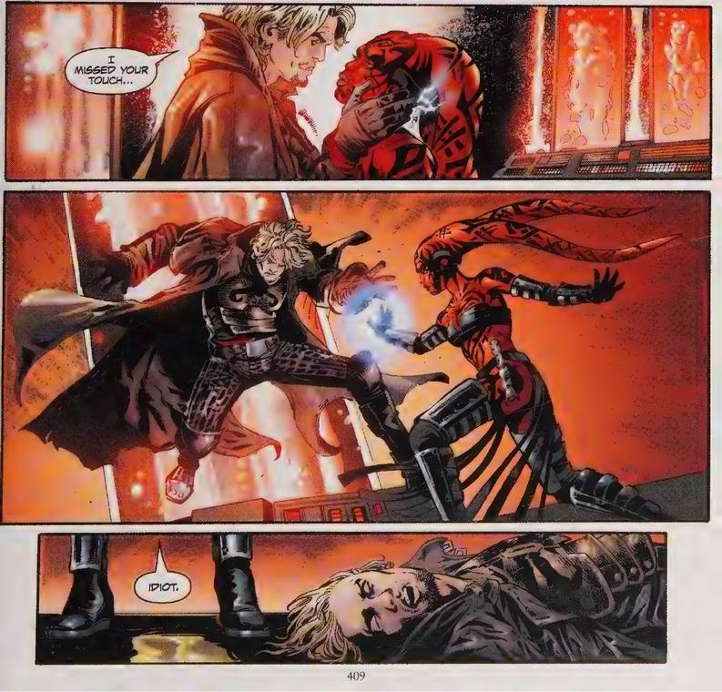
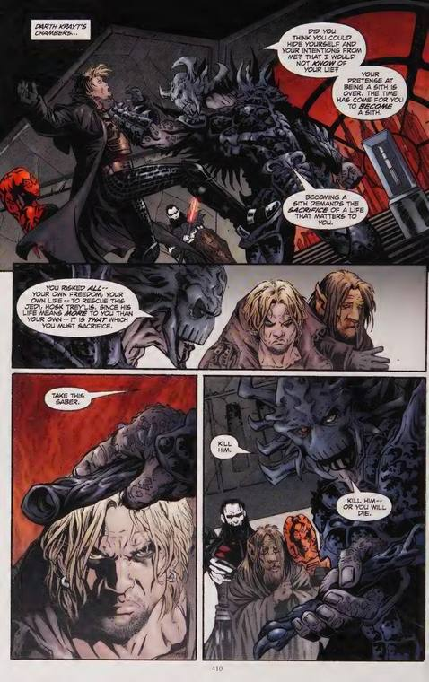
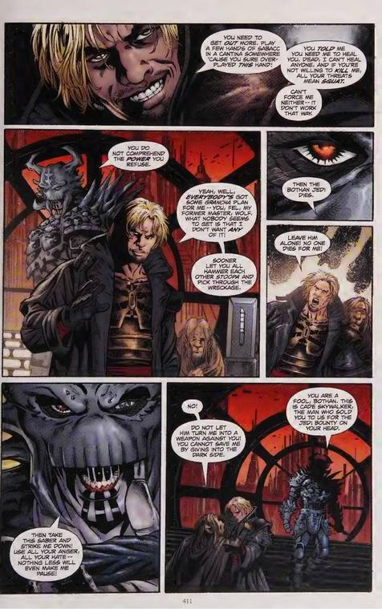
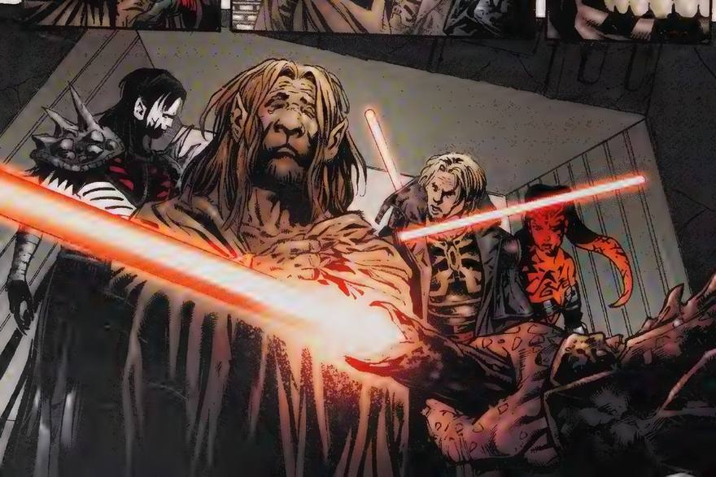
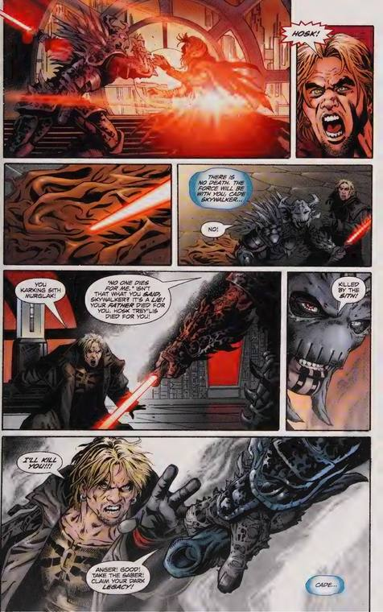
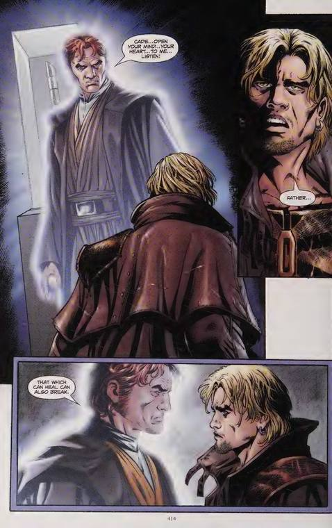
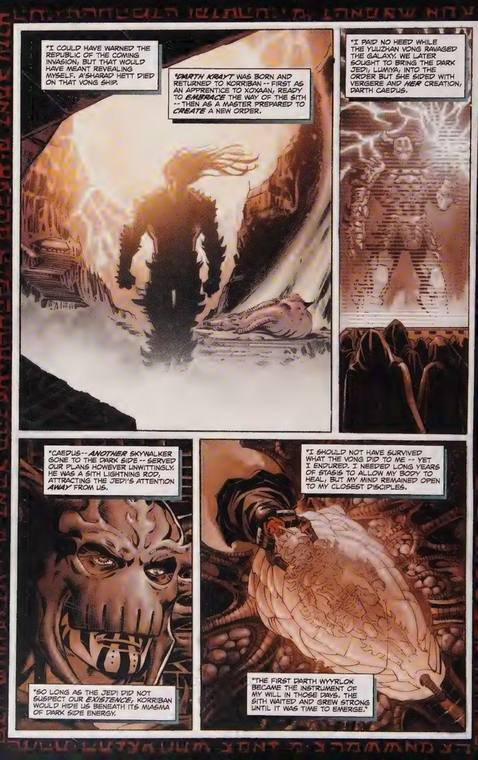

# Darth Caedus / Jacen Solo — part 3 of 5

[All parts](README.md) · [Previous](02-legends-legacy-of-the-force-own-full-read-betrayal.md) · [Next](04-debate-darth-caedus-dc77-vs-kyp-durron-sith-archae.md)

# LEGENDS (Legends / EU — main focus)

## NJO 6, *Balance Point* (Kathy Tyers, Del Rey 2000): FULL consecutive re-read (2026-11-16 CST)

What it shows (our notes): Jacen as negotiator; the Ryn brawl; Jacen collapses with Jaina's pain
> Han Solo stood with his left hand on his hip, arguing with Mezza, who led the larger of two Ryn clan remnants, but keeping one eye on the transgressors, a group of youths about Jacen’s age, with fading juvenile stripes on their cheeks. The Ryn clans occupied one of Settlement Thirty-two’s three wedge-shaped arrays of blue-roofed huts. The synthplas dome arched overhead, as gray as the polluted mists that swirled outside.
>
> Jacen had been blessed—or cursed—with a sensitivity that he once hid behind labored jokes, and he did find it easy to see both sides of almost any argument. Part of his job here was to help his dad negotiate. Han tended to cut to solutions, instead of listening to both parties’ points of view. Han had chased the Ryn over half the New Republic, trying to gather his new friend Droma’s invasion-scattered clanmates. As world after world closed its doors to refugees, the Ryn had been beggared, duped, and betrayed. They’d taken terrible losses. They needed a sponsor.
>
> So a reluctant Han Solo registered with the burgeoning Select Committee for Refugees. “Just long enough to settle them someplace.” That was how he explained it to Jacen, anyway.
>
> Jacen had fled here from Coruscant. Two months ago, the New Republic had called him and his brother Anakin to Centerpoint Station, the massive hyperspace repulsor and gravity lens in the Corellian system. There’d been hope that Anakin, who had activated Centerpoint once before, could enable it again. Military advisers had hoped to lure the Yuuzhan Vong into attacking Corellia, and they meant to use Centerpoint as an interdiction field, to trap the enemy inside Corellian space—and then wipe them out. Even Uncle Luke hoped the station might be used only in its shielding capacity, not as a weapon.
>
> The New Republic might never recover from the catastrophe that followed.
>
> Jacen could see stress in his dad’s lined face and his labored stride, and in the gray growing into his hair. Even after all these years of hobnobbing with bureaucrats and tolerating his wife’s protocol droid, patience clearly wasn’t his strong suit.
>
> Standing on the dust-beaten lane outside the Solos’ hut, Mezza’s opposing clan leader twisted his own tail between strong hands. The fur on Romany’s forearms, and the tip of his tail, stood out like bleached bristles.
>
> “So your clan,” Han said, pointing at Romany, “thinks your clan”—pointing now at Mezza—“is likely to hijack our transport ships and strand everybody else here on Duro? Is that it?”
>
> Someone at the back of Romany’s group shouted, “I wouldn’t put it past them, Solo.”
>
> Another Ryn stepped forward. “We were better off in the Corporate Sector, dancing for credits and telling fortunes. At least there we had our own ships. We could hide our children from poisoned air. And even more poisonous … words.”
>
> Han stuck his hands into his dusty coverall pockets and caught Jacen’s glance. Jacen could almost look him in the eye nowadays.
>
> “Any suggestions?” Han muttered.
>
> “They’re just venting their frustrations now,” Jacen observed.
>
> He glanced up. The gray synthplas dome over their heads had been imported in accordion folds and unfurled over three arched metal struts. The refugees were reinforcing it with webs of native rock fiber, roughly half the colony working double shifts to strengthen the dome and their prefab huts. The other half labored outside, at a pit-mine “reservoir” and water purification site assigned by SELCORE.
>
> Abruptly Han flung up an arm and shouted, “Hey!”
>
> Jacen spun around in time to see one young male Ryn somersault out of Romany’s group and crouch for fisticuffs. Two from Mezza’s group body-blocked him with surprising grace. Within seconds, Han was wading into an out-and-out melee that looked too graceful to actually endanger anyone. Ryn were natural gymnasts. They swung their opponents by their bristled tails, hooting through their beaks like a flock of astromech droids. They almost seemed to be dancing, playing, releasing their tensions. Jacen opened his mouth to say, Don’t stop them. They need to cut loose.
>
> At that moment, he collapsed, his chest flashing with fire as if he’d been torn open. His legs burned so fiercely he could almost feel hot shrapnel. The pain blasted down his legs, then into his ears.
>
> Jaina? (BP ch. 1) — **Jacen as negotiator; the Ryn brawl; Jacen collapses with Jaina's pain**
> [fragment — full passage not on file]
— Source: The New Jedi Order: Balance Point (Kathy Tyers, Del Rey 2000), BP ch. 1 — 119 Balance Point notes (re-read 2026-11-16).
(Excerpt widened 2026-11-17 to the relevant passage, word for word from Jedi Eclipse (James Luceno) (text copy `MEGA_Legend_The_New_Jedi_Order_Series_Star_Wars_New_Jedi_Order_05_Agents_of_Chaos_02_Jedi_Eclipse_James_Luceno_epub`).)
(Fragment completed 2026-11-17 with the full excerpt, word for word from Jedi Eclipse (James Luceno) (text copy `MEGA_Legend_The_New_Jedi_Order_Series_Star_Wars_New_Jedi_Order_05_Agents_of_Chaos_02_Jedi_Eclipse_James_Luceno_epub`).)
(Excerpt widened 2026-11-17 to the relevant passage, word for word from Jedi Eclipse (James Luceno) (text copy `MEGA_Legend_The_New_Jedi_Order_Series_Star_Wars_New_Jedi_Order_05_Agents_of_Chaos_02_Jedi_Eclipse_James_Luceno_epub`).)
(Fragment completed 2026-11-17: full sentence/passage matched word for word in the source text on file: `MEGA_Legend_The_New_Jedi_Order_Series_Star_Wars_New_Jedi_Order_05_Agents_of_Chaos_02_Jedi_Eclipse_James_Luceno_epub`.)
Our notes: `notes/materials/119-njo-06-balance-point/bp-01.md:14`

What it shows (our notes): anger makes Jacen miss the lightsaber; "it was a spiritual battle"; "Stand firm, Jacen."
> Eyeing the advancing horde, Jacen felt another enemy try to seize him: anger, from deep in his heart. Fear and fury focused his strength. If he could, he would utterly destroy the Yuuzhan Vong and all they stood for! He opened a hand, stretched out his arm …
>
> And missed.
>
> The Jedi weapon sailed past him. As anger released him, fear took a tighter hold. Jacen flailed, leapt, tried stretching out with the Force. Luke’s lightsaber sailed on, shrinking and dimming with distance.
>
> Now the galaxy tipped more quickly. A dark, deadly tempest gathered around the alien warriors. Disarmed, Luke stretched out both hands. First he, then his enemies, swelled to impossible sizes. Instead of human and alien figures, now Jacen saw light and darkness as entirely separate forces. Even the light terrified him in its grandeur and majesty. The galaxy seemed poised to plunge toward evil, but Jacen couldn’t help staring at the fearful light, spellbound, burning his retinas.
>
> A Jedi knows no fear … He’d heard that a thousand times, but this sensation was no cowardly urge to run. This was awe, it was reverence—a passionate longing to draw nearer. To serve the light and transmit its grandeur.
>
> But compared to the forces battling around him, he was only a tiny point. Helpless and unarmed, besides—because of one moment’s dark anger. Had that misstep doomed him? Not just him, but the galaxy?
>
> A voice like Luke’s, but deeper, shook the heavens. Jacen, it boomed. Stand firm.
>
> The horizon tilted farther. Jacen lunged forward, determined to lend his small weight to Luke’s side, to the light.
>
> He misstepped. He flailed for Luke’s hand, but missed again. And again, his weight fell slightly—by centimeters—toward the dark enemies.
>
> Luke seized his hand and held tightly. Hang on, Jacen! The slope steepened under their feet. Stars extinguished. The Yuuzhan Vong warriors scrambled forward. Whole star clusters winked out, a dark cascade under clawed enemy feet.
>
> Plainly, the strength of a hundred-odd Jedi couldn’t keep the galaxy from falling to this menace. One misstep—at one critical moment, by one pivotal person—could doom everyone they’d sworn to protect. No military force could stop this invasion, because it was a spiritual battle. And if one pivotal person fell to the dark side—or even used the ravishing, terrifying power of light in a wrong way—then this time, everything they knew might slide into stifling darkness.
>
> Is that it? he cried toward the infinite distance.
>
> Again, Jacen perceived the words in a voice that was utterly familiar but too deep to be Luke’s. Stand firm, Jacen.
>
> One of the Yuuzhan Vong leapt toward him. Jacen gasped and flung out both arms—
>
> And grabbed a flimsy bedsheet. He lay on his back, on a cot under a corrugated blue synthplas roof. The room was bigger than a refugee shelter. It had to be the medical end of the dome’s hardened control shed.
>
— Source: The New Jedi Order: Balance Point (Kathy Tyers, Del Rey 2000), BP ch. 1 — 119 Balance Point notes (re-read 2026-11-16).
(A fragment line was removed 2026-11-17: its words appear word for word inside the full excerpt in this entry.)
(Excerpt widened 2026-11-17 to the relevant passage, word for word from Jedi Eclipse (James Luceno) (text copy `MEGA_Legend_The_New_Jedi_Order_Series_Star_Wars_New_Jedi_Order_05_Agents_of_Chaos_02_Jedi_Eclipse_James_Luceno_epub`).)
(Fragment completed 2026-11-17 with the full excerpt, word for word from Jedi Eclipse (James Luceno) (text copy `MEGA_Legend_The_New_Jedi_Order_Series_Star_Wars_New_Jedi_Order_05_Agents_of_Chaos_02_Jedi_Eclipse_James_Luceno_epub`).)
(Fragment completed 2026-11-17 with the full excerpt, word for word from Jedi Eclipse (James Luceno) (text copy `MEGA_Legend_The_New_Jedi_Order_Series_Star_Wars_New_Jedi_Order_05_Agents_of_Chaos_02_Jedi_Eclipse_James_Luceno_epub`).)
(Excerpt widened 2026-11-17 to the relevant passage, word for word from Jedi Eclipse (James Luceno) (text copy `MEGA_Legend_The_New_Jedi_Order_Series_Star_Wars_New_Jedi_Order_05_Agents_of_Chaos_02_Jedi_Eclipse_James_Luceno_epub`).)
(Fragment completed 2026-11-17: full sentence/passage matched word for word in the source text on file: `MEGA_Legend_The_New_Jedi_Order_Series_Star_Wars_New_Jedi_Order_05_Agents_of_Chaos_02_Jedi_Eclipse_James_Luceno_epub`.)
Note text that was attached to the quote line: (BP ch. 1) — **anger makes Jacen miss the lightsaber; "it was a spiritual battle"; "Stand firm, Jacen."**
Our notes: `notes/materials/119-njo-06-balance-point/bp-01.md:16`

What it shows (our notes): Jacen wakes; Droma finishes Han's sentence; "a balance point so narrow that one misstep could doom everyone"
> One of the Yuuzhan Vong leapt toward him. Jacen gasped and flung out both arms—
>
> And grabbed a flimsy bedsheet. He lay on his back, on a cot under a corrugated blue synthplas roof. The room was bigger than a refugee shelter. It had to be the medical end of the dome’s hardened control shed.
>
> “Junior,” another familiar voice drawled. “Hey, there. Glad you could join us.”
>
> Jacen looked up into his father’s wry half smile. Worry lines crowded Han’s eyes. Behind him, the Ryn named Droma clutched and twisted his soft red and blue cap, and his long mustachios drooped. In recent months, Droma had become his dad’s … what? His friend, his assistant? Certainly not a partner or copilot, but a real presence.
>
> The settlement’s most valuable droid, a 2-1B medical unit that Han pirated no-one-knew-where, lingered on Jacen’s other side, retracting a flexible breath mask.
>
> “What happened?” Han looked befuddled. “Hit your head on the way down? Skinny, here—”
>
> Droma pointed at the droid and finished Han’s sentence. “—wants to dump you into the bacta tank.” Ryn were shrewd observers, perceptive enough to lock into other people’s thought patterns and finish their sentences.
>
> Han swung toward his friend. “Listen, bristle-face. When I want to say something, I’ll say it—”
>
> “Jaina,” Jacen managed. The back of his skull throbbed in rhythm with his pulse. Evidently he had hit it as he fell. He almost opened his mouth to describe what he’d seen, but he hesitated. Han was already confused by Jacen’s emotional paralysis, and the way he’d begged out of the other Jedis’ rescue and fact-finding missions. As hard as Jacen had tried to pull back from Jedi concerns, the Force wouldn’t leave him alone. It was his heritage, his destiny.
>
> And if the fate of billions rested on a balance point so narrow that one misstep could doom everyone, did he dare even mention his vision until his own path seemed clear? He’d almost gotten himself enslaved once, following a vision into danger. The Yuuzhan Vong had gone so far as to plant one of their deadly coral seeds against his cheekbone. Maybe this time, he’d been given a private warning to steer clear of some dangerous course. Would he know it when it opened up in front of him?
>
> This vision hadn’t eased his confusion at all.
>
> “What?” his father demanded. “What about Jaina?”
>
> Jacen squeezed his eyes shut, refusing to trivialize the Force by using it to ease a headache. What is it, he begged the unseen Force, that you want me to do?
>
> Or would he cause the next galactic catastrophe by trying to prevent it?
>
> “We’ve got to contact Rogue Squadron,” Jacen blurted. “I think she’s been hurt.”
— Source: The New Jedi Order: Balance Point (Kathy Tyers, Del Rey 2000), BP ch. 1 — 119 Balance Point notes (re-read 2026-11-16).
(Excerpt widened 2026-11-17 to the relevant passage, word for word from Jedi Eclipse (James Luceno) (text copy `MEGA_Legend_The_New_Jedi_Order_Series_Star_Wars_New_Jedi_Order_05_Agents_of_Chaos_02_Jedi_Eclipse_James_Luceno_epub`).)
(Excerpt widened 2026-11-17 to the relevant passage, word for word from Jedi Eclipse (James Luceno) (text copy `MEGA_Legend_The_New_Jedi_Order_Series_Star_Wars_New_Jedi_Order_05_Agents_of_Chaos_02_Jedi_Eclipse_James_Luceno_epub`).)
(Fragment completed 2026-11-17: full sentence/passage matched word for word in the source text on file: `MEGA_Legend_The_New_Jedi_Order_Series_Star_Wars_New_Jedi_Order_05_Agents_of_Chaos_02_Jedi_Eclipse_James_Luceno_epub`.)
Note text that was attached to the quote line: (BP ch. 1) — **Jacen wakes; Droma finishes Han's sentence; "a balance point so narrow that one misstep could doom everyone"**
Our notes: `notes/materials/119-njo-06-balance-point/bp-01.md:17`

What it shows (our notes): the tail on the repulsor train; Mara on Anakin's false IDs and Jacen's "retreat"; Jacen "forty years in the future … like Yoda"; "the subtlety of a Hutt in a Mon Cal meditation pool"
> Spotting a target who didn’t show up in the Force would take a little extra attention. Mara posted Anakin at the Green’s back door, and she loitered in the busy skin-art parlor across the pedestrian corridor. When the early night shift ended and late workers came on duty, she caught movement out the corner of her eye as her pale, hunched target slipped into the flow of passersby.
>
> “Thanks,” she told the attendant, who’d rolled her hookah toward the viewbubble while Mara superimposed abstract samples on her bared shoulder. “Not today, I guess.”
>
> “No body contact,” the attendant called after her. “Entirely laser done.”
>
> Mara was already out the door, straightening her flight suit’s neckline and hood. She located Anakin through the Force and nudged him to get moving. At the same time, she double-checked their quarry. He still wasn’t there, except to her eyes.
>
> Mara, who was tall enough to see over half the beings between them, followed the server. Now and then, she caught a clear glimpse. He held his head straight forward, looking right or left only when necessary.
>
> “Got him in sight?” She heard Anakin at her left elbow.
>
> “Straight ahead, easing left.”
>
> “Where? … There,” Anakin exclaimed. “He’s not wearing armor, just the masquer.”
>
> “As far as I can see. They still might not stun easily.”
>
> “We’ll find out,” Anakin said. “I’ll get off to one side.”
>
> He edged away. Mara kept pace with the pedestrian flow while Anakin drifted left. The restaurant server reached a station where repulsor trains departed the Dometown area. Mara pushed closer, watching more attentively, flowing parallel to her target until he’d chosen a loading platform. Then she pushed through the gate behind a family of armored Psadans. She slipped one of her false IDs through the reader, then settled in to wait, keeping her head down. Out of the corner of her eye, she saw Anakin pass the gate. Not long ago, he would’ve waved a hand over the reader. She was glad when he used a false ID. The more he learned to operate without using the Force, the better attuned he could stay to its flow and others’ movements. He would learn his own capabilities, too. In this respect, Jacen’s … retreat, for lack of a better word … seemed good and honorable.
>
> Sometimes she imagined Jacen forty years in the future, either teaching at the academy or ensconced on his own little world, like Yoda. If he survived.
>
> The next repulsor train swept out of its approach tunnel, emerged on the side of the city-canyon, and braked silently. Mara pushed in with the rest of the crowd. By now, she’d counted and cataloged them by species, sex, and threat level. More intriguing than her fellow passengers was the fact that this run would take them right back where they started, toward the governmental zone.
>
> The train traveled smoothly, its minimal noise covered by conversations inside the thirty-passenger compartment. Her target pushed out through standing riders as they approached Embassies Row and the main SELCORE office. Mara caught Anakin’s glance and cut her eyes toward the door. He nodded, then followed the server.
>
> Mara let the pod reach one more station before getting off and doubling back. She caught Anakin’s sense like a shout through the Force.
>
> The quarry was moving more quickly now, up a lane Mara knew to be lower-income housing for embassies’ staffers. She hustled closer, listening for any warning from her finely honed danger sense.
>
> The server finally turned around. Mara kept walking straight, but Anakin stopped and looked aside a little too innocently.
>
> The target ducked down a narrow side passage. Anakin sprinted after him.
>
> Shaking her head in frustration, Mara broke into a run. For all of Anakin’s potential, he had the subtlety of a Hutt in a Mon Cal meditation pool.
>
> He’s barely sixteen, she reminded herself. Still plenty young enough to be trigger-poppy. At least he’d quit trying to wring vengeance for Chewie out of every suspected Yuuzhan Vong in the galaxy.
— Source: The New Jedi Order: Balance Point (Kathy Tyers, Del Rey 2000), BP ch. 5 — 119 Balance Point notes (re-read 2026-11-16).
(Excerpt widened 2026-11-17 to the relevant passage, word for word from Balance Point (Kathy Tyers) (text copy `MEGA_Legend_The_New_Jedi_Order_Series_Star_Wars_New_Jedi_Order_06_Balance_Point_Kathy_Tyers_epub`).)
(Excerpt widened 2026-11-17 to the relevant passage, word for word from Balance Point (Kathy Tyers) (text copy `MEGA_Legend_The_New_Jedi_Order_Series_Star_Wars_New_Jedi_Order_06_Balance_Point_Kathy_Tyers_epub`).)
(Fragment completed 2026-11-17: full sentence/passage matched word for word in the source text on file: `MEGA_Legend_The_New_Jedi_Order_Series_Star_Wars_New_Jedi_Order_06_Balance_Point_Kathy_Tyers_epub`.)
Note text that was attached to the quote line: (BP ch. 5) — **the tail on the repulsor train; Mara on Anakin's false IDs and Jacen's "retreat"; Jacen "forty years in the future … like Yoda"; "the subtlety of a Hutt in a Mon Cal meditation pool"**
Our notes: `notes/materials/119-njo-06-balance-point/bp-01.md:46`

What it shows (our notes): Jaina asks Jacen to push her into a healing trance; he tells her of the vision; "I'd be a good healer"
> “Do me a favor,” she added, looking straight at him. Jacen felt her emotions shift subtly. “I want to spend the night in a healing trance. Give me a push. I can’t get as deep as I want, without you.”
>
> He hesitated.
>
> “I know,” she said. He had the sense that her stare, such as it was, didn’t waver. “The whole galaxy knows you’ve been trying not to use the Force. This is me, your sister. I need to get well.”
>
> “You’re right.” Embarrassed, he shoved his reluctance aside. “I’ll help. But you need to know that it’s gotten worse.”
>
> “Why?” she demanded. When she tilted her head up and frowned, she looked almost exactly like their mom.
>
> “I saw … this vision.” He described it for her.
>
> She listened, nodding—but she asked again for his help. He couldn’t refuse. Soon she lay in a deep healing subsleep, her chest rising and falling so slowly that a stranger might have worried that she wasn’t breathing.
>
> But when he looked with his spirit, he saw that her legs, right side, and left hand were all targets of an intense effort. Around and through her eyes, energy flowed with particular intensity. Bacta, that miraculous microscopic healer, had done such a good job on her tissue injuries that she wouldn’t have any visible scars. She wouldn’t limp much longer, either.
>
> I’d be a good healer, he complained to himself, but he knew the answer to that. Just because he was skilled in an area, that didn’t make it the call on his life. People who told him he was lucky to be so broadly “gifted” didn’t have to make his decisions.
> [fragment — full passage not on file]
— Source: The New Jedi Order: Balance Point (Kathy Tyers, Del Rey 2000), BP ch. 7 — 119 Balance Point notes (re-read 2026-11-16).
(Fragment completed 2026-11-17 with the full excerpt, word for word from Balance Point (Kathy Tyers) (text copy `MEGA_Legend_The_New_Jedi_Order_Series_Star_Wars_New_Jedi_Order_06_Balance_Point_Kathy_Tyers_epub`).)
(Excerpt widened 2026-11-17 to the relevant passage, word for word from Balance Point (Kathy Tyers) (text copy `MEGA_Legend_The_New_Jedi_Order_Series_Star_Wars_New_Jedi_Order_06_Balance_Point_Kathy_Tyers_epub`).)
(Fragment completed 2026-11-17 with the full excerpt, word for word from Balance Point (Kathy Tyers) (text copy `MEGA_Legend_The_New_Jedi_Order_Series_Star_Wars_New_Jedi_Order_06_Balance_Point_Kathy_Tyers_epub`).)
(Fragment completed 2026-11-17 with the full excerpt, word for word from Balance Point (Kathy Tyers) (text copy `MEGA_Legend_The_New_Jedi_Order_Series_Star_Wars_New_Jedi_Order_06_Balance_Point_Kathy_Tyers_epub`).)
(Excerpt widened 2026-11-17 to the relevant passage, word for word from Balance Point (Kathy Tyers) (text copy `MEGA_Legend_The_New_Jedi_Order_Series_Star_Wars_New_Jedi_Order_06_Balance_Point_Kathy_Tyers_epub`).)
(Fragment completed 2026-11-17: full sentence/passage matched word for word in the source text on file: `MEGA_Legend_The_New_Jedi_Order_Series_Star_Wars_New_Jedi_Order_06_Balance_Point_Kathy_Tyers_epub`.)
Note text that was attached to the quote line: (BP ch. 7) — **Jaina asks Jacen to push her into a healing trance; he tells her of the vision; "I'd be a good healer"**
Our notes: `notes/materials/119-njo-06-balance-point/bp-01.md:59`

What it shows (our notes): the Ryn honor "The Rogue pilot"; "I'm scared to lose that, Jacen."; Leia unreachable; Randa approaches
> The next morning, he spotted her ambling up the alley, trailing one hand along the rough wall of the nearest hut. He grabbed her other hand and guided her to a mess area. Ryn of all ages congregated around five females with site-built cooking pots. Jaina sniffed the air.
>
> Jacen touched her elbow and guided her to a place in line. “Looks like—” He glanced into the nearest pot. “Mm, breakfast phraig.” He lowered his voice and muttered in Jaina’s ear, “SELCORE must’ve gotten a contract for some planet’s entire phraig harvest …” He trailed off as the nearby cook spotted them.
>
> “The Rogue pilot,” she exclaimed.
>
> Up and down the serving line, Ryn heads turned. Two leather-winged Vors stared down pointed faces. A family of humans set their trays aside and applauded.
>
> Jaina’s lips twisted.
>
> “You to the front of the line, missy,” the cook said. “Maybe we can’t do anything for your wingmates, but you tell them—when you get back—that Camarata said thank you.”
>
> When Jaina tried to protest, Jacen elbowed her. “These refugees can only give you a touch of special treatment. It’s all they have. Let them honor Rogue Squadron, if you don’t want it for yourself.”
>
> He guided her to the front of the line, steadied her bowl while one of the women ladled a dipper full of pale-brown steamed grains, mixed with a few bits of dried fruit. Then he got himself a bowlful and grabbed two mugs of imitation caf.
>
> They took a seat on a long slab of duracrete. Jaina gripped her spoon halfway up the handle and got a bite into her mouth.
>
> “Bland,” she said, “but not bad. I’m sorry I was lousy company last night.”
>
> “This can’t be real easy for you.”
>
> “Always understanding everybody else’s viewpoint, that’s my little brother.”
>
> He smiled wryly. For about two years, she had been taller.
>
> She shook her head, then turned aside, so he saw the reflection of a Ryn family on her faceplate. “I hate this,” she said. “I’m the older sister. The ace pilot. Did you know, I almost got as many kills in the last three weeks as the squadron’s top ten percenters? Do you realize what that means to me?”
>
> “Yes. You’re one of the hottest pilots there ever was.”
>
> “I’m scared to lose that, Jacen.”
>
> “Of course. But I read your diagnosis pad last night. You really are expected to get better. Fast.”
>
> “Then why did they send me here?” Her voice dropped to a whisper.
>
> “I told you last night. The med facilities are bursting.”
>
> “Yeah,” she said. “And do you know they haven’t been able to raise Mom?”
>
> “I don’t understand that.”
>
> “Well, they didn’t try real long and hard. But I hope nothing happened to her.”
>
> “We’d know if …” Jacen trailed off.
>
> “So where is she?”
>
> He shrugged. “Working refugees. She could be here on Duro, and we’d never know it. We can’t keep the comm cables up, the murk’s too thick for line-of-sight, and we haven’t gotten a good antenna from SELCORE yet.”
>
> Jaina finished her breakfast and patted the duracrete, looking for her mug.
>
> As Jacen shoved it toward her hand, he spotted motion at the edge of his field of vision. An immense, tan-colored blob of motion.
>
> “Uh-oh,” he murmured.
>
> “What?” Her head whipped around.
>
> “Randa,” he said quickly, “our resident Hutt. Wants revenge on the Yuuzhan Vong. He’ll try to get you into his own plans for combat. He’s been working on me.”
>
> “Tell him I can’t.”
>
> “You tell him,” Jacen said. “Here he comes.”
>
> “You tell him,” Jacen said. “Here he comes.”
— Source: The New Jedi Order: Balance Point (Kathy Tyers, Del Rey 2000), BP ch. 7 — 119 Balance Point notes (re-read 2026-11-16).
(Excerpt widened 2026-11-17 to the relevant passage, word for word from Balance Point (Kathy Tyers) (text copy `MEGA_Legend_The_New_Jedi_Order_Series_Star_Wars_New_Jedi_Order_06_Balance_Point_Kathy_Tyers_epub`).)
(A fragment line was removed 2026-11-17: its words appear word for word inside the full excerpt in this entry.)
(Fragment completed 2026-11-17 with the full excerpt, word for word from Balance Point (Kathy Tyers) (text copy `MEGA_Legend_The_New_Jedi_Order_Series_Star_Wars_New_Jedi_Order_06_Balance_Point_Kathy_Tyers_epub`).)
(Excerpt widened 2026-11-17 to the relevant passage, word for word from Balance Point (Kathy Tyers) (text copy `MEGA_Legend_The_New_Jedi_Order_Series_Star_Wars_New_Jedi_Order_06_Balance_Point_Kathy_Tyers_epub`).)
(Fragment completed 2026-11-17: full sentence/passage matched word for word in the source text on file: `MEGA_Legend_The_New_Jedi_Order_Series_Star_Wars_New_Jedi_Order_06_Balance_Point_Kathy_Tyers_epub`.)
Note text that was attached to the quote line: (BP ch. 7) — **the Ryn honor "The Rogue pilot"; "I'm scared to lose that, Jacen."; Leia unreachable; Randa approaches**
Our notes: `notes/materials/119-njo-06-balance-point/bp-01.md:60`

> CHAPTER EIGHT
>
> Two days later, Jacen adjusted his breath mask and leaned against Thirty-two’s duracrete main gate, waiting for the CorDuro supply shuttle. The gray dome faded toward a foggy height. SELCORE couldn’t afford to equip its refugees with costly enviro-suits, only cheap chem suits and cumbersome rebreathers like Jacen’s. There were times when he’d gladly blast off again.
>
> Randa’s offer rose back to his mind, but he rejected it. If he turned to aggression, that would betray everything he’d promised to stand for, not to mention his vision.
>
> But couldn’t he fight without using the Force?
>
> On his right, the sealed end of a retracted, tube-shaped cofferdam lay along one edge of a blasted-out crater. That tube could be run out to mate with a freighter’s cargo hatch. Thirty-two had been promised a load of chemical fertilizers for its hydroponics operation. Without them, the new crop of foodstuffs would wither in the tanks.
>
> Still, it didn’t take a Jedi Master to realize this freighter wasn’t coming. Frowning, Jacen slipped into the wide gate, a modified airlock. He paused to let air currents whisk most of the crud off of his clothes, sloshed his boots in a settling tub, then paced up the dome’s edge to the control shed.
> [fragment — full passage not on file]
— Source: The New Jedi Order: Balance Point (Kathy Tyers, Del Rey 2000), BP ch. 8 — 119 Balance Point notes (re-read 2026-11-16).
(Fragment completed 2026-11-17 with the full excerpt, word for word from Balance Point (Kathy Tyers) (text copy `MEGA_Legend_The_New_Jedi_Order_Series_Star_Wars_New_Jedi_Order_06_Balance_Point_Kathy_Tyers_epub`).)
(Fragment completed 2026-11-17 with the full excerpt, word for word from Balance Point (Kathy Tyers) (text copy `MEGA_Legend_The_New_Jedi_Order_Series_Star_Wars_New_Jedi_Order_06_Balance_Point_Kathy_Tyers_epub`).)
(Fragment completed 2026-11-17 with the full excerpt, word for word from Balance Point (Kathy Tyers) (text copy `MEGA_Legend_The_New_Jedi_Order_Series_Star_Wars_New_Jedi_Order_06_Balance_Point_Kathy_Tyers_epub`).)
(Fragment completed 2026-11-17: full sentence/passage matched word for word in the source text on file: `MEGA_Legend_The_New_Jedi_Order_Series_Star_Wars_New_Jedi_Order_06_Balance_Point_Kathy_Tyers_epub`.)
Note text that was attached to the quote line: (BP ch. 8) — **Jacen waits for the CorDuro freighter: "couldn't he fight without using the Force?"**
Context: Jacen waits for the CorDuro freighter: "couldn't he fight without using the Force?"
Our notes: `notes/materials/119-njo-06-balance-point/bp-02.md:4`

What it shows (our notes): Jacen: "we have to be cautious about using the Force"; Randa: "Spare me your dark side and light side"; Randa's pirate-chieftain vision: "all I need is to somehow get an influence over you"; "I won't steal"
> “As far as I can see,” Randa concluded, “Durron is the only Jedi who truly is carrying the fight to the Yuuzhan Vong.”
>
> “That’s only half true,” Jacen said carefully. “The Jedi based on Coruscant are working just as hard as Kyp, without calling attention to themselves. No fanfares, no tricks flying into battle—”
>
> Randa spat toward a bucket he’d placed in the room’s darkest corner. The tile-game players startled, then returned to their game.
>
> “How long,” he rumbled, “will Coruscant hold out if the Yuuzhan Vong attack?”
>
> “That’s the last place the fleets would let them take.” But Jacen had wondered the same thing. That really would be the end—and Uncle Luke had stood near Coruscant in his vision. “Listen, Randa. Master Skywalker is right—we have to be cautious about using the Force. We have to resist anger, hate, and aggression. Those will tempt us into an evil that’s just as dangerous as the Yuuzhan Vong.”
>
> Randa grumbled in Huttese.
>
> “It’s right for us to gather intelligence,” Jacen pressed. “To protect and advise others. To heal their hurts. That’s the force of good, Randa. Kyp’s people … maybe they haven’t slipped over to the dark side, but they’re sliding.”
>
> Randa clenched his tiny hands and puffed up to his full size. “Spare me your dark side and light side. If you’re a Jedi, act like a Jedi, or get out of the way and let other Jedi do what this war requires … to protect others!”
>
> “I’m working on that,” Jacen insisted.
>
> Abruptly, Randa turned conciliatory. “Of course you are,” he soothed, but not before Jacen made one more mental note about Randa Besadii Diori’s flattery: It could turn ugly in an instant. The Hutt was a spice merchant, a manipulator. “Here is my vision,” Randa said. “My fantasies have matured, and you could find glory helping me fulfill them.”
>
> Jacen rolled his eyes. “Go ahead.”
>
> Randa moistened his lips with his fat, wedge-shaped tongue. “I see myself,” he said, “as a pirate chieftain, wreaking havoc on the Yuuzhan Vong … with Kyp Durron as my example.”
>
> Jacen wondered how Kyp would react to a Hutt using him as an example.
>
> “Who better to head my squadron than a Jedi? And fate has delivered a Jedi to me, one who has withdrawn from their normal operations. You see, Jacen, all I need is to somehow get an influence over you, then convince you to do what I want.”
>
> Surprisingly frank, for a Hutt. “There isn’t a single ship here at Thirty-two that would suit your purposes.”
>
> “No,” the Hutt admitted. “But over at Gateway, there are faster vessels. Ours for the taking.”
>
> “No, Randa. I won’t steal, I don’t want to be a pirate, and I don’t believe in your vision. I’m sorry. Now, I need a GOCU line.”
— Source: The New Jedi Order: Balance Point (Kathy Tyers, Del Rey 2000), BP ch. 8 — 119 Balance Point notes (re-read 2026-11-16).
(Excerpt widened 2026-11-17 to the relevant passage, word for word from Balance Point (Kathy Tyers) (text copy `MEGA_Legend_The_New_Jedi_Order_Series_Star_Wars_New_Jedi_Order_06_Balance_Point_Kathy_Tyers_epub`).)
(Excerpt widened 2026-11-17 to the relevant passage, word for word from Balance Point (Kathy Tyers) (text copy `MEGA_Legend_The_New_Jedi_Order_Series_Star_Wars_New_Jedi_Order_06_Balance_Point_Kathy_Tyers_epub`).)
(Fragment completed 2026-11-17: full sentence/passage matched word for word in the source text on file: `MEGA_Legend_The_New_Jedi_Order_Series_Star_Wars_New_Jedi_Order_06_Balance_Point_Kathy_Tyers_epub`.)
Note text that was attached to the quote line: (BP ch. 8) — **Jacen: "we have to be cautious about using the Force"; Randa: "Spare me your dark side and light side"; Randa's pirate-chieftain vision: "all I need is to somehow get an influence over you"; "I won't steal"**
Our notes: `notes/materials/119-njo-06-balance-point/bp-02.md:6`

What it shows (our notes): Luke: "Their freedom to make choices means they are free to make wrong ones."; Shesh's eyebrow at Jacen; "All worlds are my concern"
> Fey’lya sat stroking his beard.
>
> “When peace and justice are threatened,” Luke said, “our mandate to rescue becomes a mandate to defend whole worlds. It’s true that some Jedi have used that mandate to rationalize extreme behavior. Despite what some of you think, I’ve done my best to correct them. Their freedom to make choices means they are free to make wrong ones.”
>
> Commodore Brand, silent until now, spoke up at last. “Hear, hear.”
>
> “It’s never easy to use power,” Luke said, shaking his head and giving Rodan a long look. “You’ve all dealt with that problem, and with the ethics of spending other beings’ lives in battle.”
>
> “That is why governments have high councils,” Rodan said. “To check powerful individuals.”
>
> Mara finally heard some tension in Luke’s voice as he said, “And this body, Councilor Rodan, certainly has chosen to defend some systems at the expense of others.”
>
> Rodan, of Commenor, glowered.
>
> Luke rested one elbow on the table. “Some Jedi have stepped back from using the Force almost entirely, for fear of misusing it. My nephew Jacen, for one.”
>
> Mara happened to be looking at Viqi Shesh at that moment. The Kuati senator raised one manicured eyebrow.
>
> “The Jedi are scattered,” Luke went on. “They’re my commitment. We’re all answerable to you—”
>
> “Is that so?” Narik of Rodia muttered.
>
> Luke turned to the Rodian. “Yes,” he said, “it is. For as long as this body represents peace and justice.”
>
> Mara clapped a lid on her urge to give Narik a saccharine smile.
>
> Narik clasped his hands over the table. “My homeworld is about to suffer the most terrible depredations—”
>
> “And mine,” Luke said, “is probably next.”
>
> True enough. Tatooine was just Rimward from Rodia.
>
> Narik’s green hide darkened. “That is not my concern.”
>
> “All worlds are my concern,” Luke said.
— Source: The New Jedi Order: Balance Point (Kathy Tyers, Del Rey 2000), BP ch. 9 — 119 Balance Point notes (re-read 2026-11-16).
(Excerpt widened 2026-11-17 to the relevant passage, word for word from Balance Point (Kathy Tyers) (text copy `MEGA_Legend_The_New_Jedi_Order_Series_Star_Wars_New_Jedi_Order_06_Balance_Point_Kathy_Tyers_epub`).)
(Excerpt widened 2026-11-17 to the relevant passage, word for word from Balance Point (Kathy Tyers) (text copy `MEGA_Legend_The_New_Jedi_Order_Series_Star_Wars_New_Jedi_Order_06_Balance_Point_Kathy_Tyers_epub`).)
(Fragment completed 2026-11-17: full sentence/passage matched word for word in the source text on file: `MEGA_Legend_The_New_Jedi_Order_Series_Star_Wars_New_Jedi_Order_06_Balance_Point_Kathy_Tyers_epub`.)
Note text that was attached to the quote line: (BP ch. 9) — **Luke: "Their freedom to make choices means they are free to make wrong ones."; Shesh's eyebrow at Jacen; "All worlds are my concern"**
Our notes: `notes/materials/119-njo-06-balance-point/bp-02.md:14`

What it shows (our notes): Jacen: Shesh reminds him of "Palpatine, pre-Empire"; "She's also the one … who decided Duro was safe."
> “Speaking of worms,” he said, and he couldn’t resist glancing at Randa as the Hutt left the shed. “Senator Shesh rubs me wrong.”
>
> Jaina frowned. “But she’s been named to the Advisory Council. She’s practically the head of SELCORE.”
>
> “I know,” Jacen said, “and SELCORE isn’t exactly keeping its commitments. Think about the way she was standing, too. And that falseness in her tone of voice … The way she held herself, and that strange little smile. They reminded me of the holovids I’ve seen of another senator.”
>
> Jaina twisted the mask in her lap. “I hate guessing games.”
>
> “Palpatine, pre-Empire,” he explained. “When he was on his way up, and he didn’t care who or what he destroyed to get there.”
>
> Jaina frowned. “And she’s the one,” she said, “who delivers what we need to survive.”
>
> “She’s also the one,” Jacen said, “who put us here. Who decided Duro was safe.”
>
> “I don’t like where you’re taking this, Jacen.”
>
> “Neither do I,” he said softly. “Not at all.”
— Source: The New Jedi Order: Balance Point (Kathy Tyers, Del Rey 2000), BP ch. 10 — 119 Balance Point notes (re-read 2026-11-16).
(Excerpt widened 2026-11-17 to the relevant passage, word for word from Balance Point (Kathy Tyers) (text copy `MEGA_Legend_The_New_Jedi_Order_Series_Star_Wars_New_Jedi_Order_06_Balance_Point_Kathy_Tyers_epub`).)
(Excerpt widened 2026-11-17 to the relevant passage, word for word from Balance Point (Kathy Tyers) (text copy `MEGA_Legend_The_New_Jedi_Order_Series_Star_Wars_New_Jedi_Order_06_Balance_Point_Kathy_Tyers_epub`).)
(Fragment completed 2026-11-17: full sentence/passage matched word for word in the source text on file: `MEGA_Legend_The_New_Jedi_Order_Series_Star_Wars_New_Jedi_Order_06_Balance_Point_Kathy_Tyers_epub`.)
Note text that was attached to the quote line: (BP ch. 10) — **Jacen: Shesh reminds him of "Palpatine, pre-Empire"; "She's also the one … who decided Duro was safe."**
Our notes: `notes/materials/119-njo-06-balance-point/bp-02.md:27`

What it shows (our notes): Jacen's danger sense ("I'm just listening. There's nothing aggressive about it."); Jaina feels it too; "What kind of hypocrite are you?"
> CHAPTER TWELVE
>
> Jacen woke up clenching his hands so tightly they hurt.
>
> He rolled away from the sleeping hut’s wall and peered toward his dad’s comm unit, on a stack of mud blocks at the foot of his cot. Something had been flung over the chrono, and he could see only a pale-red glow.
>
> The night felt old, though. Old and deadly.
>
> He sat upright, shut his eyes, and tried measuring the feeling. Under his uncle’s tutelage, he’d worked on developing his danger sense. It had saved him in several tight situations. If those had been flickers, this was a full-fledged conflagration. It occurred to him that he didn’t hesitate to use the Force this way, not in the least.
>
> I’m just listening. There’s nothing aggressive about it. He threw on the nearest clothes and slipped outside. Along the dusty lane, he eyed the next hut for those mysterious worms. Several days earlier, the youngsters had stopped bringing them in. They couldn’t find any more. At least that was one less thing to worry about.
>
> He found Jaina several huts down. Nothing was obviously threatening her, so he scratched that danger off his mental list. Silently, he opened her door and peered in.
>
> The grizzled Ryn woman’s snore had a high whine, like the Falcon halfway through its warm-up. Jaina slept on her back—normal sleep, not a healing trance. He could barely see her by the dim light of outdoor security lamps. Her hair had just enough curl to stick straight up in the front, like his often did when he woke up.
>
> He tiptoed over to her cot and dropped his hand onto her shoulder. “Jaina,” he whispered.
>
> Her eyes fluttered open, and she turned her head. “Jace? What is it?”
>
> “Sorry to wake you,” he whispered. “Come outside so we can talk.”
>
> He led the way into the lane between huts. The big overhead lights gleamed faintly, giving the illusion of a necklace of moons under the gray dome. He caught the faint odor of Ryn and a whiff of phraig-bedjie stew.
>
> Jaina stood beside him. In the dimness, her vision mask looked like a military night-sight.
>
> “You don’t have to tell me,” she said brusquely. “Something’s wrong.”
>
> “You feel it, too?” He glanced around. Blue-roofed huts, hydroponics tanks … the control shed’s inner corner, jutting into the dome. Nothing looked amiss.
>
> She nodded. “Danger. To the whole colony.” Jaina shut her eyes and leaned against the hut’s exterior, frowning hard.
>
> Look at her, Jacen’s inner voice taunted. You’ll rely on somebody else’s casual Force use. What kind of hypocrite are you?
>
> I just don’t dare to stumble, he answered the voice. I’m the one who was warned, not Jaina.
>
> She shook her head and tucked a strand of hair back up under her mask. “I can’t find anything wrong,” she said. “Sithspawn, I hope we don’t have Vong on the way.”
>
> “One way to find out.” He led toward the control shed.
>
> Randa lay wedged along the back wall, snoring softly. Jaina told the night tech about their sensation. “We don’t know what it is,” she said, “but we’re both getting it. Keep a tight watch.”
>
— Source: The New Jedi Order: Balance Point (Kathy Tyers, Del Rey 2000), BP ch. 12 — 119 Balance Point notes (re-read 2026-11-16).
(A fragment line was removed 2026-11-17: its words appear word for word inside the full excerpt in this entry.)
(Excerpt widened 2026-11-17 to the relevant passage, word for word from Balance Point (Kathy Tyers) (text copy `MEGA_Legend_The_New_Jedi_Order_Series_Star_Wars_New_Jedi_Order_06_Balance_Point_Kathy_Tyers_epub`).)
(Fragment completed 2026-11-17 with the full excerpt, word for word from Balance Point (Kathy Tyers) (text copy `MEGA_Legend_The_New_Jedi_Order_Series_Star_Wars_New_Jedi_Order_06_Balance_Point_Kathy_Tyers_epub`).)
(Fragment completed 2026-11-17 with the full excerpt, word for word from Balance Point (Kathy Tyers) (text copy `MEGA_Legend_The_New_Jedi_Order_Series_Star_Wars_New_Jedi_Order_06_Balance_Point_Kathy_Tyers_epub`).)
(Excerpt widened 2026-11-17 to the relevant passage, word for word from Balance Point (Kathy Tyers) (text copy `MEGA_Legend_The_New_Jedi_Order_Series_Star_Wars_New_Jedi_Order_06_Balance_Point_Kathy_Tyers_epub`).)
(Fragment completed 2026-11-17: full sentence/passage matched word for word in the source text on file: `MEGA_Legend_The_New_Jedi_Order_Series_Star_Wars_New_Jedi_Order_06_Balance_Point_Kathy_Tyers_epub`.)
Note text that was attached to the quote line: (BP ch. 12) — **Jacen's danger sense ("I'm just listening. There's nothing aggressive about it."); Jaina feels it too; "What kind of hypocrite are you?"**
Our notes: `notes/materials/119-njo-06-balance-point/bp-02.md:34`

What it shows (our notes): Randa: "Use the Force … Crush them, choke them!"; Jacen: "No … Too many of them."
> “We’re evacuating the dome,” Jacen told him. “Those little worm creatures have metamorphosed into something like moths. They’re all over the dome’s underside, eating it.”
>
> “Use the Force,” Randa demanded. “Crush them, choke them!”
>
> Jacen tried to imagine seizing hundreds of tiny creatures, throttling the life out of them … “No,” he said. “Too many of them.”
>
> “You haven’t tried.” Randa slithered forward.
>
> “Listen, Randa.” Jacen didn’t need this. “You can get in the way or you can help. Get your breath mask and help keep order. We’re about to take twelve hundred scared people through one gate.”
>
> “You ask me to direct traffic?” Randa puffed out his chest. “Me, Randa Besadii Diori, you ask—”
>
> Jacen pushed past the Hutt toward the shed’s door. “All right, then. Just stay out of the way. Stay in here,” he added, turning around. “As soon as Gateway’s crawlers call in, ready to load, comlink me.”
>
> This quarter of the dome teemed with refugees, some of them masked, a few chem-suited. A family of Vuvrians staggered past, bobbing their huge heads to point first one eye, then another, then another, up at the dome’s underside. Their faces reminded Jacen of deflated balloons, with perpetually puckered mouths and knobbed, drooping tentacles.
>
> Right in front of him, a Ryn pointed a blaster at the dome. Jacen rushed forward, shouting, “Put that away!” He was about to stretch out with the Force when the Ryn fired a blue stun burst. The energy dissipated before it reached the growing moth colony.
>
> “Good try,” Jacen said grimly, “but we’ve got a no-blaster policy.” He grabbed the Ryn’s weapon and tucked it into his belt.
>
> Atop the other ERD-LL’s outstretched arms, two Ryn clung and swatted white-eyes with long-handled kitchen tools. A few mangled moths fell to the ground. Others fluttered around the Ryn. One Ryn dropped his spatula and got busy swatting moths off the other—and himself.
>
> The winged Vors would’ve been incredibly helpful in a larger dome, but Thirty-two was too small for them to maneuver—and one whiff of Duro-stink might kill them. They shuffled along on the ground, huddled around their young.
>
> Jacen comlinked Han. “Twenty-two minutes,” he said. “They want us in rebreathers and chem suits.”
>
> “Tell Mezza and Romany. I’ve got a droid freezing up.”
>
> Jacen spotted Randa, pushing out through the assembled crowd toward the hydroponics area.
>
> He sprinted to intercept the Hutt. “What are you doing?” he demanded softly. “Get back to the gate and stay put!”
>
> “I will lock down the food supply, against our return.”
>
> “Dad’s got a Vuvrian crew working on that. Go on, get back.”
>
> “If you try to give me orders, young Jedi, you will regret it.”
>
> Jacen shifted his approach. “Not orders, Randa. We need you. Please do it our way. Help keep those people from wandering away from the gate. If they do, we’ll have a stampede when the crawlers get here.”
>
> Muttering a retort, the Hutt turned tail and slithered back toward the gate.
>
> Jacen took a deep breath and looked over the Ryn area. Other than Randa, the alert was going well, with the last families donning gear and proceeding toward the gate area—except for the swat team, still hard at work atop its ERD-LL droid. Close to the Vor quarter, a dribble of gray haze started flowing from the area thickest with moths. The colony’s breach siren sounded, a low electronic moan. The hindmost Vors, still emerging from their huts, shrieked and erupted forward, a mass of slender limbs and long faces. Jacen sprinted toward them.
— Source: The New Jedi Order: Balance Point (Kathy Tyers, Del Rey 2000), BP ch. 12 — 119 Balance Point notes (re-read 2026-11-16).
(Excerpt widened 2026-11-17 to the relevant passage, word for word from Balance Point (Kathy Tyers) (text copy `MEGA_Legend_The_New_Jedi_Order_Series_Star_Wars_New_Jedi_Order_06_Balance_Point_Kathy_Tyers_epub`).)
(Excerpt widened 2026-11-17 to the relevant passage, word for word from Balance Point (Kathy Tyers) (text copy `MEGA_Legend_The_New_Jedi_Order_Series_Star_Wars_New_Jedi_Order_06_Balance_Point_Kathy_Tyers_epub`).)
(Fragment completed 2026-11-17: full sentence/passage matched word for word in the source text on file: `MEGA_Legend_The_New_Jedi_Order_Series_Star_Wars_New_Jedi_Order_06_Balance_Point_Kathy_Tyers_epub`.)
Note text that was attached to the quote line: (BP ch. 12) — **Randa: "Use the Force … Crush them, choke them!"; Jacen: "No … Too many of them."**
Our notes: `notes/materials/119-njo-06-balance-point/bp-02.md:38`

What it shows (our notes): the breach siren; the Vors stampede; Jacen gives his mask to a Vor
> Jacen took a deep breath and looked over the Ryn area. Other than Randa, the alert was going well, with the last families donning gear and proceeding toward the gate area—except for the swat team, still hard at work atop its ERD-LL droid. Close to the Vor quarter, a dribble of gray haze started flowing from the area thickest with moths. The colony’s breach siren sounded, a low electronic moan. The hindmost Vors, still emerging from their huts, shrieked and erupted forward, a mass of slender limbs and long faces. Jacen sprinted toward them.
>
> The forefront of the charging contingent hit him and spun him against a rough mud-brick surface. Winded, he took a few deep breaths. Then he spotted a Vor without a breath mask. “Here!” he shouted, tossing his own.
>
> The delicate-looking creature jammed the mask over his pointed face and pushed on.
>
> Then he spotted another gray dribble. Moths skittered away from the second breached spot, settled closer to a strut, and started chewing again.
>
> Jacen hoped Duro’s atmosphere would kill the creatures. He grabbed his comlink. “Dad?”
>
> “Gateway’s here, Junior. Bring ’em on.”
>
> “Copy that.”
>
> Jacen thumbed off the link and pressed away from the wall. One of the Vors staggered and fell. A Ryn bounded up and gathered the slender female into his arms.
>
> Two Vors turned around, shouted something, and grabbed their kinswoman back from the Ryn.
>
> “Thanks.” Jacen clapped the Ryn on one shoulder. “Go on, go ahead. I’ll bring up the rear.” He scrambled up onto a roof and got one good look.
>
> The entire colony had streamed out onto the lanes, pressing toward the gate like fizzbrew against a bottle cap. Some stragglers were spinning around, pointing up at the two—now three—breached spots, ducking and cowering like ten-year-olds with a crystal snake loose in their quarters. A gray cloud boiled down over the Vors’ huts. Jacen caught a whiff of Duro’s ghastly odor, the concentrated stench of thousands of abandoned Imperial war factories. He held a fold of his vest over his mouth while he strode toward the gate.
>
> A Ryn met him, wearing a full chem suit and mask. “What else do you need?” it wheezed in Romany’s voice.
>
> “Has anyone checked your people’s shelters? If we leave anyone behind, asleep, they might miss the ride out.”
>
> Romany pulled two hefty adults out of line to assist him, then demanded the chem suits of a less muscular pair. “We’re going back,” he explained. “We could be here for a while. Go on, get on board!”
>
> The others protested. Jacen left them to their argument and pressed back into the control shed.
>
> Randa and the comm tech were gone. Jacen peered out the viewbubble. Outside, five enormous idling vehicles reminded him of hydroponics tanks laid side to side and joined over three axles, each of their knobby tires bigger than five refugee huts. Flexible cofferdams had been extended to three of them. Colonists wearing full suits streamed away from the boarding tubes through Duro’s perpetual fog, toward the farthest vehicle, directed by similarly suited SELCORE personnel.
>
> He pushed out of the shed, into the mob.
>
> More SELCORE crewers had taken control of the boarding area, directing refugees forward. To Jacen’s dismay, Randa slithered forward, knocking down Ryn and humans in his rush to reach the gate.
>
— Source: The New Jedi Order: Balance Point (Kathy Tyers, Del Rey 2000), BP ch. 12 — 119 Balance Point notes (re-read 2026-11-16).
(A fragment line was removed 2026-11-17: its words appear word for word inside the full excerpt in this entry.)
(Excerpt widened 2026-11-17 to the relevant passage, word for word from Balance Point (Kathy Tyers) (text copy `MEGA_Legend_The_New_Jedi_Order_Series_Star_Wars_New_Jedi_Order_06_Balance_Point_Kathy_Tyers_epub`).)
(Fragment completed 2026-11-17 with the full excerpt, word for word from Balance Point (Kathy Tyers) (text copy `MEGA_Legend_The_New_Jedi_Order_Series_Star_Wars_New_Jedi_Order_06_Balance_Point_Kathy_Tyers_epub`).)
(Fragment completed 2026-11-17 with the full excerpt, word for word from Balance Point (Kathy Tyers) (text copy `MEGA_Legend_The_New_Jedi_Order_Series_Star_Wars_New_Jedi_Order_06_Balance_Point_Kathy_Tyers_epub`).)
(Excerpt widened 2026-11-17 to the relevant passage, word for word from Balance Point (Kathy Tyers) (text copy `MEGA_Legend_The_New_Jedi_Order_Series_Star_Wars_New_Jedi_Order_06_Balance_Point_Kathy_Tyers_epub`).)
(Fragment completed 2026-11-17: full sentence/passage matched word for word in the source text on file: `MEGA_Legend_The_New_Jedi_Order_Series_Star_Wars_New_Jedi_Order_06_Balance_Point_Kathy_Tyers_epub`.)
Note text that was attached to the quote line: (BP ch. 12) — **the breach siren; the Vors stampede; Jacen gives his mask to a Vor**
Our notes: `notes/materials/119-njo-06-balance-point/bp-02.md:39`

What it shows (our notes): Randa blocks the hatch; Jacen stuns him with a confiscated blaster; Jaina: "What was that about not being aggressive?"; "I wasn't using the Force."
> Jacen backed away. The Duro-stink grew stronger with every breath. The last mixed mob of Ryn and Vuvrians pressed forward, dropping bundles in their haste to reach the cofferdams. The final refugees trampled the bundles.
>
> Droma flicked Han a salute. “That’s everybody, Solo.”
>
> Han lowered his blaster. “Go on, Randa. Jacen? Stun him if he gives you trouble, but don’t leave him here.”
>
> Jacen followed the fuming Hutt up the near crawler’s boarding ramp as Han sprinted past. Randa halted just inside the hatch, blocking Jacen’s way.
>
> Three SELCORE crewers loped up behind Jacen. “Come on,” one urged. “We’re moving out.”
>
> “Randa,” Jacen shouted. “Farther in!”
>
> The Hutt turned his head, rumbling angrily. “Your father said I would be the last one on board. So this crawler is full.”
>
> Something pushed Jacen from behind. He fell over Randa’s surprisingly solid body. The Hutt’s muscular tail whipped around, flinging several Ryn against other refugees. One fell senseless.
>
> Jacen thumb-checked the stun setting on his confiscated blaster, leveled it at the Hutt, and fired. Randa drooped. Hoots, whistles, and muffled applause broke out on board.
>
> Something dug into Jacen’s ribs. “Nice going,” Jaina growled.
>
> He exhaled. “Glad you’re aboard.”
>
> “What was that about not being aggressive?”
>
> “He was hurting people.” Jacen returned the blaster to his belt. “And I wasn’t using the Force.”
>
> “And the Yuuzhan Vong aren’t hurting people? So they shouldn’t be stopped with everything we’ve got?”
>
> Ignoring her sarcasm, Jacen braced himself against the hatch. The crawler started to vibrate.
>
> “Everybody get steady,” he shouted. “This road’s a little rough.”
— Source: The New Jedi Order: Balance Point (Kathy Tyers, Del Rey 2000), BP ch. 12 — 119 Balance Point notes (re-read 2026-11-16).
(Excerpt widened 2026-11-17 to the relevant passage, word for word from Balance Point (Kathy Tyers) (text copy `MEGA_Legend_The_New_Jedi_Order_Series_Star_Wars_New_Jedi_Order_06_Balance_Point_Kathy_Tyers_epub`).)
(Excerpt widened 2026-11-17 to the relevant passage, word for word from Balance Point (Kathy Tyers) (text copy `MEGA_Legend_The_New_Jedi_Order_Series_Star_Wars_New_Jedi_Order_06_Balance_Point_Kathy_Tyers_epub`).)
(Fragment completed 2026-11-17: full sentence/passage matched word for word in the source text on file: `MEGA_Legend_The_New_Jedi_Order_Series_Star_Wars_New_Jedi_Order_06_Balance_Point_Kathy_Tyers_epub`.)
Note text that was attached to the quote line: (BP ch. 12) — **Randa blocks the hatch; Jacen stuns him with a confiscated blaster; Jaina: "What was that about not being aggressive?"; "I wasn't using the Force."**
Our notes: `notes/materials/119-njo-06-balance-point/bp-02.md:41`

What it shows (our notes): Jaina vents ("you weren't there for mine … we got Viqi Shesh"); "You showed me I had to learn to do without you"; "We're too much alike."; Jacen's negative read of Shesh
> She led back down into the controllers’ cubicle. At the loudspeaking station, she punched in a sharp tone that silenced the roar of outside conversations.
>
> “Attention, please,” she said. “This is Gateway administration. Welcome. We will try to settle you and meet your needs as quickly as possible. Stand by for a message from your own administrator.”
>
> She pushed the comlink at him.
>
> “What?” he demanded.
>
> “Sick and wounded, back to the debarking area,” she muttered. Nerf herder!
>
> He nodded and echoed the announcement.
>
> Fifteen minutes later, Leia’s health administrator—fully suited—was explaining priority decontamination to a cluster of Ryn and Vors and five elderly humans.
>
> Leia stepped back. She didn’t see Jaina. Han had gone out among the Ryn. Frowning, she climbed back up to the lookout perch. It took longer than she anticipated to spot Jaina along the south wall.
>
> She clambered back down and made her way over. The odd odor of Ryn came from everywhere. She made another mental note: Plain-water baths. And something warm for all those poor Ryn to slip on, after the decontamination crew took their fur.
>
> Fortunately, the supply ship carrying her mining laser had gotten through. She’d put the new laser to work, deepening the well under her admin building. Fresh, reliable water would be essential, with Pit Thirty-two potentially lost.
>
> Jaina stood leaning against the south wall.
>
> “Didn’t you hear the announcement?” Leia asked. “We’re processing anyone sick or wounded first, so we can get them into our medical facility. I’ll walk you through.”
>
> “Thanks,” Jaina said, “but if Coruscant’s med center couldn’t do anything for me, I doubt yours can.”
>
> “I can use you,” Leia said, “personally. I’m swamped out there. I have an aide, but by the time everyone here gets out of quarantine, I’ll be so far behind that—”
>
> Something hard tapped her shoulder. She turned her head and looked up into the blank mask of a chem suit. “What is it, Threepio?”
>
> “Excuse me, but there is a priority transmission from Bburru waiting on line six,” he told her. “And the report you requested from Dr. Cree’Ar—”
>
> “That’ll keep,” she told him. “Say hello to Jaina.”
>
> “Hello, Mistress Jai—”
>
> “Good to see you, Threepio.” Jaina turned aside and said bluntly, “You’ll never catch up. Not with my help, not with a dozen assistants. That’s because you take on everyone else’s problems. Well, you weren’t there for mine. Not even the military could find you, Mother. I thought you’d finally been caught by some unreconstructed Imperial terrorist, or that the Yuuzhan Vong dropped a moon on you. Jacen and I tried to find you from Thirty-two. What a joke. First we couldn’t get an outsystem connection. When we finally reached SELCORE, we got Viqi Shesh. That was another joke.”
>
> “I haven’t signed my reports, but if she wanted to find me, she could.” Jaina’s words stung, but Leia thought it would be best to let her vent. Senator Shesh had done very little toward easing supply problems.
>
> “I don’t care,” Jaina said. “I don’t want special treatment. I want to help these people. What about the old ones? There’s no treatment that will cure their aches and pains. Before, at least they had their ways, their traditional meds. Now they’ve got nothing. Are you going to process all of them through first, too?”
>
> “Yes,” Leia told her. “Immediately after the—”
>
> “Shaved, Mother? The old people?”
>
> “Mistress Jaina,” C-3PO butted in, “you will be pleased by our relatively fine medical facil—”
>
> Leia felt warmth spread up her neck, toward her face. “Jaina, I’m trying to help them—and you.”
>
> “Maybe,” Jaina said through her teeth, “I just don’t want help anymore. You showed me I had to learn to do without you. So I did.” She stalked away.
>
> Leia gave chase. “You seem to have missed something,” she said. “I’ll be decontaminating out of here, the same as you, the same as anyone. Think about it.”
>
> Jaina stared at the long coil of hair. “You’re kidding,” she said quietly. “Mother, if you … how long did it take to grow it that long?”
>
> “That’s not even slightly important. You are. I suppose we won’t ever find it easy to live in the same place, again. We’re too much alike.”
>
> Jaina’s grin showed teeth. “Bullheaded, obstinate, perfectionist … me? How could you accuse me of—”
>
> “Heredity,” Leia answered. “And environment. You were doomed. At least you’ve got your father’s luck.”
>
> Jaina’s smile faded. “Before I forget, Mom, you need to talk to Jacen. You know how well he reads people.”
>
> “And?” Leia prompted, confused again.
>
> “While we were looking for you, he got a look at your Senator Shesh. He had a real strong reaction. Negative.”
>
> Leia thought back to her own dealings with Shesh, on Coruscant. Publicly, the senator had staunchly supported SELCORE—and the Jedi, despite their PR problems—and yet there’d been unexplained shortages, communication problems, defense shortfalls. If Leia wanted to suspect Senator Viqi Shesh of duplicity, it wouldn’t be hard.
>
> Leia thought back to her own dealings with Shesh, on Coruscant. Publicly, the senator had staunchly supported SELCORE—and the Jedi, despite their PR problems—and yet there’d been unexplained shortages, communication problems, defense shortfalls. If Leia wanted to suspect Senator Viqi Shesh of duplicity, it wouldn’t be hard.
>
> “I’d better talk to him,” she said.
> [fragment — full passage not on file]
— Source: The New Jedi Order: Balance Point (Kathy Tyers, Del Rey 2000), BP ch. 13 — 119 Balance Point notes (re-read 2026-11-16).
(Fragment completed 2026-11-17 with the full excerpt, word for word from Balance Point (Kathy Tyers) (text copy `MEGA_Legend_The_New_Jedi_Order_Series_Star_Wars_New_Jedi_Order_06_Balance_Point_Kathy_Tyers_epub`).)
(Excerpt widened 2026-11-17 to the relevant passage, word for word from Balance Point (Kathy Tyers) (text copy `MEGA_Legend_The_New_Jedi_Order_Series_Star_Wars_New_Jedi_Order_06_Balance_Point_Kathy_Tyers_epub`).)
(Fragment completed 2026-11-17 with the full excerpt, word for word from Balance Point (Kathy Tyers) (text copy `MEGA_Legend_The_New_Jedi_Order_Series_Star_Wars_New_Jedi_Order_06_Balance_Point_Kathy_Tyers_epub`).)
(Fragment completed 2026-11-17 with the full excerpt, word for word from Balance Point (Kathy Tyers) (text copy `MEGA_Legend_The_New_Jedi_Order_Series_Star_Wars_New_Jedi_Order_06_Balance_Point_Kathy_Tyers_epub`).)
(Excerpt widened 2026-11-17 to the relevant passage, word for word from Balance Point (Kathy Tyers) (text copy `MEGA_Legend_The_New_Jedi_Order_Series_Star_Wars_New_Jedi_Order_06_Balance_Point_Kathy_Tyers_epub`).)
(Fragment completed 2026-11-17: full sentence/passage matched word for word in the source text on file: `MEGA_Legend_The_New_Jedi_Order_Series_Star_Wars_New_Jedi_Order_06_Balance_Point_Kathy_Tyers_epub`.)
Note text that was attached to the quote line: (BP ch. 13) — **Jaina vents ("you weren't there for mine … we got Viqi Shesh"); "You showed me I had to learn to do without you"; "We're too much alike."; Jacen's negative read of Shesh**
Our notes: `notes/materials/119-njo-06-balance-point/bp-02.md:50`

What it shows (our notes): the nesting fefze beetle; Mezza: "Kill it!"; Jacen refuses: "she" had "no evil intent"
> They’d cleared several huts when Jacen’s comlink squealed. “Solo,” Mezza’s voice barked. “Get over here!”
>
> He sprinted back up the lane, searching the Ryn section. Finally, he spotted a tethered repulsor cart. He shifted direction and headed toward it, gripping his lightsaber with his right hand so it wouldn’t bounce against his hipbone.
>
> He plunged into the shelter. Two orange-suited forms had backed against its inside wall. Closer to Jacen was an insect he’d seen only in holos and nightmares. Fefze beetles, loosed on the planet’s surface during the Duros’ early days of space travel, had the odd quirk of both internal and external skeletons, so the mutant strain had been able to grow to enormous size. This one was well over a meter long, with segmented antennae waving toward him, sniffing through the Duro-stench. Evidently it had taken this hut as a nest, because the crumpled wings of hundreds of white-eyes lay along one half-eaten cot. Under iridescent wing covers, the beetle’s soft abdomen was grossly distended. It had evidently gorged on white-eyes and the Ryn’s pitiful possessions. It was getting ready to lay eggs.
>
> Unfortunately, Mezza and her partner had gotten past it before spotting it. They crouched against an interior wall, brandishing a cast-off shirt and a pair of leggings. Whenever the beetle’s antennae twitched, they flapped the clothing.
>
> Jacen drew and ignited his lightsaber. The beetle turned, working the air with two of its armored, pincer-footed legs. Green, blue, and purple light reflected off the iridescent grooves of its body, and its mouthparts—easily wide enough to grip a Ryn leg—clicked ominously.
>
> “Load your pile and get out,” Jacen said.
>
> “Kill it!” Mezza’s voice hooted out of the nearer, bulkier chem suit.
>
> Jacen didn’t turn his head. “Why? There are thousands of them, all over the surface—”
>
> “Kill it,” she shrieked. “One beetle dead is a hundred less next season. It’s going to lay eggs.”
>
> Jacen saw the sense in that, but the creature had no evil intent. It had found an excellent nesting spot, complete with food source, and he didn’t want to kill needlessly.
>
> “Just load up the cart and move on,” he told Mezza. “I don’t think she’ll come after you.”
>
> “She?” Mezza demanded. “So now it’s a she?”
>
> “Do males lay eggs?”
>
> “Solo!” the comlink in his pocket shrieked. “We have trouble!”
>
> He fingered it on as he raised it. “On my way,” he said. Then, to Mezza, “Get your things and get out.”
>
> He positioned himself between Mezza and the clicking beetle until she’d cleared the hut, then he backed out after her. The beetle didn’t follow.
— Source: The New Jedi Order: Balance Point (Kathy Tyers, Del Rey 2000), BP ch. 14 — 119 Balance Point notes (re-read 2026-11-16).
(Excerpt widened 2026-11-17 to the relevant passage, word for word from Balance Point (Kathy Tyers) (text copy `MEGA_Legend_The_New_Jedi_Order_Series_Star_Wars_New_Jedi_Order_06_Balance_Point_Kathy_Tyers_epub`).)
(Excerpt widened 2026-11-17 to the relevant passage, word for word from Balance Point (Kathy Tyers) (text copy `MEGA_Legend_The_New_Jedi_Order_Series_Star_Wars_New_Jedi_Order_06_Balance_Point_Kathy_Tyers_epub`).)
(Fragment completed 2026-11-17: full sentence/passage matched word for word in the source text on file: `MEGA_Legend_The_New_Jedi_Order_Series_Star_Wars_New_Jedi_Order_06_Balance_Point_Kathy_Tyers_epub`.)
Note text that was attached to the quote line: (BP ch. 14) — **the nesting fefze beetle; Mezza: "Kill it!"; Jacen refuses: "she" had "no evil intent"**
Our notes: `notes/materials/119-njo-06-balance-point/bp-02.md:55`

What it shows (our notes): Jacen fights the beetles Force-blind ("he waded in Force-blind"); Droma's vibroblade; "They're drawn to the light—" / "—saber!"; "You're as crazy as your father."
> Standing well out into the lane, he closed down his lightsaber and touched the comlink again. The cry, almost avian, had sounded like a Vor—or was that just the distortion of breath masks and fluctuating reception? “Where are you?”
>
> “Over here. On a roof!” Grunting and whacking noises sounded over the link.
>
> He scrambled up a nearby shelter and balanced on top.
>
> About twenty meters away, two pudgy-armed orange figures—definitely Vors—stood on another blue roof, menaced from below by five iridescent beetles. Side by side, the orange figures flung someone else’s heirlooms at the creatures. The huge insects ducked, then came on again, scrabbling against the rough wall, mouthparts clicking and sliding against each other like hand-length saws.
>
> Jacen leapt down, not liking to think what would happen if the beetles climbed up and holed the Vors’ chem suits. This time, he did have to kill. These creatures were attacking prey, not defending a nest.
>
> Half stepping back into a fighting stance, he lit his lightsaber again. He’d never tried lightsaber fighting without using the Force. But how hard could it be? he asked himself, and he waded in Force-blind.
>
> These beetles, swarming toward fresh food, weren’t about to back down. Jacen swung the lightsaber through the nearest, slicing it between abdomen and thorax. It collapsed.
>
> Jacen swung for another one’s faceted eyes. Two more beetles pivoted and came for him, leaving the hut’s other side safe for the Vors.
>
> “Back to the crawler,” Jacen shouted. “Signal the others—we’re leaving!”
>
> The Vors scrambled down. One tried to grab their cart’s handles. Two beetles lunged for his loosely suited legs, snipping with their mouthparts. The Vor shrieked and ran after his partner.
>
> Another half-dozen beetles clambered over the dead ones. Jacen swung the lightsaber wildly, keeping a circle clear around himself. Without drawing on the Force, his motions seemed jerky, disconnected—but he didn’t stop. Another swarm reached him.
>
> On Yavin 4, he recalled, certain crushed or wounded insects gave off pheromones that called in more of their species. Whether or not this was the case here, something was drawing them toward him. Five more scuttled closer, up another lane.
>
> Then an orange-suited form pelted into view.
>
> “Get back,” Jacen shouted.
>
> The form waved a vibroblade. “I’ll clear you a path.” That was Droma’s voice.
>
> The Ryn came on, slicing for the beetles’ undersides, dancing out of the way of claws and mouthparts. They didn’t seem nearly as interested in Droma as they were in Jacen.
>
> The thought hit them both at the same instant. As Jacen shouted, “They’re drawn to the light—” Droma’s voice echoed, and then finished, “—saber!”
>
> Now what? Jacen sliced, backstepped, turned, and sliced again. The mindless creatures kept coming, waving their antennae. The comlink in his pocket whistled, then a voice said, “Solo, everyone but you and Droma has gotten to the crawler. Run for it!”
>
> “Shut off that glow light, Solo,” Droma shouted. “You’re as crazy as your father.”
>
> Shut down his lightsaber? Backstep. Swing. Beetles boiled over each other, some stopping to chew on the ones he’d killed. The biggest one yet, black antennae as thick as a Twi’lek’s lekku, sailed in over the others’ backs. Jacen sidestepped and sliced it in two, but as he did, something sharp closed on his left ankle.
>
> "—saber!"; "You're as crazy as your father."**
> [fragment — full passage not on file]
— Source: The New Jedi Order: Balance Point (Kathy Tyers, Del Rey 2000), BP ch. 14 — 119 Balance Point notes (re-read 2026-11-16).
(Excerpt widened 2026-11-17 to the relevant passage, word for word from Balance Point (Kathy Tyers) (text copy `MEGA_Legend_The_New_Jedi_Order_Series_Star_Wars_New_Jedi_Order_06_Balance_Point_Kathy_Tyers_epub`).)
(Fragment completed 2026-11-17 with the full excerpt, word for word from Balance Point (Kathy Tyers) (text copy `MEGA_Legend_The_New_Jedi_Order_Series_Star_Wars_New_Jedi_Order_06_Balance_Point_Kathy_Tyers_epub`).)
(Excerpt widened 2026-11-17 to the relevant passage, word for word from Balance Point (Kathy Tyers) (text copy `MEGA_Legend_The_New_Jedi_Order_Series_Star_Wars_New_Jedi_Order_06_Balance_Point_Kathy_Tyers_epub`).)
(Fragment completed 2026-11-17: full sentence/passage matched word for word in the source text on file: `MEGA_Legend_The_New_Jedi_Order_Series_Star_Wars_New_Jedi_Order_06_Balance_Point_Kathy_Tyers_epub`.)
Note text that was attached to the quote line: (BP ch. 14) — **Jacen fights the beetles Force-blind ("he waded in Force-blind"); Droma's vibroblade; "They're drawn to the light—"
Our notes: `notes/materials/119-njo-06-balance-point/bp-02.md:56`

What it shows (our notes): Jacen throws his lightsaber as a decoy (the vision again); he calls it back with "the tiniest wisp" of the Force; Droma: "Hurts to watch you"; "If I use it, I'm miserable. If I don't, I'm sunk."
> Shut down his lightsaber? Backstep. Swing. Beetles boiled over each other, some stopping to chew on the ones he’d killed. The biggest one yet, black antennae as thick as a Twi’lek’s lekku, sailed in over the others’ backs. Jacen sidestepped and sliced it in two, but as he did, something sharp closed on his left ankle.
>
> “Get to the Howlrunner!” he shouted at Droma.
>
> Droma vaulted an iridescent abdomen and landed beside Jacen. Breathing hard, now—harder than a Jedi should, for lightsaber work—Jacen jabbed at the beetle who’d seized his ankle. As it fell away, he spotted a tiny tear in his orange pants leg.
>
> “Throw the lightsaber.” Droma crouched, brandishing his vibroblade. “I’ll cut us a way out. Then you can levitate it to you.”
>
> “You know I’m trying not to use the Force.” Swing. Sidestep. Jab.
>
> “Fine—then leave it here. But throw it, or I will!”
>
> Jacen locked his lightsaber on, flicked his wrist, and let go. As the lightsaber flew, he had another flashback to his vision—of a lightsaber, sailing off into the distance.
>
> “Go!” Droma grunted.
>
> The pack of beetles scuttled off after the glimmering lightsaber. Jacen headed for the hydroponics tank, jumping over a beetle with every other step. Now the ominous Duro-scent reached his nostrils. They’d breached his suit, all right.
>
> Droma slashed the antennae off one bug that got too close. They broke free of the swarm.
>
> “This way.” Jacen led toward a long breach in the synthplas wall, instead of the gate. “I left the I-7 close to the Falcon.”
>
> “Right behind you,” Droma called.
>
> Jacen pulled out his comlink. “Crawler, this is Solo. Stick around till we can get airborne.”
>
> Then he turned to look back. The mass of beetles boiled, an iridescent tumble of black antennae and wing covers. Somewhere in there was his lightsaber.
>
> If he left it behind, that would be like leaving a leg or a hand—but if he used the Force to call it to his hand, he’d break his own resolve again. Either way, he would be miserable. He had to decide—soon—whether to abandon the Force altogether or plunge back into its flow. This constant weighing and evaluating endangered others.
>
> He shut his eyes, willed the tiniest wisp of energy, and called the lightsaber. It rose out of the battling beetles in a low, shining arc to land solidly in his palm.
>
> He shut it down with a sigh.
>
> Droma stood staring at him. “Hurts to watch you,” he said.
>
> “Because you know what I’m going through, I suppose,” Jacen answered. “If I use it, I’m miserable. If I don’t, I’m sunk.”
>
> The Ryn nodded, then stepped out over the tattered remains of the dome. “Come on, kid. Move.”
>
> Jacen processed through decontamination the next afternoon and reported to the admin building. According to Leia’s aide, Jaina was outdoors in Gateway’s ship lot, helping an inspection team. Leia sat at the big SELCORE desk, ignoring an undertone of conversation between C-3PO and someone on the other end of a comlink—something about spiro grass, marshlands, and weather modification.
— Source: The New Jedi Order: Balance Point (Kathy Tyers, Del Rey 2000), BP ch. 14 — 119 Balance Point notes (re-read 2026-11-16).
(Excerpt widened 2026-11-17 to the relevant passage, word for word from Balance Point (Kathy Tyers) (text copy `MEGA_Legend_The_New_Jedi_Order_Series_Star_Wars_New_Jedi_Order_06_Balance_Point_Kathy_Tyers_epub`).)
(Excerpt widened 2026-11-17 to the relevant passage, word for word from Balance Point (Kathy Tyers) (text copy `MEGA_Legend_The_New_Jedi_Order_Series_Star_Wars_New_Jedi_Order_06_Balance_Point_Kathy_Tyers_epub`).)
(Fragment completed 2026-11-17: full sentence/passage matched word for word in the source text on file: `MEGA_Legend_The_New_Jedi_Order_Series_Star_Wars_New_Jedi_Order_06_Balance_Point_Kathy_Tyers_epub`.)
Note text that was attached to the quote line: (BP ch. 14) — **Jacen throws his lightsaber as a decoy (the vision again); he calls it back with "the tiniest wisp" of the Force; Droma: "Hurts to watch you"; "If I use it, I'm miserable. If I don't, I'm sunk."**
Our notes: `notes/materials/119-njo-06-balance-point/bp-02.md:57`

What it shows (our notes): Leia sends the shaven Jacen to Bburru to negotiate with CorDuro: "you're a Solo"; "May the Force be with you—anyway."
> Jacen processed through decontamination the next afternoon and reported to the admin building. According to Leia’s aide, Jaina was outdoors in Gateway’s ship lot, helping an inspection team. Leia sat at the big SELCORE desk, ignoring an undertone of conversation between C-3PO and someone on the other end of a comlink—something about spiro grass, marshlands, and weather modification.
>
> Leia straightened her white head wrap. “I’m glad you’re here, Jacen. A CorDuro freighter we just offloaded is missing a third of its cargo. Think you could get anywhere with CorDuro’s administration?”
>
> Jacen gaped. “I haven’t got much experience with negotiating.”
>
> Leia shook her head. “No, but you’re a Solo, and that ought to impress them. I haven’t got time to fly up to Bburru, and your dad says you’re trying to get more involved in non-Jedi activities. I can sympathize with that.” Her left cheek twitched. “More than you know.”
>
> “I guess you probably can,” Jacen admitted. His mom would understand that not everyone who showed Jedi talent was destined to follow that path. She’d shown him that not every life had enough time for Jedi disciplines.
>
> He’d tried to tell his dad about his vision, and how it confirmed his decision to hold back. Han had turned away, shaking his head, confused.
>
> “Want to try something new?” Leia asked.
>
> Jacen ran a hand over his strangely smooth head. “Droma just brought Thirty-two’s Howlrunner over. I could take it up to Bburru, see what I can do.”
>
> “I’d appreciate that. Be careful, Jacen.”
>
> “Always, Mom.”
>
> “May the Force be with you—anyway.”
>
> “You, too.” (BP ch. 14) — **Leia sends the shaven Jacen to Bburru to negotiate with CorDuro: "you're a Solo"; "May the Force be with you—anyway."**
> [fragment — full passage not on file]
— Source: The New Jedi Order: Balance Point (Kathy Tyers, Del Rey 2000), BP ch. 14 — 119 Balance Point notes (re-read 2026-11-16).
(Excerpt widened 2026-11-17 to the relevant passage, word for word from Balance Point (Kathy Tyers) (text copy `MEGA_Legend_The_New_Jedi_Order_Series_Star_Wars_New_Jedi_Order_06_Balance_Point_Kathy_Tyers_epub`).)
(Excerpt widened 2026-11-17 to the relevant passage, word for word from Balance Point (Kathy Tyers) (text copy `MEGA_Legend_The_New_Jedi_Order_Series_Star_Wars_New_Jedi_Order_06_Balance_Point_Kathy_Tyers_epub`).)
Our notes: `notes/materials/119-njo-06-balance-point/bp-02.md:58`

What it shows (our notes): the hostel; Mara on Nom Anor at Rhommamool and Monor II; R2-D2 reports Thirty-two evacuated; "Jacen has to find his own path"
> Anakin hadn’t gone far. R2-D2 couldn’t roll sideways in a crowd, so when Mara caught Anakin’s attention and flicked a gloved finger, he nodded and backed away from the podium in a straight line. R2-D2 rolled beside him, wearing a new coat of copper-hued glaze.
>
> The avenue inbound from Duggan Station was lined with planters that served the obvious dual purpose of aesthetics and air-scrubbing. Most local traffic seemed to travel on one- or two-passenger hoverbikes or enclosed hoverpods.
>
> They found an inexpensive hostel, where Luke took a two-room unit. It had three basic cot-over-storage units and a refresher. One wall was programmable to several flatscreen images, including—according to its instruction panel—an exterior view of Bburru City, hanging majestically in space over the dull-brown planet below; Coruscant’s night side, with or without an overlay of auroral displays; or shipping traffic entering and exiting hyperspace near Yag’Dhul, at the intersection of the Corellian Trade Spine and the Rimma Trade Route. Mara left it blank.
>
> R2-D2 rolled straight to a data station and plugged himself in. Mara peeled out of her goggles, mask, gloves, and dark robe, emerging in a comfortable flight suit.
>
> By then, Anakin’s disguise lay strewn all over his cot. He sat down, stretching and flexing his fingers. “After all the New Republic has done for them, how could they think that way?”
>
> “That’s just one troublemaker,” Mara said. “But sometimes, it only takes one. Remember Rhommamool, and that firebrand Nom Anor.”
>
> “Fortunately,” Anakin said, “I didn’t meet him.”
>
> For Mara, Rhommamool had been a second encounter. Serving as a minor diplomat’s bodyguard to festivities on Monor II, she’d endured Anor’s rhetoric until even the gentle native Sunesi couldn’t tolerate him. They’d asked him to leave.
>
> “Anor fanned an intrasystem resentment into open warfare at Rhommamool. Got most of his own people killed … and himself, too. But one troublemaker can sometimes be reached.”
>
> Luke nodded. “Reasoned with. I hope that’s what we’ve got here—”
>
> R2-D2 bleeped urgently.
>
> Luke paused halfway through pulling off one boot. “What is it, Artoo?”
>
> Mara couldn’t follow the stream of toots and whistles.
>
> Evidently Luke couldn’t either. “Hold on, hold on.” He pushed up off his cot and crossed to the readout over R2-D2’s data port. Mara felt a sudden, somber change in his mood.
>
> “Nothing serious,” he told her, “everyone’s all right. But Han and Jacen’s dome just got evacuated into Leia’s. Some kind of infestation.”
>
> “Jacen’s probably collecting again,” Anakin said.
>
> “Not funny,” Mara muttered. “I don’t think Duro supports much life.”
>
> Luke’s eyes unfocused for a moment. “They’re all fine,” he said. “And Jacen just arrived up here on Bburru.”
>
> “Great,” Anakin muttered.
>
> “Anakin,” Luke said softly, “Jacen has to find his own path. It’s part of hitting maturity. Sometimes that takes a while.”
>
> Anakin sniffed. Mara wondered if she’d ever had a sibling, and if they would’ve gotten along.
>
> “All right,” she said. “We’ll bump into him sooner or later. But for now, our priorities are to find Tresina’s missing apprentice and figure out Duro’s political situation. Number one’s probably dependent on number two.”
>
> “Right,” Luke said. “I’ll talk to CorDuro Shipping. Unless I’m wrong, that’s where Jacen has headed.”
>
> “Do that.” An idea was forming at the back of Mara’s mind. She’d brought along other disguises. Other people could have come to Duro fishing for well-formulated reasons not to open their worlds to refugees. The Kuati senator Viqi Shesh certainly hadn’t established SELCORE’s main camp anywhere near Kuat. Maybe Mara could scare up some information on who else here had antirefugee leanings.
— Source: The New Jedi Order: Balance Point (Kathy Tyers, Del Rey 2000), BP ch. 15 — 119 Balance Point notes (re-read 2026-11-16).
(Excerpt widened 2026-11-17 to the relevant passage, word for word from Balance Point (Kathy Tyers) (text copy `MEGA_Legend_The_New_Jedi_Order_Series_Star_Wars_New_Jedi_Order_06_Balance_Point_Kathy_Tyers_epub`).)
(Excerpt widened 2026-11-17 to the relevant passage, word for word from Balance Point (Kathy Tyers) (text copy `MEGA_Legend_The_New_Jedi_Order_Series_Star_Wars_New_Jedi_Order_06_Balance_Point_Kathy_Tyers_epub`).)
(Fragment completed 2026-11-17: full sentence/passage matched word for word in the source text on file: `MEGA_Legend_The_New_Jedi_Order_Series_Star_Wars_New_Jedi_Order_06_Balance_Point_Kathy_Tyers_epub`.)
Note text that was attached to the quote line: (BP ch. 15) — **the hostel; Mara on Nom Anor at Rhommamool and Monor II; R2-D2 reports Thirty-two evacuated; "Jacen has to find his own path"**
Our notes: `notes/materials/119-njo-06-balance-point/bp-03.md:7`

What it shows (our notes): Vice-Director Durgard Brarun; Peace Brigade guards; "He was helping to shape the future in which his child would grow up."; Luke feels Jacen damping the Force
> CHAPTER SIXTEEN
>
> An aide ushered Luke into CorDuro Vice-Director Durgard Brarun’s sumptuous office. Lit by crisscrossed strips on the ceiling and walls, its focal point was a decorative air-circulation grille. Other black grilles reached from floor to ceiling in freeform designs. At the room’s front was a narrow counter, like something out of a tapcaf. A lone Duros sat behind it. The triangular CorDuro insignia on his right breast had a gold edging. Gray-green skin hung in folds under his chin. Over his ears, his hairless scalp was turning pale.
>
> He stood to greet the pair of imitation Kubaz. “Gentles, how may I serrrve you?”
>
> Luke wasn’t sure what information might be available. He meant to convince Vice-Director Brarun that he and Anakin were harmless, trying to bluff their way into dangerous circles.
>
> It mattered more than ever that he succeed. Everything mattered more, now. He was helping to shape the future in which his child would grow up.
>
> In his best Kubaz whirr-overlaid Basic, he said, “Many of our people are homeless. We have set up a colony on Yag’Dhul, but we need supplies. I was told there were basic goods to be bought here, for a price.”
>
> The Duros reached toward his countertop. “The price could be more than you wish to pay, gentles,” he said.
>
> Two large humans appeared from behind a brown wall screen. Luke recognized the determination in their eyes, then the hopelessness behind it. He’d seen that mixture before—in Peace Brigade collaborators, humans who were already convinced the Yuuzhan Vong would win this war.
>
> That was an unwelcome complication. Had CorDuro been corrupted? Or had Thrynni Vae vanished because she detected collaboration on an even wider scope?
>
> A second thought hit him like an ion cannon blast, disrupting his other thoughts. Were the Yuuzhan Vong already targeting Duro, and were these their advance agents?
>
> He scrambled to regain his composure. “We are prepared,” he whirred, “to offer New Republic credits, Kubindi bonds redeemable offworld, or—”
>
> A tone sounded through the room, and their host straightened. “One moment, gentles.”
>
> Brarun touched something in front of him, eyed a readout, and half smiled. Luke sensed an urge to send the strangers away. He countered it subtly, suggesting that Brarun perceive his Kubindi guests as neutral witnesses. After all, their world was already gone.
>
> Brarun appeared to consider the new thought, then said, “Gentles, please lingerrr for a few minutes. I am reminded of a guest that my staff has kept waiting, so that he will know his place. I shall admit him now. Keep still, or your escorrrts will have to see you out.”
>
> “Gladly,” Luke whirred, “for my people’s sake.”
>
> He gestured Anakin back toward the brown wall screen. As they backed away, Luke evaluated the big human guards again: commanding in size, but not devastatingly brilliant. They shouldn’t present two Jedi much challenge if this came down to blows—which it shouldn’t.
>
> Luke sensed Jacen as he walked in, wearing a soft blue cap and a brown flight suit. To his deep concern, Jacen neither probed nor reached out with the Force. In fact, Luke sensed a deliberate damping of the Force all around his elder apprentice, worse than before.
>
> He’d told Anakin that Jacen must find his own path. He knew it with all his heart and mind, but seeing Jacen like this hurt badly. Luke had made mistakes. He knew how painful the consequences might be.
>
> Especially here and now.
>
> He stretched out and nudged Jacen.
>
> Jacen had spent most of the last hour in an anteroom, waiting for the vice-director to admit him. He’d tried to sit patiently and reflect on his vision. It hadn’t exactly called him to diplomacy, but this didn’t seem like a wrong path.
— Source: The New Jedi Order: Balance Point (Kathy Tyers, Del Rey 2000), BP ch. 16 — 119 Balance Point notes (re-read 2026-11-16).
(Excerpt widened 2026-11-17 to the relevant passage, word for word from Balance Point (Kathy Tyers) (text copy `MEGA_Legend_The_New_Jedi_Order_Series_Star_Wars_New_Jedi_Order_06_Balance_Point_Kathy_Tyers_epub`).)
(A fragment line was removed 2026-11-17: its words appear word for word inside the full excerpt in this entry.)
(Fragment completed 2026-11-17 with the full excerpt, word for word from Balance Point (Kathy Tyers) (text copy `MEGA_Legend_The_New_Jedi_Order_Series_Star_Wars_New_Jedi_Order_06_Balance_Point_Kathy_Tyers_epub`).)
(Excerpt widened 2026-11-17 to the relevant passage, word for word from Balance Point (Kathy Tyers) (text copy `MEGA_Legend_The_New_Jedi_Order_Series_Star_Wars_New_Jedi_Order_06_Balance_Point_Kathy_Tyers_epub`).)
(Fragment completed 2026-11-17: full sentence/passage matched word for word in the source text on file: `MEGA_Legend_The_New_Jedi_Order_Series_Star_Wars_New_Jedi_Order_06_Balance_Point_Kathy_Tyers_epub`.)
Note text that was attached to the quote line: (BP ch. 16) — **Vice-Director Durgard Brarun; Peace Brigade guards; "He was helping to shape the future in which his child would grow up."; Luke feels Jacen damping the Force**
Our notes: `notes/materials/119-njo-06-balance-point/bp-03.md:11`

What it shows (our notes): Jacen recognizes Luke and Anakin as the Kubaz; Brarun: "Where are your Jedi robes … Are you here as an infiltrator?"; the Duros resent reclamation
> Jacen had spent most of the last hour in an anteroom, waiting for the vice-director to admit him. He’d tried to sit patiently and reflect on his vision. It hadn’t exactly called him to diplomacy, but this didn’t seem like a wrong path.
>
> Now, like an echo out of his vision, he sensed his uncle—there, one of the two Kubaz in the corner, between muscular bodyguard types.
>
> The other Kubaz was Anakin.
>
> From his uncle, he thought he sensed a nudge to get the Duros talking.
>
> Straightening, he faced Vice-Director Brarun. What an opportunity! He could show his uncle and his brother the direction his vision and conscience and experiences were taking him.
>
> “Jedi Jacen Solo.” The vice-director, like other CorDuro employees, wore a red-trimmed brown flight suit. “This is unexpected.”
>
> “Thank you for—” Jacen stepped toward the desk.
>
> “Stop,” the Duros said. “That’s close enough.”
>
> Jacen halted. Did Brarun want him standing on this exact spot? Testing, he edged sideways. The vice-director didn’t object.
>
> He deduced that the Duros wasn’t trying to stand him over or under a Greenie-trap, but was simply frightened of Jedi and trying to protect himself.
>
> “Sir, I’m here on behalf of some very needy people. The refugees inside my mother’s dome—”
>
> “She is Leia Organa Solo. Corrrect?”
>
> Jacen’s ear for accents and languages had almost adjusted to the Duros’ tendency to gargle their Rs. “Yes, sir. Those refugees are living under unbelievably primitive conditions. They—”
>
> “Where are your Jedi robes, Jacen Solo? Are you here as an infiltrator?”
>
> “No.” Jacen spread his hands. “Not at all.”
>
> The Duros pointed a long, knobby hand down at Jacen. “Your supply problems are not our concern. Perhaps SELCORE is shorting you.”
>
> “Why would SELCORE do that?”
>
> The Duros shrugged eloquently. “Why not? SELCORE decided for us that we wanted our planet reclaimed.” He raised a hand before Jacen could answer. “We were consulted, but only nominally.”
>
> “Why is this a problem?” Jacen asked. “Don’t you want it habitable, down there?”
>
> “We,” the vice-director said, “are content with our roots pulled free. That sphere of stone once anchored us. Its factories became places to send malcontents and gutter-grubbers. Now those citizens are returning to our well-run cities, upsetting our social balances.” He tilted his long head. “And if you restore a habitable planet, the Yuuzhan Vong could choose to move in. If they do, the blame will rest solely on SELCORE.” He shot a glance toward the Kubaz.
>
> Jacen shifted his feet on a deep, soft carpet. “Sir, if our supply shuttles don’t get through, people will start to go hungry. We need your help. It’s urgent.”
>
> The Duros reached for the edge of his counter. A high tone sounded. The door behind Jacen swished open. Two armed Duros stalked in.
>
> What was this? Jacen kept his hands lowered. “Sir, I’m just asking for the chemicals we need to grow food. I have no intention of threatening you.”
>
> “No?” the vice-director asked. “Your enabling of Centerpoint Station, our near neighbor, changed the power balance in our region. Jedi make me nervous. Especially young ones who use words like urrrgent. Often they don’t have the maturity to know when to back down.”
>
> Thank you, Kyp Durron, Jacen muttered to himself. He hoped Anakin was paying attention. “Sir, it was no Jedi who fired Centerpoint Station.”
— Source: The New Jedi Order: Balance Point (Kathy Tyers, Del Rey 2000), BP ch. 16 — 119 Balance Point notes (re-read 2026-11-16).
(Excerpt widened 2026-11-17 to the relevant passage, word for word from Balance Point (Kathy Tyers) (text copy `MEGA_Legend_The_New_Jedi_Order_Series_Star_Wars_New_Jedi_Order_06_Balance_Point_Kathy_Tyers_epub`).)
(Excerpt widened 2026-11-17 to the relevant passage, word for word from Balance Point (Kathy Tyers) (text copy `MEGA_Legend_The_New_Jedi_Order_Series_Star_Wars_New_Jedi_Order_06_Balance_Point_Kathy_Tyers_epub`).)
(Fragment completed 2026-11-17: full sentence/passage matched word for word in the source text on file: `MEGA_Legend_The_New_Jedi_Order_Series_Star_Wars_New_Jedi_Order_06_Balance_Point_Kathy_Tyers_epub`.)
Note text that was attached to the quote line: (BP ch. 16) — **Jacen recognizes Luke and Anakin as the Kubaz; Brarun: "Where are your Jedi robes … Are you here as an infiltrator?"; the Duros resent reclamation**
Our notes: `notes/materials/119-njo-06-balance-point/bp-03.md:12`

What it shows (our notes): Brarun admires Palpatine; the orbital cities' drive units; Jacen sympathizes; "My uncle came for me."; Danni Quee; Jacen offers a tariff ("two percent")
> “All right … man,” the vice-director said. “What is it you want to offer CorDuro Shipping in exchange for this missing cargo?”
>
> “You don’t understand,” Jacen insisted. “Those supplies belong to us. They were sent by Coruscant.”
>
> “So really,” Brarun said, “you have come here to accuse my people of robbery.”
>
> Again, at the back of his mind, Jacen saw the galaxy tip toward darkness. He spread his hands and backtracked. “I have little to offer,” he admitted.
>
> The Duros folded long, knobby hands on the bar-desk’s surface. “Well said, Jedi Solo. Now let me tell you some things.
>
> “I am old enough to remember Emperor Palpatine. There was a human who could keep order. Maybe he carried some programs too far, such as trying to wipe out your kind, but I doubt that the Yuuzhan Vong would’ve stuck a tattooed toe into this galaxy if they arrived while he was in power.”
>
> Jacen stood silently, wondering what else the Duros meant to tell him.
>
> Brarun seemed to have forgotten the two Kubaz. “Some of our orbital cities retain drive units,” he said, “from the days when our ancestors first steered them into place. Our homes aren’t locked to Duro. We could leave and take home with us.”
>
> In that case, Jacen wouldn’t put it past them to divert and stockpile refugee supplies, though they could not admit that publicly. “In the face of a possible invasion,” he said softly, “you do have to consider your own people first.”
>
> The Duros raised his head, then cocked it in surprise.“Exactly. What use would the Yuuzhan Vong have for mechanical habitats?”
>
> Jacen straightened. At last, the Duros was listening—because instead of pushing his demands, Jacen had sympathized. “I agree,” he said. “But they destroy what they despise. There are things you don’t know about the Yuuzhan Vong. I’ve even been their prisoner. I’ve—”
>
> “How did you get away?” Brarun demanded.
>
> Jacen exhaled heavily. He looked down at the floor, then raised only his eyes. “My uncle came for me.” It had been spectacular. Since Master Luke was undoubtedly tracking his feelings, he sent a pulse of gratitude.
>
> “There, you see?” Brarun drew up taller. “Anyone whose mother is a Skywalker cannot stand down from being a Jedi.”
>
> “I’m trying,” Jacen said. “I am seriously trying to find out what I am, apart from all that.”
>
> Brarun rubbed his gray-green thumbs together over his folded hands.
>
> “I’ve seen terrible things,” Jacen continued. He related some of them: the slave-taking, the preoccupation with pain. “And death,” he finished. “We’ve seen them sacrifice whole shiploads of prisoners. We know it’s sacrifice, not simply elimination. I’ve spoken with a woman who was also their prisoner.” Danni Quee’s sad face flitted through his mind. He hoped she was safe, back on Coruscant. “I don’t think you’d be safe, even if you took these habitats to another world. They’d shoot to destroy your technology.”
>
> “Is that a threat, Jedi?”
>
> “No,” Jacen exclaimed. “I’m trying to help you, Vice-Director. To warn you, not threaten you. We have to stand together.”
>
> “The old symbiosis dogma. Did you know that even as your water-treatment settlement tried to become symbiotic with the Gateway dome, Gateway was trying to develop more-dependable water sources of its own and become independent of you? That was in your mother’s weekly report.” He tilted his head triumphantly. “She, a Skywalker, was not working toward symbiosis at all.”
>
> “We are interdependent,” Jacen insisted. “Every settlement’s work will contribute to making the surface habitable again.” A bizarre idea drifted into his head. He wasn’t authorized to do this … but … “Vice-Director, if we settlers, the first people of a new Duro, offered to pay a tariff, a percent of all future goods, would that help ensure delivery? Say … two percent?” That seemed plenty generous.
— Source: The New Jedi Order: Balance Point (Kathy Tyers, Del Rey 2000), BP ch. 16 — 119 Balance Point notes (re-read 2026-11-16).
(Excerpt widened 2026-11-17 to the relevant passage, word for word from Balance Point (Kathy Tyers) (text copy `MEGA_Legend_The_New_Jedi_Order_Series_Star_Wars_New_Jedi_Order_06_Balance_Point_Kathy_Tyers_epub`).)
(Excerpt widened 2026-11-17 to the relevant passage, word for word from Balance Point (Kathy Tyers) (text copy `MEGA_Legend_The_New_Jedi_Order_Series_Star_Wars_New_Jedi_Order_06_Balance_Point_Kathy_Tyers_epub`).)
(Fragment completed 2026-11-17: full sentence/passage matched word for word in the source text on file: `MEGA_Legend_The_New_Jedi_Order_Series_Star_Wars_New_Jedi_Order_06_Balance_Point_Kathy_Tyers_epub`.)
Note text that was attached to the quote line: (BP ch. 16) — **Brarun admires Palpatine; the orbital cities' drive units; Jacen sympathizes; "My uncle came for me."; Danni Quee; Jacen offers a tariff ("two percent")**
Our notes: `notes/materials/119-njo-06-balance-point/bp-03.md:14`

What it shows (our notes): "Twenty."; Brarun holds Jacen as his "guest"; Jacen's condition: deliver all supplies while he is held
> The Duros stared over his clasped hands. Jacen held his breath. They both knew Jacen wasn’t authorized to offer this. If other settlements called this a betrayal, they’d come braying for Jacen’s blood, not the vice-director’s.
>
> “Twenty.” Brarun waved one hand. Out one corner of his eye, Jacen saw those big human security guards relax.
>
> “Too much.” Jacen felt increasingly awkward. His mother had authorized him to try diplomacy, but did that include giving away goods? “SELCORE negotiated with CorDuro for delivery of supplies,” Jacen insisted. “Your people are already being paid.”
>
> “And you,” the vice-director said, “have been sent to me as a negotiator. Fascinating.” He raised a finger, beckoning one bulky aide away from the two inoffensive Kubaz. “Jedi Solo, I would like to continue these negotiations. Please consider yourself my guest, for the time being. Until I can contact your mother, and Coruscant.”
>
> Did the Duros mean to hold him for ransom, or as a hostage? Or would Brarun really negotiate? Jacen was glad there’d been witnesses in here, though no one could call them impartial. He couldn’t wait to tell Master Skywalker about his vision, too. Finally, he might get some help settling his mind.
>
> “I’ll ask one condition, though.”
>
> Brarun’s brow ridge rose. “I do not believe you are in a position to set conditions.”
>
> “Wait. Listen. Deliver all the supplies you contracted to take groundside, as long as I’m your … guest.” His uncle would like that, even if Anakin was too young to understand.
>
> “You have no way of checking that, Jedi.”
>
> “Don’t I?” Jacen looked hard into the Duros’ large eyes. In fact, he didn’t. But Brarun didn’t know that. “You must help us hold back the Yuuzhan Vong. If we can’t maintain a strong front against them, they’ll pick us off, one system at a time. They’re already doing it.”
>
> “We’ve heard that story,” the Duros said, but he waved the second guard forward. “Escort young Solo to my guest room,” he said. “Stay with him—outside, in the hallway. I will speak with him later.”
>
> Jacen glanced toward the brown wall screen on his way out. Hope you got what you wanted, Uncle Luke, he thought, knowing his uncle would recognize only an unspoken query.
>
> One Kubaz barely nodded. The other turned away.
>
> Mara dropped her datapad on a console as she reentered the rental unit. A quick check of both rooms confirmed that they were empty, and her practiced eye saw no sign that anyone else had entered.
— Source: The New Jedi Order: Balance Point (Kathy Tyers, Del Rey 2000), BP ch. 16 — 119 Balance Point notes (re-read 2026-11-16).
(Excerpt widened 2026-11-17 to the relevant passage, word for word from Balance Point (Kathy Tyers) (text copy `MEGA_Legend_The_New_Jedi_Order_Series_Star_Wars_New_Jedi_Order_06_Balance_Point_Kathy_Tyers_epub`).)
(Excerpt widened 2026-11-17 to the relevant passage, word for word from Balance Point (Kathy Tyers) (text copy `MEGA_Legend_The_New_Jedi_Order_Series_Star_Wars_New_Jedi_Order_06_Balance_Point_Kathy_Tyers_epub`).)
(Fragment completed 2026-11-17: full sentence/passage matched word for word in the source text on file: `MEGA_Legend_The_New_Jedi_Order_Series_Star_Wars_New_Jedi_Order_06_Balance_Point_Kathy_Tyers_epub`.)
Note text that was attached to the quote line: (BP ch. 16) — **"Twenty."; Brarun holds Jacen as his "guest"; Jacen's condition: deliver all supplies while he is held**
Our notes: `notes/materials/119-njo-06-balance-point/bp-03.md:15`

What it shows (our notes): Jacen tells Luke the vision; "I slipped. I fell, barely on the dark side of … of the balance point."; "Do we have the right … to use this … magnificent, terrifying light"; "the Force is our heritage"; Jacen means to refuse aggressive Force use publicly
> Jacen’s host had left him in a bedroom with a large, round transparisteel window and two hallway guards. Standing beside the window, he’d watched the big lights fade on Bburru’s central plaza. The open space was almost large enough to create the illusion of a living planet, with diagonal bracing struts that ran from street level to the faintly blue artificial ceiling. As in the avenues, raised planters supported massive trees that were layered with vines. It was a far cry from the jungles of Yavin 4, but Jacen was starting to understand why the Duros would rather live here than down in the murk.
>
> Now he lay on a soft bed in semidarkness, wondering if he’d done the right thing after all. Brarun didn’t seem to be in any hurry to finish negotiating tariffs.
>
> The hall door opened silently.
>
> Jacen slid his hand under his pillow and got a grip on his lightsaber. A dark form slipped through. Jacen saw the short trunk and goggles of a Kubaz, then heard as the door slid shut, “Jacen, it’s me.”
>
> Jacen knew the voice. He would’ve sensed the presence, if he’d been alert to the Force. He let go of his lightsaber, but he didn’t wave on a light.
>
> “Master Skywalker, there could be listening devices—”
>
> “Not at the moment.” Luke sank onto his bed’s foot, moving as silently as a shadow. He pulled off his trunked mask and laid it on the bed beside him. “What is it you’re trying to accomplish, Jacen? How can I help?”
>
> Jacen didn’t need any further encouragement. He poured out his vision, relating every detail he could remember. When he got to the parts about Luke in shining white robes, a magnificent warrior of the light, his uncle’s cheek twitched and he looked away, seemingly embarrassed. Most vivid of all was the voice, though—and the command to stand firm.
>
> “I didn’t,” Jacen said. “I slipped. I fell, barely on the dark side of … of the balance point. Everything started to slide. Everything.” He shuddered, remembering the stars turning dark. “Do we have the right,” he asked, “to use this … magnificent, terrifying light … as if we were in charge of the universe?”
>
> Faintly lit through the window, Luke frowned. “Jacen, the Force is our heritage. Unless we use it, we have no better way to safeguard peace and justice than any police group.”
>
> “Many Jedi are misusing their powers.”
>
> “Not all,” Luke answered softly.
>
> “I want to reach them,” Jacen said. “I’ve finally had time to think this through. I’m marginally famous, just because of you and Mom and Dad … and Anakin,” he admitted, “and Jaina. If I go out on a limb, if I refuse to channel the Force in aggressive ways, other Jedi would have to pay attention.”
— Source: The New Jedi Order: Balance Point (Kathy Tyers, Del Rey 2000), BP ch. 18 — 119 Balance Point notes (re-read 2026-11-16).
(Excerpt widened 2026-11-17 to the relevant passage, word for word from Balance Point (Kathy Tyers) (text copy `MEGA_Legend_The_New_Jedi_Order_Series_Star_Wars_New_Jedi_Order_06_Balance_Point_Kathy_Tyers_epub`).)
(Excerpt widened 2026-11-17 to the relevant passage, word for word from Balance Point (Kathy Tyers) (text copy `MEGA_Legend_The_New_Jedi_Order_Series_Star_Wars_New_Jedi_Order_06_Balance_Point_Kathy_Tyers_epub`).)
(Fragment completed 2026-11-17: full sentence/passage matched word for word in the source text on file: `MEGA_Legend_The_New_Jedi_Order_Series_Star_Wars_New_Jedi_Order_06_Balance_Point_Kathy_Tyers_epub`.)
Note text that was attached to the quote line: (BP ch. 18) — **Jacen tells Luke the vision; "I slipped. I fell, barely on the dark side of … of the balance point."; "Do we have the right … to use this … magnificent, terrifying light"; "the Force is our heritage"; Jacen means to refuse aggressive Force use publicly**
Our notes: `notes/materials/119-njo-06-balance-point/bp-03.md:36`

What it shows (our notes): "But are you ready to stake your life on it?"; "to choose death when you could've escaped—that diminishes us all"; "In that frame of mind … to direct the Force at all is wrong."; Jacen hopes Luke won't reestablish the Council; "Be careful your pride doesn't destroy you, Jacen."
> “It’s a noble cause.” Luke’s weight shifted on the bed. “But are you ready to stake your life on it?”
>
> Jacen had thought about just that. “Yes,” he said. “Even if I died, my death might wake up the rest of the Jedi. It might prick their consciences into realizing they can’t just blast around with all the power at their disposal, without suffering consequences.”
>
> “But it’s you,” Luke said gently, “who would suffer the consequences. Not any of the others.”
>
> “I can’t do anything about them. I can only offer myself.”
>
> He felt his uncle’s scrutiny. “Never forget that it’s one thing to lay down your life when you have to. But to choose death when you could’ve escaped—that diminishes us all.”
>
> Jacen frowned. He didn’t want to overestimate his importance, or the other Jedi’s willingness to pay attention. “We’re developing bad patterns,” he insisted. “We’re slipping past everyone else’s laws, and those laws are the foundations of society and security. We’re leading the charge back into the dark times, into the survival of the meanest. We’ll be ruled by bullies if this goes on.”
>
> “That is an excellent point,” Luke said. “Be careful, though. If you feel this wrong about using the Force aggressively, then you can’t simply cut back. You don’t feel confident about deciding what use is aggressive. You’re afraid to act, afraid that your actions will have repercussions beyond imagining.”
>
> “Yes,” Jacen exclaimed, “yes, that’s it!”
>
> “In that frame of mind,” Luke said, “to direct the Force at all is wrong.”
>
> “At all?” Jacen pulled himself upright. That put his head and shoulders out of the bed’s heat field, giving him a faint chill.
>
> “Every act that doesn’t come out of absolute faith can lead to fear and darkness,” Luke said sternly.
>
> Jacen’s memory fled back to his uncle’s academy, to the praxeum, to countless conversations. “I have been imagining terrible consequences of making mistakes,” he admitted. “Don’t you see? This is why I’ve hoped that you wouldn’t reestablish the Jedi Council. We must be answerable to the Force itself, not a group of fallible individuals. If we can understand it well enough to use it, we ought to be able to use it rightly. Or else decide not to use it at all.”
>
> His uncle looked puzzled. “Does that follow,” he asked, “from all you’ve been telling me?”
>
> “It has to,” Jacen mumbled. “Somehow, it all has to fit together.”
>
> “Be careful your pride doesn’t destroy you, Jacen.”
>
> Jacen gripped the bed’s thin privacy cover. “Pride? You told us that power, driven by vengeance, led to pride—and the dark side.”
— Source: The New Jedi Order: Balance Point (Kathy Tyers, Del Rey 2000), BP ch. 18 — 119 Balance Point notes (re-read 2026-11-16).
(Excerpt widened 2026-11-17 to the relevant passage, word for word from Balance Point (Kathy Tyers) (text copy `MEGA_Legend_The_New_Jedi_Order_Series_Star_Wars_New_Jedi_Order_06_Balance_Point_Kathy_Tyers_epub`).)
(Excerpt widened 2026-11-17 to the relevant passage, word for word from Balance Point (Kathy Tyers) (text copy `MEGA_Legend_The_New_Jedi_Order_Series_Star_Wars_New_Jedi_Order_06_Balance_Point_Kathy_Tyers_epub`).)
(Fragment completed 2026-11-17: full sentence/passage matched word for word in the source text on file: `MEGA_Legend_The_New_Jedi_Order_Series_Star_Wars_New_Jedi_Order_06_Balance_Point_Kathy_Tyers_epub`.)
Note text that was attached to the quote line: (BP ch. 18) — **"But are you ready to stake your life on it?"; "to choose death when you could've escaped—that diminishes us all"; "In that frame of mind … to direct the Force at all is wrong."; Jacen hopes Luke won't reestablish the Council; "Be careful your pride doesn't destroy you, Jacen."**
Our notes: `notes/materials/119-njo-06-balance-point/bp-03.md:37`

What it shows (our notes): "You can't just cut back." / "I'll leave it alone."; "If you choose not to do what you can do, you will endanger the ones you love most."; the comlink; "Just one person, one situation, one at a time."; Jacen still sees "a galaxy sliding into darkness"
> “Do you have any leading?” Luke asked. “Where your destiny could be taking you next? You don’t have to fulfill it all today, you know. I never dreamed, at your age, where mine would lead me. What’s your next small step?”
>
> “I think,” Jacen said slowly, still stunned by his Master’s show of confidence, “that if I can, I should convince the Duros to support the New Republic by keeping their promises.”
>
> “That could be,” Luke said gravely. “But there could be treachery in high places. You can’t negotiate that away.”
>
> Jacen’s stomach tightened. “Is that what brought you and Anakin to Duro?”
>
> Luke nodded. “An apprentice vanished here. Now we find CorDuro isn’t making deliveries. And I just met two humans who remind me very much of Peace Brigaders. Artoo’s seeing what he can get off Bburru’s mainframe.”
>
> If Brarun had Peace Brigade connections, this “house arrest” wasn’t safe. “Thanks for warning me.”
>
> “You have to choose. Use the Force, as you’ve been trained to do—or leave it alone. You can’t just cut back.”
>
> “All right, then,” Jacen said. “I’ll leave it alone.”
>
> He saw his uncle’s slack-faced astonishment, but only for an instant, and he barricaded himself against the sensation. He had to prove—to Luke, to himself—that he was utterly serious about his commitment.
>
> “This will put you in harm’s way, Jacen. People will assume you can get out of situations that you can’t handle anymore.”
>
> “Just tell them why, Uncle Luke.” Not Master Skywalker, this time. Not if he really meant to go through with this.
>
> “Do you have a comlink?” Luke asked somberly. Even without using the Force, Jacen heard regret and concern in his voice.
>
> Jacen shook his head. “Get the whole chamber. And while you’re doing it, figure out what we’re supposed to do next.”
>
> Luke tossed something onto the bed between them. “Keep it hidden. If we find out anything, we’ll call. Maybe Brarun’s not corrupted. If you want to stay here and try to talk sense into him, that might help. But be ready to get out quickly.”
>
> “I will.”
>
> “And get some rest. Don’t try to save the whole galaxy yourself. Believe me, it doesn’t work.” His uncle rose off the bedside, smiling faintly. “I have to warn you about one more thing. If you choose not to do what you can do, you will endanger the ones you love most.”
>
> Jacen shivered again. “Have you seen the future?”
>
> Luke shook his head. “It’s just a … a feeling,” he said. “May the Force be with you, Jacen.” He slipped his mask back on, and then his goggles. Immediately, he drew out a second comlink. “Got it, Artoo,” he said.
>
> “What?” Jacen asked.
>
> “We might have a break in our disappearance case … finally.”
>
> With that, Luke left the room—headed out, Jacen knew, to try to get justice for one person. Not the whole galaxy, at all. Just one person, one situation, one at a time. Just as he’d always taught his students.
>
> Jacen rolled over. Could he really stop using the Force? Trying to silence it felt like putting on a blindfold or plugging his ears. He would have to live that way, for the rest of his life.
>
> Jaina had learned to adapt to diminished vision.
>
> But Jaina was getting her vision back.
>
> And when he shut his eyes, he still saw a galaxy sliding into darkness.
>
> And when he shut his eyes, he still saw a galaxy sliding into darkness. (BP ch. 18) — **"You can't just cut back."
>
> “All right, then,” Jacen said. “I’ll leave it alone.”
>
> He saw his uncle’s slack-faced astonishment, but only for an instant, and he barricaded himself against the sensation. He had to prove—to Luke, to himself—that he was utterly serious about his commitment.
> [fragment — full passage not on file]
— Source: The New Jedi Order: Balance Point (Kathy Tyers, Del Rey 2000), BP ch. 18 — 119 Balance Point notes (re-read 2026-11-16).
(Fragment completed 2026-11-17 with the full excerpt, word for word from Balance Point (Kathy Tyers) (text copy `MEGA_Legend_The_New_Jedi_Order_Series_Star_Wars_New_Jedi_Order_06_Balance_Point_Kathy_Tyers_epub`).)
Note text that was attached to the quote line: "If you choose not to do what you can do, you will endanger the ones you love most."; the comlink; "Just one person, one situation, one at a time."; Jacen still sees "a galaxy sliding into darkness"**
(Excerpt widened 2026-11-17 to the relevant passage, word for word from Balance Point (Kathy Tyers) (text copy `MEGA_Legend_The_New_Jedi_Order_Series_Star_Wars_New_Jedi_Order_06_Balance_Point_Kathy_Tyers_epub`).)
(Fragment completed 2026-11-17 with the full excerpt, word for word from Balance Point (Kathy Tyers) (text copy `MEGA_Legend_The_New_Jedi_Order_Series_Star_Wars_New_Jedi_Order_06_Balance_Point_Kathy_Tyers_epub`).)
(Excerpt widened 2026-11-17 to the relevant passage, word for word from Balance Point (Kathy Tyers) (text copy `MEGA_Legend_The_New_Jedi_Order_Series_Star_Wars_New_Jedi_Order_06_Balance_Point_Kathy_Tyers_epub`).)
(Excerpt widened 2026-11-17 to the relevant passage, word for word from The Truce at Bakura (Kathy Tyers), Chapter One (text copy `MEGA_Legend_Standalones_Star_Wars_Truce_at_Bakura_Kathy_Tyers_epub`).)
(Fragment completed 2026-11-17: full sentence/passage matched word for word in the source text on file: `MEGA_Legend_Standalones_Star_Wars_Truce_at_Bakura_Kathy_Tyers_epub`.)
(Fragment completed 2026-11-17: full sentence/passage matched word for word in the source text on file: `MEGA_Legend_The_New_Jedi_Order_Series_Star_Wars_New_Jedi_Order_06_Balance_Point_Kathy_Tyers_epub`.)
Our notes: `notes/materials/119-njo-06-balance-point/bp-03.md:39`

What it shows (our notes): Nom Anor's report: naotebe winglings; Jacen held; Mara and Jaina "sent … to the gods"; the priests: sacrificing Jeedai personally improves the portents; riots; the planetary shields; Randa "for the nutrient staff"
> As Sunulok’s crew prepared her to depart Rodia, Tsavong Lah’s aides called him out of a briefing. In his communication chamber, his Nom Anor villip sat on a stand, waiting. The moment he slipped into the chamber, the villip spoke.
>
> “Warmaster, I have excellent news. My naotebe wingling organisms successfully brought down Settlement Thirty-two, and now, the young Jedi coward has been detained by one of my contacts, on board the abomination they call Bburru City.”
>
> Tsavong Lah did not speak. That news was not worth interrupting his briefing. He knew full well that the master shapers who provided Nom Anor with detoxification organisms had also created the winglings.
>
> “Even better,” Anor continued, “I have just sent two other Jedi, members of his family, to the gods. His sister, and their aunt—the notorious Mara Jade Skywalker.”
>
> Tsavong Lah crossed his arms, irked. His shipboard coven of priests had finally decreed that the portents for his ultimate success would improve with every Jeedai that he, personally, sacrificed.
>
> “You saw them die?”
>
> The executor hesitated. “They tripped a stone-fall trap they cannot escape. Without vonduun crab armor, even our bodies would not survive that.”
>
> Tsavong Lah’s fighting nails twitched. “We have seen Jeedai call on supernatural abilities.”
>
> “I set this trap with Jedi in mind—set it, actually, for Ambassador Organa Solo, in case she intruded in my private place. Even if they survived the initial crushing, they will die slowly now. I am confident that such mass cannot be cleared aside. Organa Solo and her investigators still have no clue that the stone-fall is anything but a natural collapse.”
>
> And Nom Anor, the Trickster’s disciple, remained under orders not to tip his hand. If the women were dead, the gods would not be displeased. Tsavong Lah nodded.
>
> “Can your Bburru agent’s Jeedai prisoner be sedated for breaking and study? We still must develop ways to kill them easily.” He would not insult Yun-Yammka by offering a known coward in sacrifice.
>
> “I have suggested that my contact hold him, pending your arrival. Meanwhile …” Nom Anor’s cheek pouches crinkled with pleasure. “I have arranged for riots.”
>
> Nom Anor’s field of expertise. “Those will focus the Duro system’s attention on Bburru until we bypass them.”
>
> “You repeat my thoughts. I will time the outbreak to honor your approach.”
>
> Tsavong clicked his finger claws against each other. Riots would create new martyrs for Nom Anor’s latest imitation religion, sending the gods another round of sacrifices. No wonder Yun-Harla, the Trickster goddess, favored Nom Anor. Even mighty Yun-Yammka sometimes bowed to her pranks.
>
> “Are your agents prepared to deal with the planetary shields?”
>
> “Whenever you order it.”
>
> Yes, maybe this interruption was worthwhile after all. “And the young Hutt?” the warmaster demanded. “Have you disciplined him?”
>
> “Again, I await your order.”
>
> “Again, I await your order.”
>
> “Again, I await your order.”
>
> “Again, do not insult the Great Ones by offering him. Hutts are beasts and gluttons. Save him for the nutrient staff. Our new slaves will commemorate our arrival with a rich feast.”
>
> Anor’s villip head inclined.
>
> “You promised the Duros we will leave them their abominable habitats, if they lay down their weapons?”
>
> “As ordered.”
>
> Tsavong Lah smiled slowly. Nom Anor’s promises weren’t worth the breath that delivered them.
>
> Yun-Harla surely loved that.
>
> Creeping forward over gouged stone, Mara breathed shallowly through her borrowed mask. The Force bubble overhead lost precious millimeters with each group of stones she conveyed over the top. She felt Luke’s distant touch again, and a pulse of strength with it. Thanks, Skywalker, she shot back at him, feeling a little limp. There was a time for gratitude.
— Source: The New Jedi Order: Balance Point (Kathy Tyers, Del Rey 2000), BP ch. 18 — 119 Balance Point notes (re-read 2026-11-16).
(Excerpt widened 2026-11-17 to the relevant passage, word for word from Balance Point (Kathy Tyers) (text copy `MEGA_Legend_The_New_Jedi_Order_Series_Star_Wars_New_Jedi_Order_06_Balance_Point_Kathy_Tyers_epub`).)
(A fragment line was removed 2026-11-17: its words appear word for word inside the full excerpt in this entry.)
(Fragment completed 2026-11-17 with the full excerpt, word for word from Balance Point (Kathy Tyers) (text copy `MEGA_Legend_The_New_Jedi_Order_Series_Star_Wars_New_Jedi_Order_06_Balance_Point_Kathy_Tyers_epub`).)
(Excerpt widened 2026-11-17 to the relevant passage, word for word from Balance Point (Kathy Tyers) (text copy `MEGA_Legend_The_New_Jedi_Order_Series_Star_Wars_New_Jedi_Order_06_Balance_Point_Kathy_Tyers_epub`).)
(Fragment completed 2026-11-17: full sentence/passage matched word for word in the source text on file: `MEGA_Legend_The_New_Jedi_Order_Series_Star_Wars_New_Jedi_Order_06_Balance_Point_Kathy_Tyers_epub`.)
Note text that was attached to the quote line: (BP ch. 18) — **Nom Anor's report: naotebe winglings; Jacen held; Mara and Jaina "sent … to the gods"; the priests: sacrificing Jeedai personally improves the portents; riots; the planetary shields; Randa "for the nutrient staff"**
Our notes: `notes/materials/119-njo-06-balance-point/bp-03.md:40`

What it shows (our notes): R2-D2: CorDuro diverting supplies to Urrdorf; Ylesia links (Peace Brigade); "Jacen's with Brarun"; Luke: the Vong could hit the Core from Duro
> He gave her a sketchy report, implicating CorDuro Shipping in the downside colonies’ shortfalls—and his own suspicions. By digging back through layers of encryption in altered shipping records, R2-D2 had discovered that the Port Duggan branch of CorDuro Shipping was in fact diverting SELCORE and other supplies to another Duros habitat—but recording the supplies as sold offworld, in case SELCORE enforcers got suspicious.
>
> “We also checked every lead Tresina Lobi gave me, and Artoo’s been searching the port authority’s records.”
>
> Mara glanced at the little droid, who stood at a data port. “Comparing arrivals with departures?”
>
> Luke nodded. “And tracing them both back. We’re trying to verify a connection with the Peace Brigade. And possibly a link to SELCORE itself.”
>
> If Karrde’s suspicion proved correct, and SELCORE or other high-level councils had been infiltrated, the New Republic was in worse trouble than anyone suspected.No wonder Luke seemed agitated: the small, jerky hand movements, the set to his chin, and most of all, the edginess that was getting through to her on the Force.
>
> “Thrynni Vae vanished in a seedy area of Port Duggan,” he continued. “No surprise, really. Anakin and I just looked it over. The tapcafs are quiet. Almost too quiet.”
>
> R2-D2 squealed softly.
>
> Luke straightened. “Got something more?” He leaned toward the readout over R2-D2’s data port, and Mara bent close.
>
> Letters appeared, scrolling rapidly. It started with a list of entries that had been deleted or altered in some way: recent hires at Port Duggan, arrivals back half a year, visitors logged into Vice-Director Brarun’s office. Several names reappeared.
>
> Under that list, R2-D2 had tracked the frequently mentioned names’ travel backward and forward. For several, the trail vanished after three hops. Two, though, had traveled to Ylesia and back—several times. Those entries were flagged.
>
> Next appeared a security file from Duro’s communication repeaters. Very few droids in the New Republic carried the programming it would take to slice into that log. The links between here and Ylesia showed multiple hits.
>
> “What’s there?” Anakin asked, peering around Mara’s shoulder. “That’s clear out in Hutt space.”
>
> “The Hutts used to run a slave-snaring scam there,” Mara murmured. “And your dad claims it’s a Peace Brigade hot spot.” She turned to Luke. “So maybe Thrynni was abducted there?”
>
> Luke hesitated for several seconds. “It’s the best lead we’ve had, but I hate to send anyone on a wild yunax chase.”
>
> “I’d guess Vice-Director Brarun is in this up to his big round eyes,” Mara said. “Add this to the diverted goods ending up at Urrdorf, and an influx of Duros there—”
>
> She caught a gust of concern out of Luke.
>
> Jaina spoke up from beside the window. “Let me guess. All their brightest and best, suddenly taking vacations at lovely Urrdorf.”
>
> Luke turned away from the readout.
>
> Luke turned away from the readout.
>
> “What?” Mara demanded.
>
> “Jacen’s with Brarun. He could be in danger.”
>
> Jaina pushed away from the window.
>
> Luke raised a hand. “Not for a while, though, I think.”
>
> “Brarun’s being cagey?” Mara demanded.
>
> Luke nodded. “We’re all seeing the same pattern. Someone is about to sell out the SELCORE refugees and make a run for it. For the moment, Jacen wants to stay where he is.”
>
> Mara shook her head, trying to remember her original point to Jaina. “That’s why your mother chose to come out now.”
>
> “We’ve got to call for another downside evacuation, and somehow do it without tipping off the Peace Brigade. I’d guess they’ve promised the Yuuzhan Vong several thousand prisoners for sacrifice.” Luke rubbed his chin. “Unless …” He trailed off.
>
> Mara cleared her throat.
>
> “Unless it’s not the refugees they mean to sacrifice, but the Duros in orbit. They could use the refugees as slaves. We’ve seen that before. And think about this. If the Yuuzhan Vong occupied Duro, they could hit the Core from here.”
>
> Mara firmed her lips. Worse and worse.
>
> “Mara, Jaina, did you get any kind of information on SELCORE while you were down there?”
— Source: The New Jedi Order: Balance Point (Kathy Tyers, Del Rey 2000), BP ch. 19 — 119 Balance Point notes (re-read 2026-11-16).
(Excerpt widened 2026-11-17 to the relevant passage, word for word from Balance Point (Kathy Tyers) (text copy `MEGA_Legend_The_New_Jedi_Order_Series_Star_Wars_New_Jedi_Order_06_Balance_Point_Kathy_Tyers_epub`).)
(Excerpt widened 2026-11-17 to the relevant passage, word for word from Balance Point (Kathy Tyers) (text copy `MEGA_Legend_The_New_Jedi_Order_Series_Star_Wars_New_Jedi_Order_06_Balance_Point_Kathy_Tyers_epub`).)
(Excerpt widened 2026-11-17 to the relevant passage, word for word from The Truce at Bakura (Kathy Tyers), Chapter 1 (text copy `MEGA_Legend_Standalones_Star_Wars_Truce_at_Bakura_Kathy_Tyers_epub`).)
(Fragment completed 2026-11-17: full sentence/passage matched word for word in the source text on file: `MEGA_Legend_The_New_Jedi_Order_Series_Star_Wars_New_Jedi_Order_06_Balance_Point_Kathy_Tyers_epub`.)
(Fragment completed 2026-11-17: full sentence/passage matched word for word in the source text on file: `MEGA_Legend_Standalones_Star_Wars_Truce_at_Bakura_Kathy_Tyers_epub`.)
Note text that was attached to the quote line: (BP ch. 19) — **R2-D2: CorDuro diverting supplies to Urrdorf; Ylesia links (Peace Brigade); "Jacen's with Brarun"; Luke: the Vong could hit the Core from Duro**
Our notes: `notes/materials/119-njo-06-balance-point/bp-03.md:47`

What it shows (our notes): the Sunesi Gnosos gives Jacen a hoverpod key; "As the Maker gave me, I give to you."; "the Force not only refused to be abandoned"
> The servant who brought Jacen’s next meal wore a CorDuro uniform, but his flattened skull was a brilliant shade of turquoise. Silvery brow ridges tapered into prominent bulges on both sides of his forehead.
>
> A Sunesi?
>
> “Just set it there.” Jacen turned away from the round window and motioned toward a long table alongside his bed. “Who are you? Do you want something?”
>
> The Sunesi set down the covered meal pouch. “My name is Gnosos, though I don’t expect you to remember that. More important, I have a gift.” He held out a turquoise hand.
>
> Jacen gingerly took a data card from the brightly colored alien. “And this is—?” he asked.
>
> “It contains my voiceprint, which will key a hoverpod in slip thirty, in the second-floor garage. I think it likely you will need to leave Vice-Director Brarun’s hospitality in a hurry.”
>
> Startled, Jacen touched his lips with one finger and gestured toward the listening devices he’d found—but hadn’t deactivated.
>
> The Sunesi spread his hands. “My people can overlay our speech or another’s with ultrahigh-frequency noise. That disrupts such devices as the ones that concern you.”
>
> Intrigued, Jacen slipped the data card into a pocket. He tried, without using the Force, to get a read on … Gnosos. The Sunesi carried an air of serenity Jacen hadn’t seen in anyone, even his uncle, since the first reports of Yuuzhan Vong intruders.
>
> “Why?” he asked. As he spoke, Gnosos’s mouth opened slightly, but Jacen picked up no sound in his own range of hearing. “I mean, thank you,” Jacen continued, “but—”
>
> “As the Maker gave me, I give to you.”
>
> “Maker?” Now Jacen remembered. The monotheistic Sunesi went through a dangerous metamorphosis between their juvenile and adult stages. Supposedly, surviving that change predisposed them to believe in life after death.
>
> “Maker and Giver.” The Sunesi spread his hands. “To my people, the universe’s endless variety implies a master Maker, one with a fine and glorious creativity and affection. And a sense of humor, as well.”
>
> Lumpheads, the Imperials had called the Sunesi, for those prominent cranial bulges. Jacen patted the data card in his breast pocket. “Maybe this time, the joke will be on CorDuro Shipping.”
>
> His visitor spread long, smooth hands. “An excellent thought.” He hurried out.
>
> And what eerie timing, Jacen reflected. If his guest’s theology had anything to do with reality, then the Force not only refused to be abandoned, but something or someone was taking a firm hand in showing Jacen the next logical step.
>
> “Thank you,” Jacen mouthed the words silently.
>
> Luke swiped his ID past a reader at the hoverbike stall just outside the hostel, rented two units, and straddled one. Driving conservatively, he and Anakin stepped off at Duggan Station ten minutes later. For the moment, people ignored them. Workers of several species, followed by droids in all states of repair, crowded the dock area and its rideways.
>
— Source: The New Jedi Order: Balance Point (Kathy Tyers, Del Rey 2000), BP ch. 19 — 119 Balance Point notes (re-read 2026-11-16).
(A fragment line was removed 2026-11-17: its words appear word for word inside the full excerpt in this entry.)
(Excerpt widened 2026-11-17 to the relevant passage, word for word from Balance Point (Kathy Tyers) (text copy `MEGA_Legend_The_New_Jedi_Order_Series_Star_Wars_New_Jedi_Order_06_Balance_Point_Kathy_Tyers_epub`).)
(Fragment completed 2026-11-17 with the full excerpt, word for word from Balance Point (Kathy Tyers) (text copy `MEGA_Legend_The_New_Jedi_Order_Series_Star_Wars_New_Jedi_Order_06_Balance_Point_Kathy_Tyers_epub`).)
(Fragment completed 2026-11-17 with the full excerpt, word for word from Balance Point (Kathy Tyers) (text copy `MEGA_Legend_The_New_Jedi_Order_Series_Star_Wars_New_Jedi_Order_06_Balance_Point_Kathy_Tyers_epub`).)
(Excerpt widened 2026-11-17 to the relevant passage, word for word from Balance Point (Kathy Tyers) (text copy `MEGA_Legend_The_New_Jedi_Order_Series_Star_Wars_New_Jedi_Order_06_Balance_Point_Kathy_Tyers_epub`).)
(Fragment completed 2026-11-17: full sentence/passage matched word for word in the source text on file: `MEGA_Legend_The_New_Jedi_Order_Series_Star_Wars_New_Jedi_Order_06_Balance_Point_Kathy_Tyers_epub`.)
Note text that was attached to the quote line: (BP ch. 19) — **the Sunesi Gnosos gives Jacen a hoverpod key; "As the Maker gave me, I give to you."; "the Force not only refused to be abandoned"**
Our notes: `notes/materials/119-njo-06-balance-point/bp-03.md:51`

What it shows (our notes): "no Duros are to be hurt unless it's life and death for us"; Ducilla's rally at the plaza below Jacen's window
> “You and I can create a diversion. There’ve been demonstrators outside Brarun’s home, down at the plaza. We’ll go talk with them … openly. While we do, Jaina and Anakin can slip in and pick up Jacen. We’ll rendezvous at the dock.”
>
> R2-D2 bleeped urgently.
>
> Luke paused halfway through pulling off one boot. “What is it, Artoo?”
>
> Mara couldn’t follow the stream of toots and whistles.
>
> “Okay,” Luke said, “we won’t leave you alone. You’re with Mara and me. Whatever happens,” he added softly, “no Duros are to be hurt unless it’s life and death for us. Anakin, Jaina—understand? You’ll follow about ten minutes behind us”
>
> They nodded.
>
> After washing up, Luke and Mara descended the lift.
>
> “How’s Jacen’s mental state?” Mara murmured. “Have you contacted him, since …” She let her voice trail off.
>
> “He didn’t answer when I comlinked half an hour ago. Brarun’s people might’ve taken it away.”
>
> And he wasn’t going to intrude on Jacen’s emotions from the distance? Mara nodded. All along, she’d advised Luke to use the Force cautiously. She’d never dreamed Jacen would take it this far.
>
> Again, they rode hoverbikes. Luke rented one with a sidecar. He helped R2-D2 wriggle into place before he climbed aboard.
>
> Mara rented a second bike, a two-seater with room to carry Jacen. “Ready,” she said, settling on the narrow forward saddle.
>
> She stayed half a length behind Luke, slightly to his right, flowing with inward traffic on the avenue.
>
> Under a bank of lights so high overhead that the illusion of daylight almost convinced Mara, Bburru’s central plaza was dominated by four tall housing stacks. The buildings rose as high as the diagonal braces, set up at midplaza like four long spokes of a wheel. A green park surrounded them. Along one building, a crowd had formed around a platform that was considerably taller than the one Mara saw at Port Duggan. From several directions, Duros were hurrying in on foot and by hoverbike.
>
> Luke swooped toward a parking stall near a pair of trees that drooped from their weight of dangling moss and vines. Mara left him to scout the situation and found another stall some distance away.
>
> She hoped her guesses were wrong. If the Yuuzhan Vong struck here, these Duros were probably just as dead as the refugees.
>
> Luke strolled to meet her. The wind had disheveled his hair and put color in his cheeks. She liked the effect, and she let her stare linger just long enough to make sure he got the message. An answering warmth blossomed up from the Luke-place at the back of her mind.
>
> “Jacen’s up there, I take it?” She turned and eyed the building nearest the demonstrators. Obviously, their show was for his benefit.
>
> Now she recognized the Duros onstage: Brarun’s sister, Ducilla. “One, alone, is strength. One, alone, is unity.” Her voice, clearly audible as they walked out onto the plaza, fell silent. Duros backed out of Luke and Mara’s way, nodding their long heads and creating a path. Mara knew full well that she and Luke were letting themselves be surrounded, but she didn’t sense danger yet.
>
> They approached the chest-high platform. Two larger, heavier Duros stood behind Ducilla, sporting brand-new Merr-Sonn blasters.
>
> No wonder Duros were backing away from her. Amused, Mara kept several paces’ distance from Luke. They might both need room to swing lightsabers.
>
> Close by, Duros made shushing noises as Luke stepped into an open space below the platform.
>
> “An individual, alone, can be strong,” he called back, and Mara was surprised by how well his voice carried. Ducilla must’ve set up a transmission field so she could work the crowd. “But how much stronger are two,” Luke asked, “who can watch out for each other?”
>
— Source: The New Jedi Order: Balance Point (Kathy Tyers, Del Rey 2000), BP ch. 20 — 119 Balance Point notes (re-read 2026-11-16).
(A fragment line was removed 2026-11-17: its words appear word for word inside the full excerpt in this entry.)
(Excerpt widened 2026-11-17 to the relevant passage, word for word from Balance Point (Kathy Tyers) (text copy `MEGA_Legend_The_New_Jedi_Order_Series_Star_Wars_New_Jedi_Order_06_Balance_Point_Kathy_Tyers_epub`).)
(Excerpt widened 2026-11-17 to the relevant passage, word for word from Balance Point (Kathy Tyers) (text copy `MEGA_Legend_The_New_Jedi_Order_Series_Star_Wars_New_Jedi_Order_06_Balance_Point_Kathy_Tyers_epub`).)
(Fragment completed 2026-11-17 with the full excerpt, word for word from Balance Point (Kathy Tyers) (text copy `MEGA_Legend_The_New_Jedi_Order_Series_Star_Wars_New_Jedi_Order_06_Balance_Point_Kathy_Tyers_epub`).)
(Fragment completed 2026-11-17 with the full excerpt, word for word from Balance Point (Kathy Tyers) (text copy `MEGA_Legend_The_New_Jedi_Order_Series_Star_Wars_New_Jedi_Order_06_Balance_Point_Kathy_Tyers_epub`).)
(Fragment completed 2026-11-17 with the full excerpt, word for word from Balance Point (Kathy Tyers) (text copy `MEGA_Legend_The_New_Jedi_Order_Series_Star_Wars_New_Jedi_Order_06_Balance_Point_Kathy_Tyers_epub`).)
(Excerpt widened 2026-11-17 to the relevant passage, word for word from Balance Point (Kathy Tyers) (text copy `MEGA_Legend_The_New_Jedi_Order_Series_Star_Wars_New_Jedi_Order_06_Balance_Point_Kathy_Tyers_epub`).)
(Excerpt widened 2026-11-17 to the relevant passage, word for word from Balance Point (Kathy Tyers) (text copy `MEGA_Legend_The_New_Jedi_Order_Series_Star_Wars_New_Jedi_Order_06_Balance_Point_Kathy_Tyers_epub`).)
(Fragment completed 2026-11-17: full sentence/passage matched word for word in the source text on file: `MEGA_Legend_The_New_Jedi_Order_Series_Star_Wars_New_Jedi_Order_06_Balance_Point_Kathy_Tyers_epub`.)
Note text that was attached to the quote line: (BP ch. 20) — **"no Duros are to be hurt unless it's life and death for us"; Ducilla's rally at the plaza below Jacen's window**
Our notes: `notes/materials/119-njo-06-balance-point/bp-03.md:58`

What it shows (our notes): Anakin vaults the platform, slices a blaster; "This is what we came to do."; the Luke–Anakin demonstration duel; "practicing against Jacen … had matured Anakin tremendously"
> Anakin reached the platform, set both hands on its edge, and vaulted into a Force-boosted somersault. He came down between Ducilla’s bodyguards, who reached for their blasters. Almost casually, Anakin swept one of the Duros off balance with his left foot. The other guard fired, but Anakin’s lightsaber was already out. He diverted the shot, then swept in and sliced the blaster in two.
>
> Stang the kid, anyway! What was he trying?
>
> Luke vaulted onto the platform, shouting, “That’s not what we came here to do.”
>
> To Mara’s utter shock, Anakin spun around and dropped into a dueler’s crouch. “That’s right,” he shouted. “This is what we came to do.”
>
> As Luke drew his lightsaber, Anakin smiled sardonically.
>
> Mara backstepped. They were both out of their minds!
>
> Luke stepped in, sweeping his lightsaber in a wide arc, slow and flashy. Anakin parried gracefully, locked blades, and held the pose.
>
> Then she understood. Anakin was challenging Luke to stage a demonstration, taking advantage of people’s fascination with lightsabers. She tended to forget that most citizens of the New Republic went their lifetime without seeing even one—let alone two at once, expertly handled. As Luke’s green blade crossed Anakin’s faint purple, she half smiled. Duros all around her pushed toward the platform.
>
> She wondered if Luke would make a speech while he had their full attention. As Luke lightly pushed Anakin away, a Duros woman standing near Mara nudged her companion, smiled, and then turned back to watch. Mara sent out a Force flicker herself, launching the second guard’s Merr-Sonn out of his hands into a vine-draped tree. She ached to join them on the platform, but that would be pointless. She could accomplish more here as a sentry.
>
> Luke and Anakin moved through a half-dozen basic drills in order, trading the lead, dropping in and out of deep stances, rising into dramatic blocks. The upstaged Duros orator and her bodyguards backed away. One guard pulled out a comlink and turned his back. Mara didn’t like that.
>
> Abruptly, Luke broke out of the classic sequence. Making a surprise rush, he swung low. To parry in place would send Anakin off balance.
>
> Instead, Anakin hopped back, locked blades, and stayed on his feet.
>
> Mara saw pride and praise in Luke’s slight, somber nod.
>
> Anakin pressed the unchoreographed attack, following slashes with short, chopping strikes. Mara was struck by the intensity, the balance, the sheer accuracy of Anakin’s use of the Force to anticipate Luke, pressing his attack beyond obvious blocks and parries. When Luke mounted a wild, sparkling offense, pushing Anakin past anything the young Jedi had faced before, Mara knew he, too, was impressed.
>
> She’d worried about the Solo brothers’ rivalry. Now she saw that practicing against Jacen—so similar in style, so different in execution—had matured Anakin tremendously.
>
> Only one problem. The crowd was growing, and as Ducilla’s bodyguard returned his comlink to his belt, Mara guessed Luke’s audience wouldn’t remain unarmed for long.
— Source: The New Jedi Order: Balance Point (Kathy Tyers, Del Rey 2000), BP ch. 20 — 119 Balance Point notes (re-read 2026-11-16).
(Excerpt widened 2026-11-17 to the relevant passage, word for word from Balance Point (Kathy Tyers) (text copy `MEGA_Legend_The_New_Jedi_Order_Series_Star_Wars_New_Jedi_Order_06_Balance_Point_Kathy_Tyers_epub`).)
(Excerpt widened 2026-11-17 to the relevant passage, word for word from Balance Point (Kathy Tyers) (text copy `MEGA_Legend_The_New_Jedi_Order_Series_Star_Wars_New_Jedi_Order_06_Balance_Point_Kathy_Tyers_epub`).)
(Fragment completed 2026-11-17: full sentence/passage matched word for word in the source text on file: `MEGA_Legend_The_New_Jedi_Order_Series_Star_Wars_New_Jedi_Order_06_Balance_Point_Kathy_Tyers_epub`.)
Note text that was attached to the quote line: (BP ch. 20) — **Anakin vaults the platform, slices a blaster; "This is what we came to do."; the Luke–Anakin demonstration duel; "practicing against Jacen … had matured Anakin tremendously"**
Our notes: `notes/materials/119-njo-06-balance-point/bp-03.md:60`

What it shows (our notes): Jaina springs Jacen ("Great hair."); "I … decided to stop using it. Completely."; "Yes, idiot brother. I would make you come."; Gnosos's card; "Maybe we aren't going anywhere."
> Jacen was watching the crowd watch the practice duel when a faint tapping caught his attention.
>
> He pushed away from the transparisteel window. He’d never deactivated the listening devices in here, but now he had a hunch—not the Force, just a hunch—that with Luke, Anakin, and Mara in plain sight, twelve floors down, this could be Jaina.
>
> He made a fast circuit, gathering the snoops before he touched the door’s interior opening panel.
>
> It slid open, and his sister slipped through. “Hey,” she said.
>
> He poked his head out the door, glanced left and right, and spotted his guards, slumped comfortably against the wall. Shaking his head, he tossed the snoops onto one guard’s lap, then stepped back into his room and sent the door shut.
>
> “Hey,” he answered. “Nice of you to visit.” She’d thrown on a vest over her brown flight suit and black utility belt. He also noticed the close-fitting cap. “Great hair.”
>
> She glared at him. He’d left his own cap on the bedside. “Speak for yourself. What are you doing here, waiting for Hoth to melt?”
>
> “Vice-Director Brarun did send down a message that Uncle Luke had been spotted, out at the docks. He wants to talk with us all. Want some cold kroyie?”
>
> “You’ve got to be kidding.” Jaina strode across to his window. Instead of looking out, she stood alongside it and cautiously peered up, down, and to both sides.
>
> “The only guards are in the hall. Were in the hall,” he corrected himself. “Doesn’t look like they gave you any trouble.”
>
> “As guards go, they weren’t real impressive.”
>
> “I think,” he confessed, “that their only real job is to let Brarun know if I decide to leave.”
>
> Jaina pointed down at the platform. He could plainly see the green and amethyst spark and flash of lightsabers engaging. “See that?” she demanded. “That’s going on in your honor—a distraction, so I can get you out. We’re headed back down to Gateway.”
>
> “Is it necessary? I’m waiting to talk to the Vice-Director—”
>
> She whirled around. “Are you even marginally aware of what’s going on around you?”
>
> “How about you?” he asked softly. “How’s the vision coming back?”
>
> “Well, for one thing, I’d forgotten how big your nose and chin are getting.”
>
> He snorted softly. His features had matured, this year. Hers had looked womanlike for three or four years—one of the temporary injustices of having a female twin.
>
> “Listen,” she said. “Aunt Mara and I just exposed a Yuuzhan Vong agent down at Gateway, and he nearly killed us both.” She snatched off her cap to reveal a synthflesh strip above her right ear. “And Uncle Luke just found connections between your precious vicedirector and the Peace Brigade.”
>
> Jacen felt his insides shrink. “That’s why Brarun’s anxious to get a Jedi in custody? Because the Peace Brigade has figured out that the Yuuzhan Vong want to neutralize us?”
>
> “Give the boy a medal. And meanwhile, you’re just sitting here, blind to it all. Aren’t you listening to the Force at all? Can’t you tell? Something’s about to happen. Again.”
>
> He thrust both hands into his pockets, feeling guilty. “Actually, I … decided to stop using it. Completely. Uncle Luke challenged me, and I … I’m tired, Jaina. If I can’t fight darkness with darkness, then maybe I can’t fight violence with violence. I just feel like I’m … waiting for something to happen.”
>
> Her eyebrows rose. “What’s going to happen is another invasion, Jacen. And you’re coming with me, whether you want to or not.” She flipped back her vest and laid one hand on a holstered blaster.
>
> Startled, he sat down on the bed. “You’d make me come with you?”
>
> Jaina drew the blaster, and he saw that she’d set it for stun. “You may want to set yourself up as a tragic hero,” she said, “but it isn’t going to happen. Yes, idiot brother. I would make you come.”
>
> He half smiled, almost relieved. The universe had been knocked out from under him, and his vision beckoned him to a destiny he didn’t understand, but Jaina hadn’t changed. She’d just matured.
>
> “I’ll come,” he said, reaching out one hand.
>
> “Going to shoot back, if somebody shoots at us?”
>
> “I guess I’ll have to. But maybe nobody will.” He pulled out Gnosos’s data card. “We’ve been offered the use of a hoverpod.”
>
> “Whose?” Jaina’s eyes narrowed.
>
> “A Sunesi.”
>
> “One of those strange preachers?”
>
> Jacen shrugged. “I’ve never heard of one of them going to the dark side.”
>
> Frowning, Jaina flipped her hand on the blaster’s handgrip and gave it to him—then reached across and pulled a second blaster from her utility belt’s cross-draw holster.
>
> Then she peered out the window again. Her frown slackened. “Uh-oh,” she said. “Maybe we aren’t going anywhere.”
— Source: The New Jedi Order: Balance Point (Kathy Tyers, Del Rey 2000), BP ch. 20 — 119 Balance Point notes (re-read 2026-11-16).
(Excerpt widened 2026-11-17 to the relevant passage, word for word from Balance Point (Kathy Tyers) (text copy `MEGA_Legend_The_New_Jedi_Order_Series_Star_Wars_New_Jedi_Order_06_Balance_Point_Kathy_Tyers_epub`).)
(A fragment line was removed 2026-11-17: its words appear word for word inside the full excerpt in this entry.)
(Fragment completed 2026-11-17 with the full excerpt, word for word from Balance Point (Kathy Tyers) (text copy `MEGA_Legend_The_New_Jedi_Order_Series_Star_Wars_New_Jedi_Order_06_Balance_Point_Kathy_Tyers_epub`).)
(Excerpt widened 2026-11-17 to the relevant passage, word for word from Balance Point (Kathy Tyers) (text copy `MEGA_Legend_The_New_Jedi_Order_Series_Star_Wars_New_Jedi_Order_06_Balance_Point_Kathy_Tyers_epub`).)
(Fragment completed 2026-11-17: full sentence/passage matched word for word in the source text on file: `MEGA_Legend_The_New_Jedi_Order_Series_Star_Wars_New_Jedi_Order_06_Balance_Point_Kathy_Tyers_epub`.)
Note text that was attached to the quote line: (BP ch. 20) — **Jaina springs Jacen ("Great hair."); "I … decided to stop using it. Completely."; "Yes, idiot brother. I would make you come."; Gnosos's card; "Maybe we aren't going anywhere."**
Our notes: `notes/materials/119-njo-06-balance-point/bp-03.md:61`

What it shows (our notes): the stairwell; Jacen stuns a CorDuro guard: "He was Jedi, trained to fight to protect others. And himself."
> Jacen and Jaina avoided the lift and tiptoed down the emergency stairs. With only two flights to go, Jacen heard rustling noises below. He backed into Jaina, who’d donned her enhancement mask. The footsteps plainly were coming up toward them.
>
> Then the sound stopped.
>
> Jacen pressed against the exterior wall, close to his twin. He double-checked the unfamiliar blaster, making extra sure it was set for stun.
>
> By the time he lowered it, Jaina was pushing away from the wall. She placed two hands on the banister, leapt gracefully, and vanished.
>
> Jacen pounded down the next flight after her. He heard a blaster below his feet, and less than a second later, he spotted three Duros in CorDuro Shipping uniforms—two sprawled in the stairwell, one dashing for a door. Jacen stunned that one. Jaina had already fallen past this level, leaping out of the stairwell’s core, headed for a side door.
>
> Jacen followed, not liking what they’d done—not at all. This wasn’t fair! He was Jedi, trained to fight to protect others. And himself.
>
> “This way!” He waved Jaina toward a service garage, then pressed the data card into a wall slot.
>
> A two-seat hoverpod in the nearest row rose on its repulsors.
>
> The street-sweeper swung out a long metal arm, aimed at R2-D2. Mara couldn’t get there in time to stop it. R2-D2 flew into the air, and an angry cheer erupted.
— Source: The New Jedi Order: Balance Point (Kathy Tyers, Del Rey 2000), BP ch. 20 — 119 Balance Point notes (re-read 2026-11-16).
(Excerpt widened 2026-11-17 to the relevant passage, word for word from Balance Point (Kathy Tyers) (text copy `MEGA_Legend_The_New_Jedi_Order_Series_Star_Wars_New_Jedi_Order_06_Balance_Point_Kathy_Tyers_epub`).)
(Excerpt widened 2026-11-17 to the relevant passage, word for word from Balance Point (Kathy Tyers) (text copy `MEGA_Legend_The_New_Jedi_Order_Series_Star_Wars_New_Jedi_Order_06_Balance_Point_Kathy_Tyers_epub`).)
(Fragment completed 2026-11-17: full sentence/passage matched word for word in the source text on file: `MEGA_Legend_The_New_Jedi_Order_Series_Star_Wars_New_Jedi_Order_06_Balance_Point_Kathy_Tyers_epub`.)
Note text that was attached to the quote line: (BP ch. 20) — **the stairwell; Jacen stuns a CorDuro guard: "He was Jedi, trained to fight to protect others. And himself."**
Our notes: `notes/materials/119-njo-06-balance-point/bp-03.md:63`

What it shows (our notes): Han and Leia part; "You don't think you three get all your grit from your father, do you?"; Leia and Jaina like "Sisters"; Jacen: "So am I."
> CHAPTER TWENTY-THREE
>
> Han wrapped an arm around Leia’s shoulders and pulled her close, momentarily resting his chin on her white turban. “Take care of yourself, then.”
>
> “You, too.”
>
> Jacen’s parents kissed each other—barely a peck at first, and then Han leaned into it. Leia went up on her tiptoes. Jacen lowered his eyes, caught Jaina’s glance, and half smiled.
>
> She nodded.
>
> But Han’s expression was grim as he and Droma headed back up the entry. Jacen watched until they disappeared. His memory fled back to Belkadan and a marsh full of villips, and he wondered what the Yuuzhan Vong would do with the Thirty-two reclamation project. Maybe they had creatures who could live in poisoned water.
>
> Leia stared at her feet, grimacing.
>
> “Mom,” Jacen said gently. “You don’t look real diplomatic.”
>
> She raised her head. “You don’t think you three get all your grit from your father, do you?”
>
> “Whatever you’re going to try,” Jaina said, “I’m with you.”
>
> Leia’s smile reflected Jaina’s. For three seconds, all the gaps and irritations between them fell away. They looked like conspirators. Sisters.
>
> Leia’s smile reflected Jaina’s. For three seconds, all the gaps and irritations between them fell away. They looked like conspirators. Sisters.
>
> And since they thought Jacen had gone soft, he said, “So am I.”
> [fragment — full passage not on file]
— Source: The New Jedi Order: Balance Point (Kathy Tyers, Del Rey 2000), BP ch. 23 — 119 Balance Point notes (re-read 2026-11-16).
(Fragment completed 2026-11-17 with the full excerpt, word for word from Balance Point (Kathy Tyers) (text copy `MEGA_Legend_The_New_Jedi_Order_Series_Star_Wars_New_Jedi_Order_06_Balance_Point_Kathy_Tyers_epub`).)
(Excerpt widened 2026-11-17 to the relevant passage, word for word from Balance Point (Kathy Tyers) (text copy `MEGA_Legend_The_New_Jedi_Order_Series_Star_Wars_New_Jedi_Order_06_Balance_Point_Kathy_Tyers_epub`).)
(Fragment completed 2026-11-17 with the full excerpt, word for word from Balance Point (Kathy Tyers) (text copy `MEGA_Legend_The_New_Jedi_Order_Series_Star_Wars_New_Jedi_Order_06_Balance_Point_Kathy_Tyers_epub`).)
(Fragment completed 2026-11-17 with the full excerpt, word for word from Balance Point (Kathy Tyers) (text copy `MEGA_Legend_The_New_Jedi_Order_Series_Star_Wars_New_Jedi_Order_06_Balance_Point_Kathy_Tyers_epub`).)
(Excerpt widened 2026-11-17 to the relevant passage, word for word from Balance Point (Kathy Tyers) (text copy `MEGA_Legend_The_New_Jedi_Order_Series_Star_Wars_New_Jedi_Order_06_Balance_Point_Kathy_Tyers_epub`).)
(Fragment completed 2026-11-17: full sentence/passage matched word for word in the source text on file: `MEGA_Legend_The_New_Jedi_Order_Series_Star_Wars_New_Jedi_Order_06_Balance_Point_Kathy_Tyers_epub`.)
Note text that was attached to the quote line: (BP ch. 23) — **Han and Leia part; "You don't think you three get all your grit from your father, do you?"; Leia and Jaina like "Sisters"; Jacen: "So am I."**
Our notes: `notes/materials/119-njo-06-balance-point/bp-04.md:15`

What it shows (our notes): volunteers take the maps; Jaina's idea: the mining laser; Jacen: "It's rescue … It's defense. As long as I'm not manipulating the Force"
> Leia wrapped a hand around his forearm and one around Jaina’s, and squeezed. “First …” She raised her voice. “Mezza, Romany, we did drill out some other bolt-holes, and I have three maps. I need someone to get to that transmitter and someone else to pull people out of those holes. Either to here or to the admin building, and from there to the haulers. We’ll have to ask for volunteers—”
>
> A Sullustan girl rocked forward and stood up. Her mother—or grandmother?—opened her mouth, then plainly decided against objecting. Then several others volunteered.
>
> Leia distributed her datapads, keeping one back for Mezza and Romany. Close by, the rhythmic tick-clink of picks went on as the volunteers headed out.
>
> Then Leia crouched beside Jaina and Jacen again.
>
> “I’ve got an idea,” Jaina said softly. “We could do a lot of damage with that mining laser, if the Yuuzhan Vong haven’t found it.”
>
> Leia nodded, then glanced up at Jacen.
>
> “Is that too violent for you?” Jaina demanded.
>
> “It’s rescue,” he said. “It’s defense. As long as I’m not manipulating the Force—”
— Source: The New Jedi Order: Balance Point (Kathy Tyers, Del Rey 2000), BP ch. 23 — 119 Balance Point notes (re-read 2026-11-16).
(Excerpt widened 2026-11-17 to the relevant passage, word for word from Balance Point (Kathy Tyers) (text copy `MEGA_Legend_The_New_Jedi_Order_Series_Star_Wars_New_Jedi_Order_06_Balance_Point_Kathy_Tyers_epub`).)
(Excerpt widened 2026-11-17 to the relevant passage, word for word from Balance Point (Kathy Tyers) (text copy `MEGA_Legend_The_New_Jedi_Order_Series_Star_Wars_New_Jedi_Order_06_Balance_Point_Kathy_Tyers_epub`).)
(Fragment completed 2026-11-17: full sentence/passage matched word for word in the source text on file: `MEGA_Legend_The_New_Jedi_Order_Series_Star_Wars_New_Jedi_Order_06_Balance_Point_Kathy_Tyers_epub`.)
Note text that was attached to the quote line: (BP ch. 23) — **volunteers take the maps; Jaina's idea: the mining laser; Jacen: "It's rescue … It's defense. As long as I'm not manipulating the Force"**
Our notes: `notes/materials/119-njo-06-balance-point/bp-04.md:16`

What it shows (our notes): Olmahk: "That post should be mine. I claim it as my due, Lady Vader."; Jacen asks about negotiating; "Don't even try it"; Leia hands Mezza and Romany command
> “If the repulsor cart hasn’t been sabotaged, you won’t have to.” Leia peered up the side tunnel, at the refugees packed inside.
>
> To Jacen’s surprise, Leia’s sinuous gray shadow-guard slipped forward. “Think about this,” Olmahk said in a low, mewling voice. “If the laser is fired, that will bring the Yuuzhan Vong down on us. That post should be mine. I claim it as my due, Lady Vader.”
>
> Leia’s frown twisted sideways. “You’re probably right,” she said, but Jacen guessed she had every intention of firing it herself.
>
> His memory served up a vivid image of the galaxy, tipping toward darkness. “Look,” he murmured, “I know you all think I’m crazy. But are you sure there’s no chance of negotiating? Mom, you’re a professional—”
>
> “So I know when it won’t work,” Leia said wearily. “When your contact parties don’t come back alive, the enemy won’t talk. You don’t waste more contact parties.”
>
> “So I know when it won’t work,” Leia said wearily. “When your contact parties don’t come back alive, the enemy won’t talk. You don’t waste more contact parties.”
>
> “So I know when it won’t work,” Leia said wearily. “When your contact parties don’t come back alive, the enemy won’t talk. You don’t waste more contact parties.”
>
> Still, maybe he could …
>
> “Don’t even try it,” his mother added darkly.
>
> Maybe she wasn’t a fully trained Jedi, but she had no trouble reading him.
>
> She pushed up to stand again, then beckoned the Ryn clan leaders closer. “Mezza, Romany, you’ve done an excellent job of gathering people. If I don’t see you again, thank you. You’re in charge. May the Force be with you.
>
> “Jaina, you’re with me. Jacen, you follow.”
>
> Olmahk came alongside Jacen. They hurried back to the slabs that concealed their entryway.
— Source: The New Jedi Order: Balance Point (Kathy Tyers, Del Rey 2000), BP ch. 23 — 119 Balance Point notes (re-read 2026-11-16).
(Excerpt widened 2026-11-17 to the relevant passage, word for word from Balance Point (Kathy Tyers) (text copy `MEGA_Legend_The_New_Jedi_Order_Series_Star_Wars_New_Jedi_Order_06_Balance_Point_Kathy_Tyers_epub`).)
(Excerpt widened 2026-11-17 to the relevant passage, word for word from Balance Point (Kathy Tyers) (text copy `MEGA_Legend_The_New_Jedi_Order_Series_Star_Wars_New_Jedi_Order_06_Balance_Point_Kathy_Tyers_epub`).)
(Fragment completed 2026-11-17: full sentence/passage matched word for word in the source text on file: `MEGA_Legend_The_New_Jedi_Order_Series_Star_Wars_New_Jedi_Order_06_Balance_Point_Kathy_Tyers_epub`.)
Note text that was attached to the quote line: (BP ch. 23) — **Olmahk: "That post should be mine. I claim it as my due, Lady Vader."; Jacen asks about negotiating; "Don't even try it"; Leia hands Mezza and Romany command**
Our notes: `notes/materials/119-njo-06-balance-point/bp-04.md:17`

What it shows (our notes): Jacen refuses: "This is it. The vortex, the critical moment … I don't … dare … misstep."; Jaina: "Deserter."; Leia and Jaina drop an ore-smasher on the Vong through the Force; the prisoners scatter; "Thanks so much, Jacen."
> “What about lifting something out of that pit,” Jaina suggested, “using the Force? And just dropping it on them? They wouldn’t have a clue where we are.”
>
> “We could smash them,” Leia said, “or we could try to get some prisoners released.”
>
> “How’s that?”
>
> As Leia explained her sketchy plan, Jacen scrambled up alongside his sister.
>
> “We need you,” Leia said bluntly, hoping he had finally settled his mind. She explained what they wanted to do.
>
> Jacen stared out over the scene. His eyebrows lifted, and he looked bitterly unhappy. “Mom, I … I can’t,” he murmured. “Jaina, you know size doesn’t matter. You can do it. Draw on my strength, if you want to. But this is it. The vortex, the critical moment. I can feel it. I don’t … dare … misstep.”
>
> “Either help us or get out of the way.” Jaina’s brown eyes blazed. “Deserter.”
>
> “Olmahk can’t use the Force, and he’s no deserter.”
>
> Leia frowned, hearing the frustration in Jacen’s voice. She’d never refused to use the Force this way. Still, she hadn’t kept up her training. She’d obviously set Jacen a lousy example, and he was taking it one step further.
>
> Jaina crept forward another half meter, almost to the roof’s edge. One earlobe poked out from underneath her sky-blue cap.
>
> “Okay, Mom. Just lean into the Force, then lean into me. You can do that.”
>
> Leia’s frustration eased a bit. Jaina had figured out how to take charge, even how to give her mother orders without rubbing Leia’s nose in her relative ineptitude.
>
> Leia pushed down inside herself, toward the sensation of pure life that always was there—not a nothingness at all, but a spot that teemed with power and life. Even with hope, she sensed, as she reached out from that spot toward her daughter. For once, their similarity worked for them instead of dividing them. Jaina seemed to wield Leia’s Force energy easily. Slitting one eye open, determined to watch—though she didn’t dare to stop concentrating—Leia saw an ore-smashing droid rise out of the construction shop.
>
> Yuuzhan Vong on that side of the pit scattered. The monsters snapped at it but missed. On the other side of the pit, refugees jumped to their feet. Their guards stomped toward them, turning their backs on the disaster that sailed through the air.
>
> Leia went cold as the Force stopped flowing. The machine smashed to ground, catching at least five Yuuzhan Vong warriors underneath it. Other aliens dashed into nearby garden huts, pitiful shelter.
>
> A Vuvrian leapt to his feet and shouted, “Run! Scatter!”
>
> The throng seemed to explode. People dashed in all directions. Aliens riding their saddled creatures brought some down, but others sprinted, singly and in groups, out of the herders’ range.
>
> Leia hoped some would find the bolt-holes. Deeply satisfied, she exhaled and eyed her daughter. Jaina had rolled onto her back, panting.
>
> “Well done,” Leia murmured.
>
> Jaina smiled crookedly at her, then eyed her brother. “Thanks so much, Jacen.”
>
> He lay prone, staring down his blaster sights, biting his lip.
>
> “All right,” Leia said. “The admin building’s main shaft goes straight down three levels, below ground. The laser should be under guard on the second level.”
> [fragment — full passage not on file]
— Source: The New Jedi Order: Balance Point (Kathy Tyers, Del Rey 2000), BP ch. 24 — 119 Balance Point notes (re-read 2026-11-16).
(Fragment completed 2026-11-17 with the full excerpt, word for word from Balance Point (Kathy Tyers) (text copy `MEGA_Legend_The_New_Jedi_Order_Series_Star_Wars_New_Jedi_Order_06_Balance_Point_Kathy_Tyers_epub`).)
(Excerpt widened 2026-11-17 to the relevant passage, word for word from Balance Point (Kathy Tyers) (text copy `MEGA_Legend_The_New_Jedi_Order_Series_Star_Wars_New_Jedi_Order_06_Balance_Point_Kathy_Tyers_epub`).)
(Fragment completed 2026-11-17 with the full excerpt, word for word from Balance Point (Kathy Tyers) (text copy `MEGA_Legend_The_New_Jedi_Order_Series_Star_Wars_New_Jedi_Order_06_Balance_Point_Kathy_Tyers_epub`).)
(Fragment completed 2026-11-17 with the full excerpt, word for word from Balance Point (Kathy Tyers) (text copy `MEGA_Legend_The_New_Jedi_Order_Series_Star_Wars_New_Jedi_Order_06_Balance_Point_Kathy_Tyers_epub`).)
(Excerpt widened 2026-11-17 to the relevant passage, word for word from Balance Point (Kathy Tyers) (text copy `MEGA_Legend_The_New_Jedi_Order_Series_Star_Wars_New_Jedi_Order_06_Balance_Point_Kathy_Tyers_epub`).)
(Fragment completed 2026-11-17: full sentence/passage matched word for word in the source text on file: `MEGA_Legend_The_New_Jedi_Order_Series_Star_Wars_New_Jedi_Order_06_Balance_Point_Kathy_Tyers_epub`.)
Note text that was attached to the quote line: (BP ch. 24) — **Jacen refuses: "This is it. The vortex, the critical moment … I don't … dare … misstep."; Jaina: "Deserter."; Leia and Jaina drop an ore-smasher on the Vong through the Force; the prisoners scatter; "Thanks so much, Jacen."**
Our notes: `notes/materials/119-njo-06-balance-point/bp-04.md:26`

What it shows (our notes): the twins flee up the tunnel; Jacen: "We can't leave her."; "Duro to Jacen. She sent us away."; "Tell them I'm going back."
> Jacen pounded down the laser-straight tunnel, chasing Jaina. She ran as if she had an assassin droid at her heels.
>
> “Do you have any idea what direction we’re going?” he demanded.
>
> “North. When we hit the main mines, bear to the right, toward the transmitter.”
>
> The main mines. Was Nom Anor still down here?
>
> Jacen grabbed her hand. Jaina almost yanked it free.
>
> “What?” she demanded.
>
> “We’ve got to go back,” he said. This made no sense, but at the back of his mind, something huge and white was spinning. “We can’t leave her.”
>
> “What? Hello. Duro to Jacen. She sent us away. She’s getting real good at that.”
>
> “This doesn’t feel right.” Jacen listened hard, to the place inside himself where he used to find wisdom. It lay silenced. Help, he begged. What do I do?
>
> “This doesn’t feel right,” he repeated. “Go ahead, get to the freighter. Warn Dad what’s going on, call Luke and Mara. Tell them I’m going back.”
— Source: The New Jedi Order: Balance Point (Kathy Tyers, Del Rey 2000), BP ch. 24 — 119 Balance Point notes (re-read 2026-11-16).
(Excerpt widened 2026-11-17 to the relevant passage, word for word from Balance Point (Kathy Tyers) (text copy `MEGA_Legend_The_New_Jedi_Order_Series_Star_Wars_New_Jedi_Order_06_Balance_Point_Kathy_Tyers_epub`).)
(Excerpt widened 2026-11-17 to the relevant passage, word for word from Balance Point (Kathy Tyers) (text copy `MEGA_Legend_The_New_Jedi_Order_Series_Star_Wars_New_Jedi_Order_06_Balance_Point_Kathy_Tyers_epub`).)
(Fragment completed 2026-11-17: full sentence/passage matched word for word in the source text on file: `MEGA_Legend_The_New_Jedi_Order_Series_Star_Wars_New_Jedi_Order_06_Balance_Point_Kathy_Tyers_epub`.)
Note text that was attached to the quote line: (BP ch. 24) — **the twins flee up the tunnel; Jacen: "We can't leave her."; "Duro to Jacen. She sent us away."; "Tell them I'm going back."**
Our notes: `notes/materials/119-njo-06-balance-point/bp-04.md:29`

What it shows (our notes): Randa is her fellow prisoner: "I meant to sacrifice myself"; Basbakhan taken alive; "They want Jedi … Not you. Jacen."; "it'd taken a chain to kill Jabba and a lightsaber to finish Beldorian"; the voiceprint-coded laser; "Oh, shut up"
> She let herself stand motionless, unthinking, for one moment. She couldn’t escape the sensation that she’d evaded death by micrometers.
>
> Then something moved in the shadows to her left. Something huge.
>
> She shrank away.
>
> “It’s only myself,” a blubbering voice rumbled. “Your fellow prisoner.”
>
> “Randa?” she demanded. “I suppose you went to them, offering to ship prisoners—and they threw you back.”
>
> “No, no, I swear by my kajidic! I tried to reach your mining laser. I meant to sacrifice myself, and kill as many of these despicable creatures as I could.”
>
> “Oh, certainly,” Leia said. She’d known too many Hutts to believe this. “You meant to sacrifice yourself.”
>
> “But it is true,” he moaned. “I deserve nothing better. My repentance is sincere, my mortification utter and complete. I—”
>
> “Mortification?” Leia tried giving the door a shove. Nothing happened. “Where’s Basbakhan?”
>
> “They took him,” Randa moaned.
>
> “He’s dead, then.”
>
> “No, no.”
>
> They took a Noghri alive? She’d thought that couldn’t be done. She wiped a sheen of sweat off her forehead.
>
> “What were you doing with that villip? Answer me, answer honestly, and maybe I’ll believe you. Maybe.”
>
> He gave a low moan. Then he mumbled, “I tried to bargain. I tried to get them to promise my people a safe world. Would you not try to do the same?”
>
> Was there anything, she wondered, that might buy a world’s safety? “In exchange for what?” she asked curtly.
>
> Her eyes were adjusting. Now she could see a long, bulbous tan-colored shape, pressing up against the storage closet’s other corner. She couldn’t tell if he’d been hurt, and she didn’t much care.
>
> He licked his lips with his fat, pointed tongue. “They want Jedi,” he said. “They know nothing about the Force. They want to find out what makes you powerful.”
>
> “So you tried to sell me to them? Is that what you’re telling me?” How utterly appropriate, then, that they’d locked him up with her.
>
> He flattened himself on the floor. She’d never even imagined what a Hutt might look like in abject misery.
>
> “No,” he said. “Not you. Jacen.”
>
> Her son? This … Hutt … had offered her son to the enemy? Her hands flexed, her spine straightened. She would’ve crossed the closet and tried to take him with her bare hands, but it’d taken a chain to kill Jabba and a lightsaber to finish Beldorian.
>
> Randa probably didn’t know about Beldorian, but it was common knowledge she’d killed Jabba. “How dare you,” she said through clenched teeth.
>
> He pulled himself even farther away. “Now you understand,” he said, “why I tried to sacrifice myself. Not that you believe me.” His voice fell dismally into the bass range. “Not that you ever trusted me, or you will ever believe me again. I wish, oh, I wish I could convince you how sincere my repentance—”
>
> “No,” she said, “I don’t, and I won’t, and you can’t.” On the other hand, she had seen tracks that looked as if Randa had been dragged out of the laser’s storeroom. “But go ahead, tell me another lie to pass the time. How did they catch you?”
>
> “I was bending over the laser, trying to activate the repulsor sled—”
>
> “Which you couldn’t do,” she interrupted. “I coded it to my voiceprint.”
>
> “Ah-h.” He made it a long, sobbing sigh. “I am glad,” he said, “to have been able to tell you this. If no one else ever knows, and we go to our death together, at least I—”
>
> “Oh, shut up,” she muttered.
>
> She leaned back against the stone wall. Her left shoulder hit a power-cable conduit, and she shifted to get comfortable.
>
— Source: The New Jedi Order: Balance Point (Kathy Tyers, Del Rey 2000), BP ch. 25 — 119 Balance Point notes (re-read 2026-11-16).
(A fragment line was removed 2026-11-17: its words appear word for word inside the full excerpt in this entry.)
(Excerpt widened 2026-11-17 to the relevant passage, word for word from Balance Point (Kathy Tyers) (text copy `MEGA_Legend_The_New_Jedi_Order_Series_Star_Wars_New_Jedi_Order_06_Balance_Point_Kathy_Tyers_epub`).)
(Fragment completed 2026-11-17 with the full excerpt, word for word from Balance Point (Kathy Tyers) (text copy `MEGA_Legend_The_New_Jedi_Order_Series_Star_Wars_New_Jedi_Order_06_Balance_Point_Kathy_Tyers_epub`).)
(Fragment completed 2026-11-17 with the full excerpt, word for word from Balance Point (Kathy Tyers) (text copy `MEGA_Legend_The_New_Jedi_Order_Series_Star_Wars_New_Jedi_Order_06_Balance_Point_Kathy_Tyers_epub`).)
(Excerpt widened 2026-11-17 to the relevant passage, word for word from Balance Point (Kathy Tyers) (text copy `MEGA_Legend_The_New_Jedi_Order_Series_Star_Wars_New_Jedi_Order_06_Balance_Point_Kathy_Tyers_epub`).)
(Fragment completed 2026-11-17: full sentence/passage matched word for word in the source text on file: `MEGA_Legend_The_New_Jedi_Order_Series_Star_Wars_New_Jedi_Order_06_Balance_Point_Kathy_Tyers_epub`.)
Note text that was attached to the quote line: (BP ch. 25) — **Randa is her fellow prisoner: "I meant to sacrifice myself"; Basbakhan taken alive; "They want Jedi … Not you. Jacen."; "it'd taken a chain to kill Jabba and a lightsaber to finish Beldorian"; the voiceprint-coded laser; "Oh, shut up"**
Our notes: `notes/materials/119-njo-06-balance-point/bp-04.md:36`

What it shows (our notes): Luke feels Leia's peril; "Save his sister? Or stay on station, for the sake of his wife and child?"; "within the next hour, Jacen must stand firm … or fall utterly"; Jaina's love for Leia, "Her first friend, her role model"; he relays the conduit image to Jaina
> Curled up on Jade Shadow’s pilot’s chair, Luke felt a tendril of energy brush against him. Alert for scanners from off-ship, he ducked down into the Force and let the probe pass over. As it faded, he touched it cautiously to confirm its electronic, impersonal nature.
>
> Instead, he caught the faint sense of Leia, and danger, and warning.
>
> Chagrined, he reached toward her. He instantly recognized the sensation of being trapped—and this time, she was in urgent peril. She wanted to make him understand even more, but the rest of it came through garbled. Battles—a warmaster—a threat to Coruscant.
>
> He jumped off the chair and strode aft, toward his X-wing.
>
> Halfway to the hold, he halted. Save his sister? Or stay on station, for the sake of his wife and child? Mara had told him to take off, if he had to.
>
> He tried to get some guidance from the Force. Surprisingly, his clearest impression was that this wasn’t Leia’s moment at all. Her destiny was established, but within the next hour, Jacen must stand firm … or fall utterly.
>
> Drawing down deep into the Force, Luke stretched out toward Jacen, and then to Leia. Was she doomed? He couldn’t tell. Jacen remained closed off to him, walled inside his own barricades. Luke’s shoulders slumped.
>
> Jaina responded instantly, though. He even felt the assurance that Jaina was already returning to try to help her mother. Linked with her, now, circumventing the irritation Jaina usually showed toward Leia, Luke sensed her love for the woman who was so much like herself. Her first friend, her role model.
>
> Maybe Jaina could get through to Jacen, too.
>
> He reached for Leia again. If she were deliberately opening herself to him, he might be able to catch some memory, some image, that he might relay to Jaina. He had to save her, and Jacen.
>
> The only clear image in her mind showed her tapping against a conduit with a pebble, and a location. He sent that to Jaina—
— Source: The New Jedi Order: Balance Point (Kathy Tyers, Del Rey 2000), BP ch. 25 — 119 Balance Point notes (re-read 2026-11-16).
(Excerpt widened 2026-11-17 to the relevant passage, word for word from Balance Point (Kathy Tyers) (text copy `MEGA_Legend_The_New_Jedi_Order_Series_Star_Wars_New_Jedi_Order_06_Balance_Point_Kathy_Tyers_epub`).)
(Excerpt widened 2026-11-17 to the relevant passage, word for word from Balance Point (Kathy Tyers) (text copy `MEGA_Legend_The_New_Jedi_Order_Series_Star_Wars_New_Jedi_Order_06_Balance_Point_Kathy_Tyers_epub`).)
(Fragment completed 2026-11-17: full sentence/passage matched word for word in the source text on file: `MEGA_Legend_The_New_Jedi_Order_Series_Star_Wars_New_Jedi_Order_06_Balance_Point_Kathy_Tyers_epub`.)
Note text that was attached to the quote line: (BP ch. 25) — **Luke feels Leia's peril; "Save his sister? Or stay on station, for the sake of his wife and child?"; "within the next hour, Jacen must stand firm … or fall utterly"; Jaina's love for Leia, "Her first friend, her role model"; he relays the conduit image to Jaina**
Our notes: `notes/materials/119-njo-06-balance-point/bp-04.md:38`

What it shows (our notes): Jacen hides in a droid cubicle in the admin building: "Wait." / "Wait for what? he screamed back."
> Jacen pulled himself into the smallest possible shape and waited for heavy footsteps to pass by in the stairwell. Five minutes ago, sick of slinking and wondering, he’d reentered the admin building. He’d found the smashed bits of a U2C1 housekeeping droid, plastic legs and shredded tubing scattered in the stairwell. Then this empty cubicle, exactly large enough to hold such a droid. Something nibbled at the back of his mind. Once again, something enormous was trying to break through, something out of the infinite. A warring urge tempted him to simply spring out of the cubicle and have done with all his struggles.
>
> Wait. The sensation came through plainly.
>
> Anguished—almost angry, now—he dug his fingernails into his ankles. Wait for what? he screamed back.
>
> Anguished—almost angry, now—he dug his fingernails into his ankles. Wait for what? he screamed back. (BP ch. 25) — **Jacen hides in a droid cubicle in the admin building: "Wait."
— Source: The New Jedi Order: Balance Point (Kathy Tyers, Del Rey 2000), BP ch. 25 — 119 Balance Point notes (re-read 2026-11-16).
(Excerpt widened 2026-11-17 to the relevant passage, word for word from Balance Point (Kathy Tyers) (text copy `MEGA_Legend_The_New_Jedi_Order_Series_Star_Wars_New_Jedi_Order_06_Balance_Point_Kathy_Tyers_epub`).)
(Excerpt widened 2026-11-17 to the relevant passage, word for word from Balance Point (Kathy Tyers) (text copy `MEGA_Legend_The_New_Jedi_Order_Series_Star_Wars_New_Jedi_Order_06_Balance_Point_Kathy_Tyers_epub`).)
(Fragment completed 2026-11-17: full sentence/passage matched word for word in the source text on file: `MEGA_Legend_The_New_Jedi_Order_Series_Star_Wars_New_Jedi_Order_06_Balance_Point_Kathy_Tyers_epub`.)
Our notes: `notes/materials/119-njo-06-balance-point/bp-04.md:40`

What it shows (our notes): Jacen in hiding: "Who was Jacen?"; "standing motionless at its center wouldn't change the balance"; "there was no middle ground"; "No. He would not go back. He must go on."
> CHAPTER TWENTY-SIX
>
> Jacen heard weird, hypnotic music pass his hidden compartment, playing a melody full of death and despair. Several pairs of armored legs tramped up past him. His cheekbone twinged.
>
> He imagined himself as Kyp Durron, blasting out of the compartment with his lightsaber blazing, destroying everyone who got in his way. Utterly rejecting the idea, he tried to imagine himself as his uncle, taking up the lightsaber when necessary, sparing life whenever he could. Then as Anakin, strong in the Force, unafraid to use it, but not yet mature enough to see all facets of each situation. As Jaina, a champion of her squadron, only beginning her own rise to glory.
>
> Who was Jacen?
>
> Again he had the overwhelming sense that the Force was about to shift. Something was ending, something beginning. He could crouch here until they found him, or he could commit himself back to the Force—utterly.
>
> But what do you want? he begged.
>
> But what do you want? he begged.
>
> But what do you want? he begged.
>
> Again he saw the galaxy sliding toward darkness, and this time, he realized that standing motionless at its center wouldn’t change the balance. Wouldn’t save anyone, including himself.
>
> What if he’d caught that lightsaber Luke flung in his vision? He would be expected to strike, wouldn’t he?
>
> He could do that—on his own. Without the Force.
>
> Or else he could give himself utterly to something he was too small to understand. As Uncle Luke said, there was no middle ground.
>
> He unhooked his lightsaber. He thought back to the times he’d beaten Anakin, to the old familiar feeling of letting the Force flow through him, so that even a Force-dark Yuuzhan Vong’s actions could be anticipated. It’d been like warm, living water flowing all around him. It was utterly tempting to go back.
>
> No. He would not go back. He must go on.
>
> Heavy footsteps approached. Leia backed away from the door.
>
> Randa moaned, “This is the end. As night follows morning, as decay follows death—”
>
> “Shut up,” she said firmly.
> [fragment — full passage not on file]
— Source: The New Jedi Order: Balance Point (Kathy Tyers, Del Rey 2000), BP ch. 26 — 119 Balance Point notes (re-read 2026-11-16).
(Fragment completed 2026-11-17 with the full excerpt, word for word from Balance Point (Kathy Tyers) (text copy `MEGA_Legend_The_New_Jedi_Order_Series_Star_Wars_New_Jedi_Order_06_Balance_Point_Kathy_Tyers_epub`).)
(Excerpt widened 2026-11-17 to the relevant passage, word for word from Balance Point (Kathy Tyers) (text copy `MEGA_Legend_The_New_Jedi_Order_Series_Star_Wars_New_Jedi_Order_06_Balance_Point_Kathy_Tyers_epub`).)
(Fragment completed 2026-11-17 with the full excerpt, word for word from Balance Point (Kathy Tyers) (text copy `MEGA_Legend_The_New_Jedi_Order_Series_Star_Wars_New_Jedi_Order_06_Balance_Point_Kathy_Tyers_epub`).)
(Fragment completed 2026-11-17 with the full excerpt, word for word from Balance Point (Kathy Tyers) (text copy `MEGA_Legend_The_New_Jedi_Order_Series_Star_Wars_New_Jedi_Order_06_Balance_Point_Kathy_Tyers_epub`).)
(Excerpt widened 2026-11-17 to the relevant passage, word for word from Balance Point (Kathy Tyers) (text copy `MEGA_Legend_The_New_Jedi_Order_Series_Star_Wars_New_Jedi_Order_06_Balance_Point_Kathy_Tyers_epub`).)
(Fragment completed 2026-11-17: full sentence/passage matched word for word in the source text on file: `MEGA_Legend_The_New_Jedi_Order_Series_Star_Wars_New_Jedi_Order_06_Balance_Point_Kathy_Tyers_epub`.)
Note text that was attached to the quote line: (BP ch. 26) — **Jacen in hiding: "Who was Jacen?"; "standing motionless at its center wouldn't change the balance"; "there was no middle ground"; "No. He would not go back. He must go on."**
Our notes: `notes/materials/119-njo-06-balance-point/bp-04.md:52`

What it shows (our notes): Jacen fights two warriors Force-blind; one goes over the banister; thud bugs; "Without the Force, he just wasn't fast enough."
> A scream echoed down the stairwell. Jacen flung himself out his compartment’s door.
>
> Two alien warriors stood in the passage, one outside the office door where that scream had come from, one closer.
>
> Jacen leapt up three stairs at the closer warrior. The armor itself could be killed, he reminded himself. The vulnerable point was under the warrior’s arms.
>
> But at the end of that arm, a black amphistaff coiled like a hook, narrowing its inner edge to bladelike hardness.
>
> The Yuuzhan Vong attacked, taking advantage of his elevation. Jacen couldn’t anticipate the warrior’s strategy. He could only watch shoulder twitches, subtle shifts of feet. The other’s first swing drove Jacen back down into a crouch. He sprang up quickly, stepping past his enemy with his lightsaber at shoulder height. Using his body as a fulcrum, he slashed for the armor’s weak spot.
>
> The warrior dodged as the door guard pounded downstairs. Off the bandolier on his chest whizzed three silvery creatures.
>
> Jacen backswung, pushing his pommel toward the warrior’s chin. The Yuuzhan Vong swung his amphistaff down, aiming for Jacen’s neck. Jacen ducked aside and skewered the first thud bug with his glimmering, ice-green blade. The leering warrior spun on one foot, driving his amphistaff toward Jacen’s midsection.
>
> Jacen leapt aside, planting a kick as the amphistaff swept past. The warrior lost his balance and flew over the banister.
>
> Jacen stood gasping for one second, then swung at the thud bugs, dimly aware that the other guard had vanished into Leia’s quarters.
>
> The second bug came at his chest. Now he missed the flow of the Force. He backstepped and swung, feeling half-blind. Somehow, he connected anyway. The bug skittered to the ground.
>
> Its partner buzzed toward his head. He ducked, but not quite in time. He felt fire on his scalp as the creature slashed past, slitting his cap. He brought up his lightsaber, trying to stab it.
>
> Without the Force, he just wasn’t fast enough. He caught it on the backswing.
>
> Ignoring his scalp wound, he dashed the rest of the way to the office. Panting, he burst in.
— Source: The New Jedi Order: Balance Point (Kathy Tyers, Del Rey 2000), BP ch. 26 — 119 Balance Point notes (re-read 2026-11-16).
(Excerpt widened 2026-11-17 to the relevant passage, word for word from Balance Point (Kathy Tyers) (text copy `MEGA_Legend_The_New_Jedi_Order_Series_Star_Wars_New_Jedi_Order_06_Balance_Point_Kathy_Tyers_epub`).)
(Excerpt widened 2026-11-17 to the relevant passage, word for word from Balance Point (Kathy Tyers) (text copy `MEGA_Legend_The_New_Jedi_Order_Series_Star_Wars_New_Jedi_Order_06_Balance_Point_Kathy_Tyers_epub`).)
(Fragment completed 2026-11-17: full sentence/passage matched word for word in the source text on file: `MEGA_Legend_The_New_Jedi_Order_Series_Star_Wars_New_Jedi_Order_06_Balance_Point_Kathy_Tyers_epub`.)
Note text that was attached to the quote line: (BP ch. 26) — **Jacen fights two warriors Force-blind; one goes over the banister; thud bugs; "Without the Force, he just wasn't fast enough."**
Our notes: `notes/materials/119-njo-06-balance-point/bp-04.md:58`

What it shows (our notes): Leia bleeding, "Go … Get away!"; the blood slugs; "The craven one!"; "Meet destiny with courage, and inspire this young coward."; "Stand firm, Jacen"; "He could not fight this darkness. Not without the light of the Force."; he reaches for the Force and charges
> His mother lay sprawled on the floor. From her knees almost to her feet, her SELCORE-blue uniform was darkening rapidly with blood. She pushed up on her forearms, opened her eyes, then furrowed her forehead.
>
> “Go,” she groaned. “Get away!”
>
> To his horror, three sluglike creatures rolled back and forth alongside her legs, cleaning up the visible red flow.
>
> Beyond her stood the biggest Yuuzhan Vong he’d ever seen, and a small one all in black. Three musicians, covered with tattoos, and a midsize one—with his mother’s lightsaber tucked into his belt—stood aside.
>
> “You!” the middle-sized Yuuzhan Vong exclaimed. “The craven one! I thought you remained on Bburru.”
>
> Jacen gaped. The Yuuzhan Vong knew the Duros had detained him? CorDuro hadn’t just sold out. It was collaborating!
>
> Holding his lightsaber at the ready, Jacen stepped around Leia and said, “Let her go.” A fully trained Jedi could’ve controlled blood flow to her own wounded extremities, letting enough through to oxygenate her nerves and muscles, but not enough to bleed to death. Obviously, Leia couldn’t.
>
> But Jacen could barely stand, he was so dizzy. The room spun and tilted around him.
>
> “Craven still,” the warmaster exulted. “You stand there looking, instead of trying to strike us down. Look, then. Look well.”
>
> The warmaster reached toward the small, black-robed individual and said something Jacen didn’t understand. Her eyebrows lowered fiercely. She uncoiled something red from her left wrist and gave it to the warmaster.
>
> He dangled it between two claws. “Ambassador Organa Solo, straighten your spine and compose your face. Meet destiny with courage, and inspire this young coward.”
>
> The black-robed one stretched out her arms. Her musicians started their ugly, throbbing tune again.
>
> The room spun faster. Stand firm, Jacen, he heard.
>
> He could not fight this darkness. Not without the light of the Force. And the darkness must be fought!
>
> Jacen reached inward and outward for the devastating, ravishing energy that was too large to comprehend, too mighty to use without being changed forever. He balanced himself around his glimmering blade—and charged.
— Source: The New Jedi Order: Balance Point (Kathy Tyers, Del Rey 2000), BP ch. 26 — 119 Balance Point notes (re-read 2026-11-16).
(Excerpt widened 2026-11-17 to the relevant passage, word for word from Balance Point (Kathy Tyers) (text copy `MEGA_Legend_The_New_Jedi_Order_Series_Star_Wars_New_Jedi_Order_06_Balance_Point_Kathy_Tyers_epub`).)
(Excerpt widened 2026-11-17 to the relevant passage, word for word from Balance Point (Kathy Tyers) (text copy `MEGA_Legend_The_New_Jedi_Order_Series_Star_Wars_New_Jedi_Order_06_Balance_Point_Kathy_Tyers_epub`).)
(Fragment completed 2026-11-17: full sentence/passage matched word for word in the source text on file: `MEGA_Legend_The_New_Jedi_Order_Series_Star_Wars_New_Jedi_Order_06_Balance_Point_Kathy_Tyers_epub`.)
Note text that was attached to the quote line: (BP ch. 26) — **Leia bleeding, "Go … Get away!"; the blood slugs; "The craven one!"; "Meet destiny with courage, and inspire this young coward."; "Stand firm, Jacen"; "He could not fight this darkness. Not without the light of the Force."; he reaches for the Force and charges**
Our notes: `notes/materials/119-njo-06-balance-point/bp-04.md:59`

What it shows (our notes): Jacen commits "utterly" to the Force ("To serve the light, and transmit its grandeur"); he duels Tsavong Lah, blocks the baton's venom; "Coward … Unworthy." / "I'm just not stupid."; "You are not worthy to die at my hand."; "Fall in, and stand firm."
> *   *   *
>
> Jacen slipped deeper into the Force, committing himself utterly. Though the building seemed to be both spinning and tipping, his senses flooded with a reverent, joyous sense of thanksgiving and homecoming. Yes, he was small. Small people had to offer their hands, or else for all the Force’s magnificence, it could do little. He longed to fall into that vortex. To serve the light, and transmit its grandeur.
>
> Wait, he sensed again.
>
> Ignoring his throbbing scalp wound, he slashed at the warmaster’s arm as it dangled the red garrote creature over Leia. The big Yuuzhan Vong drew back and dropped it. Writhing, it curled up on the rough floor.
>
> The warmaster whipped out a short, snake-headed baton and held it against his forearm. “Do-ro’ik vong pratte!” he shouted. He circled left, taking Jacen’s measure.
>
> This one’s armor was different. Those scales grew out of his body, giving no clue where its weak spots might lie. Jacen still couldn’t sense him in the Force, but now he felt a rippling of anticipation. He would know, microseconds ahead of the moment, where and when the muscular alien would attack.
>
> He also knew that amphistaffs could spit venom. He backed out of range.
>
> “Coward,” the warmaster growled. “Unworthy.”
>
> Jacen sensed his mother’s weakening presence. He buried his worry and used a light, slightly mocking tone to answer, “I’m just not stupid.”
>
> Sensing an odd flicker in the Force, he brought his lightsaber up to parry. In the next instant, the short black baton stretched its mouth wide, revealing four white fangs against a cottony membrane. A stream of venom sprayed at him. It boiled and hissed against his shining green blade.
>
> That might be all the poison it could eject for several seconds. Jacen swept in, centering his lightsaber, then slashing wide and down.
>
> The warmaster deflected his cut with the baton, whipping it away from his body, spinning and jerking. Jacen leapt back. At the corners of his vision, the priestess and her musicians edged toward the wall. The middle-sized Yuuzhan Vong had vanished, taking Leia’s lightsaber. A door guard paced closer, holding something between hands that suddenly bristled with elongated claws.
>
> Binding jelly? Jacen had time to wonder. Extendable fighting claws? “How many of you does it take to kill someone you call coward?” he taunted.
>
> “You are beneath me,” the warmaster said. “You are not worthy to die at my hand.”
>
> Now, a voice whispered at the back of Jacen’s mind. Fall in, and stand firm.
>
> Jacen sensed his mother’s weakening presence. He buried his worry and used a light, slightly mocking tone to answer, “I’m just not stupid.”
> [fragment — full passage not on file]
— Source: The New Jedi Order: Balance Point (Kathy Tyers, Del Rey 2000), BP ch. 27 — 119 Balance Point notes (re-read 2026-11-16).
(Fragment completed 2026-11-17 with the full excerpt, word for word from Balance Point (Kathy Tyers) (text copy `MEGA_Legend_The_New_Jedi_Order_Series_Star_Wars_New_Jedi_Order_06_Balance_Point_Kathy_Tyers_epub`).)
Note text that was attached to the quote line: "You are not worthy to die at my hand."; "Fall in, and stand firm."**
(Excerpt widened 2026-11-17 to the relevant passage, word for word from Balance Point (Kathy Tyers) (text copy `MEGA_Legend_The_New_Jedi_Order_Series_Star_Wars_New_Jedi_Order_06_Balance_Point_Kathy_Tyers_epub`).)
(Fragment completed 2026-11-17 with the full excerpt, word for word from Balance Point (Kathy Tyers) (text copy `MEGA_Legend_The_New_Jedi_Order_Series_Star_Wars_New_Jedi_Order_06_Balance_Point_Kathy_Tyers_epub`).)
(Excerpt widened 2026-11-17 to the relevant passage, word for word from Balance Point (Kathy Tyers) (text copy `MEGA_Legend_The_New_Jedi_Order_Series_Star_Wars_New_Jedi_Order_06_Balance_Point_Kathy_Tyers_epub`).)
(Fragment completed 2026-11-17: full sentence/passage matched word for word in the source text on file: `MEGA_Legend_The_New_Jedi_Order_Series_Star_Wars_New_Jedi_Order_06_Balance_Point_Kathy_Tyers_epub`.)
Note text that was attached to the quote line: (BP ch. 27) — **Jacen commits "utterly" to the Force ("To serve the light, and transmit its grandeur"); he duels Tsavong Lah, blocks the baton's venom; "Coward … Unworthy."
Our notes: `notes/materials/119-njo-06-balance-point/bp-04.md:63`

What it shows (our notes): Jacen controls Leia's arterial blood flow through the Force while Jaina runs interference
> Jacen slid one arm around his mother’s shoulders and slipped his other arm under her bloodied legs, already wondering if using the tourniquet was wise. If he cut off her circulation completely, for long enough, she could lose both lacerated legs.
>
> It might come to a choice between saving her legs and saving her life. “You’ve got to run interference,” he told Jaina. “If I use the Force to control her arterial blood flow, I can’t concentrate much on where I’m going.”
>
> “And you’re bleeding, too.”
>
> “Not serious,” he insisted. “Not like—this.”
>
> Jaina raised her lightsaber again. “Follow me.”
>
> She led to the stairway, paused only a moment, and then vaulted over the railing. Jacen jumped next, slowing his landing as well as he could so not to jostle Leia. Hurry, he told himself. Hurry. In his mind, he saw Anakin’s haunted eyes, his dad’s horrible grief for Chewbacca. Again he plunged deep into the Force.
— Source: The New Jedi Order: Balance Point (Kathy Tyers, Del Rey 2000), BP ch. 27 — 119 Balance Point notes (re-read 2026-11-16).
(Excerpt widened 2026-11-17 to the relevant passage, word for word from Balance Point (Kathy Tyers) (text copy `MEGA_Legend_The_New_Jedi_Order_Series_Star_Wars_New_Jedi_Order_06_Balance_Point_Kathy_Tyers_epub`).)
(Excerpt widened 2026-11-17 to the relevant passage, word for word from Balance Point (Kathy Tyers) (text copy `MEGA_Legend_The_New_Jedi_Order_Series_Star_Wars_New_Jedi_Order_06_Balance_Point_Kathy_Tyers_epub`).)
(Fragment completed 2026-11-17: full sentence/passage matched word for word in the source text on file: `MEGA_Legend_The_New_Jedi_Order_Series_Star_Wars_New_Jedi_Order_06_Balance_Point_Kathy_Tyers_epub`.)
Note text that was attached to the quote line: (BP ch. 27) — **Jacen controls Leia's arterial blood flow through the Force while Jaina runs interference**
Our notes: `notes/materials/119-njo-06-balance-point/bp-04.md:65`

What it shows (our notes): the flooded tunnel; Jacen stops Leia's arterial flow; Jaina swims ahead blind to the drain shaft and anchors herself
> Jacen tried not to jolt Leia as he leapt one more fallen warrior. The physical world seemed foggy, less real to him than his invisible struggle to save his mother.
>
> “This way.” Jaina gripped her lightsaber in one hand. She led off the bottom flight of stairs into the storeroom and flung open the tunnel door.
>
> A rush of foul-smelling water cascaded out. Jacen turned sideways and let the first flood wash past him, then waded forward. Leia’s head slumped against his shoulder. She seemed unbelievably light.
>
> Water would wash away any chance for blood clotting. He couldn’t worry about saving her legs anymore. Only her life. With the Force still flowing through him, he virtually stopped the blood flow into her major arteries. The garrote creature, its masters’ unintelligent servant, clung tightly, blocking surface bleeding.
>
> He struggled past the gushing water source. At least the flood would push them and their scent downstream, so the Yuuzhan Vong couldn’t send tracking creatures after them.
>
> Ahead, Jaina’s lightsaber gave off a soft violet glimmer.
>
> Jaina eyed her datapad map. Where this tunnel joined the old mines, the map showed a major drain hole, a vertical shaft. They were traveling toward it with this flow. It would suck them down unless she established an anchor point.
>
> “I’m going ahead,” she told Jacen. “Watch for me.”
>
> Then she extinguished her lightsaber, hooked it to her belt, and plunged into foul, icy water. It tugged at her mask and made a sickening taste on her lips. She took strong strokes, barely sensing the walls that rushed by. Reaching ahead with the Force, she sensed the deadly tug from ahead as waters poured down the shaft.
>
> She turned about and thrust her feet forward. Then she thrust them down, bouncing herself sideways, out of the strongest current. Each bounce took her just a little farther left. She couldn’t see at all, but she’d learned to navigate half-blind. Her Force sense told her when she’d nearly reached the tunnel wall.
>
> Giving one more powerful bounce, she flung herself up and almost out of the water. She scrabbled for a finger-hold on the rock, fell back into the water—and went under. Fear coiled around her, colder and deadlier than the flood.
>
> She fought it aside, got her head up, gasped for air, then bounced herself clear again.
>
> This time, she caught hold of a scratchy outcropping. She unhooked and lit her lightsaber, and saw that she’d missed the deadly shaft by only two meters. She jammed her lightsaber’s pommel into a crack in the wall, like a lantern in a sconce, then yanked off the utility belt she’d scammed from the Jade Shadow.
— Source: The New Jedi Order: Balance Point (Kathy Tyers, Del Rey 2000), BP ch. 27 — 119 Balance Point notes (re-read 2026-11-16).
(Excerpt widened 2026-11-17 to the relevant passage, word for word from Balance Point (Kathy Tyers) (text copy `MEGA_Legend_The_New_Jedi_Order_Series_Star_Wars_New_Jedi_Order_06_Balance_Point_Kathy_Tyers_epub`).)
(Excerpt widened 2026-11-17 to the relevant passage, word for word from Balance Point (Kathy Tyers) (text copy `MEGA_Legend_The_New_Jedi_Order_Series_Star_Wars_New_Jedi_Order_06_Balance_Point_Kathy_Tyers_epub`).)
(Fragment completed 2026-11-17: full sentence/passage matched word for word in the source text on file: `MEGA_Legend_The_New_Jedi_Order_Series_Star_Wars_New_Jedi_Order_06_Balance_Point_Kathy_Tyers_epub`.)
Note text that was attached to the quote line: (BP ch. 27) — **the flooded tunnel; Jacen stops Leia's arterial flow; Jaina swims ahead blind to the drain shaft and anchors herself**
Our notes: `notes/materials/119-njo-06-balance-point/bp-04.md:68`

What it shows (our notes): Jaina reels Jacen in with a utility-belt cable; "Dad! … Jacen's coming with Mom."; Droma's hauler launches; the Falcon picks them up; "he saw Leia in Jacen's arms, and the blood staining their legs"
> Jacen heard Jaina calling as he fought the current, trying not to get sucked toward that thundering drain hole. Her presence drew him to the left. Then he saw her by pale violet light, crouching beside a stack of stones, dangling a utility belt’s cable. She flung it. He grabbed it, hooked it to his waist, and braced himself against the current, helping her reel him in.
>
> Then he sank onto the stones, chilled and exhausted, getting his strength back.
>
> Jaina leaned toward Leia, touched her face. “She’s alive,” she murmured, “but barely. Can you go on?”
>
> Jacen’s legs ached as he pressed upright. “Go,” he answered. “I’ll be right behind you.”
>
> She paused to snatch her lightsaber off the wall and thumb her comlink. “Dad, can you read?” No answer. “This way, Jace. I’ll get out where I can transmit.”
>
> Han held his position, waiting. He couldn’t grab for orbit until he heard from—
>
> “Dad!” Jaina’s voice called out of the console. “I’m out, and Jacen’s coming with Mom.”
>
> Han hit the main engines. The freighter soared out of concealment and swooped away from Gateway dome. Glancing down, he counted nine bristly landing ships, an infestation of gigantic seashells near the dome’s north side.
>
> “Go, Droma,” he ordered over the comm. “All shuttles, vector south. We’ll be right behind you.”
>
> Seconds later, the overloaded cargo ship blasted out of its haystack. Beyond the dome, one blocky hauler and a pair of YT-1300s clawed for space.
>
> “There, Captain Solo!” C-3PO pointed at the sensors. Far below, a lone figure waved something like a glimmering violet candle.
>
> “I see her.” He feathered the main engines and swooped down.
>
> “Oh, no,” C-3PO moaned. “Those must be coralskippers, coming in at four—”
>
> “I see ’em, I see ’em.”
>
> Han set the Falcon to hover and dropped the boarding ramp. To his satisfaction, a second figure followed Jaina, staggering out of the hillside tunnel entry.
>
> Then he saw Leia in Jacen’s arms, and the blood staining their legs.
— Source: The New Jedi Order: Balance Point (Kathy Tyers, Del Rey 2000), BP ch. 27 — 119 Balance Point notes (re-read 2026-11-16).
(Excerpt widened 2026-11-17 to the relevant passage, word for word from Balance Point (Kathy Tyers) (text copy `MEGA_Legend_The_New_Jedi_Order_Series_Star_Wars_New_Jedi_Order_06_Balance_Point_Kathy_Tyers_epub`).)
(Excerpt widened 2026-11-17 to the relevant passage, word for word from Balance Point (Kathy Tyers) (text copy `MEGA_Legend_The_New_Jedi_Order_Series_Star_Wars_New_Jedi_Order_06_Balance_Point_Kathy_Tyers_epub`).)
(Fragment completed 2026-11-17: full sentence/passage matched word for word in the source text on file: `MEGA_Legend_The_New_Jedi_Order_Series_Star_Wars_New_Jedi_Order_06_Balance_Point_Kathy_Tyers_epub`.)
Note text that was attached to the quote line: (BP ch. 27) — **Jaina reels Jacen in with a utility-belt cable; "Dad! … Jacen's coming with Mom."; Droma's hauler launches; the Falcon picks them up; "he saw Leia in Jacen's arms, and the blood staining their legs"**
Our notes: `notes/materials/119-njo-06-balance-point/bp-04.md:70`

What it shows (our notes): Urrdorf escapes; "We're taking her home."; Anakin's kill count; Jacen: "By giving himself—obedient, with no reservation—he became a walking, breathing, living sacrifice."; "Maybe I caught that lightsaber after all, Uncle Luke."; Mara shines "like a binary star"
> Jacen squeezed the upper quad gun’s firing control once more, and another coralskipper exploded into multicolored shards. The Falcon rocked back and forth, giving him a clear view of another coral shower, Jaina’s work, from the cockpit. He could hear his dad’s and sister’s voices, pilot and copilot. The Falcon had never flown so wildly and well.
>
> Urrdorf couldn’t make hyperspace, the way Droma’s hauler had done, but it accelerated steadily away from Duro’s orbital plane, and the Yuuzhan Vong were no longer pursuing. Maybe it could lose itself in the darkness between systems.
>
> “That’s it,” Han said. “We’re breaking off. Good luck, Urrdorf.”
>
> “Thank you, Falcon,” a distant voice said in Jacen’s headset.
>
> Then Han, again. “Jacen, Jaina, secure the guns. Get ready to jump. We’re taking her home.”
>
> Jacen complied, then belted down in the engineering section near C-3PO. From the cockpit, he heard Jaina announce, “Anakin got another one.”
>
> “What’s he up to? Eleven, twelve?” Han called.
>
> “Don’t know,” Jaina said. “I’d better talk to Colonel Darklighter about that kid.”
>
> “Hey.” Han’s voice rose. “Luke, Mara, Anakin. You’re the last force insystem. Get out while you can.”
>
> “Right.” That was Uncle Luke. “Break it off, Anakin. Good job.”
>
> Count on Anakin to be the last human to get out of Duro space alive, Jacen reflected, but without jealousy. He’d found the balance between the Force’s inner power and outward might. By giving himself—obedient, with no reservation—he became a walking, breathing, living sacrifice.
>
> Maybe I caught that lightsaber after all, Uncle Luke.
>
> He sensed Jaina, sitting beside the familiar glimmer that had always been their dad. Stretching out, he faintly touched his brother’s incandescent brilliance. Then Uncle Luke in his X-wing, alongside Aunt Mara in the Jade Shadow.
>
> He paused there. Something was odd—different—about Aunt Mara. Not stale or fetid, the way she’d felt when her disease seemed terminal. At this new depth, he felt her shine like a binary star.
>
> Then the Falcon hit hyperspace, extinguishing all those presences.
>
> Then the Falcon hit hyperspace, extinguishing all those presences.
>
> Jacen unbuckled and hurried down to check on his mother’s wounds.
— Source: The New Jedi Order: Balance Point (Kathy Tyers, Del Rey 2000), BP ch. 28 — 119 Balance Point notes (re-read 2026-11-16).
(Excerpt widened 2026-11-17 to the relevant passage, word for word from Balance Point (Kathy Tyers) (text copy `MEGA_Legend_The_New_Jedi_Order_Series_Star_Wars_New_Jedi_Order_06_Balance_Point_Kathy_Tyers_epub`).)
(Excerpt widened 2026-11-17 to the relevant passage, word for word from Balance Point (Kathy Tyers) (text copy `MEGA_Legend_The_New_Jedi_Order_Series_Star_Wars_New_Jedi_Order_06_Balance_Point_Kathy_Tyers_epub`).)
(Fragment completed 2026-11-17: full sentence/passage matched word for word in the source text on file: `MEGA_Legend_The_New_Jedi_Order_Series_Star_Wars_New_Jedi_Order_06_Balance_Point_Kathy_Tyers_epub`.)
Note text that was attached to the quote line: (BP ch. 28) — **Urrdorf escapes; "We're taking her home."; Anakin's kill count; Jacen: "By giving himself—obedient, with no reservation—he became a walking, breathing, living sacrifice."; "Maybe I caught that lightsaber after all, Uncle Luke."; Mara shines "like a binary star"**
Our notes: `notes/materials/119-njo-06-balance-point/bp-04.md:77`

What it shows (our notes): the broadcast: "We will suspend hostilities … on one condition"; "Give us your Jeedai … All of them"; "Give me Jacen Solo … alive. So that I may give him to the gods."; the lightsaber thrown into the burning pit
> He distributed his weight evenly on both feet, sending shooting pain up his left calf. “Citizens of the New Republic,” he said slowly, “we speak from the surface of Duro, a living planet that your forebears murdered, but which we and our new slaves will revive. In weeks to come, we will show you how the might of the Yuuzhan Vong addresses reconstruction—the rekindling of a world.”
>
> He drew another deep breath, imagining the infidels beckoning each other to abhorrent mechanical receivers, all the way from Duro to another technology-poisoned world—Coruscant.
>
> “Until now,” he said, “we have not declared our purpose. Now we do. We will end here, on Duro. We will suspend hostilities, and live alongside you … on one condition.”
>
> He drew a long, slow breath. After the judgment he had executed upon Duro, the cowards would want peace—with or without honor.
>
> “Among you,” he said, “live some who mock all gods by becoming small gods unto themselves, who abase the rest of you and force you to submit to them. We will content ourselves with Duro, if you will help us make one final sacrifice.”
>
> He paused again. He let them tremble, to wonder if their lives, their worlds, would be demanded.
>
> Then he let them know they would live. All but …
>
> “Give us your Jeedai,” he demanded, brandishing the light-cleaver in front of him, pointing its blade at the dirt. “All of them, without exception. Any species, any age, any stage of training. Hold them back, hide them, and you see how your worlds will be treated. But I will reward—with special gifts!—the person who brings me the Jeedai with whom I especially wish to speak.”
>
> He poured hate and pain into his voice. He closed both hands on the light-cleaver and plunged it into the dirt. It sank to its pommel.
>
> “Give me Jacen Solo,” he roared, “alive. So that I may give him to the gods.”
>
> He nodded to Seef, who covered the villip. He wrenched the foul weapon out of the dirt.
>
> The blade still glimmered, unsullied. Trembling with pain and anger, he flung it into the burning pit. (BP epil.) — **the broadcast: "We will suspend hostilities … on one condition"; "Give us your Jeedai … All of them"; "Give me Jacen Solo … alive. So that I may give him to the gods."; the lightsaber thrown into the burning pit**
> [fragment — full passage not on file]
— Source: The New Jedi Order: Balance Point (Kathy Tyers, Del Rey 2000), BP epil. — 119 Balance Point notes (re-read 2026-11-16).
(Excerpt widened 2026-11-17 to the relevant passage, word for word from Balance Point (Kathy Tyers) (text copy `MEGA_Legend_The_New_Jedi_Order_Series_Star_Wars_New_Jedi_Order_06_Balance_Point_Kathy_Tyers_epub`).)
(Fragment completed 2026-11-17 with the full excerpt, word for word from Balance Point (Kathy Tyers) (text copy `MEGA_Legend_The_New_Jedi_Order_Series_Star_Wars_New_Jedi_Order_06_Balance_Point_Kathy_Tyers_epub`).)
(Excerpt widened 2026-11-17 to the relevant passage, word for word from Balance Point (Kathy Tyers) (text copy `MEGA_Legend_The_New_Jedi_Order_Series_Star_Wars_New_Jedi_Order_06_Balance_Point_Kathy_Tyers_epub`).)
(Fragment completed 2026-11-17: full sentence/passage matched word for word in the source text on file: `MEGA_Legend_The_New_Jedi_Order_Series_Star_Wars_New_Jedi_Order_06_Balance_Point_Kathy_Tyers_epub`.)
Our notes: `notes/materials/119-njo-06-balance-point/bp-04.md:82`

What it shows (our notes): the voice: "Jacen, it boomed. Stand firm."
> A voice like Luke’s, but deeper, shook the heavens. Jacen, it boomed. Stand firm.
>
> The horizon tilted farther. Jacen lunged forward, determined to lend his small weight to Luke’s side, to the light.
— Source: The New Jedi Order: Balance Point (Kathy Tyers, Del Rey 2000), BP ch. 1 — 119 Balance Point notes (re-read 2026-11-16).
(Excerpt widened 2026-11-17 to the relevant passage, word for word from Jedi Eclipse (James Luceno) (text copy `MEGA_Legend_The_New_Jedi_Order_Series_Star_Wars_New_Jedi_Order_05_Agents_of_Chaos_02_Jedi_Eclipse_James_Luceno_epub`).)
(Excerpt widened 2026-11-17 to the relevant passage, word for word from Jedi Eclipse (James Luceno) (text copy `MEGA_Legend_The_New_Jedi_Order_Series_Star_Wars_New_Jedi_Order_05_Agents_of_Chaos_02_Jedi_Eclipse_James_Luceno_epub`).)
Our notes: `notes/materials/119-njo-06-balance-point/summary.md:6`

What it shows (our notes): Jacen: "I only know that you can't fight darkness with darkness."
> Keeping only his lightsaber, Jacen found passage from Coruscant to Duro. If he couldn’t fight alongside Uncle Luke and the others, maybe he could at least help his father manage refugees.
>
> Now, surely, he was on the right path. “I only know that you can’t fight darkness with darkness.” That didn’t explain anything. He tried again. “So maybe a Jedi shouldn’t fight violence with violence, either. Sometimes, I even think that the more you fight evil, the more you empower it.”
— Source: The New Jedi Order: Balance Point (Kathy Tyers, Del Rey 2000), BP ch. 2 — 119 Balance Point notes (re-read 2026-11-16).
(Excerpt widened 2026-11-17 to the relevant passage, word for word from Balance Point (Kathy Tyers), Chapter Two (text copy `MEGA_Legend_The_New_Jedi_Order_Series_Star_Wars_New_Jedi_Order_06_Balance_Point_Kathy_Tyers_epub`).)
(Fragment completed 2026-11-17: full sentence/passage matched word for word in the source text on file: `MEGA_Legend_The_New_Jedi_Order_Series_Star_Wars_New_Jedi_Order_06_Balance_Point_Kathy_Tyers_epub`.)
Note text that was attached to the quote line: (BP ch. 2) — **Jacen: "I only know that you can't fight darkness with darkness."**
Our notes: `notes/materials/119-njo-06-balance-point/summary.md:9`

What it shows (our notes): > “Be careful your pride doesn’t destroy you, Jacen.” (BP ch. 18) — "Be careful your pride doesn't destroy you, Jacen."
> “Be careful your pride doesn’t destroy you, Jacen.”
>
> Jacen gripped the bed’s thin privacy cover. “Pride? You told us that power, driven by vengeance, led to pride—and the dark side.”
— Source: The New Jedi Order: Balance Point (Kathy Tyers, Del Rey 2000), BP ch. 18 — 119 Balance Point notes (re-read 2026-11-16).
(Excerpt widened 2026-11-17 to the relevant passage, word for word from Balance Point (Kathy Tyers) (text copy `MEGA_Legend_The_New_Jedi_Order_Series_Star_Wars_New_Jedi_Order_06_Balance_Point_Kathy_Tyers_epub`).)
(Excerpt widened 2026-11-17 to the relevant passage, word for word from Balance Point (Kathy Tyers) (text copy `MEGA_Legend_The_New_Jedi_Order_Series_Star_Wars_New_Jedi_Order_06_Balance_Point_Kathy_Tyers_epub`).)
Our notes: `notes/materials/119-njo-06-balance-point/summary.md:12`

> Jacen stared out over the scene. His eyebrows lifted, and he looked bitterly unhappy. “Mom, I … I can’t,” he murmured. “Jaina, you know size doesn’t matter. You can do it. Draw on my strength, if you want to. But this is it. The vortex, the critical moment. I can feel it. I don’t … dare … misstep.”
— Source: The New Jedi Order: Balance Point (Kathy Tyers, Del Rey 2000), BP ch. 24 — 119 Balance Point notes (re-read 2026-11-16).
(Fragment completed 2026-11-17: full sentence/passage matched word for word in the source text on file: `MEGA_Legend_The_New_Jedi_Order_Series_Star_Wars_New_Jedi_Order_06_Balance_Point_Kathy_Tyers_epub`.)
Note text that was attached to the quote line: (BP ch. 24) — **Jacen refuses: "This is it. The vortex, the critical moment … I don't … dare … misstep."**
Context: Jacen refuses: "This is it. The vortex, the critical moment … I don't … dare … misstep."
Our notes: `notes/materials/119-njo-06-balance-point/summary.md:16`

> Jacen slipped deeper into the Force, committing himself utterly. Though the building seemed to be both spinning and tipping, his senses flooded with a reverent, joyous sense of thanksgiving and homecoming. Yes, he was small. Small people had to offer their hands, or else for all the Force’s magnificence, it could do little. He longed to fall into that vortex. To serve the light, and transmit its grandeur.
— Source: The New Jedi Order: Balance Point (Kathy Tyers, Del Rey 2000), BP ch. 27 — 119 Balance Point notes (re-read 2026-11-16).
(Fragment completed 2026-11-17: full sentence/passage matched word for word in the source text on file: `MEGA_Legend_The_New_Jedi_Order_Series_Star_Wars_New_Jedi_Order_06_Balance_Point_Kathy_Tyers_epub`.)
Note text that was attached to the quote line: (BP ch. 27) — **Jacen commits "utterly" to the Force**
Context: Jacen commits "utterly" to the Force
Our notes: `notes/materials/119-njo-06-balance-point/summary.md:18`

> Half stepping back into a fighting stance, he lit his lightsaber again. He’d never tried lightsaber fighting without using the Force. But how hard could it be? he asked himself, and he waded in Force-blind.
— Source: The New Jedi Order: Balance Point (Kathy Tyers, Del Rey 2000), BP ch. 14 — 119 Balance Point notes (re-read 2026-11-16).
(Fragment completed 2026-11-17: full sentence/passage matched word for word in the source text on file: `MEGA_Legend_The_New_Jedi_Order_Series_Star_Wars_New_Jedi_Order_06_Balance_Point_Kathy_Tyers_epub`.)
Note text that was attached to the quote line: (BP ch. 14) — **Jacen fights the fefze beetles "Force-blind"**
Context: Jacen fights the fefze beetles "Force-blind"
Our notes: `notes/materials/119-njo-06-balance-point/summary.md:25`

> He shut his eyes, willed the tiniest wisp of energy, and called the lightsaber. It rose out of the battling beetles in a low, shining arc to land solidly in his palm.
— Source: The New Jedi Order: Balance Point (Kathy Tyers, Del Rey 2000), BP ch. 14 — 119 Balance Point notes (re-read 2026-11-16).
(Fragment completed 2026-11-17: full sentence/passage matched word for word in the source text on file: `MEGA_Legend_The_New_Jedi_Order_Series_Star_Wars_New_Jedi_Order_06_Balance_Point_Kathy_Tyers_epub`.)
Note text that was attached to the quote line: (BP ch. 14) — **Jacen calls back his lightsaber with "the tiniest wisp of energy"**
Context: Jacen calls back his lightsaber with "the tiniest wisp of energy"
Our notes: `notes/materials/119-njo-06-balance-point/summary.md:26`

What it shows (our notes): Jacen's Force vortex knocks Tsavong Lah out the window
> A decorative iron sconce flew off the wall, piercing one crab-harp with a spang. A chair slid past the warmaster. The alien gave it only a glance, but it struck his door guard broadside, toppling him.
>
> From another corner, several massive equipment lockers rose into the air. Leia’s focus cooker floated, hovered a moment, and then joined the spinning vortex with Jacen and Leia at center.
>
> Finally, Leia’s massive desk started to slide. It struck the befuddled warmaster, knocking him toward the north window. Jacen half saw one musician fall, struck by the same sailing wall sconce that had pierced his compatriot’s crab-harp.
>
> Near the door, someone shouted, “Jacen!”
>
> The warmaster sprang toward him.
>
> He felt the Force bring the desk back around. He heard a satisfying crunch of armored scales. The warmaster tumbled out the window. The priestess and her remaining harper lay twitching on the stone floor, plainly stunned.
— Source: The New Jedi Order: Balance Point (Kathy Tyers, Del Rey 2000), BP ch. 27 — 119 Balance Point notes (re-read 2026-11-16).
(Excerpt widened 2026-11-17 to the relevant passage, word for word from Balance Point (Kathy Tyers) (text copy `MEGA_Legend_The_New_Jedi_Order_Series_Star_Wars_New_Jedi_Order_06_Balance_Point_Kathy_Tyers_epub`).)
(Excerpt widened 2026-11-17 to the relevant passage, word for word from Balance Point (Kathy Tyers) (text copy `MEGA_Legend_The_New_Jedi_Order_Series_Star_Wars_New_Jedi_Order_06_Balance_Point_Kathy_Tyers_epub`).)
(Fragment completed 2026-11-17: full sentence/passage matched word for word in the source text on file: `MEGA_Legend_The_New_Jedi_Order_Series_Star_Wars_New_Jedi_Order_06_Balance_Point_Kathy_Tyers_epub`.)
Note text that was attached to the quote line: (BP ch. 27) — **Jacen's Force vortex knocks Tsavong Lah out the window**
Our notes: `notes/materials/119-njo-06-balance-point/summary.md:34`

> Water would wash away any chance for blood clotting. He couldn’t worry about saving her legs anymore. Only her life. With the Force still flowing through him, he virtually stopped the blood flow into her major arteries. The garrote creature, its masters’ unintelligent servant, clung tightly, blocking surface bleeding.
— Source: The New Jedi Order: Balance Point (Kathy Tyers, Del Rey 2000), BP ch. 27 — 119 Balance Point notes (re-read 2026-11-16).
(Fragment completed 2026-11-17: full sentence/passage matched word for word in the source text on file: `MEGA_Legend_The_New_Jedi_Order_Series_Star_Wars_New_Jedi_Order_06_Balance_Point_Kathy_Tyers_epub`.)
Note text that was attached to the quote line: (BP ch. 27) — **Jacen stops Leia's arterial blood flow through the Force**
Context: Jacen stops Leia's arterial blood flow through the Force
Our notes: `notes/materials/119-njo-06-balance-point/summary.md:35`

> “Give us your Jeedai,” he demanded, brandishing the light-cleaver in front of him, pointing its blade at the dirt. “All of them, without exception. Any species, any age, any stage of training. Hold them back, hide them, and you see how your worlds will be treated. But I will reward—with special gifts!—the person who brings me the Jeedai with whom I especially wish to speak.”
>
> He poured hate and pain into his voice. He closed both hands on the light-cleaver and plunged it into the dirt. It sank to its pommel.
>
> “Give me Jacen Solo,” he roared, “alive. So that I may give him to the gods.” (BP epil.) — **"Give us your Jeedai … Give me Jacen Solo … alive."**
> [fragment — full passage not on file]
— Source: The New Jedi Order: Balance Point (Kathy Tyers, Del Rey 2000), BP epil. — 119 Balance Point notes (re-read 2026-11-16).
Context: "Give us your Jeedai … Give me Jacen Solo … alive."
Our notes: `notes/materials/119-njo-06-balance-point/summary.md:61`

## NJO 6.5, *Recovery* (Troy Denning, Del Rey e-book novella 2001): FULL consecutive re-read (2026-11-16 CST)

What it shows (our notes): three weeks after Duro's fall; the Peace Brigade's Jedi hunt (Dorsk 82 killed on Ando, Swilja Fenn captured); Jacen "the most hunted Jedi in the galaxy"; Han wants the Jedi to flee to the Unknown Regions
> He had believed then that stars never changed, that they always kept the same company and migrated each year across the same slice of sky. Now he knew better. Like everything in the galaxy, stars were born, grew old, and died. They swelled into red giants or withered into white dwarfs, exploded into novas and supernovas, vanished into black holes.
>
> All too often, they changed hands.
>
> It had been nearly three weeks since the fall of the Duro system, and Han still found it hard to believe that the Yuuzhan Vong had a stronghold in the Core.
>
> It had been nearly three weeks since the fall of the Duro system, and Han still found it hard to believe that the Yuuzhan Vong had a stronghold in the Core. From there, the invaders could strike at Commenor, Balmorra, Kuat, and—first in line—Corellia. Even Coruscant was no longer safe, lying as it did at the opposite end of the Corellian Trade Spine.
>
> From there, the invaders could strike at Commenor, Balmorra, Kuat, and—first in line—Corellia. Even Coruscant was no longer safe, lying as it did at the opposite end of the Corellian Trade Spine.
>
> Harder to accept than Duro’s loss—though easier to believe—was the enthusiasm with which the cowards of the galaxy had embraced the enemy’s offer of peace in exchange for Jedi. Already a lynch mob on Ando had killed Dorsk 82, and on Cujicor the Peace Brigade had captured Swilja Fenn. Han’s own son Jacen was the most hunted Jedi in the galaxy, and his wife and other children, Anakin and Jaina, were sought almost as eagerly. If it were up to him, the Jedi would leave the collaborators to their fate and go find a safe refuge somewhere in the Unknown Regions.
>
> Harder to accept than Duro’s loss—though easier to believe—was the enthusiasm with which the cowards of the galaxy had embraced the enemy’s offer of peace in exchange for Jedi. Already a lynch mob on Ando had killed Dorsk 82, and on Cujicor the Peace Brigade had captured Swilja Fenn. Han’s own son Jacen was the most hunted Jedi in the galaxy, and his wife and other children, Anakin and Jaina, were sought almost as eagerly. If it were up to him, the Jedi would leave the collaborators to their fate and go find a safe refuge somewhere in the Unknown Regions. But the decision was not his, and Luke Skywalker was not listening.
— Source: The New Jedi Order: Recovery (Troy Denning, Del Rey e-book 2001), REC ch. 1 — 120 Recovery notes (re-read 2026-11-16).
(Excerpt widened 2026-11-17 to the relevant passage, word for word from Recovery (Troy Denning) (text copy `MEGA_Legend_The_New_Jedi_Order_Series_Star_Wars_New_Jedi_Order_07_Recovery_Troy_Denning_epub`).)
(Excerpt widened 2026-11-17 to the relevant passage, word for word from Recovery (Troy Denning) (text copy `MEGA_Legend_The_New_Jedi_Order_Series_Star_Wars_New_Jedi_Order_07_Recovery_Troy_Denning_epub`).)
(Fragment completed 2026-11-17: full sentence/passage matched word for word in the source text on file: `MEGA_Legend_The_New_Jedi_Order_Series_Star_Wars_New_Jedi_Order_07_Recovery_Troy_Denning_epub`.)
Note text that was attached to the quote line: (REC ch. 1) — **three weeks after Duro's fall; the Peace Brigade's Jedi hunt (Dorsk 82 killed on Ando, Swilja Fenn captured); Jacen "the most hunted Jedi in the galaxy"; Han wants the Jedi to flee to the Unknown Regions**
Our notes: `notes/materials/120-njo-07-recovery/rec-01.md:5`

What it shows (our notes): the CorDuro freighter Star Roamer; "Yes, but CorDuro does not know it yet."; Jacen's report to NRI was only circumstantial: "There will be soon."
> “Ship incoming,” Izal Waz announced.
>
> A vast sense of relief came over Leia, and not only because she knew the bacta had arrived. She steered her chair quickly into the main hold and was overtaken by the three Barabels, the two Hara sisters rushing for the cannon turrets and Tesar for the cockpit. She paused at the engineering station to send C-3PO to watch over Eelysa, then went to her new post behind the flight deck bulkhead. Han and Izal were already sitting in their chairs. Tesar loomed behind their seats, blocking Leia’s view of almost everything.
>
> “The transponder’s on,” Han said. “That’s a good sign.”
>
> “The Star Roamer,” Izal Waz reported. “Damorian medium freighter, armed. Registered to CorDuro Shipping.”
>
> “Out here?” Han asked. The rendezvous was taking place at the edge of the Corellian sector, in a never-to-be-surveyed system consisting of little more than a few asteroids, a dust ring, and the core of a collapsed star. “What’s CorDuro doing in a place like this?”
>
> “They are the ones we have been waiting for,” Tesar explained. “That is where we are getting our bacta tankz.”
>
> “From CorDuro?” Leia asked, disappointed. At the least, CorDuro Shipping was guilty of appropriating supplies intended for refugees. “Master Saba has an arrangement with them?”
>
> “Yes, but CorDuro does not know it yet.” Tesar turned to face her, and a pinhead of crimson brightness—the collapsed star as seen from inside its dust ring—appeared outside the cockpit. “They will learn soon.”
>
> “Are you guys spacesick?” Han demanded. He looked from Tesar to Izal Waz. “You can’t buy bacta tanks from CorDuro! They’re collaborators. They might even be a front for the Peace Brigade.”
>
> Izal Waz shared a grin with Tesar, then asked, “Does anyone have proof of that?”
>
> “Jacen sent a report to New Republic Intelligence,” Leia said. “But it outlined a circumstantial case. There isn’t anything solid.”
>
> Tesar sissed, then said, “There will be soon.”
>
> As Leia puzzled over the Barabel’s remark, the CorDuro freighter slowed and entered an unconcealed orbit in the dust ring. A few minutes later, the proximity alarm sounded. Han silenced it and frowned at his display, but Izal merely activated the Falcon’s data recorders.
— Source: The New Jedi Order: Recovery (Troy Denning, Del Rey e-book 2001), REC ch. 5 — 120 Recovery notes (re-read 2026-11-16).
(Excerpt widened 2026-11-17 to the relevant passage, word for word from Recovery (Troy Denning) (text copy `MEGA_Legend_The_New_Jedi_Order_Series_Star_Wars_New_Jedi_Order_07_Recovery_Troy_Denning_epub`).)
(Excerpt widened 2026-11-17 to the relevant passage, word for word from Recovery (Troy Denning) (text copy `MEGA_Legend_The_New_Jedi_Order_Series_Star_Wars_New_Jedi_Order_07_Recovery_Troy_Denning_epub`).)
(Fragment completed 2026-11-17: full sentence/passage matched word for word in the source text on file: `MEGA_Legend_The_New_Jedi_Order_Series_Star_Wars_New_Jedi_Order_07_Recovery_Troy_Denning_epub`.)
Note text that was attached to the quote line: (REC ch. 5) — **the CorDuro freighter Star Roamer; "Yes, but CorDuro does not know it yet."; Jacen's report to NRI was only circumstantial: "There will be soon."**
Our notes: `notes/materials/120-njo-07-recovery/rec-02.md:8`

What it shows (our notes): Leia: "Proof! … Someone thinks I have proof." of CorSec's collaboration; "no one was trying to kill me before Jacen's report"
> Leia had to smile. “At least Jacen will feel better,” she said, trying to take Han’s mind off all the things that could go wrong. “His report was going nowhere without solid . . .”
>
> Leia let the sentence trail off, for her thoughts were whirling through her mind like hawk-bats above a thermal exhaust vent. Why would someone contract an assassin to kill her? Why bribe a CorSec guard to steal her datapad? Why send an entire combat flotilla to prevent her from returning home?
>
> “Proof!” she gasped. “Someone thinks I have proof.”
>
> “Proof?” Han turned in the pilot’s seat. “Of CorSec’s collaboration?”
>
> Leia nodded. “That’s what they’re afraid of.”
>
> “It makes sense,” Han said. “Hard to be sure, though.”
>
> “What else have I been doing over the last year?” Leia asked. “And no one was trying to kill me before Jacen’s report—at least no one on our side.”
>
> “CorDuro’s not exactly on our side either, dear.”
>
> Han opened a tactical feed to the navicomputer display so Leia could watch events unfold from her seat behind the bulkhead. A minute or so after the corvette and freighter had merged into a single blip, Izal Waz opened a subspace channel and announced the coordinates of the rendezvous.
— Source: The New Jedi Order: Recovery (Troy Denning, Del Rey e-book 2001), REC ch. 5 — 120 Recovery notes (re-read 2026-11-16).
(Excerpt widened 2026-11-17 to the relevant passage, word for word from Recovery (Troy Denning) (text copy `MEGA_Legend_The_New_Jedi_Order_Series_Star_Wars_New_Jedi_Order_07_Recovery_Troy_Denning_epub`).)
(Excerpt widened 2026-11-17 to the relevant passage, word for word from Recovery (Troy Denning) (text copy `MEGA_Legend_The_New_Jedi_Order_Series_Star_Wars_New_Jedi_Order_07_Recovery_Troy_Denning_epub`).)
(Fragment completed 2026-11-17: full sentence/passage matched word for word in the source text on file: `MEGA_Legend_The_New_Jedi_Order_Series_Star_Wars_New_Jedi_Order_07_Recovery_Troy_Denning_epub`.)
Note text that was attached to the quote line: (REC ch. 5) — **Leia: "Proof! … Someone thinks I have proof." of CorSec's collaboration; "no one was trying to kill me before Jacen's report"**
Our notes: `notes/materials/120-njo-07-recovery/rec-02.md:10`

## NJO 7, *Edge of Victory I: Conquest* (Greg Keyes, Del Rey 2001): FULL consecutive re-read (2026-11-16 CST)

What it shows (our notes): Tsavong Lah: "Help me find Jacen Solo … With your help, I will find him." / "Eat poodoo."; "One day you will all embrace the truth—or death."; "The Jedi will be your end, Tsavong Lah!"; she dies under torture
> “I know you,” Swilja said, spitting out teeth and blood. “You’re the one who called for our heads. Tsavong Lah.”
>
> “I am Warmaster Tsavong Lah,” the monster confirmed.
>
> She spat at him. The spittle struck his hand, but he ignored it, denying her even the minor victory of irritating him.
>
> “I congratulate you on proving yourself worthy of honored sacrifice,” Tsavong Lah said. “You are far more admirable than the cowering scum who delivered you to us. They will merely perish, when their time comes. We will not mock the gods by offering them in sacrifice.” He suddenly showed more of the inside of his mouth than Swilja ever wanted to see. It might have been a grin or a sneer.
>
> “If you know who I am,” Tsavong Lah said, “you know what I want. You know who I want.”
>
> “I have no idea what you want. Given what I know of you it would probably make even a Hutt sick.”
>
> Tsavong Lah licked his lip and twisted his neck slightly. His eyes drilled at her.
>
> “Help me find Jacen Solo,” he said. “With your help, I will find him.”
>
> “Eat poodoo.”
>
> Tsavong Lah shredded a laugh through his teeth.
>
> “It is not my job to convince you,” he said. “I have specialists for that. And if you still cannot be convinced, there are others, many others. One day you will all embrace the truth—or death.” With that he seemed to forget she existed. His eyes emptied of any sign that he saw her or had ever seen her, and he walked slowly away.
>
> “You’re wrong!” she screamed, as they dragged her from the chamber. “The Force is stronger than you. The Jedi will be your end, Tsavong Lah!”
>
> But the warmaster didn’t turn. His stride never broke.
>
> An hour later, even Swilja didn’t believe her brave words. She didn’t even remember them. Nothing existed for her but pain, and eventually, not even that. (CQ prol.) — **Tsavong Lah: "Help me find Jacen Solo … With your help, I will find him."
>
> "Eat poodoo."; "One day you will all embrace the truth—or death."; "The Jedi will be your end, Tsavong Lah!"; she dies under torture**
> [fragment — full passage not on file]
— Source: The New Jedi Order: Edge of Victory I: Conquest (Greg Keyes, Del Rey 2001), CQ prol. — 121 Conquest notes (re-read 2026-11-16).
(Excerpt widened 2026-11-17 to the relevant passage, word for word from Balance Point (Kathy Tyers) (text copy `MEGA_Legend_The_New_Jedi_Order_Series_Star_Wars_New_Jedi_Order_06_Balance_Point_Kathy_Tyers_epub`).)
(Excerpt widened 2026-11-17 to the relevant passage, word for word from Balance Point (Kathy Tyers) (text copy `MEGA_Legend_The_New_Jedi_Order_Series_Star_Wars_New_Jedi_Order_06_Balance_Point_Kathy_Tyers_epub`).)
Our notes: `notes/materials/121-njo-08-conquest/cq-01.md:16`

What it shows (our notes): Jaina defends Luke; Kyp on Duro and Jacen's refusal to use the Force; Octa Ramis: "Jedi for Jedi!"; Luke: "If we win the fight against the Yuuzhan Vong at the price of using dark-side powers, it will be no victory."
> “This is ridiculous!” a female voice exploded half a meter from Anakin’s ear. It was his sister, Jaina, her face gone red with internal heat. “Maybe you don’t hear all the news, running around playing hero with your squadron, Kyp. Maybe you’ve started feeling so self-important that you think your way is the only way. While you’ve been out there blazing your guns, Master Skywalker has been working quietly and hard to make sure things don’t fall apart.”
>
> “Yes, and see how well that’s gone,” Kyp said. “Duro, for instance. How many Jedi were involved there? Five? Six? And yet not one of you—Master Skywalker included—smelled the rank treachery of the situation until it was too late. Why didn’t the Force guide you?” He paused and then smacked a fist into his palm for emphasis. “Because you were acting like nursemaids, not Jedi warriors! I’ve heard one of you even refused to use the Force.” He looked significantly at Jaina’s twin, who sat stone-faced halfway around the hall.
>
> “You leave Jacen out of this,” Jaina snarled.
>
> “At least your brother was honest in his refusal to use his power,” Kyp said. “Wrong, but honest, and in the end when he had to use it, he did. The rest of this group has no excuse for its ambivalence. If saving our galaxy from the Yuuzhan Vong is not a good enough cause to flex our true might, let self-preservation be!”
>
> “Jedi for Jedi!” Octa Ramis shouted, still in the clutches of renewed grief over losing Daeshara’cor.
>
> “It’s both ourselves and the galaxy I’m trying to preserve,” Luke said. “If we win the fight against the Yuuzhan Vong at the price of using dark-side powers, it will be no victory.”
— Source: The New Jedi Order: Edge of Victory I: Conquest (Greg Keyes, Del Rey 2001), CQ ch. 1 — 121 Conquest notes (re-read 2026-11-16).
(Excerpt widened 2026-11-17 to the relevant passage, word for word from Conquest: Edge of Victory I (Greg Keyes) (text copy `MEGA_Legend_The_New_Jedi_Order_Series_Star_Wars_New_Jedi_Order_08_Edge_of_Victory_01_Conquest_Greg_Keyes_epub`).)
(Excerpt widened 2026-11-17 to the relevant passage, word for word from Conquest: Edge of Victory I (Greg Keyes) (text copy `MEGA_Legend_The_New_Jedi_Order_Series_Star_Wars_New_Jedi_Order_08_Edge_of_Victory_01_Conquest_Greg_Keyes_epub`).)
(Fragment completed 2026-11-17: full sentence/passage matched word for word in the source text on file: `MEGA_Legend_The_New_Jedi_Order_Series_Star_Wars_New_Jedi_Order_08_Edge_of_Victory_01_Conquest_Greg_Keyes_epub`.)
Note text that was attached to the quote line: (CQ ch. 1) — **Jaina defends Luke; Kyp on Duro and Jacen's refusal to use the Force; Octa Ramis: "Jedi for Jedi!"; Luke: "If we win the fight against the Yuuzhan Vong at the price of using dark-side powers, it will be no victory."**
Our notes: `notes/materials/121-njo-08-conquest/cq-01.md:25`

What it shows (our notes): "This isn't a crisis … It's a massacre."; the people "feed the dream monsters whatever they ask for. Droids. Cities. Planets. Refugees. Now Jedi."; Jacen and Kyp clash; Cilghal: "We still have many allies"; Kyp walks out
> Kyp rolled his eyes and crossed his arms. “I knew it was a mistake to come here,” he said. “Every second I waste talking with you is a torpedo I might be firing at the Yuuzhan Vong.”
>
> “If you knew that, why did you come?”
>
> “Because I thought even you must see the pattern on the Huj mat by now, Master Skywalker. After months of doing nothing, of watching our numbers dwindle, of listening to the lies circulating about the Jedi from the Rim to the Core, I thought now, at last, you had decided it was time to act. I came, Master Skywalker, to hear you say enough is enough, to lead the Jedi, united, in a just cause. Instead I hear only the same vacillating I’ve grown tired of.”
>
> “On the contrary, Kyp. I called this meeting to make some real decisions about how we should face this crisis.”
>
> “This isn’t a crisis,” Kyp sputtered. “It’s a massacre. And I already know what to do. I’ve been doing it.”
>
> “The people are frightened, Kyp. They’re living in a nightmare, just as we are. They only want to wake up.”
>
> “Yes. And in hopes of waking up, they feed the dream monsters whatever they ask for. Droids. Cities. Planets. Refugees. Now Jedi. By refusing to act against this treachery, Master Skywalker, you come dangerously near condoning it.”
>
> “Bantha fodder!” Jacen snapped, finally breaking his silence. “Master Skywalker hasn’t been complacent. None of us has. But the sort of naked aggression you condone is—”
>
> “Effective?” Kyp sneered.
>
> “Is it?” Jacen challenged. “What have you and your squadron really accomplished? Harried a few Yuuzhan Vong supply ships? Meanwhile we’ve saved tens of thousands—”
>
> “Saved them for what? So they can flee from planet to planet until there’s nowhere else to go? Jacen Solo, who denied the Force, are you lecturing me on what is and isn’t effective?”
>
> “What isn’t effective is this argument,” Luke interjected. “We need calm. We need to think rationally.”
>
> “I’m not sure that’s what we need at all,” Kyp shot back. “Look where your rational policies have gotten us. We’re alone, now, don’t you all see that? Everyone has turned against us.”
>
> “You’re overstating.”
>
> Anakin switched his gaze to the new speaker, Cilghal. The Mon Calamari’s fishlike head bobbed as her bulbous eyes searched around the chamber.
>
> “We still have many allies,” Cilghal said, “in the senate and among the peoples of the New Republic.”
>
> “If by allies you mean people without the guts to actually turn us in, yes,” Kyp said. “But wait a bit. More Jedi will be killed or captured. Stay here, meditate, and wait for them. I won’t. I know what the fight is and where it is.” With that he turned on his heel and started from the chamber.
— Source: The New Jedi Order: Edge of Victory I: Conquest (Greg Keyes, Del Rey 2001), CQ ch. 1 — 121 Conquest notes (re-read 2026-11-16).
(Excerpt widened 2026-11-17 to the relevant passage, word for word from Conquest: Edge of Victory I (Greg Keyes) (text copy `MEGA_Legend_The_New_Jedi_Order_Series_Star_Wars_New_Jedi_Order_08_Edge_of_Victory_01_Conquest_Greg_Keyes_epub`).)
(A fragment line was removed 2026-11-17: its words appear word for word inside the full excerpt in this entry.)
(Fragment completed 2026-11-17 with the full excerpt, word for word from Conquest: Edge of Victory I (Greg Keyes) (text copy `MEGA_Legend_The_New_Jedi_Order_Series_Star_Wars_New_Jedi_Order_08_Edge_of_Victory_01_Conquest_Greg_Keyes_epub`).)
(Excerpt widened 2026-11-17 to the relevant passage, word for word from Conquest: Edge of Victory I (Greg Keyes) (text copy `MEGA_Legend_The_New_Jedi_Order_Series_Star_Wars_New_Jedi_Order_08_Edge_of_Victory_01_Conquest_Greg_Keyes_epub`).)
(Fragment completed 2026-11-17: full sentence/passage matched word for word in the source text on file: `MEGA_Legend_The_New_Jedi_Order_Series_Star_Wars_New_Jedi_Order_08_Edge_of_Victory_01_Conquest_Greg_Keyes_epub`.)
Note text that was attached to the quote line: (CQ ch. 1) — **"This isn't a crisis … It's a massacre."; the people "feed the dream monsters whatever they ask for. Droids. Cities. Planets. Refugees. Now Jedi."; Jacen and Kyp clash; Cilghal: "We still have many allies"; Kyp walks out**
Our notes: `notes/materials/121-njo-08-conquest/cq-01.md:26`

What it shows (our notes): Jaina and Anakin follow Kyp; "Your uncle has changed … now he's become Kenobi."; Jacen "going gray early"; would Jacen have saved strangers?
> “No!” Jaina whispered to Anakin. “If Kyp leaves, he’ll take too many with him.”
>
> “So?” Anakin said. “Are you so sure he’s wrong?”
>
> “Of course I—” She stopped, paused, started again. “It won’t help any of us if the Jedi split. We have to try to help Uncle Luke. Come on.”
>
> Jaina followed Kyp from the chamber. After a second or two, Anakin followed. The debate began again behind them, in much more muted terms.
>
> Kyp turned as they approached. “Anakin, Jaina. What do you want?”
>
> “To talk some sense into you,” Jaina said.
>
> “I have plenty of sense,” Kyp said. “You two ought to know better. When did either of you flinch from battle? It’s not like you two to sit while others fight.”
>
> “I haven’t been,” Jaina flared. “Neither has Anakin, or Uncle Luke, or—”
>
> “Spare me. Jaina, I have the greatest respect for Master Skywalker. But he is wrong. I can’t see the Yuuzhan Vong in the Force any more than he can, but I don’t need that to know they’re evil. To know they have to be stopped.”
>
> “Couldn’t you just hear Uncle Luke out?”
>
> “I did. He didn’t say anything I was interested in, and he wasn’t going to.” Kyp shook his head. “Your uncle has changed. Something happens to Jedi Masters as they grow older in the Force. Something that isn’t going to happen to me. They become so concerned with light and dark they can’t act, but can only be acted upon. Like Obi-Wan Kenobi—rather than act himself, he allowed himself to be struck down, become one with the Force, so Luke could then take all of the moral risks.”
>
> “That’s not how Uncle Luke tells it.”
>
> “Your uncle is too close to it. And now he’s become Kenobi.”
>
> “What are you saying, exactly?” Jaina said. “That Uncle Luke is a coward?”
>
> Kyp shrugged and flashed a little smile. “When it comes to his life, no. But when it comes to the Force …” He gestured with the back of his hand. “Ask your brother Jacen—seems to me he’s going gray early, in that respect. The whole galaxy is falling apart around him, and he’s dithering over theoretical philosophy.”
>
> “He did use the Force, though, as you pointed out,” Jaina retorted.
>
> “To save his mother’s life, from what I heard, and almost not then. How long was she in a bacta tank?”
>
> “But he did save her, and me, too.”
>
> “Of course. But would he have called on the Force to save some Duros he didn’t know? Given the fact that he had ample opportunity to do so before that, the answer is self-evidently no. So it wasn’t some universal respect for preserving life or anything of that sort that led him to break his self-imposed ban, was it?”
— Source: The New Jedi Order: Edge of Victory I: Conquest (Greg Keyes, Del Rey 2001), CQ ch. 1 — 121 Conquest notes (re-read 2026-11-16).
(Excerpt widened 2026-11-17 to the relevant passage, word for word from Conquest: Edge of Victory I (Greg Keyes) (text copy `MEGA_Legend_The_New_Jedi_Order_Series_Star_Wars_New_Jedi_Order_08_Edge_of_Victory_01_Conquest_Greg_Keyes_epub`).)
(Excerpt widened 2026-11-17 to the relevant passage, word for word from Conquest: Edge of Victory I (Greg Keyes) (text copy `MEGA_Legend_The_New_Jedi_Order_Series_Star_Wars_New_Jedi_Order_08_Edge_of_Victory_01_Conquest_Greg_Keyes_epub`).)
(Fragment completed 2026-11-17: full sentence/passage matched word for word in the source text on file: `MEGA_Legend_The_New_Jedi_Order_Series_Star_Wars_New_Jedi_Order_08_Edge_of_Victory_01_Conquest_Greg_Keyes_epub`.)
Note text that was attached to the quote line: (CQ ch. 1) — **Jaina and Anakin follow Kyp; "Your uncle has changed … now he's become Kenobi."; Jacen "going gray early"; would Jacen have saved strangers?**
Our notes: `notes/materials/121-njo-08-conquest/cq-01.md:27`

What it shows (our notes): Jacen: Luke called a recess; "Answering naked aggression with naked aggression can't be the solution." / "If you hadn't used that particular solution, you, Mom, and Jaina would be dead"; Jaina stops the bickering; Jacen flinches first
> “The point is, what are you two doing out here rather than in the meeting?” Jacen Solo asked from the end of the corridor.
>
> “We were trying to talk Kyp into staying,” Anakin told his older brother.
>
> “It’d be easier talking a siringana into a box.”
>
> “True,” Jaina said, “but we had to try. I guess we ought to go back in now.”
>
> “Don’t bother. A few minutes after Kyp walked out, Uncle Luke called a recess. Too much angst and confusion.”
>
> “It’s not going well,” Jaina said.
>
> “No. Too many people think Kyp is right.”
>
> “What do you think?” Anakin asked.
>
> “He’s wrong,” Jacen said without hesitation. “Answering naked aggression with naked aggression can’t be the solution.”
>
> “No? If you hadn’t used that particular solution, you, Mom, and Jaina would be dead right now. Would the universe be better off?”
>
> “Anakin, I’m not proud of—” Jacen began.
>
> Jaina cut him off. “Don’t you two start again. Anakin and I were talking about something constructive when you joined us. Let’s not degenerate into bickering, like the others. We’re siblings, after all. If we can’t talk through this without losing it, how can we expect anyone else to?”
>
> Jacen held his gaze on Anakin for another few heartbeats, waiting to see who would flinch first.
>
> It was Jacen.
>
> “What were you discussing?” he asked softly. (CQ ch. 1) — **Jacen: Luke called a recess; "Answering naked aggression with naked aggression can't be the solution."
>
> “No? If you hadn’t used that particular solution, you, Mom, and Jaina would be dead right now. Would the universe be better off?”
> [fragment — full passage not on file]
— Source: The New Jedi Order: Edge of Victory I: Conquest (Greg Keyes, Del Rey 2001), CQ ch. 1 — 121 Conquest notes (re-read 2026-11-16).
(Fragment completed 2026-11-17 with the full excerpt, word for word from Conquest: Edge of Victory I (Greg Keyes) (text copy `MEGA_Legend_The_New_Jedi_Order_Series_Star_Wars_New_Jedi_Order_08_Edge_of_Victory_01_Conquest_Greg_Keyes_epub`).)
Note text that was attached to the quote line: Jaina stops the bickering; Jacen flinches first**
(Excerpt widened 2026-11-17 to the relevant passage, word for word from Conquest: Edge of Victory I (Greg Keyes) (text copy `MEGA_Legend_The_New_Jedi_Order_Series_Star_Wars_New_Jedi_Order_08_Edge_of_Victory_01_Conquest_Greg_Keyes_epub`).)
(Excerpt widened 2026-11-17 to the relevant passage, word for word from Conquest: Edge of Victory I (Greg Keyes) (text copy `MEGA_Legend_The_New_Jedi_Order_Series_Star_Wars_New_Jedi_Order_08_Edge_of_Victory_01_Conquest_Greg_Keyes_epub`).)
Our notes: `notes/materials/121-njo-08-conquest/cq-01.md:30`

What it shows (our notes): Luke refuses to send them ("especially your head, Jacen"); Jaina's eyes not yet healed; Anakin: "There isn't much to say, is there?"
> “What do you think?” Mara said, smirking.
>
> “But what if the Peace Brigade is already at Yavin Four, or on the way?” Anakin asked.
>
> “It’s the best we can do, for the moment,” Luke told him. “Besides, the danger is still hypothetical. The Peace Brigade might not even know about Yavin Four. And even if they did, Kam and Tionne and Master Ikrit are there. They aren’t exactly defenseless.”
>
> “It’s not the best-kept secret in the galaxy,” Jacen said. “And with the illusion gone, what could Kam do against a warship? Let us go.”
>
> “Out of the question,” Luke replied. “I need you all here, and with the bounty on our heads—especially your head, Jacen—it’s too dangerous for you to go off alone. Your parents would never forgive me if I sent you into that with them away.”
>
> “Ask them, then,” Jaina said.
>
> “I can’t. They’re out of contact now, and could be for some time.”
>
> “Shouldn’t we at least go check on the praxeum?” Jaina persisted. “We could just hide at the edge of the system until Karrde shows up, keep an eye on things, run back here to report if things go wrong.”
>
> Luke shook his head. “I know you’re all restless, especially you, Jaina. But your eyes still haven’t fully healed—”
>
> “Not to Rogue Squadron specs, maybe,” Jaina protested, “but I can see well enough to fly.”
>
> “Even if your vision were fully restored,” Luke went on, “I still don’t think sending any or all of you to Yavin Four is the most productive course. There’s important work to do here. Weren’t you just telling Kyp that, Jaina, Jacen?”
>
> “Yes, Uncle Luke,” Jacen said. “We were.”
>
> “Anakin? You haven’t said much.”
>
> Anakin shrugged. “There isn’t much to say, is there?”
>
> Luke detected something a bit dangerous in that, but it quickly passed.
>
> “I’m glad the three of you are thinking about the situation. We agree that the academy is one of our most vulnerable spots. Help me find the rest. Don’t think for a second I’ve thought of everything, because obviously I haven’t. And don’t forget, we’ll reconvene the meeting tomorrow morning.”
>
> The three of them nodded and left.
>
> When they were gone, Mara clucked. “They might be right.”
>
> Luke sighed again. “They might be. But I have a feeling that whoever goes to Yavin Four must go in force, or they won’t be leaving it again. I’ve learned to trust feelings like this.”
>
— Source: The New Jedi Order: Edge of Victory I: Conquest (Greg Keyes, Del Rey 2001), CQ ch. 2 — 121 Conquest notes (re-read 2026-11-16).
(A fragment line was removed 2026-11-17: its words appear word for word inside the full excerpt in this entry.)
(Excerpt widened 2026-11-17 to the relevant passage, word for word from Conquest: Edge of Victory I (Greg Keyes) (text copy `MEGA_Legend_The_New_Jedi_Order_Series_Star_Wars_New_Jedi_Order_08_Edge_of_Victory_01_Conquest_Greg_Keyes_epub`).)
(Fragment completed 2026-11-17 with the full excerpt, word for word from Conquest: Edge of Victory I (Greg Keyes) (text copy `MEGA_Legend_The_New_Jedi_Order_Series_Star_Wars_New_Jedi_Order_08_Edge_of_Victory_01_Conquest_Greg_Keyes_epub`).)
(Fragment completed 2026-11-17 with the full excerpt, word for word from Conquest: Edge of Victory I (Greg Keyes) (text copy `MEGA_Legend_The_New_Jedi_Order_Series_Star_Wars_New_Jedi_Order_08_Edge_of_Victory_01_Conquest_Greg_Keyes_epub`).)
(Excerpt widened 2026-11-17 to the relevant passage, word for word from Conquest: Edge of Victory I (Greg Keyes) (text copy `MEGA_Legend_The_New_Jedi_Order_Series_Star_Wars_New_Jedi_Order_08_Edge_of_Victory_01_Conquest_Greg_Keyes_epub`).)
(Fragment completed 2026-11-17: full sentence/passage matched word for word in the source text on file: `MEGA_Legend_The_New_Jedi_Order_Series_Star_Wars_New_Jedi_Order_08_Edge_of_Victory_01_Conquest_Greg_Keyes_epub`.)
Note text that was attached to the quote line: (CQ ch. 2) — **Luke refuses to send them ("especially your head, Jacen"); Jaina's eyes not yet healed; Anakin: "There isn't much to say, is there?"**
Our notes: `notes/materials/121-njo-08-conquest/cq-01.md:41`

What it shows (our notes): the warmaster's price on Jedi heads ("and Jacen especially"); "Let them try!" / "Don't worry, they will."; the temple seems smaller; Tionne, Sannah, Valin Horn
> “The Yuuzhan Vong warmaster basically put a price on our heads,” Anakin said. “On all our heads, all the Jedi. He announced that if what’s left of the New Republic will turn over all of its Jedi to him—and Jacen especially—he won’t take any more planets.”
>
> “Boy, that sounds like a lie,” Tahiri said.
>
> “Doesn’t matter. People believe him. Like the people in the ships approaching right now.”
>
> “They want to turn us over to the Yuuzhan Vong? Let them try!”
>
> “Don’t worry, they will.”
>
> The door opened and they emerged onto the second level. Kam started down the main corridor and then through a series of passages that were utterly familiar to Anakin, though they all seemed somehow narrower than when he had last seen them. The Massassi temple that housed the academy had once seemed impossibly huge. Now it seemed merely large.
>
> They reached the central area, and twenty-odd faces turned toward them. Human, Bothan, Twi’lek, Wookiee—more than a dozen species were represented. All were quite young except one—Tionne, Kam’s wife, a graceful silver-haired woman with pearl-white eyes. Her eyebrows lifted in surprise and her lips in pleasure.
>
> “Anakin!” she said.
>
> “Tionne,” Kam said gently but urgently, “we need to talk.”
>
> “Anakin!” Sannah, a girl of thirteen with brown hair and yellow eyes, waved at him. Even younger Valin Horn was waving, though he wasn’t shouting.
>
> “He’s busy!” Tahiri told them. But when Anakin went to talk with Kam and Tionne, Tahiri came along.
>
> “Tahiri—” Kam began.
>
> “Oh, no,” she said. “You aren’t leaving me out of this.”
>
> “I wasn’t going to,” Kam said gently. “I was going to ask you to find Master Ikrit and meet us in the conference room.”
>
> “Oh. Okay.”
>
> She whirled off down the corridor on bare feet. (CQ ch. 3) — **the warmaster's price on Jedi heads ("and Jacen especially"); "Let them try!"
>
> “Don’t worry, they will.”
>
> The door opened and they emerged onto the second level. Kam started down the main corridor and then through a series of passages that were utterly familiar to Anakin, though they all seemed somehow narrower than when he had last seen them. The Massassi temple that housed the academy had once seemed impossibly huge. Now it seemed merely large.
> [fragment — full passage not on file]
— Source: The New Jedi Order: Edge of Victory I: Conquest (Greg Keyes, Del Rey 2001), CQ ch. 3 — 121 Conquest notes (re-read 2026-11-16).
(Fragment completed 2026-11-17 with the full excerpt, word for word from Conquest: Edge of Victory I (Greg Keyes) (text copy `MEGA_Legend_The_New_Jedi_Order_Series_Star_Wars_New_Jedi_Order_08_Edge_of_Victory_01_Conquest_Greg_Keyes_epub`).)
Note text that was attached to the quote line: the temple seems smaller; Tionne, Sannah, Valin Horn**
(Excerpt widened 2026-11-17 to the relevant passage, word for word from Conquest: Edge of Victory I (Greg Keyes) (text copy `MEGA_Legend_The_New_Jedi_Order_Series_Star_Wars_New_Jedi_Order_08_Edge_of_Victory_01_Conquest_Greg_Keyes_epub`).)
(Fragment completed 2026-11-17 with the full excerpt, word for word from Conquest: Edge of Victory I (Greg Keyes) (text copy `MEGA_Legend_The_New_Jedi_Order_Series_Star_Wars_New_Jedi_Order_08_Edge_of_Victory_01_Conquest_Greg_Keyes_epub`).)
(Excerpt widened 2026-11-17 to the relevant passage, word for word from Conquest: Edge of Victory I (Greg Keyes) (text copy `MEGA_Legend_The_New_Jedi_Order_Series_Star_Wars_New_Jedi_Order_08_Edge_of_Victory_01_Conquest_Greg_Keyes_epub`).)
(Fragment completed 2026-11-17: full sentence/passage matched word for word in the source text on file: `MEGA_Legend_The_New_Jedi_Order_Series_Star_Wars_New_Jedi_Order_08_Edge_of_Victory_01_Conquest_Greg_Keyes_epub`.)
Our notes: `notes/materials/121-njo-08-conquest/cq-01.md:53`

What it shows (our notes): Anakin threatens Vehn ("Jacen wouldn't approve … At the moment, Anakin didn't care."); "Don't slag my brain!"; the Yuuzhan Vong were coming to Yavin 4 anyway and the Brigade meant the children as "A present, of sorts"
> Anakin turned toward Vehn, who sat a few meters away, his arms cuffed around a young Massassi tree. “What will they do with her, Vehn? Where were you supposed to take the children you kidnapped?”
>
> “I told you, I didn’t know our targets were children,” Vehn said sullenly. “And I don’t know where we were supposed to take them.”
>
> “But you were supposed to turn them over to the Yuuzhan Vong.”
>
> Vehn studied the leaves above his head. “Yes,” he said at last.
>
> “Where? Where is the rendezvous?”
>
> “I don’t know.”
>
> “I don’t know.”
>
> “I don’t know.”
>
> “I don’t know.”
>
> “You’re lying.”
>
> “Look—”
>
> “I can make you tell me,” Anakin warned. “You won’t like it.” It occurred to him that his brother, Jacen, wouldn’t approve of that sort of threat, nor would Uncle Luke. At the moment, Anakin didn’t care.
>
> Vehn fidgeted, but said nothing. Anakin suddenly surged to his feet and stalked toward the Peace Brigader.
>
> “Hold it! Just wait a second, Jedi. Don’t slag my brain! I don’t know much, but I can tell you something I overheard. Something I wasn’t supposed to hear at all.”
>
> Anakin took another step, then squatted until his ice-blue eyes were millimeters from Vehn’s dark gray. “Well?” he prompted.
>
> “I’m not supposed to know this, but—the Yuuzhan Vong were planning to come to this miserable hole already. The Peace Brigade decided to head ’em off, capture you guys before they arrived.”
>
> “What, to save them the trouble?”
>
> “Exactly. A present, of sorts. These Peace Brigade guys, they’re serious. They really think everyone in the galaxy is doomed unless we give the Vong what they want, and then some.”
>
> “Why do you say ‘these Peace Brigade guys’ as if you aren’t one of them?”
>
> “They hired me to pilot. That’s all.”
>
> Anakin frowned, but let that pass. “What will the Peace Brigade do now that they’ve botched the job?”
>
> “How do you know they’ve botched it? They figured out you hid the other kids someplace. They have some pretty good trackers and search equipment with them.”
>
> “They won’t find anyone,” Anakin said. “What will they do? The Yuuzhan Vong might assume the Brigade really came here to hide the kids. At the very least they’ll be upset that you were so inept you let thirty or more Jedi slip through your fingers and caught only one.”
>
> Vehn looked thoughtful. “They might cut and run. They might try to bluff it out with their one captive. I don’t know them well enough to say.”
> [fragment — full passage not on file]
— Source: The New Jedi Order: Edge of Victory I: Conquest (Greg Keyes, Del Rey 2001), CQ ch. 9 — 121 Conquest notes (re-read 2026-11-16).
(Fragment completed 2026-11-17 with the full excerpt, word for word from Conquest: Edge of Victory I (Greg Keyes) (text copy `MEGA_Legend_The_New_Jedi_Order_Series_Star_Wars_New_Jedi_Order_08_Edge_of_Victory_01_Conquest_Greg_Keyes_epub`).)
(Excerpt widened 2026-11-17 to the relevant passage, word for word from Conquest: Edge of Victory I (Greg Keyes) (text copy `MEGA_Legend_The_New_Jedi_Order_Series_Star_Wars_New_Jedi_Order_08_Edge_of_Victory_01_Conquest_Greg_Keyes_epub`).)
(Fragment completed 2026-11-17 with the full excerpt, word for word from Conquest: Edge of Victory I (Greg Keyes) (text copy `MEGA_Legend_The_New_Jedi_Order_Series_Star_Wars_New_Jedi_Order_08_Edge_of_Victory_01_Conquest_Greg_Keyes_epub`).)
(Fragment completed 2026-11-17 with the full excerpt, word for word from Conquest: Edge of Victory I (Greg Keyes) (text copy `MEGA_Legend_The_New_Jedi_Order_Series_Star_Wars_New_Jedi_Order_08_Edge_of_Victory_01_Conquest_Greg_Keyes_epub`).)
(Excerpt widened 2026-11-17 to the relevant passage, word for word from Conquest: Edge of Victory I (Greg Keyes) (text copy `MEGA_Legend_The_New_Jedi_Order_Series_Star_Wars_New_Jedi_Order_08_Edge_of_Victory_01_Conquest_Greg_Keyes_epub`).)
(Fragment completed 2026-11-17: full sentence/passage matched word for word in the source text on file: `MEGA_Legend_The_New_Jedi_Order_Series_Star_Wars_New_Jedi_Order_08_Edge_of_Victory_01_Conquest_Greg_Keyes_epub`.)
Note text that was attached to the quote line: (CQ ch. 9) — **Anakin threatens Vehn ("Jacen wouldn't approve … At the moment, Anakin didn't care."); "Don't slag my brain!"; the Yuuzhan Vong were coming to Yavin 4 anyway and the Brigade meant the children as "A present, of sorts"**
Our notes: `notes/materials/121-njo-08-conquest/cq-02.md:8`

What it shows (our notes): "why do the Yuuzhan Vong want us so bad?"; "Jacen humiliated their warmaster"; Elegos A'Kla's "polished bones"; Valin's father Corran Horn: "a lot of them don't have any sense, and a lot of others are liars"; "I'm not a kid."
> “Anakin, why do the Yuuzhan Vong want us so bad?”
>
> Anakin blew out a breath. “I’m not sure. Mostly because they hate us. The fact that they don’t seem to exist in the Force cuts both ways. We can’t sense them or affect them directly, but we can do things they can’t understand. And we’re the ones who have hurt them most. I guess the last stroke was when Jacen humiliated their warmaster.”
>
> “But those guys with Vehn weren’t Yuuzhan Vong.”
>
> “No, they’re worse. They think by turning us in they’ll get the Yuuzhan Vong to stop their conquest at the planets they have.”
>
> “Will they?”
>
> Anakin snorted. “Senator Elegos A’Kla turned himself over to them. He hoped he could come to understand them, forge a common bond of trust, something to begin the process of finding a peaceful solution.”
>
> “They killed him,” Valin said quietly. “I heard about that.”
>
> “And sent his polished bones back to us.”
>
> “But then my dad killed the Yuuzhan Vong who killed Elegos.”
>
> Anakin hesitated. He hadn’t thought through where his example might lead.
>
> “Yeah,” he said briefly.
>
> “But now everyone hates my dad, and not the Yuuzhan Vong.”
>
> Anakin shook his head. “No. It’s not like that. It’s just—it’s politics, Valin.”
>
> “What does that mean?”
>
> “What does that mean?”
>
> “He left him,” Han blurted, ending with a sputtering growl. He shook his head and gently but firmly moved Leia aside. “We’ve got to get ready for the attack,” he said.
>
> “I don’t know. I hate politics. Ask my brother, next time you see him, or my mom.”
>
> “But—”
>
> “What it means,” Anakin interrupted, “is that your father, Corran Horn, is a good man, and everyone with even a little sense knows that. The problem with people is that a lot of them don’t have any sense, and a lot of others are liars.”
>
> “You mean they would say my dad was bad even if they didn’t think so?”
>
> “You got it, kid.”
>
> “I’m not a kid.”
>
> Anakin looked into the determined young face, and suddenly saw what Kam, Tionne, Uncle Luke, Aunt Mara—all the adults in his life—must be used to seeing by now on his face.
— Source: The New Jedi Order: Edge of Victory I: Conquest (Greg Keyes, Del Rey 2001), CQ ch. 11 — 121 Conquest notes (re-read 2026-11-16).
(Excerpt widened 2026-11-17 to the relevant passage, word for word from Conquest: Edge of Victory I (Greg Keyes) (text copy `MEGA_Legend_The_New_Jedi_Order_Series_Star_Wars_New_Jedi_Order_08_Edge_of_Victory_01_Conquest_Greg_Keyes_epub`).)
(Excerpt widened 2026-11-17 to the relevant passage, word for word from Vector Prime (R.A. Salvatore) (text copy `MEGA_Legend_The_New_Jedi_Order_Series_Star_Wars_New_Jedi_Order_01_Vector_Prime_R_A_Salvatore_epub`).)
(A fragment line was removed 2026-11-17: its words appear word for word inside the full excerpt in this entry.)
(Fragment completed 2026-11-17 with the full excerpt, word for word from Conquest: Edge of Victory I (Greg Keyes) (text copy `MEGA_Legend_The_New_Jedi_Order_Series_Star_Wars_New_Jedi_Order_08_Edge_of_Victory_01_Conquest_Greg_Keyes_epub`).)
(Fragment completed 2026-11-17 with the full excerpt, word for word from Vector Prime (R.A. Salvatore) (text copy `MEGA_Legend_The_New_Jedi_Order_Series_Star_Wars_New_Jedi_Order_01_Vector_Prime_R_A_Salvatore_epub`).)
(Excerpt widened 2026-11-17 to the relevant passage, word for word from Conquest: Edge of Victory I (Greg Keyes) (text copy `MEGA_Legend_The_New_Jedi_Order_Series_Star_Wars_New_Jedi_Order_08_Edge_of_Victory_01_Conquest_Greg_Keyes_epub`).)
(Excerpt widened 2026-11-17 to the relevant passage, word for word from Vector Prime (R.A. Salvatore) (text copy `MEGA_Legend_The_New_Jedi_Order_Series_Star_Wars_New_Jedi_Order_01_Vector_Prime_R_A_Salvatore_epub`).)
(Fragment completed 2026-11-17: full sentence/passage matched word for word in the source text on file: `MEGA_Legend_The_New_Jedi_Order_Series_Star_Wars_New_Jedi_Order_08_Edge_of_Victory_01_Conquest_Greg_Keyes_epub`.)
(Fragment completed 2026-11-17: full sentence/passage matched word for word in the source text on file: `MEGA_Legend_The_New_Jedi_Order_Series_Star_Wars_New_Jedi_Order_01_Vector_Prime_R_A_Salvatore_epub`.)
Note text that was attached to the quote line: (CQ ch. 11) — **"why do the Yuuzhan Vong want us so bad?"; "Jacen humiliated their warmaster"; Elegos A'Kla's "polished bones"; Valin's father Corran Horn: "a lot of them don't have any sense, and a lot of others are liars"; "I'm not a kid."**
Our notes: `notes/materials/121-njo-08-conquest/cq-02.md:20`

What it shows (our notes): Qorl, the old TIE pilot who once held Jacen and Jaina at blasterpoint and later saved them from the Shadow Academy; "Can't see so well anymore."; he has seen ugly growth-like ships: the Yuuzhan Vong are here
> “Wait! Jedi! I’m—I’m a friend.”
>
> “Yeah? Why did you attack me?”
>
> “Didn’t know—didn’t—” He wheezed off, his voice sounding strange, weak, as if he rarely used it. “Name’s Qorl. I have been a friend to Jedi. I didn’t know who you were.”
>
> “Qorl? My brother and sister knew a Qorl. He made them fix his ship at blasterpoint.”
>
> “Jacen. Jaina,” the old man said. “Qorl also saved them from the Shadow Academy.”
>
> “You were a TIE fighter pilot, stranded here when the Death Star was destroyed. You went off—”
>
> “And came back. I left as an enemy to your brother and sister. I came back their friend. You’re really their brother?” He squinted. “Can’t see so well anymore.”
>
> “What are you doing here?”
>
> “Saw some ships fly over, fighting. Thought I saw one go down, so I followed to see.” He shrugged. “Seven days later, here I am.”
>
> “So you are.” Anakin struggled to remember what he knew about this grizzled old man. Jacen and Jaina had found his wrecked TIE fighter and set about fixing it, not realizing its pilot was still around, hiding in the jungle, unaware that the war was over. Qorl had forced them to finish the repairs and left them to die, but had later helped them escape the Shadow Academy. Anakin remembered that Qorl had ended up back on Yavin 4, but none of the details. He did know that Jacen and Jaina counted him a friend, and Uncle Luke had been content to leave the old man alone.
>
> “So you are.” Anakin struggled to remember what he knew about this grizzled old man. Jacen and Jaina had found his wrecked TIE fighter and set about fixing it, not realizing its pilot was still around, hiding in the jungle, unaware that the war was over. Qorl had forced them to finish the repairs and left them to die, but had later helped them escape the Shadow Academy. Anakin remembered that Qorl had ended up back on Yavin 4, but none of the details. He did know that Jacen and Jaina counted him a friend, and Uncle Luke had been content to leave the old man alone.
>
> Qorl gestured at the lightsaber. “Could you put that away, please?”
>
> “Oh. Sure.”
>
> She sounded disturbingly like Randa—anxious, angry. Again he thought of his vision, and the potential repercussions of one step in the wrong direction.
>
> “Instead of stuck here, taking care of helpless folks?” Clarani put in. “Think again, young woman. Who were you fighting to save? You’re not out there playing death-tag for fun and excitement.”
>
> “Peace Brigade.”
>
> “Who?”
>
> “Er—how long since you’ve had news from the outside, Qorl?”
>
> “I don’t know. Old Peckhum dropped off some supplies for me, maybe two or three years ago. I told him not to come back.”
>
> “Oh. Well, this will take some explaining, then. A lot of explaining.”
>
> “Will it explain the new ships I’ve seen? The strange ones?”
>
> Anakin felt his chest constrict. “What ships?”
>
> “They look like—growths of some kind. Ugly.”
>
> “Oh, no,” Anakin whispered. “Okay, I’ll have to tell this as fast as I can, and then—” He remembered his vision, that future Tahiri, a dark Jedi with Yuuzhan Vong scarring and implants. “And then there’s something I have to do, no matter what.”
— Source: The New Jedi Order: Edge of Victory I: Conquest (Greg Keyes, Del Rey 2001), CQ ch. 12 — 121 Conquest notes (re-read 2026-11-16).
(Excerpt widened 2026-11-17 to the relevant passage, word for word from Conquest: Edge of Victory I (Greg Keyes) (text copy `MEGA_Legend_The_New_Jedi_Order_Series_Star_Wars_New_Jedi_Order_08_Edge_of_Victory_01_Conquest_Greg_Keyes_epub`).)
(A fragment line was removed 2026-11-17: its words appear word for word inside the full excerpt in this entry.)
(Fragment completed 2026-11-17 with the full excerpt, word for word from Conquest: Edge of Victory I (Greg Keyes) (text copy `MEGA_Legend_The_New_Jedi_Order_Series_Star_Wars_New_Jedi_Order_08_Edge_of_Victory_01_Conquest_Greg_Keyes_epub`).)
(Excerpt widened 2026-11-17 to the relevant passage, word for word from Conquest: Edge of Victory I (Greg Keyes) (text copy `MEGA_Legend_The_New_Jedi_Order_Series_Star_Wars_New_Jedi_Order_08_Edge_of_Victory_01_Conquest_Greg_Keyes_epub`).)
(Excerpt widened 2026-11-17 to the relevant passage, word for word from Balance Point (Kathy Tyers) (text copy `MEGA_Legend_The_New_Jedi_Order_Series_Star_Wars_New_Jedi_Order_06_Balance_Point_Kathy_Tyers_epub`).)
(Fragment completed 2026-11-17: full sentence/passage matched word for word in the source text on file: `MEGA_Legend_The_New_Jedi_Order_Series_Star_Wars_New_Jedi_Order_08_Edge_of_Victory_01_Conquest_Greg_Keyes_epub`.)
(Fragment completed 2026-11-17: full sentence/passage matched word for word in the source text on file: `MEGA_Legend_The_New_Jedi_Order_Series_Star_Wars_New_Jedi_Order_06_Balance_Point_Kathy_Tyers_epub`.)
Note text that was attached to the quote line: (CQ ch. 12) — **Qorl, the old TIE pilot who once held Jacen and Jaina at blasterpoint and later saved them from the Shadow Academy; "Can't see so well anymore."; he has seen ugly growth-like ships: the Yuuzhan Vong are here**
Our notes: `notes/materials/121-njo-08-conquest/cq-02.md:30`

What it shows (our notes): Jacen: "It makes a certain amount of sense from his perspective"; "Vape impartiality!"; Luke blames himself; Mara: "That's perfect, Luke … Blame yourself."
> “It makes a certain amount of sense from his perspective,” Jacen said later, when Luke and Jaina had returned to the Jedi Master’s quarters. Luke had just finished relating the substance of his talk with the chief of state to Shada D’ukal, Tionne, Mara, and Jacen.
>
> “I do not believe you said that,” Jaina snapped. “This is Anakin we’re talking about. It’s the praxeum!”
>
> “You don’t have to remind me who my brother is,” Jacen said. “But that’s the point, don’t you see? We can hardly be impartial in this case.”
>
> “Vape impartiality!” Jaina replied. “Fey’lya’s not impartial.”
>
> “No, he’s not. But his concerns are different.”
>
> “Yeah. He’s more concerned about the Vong than he is about his own citizens.”
>
> “That’s not true,” Luke said gently. “To be honest, I never thought he would send ships to the Yavin system. I had to ask, though, and we did learn some things.”
>
> “Right. Like Fey’lya sent the Vong there in the first place.”
>
> “I doubt that very much,” Luke said. “I think things happened pretty much as he said. When the Yuuzhan Vong showed up they found Karrde fighting the Peace Brigade, and when they took occupation, Karrde turned on them. They then contacted the New Republic. And Fey’lya’s right—I should have seen this coming, long ago. The Yavin system has been at risk for months now. Only the concentrated effort of the Jedi there even allowed us to think it was safe.”
>
> “That’s perfect, Luke,” Mara said. “Blame yourself.”
>
> Luke lifted his eyebrows, surprised at the brittle anger in her tone. “I’m not trying to allocate blame, Mara.”
>
> “Then spare us your apologies for Fey’lya and the senate. What are we going to do?”
— Source: The New Jedi Order: Edge of Victory I: Conquest (Greg Keyes, Del Rey 2001), CQ ch. 14 — 121 Conquest notes (re-read 2026-11-16).
(Excerpt widened 2026-11-17 to the relevant passage, word for word from Conquest: Edge of Victory I (Greg Keyes) (text copy `MEGA_Legend_The_New_Jedi_Order_Series_Star_Wars_New_Jedi_Order_08_Edge_of_Victory_01_Conquest_Greg_Keyes_epub`).)
(Excerpt widened 2026-11-17 to the relevant passage, word for word from Conquest: Edge of Victory I (Greg Keyes) (text copy `MEGA_Legend_The_New_Jedi_Order_Series_Star_Wars_New_Jedi_Order_08_Edge_of_Victory_01_Conquest_Greg_Keyes_epub`).)
(Fragment completed 2026-11-17: full sentence/passage matched word for word in the source text on file: `MEGA_Legend_The_New_Jedi_Order_Series_Star_Wars_New_Jedi_Order_08_Edge_of_Victory_01_Conquest_Greg_Keyes_epub`.)
Note text that was attached to the quote line: (CQ ch. 14) — **Jacen: "It makes a certain amount of sense from his perspective"; "Vape impartiality!"; Luke blames himself; Mara: "That's perfect, Luke … Blame yourself."**
Our notes: `notes/materials/121-njo-08-conquest/cq-02.md:46`

What it shows (our notes): Jaina: "What Anakin did"; Luke: "We can't allow ourselves to be cast as enemies of the state."; Jacen: "a civil war within the New Republic"
> “What Anakin did,” Jaina said. “Talon Karrde is out there right now, fighting a holding action for help that will never come. He’ll stay there until they pick all of his ships off, one by one. Won’t he, Shada?”
>
> “Yes.”
>
> Luke fixed her with his gaze. “I understand your concern, Jaina, but what good will one more X-wing do Karrde or Anakin?”
>
> “More good than sitting here. And we can contact Mom and Dad, have them bring the Millennium Falcon.”
>
> “First of all, Han and Leia are still out of contact. More important, you heard what Fey’lya said.”
>
> “Oh, please let them try arresting us,” Mara grunted.
>
> “You think I care even faintly what that scruffy Bothan said?” Jaina chimed in. “Uncle Luke, we can’t do nothing.”
>
> Luke placed his hand on Mara’s arm. “Listen to me, all of you. I’m not worried about arrest as such, and I think you all know that. But things aren’t good for the Jedi now. If we have any friends left in high places, we can’t afford to alienate them. We’re already considered rogues. We can’t allow ourselves to be cast as enemies of the state.”
>
> “If they’re stupid enough to think that, let ’em,” Jaina snarled. “They’re hopeless.”
>
> “Right,” Jacen said sardonically. “That’s really what we need right now, Jaina—a civil war within the New Republic, as if the war with the Yuuzhan Vong isn’t already enough. Besides, Uncle Luke is right. I don’t think the weight we could add to the battle would help, not considering the situation as Shada outlined it.”
>
> “What, then?” Shada asked. “Karrde can’t do it alone.”
>
> “What if we added a Star Destroyer to the equation?” Luke said.
>
> Shada looked thoughtful for a moment, then nodded slightly. “If the Yuuzhan Vong don’t get more reinforcements—maybe.”
> [fragment — full passage not on file]
— Source: The New Jedi Order: Edge of Victory I: Conquest (Greg Keyes, Del Rey 2001), CQ ch. 14 — 121 Conquest notes (re-read 2026-11-16).
(Fragment completed 2026-11-17 with the full excerpt, word for word from Conquest: Edge of Victory I (Greg Keyes) (text copy `MEGA_Legend_The_New_Jedi_Order_Series_Star_Wars_New_Jedi_Order_08_Edge_of_Victory_01_Conquest_Greg_Keyes_epub`).)
(Excerpt widened 2026-11-17 to the relevant passage, word for word from Conquest: Edge of Victory I (Greg Keyes) (text copy `MEGA_Legend_The_New_Jedi_Order_Series_Star_Wars_New_Jedi_Order_08_Edge_of_Victory_01_Conquest_Greg_Keyes_epub`).)
(Fragment completed 2026-11-17 with the full excerpt, word for word from Conquest: Edge of Victory I (Greg Keyes) (text copy `MEGA_Legend_The_New_Jedi_Order_Series_Star_Wars_New_Jedi_Order_08_Edge_of_Victory_01_Conquest_Greg_Keyes_epub`).)
(Fragment completed 2026-11-17 with the full excerpt, word for word from Conquest: Edge of Victory I (Greg Keyes) (text copy `MEGA_Legend_The_New_Jedi_Order_Series_Star_Wars_New_Jedi_Order_08_Edge_of_Victory_01_Conquest_Greg_Keyes_epub`).)
(Excerpt widened 2026-11-17 to the relevant passage, word for word from Conquest: Edge of Victory I (Greg Keyes) (text copy `MEGA_Legend_The_New_Jedi_Order_Series_Star_Wars_New_Jedi_Order_08_Edge_of_Victory_01_Conquest_Greg_Keyes_epub`).)
(Fragment completed 2026-11-17: full sentence/passage matched word for word in the source text on file: `MEGA_Legend_The_New_Jedi_Order_Series_Star_Wars_New_Jedi_Order_08_Edge_of_Victory_01_Conquest_Greg_Keyes_epub`.)
Note text that was attached to the quote line: (CQ ch. 14) — **Jaina: "What Anakin did"; Luke: "We can't allow ourselves to be cast as enemies of the state."; Jacen: "a civil war within the New Republic"**
Our notes: `notes/materials/121-njo-08-conquest/cq-02.md:47`

What it shows (our notes): "What if we added a Star Destroyer to the equation?"; "Terrik"; Jacen: "Do you think Anakin is dead?" / "No. I know he's not."; Valin is Booster Terrik's grandson
> “What if we added a Star Destroyer to the equation?” Luke said.
>
> Shada looked thoughtful for a moment, then nodded slightly. “If the Yuuzhan Vong don’t get more reinforcements—maybe.”
>
> “Terrik,” Mara said.
>
> “Terrik,” Luke agreed.
>
> “I thought you said you couldn’t find him?” Jacen asked.
>
> “No, but I have some ideas about where to look. All I need is someone to look for him.”
>
> Jaina stared. Jacen nodded. “Yes,” he said.
>
> “No, now wait a minute,” Jaina said. “You want us to chase halfway around the galaxy for a Star Destroyer we might never find—”
>
> “Jaina,” Jacen interrupted. “Do you think Anakin is dead?”
>
> She hesitated fractionally. “No. I know he’s not.”
>
> “Right. I don’t think he’s dead either. I don’t even think they’ve caught him. Anakin knows Yavin Four as well as we do, maybe better. The Yuuzhan Vong don’t know it at all. If they didn’t catch him when they landed, it would take a miracle for them to find him.”
>
> “Unless he ran right up to their ships, lightsaber swinging, which is just what Anakin is likely to do,” Jaina said.
>
> “He’s headstrong,” Jacen said, “but he isn’t stupid. He knows help is on the way. He probably knows Karrde is there already. The problem is, he can’t get to Karrde or Karrde to him because the Yuuzhan Vong are in the way. Uncle Luke is right—a couple more X-wings or even the Falcon won’t change that equation much. The Errant Venture would.”
>
> Jaina’s nostrils flared. “Uncle Luke, you aren’t just trying to get us out of the way, are you?”
>
> Luke shook his head. “How do you plot that course? No. Jacen’s laid out the situation perfectly. Let me add to that the fact that since Valin is Booster Terrik’s grandson, Booster will be more than happy to help.”
>
> Luke shook his head. “How do you plot that course? No. Jacen’s laid out the situation perfectly. Let me add to that the fact that since Valin is Booster Terrik’s grandson, Booster will be more than happy to help.”
>
> Luke shook his head. “How do you plot that course? No. Jacen’s laid out the situation perfectly. Let me add to that the fact that since Valin is Booster Terrik’s grandson, Booster will be more than happy to help.”
>
> “And Terrik isn’t tied directly to the Jedi.”
>
> “What are you talking about?” Mara interrupted. “Corran Horn is Valin’s father, and last I heard, he was with Booster.” (CQ ch. 14) — **"What if we added a Star Destroyer to the equation?"; "Terrik"; Jacen: "Do you think Anakin is dead?"
>
> She hesitated fractionally. “No. I know he’s not.”
>
> “Right. I don’t think he’s dead either. I don’t even think they’ve caught him. Anakin knows Yavin Four as well as we do, maybe better. The Yuuzhan Vong don’t know it at all. If they didn’t catch him when they landed, it would take a miracle for them to find him.”
> [fragment — full passage not on file]
— Source: The New Jedi Order: Edge of Victory I: Conquest (Greg Keyes, Del Rey 2001), CQ ch. 14 — 121 Conquest notes (re-read 2026-11-16).
(Fragment completed 2026-11-17 with the full excerpt, word for word from Conquest: Edge of Victory I (Greg Keyes) (text copy `MEGA_Legend_The_New_Jedi_Order_Series_Star_Wars_New_Jedi_Order_08_Edge_of_Victory_01_Conquest_Greg_Keyes_epub`).)
Note text that was attached to the quote line: Valin is Booster Terrik's grandson**
(Excerpt widened 2026-11-17 to the relevant passage, word for word from Conquest: Edge of Victory I (Greg Keyes) (text copy `MEGA_Legend_The_New_Jedi_Order_Series_Star_Wars_New_Jedi_Order_08_Edge_of_Victory_01_Conquest_Greg_Keyes_epub`).)
(Fragment completed 2026-11-17 with the full excerpt, word for word from Conquest: Edge of Victory I (Greg Keyes) (text copy `MEGA_Legend_The_New_Jedi_Order_Series_Star_Wars_New_Jedi_Order_08_Edge_of_Victory_01_Conquest_Greg_Keyes_epub`).)
(Excerpt widened 2026-11-17 to the relevant passage, word for word from Conquest: Edge of Victory I (Greg Keyes) (text copy `MEGA_Legend_The_New_Jedi_Order_Series_Star_Wars_New_Jedi_Order_08_Edge_of_Victory_01_Conquest_Greg_Keyes_epub`).)
(Fragment completed 2026-11-17: full sentence/passage matched word for word in the source text on file: `MEGA_Legend_The_New_Jedi_Order_Series_Star_Wars_New_Jedi_Order_08_Edge_of_Victory_01_Conquest_Greg_Keyes_epub`.)
Our notes: `notes/materials/121-njo-08-conquest/cq-02.md:48`

What it shows (our notes): Mara's pregnancy revealed; "You peeked" (Jacen, since Duro); "the universe surprises you sometimes"; "'Cousin Jaina'"; Mara loans Jaina the Jade Shadow; "you won't keep me away from Yavin Four. Not if I have to fly there on a repulsorsled."
> It was typically Jaina who broke the silence. “Mara? You’re? …”
>
> “Bright kid,” Mara said. Her eyes narrowed a little. “Jacen?”
>
> Jacen seemed to be trying to see the individual atoms in the floor. His face was redshifting.
>
> “You peeked,” Mara accused.
>
> “I, uh, didn’t mean to,” he mumbled. “But when I started using the Force again at Duro …” He looked around helplessly for support.
>
> “We were going to tell you soon, anyway,” Luke said.
>
> “That’s wonderful!” Jaina exploded. “Mara, congratulations.” Her brows scrunched a bit. “I guess? I mean, I didn’t think—”
>
> “What?” Mara said, nailing the younger woman with a pointed gaze. “Didn’t think what?”
>
> “Oh, I—nothing,” Jaina replied, her face suddenly twinning her brother’s in hue.
>
> “It’s just suprising,” Jacen said, for her. “You were sick for so long.”
>
> Mara nodded. “Yeah. Well, the universe surprises you sometimes. And sometimes—on rare occasions—in a good way.”
>
> “In the best way,” Jaina burbled. “Congratulations. To both of you.”
>
> “Thank you,” Luke said.
>
> “ ‘Cousin Jaina.’ I like the sound of it.”
>
> “So do I,” Mara replied, lips twitching in a smile. “But that doesn’t solve the immediate problem. So, ‘Cousin Jaina’—why don’t you take the Jade Shadow and go find Booster, already?”
>
> Jaina’s eyes widened. “You’re offering me your ship?”
>
> “Loaning it for a good cause. Just don’t get her dinged up, understood?”
>
> “Understood,” Jaina replied. “But if we don’t find Booster within a standard week—”
>
> “We will find him,” Jacen interjected.
>
> “Either way,” Jaina warned, “you won’t keep me away from Yavin Four. Not if I have to fly there on a repulsorsled.”
— Source: The New Jedi Order: Edge of Victory I: Conquest (Greg Keyes, Del Rey 2001), CQ ch. 14 — 121 Conquest notes (re-read 2026-11-16).
(Excerpt widened 2026-11-17 to the relevant passage, word for word from Conquest: Edge of Victory I (Greg Keyes) (text copy `MEGA_Legend_The_New_Jedi_Order_Series_Star_Wars_New_Jedi_Order_08_Edge_of_Victory_01_Conquest_Greg_Keyes_epub`).)
(Excerpt widened 2026-11-17 to the relevant passage, word for word from Conquest: Edge of Victory I (Greg Keyes) (text copy `MEGA_Legend_The_New_Jedi_Order_Series_Star_Wars_New_Jedi_Order_08_Edge_of_Victory_01_Conquest_Greg_Keyes_epub`).)
(Fragment completed 2026-11-17: full sentence/passage matched word for word in the source text on file: `MEGA_Legend_The_New_Jedi_Order_Series_Star_Wars_New_Jedi_Order_08_Edge_of_Victory_01_Conquest_Greg_Keyes_epub`.)
Note text that was attached to the quote line: (CQ ch. 14) — **Mara's pregnancy revealed; "You peeked" (Jacen, since Duro); "the universe surprises you sometimes"; "'Cousin Jaina'"; Mara loans Jaina the Jade Shadow; "you won't keep me away from Yavin Four. Not if I have to fly there on a repulsorsled."**
Our notes: `notes/materials/121-njo-08-conquest/cq-02.md:50`

What it shows (our notes): a branch flips the speeder and Anakin wrenches it upright with raw Force ("The Force isn't a torch for you to weld plating with," Jacen might say); the unseen craft hunts him through the canopy; something stops the speeder dead
> He turned the lift control down two-thirds and dropped through what felt like a small gap in the treetops. A branch caught under one corner of the speeder and flipped it over, and with no gyro to correct, Anakin found himself hurling toward the ground. Desperately, he wrenched at the craft with the Force, flipping it back over with a very raw, unsubtle use of strength, exactly the kind of thing his brother was always berating him for. “The Force isn’t a torch for you to weld plating with,” Jacen might say.
>
> Of course, without that macrofuser, Anakin would be a bag of broken bones on the forest floor right now. The Force was about everything, wasn’t it?
>
> Stabilizing in the midlevel canopy of the forest, Anakin was in more complete darkness than before, deprived even of starlight. He dropped his speed a little; his rudder was too crude to allow him the kind of hot flying that might take him between the great boles at full throttle. He let the Force guide his hands on the rudder and used his gaze to track the dark for any sign of his pursuer.
>
> But it was his ears, again, that alerted him. Something crashed through the treetops behind him, and all of the hairs on his neck stood up. What was he facing? A living ship? A beast?
>
> He dropped and cut a sharp turn, slipping between two trees, scraping one of them. For an instant, he thought it had worked, but then he heard the whirring turn to follow him.
>
> How does it see? he wondered. Infrared? Or, given that the Yuuzhan Vong used only living technology, maybe it smelled him. Whatever the case, it certainly had a lock on him. It was faster, too, though less maneuverable in the trees due to its greater size.
>
> He thought he was evading it pretty well until something hissed past his ear—not a branch, not anything he could feel in the Force. Desperately he increased his evasive tactics, spinning and rolling, coming as near the trees as he dared, slipping through the narrowest spaces he was able to.
>
> Dark things licked past him, hissing in the leaves, and then something caught the speeder in a grip that stopped it dead in the air.
>
> Anakin didn’t stop, however. With all of the forward momentum that had just been stolen from his craft, he was hurled into the night, a rocket of blood and bone. He tucked and spun, slowing himself with the Force, and dropped onto a branch bigger around than he was.
— Source: The New Jedi Order: Edge of Victory I: Conquest (Greg Keyes, Del Rey 2001), CQ ch. 15 — 121 Conquest notes (re-read 2026-11-16).
(Excerpt widened 2026-11-17 to the relevant passage, word for word from Conquest: Edge of Victory I (Greg Keyes) (text copy `MEGA_Legend_The_New_Jedi_Order_Series_Star_Wars_New_Jedi_Order_08_Edge_of_Victory_01_Conquest_Greg_Keyes_epub`).)
(Excerpt widened 2026-11-17 to the relevant passage, word for word from Conquest: Edge of Victory I (Greg Keyes) (text copy `MEGA_Legend_The_New_Jedi_Order_Series_Star_Wars_New_Jedi_Order_08_Edge_of_Victory_01_Conquest_Greg_Keyes_epub`).)
(Fragment completed 2026-11-17: full sentence/passage matched word for word in the source text on file: `MEGA_Legend_The_New_Jedi_Order_Series_Star_Wars_New_Jedi_Order_08_Edge_of_Victory_01_Conquest_Greg_Keyes_epub`.)
Note text that was attached to the quote line: (CQ ch. 15) — **a branch flips the speeder and Anakin wrenches it upright with raw Force ("The Force isn't a torch for you to weld plating with," Jacen might say); the unseen craft hunts him through the canopy; something stops the speeder dead**
Our notes: `notes/materials/121-njo-08-conquest/cq-02.md:57`

What it shows (our notes): Tsaak Vootuh: "You are Anakin Solo, brother to Jacen Solo, he who is so much desired by Warmaster Tsavong Lah. I wish to have your surrender."; "I'll go in her place"; Rapuung's belly wound: "Remember your oath to me."; Anakin's price: "Compel the shaper named Mezhan Kwaad to speak the truth."
> “You misunderstand. I know who you are. You are Anakin Solo, brother to Jacen Solo, he who is so much desired by Warmaster Tsavong Lah. I wish to have your surrender. I wish to have you alive. If I do not get my wish—if you take another step in attack—then the female will die. After that, I will cripple you if I can. Since the latter approach might lead to your accidental death, I prefer the former.”
>
> “I’ll go in her place,” Anakin said. “Of my own will. But you have to release her.”
>
> “How ridiculous,” the commander said. “I will do nothing of the kind. Your decision will decide whether she lives or dies, nothing more. She is ours.”
>
> “Jeedai,” Vua Rapuung croaked, rising shakily to his feet. “Remember your oath to me.” Anakin saw with dismay that Rapuung had one hand stuffed into a gaping hole in his belly.
>
> What could he do? The commander would kill Tahiri. He was sure of that, and in his present condition he would never be able to stop it. But if he surrendered, he betrayed Vua Rapuung.
>
> But Rapuung was probably dying. How would regaining his honor now do anyone any good?
>
> Anakin put his hand on Rapuung’s shoulder. “I remember my oath,” he said. “Which one is she?”
>
> “The female with the eight-fingered hand.”
>
> Anakin looked back up at the commander. “All right, this one thing, then, if you want me alive. It will cost you nothing.”
>
> “I doubt that. Speak.”
>
> “Compel the shaper named Mezhan Kwaad to speak the truth.”
>
> “Compel the shaper named Mezhan Kwaad to speak the truth.”
>
> “About what?”
>
> “The questions Vua Rapuung will put to her.”
>
> “I see no ‘Vua Rapuung,’ ” the commander said stiffly. “Only a Shamed One who does not know his place.”
>
> “It is not I who am shamed,” Rapuung said. “Do as the infidel says, and know the truth.”
> [fragment — full passage not on file]
— Source: The New Jedi Order: Edge of Victory I: Conquest (Greg Keyes, Del Rey 2001), CQ ch. 30 — 121 Conquest notes (re-read 2026-11-16).
(Fragment completed 2026-11-17 with the full excerpt, word for word from Conquest: Edge of Victory I (Greg Keyes) (text copy `MEGA_Legend_The_New_Jedi_Order_Series_Star_Wars_New_Jedi_Order_08_Edge_of_Victory_01_Conquest_Greg_Keyes_epub`).)
(Excerpt widened 2026-11-17 to the relevant passage, word for word from Conquest: Edge of Victory I (Greg Keyes) (text copy `MEGA_Legend_The_New_Jedi_Order_Series_Star_Wars_New_Jedi_Order_08_Edge_of_Victory_01_Conquest_Greg_Keyes_epub`).)
(Fragment completed 2026-11-17 with the full excerpt, word for word from Conquest: Edge of Victory I (Greg Keyes) (text copy `MEGA_Legend_The_New_Jedi_Order_Series_Star_Wars_New_Jedi_Order_08_Edge_of_Victory_01_Conquest_Greg_Keyes_epub`).)
(Fragment completed 2026-11-17 with the full excerpt, word for word from Conquest: Edge of Victory I (Greg Keyes) (text copy `MEGA_Legend_The_New_Jedi_Order_Series_Star_Wars_New_Jedi_Order_08_Edge_of_Victory_01_Conquest_Greg_Keyes_epub`).)
(Excerpt widened 2026-11-17 to the relevant passage, word for word from Conquest: Edge of Victory I (Greg Keyes) (text copy `MEGA_Legend_The_New_Jedi_Order_Series_Star_Wars_New_Jedi_Order_08_Edge_of_Victory_01_Conquest_Greg_Keyes_epub`).)
(Fragment completed 2026-11-17: full sentence/passage matched word for word in the source text on file: `MEGA_Legend_The_New_Jedi_Order_Series_Star_Wars_New_Jedi_Order_08_Edge_of_Victory_01_Conquest_Greg_Keyes_epub`.)
Note text that was attached to the quote line: (CQ ch. 30) — **Tsaak Vootuh: "You are Anakin Solo, brother to Jacen Solo, he who is so much desired by Warmaster Tsavong Lah. I wish to have your surrender."; "I'll go in her place"; Rapuung's belly wound: "Remember your oath to me."; Anakin's price: "Compel the shaper named Mezhan Kwaad to speak the truth."**
Our notes: `notes/materials/121-njo-08-conquest/cq-04.md:56`

What it shows (our notes): "Need a hand, little brother?" / "Jaina!"; Jacen; "Corran Horn's out here, too. I almost pity the Vong."; the Errant Venture; the Vong ship "blazing like a newborn star"; "grinned wide enough to swallow a crescent moon"
> He felt them in the Force at the same time the coralskippers vanished in a searing white haze, and two X-wings whipped around the expanding cloud of gas and molten coral. His comm crackled.
>
> “Need a hand, little brother?”
>
> “Jaina!”
>
> “This is some mess you’ve gotten us into, Anakin,” a masculine voice replied.
>
> “Jacen! Where … how …”
>
> “Explanations later,” Jaina said. “Who’s flying that crate?”
>
> “That’s me,” Vehn cut in.
>
> “Get out of there, fast,” Jaina said. “We’ll keep these pups off you. Corran Horn’s out here, too. I almost pity the Vong.”
>
> “But if I clear …”
>
> “Believe me,” Jaina said, “you’ll want to be clear.”
>
> Anakin breathed a sigh of relief as the turbolaser came back on-line. “I’ve got the back door,” he told his siblings. “You just clear a path. Vehn, better do what they want.”
>
> “Whatever you say,” Vehn said sarcastically. And then he just gasped. Anakin didn’t see why until they were on the other side of the Errant Venture. By that time, the Yuuzhan Vong ship was blazing like a newborn star.
>
> Anakin stared through the transparisteel and grinned wide enough to swallow a crescent moon. (CQ ch. 32) — **"Need a hand, little brother?"
>
> "Jaina!"; Jacen; "Corran Horn's out here, too. I almost pity the Vong."; the Errant Venture; the Vong ship "blazing like a newborn star"; "grinned wide enough to swallow a crescent moon"**
> [fragment — full passage not on file]
— Source: The New Jedi Order: Edge of Victory I: Conquest (Greg Keyes, Del Rey 2001), CQ ch. 32 — 121 Conquest notes (re-read 2026-11-16).
(Excerpt widened 2026-11-17 to the relevant passage, word for word from Conquest: Edge of Victory I (Greg Keyes) (text copy `MEGA_Legend_The_New_Jedi_Order_Series_Star_Wars_New_Jedi_Order_08_Edge_of_Victory_01_Conquest_Greg_Keyes_epub`).)
(Fragment completed 2026-11-17 with the full excerpt, word for word from Conquest: Edge of Victory I (Greg Keyes) (text copy `MEGA_Legend_The_New_Jedi_Order_Series_Star_Wars_New_Jedi_Order_08_Edge_of_Victory_01_Conquest_Greg_Keyes_epub`).)
(Excerpt widened 2026-11-17 to the relevant passage, word for word from Conquest: Edge of Victory I (Greg Keyes) (text copy `MEGA_Legend_The_New_Jedi_Order_Series_Star_Wars_New_Jedi_Order_08_Edge_of_Victory_01_Conquest_Greg_Keyes_epub`).)
(Fragment completed 2026-11-17: full sentence/passage matched word for word in the source text on file: `MEGA_Legend_The_New_Jedi_Order_Series_Star_Wars_New_Jedi_Order_08_Edge_of_Victory_01_Conquest_Greg_Keyes_epub`.)
Our notes: `notes/materials/121-njo-08-conquest/cq-04.md:80`

What it shows (our notes): finding Booster "Running weapons to the Hutt underground"; Jacen "spent a lot of time in deep meditation, trying to find Corran"; "Up until now … I had no way to think of the Yuuzhan Vong except as enemies." / "They are enemies," Jaina said.
> “We never thought we’d find Booster,” Jaina confessed, around a mouthful of food. “I was ready to hijack the Jade Shadow and fly straight to Yavin. When Booster doesn’t want to be found, he can really disappear.”
>
> “What was he doing?” Anakin asked.
>
> “Running weapons to the Hutt underground, actually,” Jaina replied. “I just asked myself where Booster would go if he wanted to help the war effort and still turn a profit without feeling bad about it.”
>
> “You’re kidding.”
>
> “It didn’t hurt that Corran was with him,” Jacen said. “We got hints of him in the Force.”
>
> “Still.”
>
> “Jacen’s being modest,” Jaina said. “He spent a lot of time in deep meditation, trying to find Corran. It was no accident.”
>
> “That’s pretty impressive,” Anakin allowed.
>
> “Thank you, Anakin,” Jacen said, as if surprised. His brow wrinkled in such a way that made him look briefly very much like their father. “Are you okay, Anakin?”
>
> Anakin nodded. “Yes, actually. I mean, my leg still hurts, even with the bacta patch, but otherwise, I think I’m fine. In fact, better than fine.”
>
> “What do you mean?” Jacen asked, perhaps a little suspiciously.
>
> Anakin chewed thoughtfully for a moment. “Up until now,” he said, “I had no way to think of the Yuuzhan Vong except as enemies.”
>
> “They are enemies,” Jaina said. (CQ epil.) — **finding Booster "Running weapons to the Hutt underground"; Jacen "spent a lot of time in deep meditation, trying to find Corran"; "Up until now … I had no way to think of the Yuuzhan Vong except as enemies."
>
> “They are enemies,” Jaina said.
>
> “Yes,” Anakin replied. “So was the Empire. But Palpatine aside, it must have been possible for Mom and Dad and Uncle Luke to at least conceive of the people they were fighting as possible friends. In fact, that’s how Uncle Luke destroyed the Emperor, right? He was able to imagine Darth Vader as his father, as a friend. The Yuuzhan Vong—well, to be frank, I didn’t even want to conceive of them that way.”
>
— Source: The New Jedi Order: Edge of Victory I: Conquest (Greg Keyes, Del Rey 2001), CQ epil. — 121 Conquest notes (re-read 2026-11-16).
(A fragment line was removed 2026-11-17: its words appear word for word inside the full excerpt in this entry.)
(Excerpt widened 2026-11-17 to the relevant passage, word for word from Conquest: Edge of Victory I (Greg Keyes) (text copy `MEGA_Legend_The_New_Jedi_Order_Series_Star_Wars_New_Jedi_Order_08_Edge_of_Victory_01_Conquest_Greg_Keyes_epub`).)
(Fragment completed 2026-11-17 with the full excerpt, word for word from Conquest: Edge of Victory I (Greg Keyes) (text copy `MEGA_Legend_The_New_Jedi_Order_Series_Star_Wars_New_Jedi_Order_08_Edge_of_Victory_01_Conquest_Greg_Keyes_epub`).)
(Fragment completed 2026-11-17 with the full excerpt, word for word from Conquest: Edge of Victory I (Greg Keyes) (text copy `MEGA_Legend_The_New_Jedi_Order_Series_Star_Wars_New_Jedi_Order_08_Edge_of_Victory_01_Conquest_Greg_Keyes_epub`).)
(Excerpt widened 2026-11-17 to the relevant passage, word for word from Conquest: Edge of Victory I (Greg Keyes) (text copy `MEGA_Legend_The_New_Jedi_Order_Series_Star_Wars_New_Jedi_Order_08_Edge_of_Victory_01_Conquest_Greg_Keyes_epub`).)
(Fragment completed 2026-11-17: full sentence/passage matched word for word in the source text on file: `MEGA_Legend_The_New_Jedi_Order_Series_Star_Wars_New_Jedi_Order_08_Edge_of_Victory_01_Conquest_Greg_Keyes_epub`.)
Our notes: `notes/materials/121-njo-08-conquest/cq-04.md:84`

> “Yes,” Anakin replied. “So was the Empire. But Palpatine aside, it must have been possible for Mom and Dad and Uncle Luke to at least conceive of the people they were fighting as possible friends. In fact, that’s how Uncle Luke destroyed the Emperor, right? He was able to imagine Darth Vader as his father, as a friend. The Yuuzhan Vong—well, to be frank, I didn’t even want to conceive of them that way.”
>
> “They don’t make it easy,” Jaina said. “Look what happened to Elegos when he tried to understand them.”
>
> “So you think you succeeded where Elegos failed?” Jacen asked.
>
> “Do I understand them? No, not completely. But I have a deeper understanding than I did. I can think of them as people now, and that makes a difference.”
>
> Jacen nodded. “You’re right, of course. Does that mean you’ve decided not to fight them anymore? Are you going to work for peace?”
>
> Anakin blinked. “Are you kidding? We have to fight them, Jacen. I have to fight them. I just know more about how to do it now.”
>
> Jacen’s frown was fully developed now. “Are you sure that’s the right lesson to take away from all this?” he asked.
>
> “No offense, Jacen, but I think I’ll leave off worrying about what lesson I might have learned if I had been someone else. Because frankly, if I had been someone else, I don’t think I would have survived to learn any lesson.” (CQ epil.) — **KEY: "that's how Uncle Luke destroyed the Emperor, right? He was able to imagine Darth Vader as his father, as a friend."; "I can think of them as people now, and that makes a difference."; "We have to fight them, Jacen. I have to fight them. I just know more about how to do it now."; "if I had been someone else, I don't think I would have survived to learn any lesson."**
> [fragment — full passage not on file]
— Source: The New Jedi Order: Edge of Victory I: Conquest (Greg Keyes, Del Rey 2001), CQ epil. — 121 Conquest notes (re-read 2026-11-16).
Context: KEY: "that's how Uncle Luke destroyed the Emperor, right? He was able to imagine Darth Vader as his father, as a friend."; "I can think of them as people now, and that makes a difference."; "We have to fight them, Jacen. I have to fight them. I just know more about how to do it now."; "if I had been someone else, I don't think I would have survived to learn any lesson."
Our notes: `notes/materials/121-njo-08-conquest/cq-04.md:85`

What it shows (our notes): Jacen: "Pride is pretty sneaky … It disguises itself pretty well."; Anakin: "no one else in the galaxy has you two for his brother and sister."
> “Tell Booster we’re going to have to evacuate the ship,” Jaina said. “The way Anakin’s head is expanding, it’ll split through the hull in no time.”
>
> “Believe it or not,” Anakin replied, “I don’t say what I just said with pride. I’m just stating a fact.”
>
> “Pride is pretty sneaky,” Jacen warned. “It disguises itself pretty well. I hope you’ll have a long talk with Uncle Luke at some point. Unless you don’t think even he has anything to teach you.”
>
> “Don’t put words in my mouth, Jacen,” Anakin said.
>
> “And don’t you forget who pulled your butt out of the fire there at the end,” Jaina replied.
>
> Anakin let a grin creep across his face. “But that’s what I meant, don’t you see? When I said that no one but me could have survived what I did. Because no one else in the galaxy has you two for his brother and sister.”
>
> He picked up his tray, trying not to laugh at their gaping mouths.
>
> “Now, if you’ll excuse me,” he said, “I have someone I need to go see.”
>
> “Now, if you’ll excuse me,” he said, “I have someone I need to go see.” (CQ epil.) — **Jacen: "Pride is pretty sneaky … It disguises itself pretty well."; Anakin: "no one else in the galaxy has you two for his brother and sister."**
> [fragment — full passage not on file]
— Source: The New Jedi Order: Edge of Victory I: Conquest (Greg Keyes, Del Rey 2001), CQ epil. — 121 Conquest notes (re-read 2026-11-16).
(Excerpt widened 2026-11-17 to the relevant passage, word for word from Conquest: Edge of Victory I (Greg Keyes) (text copy `MEGA_Legend_The_New_Jedi_Order_Series_Star_Wars_New_Jedi_Order_08_Edge_of_Victory_01_Conquest_Greg_Keyes_epub`).)
(Excerpt widened 2026-11-17 to the relevant passage, word for word from Conquest: Edge of Victory I (Greg Keyes) (text copy `MEGA_Legend_The_New_Jedi_Order_Series_Star_Wars_New_Jedi_Order_08_Edge_of_Victory_01_Conquest_Greg_Keyes_epub`).)
Our notes: `notes/materials/121-njo-08-conquest/cq-04.md:86`

What it shows (our notes): Jacen: "Do you think Anakin is dead?" / Luke: "No. I know he's not."
> She hesitated fractionally. “No. I know he’s not.”
>
> “Right. I don’t think he’s dead either. I don’t even think they’ve caught him. Anakin knows Yavin Four as well as we do, maybe better. The Yuuzhan Vong don’t know it at all. If they didn’t catch him when they landed, it would take a miracle for them to find him.”
— Source: The New Jedi Order: Edge of Victory I: Conquest (Greg Keyes, Del Rey 2001), CQ ch. 14 — 121 Conquest notes (re-read 2026-11-16).
(Excerpt widened 2026-11-17 to the relevant passage, word for word from Conquest: Edge of Victory I (Greg Keyes) (text copy `MEGA_Legend_The_New_Jedi_Order_Series_Star_Wars_New_Jedi_Order_08_Edge_of_Victory_01_Conquest_Greg_Keyes_epub`).)
(Excerpt widened 2026-11-17 to the relevant passage, word for word from Conquest: Edge of Victory I (Greg Keyes) (text copy `MEGA_Legend_The_New_Jedi_Order_Series_Star_Wars_New_Jedi_Order_08_Edge_of_Victory_01_Conquest_Greg_Keyes_epub`).)
Our notes: `notes/materials/121-njo-08-conquest/summary.md:18`

> Anakin blinked. “Are you kidding? We have to fight them, Jacen. I have to fight them. I just know more about how to do it now.” (CQ epil.) — **"We have to fight them, Jacen. I have to fight them. I just know more about how to do it now."**
> [fragment — full passage not on file]
— Source: The New Jedi Order: Edge of Victory I: Conquest (Greg Keyes, Del Rey 2001), CQ epil. — 121 Conquest notes (re-read 2026-11-16).
Context: "We have to fight them, Jacen. I have to fight them. I just know more about how to do it now."
Our notes: `notes/materials/121-njo-08-conquest/summary.md:70`

> “Pride is pretty sneaky,” Jacen warned. “It disguises itself pretty well. I hope you’ll have a long talk with Uncle Luke at some point. Unless you don’t think even he has anything to teach you.” (CQ epil.) — **Jacen: "Pride is pretty sneaky"**
> [fragment — full passage not on file]
— Source: The New Jedi Order: Edge of Victory I: Conquest (Greg Keyes, Del Rey 2001), CQ epil. — 121 Conquest notes (re-read 2026-11-16).
Context: Jacen: "Pride is pretty sneaky"
Our notes: `notes/materials/121-njo-08-conquest/summary.md:71`

## NJO 11: Dark Journey (Elaine Cunningham) — DONE

- Note (summary from our notes, not a quotation): FEAT: Jaina hunts gravitic “ship signature” via navibrain for Jacen tracking; vows to find Jacen then “settle” (l.2408–2435).
  — Source: Dark Journey — Notes batch 01 (front → Ch.13 partial) — locator l.2408 — 125-njo-11-dark-journey/dj-01-front-ch1-13.md.
Our notes: `notes/materials/125-njo-11-dark-journey/dj-01-front-ch1-13.md:20`

- Note (summary from our notes, not a quotation): Escape pod tracked moving away — captured. Tenel Ka Force-senses Jacen flash then white-hot agony (l.3635–3653).
  — Source: Dark Journey — Notes batch 01 (front → Ch.13 partial) — locator l.3635 — 125-njo-11-dark-journey/dj-01-front-ch1-13.md.
Our notes: `notes/materials/125-njo-11-dark-journey/dj-01-front-ch1-13.md:38`

- Note (summary from our notes, not a quotation): Force surge: Jacen’s agony hits Jedi aboard Trickster — others read as death; Jaina denied/blocked from twin contact; Tenel Ka’s grief-rage felt. Jaina proposes Force lightning (Shadow Academy) — rejected as Sith.
  — Source: Dark Journey — Notes batch 01 (front → Ch.13 partial) — 125-njo-11-dark-journey/dj-01-front-ch1-13.md.
Our notes: `notes/materials/125-njo-11-dark-journey/dj-01-front-ch1-13.md:47`

## NJO 12: Enemy Lines I: Rebel Dream (Aaron Allston) — DONE

> shoot until batteries die
> [fragment — full passage not on file]
— Source: Rebel Dream — Notes batch 02 (Ch.8 mid → Ch.11 mid) — 127-njo-12-rebel-dream/rd-02-ch8-11.md.
Note (our notes, around the quote): Day11: Luke Force-senses Coruscant dark-side still roaming. Han replaces Chewie’s chair; twins sacred → Jacen likely Coruscant/worldship; Leia Force-vision: Solos die if they go — Luke must. Han signs for Resistance cell travel with Leia (“shoot until batteries die”).
Our notes: `notes/materials/127-njo-12-rebel-dream/rd-02-ch8-11.md:8`

## NJO 14: Traitor (Matthew Woodring Stover) — DONE

What it shows (our notes): Jacen in Embrace of Pain: spectrum-of-pain; Anakin’s death as gamma; twin-bond feels Jaina falling dark; Vergere strips Force (“I am your guide through the lands of the dead”); “Everything I tell you is a lie… You will find no truth in me.” Warmaster claims Jacen for sacrifice; some whisper death-honor for voxyn queen.
> “I am your guide through the lands of the dead.”
>
> Beyond that, he heard and saw no more.
>
> Beyond that, he heard and saw no more.
>
> “Jacen Solo. Listen well.” Her voice was warm and kind, and her breath smelled of spices grown in alien soil. “Everything I tell you is a lie. Every question I ask is a trick. You will find no truth in me.” She came close enough that her whiskers tickled his ear, and whispered, “Though you believe nothing else, you may rest your faith on this.”
— Source: Traitor — Notes batch 01 (front → Ch.SIX open) — locator 131–546 — 129-njo-14-traitor/tr-01-front-prologue-ch1-6.md.
(Excerpt widened 2026-11-17 to the relevant passage, word for word from Rebel Stand: Enemy Lines II (Aaron Allston) (text copy `MEGA_Legend_The_New_Jedi_Order_Series_Star_Wars_New_Jedi_Order_13_Enemy_Lines_02_Rebel_Stand_Aaron_Allston_epub`).)
(Excerpt widened 2026-11-17 to the relevant passage, word for word from Rebel Stand: Enemy Lines II (Aaron Allston) (text copy `MEGA_Legend_The_New_Jedi_Order_Series_Star_Wars_New_Jedi_Order_13_Enemy_Lines_02_Rebel_Stand_Aaron_Allston_epub`).)
(Full sentence/passage taken from the source text on file: `novels_tmp_traitor_traitor_epub`.)
Our notes: `notes/materials/129-njo-14-traitor/tr-01-front-prologue-ch1-6.md:11`

- Note (summary from our notes, not a quotation): Jacen feels Yuuzhan Vong via residual slave-seed fibers (empathy as if he is them); fights warrior with knapsack; amphistaffs refuse to cut him (perceive him as polyp). Vergere Force-trips him into collapse → ruins below.
  — Source: Traitor — Notes batch 02 (Ch.SIX mid → Ch.NINE mid) — 129-njo-14-traitor/tr-02-ch6-9.md.
Our notes: `notes/materials/129-njo-14-traitor/tr-02-ch6-9.md:16`

> A scamper of footsteps to his right; Jacen moved toward them silently.
>
> “But the game does have a name,” she said from the opposite side of the room. “We are playing the same game we have been playing ever since Myrkr: we are playing ‘Who is Jacen Solo?’ ”
>
> “No. What you feel is the Force.” Slowly, painfully, she lifted herself onto her elbows, and she met his blankly astonished stare. “This is the shameful secret of the Jedi: There is no dark side.”
>
> How could she lie here with smoke still rising from the shreds of her clothing, and expect him to believe this? “Vergere, I know better. What do you think just happened here?”
>
> “The Force is one, Jacen Solo. The Force is everything, and everything is the Force. I’ve told you already: the Force does not take sides. The Force does not even have sides.”
>
> “That’s not true! It isn’t—” The red tide surged into his chest, reaching for his heart. Everything I tell you is a lie. This was only another of her lies. It had to be. If it wasn’t—
>
> He couldn’t let himself think it. He shook his head hard enough to make his ears ring. “It’s a lie—”
>
> “No. Search your feelings. You know this to be true. The Force is one.”
>
> But he could feel the dark side: he was drowning in it.
>
> “Light and dark are no more than nomenclature: words that describe how little we understand.” She seemed to draw strength from his weakness, slowly managing to sit up. “What you call the dark side is the raw, unrestrained Force itself: you call the dark side what you find when you give yourself over wholly to the Force. To be a Jedi is to control your passion … but Jedi control limits your power. Greatness—true greatness of any kind—requires the surrender of control. Passion that is guided, not walled away. Leave your limits behind.”
>
> “But—but the dark side—”
>
> She rose, her smoldering garments wreathing her in coils of smoke. “If your surrender leads to slaughter, that is not because the Force has darkness in it. It is because you do.”
— Source: Traitor — Notes batch 02 (Ch.SIX mid → Ch.NINE mid) — 129-njo-14-traitor/tr-02-ch6-9.md; Ruins = former Jedi Temple. Vergere: not Jedi, not Sith; game.
(Excerpt widened 2026-11-17 to the relevant passage, word for word from Traitor (Matthew Stover) (text copy `MEGA_Legend_The_New_Jedi_Order_Series_Star_Wars_New_Jedi_Order_14_Traitor_Matthew_Woodring_Stover_epub`).)
(Excerpt widened 2026-11-17 to the relevant passage, word for word from Traitor (Matthew Stover) (text copy `MEGA_Legend_The_New_Jedi_Order_Series_Star_Wars_New_Jedi_Order_14_Traitor_Matthew_Woodring_Stover_epub`).)
(Full sentence/passage taken from the source text on file: `novels_tmp_traitor_traitor_epub`.)
Note (our notes, around the quote): Ruins = former Jedi Temple. Vergere: not Jedi, not Sith; game “Who is Jacen Solo?” — he says “I’m a Jedi” → “you lose.” Room lights → Nom Anor + warriors. Jacen Force-lightning Vergere (palms burn); Force-storm buries warriors; pulls down ceiling. Vergere: “There is no dark side… The Force is one… If your surrender leads to slaughter… it is because you do.” Jacen flees. Nom Anor/Vergere: unlearn lies before learning truth.
Our notes: `notes/materials/129-njo-14-traitor/tr-02-ch6-9.md:17`

- Note (summary from our notes, not a quotation): Jacen flees deeper; nearly drops from catwalk; phantom Anakin (no Force presence) lures him — cavern predator telepathy. Swallowed into living throat → stomach (limestone-look Vonglife). Screams (human female?) lead deeper; Jacen enters second cavern in acid smoke.
  — Source: Traitor — Notes batch 02 (Ch.SIX mid → Ch.NINE mid) — 129-njo-14-traitor/tr-02-ch6-9.md.
Our notes: `notes/materials/129-njo-14-traitor/tr-02-ch6-9.md:20`

- Note (summary from our notes, not a quotation): Jacen on bowl-rims above stomach-mouths; girl bait half-swallowed; shadow-worm urge “Hate it back”; he nearly crushes her skull with dark Force, then realizes she is Force-real (6371–6373).
  — Source: Traitor — Notes batch 03 (FULL.txt l.6301–8010) — 129-njo-14-traitor/tr-03-ch9-11.md.
Our notes: `notes/materials/129-njo-14-traitor/tr-03-ch9-11.md:6`

- Note (summary from our notes, not a quotation): Anakin-hallucination/Force-voice dialogue: Nursery fake vs Force-using Vergere; telepathic bait on balcony; cavern-beast people (last-in-first-out rule; girl turned on Jacen) (6545–6853).
  — Source: Traitor — Notes batch 03 (FULL.txt l.6301–8010) — 129-njo-14-traitor/tr-03-ch9-11.md.
Our notes: `notes/materials/129-njo-14-traitor/tr-03-ch9-11.md:11`

> aren’t dark. they’re alien *(6914–6923)*
> [fragment — full passage not on file]
— Source: Traitor — Notes batch 03 (FULL.txt l.6301–8010) — 129-njo-14-traitor/tr-03-ch9-11.md.
Note (our notes, around the quote): Jacen’s dark act: Force delusion “Humans are poisonous” → cavern beast vomits captives; he walks away leaving them to Vong (6867–6900). Anakin-voice: power used to serve life; Yuuzhan Vong “aren’t dark. they’re alien” (6914–6923).
Our notes: `notes/materials/129-njo-14-traitor/tr-03-ch9-11.md:12`

- Note (summary from our notes, not a quotation): Jacen recenters: Force + Vonglife both present; Nom Anor + 12 warriors enter; Nom Anor offers Anakin’s living-crystal lightsaber; Jacen Force-tosses it to Vergere, refuses warrior path, accepts “Truth” surface (7129–7260).
  — Source: Traitor — Notes batch 03 (FULL.txt l.6301–8010) — 129-njo-14-traitor/tr-03-ch9-11.md.
Our notes: `notes/materials/129-njo-14-traitor/tr-03-ch9-11.md:14`

- Note (summary from our notes, not a quotation): Force-user (masqued Jacen) + Force-invisible companions; compulsion; Ganner returns, subdues four, faces Jacen; dovin basal hostage threat (7704–7853).
  — Source: Traitor — Notes batch 03 (FULL.txt l.6301–8010) — 129-njo-14-traitor/tr-03-ch9-11.md.
Our notes: `notes/materials/129-njo-14-traitor/tr-03-ch9-11.md:20`

What it shows (our notes): Masquer peel → Jacen revealed; Vergere-tear contact poison downs Ganner; amphistaff bisects Ganner’s lightsaber; “We will take this… Jedi to Yuuzhan’tar. Then we’ll kill him.” Ganner’s last thought: “Jacen Solo is a traitor.” (7891–8009).
> “We will take this pathetic excuse for a Jedi to Yuuzhan’tar,” Jacen Solo said. “Then we’ll kill him.”
>
> Solo said. “Then we’ll kill him.”
>
> Jacen Solo is a traitor. *(7891–8009)*
— Source: Traitor — Notes batch 03 (FULL.txt l.6301–8010) — 129-njo-14-traitor/tr-03-ch9-11.md.
(Excerpt widened 2026-11-17 to the relevant passage, word for word from Traitor (Matthew Stover) (text copy `MEGA_Legend_The_New_Jedi_Order_Series_Star_Wars_New_Jedi_Order_14_Traitor_Matthew_Woodring_Stover_epub`).)
(Full sentence/passage taken from the source text on file: `novels_tmp_traitor_FULL_txt`.)
Our notes: `notes/materials/129-njo-14-traitor/tr-03-ch9-11.md:21`

What it shows (our notes): Jacen: trap was stall; won’t reopen twin-bond lest Jaina die; both already “dead”; sacrificial sham is key into Well (8416–8503). “Trust… is always an act of faith.” Offers Anakin’s lightsaber (8553–8576).
> “You don’t.” Jacen’s face softened again, and a hint of the Solo half smile traced itself ruefully onto his lips. “Trust, Ganner, is always an act of faith.”
>
> act of faith.”
— Source: Traitor — Notes batch 04 (FULL.txt l.8011–10480) — 129-njo-14-traitor/tr-04-ch12-14-epilogue.md.
(Excerpt widened 2026-11-17 to the relevant passage, word for word from Traitor (Matthew Stover) (text copy `MEGA_Legend_The_New_Jedi_Order_Series_Star_Wars_New_Jedi_Order_14_Traitor_Matthew_Woodring_Stover_epub`).)
(Full sentence/passage taken from the source text on file: `novels_tmp_traitor_FULL_txt`.)
Our notes: `notes/materials/129-njo-14-traitor/tr-04-ch12-14-epilogue.md:7`

- Note (summary from our notes, not a quotation): Vergere as “friend”; Jacen Force-carries nauseated Ganner up causeway (9004–9010).
  — Source: Traitor — Notes batch 04 (FULL.txt l.8011–10480) — 129-njo-14-traitor/tr-04-ch12-14-epilogue.md.
Our notes: `notes/materials/129-njo-14-traitor/tr-04-ch12-14-epilogue.md:12`

- Note (summary from our notes, not a quotation): Jacen Force-opens Great Door, seals Nom Anor/priests out (9070–9099).
  — Source: Traitor — Notes batch 04 (FULL.txt l.8011–10480) — 129-njo-14-traitor/tr-04-ch12-14-epilogue.md.
Our notes: `notes/materials/129-njo-14-traitor/tr-04-ch12-14-epilogue.md:13`

- Note (summary from our notes, not a quotation): Jacen resurfaces; Vergere returns his lightsaber; “Choose, and act”; he chooses life/teacher path; hears “Go” (Ganner or trick) (10028–10232).
  — Source: Traitor — Notes batch 04 (FULL.txt l.8011–10480) — 129-njo-14-traitor/tr-04-ch12-14-epilogue.md.
Our notes: `notes/materials/129-njo-14-traitor/tr-04-ch12-14-epilogue.md:21`

- Note (summary from our notes, not a quotation): Ch.1 open: Leia Force-touch Jacen alive; Han half-belief; Imperial Cmdr Vana Dorja aboard Falcon; Hydian Way dovin-basal mine ambush; Han/Leia/Dorja vs coralskippers; Jagged Fel + Chiss clawcraft/E-wings rescue; dinner invite (10543–11324).
  — Source: Traitor — Notes batch 05 BACK MATTER (FULL.txt l.10481–16549 EOF) — 129-njo-14-traitor/tr-05-back-matter.md.
Our notes: `notes/materials/129-njo-14-traitor/tr-05-back-matter.md:11`

## NJO 15: Destiny’s Way (Walter Jon Williams) — DONE

What it shows (our notes): Series bridge: Vong invasion → Chewie/Anakin dead → Ben born → Jacen capture/Vergere → Borleias stand → Jacen sabotaged World Brain + found Vong in Force → “changed Jacen is on his way home.”
> Scattered after the fall of Coruscant, the panic-stricken surviving members of the New Republic Advisory Council struggled to save themselves, pausing only long enough to set up what was intended to be a mock defense on the planet Borleias—an attempt to buy time that fooled no one, least of all the Jedi. Under the command of Wedge Antilles and Luke Skywalker, the Borleias defense succeeded against all odds, a victory—if a small one—at last for the New Republic.
>
> Meanwhile, the missing Jacen Solo was undergoing the education of a lifetime at the hands of Vergere, a fascinating creature whose loyalties were a mystery and whose powers were beyond compare. In doing so, he discovered the key both to sabotaging the efforts of the enemy to reshape Coruscant into the image of their legendary homeworld, Yuuzhan’tar, and to finding the Yuuzhan Vong in the Force. Now, at last, as the tattered New Republic works to build on its recent victory and readies itself to strike back at the Yuuzhan Vong, a changed Jacen is on his way home …
>
> ONE As she sat in the chair that was hers by right of death, she raised her eyes to the cold faraway stars. Checklists buzzed distantly in her mind and her hands moved over the controls, but her thoughts flew elsewhere, amid the chill infinitude.
>
> ONE As she sat in the chair that was hers by right of death, she raised her eyes to the cold faraway stars. Checklists buzzed distantly in her mind and her hands moved over the controls, but her thoughts flew elsewhere, amid the chill infinitude.
>
> his way home …
— Source: Destiny’s Way — Notes batch 01 (FULL.txt l.1–~3684) — 130-njo-15-destinys-way/dw-01-front-ch1-9.md.
(Excerpt widened 2026-11-17 to the relevant passage, word for word from Destiny's Way (Walter Jon Williams) (text copy `MEGA_Legend_The_New_Jedi_Order_Series_Star_Wars_New_Jedi_Order_15_Destiny_s_Way_Walter_Jon_Williams_epub`).)
(Excerpt widened 2026-11-17 to the relevant passage, word for word from Destiny's Way (Walter Jon Williams) (text copy `MEGA_Legend_The_New_Jedi_Order_Series_Star_Wars_New_Jedi_Order_15_Destiny_s_Way_Walter_Jon_Williams_epub`).)
(Full sentence/passage taken from the source text on file: `novels_tmp_destinys_way_FULL_txt`.)
Our notes: `notes/materials/130-njo-15-destinys-way/dw-01-front-ch1-9.md:7`

- Note (summary from our notes, not a quotation): Leia Force-touch Jacen alive; Han half-belief.
  — Source: Destiny’s Way — Notes batch 01 (FULL.txt l.1–~3684) — 130-njo-15-destinys-way/dw-01-front-ch1-9.md.
Our notes: `notes/materials/130-njo-15-destinys-way/dw-01-front-ch1-9.md:10`

> It’s the turning point.
— Source: Destiny’s Way — Notes batch 01 (FULL.txt l.1–~3684) — 130-njo-15-destinys-way/dw-01-front-ch1-9.md; Luke sudden Force flash: “Jacen!” /. POV: Luke sudden Force flash.
Label in our notes: / “Now everything changes.”
Our notes: `notes/materials/130-njo-15-destinys-way/dw-01-front-ch1-9.md:26`

- Note (summary from our notes, not a quotation): Jacen Force-touched Leia (cut off), Luke, briefly Jaina-in-battle then broke contact.
  — Source: Destiny’s Way — Notes batch 01 (FULL.txt l.1–~3684) — 130-njo-15-destinys-way/dw-01-front-ch1-9.md.
Our notes: `notes/materials/130-njo-15-destinys-way/dw-01-front-ch1-9.md:36`

- Note (summary from our notes, not a quotation): Second Jacen Force contact: Vergere presence; coralcraft under fire near Mon Cal → Cal calls Fleet/Sovv.
  — Source: Destiny’s Way — Notes batch 01 (FULL.txt l.1–~3684) — 130-njo-15-destinys-way/dw-01-front-ch1-9.md.
Our notes: `notes/materials/130-njo-15-destinys-way/dw-01-front-ch1-9.md:48`

- Note (summary from our notes, not a quotation): Luke→Jacen: vacation / reconnect / Force dialogue without Vergere.
  — Source: Destiny’s Way — Notes batch 02 (FULL.txt l.4901–~9100+) — 130-njo-15-destinys-way/dw-02-ch11-18.md.
Our notes: `notes/materials/130-njo-15-destinys-way/dw-02-ch11-18.md:28`

- Note (summary from our notes, not a quotation): Jacen lands alone to distract; Force lightning vs swarm; Vergere appears.
  — Source: Destiny’s Way — Notes batch 03 (FULL.txt l.9801–~17126 novel+About; into back matter through ~17500) — 130-njo-15-destinys-way/dw-03-ch18-27.md.
Our notes: `notes/materials/130-njo-15-destinys-way/dw-03-ch18-27.md:39`

- Note (summary from our notes, not a quotation): Vergere steals dismantled A-wing, dives shaft head at 35k kph → plasma storm decompresses moon; nearly all 10k warriors + voxyn/grutchyna die. Vergere dies (Force presence confirms); Jacen Force-shields air.
  — Source: Destiny’s Way — Notes batch 03 (FULL.txt l.9801–~17126 novel+About; into back matter through ~17500) — 130-njo-15-destinys-way/dw-03-ch18-27.md.
Our notes: `notes/materials/130-njo-15-destinys-way/dw-03-ch18-27.md:40`

- Note (summary from our notes, not a quotation): Jacen/Luke: make ideas of Force bigger than light/dark; Jacen as future.
  — Source: Destiny’s Way — Notes batch 03 (FULL.txt l.9801–~17126 novel+About; into back matter through ~17500) — 130-njo-15-destinys-way/dw-03-ch18-27.md.
Our notes: `notes/materials/130-njo-15-destinys-way/dw-03-ch18-27.md:45`

## NJO 16: Ylesia (Walter Jon Williams) — DONE

- Note (summary from our notes, not a quotation): Coralskippers + frigate from spaceport; Jacen Force-meld shadow bomb destroys frigate (aerodynamic death spiral).
  — Source: Ylesia — Full hand-read notes (FULL.txt 1–4267 EOF) — 131-njo-16-ylesia/yl-01-full.md.
Our notes: `notes/materials/131-njo-16-ylesia/yl-01-full.md:19`

## NJO 17: Force Heretic I: Remnant (Sean Williams & Shane Dix) — DONE

What it shows (our notes): Awakes to Jacen; 15 hrs unconscious; Jacen explains Zonama Sekot / Far Outsiders / Empire then Chiss; Force-sleeps her; note “You will always be family to us. J.” — she destroys it.
> You will always be family to us. J.
>
> Family. She sat up and hugged herself as though from a sudden chill. She had been thinking about family just before Jacen had put her to sleep, however he had done it. The reference seemed too pointed to be a coincidence. He must have taken the thought from her mind, and—
— Source: Force Heretic I: Remnant — Notes batch 01 (FULL.txt 1–3988) — 132-njo-17-force-heretic-remnant/fh1-01-front-part1.md.
(Excerpt widened 2026-11-17 to the relevant passage, word for word from Remnant: Force Heretic I (Sean Williams) (text copy `MEGA_Legend_The_New_Jedi_Order_Series_Star_Wars_New_Jedi_Order_17_Force_Heretic_01_Remnant_Sean_Williams_Shane_Dix_epub`).)
(Excerpt widened 2026-11-17 to the relevant passage, word for word from Remnant: Force Heretic I (Sean Williams) (text copy `MEGA_Legend_The_New_Jedi_Order_Series_Star_Wars_New_Jedi_Order_17_Force_Heretic_01_Remnant_Sean_Williams_Shane_Dix_epub`).)
Our notes: `notes/materials/132-njo-17-force-heretic-remnant/fh1-01-front-part1.md:33`

- Note (summary from our notes, not a quotation): Han/Leia argue first destination: anonymous Falcon message → Koornacht / Galantos; Han hates N’zoth (Yevetha past). Kenth: Empire under attack Bastion/Muunilinst; Jaina Force-echoes Jacen alive.
  — Source: Force Heretic I: Remnant — Notes batch 02 (FULL.txt 3989–8797) — 132-njo-17-force-heretic-remnant/fh1-02-part2-destination.md.
Our notes: `notes/materials/132-njo-17-force-heretic-remnant/fh1-02-part2-destination.md:12`

## NJO 18: Force Heretic II: Refugee (Sean Williams & Shane Dix) — DONE

- Note (summary from our notes, not a quotation): Luke/Jacen/Hegerty/Stalgis vs Krizlaws (symbionts: Jostran riders in Krizlaw bodies; ritual packs of 11; force-fed grub → Jostran spine-invasion; Tekli extracts). Star-World legend (~40 yrs). Jacen cows lower minds.
  — Source: Force Heretic II: Refugee — Notes batch 01 (FULL.txt 1–3015) — 133-njo-18-force-heretic-refugee/fh2-01-front-part1.md.
Our notes: `notes/materials/133-njo-18-force-heretic-refugee/fh2-01-front-part1.md:14`

## NJO 19 Force Heretic III: Reunion (Sean Williams & Shane Dix)

- Note (summary from our notes, not a quotation): Hyperspace reef to Klasse Ephemora; Hegerty dark-matter bubble theory; Jacen can’t raise Mon Cal (comms bottleneck). Psychic Force-punch = Zonama distressed.
  — Source: Reunion — fh3-01 Front + PART ONE Infiltration (FULL.txt 1–3120) — 135-njo-19-force-heretic-reunion/fh3-01-front-part1.md.
Our notes: `notes/materials/135-njo-19-force-heretic-reunion/fh3-01-front-part1.md:16`

- Note (summary from our notes, not a quotation): Jacen Force-persuades kidnappers → Senshi cave network. Jabitha also taken (Danni was bait).
  — Source: Force Heretic III: Reunion — notes fh3-03 — 135-njo-19-force-heretic-reunion/fh3-03-part2b-part3.md.
Our notes: `notes/materials/135-njo-19-force-heretic-reunion/fh3-03-part2b-part3.md:13`

## NJO 21 The Unifying Force (James Luceno)

- Note (summary from our notes, not a quotation): 20601+ Weeks after Ralroost: surrender ratified. Luke perceives Yuuzhan Vong in the Force again. Jedi circle / informal council (Tenel Ka, Madurrin, Streen, Jacen, Jaina, Solusars, Zekk, et al.) charts postwar Order—no return to old orthodoxy; living Force / Unifying Force lessons from the war.
  — Source: Unifying Force — uf-05 PART FOUR The New Order (FULL.txt 19894–21724) — 137-njo-21-unifying-force/uf-05-part4.md.
Our notes: `notes/materials/137-njo-21-unifying-force/uf-05-part4.md:12`

## Hero's Trial — Part 1 (front + Dramatis + ch.1–8)

- Note (summary from our notes, not a quotation): Mara still ill; other coomb-spore case died; Luke/Jacen discuss unifying Force vs power (l.1040–1149).
  — Source: Hero's Trial — Part 1 (front + Dramatis + ch.1–8) — locator l.1040 — 117-njo-04-heros-trial/ht-01.md.
(Restore note (charfix 2026-11-16): cites summary-only notes that were moved to `notes/_superseded/` by the 2026-11-16 re-read; the Notes path was repointed there.)
Our notes: `notes/_superseded/117-njo-04-heros-trial-2026-11-09/ht-01.md:19`

## Balance Point — Duro refugee arc & Jacen vision (approx l.191–3200)

- Note (summary from our notes, not a quotation): Twin-pain link to Jaina; then Force vision: Luke in white vs scarred YV warrior on spinning galactic disk; Luke tosses lightsaber; Jacen misses when anger flares; voice “Stand firm, Jacen”; one misstep tips galaxy to darkness; spiritual not military battle.
  — Source: Balance Point — Duro refugee arc & Jacen vision (approx l.191–3200) — locator l.333 — 119-njo-06-balance-point/bp-02-duuro-refugees.md.
(Restore note (charfix 2026-11-16): cites summary-only notes that were moved to `notes/_superseded/` by the 2026-11-16 re-read; the Notes path was repointed there.)
Our notes: `notes/_superseded/119-njo-06-balance-point-2026-11-09/bp-02-duuro-refugees.md:7`

- Note (summary from our notes, not a quotation): Jacen refuses to describe vision fully to Han; fears tipping catastrophe by wrong action.
  — Source: Balance Point — Duro refugee arc & Jacen vision (approx l.191–3200) — locator l.333 — 119-njo-06-balance-point/bp-02-duuro-refugees.md.
(Restore note (charfix 2026-11-16): cites summary-only notes that were moved to `notes/_superseded/` by the 2026-11-16 re-read; the Notes path was repointed there.)
Our notes: `notes/_superseded/119-njo-06-balance-point-2026-11-09/bp-02-duuro-refugees.md:8`

What it shows (our notes): aggression line blurs
> Keeping only his lightsaber, Jacen found passage from Coruscant to Duro. If he couldn’t fight alongside Uncle Luke and the others, maybe he could at least help his father manage refugees.
>
> Now, surely, he was on the right path. “I only know that you can’t fight darkness with darkness.” That didn’t explain anything. He tried again. “So maybe a Jedi shouldn’t fight violence with violence, either. Sometimes, I even think that the more you fight evil, the more you empower it.”
— Source: Balance Point — Duro refugee arc & Jacen vision (approx l.191–3200) — locator l.269 — 119-njo-06-balance-point/bp-02-duuro-refugees.md; Jacen’s Force abstinence post-Centerpoint.
(Excerpt widened 2026-11-17 to the relevant passage, word for word from Balance Point (Kathy Tyers), Chapter Two (text copy `MEGA_Legend_The_New_Jedi_Order_Series_Star_Wars_New_Jedi_Order_06_Balance_Point_Kathy_Tyers_epub`).)
(Full sentence/passage taken from the source text on file: `novels_tmp_balance_point_book_epub`.)
(Restore note (charfix 2026-11-16): cites summary-only notes that were moved to `notes/_superseded/` by the 2026-11-16 re-read; the Notes path was repointed there.)
Our notes: `notes/_superseded/119-njo-06-balance-point-2026-11-09/bp-02-duuro-refugees.md:12`

## Balance Point — Conspiracy, invasion, climax (approx l.3200–7219)

- Note (summary from our notes, not a quotation): Offers to sell Jedi (esp. Jacen) for Tatooine haven for Hutts; Borga contact. Later panics, warns Shesh of YV agent → Shesh reports him. Villip planted in his tent proves Gateway infiltration.
  — Source: Balance Point — Conspiracy, invasion, climax (approx l.3200–7219) — locator l.2131 — 119-njo-06-balance-point/bp-03-conspiracy-invasion.md.
(Restore note (charfix 2026-11-16): cites summary-only notes that were moved to `notes/_superseded/` by the 2026-11-16 re-read; the Notes path was repointed there.)
Our notes: `notes/_superseded/119-njo-06-balance-point-2026-11-09/bp-03-conspiracy-invasion.md:7`

- Note (summary from our notes, not a quotation): Brarun holds Jacen as “guest”; Luke/Anakin Kubaz disguise witness. Jacen stands down from Jedi publicly. Luke: use Force fully or leave it — no middle; pride of false humility. Jacen chooses abstinence. Sunesi Gnosos gifts hoverpod voiceprint (Maker theology). Anakin stages lightsaber demo vs Luke; mob; Jacen+Jaina escape; Mara+Luke draw pursuit.
  — Source: Balance Point — Conspiracy, invasion, climax (approx l.3200–7219) — locator l.3411 — 119-njo-06-balance-point/bp-03-conspiracy-invasion.md.
(Restore note (charfix 2026-11-16): cites summary-only notes that were moved to `notes/_superseded/` by the 2026-11-16 re-read; the Notes path was repointed there.)
Our notes: `notes/_superseded/119-njo-06-balance-point-2026-11-09/bp-03-conspiracy-invasion.md:16`

What it shows (our notes): Jacen recommits to Force mid-rescue (“Fall in, and stand firm”); telekinetic storm ejects Tsavong Lah through window; warmaster loses foot (later prosthetic/enhancement petition). Mining laser smashed. Leia legs mangled by amphistaff/ritual; Jacen tourniquets with garrote-creature + Force arterial control; Falcon escape with Droma hauler to hyperspace.
> “You are beneath me,” the warmaster said. “You are not worthy to die at my hand.”
>
> Now, a voice whispered at the back of Jacen’s mind. Fall in, and stand firm.
— Source: Balance Point — Conspiracy, invasion, climax (approx l.3200–7219) — locator l.5119 — 119-njo-06-balance-point/bp-03-conspiracy-invasion.md; Jacen recommits to Force mid-rescue (.
(Excerpt widened 2026-11-17 to the relevant passage, word for word from Balance Point (Kathy Tyers) (text copy `MEGA_Legend_The_New_Jedi_Order_Series_Star_Wars_New_Jedi_Order_06_Balance_Point_Kathy_Tyers_epub`).)
(Excerpt widened 2026-11-17 to the relevant passage, word for word from Balance Point (Kathy Tyers) (text copy `MEGA_Legend_The_New_Jedi_Order_Series_Star_Wars_New_Jedi_Order_06_Balance_Point_Kathy_Tyers_epub`).)
(Full sentence/passage taken from the source text on file: `novels_tmp_balance_point_book_epub`.)
(Restore note (charfix 2026-11-16): cites summary-only notes that were moved to `notes/_superseded/` by the 2026-11-16 re-read; the Notes path was repointed there.)
Our notes: `notes/_superseded/119-njo-06-balance-point-2026-11-09/bp-03-conspiracy-invasion.md:21`

- Note (summary from our notes, not a quotation): Tsavong Lah villip broadcast: suspend hostilities if New Republic gives all Jedi, especially Jacen Solo alive for sacrifice. Light-cleaver plunged into dirt then burned. Nom Anor penance “complete,” reassigned. CorDuro traitors to Biter. Peace Brigade/Appeasement seed planted.
  — Source: Balance Point — Conspiracy, invasion, climax (approx l.3200–7219) — 119-njo-06-balance-point/bp-03-conspiracy-invasion.md.
(Restore note (charfix 2026-11-16): cites summary-only notes that were moved to `notes/_superseded/` by the 2026-11-16 re-read; the Notes path was repointed there.)
Our notes: `notes/_superseded/119-njo-06-balance-point-2026-11-09/bp-03-conspiracy-invasion.md:24`

## Balance Point — FEAT / ANTI-FEAT / SCALING digest

- Note (summary from our notes, not a quotation): Jacen Force vision: galactic balance; “Stand firm”; lightsaber miss under anger (l.333–404).
  — Source: Balance Point — FEAT / ANTI-FEAT / SCALING digest — 119-njo-06-balance-point/bp-05-feats-scaling.md.
(Restore note (charfix 2026-11-16): cites summary-only notes that were moved to `notes/_superseded/` by the 2026-11-16 re-read; the Notes path was repointed there.)
Our notes: `notes/_superseded/119-njo-06-balance-point-2026-11-09/bp-05-feats-scaling.md:4`

- Note (summary from our notes, not a quotation): Jacen Force storm: desk/sconces vortex; ejects warmaster (l.6821–6833).
  — Source: Balance Point — FEAT / ANTI-FEAT / SCALING digest — locator l.6821 — 119-njo-06-balance-point/bp-05-feats-scaling.md.
(Restore note (charfix 2026-11-16): cites summary-only notes that were moved to `notes/_superseded/` by the 2026-11-16 re-read; the Notes path was repointed there.)
Our notes: `notes/_superseded/119-njo-06-balance-point-2026-11-09/bp-05-feats-scaling.md:8`

- Note (summary from our notes, not a quotation): Jacen Force abstinence nearly costs Leia; lightsaber blind fighting vs beetles fails until Force return (l.3081–3141).
  — Source: Balance Point — FEAT / ANTI-FEAT / SCALING digest — locator l.3081 — 119-njo-06-balance-point/bp-05-feats-scaling.md.
(Restore note (charfix 2026-11-16): cites summary-only notes that were moved to `notes/_superseded/` by the 2026-11-16 re-read; the Notes path was repointed there.)
Our notes: `notes/_superseded/119-njo-06-balance-point-2026-11-09/bp-05-feats-scaling.md:14`

## Recovery — Wild Knights, CorDuro sting, Viqi, Coruscant (Ch.5–8, l.1053–1930)

> enough to fill a lake.
> [fragment — full passage not on file]
— Source: Recovery — Wild Knights, CorDuro sting, Viqi, Coruscant (Ch.5–8, l.1053–1930) — locator l.1153 — 120-njo-07-recovery/rec-02-wild-knights-viqi.md.
Note (our notes, around the quote): Master Saba’s Wild Knights (Y-wings, X-wings, Skiprays, Z-95s, Sureshot YT-1300) jump CorDuro freighter Star Roamer mid–Yuuzhan Vong bacta intel meet. Falcon + Barabels board; crew flees in escape pods into white-dwarf well. Bacta “enough to fill a lake.” Leia realizes someone thinks she holds proof of collaboration (Jacen’s NRI CorDuro report).
(Restore note (charfix 2026-11-16): cites summary-only notes that were moved to `notes/_superseded/` by the 2026-11-16 re-read; the Notes path was repointed there.)
Our notes: `notes/_superseded/120-njo-07-recovery-2026-11-09/rec-02-wild-knights-viqi.md:7`

## Conquest — Front + Part One Praxeum (l.1–~3095)

- Note (summary from our notes, not a quotation): Swilja Fenn delivered to Tsavong Lah; refuses Jacen intel; tortured.
  — Source: Conquest — Front + Part One Praxeum (l.1–~3095) — locator l.200 — 121-njo-08-conquest/cq-01-front-praxeum.md.
Our notes: `notes/_superseded/121-njo-08-conquest-2026-11-09/cq-01-front-praxeum.md:13`

## Conquest — Yavin 4 Peace Brigade / Ikrit / Karrde (approx l.1038–3095)

- Note (summary from our notes, not a quotation): Jacen/Jaina take Jade Shadow + candidates to find Booster Terrik / Errant Venture.
  — Source: Conquest — Yavin 4 Peace Brigade / Ikrit / Karrde (approx l.1038–3095) — 121-njo-08-conquest/cq-02-yavin-escape.md.
Our notes: `notes/_superseded/121-njo-08-conquest-2026-11-09/cq-02-yavin-escape.md:13`

## Conquest — Part Three climax + Epilogue (l.5664–6930)

- Note (summary from our notes, not a quotation): Karrde fleet + Idiot’s Array sacrifice (Shada survives pods) + Errant Venture (Booster; Jacen/Jaina/Corran X-wings) break blockade.
  — Source: Conquest — Part Three climax + Epilogue (l.5664–6930) — 121-njo-08-conquest/cq-04-climax-epilogue.md.
Our notes: `notes/_superseded/121-njo-08-conquest-2026-11-09/cq-04-climax-epilogue.md:8`

## Rebirth — Part Four: Rebirth (Ch.36–47) + Epilogue

- Note (summary from our notes, not a quotation): Jacen: Force use without certainty; privateering compromise
  — Source: Rebirth — Part Four: Rebirth (Ch.36–47) + Epilogue — 123-njo-09-rebirth/rb-04.md.
Our notes: `notes/_superseded/123-njo-09-rebirth-2026-11-09/rb-04.md:22`

## Star by Star — notes 06 (FULL.txt ~l.9801–12236) — novel climax & close

- Note (summary from our notes, not a quotation): Jacen drives queen onto dovin basal; Vergere returns detonator as distraction; queen dies in singularity (11727–11731).
  — Source: Star by Star — notes 06 (FULL.txt ~l.9801–12236) — novel climax & close — 124-njo-10-star-by-star/sbs-06.md.
Our notes: `notes/_superseded/124-njo-10-star-by-star-2026-11-09/sbs-06.md:23`

What it shows (our notes): Vergere takes both lightsabers; tears for Jacen; Nom Anor takes him prisoner; Jaina abandons return under corvette screen (12047–12053): “We’ll be back, Jacen.”
> “We’ll be back, Jacen,” she said, finding the strength to speak. “You hold on. We’ll come for you.”
— Source: Star by Star — notes 06 (FULL.txt ~l.9801–12236) — novel climax & close — 124-njo-10-star-by-star/sbs-06.md.
(Excerpt widened 2026-11-17 to the relevant passage, word for word from Star by Star (Troy Denning) (text copy `MEGA_Legend_The_New_Jedi_Order_Series_Star_Wars_New_Jedi_Order_10_Star_by_Star_Troy_Denning_epub`).)
(Full sentence/passage taken from the source text on file: `novels_tmp_star_by_star_FULL_txt`.)
Our notes: `notes/_superseded/124-njo-10-star-by-star-2026-11-09/sbs-06.md:24`

- Note (summary from our notes, not a quotation): ANTI-FEAT: Jaina Force-lightning / dark turn; Jacen captive; Coruscant falls; Eclipse location compromised.
  — Source: Star by Star — notes 06 (FULL.txt ~l.9801–12236) — novel climax & close — 124-njo-10-star-by-star/sbs-06.md.
Our notes: `notes/_superseded/124-njo-10-star-by-star-2026-11-09/sbs-06.md:33`

## Star by Star — notes 07 (FULL.txt l.12237–15136) — all back matter

- Note (summary from our notes, not a quotation): 14288–14737: LEGACY era intro + excerpts (Legacy of the Force / Fate of the Jedi: Luke dream “he doesn’t exist”; Jacen+Ben Adumar factory; Jaina+Jag Fel; Valin Horn impostor Mirax — Force psychosis beat).
  — Source: Star by Star — notes 07 (FULL.txt l.12237–15136) — all back matter — 124-njo-10-star-by-star/sbs-07.md.
Our notes: `notes/_superseded/124-njo-10-star-by-star-2026-11-09/sbs-07.md:14`

## Daily Research — 2026-10-21 session

> Did Malachor V amp Nihilus to perform his TK feat? *(15)*
>
> Chris Avellone: Revan > Darth Nihilus? *(first page)*
> [fragment — full passage not on file]
— Source: Daily Research — 2026-10-21 session.
Note (our notes, around the quote): | Suspect Insight threads (raw copies in `suspect-insight/raw/nihilus/`): t893 Nihilus vs DoE Bane (34 posts), t852 Nihilus gauntlet (9), t3945 Nihilus vs Anakin (29), t3372 Nihilus vs Obi-Wan (106, all 5 pages), t439 Nihilus vs Arcann (20), t3365 blog "Did Malachor V amp Nihilus to perform his TK feat?" (15), t2106 "Chris Avellone: Revan > Darth Nihilus?" (first page), plus the library's copies of t2749 Nihilus vs Caedus and t4239 Malak vs Nihilus | Forum versus threads and a blog | DEEP |
Context: | Source | Kind | Depth tier it counts for |
Our notes: `notes/daily-research/2026-10-21-session.md:17`

## "SWTOR Scaling - A New Perspective (2024)" (DarthAnt66)

- Note (summary from our notes, not a quotation): `verdicts.md` #62 (Valkorion vs Sidious) and #94 (Caedus vs Outlander, Skillz): 003's Valkorion ~ OT/DE Palpatine placement sits between those positions.
  — Source: //www.suspectinsightforums.com/t4526-swtor-scaling-a-new-perspective-2024.
Our notes: `notes/materials/003-swtor-scaling-a-new-perspective-2024.md:149`

## "Hot take: Vaylin has the power (but not mastery) to replicate Tenebrae's EOO strike team pin" (Master Azronger)

> baleful presence in the Force
> [fragment — full passage not on file]
— Source: Vaylin has the power (but not mastery) to replicate Tenebrae's EOO strike team pin" (Master Azronger) — https://www.suspectinsightforums.com/t4504-hot-take-vaylin-has-the-power-but-not-mastery-to-replicate-tenebrae-s-eoo-strike-team-pin; Material 008, the same author's Caedus blog, uses Vaylin's.
Note (our notes, around the quote): Material 008, the same author's Caedus blog, uses Vaylin's "baleful presence in the Force" as a cosmic-significance benchmark. Consistent.
Our notes: `notes/materials/007-vaylin-power-not-mastery-tenebrae-eoo-pin.md:68`

## "My Problems with Caedus Wank: Why I find Caedus = Maul more believable than Caedus = Yoda" (Master Azronger)

- Note (summary from our notes, not a quotation): URL: https://www.suspectinsightforums.com/t4493-my-problems-with-caedus-wank-why-i-find-caedus-maul-more-believable-than-caedus-yoda
  — Source: Why I find Caedus = Maul more believable than Caedus = Yoda" (Master Azronger) — https://www.suspectinsightforums.com/t4493-my-problems-with-caedus-wank-why-i-find-caedus-maul-more-believable-than-caedus-yoda.
Our notes: `notes/materials/008-caedus-wank-problems-caedus-maul-vs-yoda.md:3`

- Note (summary from our notes, not a quotation): Author: Master Azronger
  — Source: Why I find Caedus = Maul more believable than Caedus = Yoda" (Master Azronger) — https://www.suspectinsightforums.com/t4493-my-problems-with-caedus-wank-why-i-find-caedus-maul-more-believable-than-caedus-yoda.
Our notes: `notes/materials/008-caedus-wank-problems-caedus-maul-vs-yoda.md:4`

- Note (summary from our notes, not a quotation): Date: April 30th 2023, 6:58 pm – 7:15 pm (16 OP posts; forum-displayed time). Replies: April 30th 2023 8:14 pm and May 1st 2023 12:37 am.
  — Source: Why I find Caedus = Maul more believable than Caedus = Yoda" (Master Azronger) — https://www.suspectinsightforums.com/t4493-my-problems-with-caedus-wank-why-i-find-caedus-maul-more-believable-than-caedus-yoda.
Our notes: `notes/materials/008-caedus-wank-problems-caedus-maul-vs-yoda.md:5`

- Note (summary from our notes, not a quotation): Pages read: 1 of 1 (no pagination). 19 posts:
  — Source: Why I find Caedus = Maul more believable than Caedus = Yoda" (Master Azronger) — https://www.suspectinsightforums.com/t4493-my-problems-with-caedus-wank-why-i-find-caedus-maul-more-believable-than-caedus-yoda.
Our notes: `notes/materials/008-caedus-wank-problems-caedus-maul-vs-yoda.md:6`

- Note (summary from our notes, not a quotation): 1 "Sponsored content" placeholder (ignored);
  — Source: Why I find Caedus = Maul more believable than Caedus = Yoda" (Master Azronger) — https://www.suspectinsightforums.com/t4493-my-problems-with-caedus-wank-why-i-find-caedus-maul-more-believable-than-caedus-yoda.
Context: Pages read: 1 of 1 (no pagination). 19 posts:
Our notes: `notes/materials/008-caedus-wank-problems-caedus-maul-vs-yoda.md:8`

- Note (summary from our notes, not a quotation): Raw copy: `[local path]`. A condensed `skeleton.txt` (commentary plus abbreviated quotes) is alongside it.
  — Source: Why I find Caedus = Maul more believable than Caedus = Yoda" (Master Azronger) — https://www.suspectinsightforums.com/t4493-my-problems-with-caedus-wank-why-i-find-caedus-maul-more-believable-than-caedus-yoda.
Our notes: `notes/materials/008-caedus-wank-problems-caedus-maul-vs-yoda.md:10`

- Note (summary from our notes, not a quotation): Size: about 736k characters of text, 168 quote blocks and 133 images. Only 10 images still load; the other 123 are dead (Discord, blogspot, imgur album links), so their content is UNCLEAR.
  — Source: Why I find Caedus = Maul more believable than Caedus = Yoda" (Master Azronger) — https://www.suspectinsightforums.com/t4493-my-problems-with-caedus-wank-why-i-find-caedus-maul-more-believable-than-caedus-yoda.
Our notes: `notes/materials/008-caedus-wank-problems-caedus-maul-vs-yoda.md:11`

- Note (summary from our notes, not a quotation): Responds to: EmperorCaedus's Caedus blog (t4492; the URL slug reads `the-power-of-darth-caedus-how-jaina-becomes-the-sword-of-the-jedi`). That blog was not fetched; it is outside the owner's list.
  — Source: Why I find Caedus = Maul more believable than Caedus = Yoda" (Master Azronger) — https://www.suspectinsightforums.com/t4493-my-problems-with-caedus-wank-why-i-find-caedus-maul-more-believable-than-caedus-yoda.
Our notes: `notes/materials/008-caedus-wank-problems-caedus-maul-vs-yoda.md:12`

- Note (summary from our notes, not a quotation): Caedus instead restrains his anger in *Invincible*.
  — Source: Why I find Caedus = Maul more believable than Caedus = Yoda" (Master Azronger) — https://www.suspectinsightforums.com/t4493-my-problems-with-caedus-wank-why-i-find-caedus-maul-more-believable-than-caedus-yoda.
Our notes: `notes/materials/008-caedus-wank-problems-caedus-maul-vs-yoda.md:28`

- Note (summary from our notes, not a quotation): Legacy of the Force spans just one year (ERC). One year of growth can't lift Caedus to the ROTS titan class. The author compares this with Anakin's AOTC→ROTS arc.
  — Source: Why I find Caedus = Maul more believable than Caedus = Yoda" (Master Azronger) — https://www.suspectinsightforums.com/t4493-my-problems-with-caedus-wank-why-i-find-caedus-maul-more-believable-than-caedus-yoda.
Our notes: `notes/materials/008-caedus-wank-problems-caedus-maul-vs-yoda.md:29`

- Note (summary from our notes, not a quotation): Aurra Sing is past her prime; she lost to a 17-year-old A'Sharad Hett and was manhandled by 19 BBY Vader.
  — Source: Why I find Caedus = Maul more believable than Caedus = Yoda" (Master Azronger) — https://www.suspectinsightforums.com/t4493-my-problems-with-caedus-wank-why-i-find-caedus-maul-more-believable-than-caedus-yoda.
Our notes: `notes/materials/008-caedus-wank-problems-caedus-maul-vs-yoda.md:34`

- Note (summary from our notes, not a quotation): Mara's telekinetic limits are poor.
  — Source: Why I find Caedus = Maul more believable than Caedus = Yoda" (Master Azronger) — https://www.suspectinsightforums.com/t4493-my-problems-with-caedus-wank-why-i-find-caedus-maul-more-believable-than-caedus-yoda.
Our notes: `notes/materials/008-caedus-wank-problems-caedus-maul-vs-yoda.md:35`

- Note (summary from our notes, not a quotation): Jaina is below the NJO Council.
  — Source: Why I find Caedus = Maul more believable than Caedus = Yoda" (Master Azronger) — https://www.suspectinsightforums.com/t4493-my-problems-with-caedus-wank-why-i-find-caedus-maul-more-believable-than-caedus-yoda.
Our notes: `notes/materials/008-caedus-wank-problems-caedus-maul-vs-yoda.md:36`

- Note (summary from our notes, not a quotation): Katarn's team is not above Kit Fisto or Plo Koon.
  — Source: Why I find Caedus = Maul more believable than Caedus = Yoda" (Master Azronger) — https://www.suspectinsightforums.com/t4493-my-problems-with-caedus-wank-why-i-find-caedus-maul-more-believable-than-caedus-yoda.
Our notes: `notes/materials/008-caedus-wank-problems-caedus-maul-vs-yoda.md:37`

- Note (summary from our notes, not a quotation): Each pushes Caedus to or near his limits.
  — Source: Why I find Caedus = Maul more believable than Caedus = Yoda" (Master Azronger) — https://www.suspectinsightforums.com/t4493-my-problems-with-caedus-wank-why-i-find-caedus-maul-more-believable-than-caedus-yoda.
Our notes: `notes/materials/008-caedus-wank-problems-caedus-maul-vs-yoda.md:39`

- Note (summary from our notes, not a quotation): C. Fights (posts 2–8)
  — Source: Why I find Caedus = Maul more believable than Caedus = Yoda" (Master Azronger) — https://www.suspectinsightforums.com/t4493-my-problems-with-caedus-wank-why-i-find-caedus-maul-more-believable-than-caedus-yoda.
Our notes: `notes/materials/008-caedus-wank-problems-caedus-maul-vs-yoda.md:41`

- Note (summary from our notes, not a quotation): (1) vs Aurra Sing and (2) vs Mara Jade Skywalker: both were hard fights, with a dislocated knee and a tunnel collapse in the Mara fight.
  — Source: Why I find Caedus = Maul more believable than Caedus = Yoda" (Master Azronger) — https://www.suspectinsightforums.com/t4493-my-problems-with-caedus-wank-why-i-find-caedus-maul-more-believable-than-caedus-yoda.
Our notes: `notes/materials/008-caedus-wank-problems-caedus-maul-vs-yoda.md:43`

What it shows (our notes): (3) vs Katarn, Horn, Mithric and Hu'lya (*Fury*): the team matched him as equals: "They're coordinating. Good for them. Bad for me." He only wins by blindsiding Katarn with a speeder. Supplementary material says dueling Katarn "taxed" him.
> They’re coordinating. Good for them. Bad for me.
>
> Caedus heard a siren—an oncoming GAG vehicle. No, two—maybe three.
— Source: Why I find Caedus = Maul more believable than Caedus = Yoda" (Master Azronger) — https://www.suspectinsightforums.com/t4493-my-problems-with-caedus-wank-why-i-find-caedus-maul-more-believable-than-caedus-yoda.
(Excerpt widened 2026-11-17 to the relevant passage, word for word from Fury (Aaron Allston) (text copy `MEGA_Legend_The_Legacy_of_the_Force_Series_Star_Wars_Legacy_of_the_Force_07_Fury_Aaron_Allston_epub`).)
(Excerpt widened 2026-11-17 to the relevant passage, word for word from Fury (Aaron Allston) (text copy `MEGA_Legend_The_Legacy_of_the_Force_Series_Star_Wars_Legacy_of_the_Force_07_Fury_Aaron_Allston_epub`).)
Our notes: `notes/materials/008-caedus-wank-problems-caedus-maul-vs-yoda.md:44`

- Note (summary from our notes, not a quotation): Teambusting comparison list (i–xli). Forty-one group feats by others, which the author calls far beyond Caedus. Examples:
  — Source: Why I find Caedus = Maul more believable than Caedus = Yoda" (Master Azronger) — https://www.suspectinsightforums.com/t4493-my-problems-with-caedus-wank-why-i-find-caedus-maul-more-believable-than-caedus-yoda.
Our notes: `notes/materials/008-caedus-wank-problems-caedus-maul-vs-yoda.md:45`

- Note (summary from our notes, not a quotation): Kun freezing the Senate;
  — Source: Why I find Caedus = Maul more believable than Caedus = Yoda" (Master Azronger) — https://www.suspectinsightforums.com/t4493-my-problems-with-caedus-wank-why-i-find-caedus-maul-more-believable-than-caedus-yoda.
Context: Teambusting comparison list (i–xli). Forty-one group feats by others, which the author calls far beyond Caedus. Examples:
Our notes: `notes/materials/008-caedus-wank-problems-caedus-maul-vs-yoda.md:46`

- Note (summary from our notes, not a quotation): Revan soloing the Korriban academy;
  — Source: Why I find Caedus = Maul more believable than Caedus = Yoda" (Master Azronger) — https://www.suspectinsightforums.com/t4493-my-problems-with-caedus-wank-why-i-find-caedus-maul-more-believable-than-caedus-yoda.
Context: Teambusting comparison list (i–xli). Forty-one group feats by others, which the author calls far beyond Caedus. Examples:
Our notes: `notes/materials/008-caedus-wank-problems-caedus-maul-vs-yoda.md:47`

- Note (summary from our notes, not a quotation): Traya one-shotting the Bladeborn;
  — Source: Why I find Caedus = Maul more believable than Caedus = Yoda" (Master Azronger) — https://www.suspectinsightforums.com/t4493-my-problems-with-caedus-wank-why-i-find-caedus-maul-more-believable-than-caedus-yoda.
Context: Teambusting comparison list (i–xli). Forty-one group feats by others, which the author calls far beyond Caedus. Examples:
Our notes: `notes/materials/008-caedus-wank-problems-caedus-maul-vs-yoda.md:48`

- Note (summary from our notes, not a quotation): Valkorion freezing Vaylin, Arcann and the Outlander;
  — Source: Why I find Caedus = Maul more believable than Caedus = Yoda" (Master Azronger) — https://www.suspectinsightforums.com/t4493-my-problems-with-caedus-wank-why-i-find-caedus-maul-more-believable-than-caedus-yoda.
Context: Teambusting comparison list (i–xli). Forty-one group feats by others, which the author calls far beyond Caedus. Examples:
Our notes: `notes/materials/008-caedus-wank-problems-caedus-maul-vs-yoda.md:49`

- Note (summary from our notes, not a quotation): Tenebrae pinning the 16-person EOO team;
  — Source: Why I find Caedus = Maul more believable than Caedus = Yoda" (Master Azronger) — https://www.suspectinsightforums.com/t4493-my-problems-with-caedus-wank-why-i-find-caedus-maul-more-believable-than-caedus-yoda.
Context: Teambusting comparison list (i–xli). Forty-one group feats by others, which the author calls far beyond Caedus. Examples:
Our notes: `notes/materials/008-caedus-wank-problems-caedus-maul-vs-yoda.md:50`

- Note (summary from our notes, not a quotation): Sidious vs Maul and Opress;
  — Source: Why I find Caedus = Maul more believable than Caedus = Yoda" (Master Azronger) — https://www.suspectinsightforums.com/t4493-my-problems-with-caedus-wank-why-i-find-caedus-maul-more-believable-than-caedus-yoda.
Context: Teambusting comparison list (i–xli). Forty-one group feats by others, which the author calls far beyond Caedus. Examples:
Our notes: `notes/materials/008-caedus-wank-problems-caedus-maul-vs-yoda.md:51`

- Note (summary from our notes, not a quotation): Krayt killing four Imperial Knights;
  — Source: Why I find Caedus = Maul more believable than Caedus = Yoda" (Master Azronger) — https://www.suspectinsightforums.com/t4493-my-problems-with-caedus-wank-why-i-find-caedus-maul-more-believable-than-caedus-yoda.
Context: Teambusting comparison list (i–xli). Forty-one group feats by others, which the author calls far beyond Caedus. Examples:
Our notes: `notes/materials/008-caedus-wank-problems-caedus-maul-vs-yoda.md:53`

- Note (summary from our notes, not a quotation): Muur blowing everyone away;
  — Source: Why I find Caedus = Maul more believable than Caedus = Yoda" (Master Azronger) — https://www.suspectinsightforums.com/t4493-my-problems-with-caedus-wank-why-i-find-caedus-maul-more-believable-than-caedus-yoda.
Context: Teambusting comparison list (i–xli). Forty-one group feats by others, which the author calls far beyond Caedus. Examples:
Our notes: `notes/materials/008-caedus-wank-problems-caedus-maul-vs-yoda.md:54`

- Note (summary from our notes, not a quotation): Cade and Nat beating 11 Sith Troopers.
  — Source: Why I find Caedus = Maul more believable than Caedus = Yoda" (Master Azronger) — https://www.suspectinsightforums.com/t4493-my-problems-with-caedus-wank-why-i-find-caedus-maul-more-believable-than-caedus-yoda.
Context: Teambusting comparison list (i–xli). Forty-one group feats by others, which the author calls far beyond Caedus. Examples:
Our notes: `notes/materials/008-caedus-wank-problems-caedus-maul-vs-yoda.md:55`

- Note (summary from our notes, not a quotation): "Medium distortion" and "protagonist debuff" are rejected. Vitiate would remain an existential threat in any medium. The film titans show what LotF writers had seen. Caedus is also the series' antagonist, so the writers could have made him dominant.
  — Source: Why I find Caedus = Maul more believable than Caedus = Yoda" (Master Azronger) — https://www.suspectinsightforums.com/t4493-my-problems-with-caedus-wank-why-i-find-caedus-maul-more-believable-than-caedus-yoda.
Our notes: `notes/materials/008-caedus-wank-problems-caedus-maul-vs-yoda.md:56`

- Note (summary from our notes, not a quotation): (4) vs Jaina (*Invincible*): taking a lightsaber to the gut lets Jaina "wear Caedus down". Comparisons with the wounds of Maul (bisected), Bane (orbalisks), Windu (abdomen, vs Billaba) and Sion show Caedus's endurance is not special.
  — Source: Why I find Caedus = Maul more believable than Caedus = Yoda" (Master Azronger) — https://www.suspectinsightforums.com/t4493-my-problems-with-caedus-wank-why-i-find-caedus-maul-more-believable-than-caedus-yoda.
Our notes: `notes/materials/008-caedus-wank-problems-caedus-maul-vs-yoda.md:57`

- Note (summary from our notes, not a quotation): D. Cosmic insignificance (posts 9–10)
  — Source: Why I find Caedus = Maul more believable than Caedus = Yoda" (Master Azronger) — https://www.suspectinsightforums.com/t4493-my-problems-with-caedus-wank-why-i-find-caedus-maul-more-believable-than-caedus-yoda.
Our notes: `notes/materials/008-caedus-wank-problems-caedus-maul-vs-yoda.md:59`

- Note (summary from our notes, not a quotation): Caedus has no such effect.
  — Source: Why I find Caedus = Maul more believable than Caedus = Yoda" (Master Azronger) — https://www.suspectinsightforums.com/t4493-my-problems-with-caedus-wank-why-i-find-caedus-maul-more-believable-than-caedus-yoda.
Our notes: `notes/materials/008-caedus-wank-problems-caedus-maul-vs-yoda.md:68`

> we'd expect to be performed casually by the likes of Sith initiate Exar Kun
> [fragment — full passage not on file]
— Source: Why I find Caedus = Maul more believable than Caedus = Yoda" (Master Azronger) — https://www.suspectinsightforums.com/t4493-my-problems-with-caedus-wank-why-i-find-caedus-maul-more-believable-than-caedus-yoda.
Note (our notes, around the quote): The Revelation telepathy feat counts against Caedus. Feeding on the rage of about a hundred commanders, he becomes overwhelmed. He needs a feedback loop to influence a handful of minds on Fondor. The author says this is a feat "we'd expect to be performed casually by the likes of Sith initiate Exar Kun".
Our notes: `notes/materials/008-caedus-wank-problems-caedus-maul-vs-yoda.md:69`

- Note (summary from our notes, not a quotation): E. Caedus vs Luke comparisons (posts 10–16): verdicts, all FORUM OPINION
  — Source: Why I find Caedus = Maul more believable than Caedus = Yoda" (Master Azronger) — https://www.suspectinsightforums.com/t4493-my-problems-with-caedus-wank-why-i-find-caedus-maul-more-believable-than-caedus-yoda.
Our notes: `notes/materials/008-caedus-wank-problems-caedus-maul-vs-yoda.md:71`

> most dangerous Jedi of all *(Onimi via Vergere)*
> [fragment — full passage not on file]
— Source: Why I find Caedus = Maul more believable than Caedus = Yoda" (Master Azronger) — https://www.suspectinsightforums.com/t4493-my-problems-with-caedus-wank-why-i-find-caedus-maul-more-believable-than-caedus-yoda; | (1) | Jacen the.
Note (our notes, around the quote): | (1) | Jacen the "most dangerous Jedi of all" (Onimi via Vergere) | *The Unifying Force*; original context in *Traitor* | ✗ (hard) |
Context: | # | Claim examined | Source | Verdict |
Our notes: `notes/materials/008-caedus-wank-problems-caedus-maul-vs-yoda.md:75`

> He could follow Anakin’s path. He could be pure warrior. He could be even greater than his brother had been: with the dark power he could command, he could surpass any living Jedi, even Uncle Luke. Surpass even the Jedi Knights of old.
— Source: Why I find Caedus = Maul more believable than Caedus = Yoda" (Master Azronger) — https://www.suspectinsightforums.com/t4493-my-problems-with-caedus-wank-why-i-find-caedus-maul-more-believable-than-caedus-yoda; | (2) |.
(Excerpt widened 2026-11-17 to the relevant passage, word for word from Traitor (Matthew Stover) (text copy `MEGA_Legend_The_New_Jedi_Order_Series_Star_Wars_New_Jedi_Order_14_Traitor_Matthew_Woodring_Stover_epub`).)
(Full sentence/passage taken from the source text on file: `novels_tmp_traitor_traitor_epub`.)
Label in our notes: | *Traitor* (Jacen's musing) | ✗ (hard) |
Context: | # | Claim examined | Source | Verdict |
Our notes: `notes/materials/008-caedus-wank-problems-caedus-maul-vs-yoda.md:76`

- Note (summary from our notes, not a quotation): | (4) | Akanah: Jacen has the same power she sensed in Luke | *The Joiner King* | ✓ (the only one), though the author doubts Akanah's reading |
  — Source: Why I find Caedus = Maul more believable than Caedus = Yoda" (Master Azronger) — https://www.suspectinsightforums.com/t4493-my-problems-with-caedus-wank-why-i-find-caedus-maul-more-believable-than-caedus-yoda.
Context: | # | Claim examined | Source | Verdict |
Our notes: `notes/materials/008-caedus-wank-problems-caedus-maul-vs-yoda.md:78`

- Note (summary from our notes, not a quotation): | (5) | Jacen fools Luke with a dead-Mara illusion | *The Swarm War* | ✗ (hard) |
  — Source: Why I find Caedus = Maul more believable than Caedus = Yoda" (Master Azronger) — https://www.suspectinsightforums.com/t4493-my-problems-with-caedus-wank-why-i-find-caedus-maul-more-believable-than-caedus-yoda.
Context: | # | Claim examined | Source | Verdict |
Our notes: `notes/materials/008-caedus-wank-problems-caedus-maul-vs-yoda.md:79`

- Note (summary from our notes, not a quotation): | (6) | UnuThul can't control Jacen | *The Joiner King* | ✗ (tentative) |
  — Source: Why I find Caedus = Maul more believable than Caedus = Yoda" (Master Azronger) — https://www.suspectinsightforums.com/t4493-my-problems-with-caedus-wank-why-i-find-caedus-maul-more-believable-than-caedus-yoda.
Context: | # | Claim examined | Source | Verdict |
Our notes: `notes/materials/008-caedus-wank-problems-caedus-maul-vs-yoda.md:80`

- Note (summary from our notes, not a quotation): | (7) | Visions of Jacen killing Luke | *Betrayal* | ✗ ("obvious") |
  — Source: Why I find Caedus = Maul more believable than Caedus = Yoda" (Master Azronger) — https://www.suspectinsightforums.com/t4493-my-problems-with-caedus-wank-why-i-find-caedus-maul-more-believable-than-caedus-yoda.
Context: | # | Claim examined | Source | Verdict |
Our notes: `notes/materials/008-caedus-wank-problems-caedus-maul-vs-yoda.md:81`

- Note (summary from our notes, not a quotation): | (11) | Luke calls Caedus his "match" | *Fury* | ✗ ("simple") |
  — Source: Why I find Caedus = Maul more believable than Caedus = Yoda" (Master Azronger) — https://www.suspectinsightforums.com/t4493-my-problems-with-caedus-wank-why-i-find-caedus-maul-more-believable-than-caedus-yoda.
Context: | # | Claim examined | Source | Verdict |
Our notes: `notes/materials/008-caedus-wank-problems-caedus-maul-vs-yoda.md:85`

- Note (summary from our notes, not a quotation): | (12) | Caedus vs Luke-amped Jaina ("Juke") | *Invincible* | ✗ ("resounding") |
  — Source: Why I find Caedus = Maul more believable than Caedus = Yoda" (Master Azronger) — https://www.suspectinsightforums.com/t4493-my-problems-with-caedus-wank-why-i-find-caedus-maul-more-believable-than-caedus-yoda.
Context: | # | Claim examined | Source | Verdict |
Our notes: `notes/materials/008-caedus-wank-problems-caedus-maul-vs-yoda.md:86`

> “Child, listen to me,” she shouted to Allana. “Your father understood the beings who transformed this world. Long before you were born we were at war with them, but your father was a force for peace, and his powers were unmatched by those of any other Jedi. He wanted you to grow up in a galaxy free of war. He wanted to protect you at all costs. I want you to reach deep into yourself and find him. As painful as it is, you need to find your father. Stretch out with your feelings. Use the Force!”
— Source: Why I find Caedus = Maul more believable than Caedus = Yoda" (Master Azronger) — https://www.suspectinsightforums.com/t4493-my-problems-with-caedus-wank-why-i-find-caedus-maul-more-believable-than-caedus-yoda; | (13) | Jacen's.
(Fragment completed 2026-11-17 with the full excerpt, word for word from Millennium Falcon (James Luceno) (text copy `MEGA_Legend_Standalones_Star_Wars_Millennium_Falcon_James_Luceno_epub`), which is not the work named in the citation above; check the citation.)
Note (our notes, around the quote): | (13) | Jacen's "powers were unmatched by those of any other Jedi" | *Millennium Falcon* | ✗ (read as UF oneness, not baseline) |
Context: | # | Claim examined | Source | Verdict |
Our notes: `notes/materials/008-caedus-wank-problems-caedus-maul-vs-yoda.md:87`

> Luke's full power utterly demolishes Caedus
> [fragment — full passage not on file]
— Source: Why I find Caedus = Maul more believable than Caedus = Yoda" (Master Azronger) — https://www.suspectinsightforums.com/t4493-my-problems-with-caedus-wank-why-i-find-caedus-maul-more-believable-than-caedus-yoda.
Our notes: `notes/materials/008-caedus-wank-problems-caedus-maul-vs-yoda.md:99`

> Caedus himself felt healthy again, fully healed for the first time since his fight with Luke… He was fresh. He had eight YVH droids.
> [fragment — full passage not on file]
— Source: Why I find Caedus = Maul more believable than Caedus = Yoda" (Master Azronger) — https://www.suspectinsightforums.com/t4493-my-problems-with-caedus-wank-why-i-find-caedus-maul-more-believable-than-caedus-yoda; *Fury*.
Context: hellothere5432 (May 1st 2023 12:37 am) rebutted with three passages:
Our notes: `notes/materials/008-caedus-wank-problems-caedus-maul-vs-yoda.md:122`

> Likely several dozen more saying Caedus's injuries don't amp him but these should suffice. Try again
> [fragment — full passage not on file]
— Source: Why I find Caedus = Maul more believable than Caedus = Yoda" (Master Azronger) — https://www.suspectinsightforums.com/t4493-my-problems-with-caedus-wank-why-i-find-caedus-maul-more-believable-than-caedus-yoda; He closed with.
Note (our notes, around the quote): He closed with "Likely several dozen more saying Caedus's injuries don't amp him but these should suffice. Try again". This is a direct counter to the injury-amp excuse, and it supports Azronger's reading of the Katarn fight.
Our notes: `notes/materials/008-caedus-wank-problems-caedus-maul-vs-yoda.md:124`

- Note (summary from our notes, not a quotation): Dismissing medium distortion and the protagonist debuff is contested by Caedus advocates (e.g. DC77 and EmperorCaedus in the existing debates).
  — Source: Why I find Caedus = Maul more believable than Caedus = Yoda" (Master Azronger) — https://www.suspectinsightforums.com/t4493-my-problems-with-caedus-wank-why-i-find-caedus-maul-more-believable-than-caedus-yoda.
Our notes: `notes/materials/008-caedus-wank-problems-caedus-maul-vs-yoda.md:131`

> took all his strength
> [fragment — full passage not on file]
— Source: (debate #1, DC77) — Owner Material 008 — "My Problems with Caedus Wank: Why I find Caedus = Maul more believable than Caedus = Yoda" (Master Azronger) — https://www.suspectinsightforums.com/t4493-my-problems-with-caedus-wank-why-i-find-caedus-maul-more-believable-than-caedus-yoda.
Note (our notes, around the quote): Conflicts with `legends-feats.md` § Darth Caedus / Jacen Solo (debate #1, DC77): the illusion that "fooled Grandmaster Luke", the Lumiya illusion that "took all his strength", the Fondor remote illusion (Revelation) and the Force barrier vs cannon bolts. 008 discusses these exact feats (Swarm War illusion: ✗; Revelation telepathy: a negative). The feat text is the same; the significance is disputed.
Our notes: `notes/materials/008-caedus-wank-problems-caedus-maul-vs-yoda.md:146`

> LotF Inferno: lands four heavy physical blows on Luke… *(debate #94, Ellimist)*
> [fragment — full passage not on file]
>
> best lightsaber swordsman… excepting possibly Luke *(debate #88, EmperorCaedus)*
> [fragment — full passage not on file]
— Source: (debate #94, Ellimist); (debate #88, EmperorCaedus) — Owner Material 008 — "My Problems with Caedus Wank: Why I find Caedus = Maul more believable than Caedus = Yoda" (Master Azronger) — https://www.suspectinsightforums.com/t4493-my-problems-with-caedus-wank-why-i-find-caedus-maul-more-believable-than-caedus-yoda; Conflicts with `legends-feats.md` § Darth Caedus.
Note (our notes, around the quote): Conflicts with `legends-feats.md` § Darth Caedus: "LotF Inferno: lands four heavy physical blows on Luke…" (debate #94, Ellimist) and "best lightsaber swordsman… excepting possibly Luke" (debate #88, EmperorCaedus). 008 rules ✗ on both.
Our notes: `notes/materials/008-caedus-wank-problems-caedus-maul-vs-yoda.md:147`

> fights Kyle Katarn and three Jedi…
> [fragment — full passage not on file]
— Source: (debate #111) — Owner Material 008 — "My Problems with Caedus Wank: Why I find Caedus = Maul more believable than Caedus = Yoda" (Master Azronger) — https://www.suspectinsightforums.com/t4493-my-problems-with-caedus-wank-why-i-find-caedus-maul-more-believable-than-caedus-yoda; Agrees with `legends-feats.md` § Darth Caedus (debate #111).
Note (our notes, around the quote): Agrees with `legends-feats.md` § Darth Caedus (debate #111): "fights Kyle Katarn and three Jedi…". It is the same feat, and the forum result there (Fated Xtasy beat HelloThere's Caedus, FORUM OPINION) fits 008's low-ish Caedus. Note that HelloThere argued *for* Caedus in #111 but rebuts the injury-amp claim here.
Our notes: `notes/materials/008-caedus-wank-problems-caedus-maul-vs-yoda.md:148`

- Note (summary from our notes, not a quotation): `verdicts.md` #69 (EC's Caedus lost to Revan, 2–0, judges Azronger and MasterCilghal): consistent. Azronger judged that debate, and 008 places Revan at Dooku-tier alongside "generous" Caedus.
  — Source: Why I find Caedus = Maul more believable than Caedus = Yoda" (Master Azronger) — https://www.suspectinsightforums.com/t4493-my-problems-with-caedus-wank-why-i-find-caedus-maul-more-believable-than-caedus-yoda.
Our notes: `notes/materials/008-caedus-wank-problems-caedus-maul-vs-yoda.md:149`

- Note (summary from our notes, not a quotation): `verdicts.md` #1 (vs Vader), #5 (vs Kyp), #58 (vs Dooku; 1–1 split), #7 (vs Tenebrous: Caedus side conceded): 008's Maul–Dooku band agrees with the #58 split and the #7 concession. It conflicts with DC77's #1 framing (Caedus > Maul/Dooku-like Vader).
  — Source: Why I find Caedus = Maul more believable than Caedus = Yoda" (Master Azronger) — https://www.suspectinsightforums.com/t4493-my-problems-with-caedus-wank-why-i-find-caedus-maul-more-believable-than-caedus-yoda.
Our notes: `notes/materials/008-caedus-wank-problems-caedus-maul-vs-yoda.md:150`

> He extended his Force-awareness into his own quarters and was relieved to feel the presence of his daughter somewhere near the back of the cabin, approximately where the refresher was located. She seemed curious and not at all frightened.
>
> Suddenly Allana responded to Jacen’s contact, filling the Force with surprise and delight. She seemed to recognize his touch and be happy about it, and that filled him with pride and joy and an even greater determination to catch Sing before she found his daughter.
>
> But their contact was shattered by the intrusion of a cold presence, gleefully pouring its murderous intent into the Force. Allana reeled back in shock and vanished, leaving Jacen alone with the assassin’s presence.
>
> But their contact was shattered by the intrusion of a cold presence, gleefully pouring its murderous intent into the Force. Allana reeled back in shock and vanished, leaving Jacen alone with the assassin’s presence. Then the humming of the lightsaber suddenly assumed a higher pitch, and a loud clang sounded as a freshly cut panel of security door fell to the floor.
>
> In the next instant a brilliant orange flash lit the corridor ahead, accompanied by the crashing whumpff of a concussion grenade—launched, no doubt, by Allana’s Defender Droid, DeDe. Jacen paused a moment to be sure there would not be another grenade, then rounded the corner when he began to hear the shrieking of DeDe’s blaster cannon.
>
> In the next instant a brilliant orange flash lit the corridor ahead, accompanied by the crashing whumpff of a concussion grenade—launched, no doubt, by Allana’s Defender Droid, DeDe. Jacen paused a moment to be sure there would [… truncated here for length; full passage in raw thread.txt from line 283]
> [fragment — full passage not on file]
— Source: Why I find Caedus = Maul more believable than Caedus = Yoda" (Master Azronger) — https://www.suspectinsightforums.com/t4493-my-problems-with-caedus-wank-why-i-find-caedus-maul-more-believable-than-caedus-yoda.
(Excerpt widened 2026-11-17 to the relevant passage, word for word from Star Wars: Legacy of the Force: Tempest (Troy Denning) (text copy `MEGA_Legend_The_Legacy_of_the_Force_Series_Star_Wars_Legacy_of_the_Force_03_Tempest_Troy_Denning_epub`).)
(Excerpt widened 2026-11-17 to the relevant passage, word for word from Star Wars: Legacy of the Force: Tempest (Troy Denning) (text copy `MEGA_Legend_The_Legacy_of_the_Force_Series_Star_Wars_Legacy_of_the_Force_03_Tempest_Troy_Denning_epub`).)
Context: A10. Source as labelled by blogger: Star Wars: Legacy of the Force - Tempest (raw thread.txt line 283)
Our notes: `notes/materials/008-caedus-wank-problems-caedus-maul-vs-yoda.md:245`

> There had to be something that changed the fabric of the galaxy-a tipping point. Meanwhile, Mara was challenging him, pinpointing herself in the tunnels that ran deep under the Kavan countryside, thinking she was still an A-list assassin and that she could take someone who had complete mastery of the Force.
>
> She was a superb assassin, but her Force skills were crude compared to his. Once Jacen removed her, it would be easier to deal with Ben. And Luke . . . he'd cross that bridge when he had to.
>
> Jacen checked his belt, pockets, and holster, and decided to oblige Mara. Lumiya and Ben seemed [… truncated here for length; full passage in raw thread.txt from line 527]
> [fragment — full passage not on file]
— Source: Why I find Caedus = Maul more believable than Caedus = Yoda" (Master Azronger) — https://www.suspectinsightforums.com/t4493-my-problems-with-caedus-wank-why-i-find-caedus-maul-more-believable-than-caedus-yoda.
Context: A12. Source as labelled by blogger: Star Wars: Legacy of the Force - Sacrifice (raw thread.txt line 527)
Our notes: `notes/materials/008-caedus-wank-problems-caedus-maul-vs-yoda.md:267`; `notes/materials/021-legacy-of-the-force/lotf-5-sacrifice-notes.md:118`; `legends-feats.md:1769`

> Finally he detected more than just telekinetic pushes; he felt presences as his enemies drew on Force abilities. He felt them rush toward him, caught sight of them as they entered the glow of lights from the front of the Senate Building - four Jedi, Master Kyle Katarn foremost among them.
>
> Katarn ignited his lightsaber as he came to a stop a few meters away. "Care to surrender, Colonel Solo?"
>
> "Not to a traitor." Caedus looked at the other three as their Force-augmented sprints came to an end, leaving them in a semicircle before him. Three Jedi Knights: the younger Horn, the Falleen Mithric, [… truncated here for length; full passage in raw thread.txt from line 697]
> [fragment — full passage not on file]
— Source: Why I find Caedus = Maul more believable than Caedus = Yoda" (Master Azronger) — https://www.suspectinsightforums.com/t4493-my-problems-with-caedus-wank-why-i-find-caedus-maul-more-believable-than-caedus-yoda.
Context: A13. Source as labelled by blogger: Star Wars: Legacy of the Force - Fury (raw thread.txt line 697)
Our notes: `notes/materials/008-caedus-wank-problems-caedus-maul-vs-yoda.md:275`

> Kyp threw a succession of fast blows at Luke's shoulders, occupying him while Cilghal recovered. "Actually, it's a plan for a mission against Jacen. A capture-or-neutralize," he said, his lightsaber flashing at Luke.
>
> "Neutralize." Luke frowned. He circled Kyp, trying to put him in the middle of their three-way exchange, but Cilghal paced him so that Luke remained in the center. "Meaning 'kill.' "
>
> Kyp nodded, not repentant. "This isn't a mission of assassination, Luke. But if the capture isn't clean, if the choice is to run away and leave him in charge of the Alliance or finish him then and [… truncated here for length; full passage in raw thread.txt from line 876]
> [fragment — full passage not on file]
— Source: Why I find Caedus = Maul more believable than Caedus = Yoda" (Master Azronger) — https://www.suspectinsightforums.com/t4493-my-problems-with-caedus-wank-why-i-find-caedus-maul-more-believable-than-caedus-yoda.
Context: A14. Source as labelled by blogger: Star Wars: Legacy of the Force - Fury (raw thread.txt line 876)
Our notes: `notes/materials/008-caedus-wank-problems-caedus-maul-vs-yoda.md:283`

> She paused and began to glance around the table at the other Masters, and Jaina knew that the Barabel was trying to decide whether any of the other Masters were better prepared than she was to hunt down a Sith Lord.
>
> Before Saba could act, Jaina stepped to her uncle’s side. “Let me go.”
>
> “You?” This came from the other end of the table, where Corran sat looking surprised and worried. “You’re only a Jedi Knight.”
>
> “So is Jacen,” Jaina replied, relying on a technicality—but knowing that it would work in her favor if anybody tried to argue that a Jedi Knight wasn’t powerful enough to confront [… truncated here for length; full passage in raw thread.txt from line 2007]
> [fragment — full passage not on file]
— Source: Why I find Caedus = Maul more believable than Caedus = Yoda" (Master Azronger) — https://www.suspectinsightforums.com/t4493-my-problems-with-caedus-wank-why-i-find-caedus-maul-more-believable-than-caedus-yoda.
(Excerpt widened 2026-11-17 to the relevant passage, word for word from Invincible (Troy Denning) (text copy `MEGA_Legend_The_Legacy_of_the_Force_Series_Star_Wars_Legacy_of_the_Force_09_Invincible_Troy_Denning_epub`).)
(Excerpt widened 2026-11-17 to the relevant passage, word for word from Invincible (Troy Denning) (text copy `MEGA_Legend_The_Legacy_of_the_Force_Series_Star_Wars_Legacy_of_the_Force_09_Invincible_Troy_Denning_epub`).)
Context: A35. Source as labelled by blogger: Star Wars: Legacy of the Force - Invincible (raw thread.txt line 2007)
Our notes: `notes/materials/008-caedus-wank-problems-caedus-maul-vs-yoda.md:443`

> "Not to a traitor." Caedus looked at the other three as their Force-augmented sprints came to an end, leaving them in a semicircle before him. Three Jedi Knights: the younger Horn, the Falleen Mithric, the Bothan Hu'lya. He resisted the urge to snort. Separately or collectively, these Jedi Knights were no match for him.
>
> Katarn, though, was a threat. Still, the Jedi had only moments before GA reinforcements would arrive. Their attack was already a failure.
— Source: Why I find Caedus = Maul more believable than Caedus = Yoda" (Master Azronger) — https://www.suspectinsightforums.com/t4493-my-problems-with-caedus-wank-why-i-find-caedus-maul-more-believable-than-caedus-yoda.
Context: A36. Source as labelled by blogger: Star Wars: Legacy of the Force - Fury (raw thread.txt line 2033)
Our notes: `notes/materials/008-caedus-wank-problems-caedus-maul-vs-yoda.md:453`

> They had to. Jacen could defeat his mother or Ben without trouble; Saba, with difficulty. Saba plus Luke would be impossible odds. One of the Masters had to fall if Caedus was to survive this day.
— Source: Why I find Caedus = Maul more believable than Caedus = Yoda" (Master Azronger) — https://www.suspectinsightforums.com/t4493-my-problems-with-caedus-wank-why-i-find-caedus-maul-more-believable-than-caedus-yoda.
Context: A37. Source as labelled by blogger: Star Wars: Legacy of the Force - Fury (raw thread.txt line 2041)
Our notes: `notes/materials/008-caedus-wank-problems-caedus-maul-vs-yoda.md:459`

> Caedus kept himself rooted to the deck, continuing to stare at his grown-up Allana until a piece of flimsiplast blew through the holograph. Then the white throne and the regal friends all faded away, and the face of his beautiful daughter twisted into the angry, hateful visage of his sister Jaina.
>
> Get ready, Caedus, she was warning him. Here I come.
>
> Caedus laughed. “I am ready, Jaina.” He turned his back on the vision, finally allowing Tahiri to pull him away. “And I’ve already won.”
>
> “I’m sorry, my lord.” Tahiri continued to hold his arm, literally dragging him out the hatch at the rear [… truncated here for length; full passage in raw thread.txt from line 2047]
> [fragment — full passage not on file]
— Source: Why I find Caedus = Maul more believable than Caedus = Yoda" (Master Azronger) — https://www.suspectinsightforums.com/t4493-my-problems-with-caedus-wank-why-i-find-caedus-maul-more-believable-than-caedus-yoda.
(Excerpt widened 2026-11-17 to the relevant passage, word for word from Invincible (Troy Denning) (text copy `MEGA_Legend_The_Legacy_of_the_Force_Series_Star_Wars_Legacy_of_the_Force_09_Invincible_Troy_Denning_epub`).)
(Excerpt widened 2026-11-17 to the relevant passage, word for word from Invincible (Troy Denning) (text copy `MEGA_Legend_The_Legacy_of_the_Force_Series_Star_Wars_Legacy_of_the_Force_09_Invincible_Troy_Denning_epub`).)
Context: A38. Source as labelled by blogger: Star Wars: Legacy of the Force - Invincible (raw thread.txt line 2047)
Our notes: `notes/materials/008-caedus-wank-problems-caedus-maul-vs-yoda.md:463`

> “It’s worth a try, but they won’t obey.” Caedus came to the door and, lacking a second hand to reach for the control pad, stopped to finish his order. “Have my StealthX prepped for immediate …”
>
> He let the sentence trail off as the door opened on its own, revealing a dark-uniformed woman with an athletic build and brown, furious eyes.
>
> “Jaina?”
> [fragment — full passage not on file]
>
> A lightsaber snap-hissed to life, and suddenly Caedus felt as though he were going to vomit fire.
>
> The invisible fist of a Force blast slammed Jaina in the chest and sent her flying back, her breath groaning from her lungs and her lightsaber hissing free of Caedus’s stomach. From the fight on Nickel One, she had learned the dangers of letting her head snap back on impact. She tucked her chin, then fought to hold it there as she struck the durasteel wall on the far side of the corridor.
>
> The invisible fist of a Force blast slammed Jaina in the chest and sent her flying back, her breath groaning from her lungs and her lightsaber hissing [… truncated here for length; full passage in raw thread.txt from line 2070]
> [fragment — full passage not on file]
— Source: Why I find Caedus = Maul more believable than Caedus = Yoda" (Master Azronger) — https://www.suspectinsightforums.com/t4493-my-problems-with-caedus-wank-why-i-find-caedus-maul-more-believable-than-caedus-yoda.
(Excerpt widened 2026-11-17 to the relevant passage, word for word from Invincible (Troy Denning) (text copy `MEGA_Legend_The_Legacy_of_the_Force_Series_Star_Wars_Legacy_of_the_Force_09_Invincible_Troy_Denning_epub`).)
(Fragment completed 2026-11-17 with the full excerpt, word for word from Invincible (Troy Denning) (text copy `MEGA_Legend_The_Legacy_of_the_Force_Series_Star_Wars_Legacy_of_the_Force_09_Invincible_Troy_Denning_epub`).)
(Excerpt widened 2026-11-17 to the relevant passage, word for word from Invincible (Troy Denning) (text copy `MEGA_Legend_The_Legacy_of_the_Force_Series_Star_Wars_Legacy_of_the_Force_09_Invincible_Troy_Denning_epub`).)
(Fragment completed 2026-11-17: full sentence/passage matched word for word in the source text on file: `MEGA_Legend_The_Legacy_of_the_Force_Series_Star_Wars_Legacy_of_the_Force_09_Invincible_Troy_Denning_epub`.)
Context: A39. Source as labelled by blogger: Star Wars: Legacy of the Force - Invincible (raw thread.txt line 2070)
Our notes: `notes/materials/008-caedus-wank-problems-caedus-maul-vs-yoda.md:473`; `suspect-insight/debates/005-darth-caedus-vs-kyp-durron.md:117`

> Nevil’s voice was unnaturally calm, as it always was. But despite shields, the turbolaser volleys that struck the Anakin Solo were enough to shake the bridge and fill the viewscreen with brilliant, blinding, white-gold light.
>
> Caedus took it in his stride. This was meant to be, to put him in the right frame of mind to win. The bridge around him distorted a little and the colors seemed to leach out, but he recognized his anger and grabbed the reins to make it serve him. Unlike the bloodfin’s unlucky rider, he wouldn’t fall and be devoured by it.
>
> He reached out to his commanders and imbued [… truncated here for length; full passage in raw thread.txt from line 3136]
> [fragment — full passage not on file]
— Source: Why I find Caedus = Maul more believable than Caedus = Yoda" (Master Azronger) — https://www.suspectinsightforums.com/t4493-my-problems-with-caedus-wank-why-i-find-caedus-maul-more-believable-than-caedus-yoda.
Context: A78. Source as labelled by blogger: Star Wars: Legacy of the Force - Revelation (raw thread.txt line 3136)
Our notes: `notes/materials/008-caedus-wank-problems-caedus-maul-vs-yoda.md:761`

> Jacen Solo sprints into battle.
> [fragment — full passage not on file]
>
> As he runs, he makes an image in his mind. The amphistaff he carries matches itself to this image, coiling more than half its length around his forearm. An internal pulse from its linked chain of power glands generates an energy field that rigidifies its semicrystalline cell structure, locking it in that form: a meter of it extends from his right fist, tipped with a double-handspan blade. The same field that rigidifies the amphistaff extends a fractional millimeter beyond the blade, giving it an edge no thicker than an atomic diameter.
>
> So it is that when one [… truncated here for length; full passage in raw thread.txt from line 3300]
> [fragment — full passage not on file]
— Source: Why I find Caedus = Maul more believable than Caedus = Yoda" (Master Azronger) — https://www.suspectinsightforums.com/t4493-my-problems-with-caedus-wank-why-i-find-caedus-maul-more-believable-than-caedus-yoda.
Context: A81. Source as labelled by blogger: Star Wars: The New Jedi Order - Traitor (raw thread.txt line 3300)
Our notes: `notes/materials/008-caedus-wank-problems-caedus-maul-vs-yoda.md:779`

> Jacen saw with preternatural clarity the choice he was being offered. The opportunity.
>
> Anakin’s lightsaber. Anakin had made it. Anakin had used it. It had changed him, and he had transformed it. Its crystal was not like those of other lightsabers, but was a living Vonglife gem.
>
> Part Jedi. Part Yuuzhan Vong, he thought. Almost like me. They were offering him Anakin's life: his spirit, his skill, his courage.
>
> His violence. Jacen had first used a lightsaber in combat at the age of three. He was a natural. And now he could feel the Yuuzhan Vong. And the Force was with him. He could follow Anakin's path. He could be pure warrior. He could be even greater than his [… truncated here for length; full passage in raw thread.txt from line 3506]
> [fragment — full passage not on file]
— Source: Why I find Caedus = Maul more believable than Caedus = Yoda" (Master Azronger) — https://www.suspectinsightforums.com/t4493-my-problems-with-caedus-wank-why-i-find-caedus-maul-more-believable-than-caedus-yoda.
(Excerpt widened 2026-11-17 to the relevant passage, word for word from Traitor (Matthew Stover) (text copy `MEGA_Legend_The_New_Jedi_Order_Series_Star_Wars_New_Jedi_Order_14_Traitor_Matthew_Woodring_Stover_epub`).)
(Excerpt widened 2026-11-17 to the relevant passage, word for word from Traitor (Matthew Stover) (text copy `MEGA_Legend_The_New_Jedi_Order_Series_Star_Wars_New_Jedi_Order_14_Traitor_Matthew_Woodring_Stover_epub`).)
Context: A82. Source as labelled by blogger: Star Wars: The New Jedi Order - Traitor (raw thread.txt line 3506)
Our notes: `notes/materials/008-caedus-wank-problems-caedus-maul-vs-yoda.md:787`

> Mara looked at him dubiously. “You’re thinking like a Jedi instead of an admiral or an elected official.” She blew out her breath. “All right. What’s your solution to ending this war?”
>
> “I don’t know yet. I just know that Alpha Red isn’t the solution.”
>
> Mara smiled at him and took his hand. “I happen to agree. But you are starting to sound a little like Vergere and Jacen.”
>
> “Guilty as charged. But is that wrong?”
>
> “Not in principle. Except that you’re probably more attuned to the Force than either of them.”
>
> Luke made his lips a thin line. “I feel like I’m still in training for the trials. Every second of every day. It never ends, and I wouldn’t have it otherwise. My understanding of the Force continues to grow. I know I’m a Jedi Master, but I may not feel like a true Master until my dying breath. Besides, Jacen, Jaina, Tahiri, Ben … They’re the future of the Jedi. Everything we do now must be for them—to ensure that they carry on what began a thousand generations ago.”
>
> Luke made his lips a thin line. “I feel like I’m still in training for the trials. [… truncated here for length; full passage in raw thread.txt from line 3532]
> [fragment — full passage not on file]
— Source: Why I find Caedus = Maul more believable than Caedus = Yoda" (Master Azronger) — https://www.suspectinsightforums.com/t4493-my-problems-with-caedus-wank-why-i-find-caedus-maul-more-believable-than-caedus-yoda.
(Excerpt widened 2026-11-17 to the relevant passage, word for word from The Unifying Force (James Luceno) (text copy `MEGA_Legend_The_New_Jedi_Order_Series_Star_Wars_New_Jedi_Order_21_The_Unifying_Force_James_Luceno_epub`).)
(Fragment completed 2026-11-17 with the full excerpt, word for word from The Unifying Force (James Luceno) (text copy `MEGA_Legend_The_New_Jedi_Order_Series_Star_Wars_New_Jedi_Order_21_The_Unifying_Force_James_Luceno_epub`), which is not the work named in the citation above; check the citation.)
(Excerpt widened 2026-11-17 to the relevant passage, word for word from The Unifying Force (James Luceno) (text copy `MEGA_Legend_The_New_Jedi_Order_Series_Star_Wars_New_Jedi_Order_21_The_Unifying_Force_James_Luceno_epub`).)
Context: A83. Source as labelled by blogger: Star Wars: The New Jedi Order - The Unifying Force (raw thread.txt line 3532)
Our notes: `notes/materials/008-caedus-wank-problems-caedus-maul-vs-yoda.md:795`

> What does the Force want for the Yuuzhan Vong?
>
> The question echoed in Jacen’s mind long after he had returned to the hollow that had become his haunt on Zonama Sekot.
>
> He drew his lightsaber from his cloth belt, activated the green blade, and waved it through the brisk air. Unnerved by the thrumming sound, birds perched in the surrounding boras took to the pale blue sky.
>
> Jacen stood with his feet parallel, right foot forward, carrying his weight on the balls of his feet, then springing off his rear foot in attack. On the slope of the hill, he spread his feet wider, and angled them to one [… truncated here for length; full passage in raw thread.txt from line 3548]
> [fragment — full passage not on file]
— Source: Why I find Caedus = Maul more believable than Caedus = Yoda" (Master Azronger) — https://www.suspectinsightforums.com/t4493-my-problems-with-caedus-wank-why-i-find-caedus-maul-more-believable-than-caedus-yoda.
(Excerpt widened 2026-11-17 to the relevant passage, word for word from The Unifying Force (James Luceno) (text copy `MEGA_Legend_The_New_Jedi_Order_Series_Star_Wars_New_Jedi_Order_21_The_Unifying_Force_James_Luceno_epub`).)
(Excerpt widened 2026-11-17 to the relevant passage, word for word from The Unifying Force (James Luceno) (text copy `MEGA_Legend_The_New_Jedi_Order_Series_Star_Wars_New_Jedi_Order_21_The_Unifying_Force_James_Luceno_epub`).)
Context: A84. Source as labelled by blogger: Star Wars: The New Jedi Order - The Unifying Force (raw thread.txt line 3548)
Our notes: `notes/materials/008-caedus-wank-problems-caedus-maul-vs-yoda.md:809`

> The words seemed to fade even as Jacen Solo perceived them, sinking below the threshold of awareness and vanishing into the boggy underlayers of his mind. Yet the message remained, the conviction that the time had come to answer the call he had been feeling over the last few weeks. He unfolded his legs-he was sitting cross-legged in the air-and lowered his feet to the floor of the meditation circle. A chain of soft pops sounded as he crushed the tiny blada vines that spilled out of the seams between the larstone paving blocks.
>
> “I’m sorry, Akanah. I must go.”
>
> Akanah answered without opening her eyes. “If you are sorry, Jacen, you must not go.” A lithe woman with an olive complexion and dark hair, she appeared closer to Jacen’s age than her own five standard decades. She sat floating in the center of the meditation circle, surrounded by novices who were trying to imitate her with varying degrees of success. “Sorrow is a sign that you have not given yourself to the Current.”
>
> Akanah answered without opening [… truncated here for length; full passage in raw thread.txt from line 3747]
> [fragment — full passage not on file]
— Source: Why I find Caedus = Maul more believable than Caedus = Yoda" (Master Azronger) — https://www.suspectinsightforums.com/t4493-my-problems-with-caedus-wank-why-i-find-caedus-maul-more-believable-than-caedus-yoda.
(Excerpt widened 2026-11-17 to the relevant passage, word for word from Betrayal (Aaron Allston) (text copy `MEGA_Legend_The_Legacy_of_the_Force_Series_Star_Wars_Legacy_of_the_Force_01_Betrayal_Aaron_Allston_epub`).)
(Excerpt widened 2026-11-17 to the relevant passage, word for word from Betrayal (Aaron Allston) (text copy `MEGA_Legend_The_Legacy_of_the_Force_Series_Star_Wars_Legacy_of_the_Force_01_Betrayal_Aaron_Allston_epub`).)
Context: A94. Source as labelled by blogger: Star Wars: Dark Nest I - The Joiner King (raw thread.txt line 3747)
Our notes: `notes/materials/008-caedus-wank-problems-caedus-maul-vs-yoda.md:883`

> “With the Killiks still holding Thyferra, the fleet is running short on bacta,” Jacen explained, moving his chair closer to her bedside. “I’m out of action for a couple of weeks anyway, so I thought I’d save it for someone who doesn’t have a healing trance.”
>
> Mara nodded her approval. “Good idea—very thoughtful.” She pointed at the drainage bag hanging from his side. “How is it?”
>
> “Inconvenient,” Jacen said. “I’ve got holes in three different organs, and I can’t move well enough to fight until I fix them.”
>
> “I know the feeling,” Mara said. She reached for his arm and winced at the dull ache [… truncated here for length; full passage in raw thread.txt from line 3846]
> [fragment — full passage not on file]
— Source: Why I find Caedus = Maul more believable than Caedus = Yoda" (Master Azronger) — https://www.suspectinsightforums.com/t4493-my-problems-with-caedus-wank-why-i-find-caedus-maul-more-believable-than-caedus-yoda.
Context: A95. Source as labelled by blogger: Star Wars: Dark Nest III - The Swarm War (raw thread.txt line 3846)
Our notes: `notes/materials/008-caedus-wank-problems-caedus-maul-vs-yoda.md:891`

> "Hapans?" Jaina climbed out of the sleeping cell onto the walkway with Raynar, causing a soft clatter as his retinue scrambled to make room for her. "What are Hapans doing out here?"
>
> “Defending the weak,” Raynar said. “Jacen convinced Tenel Ka to send us a fleet.”
>
> At least now Jaina understood why the Chiss were attacking. They wanted to destroy the Qoribu nests before reinforcements arrived to complicate the job.
>
> "Jacen convinced Tenel Ka, or you used Jacen to convince her?" Jaina was thinking of how Raynar had nearly forced her to leave just a few moments earlier - and of the [… truncated here for length; full passage in raw thread.txt from line 4092]
> [fragment — full passage not on file]
— Source: Why I find Caedus = Maul more believable than Caedus = Yoda" (Master Azronger) — https://www.suspectinsightforums.com/t4493-my-problems-with-caedus-wank-why-i-find-caedus-maul-more-believable-than-caedus-yoda.
(Excerpt widened 2026-11-17 to the relevant passage, word for word from The Joiner King (Troy Denning) (text copy `MEGA_Legend_The_Dark_Nest_Trilogy_Star_Wars_Dark_Nest_01_The_Joiner_King_Troy_Denning_epub`).)
(Excerpt widened 2026-11-17 to the relevant passage, word for word from The Joiner King (Troy Denning) (text copy `MEGA_Legend_The_Dark_Nest_Trilogy_Star_Wars_Dark_Nest_01_The_Joiner_King_Troy_Denning_epub`).)
Context: A96. Source as labelled by blogger: Star Wars: Dark Nest I - The Joiner King (raw thread.txt line 4092)
Our notes: `notes/materials/008-caedus-wank-problems-caedus-maul-vs-yoda.md:901`

> Nelani moved slightly, stepping back, bringing the hilt of her lightsaber a few centimeters up. “I am arresting her.”
>
> Lumiya interrupted. “I’ll consent to be arrested.”
>
> Both of the Jedi looked at her. “You will?” Jacen asked.
>
> “Of course.” Lumiya looked sober, unhappy. “I know my fate is no longer my own. I want to see the Sith rise with you at the head of the order, Jacen, and for that reason I swear myself to your service.” She knelt as she spoke, lowering her head—an invitation for a blessing, or for a killing stroke. “But whichever one of you is in charge here will choose my fate, my [… truncated here for length; full passage in raw thread.txt from line 4322]
> [fragment — full passage not on file]
— Source: Why I find Caedus = Maul more believable than Caedus = Yoda" (Master Azronger) — https://www.suspectinsightforums.com/t4493-my-problems-with-caedus-wank-why-i-find-caedus-maul-more-believable-than-caedus-yoda.
(Excerpt widened 2026-11-17 to the relevant passage, word for word from Betrayal (Aaron Allston) (text copy `MEGA_Legend_The_Legacy_of_the_Force_Series_Star_Wars_Legacy_of_the_Force_01_Betrayal_Aaron_Allston_epub`).)
(Excerpt widened 2026-11-17 to the relevant passage, word for word from Betrayal (Aaron Allston) (text copy `MEGA_Legend_The_Legacy_of_the_Force_Series_Star_Wars_Legacy_of_the_Force_01_Betrayal_Aaron_Allston_epub`).)
Context: A99. Source as labelled by blogger: Star Wars: Legacy of the Force - Betrayal (raw thread.txt line 4322)
Our notes: `notes/materials/008-caedus-wank-problems-caedus-maul-vs-yoda.md:929`

> In all possible futures in which both Luke and Caedus are strengthened by their loss, Caedus always beats Luke. Caedus gains this as of Invincible.
— Source: Why I find Caedus = Maul more believable than Caedus = Yoda" (Master Azronger) — https://www.suspectinsightforums.com/t4493-my-problems-with-caedus-wank-why-i-find-caedus-maul-more-believable-than-caedus-yoda.
Context: A100. Source as labelled by blogger: EmperorCaedus (raw thread.txt line 4394)
Our notes: `notes/materials/008-caedus-wank-problems-caedus-maul-vs-yoda.md:939`

> Why doesn't Luke just face Caedus on his own? Why go through this elaborate battle of Force visions?
>
> The answer to this is as Luke explains, that fighting Lumiya out of vengeance had tainted him with the dark side, and that any future involving himself going after Caedus ends in darkness. If he goes after Caedus, he wins, but wins by turning to the dark side and becoming Caedus.
— Source: Why I find Caedus = Maul more believable than Caedus = Yoda" (Master Azronger) — https://www.suspectinsightforums.com/t4493-my-problems-with-caedus-wank-why-i-find-caedus-maul-more-believable-than-caedus-yoda.
Context: A101. Source as labelled by blogger: EmperorCaedus (raw thread.txt line 4400)
Our notes: `notes/materials/008-caedus-wank-problems-caedus-maul-vs-yoda.md:943`

> "I know you have," Luke said. "But I'm not going to need support because I can't kill Caedus."
>
> There was a short silence while everyone contemplated this startling statement. Then Saba Sebatyne began to siss.
>
> “Master Skywalker,” she said, “you are alwayz making jokes at such strange timez.”
>
> “I don’t think he’s joking,” Han said. He turned toward Luke. “Look, buddy, if this is about our feelings—”
>
> "Han, it's not." Luke met the gazes of both of Jaina's parents, then said, "To tell the truth, I've been looking forward to running him down."
>
> Jaina winced inside, and not just for herself. Her [… truncated here for length; full passage in raw thread.txt from line 4408]
> [fragment — full passage not on file]
— Source: Why I find Caedus = Maul more believable than Caedus = Yoda" (Master Azronger) — https://www.suspectinsightforums.com/t4493-my-problems-with-caedus-wank-why-i-find-caedus-maul-more-believable-than-caedus-yoda.
(Excerpt widened 2026-11-17 to the relevant passage, word for word from Invincible (Troy Denning) (text copy `MEGA_Legend_The_Legacy_of_the_Force_Series_Star_Wars_Legacy_of_the_Force_09_Invincible_Troy_Denning_epub`).)
(Fragment completed 2026-11-17 with the full excerpt, word for word from Invincible (Troy Denning) (text copy `MEGA_Legend_The_Legacy_of_the_Force_Series_Star_Wars_Legacy_of_the_Force_09_Invincible_Troy_Denning_epub`).)
(Excerpt widened 2026-11-17 to the relevant passage, word for word from Invincible (Troy Denning) (text copy `MEGA_Legend_The_Legacy_of_the_Force_Series_Star_Wars_Legacy_of_the_Force_09_Invincible_Troy_Denning_epub`).)
(Fragment completed 2026-11-17: full sentence/passage matched word for word in the source text on file: `MEGA_Legend_The_Legacy_of_the_Force_Series_Star_Wars_Legacy_of_the_Force_09_Invincible_Troy_Denning_epub`.)
Context: A102. Source as labelled by blogger: Star Wars: Legacy of the Force - Invincible (raw thread.txt line 4408)
Our notes: `notes/materials/008-caedus-wank-problems-caedus-maul-vs-yoda.md:949`

> "Right," Luke answered. "I stay as close as I can to the future we’re seeing without actually fighting Caedus - at least, not physically."
>
> "I must say, that seems quite wise," C-3PO said. "The last time you two fought, you were forced to spend your nights in the bacta tank for an entire week."
>
> "I don’t think that’s why Luke let Ben be captured, Threepio." Leia looked into the dark holes beneath Luke’s brow, then demanded, "What are you seeing? What scares you that much?"
>
> Luke looked away, studying the ready deck as though the answer were down there somewhere. "I'm not sure," he said. [… truncated here for length; full passage in raw thread.txt from line 4442]
> [fragment — full passage not on file]
— Source: Why I find Caedus = Maul more believable than Caedus = Yoda" (Master Azronger) — https://www.suspectinsightforums.com/t4493-my-problems-with-caedus-wank-why-i-find-caedus-maul-more-believable-than-caedus-yoda.
Context: A103. Source as labelled by blogger: Star Wars: Legacy of the Force - Invincible (raw thread.txt line 4442)
Our notes: `notes/materials/008-caedus-wank-problems-caedus-maul-vs-yoda.md:963`

> This time he needed to see what had happened. He shut out the time-echoes of the voices again and slipped into a corner where he could hide if his Force-invisibility failed as he flow-walked into the past. The effort of sustaining all the techniques at once was making him sweat.
>
> His head pounded and the image of the chamber blurred for a moment, but then it cleared and Jacen felt as if he had woken with a start. The Council sat in their ceremonial seats or appeared as holograms, and one of those present in the flesh was Anakin Skywalker, now a young man, and a very angry one. He was standing [… truncated here for length; full passage in raw thread.txt from line 4770]
> [fragment — full passage not on file]
— Source: Why I find Caedus = Maul more believable than Caedus = Yoda" (Master Azronger) — https://www.suspectinsightforums.com/t4493-my-problems-with-caedus-wank-why-i-find-caedus-maul-more-believable-than-caedus-yoda.
Context: A108. Source as labelled by blogger: Star Wars: Legacy of the Force - Bloodlines (raw thread.txt line 4770)
Our notes: `notes/materials/008-caedus-wank-problems-caedus-maul-vs-yoda.md:997`

> “I think we’re missing something, Lieutenant,” Jacen said, dipping his fingertip into the maze of light to make his point. “Look, what you have here is actually a flotilla of corvettes, and this Destroyer here will move into this position, because she’s actually operating a—”
>
> He trailed off, aware of the raised eyebrows and puzzled looks he was getting, but bathed in the growing warmth of revelation.
>
> I can see all this.
>
> "Can we check that out?" the officer of the watch called to a colleague. "Colonel Solo is rarely mistaken."
>
> Colonel Solo, Jacen thought, had just had the epiphany of his [… truncated here for length; full passage in raw thread.txt from line 4806]
> [fragment — full passage not on file]
— Source: Why I find Caedus = Maul more believable than Caedus = Yoda" (Master Azronger) — https://www.suspectinsightforums.com/t4493-my-problems-with-caedus-wank-why-i-find-caedus-maul-more-believable-than-caedus-yoda.
(Excerpt widened 2026-11-17 to the relevant passage, word for word from Sacrifice (Karen Traviss) (text copy `MEGA_Legend_The_Legacy_of_the_Force_Series_Star_Wars_Legacy_of_the_Force_05_Sacrifice_Karen_Traviss_epub`).)
(A fragment line was removed 2026-11-17: its words appear word for word inside the full excerpt in this entry.)
(Fragment completed 2026-11-17 with the full excerpt, word for word from Sacrifice (Karen Traviss) (text copy `MEGA_Legend_The_Legacy_of_the_Force_Series_Star_Wars_Legacy_of_the_Force_05_Sacrifice_Karen_Traviss_epub`), which is not the work named in the citation above; check the citation.)
(Excerpt widened 2026-11-17 to the relevant passage, word for word from Sacrifice (Karen Traviss) (text copy `MEGA_Legend_The_Legacy_of_the_Force_Series_Star_Wars_Legacy_of_the_Force_05_Sacrifice_Karen_Traviss_epub`).)
(Fragment completed 2026-11-17: full sentence/passage matched word for word in `MEGA_Legend_The_Legacy_of_the_Force_Series_Star_Wars_Legacy_of_the_Force_05_Sacrifice_Karen_Traviss_epub`.)
Context: A109. Source as labelled by blogger: Star Wars: Legacy of the Force - Sacrifice (raw thread.txt line 4806)
Our notes: `notes/materials/008-caedus-wank-problems-caedus-maul-vs-yoda.md:1003`; `suspect-insight/respect-threads/darth-caedus.md:310`; `suspect-insight/respect-threads/darth-caedus.md:312`; `suspect-insight/respect-threads/darth-caedus.md:316`

> Most of the yelling seemed to be coming from deeper in the cantina behind him, where the patrons had been far enough from the blast to become panicked instead of stunned.
>
> Mara stepped to Luke’s side. “Nice save.” She nodded out the viewport, where a cloud of flotsam from the damaged corridor was already drifting past. Fortunately, there seemed to be only a few bodies—but none was dressed in a black cloak.
>
> “That was just the opening salvo.” As Luke spoke, the first frightened patrons began to crowd toward the cantina’s other exit, their cries turning impatient and angry when everyone could not squeeze through the hatch at once.
>
> “That was just the opening salvo.” As Luke spoke, the first frightened patrons began to crowd toward the cantina’s other exit, their cries turning impatient and angry when everyone could not squeeze through the hatch at once. “There’s a reason she attacked before we were—”
>
> A long hissing crackle sounded from the second exit, drawing a frenzy of screams from fleeing patrons. Luke had not heard the sizzle of a striking lightwhip in decades, and the sound sent a hot prickle up his spine. He reached inside his robe and withdrew the shoto he had been carrying in anticipation of just this moment.
>
> A long hissing crackle sounded from the second exit, drawing a frenzy of screams from fleeing patrons. Luke had not heard the sizzle of a striking lightwhip in decades, and the sound sent a hot prickle up his spine. He reached inside his robe and withdrew the shoto he had been carrying in anticipation of just this moment.
>
> Luke had not heard the sizzle of a striking lightwhip in decades, and the sound sent a hot prickle up his spine. He reached inside his robe and withdrew the shoto he had been carrying in anticipation of just this moment.
>
> “Well, I’d say this proves it.” Luke’s heart ached with disappointment. “Ben’s not here. Lumiya is.”
>
> “Yeah.” Mara’s voice was angry. “Jacen set us up.”
>
> She snapped the shoto off her own equipment belt and started for the cantina’s inner wall, moving into position to flank [… truncated here for length; full passage in raw thread.txt from line 4838]
> [fragment — full passage not on file]
— Source: Why I find Caedus = Maul more believable than Caedus = Yoda" (Master Azronger) — https://www.suspectinsightforums.com/t4493-my-problems-with-caedus-wank-why-i-find-caedus-maul-more-believable-than-caedus-yoda.
(Excerpt widened 2026-11-17 to the relevant passage, word for word from Star Wars: Legacy of the Force: Tempest (Troy Denning) (text copy `MEGA_Legend_The_Legacy_of_the_Force_Series_Star_Wars_Legacy_of_the_Force_03_Tempest_Troy_Denning_epub`).)
(Fragment completed 2026-11-17 with the full excerpt, word for word from Star Wars: Legacy of the Force: Tempest (Troy Denning) (text copy `MEGA_Legend_The_Legacy_of_the_Force_Series_Star_Wars_Legacy_of_the_Force_03_Tempest_Troy_Denning_epub`), which is not the work named in the citation above; check the citation.)
(Excerpt widened 2026-11-17 to the relevant passage, word for word from Star Wars: Legacy of the Force: Tempest (Troy Denning) (text copy `MEGA_Legend_The_Legacy_of_the_Force_Series_Star_Wars_Legacy_of_the_Force_03_Tempest_Troy_Denning_epub`).)
Context: A110. Source as labelled by blogger: Star Wars: Legacy of the Force - Tempest (raw thread.txt line 4838)
Our notes: `notes/materials/008-caedus-wank-problems-caedus-maul-vs-yoda.md:1015`

> Jacen shuddered. “So far, the one irrefutable sign that Vectivus was evil … No, we can do the house tour after your explanation, after I retrieve Ben and Nelani. So—Palpatine and Vader both die, and you have no chance to be educated enough to become the Mistress of the Sith.”
>
> “Oh, there you’re wrong, Jacen.” Lumiya shook her head as if chiding him for his ignorance. “I never had any chance to become Mistress of the Sith. No matter how much I learned.”
>
> Jacen moved to the next bust in line. This was a Bothan face, alert and intelligent. “Why not?”
>
> “The Force is the energy of the living. You [… truncated here for length; full passage in raw thread.txt from line 4966]
> [fragment — full passage not on file]
— Source: Why I find Caedus = Maul more believable than Caedus = Yoda" (Master Azronger) — https://www.suspectinsightforums.com/t4493-my-problems-with-caedus-wank-why-i-find-caedus-maul-more-believable-than-caedus-yoda.
(Fragment completed 2026-11-17 with the full excerpt, word for word from Betrayal (Aaron Allston), Chapter Thirty-Two (text copy `MEGA_Legend_The_Legacy_of_the_Force_Series_Star_Wars_Legacy_of_the_Force_01_Betrayal_Aaron_Allston_epub`).)
(Fragment completed 2026-11-17: full sentence/passage matched word for word in the source text on file: `MEGA_Legend_The_Legacy_of_the_Force_Series_Star_Wars_Legacy_of_the_Force_01_Betrayal_Aaron_Allston_epub`.)
Context: A111. Source as labelled by blogger: Star Wars: Legacy of the Force - Betrayal (raw thread.txt line 4966)
Our notes: `notes/materials/008-caedus-wank-problems-caedus-maul-vs-yoda.md:1025`

> Luke and Mara made their approach a merciful one. They landed in the midst of the thickest group of security officers. Luke’s lightsaber flashed in a circle, severing five or six blaster barrels, and Mara gestured with the Force to sweep aside half a dozen agents.
>
> Luke deflected a blaster shot from an opportunistic CorSec woman. “Let’s go, Jacen. Your ride’s waiting.”
>
> Jacen struck, cutting a Bothan shooter in two. “I don’t need your help.” Then he looked past Luke and his expression hardened still more. “Oh, no.”
>
> Luke glanced back that way. Han and Leia were entering the main hall at a [… truncated here for length; full passage in raw thread.txt from line 5106]
> [fragment — full passage not on file]
— Source: Why I find Caedus = Maul more believable than Caedus = Yoda" (Master Azronger) — https://www.suspectinsightforums.com/t4493-my-problems-with-caedus-wank-why-i-find-caedus-maul-more-believable-than-caedus-yoda.
(Excerpt widened 2026-11-17 to the relevant passage, word for word from Exile (Aaron Allston) (text copy `MEGA_Legend_The_Legacy_of_the_Force_Series_Star_Wars_Legacy_of_the_Force_04_Exile_Aaron_Allston_epub`).)
(Excerpt widened 2026-11-17 to the relevant passage, word for word from Exile (Aaron Allston) (text copy `MEGA_Legend_The_Legacy_of_the_Force_Series_Star_Wars_Legacy_of_the_Force_04_Exile_Aaron_Allston_epub`).)
Context: A116. Source as labelled by blogger: Star Wars: Legacy of the Force - Exile (raw thread.txt line 5106)
Our notes: `notes/materials/008-caedus-wank-problems-caedus-maul-vs-yoda.md:1071`

> On the other hand, he could not afford to ignore the possible presence of Jedi, either. He carefully withdrew from the active influence of his ship commanders, then opened himself up to a different flow of the Force.
>
> On the other hand, he could not afford to ignore the possible presence of Jedi, either. He carefully withdrew from the active influence of his ship commanders, then opened himself up to a different flow of the Force.
>
> Yes, there were Jedi aboard. Luke. Ben. Saba Sebatyne.
>
> His mother.
> [fragment — full passage not on file]
>
> His eyes snapped open and his connection to his commanders faltered, vanished. “Security!”
>
> Tebut, answering from her station below the bridge walkway, port side, sounded composed as usual. “Sir.”
>
> “Confirm Jedi. They’ll be coming here for me.”
>
> “Yes, sir. Initiate Plan Bastion?”
>
> “That’s correct.” Caedus took a deep breath. His ships and boarding parties would have to succeed without benefit of his battle meditation. He needed all his focus now. His focus, and the forces he had assembled against this specific eventuality.
>
> "That's correct." Caedus took [… truncated here for length; full passage in raw thread.txt from line 5275]
> [fragment — full passage not on file]
— Source: Why I find Caedus = Maul more believable than Caedus = Yoda" (Master Azronger) — https://www.suspectinsightforums.com/t4493-my-problems-with-caedus-wank-why-i-find-caedus-maul-more-believable-than-caedus-yoda.
(Excerpt widened 2026-11-17 to the relevant passage, word for word from Fury (Aaron Allston) (text copy `MEGA_Legend_The_Legacy_of_the_Force_Series_Star_Wars_Legacy_of_the_Force_07_Fury_Aaron_Allston_epub`).)
(Fragment completed 2026-11-17 with the full excerpt, word for word from Fury (Aaron Allston) (text copy `MEGA_Legend_The_Legacy_of_the_Force_Series_Star_Wars_Legacy_of_the_Force_07_Fury_Aaron_Allston_epub`).)
(Excerpt widened 2026-11-17 to the relevant passage, word for word from Fury (Aaron Allston) (text copy `MEGA_Legend_The_Legacy_of_the_Force_Series_Star_Wars_Legacy_of_the_Force_07_Fury_Aaron_Allston_epub`).)
(Fragment completed 2026-11-17: full sentence/passage matched word for word in the source text on file: `MEGA_Legend_The_Legacy_of_the_Force_Series_Star_Wars_Legacy_of_the_Force_07_Fury_Aaron_Allston_epub`.)
Context: A119. Source as labelled by blogger: Star Wars: Legacy of the Force - Fury (raw thread.txt line 5275)
Our notes: `notes/materials/008-caedus-wank-problems-caedus-maul-vs-yoda.md:1095`

> “What made you sign up?”
> [fragment — full passage not on file]
>
> Lekauf smiled, almost embarrassed. “My grandfather served under your grandfather in the Imperial Army, sir. He always talked about how Lord Vader put himself in the front line. Meant a lot to him, that did.”
>
> Jacen patted Lekauf’s shoulder. It was humbling to see how loyalty could last generations. Whatever sins Anakin Skywalker had committed as Vader, there were still those who recognized his qualities as an inspirational commander. Jacen decided it might be safe to walk back in time and watch him again.
>
> He wasn’t repeating his mistakes. He was simply building on [… truncated here for length; full passage in raw thread.txt from line 5309]
> [fragment — full passage not on file]
— Source: Why I find Caedus = Maul more believable than Caedus = Yoda" (Master Azronger) — https://www.suspectinsightforums.com/t4493-my-problems-with-caedus-wank-why-i-find-caedus-maul-more-believable-than-caedus-yoda.
Context: A120. Source as labelled by blogger: Star Wars: Legacy of the Force - Bloodlines (raw thread.txt line 5309)
Our notes: `notes/materials/008-caedus-wank-problems-caedus-maul-vs-yoda.md:1113`

> Caedus fumed.
> [fragment — full passage not on file]
>
> He was no fool, he wasn’t mad, and he had explored more arcane Force techniques than any member of the Jedi Council. He did not fall prey to tricks.
>
> But even if that phantom fleet had been a trick and not some freak phenomenon thrown up by physics beyond his grasp—then who was creating it? He took one long loop around the area in the StealthX.
>
> Caedus wasn’t checking to make sure he hadn’t missed any more humiliatingly nonexistent ships. He was scouting for the source of the illusion. And it was an illusion—yes, that was much, much more likely than the laws of the universe [… truncated here for length; full passage in raw thread.txt from line 5445]
> [fragment — full passage not on file]
— Source: Why I find Caedus = Maul more believable than Caedus = Yoda" (Master Azronger) — https://www.suspectinsightforums.com/t4493-my-problems-with-caedus-wank-why-i-find-caedus-maul-more-believable-than-caedus-yoda.
Context: A123. Source as labelled by blogger: Star Wars: Legacy of the Force - Revelation (raw thread.txt line 5445)
Our notes: `notes/materials/008-caedus-wank-problems-caedus-maul-vs-yoda.md:1139`; `notes/materials/021-legacy-of-the-force/lotf-8-revelation-notes.md:77`; `notes/materials/040-lotf-own-read/lotf-8-revelation.md:53`

> The creeper released his ears and scuttled toward the doorway. Jacen stared intently at his lightsaber, willing it to twitch and dance. He wanted it to rise up from the shelf, climb toward the ceiling, then he would drive it down with such force that it would crush the creeper. He didn’t know what he could do after that to effect an escape, but that was enough for the moment, and joy surged through him as the lightsaber drifted up off the shelf.
>
> Then it spun away, out toward the east, becoming a black dot against the sun’s ball. Jacen watched it vanish, his victory dissolving into [… truncated here for length; full passage in raw thread.txt from line 5473]
> [fragment — full passage not on file]
— Source: Why I find Caedus = Maul more believable than Caedus = Yoda" (Master Azronger) — https://www.suspectinsightforums.com/t4493-my-problems-with-caedus-wank-why-i-find-caedus-maul-more-believable-than-caedus-yoda.
Context: A124. Source as labelled by blogger: Star Wars: The New Jedi Order - Dark Tide I: Onslaught (raw thread.txt line 5473)
Our notes: `notes/materials/008-caedus-wank-problems-caedus-maul-vs-yoda.md:1149`

> The events of the past week had confused Jacen terribly. His vision had been incredibly real, yet when he went to follow it, he’d run into disaster. The image of his uncle moving into the Yuuzhan Vong camp, wielding twin lightsabers, still played through his head. He’d known Luke Skywalker all his life, and had acknowledged him his Master, but until that point had never really seen Luke the way others had. Luke’s greatest triumphs had been accomplished well before Jacen had been born, so he always knew Luke was a legend, but never had a way to see why he had been a legend.
>
> The display he had [… truncated here for length; full passage in raw thread.txt from line 5517]
> [fragment — full passage not on file]
— Source: Why I find Caedus = Maul more believable than Caedus = Yoda" (Master Azronger) — https://www.suspectinsightforums.com/t4493-my-problems-with-caedus-wank-why-i-find-caedus-maul-more-believable-than-caedus-yoda.
Context: A125. Source as labelled by blogger: Star Wars: The New Jedi Order - Dark Tide I: Onslaught (raw thread.txt line 5517)
Our notes: `notes/materials/008-caedus-wank-problems-caedus-maul-vs-yoda.md:1155`

> Jacen recalled watching his uncle on Belkadan, where the war had begun, wielding two lightsabers when he had come to Jacen’s rescue. But the rescue on Belkadan paled in comparison to the control Luke demonstrated now.
>
> His single blade might as well have been ten, or twenty.
>
> He took the steps at a lightning pace, burning his way through dilating membranes but in complete control of his momentum. Seen through the Force he was a maelstrom of luminous energy, a Force storm against which there was no shelter. And yet all his energy poured from a calm center; an eye. He made no missteps. None of his actions were interrupted by thought.
>
> He took the steps at a lightning pace, burning his way through dilating membranes but in complete control of his momentum. Seen through the Force he was a maelstrom of luminous energy, a Force storm against which there was no shelter. And yet all his energy poured from a calm center; an eye. He made no missteps. None of [… truncated here for length; full passage in raw thread.txt from line 5525]
> [fragment — full passage not on file]
— Source: Why I find Caedus = Maul more believable than Caedus = Yoda" (Master Azronger) — https://www.suspectinsightforums.com/t4493-my-problems-with-caedus-wank-why-i-find-caedus-maul-more-believable-than-caedus-yoda.
(Excerpt widened 2026-11-17 to the relevant passage, word for word from The Unifying Force (James Luceno) (text copy `MEGA_Legend_The_New_Jedi_Order_Series_Star_Wars_New_Jedi_Order_21_The_Unifying_Force_James_Luceno_epub`).)
(Excerpt widened 2026-11-17 to the relevant passage, word for word from The Unifying Force (James Luceno) (text copy `MEGA_Legend_The_New_Jedi_Order_Series_Star_Wars_New_Jedi_Order_21_The_Unifying_Force_James_Luceno_epub`).)
Context: A126. Source as labelled by blogger: Star Wars: The New Jedi Order - The Unifying Force (raw thread.txt line 5525)
Our notes: `notes/materials/008-caedus-wank-problems-caedus-maul-vs-yoda.md:1161`

> It had to be a bad dream, Ben sitting there in that overgrown bramble, swaddled in thorn-studded vines, his skin flaking away in purple scales, his eyes burning with a pain-mad gleam. Luke had to be imagining this. Not even Jacen would use the Embrace on his own cousin.
>
> "You'll have to do better than that, Ben." Still facing Ben, Jacen laughed and threw his hands up in mock terror. " 'Look! Behind you!' That ruse was old when the stars were young."
>
> Ben shrugged. “It’s your funeral.”
>
> “It might be, if I were naïve enough to let you summon that.”
>
> "It might be, if I were naive enough to let you summon that."
>
> Jacen pointed at a vibrodagger lying on the [… truncated here for length; full passage in raw thread.txt from line 5559]
> [fragment — full passage not on file]
— Source: Why I find Caedus = Maul more believable than Caedus = Yoda" (Master Azronger) — https://www.suspectinsightforums.com/t4493-my-problems-with-caedus-wank-why-i-find-caedus-maul-more-believable-than-caedus-yoda.
(Excerpt widened 2026-11-17 to the relevant passage, word for word from Inferno (Troy Denning) (text copy `MEGA_Legend_The_Legacy_of_the_Force_Series_Star_Wars_Legacy_of_the_Force_06_Inferno_Troy_Denning_epub`).)
(Fragment completed 2026-11-17 with the full excerpt, word for word from Inferno (Troy Denning) (text copy `MEGA_Legend_The_Legacy_of_the_Force_Series_Star_Wars_Legacy_of_the_Force_06_Inferno_Troy_Denning_epub`).)
(Excerpt widened 2026-11-17 to the relevant passage, word for word from Inferno (Troy Denning) (text copy `MEGA_Legend_The_Legacy_of_the_Force_Series_Star_Wars_Legacy_of_the_Force_06_Inferno_Troy_Denning_epub`).)
(Fragment completed 2026-11-17: full sentence/passage matched word for word in the source text on file: `MEGA_Legend_The_Legacy_of_the_Force_Series_Star_Wars_Legacy_of_the_Force_06_Inferno_Troy_Denning_epub`.)
Context: A127. Source as labelled by blogger: Star Wars: Legacy of the Force - Inferno (raw thread.txt line 5559)
Our notes: `notes/materials/008-caedus-wank-problems-caedus-maul-vs-yoda.md:1169`

> Luke had beaten him. Luke had just kept coming despite his injuries. He had inflicted more damage on Caedus than he had suffered himself, and he had even escaped the garrote before Ben struck. In fact, it was probably that attack that had saved Caedus's life. Nothing else could have shocked Luke out of his battle rage - only the sight of Ben slipping so far to the dark side.
>
> It was a memory that both frightened Caedus and burned his pride, but it was one that he would have to contemplate at length. Now he knew what to expect when Luke discovered who really killed Mara - and when Luke came [… truncated here for length; full passage in raw thread.txt from line 5714]
> [fragment — full passage not on file]
— Source: Why I find Caedus = Maul more believable than Caedus = Yoda" (Master Azronger) — https://www.suspectinsightforums.com/t4493-my-problems-with-caedus-wank-why-i-find-caedus-maul-more-believable-than-caedus-yoda.
Context: A128. Source as labelled by blogger: Star Wars: Legacy of the Force - Inferno (raw thread.txt line 5714)
Our notes: `notes/materials/008-caedus-wank-problems-caedus-maul-vs-yoda.md:1181`; `notes/materials/021-legacy-of-the-force/lotf-6-inferno-notes.md:116`

> Jacen reached inside to touch the Force and call it to himself, but the pain in his shoulders and hips nibbled away at his concentration. A third cough didn’t help the situation. Jacen did his best to try to let the pain bleed away with Jedi pain-suppression techniques, but as he calmed frayed nerves, the bonds on his wrists tightened. They twisted his arms more, grinding his shoulder sockets, making the pain spike.
>
> Jacen gasped and hung there for a second. A cold chill sent a shudder through him, pulsing more pain from his joints. In response the bonds on his arms eased a bit, but Jacen [… truncated here for length; full passage in raw thread.txt from line 5724]
> [fragment — full passage not on file]
— Source: Why I find Caedus = Maul more believable than Caedus = Yoda" (Master Azronger) — https://www.suspectinsightforums.com/t4493-my-problems-with-caedus-wank-why-i-find-caedus-maul-more-believable-than-caedus-yoda.
Context: A129. Source as labelled by blogger: Star Wars: The New Jedi Order - Dark Tide I: Onslaught (raw thread.txt line 5724)
Our notes: `notes/materials/008-caedus-wank-problems-caedus-maul-vs-yoda.md:1187`

> And he would do it again. Now that he had moved the battle away from the Core, Coruscant was no longer at risk, and he had bought the Alliance time to regroup. Now all that remained was to withdraw and let the traitors believe they had driven him back. Caedus sat up-savoring the fiery bolts of pain that shot through him with the effort-and swung his legs over the side of the gurney.
— Source: Why I find Caedus = Maul more believable than Caedus = Yoda" (Master Azronger) — https://www.suspectinsightforums.com/t4493-my-problems-with-caedus-wank-why-i-find-caedus-maul-more-believable-than-caedus-yoda.
Context: A130. Source as labelled by blogger: Star Wars: Legacy of the Force - Inferno (raw thread.txt line 5736)
Our notes: `notes/materials/008-caedus-wank-problems-caedus-maul-vs-yoda.md:1193`

> "Very well." The droid raised its hand, extruding a hypo from the tip of its index finger. "Then perhaps an injection of painkillers will make him less irritable."
>
> "No painkillers - I need a clear head." Actually, Caedus was feeding on the pain, burning it like fuel to keep his hormone levels high and his mind alert. "And I need my aide!"
— Source: Why I find Caedus = Maul more believable than Caedus = Yoda" (Master Azronger) — https://www.suspectinsightforums.com/t4493-my-problems-with-caedus-wank-why-i-find-caedus-maul-more-believable-than-caedus-yoda.
Context: A131. Source as labelled by blogger: Star Wars: Legacy of the Force - Inferno (raw thread.txt line 5742)
Our notes: `notes/materials/008-caedus-wank-problems-caedus-maul-vs-yoda.md:1197`; `suspect-insight/debates/111-darth-caedus-vs-kyle-katarn-and-mara-jade.md:305`

> Years earlier, before Jacen Solo had been born - before, in fact, Luke and Leia knew they were siblings, before Leia had confessed even to herself that she was in love with Han - Yoda had told Luke that electrical shocks, applied at different intensities and at irregular but frequent intervals, would prevent a Jedi from concentrating, from channeling the Force. They could render a Jedi helpless.
>
> But Yoda had never told Luke that emotional shocks could do the same thing.
>
> They could. And just as no amount of self-control would allow a Jedi to ignore the effects of electrical shocks on his body, neither could self-control keep Luke safely out of his memories. Every few moments a memory, freshly applied like a current-bearing wire on his skin, would yank him out of the here and now and propel him into the recent past.
>
> They could. And just as no amount of self-control would allow a Jedi to ignore the effects of electrical shocks on his [… truncated here for length; full passage in raw thread.txt from line 5766]
> [fragment — full passage not on file]
— Source: Why I find Caedus = Maul more believable than Caedus = Yoda" (Master Azronger) — https://www.suspectinsightforums.com/t4493-my-problems-with-caedus-wank-why-i-find-caedus-maul-more-believable-than-caedus-yoda.
(Excerpt widened 2026-11-17 to the relevant passage, word for word from Fury (Aaron Allston) (text copy `MEGA_Legend_The_Legacy_of_the_Force_Series_Star_Wars_Legacy_of_the_Force_07_Fury_Aaron_Allston_epub`).)
(Excerpt widened 2026-11-17 to the relevant passage, word for word from Fury (Aaron Allston) (text copy `MEGA_Legend_The_Legacy_of_the_Force_Series_Star_Wars_Legacy_of_the_Force_07_Fury_Aaron_Allston_epub`).)
Context: A134. Source as labelled by blogger: Star Wars: Legacy of the Force - Fury (raw thread.txt line 5766)
Our notes: `notes/materials/008-caedus-wank-problems-caedus-maul-vs-yoda.md:1213`

> Even as Luke demanded this, he could see by the troubled expressions on the faces of the Masters that they had doubts about whether they should have told him now - and he had only himself to blame. Given the way he had drawn in on himself, what were they to think? Awash in doubt - about himself, about the Force, even about the Order itself - he had shut himself off from everyone except Ben. And he had been playing straight into his nephew's hands, practically inviting Jacen to step in and take control of the Order.
— Source: Why I find Caedus = Maul more believable than Caedus = Yoda" (Master Azronger) — https://www.suspectinsightforums.com/t4493-my-problems-with-caedus-wank-why-i-find-caedus-maul-more-believable-than-caedus-yoda.
Context: A140. Source as labelled by blogger: Star Wars: Legacy of the Force - Inferno (raw thread.txt line 5866)
Our notes: `notes/materials/008-caedus-wank-problems-caedus-maul-vs-yoda.md:1263`

> "You think you shot him down?" Ben didn't know what he would do if he actually succeeded in making Jacen lose control of his anger - only that he had to make something happen. "That's a laugh."
>
> But Jacen wasn't taking the bait. He removed his hand and said, "Actually, it wasn't me. It was an accident - friendly fire. Jaina got him."
>
> That did shake Ben. It seemed unlikely that Jaina Solo would make such a mistake, and even more unlikely that his father would be caught by it. But freak accidents did happen, and his dad had been very distracted since his mother's death. Was it really so [… truncated here for length; full passage in raw thread.txt from line 5878]
> [fragment — full passage not on file]
— Source: Why I find Caedus = Maul more believable than Caedus = Yoda" (Master Azronger) — https://www.suspectinsightforums.com/t4493-my-problems-with-caedus-wank-why-i-find-caedus-maul-more-believable-than-caedus-yoda.
Context: A142. Source as labelled by blogger: Star Wars: Legacy of the Force - Inferno (raw thread.txt line 5878)
Our notes: `notes/materials/008-caedus-wank-problems-caedus-maul-vs-yoda.md:1271`; `notes/materials/008-caedus-wank-problems-caedus-maul-vs-yoda.md:1407`

> Alone, Luke stood away from the ill-balanced tool rack, closing his eyes, immersing himself in the Force … looking for guidance.
>
> His heart should have been the only guide he needed, with the Force offering the occasional nudge when things were unclear. But his heart had been burned beyond recognition when Mara had died, and what was left was in pieces, each piece suggesting a different course of action. Throw everything into the effort against Jacen. Hunt down Alema Rar and make her pay for killing Mara. The rot is too deep; the Jedi Order should withdraw and let the warring states fight their way to a finish; only then can rebuilding begin. This kill is mine. This kill is mine.
>
> His heart should have been the only guide he needed, with the Force offering the occasional nudge when things were unclear. But his heart had been burned beyond recognition when Mara had died, and what was left was in pieces, each piece suggesting a different course of action. Throw everything into the effort against Jacen. Hunt down Alema Rar and make her pay for killing Mara. The rot is too deep; the Jedi Order should withdraw and let the warring states fight [… truncated here for length; full passage in raw thread.txt from line 5888]
> [fragment — full passage not on file]
— Source: Why I find Caedus = Maul more believable than Caedus = Yoda" (Master Azronger) — https://www.suspectinsightforums.com/t4493-my-problems-with-caedus-wank-why-i-find-caedus-maul-more-believable-than-caedus-yoda.
(Excerpt widened 2026-11-17 to the relevant passage, word for word from Fury (Aaron Allston) (text copy `MEGA_Legend_The_Legacy_of_the_Force_Series_Star_Wars_Legacy_of_the_Force_07_Fury_Aaron_Allston_epub`).)
(Fragment completed 2026-11-17 with the full excerpt, word for word from Fury (Aaron Allston) (text copy `MEGA_Legend_The_Legacy_of_the_Force_Series_Star_Wars_Legacy_of_the_Force_07_Fury_Aaron_Allston_epub`).)
(Excerpt widened 2026-11-17 to the relevant passage, word for word from Fury (Aaron Allston) (text copy `MEGA_Legend_The_Legacy_of_the_Force_Series_Star_Wars_Legacy_of_the_Force_07_Fury_Aaron_Allston_epub`).)
(Fragment completed 2026-11-17: full sentence/passage matched word for word in the source text on file: `MEGA_Legend_The_Legacy_of_the_Force_Series_Star_Wars_Legacy_of_the_Force_07_Fury_Aaron_Allston_epub`.)
Context: A143. Source as labelled by blogger: Star Wars: Legacy of the Force - Fury (raw thread.txt line 5888)
Our notes: `notes/materials/008-caedus-wank-problems-caedus-maul-vs-yoda.md:1279`

> Caedus exhaled in exasperation. “Is this about the academy?” He sneaked a glance toward his observation bubble, where a halo of battle light could be seen flashing around his chair, broken only by the thick triangular pedestal on which it rested. “I told you, I’m not going to leave one of the Alliance’s most valuable assets unprotected—”
>
> “Don’t play stupid,” Luke snapped. “This isn’t about the academy. It’s about Ben.”
>
> “Ben?” Caedus stopped at the corner of his desk, feigning shock. “Did something happen to him?”
>
> “You tell me,” Luke said. “You’re the one who sent him.”
>
> “Sent him where? I’ve hardly spoken to Ben since the funeral.”
>
> "Sent him where! [… truncated here for length; full passage in raw thread.txt from line 6018]
> [fragment — full passage not on file]
— Source: Why I find Caedus = Maul more believable than Caedus = Yoda" (Master Azronger) — https://www.suspectinsightforums.com/t4493-my-problems-with-caedus-wank-why-i-find-caedus-maul-more-believable-than-caedus-yoda.
(Excerpt widened 2026-11-17 to the relevant passage, word for word from Inferno (Troy Denning) (text copy `MEGA_Legend_The_Legacy_of_the_Force_Series_Star_Wars_Legacy_of_the_Force_06_Inferno_Troy_Denning_epub`).)
(Fragment completed 2026-11-17 with the full excerpt, word for word from Inferno (Troy Denning) (text copy `MEGA_Legend_The_Legacy_of_the_Force_Series_Star_Wars_Legacy_of_the_Force_06_Inferno_Troy_Denning_epub`).)
(Excerpt widened 2026-11-17 to the relevant passage, word for word from Inferno (Troy Denning) (text copy `MEGA_Legend_The_Legacy_of_the_Force_Series_Star_Wars_Legacy_of_the_Force_06_Inferno_Troy_Denning_epub`).)
(Fragment completed 2026-11-17: full sentence/passage matched word for word in the source text on file: `MEGA_Legend_The_Legacy_of_the_Force_Series_Star_Wars_Legacy_of_the_Force_06_Inferno_Troy_Denning_epub`.)
Context: A146. Source as labelled by blogger: Star Wars: Legacy of the Force - Inferno (raw thread.txt line 6018)
Our notes: `notes/materials/008-caedus-wank-problems-caedus-maul-vs-yoda.md:1303`

> Krova’s voice came over the comm. “The Jedi are ready to launch, Colonel.”
>
> “All of them?” Caedus asked. “Master Skywalker, too?”
>
> There was a brief silence while Krova consulted the hangar chief, then she said, “Master Skywalker is the one making the report.”
>
> “That was quick,” Caedus said, raising his brow. “Are the Hapans in position?”
>
> “Opening fire now,” Krova reported. “But Admiral Bwua’tu’s plan doesn’t call for the StealthXs to attack until the Bothans turn to meet the Hapans. He feels the added element of confusion will—”
>
> "I'm aware of the battle plan, Lieutenant." Caedus focused [… truncated here for length; full passage in raw thread.txt from line 6184]
> [fragment — full passage not on file]
— Source: Why I find Caedus = Maul more believable than Caedus = Yoda" (Master Azronger) — https://www.suspectinsightforums.com/t4493-my-problems-with-caedus-wank-why-i-find-caedus-maul-more-believable-than-caedus-yoda.
(Excerpt widened 2026-11-17 to the relevant passage, word for word from Inferno (Troy Denning) (text copy `MEGA_Legend_The_Legacy_of_the_Force_Series_Star_Wars_Legacy_of_the_Force_06_Inferno_Troy_Denning_epub`).)
(Fragment completed 2026-11-17 with the full excerpt, word for word from Inferno (Troy Denning) (text copy `MEGA_Legend_The_Legacy_of_the_Force_Series_Star_Wars_Legacy_of_the_Force_06_Inferno_Troy_Denning_epub`).)
(Excerpt widened 2026-11-17 to the relevant passage, word for word from Inferno (Troy Denning) (text copy `MEGA_Legend_The_Legacy_of_the_Force_Series_Star_Wars_Legacy_of_the_Force_06_Inferno_Troy_Denning_epub`).)
(Fragment completed 2026-11-17: full sentence/passage matched word for word in the source text on file: `MEGA_Legend_The_Legacy_of_the_Force_Series_Star_Wars_Legacy_of_the_Force_06_Inferno_Troy_Denning_epub`.)
Context: A150. Source as labelled by blogger: Star Wars: Legacy of the Force - Inferno (raw thread.txt line 6184)
Our notes: `notes/materials/008-caedus-wank-problems-caedus-maul-vs-yoda.md:1341`

> He flicked open the comlink, perfectly secure this close to the ship. StealthXs almost always operated in complete comm silence, and nobody could monitor them without big clues like an open channel. The fighters really did vanish. “Solo to Nevil, the Third is on station. Patch me through to Ocean.”
>
> She would be—
> [fragment — full passage not on file]
>
> No—
> [fragment — full passage not on file]
>
> Caedus had jerked the StealthX ninety degrees to starboard before his retina—fractionally slower than Force senses—registered a slab of ship filling his vision. And it wasn’t the Anakin. He righted himself relative to the assembled fleet; but he was suddenly overwhelmed, ships [… truncated here for length; full passage in raw thread.txt from line 6220]
> [fragment — full passage not on file]
— Source: Why I find Caedus = Maul more believable than Caedus = Yoda" (Master Azronger) — https://www.suspectinsightforums.com/t4493-my-problems-with-caedus-wank-why-i-find-caedus-maul-more-believable-than-caedus-yoda.
Context: A151. Source as labelled by blogger: Star Wars: Legacy of the Force - Revelation (raw thread.txt line 6220)
Our notes: `notes/materials/008-caedus-wank-problems-caedus-maul-vs-yoda.md:1355`

> Caedus hadn’t felt the blaster bolt coming. His concentration was slipping.
>
> And this madman of a Falleen Jedi was starting to beat down his parries. His strength was slipping.
>
> He wasn't yet recovered from his duel with Luke. And now, as more of his troopers began firing, Horn began deflecting more bolts at him. The imprecise, barely aimed nature of the attacks worked in Horn's favor. The shots were unpredictable and Caedus had to divide his attention between a mad swordsman and a growing number of half-blind snipers.
>
> But he was still the best lightsaber swordsman around - excepting [… truncated here for length; full passage in raw thread.txt from line 6512]
> [fragment — full passage not on file]
— Source: Why I find Caedus = Maul more believable than Caedus = Yoda" (Master Azronger) — https://www.suspectinsightforums.com/t4493-my-problems-with-caedus-wank-why-i-find-caedus-maul-more-believable-than-caedus-yoda.
(Excerpt widened 2026-11-17 to the relevant passage, word for word from Fury (Aaron Allston) (text copy `MEGA_Legend_The_Legacy_of_the_Force_Series_Star_Wars_Legacy_of_the_Force_07_Fury_Aaron_Allston_epub`).)
(Excerpt widened 2026-11-17 to the relevant passage, word for word from Fury (Aaron Allston) (text copy `MEGA_Legend_The_Legacy_of_the_Force_Series_Star_Wars_Legacy_of_the_Force_07_Fury_Aaron_Allston_epub`).)
Context: A152. Source as labelled by blogger: Star Wars: Legacy of the Force - Fury (raw thread.txt line 6512)
Our notes: `notes/materials/008-caedus-wank-problems-caedus-maul-vs-yoda.md:1365`; `suspect-insight/debates/055-darth-traya-vs-jaina-solo.md:702`

> Caedus waved the Moffs up toward the anteroom, then turned back to the projection booth to see the muzzle of a pellet accelerator pushing through a makeshift firing port, which the sniper had cut through the projectionist’s blaster-scorched viewing pane. He managed to raise the arm on his injured side in the weapon’s general direction, then reached out with the Force and made a twisting motion with his hand. The barrel trembled for an instant, then started to bend against the edge of the firing port.
>
> The sniper was not surprised. The weapon simply spun free as it was abruptly released, and [… truncated here for length; full passage in raw thread.txt from line 6673]
> [fragment — full passage not on file]
— Source: Why I find Caedus = Maul more believable than Caedus = Yoda" (Master Azronger) — https://www.suspectinsightforums.com/t4493-my-problems-with-caedus-wank-why-i-find-caedus-maul-more-believable-than-caedus-yoda.
Context: A154. Source as labelled by blogger: Star Wars: Legacy of the Force - Invincible (raw thread.txt line 6673)
Our notes: `notes/materials/008-caedus-wank-problems-caedus-maul-vs-yoda.md:1387`

> Caedus’s voice sounded out in the forum, still deep and booming and strong. “Not her! Skywalker is the dangerous one.”
>
> Skywalker?
> [fragment — full passage not on file]
>
> Was Jaina beginning to hear things now, too? Or was Caedus beginning to imagine them?
>
> The blasterfire shifted away from the projection booth and grew more erratic. Jaina poked her head up, peering over the scorched control panel through what remained of the projectionist’s one-way viewport.
>
> Her brother was limping up toward the anteroom, finally starting to look a little weak and dizzy himself. His good hand was still holding the stump of his severed arm. But [… truncated here for length; full passage in raw thread.txt from line 6978]
> [fragment — full passage not on file]
— Source: Why I find Caedus = Maul more believable than Caedus = Yoda" (Master Azronger) — https://www.suspectinsightforums.com/t4493-my-problems-with-caedus-wank-why-i-find-caedus-maul-more-believable-than-caedus-yoda.
(Excerpt widened 2026-11-17 to the relevant passage, word for word from Invincible (Troy Denning) (text copy `MEGA_Legend_The_Legacy_of_the_Force_Series_Star_Wars_Legacy_of_the_Force_09_Invincible_Troy_Denning_epub`).)
(Excerpt widened 2026-11-17 to the relevant passage, word for word from Invincible (Troy Denning) (text copy `MEGA_Legend_The_Legacy_of_the_Force_Series_Star_Wars_Legacy_of_the_Force_09_Invincible_Troy_Denning_epub`).)
Context: A157. Source as labelled by blogger: Star Wars: Legacy of the Force - Invincible (raw thread.txt line 6978)
Our notes: `notes/materials/008-caedus-wank-problems-caedus-maul-vs-yoda.md:1415`; `suspect-insight/respect-threads/darth-caedus.md:616`; `suspect-insight/respect-threads/darth-caedus.md:610`; `suspect-insight/respect-threads/darth-caedus.md:614`

> Neither Jaina nor Jacen had answered Leia’s calls as Nom Anor had led the search for them, but the reason for their silence became clear the moment she entered the bridge of the accelerating alien vessel.
>
> She was last to arrive in the cavernous chamber. Nom Anor and Han, blaster in hand, had raced in ahead of her, only to be transfixed by the spectacle unfolding before their eyes—a sight Leia knew she would carry to her grave, and all the more spellbinding for the backdrop of familiar stars, hyphens of coherent light, roiling plasma missiles. She felt as if she were wedged between a dream [… truncated here for length; full passage in raw thread.txt from line 7084]
> [fragment — full passage not on file]
— Source: Why I find Caedus = Maul more believable than Caedus = Yoda" (Master Azronger) — https://www.suspectinsightforums.com/t4493-my-problems-with-caedus-wank-why-i-find-caedus-maul-more-believable-than-caedus-yoda.
Context: A160. Source as labelled by blogger: Star Wars: The New Jedi Order - The Unifying Force (raw thread.txt line 7084)
Our notes: `notes/materials/008-caedus-wank-problems-caedus-maul-vs-yoda.md:1445`

> Deep in the Force, Leia fed stamina to Poste and strength to Allana and support to Han, whose fear for Leia and Allana’s safety was eroding his ability to stabilize the ship. Like Leia, he was desperate to keep Allana from harm. But buried deep under his anguish he was thinking of Jacen.
>
> Calling to Jacen for help.
> [fragment — full passage not on file]
>
> For the first time, Leia realized the full depths of Han’s pain and grief. And she seized on the source of Han’s turmoil.
>
> “Child, listen to me,” she shouted to Allana. “Your father understood the beings who transformed this world. Long before you were born we were at war with [… truncated here for length; full passage in raw thread.txt from line 7110]
> [fragment — full passage not on file]
— Source: Why I find Caedus = Maul more believable than Caedus = Yoda" (Master Azronger) — https://www.suspectinsightforums.com/t4493-my-problems-with-caedus-wank-why-i-find-caedus-maul-more-believable-than-caedus-yoda.
Context: A161. Source as labelled by blogger: Star Wars: Millennium Falcon (raw thread.txt line 7110)
Our notes: `notes/materials/008-caedus-wank-problems-caedus-maul-vs-yoda.md:1451`

> @user Azronger
> [fragment — full passage not on file]
>
> Caedus injuries against the Katarn strike team amped him until the consistent strain of keeping up with them outweighed the influx of power from the amp
> [fragment — full passage not on file]
>
> Of course he had refused. And, of course, he had battered his way out of the encirclement, leading the remnants of the Fifth Fleet back to the safety of Coruscant.
>
> So when Niathal said he did not look well, she was correct. He keenly felt his worst injury. Not the vibroblade wound, not the scalp tear, not the kidney damage—all three were healing. All three were the kind of pain that strengthened him.
>
> -LotF Fury**
> [fragment — full passage not on file]
— Source: Why I find Caedus = Maul more believable than Caedus = Yoda" (Master Azronger) — https://www.suspectinsightforums.com/t4493-my-problems-with-caedus-wank-why-i-find-caedus-maul-more-believable-than-caedus-yoda.
(Excerpt widened 2026-11-17 to the relevant passage, word for word from Fury (Aaron Allston), Chapter Two (text copy `MEGA_Legend_The_Legacy_of_the_Force_Series_Star_Wars_Legacy_of_the_Force_07_Fury_Aaron_Allston_epub`).)
(Fragment completed 2026-11-17: full sentence/passage matched word for word in the source text on file: `MEGA_Legend_The_Legacy_of_the_Force_Series_Star_Wars_Legacy_of_the_Force_07_Fury_Aaron_Allston_epub`.)
Context: A163. Source as labelled by blogger: HeartoftheForce (raw thread.txt line 7172)
Our notes: `notes/materials/008-caedus-wank-problems-caedus-maul-vs-yoda.md:1467`; `notes/materials/008-caedus-wank-problems-caedus-maul-vs-yoda.md:118`

> Caedus flexed his injured leg experimentally and decided it was not too bad. It would take his weight and allow him some footwork. He gestured toward Horn. “You going to try this alone?”
— Source: Why I find Caedus = Maul more believable than Caedus = Yoda" (Master Azronger) — https://www.suspectinsightforums.com/t4493-my-problems-with-caedus-wank-why-i-find-caedus-maul-more-believable-than-caedus-yoda; **A164. Source as labelled by blogger.
(Excerpt widened 2026-11-17 to the relevant passage, word for word from Fury (Aaron Allston), Chapter Eleven (text copy `MEGA_Legend_The_Legacy_of_the_Force_Series_Star_Wars_Legacy_of_the_Force_07_Fury_Aaron_Allston_epub`).)
Note (our notes, around the quote): A164. Source as labelled by blogger: “Caedus flexed his injured leg experimentally and decided it was not too bad. It would take his weight and allow him some footwork.” Source: Legacy of the Force: Fury (raw thread.txt line 7188)
Our notes: `notes/materials/008-caedus-wank-problems-caedus-maul-vs-yoda.md:1478`; `notes/materials/008-caedus-wank-problems-caedus-maul-vs-yoda.md:120`

- Note (summary from our notes, not a quotation): A165. Source as labelled by blogger: Jacen hurt. He was starting to feel the full extent of his injuries, and he needed to heal himself. He also needed to get out of this tunnel.” Source: Legacy of the Force: Sacrifice (raw thread.txt line 7192)
  — Source: Why I find Caedus = Maul more believable than Caedus = Yoda" (Master Azronger) — https://www.suspectinsightforums.com/t4493-my-problems-with-caedus-wank-why-i-find-caedus-maul-more-believable-than-caedus-yoda.
Our notes: `notes/materials/008-caedus-wank-problems-caedus-maul-vs-yoda.md:1482`

- Note (summary from our notes, not a quotation): A166. Source as labelled by blogger: Allana was no longer afraid of him, and had accepted him-instantly, with boundless affection-as her father. The Hapans were still behaving well enough, now staging raids on critical Confederation sites and resources. Caedus himself felt healthy again, fully healed for the first time since his fight with Luke. And right up to the day of Caedus's operation to capture Centerpoint, Corellia's defenses had been growing weaker, more lax. (...) All was not lost, though. Caedus had resources still available to him. He was fresh. He had eight YVH droids. Source: Legacy of the Force: Fury (raw thread.txt line 7196)
  — Source: Why I find Caedus = Maul more believable than Caedus = Yoda" (Master Azronger) — https://www.suspectinsightforums.com/t4493-my-problems-with-caedus-wank-why-i-find-caedus-maul-more-believable-than-caedus-yoda.
Our notes: `notes/materials/008-caedus-wank-problems-caedus-maul-vs-yoda.md:1486`; `notes/materials/021-legacy-of-the-force/lotf-7-fury-notes.md:118`

## Star Wars: Legacy Book 1 (omnibus): power-scaling notes with panels

> THAT WHICH CAN HEAL CAN ALSO BREAK. *(p416)*
— Source: Legacy Book 1 (omnibus): power-scaling notes with panels.
Note (our notes, around the quote): #18: Krayt in the Embrace of Pain tells the rest of his history: XoXaan, the Vong, Vergere, the escape, Caedus and stasis (p399–408). Talon ambushes Cade (p411). Krayt orders Cade to kill Hosk, then kills Hosk himself (p412–415). Kol's ghost appears: "THAT WHICH CAN HEAL CAN ALSO BREAK." (p416). Cade's Force burst makes the Sith recoil; he strikes Talon (p417–418).

Our notes: `notes/materials/009-legacy-book-1.md:77`

- Note (summary from our notes, not a quotation): Related owner material: 008 (Caedus; Krayt's "CAEDUS… WAS A SITH LIGHTNING ROD" line, p406, is relevant to the Caedus/Krayt link).
  — Source: Legacy Book 1 (omnibus): power-scaling notes with panels.

Our notes: `notes/materials/009-legacy-book-1.md:1227`

## Star Wars: Legacy Volume 2, *Shards* (TPB): power-scaling notes with panels

- Note (summary from our notes, not a quotation): Scaling (ANALYSIS): routine Jedi-level skills (deflection, push, empathic sensing) against non-Force soldiers. Only Stazi is pushed. Stazi is a Duros admiral, not a "Mon Cal aide" and not guards (009 corrected). Nothing here moves debate #17 (Draco vs Jacen).
  — Source: Legacy Volume 2, *Shards* (TPB): power-scaling notes with panels.
Our notes: `notes/materials/012-legacy-vol-2-shards.md:225`

## https://starwars.fandom.com/wiki/Abeloth ; https://starwars.fandom.com/wiki/Abeloth/Legends

- Note (summary from our notes, not a quotation): Abeloth's psychosis made affected Jedi think others were impostors and gave them esoteric Force abilities far beyond their normal skillsets [7][11]. One affected Jedi disarmed multiple soldiers, paralyzed them, and ran at great speed with abilities associated with Darth Caedus [26].
  — Source: Abeloth research extraction (Wookieepedia / Star Wars Legends) — https://starwars.fandom.com/wiki/Abeloth ; https://starwars.fandom.com/wiki/Abeloth/Legends.
Our notes: `external/mega-notes/abeloth-quotes.txt:23`

- Note (summary from our notes, not a quotation): The article says Krayt left Luke after stating that Sith dominance had only been delayed by Caedus and Abeloth. This is Krayt's statement about the future, not a feat [1].
  — Source: Abeloth research extraction (Wookieepedia / Star Wars Legends) — https://starwars.fandom.com/wiki/Abeloth ; https://starwars.fandom.com/wiki/Abeloth/Legends.
Our notes: `external/mega-notes/abeloth-quotes.txt:61`

## https://starwars.fandom.com/wiki/Darth_Caedus

- Note (summary from our notes, not a quotation): Darth Caedus (Jacen Solo) — article extraction
  — Source: Darth Caedus (Jacen Solo) — article extraction — https://starwars.fandom.com/wiki/Darth_Caedus.
(Source opened: https://starwars.fandom.com/wiki/Darth_Caedus)
(Final URL: https://starwars.fandom.com/wiki/Darth_Caedus (no redirect))
(Coverage: Article body read through Notes and references / end of article. The page had no collapsed article-content sections detected; navigation/footer material is omitted.)
Our notes: `external/mega-notes/caedus-legends-quotes.txt:1`

- Note (summary from our notes, not a quotation): Each quotation below is copied from the article. [FEAT] is an action/capability; [STATEMENT] is a characterization, comparison, prediction, opinion, or hype and is not presented as a feat. “Scaling” records only relationships the article itself states.
  — Source: Darth Caedus (Jacen Solo) — article extraction — https://starwars.fandom.com/wiki/Darth_Caedus.
Our notes: `external/mega-notes/caedus-legends-quotes.txt:6`

- Note (summary from our notes, not a quotation): [STATEMENT] Section: Biography (lead — Target from birth / overview)
  — Source: Legacy of the Force: Inferno [per Wookieepedia "Darth Caedus" rev 15733922, ref 24; exact text match; agrees with the entry's own ref marker]; per Wookieepedia "Darth Caedus" rev 15733922, ref 24; exact text match; agrees with the entry's own ref marker — Darth Caedus (Jacen Solo) — article extraction — https://starwars.fandom.com/wiki/Darth_Caedus.
(“Whatever Jacen has become, he was a hero once. Jacen Solo saved the galaxy.” —Leia Organa Solo [24])
(Scaling: Leia’s character statement; the lead also says Caedus “proved crucial in defeating the Yuuzhan Vong and protecting the galaxy during the Yuuzhan Vong War.”)
(Source: Legacy of the Force: Inferno [per Wookieepedia "Darth Caedus" rev 15733922, ref 24; exact text match; agrees with the entry's own ref marker])
Our notes: `external/mega-notes/caedus-legends-quotes.txt:10`

- Note (summary from our notes, not a quotation): [FEAT] Section: Earliest years — Target from birth
  — Source: The Last Command [per Wookieepedia "Darth Caedus" rev 15733922, ref 1; exact text match; agrees with the entry's own ref marker]; per Wookieepedia "Darth Caedus" rev 15733922, ref 1; exact text match; agrees with the entry's own ref marker — Darth Caedus (Jacen Solo) — article extraction — https://starwars.fandom.com/wiki/Darth_Caedus.
(“As Jacen and Jaina Solo developed in their mother's womb, it was immediately apparent that they were Force-sensitive, and Organa Solo was able to make mental contact with their developing minds through the Force.” [1])
(Scaling: His mother’s Force contact with both twins is the article’s cited basis for the early Force-sensitivity statement.)
(Source: The Last Command [per Wookieepedia "Darth Caedus" rev 15733922, ref 1; exact text match; agrees with the entry's own ref marker])
Our notes: `external/mega-notes/caedus-legends-quotes.txt:15`

- Note (summary from our notes, not a quotation): [STATEMENT] Section: Earliest years — Target from birth
  — Source: The Last Command Sourcebook [per Wookieepedia "Darth Caedus" rev 15733922, ref 27; exact text match; agrees with the entry's own ref marker]; per Wookieepedia "Darth Caedus" rev 15733922, ref 27; exact text match; agrees with the entry's own ref marker — Darth Caedus (Jacen Solo) — article extraction — https://starwars.fandom.com/wiki/Darth_Caedus.
(“Their uncle, Luke Skywalker, tested their Force potential and found it astonishing.” [27])
(Scaling: Luke Skywalker is the evaluator; this is an assessment, not a demonstrated feat.)
(Source: The Last Command Sourcebook [per Wookieepedia "Darth Caedus" rev 15733922, ref 27; exact text match; agrees with the entry's own ref marker])
Our notes: `external/mega-notes/caedus-legends-quotes.txt:20`

- Note (summary from our notes, not a quotation): [FEAT] Section: Earliest years — Target from birth
  — Source: Dark Apprentice [per Wookieepedia "Darth Caedus" rev 15733922, ref 8; exact text match; agrees with the entry's own ref marker]; per Wookieepedia "Darth Caedus" rev 15733922, ref 8; exact text match; agrees with the entry's own ref marker — Darth Caedus (Jacen Solo) — article extraction — https://starwars.fandom.com/wiki/Darth_Caedus.
(“Rather than be eaten, they cooperated in using the Force to pull out the pins holding their cage together.” [8])
(Scaling: Jacen and Jaina performed the escape together as children.)
(Source: Dark Apprentice [per Wookieepedia "Darth Caedus" rev 15733922, ref 8; exact text match; agrees with the entry's own ref marker])
Our notes: `external/mega-notes/caedus-legends-quotes.txt:25`

- Note (summary from our notes, not a quotation): [FEAT] Section: Earliest years — Target from birth
  — Source: Champions of the Force [per Wookieepedia "Darth Caedus" rev 15733922, ref 33; exact text match; agrees with the entry's own ref marker]; per Wookieepedia "Darth Caedus" rev 15733922, ref 33; exact text match; agrees with the entry's own ref marker — Darth Caedus (Jacen Solo) — article extraction — https://starwars.fandom.com/wiki/Darth_Caedus.
(“Fearlessly, young Solo charged the creatures to drive them away. At Skywalker's urging, he took up the Jedi Master's lightsaber and, with Skywalker fighting through him, defeated all three creatures.” [33])
(Scaling: The article explicitly says Luke Skywalker was fighting through him; Jacen was two years old and used Luke’s lightsaber against three Sithspawn battle hydras.)
(Source: Champions of the Force [per Wookieepedia "Darth Caedus" rev 15733922, ref 33; exact text match; agrees with the entry's own ref marker])
Our notes: `external/mega-notes/caedus-legends-quotes.txt:30`

- Note (summary from our notes, not a quotation): [FEAT] Section: Earliest years — The Empire Reborn
  — Source: The Crystal Star [per Wookieepedia "Darth Caedus" rev 15733922, ref 36; approximate match 1.00, verify; agrees with the entry's own ref marker]; per Wookieepedia "Darth Caedus" rev 15733922, ref 36; approximate match 1.00, verify; agrees with the entry's own ref marker — Darth Caedus (Jacen Solo) — article extraction — https://starwars.fandom.com/wiki/Darth_Caedus.
(“Solo used his Force-driven affinity for animals to convince the myrmin-like insects in the dining hall to crawl inside the Proctors' clothing.” [36])
(Scaling: His Force affinity for animals is the stated mechanism.)
(Source: The Crystal Star [per Wookieepedia "Darth Caedus" rev 15733922, ref 36; approximate match 1.00, verify; agrees with the entry's own ref marker])
Our notes: `external/mega-notes/caedus-legends-quotes.txt:35`

- Note (summary from our notes, not a quotation): [FEAT] Section: Earliest years — The Empire Reborn
  — Source: The Crystal Star [per Wookieepedia "Darth Caedus" rev 15733922, ref 36; exact text match; agrees with the entry's own ref marker]; per Wookieepedia "Darth Caedus" rev 15733922, ref 36; exact text match; agrees with the entry's own ref marker — Darth Caedus (Jacen Solo) — article extraction — https://starwars.fandom.com/wiki/Darth_Caedus.
(“Communing with the creature through the Force, Solo befriended and convinced her to carry the escaping children on her back.” [36])
(Scaling: The creature was the sand dragon guarding the escape route; the article attributes the result to Force communication and persuasion.)
(Source: The Crystal Star [per Wookieepedia "Darth Caedus" rev 15733922, ref 36; exact text match; agrees with the entry's own ref marker])
Our notes: `external/mega-notes/caedus-legends-quotes.txt:40`

- Note (summary from our notes, not a quotation): [FEAT] Section: Earliest years — The Empire Reborn
  — Source: The Crystal Star [per Wookieepedia "Darth Caedus" rev 15733922, ref 36; exact text match; agrees with the entry's own ref marker]; per Wookieepedia "Darth Caedus" rev 15733922, ref 36; exact text match; agrees with the entry's own ref marker — Darth Caedus (Jacen Solo) — article extraction — https://starwars.fandom.com/wiki/Darth_Caedus.
(“The Solos again manipulated molecules, this time freezing the water in the mud to create a solid pathway to a tree on the far side, which was hollow.” [36])
(Scaling: The article’s immediately preceding account describes the twins as five years old.)
(Source: The Crystal Star [per Wookieepedia "Darth Caedus" rev 15733922, ref 36; exact text match; agrees with the entry's own ref marker])
Our notes: `external/mega-notes/caedus-legends-quotes.txt:45`

- Note (summary from our notes, not a quotation): [FEAT] Section: Earliest years — Caught up in revolt
  — Source: Showdown at Centerpoint [per Wookieepedia "Darth Caedus" rev 15733922, ref 48; exact text match; agrees with the entry's own ref marker]; per Wookieepedia "Darth Caedus" rev 15733922, ref 48; exact text match; agrees with the entry's own ref marker — Darth Caedus (Jacen Solo) — article extraction — https://starwars.fandom.com/wiki/Darth_Caedus.
(“Before Solo had fully mastered flight, the assault boat was in pursuit. Wildly dodging Sal-Solo's shots, Solo's amateur flying was able to put him on the assault boat's tail, allowing Jaina to disable it.” [48])
(Scaling: He was piloting the Millennium Falcon, was not yet a master pilot, and Jaina supplied the disabling shot.)
(Source: Showdown at Centerpoint [per Wookieepedia "Darth Caedus" rev 15733922, ref 48; exact text match; agrees with the entry's own ref marker])
Our notes: `external/mega-notes/caedus-legends-quotes.txt:50`

- Note (summary from our notes, not a quotation): [FEAT] Section: Earliest years — Caught up in revolt
  — Source: Young Jedi Knights: Jedi Under Siege [per Wookieepedia "Darth Caedus" rev 15733922, ref 56; exact text match; agrees with the entry's own ref marker]; per Wookieepedia "Darth Caedus" rev 15733922, ref 56; exact text match; agrees with the entry's own ref marker — Darth Caedus (Jacen Solo) — article extraction — https://starwars.fandom.com/wiki/Darth_Caedus.
(“Solo was forced to pilot the badly damaged ship from its landing site to an emergency landing at the Great Temple.” [56])
(Scaling: The article says the Lightning Rod was badly damaged; his distress message brought reinforcements that defeated the Second Imperium fleet.)
(Source: Young Jedi Knights: Jedi Under Siege [per Wookieepedia "Darth Caedus" rev 15733922, ref 56; exact text match; agrees with the entry's own ref marker])
Our notes: `external/mega-notes/caedus-legends-quotes.txt:55`

- Note (summary from our notes, not a quotation): [FEAT] Section: Jedi training — Temptation at the Shadow Academy
  — Source: Young Jedi Knights: Shadow Academy [per Wookieepedia "Darth Caedus" rev 15733922, ref 54; exact text match; agrees with the entry's own ref marker]; per Wookieepedia "Darth Caedus" rev 15733922, ref 54; exact text match; agrees with the entry's own ref marker — Darth Caedus (Jacen Solo) — article extraction — https://starwars.fandom.com/wiki/Darth_Caedus.
(“From within the room, he used the extremely hard gem to slice out the back of the control box that opened the door from outside, allowing him to hot-wire the door open.” [54])
(Scaling: The gem was the Corusca gem he had won while mining with Lando Calrissian; he then freed Jaina and Lowbacca.)
(Source: Young Jedi Knights: Shadow Academy [per Wookieepedia "Darth Caedus" rev 15733922, ref 54; exact text match; agrees with the entry's own ref marker])
Our notes: `external/mega-notes/caedus-legends-quotes.txt:60`

- Note (summary from our notes, not a quotation): [FEAT] Section: Jedi training — Devastating accident
  — Source: Young Jedi Knights: Lightsabers [per Wookieepedia "Darth Caedus" rev 15733922, ref 55; exact text match; agrees with the entry's own ref marker]; per Wookieepedia "Darth Caedus" rev 15733922, ref 55; exact text match; agrees with the entry's own ref marker — Darth Caedus (Jacen Solo) — article extraction — https://starwars.fandom.com/wiki/Darth_Caedus.
(“The clash took a tragic turn when Djo's lightsaber, hastily made with flawed crystals, failed. Meeting no resistance, Solo's blade swept through Djo's left arm, severing it above the elbow.” [55])
(Scaling: This was a sparring duel; the article attributes the injury to Djo’s flawed lightsaber failing.)
(Source: Young Jedi Knights: Lightsabers [per Wookieepedia "Darth Caedus" rev 15733922, ref 55; exact text match; agrees with the entry's own ref marker])
Our notes: `external/mega-notes/caedus-legends-quotes.txt:65`

- Note (summary from our notes, not a quotation): [FEAT] Section: Jedi training — Devastating accident
  — Source: Young Jedi Knights: Lightsabers [per Wookieepedia "Darth Caedus" rev 15733922, ref 55; exact text match; agrees with the entry's own ref marker]; per Wookieepedia "Darth Caedus" rev 15733922, ref 55; exact text match; agrees with the entry's own ref marker — Darth Caedus (Jacen Solo) — article extraction — https://starwars.fandom.com/wiki/Darth_Caedus.
(“Solo made his first kills as he cut down assassins.” [55])
(Scaling: The targets were Bartokk assassins attacking Ta’a Chume’s fortress.)
(Source: Young Jedi Knights: Lightsabers [per Wookieepedia "Darth Caedus" rev 15733922, ref 55; exact text match; agrees with the entry's own ref marker])
Our notes: `external/mega-notes/caedus-legends-quotes.txt:70`

- Note (summary from our notes, not a quotation): [FEAT] Section: Jedi training — The Second Imperium strikes
  — Source: Young Jedi Knights: Darkest Knight [per Wookieepedia "Darth Caedus" rev 15733922, ref 57; exact text match; agrees with the entry's own ref marker]; per Wookieepedia "Darth Caedus" rev 15733922, ref 57; exact text match; agrees with the entry's own ref marker — Darth Caedus (Jacen Solo) — article extraction — https://starwars.fandom.com/wiki/Darth_Caedus.
(“Solo shot down a TIE bomber before it could deliver its payload and brought down a few more fighters.” [57])
(Scaling: He was operating a defensive turret during the attack on the Wookiee electronics factory.)
(Source: Young Jedi Knights: Darkest Knight [per Wookieepedia "Darth Caedus" rev 15733922, ref 57; exact text match; agrees with the entry's own ref marker])
Our notes: `external/mega-notes/caedus-legends-quotes.txt:75`

- Note (summary from our notes, not a quotation): [FEAT] Section: Jedi training — The Second Imperium strikes
  — Source: Young Jedi Knights: Jedi Under Siege [per Wookieepedia "Darth Caedus" rev 15733922, ref 56; exact text match; agrees with the entry's own ref marker]; per Wookieepedia "Darth Caedus" rev 15733922, ref 56; exact text match; agrees with the entry's own ref marker — Darth Caedus (Jacen Solo) — article extraction — https://starwars.fandom.com/wiki/Darth_Caedus.
(“He was able to get an open-channel transmission past the jamming before the ship was beset by TIE fighters.” [56])
(Scaling: The transmission was Solo’s distress call from the Lightning Rod; the article says the reinforcements summoned by it defeated the Shadow Academy and Second Imperium forces.)
(Source: Young Jedi Knights: Jedi Under Siege [per Wookieepedia "Darth Caedus" rev 15733922, ref 56; exact text match; agrees with the entry's own ref marker])
Our notes: `external/mega-notes/caedus-legends-quotes.txt:80`

- Note (summary from our notes, not a quotation): [FEAT] Section: Jedi training — Battling Black Sun
  — Source: Young Jedi Knights: Trouble on Cloud City [per Wookieepedia "Darth Caedus" rev 15733922, ref 66; exact text match; agrees with the entry's own ref marker]; per Wookieepedia "Darth Caedus" rev 15733922, ref 66; exact text match; agrees with the entry's own ref marker — Darth Caedus (Jacen Solo) — article extraction — https://starwars.fandom.com/wiki/Darth_Caedus.
(“He returned to Cloud City, and there, with the conspiracy uncovered, Calrissian began to break up Black Sun's influence over Cloud City.” [66])
(Scaling: Solo’s specific contribution in the preceding sentence was using the Force to direct velkers against a pursuing cloud car.)
(Source: Young Jedi Knights: Trouble on Cloud City [per Wookieepedia "Darth Caedus" rev 15733922, ref 66; exact text match; agrees with the entry's own ref marker])
Our notes: `external/mega-notes/caedus-legends-quotes.txt:85`

- Note (summary from our notes, not a quotation): [FEAT] Section: Jedi training — Skywalker's apprentice
  — Source: The New Jedi Order: Vector Prime [per Wookieepedia "Darth Caedus" rev 15733922, ref 69; exact text match; agrees with the entry's own ref marker]; per Wookieepedia "Darth Caedus" rev 15733922, ref 69; exact text match; agrees with the entry's own ref marker — Darth Caedus (Jacen Solo) — article extraction — https://starwars.fandom.com/wiki/Darth_Caedus.
(“Jacen Solo won the sparring session, but his victory hardly settled the philosophical dispute between the two brothers.” [69])
(Scaling: The opponent was his younger brother Anakin Solo.)
(Source: The New Jedi Order: Vector Prime [per Wookieepedia "Darth Caedus" rev 15733922, ref 69; exact text match; agrees with the entry's own ref marker])
Our notes: `external/mega-notes/caedus-legends-quotes.txt:90`

- Note (summary from our notes, not a quotation): [FEAT] Section: Philosopher at war — The first losses; the first victories
  — Source: The New Jedi Order: Vector Prime [per Wookieepedia "Darth Caedus" rev 15733922, ref 69; exact text match; agrees with the entry's own ref marker]; per Wookieepedia "Darth Caedus" rev 15733922, ref 69; exact text match; agrees with the entry's own ref marker — Darth Caedus (Jacen Solo) — article extraction — https://starwars.fandom.com/wiki/Darth_Caedus.
(“Giving themselves over to the Force and sharing perceptions, they were able to evade the asteroids and easily target the Yuuzhan Vong fighters.” [69])
(Scaling: Jacen, Jaina, and Anakin used a shared mental meld at the Battle of Dubrillion; the article says their teamwork helped blunt the attack.)
(Source: The New Jedi Order: Vector Prime [per Wookieepedia "Darth Caedus" rev 15733922, ref 69; exact text match; agrees with the entry's own ref marker])
Our notes: `external/mega-notes/caedus-legends-quotes.txt:97`

- Note (summary from our notes, not a quotation): [FEAT] Section: Philosopher at war — The first losses; the first victories
  — Source: The New Jedi Order: Vector Prime [per Wookieepedia "Darth Caedus" rev 15733922, ref 69; exact text match; agrees with the entry's own ref marker]; per Wookieepedia "Darth Caedus" rev 15733922, ref 69; exact text match; agrees with the entry's own ref marker — Darth Caedus (Jacen Solo) — article extraction — https://starwars.fandom.com/wiki/Darth_Caedus.
(“Solo killed the other three and pulled Quee to the iceborer.” [69])
(Scaling: Infiltrating Helska IV, Quee handled one Yuuzhan Vong warrior and Miko Reglia sacrificed himself against two others; Jacen killed the remaining three.)
(Source: The New Jedi Order: Vector Prime [per Wookieepedia "Darth Caedus" rev 15733922, ref 69; exact text match; agrees with the entry's own ref marker])
Our notes: `external/mega-notes/caedus-legends-quotes.txt:102`

- Note (summary from our notes, not a quotation): [FEAT] Section: Philosopher at war — The first losses; the first victories
  — Source: The New Jedi Order: Vector Prime [per Wookieepedia "Darth Caedus" rev 15733922, ref 69; exact text match; agrees with the entry's own ref marker]; per Wookieepedia "Darth Caedus" rev 15733922, ref 69; exact text match; agrees with the entry's own ref marker — Darth Caedus (Jacen Solo) — article extraction — https://starwars.fandom.com/wiki/Darth_Caedus.
(“Solo provided cover for the shieldships as they sapped heat from Helska IV. The yammosk was killed, and the ice world exploded under the strain of the energy wreaking havoc on it.” [69])
(Scaling: He was a gunner in the Millennium Falcon; the operation was a combined New Republic effort using shieldships and the yammosk’s energy.)
(Source: The New Jedi Order: Vector Prime [per Wookieepedia "Darth Caedus" rev 15733922, ref 69; exact text match; agrees with the entry's own ref marker])
Our notes: `external/mega-notes/caedus-legends-quotes.txt:107`

- Note (summary from our notes, not a quotation): [FEAT] Section: Philosopher at war — Deep doubts
  — Source: The New Jedi Order: Balance Point [per Wookieepedia "Darth Caedus" rev 15733922, ref 75; exact text match; agrees with the entry's own ref marker]; per Wookieepedia "Darth Caedus" rev 15733922, ref 75; exact text match; agrees with the entry's own ref marker — Darth Caedus (Jacen Solo) — article extraction — https://starwars.fandom.com/wiki/Darth_Caedus.
(“When he heard his mother's screams as she was tortured, Solo rushed out of the closet, attacking a pair of Yuuzhan Vong guards in the stairwell. He was able to defeat one without the Force, and the other fled to a room where Solo confronted Anor, several attendants, and the Yuuzhan Vong Warmaster Tsavong Lah.” [75])
(Scaling: He initially defeated one guard without using the Force; in the next sentence he drew on the Force and battled Lah and his minions.)
(Source: The New Jedi Order: Balance Point [per Wookieepedia "Darth Caedus" rev 15733922, ref 75; exact text match; agrees with the entry's own ref marker])
Our notes: `external/mega-notes/caedus-legends-quotes.txt:112`

- Note (summary from our notes, not a quotation): [FEAT] Section: Philosopher at war — Deep doubts
  — Source: The New Jedi Order: Balance Point [per Wookieepedia "Darth Caedus" rev 15733922, ref 75; exact text match; agrees with the entry's own ref marker]; per Wookieepedia "Darth Caedus" rev 15733922, ref 75; exact text match; agrees with the entry's own ref marker — Darth Caedus (Jacen Solo) — article extraction — https://starwars.fandom.com/wiki/Darth_Caedus.
(“Giving himself over to the Force, he battled Lah and his minions, whirling a barrage of objects at his opponents. Lah was struck by a desk and plummeted out of a window, crushing his left foot.” [75])
(Scaling: Tsavong Lah was the Yuuzhan Vong Warmaster; the article says Lah survived the encounter.)
(Source: The New Jedi Order: Balance Point [per Wookieepedia "Darth Caedus" rev 15733922, ref 75; exact text match; agrees with the entry's own ref marker])
Our notes: `external/mega-notes/caedus-legends-quotes.txt:117`

- Note (summary from our notes, not a quotation): [FEAT] Section: Philosopher at war — Protector or privateer?
  — Source: The New Jedi Order: Edge of Victory II: Rebirth [per Wookieepedia "Darth Caedus" rev 15733922, ref 77; exact text match; agrees with the entry's own ref marker]; per Wookieepedia "Darth Caedus" rev 15733922, ref 77; exact text match; agrees with the entry's own ref marker — Darth Caedus (Jacen Solo) — article extraction — https://starwars.fandom.com/wiki/Darth_Caedus.
(“There he killed two Yuuzhan Vong and cut the cofferdam, which sealed itself shut just before Solo would have been swept out into vacuum.” [77])
(Scaling: He was clearing boarders from the Millennium Falcon after a Yuuzhan Vong interdictor pulled it out of space.)
(Source: The New Jedi Order: Edge of Victory II: Rebirth [per Wookieepedia "Darth Caedus" rev 15733922, ref 77; exact text match; agrees with the entry's own ref marker])
Our notes: `external/mega-notes/caedus-legends-quotes.txt:122`

- Note (summary from our notes, not a quotation): [FEAT] Section: Philosopher at war — Everything changes
  — Source: The New Jedi Order: Star by Star [per Wookieepedia "Darth Caedus" rev 15733922, ref 12; exact text match; agrees with the entry's own ref marker]; per Wookieepedia "Darth Caedus" rev 15733922, ref 12; exact text match; agrees with the entry's own ref marker — Darth Caedus (Jacen Solo) — article extraction — https://starwars.fandom.com/wiki/Darth_Caedus.
(“Solo continuously manipulated and maintained the battle meld, keeping the team working at maximum efficiency.” [12])
(Scaling: The meld was used by the young Jedi strike team on the Myrkr/ Baanu Rass mission; the article identifies Solo as its focus and says the team became nearly one mind.)
(Source: The New Jedi Order: Star by Star [per Wookieepedia "Darth Caedus" rev 15733922, ref 12; exact text match; agrees with the entry's own ref marker])
Our notes: `external/mega-notes/caedus-legends-quotes.txt:127`

- Note (summary from our notes, not a quotation): [FEAT] Section: Philosopher at war — Everything changes
  — Source: The New Jedi Order: Star by Star [per Wookieepedia "Darth Caedus" rev 15733922, ref 12; exact text match; agrees with the entry's own ref marker]; per Wookieepedia "Darth Caedus" rev 15733922, ref 12; exact text match; agrees with the entry's own ref marker — Darth Caedus (Jacen Solo) — article extraction — https://starwars.fandom.com/wiki/Darth_Caedus.
(“Solo repeatedly used the Force to convince the voxyn to turn on its handlers.” [12])
(Scaling: The targets were Yuuzhan Vong handlers during the pursuit of the voxyn queen.)
(Source: The New Jedi Order: Star by Star [per Wookieepedia "Darth Caedus" rev 15733922, ref 12; exact text match; agrees with the entry's own ref marker])
Our notes: `external/mega-notes/caedus-legends-quotes.txt:132`

- Note (summary from our notes, not a quotation): [FEAT] Section: Philosopher at war — Everything changes
  — Source: The New Jedi Order: Star by Star [per Wookieepedia "Darth Caedus" rev 15733922, ref 12; exact text match; agrees with the entry's own ref marker]; per Wookieepedia "Darth Caedus" rev 15733922, ref 12; exact text match; agrees with the entry's own ref marker — Darth Caedus (Jacen Solo) — article extraction — https://starwars.fandom.com/wiki/Darth_Caedus.
(“After a long and hard-fought battle, and with Vergere's assistance, Solo was able to send the queen plummeting onto a dovin basal, which defended itself by drawing the queen into a singularity and destroying her.” [12])
(Scaling: The opponent was the voxyn queen; Vergere assisted, and the dovin basal’s singularity delivered the destruction.)
(Source: The New Jedi Order: Star by Star [per Wookieepedia "Darth Caedus" rev 15733922, ref 12; exact text match; agrees with the entry's own ref marker])
Our notes: `external/mega-notes/caedus-legends-quotes.txt:137`

- Note (summary from our notes, not a quotation): [FEAT] Section: A new hope — Loss and rediscovery
  — Source: The New Jedi Order: Traitor [per Wookieepedia "Darth Caedus" rev 15733922, ref 18; exact text match; agrees with the entry's own ref marker]; per Wookieepedia "Darth Caedus" rev 15733922, ref 18; exact text match; agrees with the entry's own ref marker — Darth Caedus (Jacen Solo) — article extraction — https://starwars.fandom.com/wiki/Darth_Caedus.
(“Drawing on nothing but his own inner reserves of willpower, Solo became impervious to pain, thriving on it rather than allowing it to break him down.” [18])
(Scaling: This followed prolonged torture in the Embrace of Pain; the article describes it as mastery of that device’s pain.)
(Source: The New Jedi Order: Traitor [per Wookieepedia "Darth Caedus" rev 15733922, ref 18; exact text match; agrees with the entry's own ref marker])
Our notes: `external/mega-notes/caedus-legends-quotes.txt:142`

- Note (summary from our notes, not a quotation): [FEAT] Section: A new hope — Loss and rediscovery
  — Source: The New Jedi Order: Traitor [per Wookieepedia "Darth Caedus" rev 15733922, ref 18; exact text match; agrees with the entry's own ref marker]; per Wookieepedia "Darth Caedus" rev 15733922, ref 18; exact text match; agrees with the entry's own ref marker — Darth Caedus (Jacen Solo) — article extraction — https://starwars.fandom.com/wiki/Darth_Caedus.
(“Using the same empathy he had used to befriend various creatures, he was able to create a link in the Yuuzhan Vong spectrum, connecting himself to the dhuryam and the other Yuuzhan Vong creatures using what he called his ‘Vongsense.’” [18])
(Scaling: The article contrasts this with his normal Force access and says he could not access the Force and Vongsense simultaneously.)
(Source: The New Jedi Order: Traitor [per Wookieepedia "Darth Caedus" rev 15733922, ref 18; exact text match; agrees with the entry's own ref marker])
Our notes: `external/mega-notes/caedus-legends-quotes.txt:147`

- Note (summary from our notes, not a quotation): [FEAT] Section: A new hope — Loss and rediscovery
  — Source: The New Jedi Order: Traitor [per Wookieepedia "Darth Caedus" rev 15733922, ref 18; exact text match; agrees with the entry's own ref marker]; per Wookieepedia "Darth Caedus" rev 15733922, ref 18; exact text match; agrees with the entry's own ref marker — Darth Caedus (Jacen Solo) — article extraction — https://starwars.fandom.com/wiki/Darth_Caedus.
(“He cut his way through the Yuuzhan Vong troops opposing him and used a captured bandoleer of blast bugs to destroy the shreeyam'tiz that blocked the dhuryams' signals.” [18])
(Scaling: He used amphistaff polyps as armor and a weapon; the action triggered the dhuryam slaves’ uprising.)
(Source: The New Jedi Order: Traitor [per Wookieepedia "Darth Caedus" rev 15733922, ref 18; exact text match; agrees with the entry's own ref marker])
Our notes: `external/mega-notes/caedus-legends-quotes.txt:152`

- Note (summary from our notes, not a quotation): [FEAT] Section: A new hope — Loss and rediscovery
  — Source: The New Jedi Order: Traitor [per Wookieepedia "Darth Caedus" rev 15733922, ref 18; exact text match; agrees with the entry's own ref marker]; per Wookieepedia "Darth Caedus" rev 15733922, ref 18; exact text match; agrees with the entry's own ref marker — Darth Caedus (Jacen Solo) — article extraction — https://starwars.fandom.com/wiki/Darth_Caedus.
(“Through his Vongsense, the young man experienced unity with his opponents, feeling what they felt, as well as the sensations of the Yuuzhan Vong wildlife.” [18])
(Scaling: The encounter was with Yuuzhan Vong shock troops; the article says this enabled him to evade their attacks while unarmed.)
(Source: The New Jedi Order: Traitor [per Wookieepedia "Darth Caedus" rev 15733922, ref 18; exact text match; agrees with the entry's own ref marker])
Our notes: `external/mega-notes/caedus-legends-quotes.txt:157`

- Note (summary from our notes, not a quotation): [FEAT] Section: A new hope — Loss and rediscovery
  — Source: The New Jedi Order: Traitor [per Wookieepedia "Darth Caedus" rev 15733922, ref 18; exact text match; agrees with the entry's own ref marker]; per Wookieepedia "Darth Caedus" rev 15733922, ref 18; exact text match; agrees with the entry's own ref marker — Darth Caedus (Jacen Solo) — article extraction — https://starwars.fandom.com/wiki/Darth_Caedus.
(“Giving in to hatred of a universe that seemed to hate him, he attacked one of the cavern beast's victims, whose screams tormented him, until he realized he could feel the girl through the Force.” [18])
(Scaling: The article says he then used his anger to free the girl from digestion and later convinced the cavern beast to expel its victims.)
(Source: The New Jedi Order: Traitor [per Wookieepedia "Darth Caedus" rev 15733922, ref 18; exact text match; agrees with the entry's own ref marker])
Our notes: `external/mega-notes/caedus-legends-quotes.txt:162`

- Note (summary from our notes, not a quotation): [FEAT] Section: A new hope — Loss and rediscovery
  — Source: The New Jedi Order: Traitor [per Wookieepedia "Darth Caedus" rev 15733922, ref 18; exact text match; agrees with the entry's own ref marker]; per Wookieepedia "Darth Caedus" rev 15733922, ref 18; exact text match; agrees with the entry's own ref marker — Darth Caedus (Jacen Solo) — article extraction — https://starwars.fandom.com/wiki/Darth_Caedus.
(“Furious at the betrayal, Solo gave himself over to rage and launched a barrage of Force lightning at Vergere.” [18])
(Scaling: He had just recovered access to the Force; the article says he could not target the Yuuzhan Vong with the Force and buried them in rubble.)
(Source: The New Jedi Order: Traitor [per Wookieepedia "Darth Caedus" rev 15733922, ref 18; exact text match; agrees with the entry's own ref marker])
Our notes: `external/mega-notes/caedus-legends-quotes.txt:167`

- Note (summary from our notes, not a quotation): [STATEMENT] Section: A new hope — The Truth
  — Source: The New Jedi Order: Destiny's Way [per Wookieepedia "Darth Caedus" rev 15733922, ref 13; approximate match 0.80, verify; agrees with the entry's own ref marker]; per Wookieepedia "Darth Caedus" rev 15733922, ref 13; approximate match 0.80, verify; agrees with the entry's own ref marker — Darth Caedus (Jacen Solo) — article extraction — https://starwars.fandom.com/wiki/Darth_Caedus.
(“Vergere, to Luke Skywalker: ‘Jacen Solo had to be bereft of friends, of relatives, of teachers and knowledge and the Force and everything that could help him. He had to be reduced to nothing—or rather, to himself only.’” [13])
(Scaling: Vergere’s assessment of the conditions of Jacen’s captivity; it is a character explanation, not a feat.)
(Source: The New Jedi Order: Destiny's Way [per Wookieepedia "Darth Caedus" rev 15733922, ref 13; approximate match 0.80, verify; agrees with the entry's own ref marker])
Our notes: `external/mega-notes/caedus-legends-quotes.txt:172`

- Note (summary from our notes, not a quotation): [FEAT] Section: A new hope — The Truth
  — Source: The New Jedi Order: Traitor [per Wookieepedia "Darth Caedus" rev 15733922, ref 18; exact text match; agrees with the entry's own ref marker]; per Wookieepedia "Darth Caedus" rev 15733922, ref 18; exact text match; agrees with the entry's own ref marker — Darth Caedus (Jacen Solo) — article extraction — https://starwars.fandom.com/wiki/Darth_Caedus.
(“Solo used a powerful mind trick to compel Rhysode to leave.” [18])
(Scaling: Rhysode was a Jedi and resisted the first fear/compulsion; he later returned and disabled the four Yuuzhan Vong guards.)
(Source: The New Jedi Order: Traitor [per Wookieepedia "Darth Caedus" rev 15733922, ref 18; exact text match; agrees with the entry's own ref marker])
Our notes: `external/mega-notes/caedus-legends-quotes.txt:177`

- Note (summary from our notes, not a quotation): [FEAT] Section: A new hope — The Truth
  — Source: The New Jedi Order: Traitor [per Wookieepedia "Darth Caedus" rev 15733922, ref 18; exact text match; agrees with the entry's own ref marker]; per Wookieepedia "Darth Caedus" rev 15733922, ref 18; exact text match; agrees with the entry's own ref marker — Darth Caedus (Jacen Solo) — article extraction — https://starwars.fandom.com/wiki/Darth_Caedus.
(“The World Brain pulled Solo down into its pool with its tentacles, intending to kill him for his earlier betrayal. Instead, Solo opened himself up to the World Brain, expressing to it his regret, his newfound understanding that all was one, and the conviction that only way to approach the universe was with universal love.” [18])
(Scaling: The World Brain changed sides in the article’s account and agreed to frustrate the Yuuzhan Vong’s reshaping of Coruscant.)
(Source: The New Jedi Order: Traitor [per Wookieepedia "Darth Caedus" rev 15733922, ref 18; exact text match; agrees with the entry's own ref marker])
Our notes: `external/mega-notes/caedus-legends-quotes.txt:182`

- Note (summary from our notes, not a quotation): [FEAT] Section: A new hope — Return to the Republic
  — Source: The New Jedi Order: Destiny's Way [per Wookieepedia "Darth Caedus" rev 15733922, ref 13; exact text match; agrees with the entry's own ref marker]; per Wookieepedia "Darth Caedus" rev 15733922, ref 13; exact text match; agrees with the entry's own ref marker — Darth Caedus (Jacen Solo) — article extraction — https://starwars.fandom.com/wiki/Darth_Caedus.
(“He used the Force to seal in the air in his portion of the tunnel, and was preserved as the Yuuzhan Vong warriors died in the lack of oxygen.” [13])
(Scaling: The article describes this as survival during the Ebaq 9 battle after he was overwhelmed by enemy troops.)
(Source: The New Jedi Order: Destiny's Way [per Wookieepedia "Darth Caedus" rev 15733922, ref 13; exact text match; agrees with the entry's own ref marker])
Our notes: `external/mega-notes/caedus-legends-quotes.txt:187`

- Note (summary from our notes, not a quotation): [FEAT] Section: A new hope — The living world
  — Source: The New Jedi Order: Force Heretic III: Reunion [per Wookieepedia "Darth Caedus" rev 15733922, ref 83; exact text match; agrees with the entry's own ref marker]; per Wookieepedia "Darth Caedus" rev 15733922, ref 83; exact text match; agrees with the entry's own ref marker — Darth Caedus (Jacen Solo) — article extraction — https://starwars.fandom.com/wiki/Darth_Caedus.
(“Determined to avoid bloodshed, Solo insisted to those remaining that they could not defeat him, and they should talk out their differences.” [83])
(Scaling: Fifteen Ferroan kidnappers faced him; eight fled when Saba Sebatyne arrived, and Jacen surrendered himself to be taken to Senshi.)
(Source: The New Jedi Order: Force Heretic III: Reunion [per Wookieepedia "Darth Caedus" rev 15733922, ref 83; exact text match; agrees with the entry's own ref marker])
Our notes: `external/mega-notes/caedus-legends-quotes.txt:192`

- Note (summary from our notes, not a quotation): [FEAT] Section: A new hope — The living world
  — Source: The New Jedi Order: Force Heretic III: Reunion [per Wookieepedia "Darth Caedus" rev 15733922, ref 83; exact text match; agrees with the entry's own ref marker]; per Wookieepedia "Darth Caedus" rev 15733922, ref 83; exact text match; agrees with the entry's own ref marker — Darth Caedus (Jacen Solo) — article extraction — https://starwars.fandom.com/wiki/Darth_Caedus.
(“When Senshi took the Magister hostage, pointing his lightning rod at her while the angered boras attacked, Solo turned his attention to the boras, contacting their simple intelligence in the Force and convincing the rogue flora to give up their anger and isolationism.” [83])
(Scaling: The article says this made him pass Zonama Sekot’s test; it was a nonviolent resolution rather than a combat victory.)
(Source: The New Jedi Order: Force Heretic III: Reunion [per Wookieepedia "Darth Caedus" rev 15733922, ref 83; exact text match; agrees with the entry's own ref marker])
Our notes: `external/mega-notes/caedus-legends-quotes.txt:197`

- Note (summary from our notes, not a quotation): [FEAT] Section: A new hope — The living world
  — Source: The New Jedi Order: The Unifying Force [per Wookieepedia "Darth Caedus" rev 15733922, ref 84; exact text match; agrees with the entry's own ref marker]; per Wookieepedia "Darth Caedus" rev 15733922, ref 84; exact text match; agrees with the entry's own ref marker — Darth Caedus (Jacen Solo) — article extraction — https://starwars.fandom.com/wiki/Darth_Caedus.
(“Solo could not convince the creatures to desist until he contacted the World Brain, convincing it to cease taking the Supreme Overlord's orders and instead assist the Jedi in reaching the Citadel.” [84])
(Scaling: The creatures were biots Tu-Scart and Sgauru demolishing the walkway; the World Brain was the controlling power he persuaded.)
(Source: The New Jedi Order: The Unifying Force [per Wookieepedia "Darth Caedus" rev 15733922, ref 84; exact text match; agrees with the entry's own ref marker])
Our notes: `external/mega-notes/caedus-legends-quotes.txt:202`

- Note (summary from our notes, not a quotation): [FEAT] Section: A new hope — The living world
  — Source: The New Jedi Order: The Unifying Force [per Wookieepedia "Darth Caedus" rev 15733922, ref 84; exact text match; agrees with the entry's own ref marker]; per Wookieepedia "Darth Caedus" rev 15733922, ref 84; exact text match; agrees with the entry's own ref marker — Darth Caedus (Jacen Solo) — article extraction — https://starwars.fandom.com/wiki/Darth_Caedus.
(“Solo gave himself over to the Force to counter Onimi's complete control of their surroundings, enabling him to counter the mastermind's actions.” [84])
(Scaling: Onimi had restored the Force to himself with grafted yammosk cells and had mentally controlled Supreme Overlord Shimrra Jamaane.)
(Source: The New Jedi Order: The Unifying Force [per Wookieepedia "Darth Caedus" rev 15733922, ref 84; exact text match; agrees with the entry's own ref marker])
Our notes: `external/mega-notes/caedus-legends-quotes.txt:207`

- Note (summary from our notes, not a quotation): [FEAT] Section: A new hope — The living world
  — Source: The New Jedi Order: The Unifying Force ; The New Essential Chronology [per Wookieepedia "Darth Caedus" rev 15733922, ref 84,28; exact text match; agrees with the entry's own ref marker]; per Wookieepedia "Darth Caedus" rev 15733922, ref 84,28; exact text match; agrees with the entry's own ref marker — Darth Caedus (Jacen Solo) — article extraction — https://starwars.fandom.com/wiki/Darth_Caedus.
(“He had surrendered himself completely to the Force, experiencing a blissful state of Oneness unlike anything any Jedi had experienced before.” [84])
(Scaling: The article explicitly compares the state with every other Jedi; it is presented as an article statement about the experience, not independently inferred scaling.)
(Source: The New Jedi Order: The Unifying Force ; The New Essential Chronology [per Wookieepedia "Darth Caedus" rev 15733922, ref 84,28; exact text match; agrees with the entry's own ref marker])
Our notes: `external/mega-notes/caedus-legends-quotes.txt:212`

- Note (summary from our notes, not a quotation): [FEAT] Section: A new hope — The living world
  — Source: The New Jedi Order: The Unifying Force [per Wookieepedia "Darth Caedus" rev 15733922, ref 84; exact text match; agrees with the entry's own ref marker]; per Wookieepedia "Darth Caedus" rev 15733922, ref 84; exact text match; agrees with the entry's own ref marker — Darth Caedus (Jacen Solo) — article extraction — https://starwars.fandom.com/wiki/Darth_Caedus.
(“Onimi was unable to contend with the limitless power that emanated from Jacen and expended himself in the manufacture of toxins until he was undone and dissolved by his own poisons.” [84])
(Scaling: Onimi was the true Supreme Overlord and had controlled Jamaane; Jacen’s Force state countered his toxins.)
(Source: The New Jedi Order: The Unifying Force [per Wookieepedia "Darth Caedus" rev 15733922, ref 84; exact text match; agrees with the entry's own ref marker])
Our notes: `external/mega-notes/caedus-legends-quotes.txt:217`

- Note (summary from our notes, not a quotation): [STATEMENT] Section: Powers and abilities — Force powers
  — Source: Jedi vs. Sith: The Essential Guide to the Force [per Wookieepedia "Darth Caedus" rev 15733922, ref 88; exact text match; agrees with the entry's own ref marker]; per Wookieepedia "Darth Caedus" rev 15733922, ref 88; exact text match; agrees with the entry's own ref marker — Darth Caedus (Jacen Solo) — article extraction — https://starwars.fandom.com/wiki/Darth_Caedus.
(“Jedi historian Tionne Solusar described him as ‘briefly transformed into the most powerful manifestation of the Force on record.’” [88])
(Scaling: Tionne’s historical description of the Onimi encounter; explicitly marked as a statement/hype, not treated as a standalone feat.)
(Source: Jedi vs. Sith: The Essential Guide to the Force [per Wookieepedia "Darth Caedus" rev 15733922, ref 88; exact text match; agrees with the entry's own ref marker])
Our notes: `external/mega-notes/caedus-legends-quotes.txt:222`

- Note (summary from our notes, not a quotation): [FEAT] Section: Unorthodox Jedi — Still the student
  — Source: Fate of the Jedi: Omen [per Wookieepedia "Darth Caedus" rev 15733922, ref 19; exact text match; agrees with the entry's own ref marker]; per Wookieepedia "Darth Caedus" rev 15733922, ref 19; exact text match; agrees with the entry's own ref marker — Darth Caedus (Jacen Solo) — article extraction — https://starwars.fandom.com/wiki/Darth_Caedus.
(“Tadar'Ro, communicating through a device that translated the pheromones Aing-Tii used to express themselves, taught him Aing-Tii powers of teleportation, as well as flow-walking, a technique to experience the past or future by projecting oneself into it.” [19])
(Scaling: The article identifies Tadar’Ro and the Aing-Tii as his instructors; it states he learned swiftly.)
(Source: Fate of the Jedi: Omen [per Wookieepedia "Darth Caedus" rev 15733922, ref 19; exact text match; agrees with the entry's own ref marker])
Our notes: `external/mega-notes/caedus-legends-quotes.txt:229`

- Note (summary from our notes, not a quotation): [FEAT] Section: Unorthodox Jedi — Still the student
  — Source: Fate of the Jedi: Outcast [per Wookieepedia "Darth Caedus" rev 15733922, ref 20; exact text match; agrees with the entry's own ref marker]; per Wookieepedia "Darth Caedus" rev 15733922, ref 20; exact text match; agrees with the entry's own ref marker — Darth Caedus (Jacen Solo) — article extraction — https://starwars.fandom.com/wiki/Darth_Caedus.
(“Within only three days, he mastered the ayna-seff variation of the hassat-durr family of talents, which involved manipulation of the body's electromagnetic field.” [20])
(Scaling: The article attributes the instruction to Koro Ziil and the Baran Do Sages.)
(Source: Fate of the Jedi: Outcast [per Wookieepedia "Darth Caedus" rev 15733922, ref 20; exact text match; agrees with the entry's own ref marker])
Our notes: `external/mega-notes/caedus-legends-quotes.txt:234`

- Note (summary from our notes, not a quotation): [FEAT] Section: Unorthodox Jedi — The Killik problem
  — Source: Dark Nest I: The Joiner King [per Wookieepedia "Darth Caedus" rev 15733922, ref 21; exact text match; agrees with the entry's own ref marker]; per Wookieepedia "Darth Caedus" rev 15733922, ref 21; exact text match; agrees with the entry's own ref marker — Darth Caedus (Jacen Solo) — article extraction — https://starwars.fandom.com/wiki/Darth_Caedus.
(“Solo used the ayna-seff technique to mask his readings and manipulate the equipment.” [21])
(Scaling: He did this during a brain-activity scan at the Jedi Academy on Ossus; the article says he likely had not been present long enough to become a Killik Joiner.)
(Source: Dark Nest I: The Joiner King [per Wookieepedia "Darth Caedus" rev 15733922, ref 21; exact text match; agrees with the entry's own ref marker])
Our notes: `external/mega-notes/caedus-legends-quotes.txt:239`

- Note (summary from our notes, not a quotation): [STATEMENT] Section: Unorthodox Jedi — The Killik problem
  — Source: Dark Nest I: The Joiner King [per Wookieepedia "Darth Caedus" rev 15733922, ref 21; exact text match; agrees with the entry's own ref marker]; per Wookieepedia "Darth Caedus" rev 15733922, ref 21; exact text match; agrees with the entry's own ref marker — Darth Caedus (Jacen Solo) — article extraction — https://starwars.fandom.com/wiki/Darth_Caedus.
(“Perhaps, but even we are not strong enough to control Jacen. He has moved beyond our control—or anyone else's.” —UnuThul and Jaina Solo [21])
(Scaling: Character opinion about Jacen’s resistance to control; not a feat.)
(Source: Dark Nest I: The Joiner King [per Wookieepedia "Darth Caedus" rev 15733922, ref 21; exact text match; agrees with the entry's own ref marker])
Our notes: `external/mega-notes/caedus-legends-quotes.txt:244`

- Note (summary from our notes, not a quotation): [FEAT] Section: Unorthodox Jedi — The Swarm War
  — Source: Dark Nest II: The Unseen Queen [per Wookieepedia "Darth Caedus" rev 15733922, ref 22; exact text match; agrees with the entry's own ref marker]; per Wookieepedia "Darth Caedus" rev 15733922, ref 22; exact text match; agrees with the entry's own ref marker — Darth Caedus (Jacen Solo) — article extraction — https://starwars.fandom.com/wiki/Darth_Caedus.
(“Solo used the Force to gain the Chiss's attention, forcing the Jedi into following through on the planned attack, stopping up the hangar with glop bombs and destroying the many fuel tanks stored at the supply depot.” [22])
(Scaling: He was operating with Jaina and Zekk; the article says the attack caused the Chiss to believe Jedi were under Killik influence and attack the Killiks.)
(Source: Dark Nest II: The Unseen Queen [per Wookieepedia "Darth Caedus" rev 15733922, ref 22; exact text match; agrees with the entry's own ref marker])
Our notes: `external/mega-notes/caedus-legends-quotes.txt:249`

- Note (summary from our notes, not a quotation): [FEAT] Section: Unorthodox Jedi — Corellian tensions
  — Source: Legacy of the Force: Betrayal [per Wookieepedia "Darth Caedus" rev 15733922, ref 16; exact text match; agrees with the entry's own ref marker]; per Wookieepedia "Darth Caedus" rev 15733922, ref 16; exact text match; agrees with the entry's own ref marker — Darth Caedus (Jacen Solo) — article extraction — https://starwars.fandom.com/wiki/Darth_Caedus.
(“He subdued Sal-Solo, and received a vision of a possible future: if he did not kill Sal-Solo here, the galaxy would be consumed in war, and his family would suffer terribly.” [16])
(Scaling: Sal-Solo was the Corellian Chief of State; the article states the vision was a possible future and that the attempted killing failed because Sal-Solo escaped.)
(Source: Legacy of the Force: Betrayal [per Wookieepedia "Darth Caedus" rev 15733922, ref 16; exact text match; agrees with the entry's own ref marker])
Our notes: `external/mega-notes/caedus-legends-quotes.txt:254`

- Note (summary from our notes, not a quotation): [FEAT] Section: Dark Lord of the Sith — The death of Nelani Dinn
  — Source: Legacy of the Force: Betrayal [per Wookieepedia "Darth Caedus" rev 15733922, ref 16; approximate match 1.00, verify; agrees with the entry's own ref marker]; per Wookieepedia "Darth Caedus" rev 15733922, ref 16; approximate match 1.00, verify; agrees with the entry's own ref marker — Darth Caedus (Jacen Solo) — article extraction — https://starwars.fandom.com/wiki/Darth_Caedus.
(“Solo used the Force to flip his Y-wing over, neutralizing Huarr as a threat.” [16])
(Scaling: Huarr was threatening to launch missiles at student dormitories; he nevertheless launched them into the ground, killing himself and injuring security personnel.)
(Source: Legacy of the Force: Betrayal [per Wookieepedia "Darth Caedus" rev 15733922, ref 16; approximate match 1.00, verify; agrees with the entry's own ref marker])
Our notes: `external/mega-notes/caedus-legends-quotes.txt:261`

- Note (summary from our notes, not a quotation): [FEAT] Section: Dark Lord of the Sith — The death of Nelani Dinn
  — Source: Legacy of the Force: Betrayal [per Wookieepedia "Darth Caedus" rev 15733922, ref 16; exact text match; agrees with the entry's own ref marker]; per Wookieepedia "Darth Caedus" rev 15733922, ref 16; exact text match; agrees with the entry's own ref marker — Darth Caedus (Jacen Solo) — article extraction — https://starwars.fandom.com/wiki/Darth_Caedus.
(“Reluctantly, Solo chased down Dinn, who had grown aware of his intent, and killed her in the name of the greater good.” [16])
(Scaling: The article says Solo’s future-probing showed Luke Skywalker lived only in futures in which Dinn died; it is a stated rationale, not an endorsement.)
(Source: Legacy of the Force: Betrayal [per Wookieepedia "Darth Caedus" rev 15733922, ref 16; exact text match; agrees with the entry's own ref marker])
Our notes: `external/mega-notes/caedus-legends-quotes.txt:266`

- Note (summary from our notes, not a quotation): [FEAT] Section: Dark Lord of the Sith — Galactic Alliance Guard
  — Source: Legacy of the Force: Bloodlines [per Wookieepedia "Darth Caedus" rev 15733922, ref 14; exact text match; agrees with the entry's own ref marker]; per Wookieepedia "Darth Caedus" rev 15733922, ref 14; exact text match; agrees with the entry's own ref marker — Darth Caedus (Jacen Solo) — article extraction — https://starwars.fandom.com/wiki/Darth_Caedus.
(“When three individuals with explosives were detected in an apartment, Solo personally used the Force to paralyze them and effect entry into the dwelling.” [14])
(Scaling: The article says this impressed his troops; Jedi opposed his broader GAG operations.)
(Source: Legacy of the Force: Bloodlines [per Wookieepedia "Darth Caedus" rev 15733922, ref 14; exact text match; agrees with the entry's own ref marker])
Our notes: `external/mega-notes/caedus-legends-quotes.txt:271`

- Note (summary from our notes, not a quotation): [FEAT] Section: Dark Lord of the Sith — Galactic Alliance Guard
  — Source: Legacy of the Force: Bloodlines [per Wookieepedia "Darth Caedus" rev 15733922, ref 14; exact text match; agrees with the entry's own ref marker]; per Wookieepedia "Darth Caedus" rev 15733922, ref 14; exact text match; agrees with the entry's own ref marker — Darth Caedus (Jacen Solo) — article extraction — https://starwars.fandom.com/wiki/Darth_Caedus.
(“Vel died from an aneurysm resulting from the mental invasion, but Solo brushed aside Shevu's objections and focused on finding other channels to learn her target.” [14])
(Scaling: The article attributes the death to the Force-assisted interrogation and says Ben Skywalker objected.)
(Source: Legacy of the Force: Bloodlines [per Wookieepedia "Darth Caedus" rev 15733922, ref 14; exact text match; agrees with the entry's own ref marker])
Our notes: `external/mega-notes/caedus-legends-quotes.txt:276`

- Note (summary from our notes, not a quotation): [FEAT] Section: Dark Lord of the Sith — Ascent to Mastery
  — Source: Legacy of the Force: Sacrifice [per Wookieepedia "Darth Caedus" rev 15733922, ref 15; approximate match 1.00, verify; agrees with the entry's own ref marker]; per Wookieepedia "Darth Caedus" rev 15733922, ref 15; approximate match 1.00, verify; agrees with the entry's own ref marker — Darth Caedus (Jacen Solo) — article extraction — https://starwars.fandom.com/wiki/Darth_Caedus.
(“While monitoring tactical displays on the flagship Ocean, he found that he had access to battle meditation, giving him a grasp of the battlefield and the ability to influence the outcome.” [15])
(Scaling: Lumiya had indicated that access to battle meditation was a sign of Sith Mastery; the article says this led him to name himself Darth Caedus.)
(Source: Legacy of the Force: Sacrifice [per Wookieepedia "Darth Caedus" rev 15733922, ref 15; approximate match 1.00, verify; agrees with the entry's own ref marker])
Our notes: `external/mega-notes/caedus-legends-quotes.txt:281`

- Note (summary from our notes, not a quotation): [FEAT] Section: Dark Lord of the Sith — Standing alone
  — Source: Legacy of the Force: Inferno [per Wookieepedia "Darth Caedus" rev 15733922, ref 24; exact text match; agrees with the entry's own ref marker]; per Wookieepedia "Darth Caedus" rev 15733922, ref 24; exact text match; agrees with the entry's own ref marker — Darth Caedus (Jacen Solo) — article extraction — https://starwars.fandom.com/wiki/Darth_Caedus.
(“As Caedus, he proved able to hold his own extremely well against the Grand Master during their duel on the Anakin Solo, managing to inflict severe injuries on his uncle, although in the end Luke proved to triumph and dealt more injuries on Caedus in his victory.” [24])
(Scaling: The opponent was Jedi Grand Master Luke Skywalker; Luke won the duel.)
(Source: Legacy of the Force: Inferno [per Wookieepedia "Darth Caedus" rev 15733922, ref 24; exact text match; agrees with the entry's own ref marker])
Our notes: `external/mega-notes/caedus-legends-quotes.txt:286`

- Note (summary from our notes, not a quotation): [FEAT] Section: Dark Lord of the Sith — Standing alone
  — Source: Legacy of the Force: Fury [per Wookieepedia "Darth Caedus" rev 15733922, ref 92; exact text match; agrees with the entry's own ref marker]; per Wookieepedia "Darth Caedus" rev 15733922, ref 92; exact text match; agrees with the entry's own ref marker — Darth Caedus (Jacen Solo) — article extraction — https://starwars.fandom.com/wiki/Darth_Caedus.
(“Battling the four Jedi, Caedus pulled a GAG speeder from the air, slamming it into Katarn and Hu'lya. As Katarn was launched into him, Caedus ran the Jedi Master through, nearly killing him.” [92])
(Scaling: The opponents were Jedi Master Kyle Katarn and Jedi Knights Valin Horn, Thann Mithric, and Kolir Hu’lya; the guards had already been disabled by dazzle-grenades.)
(Source: Legacy of the Force: Fury [per Wookieepedia "Darth Caedus" rev 15733922, ref 92; exact text match; agrees with the entry's own ref marker])
Our notes: `external/mega-notes/caedus-legends-quotes.txt:291`

- Note (summary from our notes, not a quotation): [FEAT] Section: Dark Lord of the Sith — Standing alone
  — Source: Legacy of the Force: Invincible [per Wookieepedia "Darth Caedus" rev 15733922, ref 6; approximate match 0.94, verify; agrees with the entry's own ref marker]; per Wookieepedia "Darth Caedus" rev 15733922, ref 6; approximate match 0.94, verify; agrees with the entry's own ref marker — Darth Caedus (Jacen Solo) — article extraction — https://starwars.fandom.com/wiki/Darth_Caedus.
(“Though he had already suffered a disabling shoulder injury from one of her sniper shots, Caedus engaged his sister but knew he was at a disadvantage, especially as he thought he was facing Skywalker.” [6])
(Scaling: Jaina Solo attacked while Luke Skywalker’s masking illusion made Caedus think he was fighting Luke; Jaina severed one of Caedus’s arms, and Caedus disabled her with Force lightning before recognizing her.)
(Source: Legacy of the Force: Invincible [per Wookieepedia "Darth Caedus" rev 15733922, ref 6; approximate match 0.94, verify; agrees with the entry's own ref marker])
Our notes: `external/mega-notes/caedus-legends-quotes.txt:296`

- Note (summary from our notes, not a quotation): [FEAT] Section: Powers and abilities — Lightsaber skills
  — Source: Legacy of the Force: Fury [per Wookieepedia "Darth Caedus" rev 15733922, ref 92; exact text match; agrees with the entry's own ref marker]; per Wookieepedia "Darth Caedus" rev 15733922, ref 92; exact text match; agrees with the entry's own ref marker — Darth Caedus (Jacen Solo) — article extraction — https://starwars.fandom.com/wiki/Darth_Caedus.
(“By the time he was a Sith Lord, he was a deadly duelist, able to engage multiple Jedi at a time and even battle against Jedi Battlemaster Kyle Katarn with little effort.” [92])
(Scaling: The article directly compares him with Kyle Katarn and multiple Jedi.)
(Source: Legacy of the Force: Fury [per Wookieepedia "Darth Caedus" rev 15733922, ref 92; exact text match; agrees with the entry's own ref marker])
Our notes: `external/mega-notes/caedus-legends-quotes.txt:301`

- Note (summary from our notes, not a quotation): [STATEMENT] Section: Powers and abilities — Lightsaber skills
  — Source: The New Jedi Order: Force Heretic II: Refugee [per Wookieepedia "Darth Caedus" rev 15733922, ref 82; exact text match; agrees with the entry's own ref marker]; per Wookieepedia "Darth Caedus" rev 15733922, ref 82; exact text match; agrees with the entry's own ref marker — Darth Caedus (Jacen Solo) — article extraction — https://starwars.fandom.com/wiki/Darth_Caedus.
(“The Jedi judged few but Luke and Mara Jade Skywalker to be on his level.” [82])
(Scaling: The article presents this as the Jedi’s judgment; it is a comparison statement, not a separate feat.)
(Source: The New Jedi Order: Force Heretic II: Refugee [per Wookieepedia "Darth Caedus" rev 15733922, ref 82; exact text match; agrees with the entry's own ref marker])
Our notes: `external/mega-notes/caedus-legends-quotes.txt:306`

- Note (summary from our notes, not a quotation): [STATEMENT] Section: Powers and abilities — Lightsaber skills
  — Source: Legacy of the Force: Invincible [per Wookieepedia "Darth Caedus" rev 15733922, ref 6; exact text match; agrees with the entry's own ref marker]; per Wookieepedia "Darth Caedus" rev 15733922, ref 6; exact text match; agrees with the entry's own ref marker — Darth Caedus (Jacen Solo) — article extraction — https://starwars.fandom.com/wiki/Darth_Caedus.
(“His sister, Jaina Solo, fought with him on two occasions, but was only able to match him when he was severely injured and with Skywalker's assistance.” [6])
(Scaling: The article says Jaina ultimately defeated him in the last duel; this statement describes their relative performance in the earlier clashes.)
(Source: Legacy of the Force: Invincible [per Wookieepedia "Darth Caedus" rev 15733922, ref 6; exact text match; agrees with the entry's own ref marker])
Our notes: `external/mega-notes/caedus-legends-quotes.txt:311`

- Note (summary from our notes, not a quotation): [FEAT] Section: Dark Lord of the Sith — Standing alone
  — Source: Legacy of the Force: Inferno [per Wookieepedia "Darth Caedus" rev 15733922, ref 24; exact text match; agrees with the entry's own ref marker]; per Wookieepedia "Darth Caedus" rev 15733922, ref 24; exact text match; agrees with the entry's own ref marker — Darth Caedus (Jacen Solo) — article extraction — https://starwars.fandom.com/wiki/Darth_Caedus.
(“Caedus returned to action as soon as he could, well before he was fully recovered.” [24])
(Scaling: This followed Luke Skywalker’s duel, Ben Skywalker stabbing him through the back, and multiple wounds that the article says would have killed or incapacitated a normal Human or Jedi.)
(Source: Legacy of the Force: Inferno [per Wookieepedia "Darth Caedus" rev 15733922, ref 24; exact text match; agrees with the entry's own ref marker])
Our notes: `external/mega-notes/caedus-legends-quotes.txt:316`

- Note (summary from our notes, not a quotation): [FEAT] Section: Dark Lord of the Sith — Standing alone
  — Source: Legacy of the Force: Fury [per Wookieepedia "Darth Caedus" rev 15733922, ref 92; approximate match 1.00, verify; agrees with the entry's own ref marker]; per Wookieepedia "Darth Caedus" rev 15733922, ref 92; approximate match 1.00, verify; agrees with the entry's own ref marker — Darth Caedus (Jacen Solo) — article extraction — https://starwars.fandom.com/wiki/Darth_Caedus.
(“Caedus pulled Sebatyne into the blast radius of a grenade, removing her from the fight.” [92])
(Scaling: The target was Jedi Master Saba Sebatyne during the attack on the Jedi Coalition’s bridge team; his family escaped with Allana.)
(Source: Legacy of the Force: Fury [per Wookieepedia "Darth Caedus" rev 15733922, ref 92; approximate match 1.00, verify; agrees with the entry's own ref marker])
Our notes: `external/mega-notes/caedus-legends-quotes.txt:321`

- Note (summary from our notes, not a quotation): [FEAT] Section: Dark Lord of the Sith — Standing alone
  — Source: Legacy of the Force: Fury [per Wookieepedia "Darth Caedus" rev 15733922, ref 92; exact text match; agrees with the entry's own ref marker]; per Wookieepedia "Darth Caedus" rev 15733922, ref 92; exact text match; agrees with the entry's own ref marker — Darth Caedus (Jacen Solo) — article extraction — https://starwars.fandom.com/wiki/Darth_Caedus.
(“Attacked by Jedi Master Kyle Katarn and Jedi Knights Valin Horn, Thann Mithric, and Kolir Hu'lya, Caedus had to defend himself with a spare lightsaber.” [92])
(Scaling: See the following article sentence quoted above: he used a GAG speeder against Katarn and Hu’lya and nearly killed Katarn, then decapitated Mithric.)
(Source: Legacy of the Force: Fury [per Wookieepedia "Darth Caedus" rev 15733922, ref 92; exact text match; agrees with the entry's own ref marker])
Our notes: `external/mega-notes/caedus-legends-quotes.txt:326`

- Note (summary from our notes, not a quotation): [FEAT] Section: Dark Lord of the Sith — Clash at Fondor
  — Source: Legacy of the Force: Revelation [per Wookieepedia "Darth Caedus" rev 15733922, ref 23; exact text match; agrees with the entry's own ref marker]; per Wookieepedia "Darth Caedus" rev 15733922, ref 23; exact text match; agrees with the entry's own ref marker — Darth Caedus (Jacen Solo) — article extraction — https://starwars.fandom.com/wiki/Darth_Caedus.
(“He was reaching out in the Force, stoking his commanders to unusual heights of aggression with his battle meditation, and used the rage produced by his connection with them to power an overwhelming use of the Force, establishing mental contact with the planetary shield operators and tricking them into lowering the shield.” [23])
(Scaling: The target was Fondor’s planetary shield; Niathal’s cease-fire stopped his intended bombardment, but Caedus reopened fire after rejecting her authority.)
(Source: Legacy of the Force: Revelation [per Wookieepedia "Darth Caedus" rev 15733922, ref 23; exact text match; agrees with the entry's own ref marker])
Our notes: `external/mega-notes/caedus-legends-quotes.txt:331`

- Note (summary from our notes, not a quotation): [FEAT] Section: Dark Lord of the Sith — Clash at Fondor
  — Source: Legacy of the Force: Revelation [per Wookieepedia "Darth Caedus" rev 15733922, ref 23; exact text match; agrees with the entry's own ref marker]; per Wookieepedia "Darth Caedus" rev 15733922, ref 23; exact text match; agrees with the entry's own ref marker — Darth Caedus (Jacen Solo) — article extraction — https://starwars.fandom.com/wiki/Darth_Caedus.
(“Caedus climbed down to carry her to the medical runner, but one of the Mandalorians seized his leg with a crushgaunt and shot him in the knee; still exhausted from his earlier exertion, Caedus was unable to respond in time. Instead, he concentrated on stopping Veila's bleeding and Force-jumping into his ship.” [23])
(Scaling: The article identifies Mirta Gev and Jaina Solo among the Mandalorians and says he rescued the badly injured Tahiri Veila.)
(Source: Legacy of the Force: Revelation [per Wookieepedia "Darth Caedus" rev 15733922, ref 23; exact text match; agrees with the entry's own ref marker])
Our notes: `external/mega-notes/caedus-legends-quotes.txt:336`

- Note (summary from our notes, not a quotation): [FEAT] Section: Dark Lord of the Sith — Last days
  — Source: Legacy of the Force: Invincible [per Wookieepedia "Darth Caedus" rev 15733922, ref 6; exact text match; agrees with the entry's own ref marker]; per Wookieepedia "Darth Caedus" rev 15733922, ref 6; exact text match; agrees with the entry's own ref marker — Darth Caedus (Jacen Solo) — article extraction — https://starwars.fandom.com/wiki/Darth_Caedus.
(“Despite having already suffered a disabling shoulder injury from one of her sniper shots, Caedus engaged his sister but knew he was at a disadvantage, especially as he thought he was facing Skywalker.” [6])
(Scaling: Luke’s illusion aided Jaina; she cut off one arm, and Caedus used Force lightning to disable her before learning the opponent was Jaina.)
(Source: Legacy of the Force: Invincible [per Wookieepedia "Darth Caedus" rev 15733922, ref 6; exact text match; agrees with the entry's own ref marker])
Our notes: `external/mega-notes/caedus-legends-quotes.txt:341`

- Note (summary from our notes, not a quotation): [FEAT] Section: Dark Lord of the Sith — Last days
  — Source: Legacy of the Force: Invincible [per Wookieepedia "Darth Caedus" rev 15733922, ref 6; exact text match; agrees with the entry's own ref marker]; per Wookieepedia "Darth Caedus" rev 15733922, ref 6; exact text match; agrees with the entry's own ref marker — Darth Caedus (Jacen Solo) — article extraction — https://starwars.fandom.com/wiki/Darth_Caedus.
(“Jaina rushed to attack, slashing at Caedus in such a way that he could not possibly hope to defend himself.” [6])
(Scaling: Caedus was already missing an arm and had multiple unhealed wounds; he chose not to counterattack fatally and instead warned Tenel Ka Djo through the Force.)
(Source: Legacy of the Force: Invincible [per Wookieepedia "Darth Caedus" rev 15733922, ref 6; exact text match; agrees with the entry's own ref marker])
Our notes: `external/mega-notes/caedus-legends-quotes.txt:346`

- Note (summary from our notes, not a quotation): [STATEMENT] Section: Dark Lord of the Sith — Last days
  — Source: Legacy of the Force: Invincible [per Wookieepedia "Darth Caedus" rev 15733922, ref 6; exact text match; agrees with the entry's own ref marker]; per Wookieepedia "Darth Caedus" rev 15733922, ref 6; exact text match; agrees with the entry's own ref marker — Darth Caedus (Jacen Solo) — article extraction — https://starwars.fandom.com/wiki/Darth_Caedus.
(“At the end, there was a second when he just stopped fighting so he could warn Tenel Ka. I think he became Jacen again for a second before I…before I killed him.” —Jaina Solo [6])
(Scaling: Jaina’s account of the final duel and Caedus’s last action; statement, not a feat claim.)
(Source: Legacy of the Force: Invincible [per Wookieepedia "Darth Caedus" rev 15733922, ref 6; exact text match; agrees with the entry's own ref marker])
Our notes: `external/mega-notes/caedus-legends-quotes.txt:351`; `notes/materials/040-lotf-own-read/lotf-9-invincible.md:83`

- Note (summary from our notes, not a quotation): [FEAT] Section: Dark Lord of the Sith — Last days
  — Source: Legacy of the Force: Invincible [per Wookieepedia "Darth Caedus" rev 15733922, ref 6; exact text match; agrees with the entry's own ref marker]; per Wookieepedia "Darth Caedus" rev 15733922, ref 6; exact text match; agrees with the entry's own ref marker — Darth Caedus (Jacen Solo) — article extraction — https://starwars.fandom.com/wiki/Darth_Caedus.
(“However, he declined to do so, believing that the action would serve no purpose other than revenge. Instead, he used his last moments to contact Djo in the Force and warn her that she and Allana were in danger.” [6])
(Scaling: Jaina’s fatal strike left Caedus an opening to kill her; he refused and used the opening for the warning. The article says Jaina then killed him.)
(Source: Legacy of the Force: Invincible [per Wookieepedia "Darth Caedus" rev 15733922, ref 6; exact text match; agrees with the entry's own ref marker])
Our notes: `external/mega-notes/caedus-legends-quotes.txt:356`

- Note (summary from our notes, not a quotation): [STATEMENT] Section: Powers and abilities — Force powers
  — Source: The Last Command Sourcebook [per Wookieepedia "Darth Caedus" rev 15733922, ref 27; exact text match; agrees with the entry's own ref marker]; per Wookieepedia "Darth Caedus" rev 15733922, ref 27; exact text match; agrees with the entry's own ref marker — Darth Caedus (Jacen Solo) — article extraction — https://starwars.fandom.com/wiki/Darth_Caedus.
(“Jacen Solo had great Force potential, which his uncle was able to sense shortly after his birth.” [27])
(Scaling: Luke Skywalker is the uncle and the person who sensed it.)
(Source: The Last Command Sourcebook [per Wookieepedia "Darth Caedus" rev 15733922, ref 27; exact text match; agrees with the entry's own ref marker])
Our notes: `external/mega-notes/caedus-legends-quotes.txt:363`

- Note (summary from our notes, not a quotation): [FEAT] Section: Powers and abilities — Force powers
  — Source: Legacy of the Force: Tempest [per Wookieepedia "Darth Caedus" rev 15733922, ref 90; exact text match; agrees with the entry's own ref marker]; per Wookieepedia "Darth Caedus" rev 15733922, ref 90; exact text match; agrees with the entry's own ref marker — Darth Caedus (Jacen Solo) — article extraction — https://starwars.fandom.com/wiki/Darth_Caedus.
(“Solo could exercise powerful mental influence through the Force, compelling even powerful Force-users to obey him against their actively resisting will.” [90])
(Scaling: The article does not name a single example in this sentence; it is an article capability statement.)
(Source: Legacy of the Force: Tempest [per Wookieepedia "Darth Caedus" rev 15733922, ref 90; exact text match; agrees with the entry's own ref marker])
Our notes: `external/mega-notes/caedus-legends-quotes.txt:368`

- Note (summary from our notes, not a quotation): [FEAT] Section: Powers and abilities — Force powers
  — Source: Legacy of the Force: Bloodlines [per Wookieepedia "Darth Caedus" rev 15733922, ref 14; exact text match; agrees with the entry's own ref marker]; per Wookieepedia "Darth Caedus" rev 15733922, ref 14; exact text match; agrees with the entry's own ref marker — Darth Caedus (Jacen Solo) — article extraction — https://starwars.fandom.com/wiki/Darth_Caedus.
(“He was able to dispel Force illusions, even those erected by Lumiya.” [14])
(Scaling: Lumiya is the named comparison.)
(Source: Legacy of the Force: Bloodlines [per Wookieepedia "Darth Caedus" rev 15733922, ref 14; exact text match; agrees with the entry's own ref marker])
Our notes: `external/mega-notes/caedus-legends-quotes.txt:373`

- Note (summary from our notes, not a quotation): [STATEMENT] Section: Powers and abilities — Force powers
  — Source: Legacy of the Force: Inferno [per Wookieepedia "Darth Caedus" rev 15733922, ref 24; exact text match; agrees with the entry's own ref marker]; per Wookieepedia "Darth Caedus" rev 15733922, ref 24; exact text match; agrees with the entry's own ref marker — Darth Caedus (Jacen Solo) — article extraction — https://starwars.fandom.com/wiki/Darth_Caedus.
(“However, he was not as powerful as his uncle in a direct contest of strength. Even as a fully-trained Sith Lord, Darth Caedus could be overwhelmed by Luke Skywalker's power, unable to break his uncle's Force grip.” [24])
(Scaling: Explicitly places Luke above Caedus in direct Force strength.)
(Source: Legacy of the Force: Inferno [per Wookieepedia "Darth Caedus" rev 15733922, ref 24; exact text match; agrees with the entry's own ref marker])
Our notes: `external/mega-notes/caedus-legends-quotes.txt:378`

- Note (summary from our notes, not a quotation): [FEAT] Section: Powers and abilities — Force powers
  — Source: The Crystal Star [per Wookieepedia "Darth Caedus" rev 15733922, ref 36; exact text match; agrees with the entry's own ref marker]; per Wookieepedia "Darth Caedus" rev 15733922, ref 36; exact text match; agrees with the entry's own ref marker — Darth Caedus (Jacen Solo) — article extraction — https://starwars.fandom.com/wiki/Darth_Caedus.
(“By the time he was five, he could use exceptionally tightly-focused telekinesis to move air molecules rapidly, heating them and creating a glow, and to slow water molecules enough to cause them to freeze.” [36])
(Scaling: The article dates this capability to age five.)
(Source: The Crystal Star [per Wookieepedia "Darth Caedus" rev 15733922, ref 36; exact text match; agrees with the entry's own ref marker])
Our notes: `external/mega-notes/caedus-legends-quotes.txt:383`

- Note (summary from our notes, not a quotation): [FEAT] Section: Powers and abilities — Force powers
  — Source: The New Jedi Order: Star by Star [per Wookieepedia "Darth Caedus" rev 15733922, ref 12; exact text match; agrees with the entry's own ref marker]; per Wookieepedia "Darth Caedus" rev 15733922, ref 12; exact text match; agrees with the entry's own ref marker — Darth Caedus (Jacen Solo) — article extraction — https://starwars.fandom.com/wiki/Darth_Caedus.
(“During the Myrkr mission, the strike team expanded on this concept, with Solo and his great empathic powers serving as the focus for a seventeen-Jedi battle meld.” [12])
(Scaling: The article says the meld made the Jedi nearly one mind and allowed emotional reinforcement among them.)
(Source: The New Jedi Order: Star by Star [per Wookieepedia "Darth Caedus" rev 15733922, ref 12; exact text match; agrees with the entry's own ref marker])
Our notes: `external/mega-notes/caedus-legends-quotes.txt:388`

- Note (summary from our notes, not a quotation): [FEAT] Section: Powers and abilities — Force powers
  — Source: The New Jedi Order: Star by Star [per Wookieepedia "Darth Caedus" rev 15733922, ref 12; exact text match; agrees with the entry's own ref marker]; per Wookieepedia "Darth Caedus" rev 15733922, ref 12; exact text match; agrees with the entry's own ref marker — Darth Caedus (Jacen Solo) — article extraction — https://starwars.fandom.com/wiki/Darth_Caedus.
(“Caedus also used the ability known as Mindshards and used it to freeze individuals in place as he did when he was attacked by Aurra Sing onboard his flagship.” [12])
(Scaling: Aurra Sing is the named example; the article places the ability among his battle-meld/Battlemind/Battle Meditation skills.)
(Source: The New Jedi Order: Star by Star [per Wookieepedia "Darth Caedus" rev 15733922, ref 12; exact text match; agrees with the entry's own ref marker])
Our notes: `external/mega-notes/caedus-legends-quotes.txt:393`

- Note (summary from our notes, not a quotation): [FEAT] Section: Powers and abilities — Force powers
  — Source: The New Jedi Order: Traitor [per Wookieepedia "Darth Caedus" rev 15733922, ref 18; approximate match 1.00, verify; agrees with the entry's own ref marker]; per Wookieepedia "Darth Caedus" rev 15733922, ref 18; approximate match 1.00, verify; agrees with the entry's own ref marker — Darth Caedus (Jacen Solo) — article extraction — https://starwars.fandom.com/wiki/Darth_Caedus.
(“He could use the Force to project a sensation of dread to others, driving them away, and exert a powerful mind trick that would could compel even a talented Jedi.” [18])
(Scaling: The article’s example is his encounter with Ganner Rhysode, who resisted the first compulsion and returned.)
(Source: The New Jedi Order: Traitor [per Wookieepedia "Darth Caedus" rev 15733922, ref 18; approximate match 1.00, verify; agrees with the entry's own ref marker])
Our notes: `external/mega-notes/caedus-legends-quotes.txt:398`

- Note (summary from our notes, not a quotation): [FEAT] Section: Powers and abilities — Force powers
  — Source: The New Jedi Order: Traitor [per Wookieepedia "Darth Caedus" rev 15733922, ref 18; exact text match; agrees with the entry's own ref marker]; per Wookieepedia "Darth Caedus" rev 15733922, ref 18; exact text match; agrees with the entry's own ref marker — Darth Caedus (Jacen Solo) — article extraction — https://starwars.fandom.com/wiki/Darth_Caedus.
(“Using his empathetic skills, Solo was able to form a bond with the slave seed Vergere implanted in him, giving him access to Yuuzhan Vong life by means of a sense analogous to, or part of, the Force.” [18])
(Scaling: This is the article’s explanation of Vongsense; it separately states that he could not access the Force and Vongsense at the same time.)
(Source: The New Jedi Order: Traitor [per Wookieepedia "Darth Caedus" rev 15733922, ref 18; exact text match; agrees with the entry's own ref marker])
Our notes: `external/mega-notes/caedus-legends-quotes.txt:403`

- Note (summary from our notes, not a quotation): [FEAT] Section: Powers and abilities — Force powers
  — Source: The New Jedi Order: Force Heretic I: Remnant ; The New Jedi Order: Force Heretic II: Refugee [per Wookieepedia "Darth Caedus" rev 15733922, ref 81,82; exact text match; agrees with the entry's own ref marker]; per Wookieepedia "Darth Caedus" rev 15733922, ref 81,82; exact text match; agrees with the entry's own ref marker — Darth Caedus (Jacen Solo) — article extraction — https://starwars.fandom.com/wiki/Darth_Caedus.
(“Solo could also influence others, putting them to sleep or lending them strength.” [81] [82])
(Scaling: The article’s cited examples are Force-assisted sleep and lending strength during the Zonama Sekot-era missions.)
(Source: The New Jedi Order: Force Heretic I: Remnant ; The New Jedi Order: Force Heretic II: Refugee [per Wookieepedia "Darth Caedus" rev 15733922, ref 81,82; exact text match; agrees with the entry's own ref marker])
Our notes: `external/mega-notes/caedus-legends-quotes.txt:408`

- Note (summary from our notes, not a quotation): [FEAT] Section: Powers and abilities — Force powers
  — Source: Legacy of the Force: Betrayal [per Wookieepedia "Darth Caedus" rev 15733922, ref 16; exact text match; agrees with the entry's own ref marker]; per Wookieepedia "Darth Caedus" rev 15733922, ref 16; exact text match; agrees with the entry's own ref marker — Darth Caedus (Jacen Solo) — article extraction — https://starwars.fandom.com/wiki/Darth_Caedus.
(“By 40 ABY, he was able to receive specific brief visions of future hazards. Furthermore, Solo could probe the future, seeing the possible outcomes of various actions at will.” [16])
(Scaling: The article connects this future-probing to his decisions involving Nelani Dinn and Thrackan Sal-Solo; it describes outcomes as possible futures.)
(Source: Legacy of the Force: Betrayal [per Wookieepedia "Darth Caedus" rev 15733922, ref 16; exact text match; agrees with the entry's own ref marker])
Our notes: `external/mega-notes/caedus-legends-quotes.txt:413`

- Note (summary from our notes, not a quotation): [FEAT] Section: Powers and abilities — Force powers
  — Source: The New Jedi Order: Traitor [per Wookieepedia "Darth Caedus" rev 15733922, ref 18; exact text match; agrees with the entry's own ref marker]; per Wookieepedia "Darth Caedus" rev 15733922, ref 18; exact text match; agrees with the entry's own ref marker — Darth Caedus (Jacen Solo) — article extraction — https://starwars.fandom.com/wiki/Darth_Caedus.
(“He could absorb energy, including blaster bolts, through the Force, and safely dissipate it.” [18])
(Scaling: The article also says he could deflect bolts instead of absorbing them.)
(Source: The New Jedi Order: Traitor [per Wookieepedia "Darth Caedus" rev 15733922, ref 18; exact text match; agrees with the entry's own ref marker])
Our notes: `external/mega-notes/caedus-legends-quotes.txt:418`

- Note (summary from our notes, not a quotation): [FEAT] Section: Powers and abilities — Force powers
  — Source: The New Jedi Order: The Unifying Force [per Wookieepedia "Darth Caedus" rev 15733922, ref 84; exact text match; agrees with the entry's own ref marker]; per Wookieepedia "Darth Caedus" rev 15733922, ref 84; exact text match; agrees with the entry's own ref marker — Darth Caedus (Jacen Solo) — article extraction — https://starwars.fandom.com/wiki/Darth_Caedus.
(“By the end of the Yuuzhan Vong War, Solo could neutralize toxins and manipulate substances on a molecular level, as Vergere had been able to.” [84])
(Scaling: Explicit comparison to Vergere; the narrative example is neutralizing Onimi’s toxins and later healing Luke Skywalker’s amphistaff poisoning.)
(Source: The New Jedi Order: The Unifying Force [per Wookieepedia "Darth Caedus" rev 15733922, ref 84; exact text match; agrees with the entry's own ref marker])
Our notes: `external/mega-notes/caedus-legends-quotes.txt:423`

- Note (summary from our notes, not a quotation): [FEAT] Section: Powers and abilities — Force powers
  — Source: Legacy of the Force: Bloodlines [per Wookieepedia "Darth Caedus" rev 15733922, ref 14; exact text match; agrees with the entry's own ref marker]; per Wookieepedia "Darth Caedus" rev 15733922, ref 14; exact text match; agrees with the entry's own ref marker — Darth Caedus (Jacen Solo) — article extraction — https://starwars.fandom.com/wiki/Darth_Caedus.
(“He later developed this ability further, returning from his five-year sojourn with the capability to cloak himself in the Force almost completely, cutting off even the most powerful other Jedi from detecting his presence and masking his feelings and emotions.” [14])
(Scaling: The article explicitly says even the most powerful other Jedi could be cut off from detecting him.)
(Source: Legacy of the Force: Bloodlines [per Wookieepedia "Darth Caedus" rev 15733922, ref 14; exact text match; agrees with the entry's own ref marker])
Our notes: `external/mega-notes/caedus-legends-quotes.txt:428`

- Note (summary from our notes, not a quotation): [FEAT] Section: Powers and abilities — Esoteric Force powers
  — Source: Fate of the Jedi: Omen [per Wookieepedia "Darth Caedus" rev 15733922, ref 19; exact text match; agrees with the entry's own ref marker]; per Wookieepedia "Darth Caedus" rev 15733922, ref 19; exact text match; agrees with the entry's own ref marker — Darth Caedus (Jacen Solo) — article extraction — https://starwars.fandom.com/wiki/Darth_Caedus.
(“Tadar'Ro taught him the Aing-Tii ability to teleport objects, as well as the power of flow-walking, a technique that let him experience the past and future by projecting himself forward or backward in time but not in space.” [19])
(Scaling: The article explicitly limits flow-walking to experience/projection and says he could not change the past.)
(Source: Fate of the Jedi: Omen [per Wookieepedia "Darth Caedus" rev 15733922, ref 19; exact text match; agrees with the entry's own ref marker])
Our notes: `external/mega-notes/caedus-legends-quotes.txt:433`

- Note (summary from our notes, not a quotation): [FEAT] Section: Powers and abilities — Esoteric Force powers
  — Source: Fate of the Jedi: Outcast [per Wookieepedia "Darth Caedus" rev 15733922, ref 20; exact text match; agrees with the entry's own ref marker]; per Wookieepedia "Darth Caedus" rev 15733922, ref 20; exact text match; agrees with the entry's own ref marker — Darth Caedus (Jacen Solo) — article extraction — https://starwars.fandom.com/wiki/Darth_Caedus.
(“Among the Baran Do, Solo learned their techniques for weather prediction, involving the sensing of natural energy.” [20])
(Scaling: The article says he then swiftly learned the ayna-seff ability to control how his brain appeared to electroencephaloscans.)
(Source: Fate of the Jedi: Outcast [per Wookieepedia "Darth Caedus" rev 15733922, ref 20; exact text match; agrees with the entry's own ref marker])
Our notes: `external/mega-notes/caedus-legends-quotes.txt:438`

- Note (summary from our notes, not a quotation): [FEAT] Section: Powers and abilities — Esoteric Force powers
  — Source: Dark Nest II: The Unseen Queen [per Wookieepedia "Darth Caedus" rev 15733922, ref 22; exact text match; agrees with the entry's own ref marker]; per Wookieepedia "Darth Caedus" rev 15733922, ref 22; exact text match; agrees with the entry's own ref marker — Darth Caedus (Jacen Solo) — article extraction — https://starwars.fandom.com/wiki/Darth_Caedus.
(“Solo learned the memory rub technique from the Fallanassi, which allowed him to suppress others' memories through application of the Force.” [22])
(Scaling: The narrative examples are suppressing Luke Skywalker’s memories and later repeatedly burying Ben Skywalker’s memories.)
(Source: Dark Nest II: The Unseen Queen [per Wookieepedia "Darth Caedus" rev 15733922, ref 22; exact text match; agrees with the entry's own ref marker])
Our notes: `external/mega-notes/caedus-legends-quotes.txt:443`

- Note (summary from our notes, not a quotation): [FEAT] Section: Powers and abilities — Force powers
  — Source: Legacy of the Force: Invincible ; Legacy of the Force: Inferno [per Wookieepedia "Darth Caedus" rev 15733922, ref 6,24; exact text match; agrees with the entry's own ref marker]; per Wookieepedia "Darth Caedus" rev 15733922, ref 6,24; exact text match; agrees with the entry's own ref marker — Darth Caedus (Jacen Solo) — article extraction — https://starwars.fandom.com/wiki/Darth_Caedus.
(“As a Sith Lord, he demonstrated the ability to strip and restore the use of the Force to Jedi and manifested the rare ability to see shatterpoints—crucial weaknesses in people, situations, and objects.” [6] [24])
(Scaling: The article does not provide a broader power comparison for this sentence.)
(Source: Legacy of the Force: Invincible ; Legacy of the Force: Inferno [per Wookieepedia "Darth Caedus" rev 15733922, ref 6,24; exact text match; agrees with the entry's own ref marker])
Our notes: `external/mega-notes/caedus-legends-quotes.txt:448`

- Note (summary from our notes, not a quotation): [FEAT] Section: Powers and abilities — Force powers
  — Source: Legacy of the Force: Tempest [per Wookieepedia "Darth Caedus" rev 15733922, ref 90; exact text match; agrees with the entry's own ref marker]; per Wookieepedia "Darth Caedus" rev 15733922, ref 90; exact text match; agrees with the entry's own ref marker — Darth Caedus (Jacen Solo) — article extraction — https://starwars.fandom.com/wiki/Darth_Caedus.
(“When he became a Sith Lord, Solo commanded both those powers, and he applied them quite liberally.” [90])
(Scaling: The article distinguishes this from his earlier instinctive use of lightning and choke during his fall.)
(Source: Legacy of the Force: Tempest [per Wookieepedia "Darth Caedus" rev 15733922, ref 90; exact text match; agrees with the entry's own ref marker])
Our notes: `external/mega-notes/caedus-legends-quotes.txt:453`

- Note (summary from our notes, not a quotation): [FEAT] Section: Powers and abilities — Force powers
  — Source: Legacy of the Force: Sacrifice [per Wookieepedia "Darth Caedus" rev 15733922, ref 15; exact text match; agrees with the entry's own ref marker]; per Wookieepedia "Darth Caedus" rev 15733922, ref 15; exact text match; agrees with the entry's own ref marker — Darth Caedus (Jacen Solo) — article extraction — https://starwars.fandom.com/wiki/Darth_Caedus.
(“After becoming Darth Caedus, he had access to Sith battle meditation, giving him an ability to anticipate events and understand and manipulate the battlefield.” [15])
(Scaling: The narrative uses this to explain his tactical influence in fleet battles, including Balmorra, Kuat, and Fondor.)
(Source: Legacy of the Force: Sacrifice [per Wookieepedia "Darth Caedus" rev 15733922, ref 15; exact text match; agrees with the entry's own ref marker])
Our notes: `external/mega-notes/caedus-legends-quotes.txt:458`

- Note (summary from our notes, not a quotation): [FEAT] Section: Powers and abilities — Force powers
  — Source: Legacy of the Force: Invincible [per Wookieepedia "Darth Caedus" rev 15733922, ref 6; exact text match; agrees with the entry's own ref marker]; per Wookieepedia "Darth Caedus" rev 15733922, ref 6; exact text match; agrees with the entry's own ref marker — Darth Caedus (Jacen Solo) — article extraction — https://starwars.fandom.com/wiki/Darth_Caedus.
(“Eventually, he became capable of virtually ignoring physical pain, shrugging off such wounds as an amputated arm or a lightsaber blade through his midsection.” [6])
(Scaling: This is connected by the article to his Yuuzhan Vong captivity and willpower; the narrative shows him continuing after both kinds of injury.)
(Source: Legacy of the Force: Invincible [per Wookieepedia "Darth Caedus" rev 15733922, ref 6; exact text match; agrees with the entry's own ref marker])
Our notes: `external/mega-notes/caedus-legends-quotes.txt:463`

## https://starwars.fandom.com/wiki/Exar_Kun ; https://starwars.fandom.com/wiki/Exar_Kun/Legends

> Kun next sent battle hydras—descended from some of his alchemical creations during his lifetime—[24] to attack Skywalker, only for Skywalker's spirit to guide the hand of his young nephew, Jacen Solo, to battle like a master swordsman and foil Kun's plan.
— Source: The Dark Side Sourcebook ; Champions of the Force [per Wookieepedia "Exar Kun/Legends" rev 15679816, ref 24,3; exact text match; agrees with the entry's own ref marker]; per Wookieepedia "Exar Kun/Legends" rev 15679816, ref 24,3; exact text match; agrees with the entry's own ref marker — Exar Kun — Legends article extraction — https://starwars.fandom.com/wiki/Exar_Kun ; https://starwars.fandom.com/wiki/Exar_Kun/Legends.
(Classification: Concrete indirect attack and failed plan.)
(Scaling: The hydras are descended from Kun’s creations; Skywalker’s spirit/Jacen Solo defeat the attack.)
(Source: The Dark Side Sourcebook ; Champions of the Force [per Wookieepedia "Exar Kun/Legends" rev 15679816, ref 24,3; exact text match; agrees with the entry's own ref marker])
Our notes: `external/mega-notes/exar-kun-legends-quotes.txt:228`

## https://starwars.fandom.com/wiki/Jaina_Solo_Fel

- Note (summary from our notes, not a quotation): The article says Jaina was strong in the Force and had “great Force potential” [3]. As a child she used telekinesis to irritate captors, helped Jacen escape captivity, and could produce light by rubbing air molecules together telekinetically [29].
  — Source: The Crystal Star [per Wookieepedia "Jaina Solo Fel" rev 15688894, ref 29; approximate match 0.79, verify; agrees with the entry's own ref marker]; per Wookieepedia "Jaina Solo Fel" rev 15688894, ref 29; approximate match 0.79, verify; agrees with the entry's own ref marker — JAINA SOLO FEL — ARTICLE EXTRACTION — https://starwars.fandom.com/wiki/Jaina_Solo_Fel.
(Source: The Crystal Star [per Wookieepedia "Jaina Solo Fel" rev 15688894, ref 29; approximate match 0.79, verify; agrees with the entry's own ref marker])
Our notes: `external/mega-notes/jaina-solo-quotes.txt:10`

> the greatest of the New Jedi Order at slaying lesser Sith, better even than her uncle, Luke Skywalker
> [fragment — full passage not on file]
— Source: JAINA SOLO FEL — ARTICLE EXTRACTION — https://starwars.fandom.com/wiki/Jaina_Solo_Fel.
Note (our notes, around the quote): It further states that, besides killing Warmaster Tsavong Lah and Darth Caedus, Jaina was “the greatest of the New Jedi Order at slaying lesser Sith, better even than her uncle, Luke Skywalker” [5]. This is the article’s comparative claim.
Our notes: `external/mega-notes/jaina-solo-quotes.txt:14`

- Note (summary from our notes, not a quotation): The article says Jaina felt she was not Jacen’s equal in Force powers because of his longer study, but believed she could surprise him; it says she ultimately matched his “impressive skills” when the time came [90]. The first part is her self-assessment; the duel outcome is a concrete article-reported result.
  — Source: UNRESOLVED (sentence not found in current Wookieepedia article revision; primary source not identified) — JAINA SOLO FEL — ARTICLE EXTRACTION — https://starwars.fandom.com/wiki/Jaina_Solo_Fel.
(Source: UNRESOLVED (sentence not found in current Wookieepedia article revision; primary source not identified))
Our notes: `external/mega-notes/jaina-solo-quotes.txt:17`

- Note (summary from our notes, not a quotation): She tried to kill Caedus with a sniper rifle and hit his shoulder. In the ensuing duel she sustained several injuries, including a head wound, but severed Caedus’s arm. The article says Caedus’s Force manipulation made him believe she was Luke Skywalker. She withdrew rather than finish that encounter [90].
  — Source: Legacy of the Force: Invincible [per Wookieepedia "Jaina Solo Fel" rev 15688894, ref 90; per-sentence approximate match (2/4 sentences matched, min 0.76), verify; agrees with the entry's own ref marker]; per Wookieepedia "Jaina Solo Fel" rev 15688894, ref 90; per-sentence approximate match (2/4 sentences matched, min 0.76), verify; agrees with the entry's own ref marker — JAINA SOLO FEL — ARTICLE EXTRACTION — https://starwars.fandom.com/wiki/Jaina_Solo_Fel.
(Source: Legacy of the Force: Invincible [per Wookieepedia "Jaina Solo Fel" rev 15688894, ref 90; per-sentence approximate match (2/4 sentences matched, min 0.76), verify; agrees with the entry's own ref marker])
Our notes: `external/mega-notes/jaina-solo-quotes.txt:30`

- Note (summary from our notes, not a quotation): In the final duel aboard the Anakin Solo, Jaina caught Caedus off guard by stabbing him in the abdomen. Both used Force powers and unarmed combat. Caedus cut her stomach while Jaina cut his Achilles tendon; with one arm and one good leg, Caedus could no longer prevent his death. Jaina then slashed through his torso and heart, killing him [90]. She survived with numerous injuries and was extracted by Jagged Fel [90].
  — Source: Legacy of the Force: Invincible [per Wookieepedia "Jaina Solo Fel" rev 15688894, ref 90; per-sentence approximate match (5/6 sentences matched, min 0.64), verify; agrees with the entry's own ref marker]; per Wookieepedia "Jaina Solo Fel" rev 15688894, ref 90; per-sentence approximate match (5/6 sentences matched, min 0.64), verify; agrees with the entry's own ref marker — JAINA SOLO FEL — ARTICLE EXTRACTION — https://starwars.fandom.com/wiki/Jaina_Solo_Fel.
(Source: Legacy of the Force: Invincible [per Wookieepedia "Jaina Solo Fel" rev 15688894, ref 90; per-sentence approximate match (5/6 sentences matched, min 0.64), verify; agrees with the entry's own ref marker])
Our notes: `external/mega-notes/jaina-solo-quotes.txt:34`

- Note (summary from our notes, not a quotation): The article says Caedus stopped fighting to use the Force to warn Tenel Ka; Jaina felt Jacen die through their twin bond [90].
  — Source: Legacy of the Force: Invincible [per Wookieepedia "Jaina Solo Fel" rev 15688894, ref 90; approximate match 0.86, verify; agrees with the entry's own ref marker]; per Wookieepedia "Jaina Solo Fel" rev 15688894, ref 90; approximate match 0.86, verify; agrees with the entry's own ref marker — JAINA SOLO FEL — ARTICLE EXTRACTION — https://starwars.fandom.com/wiki/Jaina_Solo_Fel.
(Source: Legacy of the Force: Invincible [per Wookieepedia "Jaina Solo Fel" rev 15688894, ref 90; approximate match 0.86, verify; agrees with the entry's own ref marker])
Our notes: `external/mega-notes/jaina-solo-quotes.txt:36`

- Note (summary from our notes, not a quotation): In the earlier sibling conflict, Jaina refused Jacen’s order to fire on a civilian ship, was stripped of rank, and recognized his dark behavior [85]. These are moral/plot actions, not power feats.
  — Source: UNRESOLVED (sentence not found in current Wookieepedia article revision; primary source not identified) — JAINA SOLO FEL — ARTICLE EXTRACTION — https://starwars.fandom.com/wiki/Jaina_Solo_Fel.
(Source: UNRESOLVED (sentence not found in current Wookieepedia article revision; primary source not identified))
Our notes: `external/mega-notes/jaina-solo-quotes.txt:38`

- Note (summary from our notes, not a quotation): During Caedus’s assault on Kashyyyk, Jaina’s lasers accidentally hit Luke’s StealthX while she was flying cover; the article says Luke had faked his death, so this was not a kill [88].
  — Source: UNRESOLVED (sentence not found in current Wookieepedia article revision; primary source not identified) — JAINA SOLO FEL — ARTICLE EXTRACTION — https://starwars.fandom.com/wiki/Jaina_Solo_Fel.
(Source: UNRESOLVED (sentence not found in current Wookieepedia article revision; primary source not identified))
Our notes: `external/mega-notes/jaina-solo-quotes.txt:40`

- Note (summary from our notes, not a quotation): At Dubrillion, Jaina, Jacen, and Anakin used a Force meld to coordinate their starfighters; their synchronized gunnery and the asteroid hazards destroyed the hostile coralskippers [57]. This is a team feat, not solo scaling.
  — Source: The New Jedi Order: Vector Prime [per Wookieepedia "Jaina Solo Fel" rev 15688894, ref 57; approximate match 0.63, verify; agrees with the entry's own ref marker]; per Wookieepedia "Jaina Solo Fel" rev 15688894, ref 57; approximate match 0.63, verify; agrees with the entry's own ref marker — JAINA SOLO FEL — ARTICLE EXTRACTION — https://starwars.fandom.com/wiki/Jaina_Solo_Fel.
(Source: The New Jedi Order: Vector Prime [per Wookieepedia "Jaina Solo Fel" rev 15688894, ref 57; approximate match 0.63, verify; agrees with the entry's own ref marker])
Our notes: `external/mega-notes/jaina-solo-quotes.txt:51`

- Note (summary from our notes, not a quotation): At Fondor/Bloodfin, Jaina held off Imperials while Mirta Gev fought Tahiri Veila. Caedus arrived and Force-choked Gev; Jaina broke Caedus’s grip, allowing Caedus and Veila to escape [89]. This is an intervention, not a defeat of Caedus.
  — Source: Legacy of the Force: Revelation [per Wookieepedia "Jaina Solo Fel" rev 15688894, ref 89; per-sentence approximate match (2/3 sentences matched, min 0.68), verify; agrees with the entry's own ref marker]; per Wookieepedia "Jaina Solo Fel" rev 15688894, ref 89; per-sentence approximate match (2/3 sentences matched, min 0.68), verify; agrees with the entry's own ref marker — JAINA SOLO FEL — ARTICLE EXTRACTION — https://starwars.fandom.com/wiki/Jaina_Solo_Fel.
(Source: Legacy of the Force: Revelation [per Wookieepedia "Jaina Solo Fel" rev 15688894, ref 89; per-sentence approximate match (2/3 sentences matched, min 0.68), verify; agrees with the entry's own ref marker])
Our notes: `external/mega-notes/jaina-solo-quotes.txt:70`

- Note (summary from our notes, not a quotation): As a child at the Jedi Praxeum, Jaina and Jacen helped hold off Sith battle hydras until Luke’s students could combine powers and defeat Exar Kun [27]. This is a joint child/team feat; it is not a solo defeat of Kun.
  — Source: UNRESOLVED (sentence not found in current Wookieepedia article revision; primary source not identified) — JAINA SOLO FEL — ARTICLE EXTRACTION — https://starwars.fandom.com/wiki/Jaina_Solo_Fel.
(Source: UNRESOLVED (sentence not found in current Wookieepedia article revision; primary source not identified))
Our notes: `external/mega-notes/jaina-solo-quotes.txt:77`

## https://starwars.fandom.com/wiki/Darth_Krayt

> Jacen Solo believed that if Krayt acquired Allana Solo as an apprentice that Krayt would become unstoppable and usher in an appalling new future.
— Source: Fate of the Jedi: Apocalypse [per Wookieepedia "Darth Krayt" rev 15688608, ref 29; exact text match]; per Wookieepedia "Darth Krayt" rev 15688608, ref 29; exact text match — Darth Krayt — feat/statement extraction from Wookieepedia — https://starwars.fandom.com/wiki/Darth_Krayt.
Note (our notes, around the quote): [Statement / character belief] Section: Force Powers. “Jacen Solo believed that if Krayt acquired Allana Solo as an apprentice that Krayt would become unstoppable and usher in an appalling new future.” Marked as Jacen’s belief.
(Source: Fate of the Jedi: Apocalypse [per Wookieepedia "Darth Krayt" rev 15688608, ref 29; exact text match])
Our notes: `external/mega-notes/krayt-legends-quotes.txt:248`

## https://starwars.fandom.com/wiki/Kyle_Katarn

- Note (summary from our notes, not a quotation): It says even Darth Caedus acknowledged Katarn’s abilities. This is a cited character/opinion statement, not a demonstrated fight or feat. [39]
  — Source: Kyle Katarn — Wookieepedia extraction — https://starwars.fandom.com/wiki/Kyle_Katarn.
Our notes: `external/mega-notes/kyle-katarn-quotes.txt:57`

## https://starwars.fandom.com/wiki/Luke_Skywalker/Legends

> He killed Lomi Plo, taking back his original lightsaber that was confiscated by Raynar and brought Raynar back to the Galactic Alliance, albeit under heavy sedation, and proved Jacen wrong by rejecting the dark side of the Force completely.
— Source: Dark Nest III: The Swarm War [per Wookieepedia "Luke Skywalker/Legends" rev 15689902, ref 181; exact text match]; per Wookieepedia "Luke Skywalker/Legends" rev 15689902, ref 181; exact text match — Source: https://starwars.fandom.com/wiki/Luke_Skywalker/Legends — https://starwars.fandom.com/wiki/Luke_Skywalker/Legends.
(Source: Dark Nest III: The Swarm War [per Wookieepedia "Luke Skywalker/Legends" rev 15689902, ref 181; exact text match])
Our notes: `external/mega-notes/luke-legends-quotes.txt:104`

> In fact, he had faked his death in order to sneak onboard the Anakin Solo to disable its weapons and rescue Ben, who had imprisoned by Jacen after he tried to assassinate him.
— Source: Legacy of the Force: Inferno [per Wookieepedia "Luke Skywalker/Legends" rev 15689902, ref 20; exact text match]; per Wookieepedia "Luke Skywalker/Legends" rev 15689902, ref 20; exact text match — Source: https://starwars.fandom.com/wiki/Luke_Skywalker/Legends — https://starwars.fandom.com/wiki/Luke_Skywalker/Legends.
(Source: Legacy of the Force: Inferno [per Wookieepedia "Luke Skywalker/Legends" rev 15689902, ref 20; exact text match])
Our notes: `external/mega-notes/luke-legends-quotes.txt:108`

- Note (summary from our notes, not a quotation): "Luke learned the \"lightning-rod\" technique Ayna-seff, that Jacen had learned."
  — Source: Fate of the Jedi: Outcast [per Wookieepedia "Luke Skywalker/Legends" rev 15689902, ref 189; exact text match]; per Wookieepedia "Luke Skywalker/Legends" rev 15689902, ref 189; exact text match — Source: https://starwars.fandom.com/wiki/Luke_Skywalker/Legends — https://starwars.fandom.com/wiki/Luke_Skywalker/Legends.
(Source: Fate of the Jedi: Outcast [per Wookieepedia "Luke Skywalker/Legends" rev 15689902, ref 189; exact text match])
Our notes: `external/mega-notes/luke-legends-quotes.txt:114`

> During the Yuuzhan Vong War, when his nephew, Jacen Solo, was captured by the Yuuzhan Vong, Luke wielded his own blade, as well as Jacen's, and easily defeated three Yuuzhan Vong Warriors, before freeing Jacen.[168]
> [fragment — full passage not on file]
— Source: The New Jedi Order: Dark Tide I: Onslaught [per Wookieepedia "Luke Skywalker/Legends" rev 15689902, ref 168; exact text match; agrees with the entry's own ref marker]; per Wookieepedia "Luke Skywalker/Legends" rev 15689902, ref 168; exact text match; agrees with the entry's own ref marker — Source: https://starwars.fandom.com/wiki/Luke_Skywalker/Legends — https://starwars.fandom.com/wiki/Luke_Skywalker/Legends.
(Source: The New Jedi Order: Dark Tide I: Onslaught [per Wookieepedia "Luke Skywalker/Legends" rev 15689902, ref 168; exact text match; agrees with the entry's own ref marker])
Our notes: `external/mega-notes/luke-legends-quotes.txt:149`

> Later in the Yuuzhan Vong War, Luke led the Jedi against Jacen and faked his death to infiltrate the Anakin Solo.
— Source: Legacy of the Force: Inferno [per Wookieepedia "Luke Skywalker/Legends" rev 15689902, ref 20; approximate match 0.83, verify]; per Wookieepedia "Luke Skywalker/Legends" rev 15689902, ref 20; approximate match 0.83, verify — Source: https://starwars.fandom.com/wiki/Luke_Skywalker/Legends — https://starwars.fandom.com/wiki/Luke_Skywalker/Legends.
(Source: Legacy of the Force: Inferno [per Wookieepedia "Luke Skywalker/Legends" rev 15689902, ref 20; approximate match 0.83, verify])
Our notes: `external/mega-notes/luke-legends-quotes.txt:157`

## https://starwars.fandom.com/wiki/Mara_Jade_Skywalker

- Note (summary from our notes, not a quotation): The article says she learned to hide in the Force in 40 ABY, useful in her pursuit of Jacen Solo/Darth Caedus. [2]
  — Source: Mara Jade Skywalker — research extraction — https://starwars.fandom.com/wiki/Mara_Jade_Skywalker.
Our notes: `external/mega-notes/mara-jade-quotes.txt:32`

- Note (summary from our notes, not a quotation): She helped evacuate the wounded Luke after Shimrra was beheaded; Jacen later healed Luke with his tears. Mara did not defeat Shimrra—the article attributes his beheading to Luke. [69]
  — Source: Mara Jade Skywalker — research extraction — https://starwars.fandom.com/wiki/Mara_Jade_Skywalker.
Our notes: `external/mega-notes/mara-jade-quotes.txt:105`

- Note (summary from our notes, not a quotation): In the Battle of Sarm she was first to reach an injured Jacen Solo and tried to rescue him from wreckage. She protected Luke's flanks while he fought Lomi Plo, but a shatter-gun pellet tore through her vac suit and destroyed one kidney. [72]
  — Source: Mara Jade Skywalker — research extraction — https://starwars.fandom.com/wiki/Mara_Jade_Skywalker.
Our notes: `external/mega-notes/mara-jade-quotes.txt:112`

- Note (summary from our notes, not a quotation): She correctly concluded that Jacen was emotionally conflicted, but the article says she initially misread the cause and trusted him too long. This is an observation, not a combat feat. [74]
  — Source: Mara Jade Skywalker — research extraction — https://starwars.fandom.com/wiki/Mara_Jade_Skywalker.
Our notes: `external/mega-notes/mara-jade-quotes.txt:117`

- Note (summary from our notes, not a quotation): After learning Jacen had become too dangerous, Mara ambushed him in Hapan space. In the Kavan tunnels she collapsed rubble onto him and tried to shoot him; Jacen used a Force Wave strong enough to blow away the blaster bolt and cave stones and knock her backward. [2]
  — Source: Mara Jade Skywalker — research extraction — https://starwars.fandom.com/wiki/Mara_Jade_Skywalker.
Our notes: `external/mega-notes/mara-jade-quotes.txt:124`

- Note (summary from our notes, not a quotation): She continued fighting Jacen with a shoto and vibroblade despite a scalp injury and being thrown into a brick wall several times. The fight degraded into a brawl; the article says she was preparing to finish him when Jacen used a Force illusion of Ben's face to make her hesitate. [2]
  — Source: Mara Jade Skywalker — research extraction — https://starwars.fandom.com/wiki/Mara_Jade_Skywalker.
Our notes: `external/mega-notes/mara-jade-quotes.txt:125`

- Note (summary from our notes, not a quotation): Jacen then stabbed her thigh with a poisoned dart, causing a slow, paralyzing death. The article says she left her body as evidence and to give her family a goodbye. Jacen later confessed he had brawled with and killed Mara; the article identifies him as Darth Caedus. [2, 35, 78]
  — Source: Legacy of the Force: Sacrifice [per Wookieepedia "Mara Jade Skywalker" rev 15683787, ref 2; approximate match 0.61, verify]; per Wookieepedia "Mara Jade Skywalker" rev 15683787, ref 2; approximate match 0.61, verify — Mara Jade Skywalker — research extraction — https://starwars.fandom.com/wiki/Mara_Jade_Skywalker.
(Source: Legacy of the Force: Sacrifice [per Wookieepedia "Mara Jade Skywalker" rev 15683787, ref 2; approximate match 0.61, verify])
Our notes: `external/mega-notes/mara-jade-quotes.txt:126`

- Note (summary from our notes, not a quotation): In her last words, Mara says Jacen had become worse, more vile and cruel than Palpatine and predicts Luke will defeat him. This is her opinion/prediction, not an established comparison or feat. [2]
  — Source: Mara Jade Skywalker — research extraction — https://starwars.fandom.com/wiki/Mara_Jade_Skywalker.
Our notes: `external/mega-notes/mara-jade-quotes.txt:135`

- Note (summary from our notes, not a quotation): Saba's funeral speech frames Mara's life and Jacen's life as moral opposites. It is an eulogy/character judgment, not combat scaling. [35]
  — Source: Mara Jade Skywalker — research extraction — https://starwars.fandom.com/wiki/Mara_Jade_Skywalker.
Our notes: `external/mega-notes/mara-jade-quotes.txt:136`

- Note (summary from our notes, not a quotation): Her final encounter with Caedus ended in her death; the page gives no claim that she was stronger than him. [2]
  — Source: Mara Jade Skywalker — research extraction — https://starwars.fandom.com/wiki/Mara_Jade_Skywalker.
Our notes: `external/mega-notes/mara-jade-quotes.txt:145`

## Legends Feats & Quotes (Star Wars Legends / EU)

- Note (summary from our notes, not a quotation): LotF: battle meditation over the Fondor fleet engagement (debate #69)
  — Source: (debate #69) — Legends Feats & Quotes (Star Wars Legends / EU).
Our notes: `legends-feats.md:752`

- Note (summary from our notes, not a quotation): LotF Fury: described as perhaps the best lightsaber swordsman there ever had been, excepting possibly Luke (debate #88)
  — Source: (debate #88) — Legends Feats & Quotes (Star Wars Legends / EU).
Our notes: `legends-feats.md:754`

- Note (summary from our notes, not a quotation): LotF Inferno: lands four heavy physical blows on Luke in their duel, putting him in bacta for a week (debate #94)
  — Source: (debate #94) — Legends Feats & Quotes (Star Wars Legends / EU).
Our notes: `legends-feats.md:758`

- Note (summary from our notes, not a quotation): LotF Fury: fights Kyle Katarn and three Jedi, tracks four vehicles, yanks down a GAG speeder and stabs Kyle (debate #111)
  — Source: (debate #111) — Legends Feats & Quotes (Star Wars Legends / EU).
Our notes: `legends-feats.md:762`

What it shows (our notes): Illusion fooled Grandmaster Luke into believing Mara had died (Dark Nest: The Swarm War) (debate #1)
> “Mara?” Now Luke’s voice was frightened. “What’s wrong?”
>
> “Good question,” Mara said.
>
> She turned to Jacen, but he only held a finger to his lips and moved his hoverchair closer to Luke. R2-D2 emitted a confused whistle and raised a hydraulic extension with a medical sensor at the end.
>
>
> "Mara!" Luke turned and hit the emergency summons button next to Mara's bed, but Jacen made a motion with his hands and the button did not depress. Luke did not seem to realize this. He turned back to Mara and placed his fingers to her throat, checking her pulse. "I can't feel a pulse. Artoo, call an EmDee droid. Tell her to hurry!"
>
> R2-D2 spun toward the data jack to obey, but Jacen used the Force to disable the power to the droid’s treads.
>
> Mara caught Jacen’s gaze. “All right, Jacen. This has gone far enough.”
>
> Not yet. The message reverberated without words inside Mara’s head. He must learn.
>
> Mara felt another wave of Force energy pass over her, and Luke cried out in horror and looked toward R2-D2.
>
> Mara felt another wave of Force energy pass over her, and Luke cried out in horror and looked toward R2-D2. "Artoo, what's taking you so long?"
>
> R2-D2 issued a frustrated whistle and spun an accusing photoreceptor toward Jacen. Luke could take it no longer. He raised a hand and began to fill it with life-giving Force energy.
>
> "Jacen, we can't wait. We have to revive her ourselves." He pointed at the emergency respirator hanging on the wall. "Get the respirator."
>
> Luke leaned over Mara and started to place his hand on her chest—until Jacen raised an arm and pushed him away.
>
> “Jacen!” Luke screamed. “What’s wrong with you?”
>
> “Nothing,” Jacen said calmly. “And there’s nothing wrong with Aunt Mara.”
>
> Luke’s gaze swung back to Mara, and she could not decide whether he looked more stunned or relieved. “You’re … you’re alive again!”
>
> “I was never dead,” Mara said. “I think Jacen is trying to make a point.”
>
> Luke turned back to Jacen, still too confused to be angry. “I don’t understand, Jacen. What’s she—”
>
> “You’re not ready to face Lomi Plo again,” Jacen interrupted. “And you just proved it.”
>
> Luke’s confusion started to fade, and his anger quickly began to build. “You did that to me?”
>
> — -Dark Nest: The Swarm War (cited by NevesYtneves (DC77) in debate #1)
> [fragment — full passage not on file]
— Source: (debate #1); (cited by NevesYtneves (DC77) — Legends Feats & Quotes (Star Wars Legends / EU).
(A fragment line was removed 2026-11-17: its words appear word for word inside the full excerpt in this entry.)
(Excerpt widened 2026-11-17 to the relevant passage, word for word from The Swarm War (Troy Denning) (text copy `MEGA_Legend_The_Dark_Nest_Trilogy_Star_Wars_Dark_Nest_03_The_Swarm_War_Troy_Denning_epub`).)
(Fragment completed 2026-11-17 with the full excerpt, word for word from The Swarm War (Troy Denning) (text copy `MEGA_Legend_The_Dark_Nest_Trilogy_Star_Wars_Dark_Nest_03_The_Swarm_War_Troy_Denning_epub`), which is not the work named in the citation above; check the citation.)
(Excerpt widened 2026-11-17 to the relevant passage, word for word from The Swarm War (Troy Denning) (text copy `MEGA_Legend_The_Dark_Nest_Trilogy_Star_Wars_Dark_Nest_03_The_Swarm_War_Troy_Denning_epub`).)
Our notes: `legends-feats.md:768`; `suspect-insight/debates/001-darth-caedus-vs-rotj-darth-vader.md:80`; `suspect-insight/debates/005-darth-caedus-vs-kyp-durron.md:122`; `suspect-insight/debates/069-darth-caedus-vs-revan.md:144`

What it shows (our notes): Remote illusion on Fondorian shield operators without seeing the location, during battle-meld backlash (LotF: Revelation) (debate #1)
> The dam burst in him, but it found a river channel. Caedus saw what the Fondorians operating the shield facility might see; he had no idea what the actual location looked like, but he didn't need to waste his strength projecting his consciousness to actually observe. Any imagined scene would do to focus him as the torrent of anger and raw nerves of a hundred or more commanders poured back through him. He pictured the shield generator plant, the control room, imagining it much as any other power plant in the industrialized galaxy: a wall covered in readouts and status lights, and rows of consoles around him where other workers kept an eye on the integrity of the shield and ensured that a constant power level fed it. There would be a message system, possibly an illuminated board updating staff on the security alert level, too. The exact details didn't matter, he knew, as long as he could imagine enough about what was happening in their minds to be able to latch on to some breeze of a thought in the Force, and slip into their world.
>
> It was like listening for a particular noise or vibration when tuning a speeder drive. He always knew which sounds were normal, and which-however faint, however close to the threshold of his hearing-shouldn't have been there and indicated a problem. Once he heard that sound, it was the only one he could hear, blanking out all others.
>
> Caedus dropped into that white noise of the feelings and thoughts of billions on Fondor, and heard the one repeating note out of kilter with the rest. He focused. In seconds, it filled his head to the exclusion of all else.
>
> He was aware of solid, real beings moving around him on the ship, but he was now more aware of the shield generator facility five kilometres east of Oridin and the minds of the control room team.
>
> There were more of them than usual, he could feel that. There was a sense of having strangers around, as if they'd called in extra staff and were running emergency operations, which fitted a facility that probably ran on standby with droids and a caretaker crew most of the time.
>
> The fleet needs to shelter.
>
> Caedus concentrated on projecting an impression that the GA Fleet and its allies had been driven off, and now ships needed to return to base under the protection of the shield. There was urgency in it, because many of the vessels were damaged and needed to land before atmosphere vented or hulls gave way.
>
> Open up. Let us in.
>
> He flooded the operators’ minds with an urge to get the ships to safety as soon as possible, all kinds of worries and concerns about family members who might be on board, a burning sense of saving people, of pulling out all the stops …
>
> Now. Drop the shields, we’re going to crash, let us through, for pity’s sake help us—
>
> “Shields down!” It wasn’t Nevil’s voice, but that of the weapons officer. Caedus was still drifting in that fog of minds, drowning in their panic and urgency, and not here with the ship that was going to unleash their worst nightmare. “Conc section, fire when ready—”
>
> "Shields down!" It wasn't Nevil's voice, but that of the weapons officer. Caedus was still drifting in that fog of minds, drowning in their panic and urgency, and not here with the ship that was going to unleash their worst night-mare. "Cone section, fire when ready..."
> [fragment — full passage not on file]
>
> — -Legacy Of The Force: Revelation (cited by NevesYtneves (DC77) in debate #1)
> [fragment — full passage not on file]
— Source: (debate #1); (cited by NevesYtneves (DC77) — Legends Feats & Quotes (Star Wars Legends / EU).
(Excerpt widened 2026-11-17 to the relevant passage, word for word from Revelation (Karen Traviss) (text copy `MEGA_Legend_The_Legacy_of_the_Force_Series_Star_Wars_Legacy_of_the_Force_08_Revelation_Karen_Traviss_epub`).)
(Fragment completed 2026-11-17 with the full excerpt, word for word from Revelation (Karen Traviss) (text copy `MEGA_Legend_The_Legacy_of_the_Force_Series_Star_Wars_Legacy_of_the_Force_08_Revelation_Karen_Traviss_epub`).)
(Excerpt widened 2026-11-17 to the relevant passage, word for word from Revelation (Karen Traviss) (text copy `MEGA_Legend_The_Legacy_of_the_Force_Series_Star_Wars_Legacy_of_the_Force_08_Revelation_Karen_Traviss_epub`).)
(Fragment completed 2026-11-17: full sentence/passage matched word for word in the source text on file: `MEGA_Legend_The_Legacy_of_the_Force_Series_Star_Wars_Legacy_of_the_Force_08_Revelation_Karen_Traviss_epub`.)
Our notes: `legends-feats.md:794`; `suspect-insight/debates/001-darth-caedus-vs-rotj-darth-vader.md:102`

What it shows (our notes): Force barrier vs ~20 assault-cruiser cannon bolts (Swarm War) (debate #1)
> A blue cascade of cannon bolts began to sweep across the dune, its deep thump-thumping an almost gentle counter-point to the crashing roar of the turbolasers. Jaina and Zekk stood expectant for what seemed an eternity. There was no use trying to run or take cover. Drop ship weapons systems were designed to spread a carpet of death around their landing zones. Often, they laid fire as thick as twenty bolts a square meter.
>
> Zekk took a cannon blast full on his blade and was driven to his knees. Jaina spun to his side and tapped two more bolts away, only to find herself badly out of position as a third dropped toward her head.
>
> Zekk’s lightsaber swept up just centimeters from her face, catching the bolt on the blade tip and sending it zipping across the dune. Jaina spun away from another attack and glimpsed Jacen and Tahiri standing back-to-back, Jacen holding his hand above their heads, cannon fire ricocheting away as though he held a deflector shield in his palm. That was something Jaina and Zekk had never seen before.
>
> — -Dark Nest: The Swarm War (cited by NevesYtneves (DC77) in debate #1)
> [fragment — full passage not on file]
— Source: (debate #1); (cited by NevesYtneves (DC77) — Legends Feats & Quotes (Star Wars Legends / EU).
(Excerpt widened 2026-11-17 to the relevant passage, word for word from The Unseen Queen (Troy Denning) (text copy `MEGA_Legend_The_Dark_Nest_Trilogy_Star_Wars_Dark_Nest_02_The_Unseen_Queen_Troy_Denning_epub`).)
Our notes: `legends-feats.md:809`; `suspect-insight/debates/001-darth-caedus-vs-rotj-darth-vader.md:115`

> Jacen jerked his head around, suddenly seized by such a powerful sense of immediate danger that his instinct was to fling himself on Niathal and wrap the taxi tight in a Force shield. The vessel bucked hard as if it had been hit by a tidal wave. There was a second of silence before a deafening whump shook it like a box and they were caught in an instant blizzard of what seemed to be glittering snow. It hammered the hull as Jacen fought to hold the taxi steady, oblivious of the pilot's efforts.
>
> Shattered transparisteel.
> [fragment — full passage not on file]
>
> It seemed to go on for minutes. The pilot was shouting. Jacen straightened up, staring into the rapidly blinking eye of a shaken Niathal, and knew that they had caught the tail end of a huge explosion.
>
> Jacen could feel what had happened, but it was still a shocking sight. Ahead of them, the skylanes seemed to be a gaping hole of nothing-as if a whole mass of speeders had fallen out of the sky, which they clearly had-and for a hundred meters the buildings on either side were like jagged, open mouths. Each transparisteel frontage had been blown out. The Force was torn with anger and fear and shock. The unnatural silence was broken by emergency klaxons and echoing shouts. Jacen realized the taxi's screens had collapsed into the cabin, although still in one piece.
>
> — -Legacy Of The Force: Bloodlines (cited by NevesYtneves (DC77) in debate #1)
> [fragment — full passage not on file]
— Source: (debate #1); (cited by NevesYtneves (DC77) — Legends Feats & Quotes (Star Wars Legends / EU).
Context: Force-shielded himself and a taxi from an explosion that wrecked buildings in a ~200 m radius (as characterized by DC77) (Bloodlines) (debate #1)
Our notes: `legends-feats.md:818`; `suspect-insight/debates/001-darth-caedus-vs-rotj-darth-vader.md:122`; `suspect-insight/debates/069-darth-caedus-vs-revan.md:153`

What it shows (our notes): TK: dragged a Y-wing; held the Falcon together through Leia during reentry; slowed his StealthX (Betrayal / Bloodlines / Revelation) (debate #1)
> Jacen reached out and pulled a handful of air toward him. Simultaneously the Y-wing's ion jet pods skidded backward across the duracrete, sending up showers of sparks, just until the starfighter's nose slid off the barrier and crashed to the ground, facing directly into the duracrete.
>
> Then he added a twisting motion, and the Y-wing rotated along its long axis, crashing onto the taxiing strip upside down.
>
> “There,” Jacen told Samran. “Problem solved. He can’t lift off with repulsors or thrusters, and he can’t fire his missiles at the city.”
>
> — -Legacy Of The Force: Betrayal (cited by NevesYtneves (DC77) in debate #1)
> [fragment — full passage not on file]
>
> That was what he needed to know. He was certain now that his mother was using the Force to stop the cracks in the drive housing from spreading and ripping the Falcon apart as the ship reentered the atmosphere. It was a massive task. She needed help.
>
> Jacen filled his lungs with a long, slow breath and centered himself to try something he had never attempted before.
>
> Mom, I hope you can handle this.
>
> Mom, I hope you can handle this.
>
> Mom, I hope you can handle this.
>
> He pictured Leia sitting in the copilot's seat. Her emotions and her presence in the Force washed over him and he visualized himself in her place, behind her eyes, seeing what she saw. For a moment he was simply observing; but then a feeling like a sigh drained out of him and it was as if he were exhaling an infinite breath into his mother-no, through his mother. Now he was no longer sitting in the alcove between two topiary bushes, but staring at an array of lights and readouts and at hands that weren't his. Beyond the console, Coruscant loomed in the viewport.
>
> If Jaina had joined the effort, she was hardly detectable. He had drowned out her presence in his own mind with the sheer strength of the telekinesis he was projecting.
>
> Take this, Mom. Use me. Use the Force I’m channeling through you.
>
> He heard her say “Uh!” as if something had startled her. Then he could feel pressure in his lungs as if he were running hard and fighting for breath. He had no idea how long it lasted. But he had the sense of clutching something tight to his chest, and an awareness somewhere outside his mind and yet at its core showed him the Falcon enveloped in the Force, the hull around her drive assembly compressed instead of expanding catastrophically.
>
> He was sure he wasn't seeing what his mother was actually looking at, because he had none of the images of entering the atmosphere or landing. The scenes inside the Falcon's cockpit were being supplied by his memory. He was simultaneously aware both of that rational fact and that his Force power was being funneled through his mother, helping her hold the drive assembly in place by telekinesis.
>
> Then relief swept over him like a wave, making his scalp tingle and his heart pound. The Falcon was down safely. He knew it. Now he could open his eyes. When he did, he was almost surprised to find himself still in the grounds of the Temple in broad daylight.
>
> — -Legacy Of The Force: Bloodlines (cited by NevesYtneves (DC77) in debate #1)
> [fragment — full passage not on file]
>
> The orange tunnel rushed up to meet him faster than he expected and he jerked the yoke back. Nothing snagged him; he didn't feel it, anyway. He couldn't look back. But he felt Luke's moment of horror at a near hit, buying him seconds that he needed to shoot underneath the Star Destroyer and come back along its length toward one of the hangar decks.
>
> “Anakin Solo, emergency landing, damaged StealthX One-One—open Five-Alpha Hangar—”
>
> He could have sworn he snapped off the tip of a comm mast. He was holding the fighter steady as much by the Force as by its controls, and trying to slow it with the Force as well, because the braking burn wasn’t enough. He had to drop into that slot just right or he’d take the section out with him.
>
> He could have sworn he snapped off the tip of a commmast. He was holding the fighter steady as much by the Force as by its controls, and trying to slow it with the Force as well, because the braking burn wasn't enough. He had to drop into that slot just right or he'd take the section out with him.
>
> I could have activated the transponder, let them track me for the last few seconds, but I can’t pinpoint the Jedi—
>
> Too late.
> [fragment — full passage not on file]
>
> Caedus stopped thinking and felt. He was braking with everything he had. Coming out of the blackness of space, the hangar lights were sudden and blinding, and then he realized they were sparks. He was skidding across the hangar deck. The bulkhead filled his view; the arrester baffle caught him. He was flung against what felt like a permacrete wall. As the lights around dimmed and he couldn't see through the canopy any longer, he had a foolish moment of thinking he was dying.
>
> No, you’ve done that. Doesn’t feel like this.
>
> It was the automatic flame-retardant foam coating the fighter. The airframe was completely still; he wasn’t lodged in a bulkhead. He inhaled sharply, cursed a broken rib, and set about trying to heal it, eyes closed, while he waited for the fire party to decide he wasn’t going to explode, and crack the canopy from the outside.
>
> — -Legacy Of The Force: Revelation (cited by NevesYtneves (DC77) in debate #1)
> [fragment — full passage not on file]
— Source: (debate #1); (cited by NevesYtneves (DC77) — Legends Feats & Quotes (Star Wars Legends / EU).
(Excerpt widened 2026-11-17 to the relevant passage, word for word from Betrayal (Aaron Allston) (text copy `MEGA_Legend_The_Legacy_of_the_Force_Series_Star_Wars_Legacy_of_the_Force_01_Betrayal_Aaron_Allston_epub`).)
(Excerpt widened 2026-11-17 to the relevant passage, word for word from Bloodlines (Karen Traviss) (text copy `MEGA_Legend_The_Legacy_of_the_Force_Series_Star_Wars_Legacy_of_the_Force_02_Bloodlines_Karen_Traviss_epub`).)
(Excerpt widened 2026-11-17 to the relevant passage, word for word from Revelation (Karen Traviss) (text copy `MEGA_Legend_The_Legacy_of_the_Force_Series_Star_Wars_Legacy_of_the_Force_08_Revelation_Karen_Traviss_epub`).)
(Fragment completed 2026-11-17 with the full excerpt, word for word from Revelation (Karen Traviss) (text copy `MEGA_Legend_The_Legacy_of_the_Force_Series_Star_Wars_Legacy_of_the_Force_08_Revelation_Karen_Traviss_epub`).)
(Excerpt widened 2026-11-17 to the relevant passage, word for word from Betrayal (Aaron Allston) (text copy `MEGA_Legend_The_Legacy_of_the_Force_Series_Star_Wars_Legacy_of_the_Force_01_Betrayal_Aaron_Allston_epub`).)
(Excerpt widened 2026-11-17 to the relevant passage, word for word from Bloodlines (Karen Traviss) (text copy `MEGA_Legend_The_Legacy_of_the_Force_Series_Star_Wars_Legacy_of_the_Force_02_Bloodlines_Karen_Traviss_epub`).)
(Excerpt widened 2026-11-17 to the relevant passage, word for word from Revelation (Karen Traviss) (text copy `MEGA_Legend_The_Legacy_of_the_Force_Series_Star_Wars_Legacy_of_the_Force_08_Revelation_Karen_Traviss_epub`).)
(Fragment completed 2026-11-17: full sentence/passage matched word for word in the source text on file: `MEGA_Legend_The_Legacy_of_the_Force_Series_Star_Wars_Legacy_of_the_Force_08_Revelation_Karen_Traviss_epub`.)
Our notes: `legends-feats.md:827`; `suspect-insight/debates/001-darth-caedus-vs-rotj-darth-vader.md:133`; `suspect-insight/debates/001-darth-caedus-vs-rotj-darth-vader.md:144`; `suspect-insight/debates/069-darth-caedus-vs-revan.md:150`; `suspect-insight/debates/001-darth-caedus-vs-rotj-darth-vader.md:129`; `notes/materials/040-lotf-own-read/lotf-1-betrayal.md:34`

What it shows (our notes): Force-blasted Jaina while badly maimed (LotF: Invincible) (debate #1)
> The invisible fist of a Force blast slammed Jaina in the chest and sent her flying back, her breath groaning from her lungs and her lightsaber hissing free of Caedus's stomach. From the fight on Nickel One, she had learned the dangers of letting her head snap back on impact. She tucked her chin, then fought to hold it there as she struck the durasteel wall on the far side of the corridor.
>
> The flimsicrate burst at the seams as Caedus’s shoulder and head came down on top of it. Jaina leapt in to press the attack—and was stunned by how quickly he popped back up. There were more than a dozen used syringes hanging from his shoulder and face. He barely seemed to notice. Letting his lightsaber deactivate and drop to the floor, he reached toward her, making a twisting motion with his hand.
>
> Jaina felt her chin twisting around and went with it, using the Force to accelerate her whole body into a spin, still leaping toward Caedus, bringing her lightsaber around in a clearing arc. She felt the blade meet metal, and the droid’s ebony head popped into the air. Then she was on Caedus, slashing at his head with her lightsaber, bringing her boot toe up under his chin when he grew predictable and ducked.
>
> Caedus didn't even try. He simply glanced toward the open mouth of the fusion incinerator. In the next instant Jaina felt herself rushing toward its searing heat, and it took all her Force strength to pull herself aside the half meter that saved her life.
>
> But the durasteel into which she slammed was still scorching, and the pain of impact was nothing compared to the sizzling shock of merely contacting the furnace exterior. She dropped to the floor screaming in rage and anguish, her nostrils filled with the stench of singed hair and charred skin, the black GAG utilities still burning on her back.
>
> Jaina came to a knee facing him and knew Caedus was about to die. He had one arm and one good leg, and they were not even on the same side of the body. He could not pivot and he could not retreat. All she needed was to get past his lightsaber and attack the armless side of his body—before she collapsed herself, or he recovered enough to kill her with one last Force blast.
>
> — -Legacy Of The Force: Invincible (cited by NevesYtneves (DC77) in debate #1)
> [fragment — full passage not on file]
— Source: (debate #1); (cited by NevesYtneves (DC77) — Legends Feats & Quotes (Star Wars Legends / EU).
(Excerpt widened 2026-11-17 to the relevant passage, word for word from Invincible (Troy Denning) (text copy `MEGA_Legend_The_Legacy_of_the_Force_Series_Star_Wars_Legacy_of_the_Force_09_Invincible_Troy_Denning_epub`).)
Our notes: `legends-feats.md:862`; `suspect-insight/debates/069-darth-caedus-vs-revan.md:156`; `suspect-insight/respect-threads/darth-caedus.md:677`

What it shows (our notes): Pain tolerance vs Alema/Sing: 'pain was an old friend of Jacen's' (Tempest) (debate #5)
> Sing kicked him in the side. The tip of a small, wedge-shaped blade scraped against his ribs and sent a blazing bolt of pain shooting into his body.
>
> The glow was as blinding as the heat was searing, and Jacen’s vision blossomed into a fiery red blur. He brought his free hand up to brace his weapon arm and tried not to worry about whether his eyeball would melt, not daring to turn his head or even look away for fear that he would slip.
>
> Sing kicked him in the side. The tip of a small, wedgeshaped blade scraped against his ribs and sent a blazing bolt of pain shooting into his body.
>
> “Never—” She kicked him again, sending another bolt of pain deep into his stomach.
>
> “—violate—”
>
> She kicked again.
>
> “—my—” Another kick, more pain. “—mind!”
>
> Sing kicked again, this time catching him near a kidney.
>
> “—violate—”
>
> Sing kicked again, this time catching him near a kidney. A wave of fiery anguish rolled through his body, stealing his breath, so hot he could not even scream.
>
> “—violate—”
>
> She kicked again.
> [fragment — full passage not on file]
>
> Sing kicked again, this time catching him near a kidney. A wave of fiery anguish rolled through his body, stealinig his breath, so hot he could not even scream. The pain would have paralyzed anyone else, left him on the floor praying to die before he drew his next breath.
>
> A wave of fiery anguish rolled through his body, stealing his breath, so hot he could not even scream. The pain would have paralyzed anyone else, left him on the floor praying to die before he drew his next breath.
>
> But pain was an old friend of Jacen’s. He had learned to embrace it during his imprisonment among the Yuuzhan Vong, and now it no longer troubled him. Now it served him.
>
> He turned the palm of his bracing hand toward Sing and pushed with the Force.
>
> The move did not surprise her as much as he had hoped.
>
> The move did not surprise her as much as he had hoped. As she flew away, Sing rolled the tip of her blade over his, and his lightsaber went flying.
>
> — -Tempest (cited by NevesYtneves (DC77) *(June 1st 2019, 12:31 pmMessage reputation : 100% in debate #5)*
> [fragment — full passage not on file]
— Source: (debate #5); (cited by NevesYtneves (DC77) — Legends Feats & Quotes (Star Wars Legends / EU).
(Excerpt widened 2026-11-17 to the relevant passage, word for word from Star Wars: Legacy of the Force: Tempest (Troy Denning) (text copy `MEGA_Legend_The_Legacy_of_the_Force_Series_Star_Wars_Legacy_of_the_Force_03_Tempest_Troy_Denning_epub`).)
(A fragment line was removed 2026-11-17: its words appear word for word inside the full excerpt in this entry.)
(Excerpt widened 2026-11-17 to the relevant passage, word for word from Star Wars: Legacy of the Force: Tempest (Troy Denning) (text copy `MEGA_Legend_The_Legacy_of_the_Force_Series_Star_Wars_Legacy_of_the_Force_03_Tempest_Troy_Denning_epub`).)
(Fragment completed 2026-11-17: full sentence/passage matched word for word in `MEGA_Legend_The_Legacy_of_the_Force_Series_Star_Wars_Legacy_of_the_Force_03_Tempest_Troy_Denning_epub`.)
Our notes: `legends-feats.md:914`; `suspect-insight/debates/005-darth-caedus-vs-kyp-durron.md:86`; `suspect-insight/respect-threads/darth-caedus.md:175`; `suspect-insight/respect-threads/darth-caedus.md:177`; `suspect-insight/respect-threads/darth-caedus.md:187`; `suspect-insight/respect-threads/darth-caedus.md:181`

What it shows (our notes): Versatility: 'more versatile than many other Jedi-than some Jedi Masters' (Betrayal); 'Try Jacen. He might be able to do just about anything these days.' (Bloodlines) (debate #5)
> “A few reasons. First, unlike most Jedi, you’ve been there. Second, because of who raised you, you can put on an authentic Corellian accent when you want to—that, and the fact that you’ve inherited a bit of the Corellian look from your father, will make it easier for you to move unobtrusively through the installation. Third, your specialized training in alternative philosophies of the Force makes you more versatile than many other Jedi—than some Jedi Masters, in fact—making it harder to stop you.”
>
> — -Betrayal (cited by NevesYtneves (DC77) *(June 1st 2019, 12:31 pmMessage reputation : 100% in debate #5)*
> [fragment — full passage not on file]
>
> “Try Jacen. He might be able to do just about anything these days.”
>
> “So what happened exactly?”
>
> She shrugged. “No idea. It was like getting a Force booster pack from nowhere.”
>
> “So what happened exactly?”
>
> — -Bloodlines (cited by NevesYtneves (DC77) *(June 1st 2019, 12:31 pmMessage reputation : 100% in debate #5)*
> [fragment — full passage not on file]
— Source: (debate #5); (cited by NevesYtneves (DC77) — Legends Feats & Quotes (Star Wars Legends / EU).
(Excerpt widened 2026-11-17 to the relevant passage, word for word from Bloodlines (Karen Traviss) (text copy `MEGA_Legend_The_Legacy_of_the_Force_Series_Star_Wars_Legacy_of_the_Force_02_Bloodlines_Karen_Traviss_epub`).)
(Excerpt widened 2026-11-17 to the relevant passage, word for word from Betrayal (Aaron Allston), Chapter Four (text copy `MEGA_Legend_The_Legacy_of_the_Force_Series_Star_Wars_Legacy_of_the_Force_01_Betrayal_Aaron_Allston_epub`).)
(Excerpt widened 2026-11-17 to the relevant passage, word for word from Bloodlines (Karen Traviss) (text copy `MEGA_Legend_The_Legacy_of_the_Force_Series_Star_Wars_Legacy_of_the_Force_02_Bloodlines_Karen_Traviss_epub`).)
Our notes: `legends-feats.md:925`; `suspect-insight/debates/005-darth-caedus-vs-kyp-durron.md:77`

What it shows (our notes): Sacrificial power-up after killing Mara (Essential Reader's Companion); growing stronger daily (Bloodlines); 'knows more about the Force than anybody' (Tempest) (debate #7)
> It is a hollow victory, for Luke soon learns from Ben that it could not have been Lumiya who was responsible, as she was with Ben at the time of Mara’s death.
>
> Jacen consoles Ben about Mara’s death, coldly feigning innocence in the murder and suggesting that it was an unseen agent of Lumiya who was responsible. Jacen feels his power in the dark side swell, unlocking new powers, including an unparalleled ability to command and coordinate fighting forces as the former Emperor once did.
>
> Fully committed to the Sith path, Jacen assumes the title Darth Caedus.
>
> Click to buy Legacy of the Force: Sacrifice THE WINNING ENTRY for Jacen’s Sith name, Darth Caedus, was submitted by Tawnia Poland, who is acknowledged at the front of the book.
>
> The fast-acting toxin kills Mara, and her death reverberates through the Force, hitting Luke and Ben as if it were a physical blow. Using the echoes of Mara’s death as a distraction, Lumiya escapes to nearby Terephon.
>
> Jacen has reached a threshold in his Sith potential. He has sacrificed a loved one and the bond of trust between himself and Ben. Lumiya senses this shift in power and decides a further sacrifice is needed to cement Jacen’s rule. She allows herself to be found on Terephon by a vengeful Luke Skywalker, who attacks the Dark Lady. Lumiya claims credit for killing Mara, and an enraged Luke, tipping toward the dark side, decapitates the Sith.
>
> — Essential Reader's Companion (cited by NevesYtneves (DC77) *(November 30th 2019, 9:35 pmMessage reputation : 100% in debate #7)*
> [fragment — full passage not on file]
>
> “I can see that, Ben. I still want you to take a proper Master.”
>
> “Then make Jacen a Master,” Ben replied. “He knows more about the Force than anybody.”
>
> “That’s not going to happen, Ben,” Luke said.
>
> Ben considered this a moment, then spoke in a resigned voice.
>
> TROY DENNING is the New York Times bestselling author of Star Wars: Fate of the Jedi: Abyss; Star Wars: Tatooine Ghost; Star Wars: The New Jedi Order: Star by Star; the Star Wars: Dark Nest trilogy: The Joiner King, The Unseen Queen, and The Swarm War; and Star Wars: Legacy of the Force: Tempest, Inferno, and Invincible—as well as Pages of Pain, Beyond the High Road, The Summoning, and many other novels.
>
> It crossed Luke’s mind that Jacen should have been able to detect his and Mara’s presence in the Force, but it was an unkind thought. Perhaps part of shutting down his own presence was becoming insensitive to others. Luke realized Jacen’s Force skills seemed to be getting stronger and more subtle every day, and he felt uneasy.
>
> — Legacy Of The Force: Bloodlines (cited by NevesYtneves (DC77) *(November 30th 2019, 9:35 pmMessage reputation : 100% in debate #7)*
> [fragment — full passage not on file]
— Source: (debate #7); (cited by NevesYtneves (DC77) — Legends Feats & Quotes (Star Wars Legends / EU).
(Excerpt widened 2026-11-17 to the relevant passage, word for word from The Essential Reader’s Companion: Star Wars (Pablo Hidalgo) (text copy `primary_essential_guides_eg_readers_companion_2012_Star_Wars_The_Essential_Readers_Companion_Pablo_Hidalgo_8O9y2bib_epub_e20384df21`).)
(Excerpt widened 2026-11-17 to the relevant passage, word for word from Star Wars: Legacy of the Force: Tempest (Troy Denning) (text copy `MEGA_Legend_The_Legacy_of_the_Force_Series_Star_Wars_Legacy_of_the_Force_03_Tempest_Troy_Denning_epub`).)
(Excerpt widened 2026-11-17 to the relevant passage, word for word from The Joiner King (Troy Denning) (text copy `MEGA_Legend_The_Dark_Nest_Trilogy_Star_Wars_Dark_Nest_01_The_Joiner_King_Troy_Denning_epub`).)
(Excerpt widened 2026-11-17 to the relevant passage, word for word from Bloodlines (Karen Traviss), Chapter Seven (text copy `MEGA_Legend_The_Legacy_of_the_Force_Series_Star_Wars_Legacy_of_the_Force_02_Bloodlines_Karen_Traviss_epub`).)
(Fragment completed 2026-11-17 with the full excerpt, word for word from The Joiner King (Troy Denning) (text copy `MEGA_Legend_The_Dark_Nest_Trilogy_Star_Wars_Dark_Nest_01_The_Joiner_King_Troy_Denning_epub`).)
Note text that was attached to the quote line: (cited by NevesYtneves (DC77) *(November 30th 2019, 9:35 pmMessage reputation : 100% in debate #7)*
Our notes: `legends-feats.md:944`; `suspect-insight/debates/007-darth-caedus-vs-darth-tenebrous.md:264`; `suspect-insight/debates/058-darth-caedus-vs-darth-tyranus.md:212`; `suspect-insight/debates/059-darth-caedus-vs-exar-kun.md:158`; `suspect-insight/debates/007-darth-caedus-vs-darth-tenebrous.md:243`

What it shows (our notes): Karen Traviss on Jacen's characterization (debate #7)
> KT: I don’t aim for sympathetic or unsympathetic, actually: I aim for real, and even with a character that isn’t built by me—when I create characters, I build them from the ground up with a psych profile—I let them do the living and the talking. How does a clever, morally aware man go down the path that Jacen does? By self-delusion and self-justification. Jacen already has a high opinion of his powers and judgment, and that’s not misplaced: the man is good at his work. But he just disconnects from the outside world once too often and starts to see himself as having this mission to save the galaxy, and only he can do it…you watch the drift from good intentions to what he sees as necessary evils to all-out self-justification. Sadly, in my previous careers—as a journalist and later a spin doc working with politicians—I saw that very human pattern of behavior time after time after time.
>
> — Karen Traviss (cited by NevesYtneves (DC77) *(November 30th 2019, 9:35 pmMessage reputation : 100% in debate #7)*
> [fragment — full passage not on file]
— Source: (debate #7); (cited by NevesYtneves (DC77) — Legends Feats & Quotes (Star Wars Legends / EU). POV: Karen Traviss, about Darth Caedus / Jacen Solo.
(Fragment completed 2026-11-17 with the full excerpt, word for word from Boba Fett (Karen Traviss) (text copy `MEGA_Legend_The_New_Jedi_Order_Series_Star_Wars_Boba_Fett_A_Practical_Man_Karen_Traviss_epub`).)
(Excerpt widened 2026-11-17 to the relevant passage, word for word from Boba Fett (Karen Traviss) (text copy `MEGA_Legend_The_New_Jedi_Order_Series_Star_Wars_Boba_Fett_A_Practical_Man_Karen_Traviss_epub`).)
Our notes: `legends-feats.md:957`; `suspect-insight/debates/069-darth-caedus-vs-revan.md:1183`; `suspect-insight/debates/007-darth-caedus-vs-darth-tenebrous.md:261`

> “Count on it.” Jacen burst into a sprint; the Force lent wings to his heels, driving him inhumanly fast, and faster, and faster still. He covered the hundred meters in an eyeblink, and found Anakin still well ahead, still looking back, beckoning, urging him onward.
>
> Credit: NJO: Traitor
> [fragment — full passage not on file]
>
> — (inline bold passage) *(cited by Guest in debate #2)*
> [fragment — full passage not on file]
— Source: (debate #2); (cited by Guest in debate #2) — Legends Feats & Quotes (Star Wars Legends / EU).
Context: NJO: Traitor sprint — covered 100 m 'in an eyeblink' (HP's calc: ~300 m/s assuming 1/3 s blink) (debate #2)
Our notes: `legends-feats.md:1448`; `suspect-insight/debates/002-vong-krayt-vs-darth-tyranus.md:346`

What it shows (our notes): Electric judgment incapacitating Vong warriors; slave revolt with dual amphistaffs (NJO / Traitor) (debate #17)
> Jacen felt rage building in him, a red fury that was his response to his own despair. The blaster hummed empty and he threw it at the warrior. And then he remembered the power he could call upon, the power fueled by the kind of despair and anger he felt now and had felt before, and he hurled it at the warrior, the brilliant emerald fire that lanced from his fingertips.
>
> The Force lightning threw the first rank of Yuuzhan Vong back into their comrades, and in the confusion Jacen launched another blaze of fire. He hadn’t killed them—the murderous form of lightning was a dark side weapon—but they wouldn’t be waking for a long time.
>
> **-Destiny's Way**
> [fragment — full passage not on file]
>
> — [source not stated adjacent] (preceding line: "He was also able to use electric judgment. It was potent enough to throw a Vong soldier back and to incapacitate the whole group") (cited by Chris Cortosis *(April 3rd 2021, 2:38 amMessage reputation : 100% in debate #17)*
> [fragment — full passage not on file]
>
> Jacen slogged grimly on, half swimming, without a glance at the slaves who defended him. Any warrior or attacking slave in his path fell to lightning slashes and stabs of the amphistaffs he wielded in both hands. He didn’t even bother to wipe from his eyes the blood that flowed from a deep scalp wound.
>
> He didn't even bother to wipe from his eyes the blood that flowed from a deep scalp wound. All he did was walk, and kill. He turned toward the center of the lake.
>
> He turned toward the center of the lake. Toward the hive-island. And kept walking.
>
> Nom Anor breathed, “The dhuryams …”
>
> “They are the brains of this ship, Executor. He has already shredded the tizo’pil Yun’tchilat, and he cannot hope to escape. What other target is worthy of his life?”
>
> He swayed, suddenly dizzy, suddenly aware how badly wounded he was—aware of the blood that poured down his face, aware of broken ribs stabbing every breath, aware of numb weakness spreading down his thigh from a slash he could not remember taking, aware that the concussion he’d suffered from the blast bugs had left his eyes unable to properly focus. He had fought his way to the island in something like the battle frenzy of a Yuuzhan Vong warrior, where pain and injury were as irrelevant as the color of the sky; he had taken lives of warriors and crazed shapers, perhaps of the very slaves he was fighting to save—
>
> He looked down at the beach. Beside the shaper he had killed lay another corpse. It looked human. He didn't know, couldn't know, if that had been one of the masqued warriors. He'd never know. The only truth he had was that this corpse had once been a person who had stood against him with violence. A warrior? Or a slave--innocent, driven to attack Jacen against his will, helplessly maddened by the lash of seed-web agony? Why did he feel like it didn't matter? That feeling scared him more than dying did. If that's who I've become, maybe it's right that I should die here. Before he killed anyone else. But each time the two slaves covering him, the ones trying to hold back the crush of slaves pressing up the beach, hacked into somebody's side or leg or head with a hard-swung spade ray, he felt those wounds, too.
>
> Already, the inflowing tide of slaves had swamped the warriors guarding the hive-island; it would be only a matter of moments before the dhuryams turned their slaves against each other in a savage winner-take-all bloodbath. Dozens, maybe hundreds of slaves had been driven to their deaths already, thrown recklessly against the lethal ring of warriors. Once the dhuryams turned on each other, thousands more would die.
>
> **-Traitor**
> [fragment — full passage not on file]
>
> — [source not stated adjacent] (preceding line: "Jacen killed countless Vong warriors, shapers, and fellow slaves with the Vong's own amphistaffs in a revolt during his captivity with the Vong. His kill count possibly numbering in the hundreds. All this while he was cut off from the force. And this") (cited by Chris Cortosis *(April 3rd 2021, 2:38 amMessage reputation : 100% in debate #17)*
> [fragment — full passage not on file]
— Source: (debate #17); (cited by Chris Cortosis (April 3rd 2021, 2:38 amMessage reputation : 100% in debate #17) — Legends Feats & Quotes (Star Wars Legends / EU).
(Excerpt widened 2026-11-17 to the relevant passage, word for word from Traitor (Matthew Stover) (text copy `MEGA_Legend_The_New_Jedi_Order_Series_Star_Wars_New_Jedi_Order_14_Traitor_Matthew_Woodring_Stover_epub`).)
(A fragment line was removed 2026-11-17: its words appear word for word inside the full excerpt in this entry.)
(Fragment completed 2026-11-17 with the full excerpt, word for word from Traitor (Matthew Stover) (text copy `MEGA_Legend_The_New_Jedi_Order_Series_Star_Wars_New_Jedi_Order_14_Traitor_Matthew_Woodring_Stover_epub`).)
(Excerpt widened 2026-11-17 to the relevant passage, word for word from Destiny's Way (Walter Jon Williams) (text copy `MEGA_Legend_The_New_Jedi_Order_Series_Star_Wars_New_Jedi_Order_15_Destiny_s_Way_Walter_Jon_Williams_epub`).)
(Excerpt widened 2026-11-17 to the relevant passage, word for word from Traitor (Matthew Stover) (text copy `MEGA_Legend_The_New_Jedi_Order_Series_Star_Wars_New_Jedi_Order_14_Traitor_Matthew_Woodring_Stover_epub`).)
(Full sentence/passage taken from the source text on file: `novels_tmp_traitor_traitor_epub`.)
(Fragment completed 2026-11-17: full sentence/passage matched word for word in the source text on file: `MEGA_Legend_The_New_Jedi_Order_Series_Star_Wars_New_Jedi_Order_14_Traitor_Matthew_Woodring_Stover_epub`.)
Our notes: `legends-feats.md:1461`; `suspect-insight/debates/017-antares-draco-vs-tuf-jacen-solo.md:75`; `suspect-insight/debates/017-antares-draco-vs-tuf-jacen-solo.md:64`

What it shows (our notes): With Luke and Jaina vs Yuuzhan Vong slayers (The Unifying Force, per thread) (debate #17)
> The quartets began to square off with Luke and Jacen, while the larger group formed up opposite Jaina. Seeing that Luke and Jacen were the stronger fighters, the slayers had decided to reserve most of their might for the Jedi they perceived as being the weakest, guessing that Luke and Jacen would always go to Jaina's aid before attempting to reach Shimrra.
>
> -TUF
> [fragment — full passage not on file]
>
> — [source not stated adjacent] (preceding line: "Jacen. I've analyzed the fight too. Blue=Luke's kills, Green=Jacen's kills, Purple=Jaina's kills. Jaina killed maybe one, Luke killed 9-10. Jacen killed 5. And I've already pointed out how impressive killing a Slayer is. As as is stated in the second") (cited by Chris Cortosis *(April 18th 2021, 2:20 pmMessage reputation : 100% in debate #17)*
> [fragment — full passage not on file]
>
> His blade found exposed flesh time and again, but the slayers sustained each searing blow without surrendering ground. The amphistaffs hammered at the lightsaber with such force that flashes of blinding radiance filled the room, projecting giant silhouettes up along the curved walls. In an attempt to forge a united front, and despite battling warriors on three sides,
> [fragment — full passage not on file]
>
> Luke’s lightsaber was a blur of pure energy as he parried a four-pronged attack. His blade found exposed flesh time and again, but the slayers sustained each searing blow without surrendering ground. The amphistaffs hammered at the light-saber with such force that flashes of blinding radiance filled the room, projecting giant silhouettes up along the curved walls. In an attempt to forge a united front, and despite battling warriors on three sides, Luke and Jaina began to move toward one another. For a moment, several slayers found themselves trapped between the two Jedi and the lashing movements of their comrades’ amphistaffs. Pierced simultaneously from either side, one warrior dropped to the floor; then a second.
>
> Luke vaulted through a half-twisting front flip that landed him back to back with Jaina, killing a third warrior on the way down, with a strike to the top of the head. With some effort, Luke saw Jacen through the Force, pressed hard by the four slayers who had dedicated themselves to him. Again Luke leapt, swinging his blade through the air and cleaving the neck of the most formidable of the slayers attacking his nephew. Two slender amphistaffs shot for Luke’s legs, but he managed to jump over both, as if skipping rope, then decapitated the slower amphistaff before it could withdraw.
>
> Again Luke leapt, swinging his blade through the air and cleaving the neck of the most formidable of the slayers attacking his nephew. Two slender amphistaffs shot for Luke's legs, but he managed to jump over both, as if skipping rope, then decapitated the slower amphistaff before it could withdraw. A coufee swooshed through the air millimeters from his right ear. Crouching, he extended one foot and pivoted on the other, knocking feet out from under the knife wielder, then amputating the warriors left foot with a return swing of the lightsaber.
>
> A coufee swooshed through the air millimeters from his right ear. Crouching, he extended one foot and pivoted on the other, knocking the feet out from under the knife wielder, then amputating the warrior’s left foot with a return swing of the lightsaber. Seeing an opening, Luke made a move for Shimrra—only to be dragged down by the dovin basal. Immediately, he rolled to one side, toppling two slayers and removing himself from the gravity field.
>
> Jacen leapt to Jaina’s side of the bunker, and the two of them began working in concert to drive a trio of warriors back toward the moat that encircled Shimrra’s throne. One of the slayers nearly stumbled into the flow, but caught himself in time. Surging after him, Jacen swung his blade through a backhanded crosscut, which the warrior parried, then answered with a fast chop aimed at Jacen’s left knee. Jacen jumped straight up, but not quickly enough, and the amphistaff struck him on the ankle. Landing off balance, he staggered into the wall. Two warriors hurried after him, but made it only halfway when the entire bunker tipped to the right.
>
> A half dozen corpses were sprawled on the floor, sliding or rolling with each random cant of the Citadel. But more than the lightsaber, it was acrobatics that was keeping Jacen from being overwhelmed by the specially engineered warriors. Time and again last-moment leaps had carried him out of the range of their shapeshifting weapons, as the fight moved along the perimeter of the throne room. The gravity-tweaking dovin basal set in the base of the throne made it impossible for Jacen or his opponents to venture closer to the throne than the shallow moat that encircled it without being tugged violently to the yorik coral floor.
>
> Jacen took advantage of the gravitic anomaly now, as one of the slayers lunged for him. He leapt high into the air, and the warrior flew under his feet, only to be pulled to the floor facefirst, so that by the time Jacen had twisted in the air and landed he was able to drive his blade into the small of the warrior’s back, almost pinioning him to the floor. The other two immediately rushed him from behind. Unleashing his amphistaff, one warrior managed to wind the weapon around Jacen’s legs, while the other swung his amphistaff at Jacen’s head. Ducking the swing, Jacen leapt again, taking the attenuated amphistaff with him. Yanked from the warrior’s grasp, the weapon unwound and dropped before it could strike.
>
> Jacen sent a warning to his uncle through the Force, which Luke acknowledged—not only through the Force but also by spinning away from the warriors to provide himself with enough fighting room to confront Shimrra. Whirling through a cartwheel, Luke caught one of the warriors on the chin with the heels of his boots, unbalancing him enough so that Luke could get inside the arm that held the amphistaff and drive his lightsaber through the warrior’s neck. As he quickly withdrew the blade, a second warrior was ready to pounce; Luke stretched out his left hand and impaled the slayer through the right eye. At once the other two converged on him, battering him with their amphistaffs and coufees, opening ragged wounds in his upper arms and chest.
>
> At once the other two converged on him, battering him with their amphistaffs and coufees, opening ragged wounds in his upper arms and chest. Abruptly, the Citadel rocked and the room tilted to the right. Luke dropped to one knee, holding his lightsaber arm up to protect his head, then dived, somersaulting on landing and spinning to his feet to face the warriors' charge. His green blade moved up from the floor in a diagonal motion, cutting off the weapon arm of one of the warriors, then on the downswing grated across the abdomen of the second, leaving a sizzling burn in the slayer's hardened flesh. Wincing, the warrior tried to take hold of the energy blade itself and fell forward on his knees. Luke pierced him through the chest, then pivoted on one foot to take on the others.
>
> One of the warriors stalking Jacen abandoned him to engage Luke. Jacen moved against the others, the shorter of whom feigned a strike at Jacen’s right leg, then twirled the amphistaff in his hands and slammed the tail end of it into Jacen’s right cheek. Reeling from the blow, he staggered within range of the dovin basal, which dragged him to the floor on his back. The short warrior hurried in, his weapon striking at Jacen like a serpent, then stiffening, jabbed him hard in the left forearm, as if to stake the arm to the floor.
>
> The short warrior hurried in, his weapon striking at Jacen like a serpent, then stiffening, jabbed him hard in the left forearm, as if to stake the arm to the floor. Jacen twisted out from under the attack, grasping that Luke had again been pressed to the wall. Having killed three of his assailants, he was facing only one opponent, but his energy was beginning to flag. It was not fatigue born of fear of going to the dark side, but simple exhaustion, and Shimrra was moving in. Eager to award the kill to the Supreme Overlord, the slayer closest to Luke turned and ran at Jacen with his amphistaff held overhead like an ax, intent on splitting open his victim's forehead.
>
> Jacen could feel Luke call deeply on the reservoir that was the Force.
>
> From Luke’s left hand gathered a blinding tangle of energy manipulated into being by the raw power of the Force. As if hitting an invisible wall, the warrior stopped short, then spasmed as green sparks began to coruscate around him. Enveloped, he fell like a tree.
>
> Still twisting and writhing away from the snapping amphistaff, Jacen used his Vongsense to dampen the effect of the dovin basal, allowing him to move out of its gravitic field and get to his feet. His short opponent howled in outrage and whipped the amphistaff. Jacen allowed it to coil around his body; then, as the warrior was reeling the weapon in, Jacen hurled his lightsaber deep into the slayer’s armpit.
>
> Jacen allowed it to coil around his body; then, as the warrior was reeling the weapon in, Jacen hurled his lightsaber deep into the slayer's armpit. The bunker inclined, sending Jacen directly toward Shimrra. Without thinking-and without his lightsaber-he lunged for the neck of the towering Yuuzhan Vong. But Shimrra perceived Jacen's intent, and threw his mighty right arm behind him. Jacen was hit squarely in the center of the chest. Dropping to the floor, he blacked out.
>
> -TUF
> [fragment — full passage not on file]
>
> — [source not stated adjacent] (preceding line: "<<END QUOTE>>") (cited by Chris Cortosis *(April 18th 2021, 2:20 pmMessage reputation : 100% in debate #17)*
> [fragment — full passage not on file]
— Source: (debate #17); (cited by Chris Cortosis (April 18th 2021, 2:20 pmMessage reputation : 100% in debate #17) — Legends Feats & Quotes (Star Wars Legends / EU).
(Excerpt widened 2026-11-17 to the relevant passage, word for word from The Unifying Force (James Luceno) (text copy `MEGA_Legend_The_New_Jedi_Order_Series_Star_Wars_New_Jedi_Order_21_The_Unifying_Force_James_Luceno_epub`).)
(Excerpt widened 2026-11-17 to the relevant passage, word for word from The Unifying Force (James Luceno) (text copy `MEGA_Legend_The_New_Jedi_Order_Series_Star_Wars_New_Jedi_Order_21_The_Unifying_Force_James_Luceno_epub`).)
(Excerpt widened 2026-11-17 to the relevant passage, word for word from The Unifying Force (James Luceno) (text copy `MEGA_Legend_The_New_Jedi_Order_Series_Star_Wars_New_Jedi_Order_21_The_Unifying_Force_James_Luceno_epub`).)
(Full sentence/passage taken from the source text on file: `novels_tmp_unifying_force_unifying_force_epub`.)
(Fragment completed 2026-11-17: full sentence/passage matched word for word in `MEGA_Legend_The_New_Jedi_Order_Series_Star_Wars_New_Jedi_Order_21_The_Unifying_Force_James_Luceno_epub`, which is not the work named in the citation above; check the citation.)
Our notes: `legends-feats.md:1483`; `suspect-insight/debates/017-antares-draco-vs-tuf-jacen-solo.md:229`; `suspect-insight/debates/029-fnu-ulic-qel-droma-vs-tuf-jacen-solo.md:202`; `suspect-insight/debates/026-boc-aseca-vs-tuf-jacen-solo.md:146`; `suspect-insight/debates/017-antares-draco-vs-tuf-jacen-solo.md:225`; `suspect-insight/respect-threads/darth-caedus.md:43`; `suspect-insight/debates/029-fnu-ulic-qel-droma-vs-tuf-jacen-solo.md:381`

- Note (summary from our notes, not a quotation): Leia: 'his powers were unmatched by those of any other Jedi' (Millennium Falcon) (debate #26)
  — Source: (debate #26) — Legends Feats & Quotes (Star Wars Legends / EU).
Our notes: `legends-feats.md:1517`

- Note (summary from our notes, not a quotation): Telepathically overpowered Aurra Sing (Tempest) (debate #29)
  — Source: (debate #29) — Legends Feats & Quotes (Star Wars Legends / EU).
Our notes: `legends-feats.md:1521`

- Note (summary from our notes, not a quotation): LotF: catches and holds a B-wing in place under cannon fire (debate #58)
  — Source: (debate #58) — Legends Feats & Quotes (Star Wars Legends / EU).
Our notes: `legends-feats.md:1525`

- Note (summary from our notes, not a quotation): LotF Tempest: subdues post-prime Aurra Sing unarmed, dislocating her knee; telepathic assault needed full concentration (debate #58)
  — Source: (debate #58) — Legends Feats & Quotes (Star Wars Legends / EU).
Our notes: `legends-feats.md:1529`

- Note (summary from our notes, not a quotation): LotF Fury: chosen by Luke to lead the strike team against Caedus; Jedi Academy: tanks Tavion's lightning on Vjun (debate #63)
  — Source: (debate #63) — Legends Feats & Quotes (Star Wars Legends / EU).
Our notes: `legends-feats.md:1636`

- Note (summary from our notes, not a quotation): LotF Sacrifice: Caedus judges her Force skills crude next to his (debate #50)
  — Source: (debate #50) — Legends Feats & Quotes (Star Wars Legends / EU).
Our notes: `legends-feats.md:1767`

- Note (summary from our notes, not a quotation): LotF Sacrifice: nearly kills Caedus in a 'no-limits' duel, collapsing a tunnel on him (debate #111)
  — Source: (debate #111) — Legends Feats & Quotes (Star Wars Legends / EU).
Our notes: `legends-feats.md:1777`

What it shows (our notes): LotF Fury: injuries "the kind of pain that strengthened him" (material 008, reply by HeartoftheForce)
> Of course he had refused. And, of course, he had battered his way out of the encirclement, leading the remnants of the Fifth Fleet back to the safety of Coruscant.
>
> So when Niathal said he did not look well, she was correct. He keenly felt his worst injury. Not the vibroblade wound, not the scalp tear, not the kidney damage—all three were healing. All three were the kind of pain that strengthened him.
>
> — Legacy of the Force: Fury *(cited by HeartoftheForce in material 008)*
> [fragment — full passage not on file]
— Source: (cited by HeartoftheForce in material 008) — Legends Feats & Quotes (Star Wars Legends / EU).
(Excerpt widened 2026-11-17 to the relevant passage, word for word from Fury (Aaron Allston), Chapter Two (text copy `MEGA_Legend_The_Legacy_of_the_Force_Series_Star_Wars_Legacy_of_the_Force_07_Fury_Aaron_Allston_epub`).)
Our notes: `legends-feats.md:2246`

What it shows (our notes): LotF Fury: Caedus "fully healed" and fresh before the Centerpoint operation (counter to the injury amp) (material 008, reply by hellothere5432)
> Allana was no longer afraid of him, and had accepted him—instantly, with boundless affection—as her father. The Hapans were still behaving well enough, now staging raids on critical Confederation sites and resources. Caedus himself felt healthy again, fully healed for the first time since his fight with Luke. And right up to the day of Caedus’s operation to capture Centerpoint, Corellia’s defenses had been growing weaker, more lax. Caedus was certain this was no ploy on the part of the Corellians—GA Intelligence believed that Confederation supply lines were being taxed past their limits, and Corellia was not being adequately reprovisioned.
>
> — Legacy of the Force: Fury *(cited by hellothere5432 in material 008)*
> [fragment — full passage not on file]
— Source: (cited by hellothere5432 in material 008) — Legends Feats & Quotes (Star Wars Legends / EU).
(Excerpt widened 2026-11-17 to the relevant passage, word for word from Fury (Aaron Allston), Chapter Thirty-One (text copy `MEGA_Legend_The_Legacy_of_the_Force_Series_Star_Wars_Legacy_of_the_Force_07_Fury_Aaron_Allston_epub`).)
Our notes: `legends-feats.md:2251`

# Debate and forum claims (unverified)

Forum posts, Suspect Insight debates and Discord debates, respect threads, and verdicts. These are posters' arguments or quotations they typed; none is checked against the book here unless the entry says so.

## Legacy of the Force 1–9: novel notes from the other agent (reference copy)

- Note (summary from our notes, not a quotation): Luke > Jacen (40 ABY start): S3, D10, S8–S10. Confidence high.
  — Source: Legacy of the Force 1: Betrayal (novel): feats, scaling and story notes.
Posted by: not named in our notes (see thread/notes link).
Our notes: `notes/materials/021-legacy-of-the-force/lotf-1-betrayal-notes.md:211`

- Note (summary from our notes, not a quotation): Jacen's Betrayal tier: elite Knight, below Luke; this book cannot raise Caedus's peak (it can only fill in his early arc). Caedus's final tier is unchanged (top of tier 5, below Luke); LotF 1 was the last gap.
  — Source: Legacy of the Force 1: Betrayal (novel): feats, scaling and story notes.
Posted by: not named in our notes (see thread/notes link).
Our notes: `notes/materials/021-legacy-of-the-force/lotf-1-betrayal-notes.md:212`

- Note (summary from our notes, not a quotation): Luke > Jacen (closing fast; best in the book at stealth and mind work) > Lumiya (illusion specialist) ≈ Mara (no feats; statement places Jacen above her) > Jaina > Leia > Ben. Fett is the top non-Force fighter, though dying.
  — Source: Legacy of the Force 2: Bloodlines (novel), feats and scaling notes.
Posted by: not named in our notes (see thread/notes link).
Our notes: `notes/materials/021-legacy-of-the-force/lotf-2-bloodlines-notes.md:174`

- Note (summary from our notes, not a quotation): At 40 ABY (Bloodlines), Luke is still above Jacen in reliable narration (L6653). Jacen's wins over Luke are stealth-only and costly.
  — Source: L6653 — Legacy of the Force 2: Bloodlines (novel), feats and scaling notes.
Posted by: not named in our notes (see thread/notes link).
Our notes: `notes/materials/021-legacy-of-the-force/lotf-2-bloodlines-notes.md:179`

- Note (summary from our notes, not a quotation): Jacen > Lumiya in raw power by the end of Book 2 (L6243, L6305, L8543).
  — Source: Legacy of the Force 2: Bloodlines (novel), feats and scaling notes.
Posted by: not named in our notes (see thread/notes link).
Our notes: `notes/materials/021-legacy-of-the-force/lotf-2-bloodlines-notes.md:180`

- Note (summary from our notes, not a quotation): Jacen's toolkit is the broadest of the era: Fallanassi illusion, Theran remote hearing, flow-walking, presence-erasure, memory wipes, Force interrogation, and channeling telekinesis through another person.
  — Source: Legacy of the Force 2: Bloodlines (novel), feats and scaling notes.
Posted by: not named in our notes (see thread/notes link).
Our notes: `notes/materials/021-legacy-of-the-force/lotf-2-bloodlines-notes.md:181`

- Note (summary from our notes, not a quotation): The author frames Jacen as a «pale imitation» of Vader (L8679). Use this against "Caedus > Vader" claims that rest on breadth of training.
  — Source: L8679 — Legacy of the Force 2: Bloodlines (novel), feats and scaling notes.
Posted by: not named in our notes (see thread/notes link).
Our notes: `notes/materials/021-legacy-of-the-force/lotf-2-bloodlines-notes.md:182`

- Note (summary from our notes, not a quotation): Mara frames Jacen as beyond her alone (L4220, L5696). That supports Caedus > Mara before *Sacrifice*.
  — Source: Legacy of the Force 3: Tempest (novel), feats and scaling notes.
Posted by: L4220, L5696.
Our notes: `notes/materials/021-legacy-of-the-force/lotf-3-tempest-notes.md:166`

- Note (summary from our notes, not a quotation): Jacen's combat showing here (vs. Sing) is unremarkable. His strengths are mind domination, concealment, and willingness to use dark techniques: the choke, and firing on the *Falcon*.
  — Source: Legacy of the Force 3: Tempest (novel), feats and scaling notes.
Posted by: not named in our notes (see thread/notes link).
Our notes: `notes/materials/021-legacy-of-the-force/lotf-3-tempest-notes.md:167`

- Note (summary from our notes, not a quotation): Jacen is closing on Sith Mastery. Lumiya says only the «sacrifice of love» and a Sith name remain (L6763), and the book ends with him resolving to kill his parents (L6809–6811).
  — Source: L6763; L6809–6811 — Legacy of the Force 4: Exile (novel), feats and scaling notes.
Posted by: not named in our notes (see thread/notes link).
Our notes: `notes/materials/021-legacy-of-the-force/lotf-4-exile-notes.md:138`

- Note (summary from our notes, not a quotation): Close-quarters lethality: Mara ≥ Jacen (pre-Caedus) on the page. Jacen > Mara in raw Force power (S5, and the explosion at L8471).
  — Source: Legacy of the Force 5: Sacrifice (novel, read in full): feats, scaling and story notes.
Posted by: not named in our notes (see thread/notes link).
Our notes: `notes/materials/021-legacy-of-the-force/lotf-5-sacrifice-notes.md:163`

- Note (summary from our notes, not a quotation): Lightsaber: Luke > Jacen (S1; stated, not shown). Luke > Lumiya (shown, though she was not trying to win). Mara ≥ Lumiya (shown, Duel A).
  — Source: Legacy of the Force 5: Sacrifice (novel, read in full): feats, scaling and story notes.
Posted by: not named in our notes (see thread/notes link).
Our notes: `notes/materials/021-legacy-of-the-force/lotf-5-sacrifice-notes.md:164`

- Note (summary from our notes, not a quotation): Stealth: Ben's camouflage beats Jacen (L6597). Mara with camouflage beats Jacen (L7430, L8072, L8392). Lumiya's stealth beats Luke (L4527, L8968).
  — Source: L6597 — Legacy of the Force 5: Sacrifice (novel, read in full): feats, scaling and story notes.
Posted by: not named in our notes (see thread/notes link).
Our notes: `notes/materials/021-legacy-of-the-force/lotf-5-sacrifice-notes.md:165`

- Note (summary from our notes, not a quotation): Sensing: Jacen finds a camouflaged Ben (L9068), perhaps by tracking the death.
  — Source: L9068 — Legacy of the Force 5: Sacrifice (novel, read in full): feats, scaling and story notes.
Posted by: not named in our notes (see thread/notes link).
Our notes: `notes/materials/021-legacy-of-the-force/lotf-5-sacrifice-notes.md:166`

- Note (summary from our notes, not a quotation): Caedus vs. Mara: the only on-page result is a Jacen win, but on conditions that favored Mara (her terrain, her ambush, his injuries). She was winning the physical fight. He was Jacen, not yet the full Sith Lord: his Sith battle-sight only arrives after her death (L9293), which by the book's own logic is a power-up. Both POVs agree that Jacen is the stronger Force user (S5, S7). Fair 1v1 at full power: Caedus wins most of the time. Mara with prep can kill pre-Caedus Jacen.
  — Source: L9293 — Legacy of the Force 5: Sacrifice (novel, read in full): feats, scaling and story notes.
Posted by: not named in our notes (see thread/notes link).
Our notes: `notes/materials/021-legacy-of-the-force/lotf-5-sacrifice-notes.md:235`

- Note (summary from our notes, not a quotation): Jaina vs. Caedus: no data here.
  — Source: Legacy of the Force 5: Sacrifice (novel, read in full): feats, scaling and story notes.
Posted by: not named in our notes (see thread/notes link).
Our notes: `notes/materials/021-legacy-of-the-force/lotf-5-sacrifice-notes.md:237`

- Note (summary from our notes, not a quotation): Pre-Caedus Jacen's top Force feat in the book: while crushed and bleeding, he deflects a point-blank bolt and blasts off a tunnel's worth of rubble (L8471).
  — Source: L8471 — Legacy of the Force 5: Sacrifice (novel, read in full): feats, scaling and story notes.
Posted by: not named in our notes (see thread/notes link).
Our notes: `notes/materials/021-legacy-of-the-force/lotf-5-sacrifice-notes.md:238`

- Note (summary from our notes, not a quotation): Stealth matters a great deal at this tier. Camouflage let Ben, then Mara, get past Jacen's senses several times.
  — Source: Legacy of the Force 5: Sacrifice (novel, read in full): feats, scaling and story notes.
Posted by: not named in our notes (see thread/notes link).
Our notes: `notes/materials/021-legacy-of-the-force/lotf-5-sacrifice-notes.md:239`

- Note (summary from our notes, not a quotation): Raw Force / TK: Luke >> Caedus (Fight A, S4).
  — Source: Legacy of the Force 6: Inferno (novel, read in full): feats, scaling and story notes.
Posted by: not named in our notes (see thread/notes link).
Our notes: `notes/materials/021-legacy-of-the-force/lotf-6-inferno-notes.md:163`

- Note (summary from our notes, not a quotation): Duel: Luke > Caedus (Fight E, S1), with surprise and rage caveats.
  — Source: Legacy of the Force 6: Inferno (novel, read in full): feats, scaling and story notes.
Posted by: not named in our notes (see thread/notes link).
Our notes: `notes/materials/021-legacy-of-the-force/lotf-6-inferno-notes.md:164`

- Note (summary from our notes, not a quotation): Concealment: Luke > Caedus (Ch8, Ch19; S9). Caedus > most Jedi; Tenel Ka can sense him when she knows him well (L187–211).
  — Source: L187–211 — Legacy of the Force 6: Inferno (novel, read in full): feats, scaling and story notes.
Posted by: not named in our notes (see thread/notes link).
Our notes: `notes/materials/021-legacy-of-the-force/lotf-6-inferno-notes.md:165`

- Note (summary from our notes, not a quotation): Piloting / precognition: Caedus ≥ Jaina (Fight C). Luke's flying is the best in the book (L4227).
  — Source: L4227 — Legacy of the Force 6: Inferno (novel, read in full): feats, scaling and story notes.
Posted by: not named in our notes (see thread/notes link).
Our notes: `notes/materials/021-legacy-of-the-force/lotf-6-inferno-notes.md:166`

- Note (summary from our notes, not a quotation): Battle meditation: Caedus is improving (it fails at Balmorra, works at Kuat and Kashyyyk).
  — Source: Legacy of the Force 6: Inferno (novel, read in full): feats, scaling and story notes.
Posted by: not named in our notes (see thread/notes link).
Our notes: `notes/materials/021-legacy-of-the-force/lotf-6-inferno-notes.md:167`

- Note (summary from our notes, not a quotation): Caedus vs. Luke: the strongest evidence in the series so far for Luke. Luke out-muscles Caedus in raw TK with no visible effort (Fight A), out-hides him (S9), and beats him in a real duel (Fight E). Caedus says so himself (S1). Caveats: surprise both times, Luke's rage, and Caedus not yet at his peak (see *Invincible*). Luke > Caedus, high confidence for this point in the timeline.
  — Source: Legacy of the Force 6: Inferno (novel, read in full): feats, scaling and story notes.
Posted by: not named in our notes (see thread/notes link).
Our notes: `notes/materials/021-legacy-of-the-force/lotf-6-inferno-notes.md:230`

- Note (summary from our notes, not a quotation): Jaina vs. Caedus: only the dogfight. Caedus anticipates her shots (S14) but she still damages him (L4301, L4315). Not a duel data point.
  — Source: Legacy of the Force 6: Inferno (novel, read in full): feats, scaling and story notes.
Posted by: not named in our notes (see thread/notes link).
Our notes: `notes/materials/021-legacy-of-the-force/lotf-6-inferno-notes.md:232`

- Note (summary from our notes, not a quotation): Caedus's best tools are tricks and endurance: pain-feeding (S21), feints (thorn bed, garrote), lightning, and the willingness to run. When cornered by a stronger opponent he relies on cunning.
  — Source: Legacy of the Force 6: Inferno (novel, read in full): feats, scaling and story notes.
Posted by: not named in our notes (see thread/notes link).
Our notes: `notes/materials/021-legacy-of-the-force/lotf-6-inferno-notes.md:233`

- Note (summary from our notes, not a quotation): Caedus's battle meditation is a strategic multiplier (Fight F) and lets him escape a four-fleet trap while badly wounded.
  — Source: Legacy of the Force 6: Inferno (novel, read in full): feats, scaling and story notes.
Posted by: Fight F.
Our notes: `notes/materials/021-legacy-of-the-force/lotf-6-inferno-notes.md:234`

- Note (summary from our notes, not a quotation): RESULT: Luke wins decisively (Caedus's own POV). Caveats: Luke had surprise; Caedus had just been sabotaged and believed Luke dead; Luke was enraged (amplifying him, cf. Lumiya fight); Luke also injured (ribs, knee popped, nose broken, garrote toxin). Caedus fought pre-"full Sith" but already Darth Caedus.
  — Source: Legacy of the Force 6: Inferno (novel, read in full): feats, scaling and story notes.
Posted by: not named in our notes (see thread/notes link).
Our notes: `notes/materials/021-legacy-of-the-force/lotf-6-inferno-notes.md:398`

- Note (summary from our notes, not a quotation): Top: Luke ≈ Caedus by Allston's framing (S18), Luke > Caedus by series context (*Inferno*). Both are above all other Jedi.
  — Source: Legacy of the Force 7: Fury (novel, read in full): feats, scaling and story notes.
Posted by: not named in our notes (see thread/notes link).
Our notes: `notes/materials/021-legacy-of-the-force/lotf-7-fury-notes.md:152`

- Note (summary from our notes, not a quotation): Masters: Saba (Caedus: beatable only «with difficulty», S16) ≥ Katarn (lost to Caedus in Fight A) ≈ Kyp and Corran.
  — Source: Legacy of the Force 7: Fury (novel, read in full): feats, scaling and story notes.
Posted by: not named in our notes (see thread/notes link).
Our notes: `notes/materials/021-legacy-of-the-force/lotf-7-fury-notes.md:153`

- Note (summary from our notes, not a quotation): Caedus vs. Luke: *Fury* pulls back from *Inferno*'s decisive Luke win. Caedus's POV calls the duel even (S1), and Luke's POV calls a fresh Caedus «Luke's match» (S18). But Caedus himself still excepts Luke (S7), Corran ranks Luke first (S4), the injuries took weeks to heal (S15), and Luke out-senses him in the Blur fight. Luke > Caedus still holds, at slightly reduced confidence.
  — Source: Legacy of the Force 7: Fury (novel, read in full): feats, scaling and story notes.
Posted by: not named in our notes (see thread/notes link).
Our notes: `notes/materials/021-legacy-of-the-force/lotf-7-fury-notes.md:214`

- Note (summary from our notes, not a quotation): Caedus vs. Mara: no new fight. Ben's suspicion keeps Mara's death central. Mara evidence remains *Sacrifice* Duel C plus *Inferno* S7.
  — Source: Legacy of the Force 7: Fury (novel, read in full): feats, scaling and story notes.
Posted by: not named in our notes (see thread/notes link).
Our notes: `notes/materials/021-legacy-of-the-force/lotf-7-fury-notes.md:215`

- Note (summary from our notes, not a quotation): Jaina vs. Caedus: at end of *Fury*, Jaina is the top Knight (S8) with equal potential but less training (S22). Jag's Jedi-hunter lessons (S10) and the Alema kill (Fight D) are the blueprint for how she beats Caedus in *Invincible*. Caedus would beat this Jaina, but she leaves to close the gap.
  — Source: Legacy of the Force 7: Fury (novel, read in full): feats, scaling and story notes.
Posted by: not named in our notes (see thread/notes link).
Our notes: `notes/materials/021-legacy-of-the-force/lotf-7-fury-notes.md:216`

- Note (summary from our notes, not a quotation): Caedus's peak range: he beats a Master plus three Knights while hurt (Fight A) and takes Saba out of a fight with one opportunistic shove (feat 34). He fears Luke and Saba together (S16). This is a high Master / Sith Lord tier just below Luke.
  — Source: Legacy of the Force 7: Fury (novel, read in full): feats, scaling and story notes.
Posted by: not named in our notes (see thread/notes link).
Our notes: `notes/materials/021-legacy-of-the-force/lotf-7-fury-notes.md:217`

- Note (summary from our notes, not a quotation): RESULT: Caedus wins (Katarn down, Mithric killed) while wounded; the Jedi achieve their hidden aim (tracker). Caveat: Katarn defeated via a speeder trick, not swordplay; Caedus still recovering from Luke.
  — Source: Legacy of the Force 7: Fury (novel, read in full): feats, scaling and story notes.
Posted by: not named in our notes (see thread/notes link).
Our notes: `notes/materials/021-legacy-of-the-force/lotf-7-fury-notes.md:285`

- Note (summary from our notes, not a quotation): Top: Luke > Caedus (Fight A; S4–S5). Caedus's mass-influence (Fight B) is unmatched in breadth.
  — Source: Legacy of the Force 8: Revelation (novel, read in full): feats, scaling and story notes.
Posted by: not named in our notes (see thread/notes link).
Our notes: `notes/materials/021-legacy-of-the-force/lotf-8-revelation-notes.md:117`

- Note (summary from our notes, not a quotation): Caedus vs others: beatable by collective Jedi concealment, by prep/tech (mines, beskar), and when drained.
  — Source: Legacy of the Force 8: Revelation (novel, read in full): feats, scaling and story notes.
Posted by: not named in our notes (see thread/notes link).
Our notes: `notes/materials/021-legacy-of-the-force/lotf-8-revelation-notes.md:118`

- Note (summary from our notes, not a quotation): Knights: Jaina (top; concealment beats Caedus; broke a drained Caedus's choke) > Tahiri.
  — Source: Legacy of the Force 8: Revelation (novel, read in full): feats, scaling and story notes.
Posted by: not named in our notes (see thread/notes link).
Our notes: `notes/materials/021-legacy-of-the-force/lotf-8-revelation-notes.md:119`

- Note (summary from our notes, not a quotation): Caedus vs Luke: *Revelation* restores a clear Luke edge after Allston's *Fury*. Luke out-illusions, out-hides and out-muscles Caedus in TK (feats 9–11, S5), and says he could have killed him «several times over» (S4). Caveat: it is a fighter duel, not a saber duel, and Luke had a wingmate. Luke > Caedus, confidence back to medium-high.
  — Source: Legacy of the Force 8: Revelation (novel, read in full): feats, scaling and story notes.
Posted by: not named in our notes (see thread/notes link).
Our notes: `notes/materials/021-legacy-of-the-force/lotf-8-revelation-notes.md:180`

- Note (summary from our notes, not a quotation): Caedus vs Mara: Caedus's recorded confession (S11) and private thought (S10) confirm she had him injured and the poison was a last resort. Fett: she «nearly succeeded» (S12). Keeps *Sacrifice* Duel C as "Mara nearly won".
  — Source: Legacy of the Force 8: Revelation (novel, read in full): feats, scaling and story notes.
Posted by: not named in our notes (see thread/notes link).
Our notes: `notes/materials/021-legacy-of-the-force/lotf-8-revelation-notes.md:181`

- Note (summary from our notes, not a quotation): Jaina vs Caedus: equal power, less training (S1, S2), but her Force-hiding beats his senses (feat 4), she breaks a drained Caedus's choke (feat 19), she is forewarned about his illusion trick (S20), and she adopts Mandalorian commitment (feats 3, 6, 18). Caedus's weaknesses are mapped: arrogance (S6), sensory overload (S23), reliance on illusion (feat 20).
  — Source: Legacy of the Force 8: Revelation (novel, read in full): feats, scaling and story notes.
Posted by: not named in our notes (see thread/notes link).
Our notes: `notes/materials/021-legacy-of-the-force/lotf-8-revelation-notes.md:182`

- Note (summary from our notes, not a quotation): Caedus's peak range: breadth is now enormous (planetary-shield mind-influence, fleet battle meditation), but he is repeatedly beaten by Luke, by collective Jedi concealment, and by non-Force prep, and is drained by his big feats. High Sith Lord / Master tier, below Luke.
  — Source: Legacy of the Force 8: Revelation (novel, read in full): feats, scaling and story notes.
Posted by: not named in our notes (see thread/notes link).
Our notes: `notes/materials/021-legacy-of-the-force/lotf-8-revelation-notes.md:183`

- Note (summary from our notes, not a quotation): Luke (S1, S3–S5, feats 4/9/20/31) > Caedus (feats 6–8, 11–12, 16, 24–26) ≳ Jaina (raw power below him per S6–S7, but beat him twice: once boosted, once alone vs a crippled, distracted Caedus) > Ben > Tahiri.
  — Source: Legacy of the Force 9: Invincible (novel, read in full): feats, scaling and story notes.
Posted by: S1, S3–S5, feats 4/9/20/31.
Our notes: `notes/materials/021-legacy-of-the-force/lotf-9-invincible-notes.md:123`

- Note (summary from our notes, not a quotation): Jaina vs Caedus: Jaina wins the fight that happened (Fight C), alone, by killing him. But the conditions strongly favor her: he was one-armed, gut-stabbed at once, distracted by the Allana crisis, and at the end he chose not to defend. She calls him «magnitudes stronger» in the Force (S6). Verdict: Jaina beats Invincible-era Caedus in the conditions Denning gives (high confidence for the in-book result). Jaina vs a healthy, focused Caedus is still a Caedus favorite on raw power, but a closer one given her prep, beskad/shatterpoint, and his tendency to underrate her (medium).
  — Source: Legacy of the Force 9: Invincible (novel, read in full): feats, scaling and story notes.
Posted by: not named in our notes (see thread/notes link).
Our notes: `notes/materials/021-legacy-of-the-force/lotf-9-invincible-notes.md:181`

- Note (summary from our notes, not a quotation): Caedus vs Luke: S1 (Luke foresees winning), S3–S5 (Caedus fears him one-armed, «barely» survived Inferno), plus *Revelation* Fight A. Luke > Caedus, medium-high → high.
  — Source: Legacy of the Force 9: Invincible (novel, read in full): feats, scaling and story notes.
Posted by: not named in our notes (see thread/notes link).
Our notes: `notes/materials/021-legacy-of-the-force/lotf-9-invincible-notes.md:182`

- Note (summary from our notes, not a quotation): Caedus's final tier: in breadth, Caedus is a top Master/Sith Lord: shatterpoint, Aing-Tii fighting-sight, blood trail, fleet battle meditation and the mass mind-influence of *Revelation*. Feats 7, 8, 12, 24 and 26 show he stayed dangerous while crippled. He remains below Luke and was killed by a well-prepared Knight under heavy disadvantage. Final tier: high Master / Sith Lord, below Luke.
  — Source: Legacy of the Force 9: Invincible (novel, read in full): feats, scaling and story notes.
Posted by: not named in our notes (see thread/notes link).
Our notes: `notes/materials/021-legacy-of-the-force/lotf-9-invincible-notes.md:183`

## Legacy of the Force, own full read (Betrayal, Revelation, Invincible)

- Note (summary from our notes, not a quotation): Result: Caedus loses the arm; Jaina is extracted badly hurt. CONDITION: Caedus already wounded and surprised; Jaina boosted by Luke (S10, S11). Weight as Jaina + Luke > wounded Caedus, not Jaina solo.
  — Source: Legacy of the Force 9: Invincible (Troy Denning, 2008) — own full read.
Posted by: not named in our notes (see thread/notes link).
Context: D3 Caedus (one arm usable, pellet-wounded) vs "Luke" = Jaina boosted by Luke, projection booth [c09 ¶72–120]:
Our notes: `notes/materials/040-lotf-own-read/lotf-9-invincible.md:95`

- Note (summary from our notes, not a quotation): Result: Jaina kills Caedus, solo. CONDITION: he is one-armed, gut-stabbed in the first second and distracted by the Allana crisis, and he stops defending at the end. Until the tendon cut he held the edge in melee and TK; she had to survive the incinerator pull at full strength.
  — Source: Legacy of the Force 9: Invincible (Troy Denning, 2008) — own full read.
Posted by: not named in our notes (see thread/notes link).
Context: D7 FINAL DUEL: Jaina (alone) vs Caedus, Biodisposal Pit [c18 ¶74–120]:
Our notes: `notes/materials/040-lotf-own-read/lotf-9-invincible.md:110`

## Daily Research — 2026-10-20 session

- Note (summary from our notes, not a quotation): Contested next band: Darth Krayt, Darth Caedus, Revan, Darth Nihilus. Server note: members called Plagueis a top-3 Sith, which matches this list.
  — Source: Daily Research — 2026-10-20 session.
Posted by: not named in our notes (see thread/notes link).
Our notes: `notes/daily-research/2026-10-20-session.md:47`; `verdicts.md:47`

## Daily Research — 2026-10-21 session

> Anakin has drain resistance *(Vaelias)*
> [fragment — full passage not on file]
>
> If Caedus can resist force drain, he wins. Otherwise, Nihilus wins
> [fragment — full passage not on file]
— Source: Daily Research — 2026-10-21 session.
Note (our notes, around the quote): Anakin and Caedus: hostile, mostly joke posts. "Anakin has drain resistance" (Vaelias) leans on the Dark Reaper analogy above, so it's weak. The God Emperor's "If Caedus can resist force drain, he wins. Otherwise, Nihilus wins" sums up the debate.
Posted by: not named in our notes (see thread/notes link).
Our notes: `notes/daily-research/2026-10-21-session.md:79`

- Note (summary from our notes, not a quotation): Contested next band, Nihilus now placed: he sits in it as the highest raw-power, lowest skill member. On raw feats he's at or above Krayt and Caedus. On duel showings he's the weakest of them. Avoid calling him "top 3"; avoid calling him "fodder". Confidence: low.
  — Source: Daily Research — 2026-10-21 session.
Posted by: not named in our notes (see thread/notes link).
Our notes: `notes/daily-research/2026-10-21-session.md:119`

## "My Problems with Caedus Wank: Why I find Caedus = Maul more believable than Caedus = Yoda" (Master Azronger)

- Note (summary from our notes, not a quotation): Verdict marks: the blog's ✓/✗ verdict marks are forum smiley images, which are stripped from the text copy. They were recovered from the HTML: `1289255181.gif` = ✓ "endorses Caedus"; `1419419311.gif` = ✗ "repudiates him".
  — Source: Why I find Caedus = Maul more believable than Caedus = Yoda" (Master Azronger) — https://www.suspectinsightforums.com/t4493-my-problems-with-caedus-wank-why-i-find-caedus-maul-more-believable-than-caedus-yoda.
Posted by: not named in our notes (see thread/notes link).
Our notes: `notes/materials/008-caedus-wank-problems-caedus-maul-vs-yoda.md:13`

- Note (summary from our notes, not a quotation): Verdict ✗s often turn on the author's reading of context (Inferno, Juke). Others (Ellimist in #94) read the same Inferno duel as Caedus landing devastating blows on a full-power Luke.
  — Source: Why I find Caedus = Maul more believable than Caedus = Yoda" (Master Azronger) — https://www.suspectinsightforums.com/t4493-my-problems-with-caedus-wank-why-i-find-caedus-maul-more-believable-than-caedus-yoda.
Posted by: not named in our notes (see thread/notes link).
Our notes: `notes/materials/008-caedus-wank-problems-caedus-maul-vs-yoda.md:132`

- Note (summary from our notes, not a quotation): Luke (full power) >>> Caedus. "Juke" (Luke-amped Jaina) > Caedus.
  — Source: Why I find Caedus = Maul more believable than Caedus = Yoda" (Master Azronger) — https://www.suspectinsightforums.com/t4493-my-problems-with-caedus-wank-why-i-find-caedus-maul-more-believable-than-caedus-yoda.
Posted by: not named in our notes (see thread/notes link).
Our notes: `notes/materials/008-caedus-wank-problems-caedus-maul-vs-yoda.md:139`

- Note (summary from our notes, not a quotation): ROTS titans (Yoda, Sidious) >>> Caedus.
  — Source: Why I find Caedus = Maul more believable than Caedus = Yoda" (Master Azronger) — https://www.suspectinsightforums.com/t4493-my-problems-with-caedus-wank-why-i-find-caedus-maul-more-believable-than-caedus-yoda.
Posted by: Yoda, Sidious.
Our notes: `notes/materials/008-caedus-wank-problems-caedus-maul-vs-yoda.md:140`

## "Dissecting Legacy #4: Darth Krayt vs Yoda" (Suspect Insight Forums)

> It was a voice that Luke felt rather than heard, a darkness that pulled at him from behind. And I will.
>
> Luke turned to find the form of a shadow-wrapped human approaching from the shore by which Luke had entered the water, the same shore by which all mortals came to the Lake of Apparitions. The silhouette was tall and broad-shouldered, with a head hooded in darkness and glowing eyes that never seemed to match colors, that went from brown to orange and yellow to blue, that sometimes grew dark as ebony and seemed to be not there at all. As the silhouette drew nearer, it began to resemble a man Luke had seen many years before, a man who had appeared only in his dreams—and always shortly before he awoke feeling uneasy and frightened.
>
> Luke glanced back at Mara, then said, “It’s him.”
>
> “Who?”
>
> “Who?”
>
> “The man I kept seeing in my dreams, before Jacen turned Sith.”
>
> "Who?"
> [fragment — full passage not on file]
>
> Mara looked confused. "But the man in your dreams was Jacen."
>
> Mara looked confused. “But the man in your dreams was Jacen.”
>
> Mara looked confused. “But the man in your dreams was Jacen.”
>
> “I thought so,” Luke replied. “Who else could it have been?”
>
> He turned back to the figure and saw that the cloaking shadows had coalesced into a suit of dark, spiked armor. The newcomer’s right arm seemed a mere ghost, as though he had only a holographic projection where there should have been a limb.
— Source: Darth Krayt vs Yoda" (Suspect Insight Forums) — https://www.suspectinsightforums.com/t4461-dissecting-legacy-4-darth-krayt-vs-yoda.
(Excerpt widened 2026-11-17 to the relevant passage, word for word from Star Wars: Fate of the Jedi: Apocalypse (Troy Denning) (text copy `MEGA_Legend_The_Fate_of_the_Jedi_Series_Star_Wars_Fate_of_the_Jedi_09_Apocalypse_Troy_Denning_epub`).)
(Excerpt widened 2026-11-17 to the relevant passage, word for word from Star Wars: Fate of the Jedi: Apocalypse (Troy Denning) (text copy `MEGA_Legend_The_Fate_of_the_Jedi_Series_Star_Wars_Fate_of_the_Jedi_09_Apocalypse_Troy_Denning_epub`).)
(Fragment completed 2026-11-17: full sentence/passage matched word for word in the source text on file: `MEGA_Legend_The_Fate_of_the_Jedi_Series_Star_Wars_Fate_of_the_Jedi_09_Apocalypse_Troy_Denning_epub`.)
Context: A28. Source as labelled by blogger: Fate of the Jedi - Apocalypse (raw thread.txt line 274)
Posted by: raw thread.txt line 274.
Our notes: `notes/materials/017-dissecting-legacy-4-krayt-vs-yoda.md:295`

> Darth Krayt is not doing the same. The proof is in the flesh. Were Krayt drawing enormously beyond his bodily limits to make his spirit enormously powerful, we should see the effects first-hand. Krayt's body should be ruined, his mortal frame ravaged. But it's not. All descriptions of Krayt suggest he's actually relatively youthful:
> [fragment — full passage not on file]
>
> Krayt during the time of his Abeloth fight looks a lot like 22 year old Anakin (said to be incredibly handsome), is mistaken for 31 year old Jacen Solo (said to be incredibly handsome), and is explicitly not ugly. Even a hundred years later, Krayt still looks far better than Palpatine did!
— Source: Darth Krayt vs Yoda" (Suspect Insight Forums) — https://www.suspectinsightforums.com/t4461-dissecting-legacy-4-darth-krayt-vs-yoda.
Context: A31. Source as labelled by blogger: DarthAnt66 (raw thread.txt line 328)
Posted by: raw thread.txt line 328.
Our notes: `notes/materials/017-dissecting-legacy-4-krayt-vs-yoda.md:311`

## Suspect Insight: Exar Kun threads (read 2026-10-18)

- Note (summary from our notes, not a quotation): t1660 Exar Kun vs Darth Caedus (Nov 2019): https://www.suspectinsightforums.com/t1660-exar-kun-vs-darth-caedus
  — Source: Suspect Insight: Exar Kun threads (read 2026-10-18) — https://www.suspectinsightforums.com/t22-count-dooku-vs-exar-kun ; https://www.suspectinsightforums.com/t3417-revan-vs-exar-kun ; https://www.suspectinsightforums.com/t29-darth-vader-v-exar-kun.
Posted by: Nov 2019.
Our notes: `external/mega-notes/debates-exar-kun.md:13`

> Exar Kun generally has better environmental feats than Caedus
> [fragment — full passage not on file]
>
> A truly peak (physical JA) Kun would definitely win
> [fragment — full passage not on file]
>
> In the temples of a long-gone people, the spirit of Exar Kun, the most powerful Dark Lord of the Sith, whose teachings once led Darth Vader to the side of evil, lives on.
— Source: Suspect Insight: Exar Kun threads (read 2026-10-18) — https://www.suspectinsightforums.com/t22-count-dooku-vs-exar-kun ; https://www.suspectinsightforums.com/t3417-revan-vs-exar-kun ; https://www.suspectinsightforums.com/t29-darth-vader-v-exar-kun.
(Full sentence/passage taken from the source text on file: `research_suspect_insight_respect_threads_raw_173_vader_darth_suit_legends_txt`.)
Note (our notes, around the quote): Pro-Caedus (DC77, IG, EmperorCaedus, Tondemonai ~8/10, BreakofDawn "handily", Ellimist "by overall scaling"). Ellimist: "Exar Kun generally has better environmental feats than Caedus". Jake: "A truly peak (physical JA) Kun would definitely win"; cites Leia's Kueller line, Specter of the Past, and the German Dark Apprentice blurb ("the most powerful Dark Lord of the Sith" - a publisher blurb, near zero weight). [panel: panels/exar-kun/exar-kun-yeah-german-blurb-dark-apprentice-kun-powerful-1.png]
Posted by: not named in our notes (see thread/notes link).
Our notes: `external/mega-notes/debates-exar-kun.md:52`

- Note (summary from our notes, not a quotation): Grok's take: lean Caedus (low-medium). Caedus's Fondor shield drop by mass mind-influence is a better Force-scale feat than the Senate spell, and he has the deeper fighting toolkit (shatterpoint, Aing-Tii fighting-sight, flow-walking). Kun has the sorcery wildcard. Not a formal verdict in the draft (not requested).
  — Source: Suspect Insight: Exar Kun threads (read 2026-10-18) — https://www.suspectinsightforums.com/t22-count-dooku-vs-exar-kun ; https://www.suspectinsightforums.com/t3417-revan-vs-exar-kun ; https://www.suspectinsightforums.com/t29-darth-vader-v-exar-kun.
Posted by: not named in our notes (see thread/notes link).
Our notes: `external/mega-notes/debates-exar-kun.md:55`

- Note (summary from our notes, not a quotation): Consensus-ish (opinion): Dooku > Kun at SI (I disagree), Revan > Kun (I lean agree, close), Kun > ROTJ Vader (agree), Kun > Maul all-out but Maul in sabers (agree), Reborn Krayt > Kun (agree), Caedus > Kun (lean agree).
  — Source: Suspect Insight: Exar Kun threads (read 2026-10-18) — https://www.suspectinsightforums.com/t22-count-dooku-vs-exar-kun ; https://www.suspectinsightforums.com/t3417-revan-vs-exar-kun ; https://www.suspectinsightforums.com/t29-darth-vader-v-exar-kun.
Posted by: not named in our notes (see thread/notes link).
Our notes: `external/mega-notes/debates-exar-kun.md:66`

## Forum debate: Darth Krayt vs Darth Sidious (Suspect Insight)

- Note (summary from our notes, not a quotation): R1 sabers, R2 Force, R3 all-out, R4 teams: Sidious + Plagueis vs Krayt + Wyyrlok III + Darth Caedus.
  — Source: Forum debate: Darth Krayt vs Darth Sidious (Suspect Insight) — https://www.suspectinsightforums.com/t1921-darth-krayt-versus-darth-sidious.
Posted by: not named in our notes (see thread/notes link).
Our notes: `external/mega-notes/debates-krayt-vs-sidious.md:9`

> Krayt sweeps all rounds *(Master Azronger)*
> [fragment — full passage not on file]
>
> krayt low key stomps imo *(lorenzo.r.2nd)*
> [fragment — full passage not on file]
>
> Krayt murks R1-3 *(EmperorCaedus)*
> [fragment — full passage not on file]
>
> Much more powerful and comparable mastery.
— Source: Forum debate: Darth Krayt vs Darth Sidious (Suspect Insight) — https://www.suspectinsightforums.com/t1921-darth-krayt-versus-darth-sidious; For Krayt: almost nobody cites evidence. Posters just give verdicts.
Note (our notes, around the quote): For Krayt: almost nobody cites evidence. Posters just give verdicts: "Krayt sweeps all rounds" (Master Azronger), "krayt low key stomps imo" (lorenzo.r.2nd), "Krayt murks R1-3" (EmperorCaedus). BreakofDawn's R2 reason: Krayt is "Much more powerful and comparable mastery."
Posted by: not named in our notes (see thread/notes link).
(For Sidious: BreakofDawn gives Sidious R1 (sabers) only ("Sidious I guess").)
(R4 side debate (Plagueis vs Caedus):)
Our notes: `external/mega-notes/debates-krayt-vs-sidious.md:12`

> Plagueis has both esoteric abilities on his side… I don't see Caedus doing much against a character approaching ROTS Sheev levels of power.
> [fragment — full passage not on file]
— Source: Forum debate: Darth Krayt vs Darth Sidious (Suspect Insight) — https://www.suspectinsightforums.com/t1921-darth-krayt-versus-darth-sidious; BreakofDawn (pro team 1). POV: BreakofDawn, about Darth Caedus / Jacen Solo.
Posted by: not named in our notes (see thread/notes link).
Our notes: `external/mega-notes/debates-krayt-vs-sidious.md:15`

> Jacen learned secrets that had been lost to the Jedi for centuries, and is repeatedly noted as having a hugely diverse skill set.
>
> Plagueis is a huge end of novel power up+a decade of constant growth away from Sidious lol, he's not close at all.
>
> Sidious feels threatened by potential use of esoteric abilities, not Plagueis's own power.
— Source: Forum debate: Darth Krayt vs Darth Sidious (Suspect Insight) — https://www.suspectinsightforums.com/t1921-darth-krayt-versus-darth-sidious; NevesYtneves (DC77) rebuttal.
Label in our notes: Also: And
Posted by: not named in our notes (see thread/notes link).
Our notes: `external/mega-notes/debates-krayt-vs-sidious.md:16`

> secrets lost to the Jedi
> [fragment — full passage not on file]
— Source: Forum debate: Darth Krayt vs Darth Sidious (Suspect Insight) — https://www.suspectinsightforums.com/t1921-darth-krayt-versus-darth-sidious; Caedus's.
Note (our notes, around the quote): Caedus's "secrets lost to the Jedi" knowledge is used to answer Plagueis's esoteric-knowledge argument.
Posted by: not named in our notes (see thread/notes link).
Our notes: `external/mega-notes/debates-krayt-vs-sidious.md:22`

- Note (summary from our notes, not a quotation): Caedus ≥ Plagueis on breadth of knowledge (DC77). This is opinion with no quote cited.
  — Source: Forum debate: Darth Krayt vs Darth Sidious (Suspect Insight) — https://www.suspectinsightforums.com/t1921-darth-krayt-versus-darth-sidious.
Posted by: not named in our notes (see thread/notes link).
Our notes: `external/mega-notes/debates-krayt-vs-sidious.md:34`

> Jacen's parity with Luke amped Jaina
> [fragment — full passage not on file]
— Source: Forum debate: Darth Krayt vs Darth Sidious (Suspect Insight) — https://www.suspectinsightforums.com/t1921-darth-krayt-versus-darth-sidious; Jaina amped by Luke ~ Caedus (.
Note (our notes, around the quote): Jaina amped by Luke ~ Caedus ("Jacen's parity with Luke amped Jaina", DC77). This is a feat claim with no citation in the thread.
Posted by: not named in our notes (see thread/notes link).
Our notes: `external/mega-notes/debates-krayt-vs-sidious.md:35`

> Jacen learned secrets that had been lost to the Jedi for centuries … hugely diverse skill set
> [fragment — full passage not on file]
— Source: Forum debate: Darth Krayt vs Darth Sidious (Suspect Insight) — https://www.suspectinsightforums.com/t1921-darth-krayt-versus-darth-sidious; DC77.
Note (our notes, around the quote): DC77, "Jacen learned secrets that had been lost to the Jedi for centuries … hugely diverse skill set" → a poster paraphrase with no work named. NOT IDENTIFIED.
Posted by: not named in our notes (see thread/notes link).
Our notes: `external/mega-notes/debates-krayt-vs-sidious.md:44`

> Jacen's parity with Luke amped Jaina *(DC77)*
> [fragment — full passage not on file]
— Source: Forum debate: Darth Krayt vs Darth Sidious (Suspect Insight) — https://www.suspectinsightforums.com/t1921-darth-krayt-versus-darth-sidious.
Note (our notes, around the quote): "Jacen's parity with Luke amped Jaina" (DC77) → no work named in the thread. NOT IDENTIFIED.
Posted by: not named in our notes (see thread/notes link).
Our notes: `external/mega-notes/debates-krayt-vs-sidious.md:45`

## Suspect Insight: Luke Skywalker (Legends) threads (read 2026-10-19)

> His defeating of Raynar backed by the killik colony is better than anything Valk has done
> [fragment — full passage not on file]
— Source: Suspect Insight: Luke Skywalker (Legends) threads (read 2026-10-19) — https://www.suspectinsightforums.com/t211-sheev-palpatine-darth-sidious-vs-luke-skywalker.
Note (our notes, around the quote): Luke (FotJ) vs Valkorion (t690): Luke majority (Azronger, MasterCilghal, NevesYtneves, Ziggy "His defeating of Raynar backed by the killik colony is better than anything Valk has done", Praxis, Deronn_Solo). Valkorion: XSUPREMEXSKILLZ (KOTET Ch. 9 scaling), AncientPower (dominating Outlander, Vaylin, Arcann). Azronger: Luke's Inferno chair-pin on Caedus as a comparable showing.
Posted by: not named in our notes (see thread/notes link).
Our notes: `external/mega-notes/debates-luke.md:12`

## Suspect Insight: Darth Malak and Meetra Surik (the Exile) threads (read 2026-10-19)

> How would Malak fare if written in the NJO?
— Source: Suspect Insight: Darth Malak and Meetra Surik (the Exile) threads (read 2026-10-19) — https://www.suspectinsightforums.com/t1377-malak-vs-vader.
Note (our notes, around the quote): t4239 Malak vs Nihilus (32 posts); t2030 Malak vs Caedus (100 posts, mostly flame); t2908 "How would Malak fare if written in the NJO?"; t2612 Bane vs Malak; t515 SF Malak Jedi gauntlet; t146 Dooku vs Revan+Malak (short)
Posted by: not named in our notes (see thread/notes link).
Our notes: `external/mega-notes/debates-malak-exile.md:10`

## Suspect Insight t4404: "Star Wars VS Debating in 2022 - Canon and Considerations" (read 2026-10-11)

- Note (summary from our notes, not a quotation): Frequency and consistency: one-off claims count for less than repeated ones. I already treat corroborated POV lines (e.g. Caedus admitting Luke beat him in several books) as stronger.
  — Source: Suspect Insight t4404: "Star Wars VS Debating in 2022 - Canon and Considerations" (read 2026-10-11) — https://www.suspectinsightforums.com/t4404-star-wars-vs-debating-in-2022-canon-and-considerations.
Posted by: not named in our notes (see thread/notes link).
Our notes: `external/mega-notes/debates-si-vs-debating-2022.md:58`

> Luke had beaten him
> [fragment — full passage not on file]
— Source: Suspect Insight t4404: "Star Wars VS Debating in 2022 - Canon and Considerations" (read 2026-10-11) — https://www.suspectinsightforums.com/t4404-star-wars-vs-debating-in-2022-canon-and-considerations.
Note (our notes, around the quote): Statements as "functionally S-canon" goes too far. In-universe statements by reliable characters (e.g. Caedus's own POV "Luke had beaten him", Inferno) are part of the narrative and C-canon, which DarthAnt66 himself concedes under Conformity. Narrator and POV statements in novels are often the AUTHOR telling you who's stronger; that's author intent, not marketing. I keep them as strong evidence. Only out-of-universe hype (blurbs, sourcebook rankings, magazine lines) gets downgraded.
Posted by: not named in our notes (see thread/notes link).
Our notes: `external/mega-notes/debates-si-vs-debating-2022.md:60`

## Forum debate: Sidious + Plagueis + Tenebrous vs Krayt + Caedus + Valkorion (Suspect Insight)

- Note (summary from our notes, not a quotation): Team 2: prime Krayt, prime Caedus, prime Valkorion. One all-out team fight. The OP's pictures are on servimg; we did not open them.
  — Source: Forum debate: Sidious + Plagueis + Tenebrous vs Krayt + Caedus + Valkorion (Suspect Insight) — https://www.suspectinsightforums.com/t224-darth-sidious-darth-plagueis-darth-tenebrous-vs-darth-krayt-darth-caedus-valkorion.
Posted by: not named in our notes (see thread/notes link).
Our notes: `external/mega-notes/debates-sidious-plagueis-tenebrous-vs-krayt-caedus-valkorion.md:8`

> Caedus is too much of a weak link though, and Sidious is the MVP. It's close, because both Krayt and Valkorion are above Plagueis.
>
> Team 2 then for sure, as Krayt and Valkorion are both stronger than Sidious by this time.
— Source: Forum debate: Sidious + Plagueis + Tenebrous vs Krayt + Caedus + Valkorion (Suspect Insight) — https://www.suspectinsightforums.com/t224-darth-sidious-darth-plagueis-darth-tenebrous-vs-darth-krayt-darth-caedus-valkorion; PeraltaEagle45. POV: PeraltaEagle45, about Darth Caedus / Jacen Solo.
Note (our notes, around the quote): PeraltaEagle45: "Caedus is too much of a weak link though, and Sidious is the MVP. It's close, because both Krayt and Valkorion are above Plagueis." After he noticed it was ROTS Sidious: "Team 2 then for sure, as Krayt and Valkorion are both stronger than Sidious by this time."
Posted by: not named in our notes (see thread/notes link).
Our notes: `external/mega-notes/debates-sidious-plagueis-tenebrous-vs-krayt-caedus-valkorion.md:11`

> Valkorion>ROTS Sidious. Krayt<Plagueis. Caedus>Tenebrous. Team 2, good fight.
— Source: Forum debate: Sidious + Plagueis + Tenebrous vs Krayt + Caedus + Valkorion (Suspect Insight) — https://www.suspectinsightforums.com/t224-darth-sidious-darth-plagueis-darth-tenebrous-vs-darth-krayt-darth-caedus-valkorion; NevesYtneves (DC77) gives the clearest scaling.
Posted by: not named in our notes (see thread/notes link).
Our notes: `external/mega-notes/debates-sidious-plagueis-tenebrous-vs-krayt-caedus-valkorion.md:12`

- Note (summary from our notes, not a quotation): Valkorion > ROTS Sidious; Krayt < Plagueis; Caedus > Tenebrous (DC77, 2019).
  — Source: Forum debate: Sidious + Plagueis + Tenebrous vs Krayt + Caedus + Valkorion (Suspect Insight) — https://www.suspectinsightforums.com/t224-darth-sidious-darth-plagueis-darth-tenebrous-vs-darth-krayt-darth-caedus-valkorion.
Posted by: not named in our notes (see thread/notes link).
Our notes: `external/mega-notes/debates-sidious-plagueis-tenebrous-vs-krayt-caedus-valkorion.md:24`

## https://starwars.fandom.com/wiki/Jaina_Solo_Fel

- Note (summary from our notes, not a quotation): Jagged Fel’s statement that she was an “excellent Sword” but becoming a “terrible Jedi,” and his warning that Rar or Caedus would not fight like a Jedi, are character opinions and tactical criticism [14].
  — Source: UNRESOLVED (sentence not found in current Wookieepedia article revision; primary source not identified) — JAINA SOLO FEL — ARTICLE EXTRACTION — https://starwars.fandom.com/wiki/Jaina_Solo_Fel.
Posted by: not named in our notes (see thread/notes link).
(Source: UNRESOLVED (sentence not found in current Wookieepedia article revision; primary source not identified))
Our notes: `external/mega-notes/jaina-solo-quotes.txt:106`

- Note (summary from our notes, not a quotation): Jaina’s statement that Caedus was driven by anger and hate, Fett’s view that compassion was weakness, and similar training dialogue are character views, not measured power statements [89].
  — Source: UNRESOLVED (sentence not found in current Wookieepedia article revision; primary source not identified) — JAINA SOLO FEL — ARTICLE EXTRACTION — https://starwars.fandom.com/wiki/Jaina_Solo_Fel.
Posted by: not named in our notes (see thread/notes link).
(Source: UNRESOLVED (sentence not found in current Wookieepedia article revision; primary source not identified))
Our notes: `external/mega-notes/jaina-solo-quotes.txt:108`

## https://comicvine.gamespot.com/forums/gen-discussion-1/emperor-krayt-respect-thread-1684455/

> That's the dark man I saw on the Throne of Balance. *(FotJ: Apocalypse)*
— Source: CITED EXTRACTION: "Emperor Krayt Respect Thread" (Comic Vine, NewGuy12, 6/19/2015, marked INCOMPLETE) — https://comicvine.gamespot.com/forums/gen-discussion-1/emperor-krayt-respect-thread-1684455/; S: Jacen.
Label in our notes: FotJ: Apocalypse
Posted by: not named in our notes (see thread/notes link).
Our notes: `external/mega-notes/krayt-comicvine-respect.txt:10`

## Legends feat notes

- Note (summary from our notes, not a quotation): URL: https://starwars.fandom.com/wiki/Darth_Caedus
  — Source: Legends feat notes — https://starwars.fandom.com/wiki/Palpatine/Legends ; https://comicvine.gamespot.com/emperor-palpatine/4005-16164/ ; https://www.suspectinsightforums.com/t1921-darth-krayt-versus-darth-sidious.
Posted by: not named in our notes (see thread/notes link).
(Quote extraction through the references is in [local path] (378 lines). Feats and statements are labeled separately. Scaling the article itself states is kept with the copied sentences.)
(Primary-source notes (Oct 17, 2026): the whole Darth Caedus arc has now been read in the novels, from Sacrifice (LotF 5) through Invincible (LotF 9). See lotf-5-sacrifice-notes.md, lotf-6-inferno-notes.md, lotf-7-fury-notes.md, lotf-8-revelation-notes.md and lotf-9-invincible-notes.md. Pre-Caedus Jacen is covered in LotF 1-4. LotF 1 (Betrayal) was added on 2026-10-18 (lotf-1-betrayal-notes.md), so all nine LotF novels are now read. Verdicts: Luke > Caedus (high); Jaina kills Invincible-era Caedus (high for the in-book result, medium for a neutral rematch); final tier is the top of tier 5, just below Luke (verdicts.md).)
Our notes: `external/mega-notes/legends-feats.md:288`

- Note (summary from our notes, not a quotation): URL: https://starwars.fandom.com/wiki/Jaina_Solo_Fel
  — Source: Legends feat notes — https://starwars.fandom.com/wiki/Palpatine/Legends ; https://comicvine.gamespot.com/emperor-palpatine/4005-16164/ ; https://www.suspectinsightforums.com/t1921-darth-krayt-versus-darth-sidious.
Posted by: not named in our notes (see thread/notes link).
(Quote extraction is in [local path] (77 lines). The Caedus fight and other named opponents are in the file when the article states them. Hype is marked as statements.)
Our notes: `external/mega-notes/legends-feats.md:368`

- Note (summary from our notes, not a quotation): URL: https://starwars.fandom.com/wiki/Mara_Jade_Skywalker
  — Source: Legends feat notes — https://starwars.fandom.com/wiki/Palpatine/Legends ; https://comicvine.gamespot.com/emperor-palpatine/4005-16164/ ; https://www.suspectinsightforums.com/t1921-darth-krayt-versus-darth-sidious.
Posted by: not named in our notes (see thread/notes link).
(Quote extraction is in [local path] (170 lines). Named fights, including Jacen/Caedus if the article states that fight, and the article's own scaling are in the file. Hype is marked as statements.)
Our notes: `external/mega-notes/legends-feats.md:373`

- Note (summary from our notes, not a quotation): Jacen vs. Lumiya, sparring and training: Jacen is framed as the stronger one (L6243, L6305, L8543).
  — Source: Legends feat notes — https://starwars.fandom.com/wiki/Palpatine/Legends ; https://comicvine.gamespot.com/emperor-palpatine/4005-16164/ ; https://www.suspectinsightforums.com/t1921-darth-krayt-versus-darth-sidious.
Posted by: not named in our notes (see thread/notes link).
Our notes: `external/mega-notes/legends-feats.md:546`

- Note (summary from our notes, not a quotation): Luke senses that Jacen is closing on him but still ranks him above Jacen (L6653).
  — Source: L6653 — Legends feat notes — https://starwars.fandom.com/wiki/Palpatine/Legends ; https://comicvine.gamespot.com/emperor-palpatine/4005-16164/ ; https://www.suspectinsightforums.com/t1921-darth-krayt-versus-darth-sidious.
Posted by: not named in our notes (see thread/notes link).
Our notes: `external/mega-notes/legends-feats.md:547`

- Note (summary from our notes, not a quotation): Mara on Jacen's powers: «way beyond mine» (L837).
  — Source: L837 — Legends feat notes — https://starwars.fandom.com/wiki/Palpatine/Legends ; https://comicvine.gamespot.com/emperor-palpatine/4005-16164/ ; https://www.suspectinsightforums.com/t1921-darth-krayt-versus-darth-sidious. POV: Mara, about Darth Caedus / Jacen Solo.
Posted by: not named in our notes (see thread/notes link).
Our notes: `external/mega-notes/legends-feats.md:548`

- Note (summary from our notes, not a quotation): Jacen interrogates Ailyn Vel (Fett's daughter) and she dies. He calls Vader's armor a «pale imitation» (L8679).
  — Source: L8679 — Legends feat notes — https://starwars.fandom.com/wiki/Palpatine/Legends ; https://comicvine.gamespot.com/emperor-palpatine/4005-16164/ ; https://www.suspectinsightforums.com/t1921-darth-krayt-versus-darth-sidious.
Posted by: not named in our notes (see thread/notes link).
Our notes: `external/mega-notes/legends-feats.md:549`

- Note (summary from our notes, not a quotation): Ladder: Luke > Jacen > Lumiya ≈ Mara > Jaina > Leia > Ben.
  — Source: Legends feat notes — https://starwars.fandom.com/wiki/Palpatine/Legends ; https://comicvine.gamespot.com/emperor-palpatine/4005-16164/ ; https://www.suspectinsightforums.com/t1921-darth-krayt-versus-darth-sidious.
Posted by: not named in our notes (see thread/notes link).
Our notes: `external/mega-notes/legends-feats.md:550`

- Note (summary from our notes, not a quotation): Jacen vs. Aurra Sing: mind domination. Jacen was surprised and holding back (L5146-5214).
  — Source: L5146-5214 — Legends feat notes — https://starwars.fandom.com/wiki/Palpatine/Legends ; https://comicvine.gamespot.com/emperor-palpatine/4005-16164/ ; https://www.suspectinsightforums.com/t1921-darth-krayt-versus-darth-sidious.
Posted by: not named in our notes (see thread/notes link).
Our notes: `external/mega-notes/legends-feats.md:558`

> It'll take both of us *(L4220)*
> [fragment — full passage not on file]
>
> Jacen is too powerful already *(L5696)*
> [fragment — full passage not on file]
— Source: L4220; L5696; L4638 — Legends feat notes — https://starwars.fandom.com/wiki/Palpatine/Legends ; https://comicvine.gamespot.com/emperor-palpatine/4005-16164/ ; https://www.suspectinsightforums.com/t1921-darth-krayt-versus-darth-sidious; Statements: Mara on Jacen.
Note (our notes, around the quote): Statements: Mara on Jacen, «It'll take both of us» (L4220) and «Jacen is too powerful already» (L5696). Lumiya expects to lose to Luke (L4638).
Posted by: not named in our notes (see thread/notes link).
Our notes: `external/mega-notes/legends-feats.md:560`

> She shouldn’t have been able to get near him. *(L8487)*
— Source: L8358-8545; L8487 — Legends feat notes — https://starwars.fandom.com/wiki/Palpatine/Legends ; https://comicvine.gamespot.com/emperor-palpatine/4005-16164/ ; https://www.suspectinsightforums.com/t1921-darth-krayt-versus-darth-sidious.
(Full sentence/passage taken from the source text on file: `novels_tmp_sacrifice_sacrifice_epub`.)
Note (our notes, around the quote): Mara vs. Jacen in the Kavan tunnels (L8358-8545): Jacen wins with an illusion of Ben's face and a poison dart. Mara was ahead on points and nearly killed him twice. Jacen: «shouldn't have been able to get near him» (L8487).
Posted by: not named in our notes (see thread/notes link).
Also cited as: L8392; L8471; L8501; L8507 — Legacy of the Force 5: Sacrifice (novel, read in full): feats, scaling and story notes.
Also noted as: | C | Mara vs. Jacen, Kavan tunnels | L8358–8545 | the book's longest fight: ambush, collapse, then a brawl | Jacen, by illusion plus a poison dart | Mara's prep: terrain choice, camouflage, ambush, trap. Jacen's prep: poison darts. Jacen's injuries: knee tendons ripped (L8392); crushed and bleeding (L8471); ankle-to-knee pain after the fall (L8501); shoto stab under the collarbone (L8501); cuts on cheek, chin, and jaw to hairline. Mara's injuries: scalp cut, slammed into a wall and a pillar. She is undamaged when the dart lands. No help on either side. | Mara out-fights Jacen at close quarters and nearly kills him twice (blaster to the eye, blade at his throat). He survives through a big Force burst (L8471) and wins through a mind trick (L8507). He says himself that she «shouldn't have been able to get near him» (L8487). This is pre-Caedus Jacen (he ascends after this fight, L9293–9299). |
Also cited as: L8487; L8143 — Legacy of the Force 5: Sacrifice (novel, read in full): feats, scaling and story notes.
Also noted as: Fights/results: beats Mara (Kavan), but only after a knee ripped open, a tunnel collapse and a shoto under the collarbone. His own POV admits «She shouldn't have been able to get near him.» (L8487). Fires eight torpedoes at Lumiya's sphere, which survives (L8143).
Our notes: `external/mega-notes/legends-feats.md:580`; `notes/materials/021-legacy-of-the-force/lotf-5-sacrifice-notes.md:150`; `notes/materials/021-legacy-of-the-force/lotf-5-sacrifice-notes.md:458`

- Note (summary from our notes, not a quotation): Jacen becomes Darth Caedus after Mara's death (L9584).
  — Source: L9584 — Legends feat notes — https://starwars.fandom.com/wiki/Palpatine/Legends ; https://comicvine.gamespot.com/emperor-palpatine/4005-16164/ ; https://www.suspectinsightforums.com/t1921-darth-krayt-versus-darth-sidious.
Posted by: not named in our notes (see thread/notes link).
Our notes: `external/mega-notes/legends-feats.md:583`

> Luke had beaten him. *(L4961)*
> [fragment — full passage not on file]
— Source: Ch19, L4809-4943; L4961 — Legends feat notes — https://starwars.fandom.com/wiki/Palpatine/Legends ; https://comicvine.gamespot.com/emperor-palpatine/4005-16164/ ; https://www.suspectinsightforums.com/t1921-darth-krayt-versus-darth-sidious.
Note (our notes, around the quote): Luke vs. Caedus in the Embrace-of-Pain chamber (Ch19, L4809-4943): Luke wins. Caedus's own POV: «Luke had beaten him.» (L4961). Ben's vibrodagger ended it.
Posted by: Ch19.
Our notes: `external/mega-notes/legends-feats.md:591`

> with no visible effort *(Ch11, L2559-2639)*
> [fragment — full passage not on file]
— Source: Ch11, L2559-2639 — Legends feat notes — https://starwars.fandom.com/wiki/Palpatine/Legends ; https://comicvine.gamespot.com/emperor-palpatine/4005-16164/ ; https://www.suspectinsightforums.com/t1921-darth-krayt-versus-darth-sidious; Luke Force-pins Caedus.
Label in our notes: Ch11, L2559-2639
Posted by: not named in our notes (see thread/notes link).
Our notes: `external/mega-notes/legends-feats.md:592`

- Note (summary from our notes, not a quotation): Ben's assassination attempt fails to Caedus's lightning (L3627-3641).
  — Source: L3627-3641 — Legends feat notes — https://starwars.fandom.com/wiki/Palpatine/Legends ; https://comicvine.gamespot.com/emperor-palpatine/4005-16164/ ; https://www.suspectinsightforums.com/t1921-darth-krayt-versus-darth-sidious.
Posted by: not named in our notes (see thread/notes link).
Our notes: `external/mega-notes/legends-feats.md:593`

- Note (summary from our notes, not a quotation): StealthX fight (L4273-4319): Caedus anticipates Jaina's shots. Luke fakes his death.
  — Source: L4273-4319 — Legends feat notes — https://starwars.fandom.com/wiki/Palpatine/Legends ; https://comicvine.gamespot.com/emperor-palpatine/4005-16164/ ; https://www.suspectinsightforums.com/t1921-darth-krayt-versus-darth-sidious.
Posted by: not named in our notes (see thread/notes link).
Our notes: `external/mega-notes/legends-feats.md:594`

- Note (summary from our notes, not a quotation): Author intent (interview, L5391-5397): Traviss suggested that Jacen had to kill someone he loved, as a Sith test.
  — Source: Legends feat notes — https://starwars.fandom.com/wiki/Palpatine/Legends ; https://comicvine.gamespot.com/emperor-palpatine/4005-16164/ ; https://www.suspectinsightforums.com/t1921-darth-krayt-versus-darth-sidious.
Posted by: not named in our notes (see thread/notes link).
Our notes: `external/mega-notes/legends-feats.md:597`

- Note (summary from our notes, not a quotation): Caedus vs. Katarn + Valin + Mithric + Hu'lya at the Senate plaza (L1545-1745): Caedus runs Katarn through with a speeder trick (Katarn survives) and beheads Mithric, while still not recovered from Luke.
  — Source: L1545-1745 — Legends feat notes — https://starwars.fandom.com/wiki/Palpatine/Legends ; https://comicvine.gamespot.com/emperor-palpatine/4005-16164/ ; https://www.suspectinsightforums.com/t1921-darth-krayt-versus-darth-sidious.
Posted by: not named in our notes (see thread/notes link).
Our notes: `external/mega-notes/legends-feats.md:604`

- Note (summary from our notes, not a quotation): Luke vs. Caedus in the TIE Blur (L3187-3377): Luke breaks off because Allana is aboard.
  — Source: L3187-3377 — Legends feat notes — https://starwars.fandom.com/wiki/Palpatine/Legends ; https://comicvine.gamespot.com/emperor-palpatine/4005-16164/ ; https://www.suspectinsightforums.com/t1921-darth-krayt-versus-darth-sidious.
Posted by: not named in our notes (see thread/notes link).
Our notes: `external/mega-notes/legends-feats.md:606`

> Jacen was Luke's match *(L6729)*
> [fragment — full passage not on file]
— Source: L6459-6755; L6629; L6729 — Legends feat notes — https://starwars.fandom.com/wiki/Palpatine/Legends ; https://comicvine.gamespot.com/emperor-palpatine/4005-16164/ ; https://www.suspectinsightforums.com/t1921-darth-krayt-versus-darth-sidious.
Note (our notes, around the quote): Bridge fight (L6459-6755), Caedus + 8 YVHs vs. Luke, Saba, Ben: Caedus Force-shoves Saba into a grenade blast (L6629). Luke POV: «Jacen was Luke's match» (L6729). Caedus breaks off to chase Allana.
Posted by: not named in our notes (see thread/notes link).
Our notes: `external/mega-notes/legends-feats.md:609`

- Note (summary from our notes, not a quotation): Caedus Force-chokes Tebut to death (L6957-6969).
  — Source: L6957-6969 — Legends feat notes — https://starwars.fandom.com/wiki/Palpatine/Legends ; https://comicvine.gamespot.com/emperor-palpatine/4005-16164/ ; https://www.suspectinsightforums.com/t1921-darth-krayt-versus-darth-sidious.
Posted by: not named in our notes (see thread/notes link).
Our notes: `external/mega-notes/legends-feats.md:610`

- Note (summary from our notes, not a quotation): Framing caveat: Allston's Caedus POV calls the *Inferno* duel even (L345). Denning's has Luke winning.
  — Source: L345 — Legends feat notes — https://starwars.fandom.com/wiki/Palpatine/Legends ; https://comicvine.gamespot.com/emperor-palpatine/4005-16164/ ; https://www.suspectinsightforums.com/t1921-darth-krayt-versus-darth-sidious.
Posted by: not named in our notes (see thread/notes link).
Our notes: `external/mega-notes/legends-feats.md:612`

> Caedus tried to block Luke in the Force and suddenly got an idea of just how much power Luke could muster *(L5335)*
>
> Luke’s presence faded back into the Force like a sunrise. “If I wanted to kill you, I could have done it several times over by now.” *(L5299)*
— Source: L5227-5389; L5281; L5335; L5299 — Legends feat notes — https://starwars.fandom.com/wiki/Palpatine/Legends ; https://comicvine.gamespot.com/emperor-palpatine/4005-16164/ ; https://www.suspectinsightforums.com/t1921-darth-krayt-versus-darth-sidious.
(Full sentence/passage taken from the source text on file: `lotf_tmp_b8_epub`.)
Note (our notes, around the quote): Luke vs. Caedus, StealthX duel at Fondor (L5227-5389): Luke wins on the exchange. He goes undetected (L5281) and rips Caedus's fighter apart: «Caedus tried to block Luke in the Force and suddenly got an idea of just how much power Luke could muster» (L5335). Caedus's ribs crack. Luke: «If I wanted to kill you, I could have done it several times over by now» (L5299). Caedus escapes by threatening civilians.
Posted by: not named in our notes (see thread/notes link).
Our notes: `external/mega-notes/legends-feats.md:619`

What it shows (our notes): Caedus drops Fondor's planetary shield by mass mind-influence fed by fleet battle meditation (L6001-6023). He is drained for hours afterwards: «No, I am not omnipotent.» (L7083).
> No, I am not omnipotent.
>
> And he could pull up into the body of the med sprinter to save himself, and leave her to die.
— Source: L6001-6023; L7083 — Legends feat notes — https://starwars.fandom.com/wiki/Palpatine/Legends ; https://comicvine.gamespot.com/emperor-palpatine/4005-16164/ ; https://www.suspectinsightforums.com/t1921-darth-krayt-versus-darth-sidious.
(Excerpt widened 2026-11-17 to the relevant passage, word for word from Revelation (Karen Traviss) (text copy `MEGA_Legend_The_Legacy_of_the_Force_Series_Star_Wars_Legacy_of_the_Force_08_Revelation_Karen_Traviss_epub`).)
(Excerpt widened 2026-11-17 to the relevant passage, word for word from Revelation (Karen Traviss) (text copy `MEGA_Legend_The_Legacy_of_the_Force_Series_Star_Wars_Legacy_of_the_Force_08_Revelation_Karen_Traviss_epub`).)
(Fragment completed 2026-11-17: full sentence/passage matched word for word in the source text on file: `MEGA_Legend_The_Legacy_of_the_Force_Series_Star_Wars_Legacy_of_the_Force_08_Revelation_Karen_Traviss_epub`.)
Note text that was attached to the quote line: *(L7083)*
Posted by: not named in our notes (see thread/notes link).
Our notes: `external/mega-notes/legends-feats.md:620`

- Note (summary from our notes, not a quotation): Jaina + Mirta vs. Tahiri on *Bloodfin* (L7015-7027): Tahiri's lightsaber fails on beskar (L7019). Jaina breaks an exhausted Caedus's Force choke on Mirta (L7027). Carid kneecaps Caedus after his illusion trick fails (L7135-7143).
  — Source: L7015-7027; L7019; L7027; L7135-7143 — Legends feat notes — https://starwars.fandom.com/wiki/Palpatine/Legends ; https://comicvine.gamespot.com/emperor-palpatine/4005-16164/ ; https://www.suspectinsightforums.com/t1921-darth-krayt-versus-darth-sidious.
Posted by: not named in our notes (see thread/notes link).
Our notes: `external/mega-notes/legends-feats.md:621`

- Note (summary from our notes, not a quotation): Ladder: Luke > Caedus > Jaina > Tahiri. Beskar-armored Mandalorians are a real counter to lightsaber users.
  — Source: Legends feat notes — https://starwars.fandom.com/wiki/Palpatine/Legends ; https://comicvine.gamespot.com/emperor-palpatine/4005-16164/ ; https://www.suspectinsightforums.com/t1921-darth-krayt-versus-darth-sidious.
Posted by: not named in our notes (see thread/notes link).
Our notes: `external/mega-notes/legends-feats.md:624`

- Note (summary from our notes, not a quotation): Nickel One (L2281-2612): Caedus kills Mandalorian commandos and shatterpoints a beskar breastplate with a pommel tap (L2305). Jaina, boosted by Luke flow-walking or projecting into her (L2469, L2598, L3688), cuts off his arm with a beskad (L2566). Caedus's point-blank lightning breaks her ribs. This is not clean Jaina-solo evidence.
  — Source: L2281-2612; L2305; L2566 — Legends feat notes — https://starwars.fandom.com/wiki/Palpatine/Legends ; https://comicvine.gamespot.com/emperor-palpatine/4005-16164/ ; https://www.suspectinsightforums.com/t1921-darth-krayt-versus-darth-sidious.
Posted by: not named in our notes (see thread/notes link).
Our notes: `external/mega-notes/legends-feats.md:631`

- Note (summary from our notes, not a quotation): Jaina vs. Caedus, the final duel in the biodisposal pit (L5088-5186): Jaina kills Caedus. She fights alone, without Luke's boost (L5004). Caedus is one-armed, gut-stabbed in the first second, and distracted by the nanokiller threat to Allana. At the end he stops defending to warn Tenel Ka (L5182-5184). Before that he led the melee and broke her forearm and cheekbone.
  — Source: L5088-5186; L5004; L5182-5184 — Legends feat notes — https://starwars.fandom.com/wiki/Palpatine/Legends ; https://comicvine.gamespot.com/emperor-palpatine/4005-16164/ ; https://www.suspectinsightforums.com/t1921-darth-krayt-versus-darth-sidious.
Posted by: not named in our notes (see thread/notes link).
Our notes: `external/mega-notes/legends-feats.md:633`

> "It's worse," Luke said. "I win." *(L1505)*
>
> All that mattered was that Luke was here, somehow, and that he was the one swordsman in the galaxy whom Caedus did not dare fight one-armed. *(L2515)*
>
> “Maybe not even true. He’s magnitudes stronger than me in the Force. *(L4836)*
>
> Luke Skywalker couldn't kill me. What does she expect to do? *(L4400)*
— Source: L1505; L2515; L4836; L4400 — Legends feat notes — https://starwars.fandom.com/wiki/Palpatine/Legends ; https://comicvine.gamespot.com/emperor-palpatine/4005-16164/ ; https://www.suspectinsightforums.com/t1921-darth-krayt-versus-darth-sidious; Statements: Luke on fighting Caedus.
(Full sentence/passage taken from the source text on file: `lotf_tmp_b9_epub`.)
Note (our notes, around the quote): Statements: Luke on fighting Caedus: «"It's worse," Luke said. "I win."» (L1505). Caedus POV: Luke is «the one swordsman in the galaxy whom Caedus did not dare fight one-armed» (L2515). Jaina: «He's magnitudes stronger than me in the Force» (L4836). Caedus: «Luke Skywalker couldn't kill me. What does she expect to do?» (L4400).
Posted by: not named in our notes (see thread/notes link).
Our notes: `external/mega-notes/legends-feats.md:636`

- Note (summary from our notes, not a quotation): Ladder: Luke > Caedus ≳ Jaina (raw power) > Ben > Tahiri. Jaina wins the prepared fight against a crippled Caedus. Verdicts are in verdicts.md (Oct 17, 2026).
  — Source: Legends feat notes — https://starwars.fandom.com/wiki/Palpatine/Legends ; https://comicvine.gamespot.com/emperor-palpatine/4005-16164/ ; https://www.suspectinsightforums.com/t1921-darth-krayt-versus-darth-sidious.
Posted by: not named in our notes (see thread/notes link).
Our notes: `external/mega-notes/legends-feats.md:637`

- Note (summary from our notes, not a quotation): Luke's phantom/test attack nearly kills Jacen (L7499, L7511-7513). Luke > Jacen (high).
  — Source: Legends feat notes — https://starwars.fandom.com/wiki/Palpatine/Legends ; https://comicvine.gamespot.com/emperor-palpatine/4005-16164/ ; https://www.suspectinsightforums.com/t1921-darth-krayt-versus-darth-sidious.
Posted by: not named in our notes (see thread/notes link).
Our notes: `external/mega-notes/legends-feats.md:644`

- Note (summary from our notes, not a quotation): Jacen kills Nelani (L8125). Lumiya beats Nelani on technique.
  — Source: L8125 — Legends feat notes — https://starwars.fandom.com/wiki/Palpatine/Legends ; https://comicvine.gamespot.com/emperor-palpatine/4005-16164/ ; https://www.suspectinsightforums.com/t1921-darth-krayt-versus-darth-sidious.
Posted by: not named in our notes (see thread/notes link).
Our notes: `external/mega-notes/legends-feats.md:645`

- Note (summary from our notes, not a quotation): Ladder: Luke > Jacen (elite Knight, pre-Sith) > Nelani. Caedus's tier doesn't change, because Betrayal is early Jacen and can't raise his peak.
  — Source: Legends feat notes — https://starwars.fandom.com/wiki/Palpatine/Legends ; https://comicvine.gamespot.com/emperor-palpatine/4005-16164/ ; https://www.suspectinsightforums.com/t1921-darth-krayt-versus-darth-sidious.
Posted by: not named in our notes (see thread/notes link).
Our notes: `external/mega-notes/legends-feats.md:646`

- Note (summary from our notes, not a quotation): debates-krayt-vs-sidious.md: SI t1921 (1 p). Krayt over pre-Plagueis-death Sidious in R2-R3 (near-unanimous). R4 team round leans to Krayt + Wyyrlok + Caedus.
  — Source: Legends feat notes — https://starwars.fandom.com/wiki/Palpatine/Legends ; https://comicvine.gamespot.com/emperor-palpatine/4005-16164/ ; https://www.suspectinsightforums.com/t1921-darth-krayt-versus-darth-sidious.
Posted by: not named in our notes (see thread/notes link).
Our notes: `external/mega-notes/legends-feats.md:677`

## https://comicvine.gamespot.com/profile/wollfmyth209/blog/luke-skywalker-respect-thread-legacy-era/129252/

- Note (summary from our notes, not a quotation): Legacy Era (LotF + FotJ), Nov 25, 2016: https://comicvine.gamespot.com/profile/wollfmyth209/blog/luke-skywalker-respect-thread-legacy-era/129252/  (READ via WebFetch; the tool cut the last ~690 lines, i.e. the end of the combat-feats section: rest of Lumiya rematch, Caedus duels, FotJ Abeloth/Taalon fights. Those LotF fights are already in lotf-*-notes.md / luke-legends-quotes.txt.)
  — Source: Luke Skywalker (Legends): respect-thread layer, read 2026-10-19 — https://comicvine.gamespot.com/profile/wollfmyth209/blog/luke-skywalker-respect-thread-legacy-era/129252/.
Posted by: not named in our notes (see thread/notes link).
Our notes: `external/mega-notes/luke-comicvine-respect.txt:3`

> It was a boy’s expression of anger, but it was true. And, as history repeated itself because it had no other choice, Jacen was more powerful than any of them except Luke. And he was growing closer to Luke’s strength by the day.
— Source: Luke Skywalker (Legends): respect-thread layer, read 2026-10-19 — https://comicvine.gamespot.com/profile/wollfmyth209/blog/luke-skywalker-respect-thread-legacy-era/129252/; S LotF: Bloodlines (narration, Jacen POV).
(Excerpt widened 2026-11-17 to the relevant passage, word for word from Bloodlines (Karen Traviss), Chapter Seventeen (text copy `MEGA_Legend_The_Legacy_of_the_Force_Series_Star_Wars_Legacy_of_the_Force_02_Bloodlines_Karen_Traviss_epub`).)
Posted by: not named in our notes (see thread/notes link).
(S LotF: Inferno (Jaina POV): "if his flying was any example, he hadn't revealed half of what he could do. Maybe not even a quarter.")
(S LotF: Revelation (Caedus POV): "Luke was the greatest Jedi Master, and he'd just exposed the absolute limits of his powers, a suicidal gamble in any war.")
(S LotF: Invincible: Han after Luke forces a blast door ("thirty-centimeter locking pins"): "Now you know who to call if you need a mountain moved.")
(S LotF: Invincible: Luke: "Every future that begins with me going after Caedus ends in darkness.)
(S LotF: Tempest: Ben: "The greatest sword handler in the galaxy")
(S LotF: Fury (Caedus POV) on their Ship duel: "brilliant demonstrations of lightsaber technique, of raw power within the Force, of subtle Jedi and Sith skills.")
(S FotJ: Outcast (Tila Mong): "Luke Skywalker, the most famous, most powerful, and most experienced living Jedi")
(S FotJ: Omen: "Luke Skywalker was a bright, shining presence to anyone who was Force-sensitive"; Lady Rhea: "I-felt someone very powerful in the Force... Strong in the power of the light side.)
(S FotJ: Vortex (Jaina): "Luke Skywalker is still the most powerful Jedi in the galaxy.")
(S FotJ: Conviction (Vestara): "I just know you have more power than anyone else I can think of.")
(S FotJ: Ascension (Gavar Khai POV): "a fight with one of the most powerful Jedi who had ever lived.")
(S FotJ: Vortex (Vestara): "the Skywalkers were mighty... she was not fool enough to believe they would make her the equal of Luke Skywalker or his son.")
Our notes: `external/mega-notes/luke-comicvine-respect.txt:10`; `notes/materials/021-legacy-of-the-force/lotf-2-bloodlines-notes.md:151`

## https://starwars.fandom.com/wiki/Mara_Jade_Skywalker

- Note (summary from our notes, not a quotation): Result/scaling: this is a direct fight with Jacen/Caedus. The article does not say Mara defeated or stalemated him; it describes her as injured but still fighting, then killed by Caedus after his Force Wave and deception. [2]
  — Source: Mara Jade Skywalker — research extraction — https://starwars.fandom.com/wiki/Mara_Jade_Skywalker.
Posted by: not named in our notes (see thread/notes link).
Our notes: `external/mega-notes/mara-jade-quotes.txt:128`

## https://comicvine.gamespot.com/forums/star-wars-universe-1943200/darth-sidioussheev-palpatine-super-respect-thread-1877280/

- Note (summary from our notes, not a quotation): [537] Type: feat
  — Source: Darth Sidious/Sheev Palpatine Super Respect Thread — cited-quote extraction — https://comicvine.gamespot.com/forums/star-wars-universe-1943200/darth-sidioussheev-palpatine-super-respect-thread-1877280/; Source named in post: The Complete Star Wars Encyclopedia.
Posted by: not named in our notes (see thread/notes link).
(Section context: Feats)
(Quote/source-associated text (verbatim):)
((★) Palpatine knows a Sith variant of Battle Meditation and used it many times, including during the Battle of Endor to coordinate hundreds of thousands of troops.)
(Sith battle meditation was a comparatively rare discipline, though Palpatine, Lumiya and Darth Caedus proved capable of it.)
(Scaling stated in quote (verbatim):)
(Sith battle meditation was a comparatively rare discipline, though Palpatine, Lumiya and Darth Caedus proved capable of it.)
Our notes: `external/mega-notes/sidious-comicvine-respect.txt:5997`; `suspect-insight/respect-threads/darth-sidious--palpatine-emperor-legends.md:3266`

## https://comicvine.gamespot.com/profile/[member]/blog/darth-vader-respect-thread-part-1/128786/

> Determined to root out those behind the mayhem, Jacen follows a trail of cryptic clues to a rendezvous with the most shocking of revelations. Meanwhile Luke grapples with something even more troubling: dreamy vision of a shadowy figure whose Force power and ruthlessness remind him of Darth Vader. If Luke's visions come to pass, they will bring untold pain to the Jedi Master...and to the galaxy.
> [fragment — full passage not on file]
— Source: Darth Vader Respect Thread (Part 1) — cited extraction — https://comicvine.gamespot.com/profile/[member]/blog/darth-vader-respect-thread-part-1/128786/; Source named in post: Fate Of The Jedi: Apocalypse.
Context: Type: statement
Posted by: not named in our notes (see thread/notes link).
(Continuity: Legends)
(Scaling stated in quote: Determined to root out those behind the mayhem, Jacen follows a trail of cryptic clues to a rendezvous with the most shocking of revelations. Meanwhile Luke grapples with something even more troubling: dreamy vision of a shadowy figure whose Force power and ruthlessness remind him of Darth Vader. If Luke's visions come to pass, they will bring untold pain to the Jedi Master...and to the galaxy.)
Our notes: `external/mega-notes/vader-comicvine-respect-part1.txt:238`

## Verdicts and rankings (living file)

- Note (summary from our notes, not a quotation): Verdict: Jacen wins. Lumiya is ahead in Sith technique and long-range manipulation, but she is physically capped. Jacen has more raw power and the higher ceiling.
  — Source: Verdicts and rankings (living file).
Posted by: verdict file (verdicts.md).
Our notes: `external/mega-notes/verdicts.md:18`

> can just never wield it *(Exile L6759)*
> [fragment — full passage not on file]
— Source: Verdicts and rankings (living file).
Note (our notes, around the quote): Reasoning: Bloodlines frames Jacen as the stronger one in their sparring and training (lotf-2 L6243, L6305, L8543). Lumiya says her cybernetic body limits her, and she contrasts herself with Sidious, who «had no limit» (Tempest L2716-2720). She also says she knows the Sith Master's coordination power but «can just never wield it» (Exile L6759). Lobi was pushing her back one on one (Tempest L1668).
Posted by: verdict file (verdicts.md).
Our notes: `external/mega-notes/verdicts.md:19`

- Note (summary from our notes, not a quotation): What could flip it: a prepared Lumiya using her phantom and possession techniques (Exile Ch10) or the Sith sphere in Sacrifice. She also senses things better than Jacen.
  — Source: Verdicts and rankings (living file).
Posted by: verdict file (verdicts.md).
Our notes: `external/mega-notes/verdicts.md:20`

- Note (summary from our notes, not a quotation): Verdict: Jacen/Caedus wins most fair fights on Force power. Mara with prep and her own terrain is a real threat who can nearly kill him. Canon outcome: Jacen kills her in Sacrifice Ch21. Against post-Sacrifice Darth Caedus, who is stronger after her death, Mara's odds drop further.
  — Source: Verdicts and rankings (living file).
Posted by: verdict file (verdicts.md).
Our notes: `external/mega-notes/verdicts.md:23`

> It'll take both of us
> [fragment — full passage not on file]
>
> couldn't outstrip his Force powers *(L7444)*
> [fragment — full passage not on file]
>
> She shouldn’t have been able to get near him. *(Sacrifice L8487)*
>
> If Caedus could hide his presence in the Force, so could the Masters—as Mara had demonstrated when she nearly killed him on Kavan. *(Inferno L2011, lotf-6 S7)*
— Source: L7444 — Verdicts and rankings (living file).
(Full sentence/passage taken from the source text on file: `novels_tmp_sacrifice_sacrifice_epub`.)
Note (our notes, around the quote): Reasoning: Mara says Jacen's powers are «way beyond mine» (Bloodlines L837), that «It'll take both of us» to stop him (Tempest L4220), and that he is «too powerful already» (Tempest L5696). In Sacrifice she admits she «couldn't outstrip his Force powers» (L7444). Even so, she ambushed him, buried him, and was beating him when he won with an illusion of Ben's face and a poison dart (lotf-5 Duel C, L8358-8545). Jacen concedes she «shouldn't have been able to get near him» (Sacrifice L8487). In Inferno, Caedus's own POV admits «Mara had demonstrated when she nearly killed him on Kavan» (Inferno L2011, lotf-6 S7). His Sith battle-sight only arrives after her death (Sacrifice L9293-9299). Fury adds no new fight; Ben's suspicion (Fury L1803) keeps the Kavan result central.
Posted by: verdict file (verdicts.md).
Our notes: `external/mega-notes/verdicts.md:24`

- Note (summary from our notes, not a quotation): What could flip it: count only the Kavan fight's flow before the dart and Mara looks like the winner. In an open-field fight, the power gap decides it. Caedus's growth (Inferno, Fury) pushes it further toward him.
  — Source: Verdicts and rankings (living file).
Posted by: verdict file (verdicts.md).
Our notes: `external/mega-notes/verdicts.md:25`

> she brought down the ceiling and she was like a madwoman ... I had lightsaber, blaster, and crush in-juries, and the only way I could stop her was to use the poison darts I keep as a last line of defense *(Revelation L7501)*
> [fragment — full passage not on file]
>
> She was trying to kill me. If I hadn’t killed her, I’d be the one getting a state funeral now. *(L3281)*
>
> “That’s a barve who nearly got his backside handed to him by Skywalker’s wife. He still looks scared when he remembers it. *(L7669)*
— Source: L3281; L7669 — Verdicts and rankings (living file).
(Full sentence/passage taken from the source text on file: `lotf_tmp_b8_epub`.)
Note (our notes, around the quote): Revelation (LotF 8) adds this: Caedus's own recorded confession to Shevu says «she brought down the ceiling and she was like a madwoman ... I had lightsaber, blaster, and crush in-juries, and the only way I could stop her was to use the poison darts I keep as a last line of defense» (Revelation L7501). Privately he thinks «If I hadn't killed her, I'd be the one getting a state funeral now» (L3281). Fett, after watching the recording: «nearly got his backside handed to him by Skywalker's wife. He still looks scared when he remembers it» (L7669). This confirms that the Kavan fight was going Mara's way until the poison. The verdict doesn't change: power still favors Caedus, and Kavan shows what Mara can do with prep (lotf-8-revelation-notes.md S10-S13).
Posted by: verdict file (verdicts.md).
Our notes: `external/mega-notes/verdicts.md:26`; `external/mega-notes/legends-feats.md:622`

- Note (summary from our notes, not a quotation): Verdict: Luke is ahead through Exile, but Jacen is closing fast. Jacen is already better at deceiving and hiding.
  — Source: Verdicts and rankings (living file).
Posted by: verdict file (verdicts.md).
Our notes: `external/mega-notes/verdicts.md:29`

> “Meaning,” Mara said, “that he’s dropped from being the most accomplished lightsaber artist in the galaxy to, well, still being the most accomplished, just a little less so for the time being.” *(Exile L165)*
— Source: Verdicts and rankings (living file).
(Full sentence/passage taken from the source text on file: `novels_tmp_exile_exile_epub`.)
Note (our notes, around the quote): Reasoning: Luke senses Jacen closing in but still above him (Bloodlines L6653). Mara still calls Luke «the most accomplished lightsaber artist in the galaxy» (Exile L165). Jacen deceives Luke repeatedly (Exile L2355, L2377), and Omas hypes him (Exile L589; a politician). Jacen fears a vengeful Luke (Sacrifice L6948).
Posted by: verdict file (verdicts.md).
Our notes: `external/mega-notes/verdicts.md:30`

- Note (summary from our notes, not a quotation): What could flip it: Caedus's growth after Sacrifice (Inferno onward). This entry covers the LotF 2-4 status only.
  — Source: Verdicts and rankings (living file).
Posted by: verdict file (verdicts.md).
Our notes: `external/mega-notes/verdicts.md:31`

- Note (summary from our notes, not a quotation): Verdict: Luke wins. He beat Caedus on-page in Inferno and is consistently ranked above him. Allston's Fury narrows the gap, so this is not high confidence.
  — Source: Verdicts and rankings (living file).
Posted by: verdict file (verdicts.md).
Our notes: `external/mega-notes/verdicts.md:34`

> with no visible effort *(lotf-6 Fight A, L2559-2639)*
> [fragment — full passage not on file]
>
> Luke had beaten him
> [fragment — full passage not on file]
>
> Caedus picked up his utility belt, then motioned for Orlopp to follow and left the infirmary feeling more cheerful inside than he had in ages. His parents had turned the Wookiees against him, his classmate Lowbacca had hurled a shadow bomb at him, his uncle had nearly killed him, and his cousin had planted a vibrodagger so near his heart that the handle had twitched in time to his pulse.
>
> Not even Jacen had that kind of control. *(Inferno L4741)*
>
> Luke can still take you in a lightsaber fight. *(L3958)*
>
> But he was still the best lightsaber swordsman around—excepting possibly Luke, perhaps the best there ever had been. *(L1717)*
— Source: L5067; L3958; L1717; L783 — Verdicts and rankings (living file); Reasoning: Inferno Ch11: Luke Force-pins Caedus.
(Excerpt widened 2026-11-17 to the relevant passage, word for word from Inferno (Troy Denning) (text copy `MEGA_Legend_The_Legacy_of_the_Force_Series_Star_Wars_Legacy_of_the_Force_06_Inferno_Troy_Denning_epub`).)
(Full sentence/passage taken from the source text on file: `novels_tmp_fury_fury_epub`.)
(Fragment completed 2026-11-17: full sentence/passage matched word for word in the source text on file: `MEGA_Legend_The_Legacy_of_the_Force_Series_Star_Wars_Legacy_of_the_Force_06_Inferno_Troy_Denning_epub`.)
Note text that was attached to the quote line: *(L5067)*
Note (our notes, around the quote): Reasoning: Inferno Ch11: Luke Force-pins Caedus «with no visible effort» (lotf-6 Fight A, L2559-2639). Inferno Ch19: Luke beats Caedus in the Embrace-of-Pain duel. Caedus's own POV says «Luke had beaten him» and admits Luke had escaped the garrote before Ben's stab (Inferno L4961), and that «his uncle had nearly killed him» (L5067). Luke out-hides him: «Not even Jacen had that kind of control.» (Inferno L4741). Sacrifice: Lumiya, «Luke can still take you in a lightsaber fight.» (L3958). Fury: Caedus calls himself «the best lightsaber swordsman around-excepting possibly Luke» (L1717). Corran ranks Luke #1 and Jacen #2 (L783). The Inferno injuries took weeks to heal (Fury L5573). Luke out-senses him and hits the stealth Blur by feel (Fury L3215).
Posted by: verdict file (verdicts.md).
Our notes: `external/mega-notes/verdicts.md:35`

- Note (summary from our notes, not a quotation): What could flip it: Inferno's win came with surprise (Luke was believed dead), Luke's rage, and Ben's dagger finishing it. Allston's Fury retells the duel as even from Caedus's POV (L345), and Luke's own POV calls a fresh Caedus «Luke's match» (Fury L6729). Caedus's TK removed Saba from the bridge fight (L6629). Caedus is still growing (Revelation, Invincible are unread here). If a later book shows a healed Caedus winning cleanly, drop this to medium.
  — Source: L345; L6629 — Verdicts and rankings (living file).
Posted by: verdict file (verdicts.md).
Our notes: `external/mega-notes/verdicts.md:36`

- Note (summary from our notes, not a quotation): LotF 8-9 update (Oct 17, 2026): no later book shows a healed Caedus beating Luke, so the downgrade condition was not met. Revelation and Invincible point the other way:
  — Source: Verdicts and rankings (living file).
Posted by: Oct 17.
Our notes: `external/mega-notes/verdicts.md:37`

> Luke-he could always sense Luke
> [fragment — full passage not on file]
>
> Caedus tried to block Luke in the Force and suddenly got an idea of just how much power Luke could muster *(L5335)*
>
> Luke’s presence faded back into the Force like a sunrise. “If I wanted to kill you, I could have done it several times over by now.” *(L5299)*
— Source: L5335; L5299 — Verdicts and rankings (living file).
(Full sentence/passage taken from the source text on file: `lotf_tmp_b8_epub`.)
Note (our notes, around the quote): Revelation Ch12, the StealthX duel at Fondor. Luke hides from Caedus's senses entirely («Luke-he could always sense Luke», L5281). He rips Caedus's fighter apart through the Force: «Caedus tried to block Luke in the Force and suddenly got an idea of just how much power Luke could muster» (L5335), and Caedus's chest cracks. Luke says «If I wanted to kill you, I could have done it several times over by now» (L5299). Caedus escapes only by threatening a civilian tunnel. The caveats are that it was a fighter duel, not a saber duel, and Luke had a wingmate.
Posted by: verdict file (verdicts.md).
Context: LotF 8-9 update (Oct 17, 2026): no later book shows a healed Caedus beating Luke, so the downgrade condition was not met. Revelation and Invincible point the other way:
Our notes: `external/mega-notes/verdicts.md:38`

> “It’s worse,” Luke said. “I win.”
>
> As usual, it was Jaina’s mother who understood first. “Oh,” she said simply. Her hand went to her mouth, then she reached for his arm. “Luke, I’m sorry. What I said earlier, about going to the dark side, I didn’t mean …”
>
> All that mattered was that Luke was here, somehow, and that he was the one swordsman in the galaxy whom Caedus did not dare fight one-armed. Even as Luke leapt forward weaving a basket of lightsaber slashes, Caedus sprang back out of the projection booth, launching himself into a high Force flip designed to put as much distance between himself and his attacker as possible.
>
> barely managed to survive *(L2519)*
> [fragment — full passage not on file]
>
> Then Caedus had spotted the Bes’uliik. When he realized Luke was flying it, his intestines had filled with ice. Knowing that Luke was coming for him—just as Caedus had seen in his visions—he had leapt from his meditation chair and rushed into the Tactical Salon, barely sealing the hatch before Luke launched his bombs.
— Source: L1505; L2515; L2519; L4382 — Verdicts and rankings (living file); Invincible. Luke's foresight on fighting Caedus himself.
(Excerpt widened 2026-11-17 to the relevant passage, word for word from Invincible (Troy Denning) (text copy `MEGA_Legend_The_Legacy_of_the_Force_Series_Star_Wars_Legacy_of_the_Force_09_Invincible_Troy_Denning_epub`).)
(Fragment completed 2026-11-17 with the full excerpt, word for word from Invincible (Troy Denning) (text copy `MEGA_Legend_The_Legacy_of_the_Force_Series_Star_Wars_Legacy_of_the_Force_09_Invincible_Troy_Denning_epub`).)
(Excerpt widened 2026-11-17 to the relevant passage, word for word from Invincible (Troy Denning) (text copy `MEGA_Legend_The_Legacy_of_the_Force_Series_Star_Wars_Legacy_of_the_Force_09_Invincible_Troy_Denning_epub`).)
(Excerpt widened 2026-11-17 to the relevant passage, word for word from Invincible (Troy Denning) (text copy `MEGA_Legend_The_Legacy_of_the_Force_Series_Star_Wars_Legacy_of_the_Force_09_Invincible_Troy_Denning_epub`).)
(Full sentence/passage taken from the source text on file: `lotf_tmp_b9_epub`.)
(Fragment completed 2026-11-17: full sentence/passage matched word for word in the source text on file: `MEGA_Legend_The_Legacy_of_the_Force_Series_Star_Wars_Legacy_of_the_Force_09_Invincible_Troy_Denning_epub`.)
Note text that was attached to the quote line: *(L1505)*
Note text that was attached to the quote line: *(L2515)*
(Fragment completed 2026-11-17: full sentence/passage matched word for word in the source text on file: `MEGA_Legend_The_Legacy_of_the_Force_Series_Star_Wars_Legacy_of_the_Force_09_Invincible_Troy_Denning_epub`.)
Note text that was attached to the quote line: *(L4382)*
Note (our notes, around the quote): Invincible. Luke's foresight on fighting Caedus himself: «"It's worse," Luke said. "I win."» (L1505). Caedus's own POV calls Luke «the one swordsman in the galaxy whom Caedus did not dare fight one-armed» (L2515). Of Inferno he thinks he «barely managed to survive» (L2519). Seeing Luke's fighter, «his intestines had filled with ice» (L4382). Luke Force-shears a blast door's thirty-centimeter locking pins (L5680).
Posted by: verdict file (verdicts.md).
Context: LotF 8-9 update (Oct 17, 2026): no later book shows a healed Caedus beating Luke, so the downgrade condition was not met. Revelation and Invincible point the other way:
Our notes: `external/mega-notes/verdicts.md:39`

- Note (summary from our notes, not a quotation): Net: Fury's «Luke's match» is the outlier; it comes from Allston's POV framing and isn't backed by Revelation or Invincible. Luke > Caedus, high confidence. The remaining weak spot is that there is no straight one-on-one saber duel between a fully healthy Caedus and Luke after Inferno (lotf-8-revelation-notes.md Fight A; lotf-9-invincible-notes.md S1, S3-S5).
  — Source: Verdicts and rankings (living file).
Posted by: verdict file (verdicts.md).
Context: LotF 8-9 update (Oct 17, 2026): no later book shows a healed Caedus beating Luke, so the downgrade condition was not met. Revelation and Invincible point the other way:
Our notes: `external/mega-notes/verdicts.md:40`

- Note (summary from our notes, not a quotation): Verdict: at the end of Fury, Caedus beats Jaina. She is the top Knight but not yet Master-tier. Her later win in Invincible comes from Mandalorian anti-Jedi training that Fury explicitly sets up, not from parity in raw power.
  — Source: Verdicts and rankings (living file).
Posted by: verdict file (verdicts.md).
Our notes: `external/mega-notes/verdicts.md:43`

> “I’m not sure you can gain anything from sparring more with me. You’ve outstripped me with the lightsaber. Practice is all you think about, day and night. I doubt any Jedi Knight can stand against you. You need to practice against a Master.”
>
> Grand Master Skywalker, Ben Skywalker, half the Jedi Knights, all the Jedi Masters … every pilot I know plans to be there in a starfighter the next time he’s in one. So I suggest you get in line.”
>
> “If it is someone else, I won’t complain. But if it has to be me, I want to be ready. You showed me I wasn’t.” She took a moment to consider her words. “I’m his twin. I have as much power as he does … potentially. But he’s had training I haven’t. I need to counter it with training he hasn’t had. And the sort of ingenuity you showed me.”
>
> He watched her in the deepening shadows. “I’ll give you whatever help I can.
>
> But I think Alema was just about my match. Jacen … he’s far more dangerous.”
>
> Her brother seemed to anticipate every shot before she took it. *(Inferno L4303)*
>
> But you need to be thinking like someone who hunts Jedi. Like me.” *(Fury L2115)*
— Source: L7041; L7067 — Verdicts and rankings (living file); Reasoning: Zekk.
(Excerpt widened 2026-11-17 to the relevant passage, word for word from Fury (Aaron Allston) (text copy `MEGA_Legend_The_Legacy_of_the_Force_Series_Star_Wars_Legacy_of_the_Force_07_Fury_Aaron_Allston_epub`).)
(Excerpt widened 2026-11-17 to the relevant passage, word for word from Fury (Aaron Allston) (text copy `MEGA_Legend_The_Legacy_of_the_Force_Series_Star_Wars_Legacy_of_the_Force_07_Fury_Aaron_Allston_epub`).)
(Excerpt widened 2026-11-17 to the relevant passage, word for word from Fury (Aaron Allston) (text copy `MEGA_Legend_The_Legacy_of_the_Force_Series_Star_Wars_Legacy_of_the_Force_07_Fury_Aaron_Allston_epub`).)
(Full sentence/passage taken from the source text on file: `novels_tmp_fury_fury_epub`.)
(Fragment completed 2026-11-17: full sentence/passage matched word for word in the source text on file: `MEGA_Legend_The_Legacy_of_the_Force_Series_Star_Wars_Legacy_of_the_Force_07_Fury_Aaron_Allston_epub`.)
Note text that was attached to the quote line: *(Fury L1957)*
(Fragment completed 2026-11-17: full sentence/passage matched word for word in the source text on file: `MEGA_Legend_The_Legacy_of_the_Force_Series_Star_Wars_Legacy_of_the_Force_07_Fury_Aaron_Allston_epub`.)
Note text that was attached to the quote line: *(Fury L7039)*
Note text that was attached to the quote line: *(L7041)*
Note (our notes, around the quote): Reasoning: Zekk: «I doubt any Jedi Knight can stand against you. You need to practice against a Master.» (Fury L1957). Jaina herself: «I have as much power as he does. ... potentially. But he's had training I haven't.» (Fury L7039). Jag, who just killed Alema: «Jacen. ... he's far more dangerous.» (L7041). In the Inferno dogfight, «Her brother seemed to anticipate every shot before she took it.» (Inferno L4303). Caedus beat a Master plus three Knights at once while still hurt (Fury L1545-1745). Jag's lesson, «you need to be thinking like someone who hunts Jedi. Like me.» (Fury L2115), and his prep-based kill of Alema show the route she takes. Fury ends with her going «Toward her teacher.» (L7067). See jaina-solo-quotes.txt L17, L30, L34 for the later duel.
Posted by: verdict file (verdicts.md).
Our notes: `external/mega-notes/verdicts.md:44`

- Note (summary from our notes, not a quotation): What could flip it: Invincible, where Jaina actually kills Caedus (now read; see the Invincible-era entry below, Oct 17, 2026). For the Invincible-era matchup the verdict should flip toward Jaina on the strength of her prep and Caedus's state of mind. This entry covers the Fury-era status only.
  — Source: Verdicts and rankings (living file).
Posted by: verdict file (verdicts.md).
Our notes: `external/mega-notes/verdicts.md:45`

- Note (summary from our notes, not a quotation): Verdict: Jaina beats the Caedus of Invincible. On-page she kills him alone in the Anakin Solo's biodisposal pit (Invincible Ch18, L5088-5186). In a neutral fight between a healthy, focused Caedus and the fully prepared Jaina, I still favor Caedus slightly on raw power. Her preparation and his habit of underrating her make it close, so that part is medium confidence.
  — Source: Ch18, L5088-5186 — Verdicts and rankings (living file).
Posted by: verdict file (verdicts.md).
Our notes: `external/mega-notes/verdicts.md:48`

- Note (summary from our notes, not a quotation): Preparation: Fett and Beviin's anti-Jedi training (Revelation Ch7-9) and shatterpoint. She crumbles raw beskar with her fingertips (Invincible L3896-3906), matching Caedus's own feat (L2305-2309).
  — Source: L2305-2309 — Verdicts and rankings (living file).
Posted by: verdict file (verdicts.md).
Context: Reasoning, for Jaina:
Our notes: `external/mega-notes/verdicts.md:50`

- Note (summary from our notes, not a quotation): Concealment: Caedus can't feel her (Revelation L3383; Invincible L4498, L5112).
  — Source: Verdicts and rankings (living file).
Posted by: verdict file (verdicts.md).
Context: Reasoning, for Jaina:
Our notes: `external/mega-notes/verdicts.md:51`

- Note (summary from our notes, not a quotation): Earlier wins: she broke an exhausted Caedus's Force choke on Mirta (Revelation L7027). At Nickel One she took his arm, though boosted by Luke (see below).
  — Source: Verdicts and rankings (living file).
Posted by: verdict file (verdicts.md).
Context: Reasoning, for Jaina:
Our notes: `external/mega-notes/verdicts.md:52`

> If Jaina expected to win this fight, she would have to fight in a different way—her own way. *(L5004)*
— Source: L5100-5102; L5172; L5186; L5004 — Verdicts and rankings (living file).
(Full sentence/passage taken from the source text on file: `lotf_tmp_b9_epub`.)
Note (our notes, around the quote): The final duel: she guts him at the door (L5100-5102), outlasts lightning, the incinerator pull and his melee edge, then cuts his Achilles tendon (L5172) and kills him (L5186). She does it explicitly without Luke's boost: «she would have to fight in a different way-her own way» (L5004).
Posted by: verdict file (verdicts.md).
Context: Reasoning, for Jaina:
Our notes: `external/mega-notes/verdicts.md:53`

- Note (summary from our notes, not a quotation): Author framing: the Sword of the Jedi destiny (Invincible L799, L5632-5640) and the love-not-anger power surge (L5154).
  — Source: L5154 — Verdicts and rankings (living file).
Posted by: verdict file (verdicts.md).
Context: Reasoning, for Jaina:
Our notes: `external/mega-notes/verdicts.md:54`

- Note (summary from our notes, not a quotation): Reasoning, for Caedus (why this isn't "Jaina > Caedus" outright):
  — Source: Verdicts and rankings (living file).
Posted by: verdict file (verdicts.md).
Our notes: `external/mega-notes/verdicts.md:55`

> “Maybe not even true. He’s magnitudes stronger than me in the Force. *(L4836)*
>
> She still had both arms, but the fact that her brother remained standing at all proved how much greater his Force powers were than her own. *(L2592)*
— Source: L4836; L2592 — Verdicts and rankings (living file); Statements: Jaina herself says.
(Full sentence/passage taken from the source text on file: `lotf_tmp_b9_epub`.)
Label in our notes: L4836), and (L2592
Posted by: verdict file (verdicts.md).
Context: Reasoning, for Caedus (why this isn't "Jaina > Caedus" outright):
Our notes: `external/mega-notes/verdicts.md:56`

> lacking a second hand
> [fragment — full passage not on file]
>
> “Jaina, listen to me.” There was a throaty, gurgling quality to Caedus’s voice, and it seemed obvious that the only thing keeping him on his feet was Force energy—a lot of it. “You need to get out of my way. I’m trying to save Tenel Ka and Allana.”
>
> anticipating her every move
> [fragment — full passage not on file]
— Source: L5182-5184; L5150 — Verdicts and rankings (living file).
(Excerpt widened 2026-11-17 to the relevant passage, word for word from Invincible (Troy Denning) (text copy `MEGA_Legend_The_Legacy_of_the_Force_Series_Star_Wars_Legacy_of_the_Force_09_Invincible_Troy_Denning_epub`).)
(Full sentence/passage taken from the source text on file: `lotf_tmp_b9_epub`.)
Note (our notes, around the quote): Conditions of the final duel: Caedus is one-armed (stump, L3590; «lacking a second hand», L5086), gut-stabbed in the first second, and distracted by the nanokiller threat to Allana («I'm trying to save Tenel Ka and Allana», L5140). At the end he stops defending to warn Tenel Ka through the Force (L5182-5184). Even so, he led the melee («anticipating her every move», L5112), broke her forearm and cheekbone, cut her abdomen, and nearly incinerated her (L5150).
Posted by: verdict file (verdicts.md).
Context: Reasoning, for Caedus (why this isn't "Jaina > Caedus" outright):
Our notes: `external/mega-notes/verdicts.md:57`

What it shows (our notes): What could flip it: a healthy Caedus who takes her seriously (he dismissed her: «My sister is nothing to be concerned with», L4404). Counting raw power above everything else would also favor him. Counting Nickel One as a Jaina-solo feat would push the neutral rematch to Jaina.
> “Practically dead already,” Caedus said, starting toward the turbolift. “My sister is nothing to be concerned with. We’ve won. I’ve seen it.”
— Source: Verdicts and rankings (living file).
(Excerpt widened 2026-11-17 to the relevant passage, word for word from Invincible (Troy Denning) (text copy `MEGA_Legend_The_Legacy_of_the_Force_Series_Star_Wars_Legacy_of_the_Force_09_Invincible_Troy_Denning_epub`).)
(Full sentence/passage taken from the source text on file: `lotf_tmp_b9_epub`.)
Posted by: verdict file (verdicts.md).
Our notes: `external/mega-notes/verdicts.md:59`

- Note (summary from our notes, not a quotation): Supersedes the Fury-era entry above only for 41 ABY. That entry still stands for end-of-40-ABY Jaina (lotf-9-invincible-notes.md Section 6; lotf-8-revelation-notes.md Section 6).
  — Source: Verdicts and rankings (living file).
Posted by: verdict file (verdicts.md).
Our notes: `external/mega-notes/verdicts.md:60`

- Note (summary from our notes, not a quotation): Verdict: high Master / Sith Lord, placed at the top of tier 5 just below LotF Luke. Not tier 4.
  — Source: Verdicts and rankings (living file).
Posted by: verdict file (verdicts.md).
Our notes: `external/mega-notes/verdicts.md:63`

- Note (summary from our notes, not a quotation): His breadth is unmatched among his peers:
  — Source: Verdicts and rankings (living file).
Posted by: verdict file (verdicts.md).
Our notes: `external/mega-notes/verdicts.md:64`

- Note (summary from our notes, not a quotation): He drops Fondor's planetary shield by mass mind-influence, fed by fleet battle meditation (Revelation L6001-6023).
  — Source: Verdicts and rankings (living file).
Posted by: verdict file (verdicts.md).
Context: His breadth is unmatched among his peers:
Our notes: `external/mega-notes/verdicts.md:65`

- Note (summary from our notes, not a quotation): Shatterpoint (Invincible L2305), Aing-Tii fighting-sight (L2503), Nightsister blood-trail tracking (L3688), Force lightning, flow-walking.
  — Source: L2503; L3688 — Verdicts and rankings (living file).
Posted by: verdict file (verdicts.md).
Context: His breadth is unmatched among his peers:
Our notes: `external/mega-notes/verdicts.md:66`

- Note (summary from our notes, not a quotation): He stays lethal while crippled: kills Mandalorian commandos one-armed (L2327-2347) and stands up after losing the arm (L2586).
  — Source: L2327-2347; L2586 — Verdicts and rankings (living file).
Posted by: verdict file (verdicts.md).
Context: His breadth is unmatched among his peers:
Our notes: `external/mega-notes/verdicts.md:67`

- Note (summary from our notes, not a quotation): Luke beats him (Inferno; Revelation Fight A; Invincible S1, S3-S5).
  — Source: Verdicts and rankings (living file).
Posted by: verdict file (verdicts.md).
Context: His ceiling is capped:
Our notes: `external/mega-notes/verdicts.md:69`

> No, I am not omnipotent *(Revelation L7083)*
> [fragment — full passage not on file]
— Source: Verdicts and rankings (living file); The big feats drain him, and he admits.
Label in our notes: Revelation L7083
Posted by: verdict file (verdicts.md).
Context: His ceiling is capped:
Our notes: `external/mega-notes/verdicts.md:70`

- Note (summary from our notes, not a quotation): Collective Jedi concealment and non-Force preparation beat him (Revelation L5849; the kneecapping at L7143).
  — Source: Verdicts and rankings (living file).
Posted by: verdict file (verdicts.md).
Context: His ceiling is capped:
Our notes: `external/mega-notes/verdicts.md:71`

- Note (summary from our notes, not a quotation): A prepared Knight killed him while he was crippled.
  — Source: Verdicts and rankings (living file).
Posted by: verdict file (verdicts.md).
Context: His ceiling is capped:
Our notes: `external/mega-notes/verdicts.md:72`

- Note (summary from our notes, not a quotation): Why not tier 4: nothing he does approaches Yoda, Plagueis or Krayt-level showings, and Luke (tier 5) is above him. His earlier tier-4 slot was a placeholder written before LotF 8-9 were read.
  — Source: Verdicts and rankings (living file).
Posted by: verdict file (verdicts.md).
Our notes: `external/mega-notes/verdicts.md:73`

- Note (summary from our notes, not a quotation): LotF 1 (Betrayal) is now read (2026-10-18, lotf-1-betrayal-notes.md). It confirms the ceiling: Luke's attack nearly kills Jacen (Betrayal L7499, L7511-7513), and Jacen is an elite Knight who kills Nelani (L8125). The tier does not change. Remaining weak spot: the DEEP (respect-thread) layer is missing.
  — Source: L8125 — Verdicts and rankings (living file).
Posted by: verdict file (verdicts.md).
Our notes: `external/mega-notes/verdicts.md:74`

- Note (summary from our notes, not a quotation): Verdict: no firm call. Lean: Luke > Starkiller; Starkiller vs Caedus is roughly even, leaning Starkiller on raw TK and lightning output, with Caedus favored on breadth (battle meditation, shatterpoint, flow-walking).
  — Source: Verdicts and rankings (living file).
Posted by: verdict file (verdicts.md).
Our notes: `external/mega-notes/verdicts.md:87`

- Note (summary from our notes, not a quotation): Reasoning: there is no shared opponent apart from Vader-vs-Luke comparisons. LotF Luke beats Caedus repeatedly, and Galen's best showing is beating a 2 BBY Vader. Low confidence; this rests on cross-era scaling only.
  — Source: Verdicts and rankings (living file).
Posted by: verdict file (verdicts.md).
Our notes: `external/mega-notes/verdicts.md:88`

- Note (summary from our notes, not a quotation): Verdict: Caedus, quickly.
  — Source: Verdicts and rankings (living file).
Posted by: verdict file (verdicts.md).
Our notes: `external/mega-notes/verdicts.md:213`

What it shows (our notes): Reasoning: Fury Ch10–11. Katarn led a four-Jedi ambush with gas and dazzle grenades. Caedus, still recovering from Inferno (L1715), downed three Knights in «Two seconds» (L1577) and ran Katarn through with a speeder-yank feint (L1649), then beheaded Mithric (L1723). Caedus's private read was «Katarn, though, was a threat.» (L1571), so Katarn was respected.
> Katarn, though, was a threat. Still, the Jedi had only moments before GA reinforcements would arrive. Their attack was already a failure.
— Source: L1715; L1577; L1649; L1723 — Verdicts and rankings (living file).
(Excerpt widened 2026-11-17 to the relevant passage, word for word from Fury (Aaron Allston), Chapter Ten (text copy `MEGA_Legend_The_Legacy_of_the_Force_Series_Star_Wars_Legacy_of_the_Force_07_Fury_Aaron_Allston_epub`).)
(Fragment completed 2026-11-17: full sentence/passage matched word for word in the source text on file: `MEGA_Legend_The_Legacy_of_the_Force_Series_Star_Wars_Legacy_of_the_Force_07_Fury_Aaron_Allston_epub`.)
Note text that was attached to the quote line: *(L1571)*
Posted by: verdict file (verdicts.md).
Our notes: `external/mega-notes/verdicts.md:214`

- Note (summary from our notes, not a quotation): Caveat: Katarn went down to a trick, not a saber exchange. Katarn himself is still INTRO tier in the tracker beyond this book.
  — Source: Verdicts and rankings (living file).
Posted by: verdict file (verdicts.md).
Our notes: `external/mega-notes/verdicts.md:215`

> Saba, with difficulty. Saba plus Luke would be impossible odds. *(Fury L5993–5995)*
— Source: L6629–6633; L6711 — Verdicts and rankings (living file); Reasoning: Caedus's private assessment.
Note (our notes, around the quote): Reasoning: Caedus's private assessment: «Saba, with difficulty. Saba plus Luke would be impossible odds.» (Fury L5993–5995). On the bridge he removed her with opportunistic TK while she was deflecting cannon fire (L6629–6633), and she still stood back up (L6711). No clean 1v1.
Posted by: verdict file (verdicts.md).
Our notes: `external/mega-notes/verdicts.md:218`

- Note (summary from our notes, not a quotation): Correction note: replaces an earlier quick take, which was wrong. The tier list already had Krayt (tier 4) above Caedus (tier 5).
  — Source: Verdicts and rankings (living file).
Posted by: verdict file (verdicts.md).
Our notes: `external/mega-notes/verdicts.md:288`

- Note (summary from our notes, not a quotation): Verdict: Krayt wins. Reborn Krayt (Legacy: War) wins clearly; FotJ-era Krayt (44 ABY, partly Vong-afflicted, the closest era match) still wins, but it's closer.
  — Source: Verdicts and rankings (living file).
Posted by: verdict file (verdicts.md).
Our notes: `external/mega-notes/verdicts.md:289`

> Luke had beaten him
> [fragment — full passage not on file]
>
> wary of dueling Krayt
> [fragment — full passage not on file]
>
> plundering the entity's Force energy while harming her and Luke Skywalker
> [fragment — full passage not on file]
>
> at least as ruthless and strong in the Force as the Chosen One
> [fragment — full passage not on file]
— Source: Verdicts and rankings (living file).
Note (our notes, around the quote): Common opponent, Luke: Luke beats Caedus again and again (Inferno: Force-pins him and nearly kills him; Revelation Fondor: hides from his senses and cracks his chest; Invincible: wins the final duels; Caedus's own POV "Luke had beaten him"). Krayt fought next to Luke against Abeloth in FotJ: Apocalypse, Luke was "wary of dueling Krayt", and Krayt's drain harmed both Abeloth and Luke ("plundering the entity's Force energy while harming her and Luke Skywalker"). Luke's 40 ABY visions saw Krayt as "at least as ruthless and strong in the Force as the Chosen One". So Luke is clearly above Caedus and at best roughly level with Krayt.
Posted by: verdict file (verdicts.md).
Our notes: `external/mega-notes/verdicts.md:290`

> with mostly his usage of the Force alone
> [fragment — full passage not on file]
>
> No, I am not omnipotent *(Revelation)*
> [fragment — full passage not on file]
— Source: Verdicts and rankings (living file).
Note (our notes, around the quote): Feats: Krayt fought Abeloth beyond shadows (cut-off hand restored, yanked her back by recalling his embedded hand) and later, reborn: overpowers Cade "with mostly his usage of the Force alone", "practically vaporize[s]" temple pillars, kills and resurrects Cade by dark transfer, beats Wyyrlok's lightning bare-handed. Caedus's best: the Fondor shield drop by mass mind-influence (fed by fleet battle meditation), shatterpoint, flow-walking, Aing-Tii fighting-sight; he's drained by the big feats and admits «No, I am not omnipotent» (Revelation).
Posted by: verdict file (verdicts.md).
Our notes: `external/mega-notes/verdicts.md:291`

- Note (summary from our notes, not a quotation): Framing: Krayt is the head of the One Sith and the "One Sith" Tenebrous foresaw, built as an era-defining final boss; Caedus is a tragic fallen Jedi whose arc ends with Jaina killing him.
  — Source: Verdicts and rankings (living file).
Posted by: verdict file (verdicts.md).
Our notes: `external/mega-notes/verdicts.md:292`

- Note (summary from our notes, not a quotation): What could flip it: Legacy-era sick Krayt (Vong coral eating him, lost to Wyyrlok's poison + Muur), where Caedus's tricks and breadth could win; Caedus pre-reading the fight with flow-walking. Neither is enough against reborn Krayt.
  — Source: Verdicts and rankings (living file).
Posted by: verdict file (verdicts.md).
Our notes: `external/mega-notes/verdicts.md:293`

> krayt takes it. luke beats caedus basically every time they fight, and the same luke was nervous about fighting krayt and got hurt by his drain in the abeloth fight, and that's before reborn krayt gets even stronger
> [fragment — full passage not on file]
— Source: Verdicts and rankings (living file); Short version. POV: Short version, about Darth Caedus / Jacen Solo.
Posted by: verdict file (verdicts.md).
Our notes: `external/mega-notes/verdicts.md:294`

## Darth Caedus (DC77) vs RotJ Darth Vader (Ethanion)

- Note (summary from our notes, not a quotation): Raw full-thread text (all pages): raw/threads/001.txt
  — Source: Darth Caedus (DC77) vs RotJ Darth Vader (Ethanion) — https://www.suspectinsightforums.com/t13-ss-the-tyrannical-ten-darth-caedus-dc77-vs-darth-vader-ethanion.
Posted by: not named in our notes (see thread/notes link).
Our notes: `suspect-insight/debates/001-darth-caedus-vs-rotj-darth-vader.md:6`

- Note (summary from our notes, not a quotation): Darth Caedus (Jacen Solo) *as of Legacy of the Force: Invincible* (Legends) vs Darth Vader *as of Episode VI: Return of the Jedi* (Legends continuity; ROTJ novelization/comic used).
  — Source: Darth Caedus (DC77) vs RotJ Darth Vader (Ethanion) — https://www.suspectinsightforums.com/t13-ss-the-tyrannical-ten-darth-caedus-dc77-vs-darth-vader-ethanion.
Posted by: Jacen Solo.
Our notes: `suspect-insight/debates/001-darth-caedus-vs-rotj-darth-vader.md:10`

> From then on, he wasn’t as strong as the Emperor – he was like Darth Maul or Count Dooku.
— Source: Darth Caedus (DC77) vs RotJ Darth Vader (Ethanion) — https://www.suspectinsightforums.com/t13-ss-the-tyrannical-ten-darth-caedus-dc77-vs-darth-vader-ethanion; Caedus side (DC77): Vader post-Mustafar is.
(Full sentence/passage taken from the source text on file: `research_suspect_insight_raw_threads_008_txt`.)
Note (our notes, around the quote): Caedus side (DC77): Vader post-Mustafar is "like Darth Maul or Count Dooku" in power per George Lucas; Caedus performed far better vs. a stronger opponent (Grandmaster Luke) than Maul did vs. Sidious, so Caedus > Maul ≈ Vader. Caedus also has superior Force feats (illusions on Luke, Force barrier vs. cruiser fire, TK). Backup scaling: Jerec rivals Vader → untrained Kyle survives Jerec → Kyle (later) is Vader-level → Caedus beat Kyle + strike team while injured.
Posted by: DC77.
Also cited as: Darth Caedus (DC77) vs RotJ Darth Vader (Ethanion) — https://www.suspectinsightforums.com/t13-ss-the-tyrannical-ten-darth-caedus-dc77-vs-darth-vader-ethanion.
Also noted as: Comparison of power — Maul ≈ Vader. George Lucas, *The Cult of Darth Vader*: after Mustafar Vader "wasn't as strong as the Emperor – he was like Darth Maul or Count Dooku" (Appendix Q1). DC77 pre-empts misreading: the passage tracks Vader's power across his life, so the comparison is of power levels.
Our notes: `suspect-insight/debates/001-darth-caedus-vs-rotj-darth-vader.md:23`; `suspect-insight/debates/001-darth-caedus-vs-rotj-darth-vader.md:28`

> deals with this reasonably well
> [fragment — full passage not on file]
— Source: Darth Caedus (DC77) vs RotJ Darth Vader (Ethanion) — https://www.suspectinsightforums.com/t13-ss-the-tyrannical-ten-darth-caedus-dc77-vs-darth-vader-ethanion.
Note (our notes, around the quote): Vader side (Ethanion): Dark-side ROTJ Luke ≥ Knightfall (ROTS) Vader because Luke's frenzy mirrors Anakin's fear/rage-driven power-up against Dooku; yet ROTJ Vader "deals with this reasonably well" despite being hindered (internal conflict), implying ROTJ Vader is very strong. Ethanion said he'd address Caedus later and never did.
Posted by: Ethanion.
Our notes: `suspect-insight/debates/001-darth-caedus-vs-rotj-darth-vader.md:24`

> Sidious raised his saber and flew at Maul, who parried desperately, his mechanical legs whirring as he sought to counter his former Master’s blows. Sidious’s sabers were a blur, a whirling cage of deadly plasma. Maul danced away from one blow, then reversed his movement to avoid another, and then there were too many to count, and then there were even more than that.
>
> Maul’s saber spun out of his hand, bouncing away across the floor.
>
> a rib-crunching roundhouse
> [fragment — full passage not on file]
— Source: Darth Caedus (DC77) vs RotJ Darth Vader (Ethanion) — https://www.suspectinsightforums.com/t13-ss-the-tyrannical-ten-darth-caedus-dc77-vs-darth-vader-ethanion.
(Full sentence/passage taken from the source text on file: `research_suspect_insight_respect_threads_raw_149_sidious_darth_legends_txt`.)
Note (our notes, around the quote): Caedus > Maul. In *Darth Maul: Shadow Conspiracy* (Q2), Maul is overwhelmed once Sidious gets serious ("Sidious's sabers were a blur… Maul's saber spun out of his hand"). In *LotF: Inferno* (Q3), Jacen parries Luke's surprise attack while drawing his saber, takes only a shallow kidney wound, and lands "a rib-crunching roundhouse" on Luke. Since GM Luke > TCW Sidious (promised substantiation later), Jacen performed better against a stronger foe → Caedus comfortably > Maul ≈ Vader.
Posted by: not named in our notes (see thread/notes link).
Our notes: `suspect-insight/debates/001-darth-caedus-vs-rotj-darth-vader.md:29`

> It was an exhausting maneuver, nothing beyond him when dealing with ordinary people, but something that took all his strength when deceiving a Jedi Master of Luke's stature. *(*LotF: Bloodlines*, Q5)*
— Source: Darth Caedus (DC77) vs RotJ Darth Vader (Ethanion) — https://www.suspectinsightforums.com/t13-ss-the-tyrannical-ten-darth-caedus-dc77-vs-darth-vader-ethanion.
(Full sentence/passage taken from the source text on file: `research_suspect_insight_raw_threads_005_txt`.)
Note (our notes, around the quote): Feats — Illusions: fooled Luke into thinking Mara was dead (*Dark Nest: The Swarm War*, Q4); cloaked Lumiya from Luke, noted as taking "all his strength when deceiving a Jedi Master of Luke's stature" (*LotF: Bloodlines*, Q5); projected an illusion onto Fondorian shield operators without being on Fondor or knowing the location, while suffering battle-meld backlash (*LotF: Revelation*, Q6).
Posted by: not named in our notes (see thread/notes link).
Our notes: `suspect-insight/debates/001-darth-caedus-vs-rotj-darth-vader.md:30`

- Note (summary from our notes, not a quotation): Feats — Force barrier: shielded himself from ~twenty assault-cruiser cannon bolts (Swarm War, Q7) — DC77 notes a single blast could drive Zekk to his knees on a lightsaber; shielded himself and his vehicle from an explosion that damaged/ripped apart every building in a ~200 m radius (*Bloodlines*, Q8).
  — Source: Darth Caedus (DC77) vs RotJ Darth Vader (Ethanion) — https://www.suspectinsightforums.com/t13-ss-the-tyrannical-ten-darth-caedus-dc77-vs-darth-vader-ethanion.
Posted by: not named in our notes (see thread/notes link).
Our notes: `suspect-insight/debates/001-darth-caedus-vs-rotj-darth-vader.md:31`

- Note (summary from our notes, not a quotation): Feats — Telekinesis: "ragdolled" a Y-wing (*LotF: Betrayal*, Q9); held the *Millennium Falcon* together during reentry by projecting TK through Leia, shocking Luke (*Bloodlines*, Q10); slowed and steadied his accelerating StealthX entering a hangar (*Revelation*, Q11); while maimed (shoulder hole, shattered kneecap, crushed ankle, one arm, gut wound) still Force-blasted Jaina away (*Invincible*, Q12).
  — Source: Darth Caedus (DC77) vs RotJ Darth Vader (Ethanion) — https://www.suspectinsightforums.com/t13-ss-the-tyrannical-ten-darth-caedus-dc77-vs-darth-vader-ethanion.
Posted by: not named in our notes (see thread/notes link).
Our notes: `suspect-insight/debates/001-darth-caedus-vs-rotj-darth-vader.md:32`

> a frenzy he had never known. Nor had Vader
> [fragment — full passage not on file]
— Source: Darth Caedus (DC77) vs RotJ Darth Vader (Ethanion) — https://www.suspectinsightforums.com/t13-ss-the-tyrannical-ten-darth-caedus-dc77-vs-darth-vader-ethanion.
Note (our notes, around the quote): Rebuttal of the ROTJ-Luke argument. "Frenzy" = uncontrolled excitement (dictionary), not a power statement; "a frenzy he had never known. Nor had Vader" is not self-inclusive — Vader is the witness, Luke the one in the frenzy. Even granting it, ROTJ Luke "curbstomped" Vader (fight ~40 seconds, Vader backpedaling), so it hurts Vader.
Posted by: not named in our notes (see thread/notes link).
Our notes: `suspect-insight/debates/001-darth-caedus-vs-rotj-darth-vader.md:35`

> His embrace of the Force's dark side gives him powers that rival Vader's. *(Jedi Knight: Dark Forces II game manual, quoted inline)*
>
> The blast threw the Rebel backward onto the loading ramp… a second, more powerful explosion hurled him back into the cargo ship… The ramp disintegrated.
> [fragment — full passage not on file]
— Source: Darth Caedus (DC77) vs RotJ Darth Vader (Ethanion) — https://www.suspectinsightforums.com/t13-ss-the-tyrannical-ten-darth-caedus-dc77-vs-darth-vader-ethanion; Backup scaling via Kyle Katarn/Jerec. Jerec.
(Full sentence/passage taken from the source text on file: `research_suspect_insight_raw_threads_101_txt`.)
Note (our notes, around the quote): Backup scaling via Kyle Katarn/Jerec. Jerec "gives him powers that rival Vader's" (Jedi Knight: Dark Forces II game manual, quoted inline). Barely-trained Kyle survives two Jerec blasts (*Dark Forces: Jedi Knight*, quoted inline: "The blast threw the Rebel backward onto the loading ramp… a second, more powerful explosion hurled him back into the cargo ship… The ramp disintegrated."). So experienced Kyle ≈ Vader/Jerec level; Caedus defeated Kyle with a strike team backing him, while still recovering from the Luke duel (stamina gone within ~40 s, "fodder Jedi" giving him headaches, tagged by blaster fire).
Posted by: not named in our notes (see thread/notes link).
Our notes: `suspect-insight/debates/001-darth-caedus-vs-rotj-darth-vader.md:36`

> would benefit Caedus as well
> [fragment — full passage not on file]
— Source: Darth Caedus (DC77) vs RotJ Darth Vader (Ethanion) — https://www.suspectinsightforums.com/t13-ss-the-tyrannical-ten-darth-caedus-dc77-vs-darth-vader-ethanion; Ethanion conceded the scaling.
Note (our notes, around the quote): Ethanion conceded the scaling "would benefit Caedus as well" as it stood and promised to explain why not — never posted.
Posted by: not named in our notes (see thread/notes link).
Our notes: `suspect-insight/debates/001-darth-caedus-vs-rotj-darth-vader.md:42`

- Note (summary from our notes, not a quotation): DC77 rebutted the frenzy argument (above). Ethanion never countered the Lucas Maul/Dooku quote, the Inferno comparison, or any Caedus feat.
  — Source: Darth Caedus (DC77) vs RotJ Darth Vader (Ethanion) — https://www.suspectinsightforums.com/t13-ss-the-tyrannical-ten-darth-caedus-dc77-vs-darth-vader-ethanion.
Posted by: not named in our notes (see thread/notes link).
Our notes: `suspect-insight/debates/001-darth-caedus-vs-rotj-darth-vader.md:45`

> Caedus did better vs Luke than Maul vs Sidious
> [fragment — full passage not on file]
— Source: Darth Caedus (DC77) vs RotJ Darth Vader (Ethanion) — https://www.suspectinsightforums.com/t13-ss-the-tyrannical-ten-darth-caedus-dc77-vs-darth-vader-ethanion.
Note (our notes, around the quote): Caedus's Inferno performance came via surprise/pain-fuelled response; Luke later beat him (Inferno/Invincible), so "Caedus did better vs Luke than Maul vs Sidious" depends on which exchanges are compared.
Posted by: not named in our notes (see thread/notes link).
Our notes: `suspect-insight/debates/001-darth-caedus-vs-rotj-darth-vader.md:52`

- Note (summary from our notes, not a quotation): Strongest Caedus points: direct Lucas quote capping post-Mustafar Vader at Maul/Dooku; breadth of Jacen's documented Force feats (multi-target illusions on Luke, cruiser-bolt barrier, Falcon TK via Leia); performing while maimed in Invincible.
  — Source: Darth Caedus (DC77) vs RotJ Darth Vader (Ethanion) — https://www.suspectinsightforums.com/t13-ss-the-tyrannical-ten-darth-caedus-dc77-vs-darth-vader-ethanion.
Posted by: not named in our notes (see thread/notes link).
Our notes: `suspect-insight/debates/001-darth-caedus-vs-rotj-darth-vader.md:55`

## Vong Krayt (Azronger) vs Darth Tyranus (HP_Legend)

> reached 165m per second
> [fragment — full passage not on file]
>
> In New Jedi Order: Traitor Jacen runs 100m in an eyeblink **(6)**. *(NJO: Traitor, Q29)*
>
> An eye takes roughly a third of a second to blink, meaning in a second Jacen could have run 300m which tops the speed Kenobi was running at.
— Source: Vong Krayt (Azronger) vs Darth Tyranus (HP_Legend) — https://www.suspectinsightforums.com/t14-ss-the-tyrannical-ten-darth-krayt-azronger-vs-darth-tyranus-arkhamasylum3; Speed metric rebuttal: Kenobi's Nar Shaddaa run.
(Full sentence/passage taken from the source text on file: `research_suspect_insight_raw_threads_002_txt`.)
Note (our notes, around the quote): Speed metric rebuttal: Kenobi's Nar Shaddaa run "reached 165m per second"; Traitor Jacen "runs 100m in an eyeblink" (NJO: Traitor, Q29) — "An eye takes roughly a third of a second to blink, meaning in a second Jacen could have run 300m which tops the speed Kenobi was running at." So Kenobi wasn't "super amped".
Posted by: not named in our notes (see thread/notes link).
Our notes: `suspect-insight/debates/002-vong-krayt-vs-darth-tyranus.md:63`

> All the relevant parts are underlined. Anakin is unleashing his fury and fear and ignoring his Jedi training and restraint. Dooku already described Anakin as half Sith already, when Anakin wasn’t unleashing his full fury so when his full fury was released he should surely be a full on DS user. The fact that the words fear, terror and rage etc are mentioned so many times should paint a clear picture that Anakin is using the Dark Side, meaning by this point he is a 9. Plain and simple.
>
> Lmao. Mustafar Vader is not superior to Invisible Hand Anakin, despite your insistence that he is. Anakin as of the start of ROTS is incredibly fearful. According to his Jedi teachings, he has to suppress this fear when he is fighting or it will distract him or cause him to hold back. However, when he ignores his teachings and turns his fear into anger he is able to clear his mind and fight to the fullest. Though, in emotionally charged situations Anakin’s anger can feed his fear which consumes his mind. For example on Tatooine and Aargonar, “Smoke had clouded his mind, had blinded him and left him flailing in the dark, a mindless machine of slaughter” (Source: Revenge of the Sith Novelization) which also happened to him on Mustafar: “The rage that boiled up in his brain threatened to block out his vision” (Source: Vader - The Ultimate Guide). Basically, Anakin gets overwhelmed by fear and anger, and is unable to utilise his full power against Obi-Wan so him possessing “newfound powers” for example is totally irrelevant. To summarise, Anakin in this state is not stronger than Anakin when he stomped Dooku, (not that the stomp was legitimate in the first place) and thus Kenobi’s performance against Vader on Mustafar is completely useless for the purposes of this debate.
>
> 2) Hett vs Kenobi
> [fragment — full passage not on file]
>
> A) Was Kenobi post-prime?
>
> Newsflash: Performing Jedi exercises and drills, is not the same as using your Lightsaber in combat…
>
> And… no source has been provided for this, so there is no way for me to know if you’re bullshitting or not. To quote your very own words in your CaV with Ant: “You’ve failed at the simplest, most fundamental facet of empirical debating: presenting evidence for your claims.”
>
> That was a generalised summary of the statements. I’m not implying anything.
>
> B) Was Kenobi going all out?
>
> No, it doesn’t lmao. “Fortunate” means “auspicious or favourable” (Source: Google) with “auspicious” meaning “conducive to success” (Source: Google). Conducive means (when postpositive, foll by to) “contributing, leading or tending” (Source Dictionary.com). Then we have “favourable” which means “to the advantage of someone” (Source: Google). All the text is saying, is that Kenobi maintaining his former reflexes was advantageous for him and that it contributed to his success not that it was wholly necessary unlike what you suggest. Ergo, Kenobi being able to defeat Hett at a much lower level and him maintaining his former reflexes being “fortunate” do not conflict, and thus the argument that Kenobi was holding back the whole time is still perfectly viable.
>
> I was talking about his reflexes not having slowed. That doesn’t preclude his technical skill from having decreased though.
>
> I never claimed that Ben wasn’t motivated by Luke, throughout the whole fight though. Absolutely nowhere is that stated, in my second post. Once again you’re strawmanning me. My actual argument was that Ben didn’t want to kill Hett and only stopped holding back against Hett because he thought the fight could go on “indefinitely” and wanted it to end to protect Luke and knew that the only way to do so was to cut loose with the restraint.
>
> Or it could be inferred that he simply cut loose in the final stages of the duel due to Luke being endangered which is what the text supports? It notes that given that Kenobi was holding back the two could keep on fighting “indefinitely” and then goes onto state that Kenobi is motivated by Luke and thus will win the duel. The logical way to interpret this (given Kenobi was motivated by Luke’s survival the entire fight) is that Kenobi’s desire to protect Luke overrode his restraint, he and cut loose hence the fight that could have been indefinite came to a rather conclusive end.
>
> The feat is impressive but not as good as it seems. Ben was stated to be running faster than any previous Force User when he reached 165m per second, and incredibly weak characters like Traitor Jacen, for example, have been able to outdo this. In New Jedi Order: Traitor Jacen runs 100m in an eyeblink
— Source: Vong Krayt (Azronger) vs Darth Tyranus (HP_Legend) — https://www.suspectinsightforums.com/t14-ss-the-tyrannical-ten-darth-krayt-azronger-vs-darth-tyranus-arkhamasylum3.
Context: Q21 — Source: (inline bold passage)
Posted by: not named in our notes (see thread/notes link).
Our notes: `suspect-insight/debates/002-vong-krayt-vs-darth-tyranus.md:234`

> In New Jedi Order: Traitor Jacen runs 100m in an eyeblink **(6)**. An eye takes roughly a third of a second to blink, meaning in a second Jacen could have run 300m which tops the speed Kenobi was running at. Kenobi was in no way “super amped”. You have almost no proof that Kenobi’s power increased to any significant degree.
>
> Yes, but it stops Kenobi from launching a serious offensive.
>
> C) Environmental Factors
> [fragment — full passage not on file]
>
> I never said that two sentences back to back means they have to be related. In the quote I posted, we can logically infer that Hett’s experience at fighting in the sand and the desert heat is related to the previous sentence. The passage is describing, how the fight is playing out and then mentions Hett’s greater desert fighting experience. There would be no reason for the passage to note Hett’s desert fighting experience if it had no relevance to the current events in the fight. Especially since just prior to the quote I posted Hett abused his greater desert experience utilising the environment to his advantage: “Hett grunted, but he didn’t go down. He lashed out again at Ben, kicking up sand as he moved in for the kill.”
>
> Perhaps, the only credible point you’ve made so far. Credit where credit is due.
>
> The difference is Anakin is an entirely different character from Kenobi. He’s constantly afraid and is much more susceptible to shit which is in actuality incredibly unlikely to affect him. Kenobi, on the other hand, has a much more logical and stable mind, and any worries he may have about the battle are more than likely legitimate concerns.
>
> Note: Just to clarify, while I have acknowledged that the desert probably wasn’t a major factor I’m mainly refuting this because it also somewhat serves as a rebuttal to Kenobi’s comments about him not having fought in combat recently.
>
> I wouldn’t say Kenobi’s age was a factor, in all honesty, but merely something that could have come into play like the environment but didn’t end up doing so.
>
> D) Final Thoughts
> [fragment — full passage not on file]
>
> The fact that Kenobi didn’t end up killing Hett, doesn’t preclude him from having tried to in the last few moments of the duel. By this logic, Dooku wasn’t trying to kill Kenobi in ROTS when he threw him across the room, because Kenobi ended up knocked out rather than dead.
>
> As I explained above there is no contradiction.
>
> Speed also played into this “stomp,” (Force pushing Hett before he could raise a defence) which is entirely dependent on augmentation. So, no, this victory can be called a “stomp” rather than simply “opportunistic”.
>
> Also, rethinking it I’m not sure this fight can be used to draw definitive parity between Kenobi and Hett. They clash blades, only a few times at the start of the duel before Hett floors Kenobi with a kick. This is not enough to draw definitive parity between the two, as we’ve seen in the lore that weaker Force User have been able to land lucky hits on far stronger ones, such as when Shaak Ti hit Galen in the TFU comic prior to Galen severely wounding her with an omnidirectional TK attack while weakened **(7)**, or Barriss landing a TK attack on Anakin prior to him telekinetically dominating her in TCW S5 **(8)**, or Aurra Sing landing a kick on Jacen Solo in Legacy of the Force: Tempest despite the fact that Jacen was capable of one-shotting her with Force Lightning **(9)**.
— Source: Vong Krayt (Azronger) vs Darth Tyranus (HP_Legend) — https://www.suspectinsightforums.com/t14-ss-the-tyrannical-ten-darth-krayt-azronger-vs-darth-tyranus-arkhamasylum3.
(Full sentence/passage taken from the source text on file: `research_suspect_insight_raw_threads_002_txt`.)
Context: Q24 — Source: (inline bold passage)
Posted by: not named in our notes (see thread/notes link).
Our notes: `suspect-insight/debates/002-vong-krayt-vs-darth-tyranus.md:287`

> The activation light on the thermal detonator began to blink, and that was enough to shatter Jacen’s concentration. He felt Sing slip free, and suddenly he was completely outside her mind, watching in horror as she pitched the detonator toward the refresher where Allana was hiding.
>
> Jacen’s heart dropped through the bottom of his stomach. His arm shot out without conscious thought, and the detonator floated into his hand almost before he realized he had summoned it.
>
> Sing was already whirling, leaping toward him with her crimson blade coming around at neck height. Jacen brought his lightsaber up automatically and blocked, then pulled the detonator’s thumb slide back.
>
> He never saw whether the activation light darkened. Suddenly Sing’s knee was sinking into his stomach, driving the breath from his lungs and sending him tumbling over a couch.
>
> He never saw whether the activation light darkened. Suddenly Sing's knee was sinking into his stomach, driving the breath from his lungs and sending him tumbling over a couch. The detonator clattered to the floor somewhere in the galley. He came down on a beverage table, smashing it apart, then Sing was over him, her crimson blade arcing down.
>
> The detonator clattered to the floor somewhere in the galley. He came down on a beverage table, smashing it apart, then Sing was over him, her crimson blade arcing down.
>
> The detonator clattered to the floor somewhere in the galley. He came down on a beverage table, smashing it apart, then Sing was over him, her crimson blade arcing down.
>
> Jacen whipped his lightsaber around to block, catching her blade about halfway up the shaft and filling the air with a sizzling shower of sparks. Sing grabbed her hilt with both hands and began to push, slowly driving the tip of her lightsaber down toward his eye.
>
> The glow was as blinding as the heat was searing, and Jacen’s vision blossomed into a fiery red blur. He brought his free hand up to brace his weapon arm and tried not to worry about whether his eyeball would melt, not daring to turn his head or even look away for fear that he would slip.
>
> Sing kicked him in the side. The tip of a small, wedge-shaped blade scraped against his ribs and sent a blazing bolt of pain shooting into his body.
>
> Sing kicked him in the side. The tip of a small, wedgeshaped blade scraped against his ribs and sent a blazing bolt of pain shooting into his body.
>
> Sing kicked him in the side. The tip of a small, wedgeshaped blade scraped against his ribs and sent a blazing bolt of pain shooting into his body.
>
> “Never—” She kicked him again, sending another bolt of pain deep into his stomach.
>
> “—violate—”
>
> She kicked again.
>
> “—my—” Another kick, more pain. “—mind!”
>
> Sing kicked again, this time catching him near a kidney. A wave of fiery anguish rolled through his body, stealing his breath, so hot he could not even scream.
>
> “—violate—”
>
> Sing kicked him in the side. The tip of a small, wedgeshaped blade scraped against his ribs and sent a blazing bolt of pain shooting into his body.
>
> “—violate—”
>
> Sing kicked him in the side. The tip of a small, wedgeshaped blade scraped against his ribs and sent a blazing bolt of pain shooting into his body.
>
> “—violate—”
>
> “—violate—”
>
> Sing kicked again, this time catching him near a kidney A wave of fiery anguish rolled through his body, stealing his breath, so hot he could not even scream. The pain would have paralyzed anyone else, left him on the floor praying to die before he drew his next breath.
>
> But pain was an old friend of Jacen's. He had learned to embrace it during his imprisonment among the Yuuzhan Vong, and now it no longer troubled him. Now it served him.
>
> He had learned to embrace it during his imprisonment among the Yuuzhan Vong, and now it no longer troubled him. Now it served him.
>
> He had learned to embrace it during his imprisonment among the Yuuzhan Vong, and now it no longer troubled him. Now it served him.
>
> He turned the palm of his bracing hand toward Sing and pushed with the Force.
>
> The move did not surprise her as much as he had hoped. As she flew away, Sing rolled the tip of her blade over his, and his lightsaber went flying.
>
> The move did not surprise her as much as he had hoped. As she flew away, Sing rolled the tip of her blade over his, and his lightsaber went flying. He held his Force shove until he heard her thud into the wall opposite, then sprang to his feet.
>
> A fiery blur continued to blind one eye, and his sight in the other was still splashed with crimson blotches. But he could see clearly enough to be worried. Sing had landed near the refresher where Allana was hiding-close enough to fulfill her contract, if she was willing to risk Jacen attacking her from behind.
>
> But he could see clearly enough to be worried. Sing had landed near the refresher where Allana was hiding—close enough to fulfill her contract, if she was willing to risk Jacen attacking her from behind.
>
> But he could see clearly enough to be worried. Sing had landed near the refresher where Allana was hiding—close enough to fulfill her contract, if she was willing to risk Jacen attacking her from behind.
>
> Jacen did not give her that chance. He opened himself fully to his fear and anger, using the power of his emotions to bring the Force flooding into him, and his body began to crackle and burn with dark energy. He raised his arms in Sing’s direction, hands held level and fingers splayed wide.
>
> That was when the door to the refresher hissed open, and a pair of small gray eyes peered out. They were wide open and locked on Jacen with an expression that might have been awe or fear or both.
>
> “No, Allana!” Jacen could not bring himself to release the Force lightning while she was watching; even if Tenel Ka had not yet taught her that the dark side was evil, his own childhood training remained strongly enough ingrained that he did not want his daughter to see him using it. “Close the …”
>
> Jacen could not bring himself to release the Force lightning while she was watching; even if Tenel Ka had not yet taught her that the dark side was evil, his own childhood training remained strongly enough ingrained that he did not want his daughter to see him using it. “Close the …”
>
> Jacen had to let the order trail off when Sing took advantage of his hesitation to leap at him. Allana screamed from inside the refresher, then Sing was three paces away, lightsaber coming in for a midbody strike. Jacen lifted one foot as though to pivot away, and Sing took the bait and stopped, dropping one leg back as she continued her swing.
>
> Instead of spinning past as he feinted, Jacen cartwheeled over her blade and came down on the other side.
>
> “No, Allana!” Jacen could not bring himself to release the Force lightning while she was watching; even if Tenel Ka had not yet taught her that the dark side was evil, his own childhood training remained strongly enough ingrained that he did not want his daughter to see him using it. “Close the …”
>
> Instead of spinning past as he feinted, Jacen cartwheeled over her blade and came down on the other side. Sing reversed her attack so fast he barely had time to grab her wrist, much less turn her own weapon against her as he had intended.
>
> So Jacen kicked her in the knee as hard as he could.
>
> Sing reversed her attack so fast he barely had time to grab her wrist, much less turn her own weapon against her as he had intended.
>
> So Jacen kicked her in the knee as hard as he could.
>
> The joint dislocated with a sickening pop, and Sing collapsed to the floor shrieking.
>
> But she did not release her lightsaber. She did not even stop fighting, rolling into him in an effort to break his grasp and slash him open. Jacen started to pivot out of the way, intending to bring her arm around for a clean break behind her back.
>
> But Allana suddenly appeared on the other side of Sing, charging forward with her dark brows lowered and what looked like a small recording rod clutched in her hands.
>
> “Allana, no!”
>
> “Allana, no!”
>
> “Allana, no!”
>
> Allana kept coming.
>
> Determined to keep Sing from striking out at his daughter with any of her weapons, Jacen Force-leapt backward, dragging the assassin away from his daughter. Allana took two more steps and raised the silver rod over her head … then dived.
>
> "Allana, no!"
> [fragment — full passage not on file]
>
> Determined to keep Sing from striking out at his daughter with any of her weapons, Jacen Force-leapt backward, dragging the assassin away from his daughter. Allana took two more steps and raised the silver rod over her head . . . then dived.
>
> “Allana, no!”
>
> Allana kept coming.
>
> Determined to keep Sing from striking out at his daughter with any of her weapons, Jacen Force-leapt backward, dragging the assassin away from his daughter. Allana took two more steps and raised the silver rod over her head … then dived.
>
> Determined to keep Sing from striking out at his daughter with any of her weapons, Jacen Force-leapt backward, dragging the assassin away from his daughter. Allana took two more steps and raised the silver rod over her head … then dived.
>
> Sing raised her uninjured leg, cocking her foot to kick Allana with the stubby knife in the toe of her boot.
>
> Jacen screamed and whipped Sing’s arm around, twisting her away from his daughter.
>
> Her lightsaber flashed by so close he nearly lost an ear, but the assassin’s legs spun around with her body, and the kick-knife flashed past half a meter above Allana’s head.
>
> Allana landed on Sing's other leg and jammed the silver rod into her injured knee. The hiss of an autoinjector sounded from its tip, and Sing cried out in astonishment.
>
> Allana landed on Sing’s other leg and jammed the silver rod into her injured knee.
>
> The hiss of an autoinjector sounded from its tip, and Sing cried out in astonishment.
>
> Allana landed on Sing’s other leg and jammed the silver rod into her injured knee.
>
> The hiss of an autoinjector sounded from its tip, and Sing cried out in astonishment.
>
> Allana landed on Sing’s other leg and jammed the silver rod into her injured knee.
>
> The hiss of an autoinjector sounded from its tip, and Sing cried out in astonishment.
>
> “You little shrew!”
>
> Sing drew her leg back again to kick … then let it drop to the floor. Her eyes widened in anger—or perhaps it was fear.
>
> Sing drew her leg back again to kick … then let it drop to the floor. Her eyes widened in anger—or perhaps it was fear. She craned her neck around, staring at Allana, and began to convulse. Jacen quickly pulled Sing’s lightsaber from her unresisting hand, then held the still-ignited tip to the assassin’s neck.
>
> Sing drew her leg back again to kick . . . then let it drop to the floor. Her eyes widened in anger-or perhaps it was fear. She craned her neck around, staring at Allana, and began to convulse. Jacen quickly pulled Sing's lightsaber from her unresisting hand, then held the still-ignited tip to the assassin's neck.
>
> Credit: LOTF: Tempest
> [fragment — full passage not on file]
— Source: Vong Krayt (Azronger) vs Darth Tyranus (HP_Legend) — https://www.suspectinsightforums.com/t14-ss-the-tyrannical-ten-darth-krayt-azronger-vs-darth-tyranus-arkhamasylum3.
(Excerpt widened 2026-11-17 to the relevant passage, word for word from Star Wars: Legacy of the Force: Tempest (Troy Denning) (text copy `MEGA_Legend_The_Legacy_of_the_Force_Series_Star_Wars_Legacy_of_the_Force_03_Tempest_Troy_Denning_epub`).)
(Fragment completed 2026-11-17 with the full excerpt, word for word from Star Wars: Legacy of the Force: Tempest (Troy Denning) (text copy `MEGA_Legend_The_Legacy_of_the_Force_Series_Star_Wars_Legacy_of_the_Force_03_Tempest_Troy_Denning_epub`).)
(Excerpt widened 2026-11-17 to the relevant passage, word for word from Star Wars: Legacy of the Force: Tempest (Troy Denning) (text copy `MEGA_Legend_The_Legacy_of_the_Force_Series_Star_Wars_Legacy_of_the_Force_03_Tempest_Troy_Denning_epub`).)
(Fragment completed 2026-11-17: full sentence/passage matched word for word in the source text on file: `MEGA_Legend_The_Legacy_of_the_Force_Series_Star_Wars_Legacy_of_the_Force_03_Tempest_Troy_Denning_epub`.)
Context: Q30 — Source: (inline bold passage)
Posted by: not named in our notes (see thread/notes link).
Our notes: `suspect-insight/debates/002-vong-krayt-vs-darth-tyranus.md:351`; `suspect-insight/debates/093-mara-jade-skywalker-vs-darth-wyyrlok-iii.md:237`; `suspect-insight/debates/058-darth-caedus-vs-darth-tyranus.md:116`; `suspect-insight/debates/069-darth-caedus-vs-revan.md:1105`; `suspect-insight/debates/058-darth-caedus-vs-darth-tyranus.md:178`; `suspect-insight/debates/093-mara-jade-skywalker-vs-darth-wyyrlok-iii.md:646`; `suspect-insight/debates/002-vong-krayt-vs-darth-tyranus.md:619`; `suspect-insight/respect-threads/darth-caedus.md:199`; `suspect-insight/respect-threads/darth-caedus.md:169`; `suspect-insight/respect-threads/darth-caedus.md:205`; `suspect-insight/respect-threads/darth-caedus.md:191`; `suspect-insight/respect-threads/darth-caedus.md:197`; `suspect-insight/respect-threads/darth-caedus.md:173`; `suspect-insight/respect-threads/darth-caedus.md:171`; `suspect-insight/respect-threads/darth-caedus.md:217`; `suspect-insight/respect-threads/darth-caedus.md:189`; `suspect-insight/respect-threads/darth-caedus.md:213`; `suspect-insight/respect-threads/darth-caedus.md:201`; `suspect-insight/respect-threads/darth-caedus.md:219`; `suspect-insight/respect-threads/darth-caedus.md:207`; `suspect-insight/debates/093-mara-jade-skywalker-vs-darth-wyyrlok-iii.md:794`; `suspect-insight/debates/093-mara-jade-skywalker-vs-darth-wyyrlok-iii.md:653`; `suspect-insight/respect-threads/darth-caedus.md:215`; `suspect-insight/respect-threads/darth-caedus.md:203`

