# Darth Talon

- **Aliases:** Talon
- **Era:** Legacy
- **Continuity:** default Legends; entries present for: Legends
- **Research tier:** MASTERY (Legacy-era version only)
- **Entries:** 465 (201 with quotations; 13 quotations extended to the full sentence/passage from the source text on file; 190 marked as fragments; 191 before the 2026-11-17 fragment fill). Rebuilt 2026-11-17 from 586 old entries; old file: `characters/_bak/darth-talon.md.bak-20261117`.
- **How to read:** each entry is the quotation in full (block quote), then its source and point of view. "Note" lines are summaries from our notes, not quotations. `[fragment — full passage not on file]` means the source text is not on the box, so only the words in our notes are shown. Debate and forum material is in the last section and is unverified.

# LEGENDS (Legends / EU — main focus)

## The Complete Star Wars Encyclopedia, Vol. I (A–G)

> Donos, Lieutenant Myn A male Corellian fighter pilot and marksman, he was leader of Talon Squadron until it was wiped out during an ambush at Gravan VII.
— Source: scan pages 201–240; Darth Talon. POV: Darth Talon.
Note (our notes, around the quote): Darth Talon: "Donos, Lieutenant Myn A male Corellian fighter pilot and marksman, he was leader of Talon Squadron until it was wiped out during an ambush at Gravan VII." Source: The Complete Star Wars Encyclopedia, Vol. I, p.197
Our notes: `notes/materials/030-complete-star-wars-encyclopedia-vol-1/05-v1-scan-201-240.md:93`

> 260 Roan Fe/ Fel finally agreed to take on the challenge of uniting the GA military and ending the war with the Confederation. Fel, Maraslah The beautiful daughter and only child of Emperor Roan Fel, the Princess was considered to be her father's eventual successor, al­ though the Moff Council was not happy with the idea of a woman ruling the New Empire. Marasiah Fel, known to her confidantes as Sia, had beentrained asan Imperial Knight, but had to flee into hiding during an Imperial mission on So­ corro when Darth Krayt took over the galaxy by force. Eventually she was tracked down by Darth Talon, but escaped an initial assassination attempt. In fleeing, she met Cade Skywalker and his bounty hunter colleagues, who helped her escape to Vendaxa. Darth Talon attacked again, but Cade and his friends defeated the Sith. They were soon joined by two of her father's closest aides . . . and then four more Sith Lords, one of whom almost killed Soontir Fe/ the Princess with lightsaber blows. Cade Skywalker saved her life with the help of the Force. The two of them re­ alized that the Jedi and Imperial Knights needed toabandon their long-simmering antagonism and join together if there was ever to be a chance to defeat the new Sith Empire.
— Source: scan pages 241–280; Darth Talon; Cade Skywalker.
(Excerpt widened 2026-11-17 to the relevant passage, word for word from research primary cse vol1 (text copy `research_primary_cse_vol1_pdf_45a954be6d`).)
(Excerpt widened 2026-11-17 to the relevant passage, word for word from research primary cse vol1 (text copy `research_primary_cse_vol1_pdf_45a954be6d`).)
Note (our notes, around the quote): Darth Talon; Cade Skywalker: "Darth Talon attacked again, but Cade and his friends defeated the Sith." Source: The Complete Star Wars Encyclopedia, Vol. I, p.260
Our notes: `notes/materials/030-complete-star-wars-encyclopedia-vol-1/06-v1-scan-241-280.md:224`

- Note (summary from our notes, not a quotation): Page contents: 870 words, 25 paragraphs | headings/entries: Gurtt, Tyresi; Gus Talon; Gus Treta; Guta-Nay; Guz, Brakko; Gwann; G'wenee; Gwig; G-wing; Gwori Revolutionary Industries; Gyad, Athadar; Gymsnor-3; Gyndine
  — Source: scan pages 361–398.
Our notes: `notes/materials/030-complete-star-wars-encyclopedia-vol-1/09-v1-scan-361-398.md:270`

## The Complete Star Wars Encyclopedia, Vol. II (H–O)

- Note (summary from our notes, not a quotation): Page contents: 1129 words, 18 paragraphs | headings/entries: Karoc; Karr, Hondo; Karra; Karrde, Talon
  — Source: scan pages 201–240.
Our notes: `notes/materials/031-complete-star-wars-encyclopedia-vol-2/05-v2-scan-201-240.md:45`

> Karrde, Talon The lawless shadows of the underworld spawned despicable characters possessed of greed, vice, and a lack of scruples—kingpins like Jabba the Hutt, capable of killing without compunction.
— Source: scan pages 201–240; Darth Talon — entry/section: Karrde, Talon.
Note (our notes, around the quote): Darth Talon — entry/section: Karrde, Talon: "Karrde, Talon The lawless shadows of the underworld spawned despicable characters possessed of greed, vice, and a lack of scruples—kingpins like Jabba the Hutt, capable of killing without compunction." Source: The Complete Star Wars Encyclopedia, Vol. II, p.200
Our notes: `notes/materials/031-complete-star-wars-encyclopedia-vol-2/05-v2-scan-201-240.md:49`

## The Complete Star Wars Encyclopedia, Vol. III (P–Z)

> When Shiner was destroyed in battle, Myn Donos experienced severe emotional trauma—the droid had been the only other surviving member of Donos's original Talon Squadron.
— Source: scan pages 121–160; Darth Talon. POV: Darth Talon.
Note (our notes, around the quote): Darth Talon: "When Shiner was destroyed in battle, Myn Donos experienced severe emotional trauma—the droid had been the only other surviving member of Donos's original Talon Squadron." Source: The Complete Star Wars Encyclopedia, Vol. III, p.147
Our notes: `notes/materials/032-complete-star-wars-encyclopedia-vol-3/03-v3-scan-121-160.md:276`

> Talon (1) An Imperial Strike-class cruiser that was destroyed by the Rebel Alliance during the Galactic Civil War.
— Source: scan pages 201–240; Darth Talon. POV: Darth Talon.
Note (our notes, around the quote): Darth Talon: "Talon (1) An Imperial Strike-class cruiser that was destroyed by the Rebel Alliance during the Galactic Civil War." Source: The Complete Star Wars Encyclopedia, Vol. III, p.214
Our notes: `notes/materials/032-complete-star-wars-encyclopedia-vol-3/05-v3-scan-201-240.md:185`

- Note (summary from our notes, not a quotation): Page contents: 1077 words, 27 paragraphs | headings/entries: Talon, Darth; Taloon, Rhya; Taloraan; Talos Spaceport; Talpron; Talisava; Talshib, Captain; Talu; Talus; Tal'yo, Nescan; Tamban
  — Source: scan pages 201–240.
Our notes: `notes/materials/032-complete-star-wars-encyclopedia-vol-3/05-v3-scan-201-240.md:190`

> She dueled Cade again in Coruscant's Sith Temple, and would have fallen to his lightsaber if Darth Nihl hadn't intervened.
— Source: scan pages 201–240; Darth Talon; Cade Skywalker; Darth Nihl — entry/section: Talon, Darth.
Note (our notes, around the quote): Darth Talon; Cade Skywalker; Darth Nihl — entry/section: Talon, Darth: "She dueled Cade again in Coruscant's Sith Temple, and would have fallen to his lightsaber if Darth Nihl hadn't intervened." Source: The Complete Star Wars Encyclopedia, Vol. III, p.215
Our notes: `notes/materials/032-complete-star-wars-encyclopedia-vol-3/05-v3-scan-201-240.md:192`

## Sourcebooks/The New Jedi Order Sourcebook.pdf [Star Wars Roleplaying Game (d20, 2000)] (scan pages 61–120)

- Note (summary from our notes, not a quotation): Page contents: 674 words, 17 paragraphs | headings/entries: Talon Karrde's Ruse; Talon Harrde
  — Source: Sourcebooks/The New Jedi Order Sourcebook.pdf [Star Wars Roleplaying Game.
Our notes: `notes/materials/037-sw-d20-folder/049-the-new-jedi-order-sourcebook-scan-061-120.md:316`

## Living Force Campaign/Adventures/Among the Stars/Year 4/408 - Jigsaw - Cloak and Vibroblade.pdf [Star Wars Roleplaying Game Revised Core (d20, 2002)]

> What are you doing on Talon turf?
— Source: Living Force Campaign/Adventures/Among the Stars/Year 4/408 - Jigsaw - Cl.
Note (our notes, around the quote): No single roster character (rules/setting/general) — entry/section: Seng Windrunner: ""I'm Seng," the driver says, bracing himself against the swoop. A dirty gray cast can be seen wrapped around his lower leg. "What are you doing on Talon turf?"" Source: *408 - Jigsaw - Cloak and Vibroblade* (SWRPG d20 Revised Core), p.8
Our notes: `notes/materials/037-sw-d20-folder/331-408-jigsaw-cloak-and-vibroblade.md:62`

## Living Force Campaign/Adventures/Among the Stars/Year 4/415 - Hunting the Wyrd.pdf [Star Wars Roleplaying Game Revised Core (d20, 2002)]

- Note (summary from our notes, not a quotation): Page contents: 511 words, 11 paragraphs | headings/entries: GM Aid #2: Talon Raal; Hunting the Wyrd Page 26
  — Source: Living Force Campaign/Adventures/Among the Stars/Year 4/415 - Hunting the.
Our notes: `notes/materials/037-sw-d20-folder/337-415-hunting-the-wyrd.md:227`

- Note (summary from our notes, not a quotation): Page contents: XP, loot, player handouts, GM Aids (Wyrd and kilassin stats, the three Wyrd leaders and their bodyguards, Talon Raal, Xirossk's Q&A, loot columns) (hand-read)
  — Source: Living Force Campaign/Adventures/Among the Stars/Year 4/415 - Hunting the.
Our notes: `notes/materials/037-sw-d20-folder/337-415-hunting-the-wyrd.md:248`

## Sourcebooks/Arms and Equipment Guide.pdf [Star Wars Roleplaying Game Revised Core (d20, 2002)] (scan pages 61–97)

- Note (summary from our notes, not a quotation): Page contents: TaggeCo Cargohopper; Talon I combat cloud car. (hand-read)
  — Source: Sourcebooks/Arms and Equipment Guide.pdf [Star Wars Roleplaying Game Revi.
Our notes: `notes/materials/037-sw-d20-folder/663-arms-and-equipment-guide-scan-061-097.md:60`

> They are used throughout the galaxy as upper-atmosphere patrol craft, though they are capable of lower-altitude operations as well.
— Source: Sourcebooks/Arms and Equipment Guide.pdf [Star Wars Roleplaying Game Revi; Darth Talon — entry/section: Ubrikkian Talon | Combat Cloud Car.
Note (our notes, around the quote): Darth Talon — entry/section: Ubrikkian Talon | Combat Cloud Car: "They are used throughout the galaxy as upper-atmosphere patrol craft, though they are capable of lower-altitude operations as well." Source: *Arms and Equipment Guide* (SWRPG d20 Revised Core), scan p.71
Our notes: `notes/materials/037-sw-d20-folder/663-arms-and-equipment-guide-scan-061-097.md:62`

> The Talon | has no shields, depending on heavy armor plating and high-speed maneuvers to survive in combat against more powerful craft.
— Source: Sourcebooks/Arms and Equipment Guide.pdf [Star Wars Roleplaying Game Revi; Darth Talon — entry/section: Ubrikkian Talon | Combat Cloud Car.
Note (our notes, around the quote): Darth Talon — entry/section: Ubrikkian Talon | Combat Cloud Car: "The Talon | has no shields, depending on heavy armor plating and high-speed maneuvers to survive in combat against more powerful craft." Source: *Arms and Equipment Guide* (SWRPG d20 Revised Core), scan p.71
Our notes: `notes/materials/037-sw-d20-folder/663-arms-and-equipment-guide-scan-061-097.md:64`

## Adventures/Dawn of Defiance/03 - Queen of Air and Darkness.pdf [Star Wars Roleplaying Game Saga Edition (2007)]

- Note (summary from our notes, not a quotation): Page contents: Talon I; Tibanna gas refinery platform. (hand-read)
  — Source: Adventures/Dawn of Defiance/03 - Queen of Air and Darkness.pdf [Star Wars.
Our notes: `notes/materials/037-sw-d20-folder/705-03-queen-of-air-and-darkness.md:217`

## Sourcebooks/Legacy Era Campaign Guide.pdf [Star Wars Roleplaying Game Saga Edition (2007)] (scan pages 1–60)

- Note (summary from our notes, not a quotation): Page contents: Table of contents (species, heroic traits, Force-users in the Legacy era, Imperial Knights, Force-using traditions, vehicles and starships, campaign, planets, Galactic Alliance, Empire, Jedi remnants, Underworld, personalities incl. Cade Skywalker, Darth Krayt, Darth Talon, Darth Wyyrlok, Antares Draco, Marasiah Fel, Azlyn Rae). (hand-read)
  — Source: Sourcebooks/Legacy Era Campaign Guide.pdf [Star Wars Roleplaying Game Sag.
Our notes: `notes/materials/037-sw-d20-folder/719-legacy-era-campaign-guide-scan-001-060.md:25`

## Sourcebooks/Legacy Era Campaign Guide.pdf [Star Wars Roleplaying Game Saga Edition (2007)] (scan pages 61–120)

> NO THREAT, NO PURPOSE.
> [fragment — full passage not on file]
— Source: Sourcebooks/Legacy Era Campaign Guide.pdf [Star Wars Roleplaying Game Sag; Darth Talon — entry/section: Pull quote.
Note (our notes, around the quote): Darth Talon — entry/section: Pull quote: ""NO THREAT, NO PURPOSE." —DARTH TALON" Source: *Legacy Era Campaign Guide* (SWRPG Saga Edition), scan p.73
Our notes: `notes/materials/037-sw-d20-folder/719-legacy-era-campaign-guide-scan-061-120.md:112`

## Sourcebooks/Legacy Era Campaign Guide.pdf [Star Wars Roleplaying Game Saga Edition (2007)] (scan pages 121–180)

- Note (summary from our notes, not a quotation): Page contents: Caption: "DARTH MALADI." Darth Maladi: Devaronian master of espionage, assassination, and interrogation; Sith alchemy and Yuuzhan Vong bioengineering; largest network of Sith spies ("Sith Intelligence"); a "true" Sith born and raised on Korriban (like Darth Talon); Darth Krayt's personal physician. Stat block CL 15 (Jedi 3/noble 5/Sith apprentice 4/Sith Lord 3; acute observation). (hand-read)
  — Source: Sourcebooks/Legacy Era Campaign Guide.pdf [Star Wars Roleplaying Game Sag.
Our notes: `notes/materials/037-sw-d20-folder/719-legacy-era-campaign-guide-scan-121-180.md:399`

- Note (summary from our notes, not a quotation): Page contents: Darth Nihl stat block CL 16 (Nagai soldier 7/officer 3/Sith apprentice 5/Sith Lord 1; long-handle lightsaber; Talents Armored Defense, Assault Tactics, Block, Deflect, Indomitable, Melee Smash, Severing Strike, Shift Defense I, Stunning Strike, Weapon Specialization (lightsabers)). Darth Talon introduction. (hand-read)
  — Source: Sourcebooks/Legacy Era Campaign Guide.pdf [Star Wars Roleplaying Game Sag.
Our notes: `notes/materials/037-sw-d20-folder/719-legacy-era-campaign-guide-scan-121-180.md:419`

> With her master dead by her hands, Darth Talon becomes Darth Krayt's Hand, a special agent for the Emperor and the counterpart to Darth Nihl The Twi'lek Sith Lord is fast, agile, and has a diverse array of skills that makes her one of the most deadly combatants around.
— Source: Sourcebooks/Legacy Era Campaign Guide.pdf [Star Wars Roleplaying Game Sag.
Note (our notes, around the quote): Darth Talon; Darth Nihl; Darth Krayt — entry/section: Legacy Era Campaign Guide (Saga): "With her master dead by her hands, Darth Talon becomes Darth Krayt's Hand, a special agent for the Emperor and the counterpart to Darth Nihl The Twi'lek Sith Lord is fast, agile, and has a diverse array of skills that makes her one of the most deadly combatants around." Source: *Legacy Era Campaign Guide* (SWRPG Saga Edition), scan p.173
Our notes: `notes/materials/037-sw-d20-folder/719-legacy-era-campaign-guide-scan-121-180.md:421`

> Despite her relative inexperience, Darth Talon is still one of the most formidable lightsaber duelists in the Sith Order.
— Source: Sourcebooks/Legacy Era Campaign Guide.pdf [Star Wars Roleplaying Game Sag; Darth Talon — entry/section: Legacy Era Campaign Guide (Saga).
Note (our notes, around the quote): Darth Talon — entry/section: Legacy Era Campaign Guide (Saga): "Despite her relative inexperience, Darth Talon is still one of the most formidable lightsaber duelists in the Sith Order." Source: *Legacy Era Campaign Guide* (SWRPG Saga Edition), scan p.173
Our notes: `notes/materials/037-sw-d20-folder/719-legacy-era-campaign-guide-scan-121-180.md:423`

- Note (summary from our notes, not a quotation): Page contents: Caption: "DARTH TALON." Darth Talon stat block CL 13 (Twi'lek Jedi 7/Sith apprentice 5/Sith Lord 1). Darth Wyyrlok: the third Sith Lord to bear the name; Chagrian; Darth Krayt's closest aide and confidante; Loremaster of the Sith; master of illusions. (hand-read)
  — Source: Sourcebooks/Legacy Era Campaign Guide.pdf [Star Wars Roleplaying Game Sag.
Our notes: `notes/materials/037-sw-d20-folder/719-legacy-era-campaign-guide-scan-121-180.md:435`

## Sourcebooks/Rebellion Era Campaign Guide.pdf [Star Wars Roleplaying Game Saga Edition (2007)] (scan pages 61–120)

> A Storm IV twin-pod cloud car
> [fragment — full passage not on file]
— Source: Sourcebooks/Rebellion Era Campaign Guide.pdf [Star Wars Roleplaying Game.
Note (our notes, around the quote): Page contents: Storm IV Twin-Pod Cloud Car stat block (CL 6); caption "A Storm IV twin-pod cloud car". Talon I Combat Cloud Car and stat block. 9000 Z004 Landspeeder (Ubrikkian Industries; adaptation of the Z001 designed for Ugors; "Zeefour"). (hand-read)
Our notes: `notes/materials/037-sw-d20-folder/722-rebellion-era-campaign-guide-scan-061-120.md:15`

## Web Articles.pdf [Star Wars Roleplaying Game Saga Edition (2007)] (scan pages 301–360)

> Allies with Order 66 and Grenades 10 instead gain Grenades 30 (Replaces attacks: range 6; 30 damage to target and to each character adjacent to that target; save 11). 307 Star Wars Roleplaying Game: Saga Edition Statistics Republic Commando Training Sergeant CL 5 Medium Human nonheroic 4/soldier 3/officer 1 Force 4; Dark Side 3 Init +11; Senses low-light vision, Perception +11 Languages Basic, Mando'a Defenses Ref 21 (flat-footed 19), Fort 16, Will 18 hp 31; Threshold 16 Speed 4 squares Melee vibroblade +7 (2d6+2) Ranged blaster carbine +9 (3d8+2) or Ranged frag grenade +9 (4d6+2) Base Atk +7; Grp +9 Special Actions Assault Tactics, Battle Analysis, Indomitable Abilities Str 10, Dex 14, Con 10, Int 12, Wis 10, Cha 12 Talents Assault Tactics, Battle Analysis, Indomitable Feats Armor Proficiency (light, medium), Skill Training (Mechanics, Use Computer), Weapon Proficiency (advanced melee weapons, heavy weapons, pistols, rifles, simple weapons) Skills Initiative +11, Knowledge (tactics) +10, Perception +11, Mechanics +10, Use Computer +10 Possessions Corellian powersuit with helmet package, blaster carbine, heavy blaster pistol, grenade launcher, frag grenade (4), thermal detonator, vibroblade (2), long-range comlink (encrypted, wrist-mounted, holo-capable), utility belt 308 Shado Vao "Your plan has a flaw. It assumes you can kill me." -- Shado Vao to Darth Talon Shado Vao is a calm and confident Legacy-era Jedi Knight with impressive lightsaber skills.
— Source: Web Articles.pdf [Star Wars Roleplaying Game Saga Edition (2007)] (scan p.
(Excerpt widened 2026-11-17 to the relevant passage, word for word from research primary sw d20 folder files Star Wars Roleplaying Game Saga Edition Web Articles (text copy `research_primary_sw_d20_folder_files_Star_Wars_Roleplaying_Game_Saga_Edition_Web_Articles_pdf_6187a774ab`).)
(Excerpt widened 2026-11-17 to the relevant passage, word for word from research primary sw d20 folder files Star Wars Roleplaying Game Saga Edition Web Articles (text copy `research_primary_sw_d20_folder_files_Star_Wars_Roleplaying_Game_Saga_Edition_Web_Articles_pdf_6187a774ab`).)
Note (our notes, around the quote): Shado Vao; Darth Talon — entry/section: Legacy of the Force Preview 1: Shado Vao: ""Your plan has a flaw. It assumes you can kill me." —Shado Vao to Darth Talon" Source: *Web Articles* (SWRPG Saga Edition), scan p.308
Our notes: `notes/materials/037-sw-d20-folder/732-web-articles-scan-301-360.md:80`

## Star Wars Insider #70 (2003)

- Note (summary from our notes, not a quotation): Page contents: Star Wars Galaxies update: Gray Talon on Dantooine, Lok (Nym's fortress, kimogila), Dathomir witches and rancors, Yavin 4 temples. (hand-read)
  — Source: Star Wars Insider #70 (2003).
Our notes: `notes/materials/038-star-wars-insider/070-ins070.md:299`

## Star Wars Insider #84 (2005)

- Note (summary from our notes, not a quotation): Page contents: Guide cont.: Jedi Eradication: Order 66 (no genetic coding; discipline and training), Kal Skirata on the knife; Footnotes: ORBAT with names (Talon Squad, Bacta Company, Hawkbat Battalion, 327th under Bly and Aayla, Systems Army Alpha under Mace Windu); ARC trooper art (hand-read)
  — Source: Star Wars Insider #84 (2005).
Our notes: `notes/materials/038-star-wars-insider/084-ins084.md:194`

## Star Wars Insider #88 (2006)

- Note (summary from our notes, not a quotation): Page contents: Legacy: The Sith Order (Darth Krayt, Darth Nihl, Darth Talon, Darth Maladi, Darth Wyyrlok) (hand-read)
  — Source: Star Wars Insider #88 (2006).
Our notes: `notes/materials/038-star-wars-insider/088-ins088.md:288`

## Star Wars Insider #89 (2006)

- Note (summary from our notes, not a quotation): Page contents: Duursema on characters (John Ostrander; Darth Talon; Cade Skywalker); pull quote (hand-read)
  — Source: Star Wars Insider #89 (2006).
Our notes: `notes/materials/038-star-wars-insider/089-ins089.md:286`

- Note (summary from our notes, not a quotation): Page contents: Cade design; new Sith order (Darth Talon, Darth Krayt, Darth Nihl); layouts, atmosphere, pacing (hand-read)
  — Source: Star Wars Insider #89 (2006).
Our notes: `notes/materials/038-star-wars-insider/089-ins089.md:291`

## Star Wars Insider #100 (2008)

> With the Star Wars Miniatures Game, anything's possible!
— Source: Star Wars Insider #100 (2008).
Note (our notes, around the quote): Page contents: Wizards of the Coast Star Wars Miniatures comic ad: Darth Krayt, Darth Talon and Darth Nihl confront Cade Skywalker and Deliah Blue; Boba Fett, Luke Skywalker and Han Solo (kicks Krayt) appear; tagline "With the Star Wars Miniatures Game, anything's possible!"; Legacy of the Force set; wizards.com/starwars (hand-read)
Our notes: `notes/materials/038-star-wars-insider/100-ins100.md:1042`

## Star Wars Insider #102 (2008)

- Note (summary from our notes, not a quotation): Page contents: Ad: Star Wars Miniatures Legacy of the Force set (Wizards of the Coast; wizards.com/starwars; booster pack images; © 2008 Lucasfilm Ltd. & TM fine print) as a comic strip: Darth Krayt, Darth Talon, Darth Nihl vs Cade Skywalker, Deliah Blue, Boba Fett, Luke Skywalker's spirit, Han Solo (hand-read)
  — Source: Star Wars Insider #102 (2008).
Our notes: `notes/materials/038-star-wars-insider/102-ins102.md:862`

## Star Wars Insider #104 (2008)

- Note (summary from our notes, not a quotation): Page contents: International Collecting cont. (Star Wars Pine Sol bottle, Dixan laundry detergent); Toys: Expanded Universe comic two-packs (Cade Skywalker, Darth Talon, Grand Admiral Thrawn, Talon Karrde, Dengar, Fenn Shysa, Antares Draco, Ganner); Cartamundi playing cards (hand-read)
  — Source: Star Wars Insider #104 (2008).
Our notes: `notes/materials/038-star-wars-insider/104-ins104.md:395`

## Star Wars Insider #110 (2009)

- Note (summary from our notes, not a quotation): Page contents: StarWarsShop: Gentle Giant Darth Talon mini bust, chess set, Rebel/Imperial seal rings. Out-of-universe. (hand-read)
  — Source: Star Wars Insider #110 (2009).
Our notes: `notes/materials/038-star-wars-insider/110-ins110.md:496`

## Star Wars Insider #112 (2009)

> met with a grizzly death at the hands of the monstrous rancor
> [fragment — full passage not on file]
— Source: Star Wars Insider #112 (2009).
Note (our notes, around the quote): Page contents: Incoming cont.: Gentle Giant mini busts — battle droid, Oola ("met with a grizzly death at the hands of the monstrous rancor"), Darth Talon. Out-of-universe merchandise. (hand-read)
Our notes: `notes/materials/038-star-wars-insider/112-ins112.md:395`

## Star Wars Insider #114 (2010)

> This is a promise—or a threat!
— Source: Star Wars Insider #114 (2010).
Note (our notes, around the quote): Page contents: Wyyrlok is reigning Sith Lord after Krayt's demise; Moff Nyna Calixte seeks absolute power; Legacy cosplay (Darth Talon, Imperial Knights); Ostrander: "This is a promise—or a threat!" Sidebar: Star Wars: The Thrawn Trilogy hardcover (December 23, Dark Horse; Mike Baron, Olivier Vatine, Terry Dodson, Edvin Biukovic; 420 pages, $34.99). (hand-read)
Our notes: `notes/materials/038-star-wars-insider/114-ins114.md:328`

> the beautiful but deadly Darth Talon
> [fragment — full passage not on file]
— Source: Star Wars Insider #114 (2010).
Note (our notes, around the quote): Page contents: Incoming: Funko holiday bobble-heads; Sideshow Gamorrean Guard life-size bust, Darth Talon Premium Format Figure ("the beautiful but deadly Darth Talon"), sandtrooper squad leader 12" figure. Out-of-universe merchandise. (hand-read)
Our notes: `notes/materials/038-star-wars-insider/114-ins114.md:358`

## Star Wars Insider #121 (2010)

- Note (summary from our notes, not a quotation): Page contents: Launchpad: interview with a fan sculptor of one-of-a-kind custom figures (name omitted): Darth Krayt's Yuuzhan Vong implants hardest to sculpt; Darth Talon, Jarael, Mara Jade. (hand-read)
  — Source: Star Wars Insider #121 (2010).
Our notes: `notes/materials/038-star-wars-insider/121-ins121.md:45`

- Note (summary from our notes, not a quotation): Page contents: Comics: Legacy—War #1 (Ostrander, Duursema) brings back Cade, Krayt, Marasiah Fel, Antares Draco, Wolf Sazen, Darth Talon; Ostrander: no guarantee anyone will be left. (hand-read)
  — Source: Star Wars Insider #121 (2010).
Our notes: `notes/materials/038-star-wars-insider/121-ins121.md:327`

## Star Wars Insider #123 (2011)

> aren't the Force, but merely the broadcasters
> [fragment — full passage not on file]
— Source: Star Wars Insider #123 (2011).
Note (our notes, around the quote): Page contents: The Sith cont. (EU Sith: Malgus, Krayt, Talon, Desolous, Caedus); Midi-chlorians: What's the Deal? (Anakin's count over 20,000; midi-chlorians "aren't the Force, but merely the broadcasters"; Skippy the Jedi Droid); Force Artifacts (Kiber crystal, Rakatan relics, Charal's ring). (hand-read)
Our notes: `notes/materials/038-star-wars-insider/123-ins123.md:126`

## Star Wars Insider #125 (2011)

- Note (summary from our notes, not a quotation): Page contents: Incoming: ACME "Knight of Passage" and "Resurrection" (Boba Fett escaping the Sarlacc) giclées; Gentle Giant Darth Talon statue and jumbo vintage figures. (hand-read)
  — Source: Star Wars Insider #125 (2011).
Our notes: `notes/materials/038-star-wars-insider/125-ins125.md:469`

## Star Wars: Legacy (Dark Horse, 2006–2010) single issues #20–#50, hand-read

> THE FUTURE OF STAR WARS!
> [fragment — full passage not on file]
— Source: Star Wars: Legacy #0 — "Welcome to the Future..." (Jun 2006; 25¢ preview/primer issue); Cover: Jan Duursema (Darth Talon.
Note (our notes, around the quote): Cover: Jan Duursema (Darth Talon, "THE FUTURE OF STAR WARS!", "Dark Horse 20 Years"). Text John Ostrander; art Jan Duursema and Sean Cooke and Dan Parsons; additional colors Brad Anderson. Not a narrative comic: an illustrated guidebook to the setting (character/ship/location entries). Quotes below are encyclopedic text, not dialogue.
Our notes: `notes/materials/039-legacy-2006/legacy-00.md:4`

> One of Krayt's 'Hands,' the purpose of her existence is to execute Krayt's will.
>
> Talon's tattoos were earned in ritual combat and inscribed by Krayt himself.
— Source: Star Wars: Legacy #0 — "Welcome to the Future..." (Jun 2006; 25¢ preview/primer issue); > "DARTH TALON" /.
Our notes: `notes/materials/039-legacy-2006/legacy-00.md:98`; `notes/materials/016-dissecting-legacy-3-cade-vs-krayt.md:29`

> "BLUE, ABOUT WHAT YOU SAW WHILE I WAS IN THE SITH TEMPLE...I HAD TO CONVINCE THEM I WAS ONE OF THEM."
> [fragment — full passage not on file]
>
> — Cade Skywalker, Star Wars: Legacy #23, p. 17
> [fragment — full passage not on file]
>
> "SHE...TALON...THE SITH, THEY GOT THIS PASSION, ALL RIGHT, BUT THERE'S THIS DARK VOID WHERE THEIR HEART OUGHTA BE." · "WITH YOU AND ME, IT AIN'T LIKE THAT. IT'S LIKE YOU TAKE THE DARK AWAY."
> [fragment — full passage not on file]
>
> — Cade Skywalker, Star Wars: Legacy #23, p. 17
> [fragment — full passage not on file]
— Source: Star Wars: Legacy #23 — "Loyalties" (Dark Horse, May 2008). POV: Cade Skywalker, about Darth Talon.
Context: 3. Makes up with Deliah Blue over Talon. p16–18
Our notes: `notes/materials/039-legacy-2006/legacy-23.md:30`

> THE CUT IS CLEAN...
> [fragment — full passage not on file]
>
> ONLY MALADI KNOWS THAT DARTH KRAYT WAS IMPLANTED WITH CORAL SEEDS WHILE PRISONER OF THE YUUZHAN VONG.
— Source: Star Wars: Legacy #27 — "Into the Core" (Dark Horse, August 2008); (p4: Krayt has cut off Nihl's arm. The first balloon.
Note (our notes, around the quote): (p4: Krayt has cut off Nihl's arm. The first balloon, "THE CUT IS CLEAN...", comes from Maladi. p5: Talon is put in a healing meditation. p6, caption: "ONLY MALADI KNOWS THAT DARTH KRAYT WAS IMPLANTED WITH CORAL SEEDS WHILE PRISONER OF THE YUUZHAN VONG.")
Our notes: `notes/materials/039-legacy-2006/legacy-27.md:21`

- Note (summary from our notes, not a quotation): New in roster: Darth Reave, the horned Zabrak Sith from #29. He is named in the p3 caption. Already in the roster: Krayt, Talon, Stryfe, Wyyrlok, Maladi ("LADY MALADI", p4), Andeddu, and XoXaan. Named in Wyyrlok's history: the Hundred-Year Darkness, Corbos, Leviathans, and Korriban.
  — Source: Star Wars: Legacy #30 — "Vector, Part 11 of 12" (Dark Horse, November 2008).
Our notes: `notes/materials/039-legacy-2006/legacy-30.md:5`

> WAS IT SKYWALKER WHO INFLICTED THESE WOUNDS?
— Source: Star Wars: Legacy #30 — "Vector, Part 11 of 12" (Dark Horse, November 2008); (p3 panel 2: the speaker of.
Note (our notes, around the quote): (p3 panel 2: the speaker of "WAS IT SKYWALKER WHO INFLICTED THESE WOUNDS?" isn't clear. The tail points between Krayt and Stryfe. Flagged. p4: Reave turns into a rakghoul, and Talon and Stryfe cut him down. Stryfe's saber looks white-hot in the art, but that's probably just the lighting.)
Our notes: `notes/materials/039-legacy-2006/legacy-30.md:16`

> "YOU FAILED LORD KRAYT ONCE, TALON. I'M SURPRISED HE LET YOU LIVE." (Stryfe) · "WE ALL LIVE OR DIE AS LORD KRAYT WILLS, STRYFE. AT HIS WORD, I WOULD CUT OUT MY OWN HEART." · "OR YOURS." (Talon)
> [fragment — full passage not on file]
>
> — Star Wars: Legacy #30, p. 8
> [fragment — full passage not on file]
— Source: Star Wars: Legacy #30 — "Vector, Part 11 of 12" (Dark Horse, November 2008). POV: Stryfe, about Darth Talon.
Context: (p7: on the hologram, "Muur" lightning-tortures Cade ("EEEYARRGH!"). Krayt: "STOP!" Later pages show this was staged as part of the trap.)
Our notes: `notes/materials/039-legacy-2006/legacy-30.md:29`

- Note (summary from our notes, not a quotation): (Feat, p14: Celeste/Muur pours Force energy into Krayt's chest to work on the coral seeds, and Krayt says it's working. p15: Talon notices Cade's bonds are fake ("TRAP!"), and Cade Force-pulls his lightsaber: "ATTACK!")
  — Source: Star Wars: Legacy #30 — "Vector, Part 11 of 12" (Dark Horse, November 2008).
Our notes: `notes/materials/039-legacy-2006/legacy-30.md:61`

> — Star Wars: Legacy #30, p. 16
> [fragment — full passage not on file]
>
> "TELL YOUR MASTER WE HAVE A BARGAIN -- AND I WILL KEEP MY END OF IT NOW!" (Krayt) · "RAKGHOULS! ATTACK, MY CHILDREN!" (Celeste) · "MINDLESS MINIONS! AWAY FROM MY LORD KRAYT!" (Stryfe)
> [fragment — full passage not on file]
>
> — Star Wars: Legacy #30, p. 17
> [fragment — full passage not on file]
>
> "IMPRESSIVE, JEDI. YOU AND FEL'S FORCELINGS MANAGED TO CONCEAL YOURSELF COMPLETELY IN THE FORCE -- EVEN FROM ME! CLEVER TRAP -- ALMOST WORTHY OF A SITH." (Maladi) · "WORDS DON'T IMPRESS ME, SITH." (Shado) · "THEN NO MORE WORDS, JEDI. ONLY DEATH." (Maladi)
> [fragment — full passage not on file]
>
> — Star Wars: Legacy #30, p. 18
> [fragment — full passage not on file]
>
> "YOU SOUGHT ME OUT, SKYWALKER. WE BOTH KNOW WHY. SOME RESPONSES ARE IMPOSSIBLE TO FAKE." · "WILD EMOTIONS... ANGER, HATE AND DESIRE MINGLING... BRINGING US TO THE EDGE... THE ONLY PLACE WHERE LIFE IS TRULY FELT!" (Talon) · "LIAR!" (Cade)
> [fragment — full passage not on file]
>
> — Star Wars: Legacy #30, p. 19
> [fragment — full passage not on file]
>
> "WHEN YOU HEALED ME IT CREATED A BOND BETWEEN US. I CAN STILL FEEL THE ANGER CHURNING WITHIN YOU! DARK ANGER... TOWARD YOUR FATHER FOR DYING... AT THE JEDI FOR FAILING..." · "DESIRE FOR THE DARK POWER WITHIN YOU... THAT RISES LIKE A STORM, EVEN NOW..." (Talon) · "GOT YER DARK SIDE RIGHT HERE, WITCH!" (Cade)
> [fragment — full passage not on file]
>
> — Star Wars: Legacy #30, p. 20
> [fragment — full passage not on file]
>
> "MASTER RAE, YOU AND GANNER MAKE CERTAIN OF KRAYT. I'LL GET TO THE TALISMAN!" · "I AM THE LEADER OF THIS MISSION, I DECIDE WHAT TAKES PRIORITY, AND I AM GOING AFTER THE TALISMAN!" (Draco) · "THE TALISMAN IS EVIL AND WILL CORRUPT THE EMPEROR! I WILL NOT ALLOW THIS!" (Azlyn) · "DEAL WITH MORNE, ANTARES. MASTER RAE AND I WILL DEAL WITH THE USURPER." (Krieg)
> [fragment — full passage not on file]
>
> — Star Wars: Legacy #30, p. 21
> [fragment — full passage not on file]
>
> "I COULD FEEL YOUR INTENT, MASTER DRACO -- FROM HALF A PLANET AWAY. YOU ARE NOT A SUBTLE MAN." (Celeste) · "SURRENDER!" (Draco) · "NO."
>
> — Star Wars: Legacy #30, p. 22
> [fragment — full passage not on file]
>
> "PITIFUL IMPERIAL SLAVE! YOU WANT THE TALISMAN FOR YOUR EMPEROR -- FOR USE AS A WEAPON!" · "HE IS NOT WORTHY OF IT!" · "IT IS A SITH I DESIRE! ONE RIFE WITH THE POWER OF THE DARK SIDE!" · "AFTER I SLAY YOU AND YOUR MINIONS, I WILL IMPALE THE JEDI AND MAKE SKYWALKER AND HIS LACKEYS MY RAKGHOUL SLAVES. THEN I WILL TAKE KRAYT'S MORTAL BODY AS MY OWN." · "WHY ELSE DO YOU THINK I COOPERATED IN THIS IMBECILIC CHARADE?" (Muur, all red balloons, through Celeste)
> [fragment — full passage not on file]
>
> — Star Wars: Legacy #30, p. 23
> [fragment — full passage not on file]
>
> "VERMIN! AWAY FROM MY MASTER!" (Stryfe, probably, from the silhouette) · "ENOUGH!" (red-bordered, from Krayt's direction. Flagged: it may be Muur's balloon style or a lettering choice for Krayt. The tail points to Krayt.) · "IT IS TIME FOR AN ENDING..." (Krayt)
> [fragment — full passage not on file]
>
> — Star Wars: Legacy #30, p. 24
> [fragment — full passage not on file]
— Source: Star Wars: Legacy #30 — "Vector, Part 11 of 12" (Dark Horse, November 2008).
Context: > "CONTROL IS MINE!" · "DIE, SITH!" (Celeste)
Our notes: `notes/materials/039-legacy-2006/legacy-30.md:65`

- Note (summary from our notes, not a quotation): (Feats: p16, Celeste reasserts control ("CONTROL IS MINE!") and leaps at Krayt. p17, Krayt and Stryfe shred rakghouls, and Stryfe uses Force lightning. p18, Shado Vao and Maladi duel, with Maladi throwing lightning. p20, Cade throws Talon. p21, Draco Force-pushes Azlyn aside. p23, Muur takes control of Celeste and throws Draco down with a Force blast. p24, Krayt blows away the swarming rakghouls with a full-body lightning storm. Speaker flag p24 "ENOUGH!": the red border usually marks Muur, but the tail goes to Krayt in the middle of his lightning burst.)
  — Source: Star Wars: Legacy #30 — "Vector, Part 11 of 12" (Dark Horse, November 2008).
Our notes: `notes/materials/039-legacy-2006/legacy-30.md:92`

> KORRIBAN. THE ANTEROOM TO DARTH KRAYT'S STASIS CHAMBER. *(caption)*
>
> I AM HERE TO SEE LORD KRAYT. I FELT HIM SUMMON ME IN MY MIND. *(Nihl)*
>
> I HAVE BEEN HERE -- WAITING. I DID NOT FEEL HIS SUMMONS IN MY MIND. *(Talon)*
>
> PERHAPS HE DID NOT SUMMON YOU. *(Nihl)*
>
> WE WILL ENTER THE CHAMBER TOGETHER. *(Talon, flag)*
— Source: Star Wars: Legacy #46 — "Monster, Part Four" (Mar 2010). POV: Darth Talon.
Note (our notes, around the quote): > "KORRIBAN. THE ANTEROOM TO DARTH KRAYT'S STASIS CHAMBER." (caption) / "LORD NIHL." (Darth Talon) / "I AM HERE TO SEE LORD KRAYT. I FELT HIM SUMMON ME IN MY MIND." (Nihl) / "I HAVE BEEN HERE -- WAITING. I DID NOT FEEL HIS SUMMONS IN MY MIND." (Talon) / "PERHAPS HE DID NOT SUMMON YOU." (Nihl) / "WE WILL ENTER THE CHAMBER TOGETHER." (Talon, flag) / "VERY WELL." (Nihl, flag) / "NO!" (flag)
Our notes: `notes/materials/039-legacy-2006/legacy-46.md:167`

> "WHERE IS HE?!" (Talon)
>
> "WHERE IS LORD KRAYT?!" (Nihl, flag)
>
> "WHERE, INDEED! NEXT: THE FATE OF DAC" (caption)
> [fragment — full passage not on file]
— Source: Star Wars: Legacy #46 — "Monster, Part Four" (Mar 2010). POV: Talon.
Context: — Star Wars: Legacy #46, p. 23
Our notes: `notes/materials/039-legacy-2006/legacy-46.md:168`

- Note (summary from our notes, not a quotation): Power: Krayt telepathically summons Nihl (not Talon) to Korriban. Stasis chamber holds only Krayt's empty Vong armor — body gone.
  — Source: Star Wars: Legacy #46 — "Monster, Part Four" (Mar 2010).
Our notes: `notes/materials/039-legacy-2006/legacy-46.md:173`

> GET OUT OF MY HEAD!
> [fragment — full passage not on file]
>
> WE TAKE WHAT IS GIVEN.
> [fragment — full passage not on file]
— Source: Star Wars: Legacy #46 — "Monster, Part Four" (Mar 2010).
Note (our notes, around the quote): Uncertain speakers: p3 "CRASHER!"; p5 "IMPERIAL KNIGHTS --" & blaster woman; p8–10 Imperial Knight comms/orders, grey-haired "BLASTED TAILS", "MASTER HIRA!"; p12 Quah's killer (Jariah inferred); p14 "GET OUT OF MY HEAD!"; p15 Basile line; p17 "NO!"; p18 "WE TAKE WHAT IS GIVEN."; p23–24 Talon/Nihl split.
Our notes: `notes/materials/039-legacy-2006/legacy-46.md:178`

> KORRIBAN. VALLEY OF THE DARK LORDS.
>
> ...HE KNOWS HIS PREY -- DARTH TALON -- IS INSIDE THE TOMBS. HE CAN SENSE IT...
> [fragment — full passage not on file]
>
> ...AS THE TUK'ATA SENSES HIM. *(captions)*
> [fragment — full passage not on file]
>
> NO, BEAST OF THE TOMBS -- GUARDIAN. I AM NOT YOUR ENEMY.
>
> MY WILL PREVAILS HERE! *(Nihl)*
> [fragment — full passage not on file]
>
> SHE CANNOT EVADE HIM FOR MUCH LONGER. *(caption)*
— Source: Star Wars: Legacy #48 — "Extremes, Part One" (May 2010). POV: Nihl, about Darth Talon.
Note (our notes, around the quote): > "KORRIBAN. VALLEY OF THE DARK LORDS." / "SHE HAS ELUDED HIM FOR TOO LONG--" / "...HE KNOWS HIS PREY -- DARTH TALON -- IS INSIDE THE TOMBS. HE CAN SENSE IT..." / "...AS THE TUK'ATA SENSES HIM." (captions) / "NO, BEAST OF THE TOMBS -- GUARDIAN. I AM NOT YOUR ENEMY." / "MY WILL PREVAILS HERE!" (Nihl) / "SHE CANNOT EVADE HIM FOR MUCH LONGER." (caption)
Our notes: `notes/materials/039-legacy-2006/legacy-48.md:165`

> "YES, HE IS COMING. LORD NIHL HAS FOUND HIS WAY INTO THESE TOMBS. BUT IT DOES NOT MATTER."
>
> "HE WILL FIND YOU -- BUT ONLY WHEN I ALLOW IT. YOU ARE THE FAITHFUL ONE -- PATIENT. YOU HAVE LONG DESIRED POWER. WHAT YOU KNOW --"
>
> "-- WHAT YOU SENSED -- WILL GRANT YOU THE POWER YOU SEEK." (Krayt)
>
> "THEY KNOW -- LORD WYYRLOK AND NIHL. YOUR SECRET WILL BE REVEALED. IT IS ONLY A MATTER OF TIME..."
>
> "...DARTH KRAYT." (Talon)
>
> "TIME NO LONGER MATTERS. THE REBIRTH HAS BEGUN. ALL WILL BE AS I HAVE FORESEEN." (Krayt)
> [fragment — full passage not on file]
— Source: Star Wars: Legacy #48 — "Extremes, Part One" (May 2010).
Context: — Star Wars: Legacy #48, p. 23
Our notes: `notes/materials/039-legacy-2006/legacy-48.md:166`

- Note (summary from our notes, not a quotation): — Star Wars: Legacy #48, p. 24
  — Source: Star Wars: Legacy #48 — "Extremes, Part One" (May 2010).
Our notes: `notes/materials/039-legacy-2006/legacy-48.md:169`

- Note (summary from our notes, not a quotation): Feat/power: Nihl subdues a tuk'ata tomb guardian by Force dominion (p23). Krayt survives Wyyrlok's lightning — alive, desiccated, "REBIRTH HAS BEGUN" (p24). Talon has been hiding/aiding Krayt in the Korriban tombs. p24 first-panel speaker inferred as Krayt (off-panel), flag.
  — Source: Star Wars: Legacy #48 — "Extremes, Part One" (May 2010).
Our notes: `notes/materials/039-legacy-2006/legacy-48.md:171`

> DEEP WITHIN THE SITH CATACOMBS ON KORRIBAN, DARTH NIHL CONTINUES HIS HUNT FOR DARTH TALON.
>
> THE DARK-SIDE MIASMA THAT LONG SHIELDED THE SITH THREATENS TO CLOUD NIHL'S SENSES AS WELL.
>
> BUT BEFORE HE WAS A SITH, BEFORE HE WAS A WARLORD, NIHL WAS A TRACKER -- A HUNTER. THE BEST OF ALL THE NAGAI. *(captions)*
— Source: Star Wars: Legacy #49 — "Extremes, Part Two" (Jun 2010).
Label in our notes: > / / (captions
Our notes: `notes/materials/039-legacy-2006/legacy-49.md:203`

> "HE CAN SENSE TALON -- SOMEWHERE -- BUT CANNOT YET FIND HER. SHE HAS HIDDEN HERSELF AWAY -- BUT SHE IS NEAR -- VERY NEAR."
>
> "HE WILL FIND HER. HE WILL LEARN THE SECRET OF WHAT BECAME OF DARTH KRAYT. THEN HE WILL KILL DARTH TALON...AND PERHAPS EAT HER HEART."
>
> "EAGERLY, NIHL CONTINUES HIS DESCENT INTO THE DARKNESS." (captions)
> [fragment — full passage not on file]
— Source: Star Wars: Legacy #49 — "Extremes, Part Two" (Jun 2010).
Context: — Star Wars: Legacy #49, p. 24
Our notes: `notes/materials/039-legacy-2006/legacy-49.md:204`

- Note (summary from our notes, not a quotation): — Star Wars: Legacy #49, p. 24
  — Source: Star Wars: Legacy #49 — "Extremes, Part Two" (Jun 2010).
Our notes: `notes/materials/039-legacy-2006/legacy-49.md:207`

> '-- THEY CAN LAY YOU IN A TOMB NEXT TO YOUR MASTER, KRAYT.' *(caption, Nihl's line carried over)*
> [fragment — full passage not on file]
>
> IT HAS BEEN AN EXHILARATING CHASE, DARTH TALON. NOW IT'S ENDED.
>
> YOU ARE COMING WITH ME TO FACE THE FURY OF LORD WYYRLOK FOR THE DEATH OF LORD KRAYT AND THE THEFT OF HIS BODY. *(Darth Nihl)*
— Source: Star Wars: Legacy #50 — "Extremes, Part Three" / cover tagline "The End of an Era" (Aug 2010). POV: Darth Nihl, about Darth Talon.
Note (our notes, around the quote): > "'-- THEY CAN LAY YOU IN A TOMB NEXT TO YOUR MASTER, KRAYT.'" (caption, Nihl's line carried over) / "IT HAS BEEN AN EXHILARATING CHASE, DARTH TALON. NOW IT'S ENDED." / "YOU ARE COMING WITH ME TO FACE THE FURY OF LORD WYYRLOK FOR THE DEATH OF LORD KRAYT AND THE THEFT OF HIS BODY." (Darth Nihl)
Our notes: `notes/materials/039-legacy-2006/legacy-50.md:110`

> "DARTH TALON IS FAITHFUL. DARTH TALON IS OBEDIENT. DARTH TALON HEARD MY WORDS WHEN I WHISPERED THEM IN HER MIND AND OBEYED MY COMMAND. AND YOU, LORD NIHL? YOU CAME TO MAKE CERTAIN I WAS DEAD. TO KILL ME IF I WAS NOT." (Darth Krayt, hooded)
> [fragment — full passage not on file]
— Source: Star Wars: Legacy #50 — "Extremes, Part Three" / cover tagline "The End of an Era" (Aug 2010).
Context: — Star Wars: Legacy #50, p. 14
Our notes: `notes/materials/039-legacy-2006/legacy-50.md:111`

> "I UNDERSTAND. IT IS THE SITH WAY. YOU WANT POWER AND YOU THINK THAT PATHWAY COMES FROM MY DEATH. THERE ARE MANY PATHS TO THE POWER YOU CRAVE, DARTH NIHL."
>
> "COME -- BOTH OF YOU. I WILL SHOW YOU SUCH A PATH." (Krayt)
> [fragment — full passage not on file]
— Source: Star Wars: Legacy #50 — "Extremes, Part Three" / cover tagline "The End of an Era" (Aug 2010).
Context: — Star Wars: Legacy #50, p. 14
Our notes: `notes/materials/039-legacy-2006/legacy-50.md:114`

- Note (summary from our notes, not a quotation): — Star Wars: Legacy #50, p. 14
  — Source: Star Wars: Legacy #50 — "Extremes, Part Three" / cover tagline "The End of an Era" (Aug 2010).
Our notes: `notes/materials/039-legacy-2006/legacy-50.md:117`

> "AS POWERFUL AS MY ONE SITH ARE; THEY ARE SITH. INEVITABLY, SOMEONE WOULD RISE UP TO TRY TO CHALLENGE ME; AS WYYRLOK DID. I DESIRED AN ARMY SUITABLY LOYAL-- AND UNDEFEATABLE." (Krayt)
> [fragment — full passage not on file]
— Source: Star Wars: Legacy #50 — "Extremes, Part Three" / cover tagline "The End of an Era" (Aug 2010).
Context: Feats/power: Nihl and Talon duel (Nihl pins her); Krayt, emaciated, stops Nihl's blow with a Force blast and holds him in a Force grip/sphere. Krayt's survival confirmed; he telepathically commanded Talon to take his body.
Our notes: `notes/materials/039-legacy-2006/legacy-50.md:119`

> "I BEGAN THIS PROJECT DECADES AGO, CULLING THOSE STRONGEST IN THE FORCE SHORTLY AFTER THEIR BIRTHS...AUGMENTING AND IMPROVING THEM...FORGING THEM INTO MY SITH TROOPERS. THEIR LOYALTY IS UNQUESTIONABLE."
>
> "KILL YOURSELF."
>
> "THEIR OBEDIENCE UNQUESTIONING." (Krayt)
> [fragment — full passage not on file]
— Source: Star Wars: Legacy #50 — "Extremes, Part Three" / cover tagline "The End of an Era" (Aug 2010).
Context: — Star Wars: Legacy #50, p. 15
Our notes: `notes/materials/039-legacy-2006/legacy-50.md:122`

- Note (summary from our notes, not a quotation): — Star Wars: Legacy #50, p. 15
  — Source: Star Wars: Legacy #50 — "Extremes, Part Three" / cover tagline "The End of an Era" (Aug 2010).
Our notes: `notes/materials/039-legacy-2006/legacy-50.md:125`

> "THESE ARE OUR NEW SHIPS -- THE ANNIHILATORS. FASTER AND MORE MANEUVERABLE THAN ANY EXISTING FIGHTER, BUT WITH THE POWER TO BREACH A STAR DESTROYER."
>
> "SHIP AND PILOT BECOME ONE THROUGH USE OF THE DARK SIDE. WITH THESE, I WILL UNLEASH THE FULL POTENTIAL OF THE ONE SITH. THE GALAXY WILL BE OURS." (Krayt)
> [fragment — full passage not on file]
— Source: Star Wars: Legacy #50 — "Extremes, Part Three" / cover tagline "The End of an Era" (Aug 2010).
Context: Feat: a Sith Trooper immediately kills itself on Krayt's order (blasts its own helmet). Lore: Sith Troopers = Force-strong infants augmented over decades in tanks.
Our notes: `notes/materials/039-legacy-2006/legacy-50.md:127`

> "I HAVE BEEN THROUGH DEATH AND CONQUERED IT. I HAVE RETURNED WITH MY POWER MULTIPLIED. THE DARK SIDE OF THE FORCE LIVES AND MANIFESTS ITSELF THROUGH ME!"
>
> "I REACH INTO THE DARK SIDE NOW AND SEND RIPPLES THROUGH IT TO ALL WHO SERVE IT-- KNOW THAT I LIVE!" (Krayt)
> [fragment — full passage not on file]
— Source: Star Wars: Legacy #50 — "Extremes, Part Three" / cover tagline "The End of an Era" (Aug 2010).
Context: — Star Wars: Legacy #50, p. 16
Our notes: `notes/materials/039-legacy-2006/legacy-50.md:130`

- Note (summary from our notes, not a quotation): — Star Wars: Legacy #50, p. 16
  — Source: Star Wars: Legacy #50 — "Extremes, Part Three" / cover tagline "The End of an Era" (Aug 2010).
Our notes: `notes/materials/039-legacy-2006/legacy-50.md:133`

> "THROUGHOUT THE DARK SIDE, THE FORCE OF DARTH KRAYT'S WILL -- ALIVE, DOMINANT, AND SEDUCTIVE -- IS FELT IN THE MINDS OF THE SITH FROM KORRIBAN..."
>
> "...TO MUSTAFAR..."
>
> "...TO CORUSCANT..."
>
> "...AND ALL PLANETS IN BETWEEN. THE SENSE OF HIS PRESENCE INVIGORATES AND BRINGS A FIERCE JOY TO THE SITH..."
>
> "...SAVE ONE." (captions; final panel Darth Wyyrlok, with blue-skinned female attendant — unnamed, flag)
> [fragment — full passage not on file]
— Source: Star Wars: Legacy #50 — "Extremes, Part Three" / cover tagline "The End of an Era" (Aug 2010).
Context: Power statements: Krayt claims to have conquered death with power multiplied; broadcasts his presence through the dark side to every Sith.
Our notes: `notes/materials/039-legacy-2006/legacy-50.md:135`

- Note (summary from our notes, not a quotation): — Star Wars: Legacy #50, p. 17
  — Source: Star Wars: Legacy #50 — "Extremes, Part Three" / cover tagline "The End of an Era" (Aug 2010).
Our notes: `notes/materials/039-legacy-2006/legacy-50.md:138`

## The Thrawn Trilogy Sourcebook (West End Games, 1996; WEG 40131)

- Note (summary from our notes, not a quotation): Talon I combat cloud car: 1,500 km/h, ceiling 100 km; 4D+2.
  — Source: Thrawn Trilogy Sourcebook, notes part 18: PDF pp. 198–211 (book pp. 195–208), Ch. 11 Droids; Ch. 12 Vehicles (start).
Our notes: `notes/materials/045-thrawn-trilogy-sourcebook/tts-18.md:26`

## Star Wars: Legacy Book 1 (omnibus): power-scaling notes with panels

> I FELT IT, TOO.
> [fragment — full passage not on file]
>
> A SITH HAS MANY WAYS TO KILL. *(a full stop, not "...")*
— Source: Legacy Book 1 (omnibus): power-scaling notes with panels.
Note (our notes, around the quote): Corrections, 2026-10-21 (from the page-by-page re-read of *Legacy Vol. 2: Shards*, owner material 012; each was checked on zoomed crops of both scans): (1) Governor Dorn is killed by Darth Maladi, not Talon (p261); the entry moved from Talon to Maladi and the crop was renamed. (2) p167: "MOHRGAN... THE OTHERS --!" is the escort Knight, and "I FELT IT, TOO." is Fel. (3) p204: "WE PUT FIVE OF THEM ON HIS SHIP, KRIEG…" is Fel, not Draco. (4) p229: the knifeman is Admiral Stazi (Duros), not a Mon Cal aide, and Draco pushes only Stazi, not "the guards"; the crop was renamed. (5) p193: "GOOD SHOOTING, TROOPER." is Hondo Karr, not Harkas. (6) p257: Krul's line is lettered "A SITH HAS MANY WAYS TO KILL." (a full stop, not "..."). (7) p245–249: Krul kills Rikkar-Du, his son and the dog; the elder Kassek-Ka killed Rikkar's wife Tassa. (8) The *Ready to Die* art is by Colin Wilson (the TPB credits page, 012 p103). This omnibus scan has no credits page for that arc and lacks the arc's first story page (012 p104), so it goes straight from the cover (p241) to the second story page (p242). See `012-legacy-vol-2-shards.md`, "Differences vs 009".
Our notes: `notes/materials/009-legacy-book-1.md:11`

> NO, YOU USE THE FORCE TO PURGE YOURSELF… LIKE A SITH…
> [fragment — full passage not on file]
>
> THEN HE REALIZES THE LIMITATIONS OF THE JEDI TEACHINGS.
>
> I AM HERE ON ORDERS FROM OUR LORD KRAYT. SKYWALKER IS WANTED ALIVE.
>
> …HE'S GOT DELUSIONS OF ADEQUACY.
> [fragment — full passage not on file]
>
> AND IF KRAYT DOES DIE, WHO WILL LEAD THE SITH ORDER?
— Source: Legacy Book 1 (omnibus): power-scaling notes with panels.
Note (our notes, around the quote): Corrections, 2026-10-21 (from the page-by-page re-read of *Legacy Vol. 3: Claws of the Dragon*, owner material 013, where 013 pN = 009 p(N+301); each was checked on zoomed crops): (1) p436: Deliah does not fly the *Mynock* or catch Cade; Chak is flying, Deliah is on the guns, and Syn's hand catches Cade at the hatch. (2) p338: the torturer is Darth Maladi, not Talon; "NO, YOU USE THE FORCE TO PURGE YOURSELF… LIKE A SITH…" and "I SUPPLY THEM." are Maladi's, and "THEN HE REALIZES THE LIMITATIONS OF THE JEDI TEACHINGS." is the arriving Krayt; the crop was renamed `p338-maladi-cade-purges-drug-like-sith.jpg`. (3) p331: "I AM HERE ON ORDERS FROM OUR LORD KRAYT. SKYWALKER IS WANTED ALIVE." is Talon, not Nihl. (4) p341: "…HE'S GOT DELUSIONS OF ADEQUACY." is Syn, not Deliah. (5) p377: "AND IF KRAYT DOES DIE, WHO WILL LEAD THE SITH ORDER?" is Maladi and "NO HEIR HAS BEEN NAMED…" is Nihl. (6) p382: "SKYWALKER'S ARROGANCE WILL BE HIS UNDOING…" is Krayt, not Wyyrlok. (7) p413: "THEN TAKE THIS SABER AND STRIKE ME DOWN!…" names no addressee; Cade holds the offered saber, so "Krayt to Hosk" is changed to addressee UNCLEAR, most likely Cade. (8) p417 plot wording: the Sith recoil from Cade's burst; they aren't scattered or knocked down. See `013-legacy-vol-3-claws-of-the-dragon.md`, "Differences vs 009".
Our notes: `notes/materials/009-legacy-book-1.md:12`

- Note (summary from our notes, not a quotation): #2–3 (137 ABY): Wolf, Shado, Hosk and others are ambushed by Sith on Daluuj (p37–41). Cade, now a bounty hunter with Jariah Syn and Deliah Blue, captures the Jedi healer Hosk Trey'lis on Lok and sells him to Rav on Socorro (p42–64). Krayt has Talon kill her master, Darth Ruyn, and names her a Hand (p53–55). Talon kills Imperial Knight Elke Vetter (p56–57).
  — Source: Legacy Book 1 (omnibus): power-scaling notes with panels.
Our notes: `notes/materials/009-legacy-book-1.md:45`

- Note (summary from our notes, not a quotation): #5: Krayt questions the Korriban holocrons of Bane, Andeddu and Nihilus. They call him a "PRETENDER", and he blasts them away (p81–84). On Vendaxa, Wolf and Shado meet Cade's crew. Talon fights Wolf and Shado and swats Marasiah aside. Cade instinctively stops a hurled wreck and Force-pushes Talon away (p85–99). Krayt sends Nihl (p101–102).
  — Source: Legacy Book 1 (omnibus): power-scaling notes with panels.
Our notes: `notes/materials/009-legacy-book-1.md:47`

- Note (summary from our notes, not a quotation): #6: Fel refuses a rescue mission, but Draco and Krieg come anyway (p103, p112–114). Nihl and Talon spring the trap. Marasiah is struck down saving Cade, and Cade takes up her lightsaber (p115–124).
  — Source: Legacy Book 1 (omnibus): power-scaling notes with panels.
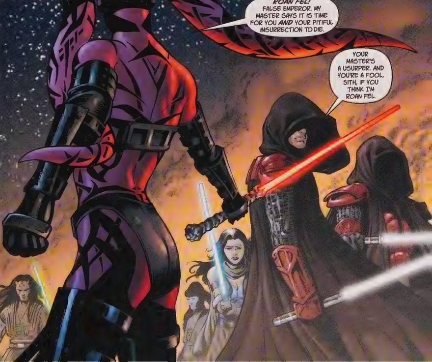
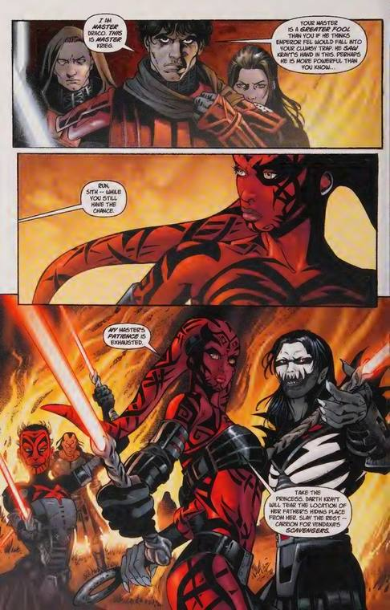
Our notes: `notes/materials/009-legacy-book-1.md:48`

- Note (summary from our notes, not a quotation): #7: Cade fights Nihl with a lightsaber in one hand and a blaster in the other, with Syn's help, and is Force-blasted aside (p125–133). Everyone escapes on the *Mynock* (p134–135). Draco attacks Cade; Wolf and Cade argue about the dark side; Cade heals the dying Marasiah through the dark side (p137–142). Talon reports her failure. Krayt spares her and wants the Skywalker "ALIVE" (p146).
  — Source: Legacy Book 1 (omnibus): power-scaling notes with panels.
Our notes: `notes/materials/009-legacy-book-1.md:49`

- Note (summary from our notes, not a quotation): #14: From stasis, Krayt senses "SKYWALKER IS COMING" (p311). Cade evades Skull Squadron (p313–315), infiltrates the Sith Temple and frees Hosk (p325–328). He duels Talon, Nihl takes him from behind, and he is captured (p328–331). Sazen senses this from Ossus (p332).
  — Source: Legacy Book 1 (omnibus): power-scaling notes with panels.
Our notes: `notes/materials/009-legacy-book-1.md:73`

- Note (summary from our notes, not a quotation): #16: Corde is tasked to extract Cade and reveals she is his mother to the crew (p355–360). Krayt tells his history: Clone Wars, Order 66, the Tuskens, and the duel and maiming by Kenobi (p361–371). Cade Force-blasts Talon and threatens to "EXPLODE" her weak point, then heals her and asks Krayt to teach him (p371–374). Stryfe senses Jedi on Ossus (p375–376).
  — Source: Legacy Book 1 (omnibus): power-scaling notes with panels.
Our notes: `notes/materials/009-legacy-book-1.md:75`

- Note (summary from our notes, not a quotation): #17: Nihl and Maladi discuss succession and Krayt's "AFFLICTION" (p377). Talon trains Cade (p378–381, p388–393). Krayt and Wyyrlok discuss turning Cade (p382). Corde infiltrates the Temple with Vong bugs (p387). The Jedi mind-trick the troopers on Ossus. Stryfe orders the ruins bombarded (p396–398).
  — Source: Legacy Book 1 (omnibus): power-scaling notes with panels.
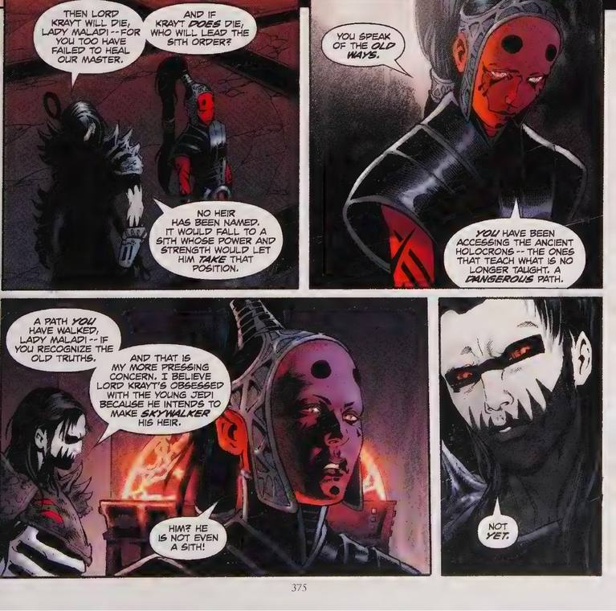
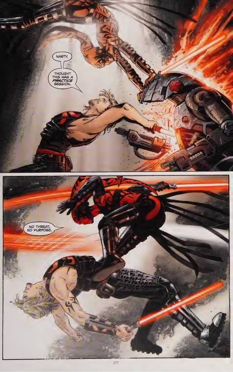
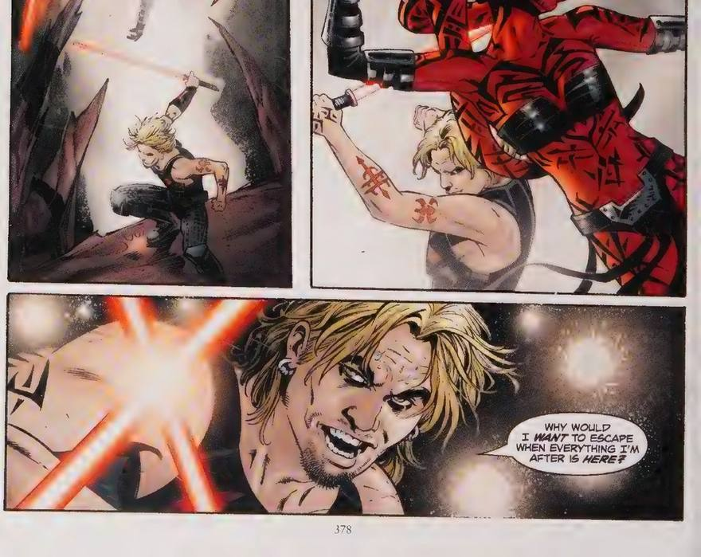
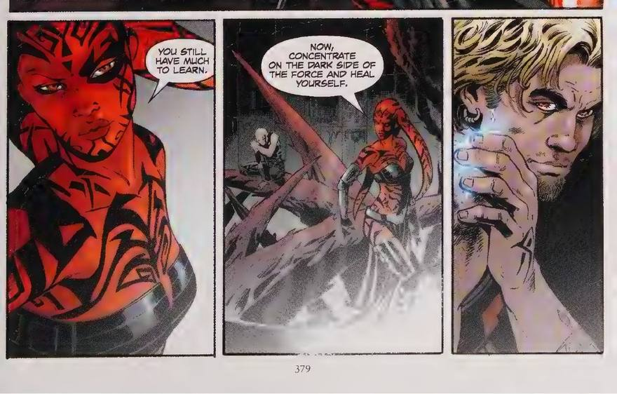
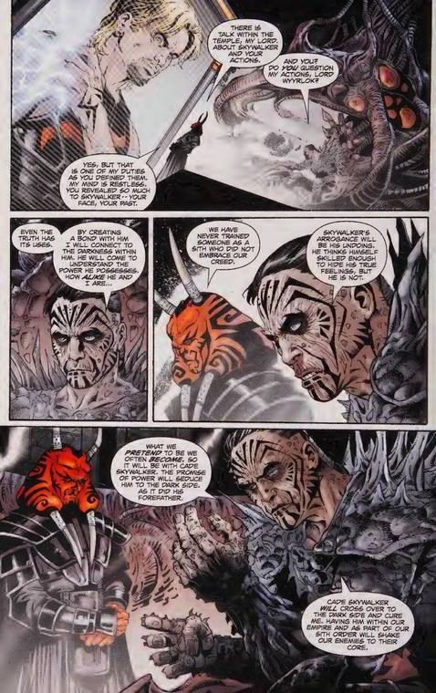
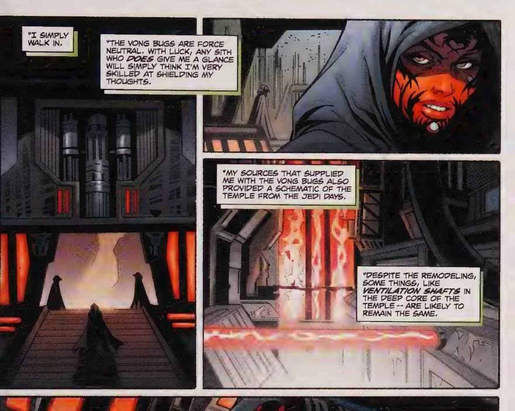
Our notes: `notes/materials/009-legacy-book-1.md:76`

> THAT WHICH CAN HEAL CAN ALSO BREAK. *(p416)*
— Source: Legacy Book 1 (omnibus): power-scaling notes with panels.
Note (our notes, around the quote): #18: Krayt in the Embrace of Pain tells the rest of his history: XoXaan, the Vong, Vergere, the escape, Caedus and stasis (p399–408). Talon ambushes Cade (p411). Krayt orders Cade to kill Hosk, then kills Hosk himself (p412–415). Kol's ghost appears: "THAT WHICH CAN HEAL CAN ALSO BREAK." (p416). Cade's Force burst makes the Sith recoil; he strikes Talon (p417–418).
Our notes: `notes/materials/009-legacy-book-1.md:77`

> Krayt: "DARTH RUYN, IS HER TRAINING COMPLETE?" · Ruyn: "SHE IS THE BEST I HAVE EVER TRAINED, MASTER." · Krayt: "KILL HIM." … (p55) "I AM YOUR LIFE. I AM YOUR DEATH." · "YOU HAVE PASSED YOUR FINAL TEST WITHOUT FLINCHING. I NAME YOU DARTH TALON AND YOU WILL NOW BE ONE OF MY HANDS -- MY OWN PERSONAL ASSASSIN."
> [fragment — full passage not on file]
— Source: Legacy Book 1 (omnibus): power-scaling notes with panels.
Context: 6. Ritual authority: Talon kills Ruyn on command; Krayt lightning "test". p53 (#2 Broken)–p55 (#2 Broken)
Our notes: `notes/materials/009-legacy-book-1.md:129`

- Note (summary from our notes, not a quotation): 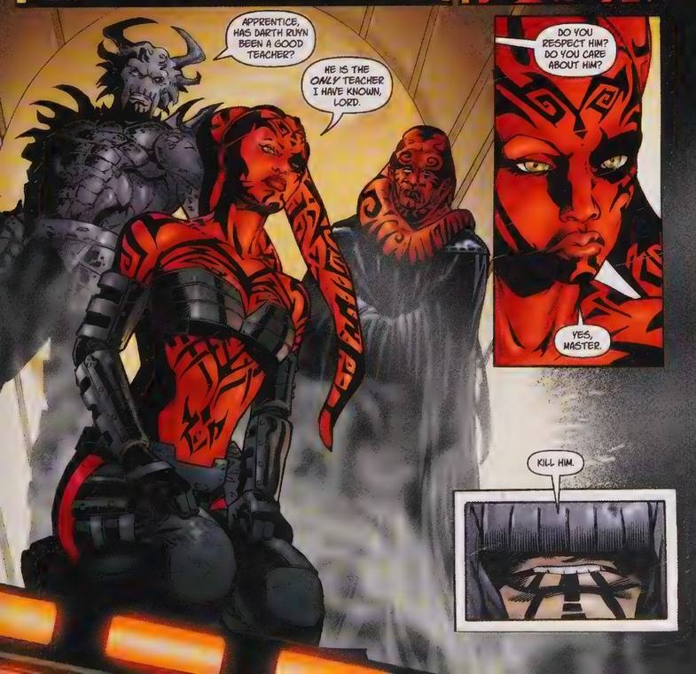
  — Source: Legacy Book 1 (omnibus): power-scaling notes with panels.
(*Panel: p53 Krayt orders Talon to kill Ruyn — `p053-krayt-kill-him-talon-ruyn.jpg`*)
Our notes: `notes/materials/009-legacy-book-1.md:132`

- Note (summary from our notes, not a quotation): 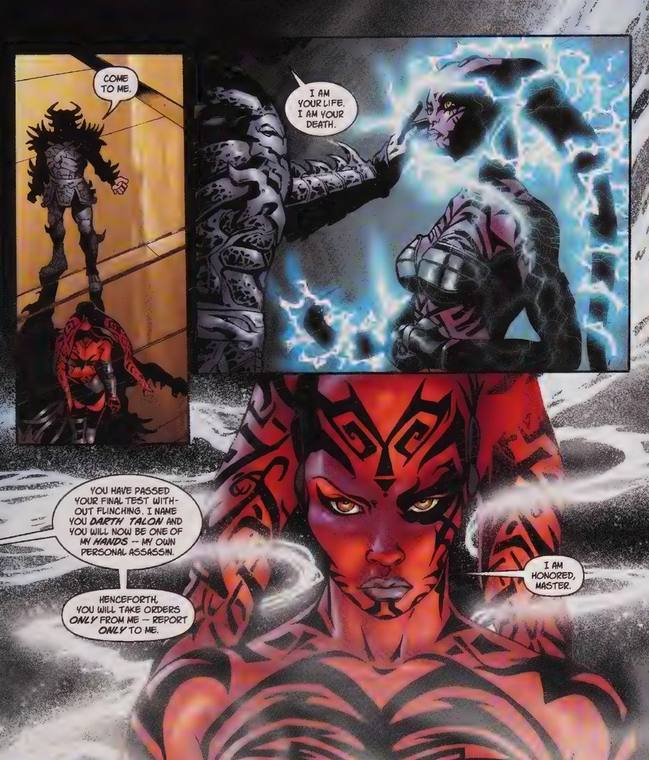
  — Source: Legacy Book 1 (omnibus): power-scaling notes with panels.
(*Panel: p55 Krayt names Darth Talon — `p055-krayt-lightning-talon-final-test.jpg`*)
Our notes: `notes/materials/009-legacy-book-1.md:135`

> (p392, Talon narrating) "USING THE FORCE, MY MASTER SHATTERED THE BARRIER" · XoXaan: "I AM XOXAAN. I WAS ONE OF THE FIRST OF THE SITH LORDS…" "MY BRETHREN AND I INVENTED WHAT IT MEANS TO BE A SITH." · (p399) Krayt: "WHEN I EMERGED FROM THE TOMBS, I DISCOVERED I HAD BEEN ON KORRIBAN LONGER THAN I THOUGHT. I LEARNED THAT VADER AND PALPATINE WERE BOTH GONE AND THAT YOUR ANCESTOR WAS THE INSTRUMENT." · (p401) "THE FORCE WAS TELLING ME NOTHING OF MY ATTACKERS." · (p402) Vergere: "THE FORCE ABILITIES YOU MANIFESTED INTRIGUED THEM SO THEIR SHAPERS IMPLANTED YOU WITH CORAL SEEDS AS AN EXPERIMENT." · (p403) "MY BODY WAS ENHANCED, THE BETTER TO WITHSTAND THE STRAINS PUT UPON IT. MY LEFT EYE WAS REPLACED WITH THE EYE OF A VONG CREATURE." · "SHE CLAIMED TO HAVE BEEN TRAINED AS A SITH BY THE EMPEROR -- DARTH SIDIOUS -- HIMSELF." · "VERGERE TAUGHT ME TO USE THE AGONY OF THE EMBRACE OF PAIN TO OPEN MYSELF TO THE DARK SIDE." · (p404) "MY SITH WILL BE MANY BUT THEY WILL BE ONE." · "BANE CHANGED THE RULES AND CHANGED THE SITH -- NOW I WILL CHANGE THEM AGAIN." · (p405) "IT WAS NECESSARY FOR THE VONG TO BELIEVE I WAS DEAD, SO THE ENTIRE SHIP AND ALL ON IT NEEDED TO DIE." · (p406) "I SHOULD NOT HAVE SURVIVED WHAT THE VONG DID TO ME -- YET I ENDURED. I NEEDED LONG YEARS OF STASIS TO ALLOW MY BODY TO HEAL, BUT MY MIND REMAINED OPEN TO MY CLOSEST DISCIPLES." · "CAEDUS -- ANOTHER SKYWALKER GONE TO THE DARK SIDE -- SERVED OUR PLANS HOWEVER UNWITTINGLY."
> [fragment — full passage not on file]
— Source: Legacy Book 1 (omnibus): power-scaling notes with panels.
Context: 18. Embrace of Pain origin; XoXaan; Vergere; Vong body. p392 (#17 Claws), p399 (#18 Claws)–p406 (#18 Claws)
Our notes: `notes/materials/009-legacy-book-1.md:259`

> LET'S GET TO THE MYNOCK.
> [fragment — full passage not on file]
>
> WHY DIDN'T SHE JUST VAPORIZE THE MYNOCK LIKE SHE DID THE JEDI SHIP?
— Source: Legacy Book 1 (omnibus): power-scaling notes with panels.
Note (our notes, around the quote): 5. Stops Talon's hurled starship wreck and Force-pushes her away with it. p97 (#5 Broken)–p98 (#5 Broken). Cade instinctively raises a hand ("NO!"); the wreck stops and turns, and a blue Force wave sends Talon flying with the debris. · Cade: "LET'S GET TO THE MYNOCK." · (p99) Syn: "WHY DIDN'T SHE JUST VAPORIZE THE MYNOCK LIKE SHE DID THE JEDI SHIP?"
Our notes: `notes/materials/009-legacy-book-1.md:381`

- Note (summary from our notes, not a quotation): 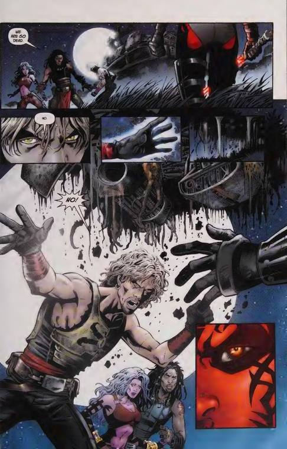
  — Source: Legacy Book 1 (omnibus): power-scaling notes with panels.
(*Panel: p97 Talon hurls the wreck; Cade raises his hand — `p097-cade-stops-hurled-wreck.jpg`*)
Our notes: `notes/materials/009-legacy-book-1.md:383`

- Note (summary from our notes, not a quotation): 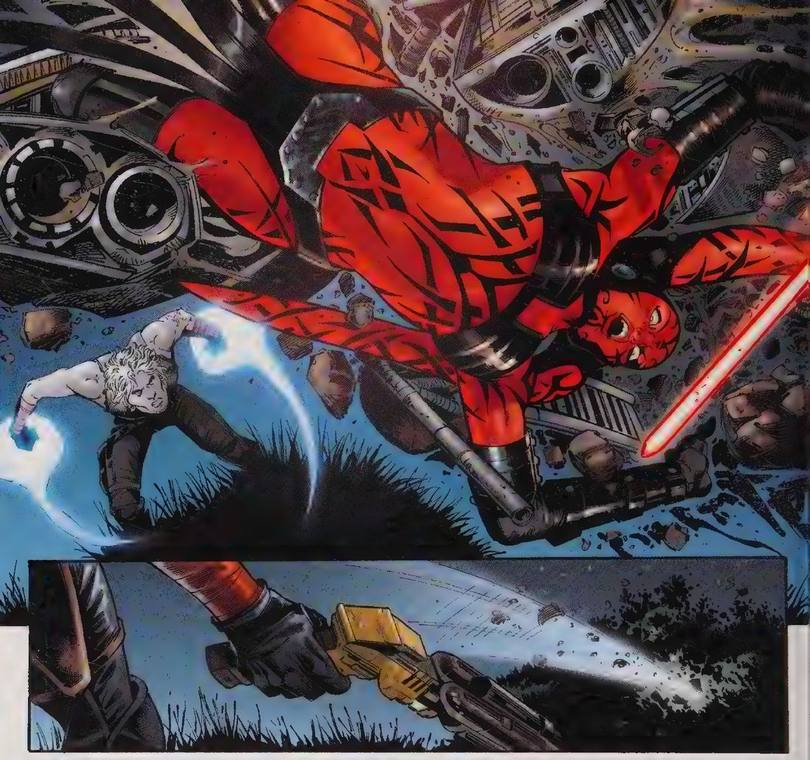
  — Source: Legacy Book 1 (omnibus): power-scaling notes with panels.
(*Panel: p98 Cade's Force wave blows Talon away — `p098-cade-force-push-talon.jpg`*)
Our notes: `notes/materials/009-legacy-book-1.md:386`

> TK-throws a large multi-passenger shuttle into Darth Talon
> [fragment — full passage not on file]
>
> many hundreds of yards
> [fragment — full passage not on file]
— Source: (debate #61) — Owner Material 009 — Star Wars: Legacy Book 1 (omnibus): power-scaling notes with panels; Scaling (ANALYSIS): this is the.
Note (our notes, around the quote): Scaling (ANALYSIS): this is the "TK-throws a large multi-passenger shuttle into Darth Talon" feat in legends-feats.md (debate #61). On the page, Talon throws the wreck (part of the destroyed Jedi ship) first. Cade stops it and reverses it with a push that carries Talon away. The size is a ship-section/shuttle-scale wreck. On-panel distance is not quantified ("many hundreds of yards" is a debater's estimate). Untrained and unwilling, Cade overpowers a Hand's telekinesis by reflex.
Our notes: `notes/materials/009-legacy-book-1.md:390`

> (p90) Wolf: "YES. NEARBY. A SITH. AND GETTING CLOSER." · Cade: "WHAT'S HE TALKING ABOUT? I DON'T FEEL ANYTHING!" · (p105) Wolf: "I CAN STILL FEEL HER -- THE SITH. SHE'S OUT THERE SOMEWHERE, BUT I CAN'T SENSE EXACTLY WHERE." · Cade: "YEAH. SHE'S OUT THERE."
> [fragment — full passage not on file]
— Source: Legacy Book 1 (omnibus): power-scaling notes with panels.
Context: 6. Senses Talon once he lets the Force in. p90 (#5 Broken), p105 (#6 Broken)
Our notes: `notes/materials/009-legacy-book-1.md:392`

> (p124) Cade: "I HAVE HAD ENOUGH!" · (p125) Nihl: "TAKING UP A FALLEN LIGHTSABER DOES NOT MAKE ONE A JEDI." · Talon: "BE WARY, LORD NIHL. THE FORCE ALMOST BLAZES IN THIS ONE." · (p126) Cade: "YEAH, WELL, I'M A PRETTY NASTY JEDI." · Wolf: "THAT IS A SITH WEAPON!" · Cade: "WHATEVER WORKS." · (p130) Wolf: "CADE, YOU CAN'T DEFEAT NIHL! HE'S TOO MUCH FOR YOU." · Cade: "YEAH, YEAH, YEAH, BUT I CAN HOLD HIM!" · Nihl: "YOU HAVE NO CHANCE AGAINST ME, BOY. LIE DOWN AND DIE. LIKE YOUR FATHER." · Cade: "HE NEVER LAY DOWN! YOU KILLED HIM AND IT TOOK HALF A DOZEN SITH TO DO IT!" · (p132) Cade: "I WOULDA HAD HIM IF HE'D JUST STOPPED DANCING!" · (p133) Nihl: "BEGONE. ONE FOOL AT A TIME." (Force blast throws Cade and Syn)
> [fragment — full passage not on file]
— Source: Legacy Book 1 (omnibus): power-scaling notes with panels.
Context: 7. Takes up a lightsaber; fights Nihl with saber and blaster; Talon warns "THE FORCE ALMOST BLAZES IN THIS ONE". p124 (#6 Broken)–p133 (#7 Broken)
Our notes: `notes/materials/009-legacy-book-1.md:402`; `notes/materials/009-legacy-book-1.md:1102`

> (p329) Cade: "I WANT EVERY ONE OF YOU MAGGOT-SUCKING SITH DEAD!" · (p330) "HOW DO YOU LIKE ME, SCHUTTA?!" · Talon: "THINK YOU CAN TAKE ME NOW?" · Nihl (striking Cade from behind): "HIS FATHER'S SON... WEAK AND TOO EASILY DEFEATED BY DARKNESS." · (p331) Talon: "I DO NOT REQUIRE YOUR ASSISTANCE, NIHL."
> [fragment — full passage not on file]
— Source: Legacy Book 1 (omnibus): power-scaling notes with panels.
Context: 13. Cade vs Talon in the Sith Temple; Nihl ends it from behind. p328 (#14 Claws)–p331 (#14 Claws)
Our notes: `notes/materials/009-legacy-book-1.md:480`

- Note (summary from our notes, not a quotation): Scaling (ANALYSIS): Cade (with Kol's saber) trades aggressively with Talon for about two pages with no clear winner. Talon says she didn't need help. The ending is a 2-on-1 surprise attack. Inconclusive as a Cade vs Talon result.
  — Source: Legacy Book 1 (omnibus): power-scaling notes with panels.
Our notes: `notes/materials/009-legacy-book-1.md:493`

> (p338) Maladi: "DESPITE A FULL DAY OF INJECTIONS, YOUR BODY KEEPS PURGING ITSELF OF THE IXETAL CILONA." · Cade: "GOT THIS CRAZY BODY CHEMISTRY THING GOING." · Maladi: "I SUPPLY THEM." · "NO, YOU USE THE FORCE TO PURGE YOURSELF, BENDING IT TO YOUR WILL... LIKE A SITH..." · Krayt (arriving off-panel): "THEN HE REALIZES THE LIMITATIONS OF THE JEDI TEACHINGS." (speakers corrected 2026-10-21 from 013 p37: the torturer is Maladi, not Talon) · (p339) Krayt: "YOU CAN EVEN PURGE YOURSELF OF A LETHAL DOSE OF IXETAL CILONA." · Cade: "BEST TRICK I GOT. TOO BAD I CAN'T DO IT FOR NOBODY ELSE."
> [fragment — full passage not on file]
— Source: Legacy Book 1 (omnibus): power-scaling notes with panels.
Context: 14. Purges ixetal cilona by bending the Force "LIKE A SITH"; tortured. p338 (#15 Claws)–p339 (#15 Claws)
Our notes: `notes/materials/009-legacy-book-1.md:495`

> (p371) Talon: "RESPECT HIS POWER AND BEWARE MINE!" · Cade: "WANT TO TALK POWER, SCHUTTA?" · (p372) "LET'S TALK ABOUT MINE!" · "I GOT THIS CRAZY HEALING ABILITY. I CAN SEE THE WEAK POINTS IN YOU LIKE LITTLE BROKEN RED LINES! I CAN SEE WHERE YOU GOT WOUNDED RECENTLY." · "SOMEONE SMACK YOU DURING A SPARRING SESSION? BET IT WAS NIHL." · "OR -- AND HERE'S A NEW IDEA -- MAYBE I COULD EXPLODE THAT POINT. KILL YOU. INTERESTING IDEA. SHOULD WE TRY?"
> [fragment — full passage not on file]
— Source: Legacy Book 1 (omnibus): power-scaling notes with panels.
Context: 16. Force-blasts Talon while cuffed; sees her "RED LINES"; threatens to "EXPLODE" her weak point (healing reversed). p371 (#16 Claws)–p372 (#16 Claws)
Our notes: `notes/materials/009-legacy-book-1.md:514`

- Note (summary from our notes, not a quotation): 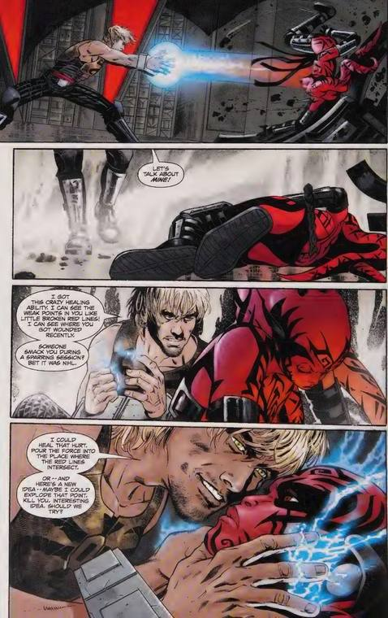
  — Source: Legacy Book 1 (omnibus): power-scaling notes with panels.
(*Panel: p372 Cade's blast; hand on Talon's head — `p372-cade-force-blast-talon-explode-point.jpg`*)
Our notes: `notes/materials/009-legacy-book-1.md:520`

- Note (summary from our notes, not a quotation): 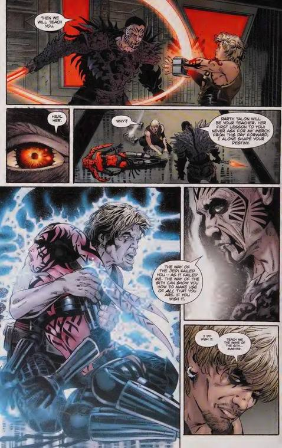
  — Source: Legacy Book 1 (omnibus): power-scaling notes with panels.
(*Panel: p374 Krayt stops him; Cade heals Talon instead — `p374-krayt-teach-you-cade-heals-talon.jpg`*)
Our notes: `notes/materials/009-legacy-book-1.md:523`

> (p379) Talon: "NO THREAT, NO PURPOSE." · (p380) Talon: "THE EXITS ARE UNGUARDED. DEFEAT ME AND YOU CAN ESCAPE." · Cade: "WHY WOULD I WANT TO ESCAPE WHEN EVERYTHING I'M AFTER IS HERE?" · (p381) Cade: "E CHU TA! THAT HURTS!" · Talon: "YOU STILL HAVE MUCH TO LEARN." · "NOW, CONCENTRATE ON THE DARK SIDE OF THE FORCE AND HEAL YOURSELF."
> [fragment — full passage not on file]
— Source: Legacy Book 1 (omnibus): power-scaling notes with panels.
Context: 17. Sith training under Talon: self-healing a sword wound on command. p379 (#17 Claws)–p381 (#17 Claws)
Our notes: `notes/materials/009-legacy-book-1.md:527`

> Talon: "KNEW YOU'D COME. I'VE BEEN WAITING FOR YOU..." · Cade: "I MISSED YOUR TOUCH..." · (Force blast) · Talon: "IDIOT."
> [fragment — full passage not on file]
— Source: Legacy Book 1 (omnibus): power-scaling notes with panels.
Context: 18. Ambushed and floored by Talon. p411 (#18 Claws)
Our notes: `notes/materials/009-legacy-book-1.md:540`

> Kol: "CADE... OPEN YOUR MIND... YOUR HEART... TO ME... LISTEN!" · "THAT WHICH CAN HEAL CAN ALSO BREAK." · (p417, wordless) Cade shatters the transparisteel case holding Kol's lightsaber; the blast and glass storm make the Sith recoil and shield themselves. · (p418) Cade: "C'MERE." · "SOMETHING TO KARKIN' REMEMBER ME BY, SCHUTTA." · Talon: "UH!"
> [fragment — full passage not on file]
— Source: Legacy Book 1 (omnibus): power-scaling notes with panels.
Context: 20. Kol's ghost: "THAT WHICH CAN HEAL CAN ALSO BREAK"; Force shockwave makes Krayt, Wyyrlok, Nihl and Talon recoil. p416 (#18 Claws)–p418 (#18 Claws)
Our notes: `notes/materials/009-legacy-book-1.md:550`

- Note (summary from our notes, not a quotation): Scaling (ANALYSIS): heavy on spectacle. The shockwave makes all four Sith (including Krayt and Wyyrlok) recoil and shield themselves from the glass; it is not drawn as knocking them down. They were caught off guard at close range. Afterwards Talon is down for the rest of the fight (visible in the background, p420 and p438). What exactly Cade's palm-burst did to her is UNCLEAR (no caption).
  — Source: Legacy Book 1 (omnibus): power-scaling notes with panels.
Our notes: `notes/materials/009-legacy-book-1.md:563`

> BECAUSE YOU ORDERED IT, MASTER.
> [fragment — full passage not on file]
>
> I AM HONORED, MASTER.
> [fragment — full passage not on file]
>
> HAD MY TEACHER NOT DEEMED ME READY, HE WOULD HAVE BLOCKED MY ATTACK. INSTEAD, HE EMBRACED DEATH SO THAT I MIGHT TOUCH THE DARK SIDE.
>
> KRAYT'S SITH ORDER IS MORE THAN TWO.
>
> IF YOU EVER BECOME SKILLED ENOUGH TO KILL ME, YOU WILL HONOR US BOTH WITH MY DEATH.
— Source: Legacy Book 1 (omnibus): power-scaling notes with panels.
Note (our notes, around the quote): 1. Becomes a Hand by killing her master on command. p53 (#2 Broken)–p55 (#2 Broken) (see Krayt 6). Talon: "BECAUSE YOU ORDERED IT, MASTER." · "I AM HONORED, MASTER." Later (p389): "HAD MY TEACHER NOT DEEMED ME READY, HE WOULD HAVE BLOCKED MY ATTACK. INSTEAD, HE EMBRACED DEATH SO THAT I MIGHT TOUCH THE DARK SIDE." · "KRAYT'S SITH ORDER IS MORE THAN TWO." · "IF YOU EVER BECOME SKILLED ENOUGH TO KILL ME, YOU WILL HONOR US BOTH WITH MY DEATH."
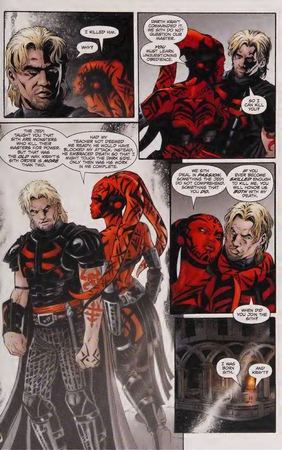

Our notes: `notes/materials/009-legacy-book-1.md:589`

- Note (summary from our notes, not a quotation): 
  — Source: Legacy Book 1 (omnibus): power-scaling notes with panels.
(*Panel: p389 — `p389-talon-killed-master-krayt-order-more-than-two.jpg`*)
Our notes: `notes/materials/009-legacy-book-1.md:591`

- Note (summary from our notes, not a quotation): Scaling (ANALYSIS): Ruyn chose not to resist, so this isn't a combat feat.
  — Source: Legacy Book 1 (omnibus): power-scaling notes with panels.
Our notes: `notes/materials/009-legacy-book-1.md:595`

> Elke: "KILL ME IF YOU WILL, SITH! THE PRINCESS HAS ESCAPED!" · Talon: "YES. SHE IS WITH ASTRAAL VAO, THE LOCAL MISSIONARY. THE PLAN WAS FOR THEM TO ESCAPE." · "BUT NOW I WILL DRIVE HER TO HER FATHER -- OR HE WILL COME TO SAVE HER. THEN I WILL KILL THEM BOTH." · "YOU ... HAVE NO FURTHER PURPOSE." · (p58) Marasiah: "I FELT HER DIE IN THE FORCE!" · "SHE WAS MY TEACHER!"
> [fragment — full passage not on file]
— Source: Legacy Book 1 (omnibus): power-scaling notes with panels.
Context: 2. Kills Imperial Knight Elke Vetter (Socorro). p56 (#2 Broken)–p57 (#2 Broken)
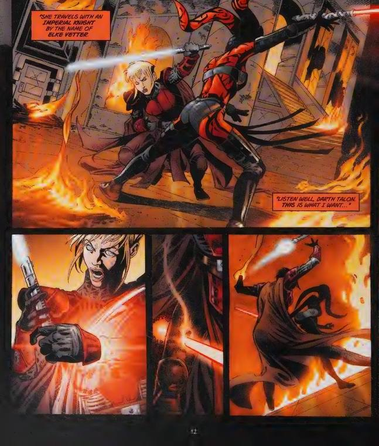
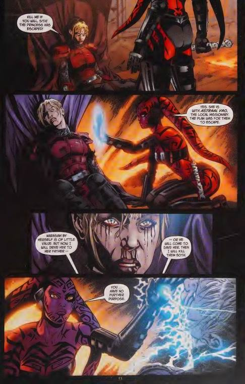
Our notes: `notes/materials/009-legacy-book-1.md:597`

- Note (summary from our notes, not a quotation): 
  — Source: Legacy Book 1 (omnibus): power-scaling notes with panels.
(*Panel: p56 Talon vs Elke Vetter — `p056-talon-vs-imperial-knight-elke-vetter.jpg`*)
Our notes: `notes/materials/009-legacy-book-1.md:600`

- Note (summary from our notes, not a quotation): 
  — Source: Legacy Book 1 (omnibus): power-scaling notes with panels.
(*Panel: p57 Talon finishes Elke — `p057-talon-kills-elke-vetter.jpg`*)
Our notes: `notes/materials/009-legacy-book-1.md:603`

- Note (summary from our notes, not a quotation): Scaling (ANALYSIS): Talon > a full Imperial Knight who was a princess's teacher. The duel happens mostly off-panel, among flames.
  — Source: Legacy Book 1 (omnibus): power-scaling notes with panels.
Our notes: `notes/materials/009-legacy-book-1.md:607`

> (p92) "I AM DARTH TALON." · "I AM MY MASTER'S HAND." · "I AM YOUR DEATH." · (p93) "YOU ARE THE ONE. THE EMPTY-SLEEVED JEDI. SAZEN." · "DARTH NIHL MARKED YOU, JEDI. HE TOOK YOUR ARM. I WILL TAKE YOUR LIFE!" · (p94) "I FEEL THE FORCE SURGE THROUGH YOU, PRINCESS. VETTER WAS ... YOUR MASTER!" · "BUT YOU ARE NOT A KNIGHT. NOT YET -- MERELY A STUDENT." · "DO WHAT YOU DO BEST, PRINCESS -- RUN!" · (p95) Wolf, under her lightning: "CADE! TAKE THE PRINCESS AND ASTRAAL AWAY ON YOUR SHIP!"
> [fragment — full passage not on file]
— Source: Legacy Book 1 (omnibus): power-scaling notes with panels.
Context: 3. Fights Wolf Sazen and Shado Vao at once; lightning on Wolf; disarms Marasiah. p91 (#5 Broken)–p96 (#5 Broken)
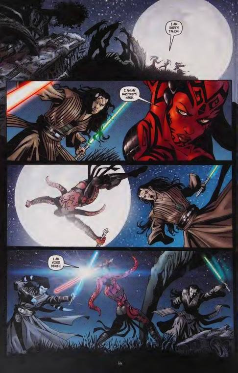
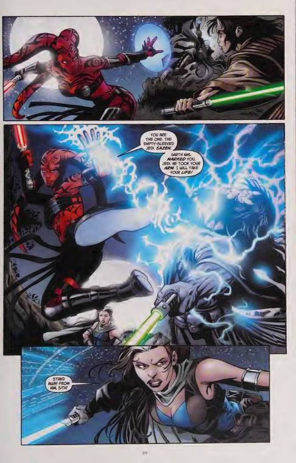
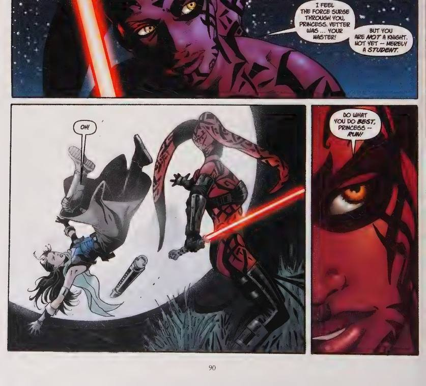
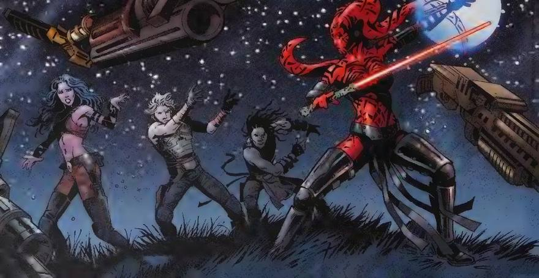
Our notes: `notes/materials/009-legacy-book-1.md:609`

- Note (summary from our notes, not a quotation): 
  — Source: Legacy Book 1 (omnibus): power-scaling notes with panels.
(*Panel: p92 Talon vs Wolf and Shado — `p092-talon-vs-wolf-and-shado.jpg`*)
Our notes: `notes/materials/009-legacy-book-1.md:612`

- Note (summary from our notes, not a quotation): 
  — Source: Legacy Book 1 (omnibus): power-scaling notes with panels.
(*Panel: p93 Talon Force-pushes Shado and lightnings Wolf — `p093-talon-lightning-wolf-nihl-marked-you.jpg`*)
Our notes: `notes/materials/009-legacy-book-1.md:615`

- Note (summary from our notes, not a quotation): 
  — Source: Legacy Book 1 (omnibus): power-scaling notes with panels.
(*Panel: p94 — `p094-talon-marasiah-merely-a-student.jpg`*)
Our notes: `notes/materials/009-legacy-book-1.md:618`

- Note (summary from our notes, not a quotation): 
  — Source: Legacy Book 1 (omnibus): power-scaling notes with panels.
(*Panel: p96 Talon deflects bolts and Force-disarms the guns — `p096-talon-force-disarms-blasters.jpg`*)
Our notes: `notes/materials/009-legacy-book-1.md:621`

- Note (summary from our notes, not a quotation): Scaling (ANALYSIS): one of Talon's strongest Book 1 showings. She gets the better of two Jedi Knights (one of them one-armed Sazen) plus a student Knight, while also driving beasts at them. It ends only when Cade's untrained Force reflex blasts her away (Cade 5).
  — Source: Legacy Book 1 (omnibus): power-scaling notes with panels.
Our notes: `notes/materials/009-legacy-book-1.md:625`

> (p127) Shado: "YOU FAILED YOUR MISSION, SITH. THE PRINCESS IS DEAD." · Talon: "DEAD OR ALIVE, SHE WILL SERVE." · Shado: "YOUR PLAN HAS A FLAW. IT ASSUMES YOU CAN KILL ME." · (p134) Cade: "SHIP'S TAKING OFF, SHADO. FINISH HER OR MARRY HER!" · Talon: "NEITHER PROPOSAL APPEALS TO ME. I PREFER YOU ALL DIE." · (p135) Shado: "GET... OFF!" (Force push); everyone escapes.
> [fragment — full passage not on file]
— Source: Legacy Book 1 (omnibus): power-scaling notes with panels.
Context: 4. Talon vs Shado (Vendaxa second round). p117 (#6 Broken), p127 (#7 Broken), p134 (#7 Broken)–p135 (#7 Broken)
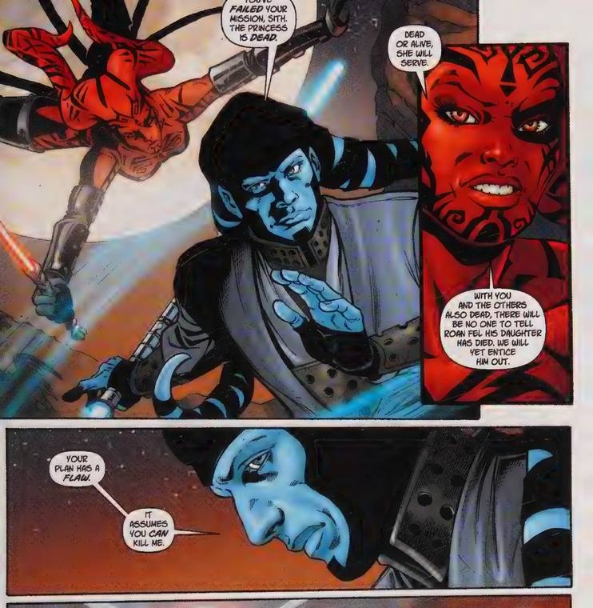
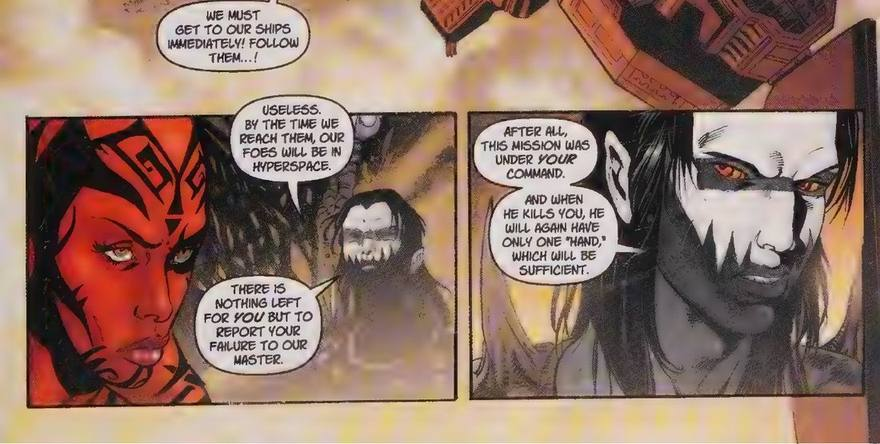
Our notes: `notes/materials/009-legacy-book-1.md:627`

- Note (summary from our notes, not a quotation): 
  — Source: Legacy Book 1 (omnibus): power-scaling notes with panels.
(*Panel: p127 Shado vs Talon (Force clash) — `p127-shado-vs-talon-assumes-you-can-kill-me.jpg`*)
Our notes: `notes/materials/009-legacy-book-1.md:630`

- Note (summary from our notes, not a quotation): Scaling (ANALYSIS): Talon vs Shado one-on-one, with no decisive outcome. Shado disengages with a push.
  — Source: Legacy Book 1 (omnibus): power-scaling notes with panels.
Our notes: `notes/materials/009-legacy-book-1.md:634`

> Nihl: "THERE IS NOTHING LEFT FOR YOU BUT TO REPORT YOUR FAILURE TO OUR MASTER." · "AFTER ALL, THIS MISSION WAS UNDER YOUR COMMAND. AND WHEN HE KILLS YOU, HE WILL AGAIN HAVE ONLY ONE 'HAND,' WHICH WILL BE SUFFICIENT."
— Source: Legacy Book 1 (omnibus): power-scaling notes with panels.
Context: 5. Nihl blames Talon for the failure; Krayt spares her. p135 (#7 Broken), p146 (#7 Broken)

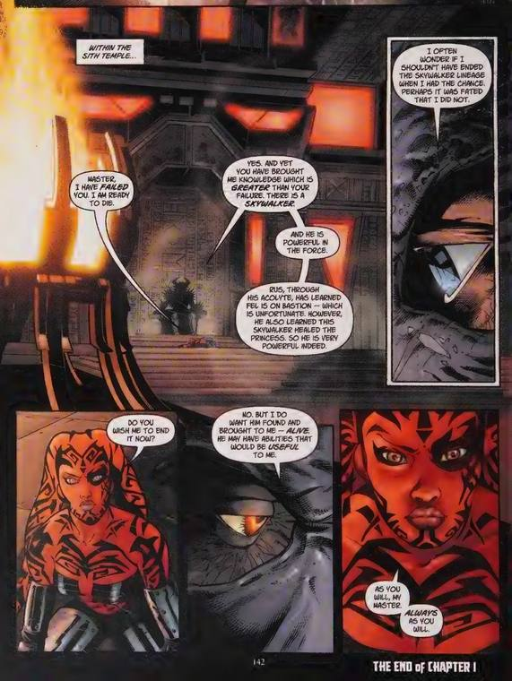
Our notes: `notes/materials/009-legacy-book-1.md:636`

- Note (summary from our notes, not a quotation): 
  — Source: Legacy Book 1 (omnibus): power-scaling notes with panels.
(*Panel: p135 — `p135-nihl-talon-report-failure.jpg`*)
Our notes: `notes/materials/009-legacy-book-1.md:639`

- Note (summary from our notes, not a quotation): 6. (Withdrawn 2026-10-21.) The p261 execution of Governor Dorn was listed here by mistake. The killer is Darth Maladi (white-dotted headdress, no lekku; Krayt then addresses her). See Darth Maladi below.
  — Source: Legacy Book 1 (omnibus): power-scaling notes with panels.
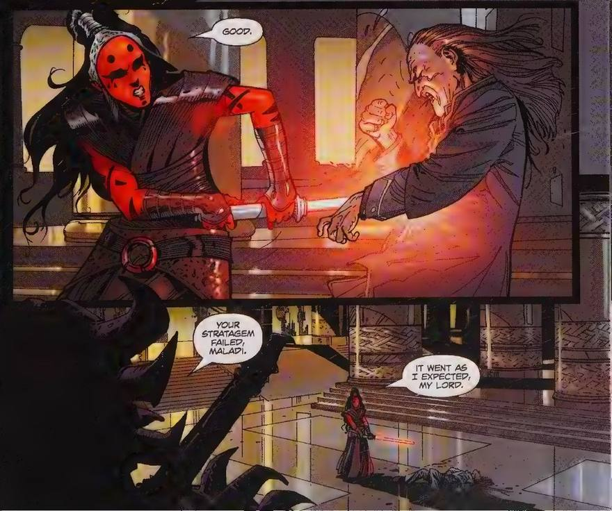
Our notes: `notes/materials/009-legacy-book-1.md:643`

> I HAVE DEEPENED THE BOND THAT SKYWALKER FORGED BETWEEN US WHEN HE HEALED ME. BUT HE IS A LIAR WHO ONLY PRETENDS TO BE ONE OF US, MY LORD.
— Source: Legacy Book 1 (omnibus): power-scaling notes with panels.
Note (our notes, around the quote): 7. Trainer and jailer of Cade; ambushes and floors him; struck down by him. See Cade 13, 16–18 and 20 (p328 (#14 Claws)–p331 (#14 Claws), p371 (#16 Claws)–p381 (#17 Claws), p411 (#18 Claws), p418 (#18 Claws)). Talon to Krayt (p395): "I HAVE DEEPENED THE BOND THAT SKYWALKER FORGED BETWEEN US WHEN HE HEALED ME. BUT HE IS A LIAR WHO ONLY PRETENDS TO BE ONE OF US, MY LORD."
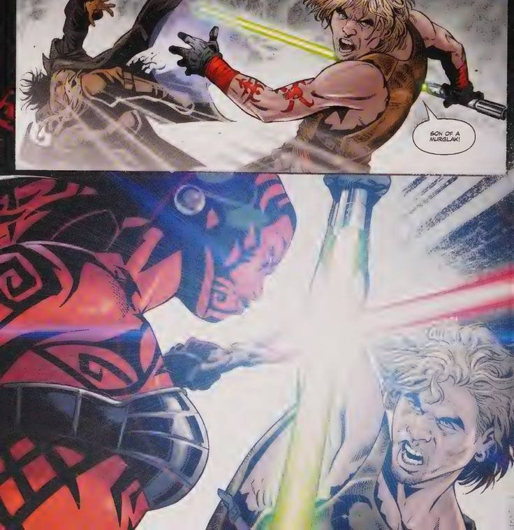
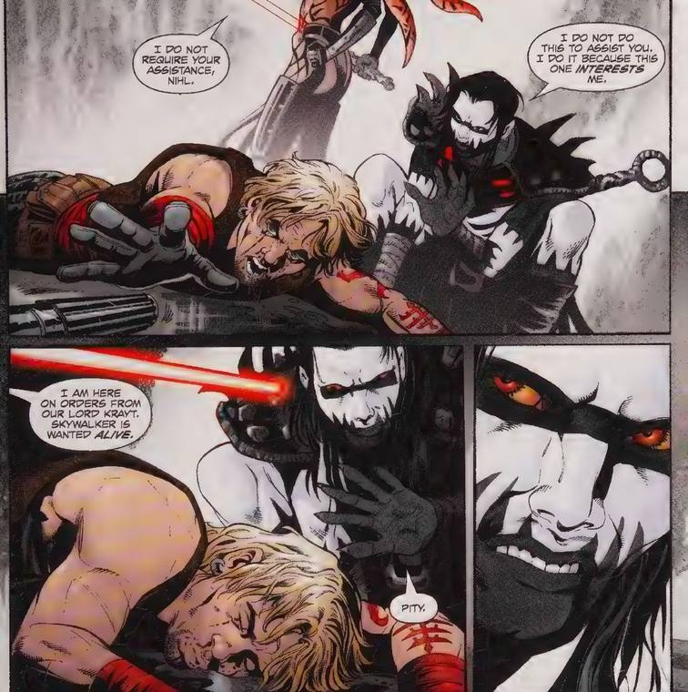
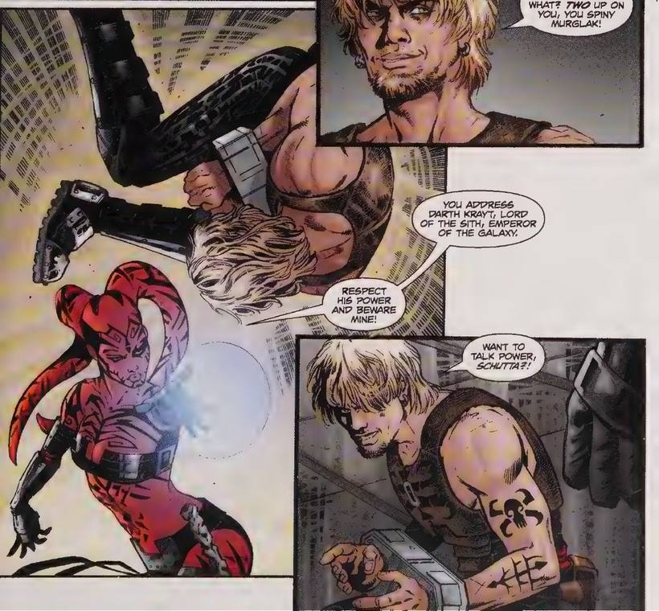

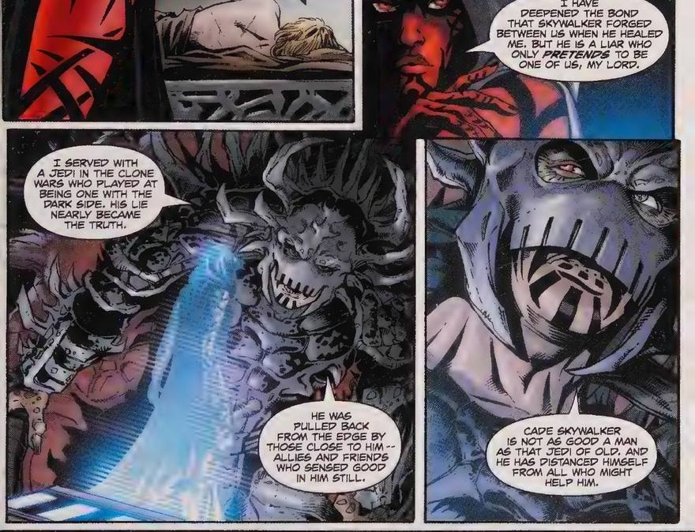
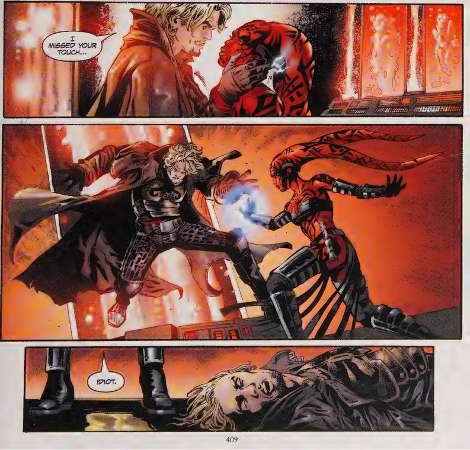
Our notes: `notes/materials/009-legacy-book-1.md:646`

- Note (summary from our notes, not a quotation): Scaling (ANALYSIS): across the book, Talon vs Cade comes out roughly even. She wins the ambush (p411) and in training (p381), the first temple fight is a draw interrupted by Nihl, and he wins the cuffed surprise blast (p372) and the p418 strike. The framing makes her his superior in skill, while he out-classes her in raw power.
  — Source: Legacy Book 1 (omnibus): power-scaling notes with panels.
Our notes: `notes/materials/009-legacy-book-1.md:648`

> "I DO NOT DO THIS TO ASSIST YOU. I DO IT BECAUSE THIS ONE INTERESTS ME." · Talon: "I AM HERE ON ORDERS FROM OUR LORD KRAYT. SKYWALKER IS WANTED ALIVE." · Nihl: "PITY." · "HOWEVER, LORD KRAYT WILLS, AND WE OBEY. DON'T WE?" *(the "ORDERS" balloon is Talon's, corrected 2026-10-21 from 013 p30)*
— Source: Legacy Book 1 (omnibus): power-scaling notes with panels.
Context: 6. Disables Cade from behind; "THIS ONE INTERESTS ME". p330 (#14 Claws)–p331 (#14 Claws)
Our notes: `notes/materials/009-legacy-book-1.md:700`; `notes/materials/013-legacy-vol-3-claws-of-the-dragon.md:606`

> YOUR STRATAGEM FAILED, MALADI.
> [fragment — full passage not on file]
>
> IT WENT AS I EXPECTED, MY LORD.
— Source: Legacy Book 1 (omnibus): power-scaling notes with panels.
Note (our notes, around the quote): Executes Governor Dorn on the spot (lightsaber through the body) in front of Krayt. p261 (#13 Ready to Die). Krayt asks Dorn whether he has spoken to anyone else; then Maladi, running him through: "GOOD." · Krayt: "YOUR STRATAGEM FAILED, MALADI." · Maladi: "IT WENT AS I EXPECTED, MY LORD." *(Moved here from Talon 6, 2026-10-21.)*
Our notes: `notes/materials/009-legacy-book-1.md:739`

- Note (summary from our notes, not a quotation): Darth Ruyn. Talon's master; he allows himself to be killed (p53 (#2 Broken)–p54 (#2 Broken)).
  — Source: Legacy Book 1 (omnibus): power-scaling notes with panels.

Our notes: `notes/materials/009-legacy-book-1.md:814`

> I FELT YOU KILL ELKE VETTER.
>
> ANTARES, YOU'RE AN IDIOT! COMING HERE HAS JUST GOTTEN US BOTH KILLED!
>
> NOT BY THESE THREE.
> [fragment — full passage not on file]
>
> TOLD YOU ... HAD TO MAKE IT RIGHT ... EVEN IF IT'S ONLY ... ONE ... LIFE...
> [fragment — full passage not on file]
>
> recently completed her training as an Imperial Knight
> [fragment — full passage not on file]
— Source: Legacy Book 1 (omnibus): power-scaling notes with panels.
Note (our notes, around the quote): Marasiah (Sia) Fel. p75 (#3 Broken), p94 (#5 Broken), p119 (#6 Broken)–p123 (#6 Broken): tries a mind trick on Cade and fails. Her sensing: "I FELT YOU KILL ELKE VETTER." Talon calls her "MERELY A STUDENT" (p94). She fights alongside Draco (p119): "ANTARES, YOU'RE AN IDIOT! COMING HERE HAS JUST GOTTEN US BOTH KILLED!" · Draco: "NOT BY THESE THREE." She is struck down saving Cade from a Sith (p121–123): "TOLD YOU ... HAD TO MAKE IT RIGHT ... EVEN IF IT'S ONLY ... ONE ... LIFE..." Handbook (p457): "recently completed her training as an Imperial Knight".
Our notes: `notes/materials/009-legacy-book-1.md:864`

> (p113) Talon: "ROAN FEL! FALSE EMPEROR. …" · Draco: "YOUR MASTER'S A USURPER. AND YOU'RE A FOOL, SITH, IF YOU THINK I'M ROAN FEL." · (p114) "I AM MASTER DRACO. THIS IS MASTER KRIEG." · "YOUR MASTER IS A GREATER FOOL THAN YOU IF HE THINKS EMPEROR FEL WOULD FALL INTO YOUR CLUMSY TRAP. HE SAW KRAYT'S HAND IN THIS. PERHAPS HE IS MORE POWERFUL THAN YOU KNOW..." · Draco (balloon from off-panel left): "RUN. SITH -- WHILE YOU STILL HAVE THE CHANCE." · Talon: "MY MASTER'S PATIENCE IS EXHAUSTED." · (p128) Krieg: "I AM GANNER KRIEG -- KNIGHT OF THE EMPIRE!" · "...I WILL LEAVE YOUR BONES FOR THE BEASTS TO CRACK!" · (p137) Krieg: "THE JEDI ARE VERY SKILLED ... MORE THAN WE, BUT ... WE'RE LOSING HER..." · (p139) Draco: "YOU DELUDE YOURSELF, JEDI! YOU ARE NO MATCH FOR ONE IMPERIAL KNIGHT, LET ALONE TWO!" · Shado: "NOW THAT'S AN INTERESTING THEORY."
> [fragment — full passage not on file]
— Source: Legacy Book 1 (omnibus): power-scaling notes with panels.
Context: Antares Draco and Ganner Krieg. p112 (#6 Broken)–p114 (#6 Broken), p128 (#7 Broken), p137 (#7 Broken)–p139 (#7 Broken), p228 (#10 Trust Issues)–p231 (#10 Trust Issues)
Our notes: `notes/materials/009-legacy-book-1.md:866`

- Note (summary from our notes, not a quotation): 
  — Source: Legacy Book 1 (omnibus): power-scaling notes with panels.
(*Panel: p114 Draco and Krieg face Talon, Nihl and Sith — `p114-draco-krieg-vs-talon-nihl.jpg`*)
Our notes: `notes/materials/009-legacy-book-1.md:872`

> I'VE WANTED TO TEST MYSELF AGAINST THE SITH! *(p162)*
— Source: Legacy Book 1 (omnibus): power-scaling notes with panels; Other Knights: Mohrgan, Fel's cousin.
Note (our notes, around the quote): Other Knights: Mohrgan, Fel's cousin: "I'VE WANTED TO TEST MYSELF AGAINST THE SITH!" (p162); killed by Krayt (p166). An unnamed Knight Force-chokes and throws Calixte (p160). Elke Vetter is killed by Talon (p56–57).
Our notes: `notes/materials/009-legacy-book-1.md:894`

- Note (summary from our notes, not a quotation): Senses Talon as "A FLICKERING SHADOW IN THE FORCE" (p99 (#5 Broken)). Holds against Talon's lightning alongside Shado (p93 (#5 Broken)–p95 (#5 Broken)). Duels Nihl to an interruption (p116 (#6 Broken)).
  — Source: Legacy Book 1 (omnibus): power-scaling notes with panels.

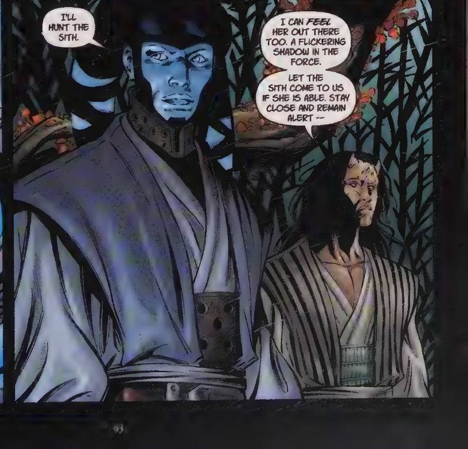
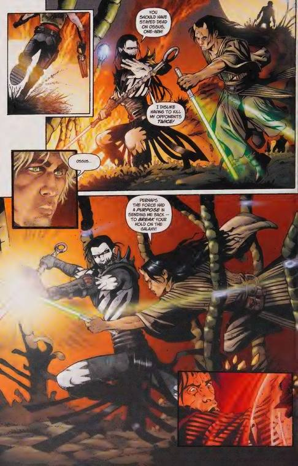
Our notes: `notes/materials/009-legacy-book-1.md:910`

- Note (summary from our notes, not a quotation): Scaling (ANALYSIS) for debate #67 (Daegen Lok vs Wolf Sazen): Book 1 Wolf is a solid Knight or Master-level fighter who loses an arm to Nihl in the massacre. One-armed, he survives Talon (with Shado) and Nihl (with the battle around them). His standout traits are sensing and bond feats, not offensive power.
  — Source: Legacy Book 1 (omnibus): power-scaling notes with panels.
Our notes: `notes/materials/009-legacy-book-1.md:923`

> THERE IS NO ONE ON OSSUS. IT IS TIME TO LEAVE.
>
> NEVER MIND. JUST A SHADOW.
> [fragment — full passage not on file]
>
> Shado has honed his martial skills and has yet to find his equal with a lightsaber.
— Source: Legacy Book 1 (omnibus): power-scaling notes with panels.
Note (our notes, around the quote): Two-on-one vs Talon with Wolf; one-on-one vs Talon with no result (p92 (#5 Broken), p127 (#7 Broken), p135 (#7 Broken)). Mocks Draco (p139 (#7 Broken)). Mind-tricks troopers on Ossus: "THERE IS NO ONE ON OSSUS. IT IS TIME TO LEAVE." · Trooper: "NEVER MIND. JUST A SHADOW." (p397 (#17 Claws)). Handbook (p465): "Shado has honed his martial skills and has yet to find his equal with a lightsaber."
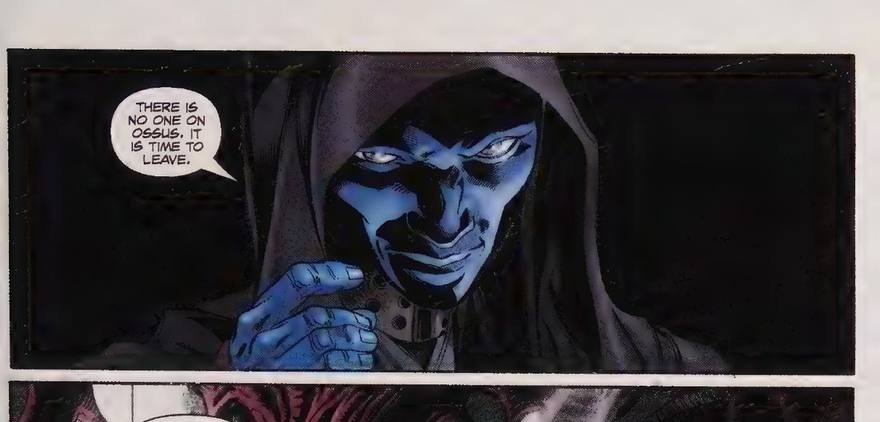

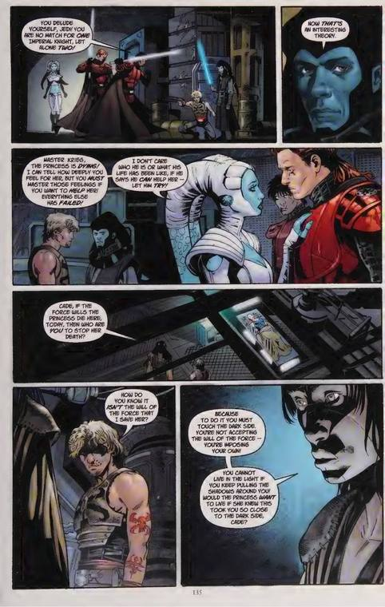
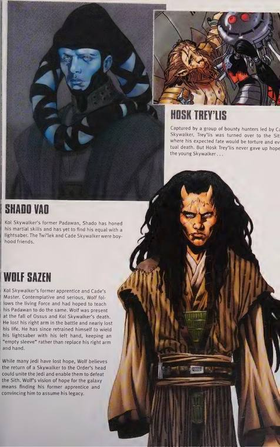
Our notes: `notes/materials/009-legacy-book-1.md:926`

> yet to find his equal with a lightsaber
> [fragment — full passage not on file]
— Source: Legacy Book 1 (omnibus): power-scaling notes with panels; ANALYSIS.
Note (our notes, around the quote): ANALYSIS: "yet to find his equal with a lightsaber" is the strongest skill statement for any Jedi in the handbook. It's undercut on-panel by being held to a draw by Talon and overpowered by Vong warriors (p287).
Our notes: `notes/materials/009-legacy-book-1.md:932`

- Note (summary from our notes, not a quotation): | 4 | Talon vs Imperial Knight Elke Vetter | Socorro mission, 137 | p56–57 (#2) | Talon kills her | Mostly off-panel |
  — Source: Legacy Book 1 (omnibus): power-scaling notes with panels.
Context: | # | Fight | Where / when | Pages (issue) | Outcome | Conditions / outside help |
Our notes: `notes/materials/009-legacy-book-1.md:1048`

- Note (summary from our notes, not a quotation): | 5 | Talon vs Wolf + Shado (+ Marasiah) | Vendaxa | p91–98 (#5) | Talon ahead; ended by Cade's Force push | Talon also driving beasts; crew firing blasters |
  — Source: Legacy Book 1 (omnibus): power-scaling notes with panels.
Context: | # | Fight | Where / when | Pages (issue) | Outcome | Conditions / outside help |
Our notes: `notes/materials/009-legacy-book-1.md:1049`

- Note (summary from our notes, not a quotation): | 6 | Cade (untrained) vs Talon's thrown wreck | Vendaxa | p97–98 (#5) | Cade stops it and blasts Talon away | Reflex action |
  — Source: Legacy Book 1 (omnibus): power-scaling notes with panels.
Context: | # | Fight | Where / when | Pages (issue) | Outcome | Conditions / outside help |
Our notes: `notes/materials/009-legacy-book-1.md:1050`

- Note (summary from our notes, not a quotation): | 8 | Shado vs Talon | Vendaxa | p117, p127, p134–135 (#6–7) | No result; Shado pushes her off and escapes | — |
  — Source: Legacy Book 1 (omnibus): power-scaling notes with panels.
Context: | # | Fight | Where / when | Pages (issue) | Outcome | Conditions / outside help |
Our notes: `notes/materials/009-legacy-book-1.md:1052`

- Note (summary from our notes, not a quotation): | 20 | Cade (Kol's saber) vs Talon | Sith Temple | p328–331 (#14) | Even, then Nihl strikes Cade from behind; Cade captured | 2-on-1 surprise |
  — Source: Legacy Book 1 (omnibus): power-scaling notes with panels.
Context: | # | Fight | Where / when | Pages (issue) | Outcome | Conditions / outside help |
Our notes: `notes/materials/009-legacy-book-1.md:1064`

- Note (summary from our notes, not a quotation): | 24 | Cade (cuffed) vs Talon | Krayt's dining hall | p371–372 (#16) | Cade's blast floors her; he holds her at his mercy | Surprise; Krayt stops it |
  — Source: Legacy Book 1 (omnibus): power-scaling notes with panels.
Context: | # | Fight | Where / when | Pages (issue) | Outcome | Conditions / outside help |
Our notes: `notes/materials/009-legacy-book-1.md:1068`

- Note (summary from our notes, not a quotation): | 25 | Talon vs Cade (training and ambush) | Under the Temple / Maladi's lab | p378–381, p411 (#17–18) | Talon wins | Training; then a surprise ambush |
  — Source: Legacy Book 1 (omnibus): power-scaling notes with panels.
Context: | # | Fight | Where / when | Pages (issue) | Outcome | Conditions / outside help |
Our notes: `notes/materials/009-legacy-book-1.md:1069`

- Note (summary from our notes, not a quotation): | 27 | Cade vs Talon / Sith (shockwave) | Krayt's chambers | p417–418 (#18) | The Sith recoil; Talon put down | Kol's ghost; surprise |
  — Source: Legacy Book 1 (omnibus): power-scaling notes with panels.
Context: | # | Fight | Where / when | Pages (issue) | Outcome | Conditions / outside help |
Our notes: `notes/materials/009-legacy-book-1.md:1071`

> DARTH KRAYT, LORD OF THE SITH, EMPEROR OF THE GALAXY *(Talon, p371)*
> [fragment — full passage not on file]
>
> INSTEAD OF TWO THERE IS NOW ONLY ONE -- THE SITH ORDER ITSELF. *(p82)*
>
> WE ARE NOT [equals] *(p346)*
> [fragment — full passage not on file]
— Source: Legacy Book 1 (omnibus): power-scaling notes with panels. POV: Darth Krayt, about Darth Talon.
Note (our notes, around the quote): Darth Krayt: "THE LIVING LORD OF THE SITH" (p84); "DARTH KRAYT, LORD OF THE SITH, EMPEROR OF THE GALAXY" (Talon, p371). Rule of One: "INSTEAD OF TWO THERE IS NOW ONLY ONE -- THE SITH ORDER ITSELF." (p82). "WE ARE NOT [equals]" (p346).
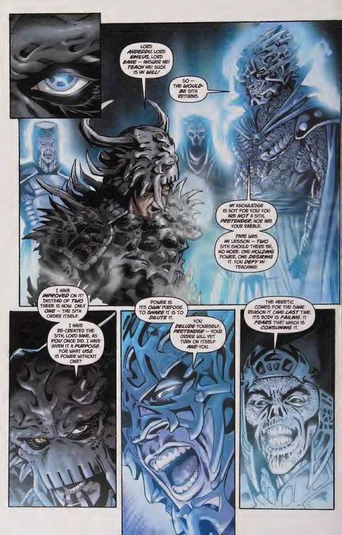
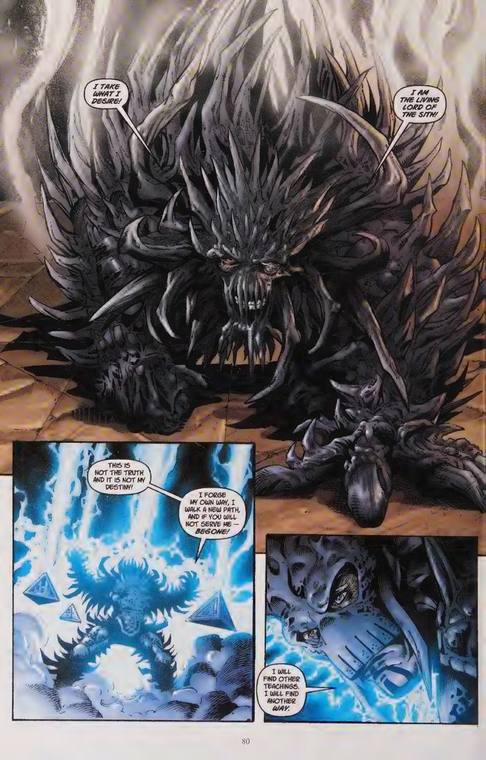
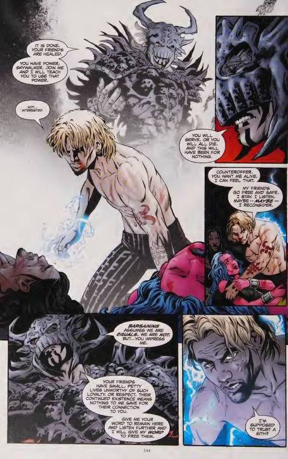

Our notes: `notes/materials/009-legacy-book-1.md:1079`

> MY OWN PERSONAL ASSASSIN … YOU WILL TAKE ORDERS ONLY FROM ME *(p55)*
> [fragment — full passage not on file]
>
> the top enforcer of Krayt's will out in the galaxy at large, and within the Sith Order itself *(handbook, p449)*
> [fragment — full passage not on file]
>
> INTENDED TO BE LORD KRAYT'S FIST… YOU ARE ONLY A HAND BECAUSE YOUR PREDECESSOR DIED... PREMATURELY *(Maladi, p351)*
> [fragment — full passage not on file]
— Source: Legacy Book 1 (omnibus): power-scaling notes with panels; The Hands, Talon and Nihl. POV: Maladi, about Darth Talon.
Note (our notes, around the quote): The Hands, Talon and Nihl: "MY OWN PERSONAL ASSASSIN … YOU WILL TAKE ORDERS ONLY FROM ME" (p55). Nihl is "the top enforcer of Krayt's will out in the galaxy at large, and within the Sith Order itself" (handbook, p449). Nihl was "INTENDED TO BE LORD KRAYT'S FIST… YOU ARE ONLY A HAND BECAUSE YOUR PREDECESSOR DIED... PREMATURELY" (Maladi, p351).

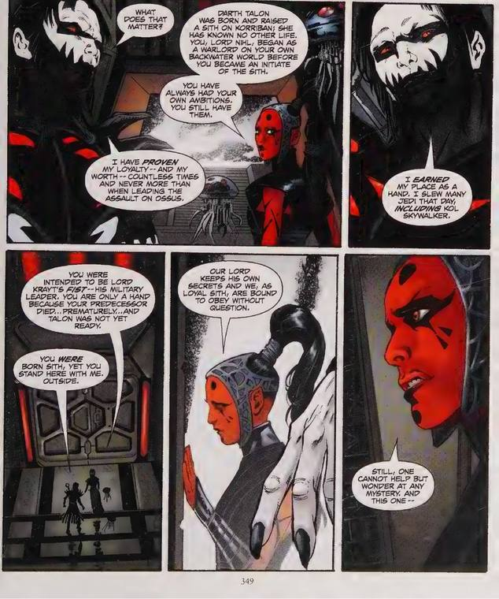
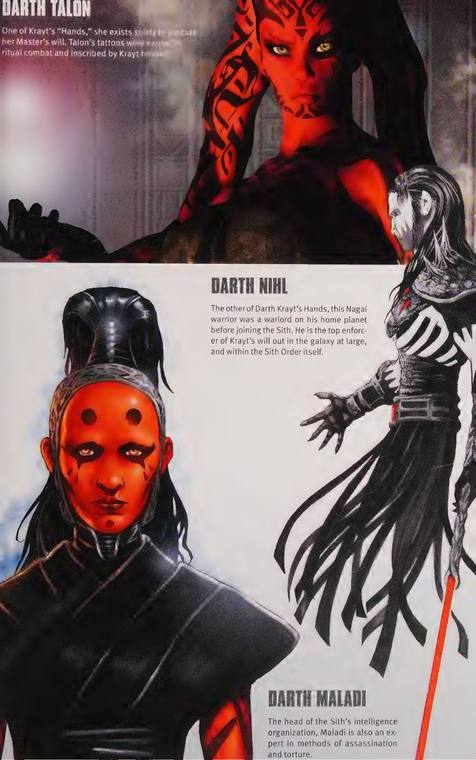
Our notes: `notes/materials/009-legacy-book-1.md:1081`

- Note (summary from our notes, not a quotation): Rank-and-file Sith Lords: Maleval, Krul, Ruyn. Talon ("I WAS BORN SITH", p389) versus Nihl ("WARLORD ON YOUR OWN BACKWATER WORLD", p351).
  — Source: Legacy Book 1 (omnibus): power-scaling notes with panels.

Our notes: `notes/materials/009-legacy-book-1.md:1084`

> One of Krayt's 'Hands,' she exists s[UNCLEAR] her Master's will. Talon's tattoos w[UNCLEAR] ritual combat and inscribed by Krayt hi[UNCLEAR].
>
> solely to [serve]… were earned in… himself
> [fragment — full passage not on file]
— Source: Legacy Book 1 (omnibus): power-scaling notes with panels; Darth Talon (p449).
Note (our notes, around the quote): Darth Talon (p449): "One of Krayt's 'Hands,' she exists s[UNCLEAR] her Master's will. Talon's tattoos w[UNCLEAR] ritual combat and inscribed by Krayt hi[UNCLEAR]." (Parts are washed out by the art glow. The likely reading is "solely to [serve]… were earned in… himself", but that's a guess and isn't quoted.)
Our notes: `notes/materials/009-legacy-book-1.md:1124`

- Note (summary from our notes, not a quotation): 
  — Source: Legacy Book 1 (omnibus): power-scaling notes with panels.
(*Panel: p449 handbook: Talon, Nihl, Maladi — `p449-handbook-talon-nihl-maladi.jpg`*)
Our notes: `notes/materials/009-legacy-book-1.md:1150`

- Note (summary from our notes, not a quotation): Counter: in Book 1 the "break" use is only *threatened* against a restrained or surprised Talon (p372) and used once, with an effect that is UNCLEAR on the page (p418). It needs touch, and Cade says he has to see the "RED LINES". It's no instant-kill hax against a mobile duelist at range.
  — Source: Legacy Book 1 (omnibus): power-scaling notes with panels.
Context: Cade's healing as a combat weapon (debates #61, #81, #85, #91).

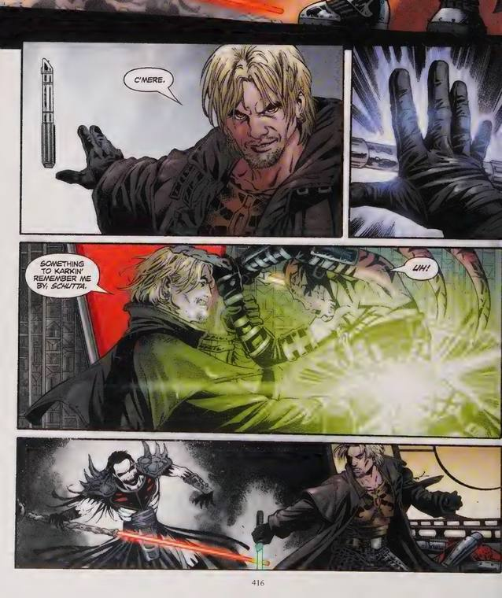
Our notes: `notes/materials/009-legacy-book-1.md:1190`

- Note (summary from our notes, not a quotation): Pro: she kills an Imperial Knight (p56–57) and pressures Wolf and Shado together (p92–96).
  — Source: Legacy Book 1 (omnibus): power-scaling notes with panels.
Context: Talon's tier.
Our notes: `notes/materials/009-legacy-book-1.md:1196`

- Note (summary from our notes, not a quotation): Con: untrained Cade's reflex push blows her away (p98), and she's ambushed twice by Cade. A fair Book 1 placement is ≥ an individual Jedi Knight or Imperial Knight, below the Krayt/Wyyrlok tier.
  — Source: Legacy Book 1 (omnibus): power-scaling notes with panels.
Context: Talon's tier.
Our notes: `notes/materials/009-legacy-book-1.md:1197`

- Note (summary from our notes, not a quotation): Sith: Darth Krayt / A'Sharad Hett, Darth Talon, Darth Nihl, Darth Wyyrlok (III), Darth Maladi, Darth Stryfe, Darth Maleval, Darth Krul, Darth Ruyn.
  — Source: Legacy Book 1 (omnibus): power-scaling notes with panels.
Our notes: `notes/materials/009-legacy-book-1.md:1215`

- Note (summary from our notes, not a quotation): Handbook p449 (Talon bio, washed out by the art glow), p459 (right edge cropped), p468 (Chak bio partly washed out), p469 (Syn bio's last line cut off) and p471 (gutter letters).
  — Source: Legacy Book 1 (omnibus): power-scaling notes with panels.
Context: UNCLEAR:

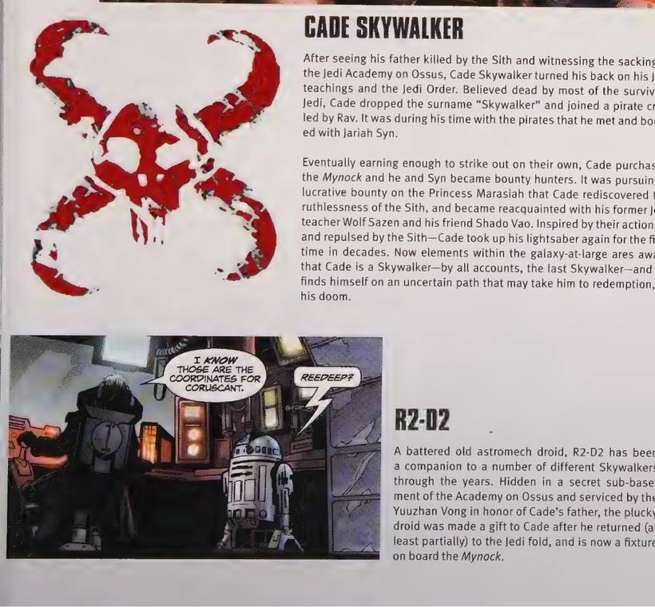
Our notes: `notes/materials/009-legacy-book-1.md:1233`

- Note (summary from our notes, not a quotation): What exactly Cade's p418 palm-burst does to Talon.
  — Source: Legacy Book 1 (omnibus): power-scaling notes with panels.
Context: UNCLEAR:
Our notes: `notes/materials/009-legacy-book-1.md:1235`

## Star Wars: Legacy—War #1–6 (2010–11): power-scaling notes with panels

- Note (summary from our notes, not a quotation): | #2 | 24–46 | WAR PART TWO | Falleen, Borosk, Bastion dungeons, Alliance flagship, Coruscant, Korriban | Cade and Sazen destroy the *Darklight*. Maladi, a prisoner, offers Omega Red and Fel refuses. Chalk tips Veed. Veed poisons and shoots Calixte. Havok breaks Draco with an illusion of Marasiah (Talon disguised) and Draco names Taivas. Krayt: "...YOU MUST DIE." |
  — Source: Legacy—War #1–6 (2010–11): power-scaling notes with panels.
Context: | Issue | PDF pages | Title on recap page | Setting | Main events |
Our notes: `notes/materials/010-legacy-war.md:37`

- Note (summary from our notes, not a quotation): | #3 | 47–69 (p66 duplicate) | WAR PART THREE | Rawk's holo home, the Wheel, Coruscant war room, Taivas | Rawk reactivates. Corde reaches Cade dying, and Cade heals her through the light side after Kol's ghost intervenes. Talon delivers carbonited Draco and spars briefly with Cade. Krayt orders the Taivas attack, with the Moffs as "BAIT". The council adopts Cade's trap plan. The battle opens and the allied fleets spring the trap. |
  — Source: Legacy—War #1–6 (2010–11): power-scaling notes with panels.
Context: | Issue | PDF pages | Title on recap page | Setting | Main events |
Our notes: `notes/materials/010-legacy-war.md:38`

- Note (summary from our notes, not a quotation): | #5 | 93–114 | WAR PART FIVE | Bastion, allied fleet, Coruscant | Trooper autopsy ("WE MILLIONS"). Fel decides on the toxin "ALONE". Corde reveals herself to the Yages. Strike team downs Coruscant's defence computers. Corde kills Veed. Maladi hands over Omega Red ("PROMISES KEPT... MY LORD KRAYT"). Tunnel ambush. Cade floors Talon. Sazen and Stryfe kill each other. |
  — Source: Legacy—War #1–6 (2010–11): power-scaling notes with panels.
Context: | Issue | PDF pages | Title on recap page | Setting | Main events |
Our notes: `notes/materials/010-legacy-war.md:40`

- Note (summary from our notes, not a quotation): The rest of the One Sith: Talon and Nihl (Krayt's Hands), Stryfe, Havok (Eshkar Niin), Maladi (Bastion's prisoner), Rauder.
  — Source: Legacy—War #1–6 (2010–11): power-scaling notes with panels.
Our notes: `notes/materials/010-legacy-war.md:57`

> NOW I AM BACK. MY BETRAYER WILL KNOW MY REVENGE. THEN, I WILL BEND THE GALAXY TO MY WILL.
— Source: Legacy—War #1–6 (2010–11): power-scaling notes with panels.
Note (our notes, around the quote): Krayt's memories (p2–4). Krayt narrates his lives as Tusken, Jedi Master A'Sharad Hett and Darth Krayt, Karness Muur's words, his defeat and Wyyrlok's betrayal. He describes "HEALING MYSELF WITH THE FORCE" inside the stasis field until Talon released him: "NOW I AM BACK. MY BETRAYER WILL KNOW MY REVENGE. THEN, I WILL BEND THE GALAXY TO MY WILL."
Our notes: `notes/materials/010-legacy-war.md:84`

- Note (summary from our notes, not a quotation): Draco broken (p44–45). Havok breaks Draco with a staged illusion: a false Marasiah who is Talon in disguise. Draco names "TAIVAS".
  — Source: Legacy—War #1–6 (2010–11): power-scaling notes with panels.
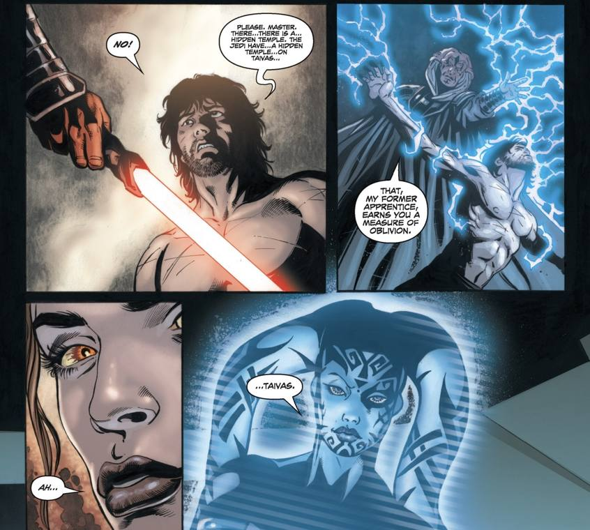
Our notes: `notes/materials/010-legacy-war.md:98`

- Note (summary from our notes, not a quotation): Krayt's answer (p46). He orders Talon to make Cade "A GIFT OF YOUR BROKEN IMPERIAL KNIGHT". He plays Cade's holo threat and replies: "...YOU MUST DIE."
  — Source: Legacy—War #1–6 (2010–11): power-scaling notes with panels.
Our notes: `notes/materials/010-legacy-war.md:99`

- Note (summary from our notes, not a quotation): Talon's gift (p56–59). Talon drops in under a "TRUCE", Force-pushes the crew, spars briefly with Cade and leaves Draco in carbonite in the hold. Draco confesses.
  — Source: Legacy—War #1–6 (2010–11): power-scaling notes with panels.
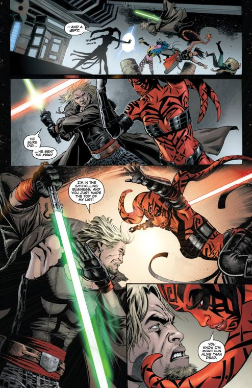
Our notes: `notes/materials/010-legacy-war.md:105`

> TIME TO END IT.
> [fragment — full passage not on file]
— Source: Legacy—War #1–6 (2010–11): power-scaling notes with panels.
Note (our notes, around the quote): The tunnels (p110–114). Talon and Stryfe ambush the team in the Temple tunnels (p110–111). Cade floors Talon with Force pushes (p112). Stryfe challenges Sazen, and they kill each other in one pass (p113–114). Talon flees to warn Krayt and Cade follows: "TIME TO END IT."
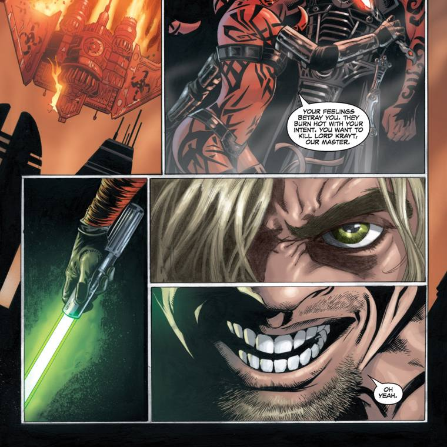
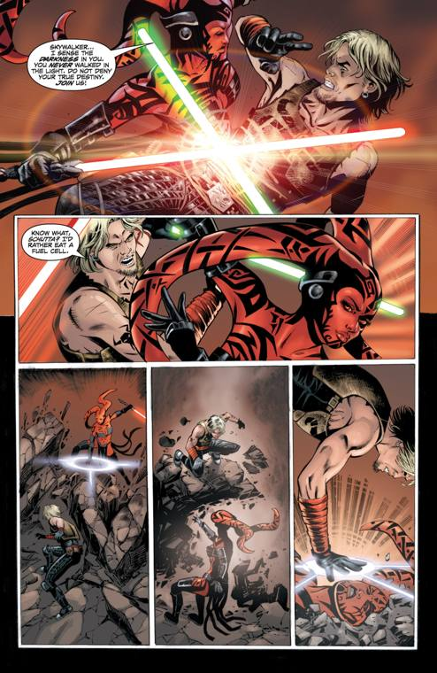
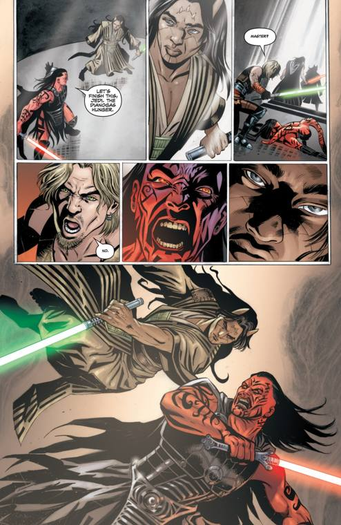
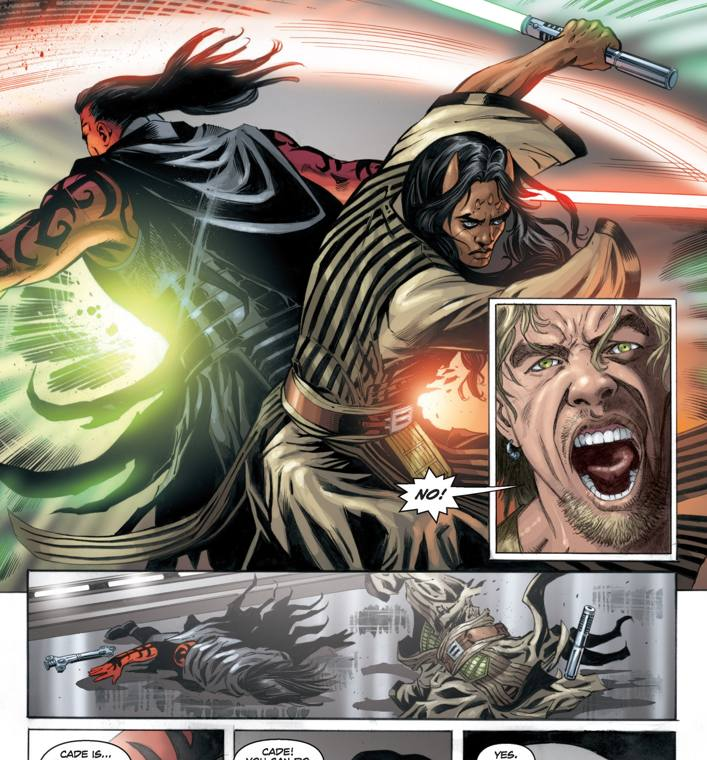
Our notes: `notes/materials/010-legacy-war.md:127`

- Note (summary from our notes, not a quotation): Cade vs Krayt (p116–118). Krayt and Nihl by holo ("AS YOU FORESAW") (p116). Talon is slammed into a pillar (p116). Cade arrives, and Krayt pushes, catches and lightnings him (p117–118).
  — Source: Legacy—War #1–6 (2010–11): power-scaling notes with panels.
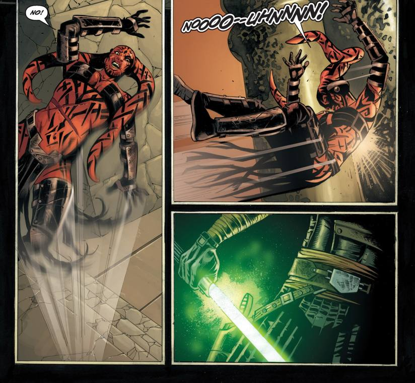
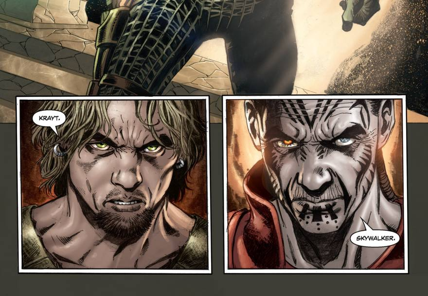

Our notes: `notes/materials/010-legacy-war.md:131`

- Note (summary from our notes, not a quotation): The rebirth is self-healing inside a stasis field, helped by projecting his thoughts into Talon's mind. Krayt credits a "SECRET" he learned "ASTRIDE THE GRAVE" and Muur's words.
  — Source: Legacy—War #1–6 (2010–11): power-scaling notes with panels.
Context: Scaling (ANALYSIS):
Our notes: `notes/materials/010-legacy-war.md:157`

> Captions: "ON THE STEPS TO THE THRONE ROOM OF THE SITH TEMPLE, GUARDS WAIT. THEY SENSE A DARK PRESENCE APPROACHING IN THE FORCE." · "WITHIN THE THRONE ROOM, DARTH WYYRLOK SENSES IT TOO; A FIRESTORM OF RAW EMOTION AND COLD RAGE." · (p16, Krayt) "I REMEMBER THE DAY ORDER 66 WAS GIVEN. ... THIS TIME, THOSE SCREAMS WILL BE FROM MY OWN 'CHILDREN' -- THE ONE SITH." · Nihl/Talon: "THOSE WHO STAND WITH THE USURPER DIE WITH HIM." "THE PATH IS OPENED BY BLOOD."
> [fragment — full passage not on file]
— Source: Legacy—War #1–6 (2010–11): power-scaling notes with panels.
Context: 2. Group assault on the Temple of the Sith. p15–16 (#1)
 *(p15)*
 *(p16)*
Our notes: `notes/materials/010-legacy-war.md:161`

- Note (summary from our notes, not a quotation): On the page: Krayt (hooded), Talon, Nihl and two masked Sith troopers cut through red-saber Sith guards on the steps. One trooper holds a Zabrak Sith by the throat in a blue-glowing gauntlet.
  — Source: Legacy—War #1–6 (2010–11): power-scaling notes with panels.
 *(p16)*
Our notes: `notes/materials/010-legacy-war.md:166`

> (p23) "ONCE, I THOUGHT TO BRING PEACE AND ORDER TO THE GALAXY THROUGH THE EXISTING GOVERNMENTS -- TO ALIGN THE WORLDS TO THE RULE OF THE ONE SITH." · "THAT CANNOT WORK. THE GALAXY MUST EXPERIENCE THE PAIN OF DEATH AND THE RAPTURE OF REBIRTH AS I HAVE." · "I WILL BRING CHAOS." · "IT IS TIME FOR WAR." · (p46, to Talon) "WHEN I CALLED TO THE ONE SITH THROUGH THE FORCE, I FELT SKYWALKER'S PRESENCE. AS MUCH AS THE BOY BELIEVES HE WALKS IN THE LIGHT, DARKNESS STILL SHROUDS HIM." · "FIND HIM AND MAKE HIM A GIFT OF YOUR BROKEN IMPERIAL KNIGHT." · (to Cade's holo) "DEATH IS NOT AN ENDING, BOY -- BUT IT IS A PASSAGEWAY TO SOMETHING GREATER. IT IS SOMETHING YOU, TOO, MUST EXPERIENCE, CADE SKYWALKER." · "FOR I HAVE HAD A VISION. YOU WILL BEND, YOU WILL BREAK, AND YOU WILL SERVE AT MY SIDE. BUT FIRST -- YOU MUST DIE." · (p60) "UNTIL THE FORCE SPEAKS TO YOU, DO NOT QUESTION MY JUDGMENT, GRAND ADMIRAL." · (to Nihl) "NONE. THEY ARE MERELY BAIT. I HAVE FORESEEN HOW THIS ALLIANCE WILL REACT TO THE IMMINENT ATTACK. THIS IS THE FIRST STEP IN MY FINAL PLAN TO BRING THE GALAXY TO HEEL."
> [fragment — full passage not on file]
— Source: Legacy—War #1–6 (2010–11): power-scaling notes with panels.
Context: 4. Krayt's war aims. p23 (#1), p46 (#2), p60 (#3)
Our notes: `notes/materials/010-legacy-war.md:213`

> Talon: "MASTER!" "SKYWALKER..." "NO!" "NOOOO--UHNNNN!"
> [fragment — full passage not on file]
— Source: Legacy—War #1–6 (2010–11): power-scaling notes with panels.
Context: 10. Talon slammed into a pillar. p116 (#6)
Our notes: `notes/materials/010-legacy-war.md:295`

- Note (summary from our notes, not a quotation): Talon is yanked backwards and slammed into a stone pillar. The next panel is Cade's green saber igniting. The page does not show who threw her (UNCLEAR). Wookieepedia says Krayt lifted and slammed her. The panel order (Talon thrown, then Cade's blade lit, then Cade's entrance on p117) could equally be read as Cade's push. Don't cite it as a Krayt feat.
  — Source: Legacy—War #1–6 (2010–11): power-scaling notes with panels.
Our notes: `notes/materials/010-legacy-war.md:298`

- Note (summary from our notes, not a quotation): 
  — Source: Legacy—War #1–6 (2010–11): power-scaling notes with panels.
(*Panel: p116 — `p116-talon-hurled-into-pillar.jpg`*)
Our notes: `notes/materials/010-legacy-war.md:300`

> Talon: "DIDN'T YOU SENSE ME IN THE FORCE, JEDI?" · Cade: "HE SURE DID... ...HE SENT ME YOU!" "I'M IN THE SITH-KILLING BUSINESS, AND YOU JUST MADE THE TOP OF MY LIST!" · Talon: "YOU KNOW I'M MORE FUN ALIVE THAN DEAD." · "...BEFORE IT SPOILS..."
> [fragment — full passage not on file]
— Source: Legacy—War #1–6 (2010–11): power-scaling notes with panels.
Context: 5. Fails to sense Talon; brief clash on the Wheel. p56–58 (#3)
Our notes: `notes/materials/010-legacy-war.md:361`

- Note (summary from our notes, not a quotation): Talon's one-hand Force push sends the crew flying.
  — Source: Legacy—War #1–6 (2010–11): power-scaling notes with panels.
 *(p57)*
Our notes: `notes/materials/010-legacy-war.md:365`

- Note (summary from our notes, not a quotation): Two or three saber exchanges.
  — Source: Legacy—War #1–6 (2010–11): power-scaling notes with panels.
 *(p57)*
Our notes: `notes/materials/010-legacy-war.md:367`

- Note (summary from our notes, not a quotation): Talon flips over Cade, kicks him in the head and leaps out of the bay. The crew's shots miss.
  — Source: Legacy—War #1–6 (2010–11): power-scaling notes with panels.
Our notes: `notes/materials/010-legacy-war.md:369`

- Note (summary from our notes, not a quotation): 
  — Source: Legacy—War #1–6 (2010–11): power-scaling notes with panels.
(*Panel: p57 — `p057-cade-vs-talon-wheel.jpg`*)
Our notes: `notes/materials/010-legacy-war.md:371`

- Note (summary from our notes, not a quotation): Scaling (ANALYSIS): an inconclusive skirmish. Talon disengages when she likes, and she was on an errand.
  — Source: Legacy—War #1–6 (2010–11): power-scaling notes with panels.
Our notes: `notes/materials/010-legacy-war.md:374`

> (p110) Talon: "WELCOME HOME, CADE SKYWALKER." "YOUR FEELINGS BETRAY YOU. THEY BURN HOT WITH YOUR INTENT. YOU WANT TO KILL LORD KRAYT, OUR MASTER." · Cade: "OH YEAH." · (p112) Talon: "SKYWALKER... I SENSE THE DARKNESS IN YOU. YOU NEVER WALKED IN THE LIGHT. DO NOT DENY YOUR TRUE DESTINY. JOIN US!" · Cade: "KNOW WHAT, SCHUTTA? I'D RATHER EAT A FUEL CELL." · (p114) Talon: "CADE IS... STRONGER... THAN HE WAS. MUST...WARN... LORD KRAYT!" · Recap (p115): "When Talon witnessed Cade's new mastery of the Force, she retreated to warn Krayt, leading Cade directly to his goal . . ."
> [fragment — full passage not on file]
— Source: Legacy—War #1–6 (2010–11): power-scaling notes with panels.
Context: 12. CADE vs TALON (tunnels): floors her with two Force pushes. p110–115 (#5–6)
Our notes: `notes/materials/010-legacy-war.md:430`

- Note (summary from our notes, not a quotation): On p112, after one saber lock, Cade's palm push (a ring shockwave) blasts Talon into the rock, bringing the rocks down. He then drops on her and slams a second Force ring into her head as she lies in the rubble. She is down for p113 and conscious but floored on p114.
  — Source: Legacy—War #1–6 (2010–11): power-scaling notes with panels.
Our notes: `notes/materials/010-legacy-war.md:433`

- Note (summary from our notes, not a quotation): 
  — Source: Legacy—War #1–6 (2010–11): power-scaling notes with panels.
(*Panel: p112 — `p112-cade-vs-talon-force-push.jpg`*)
Our notes: `notes/materials/010-legacy-war.md:438`

> new mastery of the Force
> [fragment — full passage not on file]
— Source: Legacy—War #1–6 (2010–11): power-scaling notes with panels; It is backed by Talon's statement and by the recap's.
Label in our notes: which is narration
Context: Scaling (ANALYSIS):
Our notes: `notes/materials/010-legacy-war.md:446`

- Note (summary from our notes, not a quotation): Compare Claws, where Talon beat Cade twice (013 rows 9 and 15).
  — Source: Legacy—War #1–6 (2010–11): power-scaling notes with panels.
Context: Scaling (ANALYSIS):
Our notes: `notes/materials/010-legacy-war.md:447`

- Note (summary from our notes, not a quotation): | p110, p112 | Talon: "I SENSE THE DARKNESS IN YOU" | Talon's framing | Cade wins with Force pushes |
  — Source: Legacy—War #1–6 (2010–11): power-scaling notes with panels.
Context: | Page | Moment | Light/dark | Notes |
Our notes: `notes/materials/010-legacy-war.md:513`

- Note (summary from our notes, not a quotation): Released Krayt (p4), joins the Temple assault (p15–16), and plays the illusion "Marasiah" in Havok's breaking of Draco (p44–45, orange Sith eye).
  — Source: Legacy—War #1–6 (2010–11): power-scaling notes with panels.

Our notes: `notes/materials/010-legacy-war.md:546`

- Note (summary from our notes, not a quotation): The Wheel (p56–58, #3): delivers Draco ("A LIFELINE BETWEEN EXISTENCE AND DEATH FOR THE JEDI"). Unsensed by Cade. Force-pushes three crew at once, spars briefly, kicks Cade and leaves.
  — Source: Legacy—War #1–6 (2010–11): power-scaling notes with panels.

Our notes: `notes/materials/010-legacy-war.md:547`

> CADE IS... STRONGER... THAN HE WAS.
> [fragment — full passage not on file]
— Source: Legacy—War #1–6 (2010–11): power-scaling notes with panels.
Note (our notes, around the quote): Coruscant tunnels (p110–114, #5): loses to Cade's pushes. "CADE IS... STRONGER... THAN HE WAS."

Our notes: `notes/materials/010-legacy-war.md:548`

- Note (summary from our notes, not a quotation): p116 (#6): slammed into a pillar (thrower not shown).
  — Source: Legacy—War #1–6 (2010–11): power-scaling notes with panels.

Our notes: `notes/materials/010-legacy-war.md:549`

- Note (summary from our notes, not a quotation): Not in War: Talon going into hiding under Nihl's orders (W). On the page she does not appear after p116.
  — Source: Legacy—War #1–6 (2010–11): power-scaling notes with panels.

Our notes: `notes/materials/010-legacy-war.md:550`

- Note (summary from our notes, not a quotation): 
  — Source: Legacy—War #1–6 (2010–11): power-scaling notes with panels.
(*Panel: p45 — `p045-havok-lightning-draco-taivas.jpg`*)
Our notes: `notes/materials/010-legacy-war.md:603`

- Note (summary from our notes, not a quotation): Use them as an army-level threat, not a duelling rung above Talon or Nihl.
  — Source: Legacy—War #1–6 (2010–11): power-scaling notes with panels.
Context: Scaling (ANALYSIS):
Our notes: `notes/materials/010-legacy-war.md:655`

- Note (summary from our notes, not a quotation): 
  — Source: Legacy—War #1–6 (2010–11): power-scaling notes with panels.
(*Panel: p114 — `p114-sazen-stryfe-mutual-kill.jpg`*)
Our notes: `notes/materials/010-legacy-war.md:782`

- Note (summary from our notes, not a quotation): | 1 | Krayt + Talon + Nihl + 2 Sith troopers vs Temple guards | Temple steps | p15–16 (#1) | Guards cut down; a trooper chokes a Zabrak | Group assault |
  — Source: Legacy—War #1–6 (2010–11): power-scaling notes with panels.
Context: | # | Fight | Where | Pages (issue) | Outcome | Conditions / outside help |
Our notes: `notes/materials/010-legacy-war.md:926`

- Note (summary from our notes, not a quotation): | 5 | Havok's illusion vs Draco | Korriban | p44–45 (#2) | Draco breaks, names Taivas | Talon plays "Marasiah" |
  — Source: Legacy—War #1–6 (2010–11): power-scaling notes with panels.
Context: | # | Fight | Where | Pages (issue) | Outcome | Conditions / outside help |
Our notes: `notes/materials/010-legacy-war.md:930`

- Note (summary from our notes, not a quotation): | 8 | Talon vs Cade | The Wheel | p56–58 (#3) | Brief; Talon kicks Cade and leaves | Truce and delivery errand; Cade didn't sense her |
  — Source: Legacy—War #1–6 (2010–11): power-scaling notes with panels.
Context: | # | Fight | Where | Pages (issue) | Outcome | Conditions / outside help |
Our notes: `notes/materials/010-legacy-war.md:933`

- Note (summary from our notes, not a quotation): | 17 | Strike team vs Talon + Stryfe + Sith | Temple tunnels | p110–111 (#5) | Melee; Sigel impaled | Ambush |
  — Source: Legacy—War #1–6 (2010–11): power-scaling notes with panels.
Context: | # | Fight | Where | Pages (issue) | Outcome | Conditions / outside help |
Our notes: `notes/materials/010-legacy-war.md:942`

- Note (summary from our notes, not a quotation): | 18 | Cade vs Talon | Temple tunnels | p112 (#5) | Cade floors her with two Force pushes after one saber lock | — |
  — Source: Legacy—War #1–6 (2010–11): power-scaling notes with panels.
Context: | # | Fight | Where | Pages (issue) | Outcome | Conditions / outside help |
Our notes: `notes/materials/010-legacy-war.md:943`

- Note (summary from our notes, not a quotation): | 20 | Talon slammed (thrower not shown) | Krayt's balcony | p116 (#6) | Talon hits a pillar | Already beaten by Cade |
  — Source: Legacy—War #1–6 (2010–11): power-scaling notes with panels.
Context: | # | Fight | Where | Pages (issue) | Outcome | Conditions / outside help |
Our notes: `notes/materials/010-legacy-war.md:945`

- Note (summary from our notes, not a quotation): p116. Krayt with Nihl's holo: "AS YOU FORESAW." Talon is slammed into a pillar; the thrower is not shown.
  — Source: Legacy—War #1–6 (2010–11): power-scaling notes with panels.
Our notes: `notes/materials/010-legacy-war.md:955`

- Note (summary from our notes, not a quotation): Hands: Talon and Nihl.
  — Source: Legacy—War #1–6 (2010–11): power-scaling notes with panels.
Our notes: `notes/materials/010-legacy-war.md:1003`

- Note (summary from our notes, not a quotation): Talon: "THE FAITHFUL ONE" (Krayt, p4).
  — Source: Legacy—War #1–6 (2010–11): power-scaling notes with panels. POV: Talon.
Context: Hands: Talon and Nihl.

Our notes: `notes/materials/010-legacy-war.md:1004`

- Note (summary from our notes, not a quotation): Nihl runs the trooper fleet (p60, p75) and leads after Krayt ("MY LORD", p134).
  — Source: Legacy—War #1–6 (2010–11): power-scaling notes with panels.
Context: Hands: Talon and Nihl.
Our notes: `notes/materials/010-legacy-war.md:1005`

- Note (summary from our notes, not a quotation): Talon and the recap rate his growth (p114–115).
  — Source: Legacy—War #1–6 (2010–11): power-scaling notes with panels.
Context: Use:
Our notes: `notes/materials/010-legacy-war.md:1062`

- Note (summary from our notes, not a quotation): Two-push win over Talon (p112).
  — Source: Legacy—War #1–6 (2010–11): power-scaling notes with panels.
Context: Use:

Our notes: `notes/materials/010-legacy-war.md:1082`

- Note (summary from our notes, not a quotation): Cade Skywalker (vision, healing, dark-side moments, Talon, Krayt, hibernation trance, epilogue).
  — Source: Legacy—War #1–6 (2010–11): power-scaling notes with panels.
Context: Covers:
Our notes: `notes/materials/010-legacy-war.md:1140`

- Note (summary from our notes, not a quotation): Wyyrlok III, Saarai, Talon, Nihl, Stryfe, Havok, Maladi, Rauder and the Sith troopers.
  — Source: Legacy—War #1–6 (2010–11): power-scaling notes with panels.
Context: Covers:
Our notes: `notes/materials/010-legacy-war.md:1141`

- Note (summary from our notes, not a quotation): Talon slammed by Krayt (W): the thrower is not shown (p116).
  — Source: Legacy—War #1–6 (2010–11): power-scaling notes with panels.
Our notes: `notes/materials/010-legacy-war.md:1201`

> THAT I WILL NOT ALLOW! KILL THEM! *(Talon or Stryfe)*
— Source: Legacy—War #1–6 (2010–11): power-scaling notes with panels; p111.
Label in our notes: Talon or Stryfe
Context: Speaker or identity UNCLEAR:
Our notes: `notes/materials/010-legacy-war.md:1254`

## Star Wars Saga Edition: *Legacy Era Campaign Guide* (WotC 2009): power-scaling notes with panels

- Note (summary from our notes, not a quotation): | 10 | Darth Talon | p174 | 13 | Jedi 7 / Sith apprentice 5 / Sith Lord 1 | +14 | 30 (ff 26) / 29 / 28 | 109 (29) | 14 | 2 / 6 | +18 (2d8+8); +16 (3d8+8) RS |
  — Source: *Legacy Era Campaign Guide* (WotC 2009): power-scaling notes with panels.
Context: | # | Character | Page | CL | Classes | UtF | Ref / Fort / Will | HP (Thr.) | DSS | Destiny / FP | Best lightsaber line |
Our notes: `notes/materials/011-legacy-era-campaign-guide.md:125`

> Beautiful, alluring, and dangerous, Darth Talon is a Twi'lek Sith Lord raised in the Sith tradition. Darth Talon grows up on Korriban, where she is taught how to use the Force and the art of lightsaber combat, and conditioned to be in top physical condition. Her training is harsh, as all Sith training is, yet she manages to survive and flourish.
— Source: *Legacy Era Campaign Guide* (WotC 2009): power-scaling notes with panels.

Our notes: `notes/materials/011-legacy-era-campaign-guide.md:315`

> The final step on her path to becoming a Sith Lord comes when she is ordered by Darth Krayt to slay the Sith Lord that had trained her, Darth Ruyn. With her master dead by her hands, Darth Talon becomes Darth Krayt's Hand, a special agent for the Emperor and the counterpart to Darth Nihl.
— Source: *Legacy Era Campaign Guide* (WotC 2009): power-scaling notes with panels.

Our notes: `notes/materials/011-legacy-era-campaign-guide.md:317`; `suspect-insight/debates/081-cade-skywalker-vs-darth-nox.md:83`

> The Twi'lek Sith Lord is fast, agile, and has a diverse array of skills that makes her one of the most deadly combatants around.
— Source: *Legacy Era Campaign Guide* (WotC 2009): power-scaling notes with panels.

Our notes: `notes/materials/011-legacy-era-campaign-guide.md:319`

> Despite her relative inexperience, Darth Talon is still one of the most formidable lightsaber duelists in the Sith Order. She helps oversee the training of Cade Skywalker in the ways of the Sith during his brief captivity on Coruscant.
— Source: *Legacy Era Campaign Guide* (WotC 2009): power-scaling notes with panels.

Our notes: `notes/materials/011-legacy-era-campaign-guide.md:321`

> NO THREAT, NO PURPOSE.
> [fragment — full passage not on file]
— Source: *Legacy Era Campaign Guide* (WotC 2009): power-scaling notes with panels; Pull quote (p73).

Our notes: `notes/materials/011-legacy-era-campaign-guide.md:323`

- Note (summary from our notes, not a quotation): CL 13; Medium Twi'lek Jedi 7/Sith apprentice 5/Sith Lord 1. Destiny 2; Force 6; Dark Side 14. Init +9.
  — Source: *Legacy Era Campaign Guide* (WotC 2009): power-scaling notes with panels.
Our notes: `notes/materials/011-legacy-era-campaign-guide.md:327`

- Note (summary from our notes, not a quotation): Ref 30 (ff 26), Fort 29, Will 28. hp 109; Threshold 29.
  — Source: *Legacy Era Campaign Guide* (WotC 2009): power-scaling notes with panels.
Our notes: `notes/materials/011-legacy-era-campaign-guide.md:328`

- Note (summary from our notes, not a quotation): lightsaber +18 (2d8+8) or +16 (3d8+8) with Rapid Strike.
  — Source: *Legacy Era Campaign Guide* (WotC 2009): power-scaling notes with panels.
Our notes: `notes/materials/011-legacy-era-campaign-guide.md:329`

- Note (summary from our notes, not a quotation): Force Powers (UtF +14): battle strike, Force shield, Force slam, move object, rebuke, surge. Secrets: Quicken Power. Techniques: Force Power Mastery (battle strike), Improved Move Light Object.
  — Source: *Legacy Era Campaign Guide* (WotC 2009): power-scaling notes with panels.
Our notes: `notes/materials/011-legacy-era-campaign-guide.md:330`

- Note (summary from our notes, not a quotation): Feats include Martial Arts I and Weapon Finesse.
  — Source: *Legacy Era Campaign Guide* (WotC 2009): power-scaling notes with panels.
Our notes: `notes/materials/011-legacy-era-campaign-guide.md:331`

- Note (summary from our notes, not a quotation): Her attack (+18) is only two points above the generic Imperial Knight's (+16), and her UtF is *lower* than a generic Knight's (+14 vs +16).
  — Source: *Legacy Era Campaign Guide* (WotC 2009): power-scaling notes with panels.
Our notes: `notes/materials/011-legacy-era-campaign-guide.md:336`

- Note (summary from our notes, not a quotation): On the stat sheet she sits around a strong Imperial Knight, well below Nihl and Krayt.
  — Source: *Legacy Era Campaign Guide* (WotC 2009): power-scaling notes with panels.
Our notes: `notes/materials/011-legacy-era-campaign-guide.md:337`

- Note (summary from our notes, not a quotation): "Relative inexperience" is the book's own caveat.
  — Source: *Legacy Era Campaign Guide* (WotC 2009): power-scaling notes with panels.
Our notes: `notes/materials/011-legacy-era-campaign-guide.md:338`

> one of the most formidable lightsaber duelists in the Sith Order
> [fragment — full passage not on file]
— Source: *Legacy Era Campaign Guide* (WotC 2009): power-scaling notes with panels; ![p173 Talon bio.
Note (our notes, around the quote): 
(*Panel: p173 Talon bio: "one of the most formidable lightsaber duelists in the Sith Order" — `p173-darth-talon-bio.jpg`*)
Also cited as: *Legacy Era Campaign Guide* (WotC 2009): power-scaling notes with panels.
Also noted as: Sith rank order by the numbers: Krayt CL20 (UtF +22) > Wyyrlok III CL16 (UtF +20) ≈ Nihl CL16 (UtF +15, but the best Sith duelist line after Krayt: +21, 2d10+10) > Azard CL15 / Maladi CL15 > Talon CL13 / Maleval CL13. Talon is statted barely above the generic Imperial Knight (CL11), despite the bio calling her "one of the most formidable lightsaber duelists in the Sith Order" (p173–174, p163).
Also cited as: *Legacy Era Campaign Guide* (WotC 2009): power-scaling notes with panels; The bio's hype (.
Also noted as: The bio's hype ("one of the most formidable lightsaber duelists in the Sith Order") isn't matched by the numbers.
Our notes: `notes/materials/011-legacy-era-campaign-guide.md:340`; `notes/materials/011-legacy-era-campaign-guide.md:34`; `notes/materials/011-legacy-era-campaign-guide.md:334`

- Note (summary from our notes, not a quotation): 
  — Source: *Legacy Era Campaign Guide* (WotC 2009): power-scaling notes with panels.
(*Panel: p174 Darth Talon CL 13 (part 1) — `p174-darth-talon-stat-a.jpg`*)
Our notes: `notes/materials/011-legacy-era-campaign-guide.md:343`; `notes/materials/011-legacy-era-campaign-guide.md:346`

> considers herself to be a 'true' Sith Lord, meaning that she (like Darth Talon) was born and raised on Korriban in the Sith tradition.
> [fragment — full passage not on file]
— Source: *Legacy Era Campaign Guide* (WotC 2009): power-scaling notes with panels; She.
Context: Bio:

Our notes: `notes/materials/011-legacy-era-campaign-guide.md:372`

- Note (summary from our notes, not a quotation): Not statted: Darth Stryfe, Darth Krul and Darth Ruyn have no stat blocks. Ruyn is mentioned only as Talon's victim (p173).
  — Source: *Legacy Era Campaign Guide* (WotC 2009): power-scaling notes with panels.

Our notes: `notes/materials/011-legacy-era-campaign-guide.md:425`

- Note (summary from our notes, not a quotation): Statted level with the Sith Lords Azard and Maladi (CL15), and above Talon and Maleval (CL13).
  — Source: *Legacy Era Campaign Guide* (WotC 2009): power-scaling notes with panels.
Our notes: `notes/materials/011-legacy-era-campaign-guide.md:488`

> After battles with Darth Nihl and Darth Talon, Cade quickly concludes that he needs to return to his Jedi training, if nothing else than for self-defense.
— Source: *Legacy Era Campaign Guide* (WotC 2009): power-scaling notes with panels.

Our notes: `notes/materials/011-legacy-era-campaign-guide.md:671`

> one of the most deadly combatants around
> [fragment — full passage not on file]
>
> still one of the most formidable lightsaber duelists in the Sith Order
> [fragment — full passage not on file]
— Source: *Legacy Era Campaign Guide* (WotC 2009): power-scaling notes with panels; | Talon |.
Label in our notes: | p173 |
Context: | Subject | Quote | Page |
Our notes: `notes/materials/011-legacy-era-campaign-guide.md:909`

- Note (summary from our notes, not a quotation): Its prose regularly outruns its own numbers (Talon, Kol).
  — Source: *Legacy Era Campaign Guide* (WotC 2009): power-scaling notes with panels.
Context: The book itself signals this:
Our notes: `notes/materials/011-legacy-era-campaign-guide.md:985`

- Note (summary from our notes, not a quotation): Talon's UtF is +14, below a generic Imperial Knight's +16, while her bio calls her one of the Order's most formidable duelists.
  — Source: *Legacy Era Campaign Guide* (WotC 2009): power-scaling notes with panels.
Context: Counters from this book:
Our notes: `notes/materials/011-legacy-era-campaign-guide.md:994`

- Note (summary from our notes, not a quotation): E. Talon's tier (debate #67; also bears on #93).
  — Source: (debate #67; also bears on #93) — Owner Material 011 — Star Wars Saga Edition: *Legacy Era Campaign Guide* (WotC 2009): power-scaling notes with panels.
Our notes: `notes/materials/011-legacy-era-campaign-guide.md:1019`

- Note (summary from our notes, not a quotation): Refinement to 009's Depth tier: 009 lists Stryfe, Krul and Ruyn among the Sith with Book 1 coverage. This guide adds nothing for them: no stat blocks, and Ruyn appears only as Talon's victim.
  — Source: *Legacy Era Campaign Guide* (WotC 2009): power-scaling notes with panels.
Our notes: `notes/materials/011-legacy-era-campaign-guide.md:1066`

- Note (summary from our notes, not a quotation): Nihl and Talon bio quotes (debate #67, Q14 and Q15) — VERIFIED verbatim (p172, p173).
  — Source: (debate #67, Q14 and Q15) — Owner Material 011 — Star Wars Saga Edition: *Legacy Era Campaign Guide* (WotC 2009): power-scaling notes with panels.
Our notes: `notes/materials/011-legacy-era-campaign-guide.md:1075`

- Note (summary from our notes, not a quotation): Sith: Darth Krayt (CL20), Darth Wyyrlok III (CL16), Darth Nihl (CL16), Darth Azard (CL15), Darth Maladi (CL15), Darth Talon (CL13), Darth Maleval (CL13), Jor Torlin (CL11).
  — Source: *Legacy Era Campaign Guide* (WotC 2009): power-scaling notes with panels.
Our notes: `notes/materials/011-legacy-era-campaign-guide.md:1101`

- Note (summary from our notes, not a quotation): | p173 | `p173-darth-talon-bio.jpg` | Talon bio formidable duelist | yes |
  — Source: *Legacy Era Campaign Guide* (WotC 2009): power-scaling notes with panels.
Context: | PDF page | File | What it shows | Embedded above |
Our notes: `notes/materials/011-legacy-era-campaign-guide.md:1177`

- Note (summary from our notes, not a quotation): | p174 | `p174-darth-talon-stat-a.jpg` | Talon CL13 part 1 | yes |
  — Source: *Legacy Era Campaign Guide* (WotC 2009): power-scaling notes with panels.
Context: | PDF page | File | What it shows | Embedded above |
Our notes: `notes/materials/011-legacy-era-campaign-guide.md:1178`

- Note (summary from our notes, not a quotation): | p174 | `p174-darth-talon-stat-b.jpg` | Talon part 2 | yes |
  — Source: *Legacy Era Campaign Guide* (WotC 2009): power-scaling notes with panels.
Context: | PDF page | File | What it shows | Embedded above |
Our notes: `notes/materials/011-legacy-era-campaign-guide.md:1179`

## Star Wars: Legacy Volume 2, *Shards* (TPB): power-scaling notes with panels

> IT WENT AS I EXPECTED, MY LORD. *(009 named the killer as Talon; corrected, see below.)*
— Source: Legacy Volume 2, *Shards* (TPB): power-scaling notes with panels.
Note (our notes, around the quote): The killer is Maladi: red skin, white-dotted headdress, long black hair, no lekku. That matches her p114 hologram, and she then says "IT WENT AS I EXPECTED, MY LORD." (009 named the killer as Talon; corrected, see below.)
Our notes: `notes/materials/012-legacy-vol-2-shards.md:111`

> YOUR STRATAGEM FAILED, MALADI.
> [fragment — full passage not on file]
— Source: Legacy Volume 2, *Shards* (TPB): power-scaling notes with panels.
Note (our notes, around the quote): Who kills Governor Dorn (012 p124 = 009 p261): it's Darth Maladi, not Darth Talon. In both scans the killer has Maladi's white-dotted headdress and no lekku, and she answers Krayt's "YOUR STRATAGEM FAILED, MALADI." 009 listed it as a Talon feat ("Executes Governor Dorn") and named the crop `p261-talon-kills-dorn…` (now renamed `p261-maladi-kills-dorn-krayt-stratagem-failed.jpg`; the p229 crop is now `p229-draco-force-push-stazi.jpg`).

Our notes: `notes/materials/012-legacy-vol-2-shards.md:532`

## Star Wars: Legacy Volume 3, *Claws of the Dragon* (TPB): power-scaling notes with panels

- Note (summary from our notes, not a quotation): Flashbacks, narrated by Krayt or Talon (framing by an interested narrator): Jedi General A'Sharad Hett at Order 66 (p61); Hett as Tusken warlord vs Obi-Wan Kenobi on Tatooine while Luke is hidden on the Lars farm (p62–70); Hett as bounty hunter, then XoXaan's apprentice on Korriban (p89–91, p98); Hett's capture and shaping by the Yuuzhan Vong and his meetings with Vergere (p99–104); the founding of Krayt's Order, Lumiya and "CADEUS", stasis (p105–106).
  — Source: Legacy Volume 3, *Claws of the Dragon* (TPB): power-scaling notes with panels.

Our notes: `notes/materials/013-legacy-vol-3-claws-of-the-dragon.md:33`

- Note (summary from our notes, not a quotation): From stasis, Krayt senses "SKYWALKER IS COMING" while Wyyrlok fears he is dying (p10). Cade shakes off a four-ship Skull Squadron flight in Coruscant traffic and hides his ship in the undercity (p11–14, p22). He leaves the *Mynock*'s codes with Queen Jool at Rik's cantina for Syn and Deliah (p17–21). Gunner Yage is dressed down by her father (p22–23). Cade slips into the Sith Temple, finds Hosk with the Force and frees him (p24–27). Talon ambushes them; Cade has the better of the first exchange until Nihl strikes him from behind (p27–30). Sazen senses Cade's darkness from Ossus (p31).
  — Source: Legacy Volume 3, *Claws of the Dragon* (TPB): power-scaling notes with panels.
Our notes: `notes/materials/013-legacy-vol-3-claws-of-the-dragon.md:40`

- Note (summary from our notes, not a quotation): Maladi calls off the Imperial search; the Moffs squabble, and Calixte, Veed and the Yages trade barbs (p32–36). Maladi tortures Cade with ixetal cilona, which he keeps purging; Krayt arrives (p37–38). Talon brings in Syn and Deliah; Maladi triggers coral seeds in them, Krayt frees one of Cade's hands with the Force, and Cade heals both at once with dark-side power (p39–45). Cade trades his freedom for theirs (p45–46). Calixte and Veed plan to use Corde (p47–48). Wyyrlok keeps Nihl and Maladi outside; they argue over birth and rank (p49–50). Over dinner Krayt shows Cade Kol's encased lightsaber and reveals he was the Jedi A'Sharad Hett (p51–53).
  — Source: Legacy Volume 3, *Claws of the Dragon* (TPB): power-scaling notes with panels.
Our notes: `notes/materials/013-legacy-vol-3-claws-of-the-dragon.md:44`

- Note (summary from our notes, not a quotation): Corde gets past Veed's security, demands three dozen Vong bugs and a stand-down "ON MY SIGNAL" (p54). At Rik's she recruits Syn, Deliah, Chak and Kee and tells them she is Cade's mother (p55–59). Krayt tells his story: Clone Wars, Order 66, the Tuskens, and his defeat and maiming by Kenobi (p60–69). Cade mocks him, Talon throws him with the Force, and Cade blasts her across the room and threatens to "EXPLODE" her weak point; Krayt stops him, cuts his cuffs, orders him to heal her and makes Talon his teacher; Cade asks to be taught "THE WAYS OF THE SITH" (p70–73). On Ossus the Jedi hide from Stryfe's troopers (p74–75).
  — Source: Legacy Volume 3, *Claws of the Dragon* (TPB): power-scaling notes with panels.
Our notes: `notes/materials/013-legacy-vol-3-claws-of-the-dragon.md:48`

> THAT WHICH CAN HEAL CAN ALSO BREAK. *(p115)*
— Source: Legacy Volume 3, *Claws of the Dragon* (TPB): power-scaling notes with panels.
Note (our notes, around the quote): Cade hangs in the Vong "EMBRACE OF PAIN" while Krayt tells the rest: Vong capture, shaping, Vergere, his vision, the escape, the new Order, Lumiya and "CADEUS", stasis, and his dying body (p98–107). Cade slips out of his cell; the crew launches (p108–109). Talon is waiting in Maladi's lab and drops him (p110). Krayt orders him to kill Hosk; Cade refuses, Hosk forgives everyone, and Krayt runs Hosk through; Hosk's body vanishes (p111–114). Kol's ghost: "THAT WHICH CAN HEAL CAN ALSO BREAK." (p115). Cade's telekinetic burst shatters the case, he calls Kol's saber, strikes Talon and engages Nihl while Krayt urges revenge (p116–119).
Our notes: `notes/materials/013-legacy-vol-3-claws-of-the-dragon.md:56`

> (p72) Krayt (to Cade, who is crouched over the downed Talon): "NO." · "I CAN FEEL THE ANGER IN YOU, CADE SKYWALKER. I KNOW IT AS I KNOW MY OWN, AS I FELT IT AT THE BETRAYAL BY THE CLONES -- AND AT MY HUMILIATION BY OBI-WAN KENOBI." · "YOU HAVE GREAT RAW POWER BUT IT NEEDS FOCUS." · (p73, cutting Cade's cuff with one stroke) "THEN WE WILL TEACH YOU." · "HEAL HER." · "DARTH TALON WILL BE YOUR TEACHER." · "FROM THIS DAY FORWARD, I ALONE SHAPE YOUR DESTINY."
> [fragment — full passage not on file]
— Source: Legacy Volume 3, *Claws of the Dragon* (TPB): power-scaling notes with panels.
Context: 4. Rates Cade's raw power; names his own Kenobi loss a "HUMILIATION". p72 (#16)–p73 (#16) [009 p373–374]
Our notes: `notes/materials/013-legacy-vol-3-claws-of-the-dragon.md:92`

> (p81) Krayt (tail into Krayt's close-up, zoom-checked): "SKYWALKER'S ARROGANCE WILL BE HIS UNDOING. HE THINKS HIMSELF SKILLED ENOUGH TO HIDE HIS TRUE FEELINGS, BUT HE IS NOT." · "CADE SKYWALKER WILL CROSS OVER TO THE DARK SIDE AND CURE ME. HAVING HIM WITHIN OUR EMPIRE AND AS PART OF OUR SITH ORDER WILL SHAKE OUR ENEMIES TO THEIR CORE." · (p94, holo, to Talon) "I SERVED WITH A JEDI IN THE CLONE WARS WHO PLAYED AT BEING ONE WITH THE DARK SIDE. HIS LIE NEARLY BECAME THE TRUTH." · "CADE SKYWALKER IS NOT AS GOOD A MAN AS THAT JEDI OF OLD." · (p111, lifting Cade) "DID YOU THINK YOU COULD HIDE YOURSELF AND YOUR INTENTIONS FROM ME? THAT I WOULD NOT KNOW OF YOUR LIE?"
> [fragment — full passage not on file]
— Source: Legacy Volume 3, *Claws of the Dragon* (TPB): power-scaling notes with panels.
Context: 5. Sees through Cade's pretence. p81 (#17), p94 (#17), p111 (#18) [009 p382, p395, p412]
Our notes: `notes/materials/013-legacy-vol-3-claws-of-the-dragon.md:98`

> "I WAS SCOUTING, APART FROM MY TROOPS, WHEN ORDER 66 WAS ISSUED". · "I KILLED THE CLONES ASSIGNED TO EXECUTE ME, SAVING ONLY ONE LONG ENOUGH TO LEARN WHY. THEN I FLED THE PLANET." · "I REACHED OUT THROUGH THE FORCE, BUT COULD NOT SENSE ANY OTHER JEDI." · "I MADE MY WAY TO TATOOINE AND BECAME WAR LEADER OF SEVERAL CLANS OF TUSKEN RAIDERS, AS MY FATHER HAD BEEN BEFORE ME."
— Source: Legacy Volume 3, *Claws of the Dragon* (TPB): power-scaling notes with panels.
Context: 1. Order 66: kills his clone execution squad alone. p61 (#16) [009 p362]

Our notes: `notes/materials/013-legacy-vol-3-claws-of-the-dragon.md:164`

- Note (summary from our notes, not a quotation): At least three troopers are drawn in the panel; the squad size isn't given. Hett wields two green blades.
  — Source: Legacy Volume 3, *Claws of the Dragon* (TPB): power-scaling notes with panels.

Our notes: `notes/materials/013-legacy-vol-3-claws-of-the-dragon.md:167`

- Note (summary from our notes, not a quotation): 
  — Source: Legacy Volume 3, *Claws of the Dragon* (TPB): power-scaling notes with panels.
(*Panel: p61 — `p061-hett-kills-clone-squad.jpg`*)
Our notes: `notes/materials/013-legacy-vol-3-claws-of-the-dragon.md:169`

> (p64) Hett: "I WAS RAISED TO MANHOOD AMONGST THE TUSKENS BY MY FATHER, SHARAD HETT, THE GREATEST JEDI OF HIS AGE." · Kenobi: "YOU WERE A GREAT JEDI, HETT, AND THE SON OF A GREAT JEDI. BUT YOU HAVE GIVEN YOURSELF OVER TO REVENGE. IT STOPS HERE." · Hett: "YOU WILL HAVE A JEDI FUNERAL, MASTER KENOBI. THAT I PROMISE." · (p66) Kenobi: "OOF!" · "MMFFF!" · (p67) "HUFF!" · (p69) Hett: "I AM FINISHED. YOU HAVE DISGRACED ME BEFORE MY PEOPLE. WITH ONE HAND, I CAN NO LONGER WIELD A GADERFFI." · "I AM A DEAD MAN. FINISH IT. KILL ME." · Kenobi: "NO. BUT YOU CAN NO LONGER STAY ON TATOOINE." · "MAY THE FORCE BE WITH YOU, A'SHARAD HETT."
> [fragment — full passage not on file]
— Source: Legacy Volume 3, *Claws of the Dragon* (TPB): power-scaling notes with panels.
Context: 2. A'SHARAD HETT vs OBI-WAN KENOBI, Tatooine: Kenobi wins decisively and spares him. p63 (#16)–p69 (#16) [009 p364–370]

Our notes: `notes/materials/013-legacy-vol-3-claws-of-the-dragon.md:172`

- Note (summary from our notes, not a quotation): Pages 65–68 are wordless apart from grunts. Hett (Tusken mask, two green blades) attacks; Kenobi (one blue blade, two-handed) defends. Hett lands a kick to the chest that sends Kenobi flying (p66; whether a Force push follows through is UNCLEAR) and a kick or knee to his midsection (p67). Then Kenobi blocks one blade overhead, palms Hett's mask with a Force glow, severs his right hand at the wrist, and Force-pushes him away (p68). He pulls off Hett's mask in front of the mounted Tuskens.
  — Source: Legacy Volume 3, *Claws of the Dragon* (TPB): power-scaling notes with panels.

Our notes: `notes/materials/013-legacy-vol-3-claws-of-the-dragon.md:175`

- Note (summary from our notes, not a quotation): 
  — Source: Legacy Volume 3, *Claws of the Dragon* (TPB): power-scaling notes with panels.
(*Panel: p64 — `p064-hett-greatest-jedi-kenobi-great-jedi.jpg`*)
Our notes: `notes/materials/013-legacy-vol-3-claws-of-the-dragon.md:177`

- Note (summary from our notes, not a quotation): 
  — Source: Legacy Volume 3, *Claws of the Dragon* (TPB): power-scaling notes with panels.
(*Panel: p68 — `p068-kenobi-severs-hett-hand-force-push.jpg`*)
Our notes: `notes/materials/013-legacy-vol-3-claws-of-the-dragon.md:180`

- Note (summary from our notes, not a quotation): 
  — Source: Legacy Volume 3, *Claws of the Dragon* (TPB): power-scaling notes with panels.
(*Panel: p69 — `p069-hett-defeated-spared.jpg`*)
Our notes: `notes/materials/013-legacy-vol-3-claws-of-the-dragon.md:183`

- Note (summary from our notes, not a quotation): Scaling (ANALYSIS): a clean one-on-one loss for early-Imperial Hett against early-exile Kenobi, two against one blade. Hett gets two body blows in, so it isn't a stomp. The whole story is told by Krayt, who calls it "MY HUMILIATION BY OBI-WAN KENOBI" (p72), i.e. he concedes it. Relevant to debate #45 (Yaddle vs CW A'Sharad Hett) as a ceiling for the Clone Wars-era Hett.
  — Source: Legacy Volume 3, *Claws of the Dragon* (TPB): power-scaling notes with panels.
Our notes: `notes/materials/013-legacy-vol-3-claws-of-the-dragon.md:186`

> FOLLOWING HIS EXILE FROM TATOOINE, A'SHARAD HETT BECAME A BOUNTY HUNTER, MASKING HIS JEDI SKILLS.
>
> FAR BETTER THAN YOU HAVE TRIED, RESK.
>
> BOUNTY'S THE SAME, DEAD OR ALIVE.
— Source: Legacy Volume 3, *Claws of the Dragon* (TPB): power-scaling notes with panels.
Note (our notes, around the quote): 3. Bounty hunter: deflects Resk's blaster fire and kills him. p89 (#17)–p90 (#17) [009 p390–391], narrated by Talon: "FOLLOWING HIS EXILE FROM TATOOINE, A'SHARAD HETT BECAME A BOUNTY HUNTER, MASKING HIS JEDI SKILLS." · Hett: "FAR BETTER THAN YOU HAVE TRIED, RESK." · "BOUNTY'S THE SAME, DEAD OR ALIVE." Non-Force target. Hett again wields two green blades; the replacement for the severed hand isn't commented on until p101 ("MY CYBERNETIC HAND").
 *(p89)*
 *(p90)*
Our notes: `notes/materials/013-legacy-vol-3-claws-of-the-dragon.md:188`

> USING THE FORCE, MY MASTER SHATTERED THE BARRIER TO FIND...
> [fragment — full passage not on file]
>
> I WAS ONE OF THE FIRST OF THE SITH LORDS; ONE OF THOSE WHO ABANDONED THE JEDI ORDER TO SEEK A DARKER PATH TO TRUTH.
>
> MY BRETHREN AND I INVENTED WHAT IT MEANS TO BE A SITH.
>
> WHEN I EMERGED FROM THE TOMBS, I DISCOVERED I HAD BEEN ON KORRIBAN LONGER THAN I THOUGHT. I LEARNED THAT VADER AND PALPATINE WERE BOTH GONE
> [fragment — full passage not on file]
— Source: Legacy Volume 3, *Claws of the Dragon* (TPB): power-scaling notes with panels.
Note (our notes, around the quote): 4. Breaks into XoXaan's tomb with the Force; becomes her apprentice. p91 (#17) [009 p392]: "USING THE FORCE, MY MASTER SHATTERED THE BARRIER TO FIND..." · XoXaan: "I WAS ONE OF THE FIRST OF THE SITH LORDS; ONE OF THOSE WHO ABANDONED THE JEDI ORDER TO SEEK A DARKER PATH TO TRUTH." · "MY BRETHREN AND I INVENTED WHAT IT MEANS TO BE A SITH." · Hett: "MASTER... I AM." · (p98, Krayt) "WHEN I EMERGED FROM THE TOMBS, I DISCOVERED I HAD BEEN ON KORRIBAN LONGER THAN I THOUGHT. I LEARNED THAT VADER AND PALPATINE WERE BOTH GONE". The barrier is a doorway-sized seal (one panel).
 *(p91)*
Our notes: `notes/materials/013-legacy-vol-3-claws-of-the-dragon.md:192`

> (p99) "THE FORCE WAS TELLING ME NOTHING OF MY ATTACKERS." · (p100) "I HAD NEVER SEEN A SHIP LIKE THE ONE THAT ENGULFED ME..." "...OR WARRIORS LIKE THE ONES I FACED..." "...OR WEAPONS LIKE THE ONES THAT DOWNED ME."
> [fragment — full passage not on file]
— Source: Legacy Volume 3, *Claws of the Dragon* (TPB): power-scaling notes with panels.
Context: 5. Downed and captured by Yuuzhan Vong warriors. p99 (#18)–p100 (#18) [009 p400–401]

Our notes: `notes/materials/013-legacy-vol-3-claws-of-the-dragon.md:195`

- Note (summary from our notes, not a quotation): He leaps from his crashed ship with two green blades, blocks an amphistaff, and is hit in the chest by several thud bugs; the Vong carry him off.
  — Source: Legacy Volume 3, *Claws of the Dragon* (TPB): power-scaling notes with panels.

Our notes: `notes/materials/013-legacy-vol-3-claws-of-the-dragon.md:198`

- Note (summary from our notes, not a quotation): 
  — Source: Legacy Volume 3, *Claws of the Dragon* (TPB): power-scaling notes with panels.
(*Panel: p100 — `p100-hett-downed-by-vong.jpg`*)
Our notes: `notes/materials/013-legacy-vol-3-claws-of-the-dragon.md:200`

- Note (summary from our notes, not a quotation): Conditions: crash-landed, outnumbered, and the Vong are invisible in the Force ("TELLING ME NOTHING").
  — Source: Legacy Volume 3, *Claws of the Dragon* (TPB): power-scaling notes with panels.
Our notes: `notes/materials/013-legacy-vol-3-claws-of-the-dragon.md:203`

> "TIME PASSED. WHEN THE MOMENT CAME, I SEIZED IT." · "FIRE AND RED RUIN MARKED MY PATH." · "THE VONG IMPLANTS ENABLED ME TO USE THE COGNITION HOOD IN ONE OF THEIR CORALSKIPPERS AND ESCAPE." · "IT WAS NECESSARY FOR THE VONGS TO BELIEVE I WAS DEAD, SO THE ENTIRE SHIP AND ALL ON IT NEEDED TO DIE." · "ON THE EVE OF THE YUUZHAN VONGS INVASION, I ESCAPED BACK INTO THE GALAXY."
— Source: Legacy Volume 3, *Claws of the Dragon* (TPB): power-scaling notes with panels.
Context: 6. Escape: Force lightning through Vong warriors; "THE ENTIRE SHIP AND ALL ON IT NEEDED TO DIE". p104 (#18) [009 p405]

Our notes: `notes/materials/013-legacy-vol-3-claws-of-the-dragon.md:205`

- Note (summary from our notes, not a quotation): 
  — Source: Legacy Volume 3, *Claws of the Dragon* (TPB): power-scaling notes with panels.
(*Panel: p104 — `p104-hett-lightning-destroys-vong-ship.jpg`*)
Our notes: `notes/materials/013-legacy-vol-3-claws-of-the-dragon.md:208`

- Note (summary from our notes, not a quotation): Scaling (ANALYSIS): the splash shows lightning killing a few Vong warriors (two or three drawn). How the scout ship was destroyed is not shown; the last panel has the coralskipper fleeing as the ship explodes (UNCLEAR whether by Force or by the skipper's weapons). Do not cite it as a Force ship-destruction feat.
  — Source: Legacy Volume 3, *Claws of the Dragon* (TPB): power-scaling notes with panels.
Our notes: `notes/materials/013-legacy-vol-3-claws-of-the-dragon.md:211`

> (p27) Cade senses the attack, Force-shoves Hosk clear with an open hand and ignites Kol's saber: "SON OF A MURGLAK!" (splash: his blade blocks Talon's) · (p28) Talon: "HE'S WANTED ALIVE. AS ARE YOU." · Cade: "I WANT EVERY ONE OF YOU MAGGOT-SUCKING SITH DEAD!" · (p29) "I WAS DEAD! OUT OF THE WHOLE KARKIN' THING! THEN EVERYONE STARTS DRAGGING ME BACK INTO IT!" · (red-orange eyes) "HOW DO YOU LIKE ME, SCHUTTA?!" · Talon: "THINK YOU CAN TAKE ME NOW?!" · Cade: "URHGGK! GURRHHK!" · Nihl: "HIS FATHER'S SON... ...WEAK AND TOO EASILY DEFEATED BY DARKNESS." · (p30) Talon: "I DO NOT REQUIRE YOUR ASSISTANCE, NIHL." · Nihl: "I DO NOT DO THIS TO ASSIST YOU. I DO IT BECAUSE THIS ONE INTERESTS ME."
> [fragment — full passage not on file]
— Source: Legacy Volume 3, *Claws of the Dragon* (TPB): power-scaling notes with panels.
Context: 3. CADE vs DARTH TALON (Temple, first fight): Cade has the upper hand until Nihl takes him from behind. p27 (#14)–p30 (#14) [009 p328–331]
Our notes: `notes/materials/013-legacy-vol-3-claws-of-the-dragon.md:228`

- Note (summary from our notes, not a quotation): In p29's first panel Talon is sent tumbling with her balance broken. The hit from behind isn't drawn; a hooked chain line shows at Cade's waist and Nihl crouches over him with his chain weapon on p30.
  — Source: Legacy Volume 3, *Claws of the Dragon* (TPB): power-scaling notes with panels.
Our notes: `notes/materials/013-legacy-vol-3-claws-of-the-dragon.md:231`

- Note (summary from our notes, not a quotation): 
  — Source: Legacy Volume 3, *Claws of the Dragon* (TPB): power-scaling notes with panels.
(*Panel: p27 — `p027-cade-blocks-talon-ambush.jpg`*)
Our notes: `notes/materials/013-legacy-vol-3-claws-of-the-dragon.md:233`

- Note (summary from our notes, not a quotation): Conditions: Talon ambushed, but Cade sensed it in time; Talon was under orders to take him alive (p28, p30).
  — Source: Legacy Volume 3, *Claws of the Dragon* (TPB): power-scaling notes with panels.
Our notes: `notes/materials/013-legacy-vol-3-claws-of-the-dragon.md:239`

> (p70) Talon (throwing him head over heels with a violet Force sphere from her palm): "YOU ADDRESS DARTH KRAYT, LORD OF THE SITH, EMPEROR OF THE GALAXY." · "RESPECT HIS POWER AND BEWARE MINE!" · Cade: "WANT TO TALK POWER, SCHUTTA?!" · (p71, a blue blast from his palm hurls her into the wall) "LET'S TALK ABOUT MINE!" · "I GOT THIS CRAZY HEALING ABILITY. I CAN SEE THE WEAK POINTS IN YOU LIKE LITTLE BROKEN RED LINES! I CAN SEE WHERE YOU GOT WOUNDED RECENTLY." · "SOMEONE SMACK YOU DURING A SPARRING SESSION? BET IT WAS NIHL." · "OR -- AND HERE'S A NEW IDEA -- MAYBE I COULD EXPLODE THAT POINT. KILL YOU. INTERESTING IDEA. SHOULD WE TRY?" · (p73) Cade: "I DO WISH IT." · "TEACH ME THE WAYS OF THE SITH... MASTER."
> [fragment — full passage not on file]
— Source: Legacy Volume 3, *Claws of the Dragon* (TPB): power-scaling notes with panels.
Context: 6. Blasts Talon across the room while still cuffed; threatens to "EXPLODE" her weak point; then heals her. p70 (#16)–p73 (#16) [009 p371–374]
Our notes: `notes/materials/013-legacy-vol-3-claws-of-the-dragon.md:258`

- Note (summary from our notes, not a quotation): 
  — Source: Legacy Volume 3, *Claws of the Dragon* (TPB): power-scaling notes with panels.
(*Panel: p70 — `p070-talon-force-flips-cade.jpg`*)
Our notes: `notes/materials/013-legacy-vol-3-claws-of-the-dragon.md:261`

- Note (summary from our notes, not a quotation): 
  — Source: Legacy Volume 3, *Claws of the Dragon* (TPB): power-scaling notes with panels.
(*Panel: p71 — `p071-cade-blasts-talon-explode-threat.jpg`*)
Our notes: `notes/materials/013-legacy-vol-3-claws-of-the-dragon.md:264`

What it shows (our notes): 
> “Superbly,” he admitted.
>
> “Superbly,” he admitted.
>
> “Then reward me! Make me your apprentice! Teach me the ways of the Sith!”
>
> “Have I not taught you many secrets, Asajj?”
>
> “Have I not taught you many secrets, Asajj?”
>
> “Have I not taught you many secrets, Asajj?”
>
> “Scraps. Little devices. Lesser arts. Not nearly what you would if I were your apprentice sworn in blood, I know. I am no fool,” she said angrily. As if he didn’t know that. As if she needed to convince him she was deadly. “I have learned much about the Sith. Their lineage and their greatness.”
>
> “But what of their natural history?” Dooku said.
>
> Ventress blinked. “What?”
>
> “The Sith, considered as a species. An insect, perhaps.”
>
> Asajj’s thin lips got thinner. “You mock me.”
>
> “I have rarely been more serious.” The Count paced over to a shelf of holocrons on the wall, plucked one out, and inserted it into the comm cube on his desk. “Behold: the sickle-back mantis of Dantooine.” A glowing picture formed in the air over the desk, a glossy red-and-black mantis, all hooked forelimbs and wicked piety. “After mating, the female tears her partner’s head off and lays her eggs in his body. When the broodlings hatch, they eat their way out and then attack one another.”
>
> “I am not given to parables,” Ventress said impatiently. “If you have a point, make it.”
>
> “It is a tricky business, this making of apprentices,” Dooku said. “The true Sith Lord must find a pupil in whom the Force runs strong.”
>
> “Sixteen Jedi dead is some testament to that,” Ventress said. “Should have been seventeen,” she added.
>
> “But do I really want to make you so strong?” the Count said softly. “We are such pleasant company now, while you know your place. But if I were to make you my apprentice, if I were to take you by the hand and lead you down below the black water that is the dark side, then either you would drown, or you would grow far stronger, and neither option appeals to me. You burn so brightly now, I would hate to put you out.”
>
> “Why should you? What harm is there in teaching me to help you better?”
>
> “You would betray me.” He shrugged, cutting off her protests. “It is the unhappy hazard of embracing the dark side. I am old, and I have learned the limits of my ambition. You are young, and strong, and those two things have always led to one place in the history of the Sith.”
>
> “You think I would intrigue against you?”
>
> “Not at first. But a day would come when you would disagree with my decisions. When you would start to dream of how much better things would be without my liver-spotted hand held over you.”
>
> “I disagree with your decisions right now,” she said. “About that Jedi who—”
>
> “Should have been number seventeen. I know.” Dooku smiled. “I don’t have your appetites. I can wait on my kills, and use them better. And for now, you might disagree, but you dare not disobey.” And here, with a small smile, he lifted just one finger.
>
> She blanched. “True,” she said.
>
> Dooku let his finger drop.
>
> In the hologram on the desk, baby mantises were squirming from their father’s body. They groped blindly about them with their spindly hooked limbs until one, a little larger than the others, chanced to find that the sickles on his hind legs fit like a collar around a sibling’s neck. Driven by primitive instinct, he jerked and tore off his brother’s head.
>
> “In a perfect world,” Dooku said, “one could feed an apprentice just enough to keep him growing—just enough to keep him wanting more. The Master could promise him fame, glamour. That’s a good one to deliver on,” he said. “He could do the Master’s bidding, be his public face. Then if any of the Master’s plans went wrong, why, he could take the fall.” Dooku looked up, his eyes suddenly sharp and very much in the present. “Does that sound good to you, Asajj? Would you truly like to be my apprentice? I could make you the most feared woman in the galaxy. All the Jedi would come looking for you, while I sat safe and sound in Coruscant, biding my time.”
— Source: Legacy Volume 3, *Claws of the Dragon* (TPB): power-scaling notes with panels; ![p73 Cade heals Talon.
(Excerpt widened 2026-11-17 to the relevant passage, word for word from Yoda (Sean Stewart) (text copy `MEGA_Legend_The_Clone_Wars_Series_Star_Wars_Clone_Wars_20_Yoda_Dark_Rendezvous_Sean_Stewart_epub`).)
(Excerpt widened 2026-11-17 to the relevant passage, word for word from Yoda (Sean Stewart) (text copy `MEGA_Legend_The_Clone_Wars_Series_Star_Wars_Clone_Wars_20_Yoda_Dark_Rendezvous_Sean_Stewart_epub`).)
(Full sentence/passage taken from the source text on file: `quick_tmp_ydr_stewart_epub`.)
(*Panel: p73 — `p073-cade-heals-talon-teach-me-master.jpg`*)
Our notes: `notes/materials/013-legacy-vol-3-claws-of-the-dragon.md:267`

- Note (summary from our notes, not a quotation): Conditions: Talon had just thrown him and was not guarding; Krayt and Wyyrlok let it happen and Krayt stops it with one word ("NO.", p72). The "explode" use is only threatened, needs touch, and depends on his seeing the "RED LINES".
  — Source: Legacy Volume 3, *Claws of the Dragon* (TPB): power-scaling notes with panels.
Our notes: `notes/materials/013-legacy-vol-3-claws-of-the-dragon.md:270`

> (p78) Cade: "NASTY." · "THOUGHT THIS WAS A PRACTICE SESSION." · Talon (mid-flip, boot to his jaw): "NO THREAT, NO PURPOSE." · (p79) Talon: "THE EXITS ARE UNGUARDED. DEFEAT ME AND YOU CAN ESCAPE." · Cade: "WHY WOULD I WANT TO ESCAPE WHEN EVERYTHING I'M AFTER IS HERE?" · (p80) Cade: "E CHU TA! THAT HURTS!" · Talon: "YOU STILL HAVE MUCH TO LEARN." · "NOW, CONCENTRATE ON THE DARK SIDE OF THE FORCE AND HEAL YOURSELF." · (p87) Talon: "BE GRATEFUL I CHOSE TO STRIKE NOTHING VITAL."
> [fragment — full passage not on file]
— Source: Legacy Volume 3, *Claws of the Dragon* (TPB): power-scaling notes with panels.
Context: 7. Training: saber and telekinesis against combat droids; loses to Talon. p77 (#17)–p80 (#17), p87 (#17) [009 p378–381, p388]
Our notes: `notes/materials/013-legacy-vol-3-claws-of-the-dragon.md:272`

> NO THREAT, NO PURPOSE.
> [fragment — full passage not on file]
— Source: Legacy Volume 3, *Claws of the Dragon* (TPB): power-scaling notes with panels; ![p78 Talon.
Note (our notes, around the quote): 
(*Panel: p78 — `p078-talon-kicks-cade-no-threat-no-purpose.jpg`*)
Our notes: `notes/materials/013-legacy-vol-3-claws-of-the-dragon.md:277`

- Note (summary from our notes, not a quotation): 
  — Source: Legacy Volume 3, *Claws of the Dragon* (TPB): power-scaling notes with panels.
(*Panel: p80 — `p080-talon-cuts-cade-self-heal.jpg`*)
Our notes: `notes/materials/013-legacy-vol-3-claws-of-the-dragon.md:280`

> KNEW YOU'D COME. I'VE BEEN WAITING FOR YOU...
> [fragment — full passage not on file]
>
> I MISSED YOUR TOUCH...
> [fragment — full passage not on file]
— Source: Legacy Volume 3, *Claws of the Dragon* (TPB): power-scaling notes with panels.
Note (our notes, around the quote): 8. Ambushed and dropped by Talon. p110 (#18) [009 p411]: Talon: "KNEW YOU'D COME. I'VE BEEN WAITING FOR YOU..." · Cade (blue sparks at the fingers gripping her face): "I MISSED YOUR TOUCH..." · Talon meets his palm with a violet Force sphere and blows him down: "IDIOT."
Our notes: `notes/materials/013-legacy-vol-3-claws-of-the-dragon.md:283`

- Note (summary from our notes, not a quotation): 
  — Source: Legacy Volume 3, *Claws of the Dragon* (TPB): power-scaling notes with panels.
(*Panel: p110 — `p110-talon-repels-cade-idiot.jpg`*)
Our notes: `notes/materials/013-legacy-vol-3-claws-of-the-dragon.md:285`

> (p112) Cade: "CAN'T FORCE ME NEITHER -- IT DON'T WORK THAT WAY." · "LEAVE HIM ALONE! NO ONE DIES FOR ME!" · (p115) Kol: "CADE...OPEN YOUR MIND...YOUR HEART...TO ME... LISTEN!" · "THAT WHICH CAN HEAL CAN ALSO BREAK." · (p117) Cade: "C'MERE." (Kol's saber flies to his hand) · "SOMETHING TO KARKIN' REMEMBER ME BY, SCHUTTA." · Talon: "UH!"
> [fragment — full passage not on file]
— Source: Legacy Volume 3, *Claws of the Dragon* (TPB): power-scaling notes with panels.
Context: 9. Refuses to kill Hosk; Kol's ghost; telekinetic burst shatters the transparisteel case and makes four Sith recoil. p112 (#18)–p117 (#18) [009 p413–418]
Our notes: `notes/materials/013-legacy-vol-3-claws-of-the-dragon.md:288`

- Note (summary from our notes, not a quotation): p116 is wordless. The case cracks and explodes outward in a storm of glass. Four Sith (Nihl, a spiked-armoured figure with a raised red saber who is Wyyrlok by count but faceless, Talon, and Krayt) recoil and shield themselves; none is clearly knocked off their feet. On p117 Cade strikes Talon at close range: a green flare at her side while she grips his head. The hilt isn't clearly visible, so saber cut vs palm burst is UNCLEAR. She is down in the background for the rest of the fight (p128).
  — Source: Legacy Volume 3, *Claws of the Dragon* (TPB): power-scaling notes with panels.
Our notes: `notes/materials/013-legacy-vol-3-claws-of-the-dragon.md:291`

- Note (summary from our notes, not a quotation): 
  — Source: Legacy Volume 3, *Claws of the Dragon* (TPB): power-scaling notes with panels.
(*Panel: p117 — `p117-cade-strikes-talon-faces-nihl.jpg`*)
Our notes: `notes/materials/013-legacy-vol-3-claws-of-the-dragon.md:299`

> I AM HERE ON ORDERS FROM OUR LORD KRAYT. SKYWALKER IS WANTED ALIVE.
>
> HOWEVER, LORD KRAYT WILLS, AND WE OBEY. DON'T WE?
— Source: Legacy Volume 3, *Claws of the Dragon* (TPB): power-scaling notes with panels.
Note (our notes, around the quote): 1. Ambush and first fight with Cade. p27 (#14)–p30 (#14) [009 p328–331]. See Cade 3. On p30 the balloon "I AM HERE ON ORDERS FROM OUR LORD KRAYT. SKYWALKER IS WANTED ALIVE." is Talon's (zoom: the tail exits left to the off-panel Talon, whose saber enters from the left); Nihl answers "PITY." · "HOWEVER, LORD KRAYT WILLS, AND WE OBEY. DON'T WE?"

Our notes: `notes/materials/013-legacy-vol-3-claws-of-the-dragon.md:339`

> I AM HERE ON ORDERS FROM OUR LORD KRAYT.
— Source: Legacy Volume 3, *Claws of the Dragon* (TPB): power-scaling notes with panels; ![p30 Talon.
Note (our notes, around the quote): 
(*Panel: p30 — `p030-talon-here-on-orders.jpg`*)
Our notes: `notes/materials/013-legacy-vol-3-claws-of-the-dragon.md:341`

- Note (summary from our notes, not a quotation): 2. Throws Cade with telekinesis (not a kick), then is blasted down by him. p70 (#16)–p73 (#16). See Cade 6.
  — Source: Legacy Volume 3, *Claws of the Dragon* (TPB): power-scaling notes with panels.

Our notes: `notes/materials/013-legacy-vol-3-claws-of-the-dragon.md:344`

- Note (summary from our notes, not a quotation): 3. Beats Cade in training and in the p110 ambush. p78–80 (#17), p87 (#17), p110 (#18). See Cade 7–8. Kills a combat droid from above mid-flip (p78).
  — Source: Legacy Volume 3, *Claws of the Dragon* (TPB): power-scaling notes with panels.

Our notes: `notes/materials/013-legacy-vol-3-claws-of-the-dragon.md:346`

> (p87) "WE SITH ARE NOT BARBARIC. WE ARE WARRIORS, BUT WE POSSESS A CULTURE AND A CIVILIZATION TO RIVAL ANY IN THE GALAXY." · Cade: "WHERE IS THE OLD MURGLAK?" · (p88) Talon: "I KILLED HIM." · "DARTH KRAYT COMMANDED IT. WE SITH DO NOT QUESTION OUR MASTER." · "KRAYT'S SITH ORDER IS MORE THAN TWO." · "HAD MY TEACHER NOT DEEMED ME READY, HE WOULD HAVE BLOCKED MY ATTACK. INSTEAD, HE EMBRACED DEATH SO THAT I MIGHT TOUCH THE DARK SIDE." · "IF YOU EVER BECOME SKILLED ENOUGH TO KILL ME, YOU WILL HONOR US BOTH WITH MY DEATH." · "I WAS BORN SITH."
> [fragment — full passage not on file]
— Source: Legacy Volume 3, *Claws of the Dragon* (TPB): power-scaling notes with panels.
Context: 4. Killed her own master on Krayt's order. p87 (#17)–p88 (#17) [009 p388–389]

Our notes: `notes/materials/013-legacy-vol-3-claws-of-the-dragon.md:348`

- Note (summary from our notes, not a quotation): 
  — Source: Legacy Volume 3, *Claws of the Dragon* (TPB): power-scaling notes with panels.
(*Panel: p88 — `p088-talon-killed-her-master-more-than-two.jpg`*)
Our notes: `notes/materials/013-legacy-vol-3-claws-of-the-dragon.md:351`

- Note (summary from our notes, not a quotation): Note (ANALYSIS): by her own account the master let the blow land, so this is not a combat feat.
  — Source: Legacy Volume 3, *Claws of the Dragon* (TPB): power-scaling notes with panels.
Our notes: `notes/materials/013-legacy-vol-3-claws-of-the-dragon.md:354`

> I HAVE DEEPENED THE BOND THAT SKYWALKER FORGED BETWEEN US WHEN HE HEALED ME. BUT HE IS A LIAR WHO ONLY PRETENDS TO BE ONE OF US, MY LORD.
>
> Have your eyes been opened yet, Skywalker?
— Source: Legacy Volume 3, *Claws of the Dragon* (TPB): power-scaling notes with panels; 5. Sees through Cade's act. p94 (#17) [009 p395].
Note (our notes, around the quote): 5. Sees through Cade's act. p94 (#17) [009 p395]: "I HAVE DEEPENED THE BOND THAT SKYWALKER FORGED BETWEEN US WHEN HE HEALED ME. BUT HE IS A LIAR WHO ONLY PRETENDS TO BE ONE OF US, MY LORD." · (p92, whisper lettering) "Have your eyes been opened yet, Skywalker?"

Our notes: `notes/materials/013-legacy-vol-3-claws-of-the-dragon.md:356`; `notes/materials/013-legacy-vol-3-claws-of-the-dragon.md:332`

- Note (summary from our notes, not a quotation): 
  — Source: Legacy Volume 3, *Claws of the Dragon* (TPB): power-scaling notes with panels.
(*Panel: p94 — `p094-talon-cade-liar-krayt-jedi-of-old.jpg`*)
Our notes: `notes/materials/013-legacy-vol-3-claws-of-the-dragon.md:358`

- Note (summary from our notes, not a quotation): Scaling (ANALYSIS, across the book): Talon vs Cade comes out roughly even. She wins in training (p78–80) and the forewarned ambush (p110); he wins the first exchange in the Temple (p29, before Nihl intervenes), the unguarded cuffed blast (p71) and the surprise close-range strike (p117). The framing makes her the more skilled and him the stronger.
  — Source: Legacy Volume 3, *Claws of the Dragon* (TPB): power-scaling notes with panels.
Our notes: `notes/materials/013-legacy-vol-3-claws-of-the-dragon.md:361`

- Note (summary from our notes, not a quotation): Scaling (ANALYSIS): for debates #22, #36 and #131, Claws gives Nihl a from-behind takedown of a Cade who was engaged with Talon, a clean loss to the heightened end-of-Claws Cade, and two kill claims (Kol, a village) with no on-page demonstration. Nihl's own Kol claim is "MANY JEDI THAT DAY, INCLUDING KOL SKYWALKER" during an assault he led, not a duel.
  — Source: Legacy Volume 3, *Claws of the Dragon* (TPB): power-scaling notes with panels.
Our notes: `notes/materials/013-legacy-vol-3-claws-of-the-dragon.md:380`

- Note (summary from our notes, not a quotation): Torturer of Cade (p37, see Cade 4). 009 gave these lines to Talon; on this page the torturer has Maladi's red, black-spotted face and ornate black headdress, Krayt addresses her as "MALADI." on p40, and Talon only enters on p39.
  — Source: Legacy Volume 3, *Claws of the Dragon* (TPB): power-scaling notes with panels.
Our notes: `notes/materials/013-legacy-vol-3-claws-of-the-dragon.md:384`

- Note (summary from our notes, not a quotation): XoXaan (p89, p91): Talon calls her Krayt's "FIRST AND GREATEST TEACHER"; she calls herself "ONE OF THE FIRST OF THE SITH LORDS".
  — Source: Legacy Volume 3, *Claws of the Dragon* (TPB): power-scaling notes with panels.
 *(p89)*
 *(p91)*
Our notes: `notes/materials/013-legacy-vol-3-claws-of-the-dragon.md:443`

- Note (summary from our notes, not a quotation): | 3 | Cade vs Talon; Nihl intervenes | Sith Temple lower levels | p27–30 (#14) | Cade ahead (Talon tumbles), then Nihl drops him from behind | Talon's ambush sensed; both Sith under orders to take him alive |
  — Source: Legacy Volume 3, *Claws of the Dragon* (TPB): power-scaling notes with panels.
Context: | # | Fight | Where / when | Pages (issue) | Outcome | Conditions / outside help |
Our notes: `notes/materials/013-legacy-vol-3-claws-of-the-dragon.md:486`

- Note (summary from our notes, not a quotation): | 5 | Talon vs Cade (cuffed) | Krayt's dining hall | p70–72 (#16) | Talon throws him (TK); Cade's palm blast floors her; Krayt stops it | Talon unguarded; Cade still cuffed |
  — Source: Legacy Volume 3, *Claws of the Dragon* (TPB): power-scaling notes with panels.
Context: | # | Fight | Where / when | Pages (issue) | Outcome | Conditions / outside help |
Our notes: `notes/materials/013-legacy-vol-3-claws-of-the-dragon.md:488`

- Note (summary from our notes, not a quotation): | 9 | Talon vs Cade (sparring) | Temple training level | p78–80 (#17) | Talon wins (kick, cut) | Training; "STRIKE NOTHING VITAL" (p87) |
  — Source: Legacy Volume 3, *Claws of the Dragon* (TPB): power-scaling notes with panels.
Context: | # | Fight | Where / when | Pages (issue) | Outcome | Conditions / outside help |
Our notes: `notes/materials/013-legacy-vol-3-claws-of-the-dragon.md:492`

- Note (summary from our notes, not a quotation): | 15 | Talon vs Cade (ambush) | Maladi's lab | p110 (#18) | Talon drops him ("IDIOT.") | She was waiting |
  — Source: Legacy Volume 3, *Claws of the Dragon* (TPB): power-scaling notes with panels.
Context: | # | Fight | Where / when | Pages (issue) | Outcome | Conditions / outside help |
Our notes: `notes/materials/013-legacy-vol-3-claws-of-the-dragon.md:498`

- Note (summary from our notes, not a quotation): | 17 | Cade's burst vs four Sith | Krayt's chamber | p116–117 (#18) | Case shattered; Sith recoil; Talon struck and down | Kol's ghost; point-blank surprise |
  — Source: Legacy Volume 3, *Claws of the Dragon* (TPB): power-scaling notes with panels.
Context: | # | Fight | Where / when | Pages (issue) | Outcome | Conditions / outside help |
Our notes: `notes/materials/013-legacy-vol-3-claws-of-the-dragon.md:500`

> DARTH KRAYT, LORD OF THE SITH, EMPEROR OF THE GALAXY *(Talon, p70)*
> [fragment — full passage not on file]
>
> WE SITH DO NOT QUESTION OUR MASTER. *(Talon, p88)*
>
> BARGAINING ASSUMES WE ARE EQUALS. WE ARE NOT. *(p45)*
— Source: Legacy Volume 3, *Claws of the Dragon* (TPB): power-scaling notes with panels; Darth Krayt. POV: Darth Krayt, about Darth Talon.
Label in our notes: Talon, p70). (Talon, p88). (p45

Our notes: `notes/materials/013-legacy-vol-3-claws-of-the-dragon.md:510`

> YOU WERE INTENDED TO BE LORD KRAYT'S FIST ... YOU ARE ONLY A HAND BECAUSE YOUR PREDECESSOR DIED...PREMATURELY...AND TALON WAS NOT YET READY. *(Maladi, p50)*
> [fragment — full passage not on file]
>
> I WAS BORN SITH. *(p88)*
> [fragment — full passage not on file]
— Source: Legacy Volume 3, *Claws of the Dragon* (TPB): power-scaling notes with panels. POV: Maladi, about Darth Talon.
Note (our notes, around the quote): The Hands, Talon and Nihl: Nihl, "AS ONE OF DARTH KRAYT'S HANDS" (p49); "YOU WERE INTENDED TO BE LORD KRAYT'S FIST ... YOU ARE ONLY A HAND BECAUSE YOUR PREDECESSOR DIED...PREMATURELY...AND TALON WAS NOT YET READY." (Maladi, p50). Talon: "I WAS BORN SITH." (p88).

Our notes: `notes/materials/013-legacy-vol-3-claws-of-the-dragon.md:512`

> KRAYT'S SITH ORDER IS MORE THAN TWO. *(Talon, p88)*
>
> MY SITH WILL BE MANY BUT THEY WILL BE ONE. THE ORDER ITSELF ABOVE ALL. *(Hett, p103)*
>
> BANE CHANGED THE RULES AND CHANGED THE SITH -- NOW I WILL CHANGE THEM AGAIN. *(p103)*
— Source: Legacy Volume 3, *Claws of the Dragon* (TPB): power-scaling notes with panels; Rule of One. POV: Rule of One, about Darth Talon.
Label in our notes: Talon, p88). (Hett, p103). (p103

Our notes: `notes/materials/013-legacy-vol-3-claws-of-the-dragon.md:516`

> CLAIMED TO HAVE BEEN TRAINED AS A SITH BY THE EMPEROR *(p102)*
> [fragment — full passage not on file]
— Source: Legacy Volume 3, *Claws of the Dragon* (TPB): power-scaling notes with panels. POV: Talon.
Note (our notes, around the quote): Lineage: XoXaan, "ONE OF THE FIRST OF THE SITH LORDS" (p91), "HIS FIRST AND GREATEST TEACHER" (Talon, p89); Vergere "CLAIMED TO HAVE BEEN TRAINED AS A SITH BY THE EMPEROR" (p102).

Our notes: `notes/materials/013-legacy-vol-3-claws-of-the-dragon.md:517`

- Note (summary from our notes, not a quotation): Counter: the Nihl win comes right after a surprise burst caught Nihl, and Cade is in a heightened rage state. Talon beats him twice (p78–80, p110). Against Krayt he ends up on the floor before Corde's shot (p132), and Krayt is holding back because he needs him alive (p112). Krayt's own rating: "NEITHER JEDI NOR SITH" (p128).
  — Source: Legacy Volume 3, *Claws of the Dragon* (TPB): power-scaling notes with panels.
Context: End-of-Claws Cade (debates #61, #81, #85, #91).
Our notes: `notes/materials/013-legacy-vol-3-claws-of-the-dragon.md:558`

- Note (summary from our notes, not a quotation): Talon. Use: her training wins and the p110 ambush; her TK throw (p70). Counter: Cade's surprise blasts drop her twice (p71, p117). Roughly even overall, framed as more skilled.
  — Source: Legacy Volume 3, *Claws of the Dragon* (TPB): power-scaling notes with panels.

Our notes: `notes/materials/013-legacy-vol-3-claws-of-the-dragon.md:564`

> NO, YOU USE THE FORCE TO PURGE YOURSELF, BENDING IT TO YOUR WILL...LIKE A SITH...
> [fragment — full passage not on file]
>
> THEN HE REALIZES THE LIMITATIONS OF THE JEDI TEACHINGS.
— Source: Legacy Volume 3, *Claws of the Dragon* (TPB): power-scaling notes with panels.
Note (our notes, around the quote): The torturer on p37 (= 009 p338) is Darth Maladi, not Talon. "DESPITE A FULL DAY OF INJECTIONS…", "I SUPPLY THEM." and "NO, YOU USE THE FORCE TO PURGE YOURSELF, BENDING IT TO YOUR WILL...LIKE A SITH..." are Maladi's; "THEN HE REALIZES THE LIMITATIONS OF THE JEDI TEACHINGS." is the arriving Krayt (009 had the speaker UNCLEAR; the crop is renamed `p338-maladi-cade-purges-drug-like-sith.jpg`).

Our notes: `notes/materials/013-legacy-vol-3-claws-of-the-dragon.md:605`

- Note (summary from our notes, not a quotation): 009 p371 (= 013 p70): Talon throws Cade with telekinesis (a violet Force sphere), not a kick.
  — Source: Legacy Volume 3, *Claws of the Dragon* (TPB): power-scaling notes with panels.

Our notes: `notes/materials/013-legacy-vol-3-claws-of-the-dragon.md:621`

- Note (summary from our notes, not a quotation): p79 whether Talon has two sabers in the spar.
  — Source: Legacy Volume 3, *Claws of the Dragon* (TPB): power-scaling notes with panels.
Context: UNCLEAR:
Our notes: `notes/materials/013-legacy-vol-3-claws-of-the-dragon.md:645`

- Note (summary from our notes, not a quotation): p117 whether Cade's strike on Talon is a saber cut or a palm burst.
  — Source: Legacy Volume 3, *Claws of the Dragon* (TPB): power-scaling notes with panels.
Context: UNCLEAR:

Our notes: `notes/materials/013-legacy-vol-3-claws-of-the-dragon.md:648`

- Note (summary from our notes, not a quotation): p137 whether Krayt physically grabs Talon.
  — Source: Legacy Volume 3, *Claws of the Dragon* (TPB): power-scaling notes with panels.
Context: UNCLEAR:
Our notes: `notes/materials/013-legacy-vol-3-claws-of-the-dragon.md:655`

## https://starwars.fandom.com/wiki/Cade_Skywalker

- Note (summary from our notes, not a quotation): On Coruscant, he sensed Hosk Trey'lis inside the Temple of the Sith from outside the structure; he overpowered Darth Talon before Darth Nihl choked him into submission. [11]
  — Source: Legacy (2006) 14 [per Wookieepedia "Cade Skywalker" rev 15549841, ref 11; per-sentence approximate match (2/2 sentences matched, min 0.60), verify; agrees with the entry's own ref marker]; per Wookieepedia "Cade Skywalker" rev 15549841, ref 11; per-sentence approximate match (2/2 sentences matched, min 0.60), verify; agrees with the entry's own ref marker — Cade Skywalker — article extraction — https://starwars.fandom.com/wiki/Cade_Skywalker.
(Source: Legacy (2006) 14 [per Wookieepedia "Cade Skywalker" rev 15549841, ref 11; per-sentence approximate match (2/2 sentences matched, min 0.60), verify; agrees with the entry's own ref marker])
Our notes: `external/mega-notes/cade-skywalker-quotes.txt:19`

- Note (summary from our notes, not a quotation): During the Sith escape, he defeated Darth Talon and Darth Nihl, then refused Krayt's order to kill Nihl. He used his father's lightsaber after shattering its transparisteel case with the Force. [21][22]
  — Source: Legacy (2006) 19 ; Legacy (2006) 31 ; Legacy (2006) 18 [per Wookieepedia "Cade Skywalker" rev 15549841, ref 22,47,21; per-sentence approximate match (2/2 sentences matched, min 0.64), verify; agrees with the entry's own ref marker]; per Wookieepedia "Cade Skywalker" rev 15549841, ref 22,47,21; per-sentence approximate match (2/2 sentences matched, min 0.64), verify; agrees with the entry's own ref marker — Cade Skywalker — article extraction — https://starwars.fandom.com/wiki/Cade_Skywalker.
(Source: Legacy (2006) 19 ; Legacy (2006) 31 ; Legacy (2006) 18 [per Wookieepedia "Cade Skywalker" rev 15549841, ref 22,47,21; per-sentence approximate match (2/2 sentences matched, min 0.64), verify; agrees with the entry's own ref marker])
Our notes: `external/mega-notes/cade-skywalker-quotes.txt:21`

- Note (summary from our notes, not a quotation): During the Sith period, Cade healed Darth Talon after reopening her recently healed wounds; the article says their bond was created when he healed her. [5][20]
  — Source: UNRESOLVED (sentence not found in current Wookieepedia article revision; primary source not identified) — Cade Skywalker — article extraction — https://starwars.fandom.com/wiki/Cade_Skywalker.
(Source: UNRESOLVED (sentence not found in current Wookieepedia article revision; primary source not identified))
Our notes: `external/mega-notes/cade-skywalker-quotes.txt:39`

- Note (summary from our notes, not a quotation): Krayt ordered Cade to heal Talon and later fought him in the Temple of the Sith. Cade held Krayt off in a lightsaber duel until Morrigan Corde's intervention enabled his escape. [5][22]
  — Source: Legacy (2006) 16 [per Wookieepedia "Cade Skywalker" rev 15549841, ref 5; per-sentence approximate match (1/2 sentences matched, min 0.68), verify; agrees with the entry's own ref marker]; per Wookieepedia "Cade Skywalker" rev 15549841, ref 5; per-sentence approximate match (1/2 sentences matched, min 0.68), verify; agrees with the entry's own ref marker — Cade Skywalker — article extraction — https://starwars.fandom.com/wiki/Cade_Skywalker.
(Source: Legacy (2006) 16 [per Wookieepedia "Cade Skywalker" rev 15549841, ref 5; per-sentence approximate match (1/2 sentences matched, min 0.68), verify; agrees with the entry's own ref marker])
Our notes: `external/mega-notes/cade-skywalker-quotes.txt:57`

- Note (summary from our notes, not a quotation): On Had Abbadon, Cade defeated Talon again and quickly defeated Darth Stryfe (with help from Syn's explosives). Krayt was blasted by Muur's Force lightning and survived being Force-pushed off a cliff. [27]
  — Source: UNSOURCED on Wookieepedia (sentence found in "Cade Skywalker" rev 15549841 but it has no inline citation in its paragraph; approximate match 0.74, verify) — Cade Skywalker — article extraction — https://starwars.fandom.com/wiki/Cade_Skywalker.
(Source: UNSOURCED on Wookieepedia (sentence found in "Cade Skywalker" rev 15549841 but it has no inline citation in its paragraph; approximate match 0.74, verify))
Our notes: `external/mega-notes/cade-skywalker-quotes.txt:59`

- Note (summary from our notes, not a quotation): The article says Cade defeated Talon and Stryfe on Had Abbadon, killed Vul Isen, and later defeated Sith forces before killing Krayt. [47][37][40][2]
  — Source: Legacy (2006) 31 ; Legacy (2006) 48 ; Legacy (2006) 50 [per Wookieepedia "Cade Skywalker" rev 15549841, ref 47,36,37; approximate match 0.67, verify; agrees with the entry's own ref marker]; per Wookieepedia "Cade Skywalker" rev 15549841, ref 47,36,37; approximate match 0.67, verify; agrees with the entry's own ref marker — Cade Skywalker — article extraction — https://starwars.fandom.com/wiki/Cade_Skywalker.
(Source: Legacy (2006) 31 ; Legacy (2006) 48 ; Legacy (2006) 50 [per Wookieepedia "Cade Skywalker" rev 15549841, ref 47,36,37; approximate match 0.67, verify; agrees with the entry's own ref marker])
Our notes: `external/mega-notes/cade-skywalker-quotes.txt:82`

## https://starwars.fandom.com/wiki/Darth_Krayt

> Later, Krayt's Sith Inquisitor, Darth Havok, successfully tortured the location of the hidden Jedi temple out of the imprisoned Antares Draco.
— Source: Legacy — War 2 [per Wookieepedia "Darth Krayt" rev 15688608, ref 53; exact text match]; per Wookieepedia "Darth Krayt" rev 15688608, ref 53; exact text match — Darth Krayt — feat/statement extraction from Wookieepedia — https://starwars.fandom.com/wiki/Darth_Krayt.
Note (our notes, around the quote): [Reborn feat] Section: War. “Later, Krayt's Sith Inquisitor, Darth Havok, successfully tortured the location of the hidden Jedi temple out of the imprisoned Antares Draco.” Scaling/context: Krayt ordered Talon to find Cade and make him a gift of the broken Imperial Knight; he continued to believe Cade would serve him.
(Source: Legacy — War 2 [per Wookieepedia "Darth Krayt" rev 15688608, ref 53; exact text match])
Our notes: `external/mega-notes/krayt-legends-quotes.txt:163`

## Legends Feats & Quotes (Star Wars Legends / EU)

- Note (summary from our notes, not a quotation): Legacy: TK-throws a large multi-passenger shuttle into Darth Talon, carrying her 'many hundreds of yards' out of sight (ILS's estimate) (debate #61)
  — Source: (debate #61) — Legends Feats & Quotes (Star Wars Legends / EU).
Our notes: `legends-feats.md:598`

- Note (summary from our notes, not a quotation): Legacy: heals dark-side-accelerated coral seeds, the rakghoul plague, and Deliah Blue's Maladi implant; late-series TK beatdown of Darth Talon into Krayt's throne room (debate #61)
  — Source: (debate #61) — Legends Feats & Quotes (Star Wars Legends / EU).
Our notes: `legends-feats.md:600`

- Note (summary from our notes, not a quotation): Stops Talon's hurled ship wreck and Force-blasts her away with it (untrained, reflexive) (material 009; p97–98, Legacy #5). This is the page behind the debate #61 "shuttle into Talon" feat. Talon throws first; Cade stops and reverses it.
  — Source: Legends Feats & Quotes (Star Wars Legends / EU).
Our notes: `legends-feats.md:2321`

> I CAN SEE THE WEAK POINTS IN YOU LIKE LITTLE BROKEN RED LINES! … OR -- AND HERE'S A NEW IDEA -- MAYBE I COULD EXPLODE THAT POINT. KILL YOU.
> [fragment — full passage not on file]
>
> — Cade Skywalker, Star Wars: Legacy #16 (≈), p372
> [fragment — full passage not on file]
— Source: Legends Feats & Quotes (Star Wars Legends / EU). POV: Cade Skywalker, about Darth Talon.
Context: Healing reversed as a weapon (threat against Talon) (material 009; p372, Legacy #16)
Our notes: `legends-feats.md:2335`

> I AM DARTH TALON.
>
> I AM MY MASTER'S HAND.
>
> I AM YOUR DEATH.
>
> — Darth Talon, Star Wars: Legacy #5 (≈), p92
> [fragment — full passage not on file]
— Source: Legends Feats & Quotes (Star Wars Legends / EU). POV: Darth Talon.
Context: Kills Imperial Knight Elke Vetter; then pressures Wolf Sazen and Shado Vao together, with lightning on Sazen (material 009; p56–57, p91–96, Legacy #2/#5)
Our notes: `legends-feats.md:2353`

> "Despite her relative inexperience, Darth Talon is still one of the most formidable lightsaber duelists in the Sith Order."
>
> — Legacy Era Campaign Guide, p173
> [fragment — full passage not on file]
— Source: Legends Feats & Quotes (Star Wars Legends / EU).
Context: "One of the most formidable lightsaber duelists in the Sith Order" despite "relative inexperience"; killed her master Darth Ruyn on Krayt's order (material 011; p173; debate #67)

Our notes: `legends-feats.md:2457`

- Note (summary from our notes, not a quotation): Stats: CL 13. UtF +14 (below the generic Imperial Knight's +16). Ref 30, Fort 29, Will 28. hp 109. Lightsaber +18 (2d8+8). (material 011; p174)
  — Source: Legends Feats & Quotes (Star Wars Legends / EU).
Our notes: `legends-feats.md:2464`

- Note (summary from our notes, not a quotation): _Added by the material 012 pass on 2026-10-21. Nothing above this heading was changed. Every quote was read from the page images of the *Legacy Volume 2: Shards* TPB (Legacy #8, #4, #9, #10, #13, #11, #12; 177-page scan), with lettering kept in capitals. "p" is the TPB's PDF page; the matching omnibus (009) page is p+139 up to p102 and p+137 from p105. Only items not already in the 009 appendix are listed. Correction to the 009 material: Governor Dorn's killer (009 p261) is Darth Maladi, not Talon; the 009 note is now corrected._
  — Source: Legends Feats & Quotes (Star Wars Legends / EU).
Our notes: `legends-feats.md:2542`

> STRIKE ME DOWN! … NOTHING LESS WILL EVEN MAKE ME PAUSE! *(009 p413 = 013 p112)*
> [fragment — full passage not on file]
— Source: Legends Feats & Quotes (Star Wars Legends / EU).
Note (our notes, around the quote): _Added by the material 013 pass on 2026-10-21. Nothing above this heading was changed. Every quote was read from the page images of the *Legacy Volume 3: Claws of the Dragon* TPB (Legacy #14–19; 146-page scan), with lettering kept in capitals. "p" is the TPB's PDF page; the matching omnibus (009) page is p+301 throughout the story pages (p8–141). Issue numbers are inferred from 22-page issues (#14 p10–31, #15 p32–53, #16 p54–75, #17 p76–97, #18 p98–119, #19 p120–141), so they are marked ≈. Only items not already in the 009 appendix are listed. Panels and full context: `notes/materials/013-legacy-vol-3-claws-of-the-dragon.md`. Corrections to the 009 appendix above (not edited there): (a) the 009 p338 purge scene's torturer is Darth Maladi, not Talon (Krayt's p339 line is still Krayt's); (b) Krayt's "STRIKE ME DOWN! … NOTHING LESS WILL EVEN MAKE ME PAUSE!" (009 p413 = 013 p112) names no addressee; Cade is holding the offered saber, so it is most likely aimed at Cade rather than Hosk; (c) in the Claws tower fight Krayt has Cade on the floor when Corde's shot hits him (p132). The 009 note is now corrected in the same way._
Our notes: `legends-feats.md:2625`

> I DO NOT DO THIS TO ASSIST YOU. I DO IT BECAUSE THIS ONE INTERESTS ME.
>
> — Darth Nihl, Star Wars: Legacy #14 (≈), p30
> [fragment — full passage not on file]
— Source: Legends Feats & Quotes (Star Wars Legends / EU). POV: Darth Nihl, about Darth Talon.
Context: First Temple fight: senses Talon's ambush, blocks it, and knocks her off balance with red Sith eyes, until Nihl takes him from behind (material 013; p27–30, Legacy #14 (≈)). Talon was under orders to take him alive.
Our notes: `legends-feats.md:2700`

> WANT TO TALK POWER, SCHUTTA?!
>
> LET'S TALK ABOUT MINE!
>
> — Cade Skywalker, Star Wars: Legacy #16 (≈), p70–71
> [fragment — full passage not on file]
— Source: Legends Feats & Quotes (Star Wars Legends / EU). POV: Cade Skywalker, about Darth Talon.
Context: Still cuffed, blasts Talon into the wall with the Force after she throws him (material 013; p70–71, Legacy #16 (≈))
Our notes: `legends-feats.md:2705`

- Note (summary from our notes, not a quotation): Training: blocks droid fire while holding another droid back with telekinesis and cutting a third in half (material 013; p77, Legacy #17 (≈)); then loses to Talon (p78–80).
  — Source: Legends Feats & Quotes (Star Wars Legends / EU).
Our notes: `legends-feats.md:2715`

- Note (summary from our notes, not a quotation): The burst on p116 shatters the transparisteel saber case and makes four Sith (Krayt, Talon, Nihl, Wyyrlok) recoil; none is knocked down (material 013; p116, Legacy #18 (≈))
  — Source: Legends Feats & Quotes (Star Wars Legends / EU).
Our notes: `legends-feats.md:2721`

> I KILLED HIM.
>
> DARTH KRAYT COMMANDED IT. WE SITH DO NOT QUESTION OUR MASTER.
>
> KRAYT'S SITH ORDER IS MORE THAN TWO.
>
> — Darth Talon, Star Wars: Legacy #17 (≈), p88
> [fragment — full passage not on file]
>
> HAD MY TEACHER NOT DEEMED ME READY, HE WOULD HAVE BLOCKED MY ATTACK. INSTEAD, HE EMBRACED DEATH SO THAT I MIGHT TOUCH THE DARK SIDE.
>
> — Darth Talon, Star Wars: Legacy #17 (≈), p88
> [fragment — full passage not on file]
— Source: Legends Feats & Quotes (Star Wars Legends / EU). POV: Darth Talon.
Context: Killed her own master on Krayt's order; he let the blow land (material 013; p88, Legacy #17 (≈))
Our notes: `legends-feats.md:2734`

> BE GRATEFUL I CHOSE TO STRIKE NOTHING VITAL.
>
> — Darth Talon, Star Wars: Legacy #17 (≈), p87
> [fragment — full passage not on file]
— Source: Legends Feats & Quotes (Star Wars Legends / EU). POV: Darth Talon.
Context: Throws Cade with a Force sphere; beats him in training and in a forewarned ambush (material 013; p70, p78–80, p87, p110, Legacy #16–18 (≈))
Our notes: `legends-feats.md:2742`

> I REMEMBER HEALING MYSELF WITH THE FORCE, GRADUALLY BECOMING STRONGER, MY BODY PROTECTED AND TRAPPED BY THE STASIS FIELD.
>
> — Darth Krayt (caption), Star Wars: Legacy—War #1, p4
> [fragment — full passage not on file]
>
> What no one knows is that Darth Krayt is returning better than before, with a new army of unquestionably obedient Sith Troopers, and a powerful armada of new ships . . .
>
> — recap narration, Star Wars: Legacy—War #1, p1
> [fragment — full passage not on file]
— Source: Legends Feats & Quotes (Star Wars Legends / EU).
Context: Rebirth: self-healed in stasis and projected thoughts into Talon's mind to be released (material 010; p2–4, Legacy—War #1)
Our notes: `legends-feats.md:2796`

- Note (summary from our notes, not a quotation): Talon slammed into a pillar (p116): the thrower is not shown (UNCLEAR), so don't cite it as a Krayt feat.
  — Source: Legends Feats & Quotes (Star Wars Legends / EU).
Our notes: `legends-feats.md:2837`

> CADE IS... STRONGER... THAN HE WAS. MUST...WARN... LORD KRAYT!
> [fragment — full passage not on file]
>
> — Darth Talon, Star Wars: Legacy—War #5, p114
> [fragment — full passage not on file]
>
> When Talon witnessed Cade's new mastery of the Force, she retreated to warn Krayt, leading Cade directly to his goal . . .
>
> — recap narration, Star Wars: Legacy—War #6, p115
> [fragment — full passage not on file]
— Source: Legends Feats & Quotes (Star Wars Legends / EU). POV: Darth Talon.
Context: Floors Darth Talon with two Force pushes after one saber lock (material 010; p110–114, Legacy—War #5)
Our notes: `legends-feats.md:2856`; `notes/materials/010-legacy-war.md:1028`; `notes/materials/010-legacy-war.md:1033`; `notes/materials/010-legacy-war.md:1182`

> DIDN'T YOU SENSE ME IN THE FORCE, JEDI?
>
> — Darth Talon, Star Wars: Legacy—War #3, p56
> [fragment — full passage not on file]
— Source: Legends Feats & Quotes (Star Wars Legends / EU). POV: Darth Talon.
Context: Unsensed by Cade; one-hand push throws three crew; kicks Cade and escapes (material 010; p56–58, Legacy—War #3)
Our notes: `legends-feats.md:2893`

> I ALLOWED YOU TO THINK YOU HAD KILLED ME THAT DAY. YOU SHOULD HAVE MADE CERTAIN I WAS DEAD!
>
> — Darth Havok (caption), Star Wars: Legacy—War #2, p44
> [fragment — full passage not on file]
— Source: Legends Feats & Quotes (Star Wars Legends / EU). POV: Darth Havok, about Darth Talon.
Context: Lightning-tortures Draco and breaks him with a Talon illusion; Draco's earlier "kill" was allowed (material 010; p14, p44–45, Legacy—War #1–2)
Our notes: `legends-feats.md:2922`

# Debate and forum claims (unverified)

Forum posts, Suspect Insight debates and Discord debates, respect threads, and verdicts. These are posters' arguments or quotations they typed; none is checked against the book here unless the entry says so.

## "Dissecting Legacy #1: Cade Skywalker's Ending Growth" (Suspect Insight Forums)

> Destiny has bit him with sharp pointy teeth.”** —Jan Duursema **“When Talon witnessed Cade’s new mastery of the Force, she retreated to warn Krayt, leading Cade directly to his goal…”** —Star Wars: Legacy—War #6 **“Cade is…
>
> But powerful enough to beat Krayt? No, because he's still refusing to fully embrace the light and accept that he is a Jedi. Once he does so, Krayt goes down, too.
— Source: Cade Skywalker's Ending Growth" (Suspect Insight Forums) — https://www.suspectinsightforums.com/t4455-dissecting-legacy-1-cade-skywalker-s-ending-growth.
(Full sentence/passage taken from the source text on file: `research_materials_raw_010_legacy_war_forum_extracts_txt`.)
Note (our notes, around the quote): That growth is said to explain Talon's warning that Cade is "STRONGER... THAN HE WAS" and the recap's "new mastery of the Force". Ant puts the source of the new strength in the light side. In his words: "But powerful enough to beat Krayt? No, because he's still refusing to fully embrace the light and accept that he is a Jedi. Once he does so, Krayt goes down, too."
Posted by: not named in our notes (see thread/notes link).
Our notes: `notes/materials/014-dissecting-legacy-1-cade-skywalkers-ending-growth.md:22`

> CADE IS... STRONGER... THAN HE WAS. MUST...WARN... LORD KRAYT! *(p114)*
> [fragment — full passage not on file]
>
> Destiny has bit him with sharp pointy teeth.”** —Jan Duursema **“When Talon witnessed Cade’s new mastery of the Force, she retreated to warn Krayt, leading Cade directly to his goal…”** —Star Wars: Legacy—War #6 **“Cade is… *(p115)*
— Source: Cade Skywalker's Ending Growth" (Suspect Insight Forums) — https://www.suspectinsightforums.com/t4455-dissecting-legacy-1-cade-skywalker-s-ending-growth; Talon's assessment. Cade "telekinetically dominates" Talon (p112). She concludes.
(Full sentence/passage taken from the source text on file: `research_materials_raw_010_legacy_war_forum_extracts_txt`.)
Note (our notes, around the quote): Talon's assessment. Cade "telekinetically dominates" Talon (p112). She concludes "CADE IS... STRONGER... THAN HE WAS. MUST...WARN... LORD KRAYT!" (p114). The recap calls this "Cade's new mastery of the Force" (p115).
Posted by: not named in our notes (see thread/notes link).
Our notes: `notes/materials/014-dissecting-legacy-1-cade-skywalkers-ending-growth.md:36`

> must be actively drawing on
> [fragment — full passage not on file]
— Source: Cade Skywalker's Ending Growth" (Suspect Insight Forums) — https://www.suspectinsightforums.com/t4455-dissecting-legacy-1-cade-skywalker-s-ending-growth.
Note (our notes, around the quote): Conclusion. The seven releases weaken Cade's dark side and strengthen his light side. He "must be actively drawing on" the light to explain Talon's reaction. He would beat Krayt only by fully embracing the light.
Posted by: not named in our notes (see thread/notes link).
Our notes: `notes/materials/014-dissecting-legacy-1-cade-skywalkers-ending-growth.md:37`

> WHEN I CALLED TO THE ONE SITH THROUGH THE FORCE, I FELT SKYWALKER'S PRESENCE…
> [fragment — full passage not on file]
>
> ONCE AND FOR ALL. GUARANTEED.
> [fragment — full passage not on file]
— Source: Cade Skywalker's Ending Growth" (Suspect Insight Forums) — https://www.suspectinsightforums.com/t4455-dissecting-legacy-1-cade-skywalker-s-ending-growth; War p46: Krayt to Talon.
Note (our notes, around the quote): War p46: Krayt to Talon, "WHEN I CALLED TO THE ONE SITH THROUGH THE FORCE, I FELT SKYWALKER'S PRESENCE…". Cade's holo ends "ONCE AND FOR ALL. GUARANTEED."
Posted by: not named in our notes (see thread/notes link).
Our notes: `notes/materials/014-dissecting-legacy-1-cade-skywalkers-ending-growth.md:45`

> CADE IS... STRONGER... THAN HE WAS. MUST...WARN... LORD KRAYT!
> [fragment — full passage not on file]
— Source: Cade Skywalker's Ending Growth" (Suspect Insight Forums) — https://www.suspectinsightforums.com/t4455-dissecting-legacy-1-cade-skywalker-s-ending-growth.
Note (our notes, around the quote): War p110–114: Talon, "THEY BURN HOT WITH YOUR INTENT…", "YOU NEVER WALKED IN THE LIGHT", "I'D RATHER EAT A FUEL CELL", "CADE IS... STRONGER... THAN HE WAS. MUST...WARN... LORD KRAYT!"
Posted by: not named in our notes (see thread/notes link).
Our notes: `notes/materials/014-dissecting-legacy-1-cade-skywalkers-ending-growth.md:53`

> Destiny has bit him with sharp pointy teeth.”** —Jan Duursema **“When Talon witnessed Cade’s new mastery of the Force, she retreated to warn Krayt, leading Cade directly to his goal…”** —Star Wars: Legacy—War #6 **“Cade is…
— Source: Cade Skywalker's Ending Growth" (Suspect Insight Forums) — https://www.suspectinsightforums.com/t4455-dissecting-legacy-1-cade-skywalker-s-ending-growth; War p115 recap.
(Full sentence/passage taken from the source text on file: `research_materials_raw_010_legacy_war_forum_extracts_txt`.)
Posted by: not named in our notes (see thread/notes link).
Also cited as: Cade Skywalker vs Darth Krayt" (Suspect Insight Forums) — https://www.suspectinsightforums.com/t4457-dissecting-legacy-3-cade-skywalker-vs-darth-krayt; A9 (line 33; speaker: see context).
Also noted as: A9 (line 33; speaker: see context) — “new mastery of the Force.”  _[context: …Talon wants to “warn” Krayt about Cade being “stronger” and that he has]_
Our notes: `notes/materials/014-dissecting-legacy-1-cade-skywalkers-ending-growth.md:54`; `notes/materials/016-dissecting-legacy-3-cade-vs-krayt.md:174`

> cares about Krayt deeply
> [fragment — full passage not on file]
— Source: Cade Skywalker's Ending Growth" (Suspect Insight Forums) — https://www.suspectinsightforums.com/t4455-dissecting-legacy-1-cade-skywalker-s-ending-growth.
Note (our notes, around the quote): ILS's full rebuttal (Material 019) targets parts #2 and #3, not #1. Its Part 3 answers the Talon argument indirectly: Talon "cares about Krayt deeply", and fear of a rival's growth says little about how a fight would go.
Posted by: not named in our notes (see thread/notes link).
Our notes: `notes/materials/014-dissecting-legacy-1-cade-skywalkers-ending-growth.md:60`

> I SENSE THE DARKNESS IN YOU. YOU NEVER WALKED IN THE LIGHT *(p112)*
> [fragment — full passage not on file]
— Source: Cade Skywalker's Ending Growth" (Suspect Insight Forums) — https://www.suspectinsightforums.com/t4455-dissecting-legacy-1-cade-skywalker-s-ending-growth.
Note (our notes, around the quote): The light-side source is an inference. No page in War says Cade's new strength comes from the light side. Talon says he is "STRONGER"; she also says "I SENSE THE DARKNESS IN YOU. YOU NEVER WALKED IN THE LIGHT" (p112).
Posted by: not named in our notes (see thread/notes link).
Our notes: `notes/materials/014-dissecting-legacy-1-cade-skywalkers-ending-growth.md:64`

> powerful enough to beat Krayt? No
> [fragment — full passage not on file]
— Source: Cade Skywalker's Ending Growth" (Suspect Insight Forums) — https://www.suspectinsightforums.com/t4455-dissecting-legacy-1-cade-skywalker-s-ending-growth.
Note (our notes, around the quote): Growth relative to Talon is not growth relative to Krayt. Ant concedes this ("powerful enough to beat Krayt? No").
Posted by: not named in our notes (see thread/notes link).
Our notes: `notes/materials/014-dissecting-legacy-1-cade-skywalkers-ending-growth.md:68`

- Note (summary from our notes, not a quotation): End-of-War Cade > Talon (clearly) and > his pre-War self.
  — Source: Cade Skywalker's Ending Growth" (Suspect Insight Forums) — https://www.suspectinsightforums.com/t4455-dissecting-legacy-1-cade-skywalker-s-ending-growth.
Posted by: not named in our notes (see thread/notes link).
Our notes: `notes/materials/014-dissecting-legacy-1-cade-skywalkers-ending-growth.md:72`

> the cleanest growth evidence in War: one saber lock, then two pushes, and Krayt's Hand is floored *(010 p112 entry)*
> [fragment — full passage not on file]
— Source: Cade Skywalker's Ending Growth" (Suspect Insight Forums) — https://www.suspectinsightforums.com/t4455-dissecting-legacy-1-cade-skywalker-s-ending-growth.
Note (our notes, around the quote): Material 010 (Legacy: War) records every War quote above. It treats the Talon round as "the cleanest growth evidence in War: one saber lock, then two pushes, and Krayt's Hand is floored" (010 p112 entry).
Posted by: not named in our notes (see thread/notes link).
Our notes: `notes/materials/014-dissecting-legacy-1-cade-skywalkers-ending-growth.md:78`

- Note (summary from our notes, not a quotation): `legends-feats.md` § Cade (War pass) already holds the Talon defeat and the p90 lightning.
  — Source: Cade Skywalker's Ending Growth" (Suspect Insight Forums) — https://www.suspectinsightforums.com/t4455-dissecting-legacy-1-cade-skywalker-s-ending-growth.
Posted by: not named in our notes (see thread/notes link).
Our notes: `notes/materials/014-dissecting-legacy-1-cade-skywalkers-ending-growth.md:80`

> stronger than the dark side
> [fragment — full passage not on file]
— Source: Cade Skywalker's Ending Growth" (Suspect Insight Forums) — https://www.suspectinsightforums.com/t4455-dissecting-legacy-1-cade-skywalker-s-ending-growth.
Note (our notes, around the quote): | 1 | The light side is a new, stronger source for Cade | Partly | The Monster dialogue supports it *thematically*: Wolf says it, and "love burns brighter" is confirmed by the healing scan's companion lines. But "stronger than the dark side" is a character's statement in one healing scene (#45–46, unread except 019 B005), not a general rule. Talon reads Cade as dark-shrouded (p112), and Krayt says "DARKNESS STILL SHROUDS HIM" (p46). |
Posted by: not named in our notes (see thread/notes link).
Context: | # | Claim | Verdict | Why |
Our notes: `notes/materials/014-dissecting-legacy-1-cade-skywalkers-ending-growth.md:86`

- Note (summary from our notes, not a quotation): | 8 | Talon's warning shows a real power jump | Agree | p112–115 verified. Two pushes floor Krayt's Hand. |
  — Source: Cade Skywalker's Ending Growth" (Suspect Insight Forums) — https://www.suspectinsightforums.com/t4455-dissecting-legacy-1-cade-skywalker-s-ending-growth.
Posted by: not named in our notes (see thread/notes link).
Context: | # | Claim | Verdict | Why |
Our notes: `notes/materials/014-dissecting-legacy-1-cade-skywalkers-ending-growth.md:93`

> When I called to the One Sith through the Force, I felt Skywalker’s presence. As much as the boy believes he walks in the light, darkness still shrouds him. Find him. I want to open a path for Skywalker that will lead to me. Find him and make a gift of your broken Imperial Knight.
— Source: Cade Skywalker's Ending Growth" (Suspect Insight Forums) — https://www.suspectinsightforums.com/t4455-dissecting-legacy-1-cade-skywalker-s-ending-growth; A31 (line 42; speaker: see context).
Note (our notes, around the quote): A31 (line 42; speaker: see context) — “When I called to the One Sith through the Force, I felt Skywalker’s presence. As much as the boy believes he walks in the light, darkness still shrouds him. Find him. I want to open a path for Skywalker that will lead to me. Find him and make a gift of your broken Imperial Knight.”  _[context: …Krayt tells Talon via hologram,]_
Posted by: line 42; speaker: see context.
Our notes: `notes/materials/014-dissecting-legacy-1-cade-skywalkers-ending-growth.md:168`

> senses the darkness in you
> [fragment — full passage not on file]
— Source: Cade Skywalker's Ending Growth" (Suspect Insight Forums) — https://www.suspectinsightforums.com/t4455-dissecting-legacy-1-cade-skywalker-s-ending-growth; A46 (line 50; speaker: see context).
Note (our notes, around the quote): A46 (line 50; speaker: see context) — “senses the darkness in you”  _[context: …de and says that he ‘burns hot with [the] intent to kill Krayt.” Talon also says that she]_
Posted by: line 50; speaker: see context.
Our notes: `notes/materials/014-dissecting-legacy-1-cade-skywalkers-ending-growth.md:183`

> never walked in the light.
> [fragment — full passage not on file]
>
> senses the darkness in you
> [fragment — full passage not on file]
— Source: Cade Skywalker's Ending Growth" (Suspect Insight Forums) — https://www.suspectinsightforums.com/t4455-dissecting-legacy-1-cade-skywalker-s-ending-growth; A47 (line 50; speaker: see context).
Note (our notes, around the quote): A47 (line 50; speaker: see context) — “never walked in the light.”  _[context: …intent to kill Krayt.” Talon also says that she “senses the darkness in you” and that he]_
Posted by: line 50; speaker: see context.
Our notes: `notes/materials/014-dissecting-legacy-1-cade-skywalkers-ending-growth.md:184`

> rather eat a fuel cell.
> [fragment — full passage not on file]
>
> never walked in the light.
> [fragment — full passage not on file]
— Source: Cade Skywalker's Ending Growth" (Suspect Insight Forums) — https://www.suspectinsightforums.com/t4455-dissecting-legacy-1-cade-skywalker-s-ending-growth; A48 (line 50; speaker: see context).
Note (our notes, around the quote): A48 (line 50; speaker: see context) — “rather eat a fuel cell.”  _[context: …that he “never walked in the light.” Talon pleads for Cade to join her, but Cade says he]_
Posted by: line 50; speaker: see context.
Our notes: `notes/materials/014-dissecting-legacy-1-cade-skywalkers-ending-growth.md:185`

> Destiny has bit him with sharp pointy teeth.”** —Jan Duursema **“When Talon witnessed Cade’s new mastery of the Force, she retreated to warn Krayt, leading Cade directly to his goal…”** —Star Wars: Legacy—War #6 **“Cade is… stronger… than he was.”** —Darth Talon <<END QUOTE>> Cade’s always been very powerful, but as said before by several characters, he was held back by a lack of mastery and several mental and emotional hindrances.
>
> rather eat a fuel cell.
> [fragment — full passage not on file]
— Source: Cade Skywalker's Ending Growth" (Suspect Insight Forums) — https://www.suspectinsightforums.com/t4455-dissecting-legacy-1-cade-skywalker-s-ending-growth; A49 (line 50; speaker: see context).
(Full sentence/passage taken from the source text on file: `research_materials_raw_010_legacy_war_forum_extracts_txt`.)
Note (our notes, around the quote): A49 (line 50; speaker: see context) — “Cade is stronger than he was”  _[context: …“rather eat a fuel cell.” Cade then telekinetically dominates Talon. Talon realizes that]_
Posted by: line 50; speaker: see context.
Our notes: `notes/materials/014-dissecting-legacy-1-cade-skywalkers-ending-growth.md:186`

> must warn Lord Krayt.
> [fragment — full passage not on file]
>
> Destiny has bit him with sharp pointy teeth.”** —Jan Duursema **“When Talon witnessed Cade’s new mastery of the Force, she retreated to warn Krayt, leading Cade directly to his goal…”** —Star Wars: Legacy—War #6 **“Cade is… stronger… than he was.”** —Darth Talon <<END QUOTE>> Cade’s always been very powerful, but as said before by several characters, he was held back by a lack of mastery and several mental and emotional hindrances.
— Source: Cade Skywalker's Ending Growth" (Suspect Insight Forums) — https://www.suspectinsightforums.com/t4455-dissecting-legacy-1-cade-skywalker-s-ending-growth; A50 (line 50; speaker: see context).
(Full sentence/passage taken from the source text on file: `research_materials_raw_010_legacy_war_forum_extracts_txt`.)
Note (our notes, around the quote): A50 (line 50; speaker: see context) — “must warn Lord Krayt.”  _[context: …ally dominates Talon. Talon realizes that “Cade is stronger than he was” and that she]_
Posted by: line 50; speaker: see context.
Our notes: `notes/materials/014-dissecting-legacy-1-cade-skywalkers-ending-growth.md:187`

## "Dissecting Legacy #2: Darth Krayt vs Darth Wyyrlok" (Suspect Insight Forums)

- Note (summary from our notes, not a quotation): LECG saber lines: Nihl +21 > Maleval/Talon +18 > Wyyrlok +16 > Maladi +14.
  — Source: Darth Krayt vs Darth Wyyrlok" (Suspect Insight Forums) — https://www.suspectinsightforums.com/t4456-dissecting-legacy-2-darth-krayt-vs-darth-wyyrlok.
Posted by: not named in our notes (see thread/notes link).
Our notes: `notes/materials/015-dissecting-legacy-2-krayt-vs-wyyrlok.md:85`

## "Dissecting Legacy #3: Cade Skywalker vs Darth Krayt" (Suspect Insight Forums)

- Note (summary from our notes, not a quotation): Scans: 23 images. 20 are live and all of those were viewed by eye: War p46, p115 recap, p112–114, p118, p122 crops, the Shado vs Maladi comparison (B018), the Qui-Gon mock-up (B020) and Talon p112 (B021). 3 are dead Discord links:
  — Source: Cade Skywalker vs Darth Krayt" (Suspect Insight Forums) — https://www.suspectinsightforums.com/t4457-dissecting-legacy-3-cade-skywalker-vs-darth-krayt.
Posted by: not named in our notes (see thread/notes link).
Our notes: `notes/materials/016-dissecting-legacy-3-cade-vs-krayt.md:8`

- Note (summary from our notes, not a quotation): B010, Krayt "blood of Vader" (from Claws; the text is checked below);
  — Source: Cade Skywalker vs Darth Krayt" (Suspect Insight Forums) — https://www.suspectinsightforums.com/t4457-dissecting-legacy-3-cade-skywalker-vs-darth-krayt.
Posted by: not named in our notes (see thread/notes link).
Context: Scans: 23 images. 20 are live and all of those were viewed by eye: War p46, p115 recap, p112–114, p118, p122 crops, the Shado vs Maladi comparison (B018), the Qui-Gon mock-up (B020) and Talon p112 (B021). 3 are dead Discord links:
Our notes: `notes/materials/016-dissecting-legacy-3-cade-vs-krayt.md:9`

- Note (summary from our notes, not a quotation): B022, near the Teräs Käsi / Dual Weapon Mastery point;
  — Source: Cade Skywalker vs Darth Krayt" (Suspect Insight Forums) — https://www.suspectinsightforums.com/t4457-dissecting-legacy-3-cade-skywalker-vs-darth-krayt.
Posted by: not named in our notes (see thread/notes link).
Context: Scans: 23 images. 20 are live and all of those were viewed by eye: War p46, p115 recap, p112–114, p118, p122 crops, the Shado vs Maladi comparison (B018), the Qui-Gon mock-up (B020) and Talon p112 (B021). 3 are dead Discord links:
Our notes: `notes/materials/016-dissecting-legacy-3-cade-vs-krayt.md:10`

- Note (summary from our notes, not a quotation): Talon's warning means Krayt could not "easily" win;
  — Source: Cade Skywalker vs Darth Krayt" (Suspect Insight Forums) — https://www.suspectinsightforums.com/t4457-dissecting-legacy-3-cade-skywalker-vs-darth-krayt.
Posted by: not named in our notes (see thread/notes link).
Our notes: `notes/materials/016-dissecting-legacy-3-cade-vs-krayt.md:17`

- Note (summary from our notes, not a quotation): Part I — Talon's assessment
  — Source: Cade Skywalker vs Darth Krayt" (Suspect Insight Forums) — https://www.suspectinsightforums.com/t4457-dissecting-legacy-3-cade-skywalker-vs-darth-krayt.
Posted by: not named in our notes (see thread/notes link).
Our notes: `notes/materials/016-dissecting-legacy-3-cade-vs-krayt.md:26`

> an extension of the Dark Lord's personal will *(Galactic Files)*
> [fragment — full passage not on file]
— Source: Cade Skywalker vs Darth Krayt" (Suspect Insight Forums) — https://www.suspectinsightforums.com/t4457-dissecting-legacy-3-cade-skywalker-vs-darth-krayt.
Label in our notes: Galactic Files
Posted by: not named in our notes (see thread/notes link).
Our notes: `notes/materials/016-dissecting-legacy-3-cade-vs-krayt.md:30`

- Note (summary from our notes, not a quotation): she witnessed Krayt dominate Nihl, his galaxy-wide call (Havok and Vul Isen lines), the Wyyrlok duel, and "powers have multiplied".
  — Source: Cade Skywalker vs Darth Krayt" (Suspect Insight Forums) — https://www.suspectinsightforums.com/t4457-dissecting-legacy-3-cade-skywalker-vs-darth-krayt.
Posted by: not named in our notes (see thread/notes link).
Our notes: `notes/materials/016-dissecting-legacy-3-cade-vs-krayt.md:31`

> cannot 'easily' defeat Cade
> [fragment — full passage not on file]
>
> a not-particularly-trying Krayt
> [fragment — full passage not on file]
>
> THE ONLY THING THAT SAVES YOU THUS FAR IS THE BLOOD OF VADER…
> [fragment — full passage not on file]
— Source: Cade Skywalker vs Darth Krayt" (Suspect Insight Forums) — https://www.suspectinsightforums.com/t4457-dissecting-legacy-3-cade-skywalker-vs-darth-krayt; Proposal 2 (Krayt underestimates him): possible. Even so, Krayt.
Note (our notes, around the quote): Proposal 2 (Krayt underestimates him): possible. Even so, Krayt "cannot 'easily' defeat Cade". Cade has to be dangerous to "a not-particularly-trying Krayt". The Skywalker X+10 jump is "baked in", so Talon must fear X+20. Ant also cites "flashes of brilliance", the shuttle thrown at Talon, the gutting, Dark Transfer, and Claws: "THE ONLY THING THAT SAVES YOU THUS FAR IS THE BLOOD OF VADER…"
Posted by: Krayt underestimates him.
Our notes: `notes/materials/016-dissecting-legacy-3-cade-vs-krayt.md:34`

- Note (summary from our notes, not a quotation): §4, the fist (p122). Krayt engineers an opening and punches Cade's exposed chest with a Dark-Transfer fist. Ending one panel does not show how the duel went: the Qui-Gon/Maul mock-up (B020), plus chess and MMA analogies. They moved outdoors, so the fight lasted "some time". Cade is a far better Force user than duelist (Talon p112 is smiling in the saber lock). Krayt uses one saber because:
  — Source: Cade Skywalker vs Darth Krayt" (Suspect Insight Forums) — https://www.suspectinsightforums.com/t4457-dissecting-legacy-3-cade-skywalker-vs-darth-krayt.
Posted by: not named in our notes (see thread/notes link).
Our notes: `notes/materials/016-dissecting-legacy-3-cade-vs-krayt.md:55`

- Note (summary from our notes, not a quotation): B001–B003: War p115 recap and p112–114 (Talon).
  — Source: Cade Skywalker vs Darth Krayt" (Suspect Insight Forums) — https://www.suspectinsightforums.com/t4457-dissecting-legacy-3-cade-skywalker-vs-darth-krayt.
Posted by: not named in our notes (see thread/notes link).
Our notes: `notes/materials/016-dissecting-legacy-3-cade-vs-krayt.md:63`

- Note (summary from our notes, not a quotation): Talon is a reliable judge of Krayt's power.
  — Source: Cade Skywalker vs Darth Krayt" (Suspect Insight Forums) — https://www.suspectinsightforums.com/t4457-dissecting-legacy-3-cade-skywalker-vs-darth-krayt.
Posted by: not named in our notes (see thread/notes link).
Our notes: `notes/materials/016-dissecting-legacy-3-cade-vs-krayt.md:98`

> exists s[olely to …] her Master's will
> [fragment — full passage not on file]
— Source: Cade Skywalker vs Darth Krayt" (Suspect Insight Forums) — https://www.suspectinsightforums.com/t4457-dissecting-legacy-3-cade-skywalker-vs-darth-krayt.
Note (our notes, around the quote): | 1 | Talon understands Krayt's power best | Partly | She is close to him; the handbook (009 p449) says she "exists s[olely to …] her Master's will". But closeness ≠ calibration, and Krayt himself is the better judge (ILS's point). Several of Ant's supports are not in War: "powers have multiplied" is on our not-found list, and the Havok and Vul Isen lines are from unread issues. |
Posted by: not named in our notes (see thread/notes link).
Context: | # | Claim | Verdict | Why |
Our notes: `notes/materials/016-dissecting-legacy-3-cade-vs-krayt.md:115`

> he has improved; there's no telling what to expect
> [fragment — full passage not on file]
— Source: Cade Skywalker vs Darth Krayt" (Suspect Insight Forums) — https://www.suspectinsightforums.com/t4457-dissecting-legacy-3-cade-skywalker-vs-darth-krayt.
Note (our notes, around the quote): | 2 | The warning proves Krayt can't win "easily" | Partly | The warning is real (p114). Whether it implies "not easily" depends on Talon's reliability. ILS's Ventress/Maul analogy shows superiors also flag rising threats they can handle. Azronger's reading ("he has improved; there's no telling what to expect") fits the text equally well. |
Posted by: not named in our notes (see thread/notes link).
Context: | # | Claim | Verdict | Why |
Our notes: `notes/materials/016-dissecting-legacy-3-cade-vs-krayt.md:116`

- Note (summary from our notes, not a quotation): The handbook's Talon line (009 p449) partly matches the Legacy #0 quote.
  — Source: Cade Skywalker vs Darth Krayt" (Suspect Insight Forums) — https://www.suspectinsightforums.com/t4457-dissecting-legacy-3-cade-skywalker-vs-darth-krayt.
Posted by: 009 p449.
Our notes: `notes/materials/016-dissecting-legacy-3-cade-vs-krayt.md:158`

> **III.** Wyyrlok senses Reborn Krayt approaching as a firestorm of raw emotion and cold rage.
— Source: Cade Skywalker vs Darth Krayt" (Suspect Insight Forums) — https://www.suspectinsightforums.com/t4457-dissecting-legacy-3-cade-skywalker-vs-darth-krayt; A6 (line 20; speaker: see context).
(Full sentence/passage taken from the source text on file: `research_suspect_insight_respect_threads_raw_186_wyyrlok_iii_txt`.)
Note (our notes, around the quote): A6 (line 20; speaker: see context) — “firestorm of raw emotion and cold rage”  _[context: …- Talon witnessed and felt Krayt’s]_
Posted by: line 20; speaker: see context.
Our notes: `notes/materials/016-dissecting-legacy-3-cade-vs-krayt.md:171`

- Note (summary from our notes, not a quotation): A7 (line 22; speaker: see context) — “powers have multiplied”  _[context: …- Talon knows that Krayt’s]_
  — Source: Cade Skywalker vs Darth Krayt" (Suspect Insight Forums) — https://www.suspectinsightforums.com/t4457-dissecting-legacy-3-cade-skywalker-vs-darth-krayt.
Posted by: line 22; speaker: see context.
Our notes: `notes/materials/016-dissecting-legacy-3-cade-vs-krayt.md:172`

> become so much more than [Wyyrlok] can know.
> [fragment — full passage not on file]
— Source: Cade Skywalker vs Darth Krayt" (Suspect Insight Forums) — https://www.suspectinsightforums.com/t4457-dissecting-legacy-3-cade-skywalker-vs-darth-krayt; A8 (line 22; speaker: see context).
Note (our notes, around the quote): A8 (line 22; speaker: see context) — “become so much more than [Wyyrlok] can know.”  _[context: …- Talon knows that Krayt’s “powers have multiplied” and that he has]_
Posted by: line 22; speaker: see context.
Our notes: `notes/materials/016-dissecting-legacy-3-cade-vs-krayt.md:173`

## "Debunking DarthAnt66's 'Dissecting Legacy' Series" (Suspect Insight Forums)

> just throwing them like a ball *(B022/B023)*
> [fragment — full passage not on file]
>
> given that they are rocks
> [fragment — full passage not on file]
— Source: //www.suspectinsightforums.com/t4459-debunking-darthant66-s-dissecting-legacy-series.
Note (our notes, around the quote): | 2 | Wyyrlok's rock throw: guided or thrown? [015 #5] | P2 | Wyyrlok's hands "lit up blue", so he guides them (B021). Krayt's hands show no glow when he throws back, so Krayt is "just throwing them like a ball" (B022/B023). A bubble blocking rocks is unremarkable ("given that they are rocks"). Bubbles are a last-minute defence in Legacy (Azard and Talon, B018–B020). |
Posted by: not named in our notes (see thread/notes link).
Context: | # | Ant claim targeted | ILS part | ILS counter (FORUM OPINION) |
Our notes: `notes/materials/019-debunking-darthant66s-dissecting-legacy.md:25`

- Note (summary from our notes, not a quotation): | 10 | Talon understands Krayt's power best [016 Part I] | P3 | "Blunder": only Krayt knows his own power, and he says death transformed him (p46 "passageway", p122–127 lines; B027–B031). Talon warns because she cares. Sidious viewed Ventress, Luke and Maul as threats yet was superior, so worry ≠ outcome. |
  — Source: //www.suspectinsightforums.com/t4459-debunking-darthant66-s-dissecting-legacy-series.
Posted by: not named in our notes (see thread/notes link).
Context: | # | Ant claim targeted | ILS part | ILS counter (FORUM OPINION) |
Our notes: `notes/materials/019-debunking-darthant66s-dissecting-legacy.md:33`

- Note (summary from our notes, not a quotation): P3 Talon and full power: rows 10–12. *Vector* and *Dark Times* are used as a power ceiling. Muur needs only a "suitable host" he can "dominate" (B043, B044); Muur tries Shado and Azlyn (B045/B046); Muurne vs Krayt ends only when Krayt is stabbed in the back (B047/B048).
  — Source: //www.suspectinsightforums.com/t4459-debunking-darthant66-s-dissecting-legacy-series.
Posted by: not named in our notes (see thread/notes link).
Our notes: `notes/materials/019-debunking-darthant66s-dissecting-legacy.md:54`

> no telling what to expect
> [fragment — full passage not on file]
— Source: //www.suspectinsightforums.com/t4459-debunking-darthant66-s-dissecting-legacy-series.
Note (our notes, around the quote): (b) Cade didn't use full potency on Talon. Her warning means "no telling what to expect".
Posted by: not named in our notes (see thread/notes link).
Context: Azronger addendum (post 2):
Our notes: `notes/materials/019-debunking-darthant66s-dissecting-legacy.md:59`

- Note (summary from our notes, not a quotation): (f) Saarai scaling: Talon ≈ Stryfe; Saarai dominates Stryfe more than Cade dominates Talon; Saarai is "nascent" next to Wyyrlok. So Cade can't give Krayt a good fight.
  — Source: //www.suspectinsightforums.com/t4459-debunking-darthant66-s-dissecting-legacy-series.
Posted by: not named in our notes (see thread/notes link).
Context: Azronger addendum (post 2):
Our notes: `notes/materials/019-debunking-darthant66s-dissecting-legacy.md:63`

> This gives me an idea *(p45)*
> [fragment — full passage not on file]
>
> I WANT TO OPEN A PATH FOR SKYWALKER THAT WILL LEAD TO ME… MAKE HIM A GIFT OF YOUR BROKEN IMPERIAL KNIGHT
> [fragment — full passage not on file]
>
> the idea to lure Cade
> [fragment — full passage not on file]
>
> at the precise time Roan Fel would be dropping Omega Red
> [fragment — full passage not on file]
— Source: //www.suspectinsightforums.com/t4459-debunking-darthant66-s-dissecting-legacy-series.
Note (our notes, around the quote): "This gives me an idea" (p45) is said as Talon reports Taivas. The next page (p46) is Krayt's "I WANT TO OPEN A PATH FOR SKYWALKER THAT WILL LEAD TO ME… MAKE HIM A GIFT OF YOUR BROKEN IMPERIAL KNIGHT". So "the idea to lure Cade" is a defensible reading. But it leads to Taivas, not to Coruscant "at the precise time Roan Fel would be dropping Omega Red".
Posted by: not named in our notes (see thread/notes link).
Context: Omega Red:
Our notes: `notes/materials/019-debunking-darthant66s-dissecting-legacy.md:131`

- Note (summary from our notes, not a quotation): Saarai ≫ Stryfe ≈ Talon; Wyyrlok ≫ Saarai (Azronger).
  — Source: //www.suspectinsightforums.com/t4459-debunking-darthant66-s-dissecting-legacy-series.
Posted by: not named in our notes (see thread/notes link).
Our notes: `notes/materials/019-debunking-darthant66s-dissecting-legacy.md:142`

- Note (summary from our notes, not a quotation): | 10 | Talon isn't the best judge; worry ≠ outcome | Agree | Sound general point. |
  — Source: //www.suspectinsightforums.com/t4459-debunking-darthant66-s-dissecting-legacy-series.
Posted by: not named in our notes (see thread/notes link).
Context: | # | ILS / Azronger claim | Verdict | Why |
Our notes: `notes/materials/019-debunking-darthant66s-dissecting-legacy.md:175`

> Darth Talon has perhaps the best understanding of Darth Krayt’s power-level of any character.
— Source: //www.suspectinsightforums.com/t4459-debunking-darthant66-s-dissecting-legacy-series.
Context: A13. Source as labelled by blogger: DarthAnt66 (raw thread.txt line 245)
Posted by: raw thread.txt line 245.
Our notes: `notes/materials/019-debunking-darthant66s-dissecting-legacy.md:277`

> Talon wants to “warn” Krayt about Cade being “stronger” and that he has “new mastery of the Force.” And it’s not just that she wants to warn Krayt but thinks she “must” warn him. Why?
— Source: //www.suspectinsightforums.com/t4459-debunking-darthant66-s-dissecting-legacy-series.
Context: A14. Source as labelled by blogger: DarthAnt66 (raw thread.txt line 268)
Posted by: raw thread.txt line 268.
Our notes: `notes/materials/019-debunking-darthant66s-dissecting-legacy.md:281`

> Cade has to be powerful enough that, at a minimum, a not-particularly-trying Krayt is in danger. Is it possible that Krayt, upon invoking much of his full power, could still readily force Cade to his knees? Yeah. The point being made is that Talon does not think a finger gesture win or anything close is realistic here.
— Source: //www.suspectinsightforums.com/t4459-debunking-darthant66-s-dissecting-legacy-series.
Context: A16. Source as labelled by blogger: DarthAnt66 (raw thread.txt line 288)
Posted by: raw thread.txt line 288.
Our notes: `notes/materials/019-debunking-darthant66s-dissecting-legacy.md:289`

## "Reflection on my 'Dissecting Legacy' Series (Rebuttal to the Rebuttal)" (Suspect Insight Forums)

> Yes Nihl, as I foresaw
> [fragment — full passage not on file]
>
> dragging a screaming Talon down the halls
> [fragment — full passage not on file]
— Source: //www.suspectinsightforums.com/t4460-reflection-on-my-dissecting-legacy-series-rebuttal-to-the-rebuttal; | E10 |.
Note (our notes, around the quote): | E10 | "Yes Nihl, as I foresaw" | Krayt is unhurried | True up to then; Krayt is "dragging a screaming Talon down the halls"; he didn't anticipate Cade's resistance | ILS | "Krayt dragging Talon" contradicts our 010 read (Talon is yanked into a pillar before Cade's saber ignites, most likely Cade's doing). "Didn't anticipate" is unsupported. |
Posted by: not named in our notes (see thread/notes link).
Context: | # | Original point (015/016) | ILS rebuttal (019) | Ant reply (020) | Better of the exchange | Why |
Our notes: `notes/materials/020-reflection-dissecting-legacy-rebuttal-to-rebuttal.md:32`

> there is no evidence he can't either
> [fragment — full passage not on file]
>
> open to the reader
> [fragment — full passage not on file]
— Source: //www.suspectinsightforums.com/t4460-reflection-on-my-dissecting-legacy-series-rebuttal-to-the-rebuttal.
Note (our notes, around the quote): | E15 | Talon's warning [016 Part I] | Worry ≠ outcome; no evidence either way for finger-gesture wins | "Appreciation counter: 2" Reposts the X+10/X+20 argument. | ILS on substance | ILS said "there is no evidence he can't either", which is not a concession. Ant overclaims. Talon's reliability stays open (Ant himself leaves it "open to the reader"). |
Posted by: not named in our notes (see thread/notes link).
Context: | # | Original point (015/016) | ILS rebuttal (019) | Ant reply (020) | Better of the exchange | Why |
Our notes: `notes/materials/020-reflection-dissecting-legacy-rebuttal-to-rebuttal.md:37`

- Note (summary from our notes, not a quotation): §IV strays: Mortis; the lightning-bending list; concession counters 1–3; Talon repost.
  — Source: //www.suspectinsightforums.com/t4460-reflection-on-my-dissecting-legacy-series-rebuttal-to-the-rebuttal.
Posted by: not named in our notes (see thread/notes link).
Our notes: `notes/materials/020-reflection-dissecting-legacy-rebuttal-to-rebuttal.md:57`

- Note (summary from our notes, not a quotation): | 10 | Krayt dragging Talon; didn't anticipate resistance | Disagree | Contradicts our p116 read; unsupported. |
  — Source: //www.suspectinsightforums.com/t4460-reflection-on-my-dissecting-legacy-series-rebuttal-to-the-rebuttal.
Posted by: not named in our notes (see thread/notes link).
Context: | # | Ant's claim (020) | Verdict | Why |
Our notes: `notes/materials/020-reflection-dissecting-legacy-rebuttal-to-rebuttal.md:130`

## https://comicvine.gamespot.com/forums/gen-discussion-1/emperor-krayt-respect-thread-1684455/

- Note (summary from our notes, not a quotation): While suffering from a diminished connection to the Force, Darth Krayt controls his lightning with incredible precision, tracing the outline of Darth Talon's bo (issue unknown (source not named in thread)) [panel: panels/krayt/krayt-suffering-diminished-connection-force-darth-krayt-controls-1.png]
  — Source: CITED EXTRACTION: "Emperor Krayt Respect Thread" (Comic Vine, NewGuy12, 6/19/2015, marked INCOMPLETE) — https://comicvine.gamespot.com/forums/gen-discussion-1/emperor-krayt-respect-thread-1684455/.
Posted by: not named in our notes (see thread/notes link).
Our notes: `external/mega-notes/krayt-comicvine-respect.txt:74`

- Note (summary from our notes, not a quotation): A half-dead Darth Krayt telepathically contacts Darth Talon: (issue unknown (source not named in thread)) [panel: panels/krayt/krayt-half-dead-darth-krayt-telepathically-contacts-darth-1.png]
  — Source: CITED EXTRACTION: "Emperor Krayt Respect Thread" (Comic Vine, NewGuy12, 6/19/2015, marked INCOMPLETE) — https://comicvine.gamespot.com/forums/gen-discussion-1/emperor-krayt-respect-thread-1684455/.
Posted by: not named in our notes (see thread/notes link).
Our notes: `external/mega-notes/krayt-comicvine-respect.txt:86`

## Vong Krayt (Azronger) vs Darth Tyranus (HP_Legend)

> As you’ve detailed here, during Legacy Krayt and Cade have a fight, where Krayt is hard pressed and forced to go into stasis **(10)**. Throughout the rest of Legacy, and most of Legacy: War Cade does not complete his Jedi training and does very little which would cause any kind of significant increase in power. All evidence of a power increase is absent, and in fact, there is evidence suggesting otherwise with Cade consistently, struggling with Darth Talon **(11)**.
— Source: Vong Krayt (Azronger) vs Darth Tyranus (HP_Legend) — https://www.suspectinsightforums.com/t14-ss-the-tyrannical-ten-darth-krayt-azronger-vs-darth-tyranus-arkhamasylum3.
(Full sentence/passage taken from the source text on file: `research_suspect_insight_raw_threads_002_txt`.)
Context: Q25 — Source: (inline bold passage)
Posted by: not named in our notes (see thread/notes link).
Our notes: `suspect-insight/debates/002-vong-krayt-vs-darth-tyranus.md:330`

## Darth Angral (Darth Plagueis the Wise) vs K’Kruhk (AaylaSecuraFan)

- Note (summary from our notes, not a quotation): Miniatures: the Sith Triumvirate sits close to Krayt. "Angral ~ Baras >> Traya ~ Vong Krayt >> Talon ~ K'Kruhk".
  — Source: Darth Angral (Darth Plagueis the Wise) vs K’Kruhk (AaylaSecuraFan) — https://www.suspectinsightforums.com/t4395-stomper-showdown-r4-2-darth-angral-darth-plagueis-the-wise-vs-k-kruhk-aaylasecurafan.
Posted by: not named in our notes (see thread/notes link).
Context: R3:
Our notes: `suspect-insight/debates/028-darth-angral-vs-k-kruhk.md:64`

> GF is as relevant as Sith Showdown! DR > Krayt! I love that miniatures has a druggie Cade (who is still working as a bounty hunter) as a more cost-expensive character than K'Kruhk. Likewise, Talon is closer to this Cade..
— Source: Darth Angral (Darth Plagueis the Wise) vs K’Kruhk (AaylaSecuraFan) — https://www.suspectinsightforums.com/t4395-stomper-showdown-r4-2-darth-angral-darth-plagueis-the-wise-vs-k-kruhk-aaylasecurafan.
Context: Q246 — Source: Sub-Maw
Posted by: not named in our notes (see thread/notes link).
Our notes: `suspect-insight/debates/028-darth-angral-vs-k-kruhk.md:1352`

## Saarai (Darthor) vs Even Piell (Darthor)

> Omni said:
> [fragment — full passage not on file]
>
> What tendency. He had the chance to kill Talon right then and there in both fights you show
— Source: Saarai (Darthor) vs Even Piell (Darthor) — https://www.suspectinsightforums.com/t4499-ss-arena-of-the-unknowns-saarai-glo-vs-even-piell-omni-bomni.
Context: Q34 — Source: [source not stated adjacent] (preceding line: "in a TK grasp with ease...?). I can do into more details of why Saarai dominating Stryfe thru his force barrier is way more impressive than what Cade did with Talon in my next post, but given his tendency to kill and him having no reason to allow her")
Posted by: not named in our notes (see thread/notes link).
Our notes: `suspect-insight/debates/048-saarai-vs-even-piell.md:197`

> Source: Attack of the Clones Novelization**
>
> Yet Talon scales above them. Curious
>
> Indeed, much like how RoT Bane is simply far more powerful than Zannah, not to mention having Orbalisk armor which makes him invulnerable to basic force spam as well as massively increase his aggression and speed. We have quotes that explicitly states force is more important in combat than technical skill.
>
> [quote]
> [fragment — full passage not on file]
>
> Omni said:
> [fragment — full passage not on file]
>
> You finally acknowledge Piell's primary quality it seems. But that doesn't mean it's his only one, his force power should already scale above the non-senior council members so he's not by any means weak in this department. But all Saarai has demonstrated is some efficiency with offensive force powers, but you haven't shown her being able to circumvent a senior council members force wall. And how exactly is Saarai going to keep her distance? What prevants Piell from just running up and slicing her in half. He has superior speed to mid-war Obi-Wan after all, Kenobi being an especially fast charachter. Would like to see Saarai replicate speed of such caliber[/quote}
>
> I've acknowledged it since my first post. Not that I concede it's necessarily above other masters, especially not definitively.
>
> Regardless, YOU have not demonstrated that Piell can prevent being ragdolled by Saarai (which my evidence points to a heavy possibility), or how she can spam force attacks from afar, and use the martial arts in melee that worked so well against Stryfe. Worst case she can even duel him if necessary, and with superior force abilities...
— Source: Saarai (Darthor) vs Even Piell (Darthor) — https://www.suspectinsightforums.com/t4499-ss-arena-of-the-unknowns-saarai-glo-vs-even-piell-omni-bomni.
(Full sentence/passage taken from the source text on file: `research_suspect_insight_raw_threads_002_txt`.)
Context: Q55 — Source: (inline bold passage)
Posted by: not named in our notes (see thread/notes link).
Our notes: `suspect-insight/debates/048-saarai-vs-even-piell.md:372`

> Omni said:
> [fragment — full passage not on file]
>
> Dooku is simply better than Anakin, Zannah had vast amounts of potential and had already been trained for 10 years, and notice how Mace only force crushes Grievous at a large distance? That's because Mace here has time to gather his force power to use it to such devastating effects, very different than in LoE where the two were engaged in active combat and Mace doesn't defeat Grievous through force offense, maybe do to that amount of power being beyond him when under pressure from a speedy Jedi-killing droid? How come Grievous have defeated so many high caliber Jedi in his time, if not for this being an inherent trait of combat in Star Wars? That you have to gather your force power, but that you can't do that when pressured
— Source: Saarai (Darthor) vs Even Piell (Darthor) — https://www.suspectinsightforums.com/t4499-ss-arena-of-the-unknowns-saarai-glo-vs-even-piell-omni-bomni.
Context: Q56 — Source: [source not stated adjacent] (preceding line: "Yet Talon scales above them. Curious")
Posted by: not named in our notes (see thread/notes link).
Our notes: `suspect-insight/debates/048-saarai-vs-even-piell.md:385`

> Cookiell > Past Jedi is a blurb which is N-canon per Chee, Cookiell > Maul is H2H which is N-canon per Hidalgo, and Maul at best scales above Sith past 2000BBY, which Omni has completely failed to demonstrate as impressive. Your conclusion that the TK powerhouse like Saarai needs to be Krayt tier is completely and utterly basis. Your only remaining case is that IF Cookiell scales above Maul (he doesn't), he then scales above all the Sith past Ruin, an era which is noted for being relatively weak.
>
> Knowledge/wisdom scaling:
> [fragment — full passage not on file]
>
> You are the person who brought up the knowledge argument in the first place...? And yeah only one of Saarai's quality is knowledge, and in fact isn't really emphasized. But even then it should be far beyond Cookiell. You can't make a case pivot and deny ur own evidence saying knowledge leads to power when the argument is lost.
>
> I don't give a shit whether you see it or not for Saarai lmao. The fact is that you can't prove definitively that Piell is wiser than Saarai
>
> Actually yes, the quote I cited explicitly says that the One Sith are not ignorant of other force traditions. And even if Piell studied for like 1000000* the time of Saarai he would still only understand the Jedi perspective of the force, whereas Saarai would understand multiple perspectives of the force. I'd argue this is pretty good evidence so that IF you buy that wisdom is scalable, then Saarai would prob scale ABOVE Piell lmfao.
>
> If a person studies his entire life in the 10th century, he might not understand physics as well as a Highschool student right now because we just have far more advancements on all aspects of physics. Like the basic formulas we learn is like infinitely beyond them at that time. The same applies here
>
> What the fuck do you mean "only path"??? This is YOUR path, YOUR argument. My path has always been scaling to Krayt and Talon who scales far beyond Piell LMFAOOOOO.
>
> Anyways, I have already proven why she can circumvent his knowledge. Having access to a far more rounded wisdom and understanding of the force, having access to FAR FAR FAR more knowledge than Piell and a teacher who has SUPER INSANE knowledge wank who wants to make her his replacement.
— Source: Saarai (Darthor) vs Even Piell (Darthor) — https://www.suspectinsightforums.com/t4499-ss-arena-of-the-unknowns-saarai-glo-vs-even-piell-omni-bomni.
Context: Q58 — Source: (inline bold passage)
Posted by: not named in our notes (see thread/notes link).
Our notes: `suspect-insight/debates/048-saarai-vs-even-piell.md:394`

> Omni said
> [fragment — full passage not on file]
>
> The whole fight has Talon talking about anger and sith emotions, Cade's specificlly, Cade gets angry starts shouting, and then when he TKs her he goes "got yer dark side right here", so not a Cade in the same mental space, this one is amped as a result of Talon's taunting. Notice how much in control of the fight Talon is before Cade gives in, meanwhile Talon is smiling and talks to Cade like it was a simple conversation. Very much different from Stryfe
— Source: Saarai (Darthor) vs Even Piell (Darthor) — https://www.suspectinsightforums.com/t4499-ss-arena-of-the-unknowns-saarai-glo-vs-even-piell-omni-bomni.
Context: Q68 — Source: [source not stated adjacent] (preceding line: "Concession accepted on Reborn Krayt link though!")
Posted by: not named in our notes (see thread/notes link).
Our notes: `suspect-insight/debates/048-saarai-vs-even-piell.md:456`

> Omni said:
> [fragment — full passage not on file]
>
> I mean, ultimately this doens't matter as Talon and Stryfe having relativety hasn't been demonstrated yet. However, to me it seems like Cade is letting her escape but damaged to put Krayt in a "oh shit" mentality "this guy is strong". Considering Talon and Cade's bond which you have clearly demonstrated I don't see why he would even treat Talon like other sith, he has already had many oppurtunities to kill her. Also going into the details in the next post is a bit late to do so, I won't have an oppurtunity to even respond to it
— Source: Saarai (Darthor) vs Even Piell (Darthor) — https://www.suspectinsightforums.com/t4499-ss-arena-of-the-unknowns-saarai-glo-vs-even-piell-omni-bomni.
Context: Q69 — Source: [source not stated adjacent] (preceding line: "s because for plot reasons, there's an obvious incentive to extend on their fight to show Talon seducing Cade and manipulating him, as this dynamic doesn't exist for stryfe so they try to shorten that fight as much as possible (yet still shows him st")
Posted by: not named in our notes (see thread/notes link).
Our notes: `suspect-insight/debates/048-saarai-vs-even-piell.md:460`

> Omni said:
> [fragment — full passage not on file]
>
> Well, Talon and Cade's relatonship seems to be vastly different from whatever Cade had with Maladi and IKs
— Source: Saarai (Darthor) vs Even Piell (Darthor) — https://www.suspectinsightforums.com/t4499-ss-arena-of-the-unknowns-saarai-glo-vs-even-piell-omni-bomni.
Context: Q70 — Source: [source not stated adjacent] (preceding line: "don't respond now when the hell am I gonna respond to it lmfao. If you don't want new rebuttals in my post 3, then you shouldn't bring new content in urs. Otherwise it's just as unfair for me because I wouldn't be able to respond to YOUR content. Thi")
Posted by: not named in our notes (see thread/notes link).
Our notes: `suspect-insight/debates/048-saarai-vs-even-piell.md:464`

> Omni said:
> [fragment — full passage not on file]
>
> Where does it suggest Palps required an opening to do that?
— Source: Saarai (Darthor) vs Even Piell (Darthor) — https://www.suspectinsightforums.com/t4499-ss-arena-of-the-unknowns-saarai-glo-vs-even-piell-omni-bomni.
Context: Q71 — Source: [source not stated adjacent] (preceding line: "Indeed. Cade has a specific hate for Talon for manipulating him and seducing him in the past. Even more reasons to kill her far more efficiently and quickly than Maladi and the IKs. Thank you for further supporting my point.")
Posted by: not named in our notes (see thread/notes link).
Our notes: `suspect-insight/debates/048-saarai-vs-even-piell.md:468`

## Cade Skywalker (i_like_swords) vs Darth Maul (HellfireUnit)

> many hundreds of yards
> [fragment — full passage not on file]
>
> I don’t think Maul has many, if any, raw power feats which match or exceed this.
— Source: Cade Skywalker (i_like_swords) vs Darth Maul (HellfireUnit) — https://www.suspectinsightforums.com/t688-ss-cade-skywalker-ils-vs-darth-maul-hellfireunit.
Note (our notes, around the quote): Power floor: Cade throws a large multi-passenger shuttle into Darth Talon, carrying her "many hundreds of yards", out of the Jedi's sight. ILS (as written): "I don’t think Maul has many, if any, raw power feats which match or exceed this."
Posted by: not named in our notes (see thread/notes link).
Our notes: `suspect-insight/debates/061-cade-skywalker-vs-darth-maul.md:24`

> completely destroying her with telekinesis, throttling her into Krayt’s throne room a bruised and battered mess
> [fragment — full passage not on file]
— Source: Cade Skywalker (i_like_swords) vs Darth Maul (HellfireUnit) — https://www.suspectinsightforums.com/t688-ss-cade-skywalker-ils-vs-darth-maul-hellfireunit.
Note (our notes, around the quote): Talon sees his "new mastery". Cade went from losing to Talon in sparring to "completely destroying her with telekinesis, throttling her into Krayt’s throne room a bruised and battered mess".
Posted by: not named in our notes (see thread/notes link).
Context: Late-series state:
Our notes: `suspect-insight/debates/061-cade-skywalker-vs-darth-maul.md:33`

> **“Cade Skywalker is more sober, focused and driven. The party is over. There is no more running and hiding. Destiny has bit him with sharp pointy teeth.”**
> [fragment — full passage not on file]
>
> —Jan Duursema
> [fragment — full passage not on file]
>
> The party is over. There is no more running and hiding. Destiny has bit him with sharp pointy teeth.”** —Jan Duursema **“When Talon witnessed Cade’s new mastery of the Force, she retreated to warn Krayt, leading Cade directly to his goal…”** —Star Wars: Legacy—War #6 **“Cade is…
>
>
> **“Cade is… stronger… than he was.”**
> [fragment — full passage not on file]
>
> —Darth Talon
> [fragment — full passage not on file]
— Source: Cade Skywalker (i_like_swords) vs Darth Maul (HellfireUnit) — https://www.suspectinsightforums.com/t688-ss-cade-skywalker-ils-vs-darth-maul-hellfireunit. POV: Jan Duursema, about Darth Talon.
(Full sentence/passage taken from the source text on file: `research_materials_raw_010_legacy_war_forum_extracts_txt`.)
(A fragment line was removed 2026-11-17: its words appear word for word inside the full excerpt in this entry.)
(Fragment completed 2026-11-17 from the forum thread text on file, not from the book itself: research materials raw 010 legacy war forum extracts (text copy `research_materials_raw_010_legacy_war_forum_extracts_txt_99cf4de3df`).)
(Fragment completed 2026-11-17 from the forum thread text on file, not from the book itself: `research_materials_raw_010_legacy_war_forum_extracts_txt_99cf4de3df`.)
Context: Q9 — Source: [source not stated adjacent]
Posted by: not named in our notes (see thread/notes link).
Our notes: `suspect-insight/debates/061-cade-skywalker-vs-darth-maul.md:147`

## Daegen Lok (Cheth) vs Wolf Sazen (Xolthol)

- Note (summary from our notes, not a quotation): Nihl > Talon: Nihl became leader after Krayt's death.
  — Source: Daegen Lok (Cheth) vs Wolf Sazen (Xolthol) — https://www.suspectinsightforums.com/t1530-ss-daegen-lok-cheth-vs-wolf-sazen-xolthol.
Posted by: not named in our notes (see thread/notes link).
Our notes: `suspect-insight/debates/067-daegen-lok-vs-wolf-sazen.md:29`

- Note (summary from our notes, not a quotation): Nihl > Talon translates into Nihl being more resilient. Vector Cade's growth from his "Drug Cade" days.
  — Source: Daegen Lok (Cheth) vs Wolf Sazen (Xolthol) — https://www.suspectinsightforums.com/t1530-ss-daegen-lok-cheth-vs-wolf-sazen-xolthol.
Posted by: not named in our notes (see thread/notes link).
Our notes: `suspect-insight/debates/067-daegen-lok-vs-wolf-sazen.md:34`

> Talon on the other hand is noted for her “relative inexperience”, and is trained not for leadership, but “how to use the Force and the art of lightsaber combat”.
— Source: Daegen Lok (Cheth) vs Wolf Sazen (Xolthol) — https://www.suspectinsightforums.com/t1530-ss-daegen-lok-cheth-vs-wolf-sazen-xolthol.
(Full sentence/passage taken from the source text on file: `research_suspect_insight_raw_threads_067_txt`.)
Note (our notes, around the quote): Cade's ability is "highly irrelevant". Leadership ≠ power: Nihl was a warlord, while Talon was trained in "how to use the Force and the art of lightsaber combat".
Posted by: not named in our notes (see thread/notes link).
Our notes: `suspect-insight/debates/067-daegen-lok-vs-wolf-sazen.md:42`

> "I can see where you got wounded recently. Someone smack you during a sparring session? Bet it was Nihl"
> [fragment — full passage not on file]
>
> Cade talking to Darth Talon
— Source: Daegen Lok (Cheth) vs Wolf Sazen (Xolthol) — https://www.suspectinsightforums.com/t1530-ss-daegen-lok-cheth-vs-wolf-sazen-xolthol.
Context: Q5 — Source: Legacy #16 : Claws of the Dragon
Posted by: not named in our notes (see thread/notes link).
Our notes: `suspect-insight/debates/067-daegen-lok-vs-wolf-sazen.md:85`

> "Darth Talon grows up on Korriban, where she is taught how to use the Force and the art of lightsaber combat, and conditioned to be in top physical condition. Her training is harsh, as all Sith training is, yet she manages to survive and flourish."
— Source: Daegen Lok (Cheth) vs Wolf Sazen (Xolthol) — https://www.suspectinsightforums.com/t1530-ss-daegen-lok-cheth-vs-wolf-sazen-xolthol.
Context: Q15 — Source: (inline bold passage) | --Legacy Era Campaign Guide
Posted by: not named in our notes (see thread/notes link).
Our notes: `suspect-insight/debates/067-daegen-lok-vs-wolf-sazen.md:150`

> “While I agree on the fact that Nihl is way more suited than Talon for the job of leading the Sith, you must acknowledge the fact that, because siths are siths, **IF** Nihl wasn't **at the very least** equal to Talon there is just no reason for her not to try take the power for her by defeating him or at least challenging him. “
— Source: Daegen Lok (Cheth) vs Wolf Sazen (Xolthol) — https://www.suspectinsightforums.com/t1530-ss-daegen-lok-cheth-vs-wolf-sazen-xolthol.
Context: Q21 — Source: Xolthol -
Posted by: not named in our notes (see thread/notes link).
Our notes: `suspect-insight/debates/067-daegen-lok-vs-wolf-sazen.md:196`

> “Tukatas are particularly non-coherent threats, you have some issue where a Tukata is a match for a Anakin Skywalker and you also have Darth Bane casually destroying some of them.... Except if you can prove me that this Tukata have been relevant in this fight and was not just an help for Darth Nihl to find where Talon was the Tukata help is just irrelevant.
>
> And as you point, at the end, Nihl have the upper hand”
— Source: Daegen Lok (Cheth) vs Wolf Sazen (Xolthol) — https://www.suspectinsightforums.com/t1530-ss-daegen-lok-cheth-vs-wolf-sazen-xolthol.
Context: Q22 — Source: -Xolthol
Posted by: not named in our notes (see thread/notes link).
Our notes: `suspect-insight/debates/067-daegen-lok-vs-wolf-sazen.md:199`

> As a result, we now know that what happened to Talon and to Nihl is similar in term of impact on their body.
>
> This is really bad reasonning let me explain this:
— Source: Daegen Lok (Cheth) vs Wolf Sazen (Xolthol) — https://www.suspectinsightforums.com/t1530-ss-daegen-lok-cheth-vs-wolf-sazen-xolthol.
Context: Q46 — Source: (inline bold passage)
Posted by: not named in our notes (see thread/notes link).
Our notes: `suspect-insight/debates/067-daegen-lok-vs-wolf-sazen.md:313`

> **FACT:** the ship came fast enough for Talon not to dodge it (so pretty quickly knowing how fast can force user be) and drag her far far away (so the energy at the moment of the impact on Talon must be pretty huge).
— Source: Daegen Lok (Cheth) vs Wolf Sazen (Xolthol) — https://www.suspectinsightforums.com/t1530-ss-daegen-lok-cheth-vs-wolf-sazen-xolthol.
(Full sentence/passage taken from the source text on file: `research_suspect_insight_raw_threads_067_txt`.)
Context: Q47 — Source: (inline bold passage)
Posted by: not named in our notes (see thread/notes link).
Our notes: `suspect-insight/debates/067-daegen-lok-vs-wolf-sazen.md:320`

> In addition to this, we have that the One Sith Order didn't work without Krayt. To be honest Krayt create this order only to serve him, not to survive his death. This is perfectly visible when you see that Wyyrlock try to hide the death of Krayt from all his servants.
>
> With the death of his leader at the end of the Legacy Arc, as you point, the One Sith order must evolve to survive. However, we know how it works for siths. They rather work for themself than for the collective good of their order.
>
> As a result I reaffirm my claim: the fact that Talon didn't try to fight Nihl is a perfect proof that they're at the very least in the same league.
— Source: Daegen Lok (Cheth) vs Wolf Sazen (Xolthol) — https://www.suspectinsightforums.com/t1530-ss-daegen-lok-cheth-vs-wolf-sazen-xolthol.
Context: Q48 — Source: (inline bold passage)
Posted by: not named in our notes (see thread/notes link).
Our notes: `suspect-insight/debates/067-daegen-lok-vs-wolf-sazen.md:323`

> In addition to this impressive ability, lets have a brief view of Cade raw power.
>
> Just after his training under the tutelage of Darth Talon, Cade Skywalker faced Darth Nihl in a furious fight where he chopped his arm and then throw the Nagai warlord into a wall with enough power to knock him out.
>
> Even though we didn't know if Cade use TK or sheer physical strenght in both case this is a clear proof of an immense power.
>
> Indeed, Darth Nihl is one of the two hands of Darth Krayt. The other one is Darth Talon. It seems that Nihl was more powerful than Talon based on this two facts:
— Source: Daegen Lok (Cheth) vs Wolf Sazen (Xolthol) — https://www.suspectinsightforums.com/t1530-ss-daegen-lok-cheth-vs-wolf-sazen-xolthol.
Context: I3 — Source line: - When Krayt was killed by Cade, Darth Nihl was the one who takes the lead of the One Sith order instead of Darth Talon
Posted by: not named in our notes (see thread/notes link).
> [IMG: https://2.bp.blogspot.com/F6r0GnN0pV0pRs6t-JIDF30sfqozZgz8AFrptIFrWkimTNiwTmbg0Uc1Xmi_NlAYz9RgV3-bW2VZ=s1600]
Our notes: `suspect-insight/debates/067-daegen-lok-vs-wolf-sazen.md:493`

> Cade have grown in power between the time he thrown a ship on Talon and he also learned shatterpoint -ability allowing him to find the weak spot in his opponent-. The power that he unleashed on Nihl was just leagues above the throwing of a huge portion of a ship to hundreds of meters.
— Source: Daegen Lok (Cheth) vs Wolf Sazen (Xolthol) — https://www.suspectinsightforums.com/t1530-ss-daegen-lok-cheth-vs-wolf-sazen-xolthol.
Context: I9 — Source line: ~Krayt's Fist indeniable power~
Posted by: not named in our notes (see thread/notes link).
Our notes: `suspect-insight/debates/067-daegen-lok-vs-wolf-sazen.md:548`

> -All of this is irrelevant since Talon and Nihl had an actual no limits duel in which Nihl had an advantage and used dirty fighting and still was unable to win.
— Source: Daegen Lok (Cheth) vs Wolf Sazen (Xolthol) — https://www.suspectinsightforums.com/t1530-ss-daegen-lok-cheth-vs-wolf-sazen-xolthol.
Context: I16 — Source line: -There are no grounds to argue that Nihl and Talon are equal in durability except theories
Posted by: not named in our notes (see thread/notes link).
Our notes: `suspect-insight/debates/067-daegen-lok-vs-wolf-sazen.md:571`

> You agree on the fact that the Cade that faced Stryfe is more powerful than the one that throw the ship on Talon. In addition to this I have shown that this growth is even more important than you think.
— Source: Daegen Lok (Cheth) vs Wolf Sazen (Xolthol) — https://www.suspectinsightforums.com/t1530-ss-daegen-lok-cheth-vs-wolf-sazen-xolthol.
Context: I25 — Source line: ~Cade TK~
Posted by: not named in our notes (see thread/notes link).
Our notes: `suspect-insight/debates/067-daegen-lok-vs-wolf-sazen.md:627`

## Cade Skywalker (HP_Legend) vs Darth Nox (SithArchaeologist)

- Note (summary from our notes, not a quotation): Darth Talon beat Wolf and Shado together; Darth Nihl choked Cade.
  — Source: Cade Skywalker (HP_Legend) vs Darth Nox (SithArchaeologist) — https://www.suspectinsightforums.com/t3062-ss-cade-skywalker-arkhamasylum3-vs-darth-nox-ig.
Posted by: not named in our notes (see thread/notes link).
Our notes: `suspect-insight/debates/081-cade-skywalker-vs-darth-nox.md:32`

## Ajunta Pall (Cheth) vs Cade Skywalker (HP_Legend)

> **Cade is… stronger… than he was.**
> [fragment — full passage not on file]
— Source: Ajunta Pall (Cheth) vs Cade Skywalker (HP_Legend) — https://www.suspectinsightforums.com/t4098-ss-ajunta-pall-cheth-vs-cade-skywalker-arkhamasylum3.
Context: Q29 — Source: Darth Talon, Legacy: War #5 | <<QUOTE Legacy: War #6 wrote:>>
Posted by: not named in our notes (see thread/notes link).
Our notes: `suspect-insight/debates/085-ajunta-pall-vs-cade-skywalker.md:229`

> Refer to my earlier rebuttal where I discussed the Vector fight. The scan never depicts Talon being hit by the blast, and she was already subdued earlier by Cade - which is the more likely reason she was in a bacta tank.
— Source: Ajunta Pall (Cheth) vs Cade Skywalker (HP_Legend) — https://www.suspectinsightforums.com/t4098-ss-ajunta-pall-cheth-vs-cade-skywalker-arkhamasylum3.
Context: Q90 — Source: HP wrote
Posted by: not named in our notes (see thread/notes link).
Our notes: `suspect-insight/debates/085-ajunta-pall-vs-cade-skywalker.md:492`

## Cade Skywalker (HP_Legend) vs Darth Malgus (Praxis)

> Darth Talon brought word of another healer – one whose name provokes both admiration and dread. I had thought, hoped, that this bloodline was dead.
— Source: Cade Skywalker (HP_Legend) vs Darth Malgus (Praxis) — https://www.suspectinsightforums.com/t4391-ss-cade-skywalker-arkhamasylum3-vs-darth-malgus-praxis; Opens with Krayt. POV: Opens with Krayt, about Darth Talon.
Posted by: not named in our notes (see thread/notes link).
Our notes: `suspect-insight/debates/091-cade-skywalker-vs-darth-malgus.md:45`

> Secondly, said stats are blatantly not consistent with C-Canon lore - probably due to the aforementioned reason. For example, Talon is either equal to or better than Krayt in every category relating to combat which anybody who has read Legacy knows is absolute nonsense. Likewise, the stats display Cade as inferior to Talon and Nihl, despite the fact that by the end of the series he's considerably above both.
— Source: Cade Skywalker (HP_Legend) vs Darth Malgus (Praxis) — https://www.suspectinsightforums.com/t4391-ss-cade-skywalker-arkhamasylum3-vs-darth-malgus-praxis.
Context: Q37 — Source: The Adventurous Jedi
Posted by: not named in our notes (see thread/notes link).
Our notes: `suspect-insight/debates/091-cade-skywalker-vs-darth-malgus.md:263`

## Antares Draco Respect Thread — respect-thread notes

- Note (summary from our notes, not a quotation): After being extensively tortured and living in poor living conditions, Draco is still able to discern the difference between Darth Havok's illusions and reality, and resist being broken, up until Darth Talon  takes the form of the person closest to him and pretends to have her life at stake.
  — Source: SI respect-thread directory: Antares Draco Respect Thread — https://comicvine.gamespot.com/profile/i_like_swords/blog/antares-draco-respect-thread/104728/.
Posted by: not named in our notes (see thread/notes link).
Our notes: `suspect-insight/respect-threads/antares-draco.md:35`

- Note (summary from our notes, not a quotation): [image: http://static.comicvine.com/uploads/square_avatar/11111/111114474/4547622-dracoresistsillusions.jpg]
  — Source: SI respect-thread directory: Antares Draco Respect Thread — https://comicvine.gamespot.com/profile/i_like_swords/blog/antares-draco-respect-thread/104728/.
Posted by: not named in our notes (see thread/notes link).
Context: After being extensively tortured and living in poor living conditions, Draco is still able to discern the difference between Darth Havok's illusions and reality, and resist being broken, up until Darth Talon  takes the form of the person closest to him and pretends to have her life at stake.
Our notes: `suspect-insight/respect-threads/antares-draco.md:36`

- Note (summary from our notes, not a quotation): Draco blasts Darth Talon  out of the air.
  — Source: SI respect-thread directory: Antares Draco Respect Thread — https://comicvine.gamespot.com/profile/i_like_swords/blog/antares-draco-respect-thread/104728/.
Posted by: not named in our notes (see thread/notes link).
Our notes: `suspect-insight/respect-threads/antares-draco.md:132`

- Note (summary from our notes, not a quotation): [image: data:image/gif;base64,R0lGODlhAQABAAAAACH5BAEKAAEALAAAAAABAAEAAAICTAEAOw==]
  — Source: SI respect-thread directory: Antares Draco Respect Thread — https://comicvine.gamespot.com/profile/i_like_swords/blog/antares-draco-respect-thread/104728/.
Posted by: not named in our notes (see thread/notes link).
Context: Draco blasts Darth Talon  out of the air.
Our notes: `suspect-insight/respect-threads/antares-draco.md:133`; `suspect-insight/respect-threads/cade-skywalker.md:175`; `suspect-insight/respect-threads/cade-skywalker.md:178`; `suspect-insight/respect-threads/cade-skywalker.md:183`; `suspect-insight/respect-threads/cade-skywalker.md:189`

## Cade Skywalker Respect Thread (Updated 2017) — respect-thread notes

- Note (summary from our notes, not a quotation): @i_like_swords ' Darth Talon Respect Thread (Click)
  — Source: SI respect-thread directory: Cade Skywalker Respect Thread (Updated 2017) — https://web.archive.org/web/20190902075103/https://comicvine.gamespot.com/profile/darthant66/blog/cade-skywalker-respect-thread-updated-2017/97726/.
Posted by: not named in our notes (see thread/notes link).
Our notes: `suspect-insight/respect-threads/cade-skywalker.md:31`

> "Skywalker became enraged, grabbed his father's lightsaber from its enclosure and stabbed Darth Talon in the stomach. He then fought Darth Nihl, severed his arm, knocked him unconscious and pelted him with Force lightning."
>
> ―The Complete Star Wars Encyclopedia
> [fragment — full passage not on file]
— Source: SI respect-thread directory: Cade Skywalker Respect Thread (Updated 2017) — https://web.archive.org/web/20190902075103/https://comicvine.gamespot.com/profile/darthant66/blog/cade-skywalker-respect-thread-updated-2017/97726/.
Context: Cade Skywalker, while early in training, easily defeats both Darth Talon and Darth Nihl simultaneously:
Posted by: not named in our notes (see thread/notes link).
Our notes: `suspect-insight/respect-threads/cade-skywalker.md:72`

- Note (summary from our notes, not a quotation): [image: https://web.archive.org/web/20190902075103im_/https://static.comicvine.com/uploads/square_avatar/11114/111140132/4235888-sith%20cade%20vs%20darth%20talon%20%26%20darth%20nihl%20%281o4%29.jpg]
  — Source: SI respect-thread directory: Cade Skywalker Respect Thread (Updated 2017) — https://web.archive.org/web/20190902075103/https://comicvine.gamespot.com/profile/darthant66/blog/cade-skywalker-respect-thread-updated-2017/97726/.
Posted by: not named in our notes (see thread/notes link).
Context: Cade Skywalker, while early in training, easily defeats both Darth Talon and Darth Nihl simultaneously:
Our notes: `suspect-insight/respect-threads/cade-skywalker.md:75`

> "When Talon witnessed Cade's new mastery of the Force, she retreated to warn Krayt, leading Cade directly to his goal."
>
> ―Star Wars: Legacy: War 6
> [fragment — full passage not on file]
— Source: SI respect-thread directory: Cade Skywalker Respect Thread (Updated 2017) — https://web.archive.org/web/20190902075103/https://comicvine.gamespot.com/profile/darthant66/blog/cade-skywalker-respect-thread-updated-2017/97726/.
Context: Cade Skywalker quickly dominates the likes of Darth Talon in combat:
Posted by: not named in our notes (see thread/notes link).
Our notes: `suspect-insight/respect-threads/cade-skywalker.md:82`; `suspect-insight/debates/085-ajunta-pall-vs-cade-skywalker.md:232`; `suspect-insight/debates/091-cade-skywalker-vs-darth-malgus.md:157`

- Note (summary from our notes, not a quotation): [image: https://web.archive.org/web/20190902075103im_/https://comicvine1.cbsistatic.com/uploads/scale_medium/11114/111140132/4236102-jedi%20cade%20vs%20darth%20talon%205.jpg]
  — Source: SI respect-thread directory: Cade Skywalker Respect Thread (Updated 2017) — https://web.archive.org/web/20190902075103/https://comicvine.gamespot.com/profile/darthant66/blog/cade-skywalker-respect-thread-updated-2017/97726/.
Posted by: not named in our notes (see thread/notes link).
Context: Cade Skywalker quickly dominates the likes of Darth Talon in combat:
Our notes: `suspect-insight/respect-threads/cade-skywalker.md:85`

- Note (summary from our notes, not a quotation): Cade Skywalker, who is still in training, defeats Darth Talon in single-combat:
  — Source: SI respect-thread directory: Cade Skywalker Respect Thread (Updated 2017) — https://web.archive.org/web/20190902075103/https://comicvine.gamespot.com/profile/darthant66/blog/cade-skywalker-respect-thread-updated-2017/97726/.
Posted by: not named in our notes (see thread/notes link).
Our notes: `suspect-insight/respect-threads/cade-skywalker.md:100`

- Note (summary from our notes, not a quotation): [image: https://web.archive.org/web/20190902075103im_/https://static.comicvine.com/uploads/square_avatar/11114/111140132/4235982-bounty%20cade%20vs%20darth%20talon%203%20%281o3%29.jpg]
  — Source: SI respect-thread directory: Cade Skywalker Respect Thread (Updated 2017) — https://web.archive.org/web/20190902075103/https://comicvine.gamespot.com/profile/darthant66/blog/cade-skywalker-respect-thread-updated-2017/97726/.
Posted by: not named in our notes (see thread/notes link).
Context: Cade Skywalker, who is still in training, defeats Darth Talon in single-combat:
Our notes: `suspect-insight/respect-threads/cade-skywalker.md:101`

- Note (summary from our notes, not a quotation): Cade Skywalker, who is still in training, holds his own against Darth Talon:
  — Source: SI respect-thread directory: Cade Skywalker Respect Thread (Updated 2017) — https://web.archive.org/web/20190902075103/https://comicvine.gamespot.com/profile/darthant66/blog/cade-skywalker-respect-thread-updated-2017/97726/.
Posted by: not named in our notes (see thread/notes link).
Our notes: `suspect-insight/respect-threads/cade-skywalker.md:119`

- Note (summary from our notes, not a quotation): [image: https://web.archive.org/web/20190902075103im_/https://static.comicvine.com/uploads/square_avatar/11114/111140132/4235858-hunter%20cade%20vs%20darth%20talon%20%281o3%29.jpg]
  — Source: SI respect-thread directory: Cade Skywalker Respect Thread (Updated 2017) — https://web.archive.org/web/20190902075103/https://comicvine.gamespot.com/profile/darthant66/blog/cade-skywalker-respect-thread-updated-2017/97726/.
Posted by: not named in our notes (see thread/notes link).
Context: Cade Skywalker, who is still in training, holds his own against Darth Talon:
Our notes: `suspect-insight/respect-threads/cade-skywalker.md:120`

- Note (summary from our notes, not a quotation): Cade Skywalker, who is still early in training, stalemates Darth Talon:
  — Source: SI respect-thread directory: Cade Skywalker Respect Thread (Updated 2017) — https://web.archive.org/web/20190902075103/https://comicvine.gamespot.com/profile/darthant66/blog/cade-skywalker-respect-thread-updated-2017/97726/.
Posted by: not named in our notes (see thread/notes link).
Our notes: `suspect-insight/respect-threads/cade-skywalker.md:122`

- Note (summary from our notes, not a quotation): [image: https://web.archive.org/web/20190902075103im_/https://static.comicvine.com/uploads/square_avatar/11114/111140132/4235899-sith%20cade%20vs%20darth%20talon%202%20%281o4%29.jpg]
  — Source: SI respect-thread directory: Cade Skywalker Respect Thread (Updated 2017) — https://web.archive.org/web/20190902075103/https://comicvine.gamespot.com/profile/darthant66/blog/cade-skywalker-respect-thread-updated-2017/97726/.
Posted by: not named in our notes (see thread/notes link).
Context: Cade Skywalker, who is still early in training, stalemates Darth Talon:
Our notes: `suspect-insight/respect-threads/cade-skywalker.md:123`

> "When the Sith Lords Darth Talon and Darth Nihl threatened his crew, Cade drew on the Force to drop starship debris on Talon before she could do any more harm."
>
> ―The Complete Star Wars Encyclopedia
> [fragment — full passage not on file]
>
> "On Vendaxa, Cade Skywalker used his powers to drop a huge section of a ruined starship on Talon, who called for backup in the form of Darth Nihl."
>
> ―The Complete Star Wars Encyclopedia
> [fragment — full passage not on file]
— Source: SI respect-thread directory: Cade Skywalker Respect Thread (Updated 2017) — https://web.archive.org/web/20190902075103/https://comicvine.gamespot.com/profile/darthant66/blog/cade-skywalker-respect-thread-updated-2017/97726/.
Context: Cade Skywalker hurls a massive ship at Darth Talon:
Posted by: not named in our notes (see thread/notes link).
Our notes: `suspect-insight/respect-threads/cade-skywalker.md:167`

- Note (summary from our notes, not a quotation): [image: https://web.archive.org/web/20190902075103im_/https://static.comicvine.com/uploads/square_avatar/11114/111140132/4235825-young%20cade%20tk%20ship%20%281o3%29.jpg]
  — Source: SI respect-thread directory: Cade Skywalker Respect Thread (Updated 2017) — https://web.archive.org/web/20190902075103/https://comicvine.gamespot.com/profile/darthant66/blog/cade-skywalker-respect-thread-updated-2017/97726/.
Posted by: not named in our notes (see thread/notes link).
Context: Cade Skywalker hurls a massive ship at Darth Talon:
Our notes: `suspect-insight/respect-threads/cade-skywalker.md:172`

- Note (summary from our notes, not a quotation): Cade Skywalker utterly dominates Darth Talon with telekinesis:
  — Source: SI respect-thread directory: Cade Skywalker Respect Thread (Updated 2017) — https://web.archive.org/web/20190902075103/https://comicvine.gamespot.com/profile/darthant66/blog/cade-skywalker-respect-thread-updated-2017/97726/.
Posted by: not named in our notes (see thread/notes link).
Our notes: `suspect-insight/respect-threads/cade-skywalker.md:174`

- Note (summary from our notes, not a quotation): Cade Skywalker telekinetically slams Darth Talon into the ground:
  — Source: SI respect-thread directory: Cade Skywalker Respect Thread (Updated 2017) — https://web.archive.org/web/20190902075103/https://comicvine.gamespot.com/profile/darthant66/blog/cade-skywalker-respect-thread-updated-2017/97726/.
Posted by: not named in our notes (see thread/notes link).
Our notes: `suspect-insight/respect-threads/cade-skywalker.md:177`

> "Cade telekinetically smashed her body against a wall with the Force..."
> [fragment — full passage not on file]
>
> ―The Complete Star Wars Encyclopedia
> [fragment — full passage not on file]
— Source: SI respect-thread directory: Cade Skywalker Respect Thread (Updated 2017) — https://web.archive.org/web/20190902075103/https://comicvine.gamespot.com/profile/darthant66/blog/cade-skywalker-respect-thread-updated-2017/97726/.
Context: Cade Skywalker telekinetically pushes Darth Talon with great intensity:
Posted by: not named in our notes (see thread/notes link).
Our notes: `suspect-insight/respect-threads/cade-skywalker.md:180`

- Note (summary from our notes, not a quotation): Cade Skywalker telekinetically pushes Darth Talon:
  — Source: SI respect-thread directory: Cade Skywalker Respect Thread (Updated 2017) — https://web.archive.org/web/20190902075103/https://comicvine.gamespot.com/profile/darthant66/blog/cade-skywalker-respect-thread-updated-2017/97726/.
Posted by: not named in our notes (see thread/notes link).
Our notes: `suspect-insight/respect-threads/cade-skywalker.md:188`

> "I got this crazy healing ability. I can see the weak points in you like little broken red lines! I can see where you got wounded recently. Someone smack you during a sparring session? Bet it was Nihl. I could heal that hurt. Pour the Force into the place where the red lines intersect. Or—and here's a new idea—Maybe I could explode that point. Kill you. Interesting idea. Should we try?"
>
> ―Star Wars: Legacy 16: Claws of the Dragon (Cade Skywalker)
> [fragment — full passage not on file]
— Source: SI respect-thread directory: Cade Skywalker Respect Thread (Updated 2017) — https://web.archive.org/web/20190902075103/https://comicvine.gamespot.com/profile/darthant66/blog/cade-skywalker-respect-thread-updated-2017/97726/.
Context: Cade Skywalker uses Shatterpoint to kill, and then revive, Darth Talon:
Posted by: not named in our notes (see thread/notes link).
Our notes: `suspect-insight/respect-threads/cade-skywalker.md:260`

- Note (summary from our notes, not a quotation): [image: https://web.archive.org/web/20190902075103im_/https://static.comicvine.com/uploads/square_avatar/11114/111140132/4461589-11.jpg]
  — Source: SI respect-thread directory: Cade Skywalker Respect Thread (Updated 2017) — https://web.archive.org/web/20190902075103/https://comicvine.gamespot.com/profile/darthant66/blog/cade-skywalker-respect-thread-updated-2017/97726/.
Posted by: not named in our notes (see thread/notes link).
Context: Cade Skywalker uses Shatterpoint to kill, and then revive, Darth Talon:
Our notes: `suspect-insight/respect-threads/cade-skywalker.md:263`

## Darth Nihl Respect Thread — respect-thread notes

- Note (summary from our notes, not a quotation): You should use him more than Talon, lol. He's better too.
  — Source: SI respect-thread directory: Darth Nihl Respect Thread — https://comicvine.gamespot.com/profile/i_like_swords/blog/darth-nihl-respect-thread/104509/.
Posted by: not named in our notes (see thread/notes link).
Our notes: `suspect-insight/respect-threads/darth-nihl.md:43`

## Darth Wyyrlok III Respect Thread — respect-thread notes

- Note (summary from our notes, not a quotation): Like the Banites, the One Sith also follow a tradition of having the apprentice kill their Sith Master upon completion of their apprenticeship and ascent to the rank of Sith Lord, as seen with Darth Talon and noted by Wyyrlok himself.
  — Source: SI respect-thread directory: Darth Wyyrlok III Respect Thread — https://www.suspectinsightforums.com/t2805-darth-wyyrlok-iii-respect-thread.
Posted by: not named in our notes (see thread/notes link).
Our notes: `suspect-insight/respect-threads/darth-wyyrlok.md:353`

- Note (summary from our notes, not a quotation): [image: https://www.suspectinsightforums.com/users/4212/12/22/43/album/killin10.png]
  — Source: SI respect-thread directory: Darth Wyyrlok III Respect Thread — https://www.suspectinsightforums.com/t2805-darth-wyyrlok-iii-respect-thread.
Posted by: not named in our notes (see thread/notes link).
Context: Like the Banites, the One Sith also follow a tradition of having the apprentice kill their Sith Master upon completion of their apprenticeship and ascent to the rank of Sith Lord, as seen with Darth Talon and noted by Wyyrlok himself.
Our notes: `suspect-insight/respect-threads/darth-wyyrlok.md:354`

- Note (summary from our notes, not a quotation): [image: https://www.suspectinsightforums.com/users/4212/12/22/43/album/killin11.jpg]
  — Source: SI respect-thread directory: Darth Wyyrlok III Respect Thread — https://www.suspectinsightforums.com/t2805-darth-wyyrlok-iii-respect-thread.
Posted by: not named in our notes (see thread/notes link).
Context: Like the Banites, the One Sith also follow a tradition of having the apprentice kill their Sith Master upon completion of their apprenticeship and ascent to the rank of Sith Lord, as seen with Darth Talon and noted by Wyyrlok himself.
Our notes: `suspect-insight/respect-threads/darth-wyyrlok.md:355`

- Note (summary from our notes, not a quotation): Darth Krayt and Darth Talon, Star Wars: Legacy #2
  — Source: SI respect-thread directory: Darth Wyyrlok III Respect Thread — https://www.suspectinsightforums.com/t2805-darth-wyyrlok-iii-respect-thread.
Posted by: not named in our notes (see thread/notes link).
Our notes: `suspect-insight/respect-threads/darth-wyyrlok.md:367`

> **“I behaved as any Sith would. As any Sith should--killing his Master. I offer no apology.”**
— Source: SI respect-thread directory: Darth Wyyrlok III Respect Thread — https://www.suspectinsightforums.com/t2805-darth-wyyrlok-iii-respect-thread.
Context: [image: https://www.suspectinsightforums.com/users/4212/12/22/43/album/killin11.png]
Posted by: not named in our notes (see thread/notes link).
Context: Darth Krayt and Darth Talon, Star Wars: Legacy #2
Our notes: `suspect-insight/respect-threads/darth-wyyrlok.md:368`

> **”I remember betrayal by one who should have been loyal above reproach. I dimly remember driving my consciousness, my life force, deep within myself, seeking safe haven, while my body served as a prop to another’s ambition. I remember healing myself with the Force, gradually becoming stronger, my body protected and trapped by the stasis field. I remember the faithful one, Talon, near enough to hear the thoughts I projected into her mind… to sense my life force and release me. Now I am back. My betrayer will know my revenge. Then, I will bend the galaxy to my will.”**
— Source: SI respect-thread directory: Darth Wyyrlok III Respect Thread — https://www.suspectinsightforums.com/t2805-darth-wyyrlok-iii-respect-thread.
Context: [image: https://2img.net/i.imgur.com/qxaR8R4.jpg]
Posted by: not named in our notes (see thread/notes link).
Context: With Wyyrlok, he was furious and intent on seeking revenge. Which only makes sense, seeing as Wyyrlok was his closest confidante, yet betrayed him at his moment of greatest need, usurped his throne, and lied about his ignominious death and betrayal to the public. He also had to prove to the entire
Our notes: `suspect-insight/respect-threads/darth-wyyrlok.md:1006`

- Note (summary from our notes, not a quotation): Even if Talon is superior to Stryfe on most days and the skirmish with Cade was simply a fluke, it should be evident the gap isn’t large. Therefore, Saarai’s greater domination of Stryfe compared to War Cade’s lesser domination of Talon should land the two on roughly equal levels of power, although it’s still very much possible Saarai is still the more powerful of the two if Stryfe is Talon’s better.
  — Source: SI respect-thread directory: Darth Wyyrlok III Respect Thread — https://www.suspectinsightforums.com/t2805-darth-wyyrlok-iii-respect-thread.
Posted by: not named in our notes (see thread/notes link).
Our notes: `suspect-insight/respect-threads/darth-wyyrlok.md:1494`

## Respect Plo Koon — respect-thread notes

- Note (summary from our notes, not a quotation): Plo Koon is proficient in Armored Talon Slap.
  — Source: SI respect-thread directory: Respect Plo Koon — https://www.suspectinsightforums.com/t4408-respect-plo-koon.
Posted by: not named in our notes (see thread/notes link).
Our notes: `suspect-insight/respect-threads/plo-koon.md:1537`

- Note (summary from our notes, not a quotation): [image: https://i.servimg.com/u/f10/20/30/30/36/2022-024.png]
  — Source: SI respect-thread directory: Respect Plo Koon — https://www.suspectinsightforums.com/t4408-respect-plo-koon.
Posted by: not named in our notes (see thread/notes link).
Context: Plo Koon is proficient in Armored Talon Slap.
Our notes: `suspect-insight/respect-threads/plo-koon.md:1538`

## Shado Vao Respect Thread — respect-thread notes

> "Kol Skywalker's former padawan, Shado has honed his martial skills and has yet to find his equal with a lightsaber."
— Source: SI respect-thread directory: Shado Vao Respect Thread — https://comicvine.gamespot.com/profile/i_like_swords/blog/shado-vao-respect-thread/105092/.
Context: As of Star Wars Legacy: Claws of the Dragon, Shado had supposedly not yet found his equal in skill with a lightsaber blade. While this may not be totally accurate, accounting for Shado's contemporaries who he has fought with or against - Cade Skywalker, Kol Skywalker, Darth Talon  and Wolf Sazen - this is still a considerable accolade.
Posted by: not named in our notes (see thread/notes link).
Our notes: `suspect-insight/respect-threads/shado-vao.md:30`

- Note (summary from our notes, not a quotation): Shado holds his own against one of the most skilled One Sith duelists, and one of Darth Krayt's Hands, Darth Talon .
  — Source: SI respect-thread directory: Shado Vao Respect Thread — https://comicvine.gamespot.com/profile/i_like_swords/blog/shado-vao-respect-thread/105092/.
Posted by: not named in our notes (see thread/notes link).
Our notes: `suspect-insight/respect-threads/shado-vao.md:52`

## Matchup Verdicts — Research Log

> WERE HE THE KRAYT OF OLD, I COULD NOT HAVE DONE IT. *(War #1 p10)*
>
> Wyyrlok is a diplomat rather than a warrior, and smoothly manages the intricacies of Krayt's galactic reign.**
— Source: Matchup Verdicts — Research Log; Statements: Wyyrlok's self-cap.
(Full sentence/passage taken from the source text on file: `research_suspect_insight_respect_threads_raw_186_wyyrlok_iii_txt`.)
Note (our notes, around the quote): Statements: Wyyrlok's self-cap "WERE HE THE KRAYT OF OLD, I COULD NOT HAVE DONE IT." (War #1 p10). UVG "a diplomat rather than a warrior". LECG lightsaber +16, no Force lightning listed (p175). Cade beat Nihl (Claws p124–126) and floors Talon by War (#5 p114). His Claws burst made Wyyrlok recoil (p116).
Posted by: verdict file (verdicts.md).
Our notes: `verdicts.md:108`

> "Cade’s lowest end power feats as a drug addict with the skills of a padawan are as good as Maul’s best." — i_like_swords
> [fragment — full passage not on file]
>
> "Cade’s nexus debuffed light-side healing > Healing Deliah Blue > ... > throwing a huge shuttle hundreds of yards out of sight." — i_like_swords
> [fragment — full passage not on file]
— Source: Matchup Verdicts — Research Log.
Context: Key reasoning: ILS: Cade's low-end shuttle throw at his 'weakest' already rivals Maul's best; his power grew through healing feats; late Cade TK-destroys Talon; Shatterpoint, dark transfer and lightning exploit Maul's cyber legs. No rebuttal.
Posted by: verdict file (verdicts.md).
Our notes: `verdicts.md:1284`
