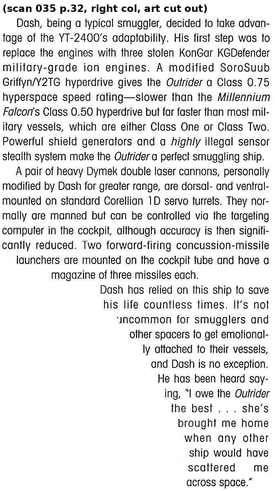

# Dash Rendar

- **Aliases:** Dash
- **Era:** Rebellion
- **Continuity:** default Legends; entries present for: Legends
- **Research tier:** untiered (not listed as INTRO/DEEP/MASTERY in legends-feats.md)
- **Entries:** 35 (15 with quotations; 1 quotations extended to the full sentence/passage from the source text on file; 12 marked as fragments; 24 before the 2026-11-17 fragment fill). Rebuilt 2026-11-17 from 37 old entries; old file: `characters/_bak/dash-rendar.md.bak-20261117`.
- **How to read:** each entry is the quotation in full (block quote), then its source and point of view. "Note" lines are summaries from our notes, not quotations. `[fragment — full passage not on file]` means the source text is not on the box, so only the words in our notes are shown. Debate and forum material is in the last section and is unverified.

# LEGENDS (Legends / EU — main focus)

## The Complete Star Wars Encyclopedia, Vol. II (H–O)

> Allegedly founded by Dash Rendar and the human replica droid Guri, the company offered a practical form of immortality for a hefty fee.
— Source: scan pages 401–440; Guri. POV: Guri, about Dash Rendar.
Note (our notes, around the quote): Guri: "Allegedly founded by Dash Rendar and the human replica droid Guri, the company offered a practical form of immortality for a hefty fee." Source: The Complete Star Wars Encyclopedia, Vol. II, p.412

Our notes: `notes/materials/031-complete-star-wars-encyclopedia-vol-2/10-v2-scan-401-440.md:137`

## The Complete Star Wars Encyclopedia, Vol. III (P–Z)

- Note (summary from our notes, not a quotation): Page contents: 1135 words, 26 paragraphs | headings/entries: Renatyi; Rend V; Rendar, Dash; Rendili
  — Source: scan pages 81–120.
Our notes: `notes/materials/032-complete-star-wars-encyclopedia-vol-3/02-v3-scan-081-120.md:157`

> He was resurrected as a human replica droid by Dash and Guri, becoming the head of ODT on Onadax.
— Source: scan pages 81–120; Guri. POV: Guri, about Dash Rendar.
Note (our notes, around the quote): Guri: "He was resurrected as a human replica droid by Dash and Guri, becoming the head of ODT on Onadax." Source: The Complete Star Wars Encyclopedia, Vol. III, p.92

Our notes: `notes/materials/032-complete-star-wars-encyclopedia-vol-3/02-v3-scan-081-120.md:161`

## The New Essential Guide to Characters (2002)

- Note (summary from our notes, not a quotation): Page contents: 488 words, 25 paragraphs | headings/entries: Hi: Solo knew Dash Rendar for; PRONUNCIATION Dash Rén'-dar; SPECIES Human; SEH Male; Hnrin CoLtor Red; Eve CoL.or; Green HEIGHT; Corellia
  — Source: scan pages 121–150.
Our notes: `notes/materials/034-new-essential-guide-to-characters/04-negc-scan-121-150.md:83`

## Star Wars Gamer/Star Wars Gamer 10.pdf [Star Wars Roleplaying Game (d20, 2000)] (scan pages 1–60)

- Note (summary from our notes, not a quotation): Page contents: Letters: Combat Reflexes and Attuned are new feats in the revised rulebook; Attuned gives +2 to Enhance Ability and Heal Self; a sidebar gives Dash Rendar, LE-BO2D9 and the Outrider (hand-read)
  — Source: Star Wars Gamer/Star Wars Gamer 10.pdf [Star Wars Roleplaying Game (d20,.
Our notes: `notes/materials/037-sw-d20-folder/059-star-wars-gamer-10-scan-001-060.md:39`

## Characters/Miniatures/Bounty Hunters Preview 3.pdf [Star Wars Roleplaying Game Revised Core (d20, 2002)]

> Shortly afterward, he downloaded his consciousness into three other prototypes of the same design, and IG­88A, B, C, and D set forth on a plan of galactic domination. While IG­88A took over the massive droid factories on Mechis III and began planting "accomplices" on countless planets, IG­88B began working as a bounty hunter to draw attention away from the larger plot. By the time IG­88B answered Vader's call for hunters to track down the Millennium Falcon, he had already killed over 150 beings and was subject to a "dismantle on sight" order in 40 different star systems. Over the next year, IG­88's reign came to an end. First, IG­88B confronted Boba Fett on Cloud City in an attempt to get the Han Solo bounty for himself, but Fett destroyed him and left his wreckage to the Ugnaughts in the city's smelting chambers. Later, IG­ 88C confronted Fett in orbit over Tatooine, but Fett's Slave I managed to destroy IG­ 88C's starship, IG­2000. IG­88D was reportedly destroyed by Dash Rendar on Ord Mantell. And IG­88A, who had downloaded his corrupt programming into the computer core that was installed on the second Death Star, was destroyed along with the battle station at the Battle of Endor. In the Star Wars Miniatures Game, the new IG­88, Bounty Hunter figure is a significant step up in power over the original IG­88 from Rebel Storm.
— Source: Characters/Miniatures/Bounty Hunters Preview 3.pdf [Star Wars Roleplaying.
(Excerpt widened 2026-11-17 to the relevant passage, word for word from h primary sw d20 folder files Star Wars Roleplaying Game Revised Core Characters Miniatures Bounty Hunters Preview 3 (text copy `h_primary_sw_d20_folder_files_Star_Wars_Roleplaying_Game_Revised_Core_Characters_Miniatures_Bounty_Hunters_Preview_3_pdf_ce4ae6d933`).)
(Excerpt widened 2026-11-17 to the relevant passage, word for word from h primary sw d20 folder files Star Wars Roleplaying Game Revised Core Characters Miniatures Bounty Hunters Preview 3 (text copy `h_primary_sw_d20_folder_files_Star_Wars_Roleplaying_Game_Revised_Core_Characters_Miniatures_Bounty_Hunters_Preview_3_pdf_ce4ae6d933`).)
Note (our notes, around the quote): IG-88; Boba Fett; Dash Rendar — entry/section: The end of the four IG-88s: "Over the next year, IG-88's reign came to an end. First, IG-88B confronted Boba Fett on Cloud City in an attempt to get the Han Solo bounty for himself, but Fett destroyed him and left his wreckage to the Ugnaughts in the city's smelting chambers. Later, IG-88C confronted Fett in orbit over Tatooine, but Fett's Slave I managed to destroy IG-88C's starship, IG-2000. IG-88D was reportedly destroyed by Dash Rendar on Ord Mantell. And IG-88A, who had downloaded his corrupt programming into the computer core that was installed on the second Death Star, was destroyed along with the battle station at the Battle of Endor." Source: *Bounty Hunters Preview 3* (SWRPG d20 Revised Core), scan p.1

Our notes: `notes/materials/037-sw-d20-folder/095-bounty-hunters-preview-3.md:16`

## Sourcebooks/Sourcebook Web Enhancements/Revised Core Rulebook Errata 2006.pdf [Star Wars Roleplaying Game Revised Core (d20, 2002)]

- Note (summary from our notes, not a quotation): Page contents: p169 Disarm; p187 vehicle combat actions sidebar; p188 new Table 10-3 Vehicle Speeds (from the image: stationary 0; cautious 1–20 sq; cruising 21–50 (+1 Def, -1); high 51–150 (+2, -2); top 151+ (+4, -4)); p190 ion immunity; p191 Speed Categories; p192 45-degree turn, Dash and Hard Brake stunts; p193 collision damage dice and characters hit by vehicles (hand-read)
  — Source: Sourcebooks/Sourcebook Web Enhancements/Revised Core Rulebook Errata 2006.
Our notes: `notes/materials/037-sw-d20-folder/651-revised-core-rulebook-errata-2006.md:45`

## Sourcebooks/Hero's Guide.pdf [Star Wars Roleplaying Game Revised Core (d20, 2002)] (scan pages 61–120)

- Note (summary from our notes, not a quotation): Page contents: Mistryl Exotic Weapon Proficiency, Dash, Bonus Feat, Uncanny Dodge; Noble Houses intro (TaggeCo); Core World Nobles (Princess Leia of Alderaan). (hand-read)
  — Source: Sourcebooks/Hero's Guide.pdf [Star Wars Roleplaying Game Revised Core (d2.
Our notes: `notes/materials/037-sw-d20-folder/668-heros-guide-scan-061-120.md:236`

## Sourcebooks/Galaxy of Intrigue.pdf [Star Wars Roleplaying Game Saga Edition (2007)] (scan pages 181–226)

- Note (summary from our notes, not a quotation): Page contents: Encounter: Dine and Dash (CL 12): Moff Krax's birthday party; Back to the Ship (bays 49 and 46); Tehlan Aleece (CL 7 noble stats); Lambda-class shuttle (modified) stats begin. (hand-read)
  — Source: Sourcebooks/Galaxy of Intrigue.pdf [Star Wars Roleplaying Game Saga Editi.
Our notes: `notes/materials/037-sw-d20-folder/716-galaxy-of-intrigue-scan-181-226.md:62`

## Sourcebooks/Rebellion Era Campaign Guide.pdf [Star Wars Roleplaying Game Saga Edition (2007)] (scan pages 121–161)

- Note (summary from our notes, not a quotation): Page contents: 4-LOM stat block (CL 12). IG-88 biography (Project Phlutdroid, Holowan Laboratories, IG-72, Mechis III, IG-88A-D, Cloud City, IG-2000, Dash Rendar, second Death Star core, Tyko Thul). Pull quote (Admiral Piett). (hand-read)
  — Source: Sourcebooks/Rebellion Era Campaign Guide.pdf [Star Wars Roleplaying Game.
Our notes: `notes/materials/037-sw-d20-folder/722-rebellion-era-campaign-guide-scan-121-161.md:176`

## Sourcebooks/Scum and Villany.pdf [Star Wars Roleplaying Game Saga Edition (2007)] (scan pages 1–60)

- Note (summary from our notes, not a quotation): Page contents: Infamy cont.: Frighten, Terrify, Unsavory Reputation. New Mastermind talents: Bodyguard I-III, Impel Ally III, Inspire Wrath, Shelter, Tactical Superiority, Tactical Withdraw, Urgency, Wealth of Allies. Gunslinger: new talent Ranged Flank; Pistoleer Talent Tree (Dash and Blast). (hand-read)
  — Source: Sourcebooks/Scum and Villany.pdf [Star Wars Roleplaying Game Saga Edition.
Our notes: `notes/materials/037-sw-d20-folder/725-scum-and-villany-scan-001-060.md:153`

## Sourcebooks/Starships of the Galaxy.pdf [Star Wars Roleplaying Game Saga Edition (2007)] (scan pages 121–162)

- Note (summary from our notes, not a quotation): Page contents: YT-2000 cont. (rushed production, -2 Mechanics; discontinued to push the YT-2400) with stat block. YT-2400 ("perfect" light freighter; off-center cockpit; escape pod; the Outrider of smuggler and mercenary Dash Rendar). (hand-read)
  — Source: Sourcebooks/Starships of the Galaxy.pdf [Star Wars Roleplaying Game Saga.
Our notes: `notes/materials/037-sw-d20-folder/727-starships-of-the-galaxy-scan-121-162.md:248`

## Star Wars Insider #28 (1996)

- Note (summary from our notes, not a quotation): Page contents: Shadows of the Empire N64 update and licensing roll-out (pp16-18; Dash Rendar, Leebo, Xizor, Guri named as product content; comics solicitations incl. Naga Sadow leading the Sith to Yavin 4). Product news, S only. (hand-read)
  — Source: Star Wars Insider #28 (1996).
Our notes: `notes/materials/038-star-wars-insider/028-ins028.md:85`

## Star Wars Insider #30 (1996)

- Note (summary from our notes, not a quotation): Page contents: Stephen J. Sansweet Scouting the Galaxy (pp68-69, printed 63-64): Kenner Xizor and Dash Rendar figures, Tarkin/Cantina figure requests, Icons replicas, soundtracks; questioners omitted. Club Classifieds (advertisers omitted). (hand-read)
  — Source: Star Wars Insider #30 (1996).
Our notes: `notes/materials/038-star-wars-insider/030-ins030.md:371`

## Star Wars Insider #40 (1998)

> a grizzled mercenary using his significant talents and abilities to aid the Rebellion
> [fragment — full passage not on file]
>
> a sinister robotic stormtrooper
> [fragment — full passage not on file]
>
> the sinister crime lord, Prince Xizor
> [fragment — full passage not on file]
— Source: Star Wars Insider #40 (1998); Page contents: Game history (crop-verified): Dark Forces — Kyle Katarn.
Note (our notes, around the quote): Page contents: Game history (crop-verified): Dark Forces — Kyle Katarn "a grizzled mercenary using his significant talents and abilities to aid the Rebellion"; the Dark Trooper "a sinister robotic stormtrooper"; Shadows of the Empire — Dash Rendar, "the sinister crime lord, Prince Xizor". Game list sidebar. See T. (hand-read)
Our notes: `notes/materials/038-star-wars-insider/040-ins040.md:347`

## Star Wars Insider #75 (2004)

- Note (summary from our notes, not a quotation): Page contents: Or Die Trying: the man defends ODT's business and Cundertol as a client; history of HRDs (Project Decoy, Simonelle, Massad Thrumble); Guri survives as the template for all their HRDs; he is Stanton, brother of Dash Rendar. (hand-read)
  — Source: Star Wars Insider #75 (2004).
Our notes: `notes/materials/038-star-wars-insider/075-ins075.md:421`

## Star Wars Insider #105 (2008)

- Note (summary from our notes, not a quotation): Page contents: 1996 timeline (Daniel Wallace): StarWars.com launch; X-Wing novels by Stackpole (Rogue Squadron, Wedge's Gamble, The Krytos Trap) put Wedge at the head of Rogue Squadron during the invasion of Coruscant and the hunt for renegade Imperial warlords; Shadows of the Empire multimedia event (Dash Rendar helps hunt for Han while battling Prince Xizor); Episode I pre-production; real-life news. (hand-read)
  — Source: Star Wars Insider #105 (2008).
Our notes: `notes/materials/038-star-wars-insider/105-ins105.md:197`

- Note (summary from our notes, not a quotation): Page contents: 1996 month by month: Tales from Jabba's Palace; X-Wing Rogue Squadron comic "The Phantom Affair"; Before the Storm (Luke searches for his mother, finds an imposter); Shadows of the Empire novel, sourcebook, toys and N64 game (Dash vs IG-88 and Boba Fett); Golden Age of the Sith #0 (5,000 years before the films); The Krytos Trap (plague on newly captured Coruscant); Dark Forces PlayStation. (hand-read)
  — Source: Star Wars Insider #105 (2008).
Our notes: `notes/materials/038-star-wars-insider/105-ins105.md:206`

## Star Wars Insider #128 (2011)

> drafts—was going to be one of the few to survive: “Chewie: ‘Here we go again … *(C-3PO, ROTJ)*
— Source: Star Wars Insider #128 (2011); Page contents: Editor's Welcome (Jonathan Wilkins): masthead quote. POV: C-3PO, about Dash Rendar.
(Full sentence/passage taken from the source text on file: `novels_tmp_lucas_bts_rinzler_making_of_star_wars_2007_epub`.)
Note (our notes, around the quote): Page contents: Editor's Welcome (Jonathan Wilkins): masthead quote "Here we go again!" (C-3PO, ROTJ); Blu-ray marathon; Kyle Newman's Certain Point of View; Dash Rendar story by Michael Reaves and Maya Kaathryn Bohnhoff; Dave Filoni on Clone Wars season four. (hand-read)
Our notes: `notes/materials/038-star-wars-insider/128-ins128.md:20`

- Note (summary from our notes, not a quotation): Page contents: Fiction intro: "And Leebo Makes Three" by Michael Reaves and Maya Kaathryn Bohnhoff; who is Dash Rendar (Shadows of the Empire, 1996). (hand-read)
  — Source: Star Wars Insider #128 (2011).
Our notes: `notes/materials/038-star-wars-insider/128-ins128.md:221`

- Note (summary from our notes, not a quotation): Page contents: Fiction: Dash and his Nautolan partner Eaden Vrill buy an LE-series droid from the Rodian comic Kood Gareeda in The Nexu's Den. (hand-read)
  — Source: Star Wars Insider #128 (2011).
Our notes: `notes/materials/038-star-wars-insider/128-ins128.md:226`

- Note (summary from our notes, not a quotation): Page contents: Fiction: Black Sun thugs arrive; Dash names the droid Leebo; the Wookiee Kravengash, associate of Hox Bilan, fires on the Outrider; Leebo plots the slingshot orbit around a gas giant over 200,000 km across. (hand-read)
  — Source: Star Wars Insider #128 (2011).
Our notes: `notes/materials/038-star-wars-insider/128-ins128.md:240`

- Note (summary from our notes, not a quotation): Page contents: Fiction: Leebo harasses Kravengash in an armed life pod while the Outrider transits the gate; Dash ejects the datastick; Leebo emerges through the gate and joins the crew. Teaser for Shadow Games. (hand-read)
  — Source: Star Wars Insider #128 (2011).
Our notes: `notes/materials/038-star-wars-insider/128-ins128.md:259`

## Star Wars Insider #135 (2012)

> over sixty man-years
> [fragment — full passage not on file]
— Source: Star Wars Insider #135 (2012); Page contents: Videogames: The Old Republic (2011).
Note (our notes, around the quote): Page contents: Videogames: The Old Republic (2011), "over sixty man-years" of writing. Beyond the Joypad breakout stars: Kyle Katarn, Darth Malak, Delta Squad, Dash Rendar, Dark Troopers. (hand-read)
Our notes: `notes/materials/038-star-wars-insider/135-ins135.md:109`

## Prima Official Game Guide: *Star Wars: The Force Unleashed* (2008)

What it shows (our notes): Controls (pp. 21–25): the guide lists Xbox first, then PS3, covering Force Dash, lock-on, blocking ("You cannot move while blocking."), Lightsaber Throw, grapples, Lightning, Push, Grip, Force Throw, Counter Force Grip ("repeatedly pressing the Jump button"), Force Lock and Lightsaber Lock, Repulse and Shield, plus the HUD.
> However, you will usually face multiple enemies and will need more than a one-two combo to get the job done. To execute a three-hit lightsaber combo, press 3, 3, 3 or p, p, p. As your lightsaber proficiency grows and you can increase the damage from ’saber attacks, these two basic combos will become the basis of your entire fighting style. How you fight is up to you. That is why any attack that begins with two or three lightsaber strikes is considered a lightsaber combo. Therefore, whenever the term “lightsaber combo” appears in the walkthrough, you can choose any attack that begins with the above-mentioned attack sequence. You cannot move while blocking. Protected by copyright. Unauthorized or unlawful copying or downloading is prohibited. 23 Lightsaber Throw Grapple Attacks Force Lightning Force Push g g g g g Action Xbox 360 PS3 Lightsaber Throw Hold 7, then press 1 Hold l, then press p Action Xbox 360 PS3 Grapple attack 1 1 + 3 i + o Grapple attack 2 2 + 4 u + p Action Xbox 360 PS3 Force Lightning 4 i Action Xbox 360 PS3 Force Push 2 o Aside from Force Lightning, Lightsaber Throw is your most dependable ranged attack. Force Throw (see below) is great, but if there are no objects nearby to use as projectiles, you won’t have anything to throw from a distance.
>
> To activate Force Repulse, hold down 8 or l, then press 2 or o, respectively. You’ll then leap into the air, surround yourself in a Force bubble as you gather your energy, and release it, sending all nearby enemies flying backward. Force Repulse won’t dispatch many enemies, but it will create breathing room when you’re surrounded by waves of foes. You’re not the only one with Force powers. Throughout your journey, you will encounter some of the most powerful Jedi that Order 66 missed. During battle, they’ll use their Force powers on you. If your Jedi foe manages to get you in a Force Grip, free yourself by repeatedly pressing the Jump button. During your adventure, you will face enemies whose Force and lightsaber skills match your own. When that happens, you must engage them in a Force or Lightsaber Lock at some point during your battle. When you’re engaged in either kind of lock, there is only one way to break the lock and win the battle. Once in a lock, several prompts will appear onscreen.
— Source: Prima *Star Wars: The Force Unleashed* guide — part 1: front matter, lore primer, cast and bestiary, combat systems (printed pp. 1–35).
(Excerpt widened 2026-11-17 to the relevant passage, word for word from Star Wars The Force Unleashed Prima Official eGuide pdf x.txt (text copy `MEGA_Star_Wars_The_Force_Unleashed_Prima_Official_eGuide_pdf_x`).)
(Excerpt widened 2026-11-17 to the relevant passage, word for word from Star Wars The Force Unleashed Prima Official eGuide pdf x.txt (text copy `MEGA_Star_Wars_The_Force_Unleashed_Prima_Official_eGuide_pdf_x`).)
(Fragment completed 2026-11-17: full sentence/passage matched word for word in the source text on file: `MEGA_Star_Wars_The_Force_Unleashed_Prima_Official_eGuide_pdf_x`.)
Our notes: `notes/materials/055-prima-force-unleashed/fu-01.md:79`

## Essential Guide to Vehicles and Vessels (1996)

- Note (summary from our notes, not a quotation): Dash, being a typical smuggler, decided to take advantage of the YT-2400's adaptability. His first step was to replace the engines with three stolen KonGar KGDefender military-grade ion engines. A modified SoroSuub Griffyn/Y2TG hyperdrive gives the *Outrider* a Class 0.75 hyperspace speed rating—slower than the *Millennium Falcon's* Class 0.50 hyperdrive but far faster than most military vessels, which are either Class One or Class Two. Powerful shield generators and a *highly* illegal sensor stealth system make the *Outrider* a perfect smuggling ship.
  — Source: The Essential Guide to Vehicles and Vessels (Bill Smith, Del Rey, 1996), printed p.32, scan p.035. The initial letter of "uncommon" is a weak mark, read from the word, not a clean printed u, and it is not a crop clip. The spoken line is quoted as printed..
Our notes: `notes/materials/148-essential-guide-to-vehicles-vessels-1996/egvv-chariot-through-enforcer.md`

# Debate and forum claims (unverified)

Forum posts, Suspect Insight debates and Discord debates, respect threads, and verdicts. These are posters' arguments or quotations they typed; none is checked against the book here unless the entry says so.

## Vong Krayt (Azronger) vs Revan (DarthBane77)

> I’ve been made aware by Ant that Chee has said blurbs are subjective in nature, thus not making them definitive. That said, I want to point a couple things out about your blurbs. Firstly, your blurbs about Bane are not addressing anything in-universe, they are OOU and address the reader, and have no bearing on the characters’ skills or power in universe. Secondly, they are directly contradicted by numerous quotes for other Sith (namely Palpatine) stating they are the most powerful Sith in history. So even if the blurbs weren’t subjective, your examples here are all inherently false, whereas the one I provided was not contradicted in any way by any other sources. So your examples wouldn’t help your argument in the slightest. Ultimately, my blurb was not a detriment to my argument, but those you provided have numerous significant contradictions. Bad counter is bad.
>
> ------------ **100 Meter Dash: Stamina Expanded**
>
> I want to delve more into Revan’s stamina here, opposed to Krayt’s. Specifically Revan’s run through the Star Forge.
>
> First, Revan faces an “army” of the Star Forge’s dark side infused droids. Two separate quotes from Malak verify that this was an “army.”
>
> **"Send the Star Forge's battle droids to deal with them."**
>
> **"Lord Malak, forgive me, but how can mere droids be a match for the Jedi?"**
>
> **"You underestimate the power of the Star Forge's droid army. Dispatch the droids."**
>
> **Source: Darth Malak and Dark Jedi Master, Star Wars Knights of the Old Republic**
>
> **"I have news, Lord Malak. About the Jedi."**
>
> **"Ah, the Jedi. Did my droids pass their test? Did they destroy our enemies?"**
>
> **"No, Lord Malak. The droids could not stop them."**
>
> **"Strange. I did not think there were any among the Order who could survive an attack by an army of the Star Forrge's battle droids."**
>
> **"It - it was Revan. Your old master is with the Jedi, here on the Star Forge!"**
>
> **"Yes, that would explain why the droids failed."**
>
> **Source: Dark Jedi Master and Darth Malak, Star Wars Knights of the Old Republic**
>
> After Revan succeeds in defeating the droids, Malak sends “countless” Dark Jedi and troopers to confront Revan, they also fail.
>
> **Darth Malak requests a progress report from his retainer. He then learns that his former master is among the strike teams currently invading the Star Forge, and he’s about to arrange a surprise for Darth Revan. For now though, he orders all his apprentices into battle against you!**
>
> **The next hour is spent frantically blasting, swiping, and crushing countless Dark Jedi and Sith heavy weapons and elite troopers on your way through the decks of the space station . . . Here you encounter a large number of Dark Jedi crowding this thin, lit walkway. Wade into the fray and execute a number of techniques of your choosing, cutting a swath through the assembled troops until all have fallen.**
>
> **Once on Deck 2, take another slog through countless groups of Sith troopers and Dark Jedi. Continue with the melee fighting as you round a corner, and fight to a lower ramp and the rejoining of the two exterior corridors into a pathway leading directly south. Slash and blast through more foes, open another huge blast door, and repel yet more of Malak’s troops before entering the tunnel and emerging into a gigantic central chamber . . . However, you should be more concerned with the heavy Sith guard in the vicinity. Stay at the entrance until all of them have been dispatched, and then make a left turn, heading directly east. When the turrets have been disarmed, you need to worry about only the humanoid foes . . .**
>
> **The command deck looks very much like the previous decks you’ve battled through. Start by fighting to the large main walkway, and continue down it to the first doorway. Enter it, heading east, open another doorway, then follow the ramp northward and up, then east to another door. During this time, Sith apprentices, Dark Jedi, and the finest Sith shock troops are waiting to demolish your party.**
>
> **Source: Star Wars Knights of the Old Republic - Prima's Official Strategy Guide**
>
> Revan essentially fights of three armies worth of Malak’s forces, a directly stated “army” of droids, and “countless” Dark Jedi and troops. As stated earlier, Revan does this while he is notably weakened by the Star Forge’s Dark Side nexus. He then goes on to fight Bastila, who previously was able to briefly contend with himself, Juhani, and Jolee Bindo. Upon defeating her, he fights more of the Forge’s droids, and then fights a super-amped Darth Malak, who continually rejuvenates himself by draining the life essence from a series of dead Jedi.
>
> Note that the droids that Revan fought following his defeat of Bastila, were the same defenses that Malak had been preparing since the start of the attack on the Star Forge, preparing them for Revan specifically. Saying that the Dark Jedi and soldiers would “slow Revan down” until he had time to fully prepare the Forge’s defenses.
>
> **"That will give me the time I need to fully prepare the Star Forge's defenses. I am curious to see the true extent of this space station's capabilities. One as my old master will make an interesting test subject."**
— Source: Vong Krayt (Azronger) vs Revan (DarthBane77) — https://www.suspectinsightforums.com/t489-ss-the-tyrannical-ten-darth-krayt-azronger-vs-revan-darthbane77.
Context: I1 — Source line: Source: Darth Malak, Star Wars Knights of the Old Republic
Posted by: not named in our notes (see thread/notes link).
Our notes: `suspect-insight/debates/006-vong-krayt-vs-revan.md:482`

## The Black Sun(Legends) respect thread — respect-thread notes

> "Gone to Rodia to connect up with Black Sun." Luke nearly dropped the container of cold water he held. "Black Sun! Is she out of her mind?" Dash smirked. "Oh, you're an expert on them, are you?"
>
> "No, but I talked to Han a lot while we were cooped up on Hoth during the cold, stormy nights. He had dealings with them. He said they were more dangerous than the Empire." He paused a second. "Why would Leia want to contact Black Sun?"
>
> - Shadows of the Empire
> [fragment — full passage not on file]
— Source: SI respect-thread directory: The Black Sun(Legends) respect thread — https://www.suspectinsightforums.com/t1656-the-black-sunlegends-respect-thread.
Context: All 4 of Xizor's bodyguards were trained in half a dozen hand to hand styles of combat and an expert shot with a blaster.
Posted by: not named in our notes (see thread/notes link).
Our notes: `suspect-insight/respect-threads/thread-the-black-sun-legends-respect-thread.md:129`

## The Fringe(Legends) respect thread. — respect-thread notes

> She had no chance to answer. The lift doors slid open. Outside, in the corridor leading to the Millennium Falcon’s berth, was a tall Anomid dressed in some sort of formfitting metalloid body armor. The lower half of his face was concealed by the typical vocalizer mask his species—which had no vocal cords—wore to enable communication with other species. But it was what he carried in one six-fingered hand that caught Dash’s immediate attention: a Kerestian darkstick—its long, sharp-tipped blade curved like the talon of some mythical beast. Nor was that the end of his weaponry. A repulsor razor-thrower and a Wookiee ryyk blade dangled from his belt, and a force pike and a Morgukai cortosis staff were crossed on his back, their handgrips extending up behind his head.
>
> Dash took in all this in a heartbeat, which was all the time he had to shove Javul back into the lift and yell, "Emergency close!" as he dived in behind her. As the door slid shut, he saw the glint in the Anomid's orange eyes, saw the arc of the Kerestian weapon as the assassin whipped it toward them, heard it strike the door.
>
> The tip punched through the five-centimeter-thick durasteel as if it were paper, driving a good part of its length into the lift, level with Dash's eyes.
>
> - Taken from Shadow Games**
> [fragment — full passage not on file]
— Source: SI respect-thread directory: The Fringe(Legends) respect thread. — https://www.suspectinsightforums.com/t1546-the-fringelegends-respect-thread.
(Excerpt widened 2026-11-17 to the relevant passage, word for word from Shadow Games (Michael Reaves) (text copy `MEGA_Legend_Standalones_Star_Wars_Shadow_Games_Michael_Reaves_Maya_Kaathryn_Bohnhoff_epub`).)
(Fragment completed 2026-11-17: full sentence/passage matched word for word in the source text on file: `MEGA_Legend_Standalones_Star_Wars_Shadow_Games_Michael_Reaves_Maya_Kaathryn_Bohnhoff_epub`.)
Context: (quoted passage)
Posted by: not named in our notes (see thread/notes link).
Our notes: `suspect-insight/respect-threads/thread-the-fringe-legends-respect-thread.md:408`

What it shows (our notes): What he caries really, body armor, a Kerstian darkstick, a repulsor razor thrower, a Wookiee Ryyk blade, a Force Pike and a Morgukai cortosis staff. The darkstick easily being able to penetrate 5 centimeter thick durasteel as if it were paper.
> A hand gripped Dash’s shoulder. “Run or shoot, take your pick.” As if to illustrate, Han raised his heavy blaster and fired a series of shots down the corridor.
>
> Dash looked up, seeking his target. The assassin had just left the shelter of the Bay 2 docking port and was making his way toward them along the wall. One hand was extended in front of him, palm out. The other was reaching for another of the weapons on his belt. Neither the particle beam from Han’s blaster nor the energy bolts from Eaden’s seemed to have much effect on the Anomid, save to slow him down. As Dash watched, he saw another energy bolt, fired by either Eaden or Mel, hit an invisible something a few centimeters in front of the Anomid’s outstretched palm.
>
> “Personal shield!” shouted Dash over the sound of blaster volleys.
>
> “No, really?” Han glanced over at Eaden. “Gimme more cover.”
>
> Dash obliged, fanning his shots as Han dropped to his belly, aiming his blaster along the floor. He could see that the Anomid had a new weapon mounted on the back of his right hand. A flex-tube ran from it down his index finger. It was a dart spitter.
>
> - Taken from Shadow Games**
> [fragment — full passage not on file]
— Source: SI respect-thread directory: The Fringe(Legends) respect thread. — https://www.suspectinsightforums.com/t1546-the-fringelegends-respect-thread.
(Excerpt widened 2026-11-17 to the relevant passage, word for word from Shadow Games (Michael Reaves) (text copy `MEGA_Legend_Standalones_Star_Wars_Shadow_Games_Michael_Reaves_Maya_Kaathryn_Bohnhoff_epub`).)
(Excerpt widened 2026-11-17 to the relevant passage, word for word from Shadow Games (Michael Reaves) (text copy `MEGA_Legend_Standalones_Star_Wars_Shadow_Games_Michael_Reaves_Maya_Kaathryn_Bohnhoff_epub`).)
(Fragment completed 2026-11-17: full sentence/passage matched word for word in the source text on file: `MEGA_Legend_Standalones_Star_Wars_Shadow_Games_Michael_Reaves_Maya_Kaathryn_Bohnhoff_epub`.)
Posted by: not named in our notes (see thread/notes link).
Our notes: `suspect-insight/respect-threads/thread-the-fringe-legends-respect-thread.md:415`

> Dash became one with the deck, willing himself to be flat enough to avoid the darts. When they stopped coming, he hauled Han to his feet and ran. Eaden was already in motion, scuttling sideways down the corridor. And now Mel and Javul—who’d reached the relative safety of the docking port—laid down a barrage of fire that might have an effect.
>
> As Dash rounded the corner into the docking ring, he glanced back up the terminal at the fallen Anomid. He'd been hit several more times, and the armor along his back was smoking in places. Blood the color of sunset's last gasp oozed from the shin guard Han's careful shot had pierced.
>
> The momentary sense of victory and safety Dash felt was crushed by his last sight of the assassin. He’d raised his pale lavender head from the floor and, just for a second, Dash felt the venom of his gaze. The message conveyed was clear:
>
> This is not over.
>
> - Taken from Shadow Games**
> [fragment — full passage not on file]
— Source: SI respect-thread directory: The Fringe(Legends) respect thread. — https://www.suspectinsightforums.com/t1546-the-fringelegends-respect-thread.
(Fragment completed 2026-11-17 with the full excerpt, word for word from Shadow Games (Michael Reaves) (text copy `MEGA_Legend_Standalones_Star_Wars_Shadow_Games_Michael_Reaves_Maya_Kaathryn_Bohnhoff_epub`).)
(Fragment completed 2026-11-17: full sentence/passage matched word for word in the source text on file: `MEGA_Legend_Standalones_Star_Wars_Shadow_Games_Michael_Reaves_Maya_Kaathryn_Bohnhoff_epub`.)
Context: He also carries a Velocity 7 dart gun.
Posted by: not named in our notes (see thread/notes link).
Our notes: `suspect-insight/respect-threads/thread-the-fringe-legends-respect-thread.md:431`

What it shows (our notes): He gets shot in the shin, then several more times, his armor smoking. Yet it wasn't over.
> “I have met Edge before. He … he assassinated the head of my order.”
>
> Suddenly all eyes were on the Nautolan, a situation that he obviously found disturbing.
>
> "Your teras kasi order?" asked Dash.
>
> Eaden nodded. "I am... was... a member of a religious order called Hidden Hand. All were at least minimally Force-sensitive. Some time ago-when the Empire implemented Order 66, wiping out the Jedi-the Hidden Hand was targeted as well because of our potential to wield the Force.
> [fragment — full passage not on file]
>
> Eaden nodded. “I am … was … a member of a religious order called Sälãi Käsi: Hidden Hand. All were at least minimally Force-sensitive. Some time ago—when the Empire implemented Order 66, wiping out the Jedi—the Hidden Hand was targeted as well because of our potential to wield the Force. They systematically hunted us down and exterminated us, one by one, until only three initiates and our master, Neaed Fisto, remained.”
>
> “Fisto?” repeated Dash. “Any relation to General Fisto?”
>
> Kit Fisto, Jedi Master, was famous (or infamous, depending on your point of view) for his marshaling of Republic forces during the Clone Wars. He’d later served on the Jedi Council until its destruction by the Emperor. Who knew he’d had relatives back on the Nautolan homeworld?
>
> Eaden nodded. "A brother of his mother. An uncle, I believe you would say. The Force was, perhaps, as strong in my master as it was in Kit Fisto. Neaed was an impressive being and so much a mentor to my family that my mother chose to name me after him."
>
> "This Edge character murdered him?" Han asked, dropping onto a small container that had been repurposed as a stool.
>
> "Yes. I was present in the clan house of our order when Edge came for my master. Neaed Fisto sacrificed himself that I and the other initiates might escape."
>
> Dash could only guess at the depth of feeling behind the simple words. Eaden was unmatched in the art of hiding his emotions when he wanted to.
>
> - Taken from Shadow Games**
> [fragment — full passage not on file]
— Source: SI respect-thread directory: The Fringe(Legends) respect thread. — https://www.suspectinsightforums.com/t1546-the-fringelegends-respect-thread.
(Excerpt widened 2026-11-17 to the relevant passage, word for word from Shadow Games (Michael Reaves) (text copy `MEGA_Legend_Standalones_Star_Wars_Shadow_Games_Michael_Reaves_Maya_Kaathryn_Bohnhoff_epub`).)
(Fragment completed 2026-11-17 with the full excerpt, word for word from Shadow Games (Michael Reaves) (text copy `MEGA_Legend_Standalones_Star_Wars_Shadow_Games_Michael_Reaves_Maya_Kaathryn_Bohnhoff_epub`).)
(Excerpt widened 2026-11-17 to the relevant passage, word for word from Shadow Games (Michael Reaves) (text copy `MEGA_Legend_Standalones_Star_Wars_Shadow_Games_Michael_Reaves_Maya_Kaathryn_Bohnhoff_epub`).)
(Fragment completed 2026-11-17: full sentence/passage matched word for word in the source text on file: `MEGA_Legend_Standalones_Star_Wars_Shadow_Games_Michael_Reaves_Maya_Kaathryn_Bohnhoff_epub`.)
Posted by: not named in our notes (see thread/notes link).
Our notes: `suspect-insight/respect-threads/thread-the-fringe-legends-respect-thread.md:438`

What it shows (our notes): Edge killed Neaed Fisto, who was related to Kit Fisto and who had a Force connection that was just perhaps as strong as Kit himself. Neaed being a master of Teras Kasi, yet Edge was able to kill him.
> Edge loomed just below them now. Clinging to the Helix with his legs, he reared back, now with a vibroblade in each hand. Javul opened her eyes again and, for a breath, the assassin was caught in the blaze of her regard before the knives descended.
>
> Dash had one charge left in the Q2. He aimed, willing his hand to be steady- As he squeezed the trigger, the assassin swept upward with one long arm, lunging as he did. He caught the muzzle of the hold-out blaster with the vibroblade's tip and knocked it away, his blade continuing downward to slice through the calf of Dash's boot and into his flesh. Dash roared in pain and jerked his legs upward.
>
> The masked face loomed over him, eyes blazing. Edge raised both vibroblades and—
>
> The ululating sound that cut through the air was one Dash had expected never to hear again. For a split second he thought Edge was making it. But then the Anomid was broadsided by another large body. Dash recognized the mass of tresses and the huge, seemingly lidless eyes of a Nautolan.
>
> "Never turn your back on an enemy," Eaden rasped as his arm came around the assassin's neck. "Especially a dead one." Then the momentum of his attack broke Edge's hold, and carried both men off the crystal Helix and into the darkness below.
>
> Javul closed her eyes, her body going limp beneath Dash's. They swung back and forth in the dark for several more moments before the Helix trembled yet again, then tilted crazily, finally coming to a stop on an off-kilter diagonal, its lower end at last tethered by a grapple.
>
> “It’s over,” murmured Javul.
>
> Dash barely heard her. His one good eye was trying to find the spot in the moonlit gray cloud-tops below where Eaden Vrill and the assassin had fallen. He hoped that his friend had died before he hit the ground.
>
> - Taken from Shadow Games**
> [fragment — full passage not on file]
— Source: SI respect-thread directory: The Fringe(Legends) respect thread. — https://www.suspectinsightforums.com/t1546-the-fringelegends-respect-thread.
(Excerpt widened 2026-11-17 to the relevant passage, word for word from Shadow Games (Michael Reaves) (text copy `MEGA_Legend_Standalones_Star_Wars_Shadow_Games_Michael_Reaves_Maya_Kaathryn_Bohnhoff_epub`).)
(Fragment completed 2026-11-17 with the full excerpt, word for word from Shadow Games (Michael Reaves) (text copy `MEGA_Legend_Standalones_Star_Wars_Shadow_Games_Michael_Reaves_Maya_Kaathryn_Bohnhoff_epub`).)
(Excerpt widened 2026-11-17 to the relevant passage, word for word from Shadow Games (Michael Reaves) (text copy `MEGA_Legend_Standalones_Star_Wars_Shadow_Games_Michael_Reaves_Maya_Kaathryn_Bohnhoff_epub`).)
(Fragment completed 2026-11-17: full sentence/passage matched word for word in the source text on file: `MEGA_Legend_Standalones_Star_Wars_Shadow_Games_Michael_Reaves_Maya_Kaathryn_Bohnhoff_epub`.)
Posted by: not named in our notes (see thread/notes link).
Our notes: `suspect-insight/respect-threads/thread-the-fringe-legends-respect-thread.md:452`

What it shows (our notes): He also has a pair of vibroblades, he stops Dash Rendar's Q2 hold-out blaster, knocking it away and then slicing through Dash's calf, through the boot and into his flesh. Edge then gets blind sided by Eaden(student of Neaed Fisto and also master of Teras Kasi) and then two get sent over a railing to their suppose deaths.
> Breath knocked from his body, he looked down between his knees—and saw the impossible. Edge—battered, torn, but still alive—was rising out of the cargo compartment like an avenging demon, his body armor holed and awry. He wielded a cortosis staff in one hand and a darkstick in the other. Dash saw immediately that the Anomid assassin had not made the same mistake twice—the end of the darkstick’s horrific claw dripped with a red liquid Dash knew was lethal.
>
> He pushed himself farther up the access and scrabbled for his laser pistol, only to recall as it met his hand that the Alderaanians had removed its power cell and he hadn't yet reloaded.
>
> No time for that now. The big Anomid already loomed over him, one knee on the edge of the cargo compartment. Without warning the assassin swept the cortosis staff toward Dash’s midsection, its plasma blade spitting fire. Dash lashed out with booted feet. His heel connected with Edge’s left hand. The staff spun from his grip, searing across the top of Dash’s left thigh. He gasped in pain and kicked again, knocking the staff away, but Edge had the darkstick raised, ready to strike.
>
> Dash met the strange orange eyes. They had been cold before-implacable, emotionless. Now they were filled with fire. This had obviously become personal. Edge probably wasn't used to having his prey skitter to safety or unseat him not once, but twice.
>
> Dash felt a supreme sense of betrayal in the frozen moment before the darkstick began its downward descent toward his heart. Not his own betrayal, but Eaden's. He was angry. Angry that the Universe-or the Force or the Deity or whatever-had allowed Eaden to die and this death machine to survive. The injustice was galling and Dash roared aloud with it.
>
> From out of nowhere, Leebo’s pet MSE droid shot through from one side of the corridor to the other. The sudden, unexpected movement distracted Edge—only momentarily, but that was all that was needed. Two pulses of light flashed from behind the Anomid. One energy bolt hit his shoulder where the armor had been shot away. The other caught him with pinpoint accuracy in the back of the neck where the body armor met his helm. He jerked upright, his knees slipping from the rim of the compartment.
>
> Han! Dash felt a surge of relief … until Edge toppled forward, the darkstick continuing its downward plunge.
>
> Dash rolled half on his left side and the weapon’s tip buried itself in the deck plating, roughly where his right lung would have been. He looked down the length of his body. The Anomid was laid out with his head between Dash’s feet, his long, muscular arm stretched upward, his hand still clutching the weapon. His body was smoking where the energy bolts had caught him. Dash gagged on the smell of burned flesh.
>
> The big sentient quivered, not yet done, and tried to push himself up.
>
> “Oh, blast it!” said a voice from the main corridor. Two more energy bolts took out the hydraulic assists on the cargo compartment’s hatch.
>
> The heavy durasteel deck plate dropped shut, crushing the Anomid's lower body. He made a horrible, strangled bleat of rage and pain and looked up at Dash through those burning eyes. With a last, tremendous effort, Edge pulled the tip of the darkstick out of the decking, its tip dripping venom. He lifted it high, preparing to swing it at Dash- And died.
>
> Dash saw the light go out of his eyes, draining away like water from a broken bowl, and was glad he hadn't witnessed that moment with Eaden. The thought of it would haunt him anyway.
>
> Edge went limp, his hand releasing the darkstick, which clattered to the deck. His body released its last breath.
>
> - Taken from Shadow Games**
> [fragment — full passage not on file]
— Source: SI respect-thread directory: The Fringe(Legends) respect thread. — https://www.suspectinsightforums.com/t1546-the-fringelegends-respect-thread.
(Excerpt widened 2026-11-17 to the relevant passage, word for word from Shadow Games (Michael Reaves) (text copy `MEGA_Legend_Standalones_Star_Wars_Shadow_Games_Michael_Reaves_Maya_Kaathryn_Bohnhoff_epub`).)
(Fragment completed 2026-11-17 with the full excerpt, word for word from Shadow Games (Michael Reaves) (text copy `MEGA_Legend_Standalones_Star_Wars_Shadow_Games_Michael_Reaves_Maya_Kaathryn_Bohnhoff_epub`).)
(Excerpt widened 2026-11-17 to the relevant passage, word for word from Shadow Games (Michael Reaves) (text copy `MEGA_Legend_Standalones_Star_Wars_Shadow_Games_Michael_Reaves_Maya_Kaathryn_Bohnhoff_epub`).)
(Fragment completed 2026-11-17: full sentence/passage matched word for word in the source text on file: `MEGA_Legend_Standalones_Star_Wars_Shadow_Games_Michael_Reaves_Maya_Kaathryn_Bohnhoff_epub`.)
Posted by: not named in our notes (see thread/notes link).
Our notes: `suspect-insight/respect-threads/thread-the-fringe-legends-respect-thread.md:464`

- Note (summary from our notes, not a quotation): Yet nope...Edge was still alive, battered, his armor wrecked and his darkstick dripping with blood as he had killed Eaden. He goes after Dash, yet because he's the bad guy he eventually does get shot from behind and promptly dies.
  — Source: SI respect-thread directory: The Fringe(Legends) respect thread. — https://www.suspectinsightforums.com/t1546-the-fringelegends-respect-thread.
Posted by: not named in our notes (see thread/notes link).
Our notes: `suspect-insight/respect-threads/thread-the-fringe-legends-respect-thread.md:485`
