# Deliah Blue

- **Aliases:** —
- **Era:** —
- **Continuity:** default Legends; entries present for: Legends
- **Research tier:** untiered (not listed as INTRO/DEEP/MASTERY in legends-feats.md)
- **Entries:** 56 (37 with quotations; 0 quotations extended to the full sentence/passage from the source text on file; 34 marked as fragments). Rebuilt 2026-11-17 from 70 old entries; old file: `characters/_bak/deliah-blue.md.bak-20261117`.
- **How to read:** each entry is the quotation in full (block quote), then its source and point of view. "Note" lines are summaries from our notes, not quotations. `[fragment — full passage not on file]` means the source text is not on the box, so only the words in our notes are shown. Debate and forum material is in the last section and is unverified.

# LEGENDS (Legends / EU — main focus)

## Sourcebooks/Knights of the Old Rebuplic Campaign Guide.pdf [Star Wars Roleplaying Game Saga Edition (2007)] (scan pages 181–226)

> WITH STAR WARS MINIATURES AND ROLEPLAYING GAMES, ANYTHING'S POSSIBLE!
>
> TREMBLE, CADE SKYWALKER, BEFORE THE TERRIBLE POWER OF I, DARTH KRAYT, WHO ALONG WITH DARTH TALON AND DARTH NIHL, WILL BRING YOU TO YOUR KNEES!
>
> HA! IT IS YOU WHO SHOULD TREMBLE BEFORE ME, FOR I AM A TOUGH AS NAILS BOUNTY HUNTER!
>
> I'M A BOUNTY HUNTER TOO! AND YOU, CADE SKYWALKER, ARE MY BOUNTY!
>
> AND I GUESS I'LL TAKE THE PINK GIRL TOO.
>
> STAY AWAY FROM MY GREAT-GRANDSON!
>
> EH, HOW'D YOU GET HERE!
> [fragment — full passage not on file]
>
> I SHOULD ASK YOU THE SAME THING!
>
> SILENCE! LET'S BRING IT BACK TO ME! FOR I, DARTH KRAYT, WILL--URKK!
>
> YAHOO! YOU'RE ALL CLEAR, KID!
> [fragment — full passage not on file]
>
> SOMEONE TELL ME HOW THIS IS HAPPENING! *(hand-read)*
— Source: Sourcebooks/Knights of the Old Rebuplic Campaign Guide.pdf [Star Wars Rol; Page contents: Star Wars Miniatures advertisement comic (. POV: Cade; Deliah Blue; Boba Fett; Luke; Krayt; Han Solo; about Deliah Blue.
Note (our notes, around the quote): Page contents: Star Wars Miniatures advertisement comic ("WITH STAR WARS MINIATURES AND ROLEPLAYING GAMES, ANYTHING'S POSSIBLE!"). Dialogue verbatim: Krayt: "TREMBLE, CADE SKYWALKER, BEFORE THE TERRIBLE POWER OF I, DARTH KRAYT, WHO ALONG WITH DARTH TALON AND DARTH NIHL, WILL BRING YOU TO YOUR KNEES!" Cade: "HA! IT IS YOU WHO SHOULD TREMBLE BEFORE ME, FOR I AM A TOUGH AS NAILS BOUNTY HUNTER!" Deliah Blue: "HE'S TOUGH!" Boba Fett: "I'M A BOUNTY HUNTER TOO! AND YOU, CADE SKYWALKER, ARE MY BOUNTY!" "AND I GUESS I'LL TAKE THE PINK GIRL TOO." Luke: "STAY AWAY FROM MY GREAT-GRANDSON!" "EH, HOW'D YOU GET HERE!" "I SHOULD ASK YOU THE SAME THING!" Krayt: "SILENCE! LET'S BRING IT BACK TO ME! FOR I, DARTH KRAYT, WILL--URKK!" Han Solo: "YAHOO! YOU'RE ALL CLEAR, KID!" Cade: "SOMEONE TELL ME HOW THIS IS HAPPENING!" (hand-read)
Our notes: `notes/materials/037-sw-d20-folder/718-knights-of-the-old-rebuplic-campaign-guide-scan-181-226.md:417`

## Sourcebooks/Legacy Era Campaign Guide.pdf [Star Wars Roleplaying Game Saga Edition (2007)] (scan pages 1–60)

> WE CAN ONLY PUSH THE ENGINES SO HARD!
— Source: Sourcebooks/Legacy Era Campaign Guide.pdf [Star Wars Roleplaying Game Sag; Deliah Blue — entry/section: Pull quote.
Note (our notes, around the quote): Deliah Blue — entry/section: Pull quote: ""WE CAN ONLY PUSH THE ENGINES SO HARD!" —DELIAH BLUE" Source: *Legacy Era Campaign Guide* (SWRPG Saga Edition), scan p.38
Our notes: `notes/materials/037-sw-d20-folder/719-legacy-era-campaign-guide-scan-001-060.md:280`

## Sourcebooks/Legacy Era Campaign Guide.pdf [Star Wars Roleplaying Game Saga Edition (2007)] (scan pages 181–225)

> Chadra-Fan are small humanoids with flat faces, round dark eyes, large ears, and flat noses. Their entire bodies, except for their oversized hands, are covered in fur. Chadra-Fan are compulsive tinkerers. Any mechanical device left within reach has the potential to be disassembled and reconstructed. Exuberant in the extreme, they like virtually everyone they meet. It takes quite a lot of abuse to curtail or obliterate their cheery disposition. They don't survive well on their own and constantly seek companionship.
— Source: Sourcebooks/Legacy Era Campaign Guide.pdf [Star Wars Roleplaying Game Sag.
Note (our notes, around the quote): Page contents: Deliah Blue stat block CL 9 (Medium female Zeltron scout 4/scoundrel 5; bluebolt blaster pistol; concealed dart launcher; empathy, pheromones). Haako stat block CL 2 (Small Chadra-Fan scout 3). Sidebar "New Species: Chadra-Fan" (verified from page image): "Chadra-Fan are small humanoids with flat faces, round dark eyes, large ears, and flat noses. Their entire bodies, except for their oversized hands, are covered in fur. Chadra-Fan are compulsive tinkerers. Any mechanical device left within reach has the potential to be disassembled and reconstructed. Exuberant in the extreme, they like virtually everyone they meet. It takes quite a lot of abuse to curtail or obliterate their cheery disposition. They don't survive well on their own and constantly seek companionship." Traits: -2 Wis, +2 Cha; Small; Speed 4 squares; Darkvision; Tinkerer (reroll Mechanics; repairs restore extra 1d8 hp; Mechanics always a class skill); Languages Basic and Chadra-Fan. (hand-read)
Our notes: `notes/materials/037-sw-d20-folder/719-legacy-era-campaign-guide-scan-181-225.md:291`

> one tough, fast hunk of junk
> [fragment — full passage not on file]
— Source: Sourcebooks/Legacy Era Campaign Guide.pdf [Star Wars Roleplaying Game Sag.
Note (our notes, around the quote): Page contents: Grinning Liar: YX-1980 space transport used by smugglers Chak and Kee; enhanced armor plating and hull reinforcement; at Kee's request Chak upgraded the forward laser cannons. Stat block CL 8 (Colossal* space transport; Hyperdrive x1). Mynock: Cade Skywalker's personal transport, an old Helot-class medium transport rebuilt by Bantha Rawk and Deliah Blue; "one tough, fast hunk of junk"; hyperdrive .5 past lightspeed; Deliah installed hefty shields. Caption label: "THE MYNOCK AND THE GRINNING LIAR". (hand-read)
Our notes: `notes/materials/037-sw-d20-folder/719-legacy-era-campaign-guide-scan-181-225.md:364`

## Web Articles.pdf [Star Wars Roleplaying Game Saga Edition (2007)] (scan pages 301–360)

- Note (summary from our notes, not a quotation): Page contents: Legacy of the Force Preview 2: Cade Skywalker, Bounty Hunter and Deliah Blue by Sterling Hershey (title T; text layer "DELIAH" confirmed, OCR misreads "DBELIAH"): Cade background (125 years after Palpatine; Ossus; Kol Skywalker; pirate gang; Deliah Blue and Jariah Syn) and miniatures tactics (Dark Horse Legacy comics; Force Push 3, Force Heal 40; Bounty Hunter +4, Double Attack, Splash 10, Twin Attack; Fringe faction) - T records; stat card (Fringe; cost 61; HP 110; Def 20; Atk +12; Dmg 20; Force 5). (hand-read)
  — Source: Web Articles.pdf [Star Wars Roleplaying Game Saga Edition (2007)] (scan p.
Our notes: `notes/materials/037-sw-d20-folder/732-web-articles-scan-301-360.md:95`

- Note (summary from our notes, not a quotation): Page contents: Deliah Blue (LotF Preview 2 cont.): background (Zeltron mechanic, the Mynock, team with Cade and Jariah Syn) and miniatures tactics (Bounty Hunter +4, Cunning Attack, Mounted Gunner allies, Mobile Attack) - T records; stat card (Fringe; cost 33; HP 60; Def 17; Atk +7; Dmg 20; Unique, Accurate Shot, Bounty Hunter +4, Cunning Attack, Gunner +10, Industrial Repair 30, Mobile Attack); Saga stats Deliah Blue (as of Legacy Vol. 1: Broken) CL 8 Medium female Zeltron scoundrel 4/scout 4 (Destiny 1; Force 4; Dark Side 1; Init +6 (may reroll); Basic, Huttese, Shyriiwook; Ref 22, Fort 20, Will 20; hp 55; blaster pistol +9 (3d6+4); wrist launcher +8 (knockout darts, 1d20+5 vs Fortitude, unconscious 1d4+2 rounds); Hyperdriven, Spacehound, Keen Shot; Zeltron empathy; Mechanics +16, Persuasion +17); boxed Zeltron Species Traits (-2 Con, -2 Wis, +4 Cha; Medium; speed 6; conditional bonus feat Skill Focus (Persuasion); Zeltron Empathy; Intuitive Initiative; Basic) - band y0.74-0.89 confirmed in text layer. (hand-read)
  — Source: Web Articles.pdf [Star Wars Roleplaying Game Saga Edition (2007)] (scan p.
Our notes: `notes/materials/037-sw-d20-folder/732-web-articles-scan-301-360.md:116`

## Star Wars Insider #88 (2006)

- Note (summary from our notes, not a quotation): Page contents: Legacy: The Galactic Underworld (Cade Skywalker, Deliah Blue, Jariah Syn, Rav); Imperials (Roan Fel) (hand-read)
  — Source: Star Wars Insider #88 (2006).
Our notes: `notes/materials/038-star-wars-insider/088-ins088.md:301`

## Star Wars Insider #100 (2008)

> With the Star Wars Miniatures Game, anything's possible!
— Source: Star Wars Insider #100 (2008).
Note (our notes, around the quote): Page contents: Wizards of the Coast Star Wars Miniatures comic ad: Darth Krayt, Darth Talon and Darth Nihl confront Cade Skywalker and Deliah Blue; Boba Fett, Luke Skywalker and Han Solo (kicks Krayt) appear; tagline "With the Star Wars Miniatures Game, anything's possible!"; Legacy of the Force set; wizards.com/starwars (hand-read)
Our notes: `notes/materials/038-star-wars-insider/100-ins100.md:1042`

## Star Wars Insider #102 (2008)

- Note (summary from our notes, not a quotation): Page contents: Ad: Star Wars Miniatures Legacy of the Force set (Wizards of the Coast; wizards.com/starwars; booster pack images; © 2008 Lucasfilm Ltd. & TM fine print) as a comic strip: Darth Krayt, Darth Talon, Darth Nihl vs Cade Skywalker, Deliah Blue, Boba Fett, Luke Skywalker's spirit, Han Solo (hand-read)
  — Source: Star Wars Insider #102 (2008).
Our notes: `notes/materials/038-star-wars-insider/102-ins102.md:862`

## Star Wars: Legacy (Dark Horse, 2006–2010) single issues #20–#50, hand-read

> "DELIAH BLUE"
>
> "Deliah Blue can fix anything using a hydrospanner and a few choice words. She keeps the Mynock running despite a constant lack of credits."
>
> "The Zeltron, once a dedicated party girl, would like to get as close to Cade as she is to his ship. Something in him seems broken to her, but you can't fix what you can't reach."
— Source: Star Wars: Legacy #0 — "Welcome to the Future..." (Jun 2006; 25¢ preview/primer issue).
Context: — Star Wars: Legacy #0, p. 6
Our notes: `notes/materials/039-legacy-2006/legacy-00.md:47`

> "BLUE, ABOUT WHAT YOU SAW WHILE I WAS IN THE SITH TEMPLE...I HAD TO CONVINCE THEM I WAS ONE OF THEM."
> [fragment — full passage not on file]
>
> — Cade Skywalker, Star Wars: Legacy #23, p. 17
> [fragment — full passage not on file]
>
> "SHE...TALON...THE SITH, THEY GOT THIS PASSION, ALL RIGHT, BUT THERE'S THIS DARK VOID WHERE THEIR HEART OUGHTA BE." · "WITH YOU AND ME, IT AIN'T LIKE THAT. IT'S LIKE YOU TAKE THE DARK AWAY."
> [fragment — full passage not on file]
>
> — Cade Skywalker, Star Wars: Legacy #23, p. 17
> [fragment — full passage not on file]
— Source: Star Wars: Legacy #23 — "Loyalties" (Dark Horse, May 2008). POV: Cade Skywalker, about Deliah Blue.
Context: 3. Makes up with Deliah Blue over Talon. p16–18
Our notes: `notes/materials/039-legacy-2006/legacy-23.md:30`

> — Deliah Blue
>
> Tobias Sun, Star Wars: Legacy #25, pp. 17–18
> [fragment — full passage not on file]
— Source: Star Wars: Legacy #25 — "The Hidden Temple" (Dark Horse, June 2008).
Context: > "WAITING IS SOOO BOR-ING. WHEN WILL THE MEETING BE OVER, MASTER SUN? CAN I CALL YOU TOBIAS?" (Blue, p17) · "THIS IS AMAZING, LADY BLUE! I'VE BEEN TRYING TO GET THIS UP AND RUNNING FOR A MONTH!" (Tobias, p18)
Our notes: `notes/materials/039-legacy-2006/legacy-25.md:116`

- Note (summary from our notes, not a quotation): (p18: Blue gets a swoop/speeder at the temple running.)
  — Source: Star Wars: Legacy #25 — "The Hidden Temple" (Dark Horse, June 2008).
Our notes: `notes/materials/039-legacy-2006/legacy-25.md:119`

> — Deliah Blue, Star Wars: Legacy #26, p. 4
> [fragment — full passage not on file]
>
> "KRAYT'S NOT GONNA LEAVE ME ALONE. HE'S GONNA FIND ME NO MATTER HOW LONG I RUN" · "CAN'T LIVE LIKE THAT, BLUE. I WON'T."
>
> — Cade Skywalker, Star Wars: Legacy #26, p. 4
> [fragment — full passage not on file]
— Source: Star Wars: Legacy #26 — "The Hidden Temple, Part Two" (Dark Horse, July 2008). POV: Deliah Blue.
Context: > "CADE! WE NEVER DID ASSASSINATIONS BEFORE! EVEN WITH THE JEDI ALONG, IT FEELS LIKE A SUICIDE RUN!" · "CHUT CHUT, HON -- NEVER SIGNED ON FOR A LONG LIFE. SHORT, FAST, INTERESTING -- AND THAT'S WHAT YOU'RE PROMISING. I'M IN."
Our notes: `notes/materials/039-legacy-2006/legacy-26.md:97`

> — Deliah Blue, Star Wars: Legacy #28, p. 5
> [fragment — full passage not on file]
>
> "WE'RE BETTER, GANNER." · "BECAUSE WE'RE IMPERIAL KNIGHTS?" (Krieg) · "YES." (Draco) · "HE ISN'T ONE OF US, KRIEG. HE WOULD NEVER BE ONE OF US. HE LACKS DISCIPLINE." (Draco, of Shado Vao)
> [fragment — full passage not on file]
>
> — Antares Draco
>
> Ganner Krieg, Star Wars: Legacy #28, p. 6
> [fragment — full passage not on file]
>
> "A PIRATE RESCUED YOU! THAT'S WHAT YOU BECAME! AN IMPERIAL KNIGHT RESCUED ME. THEY FINISHED MY TRAINING -- I OWE THEM..."
> [fragment — full passage not on file]
>
> — Azlyn Rae, Star Wars: Legacy #28, p. 7
> [fragment — full passage not on file]
>
> "I SENSE MORE THAN JUST THAT. THERE'S A JEDI ON THAT SHIP, I THINK. OR A SITH." (Cade) · "WHICH DID YOU SENSE -- JEDI OR SITH? ... IT HAS TO BE ONE OR THE OTHER. CAN'T BE BOTH." (Draco) · "OH, YOU MEAN LIKE ME." (Cade)
> [fragment — full passage not on file]
>
> — Star Wars: Legacy #28, p. 12
> [fragment — full passage not on file]
— Source: Star Wars: Legacy #28 — "Vector, Part 9 of 12" (Dark Horse, September 2008). POV: Deliah Blue.
Context: > "IS IT JUST ME, SYN, OR IS CADE'S PLAN -- TO LURE DARTH KRAYT TO HAD ABBADON SO WE CAN KILL HIM -- CRAZY?"
Our notes: `notes/materials/039-legacy-2006/legacy-28.md:42`

> — Deliah Blue, Star Wars: Legacy #29, p. 17
> [fragment — full passage not on file]
>
> "HE HEALED YOU TOO -- HEALED US BOTH -- FROM THEM YUUZHAN VONG CORAL SEEDS THAT WERE KILLING US." (Jariah) · "LOOK, ME AND CADE'VE BEEN BROTHERS EVER SINCE RAV HAULED CADE'S SORRY HIDE ONBOARD THE AXE." · "BUT RIGHT NOW, CADE'S GETTING READY TO TRY TO ASSASSINATE THE BADDEST SITH IN THE GALAXY."
>
> — Jariah Syn, Star Wars: Legacy #29, p. 17
> [fragment — full passage not on file]
— Source: Star Wars: Legacy #29 — "Vector, Part 10 of 12" (Dark Horse, October 2008). POV: Deliah Blue.
Context: > "I'M A ZELTRON -- WE'RE NOT SUPPOSED TO GET ALL HUNG UP ABOUT JUST ONE OTHER PERSON, BUT I CAN'T HELP IT! I KNOW CADE'S WITH THAT IMPERIAL WITCH -- MASTER RAE -- AND IT HURTS!"
Our notes: `notes/materials/039-legacy-2006/legacy-29.md:62`

> I'M A ZELTRON -- I CAN FEEL THE BOND BETWEEN YOU TWO COMING OFF IN WAVES.
>
> CADE, I'M OKAY WITH THAT. RAE BRINGS OUT A SIDE YOU DON'T SHOW TO ANYONE ELSE IN THE GALAXY... *(Deliah Blue)*
> [fragment — full passage not on file]
— Source: Star Wars: Legacy #34 — "Storms, Part 1 of 2" (Mar 2009). POV: Deliah Blue.
Label in our notes: > / (Deliah Blue
Our notes: `notes/materials/039-legacy-2006/legacy-34.md:35`

> "IF YOU EVER TOUCH THAT SITH-WITCH AGAIN, I'LL RIP HER EYES OUT WITH A HYDROSPANNER. TALON'S PLAIN EVIL, BUT AZLYN ...WELL...AZLYN'S OKAY." (Deliah Blue)
> [fragment — full passage not on file]
— Source: Star Wars: Legacy #34 — "Storms, Part 1 of 2" (Mar 2009). POV: Deliah Blue.
Context: — Star Wars: Legacy #34, p. 11
Our notes: `notes/materials/039-legacy-2006/legacy-34.md:36`

- Note (summary from our notes, not a quotation): (Feat: Dovrin's blaster bolts deflected by a green lightsaber; Cade, Deliah Blue and Jariah Syn revealed (p6). Flag: wielder of the green blade ambiguous — hand at Deliah's side/Cade's left; Jariah holds a Vong-style mask.)
  — Source: Star Wars: Legacy #37 — "Tatooine, Part One of Four" (Jun 2009).
Our notes: `notes/materials/039-legacy-2006/legacy-37.md:37`

> "AWFULLY LARGE SHIP FOR A MOISTURE FARMER." (Ethan)
>
> "IT'S MY SHIP, IMP-- AND I'M THE ONE WHO'S TAKING THAT TRIVALVE!" (Deliah Blue)
>
> "I'M A PIRATE AND MY CREW IS ON THAT SHIP WITH BLASTERS TRAINED ON YOU, SO DON'T TRY ANYTHING."
>
> "JUST LEAVE THE TRIVALVE AND WALK AWAY-- WHILE YOU STILL CAN." (Deliah)
> [fragment — full passage not on file]
— Source: Star Wars: Legacy #40 — "Tatooine, Part Four of Four" (Sep 2009).
Context: — Star Wars: Legacy #40, p. 12
Our notes: `notes/materials/039-legacy-2006/legacy-40.md:100`

- Note (summary from our notes, not a quotation): (Resolves p12 flag: Deliah Blue was disguised/posing as Astraal Vao; the elder Ethan is an Imperial Mission missionary — "Imp" = Imperial Mission. Not a Skywalker; drop that guess. Ethan = Ethan Adare (roster, from #38).)
  — Source: Star Wars: Legacy #40 — "Tatooine, Part Four of Four" (Sep 2009).
Our notes: `notes/materials/039-legacy-2006/legacy-40.md:122`

> STANG! CADE, YOU SAID YOU GAVE UP THESE NASTY THINGS! *(Deliah Blue)*
>
> DON'T START ON ME, BLUE. IT'S WAYLAND. BEEN THERE. DON'T WANT TO GO BACK. WON'T. *(Cade)*
>
> C'MON, CADE! WE NEED THE CREDS! BESIDES, RAV SENT SCANS, AND IT LOOKS ALL RIGHT. *(Deliah Blue)*
>
> WHAT IT LOOKS LIKE AIN'T WHAT IT IS. YOU JUST DON'T KNOW! *(Cade)*
— Source: Star Wars: Legacy #43 — "Monster, Part One" (Dec 2009); > "WOLF!" (Cade, waking) /. POV: Cade, about Deliah Blue.
Note (our notes, around the quote): > "WOLF!" (Cade, waking) / "STANG! CADE, YOU SAID YOU GAVE UP THESE NASTY THINGS!" (Deliah Blue) / "DON'T START ON ME, BLUE. IT'S WAYLAND. BEEN THERE. DON'T WANT TO GO BACK. WON'T." (Cade) / "C'MON, CADE! WE NEED THE CREDS! BESIDES, RAV SENT SCANS, AND IT LOOKS ALL RIGHT." (Deliah Blue) / "WHAT IT LOOKS LIKE AIN'T WHAT IT IS. YOU JUST DON'T KNOW!" (Cade)
Our notes: `notes/materials/039-legacy-2006/legacy-43.md:167`

> "Meanwhile, on the planet Wayland, both of Cade Skywalker's companions, Deliah Blue and Jariah Syn, have been abducted. Following his connection to Blue through the Force, Cade has arrived at a Yuuzhan Vong laboratory leftover from his father's terraforming project."
— Source: Star Wars: Legacy #45 — "Monster, Part Three" (Feb 2010).
Context: — Star Wars: Legacy #45, p. 2
Our notes: `notes/materials/039-legacy-2006/legacy-45.md:8`

> "In Darth Maladi's laboratory of Yuuzhan Vong mutations, Cade Skywalker is tapping into his dark Force powers to test some of the Sith's new creations, while Deliah Blue has been infected with a Yuuzhan Vong mutation and is being tortured by scientist Zenoc Quah."
— Source: Star Wars: Legacy #46 — "Monster, Part Four" (Mar 2010).
Context: — Star Wars: Legacy #46, p. 2
Our notes: `notes/materials/039-legacy-2006/legacy-46.md:8`

> "Meanwhile, the Sith also moved against Emperor Fel and his Imperial Knights as they met with representatives of the Jedi Council to forge a treaty. At the same time, Darth Maladi attempted to sway Cade Skywalker to the dark side by poisoning the love of his life, Deliah Blue. Both attacks ended in setbacks for the Sith."
— Source: Star Wars: Legacy #48 — "Extremes, Part One" (May 2010).
Context: — Star Wars: Legacy #48, p. 2
Our notes: `notes/materials/039-legacy-2006/legacy-48.md:8`

> "YOU WANT TO HURRY IT UP, JARIAH?! WE'LL HAVE MORE STORMTROOPERS -- OR MAYBE SITH -- ON US BEFORE YOU GET THAT CHARGE RIGGED!"
>
> "AND I DON'T CARE WHAT NAXY SAID -- ISEN'S LONG GONE FROM HERE!" (Deliah Blue)
>
> "THROTTLE BACK, BLUE --" (Jariah Syn)
> [fragment — full passage not on file]
— Source: Star Wars: Legacy #48 — "Extremes, Part One" (May 2010). POV: Deliah Blue.
Context: — Star Wars: Legacy #48, p. 11
Our notes: `notes/materials/039-legacy-2006/legacy-48.md:81`

> "Cade Skywalker is now a hired agent for the Hutts, and— along with his crew of Deliah Blue and Jariah Syn, and his former Jedi Master, Wolf Sazen— has trailed the Sith scientist Vul Isen to Utapau, where Isen's goal is to destroy all life on the planet."
— Source: Star Wars: Legacy #50 — "Extremes, Part Three" / cover tagline "The End of an Era" (Aug 2010).
Context: — Star Wars: Legacy #50, p. 2
Our notes: `notes/materials/039-legacy-2006/legacy-50.md:8`

## "My Problems with Caedus Wank: Why I find Caedus = Maul more believable than Caedus = Yoda" (Master Azronger)

> But here is the real kicker: Darth Maladi implanted Deliah Blue with a Vong implant so insidious that it dwarves everything Cade had cured or could have cured before, which includes the dark-side accelerated coral seeds, Krayt’s coral seeds and the rakghoul plague. Even though he was on a powerful dark side nexus, and he was drawing harder on the dark side than he ever had at any point in the past, he was incapable of healing her without killing her. He is convinced to try drawing on the Light Side instead, which would be more difficult given the nexus. Nevertheless, he not only heals her by [… truncated here for length; full passage in raw thread.txt from line 4733]
> [fragment — full passage not on file]
— Source: Why I find Caedus = Maul more believable than Caedus = Yoda" (Master Azronger) — https://www.suspectinsightforums.com/t4493-my-problems-with-caedus-wank-why-i-find-caedus-maul-more-believable-than-caedus-yoda.
Context: A107. Source as labelled by blogger: ILS (raw thread.txt line 4733)
Our notes: `notes/materials/008-caedus-wank-problems-caedus-maul-vs-yoda.md:993`

## Star Wars: Legacy Book 1 (omnibus): power-scaling notes with panels

- Note (summary from our notes, not a quotation): #2–3 (137 ABY): Wolf, Shado, Hosk and others are ambushed by Sith on Daluuj (p37–41). Cade, now a bounty hunter with Jariah Syn and Deliah Blue, captures the Jedi healer Hosk Trey'lis on Lok and sells him to Rav on Socorro (p42–64). Krayt has Talon kill her master, Darth Ruyn, and names her a Hand (p53–55). Talon kills Imperial Knight Elke Vetter (p56–57).
  — Source: Legacy Book 1 (omnibus): power-scaling notes with panels.
Our notes: `notes/materials/009-legacy-book-1.md:45`

> SON OF A MURGLAK!
> [fragment — full passage not on file]
>
> DON'T MAKE NO MISTAKE. I MAY HATE JEDI, BUT SITH ARE WORSE! *(p132)*
>
> A VONG CREWED ON THE CRIMSON AXE WHEN I WAS GROWING UP. HE TAUGHT ME HOW TO HANDLE 'EM. *(p386)*
>
> I LIVE FOR BOOM! *(p421–424)*
> [fragment — full passage not on file]
— Source: Legacy Book 1 (omnibus): power-scaling notes with panels; Syn: Hosk Force-pushes him (.
Note (our notes, around the quote): Syn: Hosk Force-pushes him ("SON OF A MURGLAK!", p48). He shoots at Nihl, who deflects: "DON'T MAKE NO MISTAKE. I MAY HATE JEDI, BUT SITH ARE WORSE!" (p132). Nihl's single blast floors him with Cade (p133). He handles Vong bugs: "A VONG CREWED ON THE CRIMSON AXE WHEN I WAS GROWING UP. HE TAUGHT ME HOW TO HANDLE 'EM." (p386). Jetpack and bombing raid on the Temple with Corde: "I LIVE FOR BOOM!" (p421–424). Coral seeds implanted, healed by Cade (p342–346).
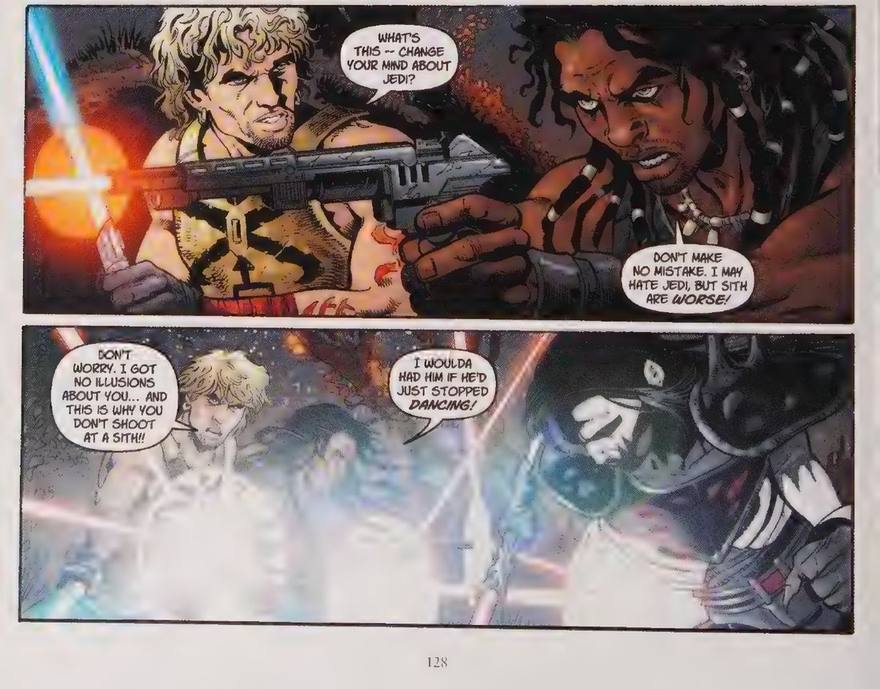
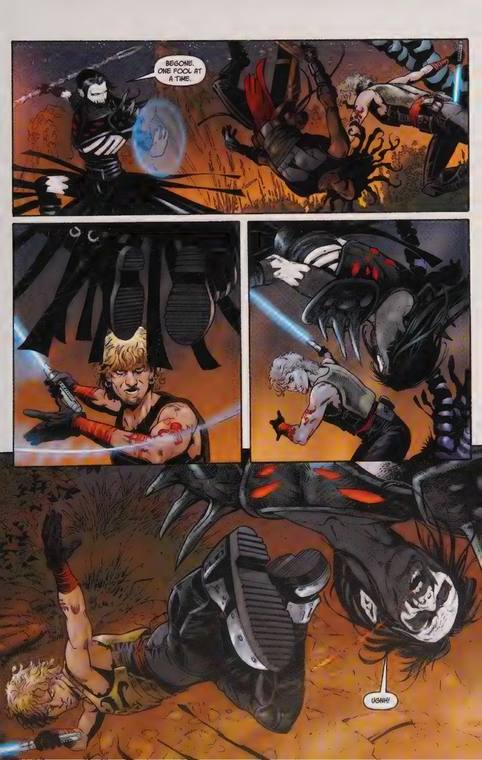
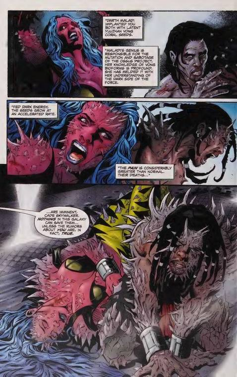
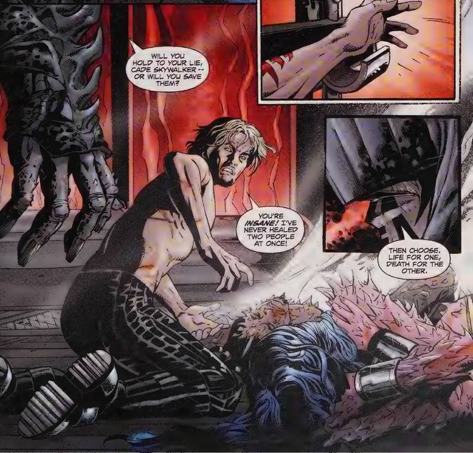
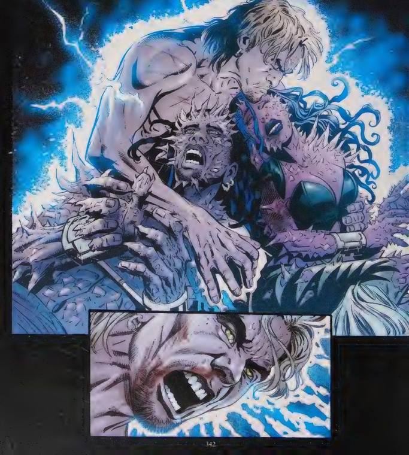
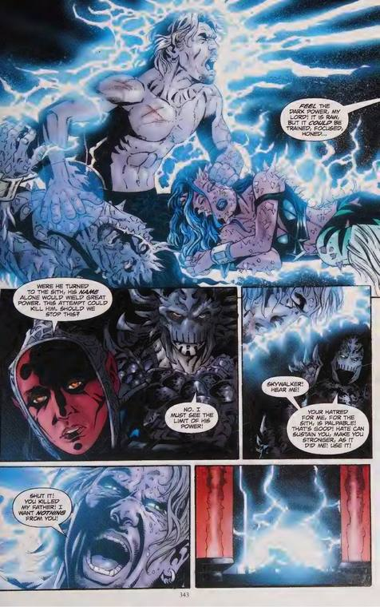
Our notes: `notes/materials/009-legacy-book-1.md:1012`

> YOU LEAVE CADE BEHIND AND I SWEAR, SYN, I WILL SPACE YOU WHILE YOU SLEEP! *(p120)*
>
> DUNNO. COULD HAVE BEEN ONE OF THE IMPERIAL KNIGHTS. I WASN'T THERE. TOO BUSY SHOOTING SITH.
>
> ...HE'S GOT DELUSIONS OF ADEQUACY.
> [fragment — full passage not on file]
— Source: Legacy Book 1 (omnibus): power-scaling notes with panels; Deliah: stuns Hosk (p48). Threatens Syn.
Note (our notes, around the quote): Deliah: stuns Hosk (p48). Threatens Syn: "YOU LEAVE CADE BEHIND AND I SWEAR, SYN, I WILL SPACE YOU WHILE YOU SLEEP!" (p120). On the *Mynock*'s guns during the rescue (p431; p436 Syn: "BACK WITH THE GUNS"); Chak flies and Syn catches Cade at the hatch (p436; corrected 2026-10-21 from 013 p135). Coral seeds, healed (p346). To Krayt (p341): "DUNNO. COULD HAVE BEEN ONE OF THE IMPERIAL KNIGHTS. I WASN'T THERE. TOO BUSY SHOOTING SITH." (Syn, not Deliah, says "...HE'S GOT DELUSIONS OF ADEQUACY."; corrected from 013 p40)
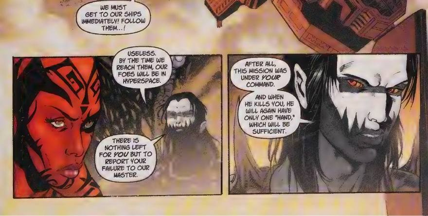
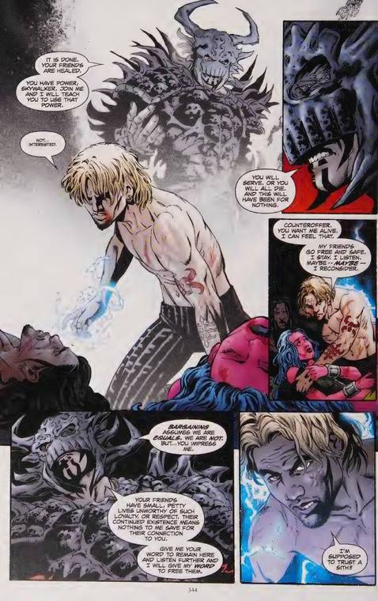
Our notes: `notes/materials/009-legacy-book-1.md:1013`

- Note (summary from our notes, not a quotation): ANALYSIS: non-Force-users with no scaling value against Force-users, except as the context for Cade's two-at-once healing.
  — Source: Legacy Book 1 (omnibus): power-scaling notes with panels.
Our notes: `notes/materials/009-legacy-book-1.md:1014`

> Able to fix almost anything mechanical using a hydrospanner and a few choice words...
> [fragment — full passage not on file]
>
> Something in him seems broken to her, and you can't fix what you can't reach.
— Source: Legacy Book 1 (omnibus): power-scaling notes with panels; Deliah Blue (p470).
Our notes: `notes/materials/009-legacy-book-1.md:1142`

## Star Wars: Legacy—War #1–6 (2010–11): power-scaling notes with panels

- Note (summary from our notes, not a quotation): Jariah Syn, Deliah Blue and R2-D2.
  — Source: Legacy—War #1–6 (2010–11): power-scaling notes with panels.
Context: Others:
Our notes: `notes/materials/010-legacy-war.md:77`

> LOVE YOU, CADE, BUT HUNTING SITH IS PURE SUICIDE!
— Source: Legacy—War #1–6 (2010–11): power-scaling notes with panels; p9.
Context: Deliah Blue:
Our notes: `notes/materials/010-legacy-war.md:903`

> LOVE YOU, CADE. ALWAYS AND FOREVER.
— Source: Legacy—War #1–6 (2010–11): power-scaling notes with panels; p135.
Note (our notes, around the quote): p135: "LOVE YOU, CADE. ALWAYS AND FOREVER." This echoes Rawk (p85) and Kol (p55).
Context: Deliah Blue:
Our notes: `notes/materials/010-legacy-war.md:904`

## Star Wars Saga Edition: *Legacy Era Campaign Guide* (WotC 2009): power-scaling notes with panels

- Note (summary from our notes, not a quotation): Jariah Syn CL 9 (p213). Deliah Blue CL 9 (p212). Chak CL 8 (p210).
  — Source: *Legacy Era Campaign Guide* (WotC 2009): power-scaling notes with panels.
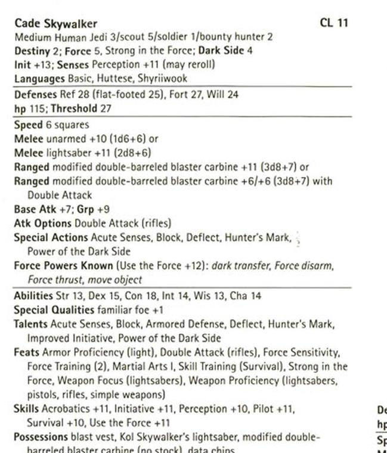
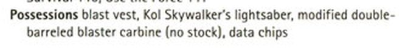
Our notes: `notes/materials/011-legacy-era-campaign-guide.md:956`

## Star Wars: Legacy Volume 2, *Shards* (TPB): power-scaling notes with panels

> E CHU TA! I HATE SITH AND THEIR IMPERIAL LAPDOGS EVEN MORE THAN I HATE JEDI. *(p142)*
>
> THE INTERROGATOR DROID WILL LOOSEN YOUR TONGUES. *(Their capture sets up Claws.)*
— Source: Legacy Volume 2, *Shards* (TPB): power-scaling notes with panels.
Note (our notes, around the quote): Rav sells them to the Empire using security footage of Cade healing Hosk (p141–142). Jariah: "E CHU TA! I HATE SITH AND THEIR IMPERIAL LAPDOGS EVEN MORE THAN I HATE JEDI." (p142). The officer: "THE INTERROGATOR DROID WILL LOOSEN YOUR TONGUES." (Their capture sets up Claws.)
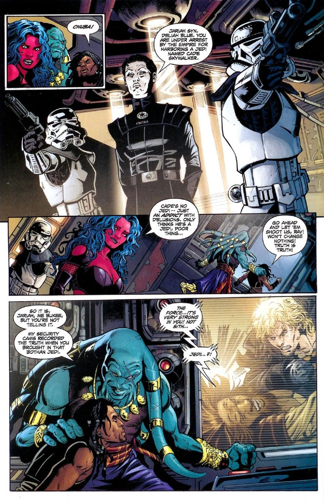 *(p141)*
Our notes: `notes/materials/012-legacy-vol-2-shards.md:389`

> YOU'RE A CASTOFF -- LIKE ME. KNEW YOU FOR A BROTHER THE MOMENT I SAW YOU *(p165)*
> [fragment — full passage not on file]
— Source: Legacy Volume 2, *Shards* (TPB): power-scaling notes with panels. POV: Rav, about Deliah Blue.
Note (our notes, around the quote): Rav (p164): "IT WAS A JEDI THAT KILLED YOUR DA". This is Jariah's anti-Jedi backstory, given as Rav's claim. Teen Jariah talks Rav out of spacing teen Cade: "YOU'RE A CASTOFF -- LIKE ME. KNEW YOU FOR A BROTHER THE MOMENT I SAW YOU" (p165).
Our notes: `notes/materials/012-legacy-vol-2-shards.md:391`

## Star Wars: Legacy Volume 3, *Claws of the Dragon* (TPB): power-scaling notes with panels

> I WAS THERE. NEVER HAPPENED. IF CADE TELLS YOU IT DID, HE'S GOT DELUSIONS OF ADEQUACY. *(p40)*
>
> DUNNO. COULD HAVE BEEN ONE OF THE IMPERIAL KNIGHTS. I WASN'T THERE. TOO BUSY SHOOTING SITH.
— Source: Legacy Volume 3, *Claws of the Dragon* (TPB): power-scaling notes with panels.
Note (our notes, around the quote): Coral seeds healed by Cade (p40–45). Syn, not Deliah, says "I WAS THERE. NEVER HAPPENED. IF CADE TELLS YOU IT DID, HE'S GOT DELUSIONS OF ADEQUACY." (p40); Deliah: "DUNNO. COULD HAVE BEEN ONE OF THE IMPERIAL KNIGHTS. I WASN'T THERE. TOO BUSY SHOOTING SITH."
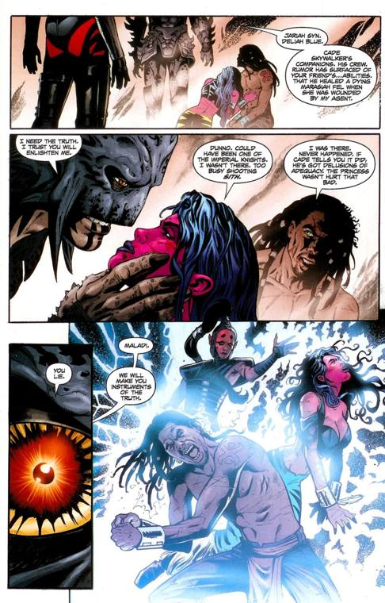
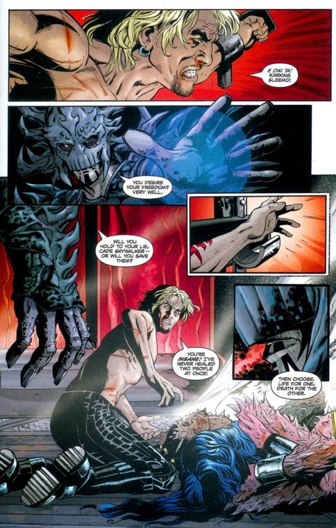
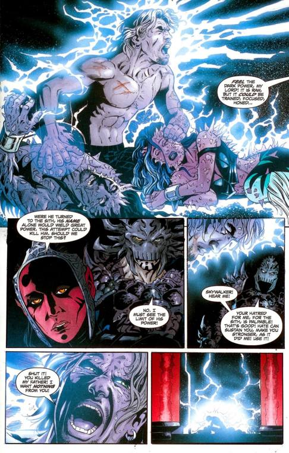
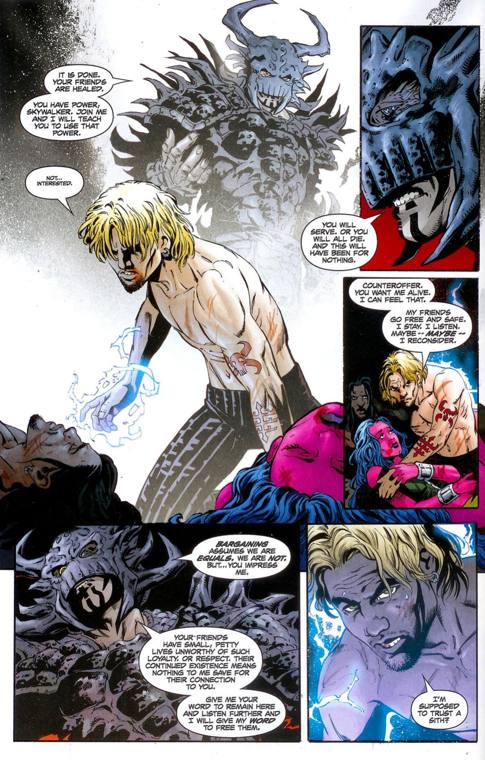
Our notes: `notes/materials/013-legacy-vol-3-claws-of-the-dragon.md:468`

> A VONG CREWED ON THE CRIMSON AXE WHEN I WAS GROWING UP. HE TAUGHT ME HOW TO HANDLE 'EM.
— Source: Legacy Volume 3, *Claws of the Dragon* (TPB): power-scaling notes with panels; Syn handles and rigs the Vong bugs with Kee (.
Note (our notes, around the quote): Syn handles and rigs the Vong bugs with Kee ("A VONG CREWED ON THE CRIMSON AXE WHEN I WAS GROWING UP. HE TAUGHT ME HOW TO HANDLE 'EM.", p84); his "boom" bugs blow the Temple's main hangar (p121–122).
Our notes: `notes/materials/013-legacy-vol-3-claws-of-the-dragon.md:469`

> SLOW IT DOWN, YOU STOOPA WOOKIEE!
>
> HEY, BLUE -- STOP FOOLING AROUND AND DUST SOME OF THESE EYEBALLS
> [fragment — full passage not on file]
— Source: Legacy Volume 3, *Claws of the Dragon* (TPB): power-scaling notes with panels; Rescue roles (p120–136): Chak flies (p120 Syn.
Note (our notes, around the quote): Rescue roles (p120–136): Chak flies (p120 Syn: "SLOW IT DOWN, YOU STOOPA WOOKIEE!"; p127; p136 "(MY SEAT. MY SHIP.)"), Deliah is on the guns (p130 Syn: "HEY, BLUE -- STOP FOOLING AROUND AND DUST SOME OF THESE EYEBALLS"; p135 "BACK WITH THE GUNS"), and Syn catches Cade at the hatch (p135).
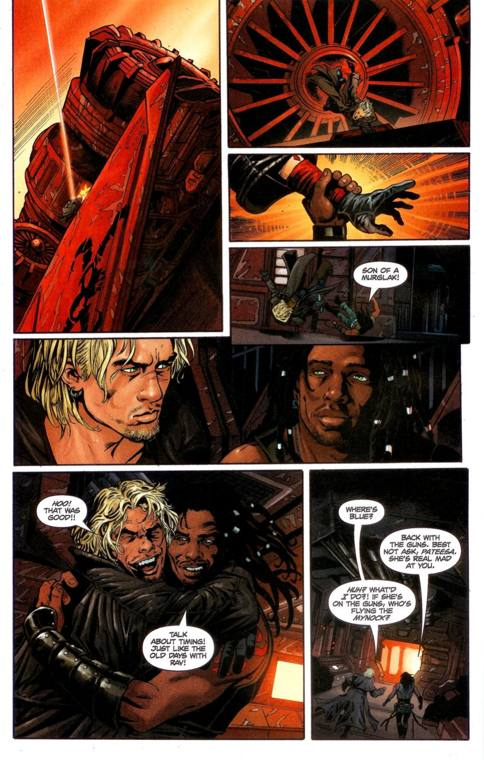
Our notes: `notes/materials/013-legacy-vol-3-claws-of-the-dragon.md:470`

> YOU SOLD MY SHIP TO THE WOOKIEE?!
— Source: Legacy Volume 3, *Claws of the Dragon* (TPB): power-scaling notes with panels.
Note (our notes, around the quote): The *Mynock* is re-registered to Chak at Corde's insistence (p85; p136 Cade: "YOU SOLD MY SHIP TO THE WOOKIEE?!").
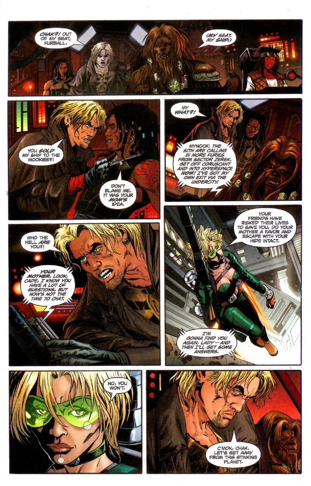 *(p136)*
Our notes: `notes/materials/013-legacy-vol-3-claws-of-the-dragon.md:471`

## https://starwars.fandom.com/wiki/Cade_Skywalker

- Note (summary from our notes, not a quotation): He projected a protection bubble over himself and Deliah Blue against the Wayland base explosion and its residual effects. [32]
  — Source: Legacy (2006) 46 [per Wookieepedia "Cade Skywalker" rev 15549841, ref 32; approximate match 0.85, verify; agrees with the entry's own ref marker]; per Wookieepedia "Cade Skywalker" rev 15549841, ref 32; approximate match 0.85, verify; agrees with the entry's own ref marker — Cade Skywalker — article extraction — https://starwars.fandom.com/wiki/Cade_Skywalker.
(Source: Legacy (2006) 46 [per Wookieepedia "Cade Skywalker" rev 15549841, ref 32; approximate match 0.85, verify; agrees with the entry's own ref marker])
Our notes: `external/mega-notes/cade-skywalker-quotes.txt:25`

- Note (summary from our notes, not a quotation): He could not initially heal Deliah Blue from Maladi's weapon using dark-side healing. After Wolf told him to use the light side, Cade used the light side and his love for Blue; the weapon died and Blue was freed. [32]
  — Source: UNRESOLVED (sentence not found in current Wookieepedia article revision; primary source not identified) — Cade Skywalker — article extraction — https://starwars.fandom.com/wiki/Cade_Skywalker.
(Source: UNRESOLVED (sentence not found in current Wookieepedia article revision; primary source not identified))
Our notes: `external/mega-notes/cade-skywalker-quotes.txt:43`

## https://starwars.fandom.com/wiki/Darth_Krayt

> Krayt was astonished to see Cade's body had purged itself of the deadly substances Maladi had injected into his body.
— Source: Legacy (2006) 15 [per Wookieepedia "Darth Krayt" rev 15688608, ref 25; approximate match 1.00, verify]; per Wookieepedia "Darth Krayt" rev 15688608, ref 25; approximate match 1.00, verify — Darth Krayt — feat/statement extraction from Wookieepedia — https://starwars.fandom.com/wiki/Darth_Krayt.
Note (our notes, around the quote): [Pre-rebirth feat] Section: Skywalker found. “Krayt was astonished to see Cade's body had purged itself of the deadly substances Maladi had injected into his body.” Scaling/context: Krayt then ordered Maladi to infect Jariah Syn and Deliah Blue with deadly Yorik-Kul coral seeds so he could witness Cade’s power; Cade saved them.
(Source: Legacy (2006) 15 [per Wookieepedia "Darth Krayt" rev 15688608, ref 25; approximate match 1.00, verify])
Our notes: `external/mega-notes/krayt-legends-quotes.txt:129`

## Legends Feats & Quotes (Star Wars Legends / EU)

- Note (summary from our notes, not a quotation): Legacy: heals dark-side-accelerated coral seeds, the rakghoul plague, and Deliah Blue's Maladi implant; late-series TK beatdown of Darth Talon into Krayt's throne room (debate #61)
  — Source: (debate #61) — Legends Feats & Quotes (Star Wars Legends / EU).
Our notes: `legends-feats.md:600`

# Debate and forum claims (unverified)

Forum posts, Suspect Insight debates and Discord debates, respect threads, and verdicts. These are posters' arguments or quotations they typed; none is checked against the book here unless the entry says so.

## "Dissecting Legacy #1: Cade Skywalker's Ending Growth" (Suspect Insight Forums)

> staggering on the edge of the dark side abyss,
> [fragment — full passage not on file]
— Source: Cade Skywalker's Ending Growth" (Suspect Insight Forums) — https://www.suspectinsightforums.com/t4455-dissecting-legacy-1-cade-skywalker-s-ending-growth; A1 (line 19; speaker: see context).
Note (our notes, around the quote): A1 (line 19; speaker: see context) — “staggering on the edge of the dark side abyss,”  _[context: …by imprisoning his lover, Deliah Blue, within an Embrace of Pain. Cade has recently been]_
Posted by: line 19; speaker: see context.
Our notes: `notes/materials/014-dissecting-legacy-1-cade-skywalkers-ending-growth.md:138`

## Cade Skywalker (i_like_swords) vs Darth Maul (HellfireUnit)

> Cade’s nexus debuffed light-side healing > Healing Deliah Blue > Failing to heal Blue while nexus amped using full-effort dark transfer > Rakghoul plague w/ shatterpoint + Sith training > Accelerated coral seeds w/out shatterpoint + Sith training > throwing a huge shuttle hundreds of yards out of sight.
— Source: Cade Skywalker (i_like_swords) vs Darth Maul (HellfireUnit) — https://www.suspectinsightforums.com/t688-ss-cade-skywalker-ils-vs-darth-maul-hellfireunit; Healing chain (verbatim): **.
Label in our notes: Healing chain (verbatim
Posted by: not named in our notes (see thread/notes link).
Our notes: `suspect-insight/debates/061-cade-skywalker-vs-darth-maul.md:29`

## Cade Skywalker Respect Thread (Updated 2017) — respect-thread notes

- Note (summary from our notes, not a quotation): Cade Skywalker prevents the coral seed deaths of Deliah Blue and Jariah Syn:
  — Source: SI respect-thread directory: Cade Skywalker Respect Thread (Updated 2017) — https://web.archive.org/web/20190902075103/https://comicvine.gamespot.com/profile/darthant66/blog/cade-skywalker-respect-thread-updated-2017/97726/.
Posted by: not named in our notes (see thread/notes link).
Our notes: `suspect-insight/respect-threads/cade-skywalker.md:278`

- Note (summary from our notes, not a quotation): [image: data:image/gif;base64,R0lGODlhAQABAAAAACH5BAEKAAEALAAAAAABAAEAAAICTAEAOw==]
  — Source: SI respect-thread directory: Cade Skywalker Respect Thread (Updated 2017) — https://web.archive.org/web/20190902075103/https://comicvine.gamespot.com/profile/darthant66/blog/cade-skywalker-respect-thread-updated-2017/97726/.
Posted by: not named in our notes (see thread/notes link).
Context: Cade Skywalker prevents the coral seed deaths of Deliah Blue and Jariah Syn:
Our notes: `suspect-insight/respect-threads/cade-skywalker.md:279`; `suspect-insight/respect-threads/cade-skywalker.md:351`

- Note (summary from our notes, not a quotation): Cade Skywalker encases himself and Deliah Blue in a bubble as Darth Maladi's lab self destructed:
  — Source: SI respect-thread directory: Cade Skywalker Respect Thread (Updated 2017) — https://web.archive.org/web/20190902075103/https://comicvine.gamespot.com/profile/darthant66/blog/cade-skywalker-respect-thread-updated-2017/97726/.
Posted by: not named in our notes (see thread/notes link).
Our notes: `suspect-insight/respect-threads/cade-skywalker.md:313`

- Note (summary from our notes, not a quotation): [image: https://web.archive.org/web/20190902075103im_/https://static.comicvine.com/uploads/square_avatar/11114/111140132/4236012-guarded%20cade%20force%20shield%20%281o3%29.jpg]
  — Source: SI respect-thread directory: Cade Skywalker Respect Thread (Updated 2017) — https://web.archive.org/web/20190902075103/https://comicvine.gamespot.com/profile/darthant66/blog/cade-skywalker-respect-thread-updated-2017/97726/.
Posted by: not named in our notes (see thread/notes link).
Context: Cade Skywalker encases himself and Deliah Blue in a bubble as Darth Maladi's lab self destructed:
Our notes: `suspect-insight/respect-threads/cade-skywalker.md:314`

> "Huh. place looks Vong, but I can feel another. Someone else with you, Blue. Sith!"
>
> ―Star Wars: Legacy 45: Monster (Cade Skywalker)
> [fragment — full passage not on file]
— Source: SI respect-thread directory: Cade Skywalker Respect Thread (Updated 2017) — https://web.archive.org/web/20190902075103/https://comicvine.gamespot.com/profile/darthant66/blog/cade-skywalker-respect-thread-updated-2017/97726/.
Context: Cade Skywalker senses Deliah Blue and a Sith Lord:
Posted by: not named in our notes (see thread/notes link).
Our notes: `suspect-insight/respect-threads/cade-skywalker.md:346`

- Note (summary from our notes, not a quotation): Cade Skywalker senses Deliah Blue or a Sith Lord:
  — Source: SI respect-thread directory: Cade Skywalker Respect Thread (Updated 2017) — https://web.archive.org/web/20190902075103/https://comicvine.gamespot.com/profile/darthant66/blog/cade-skywalker-respect-thread-updated-2017/97726/.
Posted by: not named in our notes (see thread/notes link).
Our notes: `suspect-insight/respect-threads/cade-skywalker.md:350`

## Matchup Verdicts — Research Log

> "Cade’s lowest end power feats as a drug addict with the skills of a padawan are as good as Maul’s best." — i_like_swords
> [fragment — full passage not on file]
>
> "Cade’s nexus debuffed light-side healing > Healing Deliah Blue > ... > throwing a huge shuttle hundreds of yards out of sight." — i_like_swords
> [fragment — full passage not on file]
— Source: Matchup Verdicts — Research Log.
Context: Key reasoning: ILS: Cade's low-end shuttle throw at his 'weakest' already rivals Maul's best; his power grew through healing feats; late Cade TK-destroys Talon; Shatterpoint, dark transfer and lightning exploit Maul's cyber legs. No rebuttal.
Posted by: verdict file (verdicts.md).
Our notes: `verdicts.md:1284`
