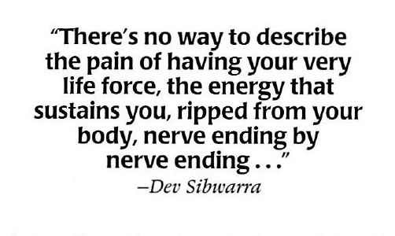

# Dev Sibwarra

- **Aliases:** Dev
- **Era:** NR
- **Continuity:** default Legends; entries present for: Legends
- **Research tier:** untiered (not listed as INTRO/DEEP/MASTERY in legends-feats.md)
- **Entries:** 2 (2 with quotations; 0 quotations extended to the full sentence/passage from the source text on file; 1 marked as fragments). Rebuilt 2026-11-17 from 2 old entries; old file: `characters/_bak/dev-sibwarra.md.bak-20261117`.
- **How to read:** each entry is the quotation in full (block quote), then its source and point of view. "Note" lines are summaries from our notes, not quotations. `[fragment — full passage not on file]` means the source text is not on the box, so only the words in our notes are shown. Debate and forum material is in the last section and is unverified.

# LEGENDS (Legends / EU — main focus)

## The Lucasfilm Fan Club Magazine #21 (1994)

> last longer in 'entechment'
> [fragment — full passage not on file]
— Source: The Lucasfilm Fan Club Magazine #21 (1994).
Note (our notes, around the quote): Page contents: Tyers continued (crop-verified): Imperial governor Nereus; the Ssi-ruuk ("See-Rook", more dinosaurian than reptilian, with birdlike speech, derogatorily called "Fluties") drain life energy from sentient beings into battery cells to power their droids, and humanoids "last longer in 'entechment'". Bantam and Lucasfilm wanted no stray Jedi apprentices; she wrote two endings for Dev. Kevin Anderson is coordinating the authors. Tales from the Mos Eisley Cantina (the Cantina Band; Figrin D'an and the Kloo horn were already named by WEG). Parents' details omitted. (hand-read)
Our notes: `notes/materials/038-star-wars-insider/021-lfc021.md:70`

## The New Essential Guide to Weapons and Technology (2004)

> There's no way to describe the pain of having your very life force, the energy that sustains you, ripped from your body, nerve ending by nerve ending . . .
— Source: The New Essential Guide to Weapons and Technology (W. Haden Blackman, Del Rey, 2004), printed p.187, scan p.213. The ellipsis is spaced, as printed..
Note (our notes, around the quote): "There's no way to describe the pain of having your very life force, the energy that sustains you, ripped from your body, nerve ending by nerve ending . . ." —Dev Sibwarra.
Our notes: `notes/materials/155-new-essential-guide-to-weapons-technology-2004/quotes/QUOTES-INDEX.md`

# Debate and forum claims (unverified)

Forum posts, Suspect Insight debates and Discord debates, respect threads, and verdicts. These are posters' arguments or quotations they typed; none is checked against the book here unless the entry says so.

_None in our notes._
