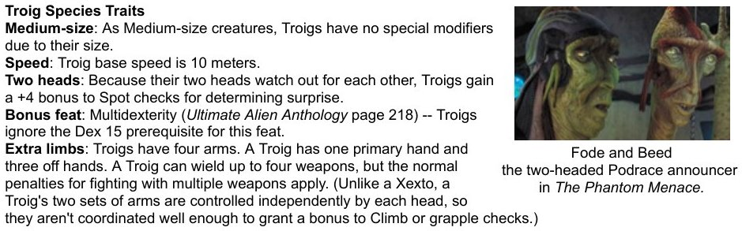

# Dexter Jettster

- **Aliases:** Dex
- **Era:** Prequel
- **Continuity:** default Legends; entries present for: Legends
- **Research tier:** untiered (not listed as INTRO/DEEP/MASTERY in legends-feats.md)
- **Entries:** 163 (25 with quotations; 4 quotations extended to the full sentence/passage from the source text on file; 24 marked as fragments; 38 before the 2026-11-17 fragment fill). Rebuilt 2026-11-17 from 167 old entries; old file: `characters/_bak/dexter-jettster.md.bak-20261117`.
- **How to read:** each entry is the quotation in full (block quote), then its source and point of view. "Note" lines are summaries from our notes, not quotations. `[fragment — full passage not on file]` means the source text is not on the box, so only the words in our notes are shown. Debate and forum material is in the last section and is unverified.

# LEGENDS (Legends / EU — main focus)

## Dark Lord trilogy (Labyrinth of Evil, Revenge of the Sith, Dark Lord): novel notes from the other agent (reference copy)

> Obi-Wan had argued against going to Charros IV. Dexter Jettster, his Besalisk friend on Coruscant, could probably have furnished the Intelligence analysts with everything they needed to know about Viceroy Gunray’s mechno-chair. But Yoda had insisted that Obi-Wan and Anakin attempt to speak personally with the Xi Charrian whose sigil had been discovered on the walking chair.
— Source: Labyrinth of Evil (novel, read in full): feats, scaling, quotes and story notes; Ch16 L1143.
(Excerpt widened 2026-11-17 to the relevant passage, word for word from Labyrinth of Evil (James Luceno) (text copy `MEGA_Legend_The_Episode_Novelizations_Star_Wars_Revenge_of_the_Sith_01_Labyrinth_of_Evil_James_Luceno_epub`).)
Context: Complete quote register (148 lines: every sentence that names Gunray, verbatim, in book order):
Our notes: `notes/materials/022-dark-lord-trilogy/labyrinth-of-evil-notes.md:1555`

## The Complete Star Wars Encyclopedia, Vol. I (A–G)

- Note (summary from our notes, not a quotation): Page contents: 884 words, 34 paragraphs | headings/entries: Deverin, Lun; Devil's Doorknob, the; Devis, Captain Mynar; Deviss, Clone Commander; Deviia, Admiral; Devlikk; Devon Four; Devonian; Dewback; Dewback's Burden; Dewlannamapia; Dex; Dex's Diner; Deyer Colony
  — Source: scan pages 201–240.
Our notes: `notes/materials/030-complete-star-wars-encyclopedia-vol-1/05-v1-scan-201-240.md:17`

> Dewlanna taught him to speak and understand the Wookiee language of Shyriiwook. She was nearly 600 years old when Garris Shrike killed her while she was protecting Han. As she was dying, she made him promise to leave Shrike's band and be happy. She was survived by a son named Utchakkaloch. Dex A member of the Peace Brigade, he went to Corellia to capture or kill the Jedi Master Eelysa. After he ran into Han and Leia Organa Solo at the medical facility treating Eelysa, Dex was shot and killed in the ensuing firefight. Dex's Diner A small eatery in the CoCo district on Coruscant owned and operated by Dexter Jettster. It was known as Didi and Astri's Cafe until it was sold by owners Didi and Astri Oddo. Deyer Colony An outpost in the Anoat system, this colony world contained floating raft cities, terraformed lakes, and abundant fish and crustacean life. The Deyer colonists had created a peaceful political system until they spoke out against the destruction ofAlder­ aan, paving the way for a brutal military takeover of Deyer by Imperial troops.
— Source: scan pages 201–240; Leia Organa Solo. POV: Leia Organa Solo, about Dexter Jettster.
(Excerpt widened 2026-11-17 to the relevant passage, word for word from research primary cse vol1 (text copy `research_primary_cse_vol1_pdf_45a954be6d`).)
(Excerpt widened 2026-11-17 to the relevant passage, word for word from research primary cse vol1 (text copy `research_primary_cse_vol1_pdf_45a954be6d`).)
Note (our notes, around the quote): Leia Organa Solo: "After he ran into Han and Leia Organa Solo at the medical facility treating Eelysa, Dex was shot and killed in the ensuing firefight." Source: The Complete Star Wars Encyclopedia, Vol. I, p.187
Our notes: `notes/materials/030-complete-star-wars-encyclopedia-vol-1/05-v1-scan-201-240.md:19`

## Power of the Jedi Sourcebook (d20, 2002)

- Note (summary from our notes, not a quotation): Page contents: 884 words, 35 paragraphs | headings/entries: Table 6-1: New Species; Species Species Traits; Cathar +2 Dex, —2 Int; Claws; Vultan +2 Int, -2 Wis, -2 Cha; Cathar
  — Source: Chapter Five: Creatures, species and archetypes.
Our notes: `notes/materials/033-power-of-the-jedi-sourcebook/05-ch5-species-archetypes.md:17`

## Dark Side Sourcebook (d20, 2001)

- Note (summary from our notes, not a quotation): Page contents: 530 words, 59 paragraphs | headings/entries: Dark Side Adept; Blaster pistol +3 ranged Damage: spear 1d8-1; Feats: Force-Sensitive, Iron Will,; Alter, Control, Force Mind, Sense; Force Feats:; Equipment: Spear, blaster pistol, dark side; Force Adept 6/; Dark force Devotee 2; Spear +4 melee; Blaster pistol +8 ranged spear 1d8-1; Blaster pistol 3d6; Cc; Str 9, Dex 11, Con 14,; Int 14, Wis 15, Cha 14; Alter, Control, Force Mind, Prolong Force, Sense; Spear, blaster pistol, dark side talisman, robes; Spear +7 melee; Blaster pistol +18 ranged spear 1d8-1; Blaster pistol 3d6; Force weapon (+2d4) F+8,R +6, W +15; D; Str 9, Dex 11, Con 14,; Spear, blaster pistol, dark side talisman, robes
  — Source: Chapter Six: Creatures and Archetypes.
Our notes: `notes/materials/035-dark-side-sourcebook/06-ch6-creatures-archetypes.md:122`

- Note (summary from our notes, not a quotation): Page contents: 636 words, 74 paragraphs | headings/entries: Dark Side Spirit; Various Generic Dark Side Spirits; Initiative: Defense: Speed: VP/WP: Attacks:; Damage:; Special Qualities:; Saves:; Size:; Challenge Code: Force Points:; Dark Side Points:; Reputation: Abilities:; Skills:; Force Skills:; Feats:; Force Feats:; Equipment:; D; Str 9, Dex 11, Con -,; Enhance Ability +10; Dark robes; Dark Jedi Spirit Jedi Consular 12; F+8*,R +7, W +10 (by species); D; Battlemind +13, Enhance Ability +13; Jedi robes; Sith Lord Spirit; Sword Defense); Enemy bonus +1; Sith armor
  — Source: Chapter Six: Creatures and Archetypes.
Our notes: `notes/materials/035-dark-side-sourcebook/06-ch6-creatures-archetypes.md:132`

- Note (summary from our notes, not a quotation): Page contents: 711 words, 76 paragraphs | headings/entries: B21 ave; Emperor's Hand; Initiative: Defense: Speed: VP/WP: Attacks:; Damage:; Special Qualities:; Saves:; Size:; Challenge Code: Force Points:; Dark Side Points:; Reputation: Abilities:; Skills:; Force Skills:; Feats:; Force Feats: Equipment:; Scoundrel 6/; Emperor's Hand 2; Hold-out blaster 3d4; F +3,R+11,W +3 Medium; D; Scoundrel 6/ Emperor's Hand 6; F+5,R+14,W +5 Medium; Ei; Str 12, Dex 18, Con 12,; Scoundrel 6/ Emperor's Hand 10; Blaster pistol 3d6 Hold-out blaster 3d4; F +6,R +16, W +6; Medium; F; Str 12, Dex 18, Con 13,; Alter, Control, Sense; Lightsaber, blaster pistol, hold-out blaster
  — Source: Chapter Six: Creatures and Archetypes.
Our notes: `notes/materials/035-dark-side-sourcebook/06-ch6-creatures-archetypes.md:137`

## Adventures/Child of Light/Child of Light I - Child of Light.pdf [Star Wars Roleplaying Game (d20, 2000)]

- Note (summary from our notes, not a quotation): Page contents: 527 words, 20 paragraphs | headings/entries: STR 12/+1 VP/WP: 51/12; INT 12/+1 Initiative: +2 (Dex); Scout: Trailblazing Force Adept: Force weapon +1d4; Feats:; Force Feats: Alter, Control, Lightsaber Defense, Sense; Child of Light Page 18
  — Source: Adventures/Child of Light/Child of Light I - Child of Light.pdf [Star War.
Our notes: `notes/materials/037-sw-d20-folder/001-child-of-light-i-child-of-light.md:100`

- Note (summary from our notes, not a quotation): Page contents: 396 words, 18 paragraphs | headings/entries: Tol Skaros (Male Whippid Soldier 6"/Scoundrel 2""); STR 18/+4 VP/WP: 72/16; DEX = 15/42 Def: 19; CON _ 16/+3 Spd: 10m; INT 10 Initiative: +2 (Dex); Scoundrel: Illicit Barter, Better Lucky Than Good; Feats:; Capsule:; Child of Light Page 20
  — Source: Adventures/Child of Light/Child of Light I - Child of Light.pdf [Star War.
Our notes: `notes/materials/037-sw-d20-folder/001-child-of-light-i-child-of-light.md:114`

- Note (summary from our notes, not a quotation): Page contents: 564 words, 24 paragraphs | headings/entries: STR 11 VP/WP: 27/12; DEX =_14/+2 Def: 19; CON 12/+1 Spd: 10m; INT 13/+1 Initiative: +2 (Dex); Force Feats: Alter, Sense; Appearance:; Child of Light Page 31
  — Source: Adventures/Child of Light/Child of Light I - Child of Light.pdf [Star War.
Our notes: `notes/materials/037-sw-d20-folder/001-child-of-light-i-child-of-light.md:173`

## Adventures/Child of Light/Child of Light II - Soulsaber.pdf [Star Wars Roleplaying Game (d20, 2000)]

- Note (summary from our notes, not a quotation): Page contents: 476 words, 21 paragraphs | headings/entries: STR 12/+1 VP/WP: 74/12; CON _ 13/+1 Speed: 10m; INT 12/+1 Initiative: +2 (Dex); Class Abilities:; Feats:; Soulsaber Page 17
  — Source: Adventures/Child of Light/Child of Light II - Soulsaber.pdf [Star Wars Ro.
Our notes: `notes/materials/037-sw-d20-folder/002-child-of-light-ii-soulsaber.md:90`

- Note (summary from our notes, not a quotation): Page contents: 508 words, 22 paragraphs | headings/entries: STR 11 VP/WP: 39/12; DEX = 14/+2 Def: 19; CON | 12/+1 Spd: 10m; INT 13/+1 Initiative: +2 (Dex); Force Feats: Alter, Control, Sense; Appearance:; Soulsaber Page 33
  — Source: Adventures/Child of Light/Child of Light II - Soulsaber.pdf [Star Wars Ro.
Our notes: `notes/materials/037-sw-d20-folder/002-child-of-light-ii-soulsaber.md:178`

## Adventures/Child of Light/Child of Light III - Light and Dark.pdf [Star Wars Roleplaying Game (d20, 2000)]

- Note (summary from our notes, not a quotation): Page contents: 395 words, 22 paragraphs | headings/entries: STR = 12/+1 VP/WP: 103/12; CON 12/+1 Spd: 10m; INT 14/+2 Initiative: +2 (Dex); Special Qualities:; Fringer. Bonus Class Skill (Entertain (dancing)); Skills:; Feats:; Appearance:; Light and Dark 33
  — Source: Adventures/Child of Light/Child of Light III - Light and Dark.pdf [Star W.
Our notes: `notes/materials/037-sw-d20-folder/003-child-of-light-iii-light-and-dark.md:175`

## Adventures/Flames of Rebellion.pdf [Star Wars Roleplaying Game (d20, 2000)]

- Note (summary from our notes, not a quotation): Page contents: 351 words, 29 paragraphs | headings/entries: Sliver; Human male, Scout 6; Age: 35; Height: 1.6 m; Weight: 77 kg; Eyes/Hair: Brown/Black; Written Languages: Basic, Rodian; Rodian,; Ability Scores; Vitality: 38 Wound Points: 11 Speed: 10m; Run Speed: 40m; Combat Initiative: +3 (+3 Dex); Defense: 18 (+5 Base, +3 Dex); Ranged: +7 Melee: +4; Saving Throws; Flames of Rebellion; Page 31
  — Source: Adventures/Flames of Rebellion.pdf [Star Wars Roleplaying Game (d20, 2000.
Our notes: `notes/materials/037-sw-d20-folder/025-flames-of-rebellion.md:169`

## Sourcebooks/Sourcebook Web Enhancements/More Aliens!.pdf [Star Wars Roleplaying Game (d20, 2000)]

- Note (summary from our notes, not a quotation): Page contents: Defel fur absorbs non-UV light: 'In darkness, a Defel is all but invisible—even to beings able to see in the dark'; +2 attack, target loses Dex to Defense, 50% miss chance outside direct normal light. (hand-read)
  — Source: Sourcebooks/Sourcebook Web Enhancements/More Aliens!.pdf [Star Wars Rolep.
Our notes: `notes/materials/037-sw-d20-folder/039-more-aliens.md:24`

## Sourcebooks/Rebellion Era Sourcebook.pdf [Star Wars Roleplaying Game (d20, 2000)] (scan pages 1–60)

- Note (summary from our notes, not a quotation): Page contents: 534 words, 69 paragraphs | headings/entries: E istey, see; Species: Initiative: Defense: Speed: vP/wP Attacks:; Damage:; Special Qualities: Saves:; Skills; Feats:; Equipment; Info Broker (Diplomat 2) Any; Hold-out blaster 3d4 None; F=-2,R-1,W+3; A; Str 7, Dex 9, Con 6,; Weapon Group Proficiency (simple weapons); Hold-out blaster, comlink, datapad; Generic Spaceport Denizens; Spacer (Expert 4) Any; Punch +3 melee Blaster -1 ranged; Punch 1d3 Blaster 3d6 None F+1,R+1,W+3 B; Str 10, Dex 11, Con TT,; Spacer, Weapon Proficiency (simple weapons); Blaster, tool kit, comlink, datapad, medpac; Law Enforcer (Soldier 2) Any; None; F+3,R+2,W-1; B; Blast vest, blaster, vibrodagger, macrobinoculars, binders
  — Source: Sourcebooks/Rebellion Era Sourcebook.pdf [Star Wars Roleplaying Game (d20.
Our notes: `notes/materials/037-sw-d20-folder/043-rebellion-era-sourcebook-scan-001-060.md:139`

- Note (summary from our notes, not a quotation): Page contents: 610 words, 78 paragraphs | headings/entries: Special Qualities; Abilities; Skills:; Feats:; Equipment:; Assault Trooper Thug 1/Soldier 3; Defense: 19 (+9 armor); Speed: 6m; VP/WP 20/14; Damage: Punch 1d3+1; Blaster rifle 3d8/19-20; Str 12, Dex 12, Con 11,; Int 10, Wis 10, Cha 10; Specialized Stormtroopers; Zero-g Space Trooper Thug 1/Soldier 5; Blaster cannon 4d8/19-20; F+6,R +2,W +1; D; Str 12, Dex 13, Con 10,; Hi ¢; Storm Commando; Thug 1/Soldier 7; Punch +9/+4 melee; Blaster carbine +9/+4 ranged Punch 1d6+1; Blaster carbine 3d8/19-20; F +7,R +3, W +2; E; Str 12, Dex 12, Con 12,; Knowledge (astronomy) +10, Pilot +8,
  — Source: Sourcebooks/Rebellion Era Sourcebook.pdf [Star Wars Roleplaying Game (d20.
Our notes: `notes/materials/037-sw-d20-folder/043-rebellion-era-sourcebook-scan-001-060.md:181`

## Sourcebooks/Rebellion Era Sourcebook.pdf [Star Wars Roleplaying Game (d20, 2000)] (scan pages 61–120)

- Note (summary from our notes, not a quotation): Page contents: 922 words, 54 paragraphs | headings/entries: Bureau,; The Ambush; WKS; Defense 17 (+2 Dex, +5 class);; Equipment; Blaster rifle, comlink,; Feats: Power Attack, Toughness, Track, Weapon Group; APTER TwO; I]| A DARK TIME; AMA
  — Source: Sourcebooks/Rebellion Era Sourcebook.pdf [Star Wars Roleplaying Game (d20.
Our notes: `notes/materials/037-sw-d20-folder/043-rebellion-era-sourcebook-scan-061-120.md:50`

- Note (summary from our notes, not a quotation): Page contents: 695 words, 48 paragraphs | headings/entries: Veers deployed a squadron of AT-AT walkers; Hoth Adventures; Rep 8; Str 11, Dex; The heroes make up one of six; General Veers | 1K:; Equipment; Multichanne; Point Blank Shot, Weapon Group Proficiencies [blaster; ITER THREE; I]} THE EMPIRE STRIKES BACK; HAF; MMII/Z,
  — Source: Sourcebooks/Rebellion Era Sourcebook.pdf [Star Wars Roleplaying Game (d20.
Our notes: `notes/materials/037-sw-d20-folder/043-rebellion-era-sourcebook-scan-061-120.md:200`

- Note (summary from our notes, not a quotation): Page contents: 795 words, 103 paragraphs | headings/entries: Constantly in competition with eacn; The Bothans control a sector of space; Dex 12, Con 10, Int 11; Equipment: Com; Wis 9,; A few examples follow; Atk +0 melee; Feats: weapons). 4; Extricate; Trustworthy, Weapon Group; Typical Bothan Information Broker: Female; Challenge Code:; Comlink, datay; Read/Write Bothan, Sense; Alertness,; Proficiency [simple; Disable Device + 5, Gather Int Read; Motive +5, Speak Bas; Cc, Speak; Weapon Group Proficiency [simple; When the heroes arrive on Cordes,; Bothan Expert; Knowledge; Huma; Eac all Sp
  — Source: Sourcebooks/Rebellion Era Sourcebook.pdf [Star Wars Roleplaying Game (d20.
Our notes: `notes/materials/037-sw-d20-folder/043-rebellion-era-sourcebook-scan-061-120.md:395`

## Sourcebooks/Rebellion Era Sourcebook.pdf [Star Wars Roleplaying Game (d20, 2000)] (scan pages 121–161)

- Note (summary from our notes, not a quotation): Page contents: 724 words, 63 paragraphs | headings/entries: None;; Searching for : Tammala; Ewok Hunter developing size, +3 Dex); weapons; Emphasis (Climb), We; Ewoks at War ji:; Equipment: Spear; I]! RETURN OF THE JEDI
  — Source: Sourcebooks/Rebellion Era Sourcebook.pdf [Star Wars Roleplaying Game (d20.
Our notes: `notes/materials/037-sw-d20-folder/043-rebellion-era-sourcebook-scan-121-161.md:207`

## Sourcebooks/Star Wars Roleplaying Game Core Rulebook.pdf [Star Wars Roleplaying Game (d20, 2000)] (scan pages 1–60)

- Note (summary from our notes, not a quotation): Page contents: 551 words, 42 paragraphs | headings/entries: SaiLiniav; OTHER METHODS POR DETERMINING ABILITY SGORES; Table 1-1: Ability Modifiers; Score Modifier Score Modifier Score Modifier; The Abilities; Strength (Str); You apply your character's Strength modifier to:; Table 1-2: Notable Strength Scores; Dexterity (Dex); You apply your character's Dexterity modifier to:; Table 1-3: Notable Dexterity Scores; DACK RALTER; Constitution (Con); You apply your Constitution modifier to:
  — Source: Sourcebooks/Star Wars Roleplaying Game Core Rulebook.pdf [Star Wars Rolep.
Our notes: `notes/materials/037-sw-d20-folder/046-star-wars-roleplaying-game-core-rulebook-scan-001-060.md:120`

- Note (summary from our notes, not a quotation): Page contents: 459 words, 26 paragraphs | headings/entries: Appraise Int Profession* Wis; Computer Use Int Read/Write; Craft* Int Language None; Diplomacy Cha Ride Dex; Knowledge* Int; Class Features; ARAN! KOROEN, HUMAN NOBLE; Se
  — Source: Sourcebooks/Star Wars Roleplaying Game Core Rulebook.pdf [Star Wars Rolep.
Our notes: `notes/materials/037-sw-d20-folder/046-star-wars-roleplaying-game-core-rulebook-scan-001-060.md:240`

## Sourcebooks/Star Wars Roleplaying Game Core Rulebook.pdf [Star Wars Roleplaying Game (d20, 2000)] (scan pages 61–120)

- Note (summary from our notes, not a quotation): Page contents: 900 words, 44 paragraphs | headings/entries: See STVUAsS; Tn |; DC _— Performance; Escape Artist (Dex); Armor Check Penalty; Restraint Dc; Binders 30; Manacles 35; Tight space 30; Grappler Grappler's grapple check; Forgery Cint); Mi) TEE oe
  — Source: Sourcebooks/Star Wars Roleplaying Game Core Rulebook.pdf [Star Wars Rolep.
Our notes: `notes/materials/037-sw-d20-folder/046-star-wars-roleplaying-game-core-rulebook-scan-061-120.md:90`

- Note (summary from our notes, not a quotation): Page contents: 958 words, 39 paragraphs | headings/entries: Wi Pl Va ml iI; Hide (Dex); Armor Check Penaity; CHAPTER 4 = SRILLS; Cuaptee; WL VEL HOU fsc}LIng: |; I) MI
  — Source: Sourcebooks/Star Wars Roleplaying Game Core Rulebook.pdf [Star Wars Rolep.
Our notes: `notes/materials/037-sw-d20-folder/046-star-wars-roleplaying-game-core-rulebook-scan-061-120.md:95`

- Note (summary from our notes, not a quotation): Page contents: 437 words, 39 paragraphs | headings/entries: DC = Sound; Fly casual.gy; Move Silently (Dex); Armor Check Penalty; Lod oR) CHAPTER Y= SRLS OE EL
  — Source: Sourcebooks/Star Wars Roleplaying Game Core Rulebook.pdf [Star Wars Rolep.
Our notes: `notes/materials/037-sw-d20-folder/046-star-wars-roleplaying-game-core-rulebook-scan-061-120.md:105`

- Note (summary from our notes, not a quotation): Page contents: 1034 words, 43 paragraphs | headings/entries: DC = Task; Bit WI Va; Sleight of Hand (Dex); Trained Only; Armor Check Penalty; OT VOL WN GseJLing::; CHAPTER; TT
  — Source: Sourcebooks/Star Wars Roleplaying Game Core Rulebook.pdf [Star Wars Rolep.
Our notes: `notes/materials/037-sw-d20-folder/046-star-wars-roleplaying-game-core-rulebook-scan-061-120.md:115`

- Note (summary from our notes, not a quotation): Page contents: 513 words, 84 paragraphs | headings/entries: FATE #2LevHD; Gi88l *°22r; Il |; Ue; Table 5-1: Feats; Feat; Acrobatic; Alertness; Ambidexterity; Animal Affinity; Armor Proficiency (light); Armor Proficiency (medium) Armor Proficiency (heavy); Armor Proficiency (powered); Athletic Blind-Fight Cautious Dodge Mobility Spring Attack; Whirlwind Attack; Endurance; Exotic Weapon Proficiency* Expertise; Fame Force-Sensitive Frightful Presence Gearhead; Great Fortitude Heroic Surge Improved Initiative Infamy; Iron Will; Lightning Reflexes Low Profile; Martial Artist Mimic; Nimble; Persuasive; Prerequisite; Dex 15+; Armor Proficiency (light), Armor Proficiency (medium); Dex 13+; Dex 13+, Dodge; Base attack +1 or higher Int 13+; Cha 15+, Intimidate 9+; Alertness; Ambidexterity; CHAPTER S= FEATS = i); Shot on the Run; Power Attack Cleave Great Cleave; Quick Draw Quickness** Run; Skill Emphasis* Sharp-Eyed Spacer Starship Dodge; Starship Operatio
  — Source: Sourcebooks/Star Wars Roleplaying Game Core Rulebook.pdf [Star Wars Rolep.
Our notes: `notes/materials/037-sw-d20-folder/046-star-wars-roleplaying-game-core-rulebook-scan-061-120.md:170`

## Sourcebooks/Star Wars Roleplaying Game Core Rulebook.pdf [Star Wars Roleplaying Game (d20, 2000)] (scan pages 241–300)

- Note (summary from our notes, not a quotation): Page contents: 585 words, 125 paragraphs | headings/entries: Generic Administrator, male or female, any species; Initiative: Defense: Speed: VP/WP: Attacks:; Damage:; Special Qualities:; Saves: Challenge Code: Force Points:; Dark Side Points:; Reputation: Abilities:; Skills:; Feats:; Equipment:; Diplomat 4; Hold-out blaster 3d4 None; Fort +0, Ref +1, Will +4; B; Str 9, Dex 10, Con 8,; Emphasis (Knowledge) Datapad, comlink, blaster; Generic Assassin, male or female, any species; Defense: Speed: VP/WP: Attacks:; Damage:; Special Qualities: Saves:; Skills:; Feats:; Equipment:; WY We aa; Scoundrel 4; Illicit barter,; Computer Use +4, Disguise +9,; Improved Initiative, Sneaky; Signature weapon; Diplomat 8; Hold-out blaster 3d4; None; Fort +1, Ref +2, Will +6; Cc; Str 9, Dex 10, Con 8,; Datapad, comlink, general access pass, hold-out blaster; Scoundrel 6/Soldier 2; Unarmed +5/+0 melee; Blaster pistol +8/+3 ranged Unarmed 1d3-1; Blaster pistol 3d6; Fort
  — Source: Sourcebooks/Star Wars Roleplaying Game Core Rulebook.pdf [Star Wars Rolep.
Our notes: `notes/materials/037-sw-d20-folder/046-star-wars-roleplaying-game-core-rulebook-scan-241-300.md:168`

- Note (summary from our notes, not a quotation): Page contents: 843 words, 76 paragraphs | headings/entries: BEER EEE EEE SILNANOddO OGNV S3aITIVv; MORLNNOE SRLdYHD; Initiative: Defense: Speed: VP/WP: Attacks:; Damage:; Saves: Challenge Code: Force Points:; Reputation: Abilities:; Skills:; Feats:; Equipment:; Special Qualities:; Dark Side Points:; Scout 4; Knife +3 melee; Blaster pistol +5 ranged Knife 1d4; Blaster pistol 3d6 Trailblazing,; Fort +3, Ref +4, Will +4; Cc; Str 10, Dex 15, Con 12,; Improved Initiative,; Knife +6/+1 melee; Hvy blaster pistol +8/+3 ranged Knife 1d4; Hvy blaster pistol 3d8; D; Str 10, Dex 15, Con 12,; Int 13, Wis 14, Cha 10; Knife +10/+5 melee; Blaster carbine +12/+7/+2 ranged Knife 1d4; Blaster carbine 3d8; Fort +6, Ref +11, Will +7; E; Str 10, Dex 16, Con 12,; Int 13, Wis 14, Cha 10; Assassin; Bounty Hunter
  — Source: Sourcebooks/Star Wars Roleplaying Game Core Rulebook.pdf [Star Wars Rolep.
Our notes: `notes/materials/037-sw-d20-folder/046-star-wars-roleplaying-game-core-rulebook-scan-241-300.md:173`

- Note (summary from our notes, not a quotation): Page contents: 734 words, 99 paragraphs | headings/entries: Defense: Speed: vP/WP: Attacks:; Damage:; Special Qualities:; Saves: Challenge Code: force Points:; Dark Side Points:; Reputation:; Skills:; Feats:; Equipment:; Boba Fett and; Aurra Sing. Note; Scoundrel 4; Fort +1, Ref +5, Will +3; Cc; Str 8, Dex 13, Con 10,; Int 12, Wis 14, Cha 16; Alertness, Low Profile; Con Artist; Crimelord; Scoundrel 6/Noble 2; Unarmed +4 melee; Hold-out blaster +6 ranged Unarmed 1d3-1; Hold-out blaster 3d4; Fort +2, Ref +9, Will +7; D; Str 8, Dex 14, Con 10,; SAAA; Scoundrel 8/Noble 4; Hold-out blaster 3d4; Command; Fort +3, Ref +10, Will +8; E; Str 8, Dex 14, Con 10,; Int 13, Wis 14, Cha 16; Dark Jedi; ALLIES AND OPPONENTS; CHAPTER four
  — Source: Sourcebooks/Star Wars Roleplaying Game Core Rulebook.pdf [Star Wars Rolep.
Our notes: `notes/materials/037-sw-d20-folder/046-star-wars-roleplaying-game-core-rulebook-scan-241-300.md:178`

- Note (summary from our notes, not a quotation): Page contents: 746 words, 38 paragraphs | headings/entries: Blaster rifle 3d8 (+2 within; E; Str 14, Dex 16, Con 14,; Int 12, Wis 11, Cha 8; Treat Injury +9; Blite Trooper; Ue ee |; Fountetn; ALLIES AND OPPONENTS
  — Source: Sourcebooks/Star Wars Roleplaying Game Core Rulebook.pdf [Star Wars Rolep.
Our notes: `notes/materials/037-sw-d20-folder/046-star-wars-roleplaying-game-core-rulebook-scan-241-300.md:188`

- Note (summary from our notes, not a quotation): Page contents: 825 words, 33 paragraphs | headings/entries: WERLENOA EDLavR?; SLNANOddO ONV SSAITIV; Blaster pistol 3d6; E; Str 14, Dex 16, Con 13,; Move Object +14, Move; Point Blank Shot, Weapon Focus (lightsaber); AOMOn; Gambler
  — Source: Sourcebooks/Star Wars Roleplaying Game Core Rulebook.pdf [Star Wars Rolep.
Our notes: `notes/materials/037-sw-d20-folder/046-star-wars-roleplaying-game-core-rulebook-scan-241-300.md:193`

- Note (summary from our notes, not a quotation): Page contents: 622 words, 141 paragraphs | headings/entries: BERR EEE EES SLNSNOddO ONV SAITIV; Ih)!; Generic Gambler, male or female, any species; Initiative: Defense: Speed: VP/WP: Attacks:; Damage:; Special Qualities:; Saves: Challenge Code: Force Points:; Dark Side Points:; Reputation: Abilities:; Skills:; Feats:; Equipment:; Scoundrel 4; Unarmed +2 melee; Hold-out blaster +5 ranged Unarmed 1d3-1; Hold-out blaster 3d4; Better lucky than good,; Fort +1, Ref +6, Will +3; Cc; Str 8, Dex 14, Con 10,; Spot +9; Sharp-Eyed, Skill Emphasis (Profession: gambler); Sabacc cards, nice clothes, hold-out blaster, money; Generic Jedi, male or female, any species; Initiative: Defense: Speed: VP/WP: Attacks:; Damage:; Special Qualities:; Saves: Challenge Code: Force Points:; Dark Side Points:; Reputation: Abilities:; Skills:; Feats:; Equipment:; Jedi Guardian 4; Lightsaber +5 melee; Fort +6, Ref +7, Will +3 D; Alter, Blind-Fight,; Scoundrel 8; Hold-out blaster
  — Source: Sourcebooks/Star Wars Roleplaying Game Core Rulebook.pdf [Star Wars Rolep.
Our notes: `notes/materials/037-sw-d20-folder/046-star-wars-roleplaying-game-core-rulebook-scan-241-300.md:203`

- Note (summary from our notes, not a quotation): Page contents: 815 words, 39 paragraphs | headings/entries: BERR REE EEE SINSNOddO GNV Sav; Soldier 12; Light repeating blaster 2d8 None; Fort +11, Ref +7, Will +5; D; Str 13, Dex 16, Con 16,; Int 10, Wis 12, Cha 8; Infamy, Martial Artist,; Spring Attack,; Whirlwind Attack; Padded battle armor, multichannel comlink, field kit,; Naboo Handmaiden; I Me Te a
  — Source: Sourcebooks/Star Wars Roleplaying Game Core Rulebook.pdf [Star Wars Rolep.
Our notes: `notes/materials/037-sw-d20-folder/046-star-wars-roleplaying-game-core-rulebook-scan-241-300.md:213`

- Note (summary from our notes, not a quotation): Page contents: 642 words, 135 paragraphs | headings/entries: Initiative: Defense: Speed: VP/WP: Attacks:; Damage:; Special Qualities:; Saves: Challenge Code: Force Points:; Dark Side Points:; Reputation: Abilities:; Skills:; Feats:; Equipment:; Noble 2/Soldier 2; Blaster carbine 3d8; Fort +4, Ref +4, Will +4; B; Str 9, Dex 14, Con 12,; Armor Proficiency; NbIi 2/Sol 4/Officer 2 +2 (Dex); Blaster pistol 3d6; Fort +7, Ref +6, Will +6; Cc; Str 9, Dex 14, Con 12,; Skill Emphasis (Knowledge: military); Uniform, weapons, rank insignia; Generic Naboo Handmaiden, female Human only; Initiative: Defense: Speed: VP/WP: Attacks:; Damage:; Special Qualities:; Saves: Challenge Code: Force Points:; Dark Side Points:; Reputation: Abilities:; Skills:; Feats:; Equipment:; Scoundrel 2; Knife +0 melee; Hold-out blaster +3 ranged Knife 1d4-1; Hold-out blaster 3d4; B; Str 8, Dex 14, Con 10,; Int 12, Wis 13, Cha 15; Handmaiden robes, datapads, comlink, weapons; Scoundrel
  — Source: Sourcebooks/Star Wars Roleplaying Game Core Rulebook.pdf [Star Wars Rolep.
Our notes: `notes/materials/037-sw-d20-folder/046-star-wars-roleplaying-game-core-rulebook-scan-241-300.md:218`

- Note (summary from our notes, not a quotation): Page contents: 838 words, 39 paragraphs | headings/entries: MARLUNON BTLAYHD; BERR EER EEE SINSNOddO GNV Salmv; Generic Outlaw, male or female, any species; Pirate; Fringer 6/Scoundrel 6; Hl OO} Oe; Unarmed +8/+3 melee Vibroblade +9/+4 melee; Hvy blaster pistol +11/+6 ranged Vibroblade 2d6+1; Hvy blaster pistol 3d8; Fort +9, Ref +11, Will +3; E; Str 12, Dex 16, Con 14,; Int 10, Wis 9, Cha 14; Bluff +17, Diplomacy +6, Gather Information +20,; Precise Shot; Nondescript, battered speeder, weaponry, personal belongings
  — Source: Sourcebooks/Star Wars Roleplaying Game Core Rulebook.pdf [Star Wars Rolep.
Our notes: `notes/materials/037-sw-d20-folder/046-star-wars-roleplaying-game-core-rulebook-scan-241-300.md:223`

- Note (summary from our notes, not a quotation): Page contents: 693 words, 60 paragraphs | headings/entries: Generic Pirate, male or female, any species; Scoundrel 3/Soldier 1; Scoundrel 5/Soldier 3; Special Qualities:; Saves:; Blaster pistol 3d6; Illicit barter,; Fort +5, Ref +7, Will +1; Scoundrel 8/Soldier 4; Vibroblade +11/+6 melee; Hvy blaster pistol +12/+7 ranged Vibroblade 2d6+1; Heavy blaster pistol 3d8; Fort +7, Ref +9, Will +2; E; Str 12, Dex 15, Con 12,; Int 14, Wis 8, Cha 14; Skill Emphasis (Gather Information),; Starship Dodge; Vibroblade, blaster pistol; Challenge Code: C D; Force Points: 1 2; Dark Side Points: 1 2; Reputation: 1 3; Equipment: Vibroblade, blaster pistol Vibroblade, blaster pistol; Spy; Lill _; Technician; CHAPTER; WU [scJLinh::; ALLIES AND OPPONENTS
  — Source: Sourcebooks/Star Wars Roleplaying Game Core Rulebook.pdf [Star Wars Rolep.
Our notes: `notes/materials/037-sw-d20-folder/046-star-wars-roleplaying-game-core-rulebook-scan-241-300.md:228`

- Note (summary from our notes, not a quotation): Page contents: 788 words, 69 paragraphs | headings/entries: W33LENO4 BFLe¥MD; BEER EER EEE SINSNOddO GNV S3IT1IV; Initiative: Defense: Speed: VP/WP: Attacks:; Damage:; Saves: Challenge Code: Force Points:; Reputation: Abilities:; Skills:; Equipment:; Special Qualities:; Dark Side Points:; Generic Smuggler, male or female, any species; Scoundrel 4; Blaster pistol 3d6; Illicit barter, better lucky than good; Fort +1, Ref +6, Will +2 Cc; T; Str 8, Dex 14, Con 10,; Point Blank Shot,; Skill Emphasis (Bluff),; Scoundrel 4/Scout 4; Blaster pistol 3d6; Fort +3, Ref +8 Will +4; D; Str 8, Dex 14, Con 10,; Small starship, illegal cargo, forged shipping permits; Blaster pistol 3d6; E; Str 8, Dex 14, Con 10,; Skill Emphasis (Pilot); Small starship, illegal cargo, forged shipping permits; Wt) Te a ee
  — Source: Sourcebooks/Star Wars Roleplaying Game Core Rulebook.pdf [Star Wars Rolep.
Our notes: `notes/materials/037-sw-d20-folder/046-star-wars-roleplaying-game-core-rulebook-scan-241-300.md:233`

- Note (summary from our notes, not a quotation): Page contents: 645 words, 31 paragraphs | headings/entries: Generic Spy, male or female, any species; Initiative: +1 (Dex) +2 (Dex) +2 (Dex); VP/WP: 14/8 33/8 42/8; Challenge Code: = C D E; Force Points: 1 2 3; Dark Side Points: 1 2 3; Reputation: 1 3 4; Trader Servants of the Empire; Stormtroopers; ALLIES AND OPPONENTS; Cwarree; I)
  — Source: Sourcebooks/Star Wars Roleplaying Game Core Rulebook.pdf [Star Wars Rolep.
Our notes: `notes/materials/037-sw-d20-folder/046-star-wars-roleplaying-game-core-rulebook-scan-241-300.md:238`

- Note (summary from our notes, not a quotation): Page contents: 648 words, 116 paragraphs | headings/entries: SLeat © a2e; BEE EEE EEREE SINSNOddO GNV SaImv; W2D18N04 BdLavHD; Initiative: Defense: Speed: VP/WP: Attacks:; Damage:; Saves: Challenge Code: Force Points:; Reputation: Abilities:; Skills:; Feats:; Equipment:; Initiative: Defense: Speed: VP/WP: Attacks:; Damage:; Saves: Challenge Code: Force Points:; Reputation: Abilities:; Skills:; Feats:; Equipment:; Special Qualities:; Dark Side Points:; Special Qualities:; Dark Side Points:; Generic Technician, male or female, any species; Expert 4; Blaster pistol 3d6; None; Fort +0, Ref +2, Will +4 B; Disable Device +9,; Tools, repair kit, comlink; Generic Thief, male or female, any species; Scoundrel 4; Fort +0, Ref +7, Will +2 Cc; Expert 8; None; Fort +1, Ref +3, Will +6; Cc; Str 11, Dex 12, Con 9,; Disable Device +13,; Pilot +10, Repair +18 plus Skill Emphasis; Tools, repair kit, comlink; Scoundrel 8; Fort +1, Ref +9, Will +3; D; Str 10, Dex 16,
  — Source: Sourcebooks/Star Wars Roleplaying Game Core Rulebook.pdf [Star Wars Rolep.
Our notes: `notes/materials/037-sw-d20-folder/046-star-wars-roleplaying-game-core-rulebook-scan-241-300.md:243`

- Note (summary from our notes, not a quotation): Page contents: 589 words, 46 paragraphs | headings/entries: Generic Thug, male or female, any species; Thug 6; None; Fort +6, Ref +2, Will +2 Cc; Weapons; Diplomat 12; None; Fort +3, Ref +4, Will +9 G; Str 8, Dex 10, Con 9,; Computer Use +6, Diplomacy +22,; Datapad with inventory and; CwAPTOR fouRTeeN; ALLIES AND OPPONENTS; S28.m 1837b
  — Source: Sourcebooks/Star Wars Roleplaying Game Core Rulebook.pdf [Star Wars Rolep.
Our notes: `notes/materials/037-sw-d20-folder/046-star-wars-roleplaying-game-core-rulebook-scan-241-300.md:248`

## Sourcebooks/Starships Of The Galaxy.pdf [Star Wars Roleplaying Game (d20, 2000)] (scan pages 1–60)

- Note (summary from our notes, not a quotation): Page contents: 575 words, 50 paragraphs | headings/entries: Expert 2/Thug 2; Defense: 10 Speed: 10m (or by species); VP/WP: —/14; Special Qualities: None; Saves: Fort +5, Ref +0, Will +3; Challenge Code: A; Force Points: 0; Dark Side Points: 0; Reputation: 0; Abilities: Str 13, Dex 11, Con 14,; Skills:; Equipment: Ragged clothes, knife; Improved Initiative, Spacer, Weapon Group Proficiency; Expert 4/Thug 4; Club 1d6+2-; None; Fort +7, Ref +2, will +7; Expert 6/Thug 6 15; Club 1d6+2; Frag grenade he ce None :; Fort +9, Ref +5, Will +9; Str 14, Dex 12, Con 14,; Ragged clothes, club, frag grenade; ADVENTURES IN SPA
  — Source: Sourcebooks/Starships Of The Galaxy.pdf [Star Wars Roleplaying Game (d20,.
Our notes: `notes/materials/037-sw-d20-folder/047-starships-of-the-galaxy-scan-001-060.md:279`

## Sourcebooks/The New Jedi Order Sourcebook.pdf [Star Wars Roleplaying Game (d20, 2000)] (scan pages 1–60)

- Note (summary from our notes, not a quotation): Page contents: 603 words, 57 paragraphs | headings/entries: Initiative: Defense:; Speed:; VP/WP:; Attacks:; Damage:; Special Qualities:; Saves:; Challenge Code: Size:; Force Points: Dark Side Points: Reputation: Abilities:; Skills:; Feats:; Equipment:; Soldier 1/Noble 1; Fort +5, Ref +1, Will +1; NS+OCz >; Str 10, Dex 10, Con 12,; Soldier 1/Noble 2; Str 10, Dex 10, Con 12,; Tsaisi, coufee, 2 villips; Soldier 1/Noble 3; Str 10, Dex 10, Con 12,; Tsaisi, coufee, multiple villips
  — Source: Sourcebooks/The New Jedi Order Sourcebook.pdf [Star Wars Roleplaying Game.
Our notes: `notes/materials/037-sw-d20-folder/049-the-new-jedi-order-sourcebook-scan-001-060.md:178`

- Note (summary from our notes, not a quotation): Page contents: 703 words, 30 paragraphs | headings/entries: The Jedi Academy; Archetype: Jedi Student; TIDE; Va < a); Jedi Guardian 1; Jedi Consular 1; Force Adept 1/Jedi Guardian 1 -1; Knife 1d4—1; None; Fort +1, Ref +1, Will +2; A; Str 8, Dex 9, Con 9,; Int 9, Wis 10, Cha 9
  — Source: Sourcebooks/The New Jedi Order Sourcebook.pdf [Star Wars Roleplaying Game.
Our notes: `notes/materials/037-sw-d20-folder/049-the-new-jedi-order-sourcebook-scan-001-060.md:277`

## Sourcebooks/The New Jedi Order Sourcebook.pdf [Star Wars Roleplaying Game (d20, 2000)] (scan pages 61–120)

- Note (summary from our notes, not a quotation): Page contents: 526 words, 39 paragraphs | headings/entries: The Peace Brigade; Equipment:; Weapons, blast vest; Ship, weapons; Commander; Soldier 2/Scoundrel 4; Vibrodagger +6 melee; Blaster pistol +8 ranged Vibrodagger 2d4+1; Blaster pistol 3d6; Cc; Str 12, Dex 15, Con 12,; Int 12, Wis 8, Cha 13; GHAOS; AGENRS GF; Qa
  — Source: Sourcebooks/The New Jedi Order Sourcebook.pdf [Star Wars Roleplaying Game.
Our notes: `notes/materials/037-sw-d20-folder/049-the-new-jedi-order-sourcebook-scan-061-120.md:161`

## Star Wars Gamer/Star Wars Gamer 01.pdf [Star Wars Roleplaying Game (d20, 2000)] (scan pages 1–60)

- Note (summary from our notes, not a quotation): Page contents: Em'liy Spirit of Battle (+2 Str/+2 Dex/+2 VP per level in battle); Jedi historians thought it an unexplored extension of the Force (hand-read)
  — Source: Star Wars Gamer/Star Wars Gamer 01.pdf [Star Wars Roleplaying Game (d20,.
Our notes: `notes/materials/037-sw-d20-folder/050-star-wars-gamer-01-scan-001-060.md:257`

## Star Wars Gamer/Star Wars Gamer 02.pdf [Star Wars Roleplaying Game (d20, 2000)] (scan pages 61–89)

- Note (summary from our notes, not a quotation): Page contents: 565 words, 63 paragraphs | headings/entries: Dex): Defense +0 [+7 class, +2; Wis 11. Cha 16; Equipment: Personal starship (Guardian; Mantis), blaster pistol, knife, comlink,; Skills: Astrogate +13, Bluff +12, Computer Use; The Guardian Mantis; Modified Prototype Nubian Bomber; Starfighter \s Not for sale Small x; Crew: Unique; Passengers: 3 Cargo Capacity: Consumables:; Attack Bonus:; Range modifiers:; Vana's Guardian Mantis; Even at first glance, the Guardian Mantis; The Guardian Mantis is armed mnons; Weapon: Laser Cannons 6 fire; Front; PB +0,5 40, M/Liai/a; Fire are:; Weapon: Rotatinf laser turret; Turret; PB 40,5 40, M/L n/a; Fire arc: Attack Bonus: Damage:; Range modifiers:; Bomb chute; Ventral; Weapon:; Fire arc: Attack Bon; Damage:; STAR WARS GAMER 7
  — Source: Star Wars Gamer/Star Wars Gamer 02.pdf [Star Wars Roleplaying Game (d20,.
Our notes: `notes/materials/037-sw-d20-folder/051-star-wars-gamer-02-scan-061-089.md:151`

## Star Wars Gamer/Star Wars Gamer 04.pdf [Star Wars Roleplaying Game (d20, 2000)] (scan pages 61–105)

- Note (summary from our notes, not a quotation): Page contents: 819 words, 27 paragraphs | headings/entries: Eras of Play; Rise of the Empire Era; Rebellion Era; Oe the irnpet; Species Features: -2 Dex, +2 Con, +2; SSE vowwwme i wumeer 4
  — Source: Star Wars Gamer/Star Wars Gamer 04.pdf [Star Wars Roleplaying Game (d20,.
Our notes: `notes/materials/037-sw-d20-folder/053-star-wars-gamer-04-scan-061-105.md:149`

## Star Wars Gamer/Star Wars Gamer 06.pdf [Star Wars Roleplaying Game (d20, 2000)] (scan pages 1–60)

- Note (summary from our notes, not a quotation): Page contents: 537 words, 34 paragraphs | headings/entries: Devidia Vennsiot Female Human NbI 8; Dex); Spd rom; VPYWP 40/1; Atk +9/+4; Do not try to apprehend this dangerous; MI-726 Repeating Blaster Options; Ranged Attack Bonus; DEVIDIA VENNSIOL; STAR WARS GAMER 37
  — Source: Star Wars Gamer/Star Wars Gamer 06.pdf [Star Wars Roleplaying Game (d20,.
Our notes: `notes/materials/037-sw-d20-folder/055-star-wars-gamer-06-scan-001-060.md:172`

## Star Wars Gamer/Star Wars Gamer 10.pdf [Star Wars Roleplaying Game (d20, 2000)] (scan pages 1–60)

- Note (summary from our notes, not a quotation): Page contents: 539 words, 39 paragraphs | headings/entries: Mr, Sith Goes to Coruscant; Supreme (; Human Soldier 3 init +6 (Dex, improved; Challenge Code: 8; Atk 45; STAR WARS GAMern "MB
  — Source: Star Wars Gamer/Star Wars Gamer 10.pdf [Star Wars Roleplaying Game (d20,.
Our notes: `notes/materials/037-sw-d20-folder/059-star-wars-gamer-10-scan-001-060.md:237`

- Note (summary from our notes, not a quotation): Page contents: Galactic Power Brokers: Dex's Diner was a decent eatery until the planners built another monad on top, leaving it in the under-city; Dex came to Coruscant to comfort a sick relative and go legitimate (hand-read)
  — Source: Star Wars Gamer/Star Wars Gamer 10.pdf [Star Wars Roleplaying Game (d20,.
Our notes: `notes/materials/037-sw-d20-folder/059-star-wars-gamer-10-scan-001-060.md:280`

## Characters/Miniatures/Soldiers of Fortune.pdf [Star Wars Roleplaying Game Revised Core (d20, 2002)]

- Note (summary from our notes, not a quotation): Page contents: Rodian Mercenary (Soldier 1/Thug 3, CC B); new feat Deft Opportunist (from D&D Miniatures Handbook; Dex 15, Combat Reflexes; +4 on attacks of opportunity) (hand-read)
  — Source: Characters/Miniatures/Soldiers of Fortune.pdf [Star Wars Roleplaying Game.
Our notes: `notes/materials/037-sw-d20-folder/112-soldiers-of-fortune.md:33`

## Characters/Miniatures/The Imperial Backbone.pdf [Star Wars Roleplaying Game Revised Core (d20, 2002)]

- Note (summary from our notes, not a quotation): Page contents: Snowtrooper gear; Elite Snowtrooper (Thug 3/Soldier 2, CC C); Scout Trooper (Thug 2/Scout 2, Aratech 74-Z, CC C); Scout Trooper Armor (Powered): cost 6,000, DR 4, Max Dex +3, ACP -2, 12 kg, helmet +2 Search/Spot (hand-read)
  — Source: Characters/Miniatures/The Imperial Backbone.pdf [Star Wars Roleplaying Ga.
Our notes: `notes/materials/037-sw-d20-folder/114-the-imperial-backbone.md:20`

## Characters/Miniatures/We Don't Need That Scum.pdf [Star Wars Roleplaying Game Revised Core (d20, 2002)]

- Note (summary from our notes, not a quotation): Page contents: Zuckuss gear/skills (Mist Hunter); Weapons: Mennotor DAS-430 (cost 1,200, 1d6, 8 m, 8 shots); Neural Inhibitor Dart (DC 15 poison, 1d6 Dex/paralysis, 10 cr); Relby-v10 micro grenade launcher (cost 3,000, 30 m, 8 shots) (hand-read)
  — Source: Characters/Miniatures/We Don't Need That Scum.pdf [Star Wars Roleplaying.
Our notes: `notes/materials/037-sw-d20-folder/115-we-dont-need-that-scum.md:57`

## Characters/Cydon Prax.pdf [Star Wars Roleplaying Game Revised Core (d20, 2002)]

- Note (summary from our notes, not a quotation): Page contents: Chistori cold-blooded SQ continued (Fortitude saves); species traits +2 Str, -2 Dex, +2 Con, -2 Cha; Clone Wars videogame link (hand-read)
  — Source: Characters/Cydon Prax.pdf [Star Wars Roleplaying Game Revised Core (d20,.
Our notes: `notes/materials/037-sw-d20-folder/136-cydon-prax.md:25`

## Characters/Hazard and Rocket Troopers.pdf [Star Wars Roleplaying Game Revised Core (d20, 2002)]

- Note (summary from our notes, not a quotation): Page contents: Intro (Iskalonian quote on stormtrooper adaptation; Kril'dor, Vjun); Hazard Trooper stats (Thug 14, DR 8, immune to acid/cold/heat, CC E) and armor table (20,000 cr, DR 8, +0 Dex, -8 ACP, 6/2 m, 50 kg); Rocket Trooper stats (Thug 14, fly 6 m, DR 5, CC E) and SQ rocket pack (hand-read)
  — Source: Characters/Hazard and Rocket Troopers.pdf [Star Wars Roleplaying Game Rev.
Our notes: `notes/materials/037-sw-d20-folder/139-hazard-and-rocket-troopers.md:10`

- Note (summary from our notes, not a quotation): Page contents: Rocket trooper armor table (from image: 20,000 cr, DR 5, +1 Dex, -4 ACP, 8/4 m, 40 kg); Merr-Sonn Missile System (from image: 10,000 cr, 4d8+1, crit 20, 60 m (4 m), 35 kg, Energy/Slashing, Large, Heavy); Jedi Academy videogame link (hand-read)
  — Source: Characters/Hazard and Rocket Troopers.pdf [Star Wars Roleplaying Game Rev.
Our notes: `notes/materials/037-sw-d20-folder/139-hazard-and-rocket-troopers.md:24`

## Characters/Tru Veld, Jedi Padawan.pdf [Star Wars Roleplaying Game Revised Core (d20, 2002)]

- Note (summary from our notes, not a quotation): Page contents: Tru Veld: Teevan Padawan, flexible, friend of Anakin (Manikons, tech work), Master Ry-Gaul; stats (from image: Ref +11, Will +4, FP 7, Rep +8, Dex 17, CC B) (hand-read)
  — Source: Characters/Tru Veld, Jedi Padawan.pdf [Star Wars Roleplaying Game Revised.
Our notes: `notes/materials/037-sw-d20-folder/150-tru-veld-jedi-padawan.md:10`

## Characters/Villains of Revenge of the Sith.pdf [Star Wars Roleplaying Game Revised Core (d20, 2002)]

- Note (summary from our notes, not a quotation): Page contents: Anakin (Darth Vader) stats as of Temple assault, Chosen One, Devastating Strike; General Grievous history and stats (from image: Male Kaleesh cyborg hybrid soldier 9/officer 5, Defense 21, DR 7, VP/WP 101/11, FP 3, DSP 11, Rep +5, Str 22 Dex 19, CC G); Power Attack note; equipment (hand-read)
  — Source: Characters/Villains of Revenge of the Sith.pdf [Star Wars Roleplaying Gam.
Our notes: `notes/materials/037-sw-d20-folder/152-villains-of-revenge-of-the-sith.md:23`

## Jedi Counselling/Jedi Counseling 56.pdf [Star Wars Roleplaying Game Revised Core (d20, 2002)]

- Note (summary from our notes, not a quotation): No single roster character (rules/setting/general) — entry/section: Imperial Royal Guard armor stats: "A: Almost. Guardsman's armor was described on page 43 of Star Wars Gamer #10 -- the armor used by the Supreme Chancellor's Guard and the Imperial Royal Guard was identical. It is powered armor with DR 5, Max Dex +2, and Armor Check Penalty —2; it provides a +2 equipment bonus to Listen, Search, and Spot checks; and its cost is 8,000 credits. (Note that this cost is for comparative purposes only. The armor would never be sold on the open market, and since so few Guardsmen exist, it would have an extremely high "collector's value" in the black market and sell for 10 to 100 times as much, maybe even more.)" Source: *Jedi Counseling 56* (SWRPG d20 Revised Core), scan p.1
  — Source: Jedi Counselling/Jedi Counseling 56.pdf [Star Wars Roleplaying Game Revis.
Our notes: `notes/materials/037-sw-d20-folder/223-jedi-counseling-56.md:12`

## Jedi Counselling/Jedi Counseling 68.pdf [Star Wars Roleplaying Game Revised Core (d20, 2002)]

- Note (summary from our notes, not a quotation): Medium-size: As Medium-size creatures, Troigs have no special modifiers due to their size.
  — Source: Jedi Counselling/Jedi Counseling 68.pdf [Star Wars Roleplaying Game Revis.
(Speed: Troig base speed is 10 meters.)
(Two heads: Because their two heads watch out for each other, Troigs gain a +4 bonus to Spot checks for determining surprise.)
(Bonus feat: Multidexterity (Ultimate Alien Anthology page 218) -- Troigs ignore the Dex 15 prerequisite for this feat.)
(Extra limbs: Troigs have four arms. A Troig has one primary hand and three off hands. A Troig can wield up to four weapons, but the normal penalties for fighting with multiple weapons apply. (Unlike a Xexto, a Troig's two sets of arms are controlled independently by each head, so they aren't coordinated well enough to grant a bonus to Climb or grapple checks.)" Source: *Jedi Counseling 68* (SWRPG d20 Revised Core), scan p.2)

Our notes: `notes/materials/037-sw-d20-folder/236-jedi-counseling-68.md:18`

## Jedi Counselling/Jedi Counseling 74.pdf [Star Wars Roleplaying Game Revised Core (d20, 2002)]

What it shows (our notes): A: First, when the rules say "average" skill for the crew, they don't mean "the average of all crew members." Instead, they mean "the average you'd expect for a ship of this class." Thus, it's not that the average of all crew members is +4 or +8 or whatever, but that's the average you'd expect for that ship's pilot, gunner, shield operator, and so forth.
> (In atmosphere, missiles move 26 squares/action.) Q: In the starship rules, it states that it is easiest to use the "average" piloting ability of a starships' crew for all its skill checks and attack rolls, but in the stat blocks, it awards the same bonus to Initiative as to Pilot checks. So, am I to understand that the average crew of a YT­1300 Transport (Skilled +4) has a higher Initiative than Han Solo? Or that all 250,000+ crew members of the Executor (Expert +8) has a Dexterity of 18 and the Improved Initiative feat? Or are all characters supposed to add their Pilot skill to their initiative? A: First, when the rules say "average" skill for the crew, they don't mean "the average of all crew members." Instead, they mean "the average you'd expect for a ship of this class." Thus, it's not that the average of all crew members is +4 or +8 or whatever, but that's the average you'd expect for that ship's pilot, gunner, shield operator, and so forth. Second, regarding the listed initiative modifiers for starships, that's actually an error. Space transports and capital ships are supposed to use a flat initiative modifier equal to their size modifier (no adjustment for Dex or anything).
— Source: Jedi Counselling/Jedi Counseling 74.pdf [Star Wars Roleplaying Game Revis.
(Excerpt widened 2026-11-17 to the relevant passage, word for word from research primary sw d20 folder files Star Wars Roleplaying Game Revised Core Jedi Counselling Jedi Counseling 74 (text copy `research_primary_sw_d20_folder_files_Star_Wars_Roleplaying_Game_Revised_Core_Jedi_Counselling_Jedi_Counseling_74_pdf_40b465ad26`).)
(Excerpt widened 2026-11-17 to the relevant passage, word for word from research primary sw d20 folder files Star Wars Roleplaying Game Revised Core Jedi Counselling Jedi Counseling 74 (text copy `research_primary_sw_d20_folder_files_Star_Wars_Roleplaying_Game_Revised_Core_Jedi_Counselling_Jedi_Counseling_74_pdf_40b465ad26`).)
(Full sentence/passage taken from the source text on file: `research_primary_sw_d20_folder_files_Star_Wars_Roleplaying_Game_Revised_Core_Jedi_Counselling_Jedi_Counseling_74_pdf`.)
(Second, regarding the listed initiative modifiers for starships, that's actually an error. Space transports and capital ships are supposed to use a flat initiative modifier equal to their size modifier (no adjustment for Dex or anything). Starfighters (and only starfighters) get to add the pilot's personal initiative modifier (see page 211 of the revised Star Wars Roleplaying Game rulebook). Of course, there is no listing for a crew's Dex modifier, but I think you could assume that Untrained and Normal crews have a Dex modifier of +0, Skilled and Expert crews have a Dex modifier of +1, and Ace crews have a Dex modifier of +2." Source: *Jedi Counseling 74* (SWRPG d20 Revised Core), scan p.2)
Our notes: `notes/materials/037-sw-d20-folder/243-jedi-counseling-74.md:25`

## Jedi Counselling/Jedi Counseling 87.pdf [Star Wars Roleplaying Game Revised Core (d20, 2002)]

> If the shot would miss Defense 5, it scatters as a grenadelike weapon. Obviously, this applies only if the target is on a solid surface; missing a flying target does not cause the burst damage described above. A cannon in antipersonnel mode can also be fired at an empty square as any other grenadelike weapon. (Antipersonnel mode is the default mode for cannons.) Antivehicle Mode: A cannon in antivehicle mode is fired with a longer pulse that can penetrate heavier armor if it is held very steady during firing. Using this mode is a full­round action that provokes an attack of opportunity, and you lose your Dex bonus to Defense. Furthermore, you take double the normal speed penalties to your attack roll if on board a moving vehicle or starship. For every point by which your attack roll exceeds the target's Defense, you ignore 1 point of Damage Reduction (up to a maximum of 15). In addition to cannons, beam weapons (any weapon with "beam" in its name, such as a LAAT/i's composite beam pinpoint laser turrets) can also be fired in antivehicle mode. Q: I've noticed that the game stats for some vehicles doesn't match other sources. For example, the sizes of droid vehicles in Ultimate Adversaries don't match those in the databank at starwars.com. Which source is right?
— Source: Jedi Counselling/Jedi Counseling 87.pdf [Star Wars Roleplaying Game Revis.
(Excerpt widened 2026-11-17 to the relevant passage, word for word from research primary sw d20 folder files Star Wars Roleplaying Game Revised Core Jedi Counselling Jedi Counseling 87 (text copy `research_primary_sw_d20_folder_files_Star_Wars_Roleplaying_Game_Revised_Core_Jedi_Counselling_Jedi_Counseling_87_pdf_c566699411`).)
(Excerpt widened 2026-11-17 to the relevant passage, word for word from research primary sw d20 folder files Star Wars Roleplaying Game Revised Core Jedi Counselling Jedi Counseling 87 (text copy `research_primary_sw_d20_folder_files_Star_Wars_Roleplaying_Game_Revised_Core_Jedi_Counselling_Jedi_Counseling_87_pdf_c566699411`).)
Note (our notes, around the quote): No single roster character (rules/setting/general) — entry/section: Optional Rule: Antivehicle Mode for cannons: "Antivehicle Mode: A cannon in antivehicle mode is fired with a longer pulse that can penetrate heavier armor if it is held very steady during firing. Using this mode is a full-round action that provokes an attack of opportunity, and you lose your Dex bonus to Defense. Furthermore, you take double the normal speed penalties to your attack roll if on board a moving vehicle or starship. For every point by which your attack roll exceeds the target's Defense, you ignore 1 point of Damage Reduction (up to a maximum of 15)." Source: *Jedi Counseling 87* (SWRPG d20 Revised Core), scan p.1
Our notes: `notes/materials/037-sw-d20-folder/257-jedi-counseling-87.md:16`

## Living Force Campaign/Adventures/Among the Stars/Year 2/215 - Looking In - Outward Bound.pdf [Star Wars Roleplaying Game Revised Core (d20, 2002)]

> Clone troopers: Human Male Thug 6; IM +1; Def 13 (+2 class, +1 Dex); Spd 8m; VP/WP -/12; Atk +7/+2 melee (1d3, unarmed) or +7/+2 ranged (3d8 or DC 18 stun, crit 19-20, blaster rifle); SQ DR 5 (armor), Immunities (cannot be bribed, blackmailed, or seduced); SV Fort +6, Ref +3, Will +1; SZ M; Rep +1; Str 12, Dex 13, Con 12, Int 10, Wis 8, Cha 9.
— Source: Living Force Campaign/Adventures/Among the Stars/Year 2/215 - Looking In.
Note (our notes, around the quote): No single roster character (rules/setting/general) — entry/section: Clone troopers stat block: "Clone troopers: Human Male Thug 6; IM +1; Def 13 (+2 class, +1 Dex); Spd 8m; VP/WP -/12; Atk +7/+2 melee (1d3, unarmed) or +7/+2 ranged (3d8 or DC 18 stun, crit 19-20, blaster rifle); SQ DR 5 (armor), Immunities (cannot be bribed, blackmailed, or seduced); SV Fort +6, Ref +3, Will +1; SZ M; Rep +1; Str 12, Dex 13, Con 12, Int 10, Wis 8, Cha 9." Source: *215 - Looking In - Outward Bound* (SWRPG d20 Revised Core), p.23
Our notes: `notes/materials/037-sw-d20-folder/301-215-looking-in-outward-bound.md:158`

## Living Force Campaign/Adventures/Among the Stars/Year 2/217 - Looking In - Memories.pdf [Star Wars Roleplaying Game Revised Core (d20, 2002)]

- Note (summary from our notes, not a quotation): Page contents: 118 words, 30 paragraphs | headings/entries: Hero Name; Init Mod Dex; VP/WP Def; Species Gender; Class(es) Lvi(s); Player Name RPGA#; Hero Name; Init Mod Dex; VP/WP Def; Species Gender; Class(es) Lvi(s); Player Name RPGA#; Hero Name; Init Mod Dex; VP/WP Def; Species Gender; Class(es) LvI(s); Player Name RPGA#; Memories; Page 19
  — Source: Living Force Campaign/Adventures/Among the Stars/Year 2/217 - Looking In.
Our notes: `notes/materials/037-sw-d20-folder/303-217-looking-in-memories.md:138`

- Note (summary from our notes, not a quotation): No single roster character (rules/setting/general) — entry/section: Acklay (high tier) stat block: "Acklay: Force-Using Predator 7/Dark Side Maurauder 4; Init +3 (-1 Dex, +4 Improved Initiative); Def 18 (+3 class, +8 natural, -1 Dex, -2 size); Spd 12m; VP/WP 159/48; Atk +17 melee (2d6+8, 2 claws) or +17 melee (2d4+4, bite) or +10 ranged; SQ +4 species bonus on Fort saves against radiation, DR 7; SV Fort +17, Ref +9, Will +5; SZ H; Face/Reach 4m by 6m/4m; Str 27, Dex 8, Con 24, Int 3, Wis 12, Cha 14.
  — Source: Living Force Campaign/Adventures/Among the Stars/Year 2/217 - Looking In.
Our notes: `notes/materials/037-sw-d20-folder/303-217-looking-in-memories.md:155`

## Living Force Campaign/Adventures/Among the Stars/Year 3/302 - Forces of Cularin - Force Contention.pdf [Star Wars Roleplaying Game Revised Core (d20, 2002)]

- Note (summary from our notes, not a quotation): No single roster character (rules/setting/general) — entry/section: Nek Lawsirk stat block (High Tier): "Nek Lawsirk: Male Zabrak Jedi Knight (jedi consular 7); Init +7(Dex, Improved Initiative); Defense 21(+6 class, +3 Dex, +2 Lightsaber defense); Spd 10m; VP/WP 68/14; Atk +12 melee (lightsaber, 3d8+4 damage, Crit 19-20) or +4 ranged (thrown lightsaber, 3d8 damage, Crit 19-20 ...he's not likely to do this); SV Fort +7, Ref +7, Will +7; SZ M; SQ Force Training x3, Deflect (defense+1, attack-4, extend damage and attack), Bonus feat, Increase lightsaber
  — Source: Living Force Campaign/Adventures/Among the Stars/Year 3/302 - Forces of C.
Our notes: `notes/materials/037-sw-d20-folder/306-302-forces-of-cularin-force-contention.md:154`

## Living Force Campaign/Adventures/Among the Stars/Year 3/307 - Metatheran Caution - Belly of the Beaast.pdf [Star Wars Roleplaying Game Revised Core (d20, 2002)]

- Note (summary from our notes, not a quotation): No single roster character (rules/setting/general) — entry/section: Melo Centris: "Melo Centris, Tainted Human Female Force Adept 4/Scoundrel 5/Dark Side Devotee 1; IM +4; Def 22 (+4 Dex, +8 Class); Spd 10 m; VP/WP 52/10; Attack +10/+5 melee (1d4-1 + poison*, knife), +10/+5 ranged (1d4-1 + poison, knife, or 3d6, blaster pistol); SQ Poison Use, Poison Immunity, Illicit Barter, Lucky 1/day, Precise Attack +1, DR 4 (mastercraft armor); SV Fort +4, Ref +11, Will +8; SZ M; FP 2; DSP 6; Rep 1; Str 8, Dex 18, Con 10, Int 14, Wis 12, Cha 14.
  — Source: Living Force Campaign/Adventures/Among the Stars/Year 3/307 - Metatheran.
Our notes: `notes/materials/037-sw-d20-folder/312-307-metatheran-caution-belly-of-the-beaast.md:186`

## Living Force Campaign/Articles/Year 5/08:04:05 - Cloud Force.pdf [Star Wars Roleplaying Game Revised Core (d20, 2002)]

- Note (summary from our notes, not a quotation): Page contents: (read from page image) Gasmasker sensor DC +15, 3-hour power cell; Light Radiation Suit stats (DR 1/4 vs energy, max Dex +5, ACP -2, 8,000 cr), seal degradation, patch kits (hand-read)
  — Source: Living Force Campaign/Articles/Year 5/08:04:05 - Cloud Force.pdf [Star Wa.
Our notes: `notes/materials/037-sw-d20-folder/506-08-04-05-cloud-force.md:20`

## Locations/Planet Hoppers/Byss and the Deep Core/Part 4 - Vulpter.pdf [Star Wars Roleplaying Game Revised Core (d20, 2002)]

- Note (summary from our notes, not a quotation): Page contents: Vulptereen species stats (+2 Dex, -2 Wis, -2 Cha, Small, Darkvision, Improved Initiative, Great Fortitude); Harper Krass (Scoundrel 7); garbage hunter from the image: Urban Vermin 7, DR 3, bite and claw 1d6+2, burrow 10 m (hand-read)
  — Source: Locations/Planet Hoppers/Byss and the Deep Core/Part 4 - Vulpter.pdf [Sta.
Our notes: `notes/materials/037-sw-d20-folder/585-part-4-vulpter.md:25`

## Locations/Planet Hoppers/Carida - Heavy Duty/Part 4 - Cadets Gone Wild.pdf [Star Wars Roleplaying Game Revised Core (d20, 2002)]

- Note (summary from our notes, not a quotation): Page contents: Caridan species (Str +6, Dex -6, +4 Appraise, +2 Fort); Caridan Commoner stats; October teaser (Korriban); "Tips and Tactics" plug (hand-read)
  — Source: Locations/Planet Hoppers/Carida - Heavy Duty/Part 4 - Cadets Gone Wild.pd.
Our notes: `notes/materials/037-sw-d20-folder/589-part-4-cadets-gone-wild.md:19`

## Locations/Planet Hoppers/Yavin - The Big Red One/Part 4 - Four Sighted.pdf [Star Wars Roleplaying Game Revised Core (d20, 2002)]

- Note (summary from our notes, not a quotation): Page contents: GM notes: grenade fungi rules (Spot DC, 1d8 per pod, chain explosions, throwing); Exar Kun's Light Battle Suit (DR 10, Max Dex +3, ACP -4; Strength Bonus, Cortosis Weave, Dark Side Taint); Kun's war came about fifty years before Revan and Malak; Part Five teaser (the 22nd moon); "Jedi Counseling" plug (hand-read)
  — Source: Locations/Planet Hoppers/Yavin - The Big Red One/Part 4 - Four Sighted.pd.
Our notes: `notes/materials/037-sw-d20-folder/631-part-4-four-sighted.md:22`

## Locations/Planet Hoppers/Zeltros - Pleasure Planet/Part 2 - The King and Queen of Hearts.pdf [Star Wars Roleplaying Game Revised Core (d20, 2002)]

- Note (summary from our notes, not a quotation): Page contents: Arno's feats; Leonie stats (Noble 12; from the image: Str 11, Dex 20, Con 10, Int 18, Wis 14, Cha 23, CL F); 1.2 million pairs of shoes; skills; feats; Part Three teaser ("Just a Cafarel"); Boba Fett Expanded Universe plug (hand-read)
  — Source: Locations/Planet Hoppers/Zeltros - Pleasure Planet/Part 2 - The King and.
Our notes: `notes/materials/037-sw-d20-folder/634-part-2-the-king-and-queen-of.md:15`

## Sourcebooks/Sourcebook Web Enhancements/GM's Aid - Master Table of Aliens.pdf [Star Wars Roleplaying Game Revised Core (d20, 2002)]

- Note (summary from our notes, not a quotation): Page contents: Intro; Alien Commoners table (species, homeworld, Spd, SZ, ability modifiers, species bonuses): Aqualish (Ando, +2 Con -2 Wis, +2 Swim), Arcona, Barabel (+2 Str +2 Con -2 Dex -4 Wis; +5 bite), Bimm (6 m S), Bith (+4 Int +2 Wis -2 Str -2 Con), Bothan, Cerean (+2 initiative), Chadra-fan, Chagrian, Chiss (Tactics), Devaronian (sex-based mods), Dug (great shout), Duros (Spacer) (hand-read)
  — Source: Sourcebooks/Sourcebook Web Enhancements/GM's Aid - Master Table of Aliens.
Our notes: `notes/materials/037-sw-d20-folder/645-gms-aid-master-table-of-aliens.md:10`

## Sourcebooks/Sourcebook Web Enhancements/Ultimate Alien Anthology - The Meerians and the Tchuukthai.pdf [Star Wars Roleplaying Game Revised Core (d20, 2002)]

- Note (summary from our notes, not a quotation): Page contents: Meerian species traits (-2 Dex, +2 Con, Small, 6 m speed, poison resistance); Meerian commoner stats; Tchuukthai (secret intelligent quadrupeds; a nameless ancient Jedi trained Jedi Master Thon of Ambria; homeworld secret; names; age line truncated in source) (hand-read)
  — Source: Sourcebooks/Sourcebook Web Enhancements/Ultimate Alien Anthology - The Me.
Our notes: `notes/materials/037-sw-d20-folder/654-ultimate-alien-anthology-the-meerians-and-the.md:20`

- Note (summary from our notes, not a quotation): Page contents: Tchuukthai adventurers; species traits (+4 Str -4 Dex, Large, 12 m on four legs or 4 m upright, +5 natural armor, DR 2, quadrupedal stability, Run bonus feat); Tchuukthai commoner (Challenge Code B); about the authors (hand-read)
  — Source: Sourcebooks/Sourcebook Web Enhancements/Ultimate Alien Anthology - The Me.
Our notes: `notes/materials/037-sw-d20-folder/654-ultimate-alien-anthology-the-meerians-and-the.md:25`

## Sourcebooks/Coruscant and the Core Worlds.pdf [Star Wars Roleplaying Game Revised Core (d20, 2002)] (scan pages 1–60)

- Note (summary from our notes, not a quotation): Page contents: Livestock Exchange (Anx, Amaran dealers); Royal Iequi Aquaria; Holographic Zoo of Extinct Animals; Dexter's Diner (Didi Oddo, Qui-Gon Jinn friend, Dexter Jettster, Hermione Bagwa, WA-7); Zlato's Place begins (hand-read)
  — Source: Sourcebooks/Coruscant and the Core Worlds.pdf [Star Wars Roleplaying Game.
Our notes: `notes/materials/037-sw-d20-folder/665-coruscant-and-the-core-worlds-scan-001-060.md:93`

- Note (summary from our notes, not a quotation): Page contents: Down in the Dregs adventures: Deeper and Deeper (taozin), Every Droid Has Its Day (Archa Sabis), A Whole New World (Master Shaper Gengi Tung), Mayhem at 2,000 Meters (Beuga Odell), Love Ortolan Style (Sleta Suke, Trunks Bibo), Late Shift at Dex's begins (hand-read)
  — Source: Sourcebooks/Coruscant and the Core Worlds.pdf [Star Wars Roleplaying Game.
Our notes: `notes/materials/037-sw-d20-folder/665-coruscant-and-the-core-worlds-scan-001-060.md:130`

- Note (summary from our notes, not a quotation): Page contents: Late Shift at Dex's (Dexter Jettster vs Beuga Odell's thugs, Zip Beeline); Powerhouse (Grungeon factories); Unearthing Evil (Cell of Imu, Jedi Humat, soul stealer); Troglodyte Terror (Elbee Bribb, Volven Roxe, Cthons); Stratt Catchers (hand-read)
  — Source: Sourcebooks/Coruscant and the Core Worlds.pdf [Star Wars Roleplaying Game.
Our notes: `notes/materials/037-sw-d20-folder/665-coruscant-and-the-core-worlds-scan-001-060.md:135`

- Note (summary from our notes, not a quotation): Page contents: Lieutenant Ia (Coruscant Security, Soldier 4) stats; Zip Beeline (outlaw racer) stats; Dexter Jettster begins (hand-read)
  — Source: Sourcebooks/Coruscant and the Core Worlds.pdf [Star Wars Roleplaying Game.
Our notes: `notes/materials/037-sw-d20-folder/665-coruscant-and-the-core-worlds-scan-001-060.md:194`

- Note (summary from our notes, not a quotation): Page contents: Dexter Jettster (Besalisk Scoundrel 6; identified Kaminoan saberdart for Obi-Wan Kenobi) stats; Anniha Nega (bounty hunter) stats; Trunks Bibo (Ortolan Lost Ones leader) stats (hand-read)
  — Source: Sourcebooks/Coruscant and the Core Worlds.pdf [Star Wars Roleplaying Game.
Our notes: `notes/materials/037-sw-d20-folder/665-coruscant-and-the-core-worlds-scan-001-060.md:204`

> His old friend Obi-Wan Kenobi brought him a poisoned Kaminoan saberdart, and Jettster's identification of the artifact touched off a chain of events that led to the start of the Clone Wars.
— Source: Sourcebooks/Coruscant and the Core Worlds.pdf [Star Wars Roleplaying Game.
Note (our notes, around the quote): Dexter Jettster; Obi-Wan Kenobi — entry/section: Dexter identifies the saberdart: "His old friend Obi-Wan Kenobi brought him a poisoned Kaminoan saberdart, and Jettster's identification of the artifact touched off a chain of events that led to the start of the Clone Wars." Source: *Coruscant and the Core Worlds* (SWRPG d20 Revised Core), scan p.31
Our notes: `notes/materials/037-sw-d20-folder/665-coruscant-and-the-core-worlds-scan-001-060.md:206`

## Sourcebooks/Revised Core Rulebook.pdf [Star Wars Roleplaying Game Revised Core (d20, 2002)] (scan pages 61–120)

- Note (summary from our notes, not a quotation): Page contents: 941 words, 43 paragraphs | headings/entries: Entertain (Cha); DC —— Performance; Escape Artist (Dex); Armor Check Penalty; Restraint pc; Ropes Opponent's Dex check +10 Net 20; Binders 30; Manacles 35; Tight space 30; Grappler Grappler's grapple check; Farseeing (Wis)
  — Source: Sourcebooks/Revised Core Rulebook.pdf [Star Wars Roleplaying Game Revised.
Our notes: `notes/materials/037-sw-d20-folder/671-revised-core-rulebook-scan-061-120.md:147`

- Note (summary from our notes, not a quotation): Page contents: 789 words, 34 paragraphs | headings/entries: Vitality; Hide (Dex); Armor Check Penalty; IIlusion (Cha); Distance Vitality Point Cost/Round
  — Source: Sourcebooks/Revised Core Rulebook.pdf [Star Wars Roleplaying Game Revised.
Our notes: `notes/materials/037-sw-d20-folder/671-revised-core-rulebook-scan-061-120.md:177`

- Note (summary from our notes, not a quotation): Page contents: 1016 words, 35 paragraphs | headings/entries: See Force (Wis); Sense Motive (Wis); Sleight of Hand (Dex); Trained Only; Armor Check Penalty
  — Source: Sourcebooks/Revised Core Rulebook.pdf [Star Wars Roleplaying Game Revised.
Our notes: `notes/materials/037-sw-d20-folder/671-revised-core-rulebook-scan-061-120.md:209`

- Note (summary from our notes, not a quotation): Page contents: 783 words, 30 paragraphs | headings/entries: Tumble (Dex); Trained Only; Armor Check Penalty; DC Task; S
  — Source: Sourcebooks/Revised Core Rulebook.pdf [Star Wars Roleplaying Game Revised.
Our notes: `notes/materials/037-sw-d20-folder/671-revised-core-rulebook-scan-061-120.md:226`; `notes/materials/037-sw-d20-folder/046-star-wars-roleplaying-game-core-rulebook-scan-061-120.md:125`

- Note (summary from our notes, not a quotation): Page contents: 524 words, 95 paragraphs | headings/entries: Table 5-1: Feats; Feat; Acrobatic; Alertness; Ambidexterity; Animal Affinity; Armor Proficiency (light) Armor Proficiency (medium); Armor Proficiency (heavy); Armor Proficiency (powered); Athletic; Blind-Fight; Cautious; Combat Reflexes Dodge Mobility Spring Attack; Endurance; Exotic Weapon Proficiency * Fame; Force-Sensitive; Frightful Presence Gearhead; Great Fortitude; Headstrong; Heroic Surge; Improved Critical *; Improved Initiative; Infamy; Influence; Iron Will; Lightning Reflexes; Low Profile; Advanced Martial Arts; Prerequisite; Dex 15; Armor Proficiency (light); Armor Proficiency (light), Armor Proficiency (medium); Armor Proficiency (light), Armor Proficiency (medium); Int 13; Int 13, Combat Expertise; Int 13, Combat Expertise; Dex 13; Dex 13, Dodge; Base attack bonus +1; Cha 15, Intimidate 9 ranks; Proficient with weapon, base attack bonus +8; Martial Arts; Martial Arts, base
  — Source: Sourcebooks/Revised Core Rulebook.pdf [Star Wars Roleplaying Game Revised.
Our notes: `notes/materials/037-sw-d20-folder/671-revised-core-rulebook-scan-061-120.md:241`

## Sourcebooks/Revised Core Rulebook.pdf [Star Wars Roleplaying Game Revised Core (d20, 2002)] (scan pages 301–360)

- Note (summary from our notes, not a quotation): Page contents: 723 words, 25 paragraphs | headings/entries: Gamorreans; Samoarrean Commoner: Init —! (Dex); Defense 9; Geonosians; GEONOSIAN
  — Source: Sourcebooks/Revised Core Rulebook.pdf [Star Wars Roleplaying Game Revised.
Our notes: `notes/materials/037-sw-d20-folder/671-revised-core-rulebook-scan-301-360.md:268`

- Note (summary from our notes, not a quotation): Page contents: 932 words, 39 paragraphs | headings/entries: Feats: Track (bonus feat),; Sullustans; Trandoshan Commoner: Init -1 (Dex); Defense 10; Tusken Raiders; Twi leks
  — Source: Sourcebooks/Revised Core Rulebook.pdf [Star Wars Roleplaying Game Revised.
Our notes: `notes/materials/037-sw-d20-folder/671-revised-core-rulebook-scan-301-360.md:300`

## Sourcebooks/Ultimate Alien Anthology.pdf [Star Wars Roleplaying Game Revised Core (d20, 2002)] (scan pages 1–60)

- Note (summary from our notes, not a quotation): Page contents: Besalisk (example names incl. Dexter Jettster); Bimm begins. (hand-read)
  — Source: Sourcebooks/Ultimate Alien Anthology.pdf [Star Wars Roleplaying Game Revi.
Our notes: `notes/materials/037-sw-d20-folder/673-ultimate-alien-anthology-scan-001-060.md:124`

## Adventures/Dawn of Defiance/09 - Sword of the Empire.pdf [Star Wars Roleplaying Game Saga Edition (2007)]

- Note (summary from our notes, not a quotation): Page contents: Part 2: Underworld—the drop down the tubes (1d20+20 vs Fortitude, 1d6); the trash cavern and the greethka, a living garbage disposal; retrieving the greethka's nucleus (DC 25 Knowledge (life sciences)) lets Herdr'tui raise a new one; Herdr'tui is a herder. Stereb species sidebar (fresh OCR): "hairless Wookiees", ~2.2 m, pale red to brown, found on Serroco, Prakith and elsewhere, possibly ancient slave labor; names with function prefixes (herdr herder, eldr elder, helr healer); +4 Str, +2 Con, –2 Dex, –2 Int, –2 Cha; darkvision but colorblind; Primitive; Subterranean; Tough (+5 damage threshold, +2 Fortitude); conditional Skill Focus (Mechanics) with stone. (hand-read)
  — Source: Adventures/Dawn of Defiance/09 - Sword of the Empire.pdf [Star Wars Rolep.
Our notes: `notes/materials/037-sw-d20-folder/711-09-sword-of-the-empire.md:86`

## Sourcebooks/Legacy Era Campaign Guide.pdf [Star Wars Roleplaying Game Saga Edition (2007)] (scan pages 181–225)

> Although most patrons believe otherwise, protection is not guaranteed
> [fragment — full passage not on file]
>
> survivors and tremendous pessimists
> [fragment — full passage not on file]
— Source: Sourcebooks/Legacy Era Campaign Guide.pdf [Star Wars Roleplaying Game Sag.
Note (our notes, around the quote): Page contents: Brogar's Cantina and Safe House: on Lok; safe house for criminals on the run for a negotiated fee; "Although most patrons believe otherwise, protection is not guaranteed"; meeting place for freighter pilots; security of door attendant, Z65 patrol guard droids and bouncers. Brogar stat block CL 5 (Medium Advozse scoundrel 5). Sidebar "New Species: Advozse": from the geologically unstable world of Riflor (three suns); "survivors and tremendous pessimists"; hairless, pug-faced, black horn. Traits: -2 Dex, +2 Con, +2 Wis; Medium; Speed 6 squares; Heightened Awareness (reroll Perception); Low-Light Vision; Natural Armor +1; Languages Advb and Basic. (hand-read)
Our notes: `notes/materials/037-sw-d20-folder/719-legacy-era-campaign-guide-scan-181-225.md:167`

> The females are content with this arrangement, as they tend to view the restless males as disruptive to home life. Personality: Devaronian males are bold, daring, bull-headed, rash, terse, unscrupulous, and stingy with their credits. They love being the masters of their own destinies. Female Devaronians are generally bright, wise, scrupulous, and sharp-tongued. Physical Description: Devaronian males are hairless with red-tinted skin, sharp incisors, and a pair of large horns growing from their foreheads. Their appearance is not unlike the devils of a thousand myths. Female Devaronians are covered in thick fur that ranges in color from brown to white. Females are hornless and have prominent canine teeth. Devaronians stand 1.6 to 1.8 meters tall. Homeworld: Devaron, a world of low mountains and deep valleys linked by thousands of rivers.
— Source: Sourcebooks/Legacy Era Campaign Guide.pdf [Star Wars Roleplaying Game Sag.
(Excerpt widened 2026-11-17 to the relevant passage, word for word from research primary sw d20 folder files Star Wars Roleplaying Game Saga Edition Web Articles (text copy `research_primary_sw_d20_folder_files_Star_Wars_Roleplaying_Game_Saga_Edition_Web_Articles_pdf_6187a774ab`).)
(Excerpt widened 2026-11-17 to the relevant passage, word for word from research primary sw d20 folder files Star Wars Roleplaying Game Saga Edition Web Articles (text copy `research_primary_sw_d20_folder_files_Star_Wars_Roleplaying_Game_Saga_Edition_Web_Articles_pdf_6187a774ab`).)
(Full sentence/passage taken from the source text on file: `research_primary_sw_d20_folder_files_Star_Wars_Roleplaying_Game_Saga_Edition_Web_Articles_pdf`.)
Note (our notes, around the quote): Page contents: Kee stat block CL 3 (Medium Devaronian scoundrel 3; Biotech Mastery). Sidebar "New Species: Devaronian" (verified from crop): from Devaron; among the first species to develop interstellar travel; males common in spaceports; females remain home, raise young and run the government of Devaron; males hairless, red-tinted skin, horns ("not unlike the devils of a thousand myths"); females furred, hornless. Traits: +2 Dex, -2 Wis, -2 Cha (males) or +2 Int, +2 Wis, -2 Dex (females); Medium; Speed 6 squares; Conditional Bonus Feat (Skill Focus (Deception)); Natural Curiosity (+1 insight bonus on attacks vs. a target); Languages Basic and Devaronese. Liaan Lah stat block CL 6 (Medium Yuuzhan Vong soldier 6). (hand-read)
Our notes: `notes/materials/037-sw-d20-folder/719-legacy-era-campaign-guide-scan-181-225.md:323`

## Sourcebooks/Official Errata October 2008.pdf [Star Wars Roleplaying Game Saga Edition (2007)]

- Note (summary from our notes, not a quotation): Page contents: Core errata cont.: Burst Fire -10 penalty without Str 13; Cleave may now adjust; Force Training grants 1 + Wisdom modifier powers; Rapid Shot (no Str prerequisite; -5 without Str 13); Rapid Strike (no Dex prerequisite); Weapon Focus prerequisite; Whirlwind Attack ("target"); spending a Force Point to regain a power is a reaction; Force stun example sentence removed. (hand-read)
  — Source: Sourcebooks/Official Errata October 2008.pdf [Star Wars Roleplaying Game.
Our notes: `notes/materials/037-sw-d20-folder/720-official-errata-october-2008.md:30`

## Sourcebooks/Official FAQ and Errata Compilation.pdf [Star Wars Roleplaying Game Saga Edition (2007)] (scan pages 1–60)

- Note (summary from our notes, not a quotation): Page contents: Q128 grabbed: can't move, -2 attacks unless natural or light weapon. Q129 grapple via opposed grapple check after a successful grab. Q130 grappled effects plus Pin, Crush, Trip, Throw or light-weapon hit. Q131 Pin. Q132 pinned: no actions, loses Dex to Reflex, lasts until attacker's next turn; maintained by opposed checks. Q133 no new melee attack roll needed to maintain. (hand-read)
  — Source: Sourcebooks/Official FAQ and Errata Compilation.pdf [Star Wars Roleplayin.
Our notes: `notes/materials/037-sw-d20-folder/721-official-faq-and-errata-compilation-scan-001-060.md:125`

- Note (summary from our notes, not a quotation): Page contents: Q134 attacker keeps Dex vs. a pin. Q135 grapple involves only three rolls (grab attack, opposed check, damage). Q136 defender winning only foils the attack. Q137 escaping: grabs automatic (number equal to level), grapple via Acrobatics vs. last opposed result, pin only by winning on attacker's turn; nets full-round DC 15 Acrobatics or DC 20 Strength. Q138 grabbed/grappled can still fight. Q139 pinned can do nothing (no Force powers, Serenity, Block, Deflect, or cutting out with a lightsaber). Q140 worked grappling example begins. (hand-read)
  — Source: Sourcebooks/Official FAQ and Errata Compilation.pdf [Star Wars Roleplayin.
Our notes: `notes/materials/037-sw-d20-folder/721-official-faq-and-errata-compilation-scan-001-060.md:130`

## Sourcebooks/Official FAQ and Errata Compilation.pdf [Star Wars Roleplaying Game Saga Edition (2007)] (scan pages 61–75)

- Note (summary from our notes, not a quotation): Page contents: Core errata cont.: B1 Series remote receiver; B2 Series aid another (+5); replacement Droideka Series Destroyer Droid stat block CL 4 (Large droid (4th-degree) nonheroic 1; Init +8; Perception +13; Ref 16 (flat-footed 14), Fort 13, Will 12; hp 40; SR 20; Threshold 18; walking 2, wheeled 10; laser cannon +12 (3d8) with Rapid Shot, Burst Fire and dual-cannon lines; Base Atk +9; Grp +17; Str 16, Dex 15, Int 8, Wis 14, Cha 7; feats incl. Dual Weapon Mastery I-II). (hand-read)
  — Source: Sourcebooks/Official FAQ and Errata Compilation.pdf [Star Wars Roleplayin.
Our notes: `notes/materials/037-sw-d20-folder/721-official-faq-and-errata-compilation-scan-061-075.md:20`

- Note (summary from our notes, not a quotation): Page contents: Force Unleashed errata cont.: Telekinetic Prodigy; Corruption (exceeds Fortitude by 5 or more); HWK-290 cargo 75 tons; Maka-Eekai L4000 cargo 140 tons; replacement Sentinel-class Landing Shuttle stat block CL 10 (Colossal space transport; Ref 17, Fort 26; hp 120; DR 15; SR 50; Threshold 76; 4 laser cannons, ion cannons, 2 medium concussion missiles, 2 repeating blaster cannons; Str 42, Dex 20, Int 14; Crew 6; Passengers 54 (troops); Cargo 80 tons; 12 speeder bikes; 8 concussion missiles; Hyperdrive x1 (backup x10); Military; Cost 240,000; ion cannon 4d10x2 ion). (hand-read)
  — Source: Sourcebooks/Official FAQ and Errata Compilation.pdf [Star Wars Roleplayin.
Our notes: `notes/materials/037-sw-d20-folder/721-official-faq-and-errata-compilation-scan-061-075.md:60`

## Sourcebooks/Saga Edition Core Rulebook.pdf [Star Wars Roleplaying Game Saga Edition (2007)] (scan pages 1–60)

- Note (summary from our notes, not a quotation): Page contents: 319 words, 18 paragraphs | headings/entries: SPECIES ABILITY ADJUSTMENTS; Bothan +2 Dex, -2 Con; Duros +2 Dex, +2 Int, -2 Con; Gamorrean +2 Str, -2 Dex, -2 Int; Ithorian +2 Wis, +2 Cha, -2 Dex; Rodian +2 Dex, -2 Wis, -2 Cha; Trandoshan +2 Str, -2 Dex; TO SPEAK DOES NOT MAKE YOU INTELLIGENT."
  — Source: Sourcebooks/Saga Edition Core Rulebook.pdf [Star Wars Roleplaying Game Sa.
Our notes: `notes/materials/037-sw-d20-folder/723-saga-edition-core-rulebook-scan-001-060.md:122`

## Sourcebooks/Saga Edition Core Rulebook.pdf [Star Wars Roleplaying Game Saga Edition (2007)] (scan pages 61–120)

- Note (summary from our notes, not a quotation): Page contents: 916 words, 18 paragraphs | headings/entries: Rioe (Dex); Armor Check Penalty; Control mount in battie I
  — Source: Sourcebooks/Saga Edition Core Rulebook.pdf [Star Wars Roleplaying Game Sa.
Our notes: `notes/materials/037-sw-d20-folder/723-saga-edition-core-rulebook-scan-061-120.md:105`

- Note (summary from our notes, not a quotation): Page contents: 261 words, 22 paragraphs | headings/entries: Base attack bonus +1; Dex 13
  — Source: Sourcebooks/Saga Edition Core Rulebook.pdf [Star Wars Roleplaying Game Sa.
Our notes: `notes/materials/037-sw-d20-folder/723-saga-edition-core-rulebook-scan-061-120.md:150`

## Sourcebooks/Saga Edition Core Rulebook.pdf [Star Wars Roleplaying Game Saga Edition (2007)] (scan pages 181–240)

- Note (summary from our notes, not a quotation): Page contents: 472 words, 35 paragraphs | headings/entries: Droid Starfighter CL7 ter/ground vehicle (walker); Dex 16, Con —, Int 14; Crew 0 (expert); Passengers none; Availability Restricted; Cost 19,000; Laser cannons; Atk +7, Dmg 84102, 4-square splash; Droid Tri-Fighter; Laser cannon; Atk +7 (+2 autofire), Dmg 4d10x2; Light laser cannons; Atk +7, Dmg 80102, 4-square splash
  — Source: Sourcebooks/Saga Edition Core Rulebook.pdf [Star Wars Roleplaying Game Sa.
Our notes: `notes/materials/037-sw-d20-folder/723-saga-edition-core-rulebook-scan-181-240.md:50`

## Sourcebooks/Scavenger's Guide to Droids.pdf [Star Wars Roleplaying Game Saga Edition (2007)] (scan pages 1–60)

- Note (summary from our notes, not a quotation): Page contents: Chassis traits: Astromech (+2 Int −2 Cha, Small, wheeled 6/walking 4, second-degree, bonus equipment, Hardwired Design Mechanics, conditional Skill Focus, Basic understand only/Binary); Battle droid (+2 Dex −2 Int, Medium, fourth-degree, plasteel shell, bonus Armor/Weapon Proficiency); Labor droid (+2 Str −2 Int, fifth-degree, durasteel shell, Heavy Lifting reroll Strength checks). (hand-read)
  — Source: Sourcebooks/Scavenger's Guide to Droids.pdf [Star Wars Roleplaying Game S.
Our notes: `notes/materials/037-sw-d20-folder/724-scavengers-guide-to-droids-scan-001-060.md:69`

> A super battle droid and a 2-1B medical droid
> [fragment — full passage not on file]
>
> An RA-7 series protocol droid and an ASP labor droid. *(hand-read)*
— Source: Sourcebooks/Scavenger's Guide to Droids.pdf [Star Wars Roleplaying Game S.
Note (our notes, around the quote): Page contents: Chassis traits: Protocol droid (+2 Wis +2 Cha −2 Dex, third-degree, translator unit DC 10, Hardwired Persuasion, bonus Skill Training Knowledge); Service droid (+2 Cha −2 Str, third-degree, bonus Skill Training Perception/Knowledge). Art captions: "A super battle droid and a 2-1B medical droid"; "An RA-7 series protocol droid and an ASP labor droid." (hand-read)
Our notes: `notes/materials/037-sw-d20-folder/724-scavengers-guide-to-droids-scan-001-060.md:79`

## Sourcebooks/Starships of the Galaxy.pdf [Star Wars Roleplaying Game Saga Edition (2007)] (scan pages 1–60)

- Note (summary from our notes, not a quotation): Page contents: Hyperdrive Rings (drawbacks). Maneuvering Jets (+2/+4/+6 Dex). Navicomputer (advanced +10; limited for starfighters). SubLight Accelerator Motor (SLAM). Sublight Drive. (hand-read)
  — Source: Sourcebooks/Starships of the Galaxy.pdf [Star Wars Roleplaying Game Saga.
Our notes: `notes/materials/037-sw-d20-folder/727-starships-of-the-galaxy-scan-001-060.md:252`

- Note (summary from our notes, not a quotation): Page contents: Slave circuits cont. (Katana fleet); Recall Circuits. Smuggler's Compartments (DC 30 Perception; max 5% of cargo). Transponders: masked and disguised. Table 3-6: Stock Ships (class, size, Str, Dex, Int, speed, hp, DR, armor, cost) with notes. (hand-read)
  — Source: Sourcebooks/Starships of the Galaxy.pdf [Star Wars Roleplaying Game Saga.
Our notes: `notes/materials/037-sw-d20-folder/727-starships-of-the-galaxy-scan-001-060.md:302`

- Note (summary from our notes, not a quotation): Page contents: Advanced Ship (Template): maintenance, modifications (CL, SR, hp, Str, Dex, Int, weapons, cost); example Advanced V-19 Torrent Starfighter stat block. (hand-read)
  — Source: Sourcebooks/Starships of the Galaxy.pdf [Star Wars Roleplaying Game Saga.
Our notes: `notes/materials/037-sw-d20-folder/727-starships-of-the-galaxy-scan-001-060.md:341`

## Sourcebooks/Starships of the Galaxy.pdf [Star Wars Roleplaying Game Saga Edition (2007)] (scan pages 121–162)

- Note (summary from our notes, not a quotation): Page contents: Skipray Blastboat (Sienar Fleet Systems GAT-12h) stat block; history (pre-Yavin; smallest Imperial hyperdrive vessel; rejected by high command; militia, corporate, pirate, smuggler use); Capabilities (fills gap between snubfighters and capital ships; crew of four; +2 Dex in atmosphere). (hand-read)
  — Source: Sourcebooks/Starships of the Galaxy.pdf [Star Wars Roleplaying Game Saga.
Our notes: `notes/materials/037-sw-d20-folder/727-starships-of-the-galaxy-scan-121-162.md:85`

- Note (summary from our notes, not a quotation): Page contents: StarViper (Virago): MandalMotors StarViper Assault Fighter stat block; history (Prince Xizor's personal ship; he bought all rights; lost over Coruscant when the Executor destroyed his skyhook; MandalMotors regained the rights); Capabilities (four independently adjusting wings; articulated heavy double lasers; later model Dex 20, SR 20). (hand-read)
  — Source: Sourcebooks/Starships of the Galaxy.pdf [Star Wars Roleplaying Game Saga.
Our notes: `notes/materials/037-sw-d20-folder/727-starships-of-the-galaxy-scan-121-162.md:100`

## Sourcebooks/The Clone Wars Campaign Guide.pdf [Star Wars Roleplaying Game Saga Edition (2007)] (scan pages 61–120)

- Note (summary from our notes, not a quotation): Page contents: Powerful Personality cont. (smuggler turned pirate captain example). Militarization intro. Conversion of Civilian Assets. Forces of the Clone Wars (clone troopers, V-19 starfighters, AT-XT walkers; Recusant-class destroyers; off-duty clone troopers in a cantina) begins. Yellow sidebar (missed by base OCR; re-OCR from crop c728_092b/d): Clone Heroes (ARC Troopers or Republic clone commandos, based on the original Jango Fett template with more of Fett's personality) and Republic Clone Species Traits (Str 15, Dex 13, Con 10, Int 12, Wis 10, Cha 8, +2 to one ability; Medium; speed 6; bonus trained skill; bonus feat; Automatic Languages: Basic). (hand-read)
  — Source: Sourcebooks/The Clone Wars Campaign Guide.pdf [Star Wars Roleplaying Game.
Our notes: `notes/materials/037-sw-d20-folder/728-the-clone-wars-campaign-guide-scan-061-120.md:255`

## Sourcebooks/The Clone Wars Campaign Guide.pdf [Star Wars Roleplaying Game Saga Edition (2007)] (scan pages 121–180)

- Note (summary from our notes, not a quotation): Page contents: Jedi Vehicles and Starships intro. Delta-7 Aethersprite Interceptor (High-Speed Variant) (CL 10; fly 18 squares; Military (Jedi only); 385,000). Aethersprite Interceptor (High-Maneuver Variant) (input from Jedi pilots including Plo Koon and Anakin Skywalker; CL 10; Dex 30; 210,000). (hand-read)
  — Source: Sourcebooks/The Clone Wars Campaign Guide.pdf [Star Wars Roleplaying Game.
Our notes: `notes/materials/037-sw-d20-folder/728-the-clone-wars-campaign-guide-scan-121-180.md:188`

- Note (summary from our notes, not a quotation): Page contents: Mas Amedda stat block (CL 4 [OCR]; Chagrian nonheroic 3/noble 5; Dark Side 6; Coordinate, Inspire Confidence, Presence; Linguist). Chagrian Species Traits sidebar (Champala; lethorns; +2 Str, -2 Dex; breathe underwater; radiation resistance; low-light vision). Sly Moore (Palpatine's senior aide; Umbaran; abducted by a tattooed Zabrak assassin, imprisoned in a tomb in the Kron Drift, assaulted by long-dead Sith Lords; rescued by Palpatine; learns his scheme and alter ego). Art caption: Sly Moore. (hand-read)
  — Source: Sourcebooks/The Clone Wars Campaign Guide.pdf [Star Wars Roleplaying Game.
Our notes: `notes/materials/037-sw-d20-folder/728-the-clone-wars-campaign-guide-scan-121-180.md:404`

## Sourcebooks/The Unknown Regions.pdf [Star Wars Roleplaying Game Saga Edition (2007)] (scan pages 121–180)

- Note (summary from our notes, not a quotation): Page contents: Lugubraa Species Traits sidebar (+2 Str, -2 Dex, +2 Con, -2 Wis; Improved Damage Threshold; Darkvision; Natural Weapons; Lockbite; Lugubraa Learning; Lugubraal); Methods (sentries, soldiers, invasive biological weapon — Croke "Leech Legions"); History (Stratos Distribution; Croke Reach; Kaminoan-bred berserker variant). (hand-read)
  — Source: Sourcebooks/The Unknown Regions.pdf [Star Wars Roleplaying Game Saga Edit.
Our notes: `notes/materials/037-sw-d20-folder/730-the-unknown-regions-scan-121-180.md:114`

- Note (summary from our notes, not a quotation): Page contents: Sorcerers of Rhand: Description (Perann Nebula; book-original chronicler Succate's account of decayed forms); Motivations (faith in the Dark/entropy, future sight); Sorcerer of Rhand Species Traits sidebar (-2 Str, -2 Dex, +4 Int, +2 Wis, -2 Cha; Force Sensitivity; Dark-Infused; Repulsive Appearance; special qualities). (hand-read)
  — Source: Sourcebooks/The Unknown Regions.pdf [Star Wars Roleplaying Game Saga Edit.
Our notes: `notes/materials/037-sw-d20-folder/730-the-unknown-regions-scan-121-180.md:176`

- Note (summary from our notes, not a quotation): Page contents: The Tofs: Description (peripheral halo, satellite galaxy Firefist/"Companion Besh"; anachronistic sailing-ship culture); Tof Species Traits sidebar (+2 Str, -2 Dex, -2 Wis, +2 Cha; Large; Rapid Shot or Rapid Strike; conditional Mighty Swing; Tof Fearlessness; Tof); Motivations (pursuit of pleasure). (hand-read)
  — Source: Sourcebooks/The Unknown Regions.pdf [Star Wars Roleplaying Game Saga Edit.
Our notes: `notes/materials/037-sw-d20-folder/730-the-unknown-regions-scan-121-180.md:223`

## Sourcebooks/Threats of the Galaxy.pdf [Star Wars Roleplaying Game Saga Edition (2007)] (scan pages 1–60)

- Note (summary from our notes, not a quotation): Page contents: Dark Jedi Master Encounters (not bound by the Rule of Two; Dark Jedi apprentices; some serve the Sith as Imperial Inquisitors or Hands of the Emperor); Jerec biography; Jerec CL 19 stat block (Medium Miraluka Jedi 10/Jedi Knight 2/Jedi Master 2/noble 5; Destiny 2; Force sight; Drain Knowledge; lightsaber, vibroblade); Miraluka Species Traits sidebar (+2 Int, -2 Dex; Medium; speed 6; Force Sight, cannot detect Yuuzhan Vong or ysalamiri p131; Conditional Bonus Feat Force Training; languages Basic and Miralukese). (hand-read)
  — Source: Sourcebooks/Threats of the Galaxy.pdf [Star Wars Roleplaying Game Saga Ed.
Our notes: `notes/materials/037-sw-d20-folder/731-threats-of-the-galaxy-scan-001-060.md:235`

- Note (summary from our notes, not a quotation): Page contents: New Species: Chistori (obscure saurian humanoids, fierce and warlike; Personality; Physical Description 1.9 m, blue or purple scales; Homeworld unknown; Language; Example Names Desann, Cydon Prax; Adventurers as bounty hunters, soldiers, assassins; Force almost unknown to them); Chistori Species Traits sidebar (+2 Str, -2 Dex; Medium; speed 6; Cold-Blooded -5 Fort in extreme cold; Armor Plating DR 2; Rage once per day, +2 melee attack and damage, lasts 5 + Con modifier rounds, then -1 persistent step; language Chistori). (hand-read)
  — Source: Sourcebooks/Threats of the Galaxy.pdf [Star Wars Roleplaying Game Saga Ed.
Our notes: `notes/materials/037-sw-d20-folder/731-threats-of-the-galaxy-scan-001-060.md:270`

## Sourcebooks/Threats of the Galaxy.pdf [Star Wars Roleplaying Game Saga Edition (2007)] (scan pages 61–120)

- Note (summary from our notes, not a quotation): Page contents: Savrip history cont. (territorial tribes; fight to the death; clubs, traps and snares; blood sports and gladiatorial arenas; heraldic symbols; powerful Dejarik piece); Mantellian Savrip Encounters (deafening roar and charge; nearly sixty percent of those who flee escape; camouflaged pit traps on escape routes; underground fighting rings); Mantellian Savrips as Heroes species traits (+4 Str, -2 Dex, +4 Con, -4 Int, -4 Wis, -4 Cha; Large; speed 8; +2 natural armor; claw 1d6; poison 1d20 + character level; primitive; rage once per day +2 for 5 + Con modifier rounds, then -1 persistent step; speaks Savrip only). (hand-read)
  — Source: Sourcebooks/Threats of the Galaxy.pdf [Star Wars Roleplaying Game Saga Ed.
Our notes: `notes/materials/037-sw-d20-folder/731-threats-of-the-galaxy-scan-061-120.md:394`

## Sourcebooks/Threats of the Galaxy.pdf [Star Wars Roleplaying Game Saga Edition (2007)] (scan pages 121–162)

- Note (summary from our notes, not a quotation): Page contents: Replica Droid Encounters (Empire first to create replica droids; companions and pleasure-domes of Carosi and Hesperidium; doppelgangers of removed officials; bodyguards, assassins, spies); New Species: Replica Droid sidebar (+2 Str, +2 Dex, -2 Cha, no Con; variable size Medium or Small, Small +1 Reflex and +5 Stealth with three-quarters carrying limits; speed 6 or 4; bonus equipment of two droid systems; operate as 4th-degree droids ignoring maintenance (SE 187); conditional bonus feat Skill Focus (Deception) if trained; Basic plus copied species' language). (hand-read)
  — Source: Sourcebooks/Threats of the Galaxy.pdf [Star Wars Roleplaying Game Saga Ed.
Our notes: `notes/materials/037-sw-d20-folder/731-threats-of-the-galaxy-scan-121-162.md:196`

## Web Articles.pdf [Star Wars Roleplaying Game Saga Edition (2007)] (scan pages 61–120)

> Under the Telepathy application of the skill, change the first part of the last sentence to say, “Against an unwilling target, you must make a Use the Force check against the target’s Will Defense or the base skill DC, whichever is higher;” Under the Move Light Object application of the skill, add the following sentence to the end of the paragraph: “Using an object as a projectile weapon is otherwise treated as a ranged attack for the purposes of talents and feats that interact with ranged attacks.” p. 82 – Acrobatic Strike Feat Reduce the bonus provided by this feat from +5 to a +2 competence bonus. p. 82 – Burst Fire Feat Change the Prerequisites for the feat to: Proficient with heavy weapons, proficient with weapon. At the end of the Special paragraph, add the following text: “If you do not have a Strength of 13 or higher, increase the penalty on attacks to –10 when using this feat with non-vehicle weapons.” p. 83 – Cleave Remove the sentence that says “You cannot adjust 1 square before making this extra attack.” p. 85 – Force Training Feat Under the Special section, the feat should say, “Each time you take this feat, you add to your Force suite a number of new Force powers equal to 1 + your Wisdom modifier.”
— Source: Web Articles.pdf [Star Wars Roleplaying Game Saga Edition (2007)] (scan p.
(Excerpt widened 2026-11-17 to the relevant passage, word for word from  primary sw d20 folder files Star Wars Roleplaying Game Saga Edition Sourcebooks Official FAQ and Errata Compilation (text copy `_primary_sw_d20_folder_files_Star_Wars_Roleplaying_Game_Saga_Edition_Sourcebooks_Official_FAQ_and_Errata_Compilation_pdf_53330b085c`).)
(Excerpt widened 2026-11-17 to the relevant passage, word for word from  primary sw d20 folder files Star Wars Roleplaying Game Saga Edition Sourcebooks Official FAQ and Errata Compilation (text copy `_primary_sw_d20_folder_files_Star_Wars_Roleplaying_Game_Saga_Edition_Sourcebooks_Official_FAQ_and_Errata_Compilation_pdf_53330b085c`).)
Note (our notes, around the quote): Page contents: Jedi Counseling 112 cont.: errata: p82 Burst Fire prerequisites "Proficient with heavy weapons, proficient with weapon." with -10 penalty without Strength 13 for non-vehicle weapons (X-wing pilot example); p88 Rapid Shot drops Strength prerequisite (-5 without Str 13 for non-vehicle weapons); p88 Rapid Strike drops Dexterity prerequisite (-5 without Dex 13 for non-light weapons); Minis: Greater Mobile Attack allows full move and multiple attacks, not with Charging Fire (replaces turn), works with Force point speed and Master Speed; card text and glossary both apply, card wins only on direct contradiction; Caamasi Noble's Diplomat can't be hit by Lightsaber Sweep while a non-Diplomat enemy is in line of sight. (hand-read)
Our notes: `notes/materials/037-sw-d20-folder/732-web-articles-scan-061-120.md:302`

- Note (summary from our notes, not a quotation): Page contents: Firaxa (firaxan shark) of Manaan: territorial predator, spawn of the Progenitor in the Hrakert Rift, possibly related to the Selkath (whom they ignore); encounters near surface-dweller activity, Selkath guides; Firaxa CL 8 Large aquatic beast 9: Init +5; Ref 17, Fort 20, Will 13; hp 130, Threshold 25; sonic vulnerability; swim 8; bite +10 (1d8+17, incl. 5 Power Attack); 3x3, reach 2; Str 26 Dex 13 Con 30 Int 2 Wis 16 Cha 8; blood in the water (+1 die vs. damaged targets), scent, sonic vulnerability (+1 die). (hand-read)
  — Source: Web Articles.pdf [Star Wars Roleplaying Game Saga Edition (2007)] (scan p.
Our notes: `notes/materials/037-sw-d20-folder/732-web-articles-scan-061-120.md:380`

## Web Articles.pdf [Star Wars Roleplaying Game Saga Edition (2007)] (scan pages 121–180)

- Note (summary from our notes, not a quotation): Page contents: Z-10 Seeker cont.: smugglers pose as small-time couriers; personal transports; Starfeld Z-10 Seeker CL 5 Gargantuan space transport: Init +1, Ref 17, Fort 24, +6 armor, hp 90, DR 10, Threshold 44, fly 16 (1,000 km/h), 3 starship; light laser cannon +2 (3d10x2, autofire); Dex 22; Perception/Use Computer +12 with sensors; crew 1, passengers 2; cargo 45 tons; 2 months; hyperdrive x1; Licensed, 86,000 (69,000 used). (hand-read)
  — Source: Web Articles.pdf [Star Wars Roleplaying Game Saga Edition (2007)] (scan p.
Our notes: `notes/materials/037-sw-d20-folder/732-web-articles-scan-121-180.md:70`

- Note (summary from our notes, not a quotation): Page contents: New Species: Skakoan (logical, droidlike, engineers and businessmen, pressure suits); blue sidebar re-OCR (col.py MISSING): Skakoan Species Traits: -2 Dex, +2 Int, Medium, Armor Proficiency (light), Mechanical Savant (once per encounter a standard-action Mechanics or Use Computer check as a swift action), conditional Skill Focus (Mechanics), Special Equipment (without a pressure suit 1d6 damage per round and suffocation; begin with a light pressure suit), Languages Basic, Skakoform (written)/Skakoverbal (spoken); Skakoan Pressure Suits: light (as armored flight suit, Speed -2), medium (as battle armor, -1), heavy (as armored spacesuit, -1); Adventure Seeds: sabotaged pressure regulators during Techno Union talks; rescuing a Force-sensitive non-Skakoan child after the Empire fell. (hand-read)
  — Source: Web Articles.pdf [Star Wars Roleplaying Game Saga Edition (2007)] (scan p.
Our notes: `notes/materials/037-sw-d20-folder/732-web-articles-scan-121-180.md:345`

- Note (summary from our notes, not a quotation): Page contents: Conversion cont.: nonpowered weapon chart (1d3 to 1d12); Armor: armor bonus = old DR (+1 at DR 3+, +2 at 5+, +3 at 7+), full-body equipment bonus to Fortitude (+1 to +4), Max Dex (12 - armor bonus)/2; Other Equipment (bonuses over +2 rare; camouflage poncho, camo scout armor, shadowsuit reroll Stealth), electronic devices Int 10 + 2 x bonus; Vehicles and Starships: Size (Table 7), Speed by max velocity (2 to 16 squares, walkers Gargantuan+ one step slower), starship-scale speed (1 to 6 squares). (hand-read)
  — Source: Web Articles.pdf [Star Wars Roleplaying Game Saga Edition (2007)] (scan p.
Our notes: `notes/materials/037-sw-d20-folder/732-web-articles-scan-121-180.md:419`

## Web Articles.pdf [Star Wars Roleplaying Game Saga Edition (2007)] (scan pages 181–240)

> Male and female Devaronian
> [fragment — full passage not on file]
— Source: Web Articles.pdf [Star Wars Roleplaying Game Saga Edition (2007)] (scan p.
Note (our notes, around the quote): Page contents: Devaronians by Rodney Thompson (cut from the core rulebook): species description (early interstellar travel; wandering males, home-staying females who run Devaron); Personality; Physical Description (hairless red horned males like devils of myth; furred hornless females; 1.6-1.8 m); Homeworld Devaron; Languages Devaronese and Basic; Example Names; Adventurers (males scoundrels/scouts, joined the Rebellion over travel restrictions; females nobles/scouts); Devaronian Species Traits box (+2 Dex, -2 Wis, -2 Cha males / +2 Int, +2 Wis, -2 Dex females, "agile." dropped by text layer and restored by re-OCR; Medium; speed 6; Conditional Bonus Feat Skill Focus (Deception); Natural Curiosity +1 insight to attack; Automatic Languages); image caption "Male and female Devaronian". (hand-read)
Our notes: `notes/materials/037-sw-d20-folder/732-web-articles-scan-181-240.md:468`

> The few Stereb who wander abroad are most likely to be scouts. Stereb Force-users are very rare. Stereb Species Traits Stereb share the following species traits: Ability Modifiers: +4 Strength, +2 Constitution, –2 Dexterity, – 2 Intelligence, –2 Charisma. Stereb are strong and hardy. They are not aggressive, and they might take time to reach a decision, but once they choose a course of action, they are deliberate and steadfast. Medium Size: As Medium creatures, Stereb have no special bonuses or penalties due to their size. Speed: Stereb base speed is 6 squares. Darkvision: Stereb ignore concealment (including total concealment) from darkness. However, they cannot perceive colors in total darkness. Primitive: Stereb do not gain Weapon Proficiency (pistols), Weapon Proficiency (rifles), or Weapon Proficiency (heavy weapons) as starting feats at 1st level, even if their class normally grants those feats.
— Source: Web Articles.pdf [Star Wars Roleplaying Game Saga Edition (2007)] (scan p.
(Excerpt widened 2026-11-17 to the relevant passage, word for word from imary sw d20 folder files Star Wars Roleplaying Game Saga Edition Adventures Dawn of Defiance 09 Sword of the Empire (text copy `imary_sw_d20_folder_files_Star_Wars_Roleplaying_Game_Saga_Edition_Adventures_Dawn_of_Defiance_09_Sword_of_the_Empire_pdf_77329dcca1`).)
(Excerpt widened 2026-11-17 to the relevant passage, word for word from imary sw d20 folder files Star Wars Roleplaying Game Saga Edition Adventures Dawn of Defiance 09 Sword of the Empire (text copy `imary_sw_d20_folder_files_Star_Wars_Roleplaying_Game_Saga_Edition_Adventures_Dawn_of_Defiance_09_Sword_of_the_Empire_pdf_77329dcca1`).)
(Full sentence/passage taken from the source text on file: `imary_sw_d20_folder_files_Star_Wars_Roleplaying_Game_Saga_Edition_Adventures_Dawn_of_Defiance_09_Sword_of_the_Empire_pdf`.)
Note (our notes, around the quote): Page contents: Nazren cont.: Species Traits (+2 Str, +2 Con, -2 Dex, -2 Cha; Medium "due to their size." - last word restored from crop OCR; speed 6; Nazren Resilience once per encounter reduce condition-track steps by 1; Basic and Nazren); Temperament (patient, family consensus, slow to act, relish freedom, despise injustice); History and Culture (myth of the "wanderer" cataclysm, asteroid belt, end of decadent wars, seminomadic clans; the city Ahdjok; Imperial roundups and shipment to Centares; seminomadic paragraph ends "moving in." in the source). (hand-read)
Our notes: `notes/materials/037-sw-d20-folder/732-web-articles-scan-181-240.md:523`

## Web Articles.pdf [Star Wars Roleplaying Game Saga Edition (2007)] (scan pages 241–300)

- Note (summary from our notes, not a quotation): Page contents: Urban Bombardier Speeder Bike: military Aratech Urban Navigator variant from the Mandalorian Wars, weapons array replaces the sidecar; stat block CL 1 Large air vehicle (speeder) (Init +12; Ref 17, Fort 13, +1 armor; hp 35; DR 5; Threshold 18; fly 12 (500 km/h); laser cannon +1 (1d8x2) or light concussion missiles +3 (1d10x2, 1-square splash); Dex 24; crew 1 skilled; cargo 10 kg; 1 day; payload 4 missiles; Restricted; 18,000 (8,500 used)). (hand-read)
  — Source: Web Articles.pdf [Star Wars Roleplaying Game Saga Edition (2007)] (scan p.
Our notes: `notes/materials/037-sw-d20-folder/732-web-articles-scan-241-300.md:87`

- Note (summary from our notes, not a quotation): Page contents: Knights of the Old Republic Miniatures Preview 2: Rakghoul and Master Lucien Draay by Sterling Hershey and Gary M. Sarli (title T record): Rakghoul background (Undercity of Taris, rakghoul disease, serum) and miniatures tactics; stat card (Fringe; cost 16; HP 30; Def 17; Atk +5; Dmg 10; Savage, Melee Attack, Ambush, Rakghoul Disease, Triple Attack); Saga stats Rakghoul CL 4 Medium beast 4 (Init +9; Perception +7; Ref 17, Fort 13, Will 10; hp 26; claw +5/+5 (1d4+4), bite +5 (1d6+4); Str 14, Dex 16, Con 17, Int 1, Wis 10, Cha 2; Jump +9); Rakghoul Disease rule (+8 vs Fortitude on bite, then every five minutes, transform after three successes; DC 25 Treat Injury with rakghoul serum). (hand-read)
  — Source: Web Articles.pdf [Star Wars Roleplaying Game Saga Edition (2007)] (scan p.
Our notes: `notes/materials/037-sw-d20-folder/732-web-articles-scan-241-300.md:526`

## Web Articles.pdf [Star Wars Roleplaying Game Saga Edition (2007)] (scan pages 301–360)

- Note (summary from our notes, not a quotation): Page contents: Legacy of the Force Preview 3: Dug Fringer and Mandalorian Trooper by Sterling Hershey and Gary M. Sarli: Dug background (opening "Dugs are a" garbled in text layer as "uae zs", read from page image; Malastare, Gran) and miniatures tactics (Close-Quarters Fighting, Cunning Attack, Wall Climber); stat card ("Faction: Dug Fringer" [sic, verified on image]; cost 11; HP 30; Def 15; Atk +5; Dmg 10); Saga stats Dug Fringer CL 3 Small Dug scout 3 (Dark Side 1; Init +8; Basic, Dug; Ref 20, Fort 14, Will 13; hp 33; blaster pistol +4 (3d6+1); Long Stride, Surefooted; Stealth +13; possessions blaster pistol); boxed Dug Species Traits (+2 Dex, -2 Wis, -2 Cha; Small; speed 4; conditional Skill Focus (Acrobatics); Dug Agility; Lightning Reflexes; Dug) - band y0.71-0.84 confirmed in text layer. Generic, S only. (hand-read)
  — Source: Web Articles.pdf [Star Wars Roleplaying Game Saga Edition (2007)] (scan p.
Our notes: `notes/materials/037-sw-d20-folder/732-web-articles-scan-301-360.md:126`

- Note (summary from our notes, not a quotation): Page contents: Mandalorian Trooper (LotF Preview 3 cont.): Neo-Crusaders background (Mandalore the Ultimate, Revan and Malak, Malachor V, Canderous Ordo as Mandalore) - T record; miniatures tactics (non-melee alternative to Mandalorian Warrior; Cunning Attack, Deadeye, Stealth); stat card (Mandalorian; cost 14; HP 40; Def 16; Atk +8; Dmg 10); Saga stats Mandalorian Trooper CL 3 Medium Human nonheroic 9 (Init +6; Mando'a; Ref 18, Fort 13, Will 10; hp 40; vibroblade +7 (2d6+2); blaster rifle +8 (3d8) or (4d8) with Deadeye; Endurance +10, Stealth +11; possessions light Mandalorian Neo-Crusader armor, blaster rifle with targeting scope, vibroblade, comlink); armor table: Mandalorian Neo-Crusader armor, light (-2), 3,000 credits, +6 Ref, +2 Fort, max Dex +3, 42 kg, Military, Rare. (hand-read)
  — Source: Web Articles.pdf [Star Wars Roleplaying Game Saga Edition (2007)] (scan p.
Our notes: `notes/materials/037-sw-d20-folder/732-web-articles-scan-301-360.md:131`

- Note (summary from our notes, not a quotation): Page contents: Darth Revan stats cont. (Str 16, Dex 17, Con 14, Int 15, Wis 17, Cha 19; SQ Fearless, Temptation; Talents Adept Negotiator, Armored Defense, Block, Dark Presence, Deflect, Force Deception, Force Focus, Multiattack Proficiency (lightsabers), Power of the Dark Side, Skilled Advisor; Feats incl. Improved Damage Threshold, Martial Arts I, Triple Attack; Skills Initiative +16, Knowledge (Tactics) +15, Acrobatics +16, Persuasion +17, Use the Force +17; possessions lightsaber, Darth Revan's armor); armor table Darth Revan's Armor (medium armor (-5); +7 Ref, +2 Fort; 5 kg; Unique) with caption (T record; no final period in source); Rebel Vanguard (TFU Preview 3 cont.): SpecForce 6th Regiment heavy weapon specialists, "gunners" vs "vanguards", tactics (cover, reload, pistol, frag grenades, antipersonnel mines); miniatures tactics vs Rebel Heavy Trooper (Bounty Hunters set), Missiles 30, Rebel Captain commander synergy; stat card (Rebel; cost 11; HP 10; Def 12; Atk +4; Dmg 10; Missiles 30). Generic unit, S only. (hand-read)
  — Source: Web Articles.pdf [Star Wars Roleplaying Game Saga Edition (2007)] (scan p.
Our notes: `notes/materials/037-sw-d20-folder/732-web-articles-scan-301-360.md:291`

- Note (summary from our notes, not a quotation): Sarli and Sterling Hershey (title T; "5" verified on image): Wookiee Warrior background (Kashyyyk enslaved; Rebel SpecForce backup, Special Ops for Alliance Intelligence; bowcaster, grenade launcher, recon droid with explosive charge or beacons) and miniatures tactics (heavy filler vs Elite Hoth Trooper; Grenades 20); stat card (Rebel; cost 13; HP 40; Def 13; Atk +6; Dmg 20; Grenades 20); Saga stats Wookiee Warrior CL 2 Medium Wookiee nonheroic 8 (Init +9; Basic (understand only), Shyriiwook; Ref 10, Fort 13, Will 9; hp 44; Threshold 18; extraordinary recuperation; unarmed +9 (1d4+3)/+11 (1d4+5) during rage; bowcaster +6 (3d10); grenade launcher +6 (4d6, 2-square burst); Crush, Pin; rage 1/day; Climb +7, Persuasion +2 (reroll intimidate); possessions bowcaster, 5 quivers, grenade launcher, 10 frag grenades, bandolier, utility belt, recon droid); Recon Droid CL 1 Diminutive 4th-degree droid nonheroic 1 (Init +10; low-light vision, Perception +13; Ref 20, Fort 10, Will 11; hp 2; speed 2; hold-out blaster +5 (3d4); self-destruct (4d6, 2-square burst); Str 4, Dex 21) - continues p332.
  — Source: Web Articles.pdf [Star Wars Roleplaying Game Saga Edition (2007)] (scan p.
Our notes: `notes/materials/037-sw-d20-folder/732-web-articles-scan-301-360.md:322`

- Note (summary from our notes, not a quotation): Page contents: Saga Edition errata cont.: Burst Fire (-10 penalty without Str 13 for non-vehicle weapons); p85 Force Training (1 + Wisdom modifier powers); p88 Rapid Shot (remove Str prerequisite; "=-5" [as printed]); p88 Rapid Strike (remove Dex prerequisite; "=-5" [as printed]); p89 Whirlwind Attack ("target"); p93 Using Force Points (return power is a reaction); p96 Regaining Force Powers (natural 20); p96 new Telekinetic descriptor (cover and concealment; Sense Surroundings; pages 156-157; applies to Force disarm, Force grip, Force slam, Force thrust, move object); p96 Battle Strike (+1 Force bonus, +1d6); p97 Force Grip (12 squares line of sight; DC 15 2d6 and single swift action; size modifiers Colossal +50, Gargantuan +20, Huge +10, Large +5; maintaining standard action, DC 15 + damage); p97 Force Disarm (target text); p97 Force Slam (size modifiers); p98 Force Stun (vs Fortitude; size modifiers); p98 Force Thrust (base attack bonus and size modifier); p98 Move Object (target text; maintaining; ceases if dealing damage). Rules, S only. (hand-read)
  — Source: Web Articles.pdf [Star Wars Roleplaying Game Saga Edition (2007)] (scan p.
Our notes: `notes/materials/037-sw-d20-folder/732-web-articles-scan-301-360.md:405`

> 2/their cost factor
> [fragment — full passage not on file]
— Source: Web Articles.pdf [Star Wars Roleplaying Game Saga Edition (2007)] (scan p.
Note (our notes, around the quote): Page contents: Saga Edition errata cont.: p169 Vehicle Damage Threshold (occupants take half of excess); p172 Increase Vehicle Speed (free action with all-out movement); p173 Collisions (damage reduced by vehicle threshold); p186 Droid Cost Factor (Small or smaller "2/their cost factor" [as printed]); p191 Synchronized Fire Circuits (+5 instead of +2); p198 3PO Series Protocol Droid (Int 13, Cha 14); p199 B1 Battle Droid (remote receiver); p200 B2 Super Battle Droid (aid another +5); p200 Droideka replacement stat block: Droideka Series Destroyer Droid CL 4 Large droid (4th-degree) nonheroic 1 (Init +8; Perception +13; Basic, Binary [rule] - "[rule]" printed as is in three places, verified on image; Ref 16, Fort 13, Will 12; hp 40; SR 20; Threshold 18; speed 2 walking, 10 wheeled; unarmed +7 (1d4+3); laser cannon +12 (3d8), Rapid Shot/Burst Fire/dual options; 2x2; Base Atk +9; Grp +17; Str 16, Dex 15, Int 8, Wis 14, Cha 7; Burst Fire, Rapid Shot, Dual Weapon Mastery I and II, Weapon Focus (rifles); Perception +13, Stealth +3; systems walking and wheeled locomotion (exclusive), remote receiver, 2 tool appendages, shield generator (SR 20), integrated comlink, bronzium shell (+5 armor; as quadanium plating); possessions 2 laser cannons (as blaster rifles)). Generic, S only. (hand-read)
Our notes: `notes/materials/037-sw-d20-folder/732-web-articles-scan-301-360.md:415`

- Note (summary from our notes, not a quotation): Page contents: The Force Unleashed Errata and Official Clarifications, Updated January 2009: p86 Corruption (exceeds Fortitude by 5 or more); p118 HWK-290 Transport cargo 75 tons; p120 Maka-Eekai L4000 Transport cargo 140 tons; p270 "Sentine-class Landing Shuttle" [as printed] replaced by Sentinel-class Landing Shuttle CL 10 Colossal space transport (Init +5; Ref 17, Fort 26; +12 armor; hp 120; DR 15; SR 50; Threshold 76; fly 16 squares (1,000 km/h), 5 starship scale; 4 laser cannons +4, ion cannons +4, 2 medium concussion missiles +6, 2 repeating blaster cannons +6; 12x12; Base Atk +2; Grp +38; Str 42, Dex 20, Int 14; crew 6; passengers 54 troops; cargo 80 tons; consumables 1 month; 12 speeder bikes; payload 8 concussion missiles; hyperdrive x1 (backup x10); Military; 240,000; weapon lines ion cannon 4d10x2 ion, laser cannon 6d10x2, medium concussion missile 8d10x2 2-square splash, repeating blaster cannon 3d8x2). Official Clarifications: p17 Togorian and p18 Whiphid Large Size (-1 Reflex, -5 Stealth, +5 threshold, double carrying); p27 Hidden Weapons (flat-footed). Rules, S only. (hand-read)
  — Source: Web Articles.pdf [Star Wars Roleplaying Game Saga Edition (2007)] (scan p.
Our notes: `notes/materials/037-sw-d20-folder/732-web-articles-scan-301-360.md:464`

## Star Wars Insider #60 (2002)

> I'm basically doing a three-act play over a period of 10 years and the last act of a play is always the best act because you have the climax.
— Source: Star Wars Insider #60 (2002).
Note (our notes, around the quote): Page contents: Lucas interview continued (magazine p. 60): Sidious turning a Jedi as apprentice; Obi-Wan and Dexter Jettster in Dex's diner; the Clone Wars battle; cloning becoming real; Episode III and classic characters. Pull quote: "I'm basically doing a three-act play over a period of 10 years and the last act of a play is always the best act because you have the climax." Photos: the Geonosis battle; Lucas on location. (hand-read)
Our notes: `notes/materials/038-star-wars-insider/060-ins060.md:451`

> That's been a really fun scene,
> [fragment — full passage not on file]
>
> It's not anything challenging really, but I like it a lot. We also get to do the Clone Wars, which is like the battle of Naboo, and like the Death Star battle, only it's much more straightforward and intense. We've never done anything like this before—this is really pushing it.
— Source: Star Wars Insider #60 (2002).
Note (our notes, around the quote): Obi-Wan Kenobi; Dexter Jettster — entry/section: George Lucas on Dex's diner and the Clone Wars: ""That's been a really fun scene," he said. "It's not anything challenging really, but I like it a lot. We also get to do the Clone Wars, which is like the battle of Naboo, and like the Death Star battle, only it's much more straightforward and intense. We've never done anything like this before—this is really pushing it." —George Lucas, Star Wars Insider 60, p. 60" Source: *Star Wars Insider #60* (2002), scan p.60
Our notes: `notes/materials/038-star-wars-insider/060-ins060.md:455`

## Star Wars Insider #63 (2002)

- Note (summary from our notes, not a quotation): Page contents: Cover, Star Wars Insider #63 (November 2002): Attack of the Clones creature feature, Dexter Jettster Behind the Magic, Elstree Studios, LEGO Star Destroyer, A New Hope card encyclopedia, Star Wars Galaxies / Bounty Hunter / Knights of the Old Republic previews, Greg Keyes New Jedi Order fiction; exclusive Luke Skywalker card. (hand-read)
  — Source: Star Wars Insider #63 (2002).
Our notes: `notes/materials/038-star-wars-insider/063-ins063.md:10`

- Note (summary from our notes, not a quotation): Page contents: DVD feature cont.: Van Ling on the three menus and Flo's datapad at Dex's Diner; A Few Comments (commentary with Rob Coleman and VFX supervisors John Knoll, Pablo Helman, Ben Snow); Disc 2: From Puppets to Pixels documentary. (hand-read)
  — Source: Star Wars Insider #63 (2002).
Our notes: `notes/materials/038-star-wars-insider/063-ins063.md:168`

> The main challenge on Dexter was his face. With his large mouth, small eyes and that bony ridge just above the eyebrows, it was tough to come up with a balance to get the facial expressions to read clearly.
— Source: Star Wars Insider #63 (2002); Dexter Jettster — entry/section: Behind the Magic: animating Dexter's face.
Note (our notes, around the quote): Dexter Jettster — entry/section: Behind the Magic: animating Dexter's face: ""The main challenge on Dexter was his face. With his large mouth, small eyes and that bony ridge just above the eyebrows, it was tough to come up with a balance to get the facial expressions to read clearly." —Steve Rawlins, Star Wars Insider 63, p. 63" Source: *Star Wars Insider #63* (2002), p.63
Our notes: `notes/materials/038-star-wars-insider/063-ins063.md:394`

## Star Wars Insider #65 (2003)

- Note (summary from our notes, not a quotation): Page contents: Cover: Star Wars Galaxies "wants you" — 20 character dossiers; LucasArts views; Aaron Allston fiction; Poggle the Lesser; Kevin Rubio; Buffy scribes; Dexter Jettster. (hand-read)
  — Source: Star Wars Insider #65 (2003).
Our notes: `notes/materials/038-star-wars-insider/065-ins065.md:10`

- Note (summary from our notes, not a quotation): Page contents: Insider Interview (Kevin Rubio): Dexter Jettster, "an inside joke"; Besalisk biology, droid and human waitstaff. (hand-read)
  — Source: Star Wars Insider #65 (2003).
Our notes: `notes/materials/038-star-wars-insider/065-ins065.md:502`

- Note (summary from our notes, not a quotation): Page contents: Dexter Jettster interview cont.: serving every species, how Obi-Wan found the diner. (hand-read)
  — Source: Star Wars Insider #65 (2003).
Our notes: `notes/materials/038-star-wars-insider/065-ins065.md:507`

## Star Wars Insider #70 (2003)

- Note (summary from our notes, not a quotation): Page contents: Alienation: Zam Wesell and the Clawdites; Dexter Jettster and the Besalisks. (hand-read)
  — Source: Star Wars Insider #70 (2003).
Our notes: `notes/materials/038-star-wars-insider/070-ins070.md:127`

## Star Wars Insider #80 (2005)

- Note (summary from our notes, not a quotation): Page contents: Bogden's moon Kohima in Bounty Hunter (Komari Vosa, Bando Gora); Subterrel (Dexter Jettster's prospecting, Kaminoan clone miners); Sullust and Slave Ship comparisons; Rishi (Dark Force Rising, Talon Karrde and Mara Jade) and the Rishi Maze; SagDEG. (hand-read)
  — Source: Star Wars Insider #80 (2005).
Our notes: `notes/materials/038-star-wars-insider/080-ins080.md:372`

## Star Wars Insider #100 (2008)

- Note (summary from our notes, not a quotation): Page contents: Top 10 Unlikely Unleashed Figures cont.: 3 Dexter Jettster; 2 Ackmena; 1 Mouse Droid; sketches of Dexter, Ackmena, mouse droid with gun turret (hand-read)
  — Source: Star Wars Insider #100 (2008).
Our notes: `notes/materials/038-star-wars-insider/100-ins100.md:117`

## Star Wars Insider #136 (2012)

> When Dooku makes such short work of Anakin. I still get surprised when people lose limbs
> [fragment — full passage not on file]
>
> a dad who can beat up your dad. Unless you're Luke Skywalker
> [fragment — full passage not on file]
— Source: Star Wars Insider #136 (2012); Page contents: James Arnold Taylor (.
Note (our notes, around the quote): Page contents: James Arnold Taylor ("When Dooku makes such short work of Anakin. I still get surprised when people lose limbs"; would play Dexter Jettster) and Sam Witwer (favorite sequence "Yoda vs. Dooku"; Jango "a dad who can beat up your dad. Unless you're Luke Skywalker"). Crop-verified. (hand-read)
Our notes: `notes/materials/038-star-wars-insider/136-ins136.md:371`

## Star Wars Insider #149 (2014)

- Note (summary from our notes, not a quotation): Page contents: Photos (viewed): Lily Nyamwasa (Stass Allie) and Orli Shoshan (Shaak Ti) on the Geonosis set; extras on Dex's Diner set, Episode II. (hand-read)
  — Source: Star Wars Insider #149 (2014).
Our notes: `notes/materials/038-star-wars-insider/149-ins149.md:273`

## Star Wars Insider Digital Sampler Edition (2010)

- Note (summary from our notes, not a quotation): Page contents: "The Early Years" (viewed): Kenobi taken as an infant to the Jedi Temple; tutored by Yoda, lightsaber training under Cin Drallig; feared assignment to the Agricultural Corps; profile box (Homeworld Unknown, Born 57 BBY, Human, Male, 1.79 meters, Brown hair, Blue-gray eyes, Likes Dexter Jettster's cooking, Dislikes Sith Lords). (hand-read)
  — Source: Star Wars Insider Digital Sampler Edition (2010). POV: Page contents, about Dexter Jettster.
Our notes: `notes/materials/038-star-wars-insider/155-inssampler2010.md:45`

- Note (summary from our notes, not a quotation): Page contents: "Apprentice to Qui-Gon Jinn" (viewed): Qui-Gon's failed former apprentice Xanatos; Bandomeer mission; Obi-Wan builds his lightsaber in the crystal caves of Ilum; Ord Sigatt and Dexter Jettster. (hand-read)
  — Source: Star Wars Insider Digital Sampler Edition (2010). POV: Page contents, about Dexter Jettster.
Our notes: `notes/materials/038-star-wars-insider/155-inssampler2010.md:55`

## Star Wars Insider Special Edition (2013)

- Note (summary from our notes, not a quotation): Page contents: Obi-Wan profile: Qui-Gon takes him as Padawan after Xanatos episode, Ilum lightsaber, Dexter Jettster. (hand-read)
  — Source: Star Wars Insider Special Edition (2013).
Our notes: `notes/materials/038-star-wars-insider/159-insspecial2013.md:256`

## Star Wars Visual Dictionaries, Episodes I–VI (DK, 1998–2005) + The Phantom Menace Expanded Visual Dictionary (DK, 2012)

> manning rigs, tending bar, cooking chow, brawling, dealing in contraband, and running weapons
> [fragment — full passage not on file]
>
> vercupti of sgazza bolerruee
> [fragment — full passage not on file]
>
> information even to the likes of a Jedi Knight
> [fragment — full passage not on file]
— Source: Star Wars Attack of the Clones: The Visual Dictionary (DK, 2002): hand-read notes.
Note (our notes, around the quote): p24-25 Dexter's Diner: Dexter Jettster four-armed Besalisk (oil-harvesting crews, "manning rigs, tending bar, cooking chow, brawling, dealing in contraband, and running weapons"); WA-7 droid waitress; Hermione Bagwa; "vercupti of sgazza bolerruee"; slider fans; Sharp-eyed Chef ("information even to the likes of a Jedi Knight"); DATA FILE menu "special recipes".
Our notes: `notes/materials/047-visual-dictionaries/vd2-ep2.md:31`

> The Polis Massan exobiologists learned cloning from the Kaminoans
> [fragment — full passage not on file]
— Source: Star Wars Revenge of the Sith: The Visual Dictionary (DK, 2005): hand-read notes; p59 Polis Massans cont.: midwife droid; DATA FILE.
Note (our notes, around the quote): p59 Polis Massans cont.: midwife droid; DATA FILE: "The Polis Massan exobiologists learned cloning from the Kaminoans"; met Besalisk Dexter Jettster in the Subterrel sector (Kaminoan saberdarts); Bail orders Antilles to delete Mustafar data; twins named Luke and Leia; Alien Medics (only two are trained physicians; rest Subterrel exobiologists); Dznori Xam, Selif Xam ("Mildly telepathic brain"), Maneeli Tuun.
Our notes: `notes/materials/047-visual-dictionaries/vd3-ep3.md:58`

## Star Wars: The Ultimate Visual Guide (Ryder Windham, DK 2005)

> she is killed by a toxic dart.
> [fragment — full passage not on file]
>
> a well-traveled Besalisk with an extremely retentive memory
> [fragment — full passage not on file]
>
> Using growth-acceleration technology, the Kaminoans are able to produce fully developed human clones within 10 years. By the time of Kenobi's visit, 200,000 clones have matured, and another million are in production. The clones are physically identical to their genetic host, a bounty hunter named Jango Fett, but engineered to be more durable and completely obedient.
>
> killed almost a decade ago
> [fragment — full passage not on file]
>
> On the colony world Concord Dawn, the young Jango Fett was orphaned when his family was killed by the ruthless Death Watch ... Fett eventually became the Mandalorians' leader and destroyed the Death Watch, but two years before the Battle of Naboo, a conflict with the Jedi left him as the sole-surviving Mandalorian warrior.
> [fragment — full passage not on file]
>
> fails to stop Jango and Boba ... but secures a homing device on their ship, Slave I
> [fragment — full passage not on file]
— Source: Star Wars: The Ultimate Visual Guide (DK, 2005): A Galaxy Far, Far Away and The Old Republic (cover to p. 49), hand-read notes. POV: speaker not named in our notes.
Note (our notes, around the quote): p44-45 The Clone Army (22 BBY) [KEY]: Padmé's starship explodes, killing decoy Cordé; kouhuns "deadly arthropods"; chase of Zam Wesell (Clawdite, Koro-2); "she is killed by a toxic dart." Dexter Jettster "a well-traveled Besalisk with an extremely retentive memory" identifies a "saberdart from Kamino". Missing planet erased from the archive. Forbidden love. CLONE SOLDIERS: "Using growth-acceleration technology, the Kaminoans are able to produce fully developed human clones within 10 years. By the time of Kenobi's visit, 200,000 clones have matured, and another million are in production. The clones are physically identical to their genetic host, a bounty hunter named Jango Fett, but engineered to be more durable and completely obedient." Sifo-Dyas "killed almost a decade ago". ORIGIN OF A BOUNTY HUNTER: "On the colony world Concord Dawn, the young Jango Fett was orphaned when his family was killed by the ruthless Death Watch ... Fett eventually became the Mandalorians' leader and destroyed the Death Watch, but two years before the Battle of Naboo, a conflict with the Jedi left him as the sole-surviving Mandalorian warrior." [CONTRADICTION: p28 dates Galidraan to 44 B.B.Y., i.e. 12 years before Naboo.] Clash on Kamino: Obi-Wan "fails to stop Jango and Boba ... but secures a homing device on their ship, Slave I".
Our notes: `notes/materials/048-ultimate-visual-guide/uvg-01-galaxy-old-republic.md:30`

## Star Wars Saga Edition: *Legacy Era Campaign Guide* (WotC 2009): power-scaling notes with panels

- Note (summary from our notes, not a quotation): Abilities: Str 14, Dex 16, Con 10, Int 12, Wis 20, Cha 18. SQ temptation.
  — Source: *Legacy Era Campaign Guide* (WotC 2009): power-scaling notes with panels.
Our notes: `notes/materials/011-legacy-era-campaign-guide.md:173`

# Debate and forum claims (unverified)

Forum posts, Suspect Insight debates and Discord debates, respect threads, and verdicts. These are posters' arguments or quotations they typed; none is checked against the book here unless the entry says so.

## "Dissecting Legacy #2: Darth Krayt vs Darth Wyyrlok" (Suspect Insight Forums)

> lightsaber +16 (2d8+8)
> [fragment — full passage not on file]
— Source: Darth Krayt vs Darth Wyyrlok" (Suspect Insight Forums) — https://www.suspectinsightforums.com/t4456-dissecting-legacy-2-darth-krayt-vs-darth-wyyrlok; B021 LECG p175 Wyyrlok stat block.
Note (our notes, around the quote): B021 LECG p175 Wyyrlok stat block: "lightsaber +16 (2d8+8)"; Str 10, Dex 10, Con 12, Int 18, Wis 16, Cha 14.
Posted by: not named in our notes (see thread/notes link).
Our notes: `notes/materials/015-dissecting-legacy-2-krayt-vs-wyyrlok.md:64`

- Note (summary from our notes, not a quotation): LECG Wyyrlok ability scores (Str 10, Dex 10, Con 12, Int 18, Wis 16, Cha 14) are confirmed from the scan. Our 011 note lacked the Strength value.
  — Source: Darth Krayt vs Darth Wyyrlok" (Suspect Insight Forums) — https://www.suspectinsightforums.com/t4456-dissecting-legacy-2-darth-krayt-vs-darth-wyyrlok.
Posted by: not named in our notes (see thread/notes link).
Our notes: `notes/materials/015-dissecting-legacy-2-krayt-vs-wyyrlok.md:130`

## T'ra Saa Respect Thread — respect-thread notes

- Note (summary from our notes, not a quotation): T'ra Saa: Female Neti Jedi Consular 13/Jedi Master 4; Init +1 (+1 Dex); Defense 22 (+11 class, +1 Dex); Spd 10 m; VP/WP 158/16; Atk +16/+11/+6 melee (5d8 +3, crit 18-20, lightsaber), +14/+9/+10/+1 ranged; SQ Camouflage, deflect (defense +2, attack -3), Force secrets (+1 Heal Another/Self, +1 Battlemind/Force Defense), healing, Jedi Knight, metamorph, photosynthesis; SV Fort +14, Ref +9, Will +16; SZ M; FP 11; DSP 0; Rep +6; Str 17, Dex 12, Con 19, Int 16, Wis 21, Cha 14. Challenge Code H.
  — Source: SI respect-thread directory: T'ra Saa Respect Thread — https://www.suspectinsightforums.com/t4367-t-ra-saa-respect-thread.
Posted by: not named in our notes (see thread/notes link).
Our notes: `suspect-insight/respect-threads/t-ra-saa.md:252`

## Respect The Draggulch Sith (2022) — respect-thread notes

What it shows (our notes): K’kayeh Dreambeast stats:
> K’kayeh Dreambeast
> [fragment — full passage not on file]
>
> This “dreambeast” is only a tenth the size of the truly gigantic k’kayeh that lurks in the depths of the Almas Academy, but it is still enormous. Similar to Sith dopplegangers, this k’kayeh dreambeast is an illusory clone of the actual living entity, spawned by Inquisitor Draco under the guidance of Darth Rivan’s holocron gatekeeper. Despite its partially insubstantial state, the dreambeast can still hurt its targets. K’kayeh Dreambeast CL 8 Gargantuan beast 9 Force 2; Dark Side 12 Init +7; Senses darkvision, Perception +10 ———————————————————————————— Defenses Ref 11 (flat-footed 13), Fort 30, Will 19 hp 176; DR 25; Threshold 50 Immune mind-affecting Speed 8 squares Melee 2 claws +18 (2d6+16) and bite +18 (3d6+16) or Melee slam +18 (2d6+16) Fighting Space 4×4; Reach 3 squares Base Atk +6; Grp +33 Atk Options Pin Force Powers Known (Use the Force +10): Force lightning (2) ———————————————————————————— Abilities Str 34, Dex 6, Con 34, Int 4, Wis 12, Cha 13 Special Qualities sensor immunity, surface camouflage Feats Force Sensitivity, Force Training, Pin, Skill Training (Initiative, Perception) Skills Initiative +7, Perception +10, Use the Force +10 ———————————————————————————— Sensor Immunity—K’kayeh dragons cannot be detected by life-form scanning sensors. Surface Camouflage—K’kayeh dragons receive a +5 bonus on Stealth checks while in a desert environment. K’kayeh Dreambeast Tactics The k’kayeh dreambeast has many weapons at its disposal.
>
> Immune mind-affecting
> [fragment — full passage not on file]
>
> Speed 8 squares
> [fragment — full passage not on file]
>
> Atk Options Pin
> [fragment — full passage not on file]
— Source: SI respect-thread directory: Respect The Draggulch Sith (2022) — https://www.suspectinsightforums.com/t4446-respect-the-draggulch-sith-2022.
(Excerpt widened 2026-11-17 to the relevant passage, word for word from rimary sw d20 folder files Star Wars Roleplaying Game Saga Edition Adventures Dawn of Defiance 04 Echoes of the Jedi (text copy `rimary_sw_d20_folder_files_Star_Wars_Roleplaying_Game_Saga_Edition_Adventures_Dawn_of_Defiance_04_Echoes_of_the_Jedi_pdf_a29c93f76a`).)
(Excerpt widened 2026-11-17 to the relevant passage, word for word from rimary sw d20 folder files Star Wars Roleplaying Game Saga Edition Adventures Dawn of Defiance 04 Echoes of the Jedi (text copy `rimary_sw_d20_folder_files_Star_Wars_Roleplaying_Game_Saga_Edition_Adventures_Dawn_of_Defiance_04_Echoes_of_the_Jedi_pdf_a29c93f76a`).)
(Fragment completed 2026-11-17: full sentence/passage matched word for word in the source text on file: `rimary_sw_d20_folder_files_Star_Wars_Roleplaying_Game_Saga_Edition_Adventures_Dawn_of_Defiance_04_Echoes_of_the_Jedi_pdf_a29c93f76a`.)
Note text that was attached to the quote line: *(2d6+16)*
Note text that was attached to the quote line: *(2)*
Posted by: not named in our notes (see thread/notes link).
(Source (as named in the post's quote header): Echoes of the Jedi wrote:)
Our notes: `suspect-insight/respect-threads/thread-respect-the-draggulch-sith-2022.md:740`

What it shows (our notes): The stats of a Living Nightmare:
> But as you watch dark side lightning dance wickedly from one of the creature’s mammoth nostrils to the other, you know only one thing for certain . . . you’re in trouble. This creature is horrific in its visage, yet looks as though it is only partially in our world. Its form continually shifts from one monstrous appearance to another, and it drifts through the air as though it has no mass of its own. 34 Living Nightmare CL 6 Medium beast 7 Init +7; Senses darkvision, Perception +17 ———————————————————————————— Defenses Ref 14 (flat-footed 10), Fort 13, Will 11 hp 53; Threshold 13 Immune fear, mind-affecting ———————————————————————————— Speed 6 squares (fly) Melee slam +9 (2d6+2) Base Atk +5; Grp +9 Atk Options attack the mind ———————————————————————————— Abilities Str 8, Dex 18, Con 16, Int 2, Wis 12, Cha 16 Special Qualities semi-corporeal Feats Running Attack, Skill Focus (Perception), Weapon Finesse Skills Perception +17 ———————————————————————————— Attack the Mind—This creature’s melee attacks target the opponent's Will Defense instead of its Reflex Defense, and the creature's damage (treated as energy damage) ignores SR and DR. The creature’s attacks target the mind of the opponent, though the damage it causes can kill just as easily as physical damage. This creature’s attacks are considered mind-affecting. Semi-Corporeal—This creature is a manifestation of Force energy and is only partially vulnerable to normal attacks.
— Source: SI respect-thread directory: Respect The Draggulch Sith (2022) — https://www.suspectinsightforums.com/t4446-respect-the-draggulch-sith-2022.
(Excerpt widened 2026-11-17 to the relevant passage, word for word from rimary sw d20 folder files Star Wars Roleplaying Game Saga Edition Adventures Dawn of Defiance 04 Echoes of the Jedi (text copy `rimary_sw_d20_folder_files_Star_Wars_Roleplaying_Game_Saga_Edition_Adventures_Dawn_of_Defiance_04_Echoes_of_the_Jedi_pdf_a29c93f76a`).)
(A fragment line was removed 2026-11-17: its words appear word for word inside the full excerpt in this entry.)
(Excerpt widened 2026-11-17 to the relevant passage, word for word from rimary sw d20 folder files Star Wars Roleplaying Game Saga Edition Adventures Dawn of Defiance 04 Echoes of the Jedi (text copy `rimary_sw_d20_folder_files_Star_Wars_Roleplaying_Game_Saga_Edition_Adventures_Dawn_of_Defiance_04_Echoes_of_the_Jedi_pdf_a29c93f76a`).)
(Fragment completed 2026-11-17: full sentence/passage matched word for word in the source text on file: `rimary_sw_d20_folder_files_Star_Wars_Roleplaying_Game_Saga_Edition_Adventures_Dawn_of_Defiance_04_Echoes_of_the_Jedi_pdf_a29c93f76a`.)
Note text that was attached to the quote line: *(2d6+2)*
Posted by: not named in our notes (see thread/notes link).
(Source (as named in the post's quote header): Echoes of the Jedi wrote:)
Our notes: `suspect-insight/respect-threads/thread-respect-the-draggulch-sith-2022.md:813`

What it shows (our notes): The stats of Darth Rivan’s gatekeeper:
> The Darkstaff left Rivan bereft of the Force, and when he encountered a Force-user of inconsequential power, the Dark Lord was easily dispatched. Under the influence of dark Force energies on Almas, the gatekeeper of Darth Rivan’s holocron has been given the ability to function independently and of its own free will, acting as the real Rivan would. Darth Rivan's Holocron Gatekeeper CL 10 Medium Sith holocron gatekeeper Jedi 7/Sith apprentice 5/Sith lord 3 Force 5; Dark Side 16; Strong in the Force Init +12; Senses darkvision, Perception +10 Languages Basic, Sith, Zelosian ———————————————————————————— Defenses Ref — (flat-footed —), Fort —, Will 31 hp —; Threshold — Immune fear, physical effects ———————————————————————————— Speed 8 squares (fly) Base Atk —; Grp — ———————————————————————————— Abilities Str —, Dex —, Con —, Int 14, Wis 16, Cha 20 Special Qualities aura of malevolence, dark side bond, Sith holocron gatekeeper, temptation, vulnerability to sever Force Talents Power of the Dark Side, Dark Presence Feats Force Sensitivity, Skill Focus (Use the Force), Strong in the Force Skills Initiative +12, Knowledge (galactic lore) +14, Use the Force +22 ———————————————————————————— Aura of Malevolence—All creatures within 3 squares of the gatekeeper take a –2 penalty to Will Defense. Dark Side Bond—The gatekeeper has been instructing Inquisitor Draco and can lend him the strength of his knowledge.
>
> hp —; Threshold —
> [fragment — full passage not on file]
>
> Base Atk —; Grp —
> [fragment — full passage not on file]
>
> Dark Side Bond—The gatekeeper has been instructing Inquisitor Draco and can lend him the strength of his knowledge. As a standard action, Rivan can grant any one of the following benefits to Inquisitor Draco until the beginning of Rivan’s next turn:
>
> • +1 Force bonus on attack rolls
>
> • +2 Force bonus to any Defense of his choice
>
> • +1 die of damage with lightsaber attacks
>
> • +5 Force bonus to Use the Force checks made to deflect incoming ranged attacks
>
> • +5 Force bonus to Use the Force checks made to activate the rebuke power
— Source: SI respect-thread directory: Respect The Draggulch Sith (2022) — https://www.suspectinsightforums.com/t4446-respect-the-draggulch-sith-2022.
(Excerpt widened 2026-11-17 to the relevant passage, word for word from rimary sw d20 folder files Star Wars Roleplaying Game Saga Edition Adventures Dawn of Defiance 04 Echoes of the Jedi (text copy `rimary_sw_d20_folder_files_Star_Wars_Roleplaying_Game_Saga_Edition_Adventures_Dawn_of_Defiance_04_Echoes_of_the_Jedi_pdf_a29c93f76a`).)
(A fragment line was removed 2026-11-17: its words appear word for word inside the full excerpt in this entry.)
(Excerpt widened 2026-11-17 to the relevant passage, word for word from rimary sw d20 folder files Star Wars Roleplaying Game Saga Edition Adventures Dawn of Defiance 04 Echoes of the Jedi (text copy `rimary_sw_d20_folder_files_Star_Wars_Roleplaying_Game_Saga_Edition_Adventures_Dawn_of_Defiance_04_Echoes_of_the_Jedi_pdf_a29c93f76a`).)
(Fragment completed 2026-11-17: full sentence/passage matched word for word in the source text on file: `rimary_sw_d20_folder_files_Star_Wars_Roleplaying_Game_Saga_Edition_Adventures_Dawn_of_Defiance_04_Echoes_of_the_Jedi_pdf_a29c93f76a`.)
Posted by: not named in our notes (see thread/notes link).
(Source (as named in the post's quote header): Echoes of the Jedi wrote:)
Our notes: `suspect-insight/respect-threads/thread-respect-the-draggulch-sith-2022.md:854`

> K'kayeh Dragon: Force-Using Armored Subterranean Predator 20; IM -2; Defense 35 (-2 Dex, -8 size, +35 natural); Spd 10m, burrow 20m; VP/WP 540/400; Atk +33 melee (8d8+21 bite, crit 19-20) or +28 melee (4d10+10, 2 claws) or +28 melee (4d20+31, crush) or +18 ranged; SQ Surface Camouflage, Darkvision, DR 25, Sensor Immunity, Swallow Whole, Improved Grab (Claws), Immune to Sense-based Force abilities; SV Fort +32, Ref +10, Will +11; SZ Colossal (200 meters long); Rep 4; Str 52, Dex 6, Con 50, Int 6, Wis 20, Cha 15. Challenge Code I.
>
> Skills: Hide +9, Intimidate +12, Listen +17, Move Silently +2, Spot +12, Survival (desert) +9, Understand Sith.
>
> Force Skills: Force Strike +10, Enhance Ability +31, Battlemind +35.
>
> Feats: Power Attack, Force Sensitive, Track, Cleave, Great Cleave, Frightful Presence, Improved Critical (Bite).
>
> Force Feats: Rage, Alter, Control, Sense.
>
> Special Qualities: Surface Camouflage (the k'kayeh dragon has a +10 species modifier to its hide checks while in a desert environment), Sensor Immunity (does not detect on life-form scanning sensors)
— Source: SI respect-thread directory: Respect The Draggulch Sith (2022) — https://www.suspectinsightforums.com/t4446-respect-the-draggulch-sith-2022.
Context: K’kayeh dragon stats which include skills, Force skills, Feats, Force Feats, and Special Qualities:
Posted by: not named in our notes (see thread/notes link).
(Source (as named in the post's quote header): Dragon of the Desert wrote:)
(Source (as named in the post's quote header): Dragon of the Desert wrote:)
(Source (as named in the post's quote header): Dragon of the Desert wrote:)
(Source (as named in the post's quote header): Dragon of the Desert wrote:)
(Source (as named in the post's quote header): Dragon of the Desert wrote:)
(Source (as named in the post's quote header): Dragon of the Desert wrote:)
Our notes: `suspect-insight/respect-threads/thread-respect-the-draggulch-sith-2022.md:1127`
