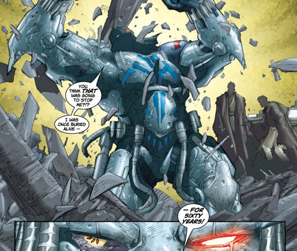
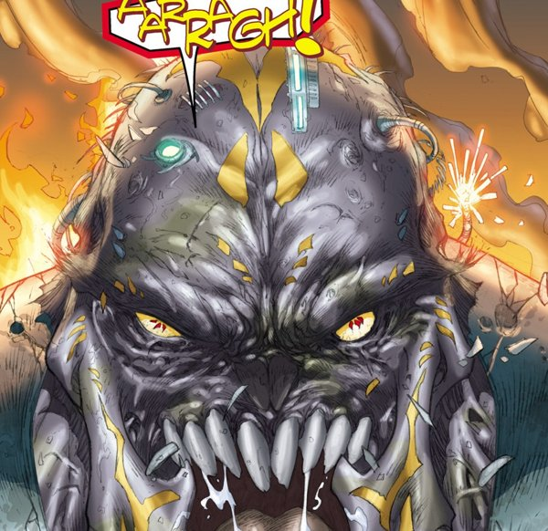
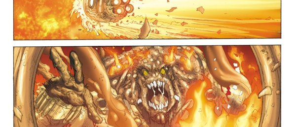

# Durge

- **Aliases:** —
- **Era:** Clone Wars
- **Continuity:** default Legends; entries present for: Legends
- **Research tier:** untiered (not listed as INTRO/DEEP/MASTERY in legends-feats.md)
- **Entries:** 139 (52 with quotations; 2 quotations extended to the full sentence/passage from the source text on file; 42 marked as fragments; 43 before the 2026-11-17 fragment fill). Rebuilt 2026-11-17 from 165 old entries; old file: `characters/_bak/durge.md.bak-20261117`.
- **How to read:** each entry is the quotation in full (block quote), then its source and point of view. "Note" lines are summaries from our notes, not quotations. `[fragment — full passage not on file]` means the source text is not on the box, so only the words in our notes are shown. Debate and forum material is in the last section and is unverified.

# LEGENDS (Legends / EU — main focus)

## Dark Lord trilogy (Labyrinth of Evil, Revenge of the Sith, Dark Lord): novel notes from the other agent (reference copy)

> Perhaps Gunray had thought of him as some mindless entity, like the reawakened Gen'Dai, Durge; or Dooku's misguided apprentice, Asajj Ventress; or the human bounty hunter called Aurra Sing - - all three of whom had been so driven by personal hatred of the Jedi that they had proved worthless, mere distractions while Grievous went about the real business of war.
— Source: Labyrinth of Evil (novel, read in full): feats, scaling, quotes and story notes; Ch15 L1079.
Context: Complete quote register (8 lines: every sentence that names Ventress, verbatim, in book order):
Our notes: `notes/materials/022-dark-lord-trilogy/labyrinth-of-evil-notes.md:1009`; `notes/materials/022-dark-lord-trilogy/labyrinth-of-evil-notes.md:1058`; `notes/materials/022-dark-lord-trilogy/labyrinth-of-evil-notes.md:1538`

- Note (summary from our notes, not a quotation): Grievous lists Durge with Ventress as a «mere distraction» (L1079); Aurra Sing is one of the «lesser combatants» who use two blades (L3327). No feats.
  — Source: L1079; L3327 — Labyrinth of Evil (novel, read in full): feats, scaling, quotes and story notes.
Our notes: `notes/materials/022-dark-lord-trilogy/labyrinth-of-evil-notes.md:1056`

- Note (summary from our notes, not a quotation): Complete quote register (3 lines: every sentence that names Durge and Aurra Sing, verbatim, in book order):
  — Source: Labyrinth of Evil (novel, read in full): feats, scaling, quotes and story notes.
Our notes: `notes/materials/022-dark-lord-trilogy/labyrinth-of-evil-notes.md:1057`

> For a moment he was back on Muunilinst, jousting with Durge’s speeder-freak lancer droids.
>
> Except for the snow.
— Source: Labyrinth of Evil (novel, read in full): feats, scaling, quotes and story notes; Ch29 L2959.
(Excerpt widened 2026-11-17 to the relevant passage, word for word from Labyrinth of Evil (James Luceno) (text copy `MEGA_Legend_The_Episode_Novelizations_Star_Wars_Revenge_of_the_Sith_01_Labyrinth_of_Evil_James_Luceno_epub`).)
(Excerpt widened 2026-11-17 to the relevant passage, word for word from Labyrinth of Evil (James Luceno) (text copy `MEGA_Legend_The_Episode_Novelizations_Star_Wars_Revenge_of_the_Sith_01_Labyrinth_of_Evil_James_Luceno_epub`).)
Context: Complete quote register (3 lines: every sentence that names Durge and Aurra Sing, verbatim, in book order):
Our notes: `notes/materials/022-dark-lord-trilogy/labyrinth-of-evil-notes.md:1059`

> In a forward hold of Grievous’s flagship, Dooku watched the cyborg general duel with his elite MagnaGuards, three of his trophy lightsabers in constant motion, parrying thrusts of the guards’ pulse-weaponed staffs, slicing the recycled air a hairbreadth from the expressionless faces of his opponents, incapacitating arm and leg servos when he could. Grievous was a force to be reckoned with, to be sure, but Dooku deplored his habit of collecting lightsabers. It had merely bothered him that Ventress and lesser combatants such as the bounty hunter Aurra Sing had adopted the foul practice. Grievous’s habit struck Dooku as the worst kind of profanation. Even so, he was not about to discourage the practice. The more Jedi that could be dispatched, the better.
— Source: Labyrinth of Evil (novel, read in full): feats, scaling, quotes and story notes; Ch32 L3327.
(Excerpt widened 2026-11-17 to the relevant passage, word for word from Labyrinth of Evil (James Luceno) (text copy `MEGA_Legend_The_Episode_Novelizations_Star_Wars_Revenge_of_the_Sith_01_Labyrinth_of_Evil_James_Luceno_epub`).)
Context: Complete quote register (3 lines: every sentence that names Durge and Aurra Sing, verbatim, in book order):
Our notes: `notes/materials/022-dark-lord-trilogy/labyrinth-of-evil-notes.md:1060`

## Star Wars: The New Essential Chronology (Del Rey, 2005): power-scaling and lore notes

> Obi-Wan Kenobi mounted his own speeder bike and led a squad of Republic lancers in a classic joust that ended with Durge's defeat.
— Source: Part Two: The Fall of the Republic; Obi-Wan Kenobi — Obi-Wan jousts Durge.
Note (our notes, around the quote): Obi-Wan Kenobi — Obi-Wan jousts Durge: "Obi-Wan Kenobi mounted his own speeder bike and led a squad of Republic lancers in a classic joust that ended with Durge's defeat." Source: The New Essential Chronology, p.62
Our notes: `notes/materials/027-new-essential-chronology/02-part-two-fall-of-the-republic.md:278`

> The hulking Gen'Dai put up a brutal fight, but Anakin succeeded where other Jedi had failed by mainlining the power of the dark side. Forcing the beaten Durge into an escape pod, Anakin sent the pod into the burning arms of a nearby sun.
— Source: Part Two: The Fall of the Republic; Darth Vader (Anakin Skywalker) — Anakin kills Durge.
Note (our notes, around the quote): Darth Vader (Anakin Skywalker) — Anakin kills Durge: "The hulking Gen'Dai put up a brutal fight, but Anakin succeeded where other Jedi had failed by mainlining the power of the dark side. Forcing the beaten Durge into an escape pod, Anakin sent the pod into the burning arms of a nearby sun." Source: The New Essential Chronology, p.79
Our notes: `notes/materials/027-new-essential-chronology/02-part-two-fall-of-the-republic.md:453`

## The Complete Star Wars Encyclopedia, Vol. I (A–G)

> Their population suffered after the Empire discovered valuable resources on their planet. Ablajeck sector An area of space that together with Moddell and Spar sectors made up the Inner Zuma region. Able-1707 A Jango Fett-template clone trooper serving under Shaak Ti during the Ab/e-1707 Clone Wars, unit A-1707 was stranded on an uncharted planet for over 20 years. He later assisted Rebel forces, including Luke Sky­ walker, when the Alliance attempted to estab­ lish a post on his planet. Adopting the more personalized name of Able, this trooper later served in the Alliance, helping in a mission to infiltrate an Imperial prison on Kalist VI. Able-472 One of the Muunilinst 10 clone troopers who worked with General Obi-Wan Kenobi to defeat Durge and his IG lancer droid forces. AblesA Corellian trained in emergency pro­ cedures, she worked as a transportation engi­ neer on Centerpoint Station in orbit between Talus and Tralus during the years following the war with the Yuuzhan Vong. Ab'Lon, Tereb A Bothan Rebel agent, he was incapacitated by Imperial agents and thrown to the Sarlacc in the Pit of Carkoon. He was survived by his astromech droid, R2-Z1, who carried vital information for the Alliance. aboOld Imperial slang for native inhabitants of a planet, often used in a derogatory man­ ner.
— Source: scan pages 1–40; Obi-Wan Kenobi. POV: Obi-Wan Kenobi, about Durge.
(Excerpt widened 2026-11-17 to the relevant passage, word for word from research primary cse vol1 (text copy `research_primary_cse_vol1_pdf_45a954be6d`).)
(Excerpt widened 2026-11-17 to the relevant passage, word for word from research primary cse vol1 (text copy `research_primary_cse_vol1_pdf_45a954be6d`).)
Note (our notes, around the quote): Obi-Wan Kenobi: "Able-472 One of the Muunilinst 10 clone troopers who worked with General Obi-Wan Kenobi to defeat Durge and his IG lancer droid forces." Source: The Complete Star Wars Encyclopedia, Vol. I, p.6
Our notes: `notes/materials/030-complete-star-wars-encyclopedia-vol-1/00-v1-scan-001-040.md:124`

- Note (summary from our notes, not a quotation): Page contents: 997 words, 42 paragraphs | headings/entries: Dura-Kahn; Duranc, Ak; Durane, Giles; Durasha, Celia; Durastar; Durasteel Corporation; Dureya, Grand Moff; Durge
  — Source: scan pages 201–240.
Our notes: `notes/materials/030-complete-star-wars-encyclopedia-vol-1/05-v1-scan-201-240.md:242`

> He had awakened to a galaxy at war, a galaxy where the Jedi Knights led clone soldiers in battle against the automated troops of the Confederacy. The charismatic Count Dooku lured Durge Duro DefenseForce 1 -- -- -- -- -- -- -- -- -- -- -- -- -- -- -- -- -- -- -- -- -- -- -- -- -- -- -- -- -- -- -- -- -- -- -- -into his ranks, and the ancient bounty hunter relished an ironic twist in his quest for retribution, since the clones originated with a Mandalorian. In becoming Dooku's henchman, the bounty hunter was teamed with Asajj Ventress. The two were formidable adversaries for the Republic, and Durge took the lives of many Jedi with great zeal. Anakin Skywalker was finally able to destroy Durge in the final months of the Clone Wars by trapping him within an escape pod and directing it into the heart of a sun. durindflre Rare valuable gems that spar­ kled from within. durinium This alloy resistant to sensor scans was valued by smugglers for lining suit­ cases and small hiding areas. Duris, G'Mai An X'Ting chosen as the regent and leader of her people during the Clone Wars, a time when her homeworld of Ord Cestus was under the control of Cestus Cybernetics and the Five Families, which were in turn under the sway of the Confeder­ acy of Independent Systems. A talented and honest politician, Duris could trace her fam­ ily's history back to the original hive queen.
— Source: scan pages 201–240; Darth Vader (Anakin Skywalker).
(Excerpt widened 2026-11-17 to the relevant passage, word for word from research primary cse vol1 (text copy `research_primary_cse_vol1_pdf_45a954be6d`).)
(Excerpt widened 2026-11-17 to the relevant passage, word for word from research primary cse vol1 (text copy `research_primary_cse_vol1_pdf_45a954be6d`).)
Note (our notes, around the quote): Darth Vader (Anakin Skywalker): "Anakin Skywalker was finally able to destroy Durge in the final months of the Clone Wars by trapping him within an escape pod and directing it into the heart of a sun." Source: The Complete Star Wars Encyclopedia, Vol. I, p.217
Our notes: `notes/materials/030-complete-star-wars-encyclopedia-vol-1/05-v1-scan-201-240.md:249`

## The Complete Star Wars Encyclopedia, Vol. II (H–O)

> During the early stages of the Clone Wars, Obi-Wan Kenobi believed that he had defeated Durge in a tremendous battle outside Harnaidan, only to confront the bounty hunter again.
— Source: scan pages 1–40; Obi-Wan Kenobi. POV: Obi-Wan Kenobi, about Durge.
Note (our notes, around the quote): Obi-Wan Kenobi: "During the early stages of the Clone Wars, Obi-Wan Kenobi believed that he had defeated Durge in a tremendous battle outside Harnaidan, only to confront the bounty hunter again." Source: The Complete Star Wars Encyclopedia, Vol. II, p.20
Our notes: `notes/materials/031-complete-star-wars-encyclopedia-vol-2/00-v2-scan-001-040.md:177`

> The IBC also financed the resurrection of Durge and General Grievous, actions that IBC leader San Hill believed made Darth Sidious indebted to the clan.
— Source: scan pages 81–120; General Grievous; Palpatine (Darth Sidious).
Note (our notes, around the quote): General Grievous; Palpatine (Darth Sidious): "The IBC also financed the resurrection of Durge and General Grievous, actions that IBC leader San Hill believed made Darth Sidious indebted to the clan." Source: The Complete Star Wars Encyclopedia, Vol. II, p.107
Our notes: `notes/materials/031-complete-star-wars-encyclopedia-vol-2/02-v2-scan-081-120.md:206`

> In the resulting chaos, Kenobi learned that it was Durge who had killed Korr.
— Source: scan pages 201–240; Obi-Wan Kenobi. POV: Obi-Wan Kenobi, about Durge.
Note (our notes, around the quote): Obi-Wan Kenobi: "In the resulting chaos, Kenobi learned that it was Durge who had killed Korr." Source: The Complete Star Wars Encyclopedia, Vol. II, p.226
Our notes: `notes/materials/031-complete-star-wars-encyclopedia-vol-2/05-v2-scan-201-240.md:331`

> Young Boba stole his miter-like hat and fled the ship with the children, while Durge set out to destroy Libkath.
— Source: scan pages 241–280; Boba Fett. POV: Boba Fett, about Durge.
Note (our notes, around the quote): Boba Fett: "Young Boba stole his miter-like hat and fled the ship with the children, while Durge set out to destroy Libkath." Source: The Complete Star Wars Encyclopedia, Vol. II, p.253
Our notes: `notes/materials/031-complete-star-wars-encyclopedia-vol-2/06-v2-scan-241-280.md:174`

- Note (summary from our notes, not a quotation): Page contents: 1157 words, 29 paragraphs | headings/entries: Operation Blue Harvest; Operation Blue Plug; Operation Case White; Operation Durge's Lance; Operation Emperor's Hammer; Operation Emperor's Spear; Operation Flotsam; Operation Hammerblow; Operation Joystick; Operation Katabatic; Operation Noble Savage
  — Source: scan pages 401–440.
Our notes: `notes/materials/031-complete-star-wars-encyclopedia-vol-2/10-v2-scan-401-440.md:165`

## The Complete Star Wars Encyclopedia, Vol. III (P–Z)

> On Queyta, Ventress and Durge tried to secure the antidote to the swamp gas, but Obi-Wan Kenobi and his companions bested her.
— Source: scan pages 281–320; Asajj Ventress; Obi-Wan Kenobi.
Note (our notes, around the quote): Asajj Ventress; Obi-Wan Kenobi: "On Queyta, Ventress and Durge tried to secure the antidote to the swamp gas, but Obi-Wan Kenobi and his companions bested her." Source: The Complete Star Wars Encyclopedia, Vol. III, p.302
Our notes: `notes/materials/032-complete-star-wars-encyclopedia-vol-3/07-v3-scan-281-320.md:225`

## Characters/Miniatures/The Force Is With Them (Mostly).pdf [Star Wars Roleplaying Game Revised Core (d20, 2002)]

- Note (summary from our notes, not a quotation): Page contents: Acolyte feats; Darth Maul (Tatooine, Naboo; Soldier 1/Dark Side Marauder 3/Sith Warrior 6/Sith Lord 2, CC F); Durge (Gen'Dai physiology rules, armor; Soldier 7/Bounty Hunter 3, CC E) (hand-read)
  — Source: Characters/Miniatures/The Force Is With Them (Mostly).pdf [Star Wars Role.
Our notes: `notes/materials/037-sw-d20-folder/113-the-force-is-with-them-mostly.md:23`

> The Separatists draw upon many bounty hunters to assist their cause. One is the ancient Gen'Dai known as Durge, whose bounty-hunting career has spanned over a thousand years. After killing a Mandalorian leader, he was captured and tortured. This ordeal pushed the unstable Durge over the edge of sanity.
— Source: Characters/Miniatures/The Force Is With Them (Mostly).pdf [Star Wars Role; Durge — entry/section: Durge, ancient Gen'Dai.
Note (our notes, around the quote): Durge — entry/section: Durge, ancient Gen'Dai: "The Separatists draw upon many bounty hunters to assist their cause. One is the ancient Gen'Dai known as Durge, whose bounty-hunting career has spanned over a thousand years. After killing a Mandalorian leader, he was captured and tortured. This ordeal pushed the unstable Durge over the edge of sanity." Source: *The Force Is With Them (Mostly)* (SWRPG d20 Revised Core), scan p.2
Our notes: `notes/materials/037-sw-d20-folder/113-the-force-is-with-them-mostly.md:27`

> Because of his suffering, Durge despises the Mandalorians. Count Dooku was able to use this hate by informing the bounty hunter that the Republic's clone troopers are based off the genetic template of a Mandalorian. Durge quickly joined the Separatist cause.
— Source: Characters/Miniatures/The Force Is With Them (Mostly).pdf [Star Wars Role; Durge; Count Dooku — entry/section: Durge's hatred of Mandalorians.
Note (our notes, around the quote): Durge; Count Dooku — entry/section: Durge's hatred of Mandalorians: "Because of his suffering, Durge despises the Mandalorians. Count Dooku was able to use this hate by informing the bounty hunter that the Republic's clone troopers are based off the genetic template of a Mandalorian. Durge quickly joined the Separatist cause." Source: *The Force Is With Them (Mostly)* (SWRPG d20 Revised Core), scan p.2
Our notes: `notes/materials/037-sw-d20-folder/113-the-force-is-with-them-mostly.md:29`

- Note (summary from our notes, not a quotation): Page contents: Durge skills/feats; Rodian Jedi Guardian (Jedi Guardian 4, CC C from image); Qui-Gon Jinn (Jedi Guardian 10/Jedi Master 5, CC F) (hand-read)
  — Source: Characters/Miniatures/The Force Is With Them (Mostly).pdf [Star Wars Role.
Our notes: `notes/materials/037-sw-d20-folder/113-the-force-is-with-them-mostly.md:39`

## Jedi Counselling/Jedi Counseling 59.pdf [Star Wars Roleplaying Game Revised Core (d20, 2002)]

- Note (summary from our notes, not a quotation): Page contents: Discblade stacking, Enhance Senses vs ysalamiri/Vong; Spotter, Maul Rolling Cleave, Aurra Sing, Durge (hand-read)
  — Source: Jedi Counselling/Jedi Counseling 59.pdf [Star Wars Roleplaying Game Revis.
Our notes: `notes/materials/037-sw-d20-folder/226-jedi-counseling-59.md:15`

- Note (summary from our notes, not a quotation): Page contents: Durge Momentum/Regeneration, C-3PO Draw Fire vs Emperor; author bio (hand-read)
  — Source: Jedi Counselling/Jedi Counseling 59.pdf [Star Wars Roleplaying Game Revis.
Our notes: `notes/materials/037-sw-d20-folder/226-jedi-counseling-59.md:30`

- Note (summary from our notes, not a quotation): Durge — entry/section: Durge's commander effect Momentum isn't kept: "A: No. They get the benefit of the Momentum special ability if they end their move within 6 squares of Durge, but they don't get to "keep" it. Of course, Momentum does you no good unless you happen to end that turn adjacent to an opponent." Source: *Jedi Counseling 59* (SWRPG d20 Revised Core), scan p.3
  — Source: Jedi Counselling/Jedi Counseling 59.pdf [Star Wars Roleplaying Game Revis.
Our notes: `notes/materials/037-sw-d20-folder/226-jedi-counseling-59.md:32`

- Note (summary from our notes, not a quotation): Durge — entry/section: Durge regenerates while using Double Attack: "A: Remember, there are no "move actions" like in the Star Wars Roleplaying Game. In Star Wars Minis, a character either moves or doesn't, and "move" is meant quite literally. Since Durge isn't moving, he gets the benefit of Regeneration in any round he uses Double Attack." Source: *Jedi Counseling 59* (SWRPG d20 Revised Core), scan p.3
  — Source: Jedi Counselling/Jedi Counseling 59.pdf [Star Wars Roleplaying Game Revis.
Our notes: `notes/materials/037-sw-d20-folder/226-jedi-counseling-59.md:34`

## Jedi Counselling/Jedi Counseling 66.pdf [Star Wars Roleplaying Game Revised Core (d20, 2002)]

- Note (summary from our notes, not a quotation): Page contents: Obi-Wan Block vs Durge, Gamble abuse and casinos (hand-read)
  — Source: Jedi Counselling/Jedi Counseling 66.pdf [Star Wars Roleplaying Game Revis.
Our notes: `notes/materials/037-sw-d20-folder/234-jedi-counseling-66.md:10`

- Note (summary from our notes, not a quotation): Obi-Wan Kenobi; Durge — entry/section: Obi-Wan blocks Durge's bullets and flamethrower with the Force: "Q: In the Clone Wars cartoon series, while fighting Durge on Muunilinst, Obi-Wan Kenobi parries a barrage of bullets as well as a flamethrower blast using only the Force. What ability is this? Force Strike? Move Object?
  — Source: Jedi Counselling/Jedi Counseling 66.pdf [Star Wars Roleplaying Game Revis.
Our notes: `notes/materials/037-sw-d20-folder/234-jedi-counseling-66.md:12`

## Jedi Counselling/Jedi Counseling 72.pdf [Star Wars Roleplaying Game Revised Core (d20, 2002)]

- Note (summary from our notes, not a quotation): Page contents: Evade vs Force Lightning, Durge + Sly Moore, Vader/Luke/C-3PO Draw Fire vs AoO; author bio (hand-read)
  — Source: Jedi Counselling/Jedi Counseling 72.pdf [Star Wars Roleplaying Game Revis.
Our notes: `notes/materials/037-sw-d20-folder/241-jedi-counseling-72.md:40`

- Note (summary from our notes, not a quotation): Durge; Sly Moore; Darth Maul — entry/section: Durge regenerates twice under Sly Moore's Dominate: "A: When Sly Moore uses Dominate on a character, that character gains a turn, subject to the limitations listed under Dominate. Thus, in this case, Durge could indeed get the benefits of Regeneration twice in a single round: On his turn (the "natural" turn he gets when he is activated during a phase), he could get the benefit of Regeneration so long as he doesn't move. Then, when Sly Moore uses Dominate on him, he gains a new turn, and at the end of it he will gain the benefits of Regeneration. (He can't move when Dominated, and Regeneration takes effect at the end of his turn if he doesn't move.)
  — Source: Jedi Counselling/Jedi Counseling 72.pdf [Star Wars Roleplaying Game Revis.
Our notes: `notes/materials/037-sw-d20-folder/241-jedi-counseling-72.md:42`

- Note (summary from our notes, not a quotation): And, just to be perfectly clear, this was exactly what the designers had in mind when they wrote the rules for Dominate. Durge might get the benefits of Regeneration twice in a round, Darth Maul might get to make two Triple Attacks in a round, and so on." Source: *Jedi Counseling 72* (SWRPG d20 Revised Core), scan p.3
  — Source: Jedi Counselling/Jedi Counseling 72.pdf [Star Wars Roleplaying Game Revis.
Our notes: `notes/materials/037-sw-d20-folder/241-jedi-counseling-72.md:43`

## Jedi Counselling/Jedi Counseling 73.pdf [Star Wars Roleplaying Game Revised Core (d20, 2002)]

- Note (summary from our notes, not a quotation): Page contents: Luke/Gamorreans/Bib Fortuna; San Hill reserves and rerolls, Yoda vs Palpatine Betrayal, Sly Moore Dominate; Palpatine Order 66; Durge indoor flight Q (hand-read)
  — Source: Jedi Counselling/Jedi Counseling 73.pdf [Star Wars Roleplaying Game Revis.
Our notes: `notes/materials/037-sw-d20-folder/242-jedi-counseling-73.md:27`

> Note that the Order 66 glossary entry mentions a specific miniature by name. "Emperor Palpatine, Sith Lord" refers only to the Palpatine from Revenge of the Sith. If it were meant to apply to the Rebel Storm Palpatine, it would have said "Emperor Palpatine" (which would apply to both) instead of "Emperor Palpatine, Sith Lord." Q: Characters with Flight ignore attacks of opportunity, low objects, and pits, but are restricted by walls when moving. This got me wondering about rules for indoor flight. For instance, how high should ceilings be assumed to be? In the cantina in A New Hope, it would be improbable, if not impossible, for a character like Durge to fly through the doorway and be able to fly over low obstacles (like the bar, stools, and so on) unless he were moving horizontally the entire time, which would require constant movement indoors. Outdoor hovering doesn't seem to cause the same problem. Are there rules I'm missing, or is the game meant to run this way? A: This really goes into far more detail than the Star Wars Miniatures Game is meant to handle. We simply assume that, even indoors, there is enough room to hover around without a problem.
— Source: Jedi Counselling/Jedi Counseling 73.pdf [Star Wars Roleplaying Game Revis; Durge — entry/section: Durge flying indoors in the cantina.
(Excerpt widened 2026-11-17 to the relevant passage, word for word from research primary sw d20 folder files Star Wars Roleplaying Game Revised Core Jedi Counselling Jedi Counseling 73 (text copy `research_primary_sw_d20_folder_files_Star_Wars_Roleplaying_Game_Revised_Core_Jedi_Counselling_Jedi_Counseling_73_pdf_4d86f4c01e`).)
Note (our notes, around the quote): Durge — entry/section: Durge flying indoors in the cantina: "Q: Characters with Flight ignore attacks of opportunity, low objects, and pits, but are restricted by walls when moving. This got me wondering about rules for indoor flight. For instance, how high should ceilings be assumed to be? In the cantina in A New Hope, it would be improbable, if not impossible, for a character like Durge to fly through the doorway and be able to fly over low obstacles (like the bar, stools, and so on) unless he were moving horizontally the entire time, which would require constant movement indoors. Outdoor hovering doesn't seem to cause the same problem. Are there rules I'm missing, or is the game meant to run this way?" Source: *Jedi Counseling 73* (SWRPG d20 Revised Core), scan p.3
Our notes: `notes/materials/037-sw-d20-folder/242-jedi-counseling-73.md:38`

## Jedi Counselling/Jedi Counseling 74.pdf [Star Wars Roleplaying Game Revised Core (d20, 2002)]

- Note (summary from our notes, not a quotation): Page contents: R2-D2 Tow Cable passenger, Riposte limit, Durge Momentum, Jango vs Kenobi natural 20, Gungan Cavalry; author bio (hand-read)
  — Source: Jedi Counselling/Jedi Counseling 74.pdf [Star Wars Roleplaying Game Revis.
Our notes: `notes/materials/037-sw-d20-folder/243-jedi-counseling-74.md:31`

> If attacked by someone with multiple attacks, you only get to use it once. The only way a character could use it more than once is if he had an ability that allowed him to use the Force more than once in a single turn, such as Master of the Force 3. Q: Durge has the special abilities Flight and Momentum. Flight says that you can fly through an enemy's adjacent squares without provoking attacks of opportunity. Does this mean that even when he starts his move next to someone, he still moves away and avoids the attack of opportunity? If so, would this mean he could back up a bit and then move back at the same enemy to get the benefit of Momentum? A: Actually, you're making a mistake in reading Durge's stat card: He doesn't have Momentum. His commander effect grants Momentum to non­Unique followers who end their move within 6 squares. Durge himself doesn't get this benefit at all, of course. Still, let's address this question as a hypothetical: Could a character with Flight and Momentum do what you describe? The answer is yes. They could back up and re­engage the same enemy without provoking an attack of opportunity, and this movement would trigger the benefits of Momentum. Q: Let's say Jango Fett attacks General Kenobi and hits with a natural 20.
— Source: Jedi Counselling/Jedi Counseling 74.pdf [Star Wars Roleplaying Game Revis; Durge — entry/section: Durge doesn't have Momentum.
(Excerpt widened 2026-11-17 to the relevant passage, word for word from research primary sw d20 folder files Star Wars Roleplaying Game Revised Core Jedi Counselling Jedi Counseling 74 (text copy `research_primary_sw_d20_folder_files_Star_Wars_Roleplaying_Game_Revised_Core_Jedi_Counselling_Jedi_Counseling_74_pdf_40b465ad26`).)
(Excerpt widened 2026-11-17 to the relevant passage, word for word from research primary sw d20 folder files Star Wars Roleplaying Game Revised Core Jedi Counselling Jedi Counseling 74 (text copy `research_primary_sw_d20_folder_files_Star_Wars_Roleplaying_Game_Revised_Core_Jedi_Counselling_Jedi_Counseling_74_pdf_40b465ad26`).)
Note (our notes, around the quote): Durge — entry/section: Durge doesn't have Momentum: "A: Actually, you're making a mistake in reading Durge's stat card: He doesn't have Momentum. His commander effect grants Momentum to non-Unique followers who end their move within 6 squares. Durge himself doesn't get this benefit at all, of course." Source: *Jedi Counseling 74* (SWRPG d20 Revised Core), scan p.3
Our notes: `notes/materials/037-sw-d20-folder/243-jedi-counseling-74.md:36`

## Sourcebooks/The Clone Wars Campaign Guide.pdf [Star Wars Roleplaying Game Saga Edition (2007)] (scan pages 1–60)

- Note (summary from our notes, not a quotation): Page contents: Dug Species Traits (Small, Athletic). Gen'Dai: extreme longevity, no centralized vital organs, nomads; personality and insanity with age; example names Durge, Grozm, Kranth, Lu'urn; Gen'Dai Species Traits (Large, Gen'Dai Surge, Hibernation, Mental Instability, Regeneration, Resilient Physiology). (hand-read)
  — Source: Sourcebooks/The Clone Wars Campaign Guide.pdf [Star Wars Roleplaying Game.
Our notes: `notes/materials/037-sw-d20-folder/728-the-clone-wars-campaign-guide-scan-001-060.md:84`

> Your lightsabers will make a fine addition to my collection.
— Source: Sourcebooks/The Clone Wars Campaign Guide.pdf [Star Wars Roleplaying Game.
Note (our notes, around the quote): Page contents: Heroes of the Clone Wars themes: Large-Scale Conflict (Nelvaan, Commenor; Ewoks/Chiss with GM permission); Decline of the Jedi (Order 66; Jedi Master Kota); Rampant Corruption (Palpatine, Sidious, Dooku); High-Profile Villains (Dooku, Grievous, Loathsom, Ventress, Durge, Darth Maul). Epigraph: "Your lightsabers will make a fine addition to my collection." -General Grievous. (hand-read)
Our notes: `notes/materials/037-sw-d20-folder/728-the-clone-wars-campaign-guide-scan-001-060.md:147`

> Count Dooku is a well-known Jedi traitor; General Grievous is a reputedly brilliant military leader whose visage intimidates his enemies; Generali Loathsom is a vicious brute, Asajj Ventress an aspiring Sith, and Durge an immortal bounty huater.
— Source: Sourcebooks/The Clone Wars Campaign Guide.pdf [Star Wars Roleplaying Game; Count Dooku; General Grievous; Asajj Ventress.
Note (our notes, around the quote): Count Dooku; General Grievous; Asajj Ventress: "Count Dooku is a well-known Jedi traitor; General Grievous is a reputedly brilliant military leader whose visage intimidates his enemies; Generali Loathsom is a vicious brute, Asajj Ventress an aspiring Sith, and Durge an immortal bounty huater." Source: *The Clone Wars Campaign Guide* (SWRPG Saga Edition), scan p.21
Our notes: `notes/materials/037-sw-d20-folder/728-the-clone-wars-campaign-guide-scan-001-060.md:149`

## Sourcebooks/The Clone Wars Campaign Guide.pdf [Star Wars Roleplaying Game Saga Edition (2007)] (scan pages 61–120)

> Bal vows that when she does finally escape, she will kill every-one in the Hutt's courtcoincidentally, everyone who witnessed her defeat. Hatred often springs from a position of inferiority; what one cannot control, one frequently hates. But when a character has the power of life and death over the object of his hatred- a single individual, or even an entire galaxy-he can cause suffering. Mental, verbal, and physical abuse are his tools; through these methods, the character denigrates and depersonalizes his victims-making them no more significant than objects, to be used or destroyed as he likes. Suffering "hate leads to suffering." -Yoda Greed "Greed can be a powerful ally ... if it's used properly." - Qui-Gon Jinn ensues, until the Hutt's bodyguard returns. By this time, though, Bal Serinus has learned the alien's secret: He secretes a nerve-paralyzing toxin from his fingertips. Having recovered her lightsaber, the Dark Jedi severs the alien's hands, leaving him defenseless. But rather than kill him, she hauls him off in chains, selling him as a slave to another Hutt-a rival to the one who had captured her. Vengeance 'At last we will have our revenge." -Darth Maul A combination of hatred and anger, vengeance impels a character to administer what she considers "justice"though ultimately, that justice only serves herself.
— Source: Sourcebooks/The Clone Wars Campaign Guide.pdf [Star Wars Roleplaying Game.
(Excerpt widened 2026-11-17 to the relevant passage, word for word from research primary sw d20 folder files Star Wars Roleplaying Game Core Sourcebooks The Dark Side Sourcebook (text copy `research_primary_sw_d20_folder_files_Star_Wars_Roleplaying_Game_Core_Sourcebooks_The_Dark_Side_Sourcebook_pdf_c498151f20`).)
(Excerpt widened 2026-11-17 to the relevant passage, word for word from research primary sw d20 folder files Star Wars Roleplaying Game Core Sourcebooks The Dark Side Sourcebook (text copy `research_primary_sw_d20_folder_files_Star_Wars_Roleplaying_Game_Core_Sourcebooks_The_Dark_Side_Sourcebook_pdf_c498151f20`).)
Note (our notes, around the quote): Page contents: Rampant Corruption (corruption let Palpatine become Supreme Chancellor and, as Darth Sidious, manipulate the Separatists into war; corrupt senators, officers; using enemy corruption; temptation of heroes; Scum and Villainy reference). Epigraph: "Greed can be a powerful ally." -Qui-Gon Jinn. Villains (Count Dooku, General Grievous, Durge, Asajj Ventress, General Loathsom). Dehumanization begins (Count Dooku a very Human villain). (hand-read)
Our notes: `notes/materials/037-sw-d20-folder/728-the-clone-wars-campaign-guide-scan-061-120.md:233`

- Note (summary from our notes, not a quotation): Page contents: Dehumanization cont. (Ventress twisted shadow of humanity; Grievous near-total replacement cyborg; Durge faceless armor; voices and mannerisms: Grievous's metallic echo and coughs, Ventress's hissing voice, Durge's silence, Loathsom's boiling anger; ruthlessness). Powerful Personality (Dooku charismatic and bold, left the Order after the death of a beloved apprentice; Ventress strives to be heir to the Sith legacy and prove herself to Dooku; villains as dark reflections of heroes; example fallen smuggler). (hand-read)
  — Source: Sourcebooks/The Clone Wars Campaign Guide.pdf [Star Wars Roleplaying Game.
Our notes: `notes/materials/037-sw-d20-folder/728-the-clone-wars-campaign-guide-scan-061-120.md:244`

- Note (summary from our notes, not a quotation): Page contents: Coruscant cont. (clone patrols with deadly force; species discrimination and mass deportations alienate supporters of Palpatine). Dorin (Kel Dor support the Republic). Duro (Battle of Duro in Operation Durge's Lance; bombardment ordered by General Grievous; Senatorial corruption rerouted ships; Grievous lauded as a military genius). Gamorr (Gamorrean mercenaries, under 8 percent survival; Trade Federation finder's fee to the Hutts). Iridonia ("The Great Debate"). (hand-read)
  — Source: Sourcebooks/The Clone Wars Campaign Guide.pdf [Star Wars Roleplaying Game.
Our notes: `notes/materials/037-sw-d20-folder/728-the-clone-wars-campaign-guide-scan-061-120.md:396`

## Sourcebooks/The Clone Wars Campaign Guide.pdf [Star Wars Roleplaying Game Saga Edition (2007)] (scan pages 121–180)

- Note (summary from our notes, not a quotation): Page contents: ARC troopers cont. (released from cryogenic storage by Prime Minister Lama Su when Kamino is assaulted; Muunilinst with Obi-Wan vs. Durge; Hypori rescue from Grievous); ARC Trooper stat block (CL 8; nonheroic 6/soldier 3/elite trooper 3). Clone Assassin (special order from Palpatine against a Jedi coup; guard the Communication Center in the Jedi Temple; wiped out by Yoda and Obi-Wan); stat block (CL 8; vibroblades; Dual Weapon Mastery II, Martial Arts II). (hand-read)
  — Source: Sourcebooks/The Clone Wars Campaign Guide.pdf [Star Wars Roleplaying Game.
Our notes: `notes/materials/037-sw-d20-folder/728-the-clone-wars-campaign-guide-scan-121-180.md:289`

## Sourcebooks/The Clone Wars Campaign Guide.pdf [Star Wars Roleplaying Game Saga Edition (2007)] (scan pages 181–225)

- Note (summary from our notes, not a quotation): Page contents: Trandoshan Mercenary stat block cont. Influential Figures (Asajj Ventress, Durge, General Grievous, Count Dooku, Darth Sidious; Dooku plans to dispatch Sidious). Art caption: "Count Dooku and Whorm Loathsom". Count Dooku, Separatist Leader and Sith Lord begins (Darth Tyranus; Galidraan; Jango Fett among the Mandalorians). (hand-read)
  — Source: Sourcebooks/The Clone Wars Campaign Guide.pdf [Star Wars Roleplaying Game.
Our notes: `notes/materials/037-sw-d20-folder/728-the-clone-wars-campaign-guide-scan-181-225.md:34`

- Note (summary from our notes, not a quotation): Page contents: Asajj Ventress concluded (defeated by Skywalker and Kenobi; body vanishes en route to Coruscant; rumor of Second Battle of Xagobah). Ventress stat block (CL 13; Rattataki Jedi 5/scout 4/Sith apprentice 4; Dual Weapon Mastery III). Durge, Separatist Commander begins (Gen'Dai; over 1,500 years old; apprenticed with Mandalorian Jaing; cybernetics; vengeance on Mandalorians; IG lancer droids; Ohma-D'un; Queyta; Muunilinst; Grievous bests him on the Trenchant Space Station). (hand-read)
  — Source: Sourcebooks/The Clone Wars Campaign Guide.pdf [Star Wars Roleplaying Game.
Our notes: `notes/materials/037-sw-d20-folder/728-the-clone-wars-campaign-guide-scan-181-225.md:70`

> Still thirsting far vengeance against the Mandalorians, Durge learns that the last of their eumber, Jango Fett, has been killed—but that he had left behind hundreds of thousands of clones, and the Separatist's leader, Count Dooku, recruits Durge to help kill them.
— Source: Sourcebooks/The Clone Wars Campaign Guide.pdf [Star Wars Roleplaying Game; Jango Fett; Count Dooku.
Note (our notes, around the quote): Jango Fett; Count Dooku: "Still thirsting far vengeance against the Mandalorians, Durge learns that the last of their eumber, Jango Fett, has been killed—but that he had left behind hundreds of thousands of clones, and the Separatist's leader, Count Dooku, recruits Durge to help kill them." Source: *The Clone Wars Campaign Guide* (SWRPG Saga Edition), scan p.186
Our notes: `notes/materials/037-sw-d20-folder/728-the-clone-wars-campaign-guide-scan-181-225.md:74`

- Note (summary from our notes, not a quotation): Page contents: Durge concluded (faces Kit Fisto and Plo Koon; Karthakk system; launched into a star by Anakin). Durge stat block (CL 16; Large Gen'Dai cyborg soldier 8/elite trooper 2/scout 3/bounty hunter 3; Dark Side 24). (hand-read)
  — Source: Sourcebooks/The Clone Wars Campaign Guide.pdf [Star Wars Roleplaying Game.
Our notes: `notes/materials/037-sw-d20-folder/728-the-clone-wars-campaign-guide-scan-181-225.md:88`

## Sourcebooks/The Force Unleashed Campaign Guide.pdf [Star Wars Roleplaying Game Saga Edition (2007)] (scan pages 61–120)

- Note (summary from our notes, not a quotation): Page contents: Scyk stat block. NovaSword Space Superiority Fighter (Subpro; Z-95 successor; Separatist elite commanders; Durge's personal fighter) stat block. R-41 Starchaser begins. (hand-read)
  — Source: Sourcebooks/The Force Unleashed Campaign Guide.pdf [Star Wars Roleplaying.
Our notes: `notes/materials/037-sw-d20-folder/729-the-force-unleashed-campaign-guide-scan-061-120.md:367`

## Star Wars Insider #67 (2003)

- Note (summary from our notes, not a quotation): Page contents: Star News: Clone Wars micro-series on Cartoon Network; sidebar "New Faces of Villainy" on Asajj Ventress and Durge. (hand-read)
  — Source: Star Wars Insider #67 (2003).
Our notes: `notes/materials/038-star-wars-insider/067-ins067.md:120`

## Star Wars Insider #69 (2003)

- Note (summary from our notes, not a quotation): Page contents: Rudish interview: designing Durge and other new characters; Durge's healing powers and alien physiology. (hand-read)
  — Source: Star Wars Insider #69 (2003).
Our notes: `notes/materials/038-star-wars-insider/069-ins069.md:100`

## Star Wars Insider #70 (2003)

- Note (summary from our notes, not a quotation): Page contents: Clone Wars field report ends: Bryan Andrews's storyboard process, Jedi blur-running as a combat tactic, and his favorite episodes (Obi-Wan vs. Durge, the two Mace episodes). (hand-read)
  — Source: Star Wars Insider #70 (2003).
Our notes: `notes/materials/038-star-wars-insider/070-ins070.md:194`

> The one where Obi-Wan Kenobi fights his main bad guy, [Durge]. I kind of like how that fight turned out because it's fast and brutal. I also love the two Mace episodes. He's on his own, beating the heck out of tons of droids in pure Jedi style and that was a lot of fun. We don't really get to see Mace do too much in the movie—just a little bit at the end of Episode II—and he's supposed to be second to Yoda, so it was our chance to really flex Mace's muscles.
— Source: Star Wars Insider #70 (2003).
Note (our notes, around the quote): Mace Windu; Obi-Wan Kenobi; Durge — entry/section: Clone Wars field report: Bryan Andrews on the Durge and Mace episodes: ""The one where Obi-Wan Kenobi fights his main bad guy, [Durge]. I kind of like how that fight turned out because it's fast and brutal. I also love the two Mace episodes. He's on his own, beating the heck out of tons of droids in pure Jedi style and that was a lot of fun. We don't really get to see Mace do too much in the movie—just a little bit at the end of Episode II—and he's supposed to be second to Yoda, so it was our chance to really flex Mace's muscles." —Bryan Andrews, Star Wars Insider 70, p. 37" Source: *Star Wars Insider #70* (2003), scan p.37
Our notes: `notes/materials/038-star-wars-insider/070-ins070.md:196`

- Note (summary from our notes, not a quotation): Page contents: Hasbro Clone Wars toy line: Jedi figures, Durge, Asajj Ventress, ARC trooper. (hand-read)
  — Source: Star Wars Insider #70 (2003).
Our notes: `notes/materials/038-star-wars-insider/070-ins070.md:380`

## Star Wars Insider #71 (2003)

- Note (summary from our notes, not a quotation): Page contents: Hasbro column ends: Clone Wars figures for the Cartoon Network micro-series (Nov. 7), Durge and clone trooper speeder bike packs, Collection 2 figures (Bail Organa, Padme, Janus Greejatus), Jedi High Council and Geonosian War Room Scene Packs; retailer guide. (hand-read)
  — Source: Star Wars Insider #71 (2003).
Our notes: `notes/materials/038-star-wars-insider/071-ins071.md:389`

## Star Wars Insider #74 (2004)

- Note (summary from our notes, not a quotation): Page contents: Contents (printed p. 4): Prequel Update (Rick McCallum on the rough cut and the new clone trooper), The New Jedi Order in 100 Easy Lessons, Wasaka Berries and Monster Ships (storybooks), In Focus (Attack of the Clones miniatures), Who's Who in Echo Base, fiction "Pearls in the Sand" by Veronica Whitney-Robinson; departments including Star News, Star Sightings, Best of Hyperspace, HoloNet News (Operation Durge's Lance), Set Piece (Dooku's solar sailer hangar), Bookshelf (Zahn's Survivor's Quest). (hand-read)
  — Source: Star Wars Insider #74 (2004).
Our notes: `notes/materials/038-star-wars-insider/074-ins074.md:15`

- Note (summary from our notes, not a quotation): Page contents: HoloNet News (CIS Shadowfeed): Operation Durge's Lance breaks Duro's outer defenses, destroying Golan platforms and Republic Acclamators; Jyvus space city surrenders and Representative Hoolidan Keggle is missing; Corellia predicted as the next target. (hand-read)
  — Source: Star Wars Insider #74 (2004).
Our notes: `notes/materials/038-star-wars-insider/074-ins074.md:413`

- Note (summary from our notes, not a quotation): Page contents: Toy Box continued: Animated wave of Yoda, a Clone Trooper, Count Dooku and Durge (exclusive to Target); Fans' Choice Figure #5 winner Captain Antilles, whose neck stretches to recreate Vader's grip. (hand-read)
  — Source: Star Wars Insider #74 (2004).
Our notes: `notes/materials/038-star-wars-insider/074-ins074.md:519`

- Note (summary from our notes, not a quotation): Page contents: Toy Box photos: Animated Wave 2 (February/March 2004) — Durge, Count Dooku, Yoda and a Clone Trooper. (hand-read)
  — Source: Star Wars Insider #74 (2004).
Our notes: `notes/materials/038-star-wars-insider/074-ins074.md:528`

## Star Wars Insider #75 (2004)

- Note (summary from our notes, not a quotation): Page contents: Rebel Rumblings continued (reader names omitted): Clone Wars micro-series praise and the Durge vs. Obi-Wan duel; a clone-trooper-costumed child and X-wing-costumed dog (reply: money on "Duke Skywalker"); note that Robert Barnes, sculptor of the General Grievous maquette, also designed Durge; reader haiku; a portfolio cover of Qui-Gon vs. Maul made of construction paper. (hand-read)
  — Source: Star Wars Insider #75 (2004).
Our notes: `notes/materials/038-star-wars-insider/075-ins075.md:69`

## Star Wars Insider #76 (2004)

- Note (summary from our notes, not a quotation): Page contents: HoloNet News continued: General Grievous declares Operation Durge's Lance a success, with Duro under Confederacy control and Givin engineers blocking the Corellian Trade Spine; an unattributed Separatist message; Shu Mai on defending Mooria with organic troops because ion storms block battle droids. (hand-read)
  — Source: Star Wars Insider #76 (2004).
Our notes: `notes/materials/038-star-wars-insider/076-ins076.md:424`

- Note (summary from our notes, not a quotation): Page contents: Clone Wars Adventures continued: Blackman developed the backstories of Durge and Asajj Ventress; three-story "vignette" issues; issue 1 features Obi-Wan and Anakin on a planet of eternal night, Mace Windu on Saesee Tiin's homeworld Iktotch and Kit Fisto underwater. (hand-read)
  — Source: Star Wars Insider #76 (2004).
Our notes: `notes/materials/038-star-wars-insider/076-ins076.md:460`

## Star Wars Insider #79 (2005)

- Note (summary from our notes, not a quotation): Page contents: Drawn by the Force continued (Daniel Wallace): Obsession ties up loose ends for Asajj Ventress, Durge and ARC trooper Alpha; artist Brian Ching on Revenge of the Sith reference art; post-Episode III plans fluid. Sidebar "Battles, Bite-Sized": Clone Wars Adventures digest series (Haden Blackman, Welles Hartley, the Fillbach Brothers, Ben Caldwell). (hand-read)
  — Source: Star Wars Insider #79 (2005).
Our notes: `notes/materials/038-star-wars-insider/079-ins079.md:215`

## Star Wars Insider #94 (2007)

- Note (summary from our notes, not a quotation): Page contents: Best of StarWars.com cont.: You Can Draw Star Wars sample spreads (Muscle, Service Droids, Weapons, Male and Female, Creating a Comic); pull quote from Tom Hodges; Durge battle scene, Gonk droid, mouse droids; book from DK Publishing and StarWarsShop.com (hand-read)
  — Source: Star Wars Insider #94 (2007).
Our notes: `notes/materials/038-star-wars-insider/094-ins094.md:161`

> The battle scene section with Obi-Wan Kenobi and the clones, with Durge rampaging, was my favorite piece to illustrate for the book.
— Source: Star Wars Insider #94 (2007); Obi-Wan Kenobi; Durge — entry/section: Durge rampaging.
Note (our notes, around the quote): Obi-Wan Kenobi; Durge — entry/section: Durge rampaging: ""The battle scene section with Obi-Wan Kenobi and the clones, with Durge rampaging, was my favorite piece to illustrate for the book." —Tom Hodges, Star Wars Insider 94, p. 17" Source: *Star Wars Insider #94* (2007), scan p.17
Our notes: `notes/materials/038-star-wars-insider/094-ins094.md:163`

> Luke's Duel Against the Dark Side on Dagobah....
> [fragment — full passage not on file]
— Source: Star Wars Insider #94 (2007); Page contents: Star Wars Q&A by Pablo Hidalgo.
Note (our notes, around the quote): Page contents: Star Wars Q&A by Pablo Hidalgo: "Luke's Duel Against the Dark Side on Dagobah...." (plus Jango's jetpack jinx, Count Dooku's bust, Nute Gunray's grudge and Durge's sunburn): Dagobah cave vision, the Lost Twenty, Durge's fate, Anakin's datapad in his Episode III vision; reader questions (names omitted); contact box for questions (hand-read)
Our notes: `notes/materials/038-star-wars-insider/094-ins094.md:702`

## Star Wars Insider #99 (2008)

- Note (summary from our notes, not a quotation): Page contents: Tales of the Bounty Hunters cont.: group art of hunters (Aurra Sing, Jango Fett, 4-LOM, Cade Skywalker, Bossk, Durge, Zam Wesell); Embo-style caption (hand-read)
  — Source: Star Wars Insider #99 (2008).
Our notes: `notes/materials/038-star-wars-insider/099-ins099.md:124`

- Note (summary from our notes, not a quotation): Page contents: Guild Handbook concl.: "Female Hunters"/"Intel" panels: Zam Wesell and Aurra Sing stat boxes with images; Durge stat box with image; "Important Info: Permit to Hunt" (hand-read)
  — Source: Star Wars Insider #99 (2008).
Our notes: `notes/materials/038-star-wars-insider/099-ins099.md:274`

## Star Wars Insider #104 (2008)

- Note (summary from our notes, not a quotation): Page contents: Next Time preview (Jedi at 25; The Clone Wars; The Force Unleashed hints; Ken Ralston; Maris Brood model Adrienne Wilkinson; Versus: Boba Fett vs Durge) (hand-read)
  — Source: Star Wars Insider #104 (2008).
Our notes: `notes/materials/038-star-wars-insider/104-ins104.md:449`

## Star Wars Insider #135 (2012)

- Note (summary from our notes, not a quotation): Page contents: Comics: The Crimson Empire Saga hardcover (Kir Kanos; Nom Anor's first appearance); Omnibus: Clone Wars Volume 1 (Ventress, Dooku, Durge). Ask Lobot (questioner omitted): Mon Calamari usually have first and last names; Ackbar's first name was recently revealed as Gial. (hand-read)
  — Source: Star Wars Insider #135 (2012).
Our notes: `notes/materials/038-star-wars-insider/135-ins135.md:356`

## Star Wars Insider Digital Sampler Edition (2010)

- Note (summary from our notes, not a quotation): Page contents: "The Negotiator" (viewed): Clone Wars general; moniker and flagship name; Commander Cody; foes Dooku, Ventress, Durge, Grievous; Anakin's fall. (hand-read)
  — Source: Star Wars Insider Digital Sampler Edition (2010). POV: Page contents, about Durge.
Our notes: `notes/materials/038-star-wars-insider/155-inssampler2010.md:85`

## Star Wars Insider Special Edition (2012)

- Note (summary from our notes, not a quotation): Page contents: Bounty Hunters Guild Handbook: Aurra Sing, Zam Wesell, Durge; Permit to Hunt (viewed). (hand-read)
  — Source: Star Wars Insider Special Edition (2012).
Our notes: `notes/materials/038-star-wars-insider/158-insspecial2012.md:510`

## Star Wars Insider Special Edition (2013)

- Note (summary from our notes, not a quotation): Page contents: Obi-Wan profile: Clone Wars general, Cody, confrontations with Dooku, Ventress, Durge, Grievous. (hand-read)
  — Source: Star Wars Insider Special Edition (2013).
Our notes: `notes/materials/038-star-wars-insider/159-insspecial2013.md:284`

## Star Wars Visual Dictionaries, Episodes I–VI (DK, 1998–2005) + The Phantom Menace Expanded Visual Dictionary (DK, 2012)

> thought to be impregnable. But that was before Darth Sidious sent his new apprentice, Darth Vader, to assassinate the members of the Council. With the Jedi killed, and the chief Separatists soon to follow, no one will stand in Sidious's and Vader's way when they seize total control of the galaxy.
> [fragment — full passage not on file]
>
> financed the resurrection of the Gen'dai warrior Durge, as well as the rehabilitation of Grievous
> [fragment — full passage not on file]
>
> hundreds of thousands of his fellow Geonosians employed in the construction of Darth Sidious's battle station
> [fragment — full passage not on file]
>
> special agreement with Darth Sidious *(Trade Federation first drawn in)*
> [fragment — full passage not on file]
>
> talent for bribery is useless against Vader
> [fragment — full passage not on file]
— Source: Star Wars Revenge of the Sith: The Visual Dictionary (DK, 2005): hand-read notes; p57 Endgame [KEY]: Mustafar facility.
Note (our notes, around the quote): p57 Endgame [KEY]: Mustafar facility "thought to be impregnable. But that was before Darth Sidious sent his new apprentice, Darth Vader, to assassinate the members of the Council. With the Jedi killed, and the chief Separatists soon to follow, no one will stand in Sidious's and Vader's way when they seize total control of the galaxy." DATA FILE: Separatists ignored arms laws; used an InterGalactic Banking Clan code. San Hill ("financed the resurrection of the Gen'dai warrior Durge, as well as the rehabilitation of Grievous"); Poggle ("hundreds of thousands of his fellow Geonosians employed in the construction of Darth Sidious's battle station"); Nute Gunray and Rune Haako "special agreement with Darth Sidious" (Trade Federation first drawn in); Cat Miin (aide); Shu Mai (Commerce Guild, Castell; "talent for bribery is useless against Vader").
Our notes: `notes/materials/047-visual-dictionaries/vd3-ep3.md:56`

## Star Wars: Obsession #1–5 (Dark Horse, Nov 2004 – Apr 2005)

> you will not kill me!
> [fragment — full passage not on file]
— Source: Star Wars: Obsession: daily-image candidates; ![Durge rises from the wreckage.
Note (our notes, around the quote): 
Our notes: `notes/materials/049-obsession/daily-image-candidates.md:28`

- Note (summary from our notes, not a quotation): 
  — Source: Star Wars: Obsession: daily-image candidates.
Our notes: `notes/materials/049-obsession/daily-image-candidates.md:31`

- Note (summary from our notes, not a quotation): 
  — Source: Star Wars: Obsession: daily-image candidates.
Our notes: `notes/materials/049-obsession/daily-image-candidates.md:34`

> You truly believe the war is almost over?
>
> Don't you? Under Palpatine's leadership, we've driven the Confederacy into the Outer Rim. They are under siege...
> [fragment — full passage not on file]
>
> Which makes them desperate, unpredictable. Dooku's commanders...
> [fragment — full passage not on file]
>
> He has few left. I... we've captured or killed all but the bounty hunter Durge, and General Grievous.
> [fragment — full passage not on file]
>
> And Asajj Ventress? She seemed the most dangerous of them all...
> [fragment — full passage not on file]
>
> She was powerful, but I killed her. She won't threaten us again.
>
> Although Obi-Wan won't admit that she's gone.
>
> No. Just ... frustrated. He is a great hero, but with the Confederacy on the run, the Council has allowed him to undertake his own personal mission. And rather than do something important, he's wasting his time searching for an enemy who is dead.
> [fragment — full passage not on file]
>
> You're just worried about him, wandering the galaxy alone. You might be a Jedi Knight now, but he'll always be your Master.
>
> Yes. And my friend...
> [fragment — full passage not on file]
— Source: Star Wars: Obsession #1 (Dark Horse, November 2004): hand-read notes; p20 [KEY]: Naboo. Padmé.
Note (our notes, around the quote): p20 [KEY]: Naboo. Padmé: "You truly believe the war is almost over?" Anakin: "Don't you? Under Palpatine's leadership, we've driven the Confederacy into the Outer Rim. They are under siege..." Padmé: "Which makes them desperate, unpredictable. Dooku's commanders..." Anakin: "He has few left. I... we've captured or killed all but the bounty hunter Durge, and General Grievous." Padmé: "And Asajj Ventress? She seemed the most dangerous of them all..." Anakin: "She was powerful, but I killed her. She won't threaten us again." "Although Obi-Wan won't admit that she's gone." "No. Just ... frustrated. He is a great hero, but with the Confederacy on the run, the Council has allowed him to undertake his own personal mission. And rather than do something important, he's wasting his time searching for an enemy who is dead." Padmé: "You're just worried about him, wandering the galaxy alone. You might be a Jedi Knight now, but he'll always be your Master." Anakin: "Yes. And my friend..." [Reflection-in-water panel: crop candidate]
Our notes: `notes/materials/049-obsession/ob-01.md:26`

- Note (summary from our notes, not a quotation): fc: Durge (armored Gen'Dai) looming behind Anakin with blue saber. Cover Ching/Anderson.
  — Source: Star Wars: Obsession #2 (Dark Horse, December 2004): hand-read notes.
Our notes: `notes/materials/049-obsession/ob-02.md:7`

> It ain't cracked. Which is more than I can say for --
> [fragment — full passage not on file]
— Source: Star Wars: Obsession #2 (Dark Horse, December 2004): hand-read notes; p18: Obi-Wan: "Unnngh... ...the canopy..." Durge (armored).
Note (our notes, around the quote): p18: Obi-Wan: "Unnngh... ...the canopy..." Durge (armored): "It ain't cracked. Which is more than I can say for --" Obi-Wan: "-- you!" Durge stomps/punches: "AAAGH!"
Our notes: `notes/materials/049-obsession/ob-02.md:24`

> I'm getting tired of ambushing you, Kenobi.
>
> Then let's make sure it doesn't ever happen again. *(Obi-Wan kicks)*
>
> Nice. But when are you gonna realize... ...to me, you all move in slow-motion.
> [fragment — full passage not on file]
— Source: Star Wars: Obsession #2 (Dark Horse, December 2004): hand-read notes; p19 [KEY]: Durge.
Note (our notes, around the quote): p19 [KEY]: Durge: "I'm getting tired of ambushing you, Kenobi." Obi-Wan: "So am I." Durge: "Then let's make sure it doesn't ever happen again." (Obi-Wan kicks) Durge: "Nice. But when are you gonna realize... ...to me, you all move in slow-motion." "KRAK!"
Our notes: `notes/materials/049-obsession/ob-02.md:25`

> My Mas -- Obi-Wan is a slow learner.
— Source: Star Wars: Obsession #2 (Dark Horse, December 2004): hand-read notes; p20: Anakin.
Note (our notes, around the quote): p20: Anakin: "My Mas -- Obi-Wan is a slow learner." "Dodge this." Telekinetic barrage of debris shards hits Durge: "AAAAGH!" [Anakin Force-throws wreckage; crop candidate]
Our notes: `notes/materials/049-obsession/ob-02.md:26`

> Blast! They set us up... Dooku, Xist, Durge... we walked right into their trap.
> [fragment — full passage not on file]
>
> What did you expect? You've been shaking down every Confederacy thug from Coruscant to Kashyyyk! Dooku knows you're looking for her!
>
> You've made your point. Several times. Let's just get...
> [fragment — full passage not on file]
>
> You think that was going to stop me?!? I was once buried alive -- for sixty years!
— Source: Star Wars: Obsession #2 (Dark Horse, December 2004): hand-read notes; p21 [KEY]: Obi-Wan.
Note (our notes, around the quote): p21 [KEY]: Obi-Wan: "Blast! They set us up... Dooku, Xist, Durge... we walked right into their trap." Anakin: "What did you expect? You've been shaking down every Confederacy thug from Coruscant to Kashyyyk! Dooku knows you're looking for her!" Obi-Wan: "You've made your point. Several times. Let's just get..." Durge rises from debris: "You think that was going to stop me?!? I was once buried alive -- for sixty years!" [splash; crop candidate]
Our notes: `notes/materials/049-obsession/ob-02.md:27`

> If that didn't kill me... if the Sith and the Mandalorians and the Bloodboilers of Kragis couldn't kill me -- then you will not kill me!
> [fragment — full passage not on file]
>
> I hope that shuts him up...
> [fragment — full passage not on file]
>
> Not on your best day, meat-bag.
— Source: Star Wars: Obsession #2 (Dark Horse, December 2004): hand-read notes; p22 [KEY]: Durge.
Note (our notes, around the quote): p22 [KEY]: Durge: "If that didn't kill me... if the Sith and the Mandalorians and the Bloodboilers of Kragis couldn't kill me -- then you will not kill me!" Electric BZZZZK on Durge: "AAAAGH!!" Obi-Wan (holding sparking cables): "I hope that shuts him up..." Durge: "Not on your best day, meat-bag." "CLICK!"
Our notes: `notes/materials/049-obsession/ob-02.md:28`

> Durge wired the ship with explosives!
>
> I'm gonna fulfill my mission any way I can.
>
> Anakin, keep him occupied!
> [fragment — full passage not on file]
>
> All right -- but where are you going?
>
> Durge had to get aboard this ship somehow --
> [fragment — full passage not on file]
— Source: Star Wars: Obsession #2 (Dark Horse, December 2004): hand-read notes; p23: yacht explodes. Anakin: "Wha--" Obi-Wan.
Note (our notes, around the quote): p23: yacht explodes. Anakin: "Wha--" Obi-Wan: "Durge wired the ship with explosives!" Durge: "I'm gonna fulfill my mission any way I can." Obi-Wan: "Anakin, keep him occupied!" Anakin: "All right -- but where are you going?" Obi-Wan: "Durge had to get aboard this ship somehow --"
Our notes: `notes/materials/049-obsession/ob-02.md:29`

> Following a trail he hopes will lead him to the Separatist commander Asajj Ventress, Obi-Wan Kenobi and his former Padawan Anakin Skywalker find themselves on a derelict cruiser rigged with explosives and fighting the nearly unstoppable alien bounty hunter Durge...
> [fragment — full passage not on file]
>
> approximately five months before ... Revenge of the Sith
> [fragment — full passage not on file]
— Source: Star Wars: Obsession #3 (Dark Horse, January 2005): hand-read notes; p2: crawl.
Note (our notes, around the quote): p2: crawl: "Following a trail he hopes will lead him to the Separatist commander Asajj Ventress, Obi-Wan Kenobi and his former Padawan Anakin Skywalker find themselves on a derelict cruiser rigged with explosives and fighting the nearly unstoppable alien bounty hunter Durge..." Indicia: #3, January 2005; same credits; "approximately five months before ... Revenge of the Sith".
Our notes: `notes/materials/049-obsession/ob-03.md:8`

> Durge... ...I swear this is going to be the last time we face each other.
> [fragment — full passage not on file]
>
> You stole my line.
> [fragment — full passage not on file]
— Source: Star Wars: Obsession #3 (Dark Horse, January 2005): hand-read notes; p4: Anakin.
Note (our notes, around the quote): p4: Anakin: "Durge... ...I swear this is going to be the last time we face each other." Durge: "You stole my line." Anakin slices Durge's claw/arm.
Our notes: `notes/materials/049-obsession/ob-03.md:10`

> You're probably the fastest -- Jedi I've killed.
>
> And I've killed -- a lot of Jedi. *(silhouette throw)*
— Source: Star Wars: Obsession #3 (Dark Horse, January 2005): hand-read notes; p5 [KEY]: Durge grapples Anakin.
Note (our notes, around the quote): p5 [KEY]: Durge grapples Anakin: "You're probably the fastest -- Jedi I've killed." Anakin: "AAAGH!" Durge: "And I've killed -- a lot of Jedi." (silhouette throw)
Our notes: `notes/materials/049-obsession/ob-03.md:11`

> WHAM! WHAM! KA-KLANG!
> [fragment — full passage not on file]
>
> I didn't break you, did I?
— Source: Star Wars: Obsession #3 (Dark Horse, January 2005): hand-read notes; p7.
Note (our notes, around the quote): p7: "WHAM! WHAM! KA-KLANG!" Anakin thrown through a door into a generator room. Anakin: "I didn't break you, did I?" Durge: "That comes later..."
Our notes: `notes/materials/049-obsession/ob-03.md:13`

> More explosives? You are insane.
> [fragment — full passage not on file]
>
> You have no idea. Timers are running out, kid.
— Source: Star Wars: Obsession #3 (Dark Horse, January 2005): hand-read notes; p8 [KEY]: room full of beeping charges ("BEEP BEEP"). Anakin.
Note (our notes, around the quote): p8 [KEY]: room full of beeping charges ("BEEP BEEP"). Anakin: "More explosives? You are insane." Durge (face cracked, yellow eye of the Gen'Dai beneath): "You have no idea. Timers are running out, kid." Anakin: "Good." Anakin Force-pulls the mines onto Durge. Durge: "Hell..."
Our notes: `notes/materials/049-obsession/ob-03.md:14`

- Note (summary from our notes, not a quotation): p9: full-page explosion tearing Durge apart (tentacled Gen'Dai body exposed) [crop candidate].
  — Source: Star Wars: Obsession #3 (Dark Horse, January 2005): hand-read notes.
Our notes: `notes/materials/049-obsession/ob-03.md:15`

- Note (summary from our notes, not a quotation): p12: full-page: Durge's true Gen'Dai face, armor blown off: "AARRAGH!" [crop candidate]
  — Source: Star Wars: Obsession #3 (Dark Horse, January 2005): hand-read notes.
Our notes: `notes/materials/049-obsession/ob-03.md:18`

> Voice box melted? Too bad it didn't silence you.
— Source: Star Wars: Obsession #3 (Dark Horse, January 2005): hand-read notes; p13: Durge: "Unngh... RAAARGH!" Anakin.
Note (our notes, around the quote): p13: Durge: "Unngh... RAAARGH!" Anakin: "Voice box melted? Too bad it didn't silence you." Anakin carves him: "AAACK!" "AAAAAGH!" "AKKKKGH!"
Our notes: `notes/materials/049-obsession/ob-03.md:19`

> I can feel how weak you are. Your body must be working overtime to heal all that damage.
>
> You'll never make it off this ship... ...without my help.
> [fragment — full passage not on file]
— Source: Star Wars: Obsession #3 (Dark Horse, January 2005): hand-read notes; p14 [KEY]: Anakin.
Note (our notes, around the quote): p14 [KEY]: Anakin: "I can feel how weak you are. Your body must be working overtime to heal all that damage." Durge: "Urrr..." Anakin: "You'll never make it off this ship... ...without my help." Uses the Force on a panel: escape pod hatch "TSSSHH..."; Durge forced inside: "ARRGH...!"
Our notes: `notes/materials/049-obsession/ob-03.md:20`

- Note (summary from our notes, not a quotation): p15 [KEY]: Yacht burning ("FWOOOSH!"). Anakin, hand raised, Force-guides the escape pod with Durge in it into the system's star: "AAAAAAGH!" Final panel: Anakin smiling grimly, both hands raised (gloved mechanical right hand). [Durge's death; dark-side foreshadowing; crop candidate: pod into sun + Anakin smile]
  — Source: Star Wars: Obsession #3 (Dark Horse, January 2005): hand-read notes.
Our notes: `notes/materials/049-obsession/ob-03.md:21`

- Note (summary from our notes, not a quotation): p16: silent: Anakin's hands raised before the star; pod burns up; Durge screaming inside; flash. Final panel: Anakin, hand to forehead, troubled.
  — Source: Star Wars: Obsession #3 (Dark Horse, January 2005): hand-read notes.
Our notes: `notes/materials/049-obsession/ob-03.md:22`

> I hope you burn!
> [fragment — full passage not on file]
>
> If I melt, you melt.
> [fragment — full passage not on file]
>
> Master! We don't have much time...
> [fragment — full passage not on file]
>
> You killed him?!? We needed to interrogate him! He could have told us where to find Ventress! Or Dooku!
>
> I had no choice! You left me to face him alone!
— Source: Star Wars: Obsession #3 (Dark Horse, January 2005): hand-read notes.
Note (our notes, around the quote): p17 [KEY]: Obi-Wan running with the pilot droid's severed head. Droid head: "I hope you burn!" Obi-Wan: "If I melt, you melt." Anakin: "Master! We don't have much time..." Obi-Wan: "Where is Durge?" Anakin: "Dead." Obi-Wan: "You killed him?!? We needed to interrogate him! He could have told us where to find Ventress! Or Dooku!" Anakin: "I had no choice! You left me to face him alone!"
Our notes: `notes/materials/049-obsession/ob-03.md:23`

> Anakin's right. Thank you.
> [fragment — full passage not on file]
>
> So, what is our next move? You're still intent on looking for Ventress? Republic spies have confirmed she's dead.
>
> They are wrong. I know she's alive!
>
> Don't worry. Your instincts were correct, Master. The droid was carrying an encrypted travel log. Durge dropped off another agent just a week ago...
> [fragment — full passage not on file]
— Source: Star Wars: Obsession #3 (Dark Horse, January 2005): hand-read notes.
Note (our notes, around the quote): p23 [KEY]: Anakin: "Just say "thank you." We need to plan our next move. Together." Obi-Wan: "Anakin's right. Thank you." Bail: "So, what is our next move? You're still intent on looking for Ventress? Republic spies have confirmed she's dead." Obi-Wan: "They are wrong. I know she's alive!" Anakin (holding droid head): "Don't worry. Your instincts were correct, Master. The droid was carrying an encrypted travel log. Durge dropped off another agent just a week ago..."
Our notes: `notes/materials/049-obsession/ob-03.md:29`

> Having defeated the monstrous bounty hunter Durge, Obi-Wan Kenobi and his former Padawan Anakin Skywalker join up with Senator Bail Organa on the Intervention and head for the graveyard planet Boz Pity in search of the Separatist commander Asajj Ventress...
> [fragment — full passage not on file]
— Source: Star Wars: Obsession #4 (Dark Horse, March 2005): hand-read notes; p2: crawl.
Note (our notes, around the quote): p2: crawl: "Having defeated the monstrous bounty hunter Durge, Obi-Wan Kenobi and his former Padawan Anakin Skywalker join up with Senator Bail Organa on the Intervention and head for the graveyard planet Boz Pity in search of the Separatist commander Asajj Ventress..." Indicia: #4, March 2005.
Our notes: `notes/materials/049-obsession/ob-04.md:8`

> You give your master too much credit, Skywalker --
> [fragment — full passage not on file]
>
> We're all assigned to the Outer Rim campaign. From my perspective, you're here to help us.
>
> Only we're not searching for Ventress. Our spies still believe that she is dead.
>
> But after you discovered that Durge had visited Boz Pity, Master Windu had me scout the system.
>
> Boz Pity is surrounded by a major blockade. Over a hundred warships.
>
> We plan to investigate -- if we can get past that blockade.
>
> The Intervention has a full complement of troops and fighters -- -- but that's not enough to take on a Separatist armada.
>
> Don't worry. If there's a hole in that blockade, Odd Ball here will find it.
>
> Odd Ball? You're naming your squad members?
>
> You started it, kid.
> [fragment — full passage not on file]
— Source: Star Wars: Obsession #4 (Dark Horse, March 2005): hand-read notes; p7: Ki-Adi-Mundi.
Note (our notes, around the quote): p7: Ki-Adi-Mundi: "You give your master too much credit, Skywalker --" Kit Fisto: "We're all assigned to the Outer Rim campaign. From my perspective, you're here to help us." "Only we're not searching for Ventress. Our spies still believe that she is dead." "But after you discovered that Durge had visited Boz Pity, Master Windu had me scout the system." Ki-Adi: "Boz Pity is surrounded by a major blockade. Over a hundred warships." "We plan to investigate -- if we can get past that blockade." Mace: "The Intervention has a full complement of troops and fighters -- -- but that's not enough to take on a Separatist armada." Clone (blue armor, Alpha): "Don't worry. If there's a hole in that blockade, Odd Ball here will find it." Anakin(?)/Obi: "Odd Ball? You're naming your squad members?" Alpha: "You started it, kid."
Our notes: `notes/materials/049-obsession/ob-04.md:13`

> I was once buried alive -- for sixty years!
>
> if the Sith and the Mandalorians and the Bloodboilers of Kragis couldn't kill me -- then you will not kill me! *(Ob#2 pp21–22)*
> [fragment — full passage not on file]
>
> So now it's my fault you can't stay your hand? *(Ob#3 pp14–18)*
— Source: 049 Obsession: summary of strongest findings; Durge's feats and boasts. POV: Durge's feats and boasts.
Note (our notes, around the quote): Durge's feats and boasts: "I was once buried alive -- for sixty years!" and "if the Sith and the Mandalorians and the Bloodboilers of Kragis couldn't kill me -- then you will not kill me!" (Ob#2 pp21–22). Anakin's grim smile as the pod falls into the star, and Obi-Wan's rebuke "So now it's my fault you can't stay your hand?" (Ob#3 pp14–18).
Our notes: `notes/materials/049-obsession/summary.md:16`

## Prima Official Game Guide: *Star Wars: The Clone Wars — Lightsaber Duels* / *Jedi Alliance* (flip-book)

> Though he got away, Dooku did inadvertently reveal that a mysterious Darth Sidious was somehow controlling the Senate. Anakin and Amidala secretly married, but the damage had been done. Anakin had already taken his first step toward the dark side, the dark side of the Force grew stronger, and the Clone Wars began. The Clone Wars The Clone Wars The Clone Wars spanned about three years, and rapidly spread throughout the galaxy after the Battle of Geonosis. Though Count Dooku seemed the public mastermind of the Separatist strategy, he secretly answered to his Sith Master, Darth Sidious. Military actions were led by the cyborg General Grievous, and Dooku had a cadre of specialized underlings, including the bounty hunter Durge and the dark side warrior Asajj Ventress. Early in the war, Dooku’s forces mined the hyperspace routes that connected the Core Worlds to the rest of the galaxy, effectively cutting off the Republic from the bulk of its resources and allowing the Separatists relative freedom of movement in the Outer Rim. To match this maneuver, the Jedi entreated the Hutts to share their control of the Outer Rim, allowing the Republic to move their vessels through Huttcontrolled space. Over the course of the war, public opinion of the Jedi Order waxed and waned.
>
> The first battle of the Clone Wars then erupted on Geono­ sis, as the Separatist leadership scattered. In this early phase, the complicity of the various commerce entities-the Trade Federation, Commerce Guild, Corporate Alliance, Techno Union, and InterGalactic Banking Clan-was frustratingly difficult to prove, and many of the organizations were allowed to keep their Senate representation. The Clone Wars spanned about three · years, and rapidly spread throughout the galaxy after the Battle of Geonosis. Though Count Dooku seemed the public mastermind of the Sepa­ ratist strategy, he secretly answered to his Sith Master, Darth Sidious. Military actions were led by the cyborg General Grievous, and Dooku had a cadre of specialized underlings, including the bounty hunter Durge and the dark side warrior Asajj Ventress. Early in the war, Dooku's forces mined the hyperspace routes that connected the Core Worlds to the rest of the galaxy, effec­ tively cutting off the Re­ public from the bulk of its resources and allowing the Separatistsrelative freedom of movement in the Outer Rim. To match this maneu­ ver, the Jedi entreated the Hutts to share their control of the Outer Rim, allow­ ing the Republic to move their vessels through Hurt­ controlled space. Over the course of the war, public opinion of the Jedi Order waxed and waned. Their early defeats underscored their vulnerability, and their reluctant adoption of the rank ofgeneral caused them to be blamed for many of the missteps in the Clone Wars.
>
> Still, there emerged champions like Anakin Skywalker and Obi-Wan Kenobi, respectively dubbed the Hero with No Fear and the Negotiator by an approving public.
— Source: Prima Official Game Guide: Star Wars The Clone Wars — Lightsaber Duels (Wii) — part 1 (print guide, full).
(Excerpt widened 2026-11-17 to the relevant passage, word for word from Star Wars The Force Unleashed Prima Official eGuide pdf x.txt (text copy `MEGA_Star_Wars_The_Force_Unleashed_Prima_Official_eGuide_pdf_x`).)
(Excerpt widened 2026-11-17 to the relevant passage, word for word from research primary cse vol1 (text copy `research_primary_cse_vol1_pdf_45a954be6d`).)
(Excerpt widened 2026-11-17 to the relevant passage, word for word from Star Wars The Force Unleashed Prima Official eGuide pdf x.txt (text copy `MEGA_Star_Wars_The_Force_Unleashed_Prima_Official_eGuide_pdf_x`).)
(Excerpt widened 2026-11-17 to the relevant passage, word for word from research primary cse vol1 (text copy `research_primary_cse_vol1_pdf_45a954be6d`).)
(Full sentence/passage taken from the source text on file: `research_primary_cse_vol1_pdf`.)
(Fragment completed 2026-11-17: full sentence/passage matched word for word in the source text on file: `MEGA_Star_Wars_The_Force_Unleashed_Prima_Official_eGuide_pdf_x`.)
Note text that was attached to the quote line: *(p. 4)*
Note (our notes, around the quote): The Clone Wars set-up, which follows the 2003 *Clone Wars* framing: "Military actions were led by the cyborg General Grievous, and Dooku had a cadre of specialized underlings, including the bounty hunter Durge and the dark side warrior Asajj Ventress." On hyperspace lanes and the Hutts: "Early in the war, Dooku’s forces mined the hyperspace routes that connected the Core Worlds to the rest of the galaxy ... the Jedi entreated the Hutts to share their control of the Outer Rim". On the Jedi's public names: "there emerged champions like Anakin Skywalker and Obi-Wan Kenobi, respectively dubbed the Hero with No Fear and the Negotiator by an approving public." (p. 4)
Context: Introduction (pp. 3–5): recaps the films.
Our notes: `notes/materials/054-prima-lightsaber-duels/ld-01.md:19`

## Prima Official Game Guide: *Star Wars: The Force Unleashed* (2008)

> The Story up Until Now... *(pp. 4–6)*
> [fragment — full passage not on file]
— Source: Prima *Star Wars: The Force Unleashed* guide — part 1: front matter, lore primer, cast and bestiary, combat systems (printed pp. 1–35).
Note (our notes, around the quote): "The Story up Until Now..." (pp. 4–6): a recap of Episodes I–III with a Clone Wars section drawn from the *Clone Wars* micro-series. It covers Durge, Ventress, the mined hyperspace routes and the Hutt deal, and the public nicknames "the Hero with No Fear and the Negotiator" (p. 5).
Our notes: `notes/materials/055-prima-force-unleashed/fu-01.md:16`

## https://starwars.fandom.com/wiki/Grievous/Legends

- Note (summary from our notes, not a quotation): Dooku tested Grievous against Asajj Ventress and Durge. Grievous shocked and threw Durge, cut into and beheaded him, then choked Ventress unconscious despite being injured and having been attacked by both. The article says this humiliated both commanders and demonstrated his worthiness for Supreme Commander. [25]
  — Source: Wookieepedia extraction: Grievous (Legends) — https://starwars.fandom.com/wiki/Grievous/Legends.
Our notes: `external/mega-notes/grievous-legends-quotes.txt:32`

- Note (summary from our notes, not a quotation): Operation Durge’s Lance conquered hundreds of planets along the Corellian Trade Spine; Grievous personally supervised Duro’s defeat. He ordered an hour-long orbital bombardment of Humbarine that fragmented the planet’s crust and released the Loedorvian Brain Plague in the Weemell sector, destroying Republic armies and nearly all Humans on the planet. These are military/atrocity feats, not personal striking feats. [1][44][70]
  — Source: "Unknown Soldier: The Story of General Grievous" — Star Wars Insider 86 ; Star Wars: Revenge of the Sith Incredible Cross-Sections ; Star Wars: The Clone Wars – The Official Episode Guide: Season 1 [per Wookieepedia "Grievous/Legends" rev 15694065, ref 1,70,44; approximate match 0.63, verify; agrees; per Wookieepedia "Grievous/Legends" rev 15694065, ref 1,70,44; approximate match 0.63, verify; agrees with the entry's own ref marker — Wookieepedia extraction: Grievous (Legends) — https://starwars.fandom.com/wiki/Grievous/Legends.
(Source: "Unknown Soldier: The Story of General Grievous" — Star Wars Insider 86 ; Star Wars: Revenge of the Sith Incredible Cross-Sections ; Star Wars: The Clone Wars – The Official Episode Guide: Season 1 [per Wookieepedia "Grievous/Legends" rev 15694065, ref 1,70,44; approximate match 0.63, verify; agrees with the entry's own ref marker])
Our notes: `external/mega-notes/grievous-legends-quotes.txt:72`

## https://starwars.fandom.com/wiki/Obi-Wan_Kenobi/Legends

- Note (summary from our notes, not a quotation): [Feat] He used Force repulse from inside Durge to destroy Durge’s body (Durge survived), after first deflecting bullets without a lightsaber; he also endured an electrostaff strike from Grievous with Tutaminis (Clone Wars “Chapter 9”; Revenge of the Sith).
  — Source: Wookieepedia extraction: Obi-Wan Kenobi/Legends — https://starwars.fandom.com/wiki/Obi-Wan_Kenobi/Legends.
Our notes: `external/mega-notes/obiwan-legends-quotes.txt:74`

- Note (summary from our notes, not a quotation): [Feat] He defeated Durge in single combat twice during the Battle of Muunilinst (Clone Wars “Chapter 9”), and the article credits him with personally leading Republic forces to victories including Muunilinst and Utapau.
  — Source: UNRESOLVED (sentence not found in current Wookieepedia article revision; primary source not identified) — Wookieepedia extraction: Obi-Wan Kenobi/Legends — https://starwars.fandom.com/wiki/Obi-Wan_Kenobi/Legends.
(Source: UNRESOLVED (sentence not found in current Wookieepedia article revision; primary source not identified))
Our notes: `external/mega-notes/obiwan-legends-quotes.txt:76`

## https://starwars.fandom.com/wiki/Darth_Vader/Legends ; https://starwars.fandom.com/wiki/Anakin_Skywalker/Legends

> After defeating and finally destroying Durge in the Karthakk system…
> [fragment — full passage not on file]
— Source: Obsession 3 [per Wookieepedia "Anakin Skywalker/Legends" rev 15723061, ref 178; exact text match]; per Wookieepedia "Anakin Skywalker/Legends" rev 15723061, ref 178; exact text match — Darth Vader/Legends — feat and power-statement extraction — https://starwars.fandom.com/wiki/Darth_Vader/Legends ; https://starwars.fandom.com/wiki/Anakin_Skywalker/Legends.
Label in our notes: [Hunting Ventress]
(Source: Obsession 3 [per Wookieepedia "Anakin Skywalker/Legends" rev 15723061, ref 178; exact text match])
Our notes: `external/mega-notes/vader-legends-quotes.txt:92`

# Debate and forum claims (unverified)

Forum posts, Suspect Insight debates and Discord debates, respect threads, and verdicts. These are posters' arguments or quotations they typed; none is checked against the book here unless the entry says so.

## Lord Hoth (Vaelias) vs Odan-Urr (Darthor)

> The Gen'Dai that would become Durge was born** two thousand years before the fall of the Republic**, and was regarded by his elders as an exceptional physical specimen at a young age. A predilection for aggression, coupled by witnessing bounty hunters in action, forever steered young Durge into a lifetime of violence. The lure of the blood trade drew Durge away from his tribe and into the rest of the galaxy. For centuries, he studied under the most experienced and dangerous bounty hunters he could find. **About a millennia before the Battle of Naboo, when the galaxy was wracked by warfare waged between the Jedi Knights and Sith Lords, Durge was in the employ of one of the few remaining Sith. In this time, he squared off against many a Jedi, learning their fighting techniques, and developing weaponry and combat tactics to counter their moves.** When the Sith were finally wiped out at the Battle of Ruusan, Durge went into hiding to avoid Jedi reprisals. He adopted dozens of different aliases while continuing his career as a hunter, amassing a sizable fortune. -Durge Databank
— Source: Lord Hoth (Vaelias) vs Odan-Urr (Darthor) — https://www.suspectinsightforums.com/t4487-ss-lord-hoth-vaelias-vs-odan-urr-darthor.
Context: Q111 — Source: [source not stated adjacent] (preceding line: "Indeed Durge learned their fighting styles and is just stomping people in the Clone Wars left right and centre")
Posted by: not named in our notes (see thread/notes link).
Our notes: `suspect-insight/debates/121-lord-hoth-vs-odan-urr.md:500`

> Vaelias said:
> [fragment — full passage not on file]
>
> Which makes sense considering the dark side and corruption of war is the main component here for mega combat growth, something the Jedi didn't have again until the PT, and something that they didn’t really have before either, Hoth walks this very fine line between light and dark yet stays completely committed to the light, a true warrior that only death could stop
>
> Indeed Durge learned their fighting styles and is just stomping people in the Clone Wars left right and centre
— Source: Lord Hoth (Vaelias) vs Odan-Urr (Darthor) — https://www.suspectinsightforums.com/t4487-ss-lord-hoth-vaelias-vs-odan-urr-darthor.
Context: Q141 — Source: [source not stated adjacent]
Posted by: not named in our notes (see thread/notes link).
Our notes: `suspect-insight/debates/121-lord-hoth-vs-odan-urr.md:644`

> The New Essential Guide to Characters
> [fragment — full passage not on file]
>
> The same Boba who was fighting with top-tiers like Mace Kenobi or Durge while vastly pre-prime. It is incredibly unlikely to me personally that Boba would ever be written to lose to random brotherhood members, and Kyle matched him prior to growing significantly. He's objectively a novice at this point but he's also a super-prodigy with insane raw power.
>
> Now let's look at what being a "novice" mean:
>
> Novice refers to explicitly “a person new to or inexperienced in a field or situation”.
— Source: Lord Hoth (Vaelias) vs Odan-Urr (Darthor) — https://www.suspectinsightforums.com/t4487-ss-lord-hoth-vaelias-vs-odan-urr-darthor.
(Full sentence/passage taken from the source text on file: `research_suspect_insight_raw_threads_121_txt`.)
Context: Q501 — Source: (inline bold passage)
Posted by: not named in our notes (see thread/notes link).
Our notes: `suspect-insight/debates/121-lord-hoth-vs-odan-urr.md:2279`

## ARC-77 Fordo Respect Thread — respect-thread notes

- Note (summary from our notes, not a quotation): Fordo hits Durge in the center of his forehead with pinpoint accuracy.
  — Source: SI respect-thread directory: ARC-77 Fordo Respect Thread — https://www.suspectinsightforums.com/t4316-arc-77-fordo-respect-thread.
Posted by: not named in our notes (see thread/notes link).
Our notes: `suspect-insight/respect-threads/arc-77-fordo.md:43`

- Note (summary from our notes, not a quotation): [image: https://i.servimg.com/u/f10/20/30/30/36/zapped10.jpg]
  — Source: SI respect-thread directory: ARC-77 Fordo Respect Thread — https://www.suspectinsightforums.com/t4316-arc-77-fordo-respect-thread.
Posted by: not named in our notes (see thread/notes link).
Context: Fordo hits Durge in the center of his forehead with pinpoint accuracy.
Our notes: `suspect-insight/respect-threads/arc-77-fordo.md:44`; `suspect-insight/respect-threads/arc-77-fordo.md:96`

- Note (summary from our notes, not a quotation): Fordo survives and quickly recovers from being knocked back by Durge (2:40).
  — Source: SI respect-thread directory: ARC-77 Fordo Respect Thread — https://www.suspectinsightforums.com/t4316-arc-77-fordo-respect-thread.
Posted by: not named in our notes (see thread/notes link).
Our notes: `suspect-insight/respect-threads/arc-77-fordo.md:85`

- Note (summary from our notes, not a quotation): Fordo has a taser built into his wrist gauntlet, which has enough force to temporarily incapacitate and cause visible pain in Durge, a character who has proved resistant to blaster fire on several occasions.
  — Source: SI respect-thread directory: ARC-77 Fordo Respect Thread — https://www.suspectinsightforums.com/t4316-arc-77-fordo-respect-thread.
Posted by: not named in our notes (see thread/notes link).
Our notes: `suspect-insight/respect-threads/arc-77-fordo.md:95`

## Boba Fett Respect Thread - Gen. Discussion - Comic Vine — respect-thread notes

- Note (summary from our notes, not a quotation): @i_like_swords : That would work, he had some good fights against Durge as well as almost killing mace windu.
  — Source: SI respect-thread directory: Boba Fett Respect Thread - Gen. Discussion - Comic Vine — https://comicvine.gamespot.com/forums/gen-discussion-1/boba-fett-respect-thread-1581984/.
Posted by: not named in our notes (see thread/notes link).
Our notes: `suspect-insight/respect-threads/boba-fett.md:834`

## Ultimate General Grievous Respect Thread (legends) 2022 — respect-thread notes

- Note (summary from our notes, not a quotation): Grievous Shrugs off getting punched several feet by Durge  and slashed by ventress
  — Source: SI respect-thread directory: Ultimate General Grievous Respect Thread (legends) 2022 — https://www.suspectinsightforums.com/t4427-ultimate-general-grievous-respect-thread-legends-2022.
Posted by: not named in our notes (see thread/notes link).
Our notes: `suspect-insight/respect-threads/general-grievous--grievous-general-ghost-of-grievous.md:140`

- Note (summary from our notes, not a quotation): [image: https://i.servimg.com/u/f90/20/30/86/34/42286510.png]
  — Source: SI respect-thread directory: Ultimate General Grievous Respect Thread (legends) 2022 — https://www.suspectinsightforums.com/t4427-ultimate-general-grievous-respect-thread-legends-2022.
Posted by: not named in our notes (see thread/notes link).
Context: Grievous Shrugs off getting punched several feet by Durge  and slashed by ventress
Our notes: `suspect-insight/respect-threads/general-grievous--grievous-general-ghost-of-grievous.md:141`

- Note (summary from our notes, not a quotation): [image: https://i.servimg.com/u/f90/20/30/86/34/42286511.png]
  — Source: SI respect-thread directory: Ultimate General Grievous Respect Thread (legends) 2022 — https://www.suspectinsightforums.com/t4427-ultimate-general-grievous-respect-thread-legends-2022.
Posted by: not named in our notes (see thread/notes link).
Context: Grievous Shrugs off getting punched several feet by Durge  and slashed by ventress
Our notes: `suspect-insight/respect-threads/general-grievous--grievous-general-ghost-of-grievous.md:142`

> **star wars clone wars adventures volume 3 "rogues gallery" 2005**
> [fragment — full passage not on file]
— Source: SI respect-thread directory: Ultimate General Grievous Respect Thread (legends) 2022 — https://www.suspectinsightforums.com/t4427-ultimate-general-grievous-respect-thread-legends-2022.
Context: [image: https://i.servimg.com/u/f90/20/30/86/34/42286512.png]
Posted by: not named in our notes (see thread/notes link).
Context: Grievous Shrugs off getting punched several feet by Durge  and slashed by ventress
Our notes: `suspect-insight/respect-threads/general-grievous--grievous-general-ghost-of-grievous.md:143`; `suspect-insight/respect-threads/general-grievous--grievous-general-ghost-of-grievous.md:230`

- Note (summary from our notes, not a quotation): Durge notes that Grievous is fast and seems to evade ventress' sight
  — Source: SI respect-thread directory: Ultimate General Grievous Respect Thread (legends) 2022 — https://www.suspectinsightforums.com/t4427-ultimate-general-grievous-respect-thread-legends-2022.
Posted by: not named in our notes (see thread/notes link).
Our notes: `suspect-insight/respect-threads/general-grievous--grievous-general-ghost-of-grievous.md:229`

- Note (summary from our notes, not a quotation): Grievous has also been noted to embody all the needed qualities to ensure victory for the CIS, placing him above the likes of Sev'rance T'ann, Ventress and Durge
  — Source: SI respect-thread directory: Ultimate General Grievous Respect Thread (legends) 2022 — https://www.suspectinsightforums.com/t4427-ultimate-general-grievous-respect-thread-legends-2022.
Posted by: not named in our notes (see thread/notes link).
Our notes: `suspect-insight/respect-threads/general-grievous--grievous-general-ghost-of-grievous.md:548`

- Note (summary from our notes, not a quotation): [image: https://i.servimg.com/u/f90/20/30/86/34/gg_bet11.jpg]
  — Source: SI respect-thread directory: Ultimate General Grievous Respect Thread (legends) 2022 — https://www.suspectinsightforums.com/t4427-ultimate-general-grievous-respect-thread-legends-2022.
Posted by: not named in our notes (see thread/notes link).
Context: Grievous has also been noted to embody all the needed qualities to ensure victory for the CIS, placing him above the likes of Sev'rance T'ann, Ventress and Durge
Our notes: `suspect-insight/respect-threads/general-grievous--grievous-general-ghost-of-grievous.md:549`

- Note (summary from our notes, not a quotation): A young Boba Fett meeting Grievous considers him the most powerful thing he's ever seen (which would include the likes of Durge, windu, his father jango and any other jedi/warriors)
  — Source: SI respect-thread directory: Ultimate General Grievous Respect Thread (legends) 2022 — https://www.suspectinsightforums.com/t4427-ultimate-general-grievous-respect-thread-legends-2022.
Posted by: not named in our notes (see thread/notes link).
Our notes: `suspect-insight/respect-threads/general-grievous--grievous-general-ghost-of-grievous.md:773`

- Note (summary from our notes, not a quotation): [image: https://i.servimg.com/u/f90/20/30/86/34/boba_w12.jpg]
  — Source: SI respect-thread directory: Ultimate General Grievous Respect Thread (legends) 2022 — https://www.suspectinsightforums.com/t4427-ultimate-general-grievous-respect-thread-legends-2022.
Posted by: not named in our notes (see thread/notes link).
Context: A young Boba Fett meeting Grievous considers him the most powerful thing he's ever seen (which would include the likes of Durge, windu, his father jango and any other jedi/warriors)
Our notes: `suspect-insight/respect-threads/general-grievous--grievous-general-ghost-of-grievous.md:774`

- Note (summary from our notes, not a quotation): called the most prolific jedi slaughterer since Durge
  — Source: SI respect-thread directory: Ultimate General Grievous Respect Thread (legends) 2022 — https://www.suspectinsightforums.com/t4427-ultimate-general-grievous-respect-thread-legends-2022.
Posted by: not named in our notes (see thread/notes link).
Our notes: `suspect-insight/respect-threads/general-grievous--grievous-general-ghost-of-grievous.md:823`

- Note (summary from our notes, not a quotation): [image: https://i.servimg.com/u/f90/20/30/86/34/gg_sla11.jpg]
  — Source: SI respect-thread directory: Ultimate General Grievous Respect Thread (legends) 2022 — https://www.suspectinsightforums.com/t4427-ultimate-general-grievous-respect-thread-legends-2022.
Posted by: not named in our notes (see thread/notes link).
Context: called the most prolific jedi slaughterer since Durge
Our notes: `suspect-insight/respect-threads/general-grievous--grievous-general-ghost-of-grievous.md:824`

- Note (summary from our notes, not a quotation): Before being appointed to Supreme Commander of the Droid army Grievous had to defeat his "rivals" being Ventress and Durge (he likely would have also had fought sev'rance Tann had she been alive)
  — Source: SI respect-thread directory: Ultimate General Grievous Respect Thread (legends) 2022 — https://www.suspectinsightforums.com/t4427-ultimate-general-grievous-respect-thread-legends-2022.
Posted by: not named in our notes (see thread/notes link).
Our notes: `suspect-insight/respect-threads/general-grievous--grievous-general-ghost-of-grievous.md:1199`

- Note (summary from our notes, not a quotation): he's admitting that he is fast. which normally thats decent praise. HOWEVER, its not the words themselves but rather who they are coming from. Durge has been noted to being able to see jedi move in slow motion to him. jedi like kenobi and skywalker
  — Source: SI respect-thread directory: Ultimate General Grievous Respect Thread (legends) 2022 — https://www.suspectinsightforums.com/t4427-ultimate-general-grievous-respect-thread-legends-2022.
Posted by: not named in our notes (see thread/notes link).
Our notes: `suspect-insight/respect-threads/general-grievous--grievous-general-ghost-of-grievous.md:1216`

- Note (summary from our notes, not a quotation): [image: https://i.servimg.com/u/f90/20/30/86/34/durge_10.jpg]
  — Source: SI respect-thread directory: Ultimate General Grievous Respect Thread (legends) 2022 — https://www.suspectinsightforums.com/t4427-ultimate-general-grievous-respect-thread-legends-2022.
Posted by: not named in our notes (see thread/notes link).
Context: he's admitting that he is fast. which normally thats decent praise. HOWEVER, its not the words themselves but rather who they are coming from. Durge has been noted to being able to see jedi move in slow motion to him. jedi like kenobi and skywalker
Our notes: `suspect-insight/respect-threads/general-grievous--grievous-general-ghost-of-grievous.md:1217`

- Note (summary from our notes, not a quotation): Durge also boasts that he can feel a heartbeat from 200 meters away and how jedi like kenobi cant sneak up on him because of him being a "walking nerve cluster"
  — Source: SI respect-thread directory: Ultimate General Grievous Respect Thread (legends) 2022 — https://www.suspectinsightforums.com/t4427-ultimate-general-grievous-respect-thread-legends-2022.
Posted by: not named in our notes (see thread/notes link).
Our notes: `suspect-insight/respect-threads/general-grievous--grievous-general-ghost-of-grievous.md:1221`

- Note (summary from our notes, not a quotation): [image: https://i.servimg.com/u/f90/20/30/86/34/sneaks10.jpg]
  — Source: SI respect-thread directory: Ultimate General Grievous Respect Thread (legends) 2022 — https://www.suspectinsightforums.com/t4427-ultimate-general-grievous-respect-thread-legends-2022.
Posted by: not named in our notes (see thread/notes link).
Context: Durge also boasts that he can feel a heartbeat from 200 meters away and how jedi like kenobi cant sneak up on him because of him being a "walking nerve cluster"
Our notes: `suspect-insight/respect-threads/general-grievous--grievous-general-ghost-of-grievous.md:1222`

## General Grievous Respect Thread - Gen. Discussion - Comic Vine — respect-thread notes

- Note (summary from our notes, not a quotation): Grievous throws Durge with incredible force across a gallery, sufficient to send him flying through numerous objects:
  — Source: SI respect-thread directory: General Grievous Respect Thread - Gen. Discussion - Comic Vine — https://comicvine.gamespot.com/forums/gen-discussion-1/general-grievous-respect-thread-1620576/.
Posted by: not named in our notes (see thread/notes link).
Our notes: `suspect-insight/respect-threads/general-grievous--grievous-general-unknown-author.md:143`

- Note (summary from our notes, not a quotation): Grievous withstands being electrified by Durge, having two lightsabers slammed into his back by Ventress, and being punched by Durge hard enough to go flying through a statue and being embedded in another.
  — Source: SI respect-thread directory: General Grievous Respect Thread - Gen. Discussion - Comic Vine — https://comicvine.gamespot.com/forums/gen-discussion-1/general-grievous-respect-thread-1620576/.
Posted by: not named in our notes (see thread/notes link).
Our notes: `suspect-insight/respect-threads/general-grievous--grievous-general-unknown-author.md:198`

> Grievous. The most prolific slaughterer of Jedi since Durge.
— Source: SI respect-thread directory: General Grievous Respect Thread - Gen. Discussion - Comic Vine — https://comicvine.gamespot.com/forums/gen-discussion-1/general-grievous-respect-thread-1620576/.
Context: Grievous is the most prolific Jedi slaughterer since Durge.
Posted by: not named in our notes (see thread/notes link).
Our notes: `suspect-insight/respect-threads/general-grievous--grievous-general-unknown-author.md:346`

- Note (summary from our notes, not a quotation): Grievous defeats the duo of Asajj Ventress and Durge "handily".
  — Source: SI respect-thread directory: General Grievous Respect Thread - Gen. Discussion - Comic Vine — https://comicvine.gamespot.com/forums/gen-discussion-1/general-grievous-respect-thread-1620576/.
Posted by: not named in our notes (see thread/notes link).
Our notes: `suspect-insight/respect-threads/general-grievous--grievous-general-unknown-author.md:414`

## Respect Plo Koon — respect-thread notes

- Note (summary from our notes, not a quotation): Plo Koon cuts through Durge’s arm before the Bounty Hunter can react, creating a blur with the lightsaber in the process. This is notable as Durge was able to keep up with Kenobi a few months after AotC.
  — Source: SI respect-thread directory: Respect Plo Koon — https://www.suspectinsightforums.com/t4408-respect-plo-koon.
Posted by: not named in our notes (see thread/notes link).
Our notes: `suspect-insight/respect-threads/plo-koon.md:1115`

- Note (summary from our notes, not a quotation): [image: https://qph.fs.quoracdn.net/main-qimg-9d8561d76f0fcb709055f4634b239e4a]
  — Source: SI respect-thread directory: Respect Plo Koon — https://www.suspectinsightforums.com/t4408-respect-plo-koon.
Posted by: not named in our notes (see thread/notes link).
Context: Plo Koon cuts through Durge’s arm before the Bounty Hunter can react, creating a blur with the lightsaber in the process. This is notable as Durge was able to keep up with Kenobi a few months after AotC.
Our notes: `suspect-insight/respect-threads/plo-koon.md:1116`

- Note (summary from our notes, not a quotation): Plo Koon tanks being slammed into a wall by Durge.
  — Source: SI respect-thread directory: Respect Plo Koon — https://www.suspectinsightforums.com/t4408-respect-plo-koon.
Posted by: not named in our notes (see thread/notes link).
Our notes: `suspect-insight/respect-threads/plo-koon.md:1444`

- Note (summary from our notes, not a quotation): [image: https://qph.fs.quoracdn.net/main-qimg-8e3e13d86628cf3395b5fd808e23849f]
  — Source: SI respect-thread directory: Respect Plo Koon — https://www.suspectinsightforums.com/t4408-respect-plo-koon.
Posted by: not named in our notes (see thread/notes link).
Context: Plo Koon tanks being slammed into a wall by Durge.
Our notes: `suspect-insight/respect-threads/plo-koon.md:1445`

## Sev'rance Tann Respect Thread — respect-thread notes

- Note (summary from our notes, not a quotation): Tann is noted to be in command of the Seperatist military, putting her above all the other commanders (Grievous, Durge, Ventress, Bulq)
  — Source: SI respect-thread directory: Sev'rance Tann Respect Thread — https://www.suspectinsightforums.com/t4226-sev-rance-tann-respect-thread.
Posted by: not named in our notes (see thread/notes link).
Our notes: `suspect-insight/respect-threads/sev-rance-tahn.md:173`

- Note (summary from our notes, not a quotation): [image: https://cdn.discordapp.com/attachments/786156342482173972/786156365743390760/unknown.png]
  — Source: SI respect-thread directory: Sev'rance Tann Respect Thread — https://www.suspectinsightforums.com/t4226-sev-rance-tann-respect-thread.
Posted by: not named in our notes (see thread/notes link).
Context: Tann is noted to be in command of the Seperatist military, putting her above all the other commanders (Grievous, Durge, Ventress, Bulq)
Our notes: `suspect-insight/respect-threads/sev-rance-tahn.md:174`

- Note (summary from our notes, not a quotation): When asked, Abel G. Pena stated that he believed Tann would be the prime candidate for Supreme Commander before her death, just that the title possibly didn't exist yet. As we know from "Rogue's Gallery", in which Grievous fights Ventress and Durge for the title of Supreme Commander, that position is decided by combative skill and power. Which suggests Tann is superior to early Grievous, Durge and Ventress.
  — Source: SI respect-thread directory: Sev'rance Tann Respect Thread — https://www.suspectinsightforums.com/t4226-sev-rance-tann-respect-thread.
Posted by: not named in our notes (see thread/notes link).
Our notes: `suspect-insight/respect-threads/sev-rance-tahn.md:176`
