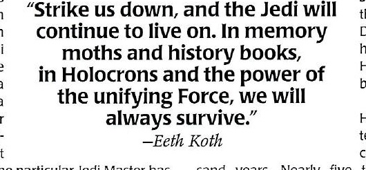

# Eeth Koth

- **Aliases:** —
- **Era:** Prequel
- **Continuity:** default Legends; entries present for: Canon, Legends
- **Research tier:** untiered (not listed as INTRO/DEEP/MASTERY in legends-feats.md)
- **Entries:** 28 (8 with quotations; 1 quotations extended to the full sentence/passage from the source text on file; 14 marked as fragments; 14 before the 2026-11-17 fragment fill). Rebuilt 2026-11-17 from 31 old entries; old file: `characters/_bak/eeth-koth.md.bak-20261117`.
- **How to read:** each entry is the quotation in full (block quote), then its source and point of view. "Note" lines are summaries from our notes, not quotations. `[fragment — full passage not on file]` means the source text is not on the box, so only the words in our notes are shown. Debate and forum material is in the last section and is unverified.

# LEGENDS (Legends / EU — main focus)

## Power of the Jedi Sourcebook (d20, 2002)

- Note (summary from our notes, not a quotation): Page contents: 690 words, 24 paragraphs | headings/entries: Depa Billaba, Jedi Master; Force Skills: Affect Mind +12, Battlemind +9,; Eeth Koth, Jedi Master
  — Source: Chapter Six: Jedi traditions and famous Jedi.
Our notes: `notes/materials/033-power-of-the-jedi-sourcebook/06-ch6-jedi-traditions.md:168`

## The New Essential Guide to Characters (2002)

- Note (summary from our notes, not a quotation): Page contents: 537 words, 20 paragraphs | headings/entries: Plo Koon; Eeth Koth; Even Piell; Oppo Rancisis
  — Source: scan pages 61–90.
Our notes: `notes/materials/034-new-essential-guide-to-characters/02-negc-scan-061-090.md:178`

## Star Wars Gamer/Star Wars Gamer 08.pdf [Star Wars Roleplaying Game (d20, 2000)] (scan pages 61–112)

- Note (summary from our notes, not a quotation): Page contents: Star Wars Obi-Wan: at the end of level 6 Obi-Wan joins Qui-Gon, Plo Koon and Eeth Koth against Jin'ha swordsmen; levels 7–9 cover the Trade Federation battleship, the landing craft (cortosis-shelled Trade Federation assassin droids) and Theed (hand-read)
  — Source: Star Wars Gamer/Star Wars Gamer 08.pdf [Star Wars Roleplaying Game (d20,.
Our notes: `notes/materials/037-sw-d20-folder/057-star-wars-gamer-08-scan-061-112.md:307`

## Jedi Counselling/Jedi Counseling 49 - Hit Me!.pdf [Star Wars Roleplaying Game Revised Core (d20, 2002)]

> However, given the ruling about foregoing bonuses on Defense, it's certainly reasonable to allow foregoing bonuses on attack (or saves, grapple checks, skill checks, and so on). You should use the same all­or­nothing restriction: You can forego all of your base attack bonus, for example (not just part of it), but you can keep your bonus due to Strength or Dexterity, if that's what you want to do. Q: Does the Ultimate Alien Anthology give any clue to Darth Maul's species? If it doesn't, do you know what his species is? A: Yes, though I don't know if it's spelled out as such in the Ultimate Alien Anthology, any more than it's spelled out in the revised core rulebook. Darth Maul is a Zabrak, just like Eeth Koth, one of the Jedi High Council members in The Phantom Menace. Q: The sandstorm rules in Secrets of Tatooine state that "the blowing sand stings, inflicting 1d4 points of vitality damage every round to anyone caught out in the open." Well, in my game, the characters were in the middle of a sandstorm on Duro, and one of them fell to zero vitality points. He argued that because the sourcebook specifically mentions "1d4 points of vitality damage," he takes only vitality damage, not wound damage.
— Source: Jedi Counselling/Jedi Counseling 49 - Hit Me!.pdf [Star Wars Roleplaying.
(Excerpt widened 2026-11-17 to the relevant passage, word for word from earch primary sw d20 folder files Star Wars Roleplaying Game Revised Core Jedi Counselling Jedi Counseling 49 Hit Me (text copy `earch_primary_sw_d20_folder_files_Star_Wars_Roleplaying_Game_Revised_Core_Jedi_Counselling_Jedi_Counseling_49_Hit_Me_pdf_82e7d2a02a`).)
(Excerpt widened 2026-11-17 to the relevant passage, word for word from earch primary sw d20 folder files Star Wars Roleplaying Game Revised Core Jedi Counselling Jedi Counseling 49 Hit Me (text copy `earch_primary_sw_d20_folder_files_Star_Wars_Roleplaying_Game_Revised_Core_Jedi_Counselling_Jedi_Counseling_49_Hit_Me_pdf_82e7d2a02a`).)
Note (our notes, around the quote): Darth Maul; Eeth Koth — entry/section: Darth Maul is a Zabrak, like Eeth Koth: "A: Yes, though I don't know if it's spelled out as such in the Ultimate Alien Anthology, any more than it's spelled out in the revised core rulebook. Darth Maul is a Zabrak, just like Eeth Koth, one of the Jedi High Council members in The Phantom Menace." Source: *Jedi Counseling 49 - Hit Me!* (SWRPG d20 Revised Core), scan p.2
Our notes: `notes/materials/037-sw-d20-folder/215-jedi-counseling-49-hit-me.md:17`

## Sourcebooks/Ultimate Alien Anthology.pdf [Star Wars Roleplaying Game Revised Core (d20, 2002)] (scan pages 181–225)

- Note (summary from our notes, not a quotation): Page contents: Zabrak (Emperor's will; example names incl. Agen Kolar, Eeth Koth) traits; zhaboka. (hand-read)
  — Source: Sourcebooks/Ultimate Alien Anthology.pdf [Star Wars Roleplaying Game Revi.
Our notes: `notes/materials/037-sw-d20-folder/673-ultimate-alien-anthology-scan-181-225.md:93`

## Star Wars Insider #57 (2001)

> JEDI II: ELECTRIC BOOGALOO. Not only do your acrobatics save your hide, they look pretty darned cool. *(hand-read)*
— Source: Star Wars Insider #57 (2001).
Note (our notes, around the quote): Page contents: Obi-Wan game cont. (magazine p. 77): chapters on Coruscant, Obredaan (rescuing Eeth Koth and Plo Koon with Qui-Gon), Naboo, Theed and Tatooine, and the final confrontation with Darth Maul; Jedi duel levels against a training droid, Ki-Adi-Mundi, Saesee Tiin and Mace Windu; producer Mikhael Gallo. Pull quote on the full array of Force powers. Caption (verified on crop): "JEDI II: ELECTRIC BOOGALOO. Not only do your acrobatics save your hide, they look pretty darned cool." (hand-read)
Our notes: `notes/materials/038-star-wars-insider/057-ins057.md:447`

## Star Wars Insider #62 (2002)

- Note (summary from our notes, not a quotation): Page contents: Who's Who cont.: Ki-Adi-Mundi (actor box "Silas Carson": four roles in Episode I, stunt training with Nick Gillard), Plo Koon (boxes "Not Your Father's Walrus Man": name from Nick Dudman's son "Plonkoon"; "Alan Ruscoe & Matt Sloan"), Eeth Koth (box "From Sketch to Screen": originally the Zabrak leader of the Council, Iain McCaig, Hassani Shapi), Even Piell. (hand-read)
  — Source: Star Wars Insider #62 (2002).
Our notes: `notes/materials/038-star-wars-insider/062-ins062.md:145`

## Star Wars Insider #117 (2010)

- Note (summary from our notes, not a quotation): Page contents: Sugi (Jackson Sze illustrations): a Zabrak inspired by Eeth Koth, given horns; pirate-like shoulders; scenes with Obi-Wan. (hand-read)
  — Source: Star Wars Insider #117 (2010).
Our notes: `notes/materials/038-star-wars-insider/117-ins117.md:125`

## Star Wars Insider #139 (2013)

- Note (summary from our notes, not a quotation): Page contents: Episode guide: "Weapons Factory", "Legacy of Terror", "Senate Murders", "Lightsaber Lost", "Brain Invaders", "Grievous Intrigue" (Eeth Koth tortured), "Duchess of Mandalore", "Death Trap" (Boba Fett targets Mace Windu), "Holocron Heist", "The Mandalore Plot" (Jon Favreau as Pre Vizsla), "R2 Come Home". (hand-read)
  — Source: Star Wars Insider #139 (2013).
Our notes: `notes/materials/038-star-wars-insider/139-ins139.md:90`

## Star Wars Visual Dictionaries, Episodes I–VI (DK, 1998–2005) + The Phantom Menace Expanded Visual Dictionary (DK, 2012)

> intuitive... often seems to know what people are about to say
> [fragment — full passage not on file]
>
> Iridonian Zabrak such as Eeth Koth are renowned for their mental discipline, which allows them to tolerate great physical suffering.
>
> highly developed extrasensory organs
> [fragment — full passage not on file]
>
> ensures that Jedi-counselled military tactics are cunning and effective.
> [fragment — full passage not on file]
>
> Young at only 477
> [fragment — full passage not on file]
>
> single, powerful, softly spoken comment.
> [fragment — full passage not on file]
>
> Of the teeming trillions of species that populate the galaxy, very few individuals become fully fledged Jedi Knights: the ranks based on Coruscant number only about 10,000.
>
> members of hundreds of species and cultures
> [fragment — full passage not on file]
— Source: Star Wars Episode I: The Visual Dictionary (DK, 1999): hand-read notes; **p11: Adi Gallia.
Note (our notes, around the quote): **p11: Adi Gallia: "intuitive... often seems to know what people are about to say"; Chancellor's most valuable intelligence sources; second lightsabre replaces her first, destroyed on a mission. Eeth Koth: "Iridonian Zabrak such as Eeth Koth are renowned for their mental discipline, which allows them to tolerate great physical suffering." Plo Koon: Kel Dor, antiox mask, "highly developed extrasensory organs". Oppo Rancisis: abdicated throne on Thisspias; "ensures that Jedi-counselled military tactics are cunning and effective." Yaddle: "Young at only 477"; "single, powerful, softly spoken comment." Depa Billaba: Chalacta culture, mark of illumination. DATA FILE: "Of the teeming trillions of species that populate the galaxy, very few individuals become fully fledged Jedi Knights: the ranks based on Coruscant number only about 10,000." Council reflects "members of hundreds of species and cultures".
Our notes: `notes/materials/047-visual-dictionaries/vd1-ep1.md:21`

> Iridonian Zabrak such as Eeth Koth are renowned for their mental discipline, which allows them to tolerate great physical suffering. Born in the harsh slums of the planet Nar Shaddaa, Koth was four when he was brought to the Jedi
> [fragment — full passage not on file]
>
> Twin internal crystals focus blade
> [fragment — full passage not on file]
>
> scar across his eye as a grisly trophy of a victory against enemies who made the mistake of underestimating him
> [fragment — full passage not on file]
>
> the Jedi ranks based on Coruscant number only about 10,000.
> [fragment — full passage not on file]
— Source: Star Wars: The Phantom Menace — The Expanded Visual Dictionary (DK, 2012): hand-read notes (new and revised material only); p16 Jedi High Council cont. [NEW]: Eeth Koth [KEY] (.
Note (our notes, around the quote): p16 Jedi High Council cont. [NEW]: Eeth Koth [KEY] ("Iridonian Zabrak such as Eeth Koth are renowned for their mental discipline, which allows them to tolerate great physical suffering. Born in the harsh slums of the planet Nar Shaddaa, Koth was four when he was brought to the Jedi"; Master Remembered: final Padawan of the aged Herglic Jedi Master Kosul Ayada; "Twin internal crystals focus blade"). Even Piell ("scar across his eye as a grisly trophy of a victory against enemies who made the mistake of underestimating him"). DATA FILE: specialized chairs; "the Jedi ranks based on Coruscant number only about 10,000."
Our notes: `notes/materials/047-visual-dictionaries/vd1x-expanded.md:20`

## https://starwars.fandom.com/wiki/Grievous/Legends

- Note (summary from our notes, not a quotation): Grievous boarded Eeth Koth’s Star Destroyer, fought through clone troopers, and took Koth hostage after MagnaGuards subdued him. The article says Grievous broadcast the victory and tortured Koth. [47]
  — Source: Wookieepedia extraction: Grievous (Legends) — https://starwars.fandom.com/wiki/Grievous/Legends.
Our notes: `external/mega-notes/grievous-legends-quotes.txt:57`

## The New Essential Guide to Weapons and Technology (2004)

> Strike us down, and the Jedi will continue to live on. In memory moths and history books, in Holocrons and the power of the unifying Force, we will always survive.
— Source: The New Essential Guide to Weapons and Technology (W. Haden Blackman, Del Rey, 2004), printed p.149, scan p.175. The printed phrase is "memory moths.".
Note (our notes, around the quote): "Strike us down, and the Jedi will continue to live on. In memory moths and history books, in Holocrons and the power of the unifying Force, we will always survive." —Eeth Koth.
Our notes: `notes/materials/155-new-essential-guide-to-weapons-technology-2004/quotes/QUOTES-INDEX.md`

# CANON (Disney canon — kept separate)

## Star Wars Insider #118 (2010)

- Note (summary from our notes, not a quotation): Page contents: TCW trivia: nods to Mace on Dantooine (micro-series) and Kit Fisto on Ord Cestus (The Cestus Deception); Robert Dalva directed; Eeth Koth, said in Inside the Worlds of AOTC to die on Geonosis, appears alive; Brea Tonnika mugshot. (hand-read)
  — Source: Star Wars Insider #118 (2010).
Our notes: `notes/materials/038-star-wars-insider/118-ins118.md:188`

## Canon Feats & Quotes (Disney-era Canon)

- Note (summary from our notes, not a quotation): Darth Vader (2015)/Marvel: defeats an amped Eeth Koth in sabers and ragdolls him; casually beats Karbin; survives the destruction of the galaxy's largest arms factory (per Shioz) (debate #70)
  — Source: (debate #70) — Canon Feats & Quotes (Disney-era Canon).
Our notes: `canon-feats.md:28`

# Debate and forum claims (unverified)

Forum posts, Suspect Insight debates and Discord debates, respect threads, and verdicts. These are posters' arguments or quotations they typed; none is checked against the book here unless the entry says so.

## (Canon) Darth Tyranus (BreakofDawn) vs Darth Vader (Shioz)

- Note (summary from our notes, not a quotation): Force use: Vader ragdolls an amped Eeth Koth. He survived the explosion of the largest arms factory in the galaxy. He blocked lightning as a Jedi.
  — Source: (Canon) Darth Tyranus (BreakofDawn) vs Darth Vader (Shioz) — https://www.suspectinsightforums.com/t1774-ss-darth-tyranus-breakofdawn-vs-darth-vader-shioz.
Posted by: not named in our notes (see thread/notes link).
Our notes: `suspect-insight/debates/070-darth-tyranus-vs-darth-vader.md:29`

> furious and laid out at 110%
> [fragment — full passage not on file]
— Source: (Canon) Darth Tyranus (BreakofDawn) vs Darth Vader (Shioz) — https://www.suspectinsightforums.com/t1774-ss-darth-tyranus-breakofdawn-vs-darth-vader-shioz; Lightsaber: Eeth Koth landed only one blow while.
Note (our notes, around the quote): Lightsaber: Eeth Koth landed only one blow while "furious and laid out at 110%". Vader beat Karbin carelessly, chatting with Aphra and calling him unworthy (https://www.youtube.com/embed/7WCJtvoGrxc).
Posted by: not named in our notes (see thread/notes link).
Our notes: `suspect-insight/debates/070-darth-tyranus-vs-darth-vader.md:31`

## (Canon) Darth Maul (IdrisianGraecus) vs Darth Vader (BreakofDawn)

- Note (summary from our notes, not a quotation): Vader matched Eeth Koth, who matched Grievous, and Grievous matched prime Maul in Son of Dathomir.
  — Source: (Canon) Darth Maul (IdrisianGraecus) vs Darth Vader (BreakofDawn) — https://www.suspectinsightforums.com/t2169-ss-darth-maul-ig-vs-darth-vader-breakofdawn.
Posted by: not named in our notes (see thread/notes link).
Our notes: `suspect-insight/debates/073-darth-maul-vs-darth-vader.md:60`

> Then, let’s look at Vader’s lightsaber skill. Even before JFO, he’s able to go toe to toe with Jedi masters like Eeth Koth, who could go toe to toe with Grievous:
> [fragment — full passage not on file]
>
> For comparison, the same Grievous was matching Maul in his absolute prime in SoD:
> [fragment — full passage not on file]
— Source: (Canon) Darth Maul (IdrisianGraecus) vs Darth Vader (BreakofDawn) — https://www.suspectinsightforums.com/t2169-ss-darth-maul-ig-vs-darth-vader-breakofdawn.
Context: Q11 — Source: BoD
Posted by: not named in our notes (see thread/notes link).
Our notes: `suspect-insight/debates/073-darth-maul-vs-darth-vader.md:175`

## Kyle Katarn (RNGesus) vs Mace Windu (HelloThere)

> Just like Padmé—and unlike so many other Senators the Jedi had observed—Organa was no pretender. He took his duties seriously.
>
> It was a curiously comforting discovery.
>
> For his own part, he turned captivity to his advantage, surrendering himself to the kind of deep meditations usually practiced by Jedi on retreat or committed to the contemplative life. To his relief, he could sense no lowering danger.
>
> For his own part, he turned captivity to his advantage, surrendering himself to the kind of deep meditations usually practiced by Jedi on retreat or committed to the contemplative life. To his relief, he could sense no lowering danger. No threat from Grievous to these distant hyperlanes. Which wasn’t surprising. There was little out here for the Republic to want. And if the Republic didn’t want it, neither did Dooku and his Separatists.
>
> There was little out here for the Republic to want. And if the Republic didn’t want it, neither did Dooku and his Separatists.
>
> What he did perceive, in glimpses, were some of the Jedi’s Outer Rim campaigns. Adi Gallia triumphant on Agomar. Ki-Adi-Mundi defeated almost to death on Barab I. Eeth Koth defending the besieged people of Korriban, surrounded by drifts of dead and dying clone troopers.
>
> What he did perceive, in glimpses, were some of the Jedi’s Outer Rim campaigns. Adi Gallia triumphant on Agomar. Ki-Adi-Mundi defeated almost to death on Barab I. Eeth Koth defending the besieged people of Korriban, surrounded by drifts of dead and dying clone troopers. Saesee Tiin in desperate straits closer to the Core, on Bimmisaari—but no. No, that was not now, that was then. A trade dispute of the past, long since peacefully settled.
>
> A trade dispute of the past, long since peacefully settled.
>
> No, that was not now, that was then. A trade dispute of the past, long since peacefully settled.
>
> He caught a single impression of Anakin, more feeling than vision. Sorrow. Frustration.
>
> A crushing fear of failure. He couldn’t find that wretched droid.
>
> Well, try harder, Anakin. Did you think I was joking?
>
> Practically always far more trouble than they were worth. And this one—this one was proving inconveniently stubborn. Uncomfortably astute. Because he was … afraid.
>
> No matter how hard he tried, how deeply he meditated, he could sense nothing about Zigoola. And he should be able to.
>
> No matter how hard he tried, how deeply he meditated, he could sense nothing about Zigoola. And he should be able to. It was one of his particular talents, the ability to sense the shape of things to come. It wasn’t an infallible gift—the droids on Geonosis had taken him completely by surprise—but it didn’t fail him often. It certainly hadn’t failed him at the space station.
>
> It was one of his particular talents, the ability to sense the shape of things to come. It wasn’t an infallible gift—the droids on Geonosis had taken him completely by surprise—but it didn’t fail him often. It certainly hadn’t failed him at the space station. This close to Zigoola he should be able to feel something. But all he’d achieved with his meditation was that one annihilating dream.
>
> This close to Zigoola he should be able to feel something. But all he’d achieved with his meditation was that one annihilating dream.
>
> His skin crawled, remembering: the excitement of a field trip. His eagerness to impress Qui-Gon. His blithe self-belief, that this exercise would be so easy. He was a Padawan at last: no Agricultural Corps for him.
>
> **Source: Wild Space**
> [fragment — full passage not on file]
— Source: Wild Space** — Kyle Katarn (RNGesus) vs Mace Windu (HelloThere) — https://www.suspectinsightforums.com/t4428-kyle-katarn-chris-cortosis-vs-mace-windu-hellothere.
(Excerpt widened 2026-11-17 to the relevant passage, word for word from Star Wars: The Clone Wars: Wild Space (Karen Miller) (text copy `MEGA_Legend_The_Clone_Wars_Series_Star_Wars_Star_Wars_The_Clone_Wars_02_Wild_Space_Karen_Miller_epub`).)
(Fragment completed 2026-11-17 with the full excerpt, word for word from Star Wars: The Clone Wars: Wild Space (Karen Miller) (text copy `MEGA_Legend_The_Clone_Wars_Series_Star_Wars_Star_Wars_The_Clone_Wars_02_Wild_Space_Karen_Miller_epub`).)
(Excerpt widened 2026-11-17 to the relevant passage, word for word from Star Wars: The Clone Wars: Wild Space (Karen Miller) (text copy `MEGA_Legend_The_Clone_Wars_Series_Star_Wars_Star_Wars_The_Clone_Wars_02_Wild_Space_Karen_Miller_epub`).)
(Full sentence/passage taken from the source text on file: `cw_novels_tmp_wild_space_epub`.)
(Fragment completed 2026-11-17: full sentence/passage matched word for word in the source text on file: `MEGA_Legend_The_Clone_Wars_Series_Star_Wars_Star_Wars_The_Clone_Wars_02_Wild_Space_Karen_Miller_epub`.)
Context: Q5 — Source: For his own part, he turned captivity to his advantage, surrendering himself to the kind of deep meditations usually practiced by Jedi on retreat or committed to the contemplative life. To his relief, he could sense no lowering danger. No threat from Grievous to these distant hyperlanes. Which wasn't surprising. There was little out here for the Republic to want. And if the Republic didn't want it, neither did Dooku and his Separatists. What he did perceive, in glimpses, were some of the Jedi's Outer Rim campaigns. Adi Gallia triumphant on Agomar. Ki-Adi-Mundi defeated almost to death on Barab I. Eeth Koth defending the besieged people of Korriban, surrounded by drifts of dead and dying clone troopers. Saesee Tiin in desperate straits closer to the Core, on Bimmisaari-but no. No, that was not now, that was then. A trade dispute of the past, long since peacefully settled. He caught a single impression of Anakin, more feeling than vision. Sorrow. Frustration. A crushing fear of failure. He couldn't find that wretched droid. Well, try harder, Anakin. Did you think I was joking? … No matter how hard he tried, how deeply he meditated, he could sense nothing about Zigoola. And he should be able to. It was one of his particular talents, the ability to sense the shape of things to come. This close to Zigoola he should be able to feel something. But all he'd achieved with his meditation was that one annihilating dream. - Wild Space
Posted by: not named in our notes (see thread/notes link).
Our notes: `suspect-insight/debates/107-kyle-katarn-vs-mace-windu.md:115`; `suspect-insight/debates/058-darth-caedus-vs-darth-tyranus.md:656`

## Sharad Hett Respect Thread — respect-thread notes

- Note (summary from our notes, not a quotation): Eeth Koth believes that if Sharad embraced the dark side he would have been a powerful weapon
  — Source: SI respect-thread directory: Sharad Hett Respect Thread — https://www.suspectinsightforums.com/t4317-sharad-hett-respect-thread.
Posted by: not named in our notes (see thread/notes link).
Our notes: `suspect-insight/respect-threads/darth-krayt.md:24`

- Note (summary from our notes, not a quotation): [image: https://i.servimg.com/u/f77/20/26/17/18/rco02110.jpg]
  — Source: SI respect-thread directory: Sharad Hett Respect Thread — https://www.suspectinsightforums.com/t4317-sharad-hett-respect-thread.
Posted by: not named in our notes (see thread/notes link).
Context: Eeth Koth believes that if Sharad embraced the dark side he would have been a powerful weapon
Our notes: `suspect-insight/respect-threads/darth-krayt.md:25`

- Note (summary from our notes, not a quotation): Honed his skill by sparring with his master Eeth Koth, in this particular session they're both blindfolded
  — Source: SI respect-thread directory: Sharad Hett Respect Thread — https://www.suspectinsightforums.com/t4317-sharad-hett-respect-thread.
Posted by: not named in our notes (see thread/notes link).
Our notes: `suspect-insight/respect-threads/darth-krayt.md:61`

- Note (summary from our notes, not a quotation): [image: https://i.servimg.com/u/f77/20/26/17/18/rco01310.jpg]
  — Source: SI respect-thread directory: Sharad Hett Respect Thread — https://www.suspectinsightforums.com/t4317-sharad-hett-respect-thread.
Posted by: not named in our notes (see thread/notes link).
Context: Honed his skill by sparring with his master Eeth Koth, in this particular session they're both blindfolded
Our notes: `suspect-insight/respect-threads/darth-krayt.md:62`

## Ultimate General Grievous Respect Thread (legends) 2022 — respect-thread notes

- Note (summary from our notes, not a quotation): Eeth Koth was originally going to die until filoni decided he should live. once more implying that GG would have defeated/killed him
  — Source: SI respect-thread directory: Ultimate General Grievous Respect Thread (legends) 2022 — https://www.suspectinsightforums.com/t4427-ultimate-general-grievous-respect-thread-legends-2022.
Posted by: not named in our notes (see thread/notes link).
Our notes: `suspect-insight/respect-threads/general-grievous--grievous-general-ghost-of-grievous.md:1182`

- Note (summary from our notes, not a quotation): [image: https://i.servimg.com/u/f90/20/30/86/34/filoni11.jpg]
  — Source: SI respect-thread directory: Ultimate General Grievous Respect Thread (legends) 2022 — https://www.suspectinsightforums.com/t4427-ultimate-general-grievous-respect-thread-legends-2022.
Posted by: not named in our notes (see thread/notes link).
Context: Eeth Koth was originally going to die until filoni decided he should live. once more implying that GG would have defeated/killed him
Our notes: `suspect-insight/respect-threads/general-grievous--grievous-general-ghost-of-grievous.md:1183`

## Pablo Jill Mini Respect Thread — respect-thread notes

- Note (summary from our notes, not a quotation): Pablo was one of Grievous' most four prized lightsabers listed alongside notable Jedi Masters Shaak Ti, Eeth Koth, and Roron Corobb further evidence he was a challenge to canon Grievous
  — Source: SI respect-thread directory: Pablo Jill Mini Respect Thread — https://www.suspectinsightforums.com/t3846-pablo-jill-mini-respect-thread.
Posted by: not named in our notes (see thread/notes link).
Our notes: `suspect-insight/respect-threads/pablo-jill.md:85`

- Note (summary from our notes, not a quotation): [image: https://i.servimg.com/u/f77/20/26/17/18/zr08o110.jpg]
  — Source: SI respect-thread directory: Pablo Jill Mini Respect Thread — https://www.suspectinsightforums.com/t3846-pablo-jill-mini-respect-thread.
Posted by: not named in our notes (see thread/notes link).
Context: Pablo was one of Grievous' most four prized lightsabers listed alongside notable Jedi Masters Shaak Ti, Eeth Koth, and Roron Corobb further evidence he was a challenge to canon Grievous
Our notes: `suspect-insight/respect-threads/pablo-jill.md:86`
