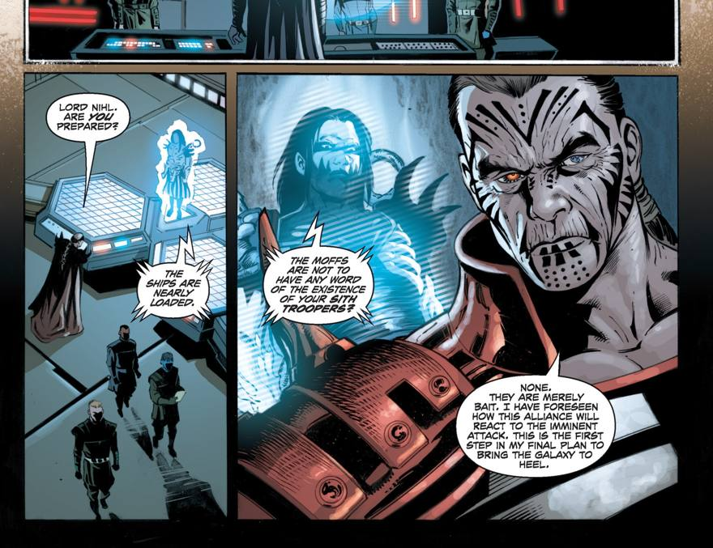
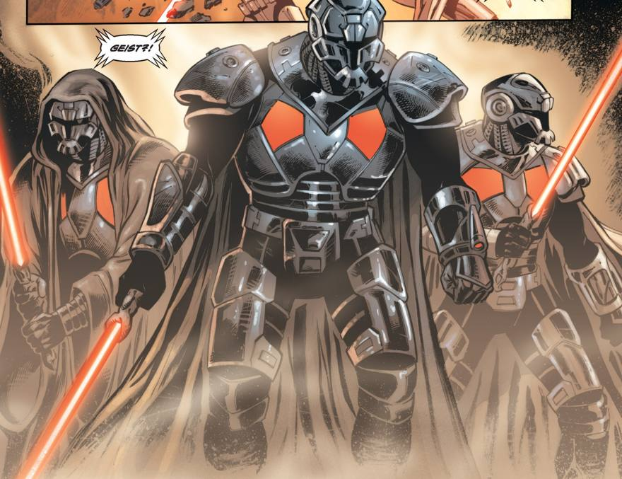
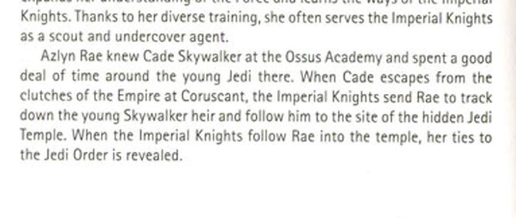
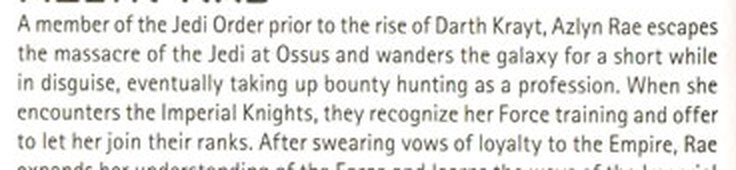
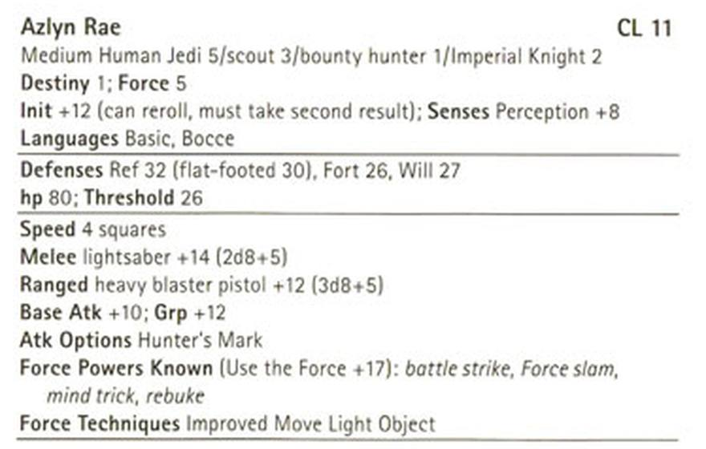

# Moff Fehlaaur

- **Aliases:** Fehlaaur
- **Era:** Legacy (137 ABY)
- **Continuity:** default Legends; entries present for: Legends
- **Research tier:** untiered (not listed as INTRO/DEEP/MASTERY in legends-feats.md)
- **Entries:** 9 (3 with quotations; 0 quotations extended to the full sentence/passage from the source text on file; 1 marked as fragments). Rebuilt 2026-11-17 from 11 old entries; old file: `characters/_bak/fehlaaur.md.bak-20261117`.
- **How to read:** each entry is the quotation in full (block quote), then its source and point of view. "Note" lines are summaries from our notes, not quotations. `[fragment — full passage not on file]` means the source text is not on the box, so only the words in our notes are shown. Debate and forum material is in the last section and is unverified.

# LEGENDS (Legends / EU — main focus)

## The Complete Star Wars Encyclopedia, Vol. I (A–G)

- Note (summary from our notes, not a quotation): Page contents: 1337 words, 27 paragraphs | headings/entries: Feethan Ottraw Scalable Assemblies; Fef; Fegel, Onjo; Fehern; Fehlaaur; Fein; Feiya; Fel, Cem; Fel, Chak; Fel, Cherith; Fel, Davin; Fel, Fyric; Fel, Jagged
  — Source: scan pages 241–280.
Our notes: `notes/materials/030-complete-star-wars-encyclopedia-vol-1/06-v1-scan-241-280.md:213`

## Sourcebooks/Legacy Era Campaign Guide.pdf [Star Wars Roleplaying Game Saga Edition (2007)] (scan pages 1–60)

> COINCIDENCES CAN ALWAYS BE LINKED IN A SUGGESTIVE MANNER.
— Source: Sourcebooks/Legacy Era Campaign Guide.pdf [Star Wars Roleplaying Game Sag; Moff Fehlaaur — entry/section: Pull quote.
Note (our notes, around the quote): Moff Fehlaaur — entry/section: Pull quote: ""COINCIDENCES CAN ALWAYS BE LINKED IN A SUGGESTIVE MANNER." —MOFF FEHLAAUR" Source: *Legacy Era Campaign Guide* (SWRPG Saga Edition), scan p.13
Our notes: `notes/materials/037-sw-d20-folder/719-legacy-era-campaign-guide-scan-001-060.md:99`

## Sourcebooks/Legacy Era Campaign Guide.pdf [Star Wars Roleplaying Game Saga Edition (2007)] (scan pages 121–180)

- Note (summary from our notes, not a quotation): Page contents: Fehlaaur (Fehlaaur'aitel'loro): Chiss liaison, member of the Moff Council, Director of the Imperial Diplomatic Corps; keeps balance on the council along with Konrad Rus. Stat block CL 11 (Chiss noble 8/officer 3). (hand-read)
  — Source: Sourcebooks/Legacy Era Campaign Guide.pdf [Star Wars Roleplaying Game Sag.
Our notes: `notes/materials/037-sw-d20-folder/719-legacy-era-campaign-guide-scan-121-180.md:461`

## Star Wars: Legacy (Dark Horse, 2006–2010) single issues #20–#50, hand-read

- Note (summary from our notes, not a quotation): New roster: Zenoc Quah, Moff Yage, Moff Fehlaaur, Fionah Ti, Tev "Crasher" (surname not given), Storm, Cannon (Skull Squadron pilots), VT-211, Heartstriker (amphistaff). Morrigan = alias of Nyna Calixte.
  — Source: Star Wars: Legacy #44 — "Monster, Part Two" (Jan 2010).
Our notes: `notes/materials/039-legacy-2006/legacy-44.md:195`

## Star Wars: Legacy—War #1–6 (2010–11): power-scaling notes with panels

- Note (summary from our notes, not a quotation): Moffs Fehlaaur and Geist.
  — Source: Legacy—War #1–6 (2010–11): power-scaling notes with panels.
Context: Others:
Our notes: `notes/materials/010-legacy-war.md:78`

- Note (summary from our notes, not a quotation): Moffs: Fehlaaur becomes chief intelligence officer (p60). Geist apparently dies under fire from Krayt's ships (p77; his comm cuts off: "GEIST?!" "GEIST?!").
  — Source: Legacy—War #1–6 (2010–11): power-scaling notes with panels.

Our notes: `notes/materials/010-legacy-war.md:916`

## Star Wars Saga Edition: *Legacy Era Campaign Guide* (WotC 2009): power-scaling notes with panels

- Note (summary from our notes, not a quotation): Oron Jaeger CL 12 (p179). Fehlaaur CL 11 (p176). Konrad Rus CL 10 (p180).
  — Source: *Legacy Era Campaign Guide* (WotC 2009): power-scaling notes with panels.

Our notes: `notes/materials/011-legacy-era-campaign-guide.md:950`

## Star Wars: Legacy Volume 3, *Claws of the Dragon* (TPB): power-scaling notes with panels

> WE NEEDED TO COUNTERBALANCE THE POWER OF THE JEDI.
>
> THE CHISS HAVE ALSO CLAIMED 'NO KNOWLEDGE' OF ROAN FEL -- DESPITE GIVING HIM A HAVEN FOR THE PAST SEVEN YEARS.
— Source: Legacy Volume 3, *Claws of the Dragon* (TPB): power-scaling notes with panels; Moff Council (p32–34): Calixte.
Note (our notes, around the quote): Moff Council (p32–34): Calixte: "WE NEEDED TO COUNTERBALANCE THE POWER OF THE JEDI." Yage (zoom-checked), not Fehlaaur: "THE CHISS HAVE ALSO CLAIMED 'NO KNOWLEDGE' OF ROAN FEL -- DESPITE GIVING HIM A HAVEN FOR THE PAST SEVEN YEARS."
Our notes: `notes/materials/013-legacy-vol-3-claws-of-the-dragon.md:478`

> THE CHISS HAVE ALSO CLAIMED 'NO KNOWLEDGE' OF ROAN FEL…
> [fragment — full passage not on file]
— Source: Legacy Volume 3, *Claws of the Dragon* (TPB): power-scaling notes with panels; 009 p334–335 (= 013 p33): the Chiss-haven line (.
Label in our notes: is Rulf Yage, not Fehlaaur
Our notes: `notes/materials/013-legacy-vol-3-claws-of-the-dragon.md:616`

# Debate and forum claims (unverified)

Forum posts, Suspect Insight debates and Discord debates, respect threads, and verdicts. These are posters' arguments or quotations they typed; none is checked against the book here unless the entry says so.

_None in our notes._
