# Freedon Nadd

- **Aliases:** Nadd
- **Era:** Sith War
- **Continuity:** default Legends; entries present for: Canon, Legends
- **Research tier:** MASTERY (Tales of the Jedi 024 version only: Freedon Nadd Uprising #1–2, Dark Lords of the Sith #1–6, The Sith War #1–6; primary read 2026-10-27)
- **Entries:** 405 (218 with quotations; 22 quotations extended to the full sentence/passage from the source text on file; 101 marked as fragments; 103 before the 2026-11-17 fragment fill). Rebuilt 2026-11-17 from 497 old entries; old file: `characters/_bak/freedon-nadd.md.bak-20261117`.
- **How to read:** each entry is the quotation in full (block quote), then its source and point of view. "Note" lines are summaries from our notes, not quotations. `[fragment — full passage not on file]` means the source text is not on the box, so only the words in our notes are shown. Debate and forum material is in the last section and is unverified.

# LEGENDS (Legends / EU — main focus)

## KOTOR I, KOTOR II and The Old Republic: Revan: notes from the other agent (reference copy, reviewed)

> You always had hidden strengths
> [fragment — full passage not on file]
>
> Master Kavar is no match for you
> [fragment — full passage not on file]
— Source: K2/Battle_Circle; K2/Iziz_Cantina; K2/Royal_Palace — Star Wars Knights of the Old Republic II: The Sith Lords (KOTOR 2): power-scaling notes (Oct 19, 2026). POV: speaker not named in our notes.
Note (our notes, around the quote): Dxun and Onderon. The new Mandalore (Canderous) holds the Mandalorian ruins. His tasks include the battle circle, where Bralor says «You always had hidden strengths» [K2/Battle_Circle]. Sith assassins attack Freedon Nadd's tomb. Onderon's civil war pits Queen Talia against General Vaklu; Mandalore pushes for Vaklu [K2/Iziz_Cantina]. Kavar is at the palace. On the dark path, Kavar is killed and Colonel Tobin says «Master Kavar is no match for you» [K2/Royal_Palace]. In the Sith tomb the Exile faces Nadd's echo and the Sith there.
Our notes: `notes/materials/023-kotor-and-revan/kotor-2-notes.md:215`

## Tales of the Jedi: Freedon Nadd Uprising #1–2, Dark Lords of the Sith #1–6, The Sith War #1–6, plus the WEG Tales of the Jedi Companion (power-scaling notes)

- Note (summary from our notes, not a quotation): | #1 | 1–28 | (Book One #1) | Empress Teta system, Ossus, Onderon, Dantooine | Naga Sadow's Denarii Nova flashback. Krath coup on Koros Major; Aleema kills Korus. Exar Kun studies under Vodo-Siosk Baas; Sylvar scars Exar; Vodo defeats Exar in a staff-vs-saber duel. Nadd's spirit courts Ulic. |
  — Source: Owner Material 024b — Tales of the Jedi: Dark Lords of the Sith #1–6 (1994–95): power-scaling notes.
Context: | Issue | PDF pages | Title (intro page) | Setting | Main events |
Our notes: `notes/materials/024-tales-of-the-jedi/dark-lords-of-the-sith.md:15`

- Note (summary from our notes, not a quotation): | #2 | 1–28 | The Quest for the Sith | Ossus, Koros Major, Dxun | Exar steals Sith lore; Arca rebuffs him. Nomi sees through Krath illusions. Exar breaches Nadd's tomb on Dxun and kills Nebo and Rask. Nomi rips apart Aleema's illusion; Ulic wounded by Krath slag. |
  — Source: Owner Material 024b — Tales of the Jedi: Dark Lords of the Sith #1–6 (1994–95): power-scaling notes.
Context: | Issue | PDF pages | Title (intro page) | Setting | Main events |
Our notes: `notes/materials/024-tales-of-the-jedi/dark-lords-of-the-sith.md:16`

- Note (summary from our notes, not a quotation): | #3 | 1–27 | Descent to the Dark Side | Deneba, Korriban | Great Jedi Convocation. Nadd collapses the mausoleum on Exar; Exar accepts the dark side and is healed. Krath war droids attack; Arca dies. Ulic resolves to infiltrate the Krath. |
  — Source: Owner Material 024b — Tales of the Jedi: Dark Lords of the Sith #1–6 (1994–95): power-scaling notes.
Context: | Issue | PDF pages | Title (intro page) | Setting | Main events |
Our notes: `notes/materials/024-tales-of-the-jedi/dark-lords-of-the-sith.md:17`

- Note (summary from our notes, not a quotation): | #4 | 1–26 | Death of a Dark Jedi | Yavin 4, Ossus, Cinnagar | Massassi capture Exar. Ulic joins the Krath. Exar kills Freedon Nadd's spirit with the Sith amulet. |
  — Source: Owner Material 024b — Tales of the Jedi: Dark Lords of the Sith #1–6 (1994–95): power-scaling notes.
Context: | Issue | PDF pages | Title (intro page) | Setting | Main events |
Our notes: `notes/materials/024-tales-of-the-jedi/dark-lords-of-the-sith.md:18`

- Note (summary from our notes, not a quotation): Exar studies forbidden Sith lore on Ossus; Arca refuses to help him (p5–7). Nomi sees through the Krath space-grazer illusions at Koros Major (p12–14). Exar saves Naddists Nebo and Rask on Dxun, kills beasts, opens the Mandalorian-iron tomb with Nadd's help, and kills the Naddists (p16–22). Nomi tears Aleema's illusion apart (p24–25); Ulic is wounded by Krath kamikaze slag (p26–27). Korriban revealed (p28).
  — Source: Owner Material 024b — Tales of the Jedi: Dark Lords of the Sith #1–6 (1994–95): power-scaling notes.

Our notes: `notes/materials/024-tales-of-the-jedi/dark-lords-of-the-sith.md:33`

- Note (summary from our notes, not a quotation): The Jedi assembly on Deneba (Odan-Urr presiding). Nadd's spirit collapses the Korriban crystal mausoleum on Exar (p12–13); Exar accepts the dark side to live (p16–17). Krath war droids attack Deneba; Arca is killed from behind (p21–22). Exar reads Sith glyphs and kills the tomb guardians in anger (p23–26). Ulic decides to destroy the Krath from within (p27).
  — Source: Owner Material 024b — Tales of the Jedi: Dark Lords of the Sith #1–6 (1994–95): power-scaling notes.
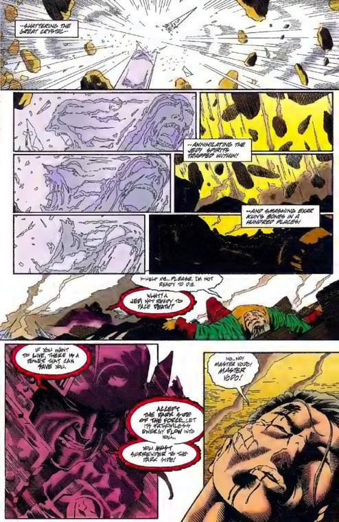
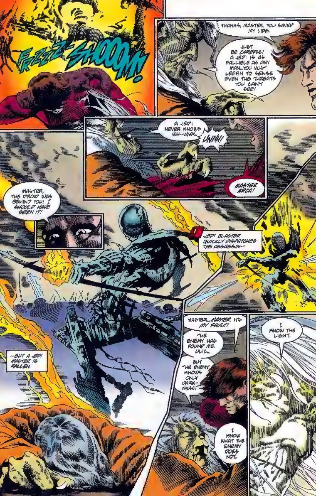
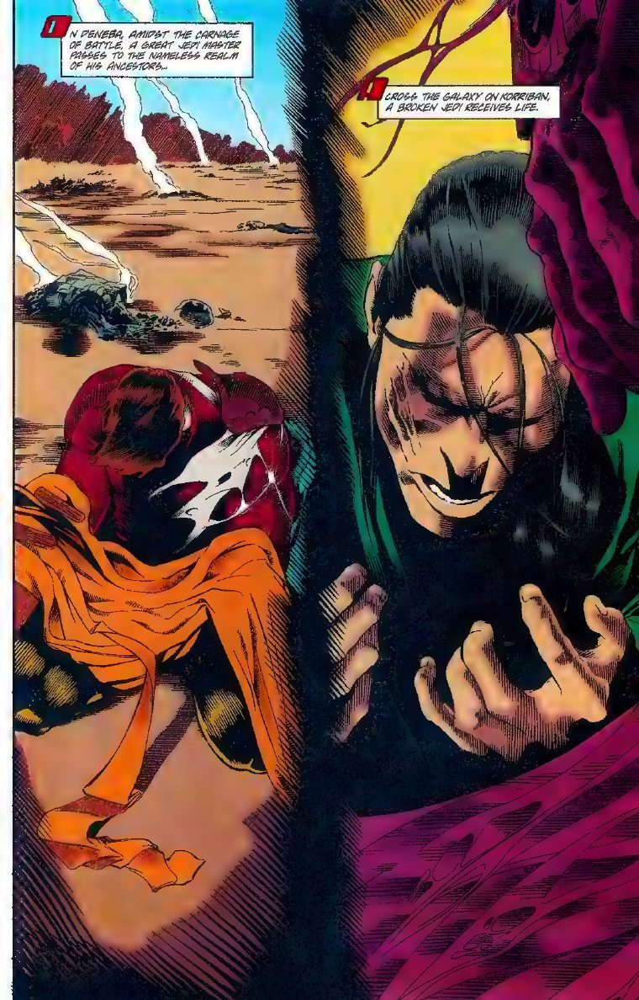
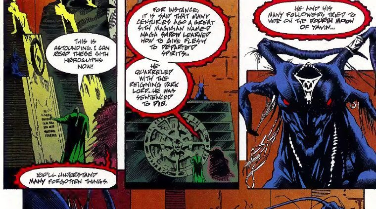
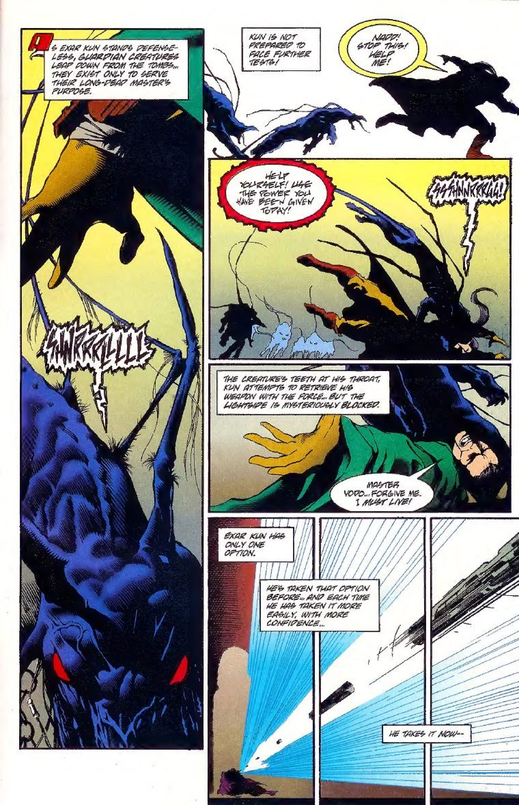
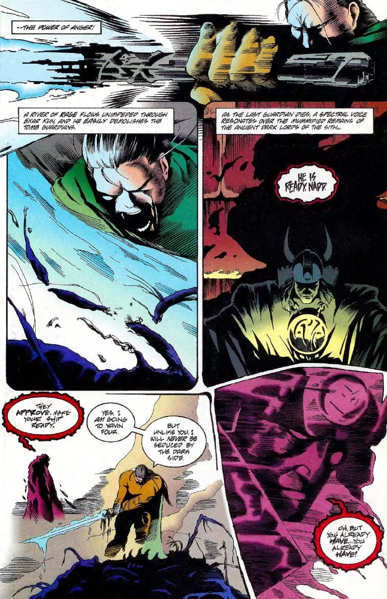
Our notes: `notes/materials/024-tales-of-the-jedi/dark-lords-of-the-sith.md:37`

- Note (summary from our notes, not a quotation): Massassi seize Exar on Yavin 4 (p4–9). Ood Bnar and Odan-Urr warn Ulic (p10–12); Cay's farewell (p13). Ulic joins the Krath by "saving" Aleema (p17–21). The Sith amulet clamps to Exar's arm; he destroys Sadow's alchemical horrors (p22–24) and kills Nadd's spirit (p25–26).
  — Source: Owner Material 024b — Tales of the Jedi: Dark Lords of the Sith #1–6 (1994–95): power-scaling notes.
Our notes: `notes/materials/024-tales-of-the-jedi/dark-lords-of-the-sith.md:40`

- Note (summary from our notes, not a quotation): Draws on Nadd's help to breach Freedon Nadd's Mandalorian-iron tomb on Dxun. Source: Dark Lords of the Sith #2, p19–20
  — Source: Owner Material 024b — Tales of the Jedi: Dark Lords of the Sith #1–6 (1994–95): power-scaling notes.
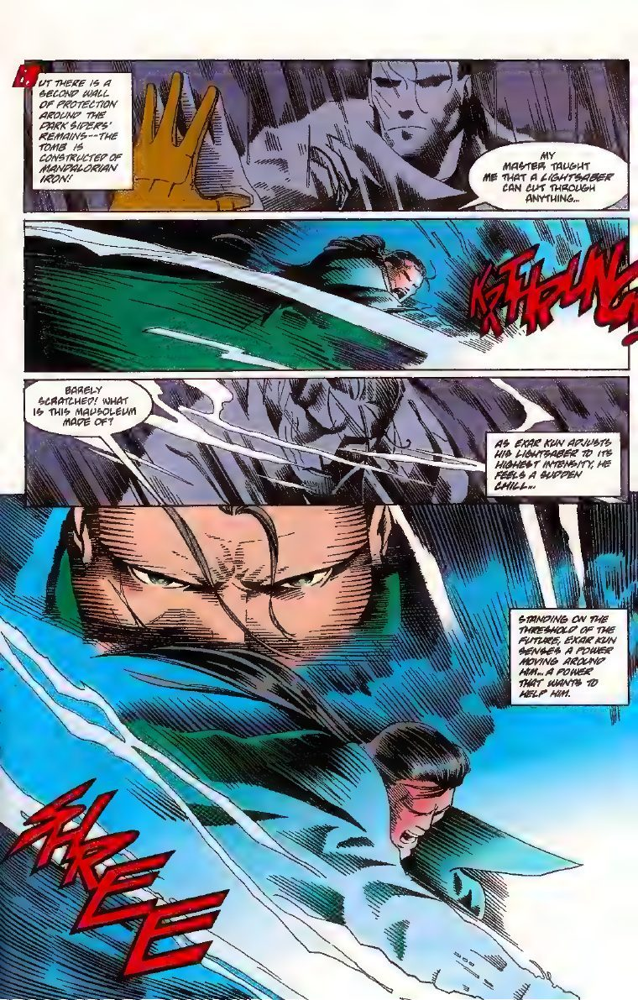
Our notes: `notes/materials/024-tales-of-the-jedi/dark-lords-of-the-sith.md:54`

- Note (summary from our notes, not a quotation): With his light side blocked and Nadd holding his lightsaber, kills the Korriban tomb guardians with anger. Source: Dark Lords of the Sith #3, p23–26
  — Source: Owner Material 024b — Tales of the Jedi: Dark Lords of the Sith #1–6 (1994–95): power-scaling notes.

Our notes: `notes/materials/024-tales-of-the-jedi/dark-lords-of-the-sith.md:62`

> AS HE DIES A SECOND DEATH, NADD REACHES OUT IN DESPERATION TO OTHERS HE HAS LED DOWN THE DARK PATH--
> [fragment — full passage not on file]
— Source: Dark Lords of the Sith #4, p25 — Owner Material 024b — Tales of the Jedi: Dark Lords of the Sith #1–6 (1994–95): power-scaling notes; Kills Freedon Nadd's spirit with the amulet (.
Note (our notes, around the quote): Kills Freedon Nadd's spirit with the amulet ("AS HE DIES A SECOND DEATH, NADD REACHES OUT IN DESPERATION TO OTHERS HE HAS LED DOWN THE DARK PATH--"). Source: Dark Lords of the Sith #4, p25
Our notes: `notes/materials/024-tales-of-the-jedi/dark-lords-of-the-sith.md:66`

> MNNT YYTL GYTHH...WYRL TMMN ZYRTH!!
> [fragment — full passage not on file]
>
> HE IS THE ONE WE HAVE WAITED FOR...BRING HIM TO THE TEMPLE OF FIRE!
> [fragment — full passage not on file]
>
> THE FOOL...I HAVE GIVEN HIM EVERYTHING AND HE STILL PRETENDS NOTHING HAS CHANGED.
> [fragment — full passage not on file]
>
> I MADE CERTAIN HIS SEDUCTION WAS COMPLETE.
>
> EXAR KUN WILL USE THE DARK SIDE THAT IS HIS TRUE POWER NOW!
— Source: Owner Material 024b — Tales of the Jedi: Dark Lords of the Sith #1–6 (1994–95): power-scaling notes; Massassi Zythmnr about Exar Kun. POV: Massassi Zythmnr, about Freedon Nadd.
Note (our notes, around the quote): Massassi Zythmnr about Exar Kun: "MNNT YYTL GYTHH...WYRL TMMN ZYRTH!!" "HE IS THE ONE WE HAVE WAITED FOR...BRING HIM TO THE TEMPLE OF FIRE!" Freedon Nadd (watching): "THE FOOL...I HAVE GIVEN HIM EVERYTHING AND HE STILL PRETENDS NOTHING HAS CHANGED." "I MADE CERTAIN HIS SEDUCTION WAS COMPLETE." "EXAR KUN WILL USE THE DARK SIDE THAT IS HIS TRUE POWER NOW!" Source: Dark Lords of the Sith #4, p9
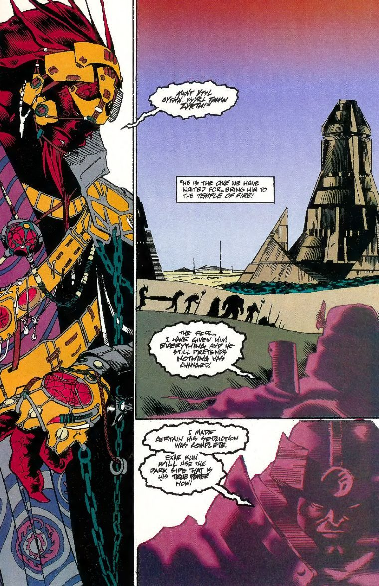
Our notes: `notes/materials/024-tales-of-the-jedi/dark-lords-of-the-sith.md:90`

> ...RIVER OF RAGE FLOWS UNIMPEDED THROUGH EXAR KUN, AND HE EASILY DEMOLISHES THE TOMB GUARDIANS.
> [fragment — full passage not on file]
>
> HE IS READY, NADD.
> [fragment — full passage not on file]
— Source: Owner Material 024b — Tales of the Jedi: Dark Lords of the Sith #1–6 (1994–95): power-scaling notes; Narration on Exar Kun. POV: narrator, about Freedon Nadd.
Note (our notes, around the quote): Narration on Exar Kun: "...RIVER OF RAGE FLOWS UNIMPEDED THROUGH EXAR KUN, AND HE EASILY DEMOLISHES THE TOMB GUARDIANS." · NARRATION. Spectral voice (ancient Sith Lords, UNCLEAR) to Freedon Nadd about Exar Kun: "HE IS READY, NADD." Source: Dark Lords of the Sith #3, p26

Our notes: `notes/materials/024-tales-of-the-jedi/dark-lords-of-the-sith.md:92`

> MY CHILDREN--I COME TO WARN YOU! IT IS NOT QEL-DROMA YOU MUST FEAR!
>
> BEWARE OF EXAR KUN. HE HAS ACQUIRED GREAT SITH POWERS AND HE HAS AMBITION WITHOUT LIMIT--
> [fragment — full passage not on file]
>
> I NOW DECLARE IT...EXAR KUN IS A PRETENDER TO THE SITH LEGACY...
> [fragment — full passage not on file]
>
> ...THE REAL POWER OF THE SITH RESTS WITH YOU...THREE...
> [fragment — full passage not on file]
— Source: Owner Material 024b — Tales of the Jedi: Dark Lords of the Sith #1–6 (1994–95): power-scaling notes; Freedon Nadd's spirit (dying) to Satal and Aleema Keto. POV: Freedon Nadd's spirit.
Note (our notes, around the quote): Freedon Nadd's spirit (dying) to Satal and Aleema Keto: "MY CHILDREN--I COME TO WARN YOU! IT IS NOT QEL-DROMA YOU MUST FEAR!" "BEWARE OF EXAR KUN. HE HAS ACQUIRED GREAT SITH POWERS AND HE HAS AMBITION WITHOUT LIMIT--" "I NOW DECLARE IT...EXAR KUN IS A PRETENDER TO THE SITH LEGACY..." "...THE REAL POWER OF THE SITH RESTS WITH YOU...THREE..." Source: Dark Lords of the Sith #4, p26
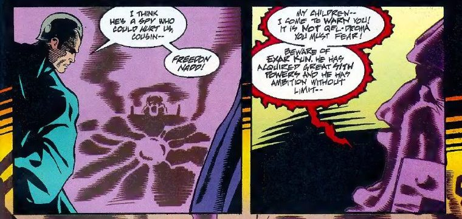
Our notes: `notes/materials/024-tales-of-the-jedi/dark-lords-of-the-sith.md:94`

> NADD, I'VE HAD ENOUGH OF YOU GUIDING ME, TESTING ME...
> [fragment — full passage not on file]
— Source: Dark Lords of the Sith #4, p25 — Owner Material 024b — Tales of the Jedi: Dark Lords of the Sith #1–6 (1994–95): power-scaling notes; Exar Kun to Freedon Nadd, before killing him.
Note (our notes, around the quote): Exar Kun to Freedon Nadd, before killing him: "NADD, I'VE HAD ENOUGH OF YOU GUIDING ME, TESTING ME..." Source: Dark Lords of the Sith #4, p25
Our notes: `notes/materials/024-tales-of-the-jedi/dark-lords-of-the-sith.md:103`

> ARCA CANNOT INTERFERE WITH THE DEAD...NOR CAN HE HELP YOU, POOR JEDI, TO AVOID YOUR DESTINY.
> [fragment — full passage not on file]
>
> AND THERE IS ANOTHER EVEN GREATER THAN YOU. *(p22)*
— Source: Dark Lords of the Sith #1, p21–22 — Owner Material 024b — Tales of the Jedi: Dark Lords of the Sith #1–6 (1994–95): power-scaling notes; Freedon Nadd's spirit to Ulic Qel-Droma. POV: Freedon Nadd's spirit.
Note (our notes, around the quote): Freedon Nadd's spirit to Ulic Qel-Droma: "ARCA CANNOT INTERFERE WITH THE DEAD...NOR CAN HE HELP YOU, POOR JEDI, TO AVOID YOUR DESTINY." "YOU. YOU WILL BE ONE OF THE GREAT ONES--" (p21) "AND THERE IS ANOTHER EVEN GREATER THAN YOU." (p22) Source: Dark Lords of the Sith #1, p21–22
Our notes: `notes/materials/024-tales-of-the-jedi/dark-lords-of-the-sith.md:128`

- Note (summary from our notes, not a quotation): Spirit helps Exar Kun open the Dxun tomb and hands him the Sith scrolls. Source: Dark Lords of the Sith #2, p19–21
  — Source: Dark Lords of the Sith #2, p19–21 — Owner Material 024b — Tales of the Jedi: Dark Lords of the Sith #1–6 (1994–95): power-scaling notes.

Our notes: `notes/materials/024-tales-of-the-jedi/dark-lords-of-the-sith.md:188`

- Note (summary from our notes, not a quotation): Spirit collapses the Korriban crystal mausoleum on Exar Kun. Source: Dark Lords of the Sith #3, p12–13
  — Source: Dark Lords of the Sith #3, p12–13 — Owner Material 024b — Tales of the Jedi: Dark Lords of the Sith #1–6 (1994–95): power-scaling notes.

Our notes: `notes/materials/024-tales-of-the-jedi/dark-lords-of-the-sith.md:189`

- Note (summary from our notes, not a quotation): Spirit's hatred knocks Vodo-Siosk Baas down across the galaxy. Source: Dark Lords of the Sith #3, p14–15
  — Source: Owner Material 024b — Tales of the Jedi: Dark Lords of the Sith #1–6 (1994–95): power-scaling notes.
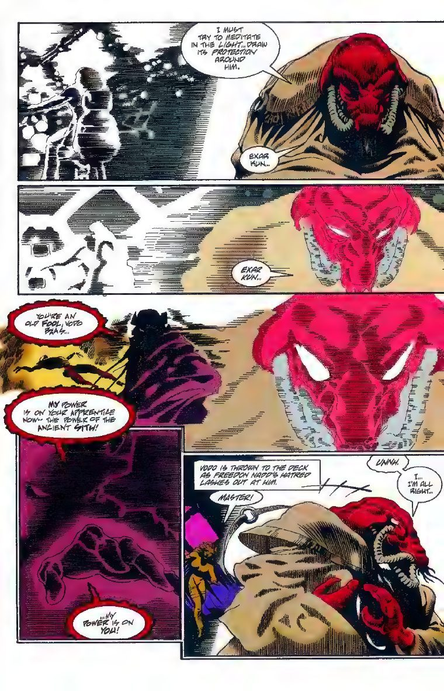
Our notes: `notes/materials/024-tales-of-the-jedi/dark-lords-of-the-sith.md:190`; `notes/materials/024-tales-of-the-jedi/dark-lords-of-the-sith.md:202`

- Note (summary from our notes, not a quotation): Spirit killed by Exar Kun with the Sith amulet ("SECOND DEATH"). Source: Dark Lords of the Sith #4, p25
  — Source: Dark Lords of the Sith #4, p25 — Owner Material 024b — Tales of the Jedi: Dark Lords of the Sith #1–6 (1994–95): power-scaling notes.
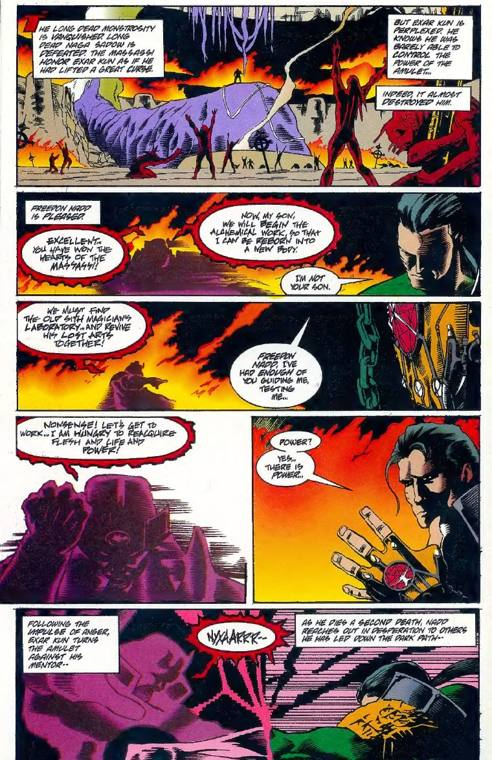
Our notes: `notes/materials/024-tales-of-the-jedi/dark-lords-of-the-sith.md:194`

- Note (summary from our notes, not a quotation): | 7 | Exar Kun vs Freedon Nadd's spirit | Yavin 4 | p25 (#4) | Nadd destroyed | Sith amulet |
  — Source: Owner Material 024b — Tales of the Jedi: Dark Lords of the Sith #1–6 (1994–95): power-scaling notes.
Context: | # | Fight | Where | Pages (issue) | Outcome | Conditions |
Our notes: `notes/materials/024-tales-of-the-jedi/dark-lords-of-the-sith.md:278`

- Note (summary from our notes, not a quotation): 
  — Source: Owner Material 024b — Tales of the Jedi: Dark Lords of the Sith #1–6 (1994–95): power-scaling notes.
Our notes: `notes/materials/024-tales-of-the-jedi/dark-lords-of-the-sith.md:311`

- Note (summary from our notes, not a quotation): 
  — Source: Owner Material 024b — Tales of the Jedi: Dark Lords of the Sith #1–6 (1994–95): power-scaling notes.

Our notes: `notes/materials/024-tales-of-the-jedi/dark-lords-of-the-sith.md:313`

- Note (summary from our notes, not a quotation): Nadd's spirit to Ulic: "YOU WILL BE ONE OF THE GREAT ONES" / "THERE IS ANOTHER EVEN GREATER THAN YOU" (DLotS #1 p21–22) — (ANALYSIS) the "greater" one is Exar Kun.
  — Source: Owner Material 024b — Tales of the Jedi: Dark Lords of the Sith #1–6 (1994–95): power-scaling notes. POV: Nadd's spirit.
Our notes: `notes/materials/024-tales-of-the-jedi/dark-lords-of-the-sith.md:332`

- Note (summary from our notes, not a quotation): Onderon c. 3998 BBY, after the *Tales of the Jedi* "Ulic Qel-Droma and the Beast Wars of Onderon" arc (not part of this delivery). Ulic, Cay and Tott are Arca's apprentices; Nomi is Thon's apprentice. Freedon Nadd is a spirit; King Ommin practises Sith magic he learned from him.
  — Source: Owner Material 024a — Tales of the Jedi: The Freedon Nadd Uprising #1–2 (1994): power-scaling notes.
Our notes: `notes/materials/024-tales-of-the-jedi/freedon-nadd-uprising.md:19`

> CUT OFF FROM HIS MASTER BY OMMIN'S WARRIORS, ULIC LETS HIS FLASHING LIGHTSABER FIND ITS MARK!
— Source: Owner Material 024a — Tales of the Jedi: The Freedon Nadd Uprising #1–2 (1994): power-scaling notes.
Note (our notes, around the quote): Cuts down Ommin's warriors after he is cut off from his master: "CUT OFF FROM HIS MASTER BY OMMIN'S WARRIORS, ULIC LETS HIS FLASHING LIGHTSABER FIND ITS MARK!" Source: Freedon Nadd Uprising #1, p15
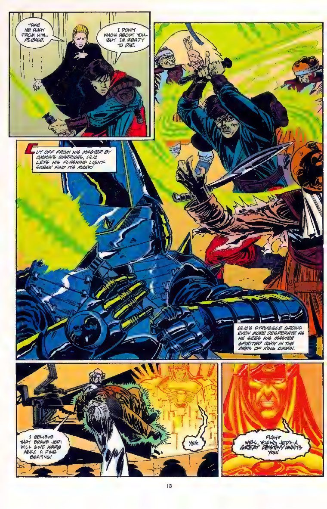
Our notes: `notes/materials/024-tales-of-the-jedi/freedon-nadd-uprising.md:31`

> FIGHT WELL, YOUNG JEDI--A GREAT DESTINY AWAITS YOU!
— Source: Owner Material 024a — Tales of the Jedi: The Freedon Nadd Uprising #1–2 (1994): power-scaling notes; Freedon Nadd's spirit to Ulic Qel-Droma. POV: Freedon Nadd's spirit.
Note (our notes, around the quote): Freedon Nadd's spirit to Ulic Qel-Droma: "FIGHT WELL, YOUNG JEDI--A GREAT DESTINY AWAITS YOU!" Source: Freedon Nadd Uprising #1, p15

Our notes: `notes/materials/024-tales-of-the-jedi/freedon-nadd-uprising.md:41`

> THE AIR SIZZLES WITH BLUE FIRE AS A SPIRIT FORM TAKES SHAPE BEHIND THE DYING KING.
— Source: Freedon Nadd Uprising #1, p13 — Owner Material 024a — Tales of the Jedi: The Freedon Nadd Uprising #1–2 (1994): power-scaling notes; Spirit form manifests behind King Ommin.
Note (our notes, around the quote): Spirit form manifests behind King Ommin: "THE AIR SIZZLES WITH BLUE FIRE AS A SPIRIT FORM TAKES SHAPE BEHIND THE DYING KING." Source: Freedon Nadd Uprising #1, p13
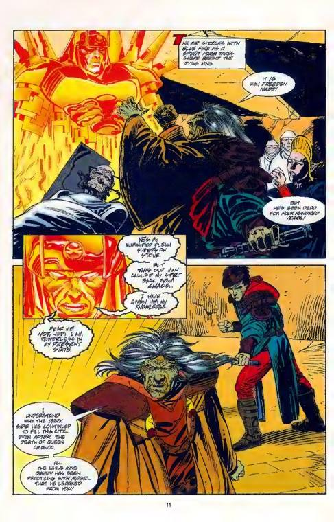
Our notes: `notes/materials/024-tales-of-the-jedi/freedon-nadd-uprising.md:65`

> SATAL AND ALEEMA... I AM NADD.
> [fragment — full passage not on file]
>
> YOU MAY KEEP THE BOOK... AND THE TALISMAN.
> [fragment — full passage not on file]
>
> BOTH RIGHTFULLY BELONG TO YOU.
> [fragment — full passage not on file]
>
> AS DO THESE SWORDS OF THE SITH.
>
> KING OMMIN WILL NO LONGER NEED THEM.
— Source: Freedon Nadd Uprising #2, p18 — Owner Material 024a — Tales of the Jedi: The Freedon Nadd Uprising #1–2 (1994): power-scaling notes.
Note (our notes, around the quote): Spirit appears to Satal and Aleema Keto and gives them the Sith book, the talisman and two Sith swords: "SATAL AND ALEEMA... I AM NADD." "YOU MAY KEEP THE BOOK... AND THE TALISMAN." "BOTH RIGHTFULLY BELONG TO YOU." "AS DO THESE SWORDS OF THE SITH." "KING OMMIN WILL NO LONGER NEED THEM." Source: Freedon Nadd Uprising #2, p18
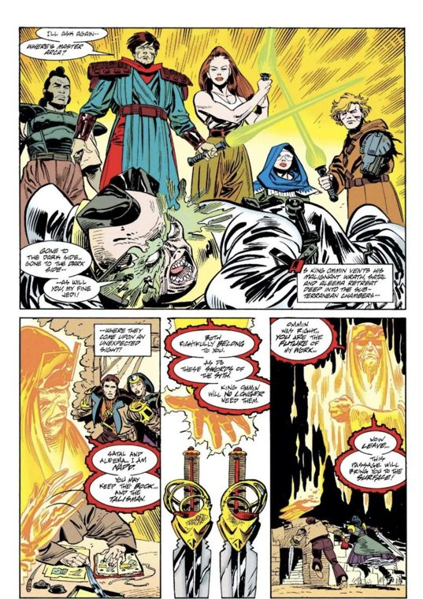
Our notes: `notes/materials/024-tales-of-the-jedi/freedon-nadd-uprising.md:66`

> THEN, IN A FLASH OF BLUE FIRE, NADD APPEARS AT THE SIDE OF THE FALLEN KING--
> [fragment — full passage not on file]
>
> LET THESE YOUNG JEDI GO! THEY DON'T BELONG TO YOU! IT IS YOUR TIME TO DIE!
>
> I'M SORRY, OMMIN... THEY DON'T BELONG TO THE DARK SIDE BUT YOU DO!
> [fragment — full passage not on file]
>
> GREETINGS, ARCA--HAS KING OMMIN'S DEATH FREED YOU?
— Source: Freedon Nadd Uprising #2, p19 — Owner Material 024a — Tales of the Jedi: The Freedon Nadd Uprising #1–2 (1994): power-scaling notes; Spirit kills (claims) the broken King Ommin.
Note (our notes, around the quote): Spirit kills (claims) the broken King Ommin: "THEN, IN A FLASH OF BLUE FIRE, NADD APPEARS AT THE SIDE OF THE FALLEN KING--" Nadd: "LET THESE YOUNG JEDI GO! THEY DON'T BELONG TO YOU! IT IS YOUR TIME TO DIE!" "I'M SORRY, OMMIN... THEY DON'T BELONG TO THE DARK SIDE BUT YOU DO!" Ommin: "NYAAAAAA!" Nadd to Arca: "GREETINGS, ARCA--HAS KING OMMIN'S DEATH FREED YOU?" Source: Freedon Nadd Uprising #2, p19
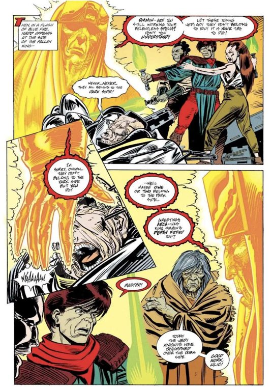
Our notes: `notes/materials/024-tales-of-the-jedi/freedon-nadd-uprising.md:67`

> NOW ALL THAT REMAINS IS TO DEAL WITH THIS ROGUE SPIRIT!
— Source: Freedon Nadd Uprising #2, p20 — Owner Material 024a — Tales of the Jedi: The Freedon Nadd Uprising #1–2 (1994): power-scaling notes; Arca turns on the spirit (.
Note (our notes, around the quote): Arca turns on the spirit ("NOW ALL THAT REMAINS IS TO DEAL WITH THIS ROGUE SPIRIT!"); bands of light cut through Nadd's image as he fades. (ANALYSIS) The spirit is dispersed, not destroyed: Exar Kun destroys it later (DLotS #4). Source: Freedon Nadd Uprising #2, p20
Also cited as: Freedon Nadd Uprising #2, p20 — Owner Material 024a — Tales of the Jedi: The Freedon Nadd Uprising #1–2 (1994): power-scaling notes; Confronts Freedon Nadd's spirit after Ommin's death.
Also noted as: Confronts Freedon Nadd's spirit after Ommin's death: "NOW ALL THAT REMAINS IS TO DEAL WITH THIS ROGUE SPIRIT!" (bands of light cut through the spirit's image as it fades). Source: Freedon Nadd Uprising #2, p20
Our notes: `notes/materials/024-tales-of-the-jedi/freedon-nadd-uprising.md:68`; `notes/materials/024-tales-of-the-jedi/freedon-nadd-uprising.md:133`

> YES. MY MUMMIFIED FLESH SLEEPS ON STONE.
>
> BUT THIS OLD MAN CALLED MY SPIRIT BACK FROM CHAOS...
> [fragment — full passage not on file]
>
> I HAVE GIVEN HIM MY KNOWLEDGE.
>
> FEAR ME NOT, JEDI. I AM POWERLESS IN MY PRESENT STATE.
— Source: Freedon Nadd Uprising #1, p13 — Owner Material 024a — Tales of the Jedi: The Freedon Nadd Uprising #1–2 (1994): power-scaling notes; Freedon Nadd's spirit to Arca Jeth. POV: Freedon Nadd's spirit.
Note (our notes, around the quote): Freedon Nadd's spirit to Arca Jeth: "YES. MY MUMMIFIED FLESH SLEEPS ON STONE." "BUT THIS OLD MAN CALLED MY SPIRIT BACK FROM CHAOS..." "I HAVE GIVEN HIM MY KNOWLEDGE." "FEAR ME NOT, JEDI. I AM POWERLESS IN MY PRESENT STATE." Source: Freedon Nadd Uprising #1, p13
Our notes: `notes/materials/024-tales-of-the-jedi/freedon-nadd-uprising.md:71`

> OMMIN WAS RIGHT... YOU ARE THE FUTURE OF MY WORK...
> [fragment — full passage not on file]
>
> NOW LEAVE... THIS PASSAGE WILL BRING YOU TO THE SURFACE!
> [fragment — full passage not on file]
— Source: Freedon Nadd Uprising #2, p18 — Owner Material 024a — Tales of the Jedi: The Freedon Nadd Uprising #1–2 (1994): power-scaling notes; Freedon Nadd's spirit to Satal and Aleema Keto. POV: Freedon Nadd's spirit.
Note (our notes, around the quote): Freedon Nadd's spirit to Satal and Aleema Keto: "OMMIN WAS RIGHT... YOU ARE THE FUTURE OF MY WORK..." "NOW LEAVE... THIS PASSAGE WILL BRING YOU TO THE SURFACE!" Source: Freedon Nadd Uprising #2, p18
Our notes: `notes/materials/024-tales-of-the-jedi/freedon-nadd-uprising.md:72`

> YOU DELUDE YOURSELF, OLD MAN.
> [fragment — full passage not on file]
>
> THE JEDI HAVE NOT WON TODAY... AS YOU WILL ONE DAY LEARN--
> [fragment — full passage not on file]
>
> Ulic, bathed in the light side, fights off the darkness and rushes forward, slashing with his lightsaber at the metal armature that holds Ommin erect. Without support, Ommin collapses. - -,,_c."'t.:-y 17i"4/~P ~/t..aN"'!fJ,Jt(Jlrw .a c.AJ?e~t/I.-t. y PlF~/N5P A1/~~/t?N- - 5atal and Aleema retreat into the recesses of the sublevels as Ulic demands to know what has happened to Master Area. Ommin tells them that Area has gone to the dark side, as will they. In a deep access corridor, the spirit of Freedon Nadd appears to 5atal and Aleema, giving them the book, the amulet, and a pair of 5ith swords. Nadd appears near the body of Ommin, saying that, unlike the brave Jedi arrayed before him, the old man belongs to the dark side. As Ommin passes into the Force, Area is freed and Nadd's spirit fades, saying the Jedi have lost, though they do not yet know it. With Ommin dead and the Naddists squelched, the Republic institutes martial law and quickly restores order to Iziz. Meanwhile, 5atal and Aleema escape with their 5ith treasures. Freedon Nadd's and Queen Amanoa's sarcophagi are finally brought to Dxun where they are placed in a tomb constructed to withstand the ravages of time. Ulic wonders aloud what Nadd meant when he said the Jedi had lost.
— Source: Freedon Nadd Uprising #2, p20 — Owner Material 024a — Tales of the Jedi: The Freedon Nadd Uprising #1–2 (1994): power-scaling notes; Freedon Nadd's spirit to Arca Jeth. POV: Freedon Nadd's spirit.
(Excerpt widened 2026-11-17 to the relevant passage, word for word from research primary tales of the jedi WEG40082 (text copy `research_primary_tales_of_the_jedi_WEG40082_pdf_afa57d0500`).)
(Excerpt widened 2026-11-17 to the relevant passage, word for word from research primary tales of the jedi WEG40082 (text copy `research_primary_tales_of_the_jedi_WEG40082_pdf_afa57d0500`).)
(Full sentence/passage taken from the source text on file: `research_primary_tales_of_the_jedi_WEG40082_pdf`.)
Note (our notes, around the quote): Freedon Nadd's spirit to Arca Jeth: "YOU DELUDE YOURSELF, OLD MAN." "THE JEDI HAVE NOT WON TODAY... AS YOU WILL ONE DAY LEARN--" "THE JEDI HAVE LOST!" Source: Freedon Nadd Uprising #2, p20
Our notes: `notes/materials/024-tales-of-the-jedi/freedon-nadd-uprising.md:73`

> ARCA KNOWS THAT FREEDON NADD WAS A STUDENT OF ANCIENT SITH LORDS WHO LEARNED TO FOCUS DARK-SIDE ENERGIES THROUGH THEIR TEMPLES AND AMULETS.
— Source: Owner Material 024a — Tales of the Jedi: The Freedon Nadd Uprising #1–2 (1994): power-scaling notes; Narration on Freedon Nadd. POV: narrator, about Freedon Nadd.
Note (our notes, around the quote): Narration on Freedon Nadd: "ARCA KNOWS THAT FREEDON NADD WAS A STUDENT OF ANCIENT SITH LORDS WHO LEARNED TO FOCUS DARK-SIDE ENERGIES THROUGH THEIR TEMPLES AND AMULETS." · NARRATION. Source: Freedon Nadd Uprising #1, p7
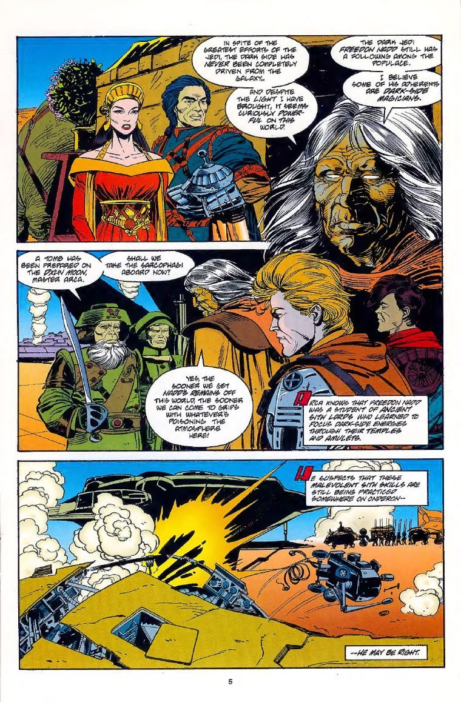
Our notes: `notes/materials/024-tales-of-the-jedi/freedon-nadd-uprising.md:76`

> BUT HE'S BEEN DEAD FOR FOUR HUNDRED YEARS!
— Source: Freedon Nadd Uprising #1, p13 — Owner Material 024a — Tales of the Jedi: The Freedon Nadd Uprising #1–2 (1994): power-scaling notes; Galia about Freedon Nadd. POV: Galia, about Freedon Nadd.
Note (our notes, around the quote): Galia about Freedon Nadd: "BUT HE'S BEEN DEAD FOR FOUR HUNDRED YEARS!" Source: Freedon Nadd Uprising #1, p13

Our notes: `notes/materials/024-tales-of-the-jedi/freedon-nadd-uprising.md:78`

> IT IS AS I FEARED--FREEDON NADD AND QUEEN AMANOA ARE DEAD...BUT THEIR SITH MAGIC IS VERY MUCH ALIVE!
> [fragment — full passage not on file]
— Source: Owner Material 024a — Tales of the Jedi: The Freedon Nadd Uprising #1–2 (1994): power-scaling notes; Arca Jeth. POV: Arca Jeth, about Freedon Nadd.
Note (our notes, around the quote): Arca Jeth: "IT IS AS I FEARED--FREEDON NADD AND QUEEN AMANOA ARE DEAD...BUT THEIR SITH MAGIC IS VERY MUCH ALIVE!" Source: Freedon Nadd Uprising #1, p11
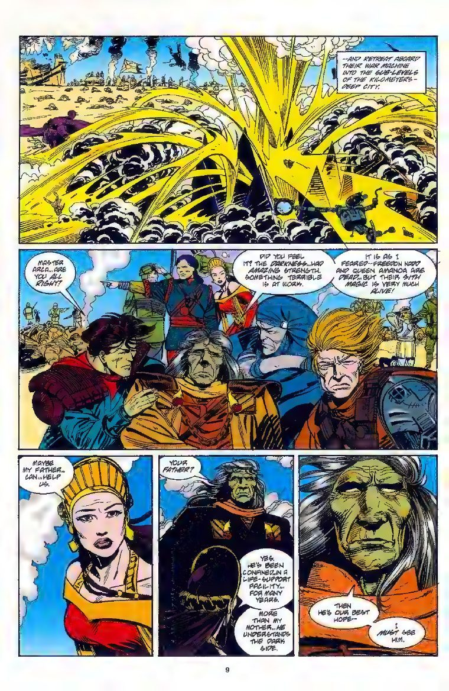
Our notes: `notes/materials/024-tales-of-the-jedi/freedon-nadd-uprising.md:79`

> THEY WERE LEFT TO ME BY MY ANCIENT FOREBEAR, FREEDON NADD.
— Source: Owner Material 024a — Tales of the Jedi: The Freedon Nadd Uprising #1–2 (1994): power-scaling notes. POV: Ommin, about Freedon Nadd.
Note (our notes, around the quote): Ommin about Freedon Nadd: "HERE LET ME SHOW YOU MY WONDERFUL AMULETS--" "THEY WERE LEFT TO ME BY MY ANCIENT FOREBEAR, FREEDON NADD." Source: Freedon Nadd Uprising #2, p11
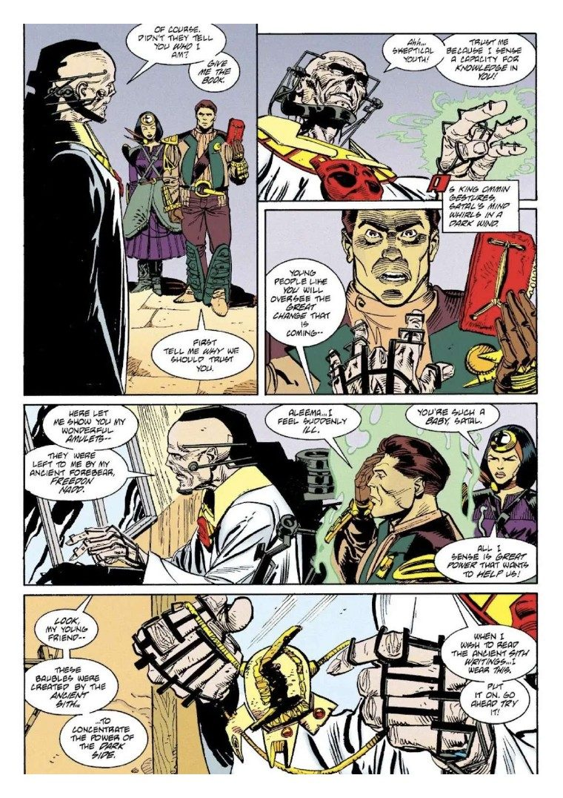
Our notes: `notes/materials/024-tales-of-the-jedi/freedon-nadd-uprising.md:81`

> NADD SPOKE OF THE ANCIENT SITH FORETELLINGS... THAT THE DARK LORDS WILL COME AGAIN.
> [fragment — full passage not on file]
>
> I HEARD SIMILAR STORIES... FROM THE JEDI HOLOCRON.
> [fragment — full passage not on file]
— Source: Owner Material 024a — Tales of the Jedi: The Freedon Nadd Uprising #1–2 (1994): power-scaling notes; Arca Jeth about Freedon Nadd. POV: Arca Jeth, about Freedon Nadd.
Note (our notes, around the quote): Arca Jeth about Freedon Nadd: "NADD SPOKE OF THE ANCIENT SITH FORETELLINGS... THAT THE DARK LORDS WILL COME AGAIN." "I HEARD SIMILAR STORIES... FROM THE JEDI HOLOCRON." Source: Freedon Nadd Uprising #2, p22

Our notes: `notes/materials/024-tales-of-the-jedi/freedon-nadd-uprising.md:83`

> A GREAT TOMB HAS BEEN BUILT ON BARBAROUS DXUN, DESIGNED TO WITHSTAND THE RAVAGES OF TIME.
>
> THERE THE ROYAL REMAINS WILL BE HELD SECURE UNTIL THEY FINALLY RETURN TO DUST.
— Source: Owner Material 024a — Tales of the Jedi: The Freedon Nadd Uprising #1–2 (1994): power-scaling notes; Narration on the Dxun tomb. POV: narrator, about Freedon Nadd.
Note (our notes, around the quote): Narration on the Dxun tomb: "A GREAT TOMB HAS BEEN BUILT ON BARBAROUS DXUN, DESIGNED TO WITHSTAND THE RAVAGES OF TIME." "THERE THE ROYAL REMAINS WILL BE HELD SECURE UNTIL THEY FINALLY RETURN TO DUST." · NARRATION. Source: Freedon Nadd Uprising #2, p21
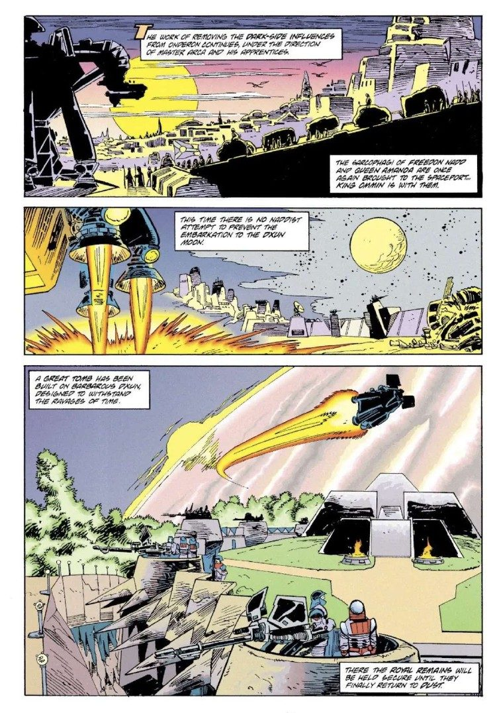
Our notes: `notes/materials/024-tales-of-the-jedi/freedon-nadd-uprising.md:85`

> AS KING OMMIN GESTURES, SATAL'S MIND WHIRLS IN A DARK WIND.
— Source: Owner Material 024a — Tales of the Jedi: The Freedon Nadd Uprising #1–2 (1994): power-scaling notes; Makes Satal's mind whirl with a gesture. POV: narrator, about Freedon Nadd.
Note (our notes, around the quote): Makes Satal's mind whirl with a gesture: "AS KING OMMIN GESTURES, SATAL'S MIND WHIRLS IN A DARK WIND." · NARRATION. Source: Freedon Nadd Uprising #2, p11

Our notes: `notes/materials/024-tales-of-the-jedi/freedon-nadd-uprising.md:100`

> WITH KING OMMIN DEAD AND HIS CLANDESTINE POWER DISPERSED, REPUBLIC FORCES QUICKLY RESTORE ORDER TO ONDERON.
— Source: Freedon Nadd Uprising #2, p17–20 — Owner Material 024a — Tales of the Jedi: The Freedon Nadd Uprising #1–2 (1994): power-scaling notes.
Note (our notes, around the quote): Defeated by Ulic Qel-Droma (armature cut, p17), then killed by Freedon Nadd's spirit (p19). Narration: "WITH KING OMMIN DEAD AND HIS CLANDESTINE POWER DISPERSED, REPUBLIC FORCES QUICKLY RESTORE ORDER TO ONDERON." Source: Freedon Nadd Uprising #2, p17–20
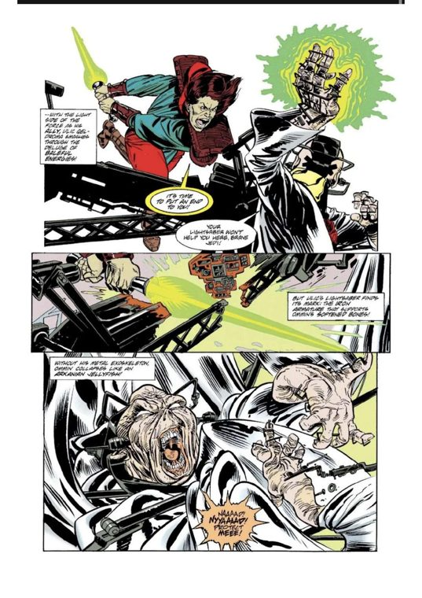

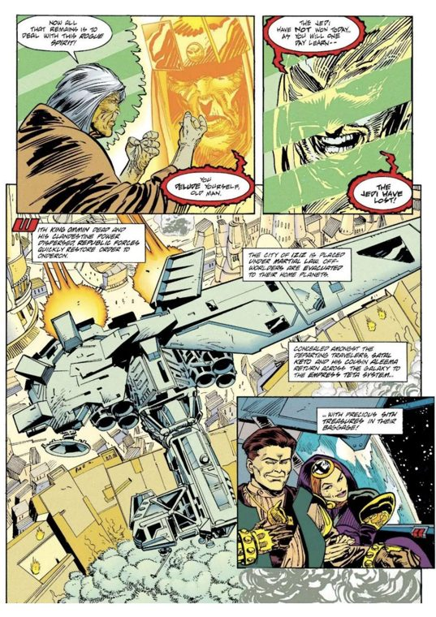
Our notes: `notes/materials/024-tales-of-the-jedi/freedon-nadd-uprising.md:114`

> ALEEMA...I FEEL SUDDENLY ILL.
> [fragment — full passage not on file]
— Source: Owner Material 024a — Tales of the Jedi: The Freedon Nadd Uprising #1–2 (1994): power-scaling notes; Satal Keto. POV: Satal Keto, about Freedon Nadd.
Note (our notes, around the quote): Satal Keto: "ALEEMA...I FEEL SUDDENLY ILL." Source: Freedon Nadd Uprising #2, p11

Our notes: `notes/materials/024-tales-of-the-jedi/freedon-nadd-uprising.md:225`

> ALL I SENSE IS GREAT POWER THAT WANTS TO HELP US!
— Source: Owner Material 024a — Tales of the Jedi: The Freedon Nadd Uprising #1–2 (1994): power-scaling notes; Aleema Keto in Ommin's lair. POV: Aleema Keto in Ommin's lair, about Freedon Nadd.
Note (our notes, around the quote): Aleema Keto in Ommin's lair: "ALL I SENSE IS GREAT POWER THAT WANTS TO HELP US!" Source: Freedon Nadd Uprising #2, p11

Our notes: `notes/materials/024-tales-of-the-jedi/freedon-nadd-uprising.md:236`

- Note (summary from our notes, not a quotation): | 8 | Freedon Nadd's spirit vs Ommin | Ommin's lair | #2 p19 | Nadd kills Ommin |
  — Source: Owner Material 024a — Tales of the Jedi: The Freedon Nadd Uprising #1–2 (1994): power-scaling notes.
Context: | # | Fight | Where | Pages | Outcome |
Our notes: `notes/materials/024-tales-of-the-jedi/freedon-nadd-uprising.md:278`

> Ulic, bathed in the light side, fights off the darkness and rushes forward, slashing with his lightsaber at the metal armature that holds Ommin erect. Without support, Ommin collapses. - -,,_c."'t.:-y 17i"4/~P ~/t..aN"'!fJ,Jt(Jlrw .a c.AJ?e~t/I.-t. y PlF~/N5P A1/~~/t?N- - 5atal and Aleema retreat into the recesses of the sublevels as Ulic demands to know what has happened to Master Area. Ommin tells them that Area has gone to the dark side, as will they. In a deep access corridor, the spirit of Freedon Nadd appears to 5atal and Aleema, giving them the book, the amulet, and a pair of 5ith swords. Nadd appears near the body of Ommin, saying that, unlike the brave Jedi arrayed before him, the old man belongs to the dark side. As Ommin passes into the Force, Area is freed and Nadd's spirit fades, saying the Jedi have lost, though they do not yet know it. With Ommin dead and the Naddists squelched, the Republic institutes martial law and quickly restores order to Iziz. Meanwhile, 5atal and Aleema escape with their 5ith treasures. Freedon Nadd's and Queen Amanoa's sarcophagi are finally brought to Dxun where they are placed in a tomb constructed to withstand the ravages of time. Ulic wonders aloud what Nadd meant when he said the Jedi had lost.
— Source: Owner Material 024a — Tales of the Jedi: The Freedon Nadd Uprising #1–2 (1994): power-scaling notes.
(Excerpt widened 2026-11-17 to the relevant passage, word for word from research primary tales of the jedi WEG40082 (text copy `research_primary_tales_of_the_jedi_WEG40082_pdf_afa57d0500`).)
(Excerpt widened 2026-11-17 to the relevant passage, word for word from research primary tales of the jedi WEG40082 (text copy `research_primary_tales_of_the_jedi_WEG40082_pdf_afa57d0500`).)
(Full sentence/passage taken from the source text on file: `research_primary_tales_of_the_jedi_WEG40082_pdf`.)
Note (our notes, around the quote): | 9 | Arca Jeth vs Freedon Nadd's spirit | Ommin's lair | #2 p20 | Spirit fades; "THE JEDI HAVE LOST!" |
Context: | # | Fight | Where | Pages | Outcome |
Our notes: `notes/materials/024-tales-of-the-jedi/freedon-nadd-uprising.md:279`

- Note (summary from our notes, not a quotation): 
  — Source: Owner Material 024a — Tales of the Jedi: The Freedon Nadd Uprising #1–2 (1994): power-scaling notes.
Our notes: `notes/materials/024-tales-of-the-jedi/freedon-nadd-uprising.md:289`

- Note (summary from our notes, not a quotation): 
  — Source: Owner Material 024a — Tales of the Jedi: The Freedon Nadd Uprising #1–2 (1994): power-scaling notes.
Our notes: `notes/materials/024-tales-of-the-jedi/freedon-nadd-uprising.md:291`

- Note (summary from our notes, not a quotation): 
  — Source: Owner Material 024a — Tales of the Jedi: The Freedon Nadd Uprising #1–2 (1994): power-scaling notes.
Our notes: `notes/materials/024-tales-of-the-jedi/freedon-nadd-uprising.md:325`

- Note (summary from our notes, not a quotation): 
  — Source: Owner Material 024a — Tales of the Jedi: The Freedon Nadd Uprising #1–2 (1994): power-scaling notes.
Our notes: `notes/materials/024-tales-of-the-jedi/freedon-nadd-uprising.md:327`

- Note (summary from our notes, not a quotation): 
  — Source: Owner Material 024a — Tales of the Jedi: The Freedon Nadd Uprising #1–2 (1994): power-scaling notes.
Our notes: `notes/materials/024-tales-of-the-jedi/freedon-nadd-uprising.md:329`

- Note (summary from our notes, not a quotation): 
  — Source: Owner Material 024a — Tales of the Jedi: The Freedon Nadd Uprising #1–2 (1994): power-scaling notes.

Our notes: `notes/materials/024-tales-of-the-jedi/freedon-nadd-uprising.md:331`

- Note (summary from our notes, not a quotation): 
  — Source: Owner Material 024a — Tales of the Jedi: The Freedon Nadd Uprising #1–2 (1994): power-scaling notes.
Our notes: `notes/materials/024-tales-of-the-jedi/freedon-nadd-uprising.md:333`

- Note (summary from our notes, not a quotation): 
  — Source: Owner Material 024a — Tales of the Jedi: The Freedon Nadd Uprising #1–2 (1994): power-scaling notes.
Our notes: `notes/materials/024-tales-of-the-jedi/freedon-nadd-uprising.md:335`

- Note (summary from our notes, not a quotation): Ulic: the dark side that took Arca is "TOO STRONG FOR US" (p17). Nadd's spirit calls itself "POWERLESS IN MY PRESENT STATE" (p13); (ANALYSIS) Ommin is the active threat here.
  — Source: Owner Material 024a — Tales of the Jedi: The Freedon Nadd Uprising #1–2 (1994): power-scaling notes.
Our notes: `notes/materials/024-tales-of-the-jedi/freedon-nadd-uprising.md:338`

- Note (summary from our notes, not a quotation): #2: Nadd's spirit kills Ommin outright (p19). Arca drives the spirit off but does not destroy it (p20). (ANALYSIS) Freedon Nadd's spirit > Ommin; Arca ≥ Nadd's spirit in this encounter only; the spirit's taunt sets up Exar Kun (DLotS).
  — Source: Owner Material 024a — Tales of the Jedi: The Freedon Nadd Uprising #1–2 (1994): power-scaling notes.
Our notes: `notes/materials/024-tales-of-the-jedi/freedon-nadd-uprising.md:340`

- Note (summary from our notes, not a quotation): All 27 pages of #1 and all 22 pages of #2 read (NEW 2026-10-27). The Onderon arc is complete for Freedon Nadd, Ommin, Arca Jeth, Galia and the Jedi team. Thon does not appear in #2.
  — Source: Owner Material 024a — Tales of the Jedi: The Freedon Nadd Uprising #1–2 (1994): power-scaling notes.
Our notes: `notes/materials/024-tales-of-the-jedi/freedon-nadd-uprising.md:343`

- Note (summary from our notes, not a quotation): RPG MECHANICS = weaker source. The d6 stats below are game mechanics that WEG wrote to let players run these characters. They are not statements in the stories. Use them only as a rough *relative* ranking within this book: Arca > Thon in Force dice, Nadd > Arca, Ommin far below either. They do not override what the comics show or say.
  — Source: Owner Material 024d — Tales of the Jedi Companion (West End Games, 1996): power-scaling notes.
Our notes: `notes/materials/024-tales-of-the-jedi/tales-of-the-jedi-companion.md:16`

- Note (summary from our notes, not a quotation): | 66–76 | The Sith | Bios + stat blocks: Queen Amanoa, Freedon Nadd, King Ommin, Novar, Warb Null; Sith fiction |
  — Source: Owner Material 024d — Tales of the Jedi Companion (West End Games, 1996): power-scaling notes.
Context: | Printed pages | Chapter | What is in it |
Our notes: `notes/materials/024-tales-of-the-jedi/tales-of-the-jedi-companion.md:28`

> to become the greatest Sith sorcerer that had ever existed, and then he would return to take his revenge on the Jedi ...
> [fragment — full passage not on file]
— Source: Owner Material 024d — Tales of the Jedi Companion (West End Games, 1996): power-scaling notes; Narrative bio: as he fled Ossus, Nadd's own aim was.
Note (our notes, around the quote): Narrative bio: as he fled Ossus, Nadd's own aim was "to become the greatest Sith sorcerer that had ever existed, and then he would return to take his revenge on the Jedi ..." This is his ambition, not narrator fact. Source: Tales of the Jedi Companion (WEG, 1996), p.70
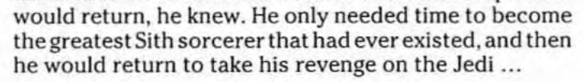
Our notes: `notes/materials/024-tales-of-the-jedi/tales-of-the-jedi-companion.md:91`

> Master Arca uses his bailie meditation ability to dismiss the darkness, and the tide of confrontation turns again in favor of the beast-riders. The city falls. Arca is not pleased with his students. He admonishes them for not informing him the moment they learned of the presence of the dark side. By instinct alone, Master Arca leads the Jedi and Galia to Freedon Nadd's tomb in the deepest sub-levels of the palace. Arca disrupts the darkness, breaking its hold on Queen Amanoa, who dies as a result. Area then tells his students that Freedon Nadd embraced the dark side and apprenticed himself to a Dark Lord of the Sith. Since there could never be more than one Dark Lord, Nadd murdered his teacher and assumed the title. Upon his death, his tomb became a focus of dark side energy, which Galia's ancestors used through the centuries. In a formal ceremony, the marriage of Oron Kira and Galia is recognized by the Galactic Republic, and the world of Onderon becomes unified for the first time in centuries. Master Arca warns his Jedi students that Freedon Nadd still has followers in the city. The struggle against the dark side on Onderon has not yet come to an end.
— Source: Owner Material 024d — Tales of the Jedi Companion (West End Games, 1996): power-scaling notes; Beast Wars summary, Arca tells his students that Nadd.
(Excerpt widened 2026-11-17 to the relevant passage, word for word from research primary tales of the jedi WEG40082 (text copy `research_primary_tales_of_the_jedi_WEG40082_pdf_afa57d0500`).)
(Excerpt widened 2026-11-17 to the relevant passage, word for word from research primary tales of the jedi WEG40082 (text copy `research_primary_tales_of_the_jedi_WEG40082_pdf_afa57d0500`).)
(Full sentence/passage taken from the source text on file: `research_primary_tales_of_the_jedi_WEG40082_pdf`.)
Note (our notes, around the quote): Beast Wars summary, Arca tells his students that Nadd "apprenticed himself to a Dark Lord of the Sith. Since there could never be more than one Dark Lord, Nadd murdered his teacher and assumed the title." Source: Tales of the Jedi Companion (WEG, 1996), p.11
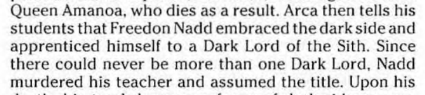
Our notes: `notes/materials/024-tales-of-the-jedi/tales-of-the-jedi-companion.md:93`

- Note (summary from our notes, not a quotation): Bio fiction: on Ossus, Nadd kills Jedi Master Matta Tremayne with his lightsaber during a test, then flees to Ashas Ree. Source: Tales of the Jedi Companion (WEG, 1996), p.69-70
  — Source: Tales of the Jedi Companion (WEG, 1996), p.69-70 — Owner Material 024d — Tales of the Jedi Companion (West End Games, 1996): power-scaling notes.
Our notes: `notes/materials/024-tales-of-the-jedi/tales-of-the-jedi-companion.md:95`

> He realized then that he was invincible with the dark side at his back. Nothing could topple him. Nothing could harm or destroy him ever again, not even the dark side itself. His normal vision returned, and he saw the ghostly form of Freedon Nadd hovering close by. Ommin felt stronger than he ever had, and he wanted to show his mentor what he had accomplished. He pushed himself up from his ancient throne, and then collapsed under his own weight, his legs no longer able to support him. Nadd made a deep, staccato sound that Ommin could only guess was laughter. "The dark side does not come without its price," the Sith spirit said. "You have power over the Force, but in exchange you have lost power over your own body." Nadd had warned him of the dark side's initiation tithe a decade ago when his training had begun. He couldn't remember whether he had chosen to accept that price or whether he had purposely sealed it away in the recesses of his memory. It didn't matter now, anyway.
— Source: Owner Material 024d — Tales of the Jedi Companion (West End Games, 1996): power-scaling notes; Freedon Nadd's spirit to Ommin. POV: Freedon Nadd's spirit.
(Excerpt widened 2026-11-17 to the relevant passage, word for word from research primary tales of the jedi WEG40082 (text copy `research_primary_tales_of_the_jedi_WEG40082_pdf_afa57d0500`).)
(Excerpt widened 2026-11-17 to the relevant passage, word for word from research primary tales of the jedi WEG40082 (text copy `research_primary_tales_of_the_jedi_WEG40082_pdf_afa57d0500`).)
(Full sentence/passage taken from the source text on file: `research_primary_tales_of_the_jedi_weg_companion_txt`.)
Note (our notes, around the quote): Freedon Nadd's spirit to Ommin: "The dark side does not come without its price ... You have power over the Force, but in exchange you have lost power over your own body." Source: Tales of the Jedi Companion (WEG, 1996), p.74
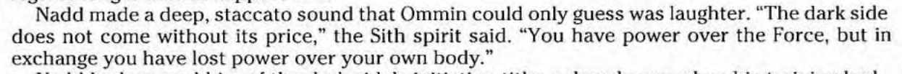
Our notes: `notes/materials/024-tales-of-the-jedi/tales-of-the-jedi-companion.md:96`

> the spirit of Freedon Nadd appears to Satal and Aleema, giving them the book, the amulet, and a pair of Sith swords.
> [fragment — full passage not on file]
— Source: Owner Material 024d — Tales of the Jedi Companion (West End Games, 1996): power-scaling notes; FNU summary. POV: FNU summary.
Note (our notes, around the quote): FNU summary: "the spirit of Freedon Nadd appears to Satal and Aleema, giving them the book, the amulet, and a pair of Sith swords." Source: Tales of the Jedi Companion (WEG, 1996), p.15
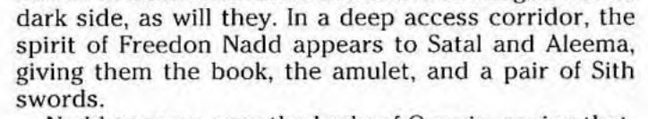
Our notes: `notes/materials/024-tales-of-the-jedi/tales-of-the-jedi-companion.md:100`

> When her efforts failed she fell into a deep brooding, for she did not know how to help her husband. Over the years, however, that depression turned into anger at the king for having made the dark alliance in the first place, and then into outright hatred. At the same time, Ommin decided his queen was ready to join him, to share in the power that he had cultivated over a lifetime. The queen tread slowly into the darkness, but once she passed beyond the point where light could no longer reach, she opened herself completely to the dark side. Ommin and the spirit of Freedon Nadd instructed her in the Force and in Sith techniques, and she gradually grew in power, eventually becoming a formidable sorceress in her own right. Soon after, however, Ommin began to suffer from a strange ifIness that seemed to consume the very marrow --e%.J'f we we~e. e:XPfU.-nN(, a &Hl'£A.,- ..;ep/ 11fA6,~-Nb'r tJlrt.M'V"l'"Cl'tE-t7 'IOV1"I-f• .J AMANOA The darkness did not come easily to Amanoa, but when she finally embraced it, there was no lettinggo. Freedon Nadd brought the teachings of the Sith to Onderon 350 years before the birth of Queen Amanoa, spreading the wicked ways of the dark side to his followers.
— Source: Owner Material 024d — Tales of the Jedi Companion (West End Games, 1996): power-scaling notes; Narrative bio. POV: Narrative bio, about Freedon Nadd.
(Excerpt widened 2026-11-17 to the relevant passage, word for word from research primary tales of the jedi WEG40082 (text copy `research_primary_tales_of_the_jedi_WEG40082_pdf_afa57d0500`).)
(Excerpt widened 2026-11-17 to the relevant passage, word for word from research primary tales of the jedi WEG40082 (text copy `research_primary_tales_of_the_jedi_WEG40082_pdf_afa57d0500`).)
Note (our notes, around the quote): Narrative bio: "Ommin and the spirit of Freedon Nadd instructed her in the Force and in Sith techniques, and she gradually grew in power, eventually becoming a formidable sorceress in her own right." Source: Tales of the Jedi Companion (WEG, 1996), p.68
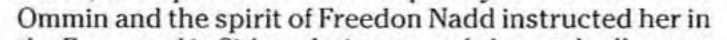
Our notes: `notes/materials/024-tales-of-the-jedi/tales-of-the-jedi-companion.md:233`

> These exiles eventually developed a symbiotic and combat, Jedi history, and - for the more advanced relationship with the warbeasts, earning the derogatory students - the nature of the dark side. Special training name "beast-riders." areas throughout the complex allow would-be Jedi to The Beast Wars raged on lor centuries, ending only practice Iightsaber cadences or engage in battle with after the intercession of the Jedi Knights. Queen Galia, mechanical remotes, or, at times, with trueJedi Masters. the first in her line to cast off the pall of the dark side that Secluded chambers and gardens provide excellent sites had consumed each of her ancestors, and the beast lord for meditation and contemplation of the Jedi Masters' Odon Kira now rule Onderon in relative peace, and have words. Large living compounds offer adequate, though recently requested admittance to the Galactic Republic. sparsely furnished, rooms, and several dining areas The sarcophagi of King Ommin, Queen Amanoa, and handle the nourishment needs of all present.
>
> Freedon Nadd lie on Dxun within a deep tomb sealed by the The Hall of Knowledge contains hundreds of thou- light side of the Force and guarded by warbeasts.
>
> Freedon Nadd lie on Dxun within a deep tomb sealed by the The Hall of Knowledge contains hundreds of thou- light side of the Force and guarded by warbeasts. Jedi sands of datacards (and ancient paper tomes) holding Master Arca Jeth, watchman of Onderon, fears that other everything from the most current Republic planet logs Sith devotees may attempt to steal away the sarcophagi in to the oldest recorded words of Jedi Masters. order to release the spirits of the dark siders.
>
> Queen Galia, the first in her line to cast off the pall of the dark side that had consumed each of her ancestors, and the beast lord Odon Kira now rule Onderon in relative peace, and have recently requested admittance to the Galactic Republic. The sarcophagi of King Ommin, Queen Amanoa, and Freedon Nadd lieon Dxun within adeep tomb sealed bythe light side of the Force and guarded by warbeasts. Jedi Master Arca Jeth, watchman of Onderon, fears that other Sith devotees may attempt to steal away the sarcophagi in order to release the spirits of the dark siders. He plans to monitor Dxun closely. ONDERON Type: Terrestrial Temperature: Temperate Atmosphere: Type I (breathable) Hydrosphere: Moderate Gravity: Standard Terrain: Forests, plains, mountains Length of Day: 28 standard hours length of Year. -105 local days Sapient Species: Humans Starpor1: Limited service Population: 4 million Planet Function: Homeworld Govemment: Monarchy Tech Level: Feudal Major Exports: None Major Imports: High technology. especially weapons System: Japrael Star. Prael Orbital Bodies: Name Planet Type Dagri Moon Oxun Moon Evas Moon Suthre Moon OSSUS The planet Ossus has long been a center of Jedi learning and a meeting place for Jedi Masters to discuss recent events.
>
> The Beast Wars raged on lor centuries, ending only after the intercession of the Jedi Knights. Queen Galia, the first in her line to cast off the pall of the dark side that had consumed each of her ancestors, and the beast lord Odon Kira now rule Onderon in relative peace, and have recently requested admittance to the Galactic Republic. The sarcophagi of King Ommin, Queen Amanoa, and Freedon Nadd lieon Dxun within adeep tomb sealed bythe light side of the Force and guarded by warbeasts. Jedi Master Arca Jeth, watchman of Onderon, fears that other Sith devotees may attempt to steal away the sarcophagi in order to release the spirits of the dark siders. He plans to monitor Dxun closely.
— Source: Owner Material 024d — Tales of the Jedi Companion (West End Games, 1996): power-scaling notes; Onderon site entry: the remains of Freedon Nadd.
(Excerpt widened 2026-11-17 to the relevant passage, word for word from research primary tales of the jedi weg companion (text copy `research_primary_tales_of_the_jedi_weg_companion_txt_38d20572e2`).)
(Excerpt widened 2026-11-17 to the relevant passage, word for word from research primary tales of the jedi WEG40082 (text copy `research_primary_tales_of_the_jedi_WEG40082_pdf_afa57d0500`).)
(Excerpt widened 2026-11-17 to the relevant passage, word for word from research primary tales of the jedi weg companion (text copy `research_primary_tales_of_the_jedi_weg_companion_txt_38d20572e2`).)
(Excerpt widened 2026-11-17 to the relevant passage, word for word from research primary tales of the jedi WEG40082 (text copy `research_primary_tales_of_the_jedi_WEG40082_pdf_afa57d0500`).)
(Full sentence/passage taken from the source text on file: `research_primary_tales_of_the_jedi_weg_paged_txt`.)
Note (our notes, around the quote): Onderon site entry: the remains of Freedon Nadd "lie on Dxun within a deep tomb sealed by the light side of the Force and guarded by warbeasts." Source: Tales of the Jedi Companion (WEG, 1996), p.132
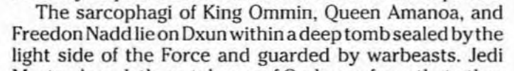
Our notes: `notes/materials/024-tales-of-the-jedi/tales-of-the-jedi-companion.md:297`

- Note (summary from our notes, not a quotation): | Freedon Nadd (Sith Master) | 14D+2 | 15D | 14D+1 | 12D | p.70 |
  — Source: Owner Material 024d — Tales of the Jedi Companion (West End Games, 1996): power-scaling notes.
Context: | Character | Control | Sense | Alter | Lightsaber | Page |
Our notes: `notes/materials/024-tales-of-the-jedi/tales-of-the-jedi-companion.md:336`

- Note (summary from our notes, not a quotation): Mandalore attacks the Teta system and challenges Ulic (p4–7). Exar recruits Jedi on Ossus with an amulet illusion of his fight with Nadd (p8–10). Ulic beats Mandalore on Kuar (p11–15). Odan-Urr teaches Nomi the blocking technique (p16–17); Exar takes the Sith holocron and Odan-Urr dies (p18–20). The Foerost shipyard raid takes 300 warships (p21–25); Ulic insists on attacking Coruscant (p26).
  — Source: Owner Material 024c — Tales of the Jedi: The Sith War #1–6 (1995–96): power-scaling notes.
Our notes: `notes/materials/024-tales-of-the-jedi/the-sith-war.md:28`

- Note (summary from our notes, not a quotation): Projects an illusion of his fight with Freedon Nadd from his Sith amulet (passed off as a "JEDI AMULET") to recruit students on Ossus. Source: The Sith War #1, p10
  — Source: Owner Material 024c — Tales of the Jedi: The Sith War #1–6 (1995–96): power-scaling notes.
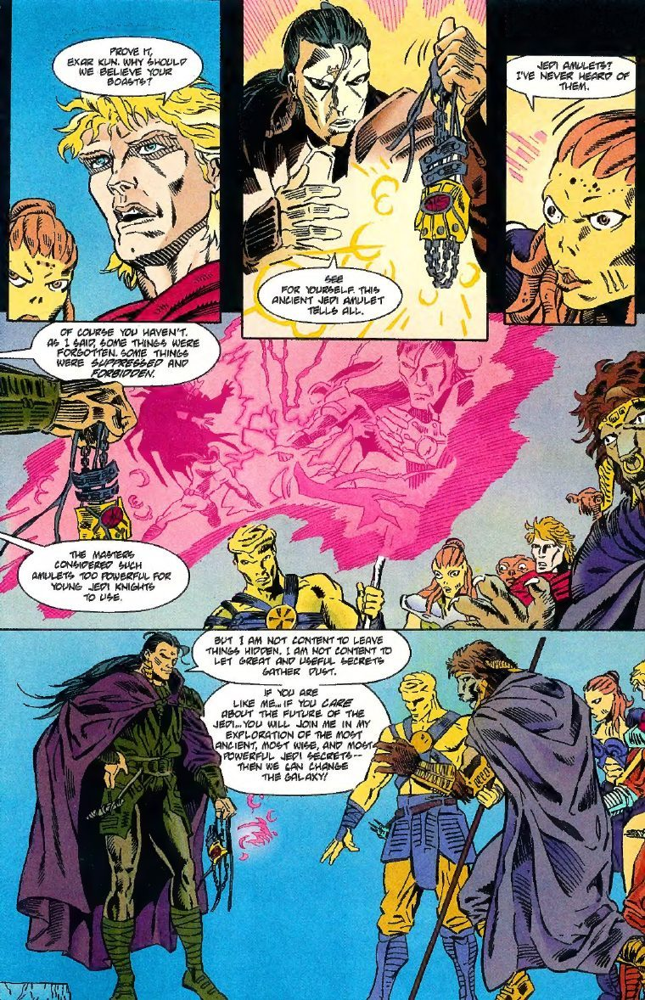
Our notes: `notes/materials/024-tales-of-the-jedi/the-sith-war.md:50`

## Star Wars: The Old Republic Encyclopedia (DK, 2012): power-scaling and lore notes

> Unsurprisingly, Jedi who have fallen to the dark side, such as Exar Kun and Freedon Nadd, are remembered as some of the galaxy's worst tyrants.
— Source: The Sith; Exar Kun; Freedon Nadd — Resisting Temptation.
Note (our notes, around the quote): Exar Kun; Freedon Nadd — Resisting Temptation: "Unsurprisingly, Jedi who have fallen to the dark side, such as Exar Kun and Freedon Nadd, are remembered as some of the galaxy's worst tyrants." Source: The Old Republic Encyclopedia, p.148
Our notes: `notes/materials/025-tor-encyclopedia/05-sith.md:45`

> The spirits of powerful Sith Lords such as Marka Ragnos, Freedon Nadd, and Karness Muur influenced galactic events and inspired others to evil long after their physical deaths. For this reason, the Dark Temple on Dromund Kaas, which houses sarcophagi of the Sith Emperor's deceased enemies, is as much prison as tomb.
— Source: The Sith.
Note (our notes, around the quote): Marka Ragnos; Freedon Nadd; Karness Muur; Vitiate (the Sith Emperor) — Force Spirits: "The spirits of powerful Sith Lords such as Marka Ragnos, Freedon Nadd, and Karness Muur influenced galactic events and inspired others to evil long after their physical deaths. For this reason, the Dark Temple on Dromund Kaas, which houses sarcophagi of the Sith Emperor's deceased enemies, is as much prison as tomb." Source: The Old Republic Encyclopedia, p.152
Our notes: `notes/materials/025-tor-encyclopedia/05-sith.md:73`

## Star Wars: The New Essential Chronology (Del Rey, 2005): power-scaling and lore notes

> Nadd awakened the ancient Sith Lord, and Sadow instructed the Jedi in the dark twistings of the Force. Freedon Nadd then killed his mentor
> [fragment — full passage not on file]
— Source: Part One: Tales of the Ancient Republic; Freedon Nadd; Naga Sadow — Freedon Nadd awakens and kills Sadow.
Note (our notes, around the quote): Freedon Nadd; Naga Sadow — Freedon Nadd awakens and kills Sadow: "Nadd awakened the ancient Sith Lord, and Sadow instructed the Jedi in the dark twistings of the Force. Freedon Nadd then killed his mentor" Source: The New Essential Chronology, p.12
Our notes: `notes/materials/027-new-essential-chronology/01-part-one-ancient-republic.md:76`

> Freedon Nadd, with his knowledge of Sith magic, easily made himself the leader of these people.
— Source: Part One: Tales of the Ancient Republic; Freedon Nadd — Nadd rules Onderon.
Note (our notes, around the quote): Freedon Nadd — Nadd rules Onderon: "Freedon Nadd, with his knowledge of Sith magic, easily made himself the leader of these people." Source: The New Essential Chronology, p.12
Our notes: `notes/materials/027-new-essential-chronology/01-part-one-ancient-republic.md:78`

> The predators took a terrible toll on the population until the people constructed a walled city, liz, for their protection.
>
> Freedon Nadd, with his knowledge of Sith magix, easily made himself the leader of these people. Over the decades the city grew, Implacably driving back the Jungle. One of the polkies Nadd instituted was to banish criminals outskle the walls of Iziz, where they would be devoured Dy the vora- clous predators. However, some of these exiles managed to band together and survive, even leaming how to capture the beasts and domesticate them, Riding on the backs of fly- ing beasts and carrying handmade weapons, the survivors struck back against the city that had exiled them, thus begin- ning centuries of unrest and revellion—a scattered guerilla war that even Freedon Nadd’s powers could not crush.
>
> After Nadd's death, the sarcophagus containing his body became a focus of dark side energy that was used by his descendants. Nadd’s kegacy passed from generation to gen:
>
> === PDF p.25 === ‘ 4 - & t i S :
>
> =25on, but the civil war continued, with a cost in ood nearly as high as the earllest attacks from De Deasts of Oxun.
>
> During the Vullar Cataclysm (4250 o..¥,), the eed Order experienced its Third Great Shism.
— Source: Part One: Tales of the Ancient Republic; Freedon Nadd — Nadd's sarcophagus.
(Excerpt widened 2026-11-17 to the relevant passage, word for word from research primary new essential chronology nec paged (text copy `research_primary_new_essential_chronology_nec_paged_txt_88b808b5bc`).)
(Excerpt widened 2026-11-17 to the relevant passage, word for word from research primary new essential chronology nec paged (text copy `research_primary_new_essential_chronology_nec_paged_txt_88b808b5bc`).)
Note (our notes, around the quote): Freedon Nadd — Nadd's sarcophagus: "After Nadd's death, the sarcophagus containing his body became a focus of dark side energy that was used by his descendants." Source: The New Essential Chronology, p.12
Our notes: `notes/materials/027-new-essential-chronology/01-part-one-ancient-republic.md:80`

> The spirit-avatar of Nadd joined forces with Ommin, crippling Master Arca with lightning bolts of energy.
— Source: Part One: Tales of the Ancient Republic.
Note (our notes, around the quote): Freedon Nadd; King Ommin; Arca Jeth — Nadd's spirit and Ommin cripple Arca: "The spirit-avatar of Nadd joined forces with Ommin, crippling Master Arca with lightning bolts of energy." Source: The New Essential Chronology, p.15
Our notes: `notes/materials/027-new-essential-chronology/01-part-one-ancient-republic.md:103`

> The flood of dark side power blasted away the rubble, knitted his broken bones, and left him lying naked on the dry clay of Korriban. Exar Kun let out a tremendous shriek that echoed across the galaxy
> [fragment — full passage not on file]
— Source: Part One: Tales of the Ancient Republic.
Note (our notes, around the quote): Exar Kun; Freedon Nadd — Kun healed by the dark side on Korriban: "The flood of dark side power blasted away the rubble, knitted his broken bones, and left him lying naked on the dry clay of Korriban. Exar Kun let out a tremendous shriek that echoed across the galaxy" Source: The New Essential Chronology, p.17
Our notes: `notes/materials/027-new-essential-chronology/01-part-one-ancient-republic.md:119`

> In the tomb of Freedon Nadd, he meditated on Sith power as barnacle-like orbalisks covered him in a permanent suit of living armor.
— Source: Part One: Tales of the Ancient Republic; Darth Bane — orbalisk armor on Dxun.
Note (our notes, around the quote): Darth Bane — orbalisk armor on Dxun: "In the tomb of Freedon Nadd, he meditated on Sith power as barnacle-like orbalisks covered him in a permanent suit of living armor." Source: The New Essential Chronology, p.27
Our notes: `notes/materials/027-new-essential-chronology/01-part-one-ancient-republic.md:237`

## Star Wars Saga Edition: Jedi Academy Training Manual (WotC, 2009): power-scaling and lore notes

> Languages: Basic, Dromnyr.
>
> Grasping Tentacles: Krevaaki gain a +2 species bonus on Climb checks and a +2 species bonus on grapple checks.
>
> Languages: Basic, Dromnyr.
>
> Growing restless with Master Baas's instruction, Kun believes that he can become an even mightier Jedi by learning more about the dark side of the Force, but Baas would only teach him so much. Desperate to discover more, Kun ventures to Dxun and enters the tomb of Freedon Nadd. The dark spirit of Freedon Nadd directs Exar Kun to travel to Korriban, where Nadd attacks Kun and shatters every bone in his body. At that point, ey Baas feels Kun's pain through the Force and stretches J out to aid him, but he is also attacked by Nadd and prevented from assisting his apprentice.
>
> Experiencing Exar Kun's descent to the dark side gives Baas a unique understanding on the balance of the Force. When Nomi Sunrider and Cay Qel-Droma request to lead the mission to rescue Ulic Qel-Droma from the Krath during the Great Sith War, Baas warns against taking such action, but the request is granted by the Jedi Assembly.
— Source: Chapter V: Instructors and Alumni; Exar Kun; Freedon Nadd — Vodo-Siosk Baas — Nadd breaks Kun.
(Excerpt widened 2026-11-17 to the relevant passage, word for word from research primary jedi academy training manual jatm paged (text copy `research_primary_jedi_academy_training_manual_jatm_paged_txt_fea130719f`).)
(Excerpt widened 2026-11-17 to the relevant passage, word for word from research primary jedi academy training manual jatm paged (text copy `research_primary_jedi_academy_training_manual_jatm_paged_txt_fea130719f`).)
Note (our notes, around the quote): Exar Kun; Freedon Nadd — Vodo-Siosk Baas — Nadd breaks Kun: "Kun ventures to Dxun and enters the tomb of Freedon Nadd. The dark spirit of Freedon Nadd directs Exar Kun to travel to Korriban, where Nadd attacks Kun and shatters every bone in his body." Source: Jedi Academy Training Manual, p.111
Our notes: `notes/materials/028-jedi-academy-training-manual/05-ch5-instructors-and-alumni.md:103`

> After a long and arduous battle, Kanos slays Jax with his vibroblade.
>
> Carnor Jax Encounters For most of his career as a Royal Guard, Carnor Jax can be found either on Coruscant or with the Emperor. After Palpatine’s death, Jax is located some- where within the Core Worlds, usually on Coruscant. Given his status within the Empire, Jax proves hard to reach. Heroes who target Jax must contend with the legions of stormtroopers and other Imperial forces that surround him.
>
> CARNOR JAX AGNLAS AO Svseonva | === sp119 te AQGNLES AO SHPeONWVG) DARK SIDE SPIRIT (TEMPLATE) Whether through the influence of the dark side of the Force or just by sheer willpower, strong dark siders have been capable of influencing events long after their physical deaths. Naga Sadow, Freedon Nadd, and Exar Kun are just a few examples of former Sith Lords who have maintained a spiritual presence in the galaxy years and even centuries after they were thought to be dead.
>
> CARNOR JAX AGNLAS AO Svseonva | === sp119 te AQGNLES AO SHPeONWVG) DARK SIDE SPIRIT (TEMPLATE) Whether through the influence of the dark side of the Force or just by sheer willpower, strong dark siders have been capable of influencing events long after their physical deaths. Naga Sadow, Freedon Nadd, and Exar Kun are just a few examples of former Sith Lords who have maintained a spiritual presence in the galaxy years and even centuries after they were thought to be dead. Even Emperor Palpatine manages to avoid permanent death for a while through means unknown to the vast majority of the galaxy's populace.
>
> A dark side spirit is anchored to some point or object that allows it to remain connected to the physical realm. Usually, this site or object is closely related to the individual's death.
— Source: Chapter VI: Dangers of Study; Exar Kun; Palpatine (Darth Sidious) — Dark Side Spirit (template) — examples.
(Excerpt widened 2026-11-17 to the relevant passage, word for word from research primary jedi academy training manual jatm paged (text copy `research_primary_jedi_academy_training_manual_jatm_paged_txt_fea130719f`).)
(Excerpt widened 2026-11-17 to the relevant passage, word for word from research primary jedi academy training manual jatm paged (text copy `research_primary_jedi_academy_training_manual_jatm_paged_txt_fea130719f`).)
Note (our notes, around the quote): Exar Kun; Palpatine (Darth Sidious) — Dark Side Spirit (template) — examples: "Naga Sadow, Freedon Nadd, and Exar Kun are just a few examples of former Sith Lords who have maintained a spiritual presence in the galaxy years and even centuries after they were thought to be dead. Even Emperor Palpatine manages to avoid permanent death for a while through means unknown to the vast majority of the galaxy's populace." Source: Jedi Academy Training Manual, p.118
Our notes: `notes/materials/028-jedi-academy-training-manual/06-ch6-dangers-of-study.md:51`

> The massive creatures they are sent to hunt might become the least of their problems.
>
> ¢ During an adventure, one of the heroes comes across an unique amulet that once belonged to a Sith Lord interred on Korriban. The amulet begins whispering to the hero, alternating between maddening words and tempting thoughts—power could be had if the hero goes to Korriban and returns the amulet to its resting spot. answer to why, many Jedi scholars explain that Freedon Nadd's spirit has tainted the area and destroyed the local flora.
>
> Within the tomb lie several rooms, including the burial chamber and the Sith repository. The burial chamber, simply put, houses the sarcophagus where Nadd's remains are stored. The walls remain largely unadorned, while the plat- form on which the sarcophagus sits includes a large statue of Nadd and two lesser statues that also serve as lamp posts to light the cavernous chamber.
>
> The Sith repository holds many of the Sith artifacts owned or used by Nadd during his tyrannical reign over Onderon, many of which have been permanently deactivated or destroyed by the Jedi. Over the years, several of the artifacts regain their power and are able to be used by the likes of Exar Kun and Darth Bane.
>
> Inhabitants To say that Dxun is home to some of the most evil creatures the galaxy has known is a grave understatement.
>
> Some of the moon's flora has taken on more of a predatory nature due to Freedon Nadd's dark influence, attacking anyone approaching Nadd's tomb on foot.
— Source: Chapter VII: Studying Abroad, and back cover; Exar Kun; Darth Bane — Korriban — Nadd's repository.
(Excerpt widened 2026-11-17 to the relevant passage, word for word from research primary jedi academy training manual jatm paged (text copy `research_primary_jedi_academy_training_manual_jatm_paged_txt_fea130719f`).)
(Excerpt widened 2026-11-17 to the relevant passage, word for word from research primary jedi academy training manual jatm paged (text copy `research_primary_jedi_academy_training_manual_jatm_paged_txt_fea130719f`).)
Note (our notes, around the quote): Exar Kun; Darth Bane — Korriban — Nadd's repository: "Over the years, several of the artifacts regain their power and are able to be used by the likes of Exar Kun and Darth Bane." Source: Jedi Academy Training Manual, p.158
Our notes: `notes/materials/028-jedi-academy-training-manual/07-ch7-studying-abroad-back-cover.md:47`

## The Jedi Academy Sourcebook (WEG, 1996): power-scaling and lore notes

> Four thousand years ago, 1,000 years after the Sith Empire had fallen, Exar Kun, a disciple of Vodo-Siosk Baas, discovered fragments of Sith teachings. Drawn by a thirst for forbidden knowledge, Exar Kun delved into the study of Sith philosophy.
>
> Disregarding his master’s warnings that only very advanced and experienced Jedi Masters could safely study the Sith teachings without going to the dark side, Kun traveled to one of the preserved strongholds on Onderon. There he located the tomb of Freedon Nadd, a great Sith initiate who had brought the dark side to Onderon and retired there.
>
> The shade of Nadd, still lingering in the musty halls, revealed itself to Kun and promised him great power if he would consent to become Nadd'’s disciple. Kun agreed, sure that he could use Nadd without himself being used.
>
> The shade of Nadd, still lingering in the musty halls, revealed itself to Kun and promised him great power if he would consent to become Nadd'’s disciple. Kun agreed, sure that he could use Nadd without himself being used. However, even as Kun prided himself on his strength and ability to learn from Nadd without surrendering to the dark side, Nadd brought him further under his sway.
>
> In time, Nadd brought Kun to Yavin Four, where a fallen rival Sith Lord had once worked shadowy miracles with dark side alchemy.
— Source: Chapter Four: Echoes of the Sith; Exar Kun; Freedon Nadd — The Seduction of Exar Kun — Nadd.
(Excerpt widened 2026-11-17 to the relevant passage, word for word from research primary jedi academy sourcebook jas clean (text copy `research_primary_jedi_academy_sourcebook_jas_clean_txt_04b8ab0d44`).)
(Excerpt widened 2026-11-17 to the relevant passage, word for word from research primary jedi academy sourcebook jas clean (text copy `research_primary_jedi_academy_sourcebook_jas_clean_txt_04b8ab0d44`).)
Note (our notes, around the quote): Exar Kun; Freedon Nadd — The Seduction of Exar Kun — Nadd: "Kun agreed, sure that he could use Nadd without himself being used." Source: The Jedi Academy Sourcebook, p.48
Our notes: `notes/materials/029-jedi-academy-sourcebook/04-ch4-echoes-of-the-sith.md:11`

> Disregarding his master’s warnings that only very advanced and experienced Jedi Masters could safely study the Sith teachings without going to the dark side, Kun traveled to one of the preserved strongholds on Onderon. There he located the tomb of Freedon Nadd, a great Sith initiate who had brought the dark side to Onderon and retired there.
>
> The shade of Nadd, still lingering in the musty halls, revealed itself to Kun and promised him great power if he would consent to become Nadd'’s disciple. Kun agreed, sure that he could use Nadd without himself being used. However, even as Kun prided himself on his strength and ability to learn from Nadd without surrendering to the dark side, Nadd brought him further under his sway.
>
> In time, Nadd brought Kun to Yavin Four, where a fallen rival Sith Lord had once worked shadowy miracles with dark side alchemy. There, Exar Kun fully embraced the dark side and destroyed Freedon Nadd.
>
> While building his empire on Yavin Four, Kun formed his own synthesis of Jedi and Sith teach- ings to form a new philosophy and school of Force manipulation. With this knowledge Exar Kun established a vast and powerful brother- hood and claimed the title of the first Dark Lord ~ of the Sith.
— Source: Chapter Four: Echoes of the Sith.
(Excerpt widened 2026-11-17 to the relevant passage, word for word from research primary jedi academy sourcebook jas clean (text copy `research_primary_jedi_academy_sourcebook_jas_clean_txt_04b8ab0d44`).)
(Excerpt widened 2026-11-17 to the relevant passage, word for word from research primary jedi academy sourcebook jas clean (text copy `research_primary_jedi_academy_sourcebook_jas_clean_txt_04b8ab0d44`).)
Note (our notes, around the quote): Exar Kun; Freedon Nadd — The Seduction of Exar Kun — destroying Nadd: "There, Exar Kun fully embraced the dark side and destroyed Freedon Nadd." Source: The Jedi Academy Sourcebook, p.48
Our notes: `notes/materials/029-jedi-academy-sourcebook/04-ch4-echoes-of-the-sith.md:13`

## The Complete Star Wars Encyclopedia, Vol. I (A–G)

> Some 4,000 years before the Galactic Civil War, after the evil Queen Amanoa oflziz was defeated by the Jedi, the inhabitants of Onderon built a Mandalorian iron tomb on Dxun to house the remains of their queen and of the Dark Jedi Freedon Nadd.
— Source: scan pages 201–240; Queen Amanoa; Freedon Nadd.
Note (our notes, around the quote): Queen Amanoa; Freedon Nadd: "Some 4,000 years before the Galactic Civil War, after the evil Queen Amanoa oflziz was defeated by the Jedi, the inhabitants of Onderon built a Mandalorian iron tomb on Dxun to house the remains of their queen and of the Dark Jedi Freedon Nadd." Source: The Complete Star Wars Encyclopedia, Vol. I, p.220
Our notes: `notes/materials/030-complete-star-wars-encyclopedia-vol-1/05-v1-scan-201-240.md:280`

## The Complete Star Wars Encyclopedia, Vol. II (H–O)

> After defeating Amanoa's bid for power, Master Jeth concealed Freedon Nadd's Sith lore in a tomb on the Dxun moon.
— Source: scan pages 161–200; Queen Amanoa; Freedon Nadd.
Note (our notes, around the quote): Queen Amanoa; Freedon Nadd: "After defeating Amanoa's bid for power, Master Jeth concealed Freedon Nadd's Sith lore in a tomb on the Dxun moon." Source: The Complete Star Wars Encyclopedia, Vol. II, p.159
Our notes: `notes/materials/031-complete-star-wars-encyclopedia-vol-2/04-v2-scan-161-200.md:46`

> Then he headed for the Empress Teta system to destroy Nadd's final Sith followers.
— Source: scan pages 241–280; Freedon Nadd. POV: Freedon Nadd.
Note (our notes, around the quote): Freedon Nadd: "Then he headed for the Empress Teta system to destroy Nadd's final Sith followers." Source: The Complete Star Wars Encyclopedia, Vol. II, p.236
Our notes: `notes/materials/031-complete-star-wars-encyclopedia-vol-2/06-v2-scan-241-280.md:23`

- Note (summary from our notes, not a quotation): Page contents: 979 words, 24 paragraphs | headings/entries: Nadd, Freedon; Nadiem; Nadill, Memit; Nadon Farms; Nad'Ris; Naduarr
  — Source: scan pages 361–400.
Our notes: `notes/materials/031-complete-star-wars-encyclopedia-vol-2/09-v2-scan-361-400.md:10`

> In his anger, Nadd struck down his Master, Matta Tremayne, and succumbed to the dark side of the Force.
— Source: scan pages 361–400; Freedon Nadd; Antinnis Tremayne — entry/section: Nadd, Freedon.
Note (our notes, around the quote): Freedon Nadd; Antinnis Tremayne — entry/section: Nadd, Freedon: "In his anger, Nadd struck down his Master, Matta Tremayne, and succumbed to the dark side of the Force." Source: The Complete Star Wars Encyclopedia, Vol. II, p.355
Our notes: `notes/materials/031-complete-star-wars-encyclopedia-vol-2/09-v2-scan-361-400.md:12`

> When he felt strong enough, Nadd destroyed Sadow's spirit and set out to become the next Sith Lord.
— Source: scan pages 361–400; Freedon Nadd; Naga Sadow — entry/section: Nadd, Freedon.
Note (our notes, around the quote): Freedon Nadd; Naga Sadow — entry/section: Nadd, Freedon: "When he felt strong enough, Nadd destroyed Sadow's spirit and set out to become the next Sith Lord." Source: The Complete Star Wars Encyclopedia, Vol. II, p.355
Our notes: `notes/materials/031-complete-star-wars-encyclopedia-vol-2/09-v2-scan-361-400.md:14`

> There was a pitched battle, and eventually Freedon Nadd was defeated.
— Source: scan pages 361–400; Freedon Nadd — entry/section: Nadd, Freedon.
Note (our notes, around the quote): Freedon Nadd — entry/section: Nadd, Freedon: "There was a pitched battle, and eventually Freedon Nadd was defeated." Source: The Complete Star Wars Encyclopedia, Vol. II, p.355
Our notes: `notes/materials/031-complete-star-wars-encyclopedia-vol-2/09-v2-scan-361-400.md:16`

> Nebo and his father, fellow zealot Rask, then attempted to protect the sarcophagi of King Ommin, Queen Amanoa, and Freedon Nadd from Kun, who killed them both.
— Source: scan pages 361–400; King Ommin; Queen Amanoa; Freedon Nadd.
Note (our notes, around the quote): King Ommin; Queen Amanoa; Freedon Nadd: "Nebo and his father, fellow zealot Rask, then attempted to protect the sarcophagi of King Ommin, Queen Amanoa, and Freedon Nadd from Kun, who killed them both." Source: The Complete Star Wars Encyclopedia, Vol. II, p.365
Our notes: `notes/materials/031-complete-star-wars-encyclopedia-vol-2/09-v2-scan-361-400.md:92`

> When Jedi Master Arca Jeth appealed to King Ommin for aid in recovering the remains of Freedon Nadd, Ommin and Warb Null attacked, overpowering the Jedi and taking him captive.
— Source: scan pages 361–400.
Note (our notes, around the quote): Warb Null; Arca Jeth; King Ommin; Freedon Nadd — entry/section: Null, Warb: "When Jedi Master Arca Jeth appealed to King Ommin for aid in recovering the remains of Freedon Nadd, Ommin and Warb Null attacked, overpowering the Jedi and taking him captive." Source: The Complete Star Wars Encyclopedia, Vol. II, p.394
Our notes: `notes/materials/031-complete-star-wars-encyclopedia-vol-2/09-v2-scan-361-400.md:327`

> The spirit of Freedon Nadd absorbed Ommin's final gasps of life and drew him to the dark side.
— Source: scan pages 401–440; King Ommin; Freedon Nadd — entry/section: Ommin, King.
Note (our notes, around the quote): King Ommin; Freedon Nadd — entry/section: Ommin, King: "The spirit of Freedon Nadd absorbed Ommin's final gasps of life and drew him to the dark side." Source: The Complete Star Wars Encyclopedia, Vol. II, p.411
Our notes: `notes/materials/031-complete-star-wars-encyclopedia-vol-2/10-v2-scan-401-440.md:130`

## Power of the Jedi Sourcebook (d20, 2002)

> Master Arca traveled to Onderon to defeat Queen Amanoa personally, but he could not end Freedon Nadd's powerful influence.
— Source: Chapter One: History of the Jedi; Arca Jeth; Queen Amanoa; Freedon Nadd.
Note (our notes, around the quote): Arca Jeth; Queen Amanoa; Freedon Nadd: "Master Arca traveled to Onderon to defeat Queen Amanoa personally, but he could not end Freedon Nadd's powerful influence." Source: Power of the Jedi Sourcebook, p.6
Our notes: `notes/materials/033-power-of-the-jedi-sourcebook/01-ch1-history.md:19`

> Ommin was defeated, and Freedon Nadd's remains were moved to Dxun.
— Source: Chapter Six: Jedi traditions and famous Jedi; King Ommin; Freedon Nadd.
Note (our notes, around the quote): King Ommin; Freedon Nadd: "Ommin was defeated, and Freedon Nadd's remains were moved to Dxun." Source: Power of the Jedi Sourcebook, p.100
Our notes: `notes/materials/033-power-of-the-jedi-sourcebook/06-ch6-jedi-traditions.md:32`

> The spirit of Freedon Nadd appeared before Ulic and proclaimed he would one day become one of the most powerful Sith Lords in history.
— Source: Chapter Six: Jedi traditions and famous Jedi; Ulic Qel-Droma; Freedon Nadd — entry/section: Ulic Qel-Droma.
Note (our notes, around the quote): Ulic Qel-Droma; Freedon Nadd — entry/section: Ulic Qel-Droma,: "The spirit of Freedon Nadd appeared before Ulic and proclaimed he would one day become one of the most powerful Sith Lords in history." Source: Power of the Jedi Sourcebook, p.103
Our notes: `notes/materials/033-power-of-the-jedi-sourcebook/06-ch6-jedi-traditions.md:63`

> Cay Qel-Droma was among the many Jedi who helped defeat Lord Ommin's sect of Naddist worshipers during the Freedon Nadd uprising.
— Source: Chapter Six: Jedi traditions and famous Jedi.
Note (our notes, around the quote): Cay Qel-Droma; King Ommin; Freedon Nadd — entry/section: Cay Gel-Droma, Jedi Knight: "Cay Qel-Droma was among the many Jedi who helped defeat Lord Ommin's sect of Naddist worshipers during the Freedon Nadd uprising." Source: Power of the Jedi Sourcebook, p.104
Our notes: `notes/materials/033-power-of-the-jedi-sourcebook/06-ch6-jedi-traditions.md:84`

> The Jedi forces defeated the Naddists and entombed Freedon Nadd's remains on Onderon's beast moon, Dxun.
— Source: Chapter Six: Jedi traditions and famous Jedi; Dace Diath; Freedon Nadd — entry/section: Dace Diath, Jedi Knight.
Note (our notes, around the quote): Dace Diath; Freedon Nadd — entry/section: Dace Diath, Jedi Knight: "The Jedi forces defeated the Naddists and entombed Freedon Nadd's remains on Onderon's beast moon, Dxun." Source: Power of the Jedi Sourcebook, p.106
Our notes: `notes/materials/033-power-of-the-jedi-sourcebook/06-ch6-jedi-traditions.md:102`

## The New Essential Guide to Characters (2002)

> After obliterating Nadd's lingering spirit, Exar Kun made Yavin 4 the new fulcrum of Sith power.
— Source: scan pages 91–120; Freedon Nadd; Exar Kun.
Note (our notes, around the quote): Freedon Nadd; Exar Kun: "After obliterating Nadd's lingering spirit, Exar Kun made Yavin 4 the new fulcrum of Sith power." Source: The New Essential Guide to Characters, p.108
Our notes: `notes/materials/034-new-essential-guide-to-characters/03-negc-scan-091-120.md:92`

## Dark Side Sourcebook (d20, 2001)

> While exploring a spectacular crypt, Kun was trapped under a collapsed ceiling. Freedon Nadd's spirit appeared once more, promising to rescue the Jedi if he surrendered to the dark side. He did, and a blast of dark power swept away the rubble and repaired his damaged body. Meanwhile, the battle at Empress Teta continued. On Ossus, Jedi met to discuss the implications of such strong tremors in the dark side. There, Satal and Aleema unleashed Sith war droids against the Jedi, killing the great Master Arca. Exar Kun next traveled to Yavin 4, where he used his newfound Sith powers to destroy the spirit of Freedon Nadd. He then proclaimed himself the Dark Lord of the Sith. Later, he joined with another fallen Jedi, Ulic Qel-Droma. The two Sith Lords vowed to bring about the return of Sith glory. 3.998 Years before the Battle of Yavin Four centuries after the time of Freedon Nadd, the heirs to the Empress Teta system, Satal and Aleema Keto, dabbled in Sith magic and stole an ancient book of Sith secrets from a museum on Coruscant.
— Source: Chapter One: The Dark Side (timeline); Exar Kun; Freedon Nadd.
(Excerpt widened 2026-11-17 to the relevant passage, word for word from research primary dark side sourcebook dss (text copy `research_primary_dark_side_sourcebook_dss_pdf_9cd3453f4a`).)
(Excerpt widened 2026-11-17 to the relevant passage, word for word from research primary dark side sourcebook dss (text copy `research_primary_dark_side_sourcebook_dss_pdf_9cd3453f4a`).)
Note (our notes, around the quote): Exar Kun; Freedon Nadd: "Exar Kun next traveled to Yavin 4, where he used his newfound Sith powers to destroy the spirit of Freedon Nadd." Source: Dark Side Sourcebook, p.8
Our notes: `notes/materials/035-dark-side-sourcebook/01-ch1-the-dark-side.md:26`

- Note (summary from our notes, not a quotation): Page contents: 656 words, 23 paragraphs | headings/entries: Freedon Nadd, Jedi Expatriate The
  — Source: Chapter Five: Dark Side Traditions (Sith Empire, Set Harth, prophets, Brakiss…).
Our notes: `notes/materials/035-dark-side-sourcebook/05-ch5-traditions.md:33`

> Freedon Nadd extended his aid-albeit Proficiency (simple weapons).
>
> Force Feats: Alter, Control, Dissipate Energy, Drain Force, with his own interests in mind-to Exar Kun, an ambitious and powerful Jedi who hoped to bend Rage, Sense, Sith Sorcery. the dark side to his own will. But in turning Exar Kun to the dark side, he had pushed the young Freedon Nadd, Jedi Expatriate The Jedi too far, and once Exar Kun had the power legend of the Dark Lords of the Sith was often an enticing and the knowledge how to use it, he turned on lure to young Jedi apprentices, and more than a few Freedon Nadd. On Yavin 4, where Nadd had dreamed of the kind of power a Sith Lord could wield. One gotten his start in the ways of the Sith, his spin such Jedi was Freedon Nadd, who slew his own master to was destroyed forever. pursue his dream of exploring the dark side of the Force.
>
> Freedon Nedd: Male Human, Jedi Guardian Nadd tracked down rumors about the Sith, eventually arriving at the jungle moon Yavin 4. There, he convinced 5/Sill Acolyte 10; Init +1 ; Defense 24 (+13 the primitive Massassi to take him to the temples of their class, +1 Dex~l Spd l0m; VP/WP 118/14; Atk ancestors' Sith Master, Naga Sadow.
— Source: Chapter Five: Dark Side Traditions (Sith Empire, Set Harth, prophets, Brakiss…); Freedon Nadd — entry/section: Freedon Nadd, Jedi Expatriate The.
(Excerpt widened 2026-11-17 to the relevant passage, word for word from research audit work src m035 (text copy `research_audit_work_src_m035_txt_896fdf1186`).)
(Excerpt widened 2026-11-17 to the relevant passage, word for word from research audit work src m035 (text copy `research_audit_work_src_m035_txt_896fdf1186`).)
Note (our notes, around the quote): Freedon Nadd — entry/section: Freedon Nadd, Jedi Expatriate The: "One gotten his start in the ways of the Sith, his spin such Jedi was Freedon Nadd, who slew his own master to was destroyed forever." Source: Dark Side Sourcebook, p.72
Our notes: `notes/materials/035-dark-side-sourcebook/05-ch5-traditions.md:35`

> His corruption tainted his new wife, Amanoa, who became a powerful Sith sorceress in her own right. Ommin looked forward to the day when they could indoctrinate their daughter Galia into the ways of the Sith as well. But before Ommin could realize his dream, Jedi Knights came to Onderon to settle a dispute between the Onderonians and the barbaric beastriding warriors who lived in Onderon's wilderness. Investigating, the Jedi learned that the beast-riders were fighting for their survival against the tyranny of Queen Amanoa, and aided them against her. After a fierce battle, the Jedi confronted Amanoa, who called upon the spirit of Freedon Nadd for aid-only to be defeated by the light side power of the Jedi Master Arca Jeth. Nadd's spirit was driven off, and Amanoa was killed. King Ommin joined her in death only a short time later, after his loyalists attempted to steal the sarcophagi of Amanoa and Freedon Nadd and to depose Galia and her husband, Oron Kira. Though Ommin overcame Master Area with his dark side power, he himself was beaten when the Jedi Ulic Qel-Droma severed the connection to his support exoskeleton, leaving King Ommin barely able to speak or move, let alone draw upon the power of the dark side.
— Source: Chapter Five: Dark Side Traditions (Sith Empire, Set Harth, prophets, Brakiss…); Queen Amanoa; Freedon Nadd; Arca Jeth.
(Excerpt widened 2026-11-17 to the relevant passage, word for word from research primary dark side sourcebook dss (text copy `research_primary_dark_side_sourcebook_dss_pdf_9cd3453f4a`).)
(Excerpt widened 2026-11-17 to the relevant passage, word for word from research primary dark side sourcebook dss (text copy `research_primary_dark_side_sourcebook_dss_pdf_9cd3453f4a`).)
Note (our notes, around the quote): Queen Amanoa; Freedon Nadd; Arca Jeth: "After a fierce battle, the Jedi confronted Amanoa, who called upon the spirit of Freedon Nadd for aid-only to be defeated by the light side power of the Jedi Master Arca Jeth." Source: Dark Side Sourcebook, p.74
Our notes: `notes/materials/035-dark-side-sourcebook/05-ch5-traditions.md:47`

> Ommin looked forward to the day when they could indoctrinate their daughter Galia into the ways of the Sith as well. But before Ommin could realize his dream, Jedi Knights came to Onderon to settle a dispute between the Onderonians and the barbaric beastriding warriors who lived in Onderon's wilderness. Investigating, the Jedi learned that the beast-riders were fighting for their survival against the tyranny of Queen Amanoa, and aided them against her. After a fierce battle, the Jedi confronted Amanoa, who called upon the spirit of Freedon Nadd for aid-only to be defeated by the light side power of the Jedi Master Arca Jeth. Nadd's spirit was driven off, and Amanoa was killed. King Ommin joined her in death only a short time later, after his loyalists attempted to steal the sarcophagi of Amanoa and Freedon Nadd and to depose Galia and her husband, Oron Kira. Though Ommin overcame Master Area with his dark side power, he himself was beaten when the Jedi Ulic Qel-Droma severed the connection to his support exoskeleton, leaving King Ommin barely able to speak or move, let alone draw upon the power of the dark side. Freedon Nadd claimed King Ommin's corrupted spirit and departed, only to return some time later to corrupt the Jedi Knight Exar Kun.
— Source: Chapter Five: Dark Side Traditions (Sith Empire, Set Harth, prophets, Brakiss…); Freedon Nadd; Queen Amanoa.
(Excerpt widened 2026-11-17 to the relevant passage, word for word from research primary dark side sourcebook dss (text copy `research_primary_dark_side_sourcebook_dss_pdf_9cd3453f4a`).)
(Excerpt widened 2026-11-17 to the relevant passage, word for word from research primary dark side sourcebook dss (text copy `research_primary_dark_side_sourcebook_dss_pdf_9cd3453f4a`).)
Note (our notes, around the quote): Freedon Nadd; Queen Amanoa: "Nadd's spirit was driven off, and Amanoa was killed." Source: Dark Side Sourcebook, p.74
Our notes: `notes/materials/035-dark-side-sourcebook/05-ch5-traditions.md:49`

> Sith Acolytes Aleema Keto and her cousin Satal Keto, son of the ruler of the Empress Teta system and heir to the corrupt government, were spoiled, bored, and rich. Along with their friends, the pair dabbled in Sith magic and amused themselves with artifacts from the time of the Great Hyperspace War. To gain more power, Aleema persuaded Satal to steal an ancient book of Sith secrets from a Coruscant museum, but they couldn't read the text. They went in search of someone who could. Armed with rumors of Sith practitioners on Onderon, the two aristocrats used their money and novice dark side skills to reach King Ommin. The delighted ruler gave Satal a Sith amulet and had a scribe start work on translating the arcane tome. The specter of Freedon Nadd had been assisting King Ommin, but decided that Satal and Aleema held the key to resurrecting the golden age of the Sith. The dark side avatar appeared before the pair and offered to guide them in their rise to power. Spurred on and encouraged by the spirit's attention, Satal and his cousin extracted a wealth of Sith artifacts and returned to the Empress Teta system. Nadd's spirit, meanwhile, was trapped within an armored tomb on the moon of Dxun. With the artifacts and Sith tome in hand, Satal and Aleema quickly grew in dark side power.
— Source: Chapter Five: Dark Side Traditions (Sith Empire, Set Harth, prophets, Brakiss…); Freedon Nadd; King Ommin; Satal Keto; Aleema Keto.
(Excerpt widened 2026-11-17 to the relevant passage, word for word from research primary dark side sourcebook dss (text copy `research_primary_dark_side_sourcebook_dss_pdf_9cd3453f4a`).)
(Excerpt widened 2026-11-17 to the relevant passage, word for word from research primary dark side sourcebook dss (text copy `research_primary_dark_side_sourcebook_dss_pdf_9cd3453f4a`).)
Note (our notes, around the quote): Freedon Nadd; King Ommin; Satal Keto; Aleema Keto: "The specter of Freedon Nadd had been assisting King Ommin, but decided that Satal and Aleema held the key to resurrecting the golden age of the Sith." Source: Dark Side Sourcebook, p.74
Our notes: `notes/materials/035-dark-side-sourcebook/05-ch5-traditions.md:53`

> One, Exar Kun, turned to the dark side in a quest for knowledge long forbidden by the Order. The other, Ulic Qel-Droma, sought to destroy the dark side sect of Satal and Aleema Keto frorn the inside, only to be turned to evil himself by dark side poison. By the time he was finally defeated, Ulic Qel-Droma had become a formidable Dark Lord of the Sith, second only to his partner Exar Kun. Ulic and his brother Cay Qel-Droma trained under Jedi Master Arca Jeth on the world of Arkania, alongside a Twi'lek Jedi named Tott Doneeta. Master Arca sent the three Jedi students to the world of Onderon to settle the dispute between Iziz and the beast-riders of Onderon. Ulic encountered the dark side spirit of Freedon Nadd in the Sith storehouses below the royal palace. Nadd foretold that Ulic would one day be a great Sith Lord, equal to the mightiest Jedi masters. Though Ulic brushed off Freedon Nadd's prophecy, it also chilled him. He was a devoted follower of the light side; how could he become a Sith Lord? The beginning of the answer came when a dark side sect led by Satal and Aleema Keto, heirs to the throne of Cinnagar in the Empress Teta system, seized control of the entire system. The Tetans suffered under the pair's cruel dark side rule.
— Source: Chapter Five: Dark Side Traditions (Sith Empire, Set Harth, prophets, Brakiss…); Freedon Nadd; Ulic Qel-Droma.
(Excerpt widened 2026-11-17 to the relevant passage, word for word from research primary dark side sourcebook dss (text copy `research_primary_dark_side_sourcebook_dss_pdf_9cd3453f4a`).)
(Excerpt widened 2026-11-17 to the relevant passage, word for word from research primary dark side sourcebook dss (text copy `research_primary_dark_side_sourcebook_dss_pdf_9cd3453f4a`).)
Note (our notes, around the quote): Freedon Nadd; Ulic Qel-Droma: "Nadd foretold that Ulic would one day be a great Sith Lord, equal to the mightiest Jedi masters." Source: Dark Side Sourcebook, p.76
Also cited as: Darth Caedus (DC77) vs Exar Kun (AncientPower) — https://www.suspectinsightforums.com/t568-ss-darth-caedus-dc77-vs-exar-kun-ladykulvax.
Also noted as: Q7 — Source: The Dark Side Sourcebook | [IMG: https://comicvine1.cbsistatic.com/uploads/original/11124/111242954/4703379-accolade2.png]
Our notes: `notes/materials/035-dark-side-sourcebook/05-ch5-traditions.md:75`; `suspect-insight/debates/059-darth-caedus-vs-exar-kun.md:91`

> Encountering Freedon Nadd's spirit, Exar Kun learned of the Sith crypts on Korriban and journeyed there to continue his search. On Korriban, he again spoke with Freedon Nadd's spirit, who tricked Kun into at first accepting the dark side, then embracing it. Under Nadd's ghostly tutelage, Kun traveled on to Yavin 4, the last stronghold of the Sith Empire, where a thousand years before Naga Sadow went into exile. Captured there by the primitive descendants of Sadow's Massassi warriors, Exar Kun escaped his own execution and seized a dark side amulet from among Sadow's treasures, using it to escape the gargantuan dark side beast that the Massassi brought forth to devour him. He then turned the weapon on Freedon Nadd, destroying the dark side spirit forever. Now the master of the Massassi rather than their captive, Exar Kun sought out the ancient relics Naga Sadow brought to Yavin 4 and discovered among theirs the instruments of Sith alchemy. Turning these devices on his now-loyal Massassi subjects, Exar Kun transformed them into mighty warriors, then set out in Naga Sadow's ancient battleship to track down others who Kun sensed had the dark side training to usurp his power. He found them on Cinnagar-the Sith acolyte Aleema Keto and her Dark Jedi lover, Ulic Qel-Droma.
— Source: Chapter Five: Dark Side Traditions (Sith Empire, Set Harth, prophets, Brakiss…).
(Excerpt widened 2026-11-17 to the relevant passage, word for word from research primary dark side sourcebook dss (text copy `research_primary_dark_side_sourcebook_dss_pdf_9cd3453f4a`).)
(Excerpt widened 2026-11-17 to the relevant passage, word for word from research primary dark side sourcebook dss (text copy `research_primary_dark_side_sourcebook_dss_pdf_9cd3453f4a`).)
Note (our notes, around the quote): Exar Kun; Freedon Nadd — entry/section: Exar Kun, Former Jedi Knight, Sith Lord: "He then turned the weapon on Freedon Nadd, destroying the dark side spirit forever." Source: Dark Side Sourcebook, p.77
Our notes: `notes/materials/035-dark-side-sourcebook/05-ch5-traditions.md:96`

> In reverent tribute, shamanistic dark side priests manipulated the residual energies of Sadow's temples. Prophecies told of one who would come and release the Massassi people from their centuries of bondage and isolation on the jungle moon. A thousand years after Sadow's arrival, the Jedi Exar Kun-still trying to convince himself that he was simply searching for ways to combat the dark side, not embrace it-arrived on the jungle moon seeking the secrets of the ancient Sith Lords. He was immediately attacked by the primitive Massassi, who took him to their Temple of Fire as a blood sacrifice to a creature they treated as a dark god-Naga Sadow's Sith wyrm. Neither Exar Kun nor the Massassi realized that this was just another of Freedon Nadd's tests for Exar Kun, a means to force him to embrace the dark side. When Kun destroyed the creature with an ancient Sith amulet, he won the approval of Nadd, the full strength of the dark side, and the worship of the Massassi. Kun set the Massassi to work, expanding the remaining temples. The Sith disciple also continued the fiendish work of the alchemist Naga Sadow. Using Sadow's ancient apparatus, he began to further mutate the Massassi into armored monsters bred for pure violence.
— Source: Chapter Six: Creatures and Archetypes; Freedon Nadd. POV: Freedon Nadd.
(Excerpt widened 2026-11-17 to the relevant passage, word for word from research primary dark side sourcebook dss (text copy `research_primary_dark_side_sourcebook_dss_pdf_9cd3453f4a`).)
(Excerpt widened 2026-11-17 to the relevant passage, word for word from research primary dark side sourcebook dss (text copy `research_primary_dark_side_sourcebook_dss_pdf_9cd3453f4a`).)
Note (our notes, around the quote): Freedon Nadd: "When Kun destroyed the creature with an ancient Sith amulet, he won the approval of Nadd, the full strength of the dark side, and the worship of the Massassi." Source: Dark Side Sourcebook, p.115
Our notes: `notes/materials/035-dark-side-sourcebook/06-ch6-creatures-archetypes.md:40`

> This predatory upbringing gives primitive Massassi a +2 species bonus on Listen, Spot, and Survival checks. Primitive Massassi receive the Track feat for free. Primitive-This trait conforms to the "Primitive penalty" given to the Ewoks on page 30 of the Star Wars Roleplaying Game. Orbalisk Lord Kaan's aborted assault on the Republic left one incompletely trained Sith Lord alive: Darth Bane. To save the Sith from extinction, Bane instituted his most important legacy: the rule of two. After that day, the Sith would consist of a master and an apprentice, "no more, no less." Since Bane's own master had been killed at Ruusan, he journeyed to Dxun, the legendary demon moon of Onderon, to find what knowledge he could at the tomb of Freedon Nadd. Despite his best efforts, Exar Kun did not have sufficient time to strip Freedon Nadd's tomb of all the Sith artifacts and mysteries it contained. As Bane entered the Onderon system, the spirit of his former master, Lord Qordis, appeared to the Sith warrior. The dead man taunted Bane and accused him of cowardice, despite Bane's claim that he acted for the survival of the Sith. Not satisfied with this answer, Qordis used the dark side to knock Bane's ship out of the sky.
— Source: Chapter Six: Creatures and Archetypes; Freedon Nadd. POV: Freedon Nadd.
(Excerpt widened 2026-11-17 to the relevant passage, word for word from research primary dark side sourcebook dss (text copy `research_primary_dark_side_sourcebook_dss_pdf_9cd3453f4a`).)
(Excerpt widened 2026-11-17 to the relevant passage, word for word from research primary dark side sourcebook dss (text copy `research_primary_dark_side_sourcebook_dss_pdf_9cd3453f4a`).)
Note (our notes, around the quote): Freedon Nadd: "Since Bane's own master had been killed at Ruusan, he journeyed to Dxun, the legendary demon moon of Onderon, to find what knowledge he could at the tomb of Freedon Nadd." Source: Dark Side Sourcebook, p.117
Our notes: `notes/materials/035-dark-side-sourcebook/06-ch6-creatures-archetypes.md:54`

> As Bane entered the Onderon system, the spirit of his former master, Lord Qordis, appeared to the Sith warrior. The dead man taunted Bane and accused him of cowardice, despite Bane's claim that he acted for the survival of the Sith. Not satisfied with this answer, Qordis used the dark side to knock Bane's ship out of the sky. Darth Bane barely survived the impact by using all the Sith power at his command. Goaded on by Lord Qordis's ghost and that of the mad Sith Lord Kaan, the evil genius who had detonated the suicidal "thought bomb" on Ruusan, Bane hacked his way through the poisonous foliage and razor-backed predators guarding the crypt-and approached his destiny. Darth Bane found the tomb of Freedon Nadd much as Kun had left it. However, since Kun had destroyed Nadd's spirit on Yavin 4, the entity no longer lurked in its crypt. Bane quickly spotted an ancient Sith hOlOCron that had eluded Kun's hasty search. As soon as he set foot inside the tomb, he realized he had been tricked. With a wet slurp, two mollusklike creatures dropped from the ceiling onto his body. Bane felt his entire body twist with the most potent pain he'd felt in his life.
— Source: Chapter Six: Creatures and Archetypes; Freedon Nadd. POV: Freedon Nadd.
(Excerpt widened 2026-11-17 to the relevant passage, word for word from research primary dark side sourcebook dss (text copy `research_primary_dark_side_sourcebook_dss_pdf_9cd3453f4a`).)
(Excerpt widened 2026-11-17 to the relevant passage, word for word from research primary dark side sourcebook dss (text copy `research_primary_dark_side_sourcebook_dss_pdf_9cd3453f4a`).)
Note (our notes, around the quote): Freedon Nadd: "However, since Kun had destroyed Nadd's spirit on Yavin 4, the entity no longer lurked in its crypt." Source: Dark Side Sourcebook, p.117
Our notes: `notes/materials/035-dark-side-sourcebook/06-ch6-creatures-archetypes.md:58`

> Unable to use the light side of the Force, but unpracticed with the dark side, Exar Kun fell to the hunter-warriors and was taken to their Temple of Fire. There, a Massassi shaman named Zythmnr offered Kun to a creature they thought of as a god: a Sith wyrm. The monster was an absolutely enormous reptile/insect hybrid Naga Sadow had created centuries earlier. The Sith Wyrm prepared to devour Exar Kun. Unknown to either the Massassi or Exar Kun, the spirit of Freedon Nadd was engineering this conflict to turn Exar Kun to the dark side. Freedon Nadd knew that Kun could only defeat the wyrm by taking up an ancient Sith amulet and focusing the energy of the dark side in concentrated blasts. The wyrm soon fell to Kun, who used his newfound power to destroy the spirit of Freedou Nadd as well. By then, however, Exar Kun was so fully enslaved by the dark side that it dominated his destiny forever. The Sith wyrm was once a larval space slug that had attached itself to the hull of Naga Sadow's battleship en route to Yavin. Sadow, failing to tame the creature and seeing little other use for it, chose to mutate it into a colossal monster capable of swallowing a Jedi in one gulp.
— Source: Chapter Six: Creatures and Archetypes; Freedon Nadd. POV: Freedon Nadd.
(Excerpt widened 2026-11-17 to the relevant passage, word for word from research primary dark side sourcebook dss (text copy `research_primary_dark_side_sourcebook_dss_pdf_9cd3453f4a`).)
(Excerpt widened 2026-11-17 to the relevant passage, word for word from research primary dark side sourcebook dss (text copy `research_primary_dark_side_sourcebook_dss_pdf_9cd3453f4a`).)
Note (our notes, around the quote): Freedon Nadd: "Freedon Nadd knew that Kun could only defeat the wyrm by taking up an ancient Sith amulet and focusing the energy of the dark side in concentrated blasts." Source: Dark Side Sourcebook, p.121
Our notes: `notes/materials/035-dark-side-sourcebook/06-ch6-creatures-archetypes.md:84`

> There, a Massassi shaman named Zythmnr offered Kun to a creature they thought of as a god: a Sith wyrm. The monster was an absolutely enormous reptile/insect hybrid Naga Sadow had created centuries earlier. The Sith Wyrm prepared to devour Exar Kun. Unknown to either the Massassi or Exar Kun, the spirit of Freedon Nadd was engineering this conflict to turn Exar Kun to the dark side. Freedon Nadd knew that Kun could only defeat the wyrm by taking up an ancient Sith amulet and focusing the energy of the dark side in concentrated blasts. The wyrm soon fell to Kun, who used his newfound power to destroy the spirit of Freedou Nadd as well. By then, however, Exar Kun was so fully enslaved by the dark side that it dominated his destiny forever. The Sith wyrm was once a larval space slug that had attached itself to the hull of Naga Sadow's battleship en route to Yavin. Sadow, failing to tame the creature and seeing little other use for it, chose to mutate it into a colossal monster capable of swallowing a Jedi in one gulp. It is unknown whether Sadow was able to encourage the slug to reproduce asexually; if so, many more such beasts may exist deep underground on Yavin 4.
— Source: Chapter Six: Creatures and Archetypes; Freedon Nadd. POV: Freedon Nadd.
(Excerpt widened 2026-11-17 to the relevant passage, word for word from research primary dark side sourcebook dss (text copy `research_primary_dark_side_sourcebook_dss_pdf_9cd3453f4a`).)
(Excerpt widened 2026-11-17 to the relevant passage, word for word from research primary dark side sourcebook dss (text copy `research_primary_dark_side_sourcebook_dss_pdf_9cd3453f4a`).)
Note (our notes, around the quote): Freedon Nadd: "The wyrm soon fell to Kun, who used his newfound power to destroy the spirit of Freedou Nadd as well." Source: Dark Side Sourcebook, p.121
Our notes: `notes/materials/035-dark-side-sourcebook/06-ch6-creatures-archetypes.md:86`

> By the time of Darth Bane, the entire demon moon became a dark side site. The dense jungle is considered to be a minor dark side site. There are also a few major sites scattered throughout the jungle and at least two major sites: Freedon Nadd's tomb and the well of darkness. The iron tomb that houses the remains of three powerful darksiders has contained a wealth of Sith artifacts over the centuries, and some of those items probably remain locked away well into The New Jedi Order era. This extreme site radiates with the presence of a dark side master and his descendants. Although Exar Kun destroyed Freedon Nadd's spirit, the dark lord's presence can still be felt, even if he can no longer manifest and influence the actions of any visitors who may come to pay their respects-or loot his final resting place. The well of darkness is a great pit located within a cave filled with orbalisks. For some reason that may never be known, the dark side power that seeped out of Freedon Nadd's tomb seems to have pooled in the fissure that looks like an open wound in Dxun's rocky flesh. Those who enter the cave claim to hear the whispered voices of long-dead Sith Lords calling to them from deep within the well.
— Source: Chapter Seven: Dark Side Campaigns; back matter; Exar Kun; Freedon Nadd.
(Excerpt widened 2026-11-17 to the relevant passage, word for word from research primary dark side sourcebook dss (text copy `research_primary_dark_side_sourcebook_dss_pdf_9cd3453f4a`).)
(Excerpt widened 2026-11-17 to the relevant passage, word for word from research primary dark side sourcebook dss (text copy `research_primary_dark_side_sourcebook_dss_pdf_9cd3453f4a`).)
Note (our notes, around the quote): Exar Kun; Freedon Nadd: "Although Exar Kun destroyed Freedon Nadd's spirit, the dark lord's presence can still be felt, even if he can no longer manifest and influence the actions of any visitors who may come to pay their respects-or loot his final resting place." Source: Dark Side Sourcebook, p.147
Our notes: `notes/materials/035-dark-side-sourcebook/07-ch7-campaigns.md:51`

## Star Wars Gamer/Star Wars Gamer 03.pdf [Star Wars Roleplaying Game (d20, 2000)] (scan pages 1–60)

> A geometric structure stood there, a pyramid with uneven planes and incorrect angles, made of a dull metal like a giant block of armor. Bane stopped, his mouth open. He sucked in a heavy breath of the moist, fetid air. He had heard of this place, knew it to be a focus of dark side power: the tomb of Freedon Nadd, a hidden structure meant to hold the evil energies that had infected the bodies of legendary dark Force-users. The pyramid was a reliquary of lost artifacts and information that would recall the lost wonders of the Sith. It was a chance for the Brotherhood of Darkness to start again -- under his own terms.
— Source: Star Wars Gamer/Star Wars Gamer 03.pdf [Star Wars Roleplaying Game (d20,; Freedon Nadd — entry/section: Star Wars Gamer 03.
(Excerpt widened 2026-11-17 to the relevant passage, word for word from Bane of the Sith pdf x.txt (text copy `MEGA_Bane_of_the_Sith_pdf_x`).)
Note (our notes, around the quote): Freedon Nadd — entry/section: Star Wars Gamer 03: "He had heard of this place, knew it to be a focus of dark side power: the tomb of Freedon Nadd, a hidden structure meant to hold the evil energies that had infected the bodies of legendary dark Force-users." Source: *Star Wars Gamer 03* (SWRPG d20), scan p.18
Our notes: `notes/materials/037-sw-d20-folder/052-star-wars-gamer-03-scan-001-060.md:103`

> But the cities remained fortified, the culture continued to be warlike, and some of the leaders had schooled themselves in the dark side. The once-great Freedon Nadd had ruled here for a time, and the ancient nobles, King Ommin and Queen Amanoa, had also used Sith secrets to cement their rule. Ommin and Amanoa had been entombed beside Freedon Nadd here on the beast moon. Years later Exar Kun, the Dark Lord of the Sith who had first resurrected the Sith Brotherhood, also came to Dxun, raiding Nadd's ancient tomb in search of dark side secrets. Darth Bane knew there must be more to gain from this tainted, sinister place ... Light as a feather, yet moving with an assassin's power and grace, a sleek feline creature dropped out of the gnarled branches above.
— Source: Star Wars Gamer/Star Wars Gamer 03.pdf [Star Wars Roleplaying Game (d20,; Exar Kun; Freedon Nadd.
(Excerpt widened 2026-11-17 to the relevant passage, word for word from Bane of the Sith pdf x.txt (text copy `MEGA_Bane_of_the_Sith_pdf_x`).)
Note (our notes, around the quote): Exar Kun; Freedon Nadd: "Years later Exar Kun, the Dark Lord of the Sith who had first resurrected the Sith Brotherhood, also came to Dxun, raiding Nadd's ancient tomb in search of dark side secrets." Source: *Star Wars Gamer 03* (SWRPG d20), scan p.18
Our notes: `notes/materials/037-sw-d20-folder/052-star-wars-gamer-03-scan-001-060.md:107`

- Note (summary from our notes, not a quotation): Page contents: Bane finds Freedon Nadd's tomb and a Sith holocron guided by Kaan's avatar; gharzr (Dxunian stalker) stats (hand-read)
  — Source: Star Wars Gamer/Star Wars Gamer 03.pdf [Star Wars Roleplaying Game (d20,.
Our notes: `notes/materials/037-sw-d20-folder/052-star-wars-gamer-03-scan-001-060.md:114`

## Star Wars Gamer/Star Wars Gamer 05.pdf [Star Wars Roleplaying Game (d20, 2000)] (scan pages 1–60)

- Note (summary from our notes, not a quotation): Page contents: Sith Compendium artifacts: Sith sarcophagus (Freedon Nadd's tomb on Dxun; dark side spirit possession, Transfer Essence DC 40, sacrifices lower DC), Sith scrolls libraries (1d20 scrolls, Knowledge (Sith lore) DC 20) (hand-read)
  — Source: Star Wars Gamer/Star Wars Gamer 05.pdf [Star Wars Roleplaying Game (d20,.
Our notes: `notes/materials/037-sw-d20-folder/054-star-wars-gamer-05-scan-001-060.md:354`

## Sourcebooks/Geonosis and the Outer Rim Worlds.pdf [Star Wars Roleplaying Game Revised Core (d20, 2002)] (scan pages 121–162)

- Note (summary from our notes, not a quotation): Page contents: Yavin 4: flora and fauna (Massassi trees, woolamanders, piranha beetles, runyips); history (Naga Sadow and the Massassi; Freedon Nadd; Exar Kun and the Sith War; Gordian Reach; Corusca rush; Bright Jewel sector under Governor-General Nox Vellam; Rebel base in the Great Temple; Luke Skywalker destroys the Death Star). (hand-read)
  — Source: Sourcebooks/Geonosis and the Outer Rim Worlds.pdf [Star Wars Roleplaying.
Our notes: `notes/materials/037-sw-d20-folder/667-geonosis-and-the-outer-rim-worlds-scan-121-162.md:246`

> Six centuries later, the Jedi Knight Freedon Nadd discovered Sadow’s resting place, guarded by the Massassi's degenerate descendents, and learned the Sith arts on the jungle moon.
— Source: Sourcebooks/Geonosis and the Outer Rim Worlds.pdf [Star Wars Roleplaying.
Note (our notes, around the quote): Freedon Nadd; Naga Sadow — entry/section: Freedon Nadd on Yavin 4: "Six centuries later, the Jedi Knight Freedon Nadd discovered Sadow’s resting place, guarded by the Massassi's degenerate descendents, and learned the Sith arts on the jungle moon." Source: *Geonosis and the Outer Rim Worlds* (SWRPG d20 Revised Core), scan p.153
Our notes: `notes/materials/037-sw-d20-folder/667-geonosis-and-the-outer-rim-worlds-scan-121-162.md:250`

> A Jedi named Exar Kun awakened Nadd’s spirit four centuries after that in the Onderon system. Kun was lured to Yavin 4, where the Massassi captured him. Kun fought free, annihilated Nadd, and proclaimed himself Dark Lord of the Sith. He then launched the fury of the Sith War against the galaxy; when the tide turned, the Jedi chased him back to Yavin 4. In a final spasm of Sith magic, Kun drained the Massassi’s life energies in order to preserve his own spirit.
— Source: Sourcebooks/Geonosis and the Outer Rim Worlds.pdf [Star Wars Roleplaying.
Note (our notes, around the quote): Exar Kun; Freedon Nadd — entry/section: Exar Kun on Yavin 4: "A Jedi named Exar Kun awakened Nadd’s spirit four centuries after that in the Onderon system. Kun was lured to Yavin 4, where the Massassi captured him. Kun fought free, annihilated Nadd, and proclaimed himself Dark Lord of the Sith. He then launched the fury of the Sith War against the galaxy; when the tide turned, the Jedi chased him back to Yavin 4. In a final spasm of Sith magic, Kun drained the Massassi’s life energies in order to preserve his own spirit." Source: *Geonosis and the Outer Rim Worlds* (SWRPG d20 Revised Core), scan p.153
Our notes: `notes/materials/037-sw-d20-folder/667-geonosis-and-the-outer-rim-worlds-scan-121-162.md:252`

## Sourcebooks/Knights of the Old Rebuplic Campaign Guide.pdf [Star Wars Roleplaying Game Saga Edition (2007)] (scan pages 1–60)

> However, Nadd realizes that the King is on the brink of defeat by Jedi and Republic forces, so he transfers his support to Satal and Aleema, promising to guide them into a new Sith Golden Age.
— Source: Sourcebooks/Knights of the Old Rebuplic Campaign Guide.pdf [Star Wars Rol; Freedon Nadd; Satal Keto; Aleema Keto. POV: Aleema Keto; about Freedon Nadd.
Note (our notes, around the quote): Freedon Nadd; Satal Keto; Aleema Keto: "However, Nadd realizes that the King is on the brink of defeat by Jedi and Republic forces, so he transfers his support to Satal and Aleema, promising to guide them into a new Sith Golden Age." Source: *Knights of the Old Rebuplic Campaign Guide* (SWRPG Saga Edition), scan p.60
Our notes: `notes/materials/037-sw-d20-folder/718-knights-of-the-old-rebuplic-campaign-guide-scan-001-060.md:384`

## Sourcebooks/Knights of the Old Rebuplic Campaign Guide.pdf [Star Wars Roleplaying Game Saga Edition (2007)] (scan pages 121–180)

What it shows (our notes): Page contents: The Code of the Sith (epigraph: "Peace is a lie, there is only passion. Through passion, I gain strength. Through strength, I gain power. Through power, I gain victory. Through victory, my chains are broken. The Force shall free me." —The Code of the Sith); Sith history (King Adas, Rakatan invasion, Jen'jidai, Ajunta Pall, Naga Sadow, Freedon Nadd). (hand-read)
> The very name has haunted the Jedi Order for millennia. This cult of Force practitioners has known both absolute power and unconscionable self-destruction. Indeed, they are something of an enigma -- nightmares to all, but to themselves, a natural expression of the Force. It is no surprise that many players are drawn to the idea of exploring the dark side and creating Sith characters. Although Threats of the Galaxy examines the Sith as enemies, this series of articles will explore the different aspects involved in developing, portraying, and using compelling and unique Sith characters in five eras of the Star Wars saga. The Sith Code Peace is a lie, there is only passion. Through passion, I gain strength. Through strength, I gain power. Through power, I gain victory. Through victory, my chains are broken. The Force shall free me. The Sith are creatures of passion and lust. The dark side has its allure because it calls to the things we crave most in life, seducing those whose desires outstrip their sanity. Selflessness is not a concept inherent in the Sith way of being. Those who choose to serve the dark side out of devotion to a philosophical or religious ideal are rare.
— Source: Sourcebooks/Knights of the Old Rebuplic Campaign Guide.pdf [Star Wars Rol; Page contents: The Code of the Sith (epigraph. POV: speaker not named in our notes.
(Excerpt widened 2026-11-17 to the relevant passage, word for word from research primary sw d20 folder files Star Wars Roleplaying Game Saga Edition Web Articles (text copy `research_primary_sw_d20_folder_files_Star_Wars_Roleplaying_Game_Saga_Edition_Web_Articles_pdf_6187a774ab`).)
(Excerpt widened 2026-11-17 to the relevant passage, word for word from research primary sw d20 folder files Star Wars Roleplaying Game Saga Edition Web Articles (text copy `research_primary_sw_d20_folder_files_Star_Wars_Roleplaying_Game_Saga_Edition_Web_Articles_pdf_6187a774ab`).)
Our notes: `notes/materials/037-sw-d20-folder/718-knights-of-the-old-rebuplic-campaign-guide-scan-121-180.md:265`

> Kun continues unabated, discovering and enslaving devolved Massassi Sith on Yavin 4, where he also repays Nadd by destroying the wraith with dark energy.
— Source: Sourcebooks/Knights of the Old Rebuplic Campaign Guide.pdf [Star Wars Rol; Freedon Nadd. POV: Freedon Nadd.
Note (our notes, around the quote): Freedon Nadd: "Kun continues unabated, discovering and enslaving devolved Massassi Sith on Yavin 4, where he also repays Nadd by destroying the wraith with dark energy." Source: *Knights of the Old Rebuplic Campaign Guide* (SWRPG Saga Edition), scan p.154
Our notes: `notes/materials/037-sw-d20-folder/718-knights-of-the-old-rebuplic-campaign-guide-scan-121-180.md:337`

## Web Articles.pdf [Star Wars Roleplaying Game Saga Edition (2007)] (scan pages 241–300)

- Note (summary from our notes, not a quotation): Page contents: Heirloom Items: concept (T record for Ulic Qel-Droma/Exar Kun example); Creating Heirloom Items (created when a destiny is fulfilled, per Saga Edition Core Rulebook p112, or on death in pursuit of destiny instead of Force Spirit/Noble Sacrifice/Vengeance); effects Extra Modifications (equipment bonus to destiny bonus; Tech Specialist, Starships of the Galaxy p21), Legendary Icon (favorable circumstances on Charisma-based checks except Use the Force), Steeped in the Dark Side (destiny bonus = half Dark Side Score, +1 DSS), Symbol of the Light (reaction destiny penalty = target's DSS); Sample Heirloom Items: Freedon Nadd's Short Lightsaber, Ludo Kressh's War Sword, Onasi Blaster (T records). (hand-read)
  — Source: Web Articles.pdf [Star Wars Roleplaying Game Saga Edition (2007)] (scan p.
Our notes: `notes/materials/037-sw-d20-folder/732-web-articles-scan-241-300.md:19`

> Doing so increases your Dark Side Score by 1. Symbol of the Light When an item possessed by a scion of good becomes an heirloom item, it becomes a beacon of light that staves off the darkness. When carrying or using the heirloom item, once per encounter, as a reaction, you can impose a destiny penalty to any one attack roll or skill check made by a character with a Dark Side Score of 1 or higher. This destiny penalty is equal to the target's Dark Side Score. Sample Heirloom Items Below are three sample heirloom items, with statistics based on the rules provided above. Freedon Nadd's Short Lightsaber: Legendary icon short lightsaber with a rubat crystal (Small lightsaber, 2d8 damage, legendary icon). Ludo Kressh's War Sword: Sith alchemical war sword, steeped in the dark side (Medium simple weapon, 1d8 damage, can spend a Force Point to gain bonus to damage equal to Dark Side Score, steeped in the dark side). Onasi Blaster: Blaster pistol with improved accuracy and improved damage destiny bonus (Small blaster pistol, 3d6+2 damage, +1 equipment bonus to attack rolls). 243 Karnak Tetsu, Sorcerer of Tund The secret of the universe -- its professed possession is no small claim. But beyond Republic space, an entire people allege just that.
— Source: Web Articles.pdf [Star Wars Roleplaying Game Saga Edition (2007)] (scan p; Freedon Nadd. POV: Freedon Nadd.
(Excerpt widened 2026-11-17 to the relevant passage, word for word from research primary sw d20 folder files Star Wars Roleplaying Game Saga Edition Web Articles (text copy `research_primary_sw_d20_folder_files_Star_Wars_Roleplaying_Game_Saga_Edition_Web_Articles_pdf_6187a774ab`).)
(Excerpt widened 2026-11-17 to the relevant passage, word for word from research primary sw d20 folder files Star Wars Roleplaying Game Saga Edition Web Articles (text copy `research_primary_sw_d20_folder_files_Star_Wars_Roleplaying_Game_Saga_Edition_Web_Articles_pdf_6187a774ab`).)
Note (our notes, around the quote): Freedon Nadd: "Freedon Nadd's Short Lightsaber: Legendary icon short lightsaber with a rubat crystal (Small lightsaber, 2d8 damage, legendary icon)." Source: *Web Articles* (SWRPG Saga Edition), scan p.242
Our notes: `notes/materials/037-sw-d20-folder/732-web-articles-scan-241-300.md:23`

## Star Wars Insider #33 (1997)

> 4000 years before Luke Skywalker
> [fragment — full passage not on file]
— Source: Star Wars Insider #33 (1997).
Note (our notes, around the quote): Page contents: Jawa Trader issue 33 catalog (pp29-57): Cantina Band member figures, Han in carbonite, posters incl. Dave Dorman Freedon Nadd print ("4000 years before Luke Skywalker", catalog copy), pewter, apparel, standups, CCG, WideVision and metal cards, models, WEG RPG, Dark Horse comics, books/audio, Kenner figures, Indiana Jones, back issues, order form. Catalog copy not T; auto-cands p36 (pewter price list) and p38 (film-frame list) dropped. S only. (hand-read)
Our notes: `notes/materials/038-star-wars-insider/033-ins033.md:160`

## Star Wars Insider #151 (2014)

> Onderon was once under the rule of Freedon Nadd, a follower of the outlawed Sith... practitioners of forbidden Sith magic are said to be still active in Iziz, Onderon's single great city
> [fragment — full passage not on file]
— Source: Star Wars Insider #151 (2014); Page contents: Tales of the Jedi: comic panel (viewed).
Note (our notes, around the quote): Page contents: Tales of the Jedi: comic panel (viewed): "Onderon was once under the rule of Freedon Nadd, a follower of the outlawed Sith... practitioners of forbidden Sith magic are said to be still active in Iziz, Onderon's single great city"; Tony Akins profile (Air Force, NOW Comics, Aliens: Colonial Marines; family details omitted); The Freedon Nadd Uprising two-parter (editor Randy Stradley); Coptic/Roman tombs on Onderon, Sith artifacts in the Galactic Museum on Coruscant, the "proto-Vader" Sith Guardian Warb Null. (hand-read)
Our notes: `notes/materials/038-star-wars-insider/151-ins151.md:189`

## Star Wars Insider #153 (2014)

- Note (summary from our notes, not a quotation): Page contents: Kogge: the history of the word "Sith" (Burroughs; "Black Knights of Sith"; "Not for a Sith" in TPM); Tom Veitch's Tales of the Jedi set 4,000 years before ANH with Freedon Nadd's spirit on Onderon (fan contest winner not named). (hand-read)
  — Source: Star Wars Insider #153 (2014).
Our notes: `notes/materials/038-star-wars-insider/153-ins153.md:220`

## Prima *Star Wars Knights of the Old Republic II: The Sith Lords* Official Game Guide (2004)

> 4 I always lie
> [fragment — full passage not on file]
>
> 5 Passion, strength, power, victory
> [fragment — full passage not on file]
>
> glitch in the system causes the Level Sixteen Test to be administered instead.
> [fragment — full passage not on file]
— Source: Prima *KOTOR II* guide, part 3: Dxun, Onderon, Dantooine, Korriban, Galactic Tour (PDF pp. 135–193).
Note (our notes, around the quote): Recruit test crib sheet (p. 179): The student ID is "3401726-B853S5O0X001". The answers are "1 Freedon Nadd", "2 Twenty", "3 Gizka", "4 I always lie" and "5 Passion, strength, power, victory". A "glitch in the system causes the Level Sixteen Test to be administered instead."
Our notes: `notes/materials/058-prima-kotor2/kt-03.md:55`

> Freedon Nadd was a Dark Jedi who conquered Onderon long ago and established the royal line from which Queen Talia is descended. The Sith have gathered here to conduct a blood ritual intended to resurrect the entombed tyrant.
— Source: Prima *KOTOR II* guide, part 3: Dxun, Onderon, Dantooine, Korriban, Galactic Tour (PDF pp. 135–193); Freedon Nadd (p. 184).
Our notes: `notes/materials/058-prima-kotor2/kt-03.md:66`

> Freedon Nadd trained with (and later destroyed) Naga Sadow's spirit *(p. 220)*
> [fragment — full passage not on file]
— Source: Prima *KOTOR II* guide, part 5: Appendices I–XII and "Paths of Destiny" (PDF pp. 213–304).
Label in our notes: p. 220
Context: Old Republic deep lore in the item notes:
Our notes: `notes/materials/058-prima-kotor2/kt-05.md:11`

> once belonged to Freedon Nadd *(p. 230)*
> [fragment — full passage not on file]
— Source: Prima *KOTOR II* guide, part 5: Appendices I–XII and "Paths of Destiny" (PDF pp. 213–304); A blaster.
Label in our notes: p. 230
Context: Old Republic deep lore in the item notes:
Our notes: `notes/materials/058-prima-kotor2/kt-05.md:12`

## "My Problems with Caedus Wank: Why I find Caedus = Maul more believable than Caedus = Yoda" (Master Azronger)

> Thanks to the Holocron he had discovered in Nadd's tomb, Bane now knew that the strange crustaceans that had attached themselves to him were called orbalisks. He had also discovered, through his own trial and error, that they could not be removed.
>
> In the moments after his escape from the orbalisk chamber, he'd tried prying the one on his chest loose with the hunting knife from his boot, to no avail. Failing that, he had tried to dig it out by carving away the surrounding flesh. He'd drawn the knife across his chest in a long, straight line, feeling the agony of the blade slicing deep enough [… truncated here for length; full passage in raw thread.txt from line 2256]
> [fragment — full passage not on file]
— Source: Why I find Caedus = Maul more believable than Caedus = Yoda" (Master Azronger) — https://www.suspectinsightforums.com/t4493-my-problems-with-caedus-wank-why-i-find-caedus-maul-more-believable-than-caedus-yoda.
Context: A45. Source as labelled by blogger: Star Wars: Darth Bane - Rule of Two (raw thread.txt line 2256)
Our notes: `notes/materials/008-caedus-wank-problems-caedus-maul-vs-yoda.md:513`

## https://starwars.fandom.com/wiki/Darth_Andeddu

- Note (summary from our notes, not a quotation): [9] The Complete Star Wars Encyclopedia, Vol. II, p. 355 (“Nadd, Freedon”).
  — Source: Darth Andeddu — research extraction — https://starwars.fandom.com/wiki/Darth_Andeddu.
Our notes: `external/mega-notes/andeddu-quotes.txt:49`; `external/mega-notes/freedon-nadd-quotes.txt:75`

## https://starwars.fandom.com/wiki/Exar_Kun ; https://starwars.fandom.com/wiki/Exar_Kun/Legends

> As Kun peered into the crystal, Nadd released the cataclysmic energy inhabiting the temple, bringing the whole structure down on Kun.
— Source: Tales of the Jedi – Dark Lords of the Sith 3 [per Wookieepedia "Exar Kun/Legends" rev 15679816, ref 9; exact text match]; per Wookieepedia "Exar Kun/Legends" rev 15679816, ref 9; exact text match — Exar Kun — Legends article extraction — https://starwars.fandom.com/wiki/Exar_Kun ; https://starwars.fandom.com/wiki/Exar_Kun/Legends.
(Classification: Concrete survival event.)
(Scaling: The article states Kun “barely survived the collapse, clinging to life with his bones smashed in over a hundred places.”)
(Source: Tales of the Jedi – Dark Lords of the Sith 3 [per Wookieepedia "Exar Kun/Legends" rev 15679816, ref 9; exact text match])
Our notes: `external/mega-notes/exar-kun-legends-quotes.txt:54`

> In an instant, Kun's bones healed and strength returned, although Kun experienced several moments of intense pain—his cries were heard through the Force as far away as Deneba, where the Jedi convocation had gathered.
— Source: Tales of the Jedi – Dark Lords of the Sith 3 [per Wookieepedia "Exar Kun/Legends" rev 15679816, ref 9; exact text match]; per Wookieepedia "Exar Kun/Legends" rev 15679816, ref 9; exact text match — Exar Kun — Legends article extraction — https://starwars.fandom.com/wiki/Exar_Kun ; https://starwars.fandom.com/wiki/Exar_Kun/Legends.
(Classification: Concrete healing feat and cited Force-sense statement.)
(Scaling: Master Baas sensed Kun’s turmoil “light-years away”; Nadd’s spirit is credited in the surrounding passage with the dark-side healing offer, so the article does not unambiguously attribute the healing solely to Kun.)
(Source: Tales of the Jedi – Dark Lords of the Sith 3 [per Wookieepedia "Exar Kun/Legends" rev 15679816, ref 9; exact text match])
Our notes: `external/mega-notes/exar-kun-legends-quotes.txt:58`

> Nadd's spirit guided him to the Hall of Judgment, the last resting place of many of the ancient Sith Lords, where Kun realized that he now had the ability to read the Sith language written on the sarcophagi.
— Source: Tales of the Jedi – Dark Lords of the Sith 3 [per Wookieepedia "Exar Kun/Legends" rev 15679816, ref 9; exact text match]; per Wookieepedia "Exar Kun/Legends" rev 15679816, ref 9; exact text match — Exar Kun — Legends article extraction — https://starwars.fandom.com/wiki/Exar_Kun ; https://starwars.fandom.com/wiki/Exar_Kun/Legends.
(Classification: Concrete learned-ability statement.)
(Scaling: The ability is attributed to his surrender to the dark side and guidance from Nadd, not presented as a comparison to another character.)
(Source: Tales of the Jedi – Dark Lords of the Sith 3 [per Wookieepedia "Exar Kun/Legends" rev 15679816, ref 9; exact text match])
Our notes: `external/mega-notes/exar-kun-legends-quotes.txt:62`

> His lightsaber taken by Nadd and a tuk'ata at his neck, Kun reluctantly called upon the dark side and his inner anger to retrieve his lightsaber and slay the beasts.
— Source: Tales of the Jedi – Dark Lords of the Sith 3 [per Wookieepedia "Exar Kun/Legends" rev 15679816, ref 9; exact text match]; per Wookieepedia "Exar Kun/Legends" rev 15679816, ref 9; exact text match — Exar Kun — Legends article extraction — https://starwars.fandom.com/wiki/Exar_Kun ; https://starwars.fandom.com/wiki/Exar_Kun/Legends.
(Classification: Concrete Force/combat feat.)
(Scaling: He is tested by multiple tuk'ata; the article says he had lost the ability to draw on the light side at this point.)
(Source: Tales of the Jedi – Dark Lords of the Sith 3 [per Wookieepedia "Exar Kun/Legends" rev 15679816, ref 9; exact text match])
Our notes: `external/mega-notes/exar-kun-legends-quotes.txt:66`

> With a single burst of anger, multiplied by the power of the amulet, Kun obliterated Nadd's spirit once and for all.
— Source: Tales of the Jedi – Dark Lords of the Sith 4 [per Wookieepedia "Exar Kun/Legends" rev 15679816, ref 19; exact text match]; per Wookieepedia "Exar Kun/Legends" rev 15679816, ref 19; exact text match — Exar Kun — Legends article extraction — https://starwars.fandom.com/wiki/Exar_Kun ; https://starwars.fandom.com/wiki/Exar_Kun/Legends.
(Classification: Concrete Force feat.)
(Scaling: Directly scales Kun’s amulet-boosted power above Freedon Nadd’s spirit in this encounter.)
(Source: Tales of the Jedi – Dark Lords of the Sith 4 [per Wookieepedia "Exar Kun/Legends" rev 15679816, ref 19; exact text match])
Our notes: `external/mega-notes/exar-kun-legends-quotes.txt:76`

> On Ossus, Kun revealed that it was he who had destroyed the spirit of Freedon Nadd, producing his Sith amulet—which he called a ‘Jedi amulet’—and wowed some of the apprentices with the vision of his power.
— Source: Tales of the Jedi – The Sith War 1 [per Wookieepedia "Exar Kun/Legends" rev 15679816, ref 7; exact text match]; per Wookieepedia "Exar Kun/Legends" rev 15679816, ref 7; exact text match — Exar Kun — Legends article extraction — https://starwars.fandom.com/wiki/Exar_Kun ; https://starwars.fandom.com/wiki/Exar_Kun/Legends.
(Classification: Cited statement; “wowed”/“vision of his power” is an impression, not a quantified feat.)
(Scaling: The sentence connects back to Kun’s earlier destruction of Nadd’s spirit.)
(Source: Tales of the Jedi – The Sith War 1 [per Wookieepedia "Exar Kun/Legends" rev 15679816, ref 7; exact text match])
Our notes: `external/mega-notes/exar-kun-legends-quotes.txt:122`

> Exar Kun had great skill with the Force Blast power, using it in the thores of his rage (while wearing a Sith amulet and boosted by the power of a Sith Temple) to kill a huge Sith wyrm and slaughter Massassi, before destroying the Force Ghost of Freedon Nadd.
— Source: Tales of the Jedi – Dark Lords of the Sith 4 [per Wookieepedia "Exar Kun/Legends" rev 15679816, ref 19; exact text match]; per Wookieepedia "Exar Kun/Legends" rev 15679816, ref 19; exact text match — Exar Kun — Legends article extraction — https://starwars.fandom.com/wiki/Exar_Kun ; https://starwars.fandom.com/wiki/Exar_Kun/Legends.
(Classification: Concrete Force feat (sentence reproduced as written).)
(Scaling: The article explicitly stacks the Sith amulet and Sith Temple boost, and names the destroyed Force Ghost of Freedon Nadd.)
(Source: Tales of the Jedi – Dark Lords of the Sith 4 [per Wookieepedia "Exar Kun/Legends" rev 15679816, ref 19; exact text match])
Our notes: `external/mega-notes/exar-kun-legends-quotes.txt:318`

## https://starwars.fandom.com/wiki/Freedon_Nadd/Legends ; https://starwars.fandom.com/wiki/Freedon_Nadd

- Note (summary from our notes, not a quotation): FREEDON NADD — Wookieepedia extraction (Legends)
  — Source: FREEDON NADD — Wookieepedia extraction (Legends) — https://starwars.fandom.com/wiki/Freedon_Nadd/Legends ; https://starwars.fandom.com/wiki/Freedon_Nadd.
Our notes: `external/mega-notes/freedon-nadd-quotes.txt:1`

- Note (summary from our notes, not a quotation): Requested URL: https://starwars.fandom.com/wiki/Freedon_Nadd/Legends
  — Source: FREEDON NADD — Wookieepedia extraction (Legends) — https://starwars.fandom.com/wiki/Freedon_Nadd/Legends ; https://starwars.fandom.com/wiki/Freedon_Nadd.
Our notes: `external/mega-notes/freedon-nadd-quotes.txt:4`

- Note (summary from our notes, not a quotation): Fallback URL opened: https://starwars.fandom.com/wiki/Freedon_Nadd
  — Source: FREEDON NADD — Wookieepedia extraction (Legends) — https://starwars.fandom.com/wiki/Freedon_Nadd/Legends ; https://starwars.fandom.com/wiki/Freedon_Nadd.
Our notes: `external/mega-notes/freedon-nadd-quotes.txt:6`

- Note (summary from our notes, not a quotation): Final URL extracted: https://starwars.fandom.com/wiki/Freedon_Nadd
  — Source: FREEDON NADD — Wookieepedia extraction (Legends) — https://starwars.fandom.com/wiki/Freedon_Nadd/Legends ; https://starwars.fandom.com/wiki/Freedon_Nadd.
Our notes: `external/mega-notes/freedon-nadd-quotes.txt:7`

- Note (summary from our notes, not a quotation): The fallback article is explicitly categorized as a “Legends article”; no separate canon/Legends split was present on the page. The material below is therefore labeled Legends.
  — Source: UNRESOLVED (sentence not found in current Wookieepedia article revision; primary source not identified) — FREEDON NADD — Wookieepedia extraction (Legends) — https://starwars.fandom.com/wiki/Freedon_Nadd/Legends ; https://starwars.fandom.com/wiki/Freedon_Nadd.
(Source: UNRESOLVED (sentence not found in current Wookieepedia article revision; primary source not identified))
Our notes: `external/mega-notes/freedon-nadd-quotes.txt:8`

- Note (summary from our notes, not a quotation): I scrolled to and read the article’s “Notes and references” section. Citations below use that article’s footnote numbers.
  — Source: UNRESOLVED (sentence not found in current Wookieepedia article revision; primary source not identified) — FREEDON NADD — Wookieepedia extraction (Legends) — https://starwars.fandom.com/wiki/Freedon_Nadd/Legends ; https://starwars.fandom.com/wiki/Freedon_Nadd.
(Source: UNRESOLVED (sentence not found in current Wookieepedia article revision; primary source not identified))
Our notes: `external/mega-notes/freedon-nadd-quotes.txt:10`

- Note (summary from our notes, not a quotation): Scope and section map
  — Source: FREEDON NADD — Wookieepedia extraction (Legends) — https://starwars.fandom.com/wiki/Freedon_Nadd/Legends ; https://starwars.fandom.com/wiki/Freedon_Nadd.
(The article’s relevant sections are: Biography (Early career / Jedi prodigy / The test of Matta Tremayne / Quest for the Sith / King of Onderon / Dark legacy / Sith Master / The Freedon Nadd Uprising / Resurgent Sith / Corrupting Exar Kun / First encounter / The end of Freedon Nadd / First Jedi Purge / Order of the Sith Lords); Personality and traits; Collector; Powers and abilities. “First Jedi Purge” is explicitly presented as assuming 100% game completion and only light-side choices, and the article says those events may or may not be confirmed within Legends continuity.)
Our notes: `external/mega-notes/freedon-nadd-quotes.txt:13`

- Note (summary from our notes, not a quotation): LEGENDS — concrete feats and directly described capabilities
  — Source: FREEDON NADD — Wookieepedia extraction (Legends) — https://starwars.fandom.com/wiki/Freedon_Nadd/Legends ; https://starwars.fandom.com/wiki/Freedon_Nadd.
Our notes: `external/mega-notes/freedon-nadd-quotes.txt:16`

- Note (summary from our notes, not a quotation): Early career — Jedi prodigy; The test of Matta Tremayne
  — Source: FREEDON NADD — Wookieepedia extraction (Legends) — https://starwars.fandom.com/wiki/Freedon_Nadd/Legends ; https://starwars.fandom.com/wiki/Freedon_Nadd.
Our notes: `external/mega-notes/freedon-nadd-quotes.txt:18`

> astounded by the level of knowledge and proficiency
> [fragment — full passage not on file]
>
> far sooner than any other student who had come before him
> [fragment — full passage not on file]
— Source: FREEDON NADD — Wookieepedia extraction (Legends) — https://starwars.fandom.com/wiki/Freedon_Nadd/Legends ; https://starwars.fandom.com/wiki/Freedon_Nadd; On Ossus, Jedi Masters were.
Note (our notes, around the quote): On Ossus, Jedi Masters were “astounded by the level of knowledge and proficiency” Nadd demonstrated through the Force. His teachers agreed he would become a Jedi Master “far sooner than any other student who had come before him”—the article presents this as the Masters’ assessment, not a measured combat feat. [2][8]
Our notes: `external/mega-notes/freedon-nadd-quotes.txt:19`

> The test of Matta Tremayne,
> [fragment — full passage not on file]
— Source: FREEDON NADD — Wookieepedia extraction (Legends) — https://starwars.fandom.com/wiki/Freedon_Nadd/Legends ; https://starwars.fandom.com/wiki/Freedon_Nadd; In the named duel.
Note (our notes, around the quote): In the named duel “The test of Matta Tremayne,” Nadd fought Jedi lightsaber-combat instructor Matta Tremayne. The narrative says he struggled to match her pace, then exploited an opening and swung a killing blow. Tremayne deactivated her weapon and accepted the strike; Nadd tried and failed to stop his falling blade, and she was killed. This is a described kill in a test/duel, but not a clean victory over a fully defending Tremayne. [2]
Our notes: `external/mega-notes/freedon-nadd-quotes.txt:20`

- Note (summary from our notes, not a quotation): Quest for the Sith — Naga Sadow
  — Source: FREEDON NADD — Wookieepedia extraction (Legends) — https://starwars.fandom.com/wiki/Freedon_Nadd/Legends ; https://starwars.fandom.com/wiki/Freedon_Nadd.
Our notes: `external/mega-notes/freedon-nadd-quotes.txt:22`

- Note (summary from our notes, not a quotation): Nadd fought off the Massassi on Yavin 4 long enough for them to deem him worthy of Naga Sadow’s consideration. Sadow accepted him as apprentice. [3]
  — Source: FREEDON NADD — Wookieepedia extraction (Legends) — https://starwars.fandom.com/wiki/Freedon_Nadd/Legends ; https://starwars.fandom.com/wiki/Freedon_Nadd.
Our notes: `external/mega-notes/freedon-nadd-quotes.txt:23`

- Note (summary from our notes, not a quotation): The article says Nadd learned all he could from Sadow and mastered Sadow’s teachings in Sith sorcery. When Nadd believed he had learned all Sadow could offer, he created his own holocron, killed Sadow, and declared himself Dark Lord of the Sith. The article’s “Behind the scenes” section notes older sources were unclear, but identifies the 2008 Complete Star Wars Encyclopedia as definitively stating that Nadd destroyed Sadow before leaving Yavin 4. [1][3][5][8]
  — Source: FREEDON NADD — Wookieepedia extraction (Legends) — https://starwars.fandom.com/wiki/Freedon_Nadd/Legends ; https://starwars.fandom.com/wiki/Freedon_Nadd.
Our notes: `external/mega-notes/freedon-nadd-quotes.txt:24`

- Note (summary from our notes, not a quotation): After collecting Sith artifacts and studying King Adas’s holocron, Nadd used Sith knowledge/sorcery to depose Onderon’s existing monarchs and assume the throne. He transformed the culture toward Sith lore and sorcery and ruled from Iziz for more than a century. [1][2][3]
  — Source: FREEDON NADD — Wookieepedia extraction (Legends) — https://starwars.fandom.com/wiki/Freedon_Nadd/Legends ; https://starwars.fandom.com/wiki/Freedon_Nadd.
Our notes: `external/mega-notes/freedon-nadd-quotes.txt:27`

> not even Freedon Nadd’s power was enough to stop them.
> [fragment — full passage not on file]
— Source: FREEDON NADD — Wookieepedia extraction (Legends) — https://starwars.fandom.com/wiki/Freedon_Nadd/Legends ; https://starwars.fandom.com/wiki/Freedon_Nadd.
Note (our notes, around the quote): He helped the city develop technology to repel Onderon’s beasts and exiles, but the Beast Riders remained a threat; the article explicitly says “not even Freedon Nadd’s power was enough to stop them.” This is an article-stated limitation/scaling point. [3]
Our notes: `external/mega-notes/freedon-nadd-quotes.txt:28`

- Note (summary from our notes, not a quotation): Dark legacy — Sith Master; The Freedon Nadd Uprising; Nadd’s defeat
  — Source: FREEDON NADD — Wookieepedia extraction (Legends) — https://starwars.fandom.com/wiki/Freedon_Nadd/Legends ; https://starwars.fandom.com/wiki/Freedon_Nadd.
Our notes: `external/mega-notes/freedon-nadd-quotes.txt:30`

- Note (summary from our notes, not a quotation): After physical death, Nadd’s tomb became a focal point of dark-side energy. His spirit instructed descendants in Sith sorcery and worked toward obtaining a body through Sith alchemy. [1][2][12]
  — Source: FREEDON NADD — Wookieepedia extraction (Legends) — https://starwars.fandom.com/wiki/Freedon_Nadd/Legends ; https://starwars.fandom.com/wiki/Freedon_Nadd.
Our notes: `external/mega-notes/freedon-nadd-quotes.txt:31`

- Note (summary from our notes, not a quotation): When summoned from Chaos, his spirit assisted the Naddists during the conflict on Onderon and participated in capturing Arca Jeth. During the later assault, Nadd withdrew support from Ommin when Ommin proved no match for the Jedi, then personally terminated the dying king. Arca Jeth called on the light and drove Nadd’s spirit away, cleansing Onderon. [12][15][18]
  — Source: FREEDON NADD — Wookieepedia extraction (Legends) — https://starwars.fandom.com/wiki/Freedon_Nadd/Legends ; https://starwars.fandom.com/wiki/Freedon_Nadd.
Our notes: `external/mega-notes/freedon-nadd-quotes.txt:32`

> The Jedi have not won today. As you will one day learn, the Jedi have lost!
— Source: FREEDON NADD — Wookieepedia extraction (Legends) — https://starwars.fandom.com/wiki/Freedon_Nadd/Legends ; https://starwars.fandom.com/wiki/Freedon_Nadd; The article quotes Nadd telling Jeth.
Note (our notes, around the quote): The article quotes Nadd telling Jeth: “The Jedi have not won today. As you will one day learn, the Jedi have lost!” This is Nadd’s prophecy/boast, not a feat. [18]
Our notes: `external/mega-notes/freedon-nadd-quotes.txt:33`

> one of the great ones
> [fragment — full passage not on file]
— Source: FREEDON NADD — Wookieepedia extraction (Legends) — https://starwars.fandom.com/wiki/Freedon_Nadd/Legends ; https://starwars.fandom.com/wiki/Freedon_Nadd.
Note (our notes, around the quote): After the Jedi relocated the remains to Dxun, Nadd appeared to Ulic Qel-Droma and foretold that Qel-Droma would be “one of the great ones” and one of the future Sith. The article treats this as foresight; the quoted prediction is a statement, not a combat feat. [10][11]
Our notes: `external/mega-notes/freedon-nadd-quotes.txt:36`

- Note (summary from our notes, not a quotation): Nadd trained Aleema and Satal Keto in Sith sorcery. The article says they became powerful sorcerers and, as the Krath, used those abilities to overthrow their home system and launch a jihad against the Republic and Jedi. This is an influence/training result, not a direct solo feat. [10][11][19]
  — Source: FREEDON NADD — Wookieepedia extraction (Legends) — https://starwars.fandom.com/wiki/Freedon_Nadd/Legends ; https://starwars.fandom.com/wiki/Freedon_Nadd.
Our notes: `external/mega-notes/freedon-nadd-quotes.txt:37`

- Note (summary from our notes, not a quotation): Corrupting Exar Kun — First encounter; The end of Freedon Nadd
  — Source: FREEDON NADD — Wookieepedia extraction (Legends) — https://starwars.fandom.com/wiki/Freedon_Nadd/Legends ; https://starwars.fandom.com/wiki/Freedon_Nadd.
Our notes: `external/mega-notes/freedon-nadd-quotes.txt:39`

- Note (summary from our notes, not a quotation): Nadd gave Exar Kun a Sith scroll hidden beneath Nadd’s corpse and directed him to Korriban. [10][11]
  — Source: FREEDON NADD — Wookieepedia extraction (Legends) — https://starwars.fandom.com/wiki/Freedon_Nadd/Legends ; https://starwars.fandom.com/wiki/Freedon_Nadd.
Our notes: `external/mega-notes/freedon-nadd-quotes.txt:40`

> crushing every bone in the Jedi’s body.
> [fragment — full passage not on file]
— Source: FREEDON NADD — Wookieepedia extraction (Legends) — https://starwars.fandom.com/wiki/Freedon_Nadd/Legends ; https://starwars.fandom.com/wiki/Freedon_Nadd.
Note (our notes, around the quote): On Korriban, Nadd trapped Kun in a Sith temple and brought down the roof, “crushing every bone in the Jedi’s body.” He interrupted Vodo-Siosk Baas’s Force link while Baas tried to save Kun, using dark-side power to prevent the intervention. [10][20]
Our notes: `external/mega-notes/freedon-nadd-quotes.txt:41`

- Note (summary from our notes, not a quotation): Nadd repeatedly pressured the injured Kun to submit to the dark side. After Kun surrendered, Nadd healed him through the dark side and took him as a Sith apprentice. The article explicitly identifies this as Force healing. [20]
  — Source: FREEDON NADD — Wookieepedia extraction (Legends) — https://starwars.fandom.com/wiki/Freedon_Nadd/Legends ; https://starwars.fandom.com/wiki/Freedon_Nadd.
Our notes: `external/mega-notes/freedon-nadd-quotes.txt:42`

- Note (summary from our notes, not a quotation): Nadd tested Kun with Tuk’ata hounds. Kun used his newly accepted dark-side power to kill all the beasts; Nadd and the other Sith spirits judged that Kun had embraced the Sith way. This is evidence of Nadd’s test/training role, not a solo Nadd feat. [10]
  — Source: FREEDON NADD — Wookieepedia extraction (Legends) — https://starwars.fandom.com/wiki/Freedon_Nadd/Legends ; https://starwars.fandom.com/wiki/Freedon_Nadd.
Our notes: `external/mega-notes/freedon-nadd-quotes.txt:43`

- Note (summary from our notes, not a quotation): On Yavin 4, Nadd watched Kun seize Naga Sadow’s Sith amulet with the Force. The article says the amulet increased Kun’s power “exponentially”; Kun then obliterated the Sith wyrm and several Massassi, with the remaining Massassi bowing to him. Nadd judged Kun powerful enough to perform the alchemy needed to create Nadd a body. These are article-stated scaling observations about Kun and the amulet, not an unassisted Nadd showing. [4][10]
  — Source: FREEDON NADD — Wookieepedia extraction (Legends) — https://starwars.fandom.com/wiki/Freedon_Nadd/Legends ; https://starwars.fandom.com/wiki/Freedon_Nadd.
Our notes: `external/mega-notes/freedon-nadd-quotes.txt:44`

- Note (summary from our notes, not a quotation): When Kun refused to create a body for him, Kun tested the amulet on Nadd. A preliminary blast made Nadd recoil in pain; Kun’s full-strength Force blast mortally wounded Nadd’s spirit and ended it. This named confrontation is an explicit defeat for Nadd, with Kun’s amulet-enhanced power as the stated context. [4][10]
  — Source: FREEDON NADD — Wookieepedia extraction (Legends) — https://starwars.fandom.com/wiki/Freedon_Nadd/Legends ; https://starwars.fandom.com/wiki/Freedon_Nadd.
Our notes: `external/mega-notes/freedon-nadd-quotes.txt:45`

- Note (summary from our notes, not a quotation): Nadd’s final warning to the Ketos calls Kun a threat who had acquired “great Sith powers” and says Kun was a “pretender” while claiming the real Sith power rested with Satal, Aleema, and Ulic. These are Nadd’s statements/opinions and should not be treated as objective power measurements. [10]
  — Source: FREEDON NADD — Wookieepedia extraction (Legends) — https://starwars.fandom.com/wiki/Freedon_Nadd/Legends ; https://starwars.fandom.com/wiki/Freedon_Nadd.
Our notes: `external/mega-notes/freedon-nadd-quotes.txt:46`

- Note (summary from our notes, not a quotation): Powers and abilities — explicit statements and feats
  — Source: FREEDON NADD — Wookieepedia extraction (Legends) — https://starwars.fandom.com/wiki/Freedon_Nadd/Legends ; https://starwars.fandom.com/wiki/Freedon_Nadd.
Our notes: `external/mega-notes/freedon-nadd-quotes.txt:48`

> just barely on par
> [fragment — full passage not on file]
— Source: FREEDON NADD — Wookieepedia extraction (Legends) — https://starwars.fandom.com/wiki/Freedon_Nadd/Legends ; https://starwars.fandom.com/wiki/Freedon_Nadd.
Note (our notes, around the quote): The article says Nadd’s early Force skill impressed the Ossus Masters; his lightsaber skill was “just barely on par” with Matta Tremayne’s before he killed her after her test. [2][28]
Our notes: `external/mega-notes/freedon-nadd-quotes.txt:49`

- Note (summary from our notes, not a quotation): Nadd studied King Adas’s and Darth Andeddu’s holocrons and became a master of Sith sorcery under Naga Sadow. He recorded his knowledge in his own holocron. [5][8][13]
  — Source: FREEDON NADD — Wookieepedia extraction (Legends) — https://starwars.fandom.com/wiki/Freedon_Nadd/Legends ; https://starwars.fandom.com/wiki/Freedon_Nadd.
Our notes: `external/mega-notes/freedon-nadd-quotes.txt:50`

> extensive knowledge regarding the orbalisk parasites of Dxun,
> [fragment — full passage not on file]
— Source: FREEDON NADD — Wookieepedia extraction (Legends) — https://starwars.fandom.com/wiki/Freedon_Nadd/Legends ; https://starwars.fandom.com/wiki/Freedon_Nadd; Orbalisks: the article states that Nadd’s holocron contained.
Note (our notes, around the quote): Orbalisks: the article states that Nadd’s holocron contained “extensive knowledge regarding the orbalisk parasites of Dxun,” described as crustaceans that fed on the power of the dark side of the Force. This is a knowledge/lore statement; the page does not describe Nadd wearing orbalisks, fighting with them, or gaining a quantified boost from them. [6]
Our notes: `external/mega-notes/freedon-nadd-quotes.txt:51`

- Note (summary from our notes, not a quotation): Nadd’s sorcery was later learned by Darth Zannah from Nadd’s holocron. Zannah used Nadd’s sorcery in a duel to defeat Darth Bane. The article presents this as downstream influence/scaling, not a direct Nadd-vs-Bane comparison. [6][25]
  — Source: FREEDON NADD — Wookieepedia extraction (Legends) — https://starwars.fandom.com/wiki/Freedon_Nadd/Legends ; https://starwars.fandom.com/wiki/Freedon_Nadd.
Our notes: `external/mega-notes/freedon-nadd-quotes.txt:52`

- Note (summary from our notes, not a quotation): His tomb and sarcophagus radiated dark-side energy strongly enough that nearby Force-sensitives were affected: darksiders were empowered, while lightsiders felt stifled as if smothered. Arca Jeth’s power drove that influence from Iziz, at least temporarily. [12]
  — Source: FREEDON NADD — Wookieepedia extraction (Legends) — https://starwars.fandom.com/wiki/Freedon_Nadd/Legends ; https://starwars.fandom.com/wiki/Freedon_Nadd.
Our notes: `external/mega-notes/freedon-nadd-quotes.txt:53`

- Note (summary from our notes, not a quotation): Nadd’s spirit retained power after death, could move between celestial bodies, and could attack through the Force. The page specifically describes him attacking/interfering with Vodo-Siosk Baas’s Force connection to Kun, healing Kun, and using foresight in predictions about Kun and Qel-Droma. [10][11][20]
  — Source: FREEDON NADD — Wookieepedia extraction (Legends) — https://starwars.fandom.com/wiki/Freedon_Nadd/Legends ; https://starwars.fandom.com/wiki/Freedon_Nadd.
Our notes: `external/mega-notes/freedon-nadd-quotes.txt:54`

- Note (summary from our notes, not a quotation): The personality section says that Nadd admitted he was powerless while in spirit form, while the powers section simultaneously describes retained influence and abilities. Treat this as the article’s stated limitation/context: spirit-form Nadd was not fully equivalent to his living body. [10][17]
  — Source: FREEDON NADD — Wookieepedia extraction (Legends) — https://starwars.fandom.com/wiki/Freedon_Nadd/Legends ; https://starwars.fandom.com/wiki/Freedon_Nadd.
Our notes: `external/mega-notes/freedon-nadd-quotes.txt:55`

- Note (summary from our notes, not a quotation): The article says countless Jedi fell to Nadd’s short bronze-bladed lightsaber and many more were destroyed by his personal blaster. It also calls the blaster a “vile weapon” said to have killed more Jedi than any lightsaber. The “said to” wording marks the latter as a reputation/claim, not a quantified feat. [1]
  — Source: FREEDON NADD — Wookieepedia extraction (Legends) — https://starwars.fandom.com/wiki/Freedon_Nadd/Legends ; https://starwars.fandom.com/wiki/Freedon_Nadd.
Our notes: `external/mega-notes/freedon-nadd-quotes.txt:56`

- Note (summary from our notes, not a quotation): Scaling and downstream outcomes stated by the article
  — Source: FREEDON NADD — Wookieepedia extraction (Legends) — https://starwars.fandom.com/wiki/Freedon_Nadd/Legends ; https://starwars.fandom.com/wiki/Freedon_Nadd.
Our notes: `external/mega-notes/freedon-nadd-quotes.txt:58`

- Note (summary from our notes, not a quotation): Nadd learned from Naga Sadow, killed/destroyed him according to the article’s definitive-source account, and became a Sith sorcery master. [3][5][8]
  — Source: FREEDON NADD — Wookieepedia extraction (Legends) — https://starwars.fandom.com/wiki/Freedon_Nadd/Legends ; https://starwars.fandom.com/wiki/Freedon_Nadd.
Our notes: `external/mega-notes/freedon-nadd-quotes.txt:59`

- Note (summary from our notes, not a quotation): Nadd could not completely stop the Beast Riders on Onderon, and Arca Jeth drove his dark-side influence from Iziz. [3][12]
  — Source: FREEDON NADD — Wookieepedia extraction (Legends) — https://starwars.fandom.com/wiki/Freedon_Nadd/Legends ; https://starwars.fandom.com/wiki/Freedon_Nadd.
Our notes: `external/mega-notes/freedon-nadd-quotes.txt:60`

- Note (summary from our notes, not a quotation): Nadd healed and trained Exar Kun, but Kun’s Sith amulet exponentially amplified Kun’s power and Kun’s full-strength blast mortally defeated Nadd’s spirit. [4][10][20]
  — Source: FREEDON NADD — Wookieepedia extraction (Legends) — https://starwars.fandom.com/wiki/Freedon_Nadd/Legends ; https://starwars.fandom.com/wiki/Freedon_Nadd.
Our notes: `external/mega-notes/freedon-nadd-quotes.txt:61`

- Note (summary from our notes, not a quotation): Exar Kun and Ulic Qel-Droma later became Dark Lords of the Sith; the article says Kun, Qel-Droma, and Aleema’s Krath formed the Brotherhood of the Sith and initiated the Great Sith War. This is legacy/context, not proof of Nadd’s personal combat level. [7][22][23]
  — Source: FREEDON NADD — Wookieepedia extraction (Legends) — https://starwars.fandom.com/wiki/Freedon_Nadd/Legends ; https://starwars.fandom.com/wiki/Freedon_Nadd.
Our notes: `external/mega-notes/freedon-nadd-quotes.txt:62`

- Note (summary from our notes, not a quotation): Nadd’s sorcery later enabled Zannah to defeat Bane, and the article says his influence contributed to the reformed Sith Order that eventually annihilated the Jedi and established a Sith-ruled Galactic Empire. This is long-range influence, not a direct feat. [6][25][26]
  — Source: FREEDON NADD — Wookieepedia extraction (Legends) — https://starwars.fandom.com/wiki/Freedon_Nadd/Legends ; https://starwars.fandom.com/wiki/Freedon_Nadd.
Our notes: `external/mega-notes/freedon-nadd-quotes.txt:63`

- Note (summary from our notes, not a quotation): Statements, hype, and opinions kept separate from feats
  — Source: FREEDON NADD — Wookieepedia extraction (Legends) — https://starwars.fandom.com/wiki/Freedon_Nadd/Legends ; https://starwars.fandom.com/wiki/Freedon_Nadd.
Our notes: `external/mega-notes/freedon-nadd-quotes.txt:65`

- Note (summary from our notes, not a quotation): Arca Jeth’s quoted statement says Nadd’s power passed from generation to generation through his tomb. [12]
  — Source: FREEDON NADD — Wookieepedia extraction (Legends) — https://starwars.fandom.com/wiki/Freedon_Nadd/Legends ; https://starwars.fandom.com/wiki/Freedon_Nadd.
Our notes: `external/mega-notes/freedon-nadd-quotes.txt:66`

- Note (summary from our notes, not a quotation): Nadd’s own declarations about “limitless” dark-side power, the Jedi losing, Kun being a pretender, and the Sith’s future are character statements/boasts/prophecy, not independently verified feats. [10][12][18]
  — Source: FREEDON NADD — Wookieepedia extraction (Legends) — https://starwars.fandom.com/wiki/Freedon_Nadd/Legends ; https://starwars.fandom.com/wiki/Freedon_Nadd.
Our notes: `external/mega-notes/freedon-nadd-quotes.txt:67`

- Note (summary from our notes, not a quotation): The Ossus Masters’ predictions that Nadd would become a Jedi Master unusually early, and the article’s descriptions of him as a “powerful fallen Jedi,” are assessments rather than quantified scaling. [2][8][19]
  — Source: FREEDON NADD — Wookieepedia extraction (Legends) — https://starwars.fandom.com/wiki/Freedon_Nadd/Legends ; https://starwars.fandom.com/wiki/Freedon_Nadd.
Our notes: `external/mega-notes/freedon-nadd-quotes.txt:68`

- Note (summary from our notes, not a quotation): References shown in the article’s “Notes and references” section
  — Source: FREEDON NADD — Wookieepedia extraction (Legends) — https://starwars.fandom.com/wiki/Freedon_Nadd/Legends ; https://starwars.fandom.com/wiki/Freedon_Nadd.
Our notes: `external/mega-notes/freedon-nadd-quotes.txt:70`

- Note (summary from our notes, not a quotation): [1] The Dark Side Sourcebook
  — Source: FREEDON NADD — Wookieepedia extraction (Legends) — https://starwars.fandom.com/wiki/Freedon_Nadd/Legends ; https://starwars.fandom.com/wiki/Freedon_Nadd.
Our notes: `external/mega-notes/freedon-nadd-quotes.txt:71`

- Note (summary from our notes, not a quotation): [2] Tales of the Jedi Companion
  — Source: FREEDON NADD — Wookieepedia extraction (Legends) — https://starwars.fandom.com/wiki/Freedon_Nadd/Legends ; https://starwars.fandom.com/wiki/Freedon_Nadd.
Our notes: `external/mega-notes/freedon-nadd-quotes.txt:72`

- Note (summary from our notes, not a quotation): [3] The New Essential Chronology
  — Source: FREEDON NADD — Wookieepedia extraction (Legends) — https://starwars.fandom.com/wiki/Freedon_Nadd/Legends ; https://starwars.fandom.com/wiki/Freedon_Nadd.
Our notes: `external/mega-notes/freedon-nadd-quotes.txt:73`

- Note (summary from our notes, not a quotation): [4] Tales of the Jedi — Dark Lords of the Sith 4
  — Source: FREEDON NADD — Wookieepedia extraction (Legends) — https://starwars.fandom.com/wiki/Freedon_Nadd/Legends ; https://starwars.fandom.com/wiki/Freedon_Nadd.
Our notes: `external/mega-notes/freedon-nadd-quotes.txt:74`

- Note (summary from our notes, not a quotation): [6] Darth Bane: Rule of Two
  — Source: FREEDON NADD — Wookieepedia extraction (Legends) — https://starwars.fandom.com/wiki/Freedon_Nadd/Legends ; https://starwars.fandom.com/wiki/Freedon_Nadd.
Our notes: `external/mega-notes/freedon-nadd-quotes.txt:76`

- Note (summary from our notes, not a quotation): [7] Jedi vs. Sith: The Essential Guide to the Force
  — Source: FREEDON NADD — Wookieepedia extraction (Legends) — https://starwars.fandom.com/wiki/Freedon_Nadd/Legends ; https://starwars.fandom.com/wiki/Freedon_Nadd.
Our notes: `external/mega-notes/freedon-nadd-quotes.txt:77`

- Note (summary from our notes, not a quotation): [8] The Official Star Wars Fact File 90, “NAD 1-4: The Shadow of Freedon Nadd”
  — Source: FREEDON NADD — Wookieepedia extraction (Legends) — https://starwars.fandom.com/wiki/Freedon_Nadd/Legends ; https://starwars.fandom.com/wiki/Freedon_Nadd.
Our notes: `external/mega-notes/freedon-nadd-quotes.txt:78`

- Note (summary from our notes, not a quotation): [9] “Hammer” — Star Wars Insider 147
  — Source: FREEDON NADD — Wookieepedia extraction (Legends) — https://starwars.fandom.com/wiki/Freedon_Nadd/Legends ; https://starwars.fandom.com/wiki/Freedon_Nadd.
Our notes: `external/mega-notes/freedon-nadd-quotes.txt:79`

- Note (summary from our notes, not a quotation): [10] Tales of the Jedi: Dark Lords of the Sith audio drama
  — Source: FREEDON NADD — Wookieepedia extraction (Legends) — https://starwars.fandom.com/wiki/Freedon_Nadd/Legends ; https://starwars.fandom.com/wiki/Freedon_Nadd.
Our notes: `external/mega-notes/freedon-nadd-quotes.txt:80`

- Note (summary from our notes, not a quotation): [11] Tales of the Jedi — Dark Lords of the Sith 2
  — Source: FREEDON NADD — Wookieepedia extraction (Legends) — https://starwars.fandom.com/wiki/Freedon_Nadd/Legends ; https://starwars.fandom.com/wiki/Freedon_Nadd.
Our notes: `external/mega-notes/freedon-nadd-quotes.txt:81`

- Note (summary from our notes, not a quotation): [12] Tales of the Jedi audio drama
  — Source: FREEDON NADD — Wookieepedia extraction (Legends) — https://starwars.fandom.com/wiki/Freedon_Nadd/Legends ; https://starwars.fandom.com/wiki/Freedon_Nadd.
Our notes: `external/mega-notes/freedon-nadd-quotes.txt:82`

- Note (summary from our notes, not a quotation): [13] “Evil Never Dies: The Sith Dynasties” on Hyperspace (backup link; original site defunct)
  — Source: FREEDON NADD — Wookieepedia extraction (Legends) — https://starwars.fandom.com/wiki/Freedon_Nadd/Legends ; https://starwars.fandom.com/wiki/Freedon_Nadd.
Our notes: `external/mega-notes/freedon-nadd-quotes.txt:83`

- Note (summary from our notes, not a quotation): [14] Tales of the Jedi — The Golden Age of the Sith 4
  — Source: FREEDON NADD — Wookieepedia extraction (Legends) — https://starwars.fandom.com/wiki/Freedon_Nadd/Legends ; https://starwars.fandom.com/wiki/Freedon_Nadd.
Our notes: `external/mega-notes/freedon-nadd-quotes.txt:84`

- Note (summary from our notes, not a quotation): [17] Tales of the Jedi — The Freedon Nadd Uprising 1
  — Source: FREEDON NADD — Wookieepedia extraction (Legends) — https://starwars.fandom.com/wiki/Freedon_Nadd/Legends ; https://starwars.fandom.com/wiki/Freedon_Nadd.
Our notes: `external/mega-notes/freedon-nadd-quotes.txt:87`

- Note (summary from our notes, not a quotation): [18] Tales of the Jedi — The Freedon Nadd Uprising 2
  — Source: FREEDON NADD — Wookieepedia extraction (Legends) — https://starwars.fandom.com/wiki/Freedon_Nadd/Legends ; https://starwars.fandom.com/wiki/Freedon_Nadd.
Our notes: `external/mega-notes/freedon-nadd-quotes.txt:88`

- Note (summary from our notes, not a quotation): [19] Tales of the Jedi — Dark Lords of the Sith 1
  — Source: FREEDON NADD — Wookieepedia extraction (Legends) — https://starwars.fandom.com/wiki/Freedon_Nadd/Legends ; https://starwars.fandom.com/wiki/Freedon_Nadd.
Our notes: `external/mega-notes/freedon-nadd-quotes.txt:89`

- Note (summary from our notes, not a quotation): [20] Tales of the Jedi — Dark Lords of the Sith 3
  — Source: FREEDON NADD — Wookieepedia extraction (Legends) — https://starwars.fandom.com/wiki/Freedon_Nadd/Legends ; https://starwars.fandom.com/wiki/Freedon_Nadd.
Our notes: `external/mega-notes/freedon-nadd-quotes.txt:90`

- Note (summary from our notes, not a quotation): [21] Tales of the Jedi — Dark Lords of the Sith 5
  — Source: FREEDON NADD — Wookieepedia extraction (Legends) — https://starwars.fandom.com/wiki/Freedon_Nadd/Legends ; https://starwars.fandom.com/wiki/Freedon_Nadd.
Our notes: `external/mega-notes/freedon-nadd-quotes.txt:91`

- Note (summary from our notes, not a quotation): [22] Tales of the Jedi — Dark Lords of the Sith 6
  — Source: FREEDON NADD — Wookieepedia extraction (Legends) — https://starwars.fandom.com/wiki/Freedon_Nadd/Legends ; https://starwars.fandom.com/wiki/Freedon_Nadd.
Our notes: `external/mega-notes/freedon-nadd-quotes.txt:92`

- Note (summary from our notes, not a quotation): [23] Star Wars: Tales of the Jedi — The Sith War
  — Source: FREEDON NADD — Wookieepedia extraction (Legends) — https://starwars.fandom.com/wiki/Freedon_Nadd/Legends ; https://starwars.fandom.com/wiki/Freedon_Nadd.
Our notes: `external/mega-notes/freedon-nadd-quotes.txt:93`

- Note (summary from our notes, not a quotation): [24] Star Wars: Knights of the Old Republic II: The Sith Lords
  — Source: FREEDON NADD — Wookieepedia extraction (Legends) — https://starwars.fandom.com/wiki/Freedon_Nadd/Legends ; https://starwars.fandom.com/wiki/Freedon_Nadd.
Our notes: `external/mega-notes/freedon-nadd-quotes.txt:94`

- Note (summary from our notes, not a quotation): [25] Darth Bane: Dynasty of Evil
  — Source: FREEDON NADD — Wookieepedia extraction (Legends) — https://starwars.fandom.com/wiki/Freedon_Nadd/Legends ; https://starwars.fandom.com/wiki/Freedon_Nadd.
Our notes: `external/mega-notes/freedon-nadd-quotes.txt:95`

- Note (summary from our notes, not a quotation): [26] Star Wars: Episode III — Revenge of the Sith
  — Source: FREEDON NADD — Wookieepedia extraction (Legends) — https://starwars.fandom.com/wiki/Freedon_Nadd/Legends ; https://starwars.fandom.com/wiki/Freedon_Nadd.
Our notes: `external/mega-notes/freedon-nadd-quotes.txt:96`

- Note (summary from our notes, not a quotation): [27] Legacy of the Force: Invincible
  — Source: FREEDON NADD — Wookieepedia extraction (Legends) — https://starwars.fandom.com/wiki/Freedon_Nadd/Legends ; https://starwars.fandom.com/wiki/Freedon_Nadd.
Our notes: `external/mega-notes/freedon-nadd-quotes.txt:97`

- Note (summary from our notes, not a quotation): [28] The Tales of the Jedi Companion (the article’s note says Nadd knew every Force power included there, plus powers hidden in other lore)
  — Source: FREEDON NADD — Wookieepedia extraction (Legends) — https://starwars.fandom.com/wiki/Freedon_Nadd/Legends ; https://starwars.fandom.com/wiki/Freedon_Nadd.
Our notes: `external/mega-notes/freedon-nadd-quotes.txt:98`

- Note (summary from our notes, not a quotation): [29] “Making Star Wars Comics Come Alive” — Star Wars Adventure Journal 2
  — Source: FREEDON NADD — Wookieepedia extraction (Legends) — https://starwars.fandom.com/wiki/Freedon_Nadd/Legends ; https://starwars.fandom.com/wiki/Freedon_Nadd.
Our notes: `external/mega-notes/freedon-nadd-quotes.txt:99`

- Note (summary from our notes, not a quotation): [30] “Bane of the Sith” — Star Wars Gamer 3
  — Source: FREEDON NADD — Wookieepedia extraction (Legends) — https://starwars.fandom.com/wiki/Freedon_Nadd/Legends ; https://starwars.fandom.com/wiki/Freedon_Nadd.
Our notes: `external/mega-notes/freedon-nadd-quotes.txt:100`

- Note (summary from our notes, not a quotation): [31] Official Star Wars Fact File 90/113/115 entries (the article groups these as backstory sources)
  — Source: FREEDON NADD — Wookieepedia extraction (Legends) — https://starwars.fandom.com/wiki/Freedon_Nadd/Legends ; https://starwars.fandom.com/wiki/Freedon_Nadd.
Our notes: `external/mega-notes/freedon-nadd-quotes.txt:101`

- Note (summary from our notes, not a quotation): [32] The Old Republic: Revan
  — Source: FREEDON NADD — Wookieepedia extraction (Legends) — https://starwars.fandom.com/wiki/Freedon_Nadd/Legends ; https://starwars.fandom.com/wiki/Freedon_Nadd.
(Note: The page also includes source/continuity caveats in “Behind the scenes,” including that some details about Matta Tremayne and Naga Sadow varied among sources; the latest cited encyclopedia source is the basis for the definitive Sadow-destruction wording above.)
Our notes: `external/mega-notes/freedon-nadd-quotes.txt:102`

## https://starwars.fandom.com/wiki/Naga_Sadow/Legends

> Flight, exile and death,
> [fragment — full passage not on file]
— Source: The Dark Side Sourcebook ; The New Essential Chronology ; The Essential Chronology ; The New Essential Guide to Characters ; Star Wars: The Old Republic — Codex: "Galactic History 37: Freedon Nadd" [per Wookieepedia "Naga Sadow/Legends" rev 15648803, ref 29,3,17,1,8; approximate match 0.80, verify]; per Wookieepedia "Naga Sadow/Legends" rev 15648803, ref 29,3,17,1,8; approximate match 0.80, verify — NAGA SADOW — RESEARCH EXTRACTION — https://starwars.fandom.com/wiki/Naga_Sadow/Legends.
Note (our notes, around the quote): Freedon Nadd: Sadow awakened from suspended animation around 4400 BBY, taught Nadd his Sith secrets, and Nadd eventually turned on and killed him. [“Flight, exile and death,” refs. 1, 3, 8]
(Source: The Dark Side Sourcebook ; The New Essential Chronology ; The Essential Chronology ; The New Essential Guide to Characters ; Star Wars: The Old Republic — Codex: "Galactic History 37: Freedon Nadd" [per Wookieepedia "Naga Sadow/Legends" rev 15648803, ref 29,3,17,1,8; approximate match 0.80, verify])
Our notes: `external/mega-notes/naga-sadow-quotes.txt:74`

> Galactic History 37: Freedon Nadd.
> [fragment — full passage not on file]
— Source: NAGA SADOW — RESEARCH EXTRACTION — https://starwars.fandom.com/wiki/Naga_Sadow/Legends; [8] Star Wars: The Old Republic, Codex.
Our notes: `external/mega-notes/naga-sadow-quotes.txt:127`

## https://starwars.fandom.com/wiki/Ulic_Qel-Droma/Legends

> second only to him in terms of Force strength.
> [fragment — full passage not on file]
— Source: Tales of the Jedi Companion [per Wookieepedia "Ulic Qel-Droma/Legends" rev 15671614, ref 7; article sentence itself uncited (lead/summary); citation taken from the closest cited body passage, approximate match 0.72, verify]; per Wookieepedia "Ulic Qel-Droma/Legends" rev 15671614, ref 7; article sentence itself uncited (lead/summary); citation taken from the closest cited body passage, approximate match 0.72, verify — Ulic Qel-Droma research extraction — https://starwars.fandom.com/wiki/Ulic_Qel-Droma/Legends.
Note (our notes, around the quote): The article’s “Force Powers” section reports a scaling statement attributed to Freedon Nadd’s spirit: Qel-Droma was regarded as the greatest Jedi Knight of his time and, as a Sith Lord, had potential to be among the greatest Sith Lords in history, capable of challenging even Exar Kun and “second only to him in terms of Force strength.” This is Nadd’s belief/prophecy as reported by the article, not a demonstrated victory over Kun.
(Source: Tales of the Jedi Companion [per Wookieepedia "Ulic Qel-Droma/Legends" rev 15671614, ref 7; article sentence itself uncited (lead/summary); citation taken from the closest cited body passage, approximate match 0.72, verify])
Our notes: `external/mega-notes/ulic-qel-droma-quotes.txt:40`

- Note (summary from our notes, not a quotation): Freedon Nadd’s spirit said Qel-Droma would be one of the “great ones” [16]. This is a prediction/statement.
  — Source: Tales of the Jedi – Dark Lords of the Sith 1 [per Wookieepedia "Ulic Qel-Droma/Legends" rev 15671614, ref 16; approximate match 0.83, verify; agrees with the entry's own ref marker]; per Wookieepedia "Ulic Qel-Droma/Legends" rev 15671614, ref 16; approximate match 0.83, verify; agrees with the entry's own ref marker — Ulic Qel-Droma research extraction — https://starwars.fandom.com/wiki/Ulic_Qel-Droma/Legends.
(Source: Tales of the Jedi – Dark Lords of the Sith 1 [per Wookieepedia "Ulic Qel-Droma/Legends" rev 15671614, ref 16; approximate match 0.83, verify; agrees with the entry's own ref marker])
Our notes: `external/mega-notes/ulic-qel-droma-quotes.txt:104`

- Note (summary from our notes, not a quotation): The article reports Nadd’s belief that Qel-Droma could be among the greatest Sith Lords, could challenge Exar Kun, and was second only to Kun in Force strength. This is explicitly attributed to Nadd’s belief; it is not proof that Qel-Droma defeated or equaled Kun in Force power.
  — Source: UNRESOLVED (sentence not found in current Wookieepedia article revision; primary source not identified) — Ulic Qel-Droma research extraction — https://starwars.fandom.com/wiki/Ulic_Qel-Droma/Legends.
(Source: UNRESOLVED (sentence not found in current Wookieepedia article revision; primary source not identified))
Our notes: `external/mega-notes/ulic-qel-droma-quotes.txt:106`

## https://starwars.fandom.com/wiki/Darth_Zannah ; https://starwars.fandom.com/wiki/Darth_Zannah/Legends

- Note (summary from our notes, not a quotation): The page says that at fourteen she studied ancient Sith ways and learned Sith spells from Freedon Nadd's holocron transcript. Bane is described as saying his talents were more natural/elemental, while Zannah was eager to learn Sith sorcery. [6]
  — Source: Darth Bane: Path of Destruction establishes that Rain was ten years old at the Seventh Battle of Ruusan, which occurred in 1000 BBY per The Essential Atlas. Thus, her … ; Darth Bane: Rule of Two [per Wookieepedia "Darth Zannah/Legends" rev 15714903, ref 12,6; approximate match 0.69, verify; agrees w; per Wookieepedia "Darth Zannah/Legends" rev 15714903, ref 12,6; approximate match 0.69, verify; agrees with the entry's own ref marker — Darth Zannah research extraction — https://starwars.fandom.com/wiki/Darth_Zannah ; https://starwars.fandom.com/wiki/Darth_Zannah/Legends.
(Source: Darth Bane: Path of Destruction establishes that Rain was ten years old at the Seventh Battle of Ruusan, which occurred in 1000 BBY per The Essential Atlas. Thus, her … ; Darth Bane: Rule of Two [per Wookieepedia "Darth Zannah/Legends" rev 15714903, ref 12,6; approximate match 0.69, verify; agrees with the entry's own ref marker])
Our notes: `external/mega-notes/zannah-quotes.txt:54`

# Debate and forum claims (unverified)

Forum posts, Suspect Insight debates and Discord debates, respect threads, and verdicts. These are posters' arguments or quotations they typed; none is checked against the book here unless the entry says so.

## "Dissecting Legacy #5: Darth Krayt's Sith Troopers" (Suspect Insight Forums)

> So they are the Star Wars take on Tolkien's Nazgûl
> [fragment — full passage not on file]
— Source: Darth Krayt's Sith Troopers" (Suspect Insight Forums) — https://www.suspectinsightforums.com/t4464-dissecting-legacy-5-darth-krayt-s-sith-troopers.
Note (our notes, around the quote): Pages read: 1 of 1. 2 posts: Ant (the blog) and Freedon Nadd (October 12th 2022: "So they are the Star Wars take on Tolkien's Nazgûl").
Posted by: not named in our notes (see thread/notes link).
Our notes: `notes/materials/018-dissecting-legacy-5-krayts-sith-troopers.md:6`

- Note (summary from our notes, not a quotation): Freedon Nadd's Nazgûl comparison is the only reply. It is flavour and makes no argument.
  — Source: Darth Krayt's Sith Troopers" (Suspect Insight Forums) — https://www.suspectinsightforums.com/t4464-dissecting-legacy-5-darth-krayt-s-sith-troopers.
Posted by: not named in our notes (see thread/notes link).
Our notes: `notes/materials/018-dissecting-legacy-5-krayts-sith-troopers.md:58`

## Suspect Insight: Exar Kun threads (read 2026-10-18)

> Did it provide him with powers far greater than even Exar Kun or Freedon Nadd?
>
> too simple an explanation
> [fragment — full passage not on file]
>
> The stories say that he was far worse than Revan and Malak ever were.
>
> "Freedon Nadd's power seems to have been underestimated, his legacy lives on in the very stones of his resting place."
— Source: Suspect Insight: Exar Kun threads (read 2026-10-18) — https://www.suspectinsightforums.com/t22-count-dooku-vs-exar-kun ; https://www.suspectinsightforums.com/t3417-revan-vs-exar-kun ; https://www.suspectinsightforums.com/t29-darth-vader-v-exar-kun.
(Full sentence/passage taken from the source text on file: `research_suspect_insight_respect_threads_raw_053_exar_kun_ancient_power_txt`.)
Note (our notes, around the quote): The "Malak quote". WotC Star Wars Miniatures web article "Darth Malak: An Expanded Universe Character": Malak's mask/cybernetics - "Did it provide him with powers far greater than even Exar Kun or Freedon Nadd?" (my vitiate-comicvine-respect-part1.txt has it phrased as a question; the article then suggests cybernetics is "too simple an explanation" and points to the Star Forge, per DarthAnt66). Pro-Malak side (DarthAnt66, darthbane77, IG, MP, EmperorCaedus): Star Forge Malak > Kun, so Revan > Malak > Kun and anyone above Revan beats Kun. Anti side (AncientPower/LadyKulvax, XSUPREMEXSKILLZ, BreakofDawn by 2021): the article's author later told AncientPower the "powers" meant Star Forge/galactic power (author clarification on Twitter, disputed as a "loaded question" by a Guest); it's a miniatures-game piece; the later KOTOR Campaign Guide Malak sheet makes no such claim; and it doesn't bind Spirit Kun. Also cited against it: Kreia/Mandalorian on Nadd's tomb (KOTOR II, Dxun/Onderon, cut-content companion dialogue): Nadd "far worse than Revan and Malak ever were"; Kreia: "Freedon Nadd's power seems to have been underestimated". Counter (DarthAnt66, S_W_LeGenD): "worse" = more evil/tyrant, and it's cut content.
Posted by: DarthAnt66.
Our notes: `external/mega-notes/debates-exar-kun.md:17`

> far more powerful than any one other Jedi of the time
> [fragment — full passage not on file]
— Source: Suspect Insight: Exar Kun threads (read 2026-10-18) — https://www.suspectinsightforums.com/t22-count-dooku-vs-exar-kun ; https://www.suspectinsightforums.com/t3417-revan-vs-exar-kun ; https://www.suspectinsightforums.com/t29-darth-vader-v-exar-kun.
Note (our notes, around the quote): Grok's take: disagree with the majority. Kun's on-page record (Ulic parity for "hours", kills weapon-master Baas, Odan-Urr's power can't stop him, Senate-wide spell, Nadd's spirit) and the "far more powerful than any one other Jedi of the time" line beat Dooku's (Dooku's best is near-Yoda statements and losing to Yoda on Vjun). The pro-Dooku side mostly attacked AP's chains instead of Kun's own feats. But AP's chains are bad (Krayt-growth via Hett), and the spirit feat on Luke is 2-on-1 with Luke on pure defense, so I wouldn't call it a stomp.
Posted by: not named in our notes (see thread/notes link).
Our notes: `external/mega-notes/debates-exar-kun.md:25`

## https://comicvine.gamespot.com/profile/sithrevenant/blog/exar-kun-the-chronological-respect-thread-2019/134756/ ; https://comicvine.gamespot.com/profile/deactivated-5e8a1f5fafc4e/blog/exar-kun-respect-thread-updated-2014/101338/ ; https://comicvine.gamespot.com/profile/silver2467/blog/exar-kun-respect-thread/67101/

> This leads him to the tomb of a long-deceased Dark Lord named Freedon Nadd, a spirit who is destroyed by Kun after all of his magical knowledge is absorbed.
>
> I sense one great power has fallen and another has risen in its place.
>
> In reverent tribute, shamanistic dark side priests manipulated the residual energies of Sadow's temples. Prophecies told of one who would come and release the Massassi people from their centuries of bondage and isolation on the jungle moon. A thousand years after Sadow's arrival, the Jedi Exar Kun-still trying to convince himself that he was simply searching for ways to combat the dark side, not embrace it-arrived on the jungle moon seeking the secrets of the ancient Sith Lords. He was immediately attacked by the primitive Massassi, who took him to their Temple of Fire as a blood sacrifice to a creature they treated as a dark god-Naga Sadow's Sith wyrm. Neither Exar Kun nor the Massassi realized that this was just another of Freedon Nadd's tests for Exar Kun, a means to force him to embrace the dark side. When Kun destroyed the creature with an ancient Sith amulet, he won the approval of Nadd, the full strength of the dark side, and the worship of the Massassi. Kun set the Massassi to work, expanding the remaining temples. The Sith disciple also continued the fiendish work of the alchemist Naga Sadow. Using Sadow's ancient apparatus, he began to further mutate the Massassi into armored monsters bred for pure violence.
— Source: Exar Kun: Comic Vine respect threads, read 2026-10-18 (DEEP-layer pass) — https://comicvine.gamespot.com/profile/sithrevenant/blog/exar-kun-the-chronological-respect-thread-2019/134756/ ; https://comicvine.gamespot.com/profile/deactivated-5e8a1f5fafc4e/blog/exar-kun-respect-thread-updated-2014/101338/ ; https://comicvine.gamespot.com/profile/silver2467/blog/exar-kun-respect-thread/67101/.
(Excerpt widened 2026-11-17 to the relevant passage, word for word from research primary dark side sourcebook dss (text copy `research_primary_dark_side_sourcebook_dss_pdf_9cd3453f4a`).)
(Excerpt widened 2026-11-17 to the relevant passage, word for word from research primary dark side sourcebook dss (text copy `research_primary_dark_side_sourcebook_dss_pdf_9cd3453f4a`).)
(Full sentence/passage taken from the source text on file: `research_suspect_insight_respect_threads_raw_053_exar_kun_ancient_power_txt`.)
Note (our notes, around the quote): Freedon Nadd's spirit destroyed (DLotS #4 [issue via Wookieepedia], amulet-boosted). Star Wars Galactic Files: "a spirit who is destroyed by Kun after all of his magical knowledge is absorbed." TotJ audio drama CD 2: "I sense one great power has fallen and another has risen in its place." Dark Side Sourcebook: won "the full strength of the dark side" when he killed the Sith wyrm. Book of Sith (Sidious): great amulets require overcoming their "seductive song" (thread uses this to say Kun overcame Sadow's amulet; that link is the poster's inference).
Posted by: Sidious.
Our notes: `external/mega-notes/exar-kun-comicvine-respect.txt:20`

- Note (summary from our notes, not a quotation): Living Kun's best hard data: = Ulic on blades for "hours"; beats Baas (a weapon master) once the saberstaff comes out; Kun's Force power "too much" for Odan-Urr (Kun only knocked back by Odan-Urr's strike + sever attempt); obliterates Nadd's spirit (amulet-boosted); Senate-wide spell + Chancellor domination; galaxy-wide scream/sensing; Corsair lift (Peña).
  — Source: Exar Kun: Comic Vine respect threads, read 2026-10-18 (DEEP-layer pass) — https://comicvine.gamespot.com/profile/sithrevenant/blog/exar-kun-the-chronological-respect-thread-2019/134756/ ; https://comicvine.gamespot.com/profile/deactivated-5e8a1f5fafc4e/blog/exar-kun-respect-thread-updated-2014/101338/ ; https://comicvine.gamespot.com/profile/silver2467/blog/exar-kun-respect-thread/67101/.
Posted by: not named in our notes (see thread/notes link).
Our notes: `external/mega-notes/exar-kun-comicvine-respect.txt:50`

- Note (summary from our notes, not a quotation): Exar Kun is inexplicably drawn to two followers of Freedom Nadd, bringing him closer to his journey towards the Dark Side. (issue unknown (source not named in thread)) [panel: panels/exar-kun/exar-kun-exar-kun-inexplicably-drawn-two-followers-freedom-1.png; panels/exar-kun/exar-kun-exar-kun-inexplicably-drawn-two-followers-freedom-2.png]
  — Source: Exar Kun: Comic Vine respect threads, read 2026-10-18 (DEEP-layer pass) — https://comicvine.gamespot.com/profile/sithrevenant/blog/exar-kun-the-chronological-respect-thread-2019/134756/ ; https://comicvine.gamespot.com/profile/deactivated-5e8a1f5fafc4e/blog/exar-kun-respect-thread-updated-2014/101338/ ; https://comicvine.gamespot.com/profile/silver2467/blog/exar-kun-respect-thread/67101/.
Posted by: not named in our notes (see thread/notes link).
Our notes: `external/mega-notes/exar-kun-comicvine-respect.txt:95`; `suspect-insight/respect-threads/exar-kun--exar-kun-i-like-swords.md:266`

- Note (summary from our notes, not a quotation): Kun permanently destroys the spirit of Freedom Nadd. (issue unknown (source not named in thread)) [panel: panels/exar-kun/exar-kun-kun-permanently-destroys-spirit-freedom-nadd-1.png; panels/exar-kun/exar-kun-kun-permanently-destroys-spirit-freedom-nadd-2.png]
  — Source: Exar Kun: Comic Vine respect threads, read 2026-10-18 (DEEP-layer pass) — https://comicvine.gamespot.com/profile/sithrevenant/blog/exar-kun-the-chronological-respect-thread-2019/134756/ ; https://comicvine.gamespot.com/profile/deactivated-5e8a1f5fafc4e/blog/exar-kun-respect-thread-updated-2014/101338/ ; https://comicvine.gamespot.com/profile/silver2467/blog/exar-kun-respect-thread/67101/.
Posted by: not named in our notes (see thread/notes link).
Our notes: `external/mega-notes/exar-kun-comicvine-respect.txt:108`; `suspect-insight/respect-threads/exar-kun--exar-kun-i-like-swords.md:310`

## https://starwars.fandom.com/wiki/Freedon_Nadd/Legends ; https://starwars.fandom.com/wiki/Freedon_Nadd

> The article you requested ... does not exist.
> [fragment — full passage not on file]
— Source: FREEDON NADD — Wookieepedia extraction (Legends) — https://starwars.fandom.com/wiki/Freedon_Nadd/Legends ; https://starwars.fandom.com/wiki/Freedon_Nadd; Result: 404 /.
Posted by: not named in our notes (see thread/notes link).
Our notes: `external/mega-notes/freedon-nadd-quotes.txt:5`

## Legends feat notes

- Note (summary from our notes, not a quotation): https://starwars.fandom.com/wiki/Freedon_Nadd/Legends 404s. The article used is https://starwars.fandom.com/wiki/Freedon_Nadd, which the page itself categorizes as Legends. Extraction is in [local path] (102 lines). The Tremayne kill is not a clean victory over a defending opponent. The article says the First Jedi Purge material assumes full game completion and light-side choices and may not be confirmed in Legends.
  — Source: Legends feat notes — https://starwars.fandom.com/wiki/Palpatine/Legends ; https://comicvine.gamespot.com/emperor-palpatine/4005-16164/ ; https://www.suspectinsightforums.com/t1921-darth-krayt-versus-darth-sidious.
Posted by: not named in our notes (see thread/notes link).
Our notes: `external/mega-notes/legends-feats.md:387`

## https://comicvine.gamespot.com/forums/star-wars-universe-1943200/darth-sidioussheev-palpatine-super-respect-thread-1877280/

- Note (summary from our notes, not a quotation): [684] Type: feat
  — Source: Darth Sidious/Sheev Palpatine Super Respect Thread — cited-quote extraction — https://comicvine.gamespot.com/forums/star-wars-universe-1943200/darth-sidioussheev-palpatine-super-respect-thread-1877280/; Source named in post: The Dark Side Sourcebook.
Posted by: not named in our notes (see thread/notes link).
(Section context: Feats)
(Quote/source-associated text (verbatim):)
(Note: Since the latter depiction of Palpatine’s death is more recent, it retcons the former. With that in mind, it is noted that all Sith spirits require some sort of object or a boost in power to maintain their existence. Evidently, this is not the case for Palpatine, who survived for over a year as a spirit without any dark side nexus aiding him. Thus, we can conclude he is an exception to the rule and superior to every other spirit ever.)
(Each dark side spirit has a focal point of power that anchors it in the physical world. For example, the interred Sith Lords of Korriban use their burial sarcophagi to hold their spirits for millennia after death. Freedon Nadd clung to his tomb for countless centuries, waiting for the right opportunity to turn his successor to the dark side. Exar Kun - who didn't technically die so much as merge with the dark side and retain his identity - resisted the dissolution of his spirit by drawing on the remarkable focusing energies of the Massassi temples on Yavin 4.)
(Scaling stated in quote (verbatim):)
(None stated explicitly in this quote block.)
Our notes: `external/mega-notes/sidious-comicvine-respect.txt:8536`; `suspect-insight/respect-threads/darth-sidious--palpatine-emperor-legends.md:4893`

## Verdicts and rankings (living file)

- Note (summary from our notes, not a quotation): What could flip it: a pure-sabers round (Dooku's Makashi vs a strength-based Niman variant could go Dooku); counting the Malak quote at face value plus Malak ~ Dooku ideas; a ruling that Kun's big Force feats are all amulet- or nexus-dependent (the Nadd kill and Corsair lift were on Yavin with the amulet).
  — Source: Verdicts and rankings (living file).
Posted by: verdict file (verdicts.md).
Our notes: `external/mega-notes/verdicts.md:243`

> The Star Forge corrupts what remains of their power and transfers the dark taint to me! You cannot beat me, Revan. Not here on the Star Forge.
— Source: Verdicts and rankings (living file).
(Full sentence/passage taken from the source text on file: `research_suspect_insight_raw_threads_085_txt`.)
Note (our notes, around the quote): Fights / feats: Revan beat Malak on the Star Forge while Malak drained the captive Jedi ("You cannot beat me, Revan. Not here on the Star Forge", KOTOR); Revan's longer arc and the Vitiate captivity show he fights top-tier entities and survives. Kun's record (Ulic parity, Baas, Odan-Urr, Nadd's spirit, Senate spell) is strong but against a lower ceiling of opponents than Star Forge Malak.
Posted by: verdict file (verdicts.md).
Our notes: `external/mega-notes/verdicts.md:250`

> Did it provide him with powers far greater than even Exar Kun or Freedon Nadd?
>
> The stories say that he was far worse than Revan and Malak ever were.
— Source: Verdicts and rankings (living file); Statements: WotC "Darth Malak: An Expanded Universe Character".
(Full sentence/passage taken from the source text on file: `research_suspect_insight_respect_threads_raw_053_exar_kun_ancient_power_txt`.)
Note (our notes, around the quote): Statements: WotC "Darth Malak: An Expanded Universe Character": "Did it provide him with powers far greater than even Exar Kun or Freedon Nadd?" (a question, and the author later reportedly said it meant Star Forge/galactic power; disputed). It's weak but it's the only direct statement, and it points to Revan's side via Malak. Against: KOTOR II Nadd-tomb lines ("far worse than Revan and Malak ever were") are cut-content companion dialogue and may mean "more evil".
Posted by: verdict file (verdicts.md).
Our notes: `external/mega-notes/verdicts.md:251`

> Did it provide him with** powers far greater than even Exar Kun or Freedon Nadd,** or was cybernetic enhancement too simple an explanation?"
— Source: Verdicts and rankings (living file); What could flip it: taking the Hasbro.
(Full sentence/passage taken from the source text on file: `research_suspect_insight_raw_threads_069_txt`.)
Note (our notes, around the quote): What could flip it: taking the Hasbro "powers far greater than even Exar Kun or Freedon Nadd" question at face value (then SF Malak wins mid diff); counting the Malachor nexus fatigue against her.
Posted by: verdict file (verdicts.md).
Our notes: `external/mega-notes/verdicts.md:350`

- Note (summary from our notes, not a quotation): Verdict: Nihilus, mid-high diff. Posted to Lecand in NJO #general.
  — Source: Verdicts and rankings (living file).
Posted by: verdict file (verdicts.md).
Our notes: `external/mega-notes/verdicts.md:994`

- Note (summary from our notes, not a quotation): Reasoning: Nadd's ceiling is ancient sorcery / Onderon rule / spirit influence; he never showed planet-scale drain. Nihilus emptied Katarr (Masters, Atris), is framed as a hole in the Force (Kreia), and with Sion overthrew Traya. Spirit Nadd was destroyed by amulet-amped Exar Kun on Yavin.
  — Source: Verdicts and rankings (living file).
Posted by: verdict file (verdicts.md).
Our notes: `external/mega-notes/verdicts.md:995`

- Note (summary from our notes, not a quotation): What could flip it: treating spirit-form limitations as disqualifying for Nadd while somehow elevating living Nadd above Katarr via pure sorcery hype without a matching feat.
  — Source: Verdicts and rankings (living file).
Posted by: verdict file (verdicts.md).
Our notes: `external/mega-notes/verdicts.md:996`

## TFNU Ulic Qel-Droma (Vaelias) vs Jax Pavan (Proto Dan)

> The Naddists were aided immeasurably by the mystical up welling of the dark-side power of Freedon Nadd still prevalent throughout Onderon.
— Source: TFNU Ulic Qel-Droma (Vaelias) vs Jax Pavan (Proto Dan) — https://www.suspectinsightforums.com/t4372-stomper-showdown-r2-5-tfnu-ulic-qel-droma-vaelias-vs-jax-pavan-proto-dan.
Context: Q18 — Source: Star Wars: Insider 27
Posted by: not named in our notes (see thread/notes link).
Our notes: `suspect-insight/debates/019-tfnu-ulic-qel-droma-vs-jax-pavan.md:109`; `suspect-insight/debates/029-fnu-ulic-qel-droma-vs-tuf-jacen-solo.md:130`; `suspect-insight/debates/059-darth-caedus-vs-exar-kun.md:327`

## Darth Angral (Darth Plagueis the Wise) vs K’Kruhk (AaylaSecuraFan)

> “A vile weapon that once belonged to Freedon Nadd, this blaster has killed more Jedi then any lightsaber.”
— Source: Darth Angral (Darth Plagueis the Wise) vs K’Kruhk (AaylaSecuraFan) — https://www.suspectinsightforums.com/t4395-stomper-showdown-r4-2-darth-angral-darth-plagueis-the-wise-vs-k-kruhk-aaylasecurafan.
Context: Q52 — Source: Knights of the Old Republic II: The Sith Lords (Freedon Nadd's Blaster Pistol) | <<QUOTE Official Starships and Vehicles Collection #63 wrote:>>
Posted by: not named in our notes (see thread/notes link).
Our notes: `suspect-insight/debates/028-darth-angral-vs-k-kruhk.md:281`

> "The first quote is about gameplay; the Nihilus quotes means nothing, Ventress can still be above; Karness’ spirit didn’t fight the Jedi Order as a whole (which is what the quote references); those are 2011 scans, Ventress doesn’t bind them; Nadd quote is pre-TOTJ era only; Vader quote is about training; I doubt that Revan quote has greater LFL involvement than the successor to Fact Files."
— Source: Darth Angral (Darth Plagueis the Wise) vs K’Kruhk (AaylaSecuraFan) — https://www.suspectinsightforums.com/t4395-stomper-showdown-r4-2-darth-angral-darth-plagueis-the-wise-vs-k-kruhk-aaylasecurafan.
Context: Q112 — Source: AaylaSecuraFan87
Posted by: not named in our notes (see thread/notes link).
Our notes: `suspect-insight/debates/028-darth-angral-vs-k-kruhk.md:674`

## FNU Ulic Qel-Droma (Vaelias) vs TUF Jacen Solo (RNGesus)

- Note (summary from our notes, not a quotation): Null's armour holds the memories of Nadd and Adas.
  — Source: FNU Ulic Qel-Droma (Vaelias) vs TUF Jacen Solo (RNGesus) — https://www.suspectinsightforums.com/t4394-stomper-showdown-r4-1-freedon-nadd-uprising-ulic-qel-droma-vaelias-vs-tuf-jacen-solo-rngesus4.
Posted by: not named in our notes (see thread/notes link).
Context: Opener: the Warb Null chain, reused from #19.
Our notes: `suspect-insight/debates/029-fnu-ulic-qel-droma-vs-tuf-jacen-solo.md:30`

> Equipment: Armor, arm-mounted vibro-ax, armmounted blaster rifle. Skills: Intimidate +6. Feats: Improved Initiative, Weapon Focus (blaster rifle). Sith Wyrm When Exar Kun journeyed to Yavin 4 to delve into Sith secrets, the primitive Massassi guarding temples on the moon's surface decided to test him. Unable to use the light side of the Force, but unpracticed with the dark side, Exar Kun fell to the hunter-warriors and was taken to their Temple of Fire. There, a Massassi shaman named Zythmnr offered Kun to a creature they thought of as a god: a Sith wyrm. The monster was an absolutely enormous reptile/insect hybrid Naga Sadow had created centuries earlier. The Sith Wyrm prepared to devour Exar Kun. Unknown to either the Massassi or Exar Kun, the spirit of Freedon Nadd was engineering this conflict to turn Exar Kun to the dark side. Freedon Nadd knew that Kun could only defeat the wyrm by taking up an ancient Sith amulet and focusing the energy of the dark side in concentrated blasts. The wyrm soon fell to Kun, who used his newfound power to destroy the spirit of Freedou Nadd as well.
— Source: FNU Ulic Qel-Droma (Vaelias) vs TUF Jacen Solo (RNGesus) — https://www.suspectinsightforums.com/t4394-stomper-showdown-r4-1-freedon-nadd-uprising-ulic-qel-droma-vaelias-vs-tuf-jacen-solo-rngesus4.
(Excerpt widened 2026-11-17 to the relevant passage, word for word from research primary dark side sourcebook dss (text copy `research_primary_dark_side_sourcebook_dss_pdf_9cd3453f4a`).)
(Excerpt widened 2026-11-17 to the relevant passage, word for word from research primary dark side sourcebook dss (text copy `research_primary_dark_side_sourcebook_dss_pdf_9cd3453f4a`).)
Context: Q48 — Source: Dark Side Sourcebook
Posted by: not named in our notes (see thread/notes link).
Our notes: `suspect-insight/debates/029-fnu-ulic-qel-droma-vs-tuf-jacen-solo.md:384`

> In reverent tribute, shamanistic dark side priests manipulated the residual energies of Sadow's temples. Prophecies told of one who would come and release the Massassi people from their centuries of bondage and isolation on the jungle moon. A thousand years after Sadow's arrival, the Jedi Exar Kun-still trying to convince himself that he was simply searching for ways to combat the dark side, not embrace it-arrived on the jungle moon seeking the secrets of the ancient Sith Lords. He was immediately attacked by the primitive Massassi, who took him to their Temple of Fire as a blood sacrifice to a creature they treated as a dark god-Naga Sadow's Sith wyrm. Neither Exar Kun nor the Massassi realized that this was just another of Freedon Nadd's tests for Exar Kun, a means to force him to embrace the dark side. When Kun destroyed the creature with an ancient Sith amulet, he won the approval of Nadd, the full strength of the dark side, and the worship of the Massassi. Kun set the Massassi to work, expanding the remaining temples. The Sith disciple also continued the fiendish work of the alchemist Naga Sadow. Using Sadow's ancient apparatus, he began to further mutate the Massassi into armored monsters bred for pure violence.
— Source: FNU Ulic Qel-Droma (Vaelias) vs TUF Jacen Solo (RNGesus) — https://www.suspectinsightforums.com/t4394-stomper-showdown-r4-1-freedon-nadd-uprising-ulic-qel-droma-vaelias-vs-tuf-jacen-solo-rngesus4.
(Excerpt widened 2026-11-17 to the relevant passage, word for word from research primary dark side sourcebook dss (text copy `research_primary_dark_side_sourcebook_dss_pdf_9cd3453f4a`).)
(Excerpt widened 2026-11-17 to the relevant passage, word for word from research primary dark side sourcebook dss (text copy `research_primary_dark_side_sourcebook_dss_pdf_9cd3453f4a`).)
Context: Q49 — Source: Dark Side Sourcebook
Posted by: not named in our notes (see thread/notes link).
Our notes: `suspect-insight/debates/029-fnu-ulic-qel-droma-vs-tuf-jacen-solo.md:388`

> Unable to use the light side of the Force, but unpracticed with the dark side, Exar Kun fell to the hunter-warriors and was taken to their Temple of Fire. There, a Massassi shaman named Zythmnr offered Kun to a creature they thought of as a god: a Sith wyrm. The monster was an absolutely enormous reptile/insect hybrid Naga Sadow had created centuries earlier. The Sith Wyrm prepared to devour Exar Kun. Unknown to either the Massassi or Exar Kun, the spirit of Freedon Nadd was engineering this conflict to turn Exar Kun to the dark side. Freedon Nadd knew that Kun could only defeat the wyrm by taking up an ancient Sith amulet and focusing the energy of the dark side in concentrated blasts. The wyrm soon fell to Kun, who used his newfound power to destroy the spirit of Freedou Nadd as well. By then, however, Exar Kun was so fully enslaved by the dark side that it dominated his destiny forever. The Sith wyrm was once a larval space slug that had attached itself to the hull of Naga Sadow's battleship en route to Yavin. Sadow, failing to tame the creature and seeing little other use for it, chose to mutate it into a colossal monster capable of swallowing a Jedi in one gulp.
— Source: FNU Ulic Qel-Droma (Vaelias) vs TUF Jacen Solo (RNGesus) — https://www.suspectinsightforums.com/t4394-stomper-showdown-r4-1-freedon-nadd-uprising-ulic-qel-droma-vaelias-vs-tuf-jacen-solo-rngesus4.
(Excerpt widened 2026-11-17 to the relevant passage, word for word from research primary dark side sourcebook dss (text copy `research_primary_dark_side_sourcebook_dss_pdf_9cd3453f4a`).)
(Excerpt widened 2026-11-17 to the relevant passage, word for word from research primary dark side sourcebook dss (text copy `research_primary_dark_side_sourcebook_dss_pdf_9cd3453f4a`).)
Context: Q51 — Source: Dark Side Sourcebook
Posted by: not named in our notes (see thread/notes link).
Our notes: `suspect-insight/debates/029-fnu-ulic-qel-droma-vs-tuf-jacen-solo.md:394`

> Ryelli seemed so small now. Was he himself larger? He felt immense. Ryelli’s blade skimmed his shoulder, sending sparks cascading into the air. He laughed. He hadn’t even felt it. He forced Ryelli out into the corridor, and there locked blades with the Jedi Master. Master. What right did he have to that title? This squinting bookworm? This ditch digger? He looked for greatness in small, broken things, and failed to recognize it when it towered over him. The blades squealed and sizzled. Something strange happened. Ryelli forced him back. The Jedi Master with the mangled hand was winning. His expression grew serene. Why was he so calm? It was infuriating, like the face of that girl Enan during the Trials all those years ago, when she’d made a fool of him. Ryelli’s blade angled ever closer, forcing the great two-handed lightsaber of Warb Null down. Telloti’s left knee buckled and clanged against the stone floor.
>
> The archaeologist was stronger. How could that be?
>
> **Stronger... perhaps, but not smarter**.
>
> Telloti knew the weapon in his hands. Somehow, he knew it. He had fashioned it. millennia ago. Or rather, the man in his vision, Shas Dovos, the man who became Warb Null, had, inspired by the dark teachings of Freedon Nadd and dread King Adas before him. He knew these things. He had their memories, their wisdom, the cunning of the Sith.
— Source: FNU Ulic Qel-Droma (Vaelias) vs TUF Jacen Solo (RNGesus) — https://www.suspectinsightforums.com/t4394-stomper-showdown-r4-1-freedon-nadd-uprising-ulic-qel-droma-vaelias-vs-tuf-jacen-solo-rngesus4.
(Excerpt widened 2026-11-17 to the relevant passage, word for word from 19BBY: Hammer (Edward M. Erdelac) (text copy `MEGA_All_Short_Stories_19BBY_Hammer_Edward_M_Erdelac_epub`).)
Context: Q71 — Source: Hammer
Posted by: not named in our notes (see thread/notes link).
Our notes: `suspect-insight/debates/029-fnu-ulic-qel-droma-vs-tuf-jacen-solo.md:507`

## Darth Traya (MasterCilghal) vs Jaina Solo (Xolthol)

> Before concluding my post I would like to present a small scaling for Traya, which really shows the depth of her force power. Now, Visas Marr is a miraluka, who was taken as Nihilus’ apprentice after his draining of Katarr. By the time of KOTOR 2, she is noted as being only second after her master:
>
> This would make her stronger and more skilled than almost all the sith in the triumvirate, some of whom have great accolades:
>
> Furthermore, she has shown great willpower, resisting Fredon Nadd’s tomb and dispelling its dark side energy:
>
> She also shown to be capable of eliminating hordes of sith with the strength of her force lightning:
>
> Despite this, she is literally crushed by Traya with a mere gesture:
>
> So, here we have it, Darth Traya is literally able to fodderize an opponent who is capable of carving his way through hordes of sith and is considered only second to Nihilus. To me, it Seems better than anything Jaina has, but feel free to prove otherwise.
— Source: Darth Traya (MasterCilghal) vs Jaina Solo (Xolthol) — https://www.suspectinsightforums.com/t110-ss-darth-traya-mastercilghal-vs-jaina-solo-xolthol.
Context: Q120 — Source: (inline bold passage)
Posted by: not named in our notes (see thread/notes link).
>  [IMG: https://lh5.googleusercontent.com/4Qnu8PCigHQtSgIMklwGVh2Ydb0dmkXLnFdk50Z4dBjfNZSSy3mbM3KOTp8zlMAECp_5xr_qJhPk7ZrdGJxlIHbfrvdCWdCFdORpfuaP3kdAME7RKYk_6WMrXmyML849FAQmfDx0]
Our notes: `suspect-insight/debates/055-darth-traya-vs-jaina-solo.md:871`

## Darth Caedus (DC77) vs Exar Kun (AncientPower)

- Note (summary from our notes, not a quotation): Freedon Nadd chose Aleema and Satal Keto over King Ommin.
  — Source: Darth Caedus (DC77) vs Exar Kun (AncientPower) — https://www.suspectinsightforums.com/t568-ss-darth-caedus-dc77-vs-exar-kun-ladykulvax.
Posted by: not named in our notes (see thread/notes link).
Context: Nomi Sunrider chain:
Our notes: `suspect-insight/debates/059-darth-caedus-vs-exar-kun.md:24`

- Note (summary from our notes, not a quotation): Arca overcame the taint of Nadd's sarcophagus. The tomb still drew Nihilus 50 years later (KOTOR II quotes).
  — Source: Darth Caedus (DC77) vs Exar Kun (AncientPower) — https://www.suspectinsightforums.com/t568-ss-darth-caedus-dc77-vs-exar-kun-ladykulvax.
Posted by: not named in our notes (see thread/notes link).
Context: Nomi Sunrider chain:
Our notes: `suspect-insight/debates/059-darth-caedus-vs-exar-kun.md:26`

> equal to the mightiest Jedi
> [fragment — full passage not on file]
>
> The two fought, and Vodo-Siosk Baas was no match for Exar Kun’s double-bladed lightsaber and deep reserve of dark side power. *(Power of the Jedi Sourcebook)*
— Source: Darth Caedus (DC77) vs Exar Kun (AncientPower) — https://www.suspectinsightforums.com/t568-ss-darth-caedus-dc77-vs-exar-kun-ladykulvax.
(Full sentence/passage taken from the source text on file: `research_suspect_insight_respect_threads_raw_053_exar_kun_ancient_power_txt`.)
Note (our notes, around the quote): Vodo Siosk-Baas tore Ulic's weapon away and blocked his Force connection. Dark Side Sourcebook: Nadd foretold Ulic would become "equal to the mightiest Jedi". Kun then defeated Vodo, who stood "no chance" against Kun's "deep reserve of dark side power" (Power of the Jedi Sourcebook), while hypnotising the entire Senate.
Posted by: not named in our notes (see thread/notes link).
Our notes: `suspect-insight/debates/059-darth-caedus-vs-exar-kun.md:30`

> three centuries as the greatest swordsman in the Sith Empire
> [fragment — full passage not on file]
>
> completely out-duelled him
> [fragment — full passage not on file]
— Source: Darth Caedus (DC77) vs Exar Kun (AncientPower) — https://www.suspectinsightforums.com/t568-ss-darth-caedus-dc77-vs-exar-kun-ladykulvax; Warb Null carries the combat memories of King Adas (.
Note (our notes, around the quote): Warb Null carries the combat memories of King Adas ("three centuries as the greatest swordsman in the Sith Empire") and Freedon Nadd (killed Master Metta Tremayne; killed more Jedi than anyone, including Tulak Hord). Ulic "completely out-duelled him".
Posted by: not named in our notes (see thread/notes link).
Our notes: `suspect-insight/debates/059-darth-caedus-vs-exar-kun.md:36`

- Note (summary from our notes, not a quotation): Adas's claim is unsourced. Nadd's kill count "means squat". The Ventress–Kun technique is "a gameplay mechanic".
  — Source: Darth Caedus (DC77) vs Exar Kun (AncientPower) — https://www.suspectinsightforums.com/t568-ss-darth-caedus-dc77-vs-exar-kun-ladykulvax.
Posted by: not named in our notes (see thread/notes link).
Our notes: `suspect-insight/debates/059-darth-caedus-vs-exar-kun.md:57`

> Whether because you want to deny them Freedon Nadd's power or because you refuse to share it with anyone else, you have no choice but to fight.
— Source: Darth Caedus (DC77) vs Exar Kun (AncientPower) — https://www.suspectinsightforums.com/t568-ss-darth-caedus-dc77-vs-exar-kun-ladykulvax.
Context: Q2 — Source: Knights of the Old Republic II: The Sith Lords Official Prima Game Guide
Posted by: not named in our notes (see thread/notes link).
Our notes: `suspect-insight/debates/059-darth-caedus-vs-exar-kun.md:76`

> Stronger… perhaps, but not smarter. Telloti knew the weapon in his hands. Somehow, he knew it. He had fashioned it, millennia ago. Or rather, the man in his vision, Shas Dovos, the man who became Warb Null had, inspired by the dark teachings of Freedon Nadd and dread King Adas before him. He knew these things. He had their memories, their wisdom, the cunning of the Sith.
— Source: Darth Caedus (DC77) vs Exar Kun (AncientPower) — https://www.suspectinsightforums.com/t568-ss-darth-caedus-dc77-vs-exar-kun-ladykulvax.
Context: Q32 — Source: Hammer
Posted by: not named in our notes (see thread/notes link).
Our notes: `suspect-insight/debates/059-darth-caedus-vs-exar-kun.md:262`; `suspect-insight/debates/090-luminara-unduli-vs-warb-null.md:138`

> Sadow used Sith technology and sorcery to place himself in suspended animation. Someday he would usher in a new Sith golden age, just as Dark Lord Marka Ragnos had foretold. 4.400 Years before the Battle of Yavin Six centuries later, an ambitious Jedi Knight named Freedon Nadd set off for Yavin 4 to investigate rumors of dark powers on the jungle moon. After a brief struggle with the primitive Massassi guarding the area, Nadd discovered the focusing chamber of the primary temple. After awakening the spirit of Naga Sadow, he asked the Dark Lord to teach him his sorcerous ways. Sadow showed him the dark side of the Force and taught him skills the other Jedi Knights had not seen in centuries. With these new powers and weapons, Nadd left Yavin 4 and traveled to the primi-tive planet of Onderon. Using Sith magic and the dark side, Nadd made himself the leader of Onderon. He was a tyrannical ruler, and eventually his subjects rebelled. For centuries, Nadd and his descendants worked to crush this rebellion, but to no avail. Even using the powers provided by Nadd's sarcophagus-a focus of dark side energy-his descendants could not put an end to the bloody civil war. the Empress Teta system from their relatives.
— Source: Darth Caedus (DC77) vs Exar Kun (AncientPower) — https://www.suspectinsightforums.com/t568-ss-darth-caedus-dc77-vs-exar-kun-ladykulvax.
(Excerpt widened 2026-11-17 to the relevant passage, word for word from research primary dark side sourcebook dss (text copy `research_primary_dark_side_sourcebook_dss_pdf_9cd3453f4a`).)
(Excerpt widened 2026-11-17 to the relevant passage, word for word from research primary dark side sourcebook dss (text copy `research_primary_dark_side_sourcebook_dss_pdf_9cd3453f4a`).)
Context: Q33 — Source: The Dark Side Sourcebook
Posted by: not named in our notes (see thread/notes link).
Our notes: `suspect-insight/debates/059-darth-caedus-vs-exar-kun.md:265`

> "Freedon Nadd's power appears to have been underestimated. His legacy lives on within the very stones of his resting place. Anyone attuned to the dark side would have a tremendous advantage here."
— Source: Darth Caedus (DC77) vs Exar Kun (AncientPower) — https://www.suspectinsightforums.com/t568-ss-darth-caedus-dc77-vs-exar-kun-ladykulvax.
Context: Q50 — Source: Kreia, Knights of the Old Republic II: The Sith Lords
Posted by: not named in our notes (see thread/notes link).
Our notes: `suspect-insight/debates/059-darth-caedus-vs-exar-kun.md:330`

## Exar Kun (IdrisianGraecus) vs the Outlander (Praxis)

- Note (summary from our notes, not a quotation): Kun destroys Freedon Nadd with a full-power Force blast. Nadd had grown beyond Naga Sadow, and spirit Sadow ragdolls a post-SoR Darth Nox.
  — Source: Exar Kun (IdrisianGraecus) vs the Outlander (Praxis) — https://www.suspectinsightforums.com/t1117p25-ss-exar-kun-idrisiangraecus-vs-the-outlander-praxis.
Posted by: not named in our notes (see thread/notes link).
Context: Force and skill:
Our notes: `suspect-insight/debates/064-exar-kun-vs-the-outlander.md:31`

- Note (summary from our notes, not a quotation): "Kun >>>>> Nadd >>>>> Sadow >>> SoR Nox"
  — Source: Exar Kun (IdrisianGraecus) vs the Outlander (Praxis) — https://www.suspectinsightforums.com/t1117p25-ss-exar-kun-idrisiangraecus-vs-the-outlander-praxis.
Posted by: not named in our notes (see thread/notes link).
Context: Scalings (as later quoted by Praxis):
Our notes: `suspect-insight/debates/064-exar-kun-vs-the-outlander.md:40`

> I am hungry to reacquire flesh and life and power
> [fragment — full passage not on file]
— Source: Exar Kun (IdrisianGraecus) vs the Outlander (Praxis) — https://www.suspectinsightforums.com/t1117p25-ss-exar-kun-idrisiangraecus-vs-the-outlander-praxis; Nadd/Sadow: spirit Nadd says.
Note (our notes, around the quote): Nadd/Sadow: spirit Nadd says "I am hungry to reacquire flesh and life and power", so the spirit ≠ his corporeal power.
Posted by: not named in our notes (see thread/notes link).
Our notes: `suspect-insight/debates/064-exar-kun-vs-the-outlander.md:53`

> After turning to the dark side, Kun betrays his master, Freedon Nadd & destroys him with a full powered Force Blast.
>
> And this is impressive because at this point, Kun is worthy of the "legacy of the Sith", whereas Nadd was not. Nadd's own powers were also extraordinary, given that he had grown far more powerful than his master, Naga Sadow, before killing him, and then proceeded to grow for another 100 years.
>
> But the orbalisk research was only the beginning. Freedon Nadd had been a Jedi who turned to the dark side as the apprentice of Naga Sadow, the former ruler of the ancient Sith Empire. Sadow’s power had been so great, it had allowed him to survive for six centuries, fueled by the energies of the dark side. As his apprentice, Nadd had absorbed all his knowledge and teachings, transferring them into the Holocron before murdering Sadow and taking his place.
>
> Source: Rule Of Two
> [fragment — full passage not on file]
>
> Eventually, the apprentice became far more powerful than the teacher...
>
> Source: Official Fact File 90
> [fragment — full passage not on file]
>
> And Sadow was no slouch either, as when he was just a spirit, he was capable of telekinetically ragdolling the likes of a post SoR Darth Nox, one of the few characters that may have been the Outlander.
— Source: Exar Kun (IdrisianGraecus) vs the Outlander (Praxis) — https://www.suspectinsightforums.com/t1117p25-ss-exar-kun-idrisiangraecus-vs-the-outlander-praxis.
(Excerpt widened 2026-11-17 to the relevant passage, word for word from Rule of Two (Drew Karpyshyn), Chapter 8 (text copy `MEGA_Legend_The_Darth_Bane_Trilogy_Star_Wars_Darth_Bane_02_Rule_of_Two_Drew_Karpyshyn_epub`).)
Context: Q9 — Source: IdrisianGraecus
Posted by: not named in our notes (see thread/notes link).
>  [IMG: https://static.comicvine.com/uploads/original/11111/111114474/4292511-kun%20banishes%20nadd.png]
>  [IMG: https://static.comicvine.com/uploads/original/12/124590/4412737-4215696458-vb0qx.gif]
Our notes: `suspect-insight/debates/064-exar-kun-vs-the-outlander.md:144`; `suspect-insight/debates/096-ulic-qel-droma-vs-darth-maul.md:98`; `suspect-insight/debates/102-darth-tyranus-vs-marka-ragnos.md:45`

> Exar Kun passed the millennia in uneasy slumber.
>
> A few scant years later, Kun is brought sharply awake by the arrival of not one or two, but a dozen humans blazing with the power he needed to live again. Eagerly but cautiously, Kun observes each arrival, probing for weaknesses and the power he needs to restore his lost reserves of energy. For a time, he is able to subside by feeding on their residual energy, but soon he will need worshippers if he is to grow more active. With a nucleus of followers to provide him energy-providing anger and fear, Kun will have enough power to escape his exile and take on human form. To his surprise, Kun recognizes the leader to be the same man who had visited Yavin Four years earlier, now much more powerful in the Force. Too powerful, for the moment, for Kun to tackle.
>
> Kun finds Gantoris, strong-willed and impatient to learn, to be a more promising first candidate. He easily seduces Gantoris in the same manner that Nadd had seduced him—by promising forbidden knowledge and the truly powerful Jedi secrets Gantoris cannot wait to learn. Carefully building up and feeding on the anger of his first apprentice, Kun grows in power. Soon he feels confident to make an attempt to subvert Luke, knowing that if he can sway the teacher, the students will all follow. Kun, posing as Anakin Skywalker, appears to Luke and attempts to pull him toward the forbidden Sith teachings by tempting him to use Sith power to seize control of the New Republic and destroy the Empire. Realizing that this shade is not that of his father, Luke rejects the offer.
>
> He easily seduces Gantoris in the same manner that Nadd had seduced him — by promising forbidden knowledge and the truly powerful Jedi secrets Gantoris cannot wait to learn.
>
> Carefully building up and feeding on the an- ger of his first apprentice, Kun grows in power.
>
> Soon he feels confident to make an attempt to subvert Luke, knowing that if he can sway the teacher, the students will all follow. Kun, posing as Anakin Skywalker, appears to Luke and at- tempts to pull him toward the forbidden Sith teachings by tempting him to use Sith power to seize control of the New Republic and destroy the Empire. Realizing that this shade is not that of his father, Luke rejects the offer.
>
> Enraged and drained, Kun returns to Gantoris.
>
> Desperate for more energy, he goads Gantoris tonew heights of anger by showing him the Eol Sha colonists dying on Dantooine.
>
> Realizing that this shade is not that of his father, Luke rejects the offer.
>
> Enraged and drained, Kun returns to Gantoris.
>
> Desperate for more energy, he goads Gantoris to new heights of anger by showing him the Eol Sha colonists dying on Dantooine. Gantoris is pushed too far, however, and turns on his Sith master. Realizing that Gantoris is no longer his, Kun utterly drains him to provide himself a reserve of energy to last until he can subvert more students.
>
> Kun has just begun edging in on Streen when Kyp Durron arrives at the Jedi academy. Kun immediately senses in the young man his ideal subject.
>
> Gantoris is pushed too far, however, and turns on his Sith The Jedi Academy Sourcebook master. Realizing that Gantoris is no longer his, Kun utterly drains him to provide himself a reserve of energy to last until he can subvert more students.
>
> Kun has just begun edging in on Streen when Kyp Durron arrives at the Jedi academy. Kun immediately senses in the young man his ideal subject. Like Gantoris, Kyp is strong-willed and impatient to learn. Moreover, he is far more powerful than the Eol Sha leader, and young enough to be overconfident and naive.
>
> Kun has just begun edging in on Streen when Kyp Durron arrives at the Jedi Academy. Kun immediately senses in the young man his ideal subject. Like Gantoris, Kyp is strong-willed and impatient to learn. Moreover, he is far more powerful than the Eol Sha leader, and young enough to be overconfident and naive.
>
> Over a number of weeks, Kun slowly bends Kyp to his will, and begins to augment his power.
>
> He grows very powerful on Kyp’s hate, and soon his hold on Kyp is so complete that he can send Kyp beyond the planet to do his will and still retain control over his subject.
>
> Over a number of weeks, Kun slowly bends Kyp to his will, and begins to augment his power.
>
> He grows very powerful on Kyp’s hate, and soon his hold on Kyp is so complete that he can send Kyp beyond the planet to do his will and still retain control over his subject.
>
> Ultimately, he has Kyp return to Yavin Four and helps him reclaim the Sun Crusher. He also bolsters Kyp’s talents to allow him to defeat Luke and place him in a coma.
>
> He reveals himself to Luke in his coma-like state, to taunt him. He tells Luke of his plans to revive the Lords of the Sith, using his disciples as his first generation of students.
>
> Source: Jedi Academy Sourcebook
> [fragment — full passage not on file]
>
> When Kun and Kyp attack him together, Luke is powerless to resist, and all of his Jedi techniques and training fail him.
>
> Kyp made a dismissive gesture with one hand, and a sudden wave of dark ripples splashed across the air like the shock front of a concussion grenade. Luke stumbled backward. The lightsaber turned cold in his hand. Frost crystals grew in feathery patterns around the handle. At the core of the brilliant green blade a shadow appeared, a black disease rotting away the purity of the beam. The humming blade sputtered, sounding like a sickly cough. The black taint rapidly grew stronger, swallowing up the green beam. With a frizzle of sparks Luke’s lightsaber died.
>
> Trying to control his growing fear, Luke felt a sudden brush of cold behind him. He turned to see a black, hooded silhouette—the image that had impersonated Anakin Skywalker in Luke’s nightmare … the dark man who had lured Gantoris into a devastating loss of control.
>
> Kyp’s voice came as if from a great distance. “At last, Master Skywalker, you can meet my mentor—Exar Kun.”
>
> Luke dropped his useless lightsaber and crouched. His every muscle suddenly coiled and tensed. He rallied all the powers of the Force around him, seeking any defensive tactic. With the Sun Crusher looming behind him, Kyp stretched out both hands and blasted Luke with lightning bolts like black cracks in the Force. Dark tendrils rose up from the gaps in the temple flagstones, fanged, illusionary vipers that struck at him from all sides. Luke cried out and tried to strike back, but the shadows of Exar Kun joined the attack, adding more deadly force. The ancient Dark Lord of the Sith lashed out with waves of blackness, driving long icicles of frozen poison into Luke’s body.
>
> He thrashed, but felt helpless. To lose control to anger and desperation would be as great a failure as if he did nothing at all. Luke called upon the powers that Yoda and Obi-Wan had taught him—but everything he did, every skillful technique, failed utterly.
>
> And Kun binds Luke's spirit outside of his body, which only ceases once Kun's spirit is defeated
> [fragment — full passage not on file]
>
> Later, Jacen joined forces with the other Jedi students in destroying Exar Kun's spirit forever and freeing Luke's spirit.
>
> Later she became one of Skywalker's Jedi candidates and joined his other Jedi students on Yavin IV in defeating the spirit of Dark Lord Exar Kun, protecting Luke's body and freeing his spirit.
>
> Source: Complete Star Wars Encyclopedia
> [fragment — full passage not on file]
>
> Many dismiss Kun's utter annihilation of Luke given that it was technically a 'shared feat' between him and Kyp, but Kun's mere aid to Kyp makes Kyp amped by a focal point's powers seem 'feeble' in comparison
> [fragment — full passage not on file]
>
> “Exar Kun, help me,” Kyp said, closing his eyes.
>
> He reached out with his mind, following the paths of the Force that led to every object in the universe, drawing power from the cosmic focal point of the Massassi temple. He searched, sending his thoughts like a probe deep into the storm systems of the gas giant.
>
> He reached out with his mind, following the paths of the Force that led to every object in the universe, drawing power from the cosmic focal point of the Massassi temple. He searched, sending his thoughts like a probe deep into the storm systems of the gas giant. Behind him, Kyp felt the black-ice power of Exar Kun arise, tapping into him and reinforcing his abilities. His own feeble exploratory touch suddenly plunged forward like a blaster bolt. Kyp felt larger, a part of the jungle moon, then a part of the entire planetary system, until he burrowed into the heart of the gas giant itself.The Sun Crusher approached like a long, sharp thorn of crystalline alloy, cruising upright on its long axis. The toroidal resonance-torpedo launcher hung at the bottom of the long hook. It looked beautiful. The Sun Crusher descended through the jungle moon’s atmosphere, straight down—like a spike to impale the Great Temple. Kyp controlled it, slowed its descent, until the superweapon hovered to a stop, suspended in front of him.
>
> As the sky brightened with planetrise, the alloy hull of the Sun Crusher seemed as pristine as a firefacet gem, scoured of all oxidation and debris by the intense temperatures and pressures at the core of Yavin. The Sun Crusher looked clean, and deadly, and ready for him.
>
> “Thank you, Exar Kun,” Kyp whispered.
>
> Luke Skywalker awoke from another series of nightmares. He sat bolt upright on his pallet, instantly aware. He had felt a great disturbance in the Force. Something was not right.
— Source: Jedi Academy Vol.2 Dark Apprentice — Exar Kun (IdrisianGraecus) vs the Outlander (Praxis) — https://www.suspectinsightforums.com/t1117p25-ss-exar-kun-idrisiangraecus-vs-the-outlander-praxis.
(Excerpt widened 2026-11-17 to the relevant passage, word for word from research primary jedi academy sourcebook jas clean (text copy `research_primary_jedi_academy_sourcebook_jas_clean_txt_04b8ab0d44`).)
(Excerpt widened 2026-11-17 to the relevant passage, word for word from research primary jedi academy sourcebook jas paged1 (text copy `research_primary_jedi_academy_sourcebook_jas_paged1_txt_2e98b5e043`).)
(Excerpt widened 2026-11-17 to the relevant passage, word for word from Dark Apprentice (Kevin Anderson) (text copy `MEGA_Legend_The_Jedi_Academy_Trilogy_Star_Wars_Jedi_Academy_02_Dark_Apprentice_Kevin_J_Anderson_epub`).)
(A fragment line was removed 2026-11-17: its words appear word for word inside the full excerpt in this entry.)
(Fragment completed 2026-11-17 with the full excerpt, word for word from Dark Apprentice (Kevin Anderson) (text copy `MEGA_Legend_The_Jedi_Academy_Trilogy_Star_Wars_Jedi_Academy_02_Dark_Apprentice_Kevin_J_Anderson_epub`).)
(Excerpt widened 2026-11-17 to the relevant passage, word for word from research primary jedi academy sourcebook jas paged1 (text copy `research_primary_jedi_academy_sourcebook_jas_paged1_txt_2e98b5e043`).)
(Excerpt widened 2026-11-17 to the relevant passage, word for word from research primary jedi academy sourcebook jas clean (text copy `research_primary_jedi_academy_sourcebook_jas_clean_txt_04b8ab0d44`).)
(Excerpt widened 2026-11-17 to the relevant passage, word for word from Dark Apprentice (Kevin Anderson) (text copy `MEGA_Legend_The_Jedi_Academy_Trilogy_Star_Wars_Jedi_Academy_02_Dark_Apprentice_Kevin_J_Anderson_epub`).)
(Fragment completed 2026-11-17: full sentence/passage matched word for word in the source text on file: `MEGA_Legend_The_Jedi_Academy_Trilogy_Star_Wars_Jedi_Academy_02_Dark_Apprentice_Kevin_J_Anderson_epub`.)
Context: Q24 — Source: IdrisianGraecus
Posted by: not named in our notes (see thread/notes link).
Our notes: `suspect-insight/debates/064-exar-kun-vs-the-outlander.md:331`

> Which is especially impressive because Sylvar is able to move so fast that Nomi Sunrider, who's superior to a meditation sphere amped Aleema Keto, can't even react her.
>
> Kun also has amazing durability, while not at the level of some of the giants in this category, he's able to survive his bones being broken in hundreds of locations.
>
> **2. Force Powers & Fighting Skill**
> [fragment — full passage not on file]
>
> Exar Kun's command of the force in second to none in his era, and he is one of the most powerful force wielders to ever have lived.
>
> After turning to the dark side, Kun betrays his master, Freedon Nadd & destroys him with a full powered Force Blast.
>
> And this is impressive because at this point, Kun is worthy of the "legacy of the Sith", whereas Nadd was not. Nadd's own powers were also extraordinary, given that he had grown far more powerful than his master, Naga Sadow, before killing him, and then proceeded to grow for another 100 years.
>
> But the orbalisk research was only the beginning. Freedon Nadd had been a Jedi who turned to the dark side as the apprentice of Naga Sadow, the former ruler of the ancient Sith Empire. Sadow’s power had been so great, it had allowed him to survive for six centuries, fueled by the energies of the dark side. As his apprentice, Nadd had absorbed all his knowledge and teachings, transferring them into the Holocron before murdering Sadow and taking his place.
— Source: Exar Kun (IdrisianGraecus) vs the Outlander (Praxis) — https://www.suspectinsightforums.com/t1117p25-ss-exar-kun-idrisiangraecus-vs-the-outlander-praxis.
(Excerpt widened 2026-11-17 to the relevant passage, word for word from Rule of Two (Drew Karpyshyn), Chapter 8 (text copy `MEGA_Legend_The_Darth_Bane_Trilogy_Star_Wars_Darth_Bane_02_Rule_of_Two_Drew_Karpyshyn_epub`).)
Context: I2 — Source line: Source: Rule Of Two
Posted by: not named in our notes (see thread/notes link).
> [IMG: file:///C:/Users/rsing/AppData/Local/Temp/msohtmlclip1/01/clip_image007.jpg]
> [IMG: file:///C:/Users/rsing/AppData/Local/Temp/msohtmlclip1/01/clip_image009.jpg]
> [IMG: https://static.comicvine.com/uploads/original/11111/111114474/4292511-kun%20banishes%20nadd.png]
Our notes: `suspect-insight/debates/064-exar-kun-vs-the-outlander.md:377`

## Meetra Surik (IdrisianGraecus) vs Nomi Sunrider (Xolthol)

> After this fierce battle, the war on Oderon have come to an end but not the fight against the Dark Side. Indeed, in the husband of Queen Amanoa, King Ommin is still alive and also use the dark side of the force, trained by no one else than Freedon Nadd.
>
> And his power allow him to defeat easily master Arca Jeth, putting him under a dark side magic that completely stun him [6] [LINK: https://2.bp.blogspot.com/QS5b3zLQpPUMwbp1GuIL0CW3nRbHULV1CNpVKjWVL7ISiVGL5ZXyi5M4YViqjVMB49omtbI1efx3=s1600]. This is clearly an overwhelming victory for the king that just stomp the jedi master. And Ommin is able to keep Arca Jeth under his control with the Dark Side for an extended period of time [7] [LINK: https://2.bp.blogspot.com/BDdEmJWFqILOi788LxE9rasX-nEVnLIAwMAtSZrRi9t3WN3I6CEDl8BtPmcJdBftxBN1s-OU4kCM=s1600].
>
> Despite his impressive display of power, when the final confrontation with Ulic Qel-Droma, even though the start of the fight gives him an early upper hand [8] [LINK: https://2.bp.blogspot.com/vj8LELzU8CxyOzohs8MdtOiihnLFHP0bxvty3SMGV5Hgvz2ucO7Sewqv74O37atf234MsDQsmvys=s1600], the jedi knight and futur sith lord, Ulic Qel-Droma is able to bypass this attack and to defeat the dark king [9] [LINK: https://2.bp.blogspot.com/73vL_olumfsclTU9IaAKZqaoH9Z9DS05ibbYuwKspLw156dXk6LfP5_oPTTphNShTF5I8DJ5aOWq=s1600], showing his impressive force power.
>
> As a result we have that **Ulic > King Ommin >>> Arca Jeth**.
— Source: Meetra Surik (IdrisianGraecus) vs Nomi Sunrider (Xolthol) — https://www.suspectinsightforums.com/t1421-ss-meetra-surik-ig-vs-nomi-sunrider-xolthol.
Context: I3 — Source line: ~Dark Lord of the Sith~
Posted by: not named in our notes (see thread/notes link).
Our notes: `suspect-insight/debates/068-meetra-surik-vs-nomi-sunrider.md:356`

## Darth Malak (IdrisianGraecus) vs Darth Vader (Lobenzo)

> Thus stating Malak >> Kun > Ragnos > Cinnigar Kun >> Nadd >> Sadow > Kressh > Nihilus >>> Traya
— Source: Darth Malak (IdrisianGraecus) vs Darth Vader (Lobenzo) — https://www.suspectinsightforums.com/t2056-ss-darth-malak-idrisiangraecus-vs-darth-vader-lorenzo-r-2nd.
(Full sentence/passage taken from the source text on file: `research_suspect_insight_raw_threads_072_txt`.)
Posted by: not named in our notes (see thread/notes link).
Our notes: `suspect-insight/debates/072-darth-malak-vs-darth-vader.md:43`

## Obi-Wan Kenobi (DC77) vs Arcann (IdrisianGraecus)

- Note (summary from our notes, not a quotation): WotC: Malak > Exar Kun and Nadd.
  — Source: Obi-Wan Kenobi (DC77) vs Arcann (IdrisianGraecus) — https://www.suspectinsightforums.com/t2912-ss-obi-wan-kenobi-dc77-vs-arcann-ig.
Posted by: not named in our notes (see thread/notes link).
Our notes: `suspect-insight/debates/080-obi-wan-kenobi-vs-arcann.md:26`

> An imposing figure with ghostly pale features, prominent Sith tattoos, a gleaming red lightsaber, and a devastating Dark Side power, Malak struck terror into the hearts of his former allies. He also wore a vocal mask that may have concealed some form of cybernetic life-support. **Did it provide him with powers far greater than even Exar Kun or Freedon Nadd, or was cybernetic enhancement too simple an explanation?**
> [fragment — full passage not on file]
— Source: Obi-Wan Kenobi (DC77) vs Arcann (IdrisianGraecus) — https://www.suspectinsightforums.com/t2912-ss-obi-wan-kenobi-dc77-vs-arcann-ig.
Context: Q3 — Source: Wizards of the Coast: Darth Malak
Posted by: not named in our notes (see thread/notes link).
Our notes: `suspect-insight/debates/080-obi-wan-kenobi-vs-arcann.md:104`

## Dooku (DarthAnt66) vs Exar Kun (AncientPower)

- Note (summary from our notes, not a quotation): Sadow kept growing in stasis. Nadd surpassed him, then grew for a century.
  — Source: Dooku (DarthAnt66) vs Exar Kun (AncientPower) — https://www.suspectinsightforums.com/t3516-ss-dooku-darthant66-vs-exar-kun-ladykulvax.
Posted by: not named in our notes (see thread/notes link).
Our notes: `suspect-insight/debates/086-dooku-vs-exar-kun.md:25`

> [Prime Exar Kun >>>> GSW Exar Kun > Dark Lord Exar Kun >> Yavin IV!Exar Kun >> 4300BBY Freedon Nadd >> 4400BBY Freedon Nadd >> 4400BBY Naga Sadow >> 5000BBY Naga Sadow >> 67BBY Darth Plagueis]
> [fragment — full passage not on file]
— Source: Dooku (DarthAnt66) vs Exar Kun (AncientPower) — https://www.suspectinsightforums.com/t3516-ss-dooku-darthant66-vs-exar-kun-ladykulvax.
Posted by: not named in our notes (see thread/notes link).
Context: Chains (verbatim):
Our notes: `suspect-insight/debates/086-dooku-vs-exar-kun.md:28`

> Eventually, the apprentice [Freedon Nadd] became far more powerful than the teacher [Naga Sadow]...
> [fragment — full passage not on file]
— Source: Dooku (DarthAnt66) vs Exar Kun (AncientPower) — https://www.suspectinsightforums.com/t3516-ss-dooku-darthant66-vs-exar-kun-ladykulvax.
Context: Q8 — Source: The Official Fact File 90
Posted by: not named in our notes (see thread/notes link).
Our notes: `suspect-insight/debates/086-dooku-vs-exar-kun.md:80`

> During the Great Sith War, a Jedi called Exar Kun was turned to the dark side of the Force by the spirit of Freedon Nadd. Nadd's teachings were too thorough, though, and Kun became so powerful that he destroyed Nadd's spirit forever.
— Source: Dooku (DarthAnt66) vs Exar Kun (AncientPower) — https://www.suspectinsightforums.com/t3516-ss-dooku-darthant66-vs-exar-kun-ladykulvax.
Context: Q12 — Source: The Official Star Wars Fact File 107
Posted by: not named in our notes (see thread/notes link).
Our notes: `suspect-insight/debates/086-dooku-vs-exar-kun.md:92`; `suspect-insight/debates/102-darth-tyranus-vs-marka-ragnos.md:164`

## Exar Kun (AncientPower) vs Darth Sidious (Meatpants)

> It's not so much about binds as it is about likeliness. Yes, there is a bind, but it is a soft bind, not a hard one. As you’ll recall from my first post, I talk about two things: binds and narrative intent. The latter is the more important. The two characters in this debate don’t necessarily possess hard binds against each other, so it comes down to examining the source material objectively and accepting the more likely case. On Plagueis’ musings, we know that the events of TOTJ are meticulously recorded, with IU sources like Fact Files recounting the events with a high degree of accuracy. Even IU New Republic historians who are working with a noticeable lack of knowledge due to the purges of information during the Galactic Empire are very familiar with the events of TOTJ. The idea that Plagueis, with the second largest library in the galaxy is so misinformed that he is wrong about his superiority over Exar Kun is less likely than him being right.
>
> Yes, Exar Kun took secrets to the grave, but the whole point of my argument wasn’t a hard bind of Plagueis over Kun, it was to demonstrate the narrative intent of Plagueis and Sidious representing the pinnacle of the Sith Order. There is no doubt, considering the IU sources and their high knowledge of the events of TOTJ, that Plagueis is aware of Exar Kun’s demise. So it becomes a question of how likely or unlikely Plagueis’ opinion is. Considering the above, it is less likely that he is wrong than he is right. This gives Kun a soft bind under Plagueis, but the narrative it builds is more important.
>
> Yeah, because Plagueis is listing environmental feats. Resisting a WOL or destroying Freedon Nadd are not environmental feats, they don’t fit the mould of the other examples. And as I explain above, the likelihood that Plagueis does not know about Exar Kun’s demise is extremely low and unplausible.
>
> Furthermore, bringing this back to the Sidious supremacy quotes from my first post, they outdate all Kun’s TOTJ and JA quotes. Given this, JA Kun must be more powerful than TOTJ Kun. If JA Kun’s comparability to Palpatine is to hold, JA Kun must be beyond TOTJ Kun. If not, then neither iteration of Kun is above ROTS Sidious. This further corroborates the previous position that JA Kun is the more powerful incarnation of Exar Kun.
>
> Furthermore, Sidious’ supremacy quotes all go back from ROTS; he has some in TCW, in AOTC and even more notably - in TPM:
>
> Considering Plagueis’ closeness to Sidious in TPM, the fact that he holds himself greater than Kun only builds towards the holistic narrative that Plagueis and therefore ROTS Sidious are > Exar Kun.
— Source: Exar Kun (AncientPower) vs Darth Sidious (Meatpants) — https://www.suspectinsightforums.com/t4381-ss-champion-of-the-dark-side-exar-kun-ladykulvax-vs-darth-sidious-meatpants.
Context: Q100 — Source: (inline bold passage)
Posted by: not named in our notes (see thread/notes link).
Our notes: `suspect-insight/debates/087-exar-kun-vs-darth-sidious.md:652`

> It's not the showdown over Yavin IV or destroying Freedon Nadd or the Ulic Qel-Droma duel or the Dark Reaper. No, Plagueis thinks a laundry list of things that King Ommin could do is a grand set of examples of ancient Sith sorcery.
— Source: Exar Kun (AncientPower) vs Darth Sidious (Meatpants) — https://www.suspectinsightforums.com/t4381-ss-champion-of-the-dark-side-exar-kun-ladykulvax-vs-darth-sidious-meatpants.
Context: Q102 — Source: Ancient Power
Posted by: not named in our notes (see thread/notes link).
Our notes: `suspect-insight/debates/087-exar-kun-vs-darth-sidious.md:674`

## Ulic Qel-Droma (AncientPower) vs Darth Maul (Lobenzo)

> the first two quotes u posted for this don't support your comment at all
> [fragment — full passage not on file]
— Source: Ulic Qel-Droma (AncientPower) vs Darth Maul (Lobenzo) — https://www.suspectinsightforums.com/t4407-ss-ulic-qel-droma-ladykulvax-vs-darth-maul-lorenzo; Disputes AP's Nadd and Sadow sources (.
Posted by: not named in our notes (see thread/notes link).
Our notes: `suspect-insight/debates/096-ulic-qel-droma-vs-darth-maul.md:46`

> This leads him to the tomb of a long-deceased Dark Lord named Freedon Nadd, a spirit who is destroyed by Kun after all of his magical knowledge is absorbed. Now super-powerful.
— Source: Ulic Qel-Droma (AncientPower) vs Darth Maul (Lobenzo) — https://www.suspectinsightforums.com/t4407-ss-ulic-qel-droma-ladykulvax-vs-darth-maul-lorenzo.
Context: Q22 — Source: Galactic Files: Exar Kun
Posted by: not named in our notes (see thread/notes link).
Also cited as: SI respect-thread directory: Exar Kun Supreme Respect Thread (NEW UPDATE 8/28/2022) — https://www.suspectinsightforums.com/t822-exar-kun-supreme-respect-thread-new-update-8-28-2022.
Also noted as: Exar Kun absorbs Freedon Nadd's magical knowledge which makes him a super power:
Our notes: `suspect-insight/debates/096-ulic-qel-droma-vs-darth-maul.md:129`; `suspect-insight/respect-threads/exar-kun--exar-kun-ancient-power.md:177`; `suspect-insight/debates/086-dooku-vs-exar-kun.md:86`; `suspect-insight/debates/059-darth-caedus-vs-exar-kun.md:345`; `suspect-insight/debates/102-darth-tyranus-vs-marka-ragnos.md:167`

## Darth Tyranus (Alz) vs Marka Ragnos (Rootmeister)

- Note (summary from our notes, not a quotation): Kun obliterates Nadd's spirit.
  — Source: Darth Tyranus (Alz) vs Marka Ragnos (Rootmeister) — https://www.suspectinsightforums.com/t4410-ss-darth-tyranus-alz-vs-marka-ragnos-rootmeister.
Posted by: not named in our notes (see thread/notes link).
Context: Ancients chain:
Our notes: `suspect-insight/debates/102-darth-tyranus-vs-marka-ragnos.md:46`

> Forces & Destiny faces a touchy position in continuity. It doesn’t actually adhere to legends or canon, making this an unreliable source for a supremacy quote.
>
> The rest of the quotes (which aren’t many) predate 2008 and later which introduces new scaling points such as all of the Muur stuff, Exar Kun’s absorbing of Freedon Nadd’s spirit and being able to obliterate him specifically due to his own power and more. Therefore, these quotes cannot be the arbiter of the data points I presented as there is no way for them to take these into account the new scaling points and thus soft retcon something that outright occurred later.
>
> --- **To summarize:**
> [fragment — full passage not on file]
>
> - Ragnos’ inherent nature of being and overall sphere of power he is often placed in is far beyond what Dooku is capable of defeating
> [fragment — full passage not on file]
>
> - Ragnos, even if he was less powerful than Dooku, would still be fully capable of winning an encounter between the latter and himself via hax
> [fragment — full passage not on file]
— Source: Darth Tyranus (Alz) vs Marka Ragnos (Rootmeister) — https://www.suspectinsightforums.com/t4410-ss-darth-tyranus-alz-vs-marka-ragnos-rootmeister. POV: Ragnos, about Freedon Nadd.
Context: I1 — Source line: - Ragnos’ vast inferiors already wield top tier or near top tier power relative to the prequel trilogy
Posted by: not named in our notes (see thread/notes link).
Our notes: `suspect-insight/debates/102-darth-tyranus-vs-marka-ragnos.md:422`

## Exar Kun (AncientPower) vs Darth Krayt (Rembeezy)

> the apprentice [Nadd] became far more powerful than the teacher
> [fragment — full passage not on file]
— Source: Exar Kun (AncientPower) vs Darth Krayt (Rembeezy) — https://www.suspectinsightforums.com/t4431-exar-kun-ladykulvax-ap-vs-lord-krayt-rembeezy.
Note (our notes, around the quote): Naga Sadow is the product of thousands of years of Exile breeding. "the apprentice [Nadd] became far more powerful than the teacher".
Posted by: not named in our notes (see thread/notes link).
Our notes: `suspect-insight/debates/108-exar-kun-vs-darth-krayt.md:38`

- Note (summary from our notes, not a quotation): Kun destroyed Nadd's spirit.
  — Source: Exar Kun (AncientPower) vs Darth Krayt (Rembeezy) — https://www.suspectinsightforums.com/t4431-exar-kun-ladykulvax-ap-vs-lord-krayt-rembeezy.
Posted by: not named in our notes (see thread/notes link).
Our notes: `suspect-insight/debates/108-exar-kun-vs-darth-krayt.md:39`

## Lord Hoth (Vaelias) vs Odan-Urr (Darthor)

> Urr > Freedon Nadd >> Naga Sadow > Tenebrous >>>>>>>>>>> Darth Bane >> Lord Hoth (there will be more links).
— Source: Lord Hoth (Vaelias) vs Odan-Urr (Darthor) — https://www.suspectinsightforums.com/t4487-ss-lord-hoth-vaelias-vs-odan-urr-darthor.
Posted by: not named in our notes (see thread/notes link).
Our notes: `suspect-insight/debates/121-lord-hoth-vs-odan-urr.md:39`

> with the dark side *(TOTJ Companion)*
> [fragment — full passage not on file]
>
> Odan would scale above all of these very impressive feats.
— Source: Lord Hoth (Vaelias) vs Odan-Urr (Darthor) — https://www.suspectinsightforums.com/t4487-ss-lord-hoth-vaelias-vs-odan-urr-darthor; Adas's holocron and Nadd dominating Onderon.
Label in our notes: TOTJ Companion
Posted by: TOTJ Companion.
Context: P17–P21 (Oct 2024):
Our notes: `suspect-insight/debates/121-lord-hoth-vs-odan-urr.md:51`

> As previously mentioned, Odan Urr scales above Thon who contained Ambria, a power infinitely superior to any power Nadd ever used in his life. We also have Odan Urr scaling above Arca Jeth who was able to overpower Spirit Nadd's DS power influx to Amanoa (TOTJ) while Nadd retained his power after death (Essential Guide to the Force)
>
> We also have the huge possibility that Urr killed Nadd as he is the Bane of the Sith for the 1000 years after the Great Hyperspace War
— Source: Lord Hoth (Vaelias) vs Odan-Urr (Darthor) — https://www.suspectinsightforums.com/t4487-ss-lord-hoth-vaelias-vs-odan-urr-darthor.
Context: Q125 — Source: Darthor
Posted by: not named in our notes (see thread/notes link).
Our notes: `suspect-insight/debates/121-lord-hoth-vs-odan-urr.md:570`

> This is pretty intuitive given the novel itself but will defend in later posts if addressed by Vaelias
>
> So:
> [fragment — full passage not on file]
>
> Urr > Prime Nadd >> Tenebrous >>>>> Prime Bane >>> Lord Hoth
— Source: Lord Hoth (Vaelias) vs Odan-Urr (Darthor) — https://www.suspectinsightforums.com/t4487-ss-lord-hoth-vaelias-vs-odan-urr-darthor.
Context: Q135 — Source: Darthor | The message I got from the Novel was Prime Bane >>> Plagueis and Tenebrous at the time. and Prime Bane > Kun and Ancients, and yeah sure we can delve more into these positions were it pertains to Hoth.
Posted by: not named in our notes (see thread/notes link).
Our notes: `suspect-insight/debates/121-lord-hoth-vs-odan-urr.md:605`

> 1. Urr's scaling above Thon's containing of the Ambria nexus is far better than anything Hoth ever did in his life. Mostly because:
>
> -containing DS nexus itself is extremely hard, far more difficult than using force light on people or spirits
>
> -Ambria is a nexus more powerful than the power needed to cause supernovas, move planets, or destroy star systems
>
> 2. Urr's beginning would likely be a sever force technique, followed by other similar techniques, and THEN lightsaber combat. This is bad for Hoth because
>
> -Urr effectively used Sever force against Sith FAR MORE POWERFUL than the brotherhood Sith Hoth was dealing against
>
> -Hoth is a brute who has next to no knowledge on basic force principals, never mind elite powers like sever force
>
> -Urr is one of the top dogs in knowledge and telepathy, but giving him edges in combat
>
> 3. Urr directly scale above Hoth:
>
> Urr > Prime Nadd >> Sadow's death Nadd >> Sadow > Tenebrous >>>> Prime Bane >>> Lord Hoth
>
> Urr is simply better than Hoth in every conceivable way, with me doubting he doesn't one-shot with sever force
— Source: Lord Hoth (Vaelias) vs Odan-Urr (Darthor) — https://www.suspectinsightforums.com/t4487-ss-lord-hoth-vaelias-vs-odan-urr-darthor.
Context: Q136 — Source: Darthor
Posted by: not named in our notes (see thread/notes link).
Our notes: `suspect-insight/debates/121-lord-hoth-vs-odan-urr.md:610`

> We have 2 very explicit cap on Hoth's power, where him with a rage amp and large Jedi forces can't beat a fraction of the Brotherhood. So when Vaelias try to run the theory that Lord Hoth has more "cosmic relevance than the entire brotherhood" or whatever INSTANTLY NEGLECT THE ARGUMENT as the text explicitly goes against such a theory.
>
> - Even if all that I said above isn't true, let's consider the validity of this argument. What exactly does the spiritual connection encompass? If it's a community source of power that every Jedi can call on, then would Hoth still have said power in this fight? Notice that Vaelias gave NO NUANCE as to how do the Jedi have access to this power. Say that this fight happens on a random deserted planet with NO other Jedi or Sith in the galaxy, can Hoth still have access to the power? Based on what? If it's a community energy field is it based on the other Jedi existing? Based on what if it isn't? Vaelias' own evidence is that he absorbs and represents the power of the army of light, but if they don't exist in the fight can he still use that power?
>
> This calls into question other parts of your posts. For example, if the force or the energy field for the Jedi grows stronger every generation, then wouldn't Hoth benefit from the stronger force? If they are fighting at the same time wouldn't that mean they are using the same energy? If Vaelias sees fit to use the possibility that "the force is stronger in the bygone eras" as a valid rebuttal against Nadd > Tenebrous, then why is the force being stronger in Hoth era not a valid rebuttal to Hoth > Urr?
>
> The gist of what I said is Vaelias arguments has **virtually no nuance whatsoever.
— Source: Lord Hoth (Vaelias) vs Odan-Urr (Darthor) — https://www.suspectinsightforums.com/t4487-ss-lord-hoth-vaelias-vs-odan-urr-darthor.
(Full sentence/passage taken from the source text on file: `research_suspect_insight_raw_threads_121_txt`.)
Context: Q176 — Source: (inline bold passage)
Posted by: not named in our notes (see thread/notes link).
Our notes: `suspect-insight/debates/121-lord-hoth-vs-odan-urr.md:863`; `suspect-insight/debates/121-lord-hoth-vs-odan-urr.md:1672`

> Vaelias said:
> [fragment — full passage not on file]
>
> You seem to be operating on X did this but Y didnt so X is > Y, Logic, when absence of evidence isn't evidence of absence, and from what we have been though Im inlined to believe that since Hoth scales vastly above, should he wish I could replicate the feats of those weaker than him. The power Thon contained was not in the slightest as powerful as the ritual used to create it so is the power Thon contained even > Nadd ? is Thon even close to that power ? where are the links here and how does any of this connect to Hoth? even if Urr is Nadd where does that get Urr ?
— Source: Lord Hoth (Vaelias) vs Odan-Urr (Darthor) — https://www.suspectinsightforums.com/t4487-ss-lord-hoth-vaelias-vs-odan-urr-darthor.
Context: Q190 — Source: [source not stated adjacent]
Posted by: not named in our notes (see thread/notes link).
Our notes: `suspect-insight/debates/121-lord-hoth-vs-odan-urr.md:975`

> You have offered **nothing of REMOTE SUBSTANTIATION ** here. I will elaborate on the Ambria stuff later but note
>
> -Urr scales above Ambria which scales above Nadd
>
> -Urr scales above Arca who overpowered Nadd's tomb
>
> -Urr has statistical superiority over the Nadd who retained his power
>
> -Urr likely defeated Nadd anyways
>
> Since you engaged with only one of the above, I'm inclined to believe this is more or less a concession
>
> 2. Prime Nadd >> Tenebrous
> [fragment — full passage not on file]
>
> You "attempt" at a rebuttal here is nothing but further proof you didn't even read the passage. Let's look at the passage in question:
>
> Again to break down this quote:
>
> 1. Plagueis first noted that the Ancient Sith were capable of achieving midichlorian manipulation, and thus they are either more powerful than him, or benefits from the power of the bygone eras.
— Source: Lord Hoth (Vaelias) vs Odan-Urr (Darthor) — https://www.suspectinsightforums.com/t4487-ss-lord-hoth-vaelias-vs-odan-urr-darthor.
(Full sentence/passage taken from the source text on file: `research_suspect_insight_raw_threads_121_txt`.)
Context: Q191 — Source: (inline bold passage)
Posted by: not named in our notes (see thread/notes link).
Our notes: `suspect-insight/debates/121-lord-hoth-vs-odan-urr.md:979`

> Vaelias said:
> [fragment — full passage not on file]
>
> The ancients could heal themselves, had they been more powerful? well actually it was talented sorcerers and they used sorcery less to extend life and more to create illusions and cast spells, Bane couldnt do this but he had essence transfer which is of greater significance and the most powerful Sith used it. This quote actually puts Bane above the Sith who merely used their sorcery to cast spells and create illusions (one of which listed for that is Kun). Also I have no doubt that the more prominent dark side in the galaxy would have helped back then, dark side surrounding you everywhere, certainly more helpful for sorcery than the 'gust of wind' of dark side that is in the galaxy in Plag's time considering sorcery is literally pulling the force from around you and back out again, more darkness surrounding you in war kinda helps lol but that doesnt make them more powerful, after all its 'were they more powerful orrrr had the dark side been more prominent??' well for one yes the more dark side unleashed at the time deffo helped. this excerpt puts Bane above Kun, who one shots Nadd and Odan Urr. not to mention Bane surpasses Nadd explicitly in Bane of Sith and Path of Destruction, but we can get more into this as we go on.
— Source: Lord Hoth (Vaelias) vs Odan-Urr (Darthor) — https://www.suspectinsightforums.com/t4487-ss-lord-hoth-vaelias-vs-odan-urr-darthor.
Context: Q194 — Source: [source not stated adjacent]
Posted by: not named in our notes (see thread/notes link).
Our notes: `suspect-insight/debates/121-lord-hoth-vs-odan-urr.md:1011`

> “Was it possible there was some other essential element in the process that he was missing? Was there one more secret waiting to be unlocked that would finally allow him to create a Holocron so he could pass his wisdom and knowledge on to his successors? Or was the failure in him? Did he simply lack power? Was his command of the dark side somehow less than that of the ancient Sith Lords like Freedon Nadd?
>
> It was an uncomfortable line of speculation, but it was one Bane forced himself to consider. He had read the histories of the great Sith Lords; many were filled with feats almost too incredible to be believed. Yet even if these accounts were true, even if some of his predecessors had had the ability to use the dark side to destroy entire worlds or make a sun go nova, Bane still felt that his power measured up to the described abilities of many of those who had successfully created Holocrons of their own.”
>
> Rule of Two
> [fragment — full passage not on file]
— Source: Lord Hoth (Vaelias) vs Odan-Urr (Darthor) — https://www.suspectinsightforums.com/t4487-ss-lord-hoth-vaelias-vs-odan-urr-darthor.
Context: Q199 — Source: [source not stated adjacent]
Posted by: not named in our notes (see thread/notes link).
Our notes: `suspect-insight/debates/121-lord-hoth-vs-odan-urr.md:1070`

> Kaan haunted Bane in the **form of a silent spirit** hovering in the periphery of his sight. On Dxun, Kaan's silent image led Darth Bane through the jungles to the tomb of Freedon Nadd. -The Complete Encyclopedia
— Source: Lord Hoth (Vaelias) vs Odan-Urr (Darthor) — https://www.suspectinsightforums.com/t4487-ss-lord-hoth-vaelias-vs-odan-urr-darthor.
Context: Q263 — Source: [source not stated adjacent] (preceding line: "<<END QUOTE>>")
Posted by: not named in our notes (see thread/notes link).
Our notes: `suspect-insight/debates/121-lord-hoth-vs-odan-urr.md:1399`

> The Ancient Powers: Unlike the weak Brotherhood, the Ancients are noted repeatedly as “powerful”, the “great lords of the past”, and in the very sentence where he calls Freedon Nadd a “great Sith Master” he also calls Qordis a “so called Sith Lord”. Furthermore, Darth Revan’s holocron was stated to have more knowledge than the entire Brotherhood archive, made of Ancient knowledge, which Bane and Githany both stated to be above the teachings of the actual Sith in the Brotherhood. Furthermore Freedon Nadd’s holocron will take Bane “months, maybe years” to study when Bane already is far far superior to Lord Kaan massively. *(4)*
— Source: Lord Hoth (Vaelias) vs Odan-Urr (Darthor) — https://www.suspectinsightforums.com/t4487-ss-lord-hoth-vaelias-vs-odan-urr-darthor.
Context: Q292 — Source: Darthor
Posted by: not named in our notes (see thread/notes link).
Our notes: `suspect-insight/debates/121-lord-hoth-vs-odan-urr.md:1486`

> You have offered nothing of REMOTE SUBSTANTIATION here. I will elaborate on the Ambria stuff later but note -Urr scales above Ambria which scales above Nadd -Urr scales above Arca who overpowered Nadd's tomb -Urr has statistical superiority over the Nadd who retained his power -Urr likely defeated Nadd anyways Since you engaged with only one of the above, I'm inclined to believe this is more or less a concession
— Source: Lord Hoth (Vaelias) vs Odan-Urr (Darthor) — https://www.suspectinsightforums.com/t4487-ss-lord-hoth-vaelias-vs-odan-urr-darthor.
Context: Q398 — Source: Darthor
Posted by: not named in our notes (see thread/notes link).
Our notes: `suspect-insight/debates/121-lord-hoth-vs-odan-urr.md:1844`

> There is no reason for you to doubt the validity of Plagueis here. He noted that the Ancient Sith Lords can extend their life, and he stated that it's either because they are more powerful, or because it's that the force was stronger back then. He is also an expert in the area giving him credibility. Your utterly false interpretation of the quote would be completely apparent to anybody who read the blog or even the passage. Furthermore, Ant also noted in his blog that the force being stronger back then means that they are still superior, and given you EXPLICITLY USED the force being stronger in Hoth's era as proof of his superiority you have no room to question this. Oh and the Nadd vs Bane thing will be examined later.
— Source: Lord Hoth (Vaelias) vs Odan-Urr (Darthor) — https://www.suspectinsightforums.com/t4487-ss-lord-hoth-vaelias-vs-odan-urr-darthor.
Context: Q411 — Source: Darthor
Posted by: not named in our notes (see thread/notes link).
Our notes: `suspect-insight/debates/121-lord-hoth-vs-odan-urr.md:1883`

> Vaelias wrote:
> [fragment — full passage not on file]
>
> Ummm?? what? you say Urr scales above Ambria, I write a debunk on why he does not, and your counter argument is "NO, Urr scales above Ambria" Yes I know that is what you claimed, that is what I debunked, saying it again is not a counter, you need to debunk my debunk, again something which you seem to have ignored.
>
> Darthor: Urr scales above Ambria
>
> Vaelias: No he doesnt because X,Y,Z
>
> Darththor: NO, note that Urr scales above Ambria
>
> Bruh!
> [fragment — full passage not on file]
>
> Too add to that, how does Urr scale above Nadd exactly you will need to substantiate on that, although I like the idea that Nadd may have been killed by Urr, it is nothing more than speculation, It's funny that you brush off a lot of the solid connections I have made here as "theories and hyper-literal interpretations" while subscribing to something like this, when "Bane of the Sith" does not even mean that Urr killed Nadd, Definition of Bane or to be the Bane of something:
>
> SS - Lord Hoth (Vaelias) vs Odan Urr (Darthor) 004e5420f83259c9f5a8156ad38f6fa8
>
> Now although option 2 there may support the idea, 1 seems the more likely given that - Odan Urr is no warrior and is likely not slaying Sith Lords - Odan Urr being the spokesman and leading the Jedi would very well make him a cause of great distress or annoyance to the Sith at large Do whatever but it still doesn't change the scaling, even if you end up with Urr > Nadd
— Source: Lord Hoth (Vaelias) vs Odan-Urr (Darthor) — https://www.suspectinsightforums.com/t4487-ss-lord-hoth-vaelias-vs-odan-urr-darthor.
Context: Q539 — Source: [source not stated adjacent] (preceding line: "E) Odan vs Nadd vs Bane")
Posted by: not named in our notes (see thread/notes link).
Our notes: `suspect-insight/debates/121-lord-hoth-vs-odan-urr.md:2488`

> Vaelias wrote:
> [fragment — full passage not on file]
>
> No it does not, but quickly... to note here I fundamentally disagree with the notion that Nadd could be anywhere near Bane. it is just outright false, since it is ingrained into Bane's narrative that Bane gathers up all the Ancient Sith's power, he inherits Nadd's power, Nadd's holocron and tomb contain the collected knowledge and secrets of the Ancient Sith
— Source: Lord Hoth (Vaelias) vs Odan-Urr (Darthor) — https://www.suspectinsightforums.com/t4487-ss-lord-hoth-vaelias-vs-odan-urr-darthor.
Context: Q554 — Source: [source not stated adjacent] (preceding line: "---")
Posted by: not named in our notes (see thread/notes link).
Our notes: `suspect-insight/debates/121-lord-hoth-vs-odan-urr.md:2585`

> I don't want to try to make an appeal to intuition since I'm not sure if Vaelias has intuitive common sense, but to the reader: do you think Bane will need many months, maybe years to learn the knowledge of somebody who he had the ability to stomp a book ago? Note that my argument only depends on Nadd being with or above the Darth Bane in Path of Destruction who can already stomp Kaan, Hoth's (allegedly) proclaimed equal.
>
> Also notice how Vaelias conceded that Bane even as of Path of Destruction is "astronomically" more powerful than Hoth, so my burden is just to prove the gap between Nadd and Bane is far lesser than that comparatively.
>
> He is the culmination of their **mantle**, and the Darth title, much in the same way that Darth Wredd is the culmination of the entire Sith line.
— Source: Lord Hoth (Vaelias) vs Odan-Urr (Darthor) — https://www.suspectinsightforums.com/t4487-ss-lord-hoth-vaelias-vs-odan-urr-darthor.
(Full sentence/passage taken from the source text on file: `research_suspect_insight_raw_threads_121_txt`.)
Context: Q556 — Source: (inline bold passage)
Posted by: not named in our notes (see thread/notes link).
Our notes: `suspect-insight/debates/121-lord-hoth-vs-odan-urr.md:2592`

> being powerful.
> [fragment — full passage not on file]
>
> This doesn't really engage with my argument*? The fact that Freedon Nadd's shown abilities from his holocron warrants Bane to consider even the **possibility** that he is not powerful enough to make the holocron is telling.
— Source: Lord Hoth (Vaelias) vs Odan-Urr (Darthor) — https://www.suspectinsightforums.com/t4487-ss-lord-hoth-vaelias-vs-odan-urr-darthor.
(Full sentence/passage taken from the source text on file: `research_suspect_insight_raw_threads_121_txt`.)
Context: Q560 — Source: (inline bold passage)
Posted by: not named in our notes (see thread/notes link).
Our notes: `suspect-insight/debates/121-lord-hoth-vs-odan-urr.md:2618`

> Vaelias wrote:
> [fragment — full passage not on file]
>
> So right away the notion that Nadd can be anywhere near Bane is completely false, all we have is Bane freaking out cos he cant make a Holocron, he is like "am I just not powerful enough WTF why won't it work" from the get go the issue for Bane is that he does not have complete knowledge on how to actually make one, he knew the basics but there is something missing that he does not have, it isn't an issue of his power in the force,
>
> Another Issue Bane has is that he does not yet have full control of the new powers granted by the Orabaliks the pain is getting in the way, so much like the quote you shared above, this is another one of those proposed thoughts that is clearly not the actual reason for failure
>
> The Orbalisks are making Bane go rage mode too much for the most part, creating a Holocron also requires Sith Magic, something that Bane is innately dispositioned to.
>
> I disagree there, Bane believed his POWER measured up to the FEATS of Legend, not that his power measures up to the actual Ancients, just the feats he knows about, feats which he believes to be exaggerations anyways, meaning he does not think the Ancient's power even measured up to the feats, but his does anyway
— Source: Lord Hoth (Vaelias) vs Odan-Urr (Darthor) — https://www.suspectinsightforums.com/t4487-ss-lord-hoth-vaelias-vs-odan-urr-darthor.
Context: Q561 — Source: [source not stated adjacent] (preceding line: "---")
Posted by: not named in our notes (see thread/notes link).
Our notes: `suspect-insight/debates/121-lord-hoth-vs-odan-urr.md:2626`; `suspect-insight/debates/121-lord-hoth-vs-odan-urr.md:69`

> Vaelias wrote:
> [fragment — full passage not on file]
>
> I don't believe you even have a solid basis for Odan Urr > Freedon Nadd, not to mention the other stuff but it is funny that you acknowledge that 2 Orbalisk Bane is > Fire Storm Bane, when fire storm Bane powerful enough to break a planet, which is the very basis you are using to scale Urr above, which he doesn't scale above anyway, so why don't you throw Bane up there above all your scaling too.
— Source: Lord Hoth (Vaelias) vs Odan-Urr (Darthor) — https://www.suspectinsightforums.com/t4487-ss-lord-hoth-vaelias-vs-odan-urr-darthor.
Context: Q563 — Source: [source not stated adjacent]
Posted by: not named in our notes (see thread/notes link).
Our notes: `suspect-insight/debates/121-lord-hoth-vs-odan-urr.md:2636`

> And even after this point, he still considers the possibility of Nadd being superior to him.
>
> So we know that **EVEN IN THE MOST CONSERVATIVE ARGUMENT POSSIBLE**
>
> Odan Urr > Freedon Nadd ~< Full Body Orbalisk Darth Bane >>>> 2 Orbalisk Darth Bane > Firestorm!Darth Bane ~ Power of the entire Brotherhood >>>> Lord Hoth
>
> Note that for this argument to even matter you would have to either defeat the Nadd >> Tenebrous case or successfully rebut the Banite upscale, neither of which you succeeded.
>
> Note also that Plagueis' musing has far more credibility than Bane's because:
— Source: Lord Hoth (Vaelias) vs Odan-Urr (Darthor) — https://www.suspectinsightforums.com/t4487-ss-lord-hoth-vaelias-vs-odan-urr-darthor.
Context: I14 — Source line: -He just has more knowledge as he would have all of Bane's knowledge plus the culmination up to his point
Posted by: not named in our notes (see thread/notes link).
Our notes: `suspect-insight/debates/121-lord-hoth-vs-odan-urr.md:2784`; `suspect-insight/debates/121-lord-hoth-vs-odan-urr.md:1952`; `suspect-insight/debates/121-lord-hoth-vs-odan-urr.md:40`

> Spoiler:
> [fragment — full passage not on file]
>
> He wants to reveal the marriage of Oron and Galia to the Queen and try to work out a peaceful solution. The beastriders agree to make the allempt, but only if the Jedi promise to help in the war against the dark side if their pian fails. Ulic agrees. The Jedi, Oron, and Galia board the Nebulon Ranger and head for Iziz as Modon readies his forces for battle. As the Rangerand its beast-rider escort near the city, the defensive guns lash out at them. The Jedi quickly inform the city of the passengers in the Ranger, and they are immediately allowed to land. Queen Amanoa, outraged at the marriage between her daughter and the outcast Oron Kira, does not heed Ulic's and Oron's warnings to give up her hatred. She calls upon the power of Freedon Nadd to destroy her enemies. The Jedi, Galia, and Oron find themselves immersed in waves of darkness. The darkside immediately claws at the minds of the Jedi, sowing fear and confusion, feelings the novices struggle to push away. Galia leads the group to a secret passage. When they regain their wits, however, they realize that Cay did not escape the throne room.
>
> The Jedi, Galia, and Oron find themselves immersed in waves of darkness. The dark side immediately claws at the minds of the Jedi, sowing fear and confusion, feelings the novices struggle to push away.**\
— Source: Lord Hoth (Vaelias) vs Odan-Urr (Darthor) — https://www.suspectinsightforums.com/t4487-ss-lord-hoth-vaelias-vs-odan-urr-darthor.
(Excerpt widened 2026-11-17 to the relevant passage, word for word from research primary tales of the jedi WEG40082 (text copy `research_primary_tales_of_the_jedi_WEG40082_pdf_afa57d0500`).)
(Excerpt widened 2026-11-17 to the relevant passage, word for word from research primary tales of the jedi WEG40082 (text copy `research_primary_tales_of_the_jedi_WEG40082_pdf_afa57d0500`).)
Context: I20 — Source line: -Tales of the Jedi Companion
Posted by: not named in our notes (see thread/notes link).
> [IMG: https://i.servimg.com/u/f89/20/47/85/34/screen27.png] [LINK: https://servimg.com/view/20478534/204]
> [IMG: https://i.servimg.com/u/f89/20/47/85/34/010.jpg] [LINK: https://servimg.com/view/20478534/206]
> [IMG: https://i.servimg.com/u/f89/20/47/85/34/0010.jpg] [LINK: https://servimg.com/view/20478534/205]
Our notes: `suspect-insight/debates/121-lord-hoth-vs-odan-urr.md:2831`

## Exar Kun (AncientPower) vs Darth Sidious (Darth Durin's Baneling)

> From the journal of Jedi Master Arlo Grennen during his investigation into the dark side’s influence on Yavin 4:
> [fragment — full passage not on file]
>
> “Just as Naga Sadow trained his eventual replacement, so did Freedon Nadd’s spirit find a powerful apprentice in Exar Kun. And just as Nadd killed his lord Sadow, Kun destroyed Nadd’s spirit here on Yavin 4. These notable deaths likely served to further imbue the moon’s temples with dark power, further fueling the barbaric Massassi–as well as the succession of Dark Lords who would later reside here.
>
> “I think Kun saw what Naga Sadow had accomplished here with Sith alchemy and architecture and decided he could do better. **He forced the Massassi to build new temples, but this time with a focus on complementing and augmenting the dark side. Kun even went so far as to use various technologies to manipulate the Force in ways that I can’t say I understand.** I can’t, but I would like to….”
— Source: Exar Kun (AncientPower) vs Darth Sidious (Darth Durin's Baneling) — https://www.suspectinsightforums.com/t4488-ss-exar-kun-ancientpower-vs-darth-sidious-durin.
Context: Q120 — Source: The Old Republic Codex: The Dark Legacy of Yavin Part III (2014) | <<QUOTE The Old Republic Codex: The Dark Legacy of Yavin Part V (2014) wrote:>>
Posted by: not named in our notes (see thread/notes link).
Our notes: `suspect-insight/debates/123-exar-kun-vs-darth-sidious.md:835`; `suspect-insight/debates/096-ulic-qel-droma-vs-darth-maul.md:101`; `suspect-insight/debates/123-exar-kun-vs-darth-sidious.md:1466`; `suspect-insight/debates/108-exar-kun-vs-darth-krayt.md:81`; `suspect-insight/debates/086-dooku-vs-exar-kun.md:77`

> "As Nadd's power grew over more than 100 years of rule..."
— Source: Exar Kun (AncientPower) vs Darth Sidious (Darth Durin's Baneling) — https://www.suspectinsightforums.com/t4488-ss-exar-kun-ancientpower-vs-darth-sidious-durin.
Context: Q216 — Source: The Complete Star Wars Encyclopedia
Posted by: not named in our notes (see thread/notes link).
Our notes: `suspect-insight/debates/123-exar-kun-vs-darth-sidious.md:1469`

## Revan (chum) vs Yoda (Darth Durin's Baneling)

- Note (summary from our notes, not a quotation): In D6, Nadd was nearly at Palpatine's level.
  — Source: Revan (chum) vs Yoda (Darth Durin's Baneling) — https://www.suspectinsightforums.com/t4495-ss-revan-chum-vs-yoda-darth-durin-s-baneling.
Posted by: not named in our notes (see thread/notes link).
Context: Historical stats argument:
Our notes: `suspect-insight/debates/129-revan-vs-yoda.md:37`

- Note (summary from our notes, not a quotation): When D20 added Kun and Ragnos above Nadd, Palpatine and Yoda still stayed at the top.
  — Source: Revan (chum) vs Yoda (Darth Durin's Baneling) — https://www.suspectinsightforums.com/t4495-ss-revan-chum-vs-yoda-darth-durin-s-baneling.
Posted by: not named in our notes (see thread/notes link).
Context: Historical stats argument:
Our notes: `suspect-insight/debates/129-revan-vs-yoda.md:38`

> “Sadow taught Nadd dark twistings of the Force, offering him Sith weapons and abilities no other Jedi Knight could withstand.”
>
> - Chronicles of the Old Republic
— Source: Revan (chum) vs Yoda (Darth Durin's Baneling) — https://www.suspectinsightforums.com/t4495-ss-revan-chum-vs-yoda-darth-durin-s-baneling.
Context: Q31 — Source: [source not stated adjacent] (preceding line: "<<END QUOTE>>")
Posted by: not named in our notes (see thread/notes link).
Our notes: `suspect-insight/debates/129-revan-vs-yoda.md:195`

> I’d also like to point out that stats just generally do not get along with massive scaling chains the way you seem to think they do.
>
> The most recent stats that have Darth Revan as a peer of Yoda’s are from 2008, before the release of SWTOR and the creation of Vitiate who scales above him.
>
> Your idea seems to be that, because DR and Yoda have similar stats, if the stats included someone who scales well above DR in the system (Vitiate, for example), Vitiate would be rated well above either, with DR and Yoda’s parity remaining a fact in the system; either downscaling Yoda and Revan together to make room, or having Vitiate transcend the CL 20 class.
>
> Historically though, that’s not how this kind of thing has gone.
>
> I’ll ask you to backtrack a bit to when the D6 system was the Star Wars roleplay system. The only exploration the game gave to Old Republic characters was through the Tales of the Jedi Companion, which only covered the first three series of TotJ… as such, the most powerful Sith it covered was Freedon Nadd.
> [fragment — full passage not on file]
>
> Freedon Nadd was very very powerful in that system. Indeed, just about the only character who was stronger than him was Palpatine, and even then, not by much.
— Source: Revan (chum) vs Yoda (Darth Durin's Baneling) — https://www.suspectinsightforums.com/t4495-ss-revan-chum-vs-yoda-darth-durin-s-baneling.
Context: I3 — Source line: -Tales of the Jedi Companion (1996)
Posted by: not named in our notes (see thread/notes link).
> [IMG: https://i.servimg.com/u/f10/20/30/30/36/2023-023.png] [LINK: https://servimg.com/view/20303036/747]
> [IMG: https://i.servimg.com/u/f10/20/30/30/36/2023-024.png] [LINK: https://servimg.com/view/20303036/748]
Our notes: `suspect-insight/debates/129-revan-vs-yoda.md:470`

> Now, let’s fast forward to the switch to D20. Based on your theory, it would stand to reason that with the introduction of Nadd’s veritable superiors–Exar Kun and Marka Ragnos–to the RP system, they would benefit from Nadd’s favorable placement compared to Palpatine, and be well above either of them.
>
> Well… not quite.
> [fragment — full passage not on file]
— Source: Revan (chum) vs Yoda (Darth Durin's Baneling) — https://www.suspectinsightforums.com/t4495-ss-revan-chum-vs-yoda-darth-durin-s-baneling.
Context: I4 — Source line: -The Dark Side Sourcebook (2001)
Posted by: not named in our notes (see thread/notes link).
> [IMG: https://i.servimg.com/u/f10/20/30/30/36/2023-026.png] [LINK: https://servimg.com/view/20303036/750]
> [IMG: https://i.servimg.com/u/f10/20/30/30/36/2023-027.png] [LINK: https://servimg.com/view/20303036/751]
Our notes: `suspect-insight/debates/129-revan-vs-yoda.md:480`

> Exar Kun and Marka Ragnos were granted their rightful superiority to Freedon Nadd. But, what’s this? Palpatine’s still at the top of the system, and his Jedi counterpart, Yoda, with him. It seems that when it came to choosing between…
> [fragment — full passage not on file]
— Source: Revan (chum) vs Yoda (Darth Durin's Baneling) — https://www.suspectinsightforums.com/t4495-ss-revan-chum-vs-yoda-darth-durin-s-baneling.
Context: I8 — Source line: - The (relative) integrity of the intra-era scaling
Posted by: not named in our notes (see thread/notes link).
Our notes: `suspect-insight/debates/129-revan-vs-yoda.md:498`

> …it was the consistency with the inter-era statistics of systems that went, rather than either of the other two parameters.
> [fragment — full passage not on file]
>
> I wonder why this same process would not happen with Darth Revan, with DR taking the place of Freedon Nadd and the likes of Vitiate and SoR Revan taking the places of Exar Kun and Marka Ragnos.
>
> Fortunately, we don’t have to wonder too much, as we do have a more recent system, from after the introduction of SWTOR, with stats for both Yoda and Darth Revan that we can test both our hypotheses against.
— Source: Revan (chum) vs Yoda (Darth Durin's Baneling) — https://www.suspectinsightforums.com/t4495-ss-revan-chum-vs-yoda-darth-durin-s-baneling.
Context: I9 — Source line: -Galactic Files Series 1 (2012)
Posted by: not named in our notes (see thread/notes link).
> [IMG: https://i.servimg.com/u/f10/20/30/30/36/73989-11.jpg] [LINK: https://servimg.com/view/20303036/759]
Our notes: `suspect-insight/debates/129-revan-vs-yoda.md:501`

## Aleema Keto Respect Thread — respect-thread notes

- Note (summary from our notes, not a quotation): Aleema was a powerful Sith Sorceress who learnt directly from Freedon Nadd.
  — Source: SI respect-thread directory: Aleema Keto Respect Thread — https://comicvine.gamespot.com/profile/i_like_swords/blog/aleema-keto-respect-thread/102921/.
Posted by: not named in our notes (see thread/notes link).
Our notes: `suspect-insight/respect-threads/aleema-keto.md:22`

## Queen Amanoa Respect Thread — respect-thread notes

- Note (summary from our notes, not a quotation): The main point of this thread is to demonstrate how powerful Freedon Nadd is, since he is the source of Amanoa's power. So, ignore her overwhelmingly wrinkled visage and respect her, and by proxy Nadd's, power.
  — Source: SI respect-thread directory: Queen Amanoa Respect Thread — https://comicvine.gamespot.com/profile/i_like_swords/blog/queen-amanoa-respect-thread/102919/.
Posted by: not named in our notes (see thread/notes link).
Our notes: `suspect-insight/respect-threads/amanoa.md:22`

What it shows (our notes): [image: data:image/gif;base64,R0lGODlhAQABAAAAACH5BAEKAAEALAAAAAABAAEAAAICTAEAOw==]
What it shows (our notes): Amanoa saps the will of the Onderonian beast riders during the Onderon civil war, pushing the conflict decisively in the favour of her own forces. That is, until Jedi Master Arca Jeth overpowers her battle meditation with his own.
> Queen Amanoa flees to the mausoleum of Freedon Nadd, knowing that military strength will not bring them victory. She calls upon the dark side to sap the will from her enemies. Suddenly, the tide of the battle changes, and the beast-riders’ onslaught falters.
>
> He demands that she squelch the darkness she has unleashed, but the Queen refuses. Several Royal Protectors suddenly attack, slicing off his arm at the shoulder. Queen Amanoa flees to the mausoleum of Freedon Nadd, knowing that military strength will not bring them victory. She calls upon the dark side to sap the will from her enemies. Suddenly, the tide of the bailie changes, and the beastriders' onslaught falters. Ulic rescues Cay, who finds an old droid from which he plans to scavenge a prosthetic arm for himself. The dark Sith magic weighs heavily upon the beast-riders and their mounts, sickening and confusing them. Another Jedi ship suddenly descends toward the bailie site. Master Arca uses his bailie meditation ability to dismiss the darkness, and the tide of confrontation turns again in favor of the beast-riders. The city falls. Arca is not pleased with his students.
— Source: SI respect-thread directory: Queen Amanoa Respect Thread — https://comicvine.gamespot.com/profile/i_like_swords/blog/queen-amanoa-respect-thread/102919/.
(Excerpt widened 2026-11-17 to the relevant passage, word for word from research primary tales of the jedi WEG40082 (text copy `research_primary_tales_of_the_jedi_WEG40082_pdf_afa57d0500`).)
(Excerpt widened 2026-11-17 to the relevant passage, word for word from research primary tales of the jedi WEG40082 (text copy `research_primary_tales_of_the_jedi_WEG40082_pdf_afa57d0500`).)
Posted by: not named in our notes (see thread/notes link).
Our notes: `suspect-insight/respect-threads/amanoa.md:47`

- Note (summary from our notes, not a quotation): After her army was beaten back by the beast riders, Amanoa went to the source of her power - Freedon Nadd's tomb, a focal point of dark side energy - and begged for his power that she could destroy her enemies. Instead, Nadd withdrew his power from her, causing her to die on the spot.
  — Source: SI respect-thread directory: Queen Amanoa Respect Thread — https://comicvine.gamespot.com/profile/i_like_swords/blog/queen-amanoa-respect-thread/102919/.
Posted by: not named in our notes (see thread/notes link).
Our notes: `suspect-insight/respect-threads/amanoa.md:84`

What it shows (our notes): [image: data:image/gif;base64,R0lGODlhAQABAAAAACH5BAEKAAEALAAAAAABAAEAAAICTAEAOw==]
What it shows (our notes): After her army was beaten back by the beast riders, Amanoa went to the source of her power - Freedon Nadd's tomb, a focal point of dark side energy - and begged for his power that she could destroy her enemies. Instead, Nadd withdrew his power from her, causing her to die on the spot.
> Amanoa called in the Jedi Knights. Once the Jedi-led by Ulic Qel-Droma-arrived and investigated, they resolved to side with the beastriders to overthrow Queen Amanoa and put her daughter Galia on the throne of lziz. War broke out despite Amanoa's plans. While the army of the beast-riders attacked lziz, the Jedi Knights and their allies fought their way into Amanoa's private chambers. There they discovered the secret source of her power in the deepest tombs of the palace: Freedon Nadd's sarcophagus, filled with the dark power of the ancient Sith warrior. Confronted by the light side strength of Jedi Master Arca Jeth, Freedon Nadd withdrew his strength from Amanoa, and she collapsed, lifeless, to the floor. Queen Amanaa: Female Human, Noble 3/Dark Side Devotee 6; lnit +1; Defense 20 (+9 class, +1 Dex); Spd 10m; VP/WP 54/12; Atk +6 melee or +6 ranged; SQ Call in a favor (2), dark side talisman +2, Force weapon +1 d4, inspire confidence +l; SV Fort +5, Ref +6, Will +11; SZ M; FP 2; DSP 18; Rep 10; Str 12, Dex 12, Con 12, lnt 15, Wis 15, Cha 16. Challenge Code: E. Equipment: Dark side talisman, various Sith tomes and artifacts.
— Source: SI respect-thread directory: Queen Amanoa Respect Thread — https://comicvine.gamespot.com/profile/i_like_swords/blog/queen-amanoa-respect-thread/102919/.
(Excerpt widened 2026-11-17 to the relevant passage, word for word from research primary dark side sourcebook dss (text copy `research_primary_dark_side_sourcebook_dss_pdf_9cd3453f4a`).)
(Excerpt widened 2026-11-17 to the relevant passage, word for word from research primary dark side sourcebook dss (text copy `research_primary_dark_side_sourcebook_dss_pdf_9cd3453f4a`).)
Posted by: not named in our notes (see thread/notes link).
Our notes: `suspect-insight/respect-threads/amanoa.md:87`; `suspect-insight/respect-threads/amanoa.md:85`; `suspect-insight/respect-threads/amanoa.md:86`; `suspect-insight/respect-threads/exar-kun--exar-kun-i-like-swords.md:267`; `suspect-insight/respect-threads/exar-kun--exar-kun-i-like-swords.md:311`; `suspect-insight/respect-threads/ommin.md:77`; `suspect-insight/respect-threads/ommin.md:78`; `suspect-insight/respect-threads/ommin.md:79`

> By instinct alone, Master Arca leads the Jedi and Galia to Freedon Nadd’s tomb in the deepest sub-levels of the palace. Arca disrupts the darkness, breaking it’s hold on Queen Amanoa, who dies as a result. Arca then tells his students that Freedon Nadd embraced the dark side and apprenticed himself to a Dark Lord of the Sith. Since there could never be more than one Dark Lord, Nadd murdered his teacher and assumed the title. Upon his death, his tomb became a focus of dark side energy, which Galia’s ancestors used through the centuries.
— Source: SI respect-thread directory: Queen Amanoa Respect Thread — https://comicvine.gamespot.com/profile/i_like_swords/blog/queen-amanoa-respect-thread/102919/.
Context: (quoted passage)
Posted by: not named in our notes (see thread/notes link).
Our notes: `suspect-insight/respect-threads/amanoa.md:92`

- Note (summary from our notes, not a quotation): Before we close up I want to clear up a quick misconception - when the text talks about Arca Jeth breaking Freedon Nadd's hold on Amanoa, and disrupting his tomb, it doesn't mean that Arca actually did anything to attack Nadd, or visa versa. There was no confrontation between them. All that happened, was when Arca and the Jedi took the city and cornered Amanoa, Nadd took his power away from Amanoa, leaving her completely powerless, and as a result, dead, because she also had nothing to sustain her physical form. Arca himself notes in the comic that he wasn't responsible for Amanoa's death, but rather Nadd's power had left her being.
  — Source: SI respect-thread directory: Queen Amanoa Respect Thread — https://comicvine.gamespot.com/profile/i_like_swords/blog/queen-amanoa-respect-thread/102919/.
Posted by: not named in our notes (see thread/notes link).
Our notes: `suspect-insight/respect-threads/amanoa.md:97`

> his light is stronger
> [fragment — full passage not on file]
— Source: SI respect-thread directory: Queen Amanoa Respect Thread — https://comicvine.gamespot.com/profile/i_like_swords/blog/queen-amanoa-respect-thread/102919/; Arca then believes that he has defeated Nadd's spirit, claiming.
Note (our notes, around the quote): Arca then believes that he has defeated Nadd's spirit, claiming "his light is stronger", which makes sense, because it would seem like Nadd is retreating from him now that the conduit for his power (Amanoa) has been defeated. However, as we find out later, Nadd was able to empower another more capable apprentice in the form of King Ommin , who handily overpowers Arca on two occasions. There really isn't any parity between the power of Arca and Nadd, despite how deceiving the text can be.
Posted by: not named in our notes (see thread/notes link).
Our notes: `suspect-insight/respect-threads/amanoa.md:99`

> Click here to be redirected to my list of respect threads. <
— Source: SI respect-thread directory: Queen Amanoa Respect Thread — https://comicvine.gamespot.com/profile/i_like_swords/blog/queen-amanoa-respect-thread/102919/.
Context: Having said all of that, thanks for reading. Next up will be a respect thread for Aleema and Satal Keto of the Krath, followed by Freedon Nadd himself.
Posted by: not named in our notes (see thread/notes link).
Our notes: `suspect-insight/respect-threads/amanoa.md:101`

## Darth Bane Respect Thread: Part 1 — respect-thread notes

What it shows (our notes): Darth Bane acquired the holocron of Freedon Nadd.
> For the next four days and nights he lost himself in the secrets of the ancient artifact. As he suspected, it had been created by Freedon Nadd. Bane delved into the Holocron's secrets with the aid of the gatekeeper: a miniature hologrammic projection of the long-dead Sith Master responsible for its creation. The gatekeeper guided and directed his studies, serving as a virtual mentor to those who sought out Nadd's lost secrets inside the sinister pyramid. Though Nadd had been human, his avatar was the image of a man who had succumbed to the physical corruption that sometimes affected those who delved too deeply into the power of the dark side. His skin was pallid, the flesh withered and sunken, and his eyes were glowing yellow orbs devoid of iris or pupil. Despite this, he still appeared as a formidable warrior: broad-shouldered, clad in heavy battle armor and the helm that had doubled as his crown when he had proclaimed himself king over the nearby world of Onderon.
>
> But the orbalisk research was only the beginning. Freedon Nadd had been a Jedi who turned to the dark side as the apprentice of Naga Sadow, the former ruler of the ancient Sith Empire. Sadow’s power had been so great, it had allowed him to survive for six centuries, fueled by the energies of the dark side. As his apprentice, Nadd had absorbed all his knowledge and teachings, transferring them into the Holocron before murdering Sadow and taking his place.
>
> Not surprisingly, most of the information inside the Holocron was hidden, locked away in the depths of its crystalline structure where it could be accessed only through time, meditation, and careful study. It would take many months, maybe even years, before Bane could lay claim to its greatest secrets. And right now there were more immediate concerns he needed to deal with.
— Source: SI respect-thread directory: Darth Bane Respect Thread: Part 1 — https://comicvine.gamespot.com/profile/emperordmb/blog/darth-bane-respect-thread-part-1/116776/.
(Excerpt widened 2026-11-17 to the relevant passage, word for word from Rule of Two (Drew Karpyshyn), Chapter 8 (text copy `MEGA_Legend_The_Darth_Bane_Trilogy_Star_Wars_Darth_Bane_02_Rule_of_Two_Drew_Karpyshyn_epub`).)
Posted by: not named in our notes (see thread/notes link).
(Source (as named in the post's quote header): Darth Bane: Rule of Two)
Our notes: `suspect-insight/respect-threads/darth-bane--bane-darth-part-1.md:190`

What it shows (our notes): For reference, the Sith magic on the stone slab was so strong there is a possibility that Exar Kun couldn't detect it or couldn't move it when he found Nadd's tomb.
> They stood a meter apart, each on one side of a small doorway carved in the back wall. The door was only a meter high, and was blocked by a tightly fitted slab of black stone, giving Bane hope once more. The stone seemed to have been undisturbed by whoever had been here before him. It was possible no one had found this room, hidden at the end of the twisting maze of passages. Or maybe someone had found it but had been unable to move the stone slab. It was even possible that the small entrance had once been hidden by the lost arts of Sith sorcery, and the spell obscuring it had gradually faded over the centuries, making it visible only now.
— Source: SI respect-thread directory: Darth Bane Respect Thread: Part 1 — https://comicvine.gamespot.com/profile/emperordmb/blog/darth-bane-respect-thread-part-1/116776/.
(Excerpt widened 2026-11-17 to the relevant passage, word for word from Rule of Two (Drew Karpyshyn), Chapter 7 (text copy `MEGA_Legend_The_Darth_Bane_Trilogy_Star_Wars_Darth_Bane_02_Rule_of_Two_Drew_Karpyshyn_epub`).)
Posted by: not named in our notes (see thread/notes link).
(Source (as named in the post's quote header): Darth Bane: Rule of Two)
Our notes: `suspect-insight/respect-threads/darth-bane--bane-darth-part-1.md:306`

## Darth Malak Respect Thread (Updated 2017) — respect-thread notes

> "An imposing figure with ghostly pale features, prominent Sith tattoos, a gleaming red lightsaber, and devastating Dark Side power, Malak struck terror into the hearts of his former allies. He also wore a vocal mask that may have concealed a form of cybernetic life-support. Did it provide him with powers far greater than even Exar Kun or Freedon Nadd, or was cybernetic enhancement too simple an explanation?"
>
> ―Wizards of the Coast: Darth Malak
> [fragment — full passage not on file]
— Source: SI respect-thread directory: Darth Malak Respect Thread (Updated 2017) — https://web.archive.org/web/20210308082126/https://comicvine.gamespot.com/profile/darthant66/blog/darth-malak-respect-thread-updated-2017/97104/.
Context: Darth Malak was far more powerful than Exar Kun or Freedon Nadd. If you are skeptical about this quote, click here  and here  for confirmation that the quote means what it says and is Lucas Licensing approved.
Posted by: not named in our notes (see thread/notes link).
Our notes: `suspect-insight/respect-threads/darth-malak.md:29`; `suspect-insight/respect-threads/darth-malak.md:465`; `suspect-insight/debates/069-darth-caedus-vs-revan.md:1242`

## Darth Wyyrlok III Respect Thread — respect-thread notes

What it shows (our notes): **Darth Plagueis gazed at him
> Darth Plagueis gazed at him. “You are impatient. You see no value in learning about weapons or explosives, Force suggestion or the healing arts. You hunger for power of the sort you imagine is to be found on Korriban, Dromund Kaas, Zigoola. Then let me tell you what you’ll encounter in those reliquaries: Jedi, treasure hunters, and legends. Of course there are tombs in the Valley of the Dark Lords, but they have been plundered and now draw only tourists. On Dxun, Yavin Four, Ziost, the same is true. If it’s history that has caught your fancy, I can show you a hundred worlds on which esoteric Sith symbols have been woven covertly into architecture and culture, and I can bore you for years with tales of the exploits of Freedon Nadd, Belia Darzu, Darth Zannah, who is alleged to have infiltrated the Jedi Temple, and of starships imbued with Sith consciousness. Is that your wish, Sidious, to become an academic?”
— Source: SI respect-thread directory: Darth Wyyrlok III Respect Thread — https://www.suspectinsightforums.com/t2805-darth-wyyrlok-iii-respect-thread.
(Excerpt widened 2026-11-17 to the relevant passage, word for word from Darth Plagueis (James Luceno), Chapter 13 (text copy `MEGA_Legend_Standalones_Star_Wars_Darth_Plagueis_James_Luceno_epub`).)
Posted by: not named in our notes (see thread/notes link).
Our notes: `suspect-insight/respect-threads/darth-wyyrlok.md:338`

## The Dread Masters Respect Thread — respect-thread notes

> Malak's power is out of proportion,
> [fragment — full passage not on file]
— Source: SI respect-thread directory: The Dread Masters Respect Thread — https://web.archive.org/web/20150305090656/http://www.comicvine.com/profile/darthant66/blog/the-dread-masters-respect-thread/97192/; Yeah, some of those.
Note (our notes, around the quote): Yeah, some of those, "Malak's power is out of proportion," quotes say that he possesses power far greater than Nadd/Kun. Evidently shouldn't be taken seriously.
Posted by: not named in our notes (see thread/notes link).
Our notes: `suspect-insight/respect-threads/dread-masters.md:17`

## Exar Kun Supreme Respect Thread (NEW UPDATE 8/28/2022) — respect-thread notes

> "You. You will be one of the great ones and there is another greater than you."
— Source: SI respect-thread directory: Exar Kun Supreme Respect Thread (NEW UPDATE 8/28/2022) — https://www.suspectinsightforums.com/t822-exar-kun-supreme-respect-thread-new-update-8-28-2022.
Context: Freedon Nadd states that Exar Kun is going to be greater than Ulic Qel-Droma:
Posted by: not named in our notes (see thread/notes link).
(Source (as named in the post's quote header): Freedon Nadd to Ulic Qel-Droma, Star Wars Omnibus: Tales of the Jedi Vol.2 wrote:)
Our notes: `suspect-insight/respect-threads/exar-kun--exar-kun-ancient-power.md:64`

- Note (summary from our notes, not a quotation): Exar Kun smashes through a thick wall of Beskar with the help of the spirit of Freedon Nadd, this is despite Beskar being the lightsaber resistant Mandalorian Iron, with sheer force of strength:
  — Source: SI respect-thread directory: Exar Kun Supreme Respect Thread (NEW UPDATE 8/28/2022) — https://www.suspectinsightforums.com/t822-exar-kun-supreme-respect-thread-new-update-8-28-2022.
Posted by: not named in our notes (see thread/notes link).
Our notes: `suspect-insight/respect-threads/exar-kun--exar-kun-ancient-power.md:112`

- Note (summary from our notes, not a quotation): [image: https://i.servimg.com/u/f21/20/06/49/72/images39.jpg]
  — Source: SI respect-thread directory: Exar Kun Supreme Respect Thread (NEW UPDATE 8/28/2022) — https://www.suspectinsightforums.com/t822-exar-kun-supreme-respect-thread-new-update-8-28-2022.
Posted by: not named in our notes (see thread/notes link).
Context: Exar Kun smashes through a thick wall of Beskar with the help of the spirit of Freedon Nadd, this is despite Beskar being the lightsaber resistant Mandalorian Iron, with sheer force of strength:
Our notes: `suspect-insight/respect-threads/exar-kun--exar-kun-ancient-power.md:113`

- Note (summary from our notes, not a quotation): [image: https://i.servimg.com/u/f21/20/06/49/72/images40.jpg]
  — Source: SI respect-thread directory: Exar Kun Supreme Respect Thread (NEW UPDATE 8/28/2022) — https://www.suspectinsightforums.com/t822-exar-kun-supreme-respect-thread-new-update-8-28-2022.
Posted by: not named in our notes (see thread/notes link).
Context: Exar Kun smashes through a thick wall of Beskar with the help of the spirit of Freedon Nadd, this is despite Beskar being the lightsaber resistant Mandalorian Iron, with sheer force of strength:
Our notes: `suspect-insight/respect-threads/exar-kun--exar-kun-ancient-power.md:114`

> “For the record, the first example of a Jedi slicing through Mandalorian iron with relative ease occured way back in Tales of the Jedi: Dark Lords of the Sith, when Exar Kun cuts his way into Freedon Nadd's tomb. The metal portions of Lumiya's lightwhip, shards of which go flying in her duels with Luke, also consists of Mandalorian Iron.”
— Source: SI respect-thread directory: Exar Kun Supreme Respect Thread (NEW UPDATE 8/28/2022) — https://www.suspectinsightforums.com/t822-exar-kun-supreme-respect-thread-new-update-8-28-2022.
Context: Per Abel G. Peña, this was done with ease in a similar way to how Luke Skywalker was capable of cutting through Lumiya's beskar lightwhip:
Posted by: not named in our notes (see thread/notes link).
(Source (as named in the post's quote header): Abel G. Peña wrote:)
Our notes: `suspect-insight/respect-threads/exar-kun--exar-kun-ancient-power.md:116`

What it shows (our notes): Exar Kun gained the 'full strength' of the dark side of the Force by killing the Sith wyrm:
> Prophecies told of one who would come and release the Massassi people from their centuries of bondage and isolation on the jungle moon. A thousand years after Sadow's arrival, the Jedi Exar Kun-still trying to convince himself that he was simply searching for ways to combat the dark side, not embrace it-arrived on the jungle moon seeking the secrets of the ancient Sith Lords. He was immediately attacked by the primitive Massassi, who took him to their Temple of Fire as a blood sacrifice to a creature they treated as a dark god-Naga Sadow's Sith wyrm. Neither Exar Kun nor the Massassi realized that this was just another of Freedon Nadd's tests for Exar Kun, a means to force him to embrace the dark side. When Kun destroyed the creature with an ancient Sith amulet, he won the approval of Nadd, the full strength of the dark side, and the worship of the Massassi. Kun set the Massassi to work, expanding the remaining temples. The Sith disciple also continued the fiendish work of the alchemist Naga Sadow. Using Sadow's ancient apparatus, he began to further mutate the Massassi into armored monsters bred for pure violence. Even though the Massassi who had first discovered him had dismantled Exar Kun's own ship, they helped the new Sith Lord find and reactivate 1Vaga Sadow's entombed Sith battleship.
— Source: SI respect-thread directory: Exar Kun Supreme Respect Thread (NEW UPDATE 8/28/2022) — https://www.suspectinsightforums.com/t822-exar-kun-supreme-respect-thread-new-update-8-28-2022.
(Excerpt widened 2026-11-17 to the relevant passage, word for word from research primary dark side sourcebook dss (text copy `research_primary_dark_side_sourcebook_dss_pdf_9cd3453f4a`).)
(Excerpt widened 2026-11-17 to the relevant passage, word for word from research primary dark side sourcebook dss (text copy `research_primary_dark_side_sourcebook_dss_pdf_9cd3453f4a`).)
Posted by: not named in our notes (see thread/notes link).
(Source (as named in the post's quote header): Dark Side Sourcebook wrote:)
Our notes: `suspect-insight/respect-threads/exar-kun--exar-kun-ancient-power.md:154`; `suspect-insight/respect-threads/exar-kun--exar-kun-i-like-swords.md:144`

- Note (summary from our notes, not a quotation): Exar Kun then turns on his mentor Freedon Nadd and destroys his spirit with a 'full strength' blast:
  — Source: SI respect-thread directory: Exar Kun Supreme Respect Thread (NEW UPDATE 8/28/2022) — https://www.suspectinsightforums.com/t822-exar-kun-supreme-respect-thread-new-update-8-28-2022.
Posted by: not named in our notes (see thread/notes link).
Our notes: `suspect-insight/respect-threads/exar-kun--exar-kun-ancient-power.md:158`

- Note (summary from our notes, not a quotation): [image: https://i.servimg.com/u/f21/20/06/49/72/ww1jtd10.jpg]
  — Source: SI respect-thread directory: Exar Kun Supreme Respect Thread (NEW UPDATE 8/28/2022) — https://www.suspectinsightforums.com/t822-exar-kun-supreme-respect-thread-new-update-8-28-2022.
Posted by: not named in our notes (see thread/notes link).
Context: Exar Kun then turns on his mentor Freedon Nadd and destroys his spirit with a 'full strength' blast:
Our notes: `suspect-insight/respect-threads/exar-kun--exar-kun-ancient-power.md:159`

> "Now, let me try a full strength blast!"
>
> "Incredible, it even works on spirits!"
— Source: SI respect-thread directory: Exar Kun Supreme Respect Thread (NEW UPDATE 8/28/2022) — https://www.suspectinsightforums.com/t822-exar-kun-supreme-respect-thread-new-update-8-28-2022.
Context: [image: https://i.servimg.com/u/f21/20/06/49/72/prsbaj10.jpg]
Posted by: not named in our notes (see thread/notes link).
Context: Exar Kun then turns on his mentor Freedon Nadd and destroys his spirit with a 'full strength' blast:
(Source (as named in the post's quote header): Exar Kun, Tales of the Jedi: Dark Lords of the Sith Audiobook wrote:)
Our notes: `suspect-insight/respect-threads/exar-kun--exar-kun-ancient-power.md:160`

- Note (summary from our notes, not a quotation): In fact, Exar Kun is stated to outright destroy the spirit of Freedon Nadd after learning too much and becoming too powerful:
  — Source: SI respect-thread directory: Exar Kun Supreme Respect Thread (NEW UPDATE 8/28/2022) — https://www.suspectinsightforums.com/t822-exar-kun-supreme-respect-thread-new-update-8-28-2022.
Posted by: not named in our notes (see thread/notes link).
Our notes: `suspect-insight/respect-threads/exar-kun--exar-kun-ancient-power.md:165`

- Note (summary from our notes, not a quotation): [image: https://i.servimg.com/u/f21/20/06/49/72/unknow25.png]
  — Source: SI respect-thread directory: Exar Kun Supreme Respect Thread (NEW UPDATE 8/28/2022) — https://www.suspectinsightforums.com/t822-exar-kun-supreme-respect-thread-new-update-8-28-2022.
Posted by: not named in our notes (see thread/notes link).
Context: In fact, Exar Kun is stated to outright destroy the spirit of Freedon Nadd after learning too much and becoming too powerful:
Our notes: `suspect-insight/respect-threads/exar-kun--exar-kun-ancient-power.md:166`

- Note (summary from our notes, not a quotation): [image: https://i.servimg.com/u/f21/20/06/49/72/unknow26.png]
  — Source: SI respect-thread directory: Exar Kun Supreme Respect Thread (NEW UPDATE 8/28/2022) — https://www.suspectinsightforums.com/t822-exar-kun-supreme-respect-thread-new-update-8-28-2022.
Posted by: not named in our notes (see thread/notes link).
Context: In fact, Exar Kun is stated to outright destroy the spirit of Freedon Nadd after learning too much and becoming too powerful:
Our notes: `suspect-insight/respect-threads/exar-kun--exar-kun-ancient-power.md:167`

- Note (summary from our notes, not a quotation): [image: https://i.servimg.com/u/f21/20/06/49/72/unknow27.png]
  — Source: SI respect-thread directory: Exar Kun Supreme Respect Thread (NEW UPDATE 8/28/2022) — https://www.suspectinsightforums.com/t822-exar-kun-supreme-respect-thread-new-update-8-28-2022.
Posted by: not named in our notes (see thread/notes link).
Context: In fact, Exar Kun is stated to outright destroy the spirit of Freedon Nadd after learning too much and becoming too powerful:
Our notes: `suspect-insight/respect-threads/exar-kun--exar-kun-ancient-power.md:168`

> "My children, it is not Qel-Droma you must fear! Beware of Exar Kun, he has acquired great Sith powers!"
— Source: SI respect-thread directory: Exar Kun Supreme Respect Thread (NEW UPDATE 8/28/2022) — https://www.suspectinsightforums.com/t822-exar-kun-supreme-respect-thread-new-update-8-28-2022.
Context: As his spirit is destroyed, Nadd claims that the Ketos shouldn't fear Ulic, but Exar:
Posted by: not named in our notes (see thread/notes link).
(Source (as named in the post's quote header): Freedon Nadd to Aleema & Satal, Star Wars Omnibus: Tales of the Jedi Vol.2 wrote:)
Our notes: `suspect-insight/respect-threads/exar-kun--exar-kun-ancient-power.md:170`

> Freedon Nadd has knowledge of all Jedi and Sith Force powers presented herein as well as those abilities still hidden in ancient Holocrons and tomes.
— Source: SI respect-thread directory: Exar Kun Supreme Respect Thread (NEW UPDATE 8/28/2022) — https://www.suspectinsightforums.com/t822-exar-kun-supreme-respect-thread-new-update-8-28-2022.
Context: Freedon Nadd's knowledge encompassed everything within the Tales of the Jedi Companion and all the as-of-yet undiscovered holocrons and tomes:
Posted by: not named in our notes (see thread/notes link).
(Source (as named in the post's quote header): Tales of the Jedi Companion wrote:)
Also cited as: SI respect-thread directory: Warb Null: The Ultimate Respect Thread — https://www.suspectinsightforums.com/t4398-warb-null-the-ultimate-respect-thread.
Also noted as: all the Jedi and Sith powers presented in the Tales of the Jedi, from all the Holocron's and Tome's
Also cited as: Owner Material 024d — Tales of the Jedi Companion (West End Games, 1996): power-scaling notes.
Also noted as: RPG MECHANICS: Freedon Nadd, Sith Master. Force skills Control 14D+2, Sense 15D, Alter 14D+1 (the highest in the book). Lightsaber 12D (the highest in the book). Dexterity 4D, dodge 9D+2, melee parry 8D, scholar: Sith lore 14D, persuasion 10D+1. Stat note: "Freedon Nadd has knowledge of all Jedi and Sith Force powers presented herein as well as those abilities still hidden in ancient Holocrons and tomes." Force Points 2, Dark Side Points 32, Character Points 51. Move 30. Source: Tales of the Jedi Companion (WEG, 1996), p.70
Our notes: `suspect-insight/respect-threads/exar-kun--exar-kun-ancient-power.md:181`; `suspect-insight/respect-threads/warb-null.md:106`; `notes/materials/024-tales-of-the-jedi/tales-of-the-jedi-companion.md:104`

> He only needed time to become the greatest Sith sorcerer that had ever existed.
— Source: SI respect-thread directory: Exar Kun Supreme Respect Thread (NEW UPDATE 8/28/2022) — https://www.suspectinsightforums.com/t822-exar-kun-supreme-respect-thread-new-update-8-28-2022.
Context: Freedon Nadd was once the greatest Sith sorceror ever:
Posted by: not named in our notes (see thread/notes link).
(Source (as named in the post's quote header): Tales of the Jedi Companion wrote:)
Our notes: `suspect-insight/respect-threads/exar-kun--exar-kun-ancient-power.md:185`

> Still simmering with the Sith powers he had mastered, Kun lashed out and obliterated Nadd for all time.
— Source: SI respect-thread directory: Exar Kun Supreme Respect Thread (NEW UPDATE 8/28/2022) — https://www.suspectinsightforums.com/t822-exar-kun-supreme-respect-thread-new-update-8-28-2022.
Context: Exar Kun immediately mastered this new power:
Posted by: not named in our notes (see thread/notes link).
(Source (as named in the post's quote header): New Essential Chronology wrote:)
Also cited as: Part One: Tales of the Ancient Republic; Exar Kun; Freedon Nadd — Kun obliterates Nadd's spirit.
Also noted as: Exar Kun; Freedon Nadd — Kun obliterates Nadd's spirit: "Still simmering with the Sith powers he had mastered, Kun lashed out and obliterated Nadd for all time." Source: The New Essential Chronology, p.18
Our notes: `suspect-insight/respect-threads/exar-kun--exar-kun-ancient-power.md:189`; `notes/materials/027-new-essential-chronology/01-part-one-ancient-republic.md:128`; `suspect-insight/debates/096-ulic-qel-droma-vs-darth-maul.md:111`

What it shows (our notes): The spirits of the dark side cheered Exar Kun destroying Freedon Nadd as they did when Darth Sidious killed Darth Plagueis:
> In his mind Kyp heard cheering ghosts, saw visions like a videoloop from four thousand years ago when Exar Kun had found the last resting place of the ancient Sith. Kun had rediscovered their teachings. He had built great temples, establishing the Brotherhood of the Sith among disillusioned Jedi Knights. Here on Yavin 4, Kun had used the Massassi people as expendable resources, power conduits to redefine the chaos and corruption of the Old Republic. He had challenged the foolish Jedi who followed their incompetent leaders without thinking simply because they had sworn to do so....
>
> PROLOGUE A tremor took hold of the planet.
>
> Sprung from death, it unleashed itself in a powerful wave, at once burrowing deep into the world’s core and radiating through its saccharine atmosphere to shake the stars themselves. At the quake’s epicenter stood Sidious, one elegant hand vised on the burnished sill of an expansive translucency, a vessel filled suddenly to bursting, the Force so strong within him that he feared he might disappear into it, never to return. But the moment didn’t constitute an ending so much as a true beginning, long overdue; it was less a transformation than an intensification—a gravitic shift.
>
> A welter of voices, near and far, present and from eons past, drowned his thoughts. Raised in praise, the voices proclaimed his reign and cheered the inauguration of a new order.
>
> A welter of voices, near and far, present and from eons past, drowned his thoughts. Raised in praise, the voices proclaimed his reign and cheered the inauguration of a new order. Yellow eyes lifted to the night sky, he saw the trembling stars flare, and in the depth of his being he felt the power of the dark side anoint him.
>
> Slowly, almost reluctantly, he came back to himself, his gaze settling on his manicured hands. Returned to the present, he took note of his rapid breathing, while behind him the room labored to restore order.
— Source: SI respect-thread directory: Exar Kun Supreme Respect Thread (NEW UPDATE 8/28/2022) — https://www.suspectinsightforums.com/t822-exar-kun-supreme-respect-thread-new-update-8-28-2022.
(Excerpt widened 2026-11-17 to the relevant passage, word for word from Darth Plagueis (James Luceno) (text copy `MEGA_Legend_Standalones_Star_Wars_Darth_Plagueis_James_Luceno_epub`).)
(Excerpt widened 2026-11-17 to the relevant passage, word for word from Darth Plagueis (James Luceno) (text copy `MEGA_Legend_Standalones_Star_Wars_Darth_Plagueis_James_Luceno_epub`).)
Posted by: not named in our notes (see thread/notes link).
(Source (as named in the post's quote header): Jedi Academy Vol.III: Champions of the Force wrote:)
(Source (as named in the post's quote header): Darth Plagueis wrote:)
Our notes: `suspect-insight/respect-threads/exar-kun--exar-kun-ancient-power.md:209`

> After obliterating Nadd's lingering spirit, Exar Kun made Yavin Four the new fulcrum of Sith power.
— Source: SI respect-thread directory: Exar Kun Supreme Respect Thread (NEW UPDATE 8/28/2022) — https://www.suspectinsightforums.com/t822-exar-kun-supreme-respect-thread-new-update-8-28-2022.
Context: Exar Kun makes Yavin IV the new center of Sith power:
Posted by: not named in our notes (see thread/notes link).
(Source (as named in the post's quote header): New Essential Guide to Characters wrote:)
Our notes: `suspect-insight/respect-threads/exar-kun--exar-kun-ancient-power.md:264`

- Note (summary from our notes, not a quotation): Which includes the power the spirit of Freedon Nadd had imbued her with:
  — Source: SI respect-thread directory: Exar Kun Supreme Respect Thread (NEW UPDATE 8/28/2022) — https://www.suspectinsightforums.com/t822-exar-kun-supreme-respect-thread-new-update-8-28-2022.
Posted by: not named in our notes (see thread/notes link).
Our notes: `suspect-insight/respect-threads/exar-kun--exar-kun-ancient-power.md:321`

- Note (summary from our notes, not a quotation): [image: https://i.servimg.com/u/f21/20/06/49/72/scree103.jpg]
  — Source: SI respect-thread directory: Exar Kun Supreme Respect Thread (NEW UPDATE 8/28/2022) — https://www.suspectinsightforums.com/t822-exar-kun-supreme-respect-thread-new-update-8-28-2022.
Posted by: not named in our notes (see thread/notes link).
Context: Which includes the power the spirit of Freedon Nadd had imbued her with:
Our notes: `suspect-insight/respect-threads/exar-kun--exar-kun-ancient-power.md:322`

- Note (summary from our notes, not a quotation): Even after the Wall of Light was unleashed on Yavin IV, the dark side nexus of Yavin IV was an entire level above Oricon, which is considered even stronger than Great Galactic War era Korriban, due to the likes of Naga Sadow, Freedon Nadd and Exar Kun:
  — Source: SI respect-thread directory: Exar Kun Supreme Respect Thread (NEW UPDATE 8/28/2022) — https://www.suspectinsightforums.com/t822-exar-kun-supreme-respect-thread-new-update-8-28-2022.
Posted by: not named in our notes (see thread/notes link).
Our notes: `suspect-insight/respect-threads/exar-kun--exar-kun-ancient-power.md:638`

> Just as Naga Sadow trained his eventual replacement, so did Freedon Nadd's spirit find a powerful apprentice in Exar Kun. And just as Nadd killed his lord Sadow, Kun destroyed Nadd's spirit here on Yavin 4. These notable deaths likely served to further imbue the moon's temples with dark power, further fueling the barbaric Massassi--as well as the succession of Dark Lords who would later reside here.
>
> Yavin 4 also holds a great deal of interest to the Jedi and the Sith. For well over a thousand years now, the dark side of the Force has flowed through Yavin 4 in an ever-increasing magnitude. But those who visit the moon's deadly rainforests and swamps in search of an explanation for the phenomenon rarely return, and never with any answers.
>
> A few hundred years ago, the Jedi Order thought they could cleanse Yavin 4 of its dark influence. They were more aggressive then. I’m actually impressed. The Jedi bombarded the world from orbit with a destructive manifestation of light side power in the hopes it would free the moon from its dark embrace. “The attacking Jedi destroyed much of the life on Yavin 4, which they later worked to restore to its previous state. They thought they’d won, that they’d removed the influence of the dark side. How wrong they were.
— Source: SI respect-thread directory: Exar Kun Supreme Respect Thread (NEW UPDATE 8/28/2022) — https://www.suspectinsightforums.com/t822-exar-kun-supreme-respect-thread-new-update-8-28-2022.
Context: [image: https://i.servimg.com/u/f21/20/06/49/72/screen14.png]
Posted by: not named in our notes (see thread/notes link).
Context: Even after the Wall of Light was unleashed on Yavin IV, the dark side nexus of Yavin IV was an entire level above Oricon, which is considered even stronger than Great Galactic War era Korriban, due to the likes of Naga Sadow, Freedon Nadd and Exar Kun:
(Source (as named in the post's quote header): The Dark Legacy of Yavin Four Part III Codex Entry wrote:)
(Source (as named in the post's quote header): Yavin Four Codex Entry wrote:)
(Source (as named in the post's quote header): The Dark Legacy of Yavin Four Part IV wrote:)
Our notes: `suspect-insight/respect-threads/exar-kun--exar-kun-ancient-power.md:639`

- Note (summary from our notes, not a quotation): Exar Kun 'topped' Freedon Nadd, Marka Ragnos and Emperor Palpatine in surviving for 4,000 years after death:
  — Source: SI respect-thread directory: Exar Kun Supreme Respect Thread (NEW UPDATE 8/28/2022) — https://www.suspectinsightforums.com/t822-exar-kun-supreme-respect-thread-new-update-8-28-2022.
Posted by: not named in our notes (see thread/notes link).
Our notes: `suspect-insight/respect-threads/exar-kun--exar-kun-ancient-power.md:662`

- Note (summary from our notes, not a quotation): [image: https://cdn.discordapp.com/attachments/687481658928005297/783859045412372491/Screenshot_20201202-082331_Discord.jpg]
  — Source: SI respect-thread directory: Exar Kun Supreme Respect Thread (NEW UPDATE 8/28/2022) — https://www.suspectinsightforums.com/t822-exar-kun-supreme-respect-thread-new-update-8-28-2022.
Posted by: not named in our notes (see thread/notes link).
Context: Exar Kun 'topped' Freedon Nadd, Marka Ragnos and Emperor Palpatine in surviving for 4,000 years after death:
Our notes: `suspect-insight/respect-threads/exar-kun--exar-kun-ancient-power.md:663`

> A quote exists stating that Darth Malak had been provided far greater powers than even Freedon Nadd or Exar Kun:
— Source: SI respect-thread directory: Exar Kun Supreme Respect Thread (NEW UPDATE 8/28/2022) — https://www.suspectinsightforums.com/t822-exar-kun-supreme-respect-thread-new-update-8-28-2022.
Context: [image: https://encrypted-tbn0.gstatic.com/images?q=tbn%3AANd9GcSgGYBuqLx56JRUHtkpix3ZGk331SBJX5_CrlRtV1dJhj40khDG&usqp=CAU]
Posted by: not named in our notes (see thread/notes link).
Context: (quoted passage)
Our notes: `suspect-insight/respect-threads/exar-kun--exar-kun-ancient-power.md:1558`

> Meaning that Kun actually died in 3992BBY, shortening the gap even further. This means that if the Malak quote is to be interpreted in a way that suggests he was far more powerful than Exar Kun, then the Sith Emperor in the space of 32 years had to have grown so much more powerful that he possesses 'a kind of power' beyond SF Malak who was supposedly far more powerful than Exar Kun who was more powerful than the Sith Emperor. Yet in the space of 10 years neither Revan nor anyone else notes any kind of growth on that scale for the Emperor. Simply put it isn't true.
>
> The reconciliation to this issue is that assumptions made regarding the context of the quote are wrong. The 'Did it provide him with powers far greater than even Freedon Nadd or Exar Kun or was cybernetic enhancement too simple an explanation?' line can be interpreted in more ways than one and this is made clear by the article's author Cory J. Herndon:
— Source: SI respect-thread directory: Exar Kun Supreme Respect Thread (NEW UPDATE 8/28/2022) — https://www.suspectinsightforums.com/t822-exar-kun-supreme-respect-thread-new-update-8-28-2022.
Context: [image: https://comicvine1.cbsistatic.com/uploads/original/11126/111264386/6558255-6679186408-droma.jpg]
Posted by: not named in our notes (see thread/notes link).
Context: (quoted passage)
Our notes: `suspect-insight/respect-threads/exar-kun--exar-kun-ancient-power.md:1580`

> It is the Star Forge's own power itself that Herndon notes makes Darth Malak more powerful a Sith than Nadd or Kun, not merely in terms of the Force but in its ability to build a nigh endless armada of ships. Which goes hand-in-hand with the fact that Malak is being 'provided' powers by something else.
>
> You may now note that his mask hiding cybernetic enhancements is incapable of producing said ships thus casting doubt on Herndon's claim. Firstly, it is important to note that the distinction of being 'too simple', essentially insufficient, renders that piece of context irrelevant anyway. The article is not aware of the source of this power; and given literally nothing is like the Star Forge in either scope and capability,  no matter what suggestions are presented they are wrong, this is not a limiting factor on the interpretations that may be made from it. It is a blind shot in the dark based on one of Darth Malak's most notable features. Secondly, Malak's enhancements are borne of Star Forge technology. Per Revan himself, even the smallest fragments can self-replicate until they become galaxies:
>
> [EMBED: https://www.youtube.com/embed/J4K3Ql3f_y4]
> [fragment — full passage not on file]
>
> Therefore the article's original suggestion is far from a basis for dismissal nor should it be taken as a limiting factor at all.
>
> Reading the full context of the quote enlightens this further:
>
> An imposing figure with ghostly pale features, prominent Sith tattoos, a gleaming red lightsaber, and devastating Dark Side power, Malak struck terror into the hearts of his former allies. He also wore a vocal mask that may have concealed a form of cybernetic life-support. Did it provide him with powers far greater than even Exar Kun or Freedon Nadd, or was cybernetic enhancement too simple an explanation?
>
> Note that Darth Malak's power is already stated, but the latter half of the quote is stated as being separate to this. This is important when noting 'did it provide him with'. The 'far greater powers' come from something else, besides Darth Malak himself. And Cory Herndon has confirmed that the Star Forge itself is what makes Darth Malak more powerful than the proceeding Sith, due to its capability to produce an armada of ships as well as its connection to the dark side of the Force.
— Source: SI respect-thread directory: Exar Kun Supreme Respect Thread (NEW UPDATE 8/28/2022) — https://www.suspectinsightforums.com/t822-exar-kun-supreme-respect-thread-new-update-8-28-2022.
Context: [image: https://comicvine1.cbsistatic.com/uploads/original/11126/111264386/6560697-screenshot_20180815-074614_twitter.jpg]
Posted by: not named in our notes (see thread/notes link).
Context: (quoted passage)
(Source (as named in the post's quote header): LadyKulvax wrote:)
Our notes: `suspect-insight/respect-threads/exar-kun--exar-kun-ancient-power.md:1583`; `external/mega-notes/vitiate-comicvine-respect-part1.txt:999`; `notes/materials/037-sw-d20-folder/137-darth-malak.md:16`; `suspect-insight/debates/072-darth-malak-vs-darth-vader.md:72`

> Exar Kun is the most powerful dark-sider of the new order prepared by Naga Sadow and established by Freedon Nadd per historians of the New Republic which by the unbound nature of this quote, logically extends through Kun's Sith Empire and the resurrection of this empire by Revan and Malak, through to the Sith Triumvirate.
— Source: SI respect-thread directory: Exar Kun Supreme Respect Thread (NEW UPDATE 8/28/2022) — https://www.suspectinsightforums.com/t822-exar-kun-supreme-respect-thread-new-update-8-28-2022.
Posted by: not named in our notes (see thread/notes link).
Our notes: `suspect-insight/respect-threads/exar-kun--exar-kun-ancient-power.md:1667`

> "The Sith said soon we'll have reinforcements. When I asked for details he said it was a "surprise". I hate the ones with a sense of humor, Sith jokes are rarely pleasant."
— Source: SI respect-thread directory: Exar Kun Supreme Respect Thread (NEW UPDATE 8/28/2022) — https://www.suspectinsightforums.com/t822-exar-kun-supreme-respect-thread-new-update-8-28-2022.
Context: Freedon Nadd returns due to the efforts of Darth Nihilus:
Posted by: not named in our notes (see thread/notes link).
(Source (as named in the post's quote header): Sith Captain, Knights of the Old Republic II: The Sith Lords wrote:)
Our notes: `suspect-insight/respect-threads/exar-kun--exar-kun-ancient-power.md:2504`

> "You are too late, we have done what needed to be done. Soon Onderon shall fall and the Republic with it."
— Source: SI respect-thread directory: Exar Kun Supreme Respect Thread (NEW UPDATE 8/28/2022) — https://www.suspectinsightforums.com/t822-exar-kun-supreme-respect-thread-new-update-8-28-2022.
Context: [image: https://cdn.discordapp.com/attachments/724602743771103263/820799901591273472/Screenshot_20210314-150404_Drive.jpg]
Posted by: not named in our notes (see thread/notes link).
Context: Freedon Nadd returns due to the efforts of Darth Nihilus:
(Source (as named in the post's quote header): Sith Master, Knights of the Old Republic II: The Sith Lords wrote:)
Our notes: `suspect-insight/respect-threads/exar-kun--exar-kun-ancient-power.md:2507`

- Note (summary from our notes, not a quotation): In fact, the lost Jedi have to kill these Sith to prevent them from gaining Freedon Nadd's power:
  — Source: SI respect-thread directory: Exar Kun Supreme Respect Thread (NEW UPDATE 8/28/2022) — https://www.suspectinsightforums.com/t822-exar-kun-supreme-respect-thread-new-update-8-28-2022.
Posted by: not named in our notes (see thread/notes link).
Our notes: `suspect-insight/respect-threads/exar-kun--exar-kun-ancient-power.md:2511`

- Note (summary from our notes, not a quotation): [image: https://cdn.discordapp.com/attachments/724602743771103263/820799901839392789/Screenshot_20210314-150543_Drive.jpg]
  — Source: SI respect-thread directory: Exar Kun Supreme Respect Thread (NEW UPDATE 8/28/2022) — https://www.suspectinsightforums.com/t822-exar-kun-supreme-respect-thread-new-update-8-28-2022.
Posted by: not named in our notes (see thread/notes link).
Context: In fact, the lost Jedi have to kill these Sith to prevent them from gaining Freedon Nadd's power:
Our notes: `suspect-insight/respect-threads/exar-kun--exar-kun-ancient-power.md:2512`

> "I can taste the power of the dark side here. Freedon Nadd must have been truly great to leave such an impact. The echoes of his life are still here."
— Source: SI respect-thread directory: Exar Kun Supreme Respect Thread (NEW UPDATE 8/28/2022) — https://www.suspectinsightforums.com/t822-exar-kun-supreme-respect-thread-new-update-8-28-2022.
Context: What Freedon Nadd did after this is a mystery, but we do have an idea of how powerful he was. Visas Marr, who is bonded to Darth Nihilus and thus has a uniquely accurate measure of his power, is amazed by the power of the tomb:
Posted by: not named in our notes (see thread/notes link).
(Source (as named in the post's quote header): Visas Marr, Knights of the Old Republic II: The Sith Lords wrote:)
Our notes: `suspect-insight/respect-threads/exar-kun--exar-kun-ancient-power.md:2517`; `suspect-insight/debates/059-darth-caedus-vs-exar-kun.md:79`

> “Freedon Nadd was a dark Jedi, he conquered Onderon long ago and became their king. The royal line is directly descended from him. The stories say that he was far worse than Revan and Malak ever were. This place is tainted and the Sith presence here makes the danger great."
— Source: SI respect-thread directory: Exar Kun Supreme Respect Thread (NEW UPDATE 8/28/2022) — https://www.suspectinsightforums.com/t822-exar-kun-supreme-respect-thread-new-update-8-28-2022.
Context: Indeed, this is what is believed of his power in general:
Posted by: not named in our notes (see thread/notes link).
(Source (as named in the post's quote header): Xarga, Knights of the Old Republic II: The Sith Lords wrote:)
Our notes: `suspect-insight/respect-threads/exar-kun--exar-kun-ancient-power.md:2521`

- Note (summary from our notes, not a quotation): Exactly what would people in-universe at this point in time believe about Freedon Nadd? Luckily, we have a few ideas:
  — Source: SI respect-thread directory: Exar Kun Supreme Respect Thread (NEW UPDATE 8/28/2022) — https://www.suspectinsightforums.com/t822-exar-kun-supreme-respect-thread-new-update-8-28-2022.
Posted by: not named in our notes (see thread/notes link).
Our notes: `suspect-insight/respect-threads/exar-kun--exar-kun-ancient-power.md:2525`

- Note (summary from our notes, not a quotation): [image: https://comicvine1.cbsistatic.com/uploads/original/11124/111242954/4714187-nadd1.png]
  — Source: SI respect-thread directory: Exar Kun Supreme Respect Thread (NEW UPDATE 8/28/2022) — https://www.suspectinsightforums.com/t822-exar-kun-supreme-respect-thread-new-update-8-28-2022.
Posted by: not named in our notes (see thread/notes link).
Context: Exactly what would people in-universe at this point in time believe about Freedon Nadd? Luckily, we have a few ideas:
Our notes: `suspect-insight/respect-threads/exar-kun--exar-kun-ancient-power.md:2526`

> The inhabitants of Iziz, a walled city on Onderon under constant attack by beasts from the jungles surrounding the settlement, were awed by Nadd's display of sorcery, and swayed by his mastery of the Dark Side. In the decades that followed, Nadd helped his subjects develop destructive technology to nullify the monsters from the outside, and any rebels from within. Nadd's policies included banishment for criminals, some of whom survived in the jungles and banded together,
— Source: SI respect-thread directory: Exar Kun Supreme Respect Thread (NEW UPDATE 8/28/2022) — https://www.suspectinsightforums.com/t822-exar-kun-supreme-respect-thread-new-update-8-28-2022.
Context: So he's known for killing more Jedi than anyone else before him and far more importantly, per a KOTOR2 primer:
Posted by: not named in our notes (see thread/notes link).
(Source (as named in the post's quote header): Chronicles of the Old Republic wrote:)
Our notes: `suspect-insight/respect-threads/exar-kun--exar-kun-ancient-power.md:2528`

> "Freedon Nadd's power seems to have been underestimated, his legacy lives on in the very stones of his resting place."
— Source: SI respect-thread directory: Exar Kun Supreme Respect Thread (NEW UPDATE 8/28/2022) — https://www.suspectinsightforums.com/t822-exar-kun-supreme-respect-thread-new-update-8-28-2022.
Context: Yet Kreia deems this to be an underestimation upon sensing the legacy of his power in the tomb:
Posted by: not named in our notes (see thread/notes link).
(Source (as named in the post's quote header): Kreia, Knights of the Old Republic II: The Sith Lords wrote:)
Our notes: `suspect-insight/respect-threads/exar-kun--exar-kun-ancient-power.md:2533`

- Note (summary from our notes, not a quotation): Given all of this, the ancient Sith such as Ludo Kressh; by extension Naga Sadow, and Freedon Nadd, are both more powerful than Darth Nihilus. Freedon Nadd's known superiority over Naga Sadow is repeated in KOTOR 2, which states he 'destroyed' him:
  — Source: SI respect-thread directory: Exar Kun Supreme Respect Thread (NEW UPDATE 8/28/2022) — https://www.suspectinsightforums.com/t822-exar-kun-supreme-respect-thread-new-update-8-28-2022.
Posted by: not named in our notes (see thread/notes link).
Our notes: `suspect-insight/respect-threads/exar-kun--exar-kun-ancient-power.md:2537`

- Note (summary from our notes, not a quotation): [image: https://comicvine1.cbsistatic.com/uploads/original/11124/111242954/4714189-nadd2.png]
  — Source: SI respect-thread directory: Exar Kun Supreme Respect Thread (NEW UPDATE 8/28/2022) — https://www.suspectinsightforums.com/t822-exar-kun-supreme-respect-thread-new-update-8-28-2022.
Posted by: not named in our notes (see thread/notes link).
Context: Given all of this, the ancient Sith such as Ludo Kressh; by extension Naga Sadow, and Freedon Nadd, are both more powerful than Darth Nihilus. Freedon Nadd's known superiority over Naga Sadow is repeated in KOTOR 2, which states he 'destroyed' him:
Our notes: `suspect-insight/respect-threads/exar-kun--exar-kun-ancient-power.md:2538`

> Nadd's specter appears one final time to claim Kun as his own, but Kun embraces the power of the dark side for himself, and eradicates Nadd for ever. Exar Kun proclaims himself the new Dark Lord of the Sith, enslaves the Massassi into building structures focused in dark force energy, and locates the buried battleship of Naga Sadow. Exar Kun's power is in the ascendance.
— Source: SI respect-thread directory: Exar Kun Supreme Respect Thread (NEW UPDATE 8/28/2022) — https://www.suspectinsightforums.com/t822-exar-kun-supreme-respect-thread-new-update-8-28-2022.
Context: Freedon Nadd being surpassed by Exar Kun, is also within the scope of KOTOR 2 via its primer, COTOR:
Posted by: not named in our notes (see thread/notes link).
(Source (as named in the post's quote header): Chronicles of the Old Republic wrote:)
Our notes: `suspect-insight/respect-threads/exar-kun--exar-kun-ancient-power.md:2540`

## Exar Kun Respect Thread - Updated 2014 — respect-thread notes

> Before Nadd's spirit surrendered to utter annihilation, he reached out to the Krath on the planet Koros Major, and told them to beware of Exar Kun. However, Kun sensed Nadd's communication with the Krath, and became determined to destroy his Sith-influenced rivals.
— Source: SI respect-thread directory: Exar Kun Respect Thread - Updated 2014 — https://comicvine.gamespot.com/profile/i_like_swords/blog/exar-kun-respect-thread-updated-2014/101338/.
Context: Kun senses the spirit of Freedon Nadd reaching across the galaxy to communicate with the Krath sorcerers, and also sensed their intent to succeed Nadd and become the new Sith rulers.
Posted by: not named in our notes (see thread/notes link).
Our notes: `suspect-insight/respect-threads/exar-kun--exar-kun-i-like-swords.md:275`

> Nadd offered Kun a way to live, and to repair his broken body: if he embraced the dark side, he would be healed. The betrayal of light was not an easy one for Kun, but the desire to live was stronger. He accepted the dark side, his screams reaching out across the galaxy and creating ripples in the Force
> [fragment — full passage not on file]
— Source: SI respect-thread directory: Exar Kun Respect Thread - Updated 2014 — https://comicvine.gamespot.com/profile/i_like_swords/blog/exar-kun-respect-thread-updated-2014/101338/.
Context: (quoted passage)
Posted by: not named in our notes (see thread/notes link).
Our notes: `suspect-insight/respect-threads/exar-kun--exar-kun-i-like-swords.md:300`

## Marka Ragnos Respect Thread — respect-thread notes

- Note (summary from our notes, not a quotation): Freedon Nadd's spirit corrupted Exar Kun.
  — Source: SI respect-thread directory: Marka Ragnos Respect Thread — https://www.suspectinsightforums.com/t4117-marka-ragnos-respect-thread.
Posted by: not named in our notes (see thread/notes link).
Our notes: `suspect-insight/respect-threads/marka-ragnos.md:323`

- Note (summary from our notes, not a quotation): Kun was more than willing to obey the will of Ragnos. Meanwhile, he killed Nadd when Nadd tried to make Kun follow his will. (Nadd scaling above Sadow being key here)
  — Source: SI respect-thread directory: Marka Ragnos Respect Thread — https://www.suspectinsightforums.com/t4117-marka-ragnos-respect-thread.
Posted by: not named in our notes (see thread/notes link).
Our notes: `suspect-insight/respect-threads/marka-ragnos.md:372`

- Note (summary from our notes, not a quotation): Did Kun truly know about Ragnos and Nadd though? I thought Kun was more comfortable with being a Sith the time he met Ragnos compared to the time he obliterated the spirit of Nadd.
  — Source: SI respect-thread directory: Marka Ragnos Respect Thread — https://www.suspectinsightforums.com/t4117-marka-ragnos-respect-thread.
Posted by: not named in our notes (see thread/notes link).
Our notes: `suspect-insight/respect-threads/marka-ragnos.md:378`

- Note (summary from our notes, not a quotation): Do you think Nadd surpassed Ragnos?
  — Source: SI respect-thread directory: Marka Ragnos Respect Thread — https://www.suspectinsightforums.com/t4117-marka-ragnos-respect-thread.
Posted by: not named in our notes (see thread/notes link).
Our notes: `suspect-insight/respect-threads/marka-ragnos.md:380`

> The fact that Ancient Sith could theoretically run around unchecked suggests that Vitiate would not be able to best them in combat. Or at the very least, he would have a very difficult time defeating them.
— Source: SI respect-thread directory: Marka Ragnos Respect Thread — https://www.suspectinsightforums.com/t4117-marka-ragnos-respect-thread.
Context: In order to eliminate a Sith spirit, typical approach is to get rid of its anchor. Some might have more than one however, and each should be eliminated. Exar Kun demonstrated another way though; he destroyed the Sith spirit of Freedon Nadd with a Force Blast using a Sith amulet. Tenebrae (Valkorion) is hardcoded Master of the same application with bear hands. Therefore, the latter is capable of destroying any Sith spirit in theory.
Posted by: not named in our notes (see thread/notes link).
(Source (as named in the post's quote header): Trayus Marauder wrote:)
Our notes: `suspect-insight/respect-threads/marka-ragnos.md:394`

> @VictreebelVictr
> [fragment — full passage not on file]
>
> To answer your question, I don't think Nadd ever surpassed Ragnos. Kun didn't kill Nadd due to being less comfortable with his Sith status, he killed Nadd because Nadd was trying to push his vision onto Kun. Yet when Ragnos did the same thing, Kun was more willing to accept it.
— Source: SI respect-thread directory: Marka Ragnos Respect Thread — https://www.suspectinsightforums.com/t4117-marka-ragnos-respect-thread.
Context: (quoted passage)
Posted by: not named in our notes (see thread/notes link).
(Source (as named in the post's quote header): Trayus Marauder wrote:)
Our notes: `suspect-insight/respect-threads/marka-ragnos.md:552`; `suspect-insight/respect-threads/marka-ragnos.md:455`

- Note (summary from our notes, not a quotation): Is it possible that Kun went along with Ragnos due to the fact that Ragnos was deeming Exar as the Dark Lord of the Sith? This seems more rewarding in comparison to Nadd's vision, which was to only help himself.
  — Source: SI respect-thread directory: Marka Ragnos Respect Thread — https://www.suspectinsightforums.com/t4117-marka-ragnos-respect-thread.
Posted by: not named in our notes (see thread/notes link).
Our notes: `suspect-insight/respect-threads/marka-ragnos.md:557`

- Note (summary from our notes, not a quotation): [image: https://i.servimg.com/u/f91/20/29/04/79/exar_s10.png]
  — Source: SI respect-thread directory: Marka Ragnos Respect Thread — https://www.suspectinsightforums.com/t4117-marka-ragnos-respect-thread.
Posted by: not named in our notes (see thread/notes link).
Context: Is it possible that Kun went along with Ragnos due to the fact that Ragnos was deeming Exar as the Dark Lord of the Sith? This seems more rewarding in comparison to Nadd's vision, which was to only help himself.
Our notes: `suspect-insight/respect-threads/marka-ragnos.md:558`

> @VictreebelVictr
> [fragment — full passage not on file]
>
> Kun would have become the leading Sith at the time even if he knocked aside help from Ragnos. And going into the Ulic fight, an alliance was not in Kun's plan as we can tell from this quote:
> [fragment — full passage not on file]
>
> Armed with Aleema's Sith talisman, Ulic was able to drive off his former allies, but he was not prepared for the arrival of Exar Kun. While Ulic infiltrated the dark side sect, Exar Kun had been learning the secrets of the Sith directly from the source. He journeyed to the tomb of Freedon Nadd on Dxun, the moon of Onderon, then followed Nadd's spirit to the Sith tomb world of Korriban and finally to the temple of the exiled Sith Lord Naga Sadow on Yavin 4. Now armed with powerful Sith artifacts and accompanied by a force of Massassi warriors, Exar Kun battled his way into the royal palace of Cinnagar, where Ulic and Aleema had just repulsed the Jedi group. Exar Kun and Ulic fought, but they were too evenly matched for either to gain the upper hand. Their battle might have gone on for hours but for the macabre manifestation of a host of Sith spirits, led by the shade of Marka Ragnos. Ragnos told Ulic and Exar Kun that they would restore the Sith Empire to its former glory, proclaiming Exar Kun the new Dark Lord of the Sith, and Ulic Qel-Droma his first apprentice. Together, Exar Kun and Ulic Qel-Droma assembled vast armies with which to destroy the Jedi Order and establish the Sith as the rulers of the galaxy.
>
> Despite Kun's intentions, he gets visited by Ragnos and then essentially does a 180 and ceases to fight with Ulic and follows Ragnos' direction. Considering Kun was unwilling to follow anyone prior, this speaks volumes in relation to the respect Kun holds for Ragnos which suggests that he held more power and prestige than Nadd. On top of this, Ragnos also has more impressive accolades that go beyond what we've seen from Nadd. That being said, Nadd is one of the Ancients that is the closest to Ragnos in power.
— Source: SI respect-thread directory: Marka Ragnos Respect Thread — https://www.suspectinsightforums.com/t4117-marka-ragnos-respect-thread.
(Excerpt widened 2026-11-17 to the relevant passage, word for word from research primary dark side sourcebook dss (text copy `research_primary_dark_side_sourcebook_dss_pdf_9cd3453f4a`).)
(Excerpt widened 2026-11-17 to the relevant passage, word for word from research primary dark side sourcebook dss (text copy `research_primary_dark_side_sourcebook_dss_pdf_9cd3453f4a`).)
Context: (quoted passage)
Posted by: not named in our notes (see thread/notes link).
(Source (as named in the post's quote header): The Dark Side Sourcebook wrote:)
(Source (as named in the post's quote header): Trayus Marauder wrote:)
Our notes: `suspect-insight/respect-threads/marka-ragnos.md:616`; `suspect-insight/respect-threads/marka-ragnos.md:592`

> Yes, Kun is canonically superior to Sadow, but your interpretation of that quote just means it’s a quote that puts Sadow over Kun. And over Nadd, too. And, again, you’re applying a hyper-literal all-restrictive interpretation to a run-of-the-mill, not necessarily semantically restrictive accolade, so I see no reason to arbitrarily exempt existing Sith Lords. So, ancient Sith > Vitiate/Malak > Kun/Nadd is what you’d get. It’s fitting for a respect thread like this but not for your arguments.
— Source: SI respect-thread directory: Marka Ragnos Respect Thread — https://www.suspectinsightforums.com/t4117-marka-ragnos-respect-thread.
Context: (quoted passage)
Posted by: not named in our notes (see thread/notes link).
(Source (as named in the post's quote header): DarthAnt66 wrote:)
Our notes: `suspect-insight/respect-threads/marka-ragnos.md:767`; `suspect-insight/respect-threads/marka-ragnos.md:750`

## King Ommin Respect Thread — respect-thread notes

- Note (summary from our notes, not a quotation): King Ommin is a descendant of the Dark Lord of the Sith, Freedom Nadd. He was a powerful Sith Sorcerer who battled Jedi such as Nomi Sunrider and Ulic Qel-Droma during the Freedom Nadd uprising. So, respect him, and stuff.
  — Source: SI respect-thread directory: King Ommin Respect Thread — https://comicvine.gamespot.com/profile/i_like_swords/blog/king-ommin-respect-thread/101298/.
Posted by: not named in our notes (see thread/notes link).
Our notes: `suspect-insight/respect-threads/ommin.md:20`

What it shows (our notes): Freedom Nadd's spirit instructs Ommin in the ways of Sith Sorcery, helping him reach his potential in order to dominate Onderon's populace with the Dark Side. I've underlined the most prominent parts for those who want to speed-read the excerpt.
> "Good," the wispy image of Freedon Nadd hissed, the sibilance slicing through the undercity's maze of passageways.
>
> King Ommin concentrated harder, bolstered by his mentor's praise. He could indeed reel the subtle ebbs and flows of the thronging masses in the city above, just as Nadd had said. As he continued to absorb the sensations of millions of beings engrossed in their daily activities, he began to notice tiny pinpricks of violence and hatred erupting randomly across the whole of Iziz. The dark outbursts called to him, drew his thoughts near, asked him for reinforcement.
>
> Ommin felt a wave of power rush through him, felt the dark side intertwine with his own essence, and he knew then that he could command the Force to do as he willed. His hands gripped his throne's knobbed armrests tighter and he plunged deep into himself, losing his corporeal existence to embrace his metaphysical. The world about him quickly faded into a misty coalescence, giving him the slight discomforting feeling of being disconnected. But the emotion lingered for only a moment before he brushed it aside and focused on his current ambition.
>
> As he continued to absorb the sensations of millions 01 beings engrossed in their daily activities, he began to notice tiny pinpricks 01 violence and hatred erupting randomly across the whole of Iziz. The dark outbursts called to him, drew his thoughts near, asked him lor reinlorcement. Ommin lelt a wave of power rush through him, lelt the dark side intertwine with his own essence, and he knew then that he could command the Force to do as he willed. His hands gripped his throne's knobbed armrests tighter and he plunged deep into himself,losing his corporeal existence to embrace his metaphysical. The world about him quickly faded into a misty coalescence, giving him the slight discomforting feeling of being disconnected. But the emotion lingered for only a moment before he brushed it aside and focused on his current ambition. He surged forward, delving deeper into himself, until he came to what he could only describe as a barrier. It seemed to ripple as if constructed of gossamer, and yet it possessed a strength of a tempered steel alloy. Ommin paused before the barricade, suddenly unsure. "Weakling!" Nadd spat from the periphery of Ommin's consciousness. "You will never reach your potential if you falter at the slightest obstacle. Beyond that wall lies your destiny.
>
> “Weakling!” Nadd spat from the periphery of Ommin’s consciousness. “You will never reach your potential if you falter at the slightest obstacle. Beyond that wall lies your destiny. Beyond that wall lies the full power of the dark side. If you do not have the strength to reach it, then you do not deserve to become a Sith sorcerer!"
>
> Ommin's anger flared. He'd come so far in so short a time, and yet Nadd expected more - more than any Onderonian could possibly offer. Had Ommin's ancestors penetrated the Force so quickly? And if they had, how could they have survived? The dark side offered much, but stole away more. Ommin did not know if he could give that much of himself.
>
> If you do not have the strength to reach it, then you do not deserve to become a Sith sorcerer!" Ommin's anger flared. He'd come so far in so short a time, and yet Nadd expected more - more than any Onderonian could possibly offer. Had Ommin'sancestors penetrated the Force so quickly? And if they had, how could they have survived?The dark side offered much, but stole away more. Ommin did not know if he could give that much of himself. Nadd's voice rose up once more. "Your doubt will be your downfall, Ommin. "This time the words held an air of seduction, a warm, inviting tone that Ommin felt inexplicably drawn to. "You are ready. There is nothing to fear." The hiss of Nadd's voice seemed to swirl about his mind, settling somewhere to the side, both within and without of the confines of Ommin's consciousness. "Strike now!" Nadd shouted suddenly. "Come to the dark side now, when it calls, or you will have failed. The dark side will forever shun you, the weak-minded fool who believed he had the right to wield its power!"
>
> Ommin had sacrificed more than he had thought he ever would in his quest to make the dark side his ally. And now all of his efforts hung on a single moment, his one chance to prove his worthiness, as if all he had done before meant nothing. The dark side had torn away so much of his life. He could not let it slip from his grasp, laughing at how it had pillaged him and left him nothing more than a broken husk bereft of its life essence. He could not let that happen.
>
> His anger became both his weapon and his armor as he bludgeoned the barrier before him. The wall rippled wildly under the attack, but did not give way. Ommin redoubled his effort, pulled the hatred of everything - including the dark side - from the depths of his soul, channelling it into his blows. Then suddenly the wall ripped open. Before Ommin could react, he was sucked through, carried by a force more powerful than he could have ever imagined. The dark side immediately flooded his being, becoming one with every cell in his body.
>
> The image of the city above returned to him then, and he assaulted the pinpricks of evil scattered across cityscape with flares of dark side energy. The already vile incidents instantly grew worse, the individuals involved momentarily filled with a foreign hatred.
>
> Ommin redoubled his effort, pulled the hatred of everything - including the dark side - from the depths of his soul, channeling it into his blows. Then suddenly the wall ripped open. Before Ommin could react, he was sucked through, carried by a force more powerlul than he could have ever imagined. The dark side immediately flooded his being, becoming one with every cell in his body. The image of the city above returned to him then, and he assaulted the pinpricks of evil scattered across cityscape with flares of dark side energy. The already vile incidents instantly grew worse, the individuals involved momentarily filled with a foreign hatred. Ommin watched in both awe and horror. He realized then that he was invincible with the dark side at his back. Nothing could topple him. Nothing could harm or destroy him ever again, not even the dark side itself. His normal vision returned, and he saw the ghostly form of Freedon Nadd hovering close by. Ommin felt stronger than he ever had, and he wanted to show his mentor what he had accomplished. He pushed himself up from his ancient throne, and then collapsed under his own weight, his legs no longer able to support him. Nadd made a deep, staccato sound that Ommin could only guess was laughter.
>
> Nadd made a deep, staccato sound that Ommin could only guess was laughter. "The dark side does not come without its price," the Sith spirit said. "You have power over the Force, but in exchange you have lost power over your own body."
>
> "The dark side does not come without its price," the Sith spirit said. "You have power over the Force, but in exchange you have lost power over your own body." Nadd had warned him of the dark side's initiation tithe a decade ago when his training had begun. He couldn't remember whether he had chosen to accept that price or whether he had purposely sealed it away in the recesses of his memory. It didn't matter now, anyway. He had finally reached his goal -the dark side belonged to him. Unfortunately, he belonged to the dark side as well.
>
> Unfortunately, he belonged to the dark side as well.
— Source: SI respect-thread directory: King Ommin Respect Thread — https://comicvine.gamespot.com/profile/i_like_swords/blog/king-ommin-respect-thread/101298/.
(Excerpt widened 2026-11-17 to the relevant passage, word for word from research primary tales of the jedi WEG40082 (text copy `research_primary_tales_of_the_jedi_WEG40082_pdf_afa57d0500`).)
(Excerpt widened 2026-11-17 to the relevant passage, word for word from research primary tales of the jedi WEG40082 (text copy `research_primary_tales_of_the_jedi_WEG40082_pdf_afa57d0500`).)
Posted by: not named in our notes (see thread/notes link).
Our notes: `suspect-insight/respect-threads/ommin.md:46`

- Note (summary from our notes, not a quotation): Ommin summons the spirit of Freedom Nadd from Chaos, and it is also explained that the reason behind the city of Onderon being filled with the Dark Side is because of Ommin practicing Sith Magic, taught to him by Freedom Nadd.
  — Source: SI respect-thread directory: King Ommin Respect Thread — https://comicvine.gamespot.com/profile/i_like_swords/blog/king-ommin-respect-thread/101298/.
Posted by: not named in our notes (see thread/notes link).
Our notes: `suspect-insight/respect-threads/ommin.md:76`

> Kith eventually joined the task force sent to Onderon to fight the follower of Freedom Nadd and King Ommin. During the battle a dark side energy field drained away Kith's Force shield, allowing a wave-pulse from a nearby cannon to strike Kith a mortal blow.
— Source: SI respect-thread directory: King Ommin Respect Thread — https://comicvine.gamespot.com/profile/i_like_swords/blog/king-ommin-respect-thread/101298/.
Context: [image: data:image/gif;base64,R0lGODlhAQABAAAAACH5BAEKAAEALAAAAAABAAEAAAICTAEAOw==]
Posted by: not named in our notes (see thread/notes link).
Context: Ommin drains the Force shields of Kith Kark, leaving him vulnerable to attack, resulting in his death.
Our notes: `suspect-insight/respect-threads/ommin.md:93`

- Note (summary from our notes, not a quotation): After being separated from his exoskeleton by Ulic Qel-Droma, Ommin is killed by Freedom Nadd's spirit. Nadd notes that all the spells being cast over the battlefield and over Jeth were being sustained by Ommin simultaneously, and that Jeth is freed from his bindings upon Ommin's death. This is impressive given the lack of strain (if any) shown by Ommin throughout conflict.
  — Source: SI respect-thread directory: King Ommin Respect Thread — https://comicvine.gamespot.com/profile/i_like_swords/blog/king-ommin-respect-thread/101298/.
Posted by: not named in our notes (see thread/notes link).
Our notes: `suspect-insight/respect-threads/ommin.md:107`

## How Powerful is Revan? | Revan Respect Thread (2020) — respect-thread notes

> The article Darth Malak - An Expanded Universe Character from Star Wars: Knights of the Old Republic, published by Wizards of the Coast and Lucasfilm, states Darth Malak with the Star Forge was far more powerful than Exar Kun or Freedon Nadd: "**Did it provide him with powers far greater than even Exar Kun or Freedon Nadd, or was cybernetic enhancement too simple an explanation?"** For clarification, the quote asks if Darth Malak was far more powerful than Exar Kun or Freedon Nadd because of his alleged "concealed cybernetic life-support," or if "cybernetic enhancement was too simple an explanation" and that there is another reason for his superior powers.
>
> The article Darth Malak - An Expanded Universe Character from Star Wars: Knights of the Old Republic, published by Wizards of the Coast and Lucasfilm, states Darth Malak with the Star Forge was far more powerful than Exar Kun or Freedon Nadd: "**Did it provide him with powers far greater than even Exar Kun or Freedon Nadd, or was cybernetic enhancement too simple an explanation?"** For clarification, the quote asks if Darth Malak was far more powerful than Exar Kun or Freedon Nadd because of his alleged "concealed cybernetic life-support," or if "cybernetic enhancement was too simple an explanation" and that there is another reason for his superior powers.
>
> The article Darth Malak - An Expanded Universe Character from Star Wars: Knights of the Old Republic, published by Wizards of the Coast and Lucasfilm, states Darth Malak with the Star Forge was far more powerful than Exar Kun or Freedon Nadd: "**Did it provide him with powers far greater than even Exar Kun or Freedon Nadd, or was cybernetic enhancement too simple an explanation?"** For clarification, the quote asks if Darth Malak was far more powerful than Exar Kun or Freedon Nadd because of his alleged "concealed cybernetic life-support," or if "cybernetic enhancement was too simple an explanation" and that there is another reason for his superior powers.
— Source: SI respect-thread directory: How Powerful is Revan? | Revan Respect Thread (2020) — https://www.suspectinsightforums.com/t4463-how-powerful-is-revan-revan-respect-thread-2020.
(Full sentence/passage taken from the source text on file: `research_suspect_insight_respect_threads_raw_132_revan_txt`.)
Note (our notes, around the quote): The article Darth Malak - An Expanded Universe Character from Star Wars: Knights of the Old Republic, published by Wizards of the Coast and Lucasfilm, states Darth Malak with the Star Forge was far more powerful than Exar Kun or Freedon Nadd: "Did it provide him with powers far greater than even Exar Kun or Freedon Nadd, or was cybernetic enhancement too simple an explanation?" For clarification, the quote asks if Darth Malak was far more powerful than Exar Kun or Freedon Nadd because of his alleged "concealed cybernetic life-support," or if "cybernetic enhancement was too simple an explanation" and that there is another reason for his superior powers. This question is in obvious reference to the Star Forge, which vastly increased Darth Malak's Force abilities once he learned how to harness its power.
Posted by: not named in our notes (see thread/notes link).
Our notes: `suspect-insight/respect-threads/revan.md:53`

> > An imposing figure with ghostly pale features, prominent Sith tattoos, a gleaming red lightsaber, and devastating Dark Side power, Malak struck terror into the hearts of his former allies. He also wore a vocal mask that may have concealed a form of cybernetic life-support. Did it provide him with powers far greater than even Exar Kun or Freedon Nadd, or was cybernetic enhancement too simple an explanation?
>
> > "You made a mistake coming here, Revan. The Star Forge fuels my command of the dark side. You are no match for me here . . . I have surpassed you in every way and accomplished what you never could: I have unleashed the full potential of this Rakatan factory! You had no idea of the power within this place! Its very walls are alive with dark side energies!"
— Source: SI respect-thread directory: How Powerful is Revan? | Revan Respect Thread (2020) — https://www.suspectinsightforums.com/t4463-how-powerful-is-revan-revan-respect-thread-2020.
Context: (★ SF) Revan killed Darth Malak, a Dark Lord of the Sith with powers far greater than Exar Kun or Freedon Nadd when empowered by the dark side energies of the Star Forge, directly after the aforementioned feat.
Posted by: not named in our notes (see thread/notes link).
(Source (as named in the post's quote header): Wizards of the Coast - Darth Malak wrote:)
(Source (as named in the post's quote header): Darth Malak, Star Wars Knights of the Old Republic wrote:)
Our notes: `suspect-insight/respect-threads/revan.md:704`

## Respect The Draggulch Sith (2022) — respect-thread notes

- Note (summary from our notes, not a quotation): Well done Respect Threads. Though it would have been better if they were separate.
  — Source: SI respect-thread directory: Respect The Draggulch Sith (2022) — https://www.suspectinsightforums.com/t4446-respect-the-draggulch-sith-2022.
Posted by: not named in our notes (see thread/notes link).
Our notes: `suspect-insight/respect-threads/thread-respect-the-draggulch-sith-2022.md:1761`

## Tulak Hord Respect Thread (Updated 2017) — respect-thread notes

> "This was the tomb of Tulak Hord, known as the greatest lightsaber duelist of the Sith Lords. His skill was considered remarkable even in his time, when many true lightsaber masters lived. If you were to face an ancient Sith Lord in combat, you would learn that we are as children playing with toys compared to the prowess of the old Masters."
>
> ―Kreia *(Star Wars: Knights of the Old Republic 2: The Sith Lords)*
> [fragment — full passage not on file]
>
> "Kreia is setting the stage for what we imagined KOTOR3 to be, and as we had a sense for the power that we wanted those Sith Lords to reveal, her predictions are accurate. And yes, she had a number of Sith holocrons that she had read (the ones on Telos)."
>
> ―Chris Avellone *(Knights of the Old Republic 2 Head Writer)*
> [fragment — full passage not on file]
— Source: SI respect-thread directory: Tulak Hord Respect Thread (Updated 2017) — https://web.archive.org/web/20210308081714/https://comicvine.gamespot.com/profile/darthant66/blog/tulak-hord-respect-thread-updated-2017/103379/. POV: Kreia, about Freedon Nadd.
Context: Tulak Hord was the greatest lightsaber duelist of all the ancient Sith Lords - even greater than the likes of Marka Ragnos, Freedon Nadd, and Naga Sadow. It was said that many of these Sith were exceptional masters in comba, and that for a Jedi during the "prime of the Jedi" to fight one in combat would be an hilariously humiliating experience for them. Chris Avellone confirmed the validity of these statements.
Posted by: not named in our notes (see thread/notes link).
Our notes: `suspect-insight/respect-threads/tulak-hord--tulak-hord-darthant66.md:43`

## Warb Null: The Ultimate Respect Thread — respect-thread notes

- Note (summary from our notes, not a quotation): The most comprehensive compilation of the power of Warb Null on the internet, all behold the power of the leader of the Naddists loyal servant of his Majesty Freedon Nadd...
  — Source: SI respect-thread directory: Warb Null: The Ultimate Respect Thread — https://www.suspectinsightforums.com/t4398-warb-null-the-ultimate-respect-thread.
Posted by: not named in our notes (see thread/notes link).
Our notes: `suspect-insight/respect-threads/warb-null.md:24`

- Note (summary from our notes, not a quotation): this means that all respective accolades from Adas and Nadd can also be attributed to Warb Null
  — Source: SI respect-thread directory: Warb Null: The Ultimate Respect Thread — https://www.suspectinsightforums.com/t4398-warb-null-the-ultimate-respect-thread.
Posted by: not named in our notes (see thread/notes link).
Our notes: `suspect-insight/respect-threads/warb-null.md:74`

- Note (summary from our notes, not a quotation): Nadd inherits all of Naga Sadow's knowledge, which Null in turn inherited
  — Source: SI respect-thread directory: Warb Null: The Ultimate Respect Thread — https://www.suspectinsightforums.com/t4398-warb-null-the-ultimate-respect-thread.
Posted by: not named in our notes (see thread/notes link).
Our notes: `suspect-insight/respect-threads/warb-null.md:91`

- Note (summary from our notes, not a quotation): [image: https://i.servimg.com/u/f87/20/24/89/12/7cebfd11.png]
  — Source: SI respect-thread directory: Warb Null: The Ultimate Respect Thread — https://www.suspectinsightforums.com/t4398-warb-null-the-ultimate-respect-thread.
Posted by: not named in our notes (see thread/notes link).
Context: Nadd inherits all of Naga Sadow's knowledge, which Null in turn inherited
Our notes: `suspect-insight/respect-threads/warb-null.md:92`

- Note (summary from our notes, not a quotation): as well as Nadd's mastery of techniques that took others years to attain
  — Source: SI respect-thread directory: Warb Null: The Ultimate Respect Thread — https://www.suspectinsightforums.com/t4398-warb-null-the-ultimate-respect-thread.
Posted by: not named in our notes (see thread/notes link).
Our notes: `suspect-insight/respect-threads/warb-null.md:94`

- Note (summary from our notes, not a quotation): as well as Nadd's talent for Dark Alchemy
  — Source: SI respect-thread directory: Warb Null: The Ultimate Respect Thread — https://www.suspectinsightforums.com/t4398-warb-null-the-ultimate-respect-thread.
Posted by: not named in our notes (see thread/notes link).
Our notes: `suspect-insight/respect-threads/warb-null.md:100`

- Note (summary from our notes, not a quotation): Nadd's proficiency in duel blade fencing and blaster pistols in which Nadd was highly skilled with
  — Source: SI respect-thread directory: Warb Null: The Ultimate Respect Thread — https://www.suspectinsightforums.com/t4398-warb-null-the-ultimate-respect-thread.
Posted by: not named in our notes (see thread/notes link).
Our notes: `suspect-insight/respect-threads/warb-null.md:112`

- Note (summary from our notes, not a quotation): [image: https://i.servimg.com/u/f87/20/24/89/12/3a4be110.png]
  — Source: SI respect-thread directory: Warb Null: The Ultimate Respect Thread — https://www.suspectinsightforums.com/t4398-warb-null-the-ultimate-respect-thread.
Posted by: not named in our notes (see thread/notes link).
Context: Nadd's proficiency in duel blade fencing and blaster pistols in which Nadd was highly skilled with
Our notes: `suspect-insight/respect-threads/warb-null.md:113`

- Note (summary from our notes, not a quotation): [image: https://i.servimg.com/u/f87/20/24/89/12/ba661010.png]
  — Source: SI respect-thread directory: Warb Null: The Ultimate Respect Thread — https://www.suspectinsightforums.com/t4398-warb-null-the-ultimate-respect-thread.
Posted by: not named in our notes (see thread/notes link).
Context: Nadd's proficiency in duel blade fencing and blaster pistols in which Nadd was highly skilled with
Our notes: `suspect-insight/respect-threads/warb-null.md:114`

- Note (summary from our notes, not a quotation): as well as all the following attributes from Nadd
  — Source: SI respect-thread directory: Warb Null: The Ultimate Respect Thread — https://www.suspectinsightforums.com/t4398-warb-null-the-ultimate-respect-thread.
Posted by: not named in our notes (see thread/notes link).
Our notes: `suspect-insight/respect-threads/warb-null.md:116`

- Note (summary from our notes, not a quotation): [image: https://i.servimg.com/u/f87/20/24/89/12/b3b54e10.png]
  — Source: SI respect-thread directory: Warb Null: The Ultimate Respect Thread — https://www.suspectinsightforums.com/t4398-warb-null-the-ultimate-respect-thread.
Posted by: not named in our notes (see thread/notes link).
Context: as well as all the following attributes from Nadd
Our notes: `suspect-insight/respect-threads/warb-null.md:117`

- Note (summary from our notes, not a quotation): [image: https://i.servimg.com/u/f87/20/24/89/12/5f8a3f10.png]
  — Source: SI respect-thread directory: Warb Null: The Ultimate Respect Thread — https://www.suspectinsightforums.com/t4398-warb-null-the-ultimate-respect-thread.
Posted by: not named in our notes (see thread/notes link).
Context: as well as all the following attributes from Nadd
Our notes: `suspect-insight/respect-threads/warb-null.md:118`

- Note (summary from our notes, not a quotation): [image: https://i.servimg.com/u/f87/20/24/89/12/048b0d10.png]
  — Source: SI respect-thread directory: Warb Null: The Ultimate Respect Thread — https://www.suspectinsightforums.com/t4398-warb-null-the-ultimate-respect-thread.
Posted by: not named in our notes (see thread/notes link).
Context: as well as all the following attributes from Nadd
Our notes: `suspect-insight/respect-threads/warb-null.md:119`

What it shows (our notes): [image: https://i.servimg.com/u/f87/20/24/89/12/force_12.png]
> The armor was like a web of conduits. It drew the Force into him. Telloti felt it surging through his blood vessels, contracting muscles, swinging his arms up to defend the downward stroke of Ryelli’s lightsaber almost before Telloti could even think it. He was fast. So fast. And strong. He drove Ryelli back with shuddering blows. the emerald lightsabers flashed and buzzed as they clashed and were batted aside. inadvertently hewing chucks of glowing stone from the walls.
>
> He drove Ryelli back with shuddering blows. The emerald sabers flashed and buzzed as they clashed and were batted aside, inadvertently hewing chunks of glowing stone from the walls. Telloti grinned ecstatically behind his grim metal face. His heart thundered.
>
> Ryelli seemed so small now. Was he himself larger? He felt immense. Ryelli’s blade skimmed his shoulder, sending sparks cascading into the air. He laughed. He hadn’t even felt it. He forced Ryelli out into the corridor, and there locked blades with the Jedi Master. Master. What right did he have to that title? This squinting bookworm? This ditch digger? He looked for greatness in small, broken things, and failed to recognize it when it towered over him. The blades squealed and sizzled. Something strange happened. Ryelli forced him back. The Jedi Master with the mangled hand was winning. His expression grew serene. Why was he so calm? It was infuriating, like the face of that girl Enan during the Trials all those years ago, when she’d made a fool of him. Ryelli’s blade angled ever closer, forcing the great two-handed lightsaber of Warb Null down. Telloti’s left knee buckled and clanged against the stone floor.
>
> Telloti knew the weapon in his hands. Somehow, he knew it. He had fashioned it. millennia ago. Or rather, the man in his vision, Shas Dovos, the man who became Warb Null, had, inspired by the dark teachings of Freedon Nadd and dread King Adas before him. He knew these things. He had their memories, their wisdom, the cunning of the Sith.
>
> His bare thumb felt along the length of the two-handed hilt to a small toggle, and as Ryelli forced his superior position, bearing down with all his strength, Telloti triggered it and sidestepped.
>
> Telloti triggered it and sidestepped.
>
> The extra-long green blade of the ancient lightsaber retracted into the hilt. In the same instant, the butt sprang open like the maw of a sarlacc, revealing a hidden, secondary emitter. A blade of red energy erupted from it, the ingenious mechanism within realigning and refocusing the power in a nanosecond.
>
> Without the resistance of the green blade,
>
> Without the resistance of the green blade, Ryelli stumbled forward, dangerously off balance. Telloti shifted his grip and flipped the new red blade over, slicing neatly through the nape of Ryelli's neck. The Jedi Master tumbled to the floor.
>
> Telloti straightened, listening to the sound of his own breathing, feeling his heart pounding deep behind the black shell of his breastplate.
>
> Ryelli’s comlink began to beep.
— Source: SI respect-thread directory: Warb Null: The Ultimate Respect Thread — https://www.suspectinsightforums.com/t4398-warb-null-the-ultimate-respect-thread.
(Excerpt widened 2026-11-17 to the relevant passage, word for word from 19BBY: Hammer (Edward M. Erdelac) (text copy `MEGA_All_Short_Stories_19BBY_Hammer_Edward_M_Erdelac_epub`).)
Posted by: not named in our notes (see thread/notes link).
Context: The Youngling Telloti then proceeds to dominate Master Ryelli in a duel, this is a YOUNGLING who failed his apprenticeship trial to become a Jedi Padawan so the power of Telloti is a non-factor here
(Source (as named in the post's quote header): Hammer wrote:)
(Source (as named in the post's quote header): Hammer wrote:)
Our notes: `suspect-insight/respect-threads/warb-null.md:202`; `suspect-insight/respect-threads/warb-null.md:70`; `suspect-insight/debates/019-tfnu-ulic-qel-droma-vs-jax-pavan.md:103`; `suspect-insight/debates/029-fnu-ulic-qel-droma-vs-tuf-jacen-solo.md:96`; `suspect-insight/debates/029-fnu-ulic-qel-droma-vs-tuf-jacen-solo.md:328`

## Verdict pointers

- `verdicts.md:945` — #34 — Satele Shan, Lucien Draay, and Jolee Bindo (Darth Plagueis the Wise) vs Freedon Nadd and Kyle Katarn (Rootmeister)
- `suspect-insight/debates/034-satele-shan-lucien-draay-and-jolee-bindo-vs-freedon-nadd-and-kyle-katarn.md` — SI debate #34: Satele Shan, Lucien Draay, and Jolee Bindo (Darth Plagueis the Wise) vs Freedon Nadd and Kyle Katarn (Rootmeister) — Result (FORUM OPINION): 
