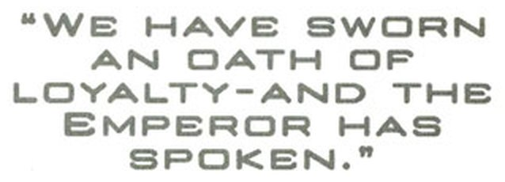
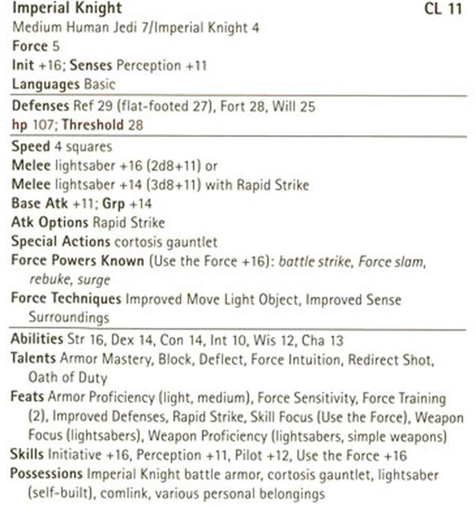
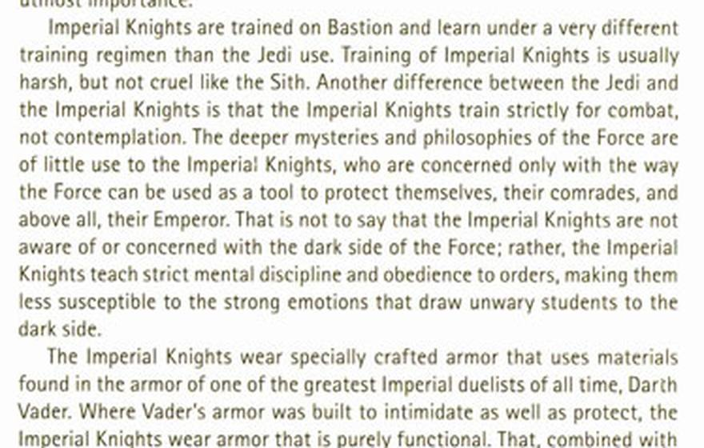
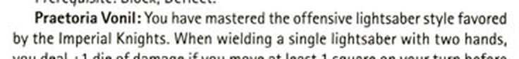
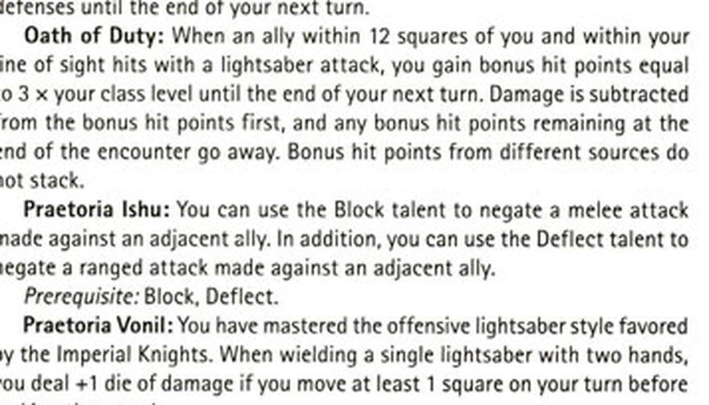
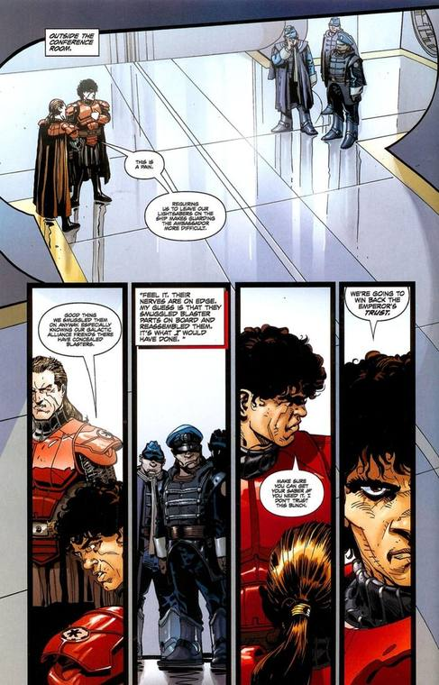
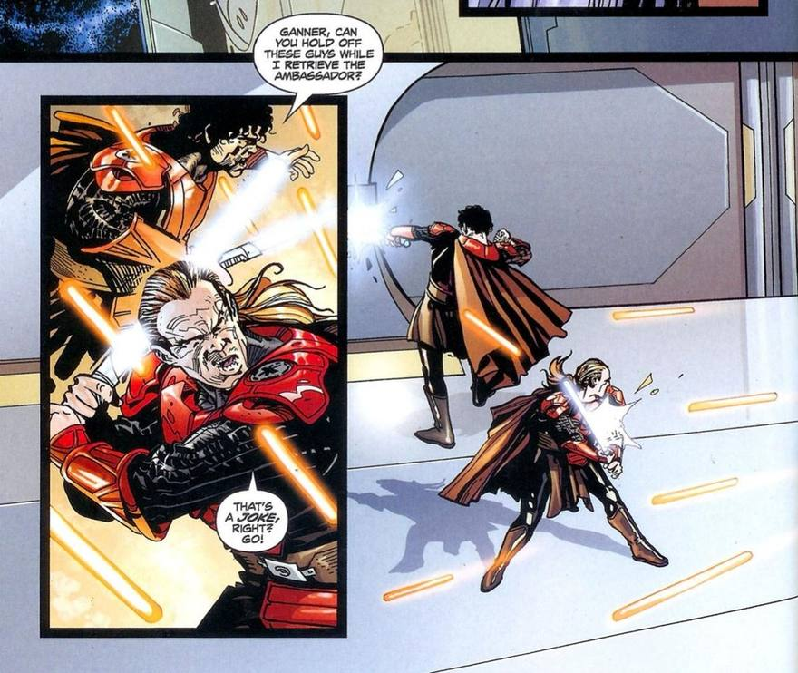
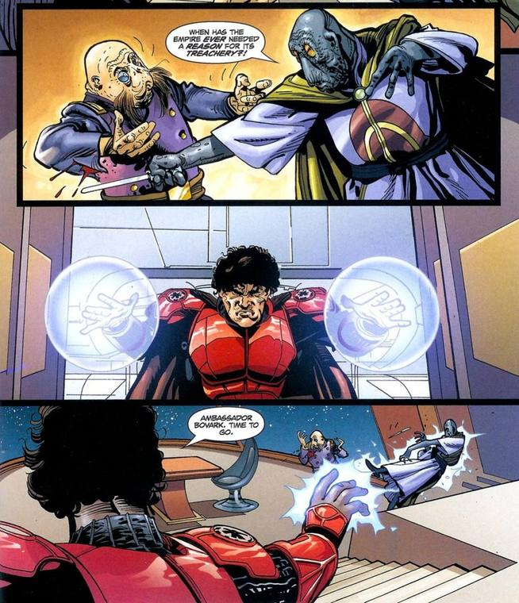

# Ganner Krieg

- **Aliases:** —
- **Era:** —
- **Continuity:** default Legends; entries present for: Legends
- **Research tier:** untiered (not listed as INTRO/DEEP/MASTERY in legends-feats.md)
- **Entries:** 33 (19 with quotations; 0 quotations extended to the full sentence/passage from the source text on file; 29 marked as fragments). Rebuilt 2026-11-17 from 40 old entries; old file: `characters/_bak/ganner-krieg.md.bak-20261117`.
- **How to read:** each entry is the quotation in full (block quote), then its source and point of view. "Note" lines are summaries from our notes, not quotations. `[fragment — full passage not on file]` means the source text is not on the box, so only the words in our notes are shown. Debate and forum material is in the last section and is unverified.

# LEGENDS (Legends / EU — main focus)

## Sourcebooks/Legacy Era Campaign Guide.pdf [Star Wars Roleplaying Game Saga Edition (2007)] (scan pages 1–60)

- Note (summary from our notes, not a quotation): Page contents: Caption "ANTARES DRACO, IMPERIAL KNIGHT"; Table 3-2 Imperial Knight; Examples of Imperial Knights in Star Wars: Sigel Dare, Antares Draco, Marasiah Fel, Mohrgan Fel, Roan Fel, Ganner Krieg, Azlyn Rae, Treis Sinde, Elke Vetter; requirements; game rule information. (hand-read)
  — Source: Sourcebooks/Legacy Era Campaign Guide.pdf [Star Wars Roleplaying Game Sag.
Our notes: `notes/materials/037-sw-d20-folder/719-legacy-era-campaign-guide-scan-001-060.md:322`

## Star Wars: Legacy (Dark Horse, 2006–2010) single issues #20–#50, hand-read

- Note (summary from our notes, not a quotation): (Draco says on panel that he leads the Imperial Knights. Marasiah has passed her Knight trials. Ganner Krieg is with the Emperor.)
  — Source: Star Wars: Legacy #23 — "Loyalties" (Dark Horse, May 2008).
Our notes: `notes/materials/039-legacy-2006/legacy-23.md:76`

> "EVIDENTLY, THE JEDI HIGH COUNCIL SECRETLY ORDERED THE CREATION OF THIS HIDDEN TEMPLE WHEN THE SITH IMPERIAL WAR BEGAN -- JUST IN CASE. RAWK HELPED FIND A LOCATION FOR IT." · "HE'S TAKING SKYWALKER AND HIS CREW THERE AND I'VE BEEN ALLOWED TO JOIN." · "JAMDHAR OUT."
>
> — Azlyn Rae, Star Wars: Legacy #24, p. 24
> [fragment — full passage not on file]
>
> "POSSIBLE. AZLYN RAE WAS A JEDI APPRENTICE BEFORE SHE JOINED THE KNIGHTS TO COMPLETE HER TRAINING. CONFLICTED LOYALTIES WOULDN'T BE SURPRISING." (red-armored Knight, ponytail — likely Ganner Krieg) · "IF NOT, THE IMPERIAL KNIGHTS HAVE WAYS OF FINDING TRAITORS IN OUR MIDST -- AND DEALING WITH THEM." (Marasiah Fel)
> [fragment — full passage not on file]
>
> — Star Wars: Legacy #24, p. 24
> [fragment — full passage not on file]
— Source: Star Wars: Legacy #24 — "Loyalties, Part Two" (Dark Horse, May 2008). POV: Azlyn Rae, about Ganner Krieg.
Context: Twist: she is an Imperial Knight agent ("Jamdhar") reporting to Bastion. p24
Our notes: `notes/materials/039-legacy-2006/legacy-24.md:96`

> — Deliah Blue, Star Wars: Legacy #28, p. 5
> [fragment — full passage not on file]
>
> "WE'RE BETTER, GANNER." · "BECAUSE WE'RE IMPERIAL KNIGHTS?" (Krieg) · "YES." (Draco) · "HE ISN'T ONE OF US, KRIEG. HE WOULD NEVER BE ONE OF US. HE LACKS DISCIPLINE." (Draco, of Shado Vao)
> [fragment — full passage not on file]
>
> — Antares Draco
>
> Ganner Krieg, Star Wars: Legacy #28, p. 6
> [fragment — full passage not on file]
>
> "A PIRATE RESCUED YOU! THAT'S WHAT YOU BECAME! AN IMPERIAL KNIGHT RESCUED ME. THEY FINISHED MY TRAINING -- I OWE THEM..."
> [fragment — full passage not on file]
>
> — Azlyn Rae, Star Wars: Legacy #28, p. 7
> [fragment — full passage not on file]
>
> "I SENSE MORE THAN JUST THAT. THERE'S A JEDI ON THAT SHIP, I THINK. OR A SITH." (Cade) · "WHICH DID YOU SENSE -- JEDI OR SITH? ... IT HAS TO BE ONE OR THE OTHER. CAN'T BE BOTH." (Draco) · "OH, YOU MEAN LIKE ME." (Cade)
> [fragment — full passage not on file]
>
> — Star Wars: Legacy #28, p. 12
> [fragment — full passage not on file]
— Source: Star Wars: Legacy #28 — "Vector, Part 9 of 12" (Dark Horse, September 2008). POV: Deliah Blue, about Ganner Krieg.
Context: > "IS IT JUST ME, SYN, OR IS CADE'S PLAN -- TO LURE DARTH KRAYT TO HAD ABBADON SO WE CAN KILL HIM -- CRAZY?"
Our notes: `notes/materials/039-legacy-2006/legacy-28.md:42`

> — Star Wars: Legacy #29, p. 11
> [fragment — full passage not on file]
>
> "I WAS TAUGHT THAT AN IMPERIAL KNIGHT SERVES THE FORCE AS EMBODIED BY THE EMPEROR! HE SHOULD NEVER, MUST NEVER, ASK US TO DO ANYTHING DISHONORABLE -- AND THIS IS! THE MUUR TALISMAN IS A FOUL SITH DEVICE!"
>
> — Azlyn Rae, Star Wars: Legacy #29, p. 11
> [fragment — full passage not on file]
>
> "IT IS NOT ACCEPTABLE. IF AZLYN WILL NOT OBEY -- WORSE, IF SHE SPEAKS OF WHAT SHE KNOWS -- I MAY HAVE TO KILL HER." (Draco) · "YOU'LL HAVE TO KILL ME FIRST." (Krieg)
> [fragment — full passage not on file]
>
> — Star Wars: Legacy #29, p. 12
> [fragment — full passage not on file]
>
> "AS IMPERIAL KNIGHTS, WE OBEY THE EMPEROR BUT ONLY AS LONG AS THE EMPEROR SERVES THE LIGHT SIDE OF THE FORCE. SHOULD HE EVER TURN TO THE DARK SIDE, OUR DUTY IS TO BRING HIM BACK TO THE LIGHT OR TO REMOVE HIM. IT IS TO THE FORCE THAT WE ULTIMATELY OWE OUR ALLEGIANCE, DRACO."
>
> — Ganner Krieg, Star Wars: Legacy #29, p. 12
> [fragment — full passage not on file]
— Source: Star Wars: Legacy #29 — "Vector, Part 10 of 12" (Dark Horse, October 2008). POV: Azlyn Rae, about Ganner Krieg.
Context: > "IF WE SUCCEED IN THIS, NOTHING WILL STAND IN THE WAY OF A UNION BETWEEN PRINCESS SIA AND MYSELF." (Draco) · "THE STORMTROOPERS WE SAW IT USED ON WERE IMPERIAL TROOPS WHO ONCE SERVED THE SAME EMPEROR WE SERVE!" (Azlyn) · "THEY SERVED KRAYT AND THAT MAKES THEM TRAITORS! AS IMPERIAL KNIGHTS, WE SERVE THE EMPEROR'S WILL!" (Draco)
Our notes: `notes/materials/039-legacy-2006/legacy-29.md:38`

> "AZLYN! STAY CLOSE! BACK TO BACK!" (Ganner Krieg)
> [fragment — full passage not on file]
— Source: Star Wars: Legacy #31 — "Vector, Part 12 of 12" (Dec 2008). POV: Ganner Krieg.
Context: — Star Wars: Legacy #31, p. 4
Our notes: `notes/materials/039-legacy-2006/legacy-31.md:21`

> "AZLYN... MASTER RAE IS AN IMPERIAL KNIGHT! WE HAVE HEALERS ON BASTION! SHE BELONGS WITH HER OWN KIND!" (Antares Draco)
>
> "SHE BELONGS WITH ME!" (Ganner Krieg — speaker inferred from the tail toward the background figure)
> [fragment — full passage not on file]
— Source: Star Wars: Legacy #31 — "Vector, Part 12 of 12" (Dec 2008). POV: Antares Draco, about Ganner Krieg.
Context: — Star Wars: Legacy #31, p. 21
Our notes: `notes/materials/039-legacy-2006/legacy-31.md:117`

> "MASTER RAE."
>
> "I'VE COME TO TAKE YOU HOME, AZLYN." (Ganner Krieg)
> [fragment — full passage not on file]
— Source: Star Wars: Legacy #35 — "Storms, Part 2 of 2" (Apr 2009). POV: Ganner Krieg.
Context: (Feat: armored Azlyn throws Cade across the room with one arm (p17).)
Our notes: `notes/materials/039-legacy-2006/legacy-35.md:82`

> BASTION, IMPERIAL KNIGHTS QUARTERS, PRACTICE ROOM... *(caption)*
> [fragment — full passage not on file]
>
> SON OF A RUSKAKK! GANNER! STOP GOING SO EASY! LET MASTER RAE TEST THE ARMOR! IF IT'S A PIECE OF CHIZK, BETTER TO KNOW NOW THAN WHEN SHE'S FACING SOME SITH NEK! *(bearded Imperial Knight — unnamed, flag)*
>
> DON'T...HOLD BACK, GANNER! I HAVE TO KNOW... WHAT THIS ARMOR ...CAN DO! *(Azlyn Rae)*
> [fragment — full passage not on file]
>
> WHAT MAKES YOU THINK...I'M HOLDING BACK, AZLYN?! *(Ganner Krieg)*
> [fragment — full passage not on file]
— Source: Star Wars: Legacy #43 — "Monster, Part One" (Dec 2009). POV: Azlyn Rae, about Ganner Krieg.
Note (our notes, around the quote): > "BASTION, IMPERIAL KNIGHTS QUARTERS, PRACTICE ROOM..." (caption) / "SON OF A RUSKAKK! GANNER! STOP GOING SO EASY! LET MASTER RAE TEST THE ARMOR! IF IT'S A PIECE OF CHIZK, BETTER TO KNOW NOW THAN WHEN SHE'S FACING SOME SITH NEK!" (bearded Imperial Knight — unnamed, flag) / "DON'T...HOLD BACK, GANNER! I HAVE TO KNOW... WHAT THIS ARMOR ...CAN DO!" (Azlyn Rae) / "WHAT MAKES YOU THINK...I'M HOLDING BACK, AZLYN?!" (Ganner Krieg)
Our notes: `notes/materials/039-legacy-2006/legacy-43.md:149`

- Note (summary from our notes, not a quotation): (Feat: Azlyn Rae, in a full new armored suit (replacing Rawk's crude life-support), spars with Ganner Krieg at full strength (p21). Lore: Hogrum Chalk, cyborg former Imperial Knight, is the Knights' master armorer.)
  — Source: Star Wars: Legacy #43 — "Monster, Part One" (Dec 2009).
Our notes: `notes/materials/039-legacy-2006/legacy-43.md:155`

> "I HEARD THE ALARMS! HOW DID A SITH SHIP GET PAST THE MINES?" (Antares Draco)
>
> "APPARENTLY, IT TRANSMITTED THE PROPER CODES."
>
> "WE'VE ATTEMPTED COMMUNICATION, BUT THERE HAS BEEN NO REPLY. PERHAPS THE SITH TORTURED THE CODES OUT OF A CAPTURED IMPERIAL KNIGHT." (officers, flag)
>
> "PRINCESS SIA WOULD DIE BEFORE SHE BROKE UNDER SITH TORTURE!" (Draco)
>
> "I DID NOT SAY IT WAS THE PRINCESS." (grey-bearded man, flag)
>
> "SILENCE!" (Ganner Krieg)
> [fragment — full passage not on file]
— Source: Star Wars: Legacy #49 — "Extremes, Part Two" (Jun 2010). POV: Antares Draco, about Ganner Krieg.
Context: — Star Wars: Legacy #49, p. 4
Our notes: `notes/materials/039-legacy-2006/legacy-49.md:32`

> BASTION. ANTARES DRACO'S QUARTERS. *(caption)*
> [fragment — full passage not on file]
>
> ANTARES? WE NEED TO SPEAK. I CAN SENSE YOUR AGONY OVER THE PRINCESS'S CAPTURE -- I FELT THE SAME FOR AZLYN, WHEN I THOUGHT SHE WAS DEAD AFTER WE DEFEATED KRAYT.
>
> AZLYN DID EVERYTHING SHE COULD. YOU STRUCK OUT IN ANGER. YOU CAN'T DO THAT. YOU'RE THE LEADER OF THE IMPERIAL KNIGHTS -- YOU MUST MASTER YOURSELF. *(Ganner Krieg)*
— Source: Star Wars: Legacy #49 — "Extremes, Part Two" (Jun 2010). POV: Ganner Krieg.
Label in our notes: > (caption) / / (Ganner Krieg
Our notes: `notes/materials/039-legacy-2006/legacy-49.md:113`

- Note (summary from our notes, not a quotation): Feat: Draco disguised in Sith tattoos, masks his presence with anger to pass as Sith on Korriban; "captives" = Azlyn Rae and a pale masked companion (Ganner Krieg? flag) plus a blue-skinned figure (T'ra Saa? flag, p17 middle).
  — Source: Star Wars: Legacy #49 — "Extremes, Part Two" (Jun 2010).
Our notes: `notes/materials/039-legacy-2006/legacy-49.md:151`

> "GENTLY, MY PRINCESS. IT'S ALL RIGHT. IT'S ME-- ANTARES..." (Draco)
>
> "...UHNN."
>
> "TRAITOR!" (Sia, seizing his face with Force energy)
>
> "YOU WERE SENT TO KILL YOUR FORMER MASTER FOR ABANDONING HIS VOWS AS AN IMPERIAL KNIGHT! YOU WERE SUPPOSED TO DESTROY ESHKAR NIIN!" (Sia)
>
> "I DID!" (Draco)
>
> "LIAR! HE LIVES AMONG THE SITH NOW AS DARTH HAVOK!" (Sia)
> [fragment — full passage not on file]
— Source: Star Wars: Legacy #50 — "Extremes, Part Three" / cover tagline "The End of an Era" (Aug 2010).
Context: p4 silent: Draco and Ganner ignite sabers and cut down the Sith guards; Shado Vao (manacled "prisoner") breaks free, Force-catches a guard's lightsaber pike; trio kill the guards. Feat: the "captive" ruse (Ganner & Shado posing as prisoners) — resolves #49 p17 flag: pale masked "captive" = Ganner Krieg, blue figure = Shado Vao.
Our notes: `notes/materials/039-legacy-2006/legacy-50.md:25`

> KEEP MOVING! WE'RE ALMOST TO THE SHIP! *(Draco, flag — balloon from group)*
>
> MORE SITH ARE COMING. YOU CAN FEEL THEM -- A SICK DARKNESS... *(Shado Vao)*
> [fragment — full passage not on file]
>
> ANTARES! THE WAY TO THE SHIP IS CLEAR! *(Ganner Krieg)*
— Source: Star Wars: Legacy #50 — "Extremes, Part Three" / cover tagline "The End of an Era" (Aug 2010); > "KORRIBAN." (caption) /.
Note (our notes, around the quote): > "KORRIBAN." (caption) / "KEEP MOVING! WE'RE ALMOST TO THE SHIP!" (Draco, flag — balloon from group) / "MORE SITH ARE COMING. YOU CAN FEEL THEM -- A SICK DARKNESS..." (Shado Vao) / "YES. KEEP FIGHTING." (Draco) / "ANTARES! THE WAY TO THE SHIP IS CLEAR!" (Ganner Krieg)
Our notes: `notes/materials/039-legacy-2006/legacy-50.md:78`

- Note (summary from our notes, not a quotation): Resolves #49 p17 flag: Draco's "captives" = Ganner Krieg and Shado Vao.
  — Source: Star Wars: Legacy #50 — "Extremes, Part Three" / cover tagline "The End of an Era" (Aug 2010).
Our notes: `notes/materials/039-legacy-2006/legacy-50.md:193`

## Star Wars: Legacy Book 1 (omnibus): power-scaling notes with panels

> (p113) Talon: "ROAN FEL! FALSE EMPEROR. …" · Draco: "YOUR MASTER'S A USURPER. AND YOU'RE A FOOL, SITH, IF YOU THINK I'M ROAN FEL." · (p114) "I AM MASTER DRACO. THIS IS MASTER KRIEG." · "YOUR MASTER IS A GREATER FOOL THAN YOU IF HE THINKS EMPEROR FEL WOULD FALL INTO YOUR CLUMSY TRAP. HE SAW KRAYT'S HAND IN THIS. PERHAPS HE IS MORE POWERFUL THAN YOU KNOW..." · Draco (balloon from off-panel left): "RUN. SITH -- WHILE YOU STILL HAVE THE CHANCE." · Talon: "MY MASTER'S PATIENCE IS EXHAUSTED." · (p128) Krieg: "I AM GANNER KRIEG -- KNIGHT OF THE EMPIRE!" · "...I WILL LEAVE YOUR BONES FOR THE BEASTS TO CRACK!" · (p137) Krieg: "THE JEDI ARE VERY SKILLED ... MORE THAN WE, BUT ... WE'RE LOSING HER..." · (p139) Draco: "YOU DELUDE YOURSELF, JEDI! YOU ARE NO MATCH FOR ONE IMPERIAL KNIGHT, LET ALONE TWO!" · Shado: "NOW THAT'S AN INTERESTING THEORY."
> [fragment — full passage not on file]
— Source: Legacy Book 1 (omnibus): power-scaling notes with panels.
Context: Antares Draco and Ganner Krieg. p112 (#6 Broken)–p114 (#6 Broken), p128 (#7 Broken), p137 (#7 Broken)–p139 (#7 Broken), p228 (#10 Trust Issues)–p231 (#10 Trust Issues)
Our notes: `notes/materials/009-legacy-book-1.md:866`

> Though their numbers are small, the Imperial Knights are fully trained Force-users, with all the skills and abilities of a Jedi. However, unlike their Jedi counterparts whose allegiance is to the Jedi Order or the Force, Imperial Knights have sworn themselves to the service of the Empire as personified in Emperor Roan Fel.
>
> The Jedi view the Imperial Knights as 'gray'—though the Imperials do not seek to draw on the dark side of the Force, neither do the [sic] strictly follow the light side.
>
> The second in command of the Imperial Knights (after Emperor Fel), and equally formidable with a lightsaber or behind the controls of a fighter, Draco would give his life for the Emperor.
>
> Cold as ice, dutiful and rigid in her thinking and approach.
>
> Calm and serious, Ganner is Antares' most trusted friend.
— Source: Legacy Book 1 (omnibus): power-scaling notes with panels; Imperial Knights (p458).
Note (our notes, around the quote): Imperial Knights (p458): "Though their numbers are small, the Imperial Knights are fully trained Force-users, with all the skills and abilities of a Jedi. However, unlike their Jedi counterparts whose allegiance is to the Jedi Order or the Force, Imperial Knights have sworn themselves to the service of the Empire as personified in Emperor Roan Fel." · "The Jedi view the Imperial Knights as 'gray'—though the Imperials do not seek to draw on the dark side of the Force, neither do the [sic] strictly follow the light side." Antares Draco: "The second in command of the Imperial Knights (after Emperor Fel), and equally formidable with a lightsaber or behind the controls of a fighter, Draco would give his life for the Emperor." Sigel Dare: "Cold as ice, dutiful and rigid in her thinking and approach." Ganner Krieg: "Calm and serious, Ganner is Antares' most trusted friend."
Our notes: `notes/materials/009-legacy-book-1.md:1135`

- Note (summary from our notes, not a quotation): Fel Empire: Roan Fel, Marasiah Fel, Antares Draco, Ganner Krieg, Mohrgan, Elke Vetter.
  — Source: Legacy Book 1 (omnibus): power-scaling notes with panels.
Our notes: `notes/materials/009-legacy-book-1.md:1217`

## Star Wars: Legacy—War #1–6 (2010–11): power-scaling notes with panels

- Note (summary from our notes, not a quotation): Imperial Knights Ganner Krieg, Azlyn Rae, Sigel (Dare), Treis Sinde and Rand Ko.
  — Source: Legacy—War #1–6 (2010–11): power-scaling notes with panels.
Context: Fel Empire:
Our notes: `notes/materials/010-legacy-war.md:62`

- Note (summary from our notes, not a quotation): p67: "THIS WAY, AZLYN!" / Azlyn: "WITH YOU, GANNER!"
  — Source: Legacy—War #1–6 (2010–11): power-scaling notes with panels.
Context: Ganner Krieg:
Our notes: `notes/materials/010-legacy-war.md:737`

> THAT GOT IT, AZLYN!
> [fragment — full passage not on file]
— Source: Legacy—War #1–6 (2010–11): power-scaling notes with panels.
Note (our notes, around the quote): p72: with Azlyn, downs a walker/droid with saber and Force burst: "THAT GOT IT, AZLYN!"
Context: Ganner Krieg:
Our notes: `notes/materials/010-legacy-war.md:738`

> YES, THE SITH BROKE YOU, BUT YOU CAN CHOOSE TO FORGE YOURSELF ANEW. FIND STRENGTH IN THE FORCE, ANTARES!
>
> MASTERS CHALK AND SINDE WOULD HAVE SENSED THAT AT YOUR DEBRIEFING. ALLOWING FEAR TO RULE IS LETTING THE DARK SIDE IN.
>
> REMEMBER -- WE ARE IMPERIAL KNIGHTS. THERE ARE NONE BETTER.
— Source: Legacy—War #1–6 (2010–11): power-scaling notes with panels; p98.
Context: Ganner Krieg:
Our notes: `notes/materials/010-legacy-war.md:739`

## Star Wars Saga Edition: *Legacy Era Campaign Guide* (WotC 2009): power-scaling notes with panels

> WE HAVE SWORN AN OATH OF LOYALTY—AND THE EMPEROR HAS SPOKEN.
— Source: *Legacy Era Campaign Guide* (WotC 2009): power-scaling notes with panels.
Note (our notes, around the quote): Not statted: Mohrgan Fel, Ganner Krieg, Sigel Dare and Elke Vetter appear only as names on the example list (p45). Krieg pull quote (p46): "WE HAVE SWORN AN OATH OF LOYALTY—AND THE EMPEROR HAS SPOKEN."

Also cited as: Sourcebooks/Legacy Era Campaign Guide.pdf [Star Wars Roleplaying Game Sag; Ganner Krieg — entry/section: Pull quote.
Also noted as: Ganner Krieg — entry/section: Pull quote: ""WE HAVE SWORN AN OATH OF LOYALTY—AND THE EMPEROR HAS SPOKEN." —GANNER KRIEG" Source: *Legacy Era Campaign Guide* (SWRPG Saga Edition), scan p.46
Our notes: `notes/materials/011-legacy-era-campaign-guide.md:550`; `notes/materials/037-sw-d20-folder/719-legacy-era-campaign-guide-scan-001-060.md:329`

## Star Wars: Legacy Volume 2, *Shards* (TPB): power-scaling notes with panels

> FEEL IT. THEIR NERVES ARE ON EDGE. MY GUESS IS THAT THEY SMUGGLED BLASTER PARTS ON BOARD AND REASSEMBLED THEM. IT'S WHAT I WOULD HAVE DONE.
>
> MAKE SURE YOU CAN GET YOUR SABER IF YOU NEED IT. I DON'T TRUST THIS BUNCH.
>
> WE'RE GOING TO WIN BACK THE EMPEROR'S TRUST.
— Source: Legacy Volume 2, *Shards* (TPB): power-scaling notes with panels.
Note (our notes, around the quote): 1. Sense the GA guards' hidden blasters. p71 (#9 Trust Issues) [009 p210]. Red-bordered quote caption: "FEEL IT. THEIR NERVES ARE ON EDGE. MY GUESS IS THAT THEY SMUGGLED BLASTER PARTS ON BOARD AND REASSEMBLED THEM. IT'S WHAT I WOULD HAVE DONE." · Draco: "MAKE SURE YOU CAN GET YOUR SABER IF YOU NEED IT. I DON'T TRUST THIS BUNCH." · "WE'RE GOING TO WIN BACK THE EMPEROR'S TRUST."

Our notes: `notes/materials/012-legacy-vol-2-shards.md:211`

- Note (summary from our notes, not a quotation): 
  — Source: Legacy Volume 2, *Shards* (TPB): power-scaling notes with panels.
(*Panel: p71 — `p071-knights-sense-ga-guards.jpg`*)
Our notes: `notes/materials/012-legacy-vol-2-shards.md:213`

> (p89) Draco: "GANNER, CAN YOU HOLD OFF THESE GUYS WHILE I RETRIEVE THE AMBASSADOR?" · Krieg: "THAT'S A JOKE, RIGHT? GO!" · (p90) Stazi (knifing Bovark): "WHEN HAS THE EMPIRE EVER NEEDED A REASON FOR ITS TREACHERY?!" · Draco (Force-push; Stazi flies across the room): "AMBASSADOR BOVARK, TIME TO GO." · (p91) To Pol Temm's security: "NO." · (p92) "WE'LL FIND OUT WHO DID THIS -- AND THEY WON'T LIVE LONG ENOUGH TO REGRET IT!"
> [fragment — full passage not on file]
— Source: Legacy Volume 2, *Shards* (TPB): power-scaling notes with panels.
Context: 2. Deflect GA blaster fire; Draco Force-pushes Admiral Stazi off Bovark. p89 (#10 Trust Issues)–p92 (#10) [009 p228–231]

Our notes: `notes/materials/012-legacy-vol-2-shards.md:216`

- Note (summary from our notes, not a quotation): 
  — Source: Legacy Volume 2, *Shards* (TPB): power-scaling notes with panels.
(*Panel: p89 — `p089-draco-krieg-deflect.jpg`*)
Our notes: `notes/materials/012-legacy-vol-2-shards.md:219`

- Note (summary from our notes, not a quotation): 
  — Source: Legacy Volume 2, *Shards* (TPB): power-scaling notes with panels.
(*Panel: p90 — `p090-draco-pushes-stazi.jpg`*)
Our notes: `notes/materials/012-legacy-vol-2-shards.md:222`

- Note (summary from our notes, not a quotation): Scaling (ANALYSIS): routine Jedi-level skills (deflection, push, empathic sensing) against non-Force soldiers. Only Stazi is pushed. Stazi is a Duros admiral, not a "Mon Cal aide" and not guards (009 corrected). Nothing here moves debate #17 (Draco vs Jacen).
  — Source: Legacy Volume 2, *Shards* (TPB): power-scaling notes with panels.
Our notes: `notes/materials/012-legacy-vol-2-shards.md:225`

## Legends Feats & Quotes (Star Wars Legends / EU)

> REMEMBER -- WE ARE IMPERIAL KNIGHTS. THERE ARE NONE BETTER.
>
> — Ganner Krieg, Star Wars: Legacy—War #5, p98
> [fragment — full passage not on file]
— Source: Legends Feats & Quotes (Star Wars Legends / EU). POV: Ganner Krieg.
Context: Krieg's self-rating (material 010; p98, Legacy—War #5)
Our notes: `legends-feats.md:2966`

# Debate and forum claims (unverified)

Forum posts, Suspect Insight debates and Discord debates, respect threads, and verdicts. These are posters' arguments or quotations they typed; none is checked against the book here unless the entry says so.

## Cade Skywalker Respect Thread (Updated 2017) — respect-thread notes

- Note (summary from our notes, not a quotation): Cade Skywalker telekinetically pushes Antares Draco and Ganner Krieg:
  — Source: SI respect-thread directory: Cade Skywalker Respect Thread (Updated 2017) — https://web.archive.org/web/20190902075103/https://comicvine.gamespot.com/profile/darthant66/blog/cade-skywalker-respect-thread-updated-2017/97726/.
Posted by: not named in our notes (see thread/notes link).
Our notes: `suspect-insight/respect-threads/cade-skywalker.md:191`

- Note (summary from our notes, not a quotation): [image: data:image/gif;base64,R0lGODlhAQABAAAAACH5BAEKAAEALAAAAAABAAEAAAICTAEAOw==]
  — Source: SI respect-thread directory: Cade Skywalker Respect Thread (Updated 2017) — https://web.archive.org/web/20190902075103/https://comicvine.gamespot.com/profile/darthant66/blog/cade-skywalker-respect-thread-updated-2017/97726/.
Posted by: not named in our notes (see thread/notes link).
Context: Cade Skywalker telekinetically pushes Antares Draco and Ganner Krieg:
Our notes: `suspect-insight/respect-threads/cade-skywalker.md:192`
