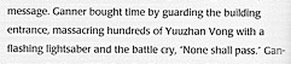
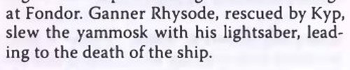
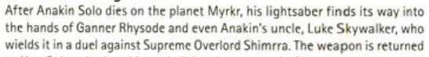

# Ganner Rhysode

- **Aliases:** Ganner
- **Era:** NJO
- **Continuity:** default Legends; entries present for: Legends
- **Research tier:** untiered (not listed as INTRO/DEEP/MASTERY in legends-feats.md)
- **Entries:** 127 (88 with quotations; 3 quotations extended to the full sentence/passage from the source text on file; 26 marked as fragments; 81 before the 2026-11-17 fragment fill). Rebuilt 2026-11-17 from 118 old entries; old file: `characters/_bak/ganner-rhysode.md.bak-20261117`.
- **How to read:** each entry is the quotation in full (block quote), then its source and point of view. "Note" lines are summaries from our notes, not quotations. `[fragment — full passage not on file]` means the source text is not on the box, so only the words in our notes are shown. Debate and forum material is in the last section and is unverified.

# LEGENDS (Legends / EU — main focus)

## Star Wars: The New Essential Chronology (Del Rey, 2005): power-scaling and lore notes

- Note (summary from our notes, not a quotation): Ganner holds the Well: "Ganner bought time by guarding the building entrance, massacring hundreds of Yuuzhan Vong with a flashing lightsaber and the battle cry, "None shall pass."" Source: The New Essential Chronology, p.220
  — Source: Part Twelve: The New Jedi Order. POV: Ganner holds the Well.

Our notes: `notes/materials/027-new-essential-chronology/12-part-twelve-new-jedi-order.md:166`

## The Complete Star Wars Encyclopedia, Vol. I (A–G)

> Ganner Rhysode, rescued by Kyp, slew the yammosk with his lightsaber, leading to the death of the ship.
— Source: scan pages 161–200; Kyp Durron. POV: Kyp Durron, about Ganner Rhysode.
Note (our notes, around the quote): Kyp Durron: "Ganner Rhysode, rescued by Kyp, slew the yammosk with his lightsaber, leading to the death of the ship." Source: The Complete Star Wars Encyclopedia, Vol. I, p.151

Our notes: `notes/materials/030-complete-star-wars-encyclopedia-vol-1/04-v1-scan-161-200.md:57`

- Note (summary from our notes, not a quotation): Page contents: 1174 words, 30 paragraphs | headings/entries: Gank Massacres; Ganlihk; Gann, Grand Moff; Gann, Mapper; Lieutenant; Ganner Squadron; Gant; Gant, Colonel Trenn; Gant, Toshan; Gantor, Tobin; Gantoris; Gantree, Fan; Ganz, Keejik; Gaph; Gap Nine
  — Source: scan pages 321–360.
Our notes: `notes/materials/030-complete-star-wars-encyclopedia-vol-1/08-v1-scan-321-360.md:109`

## The Complete Star Wars Encyclopedia, Vol. II (H–O)

- Note (summary from our notes, not a quotation): Page contents: 1038 words, 20 paragraphs | headings/entries: Krell, Admiral Damon; Krenn, Josala; Kressh, Ludo; Krickle; Krieg, Ganner
  — Source: scan pages 201–240.
Our notes: `notes/materials/031-complete-star-wars-encyclopedia-vol-2/05-v2-scan-201-240.md:393`

## The Complete Star Wars Encyclopedia, Vol. III (P–Z)

- Note (summary from our notes, not a quotation): Page contents: 839 words, 23 paragraphs | headings/entries: Rho, Myhr; Rhoden, Clode; Rhysode, Ganner; Rianitus Period; Rich; Richbium, Onila
  — Source: scan pages 81–120.
Our notes: `notes/materials/032-complete-star-wars-encyclopedia-vol-3/02-v3-scan-081-120.md:204`

## Sourcebooks/The New Jedi Order Sourcebook.pdf [Star Wars Roleplaying Game (d20, 2000)] (scan pages 1–60)

> the first to fall so deeply to the dark side
> [fragment — full passage not on file]
>
> creating a new Darth Vader
> [fragment — full passage not on file]
— Source: Sourcebooks/The New Jedi Order Sourcebook.pdf [Star Wars Roleplaying Game; Page contents: Kyp Durron's Radicals: Kyp.
Note (our notes, around the quote): Page contents: Kyp Durron's Radicals: Kyp "the first to fall so deeply to the dark side"; Luke came close to "creating a new Darth Vader"; Radical followers Ganner Rhysode, Wurth Skidder, Saba Sebatyne, Daeshara'cor. (hand-read)
Our notes: `notes/materials/037-sw-d20-folder/049-the-new-jedi-order-sourcebook-scan-001-060.md:109`

- Note (summary from our notes, not a quotation): Page contents: 834 words, 25 paragraphs | headings/entries: Corran Horn, Jedi Knight; AGE PEAT: RUSOOD GNEREY; Ganner Rhysode, Jedi Knight
  — Source: Sourcebooks/The New Jedi Order Sourcebook.pdf [Star Wars Roleplaying Game.
Our notes: `notes/materials/037-sw-d20-folder/049-the-new-jedi-order-sourcebook-scan-001-060.md:297`

## Sourcebooks/Revised Core Rulebook.pdf [Star Wars Roleplaying Game Revised Core (d20, 2002)] (scan pages 121–180)

> In The New Jedi Order era, Luke Skywalker has trained about one hundred Jedi and identified perhaps a dozen others to start training. Prominent Force-users such as Mara Jade Skywalker and Corran Horn help Skywalker train and coordinate the efforts of these Jedi, while promising students such as the Solo children and Ganner Rhysode show great promise for the future,
> [fragment — full passage not on file]
— Source: Sourcebooks/Revised Core Rulebook.pdf [Star Wars Roleplaying Game Revised.
Note (our notes, around the quote): Luke Skywalker; Mara Jade Skywalker; Corran Horn; Ganner Rhysode; Jaina Solo; Jacen Solo (Darth Caedus); Anakin Solo — entry/section: The Jedi — New Jedi Order era (Revised Core Rulebook, Ch9): "In The New Jedi Order era, Luke Skywalker has trained about one hundred Jedi and identified perhaps a dozen others to start training. Prominent Force-users such as Mara Jade Skywalker and Corran Horn help Skywalker train and coordinate the efforts of these Jedi, while promising students such as the Solo children and Ganner Rhysode show great promise for the future," Source: *Revised Core Rulebook* (SWRPG d20 Revised Core), scan p.178

Our notes: `notes/materials/037-sw-d20-folder/671-revised-core-rulebook-scan-121-180.md:301`

## Sourcebooks/Legacy Era Campaign Guide.pdf [Star Wars Roleplaying Game Saga Edition (2007)] (scan pages 61–120)

> After Anakin Solo dies on the planet Myrkr, his lightsaber finds its way into the hands of Ganner Rhysode and even Anakin's uncle, Luke Skywalker, who wields it in a duel against Supreme Overlord Shimrra.
— Source: Sourcebooks/Legacy Era Campaign Guide.pdf [Star Wars Roleplaying Game Sag.
Note (our notes, around the quote): Anakin Solo; Darth Vader (Anakin Skywalker); Luke Skywalker — entry/section: Anakin Solo's Lightsaber: "After Anakin Solo dies on the planet Myrkr, his lightsaber finds its way into the hands of Ganner Rhysode and even Anakin's uncle, Luke Skywalker, who wields it in a duel against Supreme Overlord Shimrra." Source: *Legacy Era Campaign Guide* (SWRPG Saga Edition), scan p.98

Our notes: `notes/materials/037-sw-d20-folder/719-legacy-era-campaign-guide-scan-061-120.md:305`

## Star Wars Insider #57 (2001)

- Note (summary from our notes, not a quotation): Page contents: Who's Who, Jedi Knights cont. (magazine p. 58): Miko Reglia (died), Ganner Rhysode, Saba Sebatyne, Wurth Skidder (died), Anakin Solo (died), Jacen Solo, Jaina Solo, Tekli. Line portraits. (hand-read)
  — Source: Star Wars Insider #57 (2001).
Our notes: `notes/materials/038-star-wars-insider/057-ins057.md:348`

## Star Wars Insider #63 (2002)

- Note (summary from our notes, not a quotation): Page contents: Masthead and Rebel Rumblings letters: new Paizo address; Traitor and Ganner Rhysode letter; Tessek costume photo; letter-writer and fan names not recorded. (hand-read)
  — Source: Star Wars Insider #63 (2002).
Our notes: `notes/materials/038-star-wars-insider/063-ins063.md:37`

- Note (summary from our notes, not a quotation): Page contents: Rebel Rumblings cont.: vanity license plates, Ganner Rhysode's appearances and Dan Wallace on the Essential Guide to Characters, Practical Aesthetics correction, Kenobi "so precise" letter; continued on p. 94; letter-writer and fan names not recorded. (hand-read)
  — Source: Star Wars Insider #63 (2002).
Our notes: `notes/materials/038-star-wars-insider/063-ins063.md:42`

## Star Wars Insider #74 (2004)

- Note (summary from our notes, not a quotation): Page contents: NJO: Destiny's Way synopsis; fallen heroes: Chewbacca, Anakin Solo, Ganner Rhysode, Vergere, Elegos A'Kla, Borsk Fey'lya, Ikrit and Admiral Ackbar; Force Heretic I: Remnant synopsis (Nom Anor as the Prophet Yu'shaa). (hand-read)
  — Source: Star Wars Insider #74 (2004).
Our notes: `notes/materials/038-star-wars-insider/074-ins074.md:188`

- Note (summary from our notes, not a quotation): Page contents: NJO: Force Heretic II: Refugee (Bakura, the Ssi-Ruuk) and III: Reunion (Zonama Sekot rediscovered) synopses; great showdowns: Chewie vs. Dobido, Luke wading into a Vong camp in Onslaught, Corran Horn vs. Shedao Shai, the Falcon vs. Tsavong Lah's Sunulok, Fey'lya's fusillade, Anakin's sacrifice, Jacen in arms, Ganner's last stand, the endgame at Ebaq 9. (hand-read)
  — Source: Star Wars Insider #74 (2004).
Our notes: `notes/materials/038-star-wars-insider/074-ins074.md:200`

## Star Wars Insider #83 (2005)

- Note (summary from our notes, not a quotation): Page contents: Memorable Moments continued: the Emperor reborn (Dark Empire, Tom Veitch and Cam Kennedy); Ganner Rhysode, a hero at the gates (Traitor, "None shall pass"); the Five Goofiest Moments of the Star Wars Mythos introduced. (hand-read)
  — Source: Star Wars Insider #83 (2005).
Our notes: `notes/materials/038-star-wars-insider/083-ins083.md:312`

## Star Wars Insider #104 (2008)

- Note (summary from our notes, not a quotation): Page contents: International Collecting cont. (Star Wars Pine Sol bottle, Dixan laundry detergent); Toys: Expanded Universe comic two-packs (Cade Skywalker, Darth Talon, Grand Admiral Thrawn, Talon Karrde, Dengar, Fenn Shysa, Antares Draco, Ganner); Cartamundi playing cards (hand-read)
  — Source: Star Wars Insider #104 (2008).
Our notes: `notes/materials/038-star-wars-insider/104-ins104.md:395`

## Star Wars: Legacy (Dark Horse, 2006–2010) single issues #20–#50, hand-read

> "GANNER KRIEG"
>
> "Calm and serious, Ganner is Antares' most trusted friend within the Imperial Knights."
>
> "SIGEL DARE"
>
> "Cold as ice, dutiful, and rigid in her thinking and approach. She never liked the Sith, but has no use for non-Imperial Jedi, either."
>
> "Sigel does not want to admit that the galaxy she knows is falling apart."
— Source: Star Wars: Legacy #0 — "Welcome to the Future..." (Jun 2006; 25¢ preview/primer issue).
Context: — Star Wars: Legacy #0, p. 14
Our notes: `notes/materials/039-legacy-2006/legacy-00.md:123`

> THE JEDI'S GOOD WITH A LIGHTSABER, ANTARES.
— Source: Star Wars: Legacy #28 — "Vector, Part 9 of 12" (Dark Horse, September 2008).
Note (our notes, around the quote): (p6: Draco spars with Shado Vao in the hold. p7: Cade meditates, resisting a death stick, and makes Force contact with Celeste (p8, "CONTACT."). p9: an interdiction-like pull drops the *Mynock* out of hyperspace. p14–15: rakghouls attack Cade, Shado, Jariah, and Azlyn. p21: Deliah fires the *Mynock*'s cannon into the corridor. Speaker check p6: "THE JEDI'S GOOD WITH A LIGHTSABER, ANTARES." is Ganner's, by the tail toward the left figure. Unsure.)
Our notes: `notes/materials/039-legacy-2006/legacy-28.md:54`

> "AZLYN?" (Ganner)
>
> "GANNER -- BZZZT -- IS THAT YOU? TELL THEM NOT TO SHOOT -- IT'S ME, AZLYN RAE..." (Azlyn, comm)
>
> "DEFENSE ARTILLERY BATTERIES, THIS IS HOGRUM CHALK! STAND DOWN! DO NOT FIRE ON THAT SHIP!" (Hogrum Chalk, flag — Ganner's comm?)
>
> "I DO NOT SENSE THE PRINCESS!" (Draco, flag)
> [fragment — full passage not on file]
— Source: Star Wars: Legacy #49 — "Extremes, Part Two" (Jun 2010). POV: Ganner.
Context: — Star Wars: Legacy #49, p. 4
Our notes: `notes/materials/039-legacy-2006/legacy-49.md:35`

What it shows (our notes): Speaker flags: p4 "Hogrum Chalk" balloon may be Ganner relaying; grey-bearded man ("I DID NOT SAY...") unidentified Imperial official/Knight.
> “How can you think that?” he demanded. “Ulaha disobeyed orders. I wanted her to tell Duman Yaght the name of the base. I did not say to attack!”
— Source: Star Wars: Legacy #49 — "Extremes, Part Two" (Jun 2010).
(Excerpt widened 2026-11-17 to the relevant passage, word for word from Star by Star (Troy Denning) (text copy `MEGA_Legend_The_New_Jedi_Order_Series_Star_Wars_New_Jedi_Order_10_Star_by_Star_Troy_Denning_epub`).)
(Full sentence/passage taken from the source text on file: `novels_tmp_star_by_star_star_by_star_epub`.)
Our notes: `notes/materials/039-legacy-2006/legacy-49.md:53`

> "BLACK BONES, ANTARES! WHAT ARE YOU DOING WITH ESHKAR NIIN'S HOLOCRON?!" (Ganner)
>
> "HE WAS MY MASTER, GANNER, EVEN IF HE DID LEAVE THE ORDER. AND HE KNEW STRATEGY. HE ONCE TOLD ME THAT A TINY FEVER WASP CAN CARRY DEATH INTO PLACES WHERE A KRAYT DRAGON CANNOT GO."
>
> "I HAVE TO BE THAT FEVER WASP, GANNER. I HAVE A PLAN TO RESCUE THE PRINCESS." (Draco)
> [fragment — full passage not on file]
— Source: Star Wars: Legacy #49 — "Extremes, Part Two" (Jun 2010). POV: Ganner.
Context: — Star Wars: Legacy #49, p. 14
Our notes: `notes/materials/039-legacy-2006/legacy-49.md:117`

- Note (summary from our notes, not a quotation): Uncertain speakers: p4 Bastion officers & white-bearded elder; p4 Hogrum Chalk balloon; p7 blue Twi'lek Jedi & cyborg officer (unnamed); p8 "SITHSPIT!" (Cade vs Jariah); p10 "CHOBASO, CHAMPIO."; p17 Draco's "captives" (Azlyn + pale masked man = Ganner? + blue figure); p19 Azard/Isen split; p22 last balloon.
  — Source: Star Wars: Legacy #49 — "Extremes, Part Two" (Jun 2010).
Our notes: `notes/materials/039-legacy-2006/legacy-49.md:211`

> "GENTLY, MY PRINCESS. IT'S ALL RIGHT. IT'S ME-- ANTARES..." (Draco)
>
> "...UHNN."
>
> "TRAITOR!" (Sia, seizing his face with Force energy)
>
> "YOU WERE SENT TO KILL YOUR FORMER MASTER FOR ABANDONING HIS VOWS AS AN IMPERIAL KNIGHT! YOU WERE SUPPOSED TO DESTROY ESHKAR NIIN!" (Sia)
>
> "I DID!" (Draco)
>
> "LIAR! HE LIVES AMONG THE SITH NOW AS DARTH HAVOK!" (Sia)
> [fragment — full passage not on file]
— Source: Star Wars: Legacy #50 — "Extremes, Part Three" / cover tagline "The End of an Era" (Aug 2010).
Context: p4 silent: Draco and Ganner ignite sabers and cut down the Sith guards; Shado Vao (manacled "prisoner") breaks free, Force-catches a guard's lightsaber pike; trio kill the guards. Feat: the "captive" ruse (Ganner & Shado posing as prisoners) — resolves #49 p17 flag: pale masked "captive" = Ganner Krieg, blue figure = Shado Vao.
Our notes: `notes/materials/039-legacy-2006/legacy-50.md:25`

> "ANTARES! NO! I'LL FIGHT BY YOUR SIDE!" (Sia — flag, tail ambiguous)
>
> "PRINCESS, YOU MUST LEAVE! OR EVERYTHING WE'VE RISKED WILL MEAN NOTHING!" (Ganner)
>
> "GO!" (Draco)
> [fragment — full passage not on file]
— Source: Star Wars: Legacy #50 — "Extremes, Part Three" / cover tagline "The End of an Era" (Aug 2010). POV: Ganner.
Context: — Star Wars: Legacy #50, p. 12
Our notes: `notes/materials/039-legacy-2006/legacy-50.md:87`

> "NEVER! I WILL NEVER JOIN YOU!"
>
> "I WILL DIE FIGHTING YOU!" (Draco)
>
> "'ANTARES --'" (caption-quoted, Sia, flag)
>
> "-- NO!" (Sia)
>
> "NO..." (Ganner)
>
> "A GOOD MAN HAS FALLEN." (Shado Vao)
> [fragment — full passage not on file]
— Source: Star Wars: Legacy #50 — "Extremes, Part Three" / cover tagline "The End of an Era" (Aug 2010).
Context: — Star Wars: Legacy #50, p. 18
Our notes: `notes/materials/039-legacy-2006/legacy-50.md:142`

- Note (summary from our notes, not a quotation): Feat: Havok kills Draco with Force lightning while Draco is distracted by Krayt's dark-side ripple. Note: Draco *feels* Krayt's ripple (Havok cites it as proof of his darkness). Sia, Ganner, Shado escape in the ship.
  — Source: Star Wars: Legacy #50 — "Extremes, Part Three" / cover tagline "The End of an Era" (Aug 2010).
Our notes: `notes/materials/039-legacy-2006/legacy-50.md:147`

## The Dark Nest Trilogy (Troy Denning, Del Rey 2005): FULL consecutive re-read (2026-11-16 CST)

What it shows (our notes): The Chiss lay a clawcraft ambush in the rings. Lowbacca triggers his own beacon so the Jedi won't fly into it. "Jaina had lost too much during the war—Anakin, Chewbacca, Ganner, Ulaha, and on and on."
> Jaina had lost too much during the war—Anakin, Chewbacca, Ganner, Ulaha, and on and on. She was determined to lose no more.
— Source: Dark Nest I: The Joiner King: notes part 2 (ch. 9 onward).
(Excerpt widened 2026-11-17 to the relevant passage, word for word from The Joiner King (Troy Denning) (text copy `MEGA_Legend_The_Dark_Nest_Trilogy_Star_Wars_Dark_Nest_01_The_Joiner_King_Troy_Denning_epub`).)
Our notes: `notes/materials/051-dark-nest-trilogy/jk-02.md:72`

## NJO 2, *Dark Tide I: Onslaught* (Michael A. Stackpole, Del Rey 2000): FULL consecutive re-read (2026-11-16 CST)

What it shows (our notes): Corran and Ganner sent to Bimmiel; Corran: "I can't move a rock with my mind, but, boy, can I make that rock think it's been moved"; Luke: "what I'm dreading here is that the Yuuzhan Vong will show us how very weak a line that is"
> Luke laughed. “Okay, so yours is the second most dangerous mission. Out on the Rim there’s a system designated MZX33291 by Imperial surveyors. It has a pulsar in the area that disrupts communications from the only habitable world in the system. The Empire had made the planet off-limits to everyone for reasons that are unclear. There is some evidence that they had xenoarchaeological teams out there, but no trace of what they might have discovered.”
>
> “Okay. You think the Yuuzhan Vong are there?”
>
> “I don’t know.” Luke shrugged. “The University of Agamar uncovered the records concerning the fifth world there, which they’ve named Bimmiel after the Imperial survey team leader. About three months ago they sent a xenoarch survey team out as part of a for-credit course. No one has heard from them, which isn’t wholly unexpected. We were sent word by the university administrators, who thought, if we had Jedi in the area, we could swing by and make sure everything was okay.”
>
> The Corellian smiled. “They think our budget for interstellar travel is bigger than theirs?”
>
> “Somethíng like that. I also think they believe Jedi will be better in the rescuing department than students they might send out.” Luke sighed. “Initial reports from the team indicated the climate had changed from that seen by the Imperial surveyors. The students arrived during the stormy season there. It’s pretty severe.”
>
> Corran nodded. “Bad weather doesn’t sound that dangerous.”
>
> “I want you to take Ganner Rhysode with you. He’ll be your partner.”
>
> The Corellian hissed. “That trade offer still good, Jacen?”
>
> “If it’s any consolation, Corran, Ganner was no more in favor of this pairing than you were when I told him what he’d be doing.” Luke gave his friend a simple smile. “Look, if there is nothing going on out there, then the mission should be simple. You get in, you locate the university’s people and evacuate them.”
>
> “Ganner could do that by himself.”
>
> “He could, but if the Yuuzhan Vong are there, I think he’d be likely to launch into them, and that would leave the folks he came to save in a very bad position. You’re in charge, and he will obey you, albeit rather reluctantly.”
>
> Jacen smiled at Corran. “Besides, Corran, you have to admit that your lacking telekinetic abilities does put you at a bit of a disadvantage.”
>
> “Sure. I can’t move a rock with my mind, but, boy, can I make that rock think it’s been moved.” He sighed. “Ganner is pretty good with TK. Makes sense to include him. And things could have been worse. You could have paired me with Kyp.”
>
> “I’d not be so cruel to either of you.”
>
> “Hey, I’m not that bad.” Corran arched an eyebrow at Luke. “Or are you thinking this is one of those from-a-certain-point-of-view things?”
>
> “See, all that training did pay off.” The Jedi Master nodded. “This is also a chance, Corran, to show Ganner that Kyp’s approach to the Force isn’t the only way to do things.”
>
> “Got it.” Corran smiled. “Well, may the Force be with all of us, I guess.”
>
> “Yes, please.” Luke nodded solemnly. “You know, I like the fact that the Jedi are the galaxy’s first line of defense, but what I’m dreading here is that the Yuuzhan Vong will show us how very weak a line that is.”
— Source: The New Jedi Order: Dark Tide I: Onslaught (Michael A. Stackpole, Del Rey 2000), DTO ch. 5 — 115 Dark Tide I notes (re-read 2026-11-16).
(Excerpt widened 2026-11-17 to the relevant passage, word for word from Onslaught: Dark Tide I (Michael A. Stackpole) (text copy `MEGA_Legend_The_New_Jedi_Order_Series_Star_Wars_New_Jedi_Order_02_Dark_Tide_01_Onslaught_Michael_A_Stackpole_epub`).)
(Excerpt widened 2026-11-17 to the relevant passage, word for word from Onslaught: Dark Tide I (Michael A. Stackpole) (text copy `MEGA_Legend_The_New_Jedi_Order_Series_Star_Wars_New_Jedi_Order_02_Dark_Tide_01_Onslaught_Michael_A_Stackpole_epub`).)
(Fragment completed 2026-11-17: full sentence/passage matched word for word in the source text on file: `MEGA_Legend_The_New_Jedi_Order_Series_Star_Wars_New_Jedi_Order_02_Dark_Tide_01_Onslaught_Michael_A_Stackpole_epub`.)
Note text that was attached to the quote line: (DTO ch. 5) — **Corran and Ganner sent to Bimmiel; Corran: "I can't move a rock with my mind, but, boy, can I make that rock think it's been moved"; Luke: "what I'm dreading here is that the Yuuzhan Vong will show us how very weak a line that is"**
Our notes: `notes/materials/115-njo-02-dark-tide-onslaught/dto-01.md:56`

What it shows (our notes): Ganner: "I'm a much more powerful Jedi than you are"; he throws a rock at Corran with TK
> Corran watched him go, then slowly looked back at Ganner. “Okay, and now the real reason you wanted to meet me here, away from the others.”
>
> “Perceptive, good.” Ganner’s arctic eyes narrowed. “You’re nominally in charge of our expedition—”
>
> “Correction, I’m in charge of it.” Corran folded his arms across his chest. “You are my aide on this run.”
>
> “In the data files, yes, that’s it. In reality …”
>
> “Meaning?”
>
> “Meaning you’re an old-style Jedi, you and your dual-phase lightsaber. Meaning I’m a much more powerful Jedi than you are. Meaning I know that you don’t care for Kyp Durron’s philosophy—a philosophy that I think must be embraced if the Jedi order is to fulfill its destiny in the galaxy.” Ganner gestured easily, and the rock rose in the air as if lodged in some invisible turbolift. “I will do what must be done for us to complete our mission, but I will not brook interference from you.”
>
> The rock shot straight at Corran. He dodged to the right. The rock veered wide to the left, then tumbled and crashed back through the underbrush.
>
> Ganner smirked at him. “Do you understand what I am saying?”
>
> “Sure.” Corran let his hands fall to his sides easily. “You’re saying that your philosophy is more important than the job we’re being sent to do.”
>
— Source: The New Jedi Order: Dark Tide I: Onslaught (Michael A. Stackpole, Del Rey 2000), DTO ch. 6 — 115 Dark Tide I notes (re-read 2026-11-16).
(A fragment line was removed 2026-11-17: its words appear word for word inside the full excerpt in this entry.)
(Excerpt widened 2026-11-17 to the relevant passage, word for word from Onslaught: Dark Tide I (Michael A. Stackpole) (text copy `MEGA_Legend_The_New_Jedi_Order_Series_Star_Wars_New_Jedi_Order_02_Dark_Tide_01_Onslaught_Michael_A_Stackpole_epub`).)
(Fragment completed 2026-11-17 with the full excerpt, word for word from Onslaught: Dark Tide I (Michael A. Stackpole) (text copy `MEGA_Legend_The_New_Jedi_Order_Series_Star_Wars_New_Jedi_Order_02_Dark_Tide_01_Onslaught_Michael_A_Stackpole_epub`).)
(Fragment completed 2026-11-17 with the full excerpt, word for word from Onslaught: Dark Tide I (Michael A. Stackpole) (text copy `MEGA_Legend_The_New_Jedi_Order_Series_Star_Wars_New_Jedi_Order_02_Dark_Tide_01_Onslaught_Michael_A_Stackpole_epub`).)
(Excerpt widened 2026-11-17 to the relevant passage, word for word from Onslaught: Dark Tide I (Michael A. Stackpole) (text copy `MEGA_Legend_The_New_Jedi_Order_Series_Star_Wars_New_Jedi_Order_02_Dark_Tide_01_Onslaught_Michael_A_Stackpole_epub`).)
(Fragment completed 2026-11-17: full sentence/passage matched word for word in the source text on file: `MEGA_Legend_The_New_Jedi_Order_Series_Star_Wars_New_Jedi_Order_02_Dark_Tide_01_Onslaught_Michael_A_Stackpole_epub`.)
Note text that was attached to the quote line: (DTO ch. 6) — **Ganner: "I'm a much more powerful Jedi than you are"; he throws a rock at Corran with TK**
Our notes: `notes/materials/115-njo-02-dark-tide-onslaught/dto-01.md:63`

What it shows (our notes): Ganner: "I'll do whatever it takes to show these invaders why they never should have come here"; the garnant prank; Corran: "we'll find out just who really is the stronger Jedi"
> Ganner Rhysode snorted at his description of the mission, and Corran felt just a glimmer of respect for the man’s rejection of that description. Perhaps you are a little bit sharper than I am willing to grant.
>
> “I do hope it will be simple, but these things never are.” Ganner waved a hand back toward the Great Temple. “Though some are taking refuge in the idea that the hyperspace disturbance around the galaxy will keep out all but the few Yuuzhan Vong who squirted through, I think the analogy that it’s like a storm, a storm that may be abating, is more likely true. If so, we will likely find Yuuzhan Vong on that world and many others. I’ll be ready.”
>
> Ganner dropped a hand to his lightsaber. “I’ll do whatever it takes to show these invaders why they never should have come here.”
>
> “Aren’t you forgetting something?”
>
> “What?” Ganner snarled a bit as he slapped at a garnant on his neck. “The Yuuzhan Vong are invaders. We need to drive them back.”
>
> “Our mission is to save the academics.” Corran smiled carefully as the larger man slapped at more insects. “It’s a little detail, but you can see how painful missing the little things can be.”
>
> Ganner growled again and brushed garnants from his clothes. “You did this to me.”
>
> “Not me. Perhaps you stepped on a colony’s main tunnel.” Corran kept his mirth in check. I will have to speak to Valin about this. He admired his son’s sense of family, but the Force wasn’t a tool for playing practical jokes. I think he knows that. I just have to remind him of it and make sure he doesn’t make that mistake again.
>
> Ganner angrily scratched at his clothes and slapped at garnants. “They’re everywhere.”
>
> A shiver ran down Corran’s spine as he caught a mental image of the Yuuzhan Vong swarming over Ganner the way the insects were. “Head back to the temple and hit a refresher station. They’ve painted you with a scent that will draw more to you. We’ll go as soon as you are rid of them.”
>
> “You may think this is funny, Horn, but I’m serious about what I’ve said. Don’t get in my way.” The taller man tore his tunic off and started running toward the Great Temple.
>
> Corran watched him go until he could no longer see the red bite bumps all over Ganner’s back. “I have no intention of being in your way, Ganner, unless you force me to be there,” he muttered at the retreating figure. “If you do, I guess we’ll find out just who really is the stronger Jedi.”
— Source: The New Jedi Order: Dark Tide I: Onslaught (Michael A. Stackpole, Del Rey 2000), DTO ch. 6 — 115 Dark Tide I notes (re-read 2026-11-16).
(Excerpt widened 2026-11-17 to the relevant passage, word for word from Onslaught: Dark Tide I (Michael A. Stackpole) (text copy `MEGA_Legend_The_New_Jedi_Order_Series_Star_Wars_New_Jedi_Order_02_Dark_Tide_01_Onslaught_Michael_A_Stackpole_epub`).)
(Excerpt widened 2026-11-17 to the relevant passage, word for word from Onslaught: Dark Tide I (Michael A. Stackpole) (text copy `MEGA_Legend_The_New_Jedi_Order_Series_Star_Wars_New_Jedi_Order_02_Dark_Tide_01_Onslaught_Michael_A_Stackpole_epub`).)
(Fragment completed 2026-11-17: full sentence/passage matched word for word in the source text on file: `MEGA_Legend_The_New_Jedi_Order_Series_Star_Wars_New_Jedi_Order_02_Dark_Tide_01_Onslaught_Michael_A_Stackpole_epub`.)
Note text that was attached to the quote line: (DTO ch. 6) — **Ganner: "I'll do whatever it takes to show these invaders why they never should have come here"; the garnant prank; Corran: "we'll find out just who really is the stronger Jedi"**
Our notes: `notes/materials/115-njo-02-dark-tide-onslaught/dto-01.md:65`

> The freighter Dalliance reverted from hyperspace smoothly and began a long arc in toward Bimmiel. Corran Horn liked how easily the freighter handled. It was nothing like an X-wing, but it didn’t feel as if he was driving a planetoid either. “Estimated time of arrival is thirty minutes.”
>
> Ganner barely grunted an acknowledgment of Corran’s comment. He stared intently at a trio of overlapping holographically projected data windows. One showed Bimmiel as a khaki ball with slender stripes of blue radiating out from a large ocean in the southern hemisphere. Ice caps covered either pole, with the one in the south extending out into the ocean. Atmospheric readings and other data filled the space around the world. A second window showed a group of images of flora and fauna native to the world. Third and final—and the window Ganner was studying hardest—was the image of a communications relay satellite that appeared, to Corran, to have lost its antenna array.
>
> “The satellite is damaged. The pulsar would make communications difficult under the best of circumstances. Without the satellite, though, messages aren’t going to get out.”
>
> Corran nodded. “Do we have the codes needed to interrogate the satellite and dump its message cache to us?”
>
> The other Jedi punched a button on the communications console, then shook his head. “Either the codes don’t work, or without the antenna the satellite can’t hear us. We could recover it. I can use the Force to load it into a cargo bay. From there we can run a wire in and make direct contact.”
— Source: The New Jedi Order: Dark Tide I: Onslaught (Michael A. Stackpole, Del Rey 2000), DTO ch. 10 — 115 Dark Tide I notes (re-read 2026-11-16).
(Fragment completed 2026-11-17: full sentence/passage matched word for word in the source text on file: `MEGA_Legend_The_New_Jedi_Order_Series_Star_Wars_New_Jedi_Order_02_Dark_Tide_01_Onslaught_Michael_A_Stackpole_epub`.)
Note text that was attached to the quote line: (DTO ch. 10) — **Ganner: "I can use the Force to load it into a cargo bay"**
Context: Ganner: "I can use the Force to load it into a cargo bay"
Our notes: `notes/materials/115-njo-02-dark-tide-onslaught/dto-02.md:4`

What it shows (our notes): Ganner's Force dome holds back the sand ("employing it like an umbrella"); he Force-leaps out of the waist-deep sand
> A brown curtain of sand poured down over him. Corran reflexively ducked his face away and felt a kilo of dirt stream down the back of his tunic, to be trapped at his waist by his belt. Because the rebreather filtered only the airborne sand, he could still smell the dry scent in the air. What surprised him about the wind was how cool it was. Moving away from the sun has this world cooling off, so it won’t be hot like Tatooine, just dirty. So much for Ganner’s wardrobe.
>
> Corran glanced down to see what sort of a mess the sand had made of Ganner, but all he saw was sand around his feet, as if he was standing in a rapidly filling hole. He reached out with the Force and discovered the shield Ganner had erected with the Force to trap the sand in the tube. Oh, very cute.
>
> He scrambled up the ladder, then watched the sand rise behind him and slide off the Force dome that rose to cap the tube. Ganner expanded it as he came up, but did not extend it to cover Corran. As he emerged, the bubble shrank, covering Ganner like a cloak. While Corran admired Ganner’s control with the Force, he found employing it like an umbrella to be almost as bad as what Valin had done to Ganner with the garnants.
>
> Corran walked to the edge of the freighter and looked down at the sand piling up against the craft’s port hull. Beyond it, barely visible, he caught a hint of color—a small reddish pyramid—which he assumed marked the university camp. He crouched and let a handful of sand dribble out through his fingers.
>
> Ganner stood above him. “Not that far down.”
>
> “Be my guest.” Corran tugged his tunic from his trouser waistband and let sand pour out. “Show me how it’s done.”
>
> The younger Jedi leapt from the ship’s hull and immediately sank to his waist in the sand. His fists clenched for a moment, then he leapt up and rose serenely from the sand and returned to the freighter’s hull. His boots and trousers were coated with dust.
— Source: The New Jedi Order: Dark Tide I: Onslaught (Michael A. Stackpole, Del Rey 2000), DTO ch. 10 — 115 Dark Tide I notes (re-read 2026-11-16).
(Excerpt widened 2026-11-17 to the relevant passage, word for word from Onslaught: Dark Tide I (Michael A. Stackpole) (text copy `MEGA_Legend_The_New_Jedi_Order_Series_Star_Wars_New_Jedi_Order_02_Dark_Tide_01_Onslaught_Michael_A_Stackpole_epub`).)
(Excerpt widened 2026-11-17 to the relevant passage, word for word from Onslaught: Dark Tide I (Michael A. Stackpole) (text copy `MEGA_Legend_The_New_Jedi_Order_Series_Star_Wars_New_Jedi_Order_02_Dark_Tide_01_Onslaught_Michael_A_Stackpole_epub`).)
(Fragment completed 2026-11-17: full sentence/passage matched word for word in the source text on file: `MEGA_Legend_The_New_Jedi_Order_Series_Star_Wars_New_Jedi_Order_02_Dark_Tide_01_Onslaught_Michael_A_Stackpole_epub`.)
Note text that was attached to the quote line: (DTO ch. 10) — **Ganner's Force dome holds back the sand ("employing it like an umbrella"); he Force-leaps out of the waist-deep sand**
Our notes: `notes/materials/115-njo-02-dark-tide-onslaught/dto-02.md:7`

What it shows (our notes): Ganner: "Even I would tire if I had to float the two of us over there"
> Reaching out through the Force, Corran searched for life beneath the sand. Again he found insects and the small mammals—with many of the latter huddled together deep in a crevasse in the rocks. Others were moving through the sand, into one of the tents and back out again. Their course was so regular that Corran assumed they were moving along a tunnel and raiding a food store of some sort.
>
> He looked at Ganner. “Aside from you, I get nothing very big.”
>
> “Same here. The small creatures are shwpi. The Imp survey team found them fairly common. The report says they’re herbivores and indicates they grazed on the abundant vegetation.”
>
> “They’ve overgrazed it, then, very badly.” Corran looked around, then climbed up on one of the rocks. “There is a much larger rock formation to the northwest, maybe half a kilometer off. The openings in it could lead to caves. Fly or walk?”
>
> Ganner frowned. “Even I would tire if I had to float the two of us over there.”
>
> “Not with the Force, with the ship.”
>
> “Oh.” He shrugged. “Walk, I guess. I’ve seen enough of that ship for a while.”
>
> “Me, too.” Corran climbed down and started off toward the northwest. Because the wind was coming from the west, he was able to cut along a trough for a bit, then had to go over a dune crest and move along another trough. It was easier than trying to wade through an ocean, since the sand waves didn’t pound into him. Still, sand managed to get everywhere and was decidedly more abrasive than water. The exertion also made him sweat, and the dry, cool air sucked as much moisture as it could from him.
>
> As he made his way toward the rocks, he relied on the Force to tell him about his surroundings. He didn’t sense many of the shwpi, and those he did encounter seemed paralyzed with fear. They trembled in deep burrows. And, still, at the very edge of his awareness, other life-forms moved and gathered.
— Source: The New Jedi Order: Dark Tide I: Onslaught (Michael A. Stackpole, Del Rey 2000), DTO ch. 10 — 115 Dark Tide I notes (re-read 2026-11-16).
(Excerpt widened 2026-11-17 to the relevant passage, word for word from Onslaught: Dark Tide I (Michael A. Stackpole) (text copy `MEGA_Legend_The_New_Jedi_Order_Series_Star_Wars_New_Jedi_Order_02_Dark_Tide_01_Onslaught_Michael_A_Stackpole_epub`).)
(Excerpt widened 2026-11-17 to the relevant passage, word for word from Onslaught: Dark Tide I (Michael A. Stackpole) (text copy `MEGA_Legend_The_New_Jedi_Order_Series_Star_Wars_New_Jedi_Order_02_Dark_Tide_01_Onslaught_Michael_A_Stackpole_epub`).)
(Fragment completed 2026-11-17: full sentence/passage matched word for word in the source text on file: `MEGA_Legend_The_New_Jedi_Order_Series_Star_Wars_New_Jedi_Order_02_Dark_Tide_01_Onslaught_Michael_A_Stackpole_epub`.)
Note text that was attached to the quote line: (DTO ch. 10) — **Ganner: "Even I would tire if I had to float the two of us over there"**
Our notes: `notes/materials/115-njo-02-dark-tide-onslaught/dto-02.md:9`

What it shows (our notes): FIGHT: slashrats. Corran beheads one with his lightsaber, then uses the dual-phase blade ("His lightsaber blade doubled in length and went from silver to purple") to skewer one in the sand: "Old-style Jedi, indeed!"; Ganner leaps "dunes in prodigious bounds"
> “No, but it could be.” Corran turned and pointed to the south. “It’s coming back.”
>
> “Two of them, and another starting from the north.” Ganner pulled his lightsaber from his belt and ignited a sulfurous-yellow blade. “We can stop them.”
>
> “Yeah, maybe those three, but there are more out there.” Corran could feel the shwpi burrowing deeper. He rejected that as a plan that he and Ganner could follow, which meant there was only one thing they could do. “Run for the rocks! Now!”
>
> The things—and that was about the best Corran could do in making up any sort of name for the gray blur that had slashed him—came on fast and oriented on the two Jedi as they made their dash for the rocks. Corran threw himself up over a dune and did a shoulder roll down the other side. He saw the sand rippling in a line toward him, so he dropped into a crouch.
>
> The thing burst from the dune and dove straight at him. Corran ignited his lightsaber and brought it up and around in a parry. The sizzling silver blade caught the creature behind the jaw and right in front of its shoulders, at what should have been a neck. Gray fur combusted into acrid smoke, and black blood splashed over the sand. The creature’s head snapped at Corran’s leg, once, then kept snapping and rolling across the ground until life drained from it. The body, stuck halfway into a dune, whipped the tail back in slackening slashes.
>
> The creature’s snout was long and tapered back into a wedge-shaped skull that was entirely covered in chitin or keratin, like fingernails, but much thicker and polished smooth by moving through the sand. Short but powerful limbs sprouted long claws, clearly designed for digging. The creature’s gray fur was little more than down except for a fringe at the back of the skull, and the long flat tail was covered with keratin scales. Its side-to-side undulation obviously helped propel the supple body through the sand.
>
> As striking as the creature’s physical presence was the horrid stink it gave off. It smelled to Corran like vapor from rotting ronto meat mixed with the sourest ale and harshest cigarra he’d ever tasted. He choked back a desire to vomit and didn’t terribly mind the scent of his gorge burning the creature’s odor from his nostrils.
>
> Corran leapt past the thrashing body and sprinted as fast as he could along the dune trough. He could feel two of the things pacing him. They’ll catch me, unless …
>
> He skidded to a stop, then lunged back at one dune. As he did so, he twisted the grip of his lightsaber, cutting in the dual-phase function. His lightsaber blade doubled in length and went from silver to purple. It sparked as he plunged it deep into the sand to skewer one of the things. The sand immediately boiled as the creature writhed out the last of its life.
>
> Old-style Jedi, indeed!
>
> The Corellian Jedi flattened as the second creature burst from the dune to his right and dived at him. Its attack tore a strip of cloth from his tunic, but missed scoring flesh. The creature’s flight took it into the dune where its fellow was dying, and the second creature attacked the wounded one. Its jaws closed hard, cracking bones and making wet popping sounds that inspired Corran to get up and run again without looking back.
>
> He went over another dune, and another, with Ganner pacing him slightly to the south, leaping dunes in prodigious bounds. Some of the creatures seemed to still be following them, but a growing number broke off and oriented toward the rolling bloody balls that were corpses being worried and devoured. The beasts arced from dune crest to dune crest, like fish leaping from the waves, and let loose with undulating little cries that made them sound like feral R2 units on a rampage.
>
> Two men appeared on the rocky outcropping toward which the Jedi ran. Each of them bore a blaster carbine and started triggering off random shots, scattering them across the most direct route to the caves. More of the creatures moved away from the shots, letting Corran and Ganner come in fast.
— Source: The New Jedi Order: Dark Tide I: Onslaught (Michael A. Stackpole, Del Rey 2000), DTO ch. 10 — 115 Dark Tide I notes (re-read 2026-11-16).
(Excerpt widened 2026-11-17 to the relevant passage, word for word from Onslaught: Dark Tide I (Michael A. Stackpole) (text copy `MEGA_Legend_The_New_Jedi_Order_Series_Star_Wars_New_Jedi_Order_02_Dark_Tide_01_Onslaught_Michael_A_Stackpole_epub`).)
(Excerpt widened 2026-11-17 to the relevant passage, word for word from Onslaught: Dark Tide I (Michael A. Stackpole) (text copy `MEGA_Legend_The_New_Jedi_Order_Series_Star_Wars_New_Jedi_Order_02_Dark_Tide_01_Onslaught_Michael_A_Stackpole_epub`).)
(Fragment completed 2026-11-17: full sentence/passage matched word for word in the source text on file: `MEGA_Legend_The_New_Jedi_Order_Series_Star_Wars_New_Jedi_Order_02_Dark_Tide_01_Onslaught_Michael_A_Stackpole_epub`.)
Note text that was attached to the quote line: (DTO ch. 10) — **FIGHT: slashrats. Corran beheads one with his lightsaber, then uses the dual-phase blade ("His lightsaber blade doubled in length and went from silver to purple") to skewer one in the sand: "Old-style Jedi, indeed!"; Ganner leaps "dunes in prodigious bounds"**
Our notes: `notes/materials/115-njo-02-dark-tide-onslaught/dto-02.md:11`

> Corran straightened up, then brushed dust from the shoulders of his green Jedi overrobe. “I’m Corran Horn. My aide here is Ganner Rhysode. We’ve come to—”
>
> The woman cut him off, and the two young men with her leveled their blaster carbines at the Jedi. “I know why you’re here, and I’m not going to let you get away with it.”
>
> Ganner laughed. “You think they could stop us?” Illustrating his point, he flicked a finger upward, and the two young men suddenly pointed their blasters at the sky. They struggled to bring them back down on target, then clung to the weapons as Ganner lifted the youths off the ground and left them with their feet dangling in the air.
>
> Corran flicked a sharp glance in his direction. “Put them down, now, and gently.” He turned to the woman, noting that her expression had gone from sour to incendiary. “I apologize for his enthusiasm, but I have to tell you that I don’t have any clue as to why you think we’re here.”
— Source: The New Jedi Order: Dark Tide I: Onslaught (Michael A. Stackpole, Del Rey 2000), DTO ch. 13 — 115 Dark Tide I notes (re-read 2026-11-16).
(Fragment completed 2026-11-17: full sentence/passage matched word for word in the source text on file: `MEGA_Legend_The_New_Jedi_Order_Series_Star_Wars_New_Jedi_Order_02_Dark_Tide_01_Onslaught_Michael_A_Stackpole_epub`.)
Note text that was attached to the quote line: (DTO ch. 13) — **Ganner lifts two armed students off the ground with the Force**
Context: Ganner lifts two armed students off the ground with the Force
Our notes: `notes/materials/115-njo-02-dark-tide-onslaught/dto-02.md:32`

What it shows (our notes): Corran stops Ganner by pumping the stink scent into his brain with the Force (Ganner vomits); the slave beaten to death, "their blows shattered his skeleton"; Corran projects an image into Ganner's mind
> A quick burst of fury alerted Corran to a new problem. Ganner had brought his lightsaber to hand but had not yet ignited it. Knowing what Ganner wanted to do, but also knowing it would get them and the students killed, Corran acted. He used the Force to drill through Ganner’s sense of outrage and pumped the acrid scent of stink straight into his brain.
>
> Ganner immediately dropped to his knees and doubled over. He covered his mouth with his gloved hands as his chest convulsed. What little was left of his supper leaked out through his fingers and puddled in the sand. He shot Corran an incendiary glance, then his body heaved again.
>
> Beyond him, in the space between the huts, the two Yuuzhan Vong towered over their slave. Both of them barked questions at him. Confusion rolled off the slave, then outrage. He coughed out an incoherent comment and composed his face into a mask of defiance. He pushed off the ground with one hand and tried to rise and run, but his captors never gave him the chance to escape.
>
> A kick to the stomach jetted dark fluid from the slave’s mouth. Blood rolled down from his cheeks like a flood of black tears. The Yuuzhan Vong circled the slave, their punches and kicks knocking him back and forth between them. If not for the sheer violence of their assault, he would have fallen to the sand. They kept him upright despite the fact that their blows shattered his skeleton and made it impossible for him to keep himself on his feet.
>
> Finally the slave sagged to the ground. He was so far gone that a few more kicks couldn’t even send a spark of pain from him to Corran through the Force. The Yuuzhan Vong looked at one another, traded laughter and comments. They mimed blows they had struck and used their hands to mimic the way the slave had bounced between them. Then they stooped and grabbed the slave, wrist and ankle, and carried him to the edge of the village. Swinging him back and forth four times, they lofted him out into the sand, and very quickly a slashrat killball marked the place he landed.
>
> The Yuuzhan Vong picked up handfuls of sand and used it to scrub blood from their bodies, then wandered back to their huts and disappeared back inside.
>
> Corran projected the image of the hills into Ganner’s mind, then began his own retreat from the village. He took it slowly and monitored Ganner’s progress. He waited close by until the younger Jedi actually got out on the sand outside of the village. He hoped the tang of killscent would remind Ganner how close death lay to them.
— Source: The New Jedi Order: Dark Tide I: Onslaught (Michael A. Stackpole, Del Rey 2000), DTO ch. 17 — 115 Dark Tide I notes (re-read 2026-11-16).
(Excerpt widened 2026-11-17 to the relevant passage, word for word from Onslaught: Dark Tide I (Michael A. Stackpole) (text copy `MEGA_Legend_The_New_Jedi_Order_Series_Star_Wars_New_Jedi_Order_02_Dark_Tide_01_Onslaught_Michael_A_Stackpole_epub`).)
(Excerpt widened 2026-11-17 to the relevant passage, word for word from Onslaught: Dark Tide I (Michael A. Stackpole) (text copy `MEGA_Legend_The_New_Jedi_Order_Series_Star_Wars_New_Jedi_Order_02_Dark_Tide_01_Onslaught_Michael_A_Stackpole_epub`).)
(Fragment completed 2026-11-17: full sentence/passage matched word for word in the source text on file: `MEGA_Legend_The_New_Jedi_Order_Series_Star_Wars_New_Jedi_Order_02_Dark_Tide_01_Onslaught_Michael_A_Stackpole_epub`.)
Note text that was attached to the quote line: (DTO ch. 17) — **Corran stops Ganner by pumping the stink scent into his brain with the Force (Ganner vomits); the slave beaten to death, "their blows shattered his skeleton"; Corran projects an image into Ganner's mind**
Our notes: `notes/materials/115-njo-02-dark-tide-onslaught/dto-02.md:77`

What it shows (our notes): Ganner: "If you ever do anything like that again, I will kill you"; Corran: "Maybe there are two, maybe there are two thousand"; "The first few times the Yuuzhan Vong fought Jedi, we won"
> Again nestled in the rocks of the hills, the two Jedi removed their sandshoes to begin their ascent. Ganner sullenly strapped the shoes across his back, then turned on Corran.
>
> “If you ever do anything like that again, I will kill you.”
>
> “At least then death will be deferred, not immediate, as it would have been here.”
>
> “That man, you watched them beat him to death, and you did nothing.”
>
> “That’s right, I did nothing because our tracks could be followed back to the students. We saw only two of the Yuuzhan Vong, but there could be dozens more, maybe hundreds in the big shell. Cutting those two down, right there, if you could have done it, would have doomed Dr. Pace and Trista and the others.”
>
> Ganner snorted angrily. “Not if they were the only two Yuuzhan Vong here.”
>
> “And what do you think the chances of that are?”
>
> The younger man arched a dark eyebrow. “There are only two Jedi here.”
>
> “Unassailable logic, that, Ganner.” Corran settled the sandshoes across his back, then tugged on the cuffs of his gloves. “Maybe there are two, maybe there are two thousand. I don’t doubt that before we get off this rock, we’re going to have to kill some of them, but the longer we can delay that confrontation, the better.”
>
> “So more people can die?”
>
> “No, so we have a good chance of stopping the Agamarians from being captured. What we saw here is a data point, and one I want to study. That wasn’t just a beating.”
>
> “It was sport, cruel sport.”
>
> “Maybe, at the end, yes, but there was something else.” Corran frowned. “The way they spoke to him, they expected something from him. Their contempt, their anger, as shown by the frenzy at the end—something else was going on there.”
>
> “Fine, you think about the motives of our murderers. I don’t think that data point will do you any good.”
>
> “Maybe not, but it’s not all we’ve got. Our soil samples are more data points—”
>
> “Killing Yuuzhan Vong will generate precious data points for you.”
>
> “Maybe. Dead Jedi would make for even more data points.” Corran tapped two fingers against his right temple. “The vital thing right now is that we get back to the students, see if they can help us figure out what’s going on here, then see if we can get away safely with what we know.”
>
> “And, if we can’t?”
>
> Corran shrugged. “The first few times the Yuuzhan Vong fought Jedi, we won. We’ll just have to see how far we can extend that streak.”
— Source: The New Jedi Order: Dark Tide I: Onslaught (Michael A. Stackpole, Del Rey 2000), DTO ch. 17 — 115 Dark Tide I notes (re-read 2026-11-16).
(Excerpt widened 2026-11-17 to the relevant passage, word for word from Onslaught: Dark Tide I (Michael A. Stackpole) (text copy `MEGA_Legend_The_New_Jedi_Order_Series_Star_Wars_New_Jedi_Order_02_Dark_Tide_01_Onslaught_Michael_A_Stackpole_epub`).)
(Excerpt widened 2026-11-17 to the relevant passage, word for word from Onslaught: Dark Tide I (Michael A. Stackpole) (text copy `MEGA_Legend_The_New_Jedi_Order_Series_Star_Wars_New_Jedi_Order_02_Dark_Tide_01_Onslaught_Michael_A_Stackpole_epub`).)
(Fragment completed 2026-11-17: full sentence/passage matched word for word in the source text on file: `MEGA_Legend_The_New_Jedi_Order_Series_Star_Wars_New_Jedi_Order_02_Dark_Tide_01_Onslaught_Michael_A_Stackpole_epub`.)
Note text that was attached to the quote line: (DTO ch. 17) — **Ganner: "If you ever do anything like that again, I will kill you"; Corran: "Maybe there are two, maybe there are two thousand"; "The first few times the Yuuzhan Vong fought Jedi, we won"**
Our notes: `notes/materials/115-njo-02-dark-tide-onslaught/dto-02.md:78`

What it shows (our notes): the debate: Ganner sides with Pace ("We stop the Yuuzhan Vong very directly"); Corran proposes a vote
> “She’ll do none of them.” Pace stared hard and unblinking at Corran. “Unleashing such viruses could trigger a worldwide calamity that would alter Bimmiel forever.”
>
> “Unleashing them will counter the Yuuzhan Vong attempt to do exactly that sort of thing.” Corran pointed back toward the surface. “If the Yuuzhan Vong succeed in making changes to the ecology of the planet, they will use it as a base to continue their conquest in our galaxy. We have to stop them, and given the resources we have, using this sort of virus is our best bet. Jens can probably tinker with it so extreme cold will kill it, destroying the viruses when the planet gets to the apex of its orbit.”
>
> “Not tough at all.”
>
> Pace turned and pointed at Jens. “You’ll do nothing of the sort.”
>
> Trista weighed into the fray. “You seem to think, Horn, that we’re somehow involved in your fight with the Yuuzhan Vong here.”
>
> Corran’s jaw shot open. “You’re up to your neck in it. Best case here is that they’re just scouting. Worst case is that they’ve come to recover the body of a lost explorer and you’re sitting right on top of it. You dug it up, have measured and analyzed it. They might consider that some sort of desecration, and they might be looking to destroy anyone who would do such a thing.”
>
> She shook her head. “You don’t understand. We’re just here to study this world. We are just observers.”
>
> “Oh, I understand that attitude perfectly. I question whether or not the Vong will understand it or will see the distinction as significant.” Corran looked past her to Ganner. “Your thoughts?”
>
> “Dr. Pace and Trista are correct. Your plan could lead to a planetary holocaust that could render it sterile.” Ganner’s comment brought an adoring smile to Trista’s face. “There is another alternative.”
>
> Trista nodded. “There, you don’t need the virus.”
>
> Corran’s eyes narrowed. “And that choice is?”
>
> “We go back and do what we should have done last night when you stopped me.” Ganner’s hand dropped to his lightsaber. “We stop the Yuuzhan Vong very directly.”
>
> Pace got a sour look on her face, and Trista’s face drained of color. “Ganner, you can’t take that risk.”
>
> “It is what I do, Trista. You’re right. You and the others here are not combatants. Enlisting you in this struggle would compromise you and your beliefs. Corran and I will protect you as you make your escape.”
>
> Corran turned back to Dr. Pace. “You’ve seen the flaw with his plan.”
>
> She nodded. “You can’t kill all the beetles because you don’t know how widely they’ve been spread. Even destroying the Yuuzhan Vong won’t counter their work. Still, I can’t authorize this sort of action.”
>
> “I understand what you’re saying.” Corran sighed. “I’d also point out that, like it or not, combatants or not, you’re all right in the middle of a war zone. While I respect your position, we might do well to bring everyone in here, tell them what’s going on, and let them vote on what we should do.”
— Source: The New Jedi Order: Dark Tide I: Onslaught (Michael A. Stackpole, Del Rey 2000), DTO ch. 22 — 115 Dark Tide I notes (re-read 2026-11-16).
(Excerpt widened 2026-11-17 to the relevant passage, word for word from Onslaught: Dark Tide I (Michael A. Stackpole) (text copy `MEGA_Legend_The_New_Jedi_Order_Series_Star_Wars_New_Jedi_Order_02_Dark_Tide_01_Onslaught_Michael_A_Stackpole_epub`).)
(Excerpt widened 2026-11-17 to the relevant passage, word for word from Onslaught: Dark Tide I (Michael A. Stackpole) (text copy `MEGA_Legend_The_New_Jedi_Order_Series_Star_Wars_New_Jedi_Order_02_Dark_Tide_01_Onslaught_Michael_A_Stackpole_epub`).)
(Fragment completed 2026-11-17: full sentence/passage matched word for word in the source text on file: `MEGA_Legend_The_New_Jedi_Order_Series_Star_Wars_New_Jedi_Order_02_Dark_Tide_01_Onslaught_Michael_A_Stackpole_epub`.)
Note text that was attached to the quote line: (DTO ch. 22) — **the debate: Ganner sides with Pace ("We stop the Yuuzhan Vong very directly"); Corran proposes a vote**
Our notes: `notes/materials/115-njo-02-dark-tide-onslaught/dto-03.md:32`

What it shows (our notes): Ganner flicks the pinchers off with the Force; Corran works out that the rack holds a constant level of pain and releases when the pain spikes
> Ganner stepped forward and waved a hand in Vil’s direction. The pinchers flew off his back and smashed into the wall. They descended into a glistening, slimy pile at the base of the wall. Ganner ignited his lightsaber and pulled it back for a blow that would clip one of the rack arms off, partially freeing Vil.
>
> Corran caught a spike of pain from Vil and held his hands up. “No, Ganner, wait.”
>
> “We don’t have time to wait, Corran.”
>
> “The pain spiked in him after you cleared off the pinchers. Do the same for Denna. See if the same thing happens.”
>
> Ganner nodded, and the pinchers on the other student flew off. Pain spiked in Denna, and Corran caught the related tightening of the arm restraints. “I thought so. The rack keeps them in a constant level of pain.”
>
> “Why?”
>
> “I don’t know.” Corran stared at Ganner with disbelief. “We’re dealing with Vong logic here. I don’t know what they are thinking or why they do what they do. We just have to find a way to get these guys out of these restraints.”
>
> Corran’s comlink buzzed. “Horn, go ahead.”
>
> “Jens here. The Yuuzhan Vong are headed back your way. They stopped chasing the probe.”
>
> “Not good. Buzz them. Do something to attract their attention. We need some time.”
>
> “You won’t have much. Trista is inbound.”
>
> “Sithspawn!” Corran’s nostrils flared. “No time to play, no time to think.”
>
> Ganner raised his lightsaber again. “We cut them free.”
>
> “And if one cut won’t do it? The restraints tighten and pop their arms out of their shoulder sockets or tear them clean off. No good.”
>
> “So, Caet, tell me,” I smiled as I waved her toward the small restaurant from which the scent of food emanated, “just what do we do to make me a Bolt?”
>
> Corran raked fingers back through his brown hair, then stepped up to Denna and stabbed his stiffened fingers deep into the man’s armpit. Through the Force, he could feel a jolt of pain running through the man. He also saw the rack’s restraints slacken slightly.
>
> “That’s it. They’re being held in a constant level of pain. If the rack senses too much, it lets the pressure off. We have to put them in more pain, a lot of pain, to get the rack to release them.”
>
> The younger Jedi frowned. “How? Beat them up? Break some bones? Stab them with lightsabers?”
>
> “It would do the trick, but it would kill them, obviously.” Corran smiled grimly. “I will just have to make them think they’re in pain.”
— Source: The New Jedi Order: Dark Tide I: Onslaught (Michael A. Stackpole, Del Rey 2000), DTO ch. 29 — 115 Dark Tide I notes (re-read 2026-11-16).
(Excerpt widened 2026-11-17 to the relevant passage, word for word from Onslaught: Dark Tide I (Michael A. Stackpole) (text copy `MEGA_Legend_The_New_Jedi_Order_Series_Star_Wars_New_Jedi_Order_02_Dark_Tide_01_Onslaught_Michael_A_Stackpole_epub`).)
(A fragment line was removed 2026-11-17: its words appear word for word inside the full excerpt in this entry.)
(Fragment completed 2026-11-17 with the full excerpt, word for word from Onslaught: Dark Tide I (Michael A. Stackpole) (text copy `MEGA_Legend_The_New_Jedi_Order_Series_Star_Wars_New_Jedi_Order_02_Dark_Tide_01_Onslaught_Michael_A_Stackpole_epub`).)
(Excerpt widened 2026-11-17 to the relevant passage, word for word from Onslaught: Dark Tide I (Michael A. Stackpole) (text copy `MEGA_Legend_The_New_Jedi_Order_Series_Star_Wars_New_Jedi_Order_02_Dark_Tide_01_Onslaught_Michael_A_Stackpole_epub`).)
(Fragment completed 2026-11-17: full sentence/passage matched word for word in the source text on file: `MEGA_Legend_Standalones_Star_Wars_I_Jedi_Michael_A_Stackpole_epub`.)
(Fragment completed 2026-11-17: full sentence/passage matched word for word in the source text on file: `MEGA_Legend_The_New_Jedi_Order_Series_Star_Wars_New_Jedi_Order_02_Dark_Tide_01_Onslaught_Michael_A_Stackpole_epub`.)
Note text that was attached to the quote line: (DTO ch. 29) — **Ganner flicks the pinchers off with the Force; Corran works out that the rack holds a constant level of pain and releases when the pain spikes**
Our notes: `notes/materials/115-njo-02-dark-tide-onslaught/dto-04.md:16`

What it shows (our notes): KEY FEAT: Corran: "One of the other Force abilities I have is pretty rare. I can, under certain circumstances, absorb a certain amount of energy without much damage to myself"; he raises his forearm into Ganner's lightsaber blade, soaks the energy, and "poured the torment out" into the students by projection
> “But you don’t remember how much it hurt. The mind is like that. You forget the really sharp pains so you’ll continue going on. Women forget the pain of childbirth or we’d all be only children.” Corran sighed. “I can project pain into them, but I’ve got to feel it to get it right.”
>
> “How?” Ganner’s question came very tentatively.
>
> Corran moved between the two racks and stood facing Vil, with Denna behind him. “You face Denna. When the machines slacken fully, you’ve got to make one cut, get the restraint straps. You do him, I’ll do Vil.”
>
> “Okay.”
>
> “Now the hard part.” Corran extended his left forearm toward Ganner, with his hand open and palm up. “One of the other Force abilities I have is pretty rare. I can, under certain circumstances, absorb a certain amount of energy without much damage to myself. To get the pain I need, I want you to press your lightsaber against my forearm. Not too hard—I like the limb just fine. Just hold it out, maybe, and I’ll move my arm up into it.”
>
> Ganner’s jaw dropped. “You can’t be serious.”
>
> “You want to save these two or not?”
>
> “But—”
>
> “But nothing. Are you ready?”
>
> Ganner nodded and extended the lightsaber.
>
> Corran could feel the buzz of it against his flesh as he slowly raised his arm. The blade’s heat vaporized hairs, filling the area with the stink of singed protein. Corran knew that scent was nothing compared to what would follow. He swallowed, once, hard, then flattened his hand and raised his arm another centimeter.
>
> Silver agony flashed right up his arm and into his brain. By reflex he started to use a Jedi technique to shunt the pain away, but then stopped himself. He concentrated, soaking in the energy of the blade. He looked out through slitted eyelids and saw his flesh reddening, then beginning to blister. Smoke rose from it, and the pain built. Then, as he saw the first hint of charring, he latched onto the Force and poured the torment out and into the students.
> [fragment — full passage not on file]
— Source: The New Jedi Order: Dark Tide I: Onslaught (Michael A. Stackpole, Del Rey 2000), DTO ch. 29 — 115 Dark Tide I notes (re-read 2026-11-16).
(Fragment completed 2026-11-17 with the full excerpt, word for word from Onslaught: Dark Tide I (Michael A. Stackpole) (text copy `MEGA_Legend_The_New_Jedi_Order_Series_Star_Wars_New_Jedi_Order_02_Dark_Tide_01_Onslaught_Michael_A_Stackpole_epub`).)
(Excerpt widened 2026-11-17 to the relevant passage, word for word from Onslaught: Dark Tide I (Michael A. Stackpole) (text copy `MEGA_Legend_The_New_Jedi_Order_Series_Star_Wars_New_Jedi_Order_02_Dark_Tide_01_Onslaught_Michael_A_Stackpole_epub`).)
(Fragment completed 2026-11-17 with the full excerpt, word for word from Onslaught: Dark Tide I (Michael A. Stackpole) (text copy `MEGA_Legend_The_New_Jedi_Order_Series_Star_Wars_New_Jedi_Order_02_Dark_Tide_01_Onslaught_Michael_A_Stackpole_epub`).)
(Fragment completed 2026-11-17 with the full excerpt, word for word from Onslaught: Dark Tide I (Michael A. Stackpole) (text copy `MEGA_Legend_The_New_Jedi_Order_Series_Star_Wars_New_Jedi_Order_02_Dark_Tide_01_Onslaught_Michael_A_Stackpole_epub`).)
(Excerpt widened 2026-11-17 to the relevant passage, word for word from Onslaught: Dark Tide I (Michael A. Stackpole) (text copy `MEGA_Legend_The_New_Jedi_Order_Series_Star_Wars_New_Jedi_Order_02_Dark_Tide_01_Onslaught_Michael_A_Stackpole_epub`).)
(Fragment completed 2026-11-17: full sentence/passage matched word for word in the source text on file: `MEGA_Legend_The_New_Jedi_Order_Series_Star_Wars_New_Jedi_Order_02_Dark_Tide_01_Onslaught_Michael_A_Stackpole_epub`.)
Note text that was attached to the quote line: (DTO ch. 29) — **KEY FEAT: Corran: "One of the other Force abilities I have is pretty rare. I can, under certain circumstances, absorb a certain amount of energy without much damage to myself"; he raises his forearm into Ganner's lightsaber blade, soaks the energy, and "poured the torment out" into the students by projection**
Our notes: `notes/materials/115-njo-02-dark-tide-onslaught/dto-04.md:17`

What it shows (our notes): Ganner floats both students out with the Force; Corran: "I hope you two think this is a good day to die"
> The lead Yuuzhan Vong let his amphistaff coil itself around his waist. He stepped to the side and waved his subordinate forward. The other Yuuzhan Vong, whom Corran thought of as the younger, bounced down several steps, then set himself in a pose of great martial grandeur. His amphistaff slithered down into his hand and stiffened itself.
>
> “Ganner, I still hear you breathing back there. Go! Now, go! Get them aboard and get the ship out of here.” Corran glanced back and gave Ganner as hard a stare as he could. “You’re the only one who can save them, and I’m the only one who can buy you the time you need to do it. Go!”
>
> The younger Jedi Knight nodded once, then gestured, and the two students rose from the floor as if on invisible stretchers. Ganner started walking backward into one of the many tunnels, with the two of them floating behind him. The younger Yuuzhan Vong came down two more steps and raised his amphistaff like a spear, ready to throw.
>
> The elder Yuuzhan Vong hissed something, stopping his subordinate.
>
> Corran twirled his silver lightsaber blade around in a humming circle, then moved to interpose himself between the Yuuzhan Vong and Ganner’s line of retreat. “I hope you two think this is a good day to die.”
— Source: The New Jedi Order: Dark Tide I: Onslaught (Michael A. Stackpole, Del Rey 2000), DTO ch. 31 — 115 Dark Tide I notes (re-read 2026-11-16).
(Excerpt widened 2026-11-17 to the relevant passage, word for word from Onslaught: Dark Tide I (Michael A. Stackpole) (text copy `MEGA_Legend_The_New_Jedi_Order_Series_Star_Wars_New_Jedi_Order_02_Dark_Tide_01_Onslaught_Michael_A_Stackpole_epub`).)
(Excerpt widened 2026-11-17 to the relevant passage, word for word from Onslaught: Dark Tide I (Michael A. Stackpole) (text copy `MEGA_Legend_The_New_Jedi_Order_Series_Star_Wars_New_Jedi_Order_02_Dark_Tide_01_Onslaught_Michael_A_Stackpole_epub`).)
(Fragment completed 2026-11-17: full sentence/passage matched word for word in the source text on file: `MEGA_Legend_The_New_Jedi_Order_Series_Star_Wars_New_Jedi_Order_02_Dark_Tide_01_Onslaught_Michael_A_Stackpole_epub`.)
Note text that was attached to the quote line: (DTO ch. 31) — **Ganner floats both students out with the Force; Corran: "I hope you two think this is a good day to die"**
Our notes: `notes/materials/115-njo-02-dark-tide-onslaught/dto-04.md:33`

What it shows (our notes): KEY: the venom spreads ("the best techniques for that would drop him into a trance"); Corran summons slashrats through the Force, as Valin did with the garnants; they burst up and devour the warrior ("crushing it as if it were an eggshell"); Corran floats (Ganner's TK) and "passed into black oblivion a happy man"
> He knows the venom will get me. Corran already felt the numbness spreading up his back. It was becoming harder for him to breathe. He tried to use the Force to limit the damage, restrict blood flow, but the best techniques for that would drop him into a trance. And the Vong will kill me.
>
> Corran pushed himself back and back, leaving a bloody red smear on the floor. He slashed again and again at the Yuuzhan Vong, but the warrior kept coming, slowly, certainly, waiting for Corran’s arm to tire, his fingers to lose all sensation. And he won’t have long to wait.
>
> Corran’s breathing became labored. His chest heaved with every effort. He knew he was done and again called to himself images of his family. Happy images. Images that made him proud. He saw them through various times and situations, flashing finally on his most recent and strongest memories of them.
>
> He reached out through the Force in one last desperate gamble. He half closed his eyes and let his smile slacken. The Yuuzhan Vong, with the help of his amphistaff, had risen to his good left leg. The warrior stared down at him, his bare face all scrunched up, uneven teeth and uneven features giving Corran a nightmare image to carry with him into eternity.
>
> Then a frenzied explosion of slashrats burst up through the holes Corran had gouged in the shell’s floor. One of the toothy rodents sank its teeth into the Vong’s left forearm, crushing it as if it were an eggshell. Two others bit into the nearly severed right leg and tugged, dragging the Yuuzhan Vong out of Corran’s sight.
>
> If the Vong screamed—and Corran decided he never would have—the sounds of snarling slashrats fighting over his body drowned it out completely.
>
> With a smile on his face, Corran pushed himself back as best he could from the killballs that were feasting on the Yuuzhan Vong warriors. With his last memory of his son, he had recalled how Valin had made the garnants attack Ganner, so he had reached out with the Force to summon the slashrats for a Yuuzhan Vong meal. The snarling, growling packs of slashrats showed how effective that strategy had been.
>
> Corran laughed to himself and laid his head down. Of course, now I’m dessert. He exhaled slowly and closed his eyes before the creeping numbness would rob him of the ability to do even so simple a task. For a moment he wondered if he would fade from existence upon death, as had other Jedi, robbing the slashrats of their meal. No matter. The others are safe and away. My work here is done.
>
> Before the numbness consumed him completely, he felt himself floating. He would have smiled if he could have. So this is it. This is what it is like to die a Jedi and fade into nothingness. Though he gave no external sign, his spirit felt buoyed, and Corran Horn passed into black oblivion a happy man.
— Source: The New Jedi Order: Dark Tide I: Onslaught (Michael A. Stackpole, Del Rey 2000), DTO ch. 31 — 115 Dark Tide I notes (re-read 2026-11-16).
(Excerpt widened 2026-11-17 to the relevant passage, word for word from Onslaught: Dark Tide I (Michael A. Stackpole) (text copy `MEGA_Legend_The_New_Jedi_Order_Series_Star_Wars_New_Jedi_Order_02_Dark_Tide_01_Onslaught_Michael_A_Stackpole_epub`).)
(Excerpt widened 2026-11-17 to the relevant passage, word for word from Onslaught: Dark Tide I (Michael A. Stackpole) (text copy `MEGA_Legend_The_New_Jedi_Order_Series_Star_Wars_New_Jedi_Order_02_Dark_Tide_01_Onslaught_Michael_A_Stackpole_epub`).)
(Fragment completed 2026-11-17: full sentence/passage matched word for word in the source text on file: `MEGA_Legend_The_New_Jedi_Order_Series_Star_Wars_New_Jedi_Order_02_Dark_Tide_01_Onslaught_Michael_A_Stackpole_epub`.)
Note text that was attached to the quote line: (DTO ch. 31) — **KEY: the venom spreads ("the best techniques for that would drop him into a trance"); Corran summons slashrats through the Force, as Valin did with the garnants; they burst up and devour the warrior ("crushing it as if it were an eggshell"); Corran floats (Ganner's TK) and "passed into black oblivion a happy man"**
Our notes: `notes/materials/115-njo-02-dark-tide-onslaught/dto-04.md:37`

What it shows (our notes): Corran's survival: Ganner lifted him "above the slashrats and out of the shell"; the bacta tank on the Dalliance beat the venom
> “So there I was, feeling like I was floating, and I was thinking to myself, ‘So, this is what it’s like to die a Jedi and fade from existence like my grandfather.’ ” A sheepishly grinning Corran Horn toweled bacta off himself. “Then I noticed that despite the numbness I still had a touch of pain from my hand. I also realized I was being bumped around a bit, which didn’t strike me as appropriate for a disembodied spirit, but I couldn’t open my eyes, so I hung in for the ride.”
>
> Luke shook his head. “Which is when you discovered that Ganner had returned and was lifting you above the slashrats and out of the shell.”
>
> Corran nodded. “Yes. Against my orders he had Trista bring the Dalliance around, they lased the top off the big shell, and hanging from the landing ramp, Ganner pulled me up. If he hadn’t …”
>
> Corran’s wife, Mirax, tossed Corran a robe from the hospital room’s small wardrobe. “If he hadn’t, he’d be running from me. It’s also a good thing they stuck you in the bacta tank on the Dalliance. That venom would have killed you otherwise.”
>
> “Sure, but imagine their surprise if it hadn’t worked.” Corran gave a last rub of his hair with the towel. “They put me in, then only find torn up clothes.”
>
> Mirax arched an eyebrow at her husband. “And that is funny, how?”
>
> “I would have been amused.”
>
> “The dead, apparently, find almost anything entertaining.”
— Source: The New Jedi Order: Dark Tide I: Onslaught (Michael A. Stackpole, Del Rey 2000), DTO ch. 36 — 115 Dark Tide I notes (re-read 2026-11-16).
(Excerpt widened 2026-11-17 to the relevant passage, word for word from Onslaught: Dark Tide I (Michael A. Stackpole) (text copy `MEGA_Legend_The_New_Jedi_Order_Series_Star_Wars_New_Jedi_Order_02_Dark_Tide_01_Onslaught_Michael_A_Stackpole_epub`).)
(Excerpt widened 2026-11-17 to the relevant passage, word for word from Onslaught: Dark Tide I (Michael A. Stackpole) (text copy `MEGA_Legend_The_New_Jedi_Order_Series_Star_Wars_New_Jedi_Order_02_Dark_Tide_01_Onslaught_Michael_A_Stackpole_epub`).)
(Fragment completed 2026-11-17: full sentence/passage matched word for word in the source text on file: `MEGA_Legend_The_New_Jedi_Order_Series_Star_Wars_New_Jedi_Order_02_Dark_Tide_01_Onslaught_Michael_A_Stackpole_epub`.)
Note text that was attached to the quote line: (DTO ch. 36) — **Corran's survival: Ganner lifted him "above the slashrats and out of the shell"; the bacta tank on the Dalliance beat the venom**
Our notes: `notes/materials/115-njo-02-dark-tide-onslaught/dto-04.md:73`

## NJO 3, *Dark Tide II: Ruin* (Michael A. Stackpole, Del Rey 2000): FULL consecutive re-read (2026-11-16 CST)

What it shows (our notes): Luke: "those who know the Force will be better served trusting in their impressions"; Ganner on "proactive defense"; Luke on "the focus of the danger"
> Kyp moved behind the podium and adjusted the microphone, sending an audible squeak through the room’s sound system. “Master, the lighting and sound are better from back here.”
>
> Luke let himself chuckle once, then nodded and sat on the stage, letting his feet rest on the steps. “That may be true, Kyp, but those who know the Force will be better served trusting in their impressions that come through it, rather than their eyes or ears.”
>
> A wave of surprise pulsed off Kyp, then was cut off immediately. From the back of the room Mara gave Luke a nod. To his right, Kam and Corran came to the edge of the stage, then jumped down to the floor to keep themselves lower than he was. This pressured Kyp and his confederates to do the same thing, though Daeshara’cor seated herself on the edge of the stage and gathered her lekku around her like a shawl.
>
> “Thanks for joining me. You worked hard setting this up, but I didn’t really want it to be too formal. It made this too much of a council of war. What we need is a meeting of sapient beings who will decide the course of our future.”
>
> “Master, you are first among equals.” Kyp bowed his head to Luke. “Your wisdom will guide us.”
>
> Oh, Kyp, how surprised you would be if I used that opening to dictate what we will do. Luke could feel a sense of quick victory boiling off Corran, urging him to snare Kyp in his own web, but he shook his head. “Insight granted by the Force is not mine alone.”
>
> Wurth Skidder smiled carefully. “You suggested, Master, that this is not a council of war, yet we find ourselves at war with an enemy that is merciless and invading the New Republic. Is it not to counter threats like this that the Jedi were created?”
>
> “That is our goal, yes. How we get there is what we need to discuss.” Luke pressed his hands together and fell silent for a moment. “The Jedi are meant to protect and defend the people of the galaxy. The distinction between protectors and warriors is critical to avoid the seduction of the dark side.”
>
> Ganner Rhysode, tall and dark, with a hard, blue-eyed gaze, eclipsed Skidder. “Perhaps, Master, the confusion we suffer comes from the point where an offensive action can be defensive. A preemptive strike at a target, for example, is merely proactive defense.”
>
> Corran ran a hand over his mouth before speaking. “It’s semantic games you’re using there, Ganner. The way you frame that statement doesn’t take into account the scope of the operations you’re talking about. In a tactical situation where disabling an enemy’s ability to respond would guarantee the safety of others, you’re right, the strike is defensive. Staging a planetary assault to root out the Vong before they can spread and hit other worlds, on the other hand, is distinctly offensive in nature.”
>
> “Corran, your argument plays exactly to my point: what are the guidelines that determine where offense and defense switch one to another? I look for intent, you look at size. All of these variables must be balanced, clearly, and I think we all seek wisdom in marking the difference.”
>
> “A very good point, Ganner.” Luke smiled at him, then looked out at the Jedi gathered there. Humans and aliens of all genders, they projected keen interest, with concern tainting the edges. The Jedi Master nodded thoughtfully, felt the concern begin to drain away, then looked up.
>
> “The point of balance comes with the focus of the danger. The Yuuzhan Vong have taken a number of worlds. Now many beings are in jeopardy, but that jeopardy is unfocused. Until the threat goes from general to specific, we can’t use proactively defensive tactics against it. Corran’s example points out that on a tactical level, finding the danger’s focus is much easier than on some grander scale.”
— Source: The New Jedi Order: Dark Tide II: Ruin (Michael A. Stackpole, Del Rey 2000), RU ch. 5 — 116 Dark Tide II notes (re-read 2026-11-16).
(Excerpt widened 2026-11-17 to the relevant passage, word for word from Ruin: Dark Tide II (Michael A. Stackpole) (text copy `MEGA_Legend_The_New_Jedi_Order_Series_Star_Wars_New_Jedi_Order_03_Dark_Tide_02_Ruin_Michael_A_Stackpole_epub`).)
(Excerpt widened 2026-11-17 to the relevant passage, word for word from Ruin: Dark Tide II (Michael A. Stackpole) (text copy `MEGA_Legend_The_New_Jedi_Order_Series_Star_Wars_New_Jedi_Order_03_Dark_Tide_02_Ruin_Michael_A_Stackpole_epub`).)
(Fragment completed 2026-11-17: full sentence/passage matched word for word in the source text on file: `MEGA_Legend_The_New_Jedi_Order_Series_Star_Wars_New_Jedi_Order_03_Dark_Tide_02_Ruin_Michael_A_Stackpole_epub`.)
Note text that was attached to the quote line: (RU ch. 5) — **Luke: "those who know the Force will be better served trusting in their impressions"; Ganner on "proactive defense"; Luke on "the focus of the danger"**
Our notes: `notes/materials/116-njo-03-dark-tide-ruin/ru-01.md:37`

What it shows (our notes): "We are perhaps a hundred in number"; Corran reactivated as a colonel to lead Noghri to Garqi, with Ganner ("the equal of another dozen Noghri") and Jacen
> “It’s better they have.” Luke held his arms out. “We are perhaps a hundred in number. A hundred Jedi. If the New Republic was relying on us, they’d pitch us into the battle and expect us to take care of things. They did it before, more times than I care to remember.”
>
> He lowered his hands to the stage. “Face it, of late, our exploits have been less than awe inspiring. The problem at Rhommamool, for example, and even the loss of Dantooine. As Leia noted, the politicians can’t support the Jedi. This does not mean, however, that we will be totally alone out there. The military will be unable to help us overtly, but they are very sympathetic to us.”
>
> Kyp snorted. “What a surprise, warriors liking warriors.”
>
> Luke shook his head. “The leadership knows what is truly going on. Having us out there to deal with civilian difficulties will free up their people to do what they do best.”
>
> Luke shook his head. “The leadership knows what is truly going on. Having us out there to deal with civilian difficulties will free up their people to do what they do best.”
>
> Luke shook his head. “The leadership knows what is truly going on. Having us out there to deal with civilian difficulties will free up their people to do what they do best.”
>
> Skidder groaned. “So we baby-sit refugees while others do the fighting?”
>
> “We will protect them and guide them. If danger presents itself, then we take steps.”
>
> Kyp Durron raked fingers back through his dark hair. “And we do nothing more? We get no more active missions? Nothing going into Yuuzhan Vong territory?”
>
> Luke shifted his shoulders uneasily. “One mission. Corran is being sent to Garqi.”
>
> “Figures he’d be your choice.”
>
> “He wasn’t, actually, Kyp.” Luke smiled carefully. “That choice was taken away from me.”
>
> “He wasn’t, actually, Kyp.” Luke smiled carefully. “That choice was taken away from me.”
>
> “What?”
>
> Corran’s mirth at Kyp’s surprise leaked out through the Force. “I used to fly with Rogue Squadron and resigned my commission there five years ago. That left me in the military reserve, and they just reactivated me.”
>
> Luke nodded. “Colonel Horn will lead a team of six commandos and two civilian observers into Garqi to study the Yuuzhan Vong, coordinate with any resistance movement, and set up operations to try to get people off the world.”
>
> Ganner rested his fists on his hips. “A half-dozen commandos against a planet full of Yuuzhan Vong?”
>
> “They’re Noghri, Ganner.” Corran shrugged. “Besides, I figured to tap you as one of my civilian observers. Figured you had to be the equal of another dozen Noghri, right?”
>
> Ganner’s harsh expression lightened. “Noghri. The mission has merit.”
>
> Corran looked out into the audience. “Jacen, I’ve talked with Master Skywalker, and he’s consented to having you be the other observer. Want the slot?”
>
> Luke could feel the different emotions warring inside Jacen, but grudging adherence to duty won out.
>
> The youth stood. “I’m, ah, honored to be asked. If you think I should go, Master, I’ll go.”
>
> “Good, Jacen, I knew I could count on you.” Luke clapped his hands once. “I’m in the process of preparing assignments for the rest of you. They should be ready by the end of the week. We’re only waiting on transport scheduling. I know that what you’re being asked to do may not be what you think needs to be done. You may think your skills are being wasted. I appreciate that, but these are the tasks that need doing.”
> [fragment — full passage not on file]
— Source: The New Jedi Order: Dark Tide II: Ruin (Michael A. Stackpole, Del Rey 2000), RU ch. 5 — 116 Dark Tide II notes (re-read 2026-11-16).
(Fragment completed 2026-11-17 with the full excerpt, word for word from Ruin: Dark Tide II (Michael A. Stackpole) (text copy `MEGA_Legend_The_New_Jedi_Order_Series_Star_Wars_New_Jedi_Order_03_Dark_Tide_02_Ruin_Michael_A_Stackpole_epub`).)
(Excerpt widened 2026-11-17 to the relevant passage, word for word from Ruin: Dark Tide II (Michael A. Stackpole) (text copy `MEGA_Legend_The_New_Jedi_Order_Series_Star_Wars_New_Jedi_Order_03_Dark_Tide_02_Ruin_Michael_A_Stackpole_epub`).)
(Fragment completed 2026-11-17 with the full excerpt, word for word from Ruin: Dark Tide II (Michael A. Stackpole) (text copy `MEGA_Legend_The_New_Jedi_Order_Series_Star_Wars_New_Jedi_Order_03_Dark_Tide_02_Ruin_Michael_A_Stackpole_epub`).)
(Fragment completed 2026-11-17 with the full excerpt, word for word from Ruin: Dark Tide II (Michael A. Stackpole) (text copy `MEGA_Legend_The_New_Jedi_Order_Series_Star_Wars_New_Jedi_Order_03_Dark_Tide_02_Ruin_Michael_A_Stackpole_epub`).)
(Excerpt widened 2026-11-17 to the relevant passage, word for word from Ruin: Dark Tide II (Michael A. Stackpole) (text copy `MEGA_Legend_The_New_Jedi_Order_Series_Star_Wars_New_Jedi_Order_03_Dark_Tide_02_Ruin_Michael_A_Stackpole_epub`).)
(Fragment completed 2026-11-17: full sentence/passage matched word for word in the source text on file: `MEGA_Legend_The_New_Jedi_Order_Series_Star_Wars_New_Jedi_Order_03_Dark_Tide_02_Ruin_Michael_A_Stackpole_epub`.)
Note text that was attached to the quote line: (RU ch. 5) — **"We are perhaps a hundred in number"; Corran reactivated as a colonel to lead Noghri to Garqi, with Ganner ("the equal of another dozen Noghri") and Jacen**
Our notes: `notes/materials/116-njo-03-dark-tide-ruin/ru-01.md:40`

What it shows (our notes): Corran briefs Jacen: "you're going to have to follow orders"; Corran: "General Antilles and Colonel Celchu … still vape me"; Ganner "good in a fight"
> Seated in the ship’s galley, Jaina stiffened as she looked past Jacen. He turned to follow her gaze, and what he saw killed his smile. “Did you need me? I think my comlink is on, isn’t it?”
>
> Corran Horn smiled easily. “Not a problem, Jacen. Good to see you, Lieutenant Solo.”
>
> “Thank you, Colonel.” Jaina reached over and pulled a chair away from the small table where she and her brother were seated. “If you want to join us …”
>
> Corran ran a hand over his newly shaved jaw. “No, I was just coming down here to get some caf. Chances are, it’s the last we’ll have once we set down on Garqi. They grow plenty of the beans there, but never mastered the art of brewing it. At least, that was true two decades ago.”
>
> Jacen glanced in his own half-empty mug. “If this caf is considered good by Garqi standards …”
>
> “Too late, Jacen, no backing out of the mission now.” Corran patted him on the shoulder, then looked over at Jaina. “I understand you’ve taken well to being a Rogue.”
>
> “Yes, sir, I like it a lot.”
>
> “Different sort of responsibility than being a Jedi, but just as important a one. Colonel Darklighter suggested that when we get back from Garqi, I should run a sim against you and see how good you are.”
>
> Jaina blushed. “I’ll disappoint you, Colonel. General Antilles and Colonel Celchu regularly vape me in exercises.”
>
> Corran shrugged. “Well, they still vape me. Perhaps we should sim against them, teach them old guys a lesson or two.”
>
> “I’ll look forward to that, sir.”
>
> Jacen glanced up at Corran. “Do you prefer being back in the military to being a Jedi?”
>
> “It was nice to see the uniform still fit, and I like the extra pip. Even got rid of my beard.” Corran grinned. “But I’m no less a Jedi in this uniform than you are or Jaina is. It’s a convenient fiction to get done what needs to be done. I’d prefer it were otherwise, but if we have to play games to save some lives, I’ll play.”
>
> Corran set his empty mug on the table. “That being said, the mission on Garqi will be anything but a game.”
>
> “I know. I’ve studied up on the terrain and surroundings, the natural resources, the communications network, transit links and routes, energy generators and distribution patterns.” Jacen frowned as he ticked things off on his fingers. “I’ve also worked on sims of all of our basic equipment and know the workings of my sample scanner backwards and forwards.”
>
> “Good. I expected no less from you. One thing that is going to be very important—something I know your sister is learning with Rogue Squadron—you’re going to have to follow orders. I know that independent action the two of you took at Helska 4 saved Danni Quee. I also know your running off to free slaves on Belkadan didn’t end so well. Right now you’re going to be part of a team. We all depend upon each other, so no running off on some wild tear just because you think you know what has to happen. I’m never going to say no to something just to say no. If it makes sense, I’ll consider it. Understand?”
>
> Jacen nodded. He appreciated what Corran was telling him, and didn’t miss the very fatherly tone the older man was taking with him. “Yes, sir, I understand.”
>
> “Good. One other thing I think you should know: I chose you for this mission because of your experience with the Vong and because of the heart you’ve shown dealing with them. My own experience with them has not been pleasant, and given an option, I’d not be here. Your willingness to come back again is admirable.”
>
> Jacen glanced down again at his mug. “Thank you.”
>
> “If we do this mission right, we’ll be in and out and the Vong will have scant evidence we were ever there. I’m not expecting anything to require the sort of reckless heroics your family is famous for.” Corran smiled warmly. “On the other hand, knowing we’ve got a good dose of Corellian disdain for the odds, backed by Noghri combat skills, is enough to keep me confident about our chances for survival.”
>
> Jaina lifted an eyebrow. “What about Ganner?”
>
> “He’s from Teyr—he wouldn’t know odds from groats.” Corran retrieved his mug from the table. “He’s good in a fight, though, and smart when he thinks before acting. And handsome, too, as you’ve probably noticed.”
>
> Jaina blushed again. “Well, it’s hard not to.”
>
> “His preening all the time kind of makes it obvious.” Corran winked at Jacen. “We probably can keep that between us, though. Kind of outside mission parameters.”
>
> “Understood.”
>
> “Well, I’m off. Take some time with your sister, then double-check your gear. We have a day or two until we deploy, but being ready early is never a vice.”
>
> “Will do, Corran.”
>
> Jaina nodded. “Good to see you, Colonel.”
>
> “And you, Lieutenant. Keep improving that Rogue Squadron reputation, will you?”
>
> “Yes, sir.”
>
> Jacen waited until Corran had passed on before arching an eyebrow in his sister’s direction. “You were being awful formal there.”
>
> “In the military, Jacen, familiarity flows downhill, not up.” She smiled. “We’re playing by different rules now, I guess.”
>
> “Same goal, different paths.” Jacen sighed. “Which could get me thinking beyond the mission at hand, but I won’t. First things first. Get through them, and then worry about the future.”
>
> “Same goal, different paths.” Jacen sighed. “Which could get me thinking beyond the mission at hand, but I won’t. First things first. Get through them, and then worry about the future.”
>
> “That, my brother,” she allowed as she clicked her mug against his, “is a winning strategy.”
> [fragment — full passage not on file]
— Source: The New Jedi Order: Dark Tide II: Ruin (Michael A. Stackpole, Del Rey 2000), RU ch. 6 — 116 Dark Tide II notes (re-read 2026-11-16).
(Fragment completed 2026-11-17 with the full excerpt, word for word from Ruin: Dark Tide II (Michael A. Stackpole) (text copy `MEGA_Legend_The_New_Jedi_Order_Series_Star_Wars_New_Jedi_Order_03_Dark_Tide_02_Ruin_Michael_A_Stackpole_epub`).)
(Excerpt widened 2026-11-17 to the relevant passage, word for word from Ruin: Dark Tide II (Michael A. Stackpole) (text copy `MEGA_Legend_The_New_Jedi_Order_Series_Star_Wars_New_Jedi_Order_03_Dark_Tide_02_Ruin_Michael_A_Stackpole_epub`).)
(Fragment completed 2026-11-17 with the full excerpt, word for word from Ruin: Dark Tide II (Michael A. Stackpole) (text copy `MEGA_Legend_The_New_Jedi_Order_Series_Star_Wars_New_Jedi_Order_03_Dark_Tide_02_Ruin_Michael_A_Stackpole_epub`).)
(Fragment completed 2026-11-17 with the full excerpt, word for word from Ruin: Dark Tide II (Michael A. Stackpole) (text copy `MEGA_Legend_The_New_Jedi_Order_Series_Star_Wars_New_Jedi_Order_03_Dark_Tide_02_Ruin_Michael_A_Stackpole_epub`).)
(Fragment completed 2026-11-17 with the full excerpt, word for word from novels tmp dark tide ruin FULL, Chapter Six (text copy `novels_tmp_dark_tide_ruin_FULL_txt_6130dfbbe2`).)
(Excerpt widened 2026-11-17 to the relevant passage, word for word from Ruin: Dark Tide II (Michael A. Stackpole) (text copy `MEGA_Legend_The_New_Jedi_Order_Series_Star_Wars_New_Jedi_Order_03_Dark_Tide_02_Ruin_Michael_A_Stackpole_epub`).)
(Fragment completed 2026-11-17: full sentence/passage matched word for word in the source text on file: `MEGA_Legend_The_New_Jedi_Order_Series_Star_Wars_New_Jedi_Order_03_Dark_Tide_02_Ruin_Michael_A_Stackpole_epub`.)
(Fragment completed 2026-11-17: full sentence/passage matched word for word in the source text on file: `novels_tmp_dark_tide_ruin_FULL_txt_6130dfbbe2`.)
Note text that was attached to the quote line: (RU ch. 6) — **Corran briefs Jacen: "you're going to have to follow orders"; Corran: "General Antilles and Colonel Celchu … still vape me"; Ganner "good in a fight"**
Our notes: `notes/materials/116-njo-03-dark-tide-ruin/ru-01.md:47`

What it shows (our notes): Ganner detonates the charges through the Force: "Can you use the Force to compress the det-chargers to the point of exploding?" "Never done it before." … "The first one blew easily"
> “Jacen, my screen is showing a faulty linkage at J-14. Bad switch or—”
>
> “Just a second, Corran.” Jacen’s fingers flew over his console. “Looks like the explosion kicked metal back. J-14 is broken and has released prematurely. J-13 and J-15 are still holding, but pressure is beyond spec already.”
>
> “Sith spit.” Corran turned in his chair enough to glance back at Jacen. “Get the secondary charges ready to go. Blow them in sequence two on my mark. Be sharp. Can’t be worrying about your sister right now.”
>
> “Yes, sir.” Jacen brought up the pattern diagram of the sequence two explosions. Six of the eight charges glowed green, but two others showed red. The two nearest J-14. “We have a problem, Corran. The charges near J-14 are bad.”
>
> “Got it.”
>
> Jacen looked past the pilot’s head and at the holographic feed occupying the area of Best Chance’s forward viewport. The feed came from holocams mounted on the Hope’s hull, allowing the pilot to see what things looked like as the doomed freighter hurtled at the planet. The freighter was just beginning to hit the edge of the planet’s atmosphere. Little pieces of the hull began to glow from the friction, with scraps of paint ablating off as sparks.
>
> Corran keyed a comlink. “Ganner, look out the starboard viewport. Can you see the two charges there on the stanchion? They’re blinking red.”
>
> “I see them.”
>
> “Can you use the Force to compress the det-chargers to the point of exploding?”
>
> “Never done it before.”
>
> “Well, we have to do it now. If you can’t get both, just focus on the upper one. On my signal.”
>
> “I copy.”
>
> “Jacen, get ready. Once his goes, you blow yours.”
>
> “As ordered.”
>
> The freighter bucked as the atmosphere became denser. Corran’s hand danced over the command console. He fed power into the repulsorlift coils, which slightly insulated the ship from the tremors wracking the Hope. The Chance shimmied a bit, and stresses mounted on some of the other connectors holding the two ships together, but nothing else released.
>
> The freighter started to turn to port as the jagged hull there began to drag in the atmosphere. Corran fought it and tried to get the ship oriented on a simple flight path, then hit a switch that cut the power on the Hope’s engines. The whole craft lurched, then twisted as the atmosphere battered it.
>
> “Everyone stand by. This won’t be fun or pretty.” Corran hit some switches on his console. “Ganner, blow the charges, now!”
>
> The Force gathered behind Jacen and focused itself on the explosives. The first one blew easily and vanished from Jacen’s screen. Without waiting for the second, the young Jedi hit a button on his console, lighting off the other explosives in a rippling sequence that shattered the aft hull.
>
> Corran hit a switch, and the connectors holding Best Chance inside Lost Hope all released. The smaller ship tumbled free of the shell that had brought it into the atmosphere. Corran made no attempt to direct its flight or stabilize it, he just let it twist like any other piece of debris. As the ship came around, Jacen managed to look through the viewports and catch a glimpse of the Hope’s fiery descent to Garqi.
> [fragment — full passage not on file]
— Source: The New Jedi Order: Dark Tide II: Ruin (Michael A. Stackpole, Del Rey 2000), RU ch. 10 — 116 Dark Tide II notes (re-read 2026-11-16).
(Fragment completed 2026-11-17 with the full excerpt, word for word from Ruin: Dark Tide II (Michael A. Stackpole) (text copy `MEGA_Legend_The_New_Jedi_Order_Series_Star_Wars_New_Jedi_Order_03_Dark_Tide_02_Ruin_Michael_A_Stackpole_epub`).)
(Excerpt widened 2026-11-17 to the relevant passage, word for word from Ruin: Dark Tide II (Michael A. Stackpole) (text copy `MEGA_Legend_The_New_Jedi_Order_Series_Star_Wars_New_Jedi_Order_03_Dark_Tide_02_Ruin_Michael_A_Stackpole_epub`).)
(Fragment completed 2026-11-17 with the full excerpt, word for word from Ruin: Dark Tide II (Michael A. Stackpole) (text copy `MEGA_Legend_The_New_Jedi_Order_Series_Star_Wars_New_Jedi_Order_03_Dark_Tide_02_Ruin_Michael_A_Stackpole_epub`).)
(Fragment completed 2026-11-17 with the full excerpt, word for word from Ruin: Dark Tide II (Michael A. Stackpole) (text copy `MEGA_Legend_The_New_Jedi_Order_Series_Star_Wars_New_Jedi_Order_03_Dark_Tide_02_Ruin_Michael_A_Stackpole_epub`).)
(Excerpt widened 2026-11-17 to the relevant passage, word for word from Ruin: Dark Tide II (Michael A. Stackpole) (text copy `MEGA_Legend_The_New_Jedi_Order_Series_Star_Wars_New_Jedi_Order_03_Dark_Tide_02_Ruin_Michael_A_Stackpole_epub`).)
(Fragment completed 2026-11-17: full sentence/passage matched word for word in the source text on file: `MEGA_Legend_The_New_Jedi_Order_Series_Star_Wars_New_Jedi_Order_03_Dark_Tide_02_Ruin_Michael_A_Stackpole_epub`.)
Note text that was attached to the quote line: (RU ch. 10) — **Ganner detonates the charges through the Force: "Can you use the Force to compress the det-chargers to the point of exploding?" "Never done it before." … "The first one blew easily"**
Our notes: `notes/materials/116-njo-03-dark-tide-ruin/ru-02.md:10`

> At least I know they’re not going to let themselves get out of control. He had no similar assurances concerning Jacen and Ganner. Ganner’s enmity toward the Yuuzhan Vong stemmed from acts he’d witnessed on Bimmiel. While Corran didn’t think Ganner would be stupid and precipitate trouble, he did figure him for doing his utmost to take the fight to the Yuuzhan Vong. That desire to engage the Yuuzhan Vong could get Ganner in a lot of trouble.
>
> Jacen was another case altogether. On Belkadan he’d been defeated and captured by a Yuuzhan Vong warrior. While he had engaged and defeated warriors on Dantooine, and killed a lot of Yuuzhan Vong slave soldiers there, as well, he still hadn’t the distinction his younger brother did of having fought and possibly slain upwards of a dozen of the warriors on Dantooine. Corran didn’t think Jacen would go on a killing spree just to even up the score, but that put him a long way from being able to predict the younger man’s actions.
— Source: The New Jedi Order: Dark Tide II: Ruin (Michael A. Stackpole, Del Rey 2000), RU ch. 14 — 116 Dark Tide II notes (re-read 2026-11-16).
(Fragment completed 2026-11-17: full sentence/passage matched word for word in the source text on file: `MEGA_Legend_The_New_Jedi_Order_Series_Star_Wars_New_Jedi_Order_03_Dark_Tide_02_Ruin_Michael_A_Stackpole_epub`.)
Note text that was attached to the quote line: (RU ch. 14) — **Corran's read of Ganner and Jacen: Anakin "possibly slain upwards of a dozen of the warriors on Dantooine"**
Context: Corran's read of Ganner and Jacen: Anakin "possibly slain upwards of a dozen of the warriors on Dantooine"
Our notes: `notes/materials/116-njo-03-dark-tide-ruin/ru-02.md:34`

> “Right. Now, on Bimmiel we used genetic manipulation to counter the threat of their insects, so we have to assume they know we not only use machines but can manipulate the machinery of life.” Corran pointed back at the cadres. “I think it is safe to assume that the modifications done to each successive cadre builds on the work done to earlier generations. This means their experimental line will continue, unless they know we have enough data to be able to counter it. If we can obtain samples without their knowing it, we might be able to work up some sort of inoculation against what they’re doing. I mean, if these implants function like, say, warts, then preparing a body’s defenses to fight them at the first will prevent the growths from sprouting.”
>
> Ganner scratched at the back of his neck. “You want a covert run to kidnap a couple of cadre members from their beds?”
>
> “No, that will give them evidence that we’ve been here. I have another idea.” Corran smiled. “The next time they’re out there running a cadre through a war game, we’ll be there, too. We snag some of the cadre and get out, letting the warfare cover our escape and the fact that a couple of bodies are missing.”
>
> “Are you just choosing to ignore the fact that we’ll be on the same killing ground with Yuuzhan Vong warriors and their little surrogates?” Jacen shook his head. “Kind of heightens our chance of discovery, doesn’t it?”
>
> Ganner straightened up and rested a hand on Jacen’s shoulder. “He knows that, Jacen, but those chances are high no matter where we are on this rock. We know they’re there, but they won’t know we’re there until too late.”
>
> “And if they figure it out, Ganner? What then?”
>
> The handsome Jedi smiled coldly. “They’ll learn that as deadly as their experimental troops may seem, they’re nothing compared to a trio of Jedi.”
— Source: The New Jedi Order: Dark Tide II: Ruin (Michael A. Stackpole, Del Rey 2000), RU ch. 14 — 116 Dark Tide II notes (re-read 2026-11-16).
(Fragment completed 2026-11-17: full sentence/passage matched word for word in the source text on file: `MEGA_Legend_The_New_Jedi_Order_Series_Star_Wars_New_Jedi_Order_03_Dark_Tide_02_Ruin_Michael_A_Stackpole_epub`.)
Note text that was attached to the quote line: (RU ch. 14) — **Corran's plan to snatch cadre members during a war game; Ganner: "they're nothing compared to a trio of Jedi."**
Context: Corran's plan to snatch cadre members during a war game; Ganner: "they're nothing compared to a trio of Jedi."
Our notes: `notes/materials/116-njo-03-dark-tide-ruin/ru-02.md:37`

> Jacen shifted to a holocam view that took him farther from that knot of breaking bodies, then a tone ripped through his comlink. He tugged the cord from his goggles, killing the images, then summoned the Force and blew the hatch cover up and away. He scrambled to the surface and ignited his lightsaber.
>
> All around the plaza the resistance ambush closed on the Yuuzhan Vong. Blasterfire from snipers in the building splashed the various villips posted to study the war games. Red bolts burned through the fleshy communications pods, bursting them like overripe fruit. A couple of snipers tried to shoot the villips from the Yuuzhan Vong warriors’ shoulders, but succeeded only in hitting the warriors themselves, spinning them around, but not putting them down.
>
> Ganner rose through a conduit just as Jacen had, but did it by force of telekinesis alone. He looked magnificent, popping up there, at the rear of the Yuuzhan Vong formation. The hatch cover, a heavy metal disk, whirled around him and crushed the first reptoid to get close. The disk clanged to the ferrocrete and rolled around in a lazy circle, drawing a line after as it passed through the blood pooling from the broken reptoid.
>
> The centermost Yuuzhan Vong warrior spun and snapped an order that parted the reptoids heading toward Ganner. Bringing his amphistaff up with two hands, he pumped it in the air. He said something, and Jacen was certain, from the tone, that it was a challenge. The warrior began to twirl his amphistaff, waiting.
>
> Ganner thumbed his lightsaber to life, producing a sulfurous-yellow blade over a meter in length. With his free hand he waved the warrior in. Contempt masked Ganner’s face while his movements appeared casual, almost sloppy, compared to the tightness of the Yuuzhan Vong’s approach.
>
> The Yuuzhan Vong warrior flew at Ganner, smashing his amphistaff down with terrific force. Ganner blocked the blade high, then smashed his left hand up into the warrior’s face mask. He caught the edge of it with the heel of his hand, spinning the warrior away, then Ganner laughed loudly, and some of the humans hooted a chorus of ridicule after him.
— Source: The New Jedi Order: Dark Tide II: Ruin (Michael A. Stackpole, Del Rey 2000), RU ch. 17 — 116 Dark Tide II notes (re-read 2026-11-16).
(Fragment completed 2026-11-17: full sentence/passage matched word for word in the source text on file: `MEGA_Legend_The_New_Jedi_Order_Series_Star_Wars_New_Jedi_Order_03_Dark_Tide_02_Ruin_Michael_A_Stackpole_epub`.)
Note text that was attached to the quote line: (RU ch. 17) — **Jacen blows the hatch with the Force; Ganner "rose through a conduit … by force of telekinesis alone", and the hatch disk "crushed the first reptoid"; Ganner vs a warrior: "smashed his left hand up into the warrior's face mask"**
Context: Jacen blows the hatch with the Force; Ganner "rose through a conduit … by force of telekinesis alone", and the hatch disk "crushed the first reptoid"; Ganner vs a warrior: "smashed his left hand up into the warrior's face mask"
Our notes: `notes/materials/116-njo-03-dark-tide-ruin/ru-02.md:58`

What it shows (our notes): Ganner wounded and down; the warrior steps into the hatch hole, his leg "snap[s]", and "Ganner's backhand slash carried away his head from the eyes up"; the human thralls turn on the resistance
> The Yuuzhan Vong warrior fighting Ganner had recovered and tugged his face mask back into place. His amphistaff spun into a blur. The warrior came in fast, attacking low and high. Ganner blocked some cuts, ducked back from others, then one grazing slash opened a red line on his left thigh. Ganner snarled, and the warrior yelled and increased the violence of his assault.
>
> Ganner leapt back, limping, his leg faltering. Jacen saw him go down, falling back on his haunches. Ganner raised his lightsaber in a weak defense as the warrior charged forward, amphistaff raised for a two-handed blow that would crush Ganner’s skull.
>
> Blaster bolts sizzled through the air, but none touched the Yuuzhan Vong warrior. Jacen glanced at the hatch cover, gathering the Force to hurl it and shield Ganner, but there was no time. He hoped a bolt might catch the warrior, or Corran might be able to project an image into his brain to save Ganner, but that did not happen.
>
> Ganner had already saved himself.
>
> The Yuuzhan Vong warrior, in his furious, headlong rush, stepped into the hole from which Ganner had emerged. His right leg sank into it up to midthigh, then his leg got trapped, and Jacen could hear it snap halfway across the plaza. The warrior’s torso smashed into the ground. His helmet and faceplate bounced off, then Ganner’s backhand slash carried away his head from the eyes up.
>
> One of the other Yuuzhan Vong warriors shrieked aloud, shattering the momentary silence that marked the other warrior’s death. In an instant the knotted balls of humans fighting reptoids separated. Humans and reptoids sorted themselves out. They appropriated new weapons from the dead.
>
> The Yuuzhan Vong warrior screeched another command.
>
> The human thralls turned, snarling, and galloped toward the resistance members. Malice burned in their eyes, replacing any vestige of humanity that might once have been there.
— Source: The New Jedi Order: Dark Tide II: Ruin (Michael A. Stackpole, Del Rey 2000), RU ch. 17 — 116 Dark Tide II notes (re-read 2026-11-16).
(Excerpt widened 2026-11-17 to the relevant passage, word for word from Ruin: Dark Tide II (Michael A. Stackpole) (text copy `MEGA_Legend_The_New_Jedi_Order_Series_Star_Wars_New_Jedi_Order_03_Dark_Tide_02_Ruin_Michael_A_Stackpole_epub`).)
(Excerpt widened 2026-11-17 to the relevant passage, word for word from Ruin: Dark Tide II (Michael A. Stackpole) (text copy `MEGA_Legend_The_New_Jedi_Order_Series_Star_Wars_New_Jedi_Order_03_Dark_Tide_02_Ruin_Michael_A_Stackpole_epub`).)
(Fragment completed 2026-11-17: full sentence/passage matched word for word in the source text on file: `MEGA_Legend_The_New_Jedi_Order_Series_Star_Wars_New_Jedi_Order_03_Dark_Tide_02_Ruin_Michael_A_Stackpole_epub`.)
Note text that was attached to the quote line: (RU ch. 17) — **Ganner wounded and down; the warrior steps into the hatch hole, his leg "snap[s]", and "Ganner's backhand slash carried away his head from the eyes up"; the human thralls turn on the resistance**
Our notes: `notes/materials/116-njo-03-dark-tide-ruin/ru-02.md:60`

What it shows (our notes): the bafforr grove; seven warriors in "cerulean armor"; Krag of Domain Val; Ganner: "I am Ganner Rhysode. I am Jedi. Before you can engage our leader, you must go through me."
> The bafforr grove was a rarity from Ithor. The towering trees, with their dark green foliage, were semi-intelligent and certainly a big reason why the Ithorians worshiped the Mother Jungle. The Ithorians’ decision to transplant bafforr trees to Garqi signaled their belief that the Garqians shared that uniquely harmonious bond with their environment that the Ithorians had with theirs. Corran hoped that, through the Force, the Jedi could link with the trees and get an idea where those hunting them were. He was far from sure if that plan would succeed, but it was the best they had to work with at the time.
>
> Corran arrived at the heart of the grove and dropped to one knee near Ganner, Jacen, and Rade. On their faces he could recognize the fact that they knew they were dead. He knew it, too, but every second they could buy would be one more second that the Best Chance could use to get its cargo aboard and out.
>
> He looked up at Jacen. “I should have sent you out with the ship.”
>
> Jacen shrugged. “I’m just the copilot. We get off this rock, we get off it together.”
>
> “It’s a deal.” Corran glanced at Ganner. “Tried to read the trees?”
>
> Ganner nodded wearily. “There is something there, but it’s very vague and subtle.”
>
> Rade pointed at the yellow pollen staining the ground. “It’s spring. The trees are devoting a lot of energy to growth and reproduction. They are budding, after all.”
>
> “I see that.” Corran sighed. “My grandfather once told me that a blood meal is nourishing for plants. One way or another they’re going to gorge.”
>
> Jacen pointed back toward the archway. “They’re coming.”
>
> Back at the arch some reptoids and thralls darted through, taking up covered positions. Resistance snipers hit a few, but had no clean kills. More of the Yuuzhan Vong experiments and slaves came through, but they huddled there, around the gate, waiting. Their anxious glances told Corran what they waited for. When it came, he couldn’t help but be impressed.
>
> One by one, seven Yuuzhan Vong warriors stalked through the arch. They moved quickly enough, but not hurriedly. While they did not choose to stand in the open, they did stand and didn’t seek heavy cover. A few blaster bolts reached out and struck them, but their cerulean armor skipped the bolts off.
>
> Rade raised a hand. “Wait for good shots. At this range, the armor isn’t giving.”
>
> “Different armor, Rade. This is the serious stuff.” Corran remained on one knee and watched as the last Yuuzhan Vong warrior came through the arch. “Oh, yeah, we’re just going to have a fun time now.”
>
> Jacen glanced over at him. “Your definition of fun and mine don’t exactly match.”
>
> “Not you I’m worried about. It’s them.” Corran scraped two fingers through the yellow bafforr pollen and streaked it beneath each of his eyes. “Not quite as nifty as their battle masks, but it’s something.”
>
> The warrior Corran took to be the Yuuzhan Vong leader stepped forward of their line. Rade started to give an order to cut him down, but Corran raised a hand. In a low voice he said, “Remember, we’re playing for time here.”
>
> The Yuuzhan Vong brandished his amphistaff and began shouting in a high voice. “I am Krag of Domain Val. Garqi is mine. Surrender and you live.”
>
> Corran stood, but Ganner eclipsed him. “I am Ganner Rhysode. I am Jedi. Before you can engage our leader, you must go through me.”
>
> “Didn’t know you cared, Ganner.”
>
> “I don’t, Corran, but the last time I let you fight the Yuuzhan Vong, I had to lift you into a ship and save your life. A gram of prevention is worth a kilo of cure.”
— Source: The New Jedi Order: Dark Tide II: Ruin (Michael A. Stackpole, Del Rey 2000), RU ch. 19 — 116 Dark Tide II notes (re-read 2026-11-16).
(Excerpt widened 2026-11-17 to the relevant passage, word for word from Ruin: Dark Tide II (Michael A. Stackpole) (text copy `MEGA_Legend_The_New_Jedi_Order_Series_Star_Wars_New_Jedi_Order_03_Dark_Tide_02_Ruin_Michael_A_Stackpole_epub`).)
(Excerpt widened 2026-11-17 to the relevant passage, word for word from Ruin: Dark Tide II (Michael A. Stackpole) (text copy `MEGA_Legend_The_New_Jedi_Order_Series_Star_Wars_New_Jedi_Order_03_Dark_Tide_02_Ruin_Michael_A_Stackpole_epub`).)
(Fragment completed 2026-11-17: full sentence/passage matched word for word in the source text on file: `MEGA_Legend_The_New_Jedi_Order_Series_Star_Wars_New_Jedi_Order_03_Dark_Tide_02_Ruin_Michael_A_Stackpole_epub`.)
Note text that was attached to the quote line: (RU ch. 19) — **the bafforr grove; seven warriors in "cerulean armor"; Krag of Domain Val; Ganner: "I am Ganner Rhysode. I am Jedi. Before you can engage our leader, you must go through me."**
Our notes: `notes/materials/116-njo-03-dark-tide-ruin/ru-03.md:9`

What it shows (our notes): Ganner: "the last time I let you fight the Yuuzhan Vong, I had to lift you into a ship"; Mushkil of Clan Baikh'vair; the charge
> “I don’t, Corran, but the last time I let you fight the Yuuzhan Vong, I had to lift you into a ship and save your life. A gram of prevention is worth a kilo of cure.”
>
> One of the Noghri likewise stepped out between the Yuuzhan Vong and Ganner. “I am Mushkil of Clan Baikh’vair. The way to a Jedi is through me.”
>
> Tension rose in the air. For Corran it was all but palpable, and even the bafforr trees could seem to sense it. A flurry of yellow pollen began to drift down, as if the bright playful color could somehow leech the malevolence from the air. He saw yellow spots dapple the shoulders of Ganner’s combat suit and mottle the Noghri’s flesh, adding a gay note to what had only been grim before.
>
> Then a single blaster shot burned through the air, spinning a reptoid around and dropping him to the gravel-strewn garden pathway. The tension exploded like thunder, and though Corran knew his action was suicidal, he charged with the others at the Yuuzhan Vong line. Blaster bolts, hot and red, filled the air, knocking down reptoids and thralls, leaving the Jedi and Noghri matched number for number with the Yuuzhan Vong warriors.
>
> But not for long.
>
> The Kaloth battlecruiser had once been considered a very powerful ship, and this one had been modified enough to be able to fight any Nebulon-B Frigate to a standstill. In the hands of slavers it made for a most potent weapon and, under normal circumstances, would have been a welcome addition to the Invid fleet. However, the Thalassian slavers had tried to poach what Admiral Tavira saw as her property, and the price to be paid for that affront was very high.
— Source: The New Jedi Order: Dark Tide II: Ruin (Michael A. Stackpole, Del Rey 2000), RU ch. 19 — 116 Dark Tide II notes (re-read 2026-11-16).
(Excerpt widened 2026-11-17 to the relevant passage, word for word from Star Wars: I, Jedi (Michael A. Stackpole) (text copy `MEGA_Legend_Standalones_Star_Wars_I_Jedi_Michael_A_Stackpole_epub`).)
(Excerpt widened 2026-11-17 to the relevant passage, word for word from Star Wars: I, Jedi (Michael A. Stackpole) (text copy `MEGA_Legend_Standalones_Star_Wars_I_Jedi_Michael_A_Stackpole_epub`).)
(Fragment completed 2026-11-17: full sentence/passage matched word for word in the source text on file: `MEGA_Legend_Standalones_Star_Wars_I_Jedi_Michael_A_Stackpole_epub`.)
Note text that was attached to the quote line: (RU ch. 19) — **Ganner: "the last time I let you fight the Yuuzhan Vong, I had to lift you into a ship"; Mushkil of Clan Baikh'vair; the charge**
Our notes: `notes/materials/116-njo-03-dark-tide-ruin/ru-03.md:10`

> Mushkil did reach Krag Val before either Ganner or Corran could. The Noghri hurled a knife as he closed, but the warrior’s spinning amphistaff flicked the blade up high and away. Then, even before the knife had time to fall to the ground, the Yuuzhan Vong had closed, swept the Noghri’s legs from beneath him, and stabbed down. He impaled the Noghri on his amphistaff’s tail. Blood spurted straight up as Krag Val pulled his weapon free and engaged Ganner.
>
> The Jedi’s sulfurous blade slashed low at the warrior’s legs. Krag Val pivoted on his left foot, pulling his right foot back, letting the lightsaber scar the armor on his left shin. Ganner’s rush carried him past the warrior. As he turned to bring his lightsaber into play again, the Yuuzhan Vong slashed down. Ganner reeled away, his left hand trying to keep his torn face together.
>
> Corran drove at Krag Val, but Jacen got to him first. The younger Jedi slashed high, letting the Yuuzhan Vong block with his amphistaff. Jacen kept the pressure on, grinding the blade against the amphistaff, then kicked out with his right foot, catching the warrior on his left knee. The joint straightened, then locked and would have broken, but the warrior hopped backwards.
>
> Jacen arced his green blade around, stroking it through the scar Ganner had cut on the left shin, and took the warrior’s leg off at midcalf. He leapt above an amphistaff blow, then slashed down and caught Krag Val’s right arm at the juncture of his elbow. Sparking and smoking, the lightsaber sawed through it, freeing the arm and amphistaff.
— Source: The New Jedi Order: Dark Tide II: Ruin (Michael A. Stackpole, Del Rey 2000), RU ch. 19 — 116 Dark Tide II notes (re-read 2026-11-16).
(Fragment completed 2026-11-17: full sentence/passage matched word for word in the source text on file: `MEGA_Legend_The_New_Jedi_Order_Series_Star_Wars_New_Jedi_Order_03_Dark_Tide_02_Ruin_Michael_A_Stackpole_epub`.)
Note text that was attached to the quote line: (RU ch. 19) — **Krag Val kills Mushkil, then slashes Ganner's face; Jacen takes Krag Val's leg off "at midcalf" through Ganner's cut, then his right arm at the elbow**
Context: Krag Val kills Mushkil, then slashes Ganner's face; Jacen takes Krag Val's leg off "at midcalf" through Ganner's cut, then his right arm at the elbow
Our notes: `notes/materials/116-njo-03-dark-tide-ruin/ru-03.md:11`

> Corran streaked past Jacen and leapt over the fallen Ganner. He blocked a slash meant to decapitate the downed Jedi, then whipped his blade down and around in a cut that scored a warrior’s breastplate. That warrior fell back, for a moment blocking one of his fellows. This gave Corran a chance to step on the dark end of Ganner’s lightsaber and kick it up into the air. He grabbed it in his left hand and held it with the blade trailing back behind him. He let the tip of his silver blade drift, as if he was going to connect the pollen dots on the Yuuzhan Vong’s armor with it.
>
> “C’mon, you two. Let’s go.” Corran stamped a foot and feinted at the warriors he faced. “I don’t have all day.”
>
> They glanced at each other, then one took a step forward, but it was a halting one. Corran knew it wasn’t a feint. The step ended abruptly and too much weight shifted onto that foot. In an instant Corran lunged high with his silver blade, then spun to the right, slashing Ganner’s trailing blade across the warrior’s knee.
>
> As he came around he brought the silver blade down and across in a parry he hoped would pick off the attack coming from the other warrior, but the blade met no resistance at all. He tightened the arc and left the blade pointed straight at his second foe. If the warrior came at him, he’d impale himself.
>
> But that’s not going to happen. Corran stared, wide-eyed, at the warriors. The soft, leathery tissue that covered the vonduun-crab-armor joints had begun to swell, stiffening limbs. Dark fluid oozed from holes beneath the warriors’ armpits, flooding down to erode the pollen stains. The swelling forced the warriors upright, then, stiff-limbed, they toppled over. Breath came short and shallow for them, and Corran had no doubt the armor’s swelling was suffocating them.
— Source: The New Jedi Order: Dark Tide II: Ruin (Michael A. Stackpole, Del Rey 2000), RU ch. 19 — 116 Dark Tide II notes (re-read 2026-11-16).
(Fragment completed 2026-11-17: full sentence/passage matched word for word in the source text on file: `MEGA_Legend_The_New_Jedi_Order_Series_Star_Wars_New_Jedi_Order_03_Dark_Tide_02_Ruin_Michael_A_Stackpole_epub`.)
Note text that was attached to the quote line: (RU ch. 19) — **Corran fights with two blades (his and Ganner's) against two warriors; bafforr pollen makes the vonduun armor swell and suffocate them**
Context: Corran fights with two blades (his and Ganner's) against two warriors; bafforr pollen makes the vonduun armor swell and suffocate them
Our notes: `notes/materials/116-njo-03-dark-tide-ruin/ru-03.md:12`

What it shows (our notes): Ganner stops the injector telekinetically ("stopped as if he'd been trying to drive it through transparisteel")
> He ducked his head and passed through the hatchway. He smiled at Ganner. “Corran said I can give you this last dose of sedative, if you want it.”
>
> “No, I don’t need it.”
>
> Jacen nodded, then stabbed it toward Ganner’s thigh. The injector got within five centimeters, then stopped as if he’d been trying to drive it through transparisteel.
>
> Ganner glared at him. “Don’t make me break the injector, Jacen.”
>
> If he can focus that much, he’s not going to be twitching. “Sorry, Corran said—”
— Source: The New Jedi Order: Dark Tide II: Ruin (Michael A. Stackpole, Del Rey 2000), RU ch. 20 — 116 Dark Tide II notes (re-read 2026-11-16).
(Excerpt widened 2026-11-17 to the relevant passage, word for word from Ruin: Dark Tide II (Michael A. Stackpole) (text copy `MEGA_Legend_The_New_Jedi_Order_Series_Star_Wars_New_Jedi_Order_03_Dark_Tide_02_Ruin_Michael_A_Stackpole_epub`).)
(Excerpt widened 2026-11-17 to the relevant passage, word for word from Ruin: Dark Tide II (Michael A. Stackpole) (text copy `MEGA_Legend_The_New_Jedi_Order_Series_Star_Wars_New_Jedi_Order_03_Dark_Tide_02_Ruin_Michael_A_Stackpole_epub`).)
(Fragment completed 2026-11-17: full sentence/passage matched word for word in the source text on file: `MEGA_Legend_The_New_Jedi_Order_Series_Star_Wars_New_Jedi_Order_03_Dark_Tide_02_Ruin_Michael_A_Stackpole_epub`.)
Note text that was attached to the quote line: (RU ch. 20) — **Ganner stops the injector telekinetically ("stopped as if he'd been trying to drive it through transparisteel")**
Our notes: `notes/materials/116-njo-03-dark-tide-ruin/ru-03.md:18`

What it shows (our notes): Ganner's face cauterized; Ganner: "the Yuuzhan Vong didn't fool me. I fooled myself … They don't know the Force the way we do … Every time I look in a mirror I'll be reminded that he died on Garqi"
> If he can focus that much, he’s not going to be twitching. “Sorry, Corran said—”
>
> “Corran said what he had to say. I don’t want a sedative. Not yet, anyway.” Ganner turned his head and glanced at one of the Noghri. “Sirhka, your help, please.”
>
> The Noghri unbuckled himself from his seat. “Ask.”
>
> “The medpac has a Nilar field cauterizer.” Ganner peeled the bandage away from his face. “Use it to close the wound.”
>
> The Noghri nodded and bent to retrieve the medpac from beneath Ganner’s seat. He slid it out and opened it. From the box he drew a sixteen-centimeter-long stylus that emitted a close-focus, low-frequency laser beam that would burn the wound shut. The Noghri stood again, and for the first time, Jacen realized that some of the patterning on the Noghri’s gray flesh was from scars—some of which he felt certain Sirhka had closed himself with a cauterizer.
>
> “Wait a minute.” Jacen held a hand up. The wound on Ganner’s face ran from above his left eye, splitting the brow, down to his cheekbone and below, to his jawline. Blood bubbled in the lower part of the wound as Ganner breathed, and the amphistaff had clearly carved bone as it slashed his face.
>
> “Wait for what?”
>
> “We’ll get out of here. You can gel into a bacta tank. If he uses that thing, you’ll have a scar.”
>
> “I imagine I will.” Ganner looked at the Noghri. “You don’t have to be fancy, just close the wound.”
>
> The Noghri nodded and reached out to pinch Ganner’s flesh together. He stroked the cauterizer against the wound’s seams, sending little puffs of white smoke into the air. The bittersweet scent of burning flesh got into Jacen’s nose, and he couldn’t snort it back out. As much as he wanted to walk away, though, he couldn’t do that either.
>
> Ganner gripped the arms of the seat, and his muscles tightened with every brush of the cauterizer. Jacen could feel some pain coming off him, but it was considerably less than the disgust that rolled off the injured Jedi. It seemed to Jacen almost as if with each touch of the cauterizer, Ganner was reliving the cut that had opened the wound.
>
> “Don’t worry, Ganner, you won’t be fooled by one of them again.”
>
> Ganner said nothing until Sirhka dropped to a knee and began working on the wound on Ganner’s thigh. The Jedi accepted a dressing soaked in disinfectant and swabbed it over the side of his face, clearing up the blood. Most of the red went away, save the angry line from forehead to jaw. The flesh on the line was clearly tender, but Ganner washed it thoroughly nonetheless.
>
> “You don’t understand, Jacen, the Yuuzhan Vong didn’t fool me. I fooled myself.” Ganner closed his eyes for a moment and sat back. He opened only his right eye. “Throughout this mission, since I first heard of the Yuuzhan Vong even, I wanted to prove that I was better than they were. I was furious that I did not get to engage a Vong on Bimmiel. The first one I killed this afternoon, I tricked into stepping into that hole. I knew he was a fool, and he died because of his stupidity. And somehow, I started thinking that I was a genius compared to the rest of them.”
>
> Little wisps of white smoke rose like a curtain between Ganner and Jacen as the Noghri closed the other flesh wound. “It wasn’t a stretch for me to think I was brilliant compared to the Yuuzhan Vong. I’ve been thinking that for a long time compared to other Jedi. Your uncle, Corran, Kam—all of them—they aren’t of our generation of Jedi. They knew the Empire—they fought it or served it. They are older. They don’t know the Force the way we do, didn’t have the training we did.”
>
> He nodded his thanks to the Noghri as Sirhka put the cauterizer away. “Krag Val made me pay for my arrogance in a way none of the others had. They could have. Your uncle could have broken me down. Corran could have been nastier, but I took their being nice as a sign of weakness. I mean, I teased Corran’s son. I was being an idiot, and Corran endured it because the mission we were given was more important than his feelings.”
>
> Ganner sighed. “So, yes, I’ll have a scar, and it will be good. The old Ganner, he had a perfect face over a perfectly arrogant attitude. Not so anymore. Every time I look in a mirror I’ll be reminded that he died on Garqi, and I’m here in his place.”
>
> The cold edge to Ganner’s voice sent a chill through Jacen. He wanted to protest that Ganner didn’t need a ruined face to remind him of the sort of person he should be. Jacen couldn’t bring himself to speak. As we grow up, we change physically. Maybe Ganner needs this change, not to remind him of who he should be, but as a mark of who he has become. My uncle lost a hand doing that. What will happen to me?
>
> Ganner sighed. “Now, if you wouldn’t mind …”
>
> Jacen blinked. “What?”
>
> “Sedative. I’ll take it now.”
>
> Jacen frowned. “But you could have had it before to make all that easier.”
>
> “I didn’t want it to be easier, Jacen; wanted it to be memorable.” He smiled, then closed his eyes. “Wake me when we’re safe again.”
>
> Jacen touched the injector to him and pumped a full dose of sedative into Ganner. Jacen smiled as the man relaxed. Let’s just hope, Ganner, that there will be a point when we’re safe again.
> [fragment — full passage not on file]
— Source: The New Jedi Order: Dark Tide II: Ruin (Michael A. Stackpole, Del Rey 2000), RU ch. 20 — 116 Dark Tide II notes (re-read 2026-11-16).
(Fragment completed 2026-11-17 with the full excerpt, word for word from Ruin: Dark Tide II (Michael A. Stackpole) (text copy `MEGA_Legend_The_New_Jedi_Order_Series_Star_Wars_New_Jedi_Order_03_Dark_Tide_02_Ruin_Michael_A_Stackpole_epub`).)
(Excerpt widened 2026-11-17 to the relevant passage, word for word from Ruin: Dark Tide II (Michael A. Stackpole) (text copy `MEGA_Legend_The_New_Jedi_Order_Series_Star_Wars_New_Jedi_Order_03_Dark_Tide_02_Ruin_Michael_A_Stackpole_epub`).)
(Fragment completed 2026-11-17 with the full excerpt, word for word from Ruin: Dark Tide II (Michael A. Stackpole) (text copy `MEGA_Legend_The_New_Jedi_Order_Series_Star_Wars_New_Jedi_Order_03_Dark_Tide_02_Ruin_Michael_A_Stackpole_epub`).)
(Fragment completed 2026-11-17 with the full excerpt, word for word from Ruin: Dark Tide II (Michael A. Stackpole) (text copy `MEGA_Legend_The_New_Jedi_Order_Series_Star_Wars_New_Jedi_Order_03_Dark_Tide_02_Ruin_Michael_A_Stackpole_epub`).)
(Fragment completed 2026-11-17 with the full excerpt, word for word from novels tmp dark tide ruin FULL, Chapter Twenty (text copy `novels_tmp_dark_tide_ruin_FULL_txt_6130dfbbe2`).)
(Excerpt widened 2026-11-17 to the relevant passage, word for word from Ruin: Dark Tide II (Michael A. Stackpole) (text copy `MEGA_Legend_The_New_Jedi_Order_Series_Star_Wars_New_Jedi_Order_03_Dark_Tide_02_Ruin_Michael_A_Stackpole_epub`).)
(Fragment completed 2026-11-17: full sentence/passage matched word for word in the source text on file: `MEGA_Legend_The_New_Jedi_Order_Series_Star_Wars_New_Jedi_Order_03_Dark_Tide_02_Ruin_Michael_A_Stackpole_epub`.)
(Fragment completed 2026-11-17: full sentence/passage matched word for word in the source text on file: `novels_tmp_dark_tide_ruin_FULL_txt_6130dfbbe2`.)
Note text that was attached to the quote line: (RU ch. 20) — **Ganner's face cauterized; Ganner: "the Yuuzhan Vong didn't fool me. I fooled myself … They don't know the Force the way we do … Every time I look in a mirror I'll be reminded that he died on Garqi"**
Our notes: `notes/materials/116-njo-03-dark-tide-ruin/ru-03.md:19`

What it shows (our notes): Ganner after Garqi: "Realism becomes synonymous with defeatism in their eyes … They think that because they've not been hurt, they can't be hurt."
> From years of watching her mother attend—and attend to—such functions, she knew diplomatic contacts operated in an unreal world. Mortal enemies would be unfailingly polite face-to-face while plotting ruthlessly behind closed doors. Even Admiral Kre’fey and Colonel Darklighter would withhold criticism of political limits placed on their operations so the impression could be created that all was well.
>
> She sighed. At least that means people will be polite to the Jedi.
>
> “Such a sigh. Did it relieve the weariness in your spirit?”
>
> Jaina turned and smiled, recognizing the voice. “Yes, Ganner, a bit.” She kept the smile in place despite the little shock she felt at seeing the livid scar on his face.
>
> The older Jedi sipped a cup of wine, then gave her a little nod. “I suppose, perhaps, I should try a sigh.”
>
> “Why? Oh.” She glanced past Ganner in his robes of blue and black, toward a knot of Jedi paying court to Kyp Durron. “I had heard there was some trouble.”
>
> Ganner gave her a wry grin that made him a different sort of handsome in her eyes. “My experiences on Bimmiel and especially Garqi were … sobering. Since many Jedi have been called here to help oppose the Yuuzhan Vong, and are eager to do so, my sharing rather frank views about how dangerous the Yuuzhan Vong are is not welcome. Realism becomes synonymous with defeatism in their eyes.”
>
> “Probably didn’t help that you saved Corran’s life on Bimmiel.”
>
> Ganner snorted a quick laugh. “No, it didn’t. I don’t regret it, however. The lessons I’ve learned working with him are lessons I needed to learn. I’m glad I lived long enough to do it.”
>
> She glanced down for a moment. “I’m sorry you got hurt.”
>
> “I’m not.” His blue eyes narrowed. “Before I got this scratch, it was easy to believe in my own invincibility. I was arrogant enough to think of myself as perfect. That’s a trap Kyp, Wurth, Octa, and others in his cabal are falling into. They think that because they’ve not been hurt, they can’t be hurt. That’s not an illusion I harbor anymore.”
— Source: The New Jedi Order: Dark Tide II: Ruin (Michael A. Stackpole, Del Rey 2000), RU ch. 24 — 116 Dark Tide II notes (re-read 2026-11-16).
(Excerpt widened 2026-11-17 to the relevant passage, word for word from Ruin: Dark Tide II (Michael A. Stackpole) (text copy `MEGA_Legend_The_New_Jedi_Order_Series_Star_Wars_New_Jedi_Order_03_Dark_Tide_02_Ruin_Michael_A_Stackpole_epub`).)
(Excerpt widened 2026-11-17 to the relevant passage, word for word from Ruin: Dark Tide II (Michael A. Stackpole) (text copy `MEGA_Legend_The_New_Jedi_Order_Series_Star_Wars_New_Jedi_Order_03_Dark_Tide_02_Ruin_Michael_A_Stackpole_epub`).)
(Fragment completed 2026-11-17: full sentence/passage matched word for word in the source text on file: `MEGA_Legend_The_New_Jedi_Order_Series_Star_Wars_New_Jedi_Order_03_Dark_Tide_02_Ruin_Michael_A_Stackpole_epub`.)
Note text that was attached to the quote line: (RU ch. 24) — **Ganner after Garqi: "Realism becomes synonymous with defeatism in their eyes … They think that because they've not been hurt, they can't be hurt."**
Our notes: `notes/materials/116-njo-03-dark-tide-ruin/ru-03.md:52`

> The other Jedi began to make their own declarations. They came in no particular order, but were voiced as each person felt his time had come. Jacen listened to them, less trying to understand their words than marveling in the sense of peace their declarations seemed to kindle in them. He desperately sought that aspect of himself that locked him away from such peace, so he could feel inside how they felt.
>
> Anakin surprised him by stepping forward fairly quickly. His little brother’s shoulders straightened, and his voice did not waver. “I give up self-assuredness. I want so much to be right, to do the right thing, that I don’t look to see if another answer would be a better answer. Judging yourself right is a destination. I’m just on a journey.”
>
> At the far end of the line, Daeshara’cor looped one lekku back over her shoulder. “I renounce hatred. The description of the Yuuzhan Vong taking slaves made me hate them as I hated those who had enslaved my mother. That hatred made me do stupid things. No more. I will stop the Yuuzhan Vong because they must be stopped, but I will not hate them.”
>
> “I’ll ditch fear.” Corran ran his left hand over his mouth. “All my life I’ve been afraid of failing—my father, my wife, my children, my friends, all of you—but no more. Failure is not part of the menu here, so fearing it, fearing anything else, is pointless.”
>
> Ganner nodded once, sharply. “I can do without pride. It’s blinded me to many things, not the least of which is how deadly the Yuuzhan Vong can be. The jungle doesn’t need a blind guardian.”
>
> Octa Ramis slipped past Daeshara’cor. “Mourning a friend the Vong took from me has blinded me. I’ll lay him to rest.”
>
> Fear. Pride. Hatred. Even his brother’s retreat from assuming he knew more than he did. All of these things struck Jacen as laudable. Yet none of them is right for me, at least, not right now. He sighed, feeling a thousand questions bubbling up through his mind. Which one is right for me?
>
> His jaw dropped open as his flesh puckered. As his surprise at the answer shook him, he almost laughed, though to do so would destroy the dignity of the ceremony. The simplicity of the answer astounded him, and yet the peace that settled over him as a result of discovering it almost made him giddy.
>
> He stepped past Ganner and Anakin. “I renounce the need to know, now, what I will become later. In looking to my future, I have ignored the present and my role in it. The present is too critical for me to do that anymore.”
>
> Even before his uncle nodded to him, a warmth had begun to spread from his heart throughout his body. He’d not abandoned his search for his place as a Jedi, just drained the urgency from it. That energy he redirected into his efforts to defend Ithor. The sense of well-being he had as a result left him no question that he’d made the right choice. I just have to hope I live long enough to continue on my path, be it a circle, or toward a goal.
— Source: The New Jedi Order: Dark Tide II: Ruin (Michael A. Stackpole, Del Rey 2000), RU ch. 25 — 116 Dark Tide II notes (re-read 2026-11-16).
(Fragment completed 2026-11-17: full sentence/passage matched word for word in the source text on file: `MEGA_Legend_The_New_Jedi_Order_Series_Star_Wars_New_Jedi_Order_03_Dark_Tide_02_Ruin_Michael_A_Stackpole_epub`.)
Note text that was attached to the quote line: (RU ch. 25) — **the renunciations: Anakin (self-assuredness), Daeshara'cor (hatred), Corran ("I'll ditch fear"), Ganner (pride), Octa (mourning), Jacen ("the need to know, now, what I will become later")**
Context: the renunciations: Anakin (self-assuredness), Daeshara'cor (hatred), Corran ("I'll ditch fear"), Ganner (pride), Octa (mourning), Jacen ("the need to know, now, what I will become later")
Our notes: `notes/materials/116-njo-03-dark-tide-ruin/ru-03.md:63`

> The Yuuzhan Vong warrior, in his furious, headlong rush, stepped into the hole from which Ganner had emerged. His right leg sank into it up to midthigh, then his leg got trapped, and Jacen could hear it snap halfway across the plaza. The warrior’s torso smashed into the ground. His helmet and faceplate bounced off, then Ganner’s backhand slash carried away his head from the eyes up.
— Source: The New Jedi Order: Dark Tide II: Ruin (Michael A. Stackpole, Del Rey 2000), RU ch. 17 — 116 Dark Tide II notes (re-read 2026-11-16).
(Fragment completed 2026-11-17: full sentence/passage matched word for word in the source text on file: `MEGA_Legend_The_New_Jedi_Order_Series_Star_Wars_New_Jedi_Order_03_Dark_Tide_02_Ruin_Michael_A_Stackpole_epub`.)
Note text that was attached to the quote line: (RU ch. 17) — **Ganner's kill: the warrior's leg trapped and snapped, then "Ganner's backhand slash carried away his head from the eyes up"**
Context: Ganner's kill: the warrior's leg trapped and snapped, then "Ganner's backhand slash carried away his head from the eyes up"
Our notes: `notes/materials/116-njo-03-dark-tide-ruin/summary.md:7`

> The Force gathered behind Jacen and focused itself on the explosives. The first one blew easily and vanished from Jacen’s screen. Without waiting for the second, the young Jedi hit a button on his console, lighting off the other explosives in a rippling sequence that shattered the aft hull.
— Source: The New Jedi Order: Dark Tide II: Ruin (Michael A. Stackpole, Del Rey 2000), RU ch. 10 — 116 Dark Tide II notes (re-read 2026-11-16).
(Fragment completed 2026-11-17: full sentence/passage matched word for word in the source text on file: `MEGA_Legend_The_New_Jedi_Order_Series_Star_Wars_New_Jedi_Order_03_Dark_Tide_02_Ruin_Michael_A_Stackpole_epub`.)
Note text that was attached to the quote line: (RU ch. 10) — **Ganner detonates the charges through the Force**
Context: Ganner detonates the charges through the Force
Our notes: `notes/materials/116-njo-03-dark-tide-ruin/summary.md:21`

> Ganner rose through a conduit just as Jacen had, but did it by force of telekinesis alone. He looked magnificent, popping up there, at the rear of the Yuuzhan Vong formation. The hatch cover, a heavy metal disk, whirled around him and crushed the first reptoid to get close. The disk clanged to the ferrocrete and rolled around in a lazy circle, drawing a line after as it passed through the blood pooling from the broken reptoid.
— Source: The New Jedi Order: Dark Tide II: Ruin (Michael A. Stackpole, Del Rey 2000), RU ch. 17 — 116 Dark Tide II notes (re-read 2026-11-16).
(Fragment completed 2026-11-17: full sentence/passage matched word for word in the source text on file: `MEGA_Legend_The_New_Jedi_Order_Series_Star_Wars_New_Jedi_Order_03_Dark_Tide_02_Ruin_Michael_A_Stackpole_epub`.)
Note text that was attached to the quote line: (RU ch. 17) — **Ganner rises by telekinesis; the hatch disk crushes a reptoid**
Context: Ganner rises by telekinesis; the hatch disk crushes a reptoid
Our notes: `notes/materials/116-njo-03-dark-tide-ruin/summary.md:26`

What it shows (our notes): Ganner stops the injector telekinetically
> Jacen nodded, then stabbed it toward Ganner’s thigh. The injector got within five centimeters, then stopped as if he’d been trying to drive it through transparisteel.
>
> Ganner glared at him. “Don’t make me break the injector, Jacen.”
>
> If he can focus that much, he’s not going to be twitching. “Sorry, Corran said—”
— Source: The New Jedi Order: Dark Tide II: Ruin (Michael A. Stackpole, Del Rey 2000), RU ch. 20 — 116 Dark Tide II notes (re-read 2026-11-16).
(Excerpt widened 2026-11-17 to the relevant passage, word for word from Ruin: Dark Tide II (Michael A. Stackpole) (text copy `MEGA_Legend_The_New_Jedi_Order_Series_Star_Wars_New_Jedi_Order_03_Dark_Tide_02_Ruin_Michael_A_Stackpole_epub`).)
(Excerpt widened 2026-11-17 to the relevant passage, word for word from Ruin: Dark Tide II (Michael A. Stackpole) (text copy `MEGA_Legend_The_New_Jedi_Order_Series_Star_Wars_New_Jedi_Order_03_Dark_Tide_02_Ruin_Michael_A_Stackpole_epub`).)
(Fragment completed 2026-11-17: full sentence/passage matched word for word in the source text on file: `MEGA_Legend_The_New_Jedi_Order_Series_Star_Wars_New_Jedi_Order_03_Dark_Tide_02_Ruin_Michael_A_Stackpole_epub`.)
Note text that was attached to the quote line: (RU ch. 20) — **Ganner stops the injector telekinetically**
Our notes: `notes/materials/116-njo-03-dark-tide-ruin/summary.md:29`

> “You don’t understand, Jacen, the Yuuzhan Vong didn’t fool me. I fooled myself.” Ganner closed his eyes for a moment and sat back. He opened only his right eye. “Throughout this mission, since I first heard of the Yuuzhan Vong even, I wanted to prove that I was better than they were. I was furious that I did not get to engage a Vong on Bimmiel. The first one I killed this afternoon, I tricked into stepping into that hole. I knew he was a fool, and he died because of his stupidity. And somehow, I started thinking that I was a genius compared to the rest of them.”
>
> Little wisps of white smoke rose like a curtain between Ganner and Jacen as the Noghri closed the other flesh wound. “It wasn’t a stretch for me to think I was brilliant compared to the Yuuzhan Vong. I’ve been thinking that for a long time compared to other Jedi. Your uncle, Corran, Kam—all of them—they aren’t of our generation of Jedi. They knew the Empire—they fought it or served it. They are older. They don’t know the Force the way we do, didn’t have the training we did.”
>
> He nodded his thanks to the Noghri as Sirhka put the cauterizer away. “Krag Val made me pay for my arrogance in a way none of the others had. They could have. Your uncle could have broken me down. Corran could have been nastier, but I took their being nice as a sign of weakness. I mean, I teased Corran’s son. I was being an idiot, and Corran endured it because the mission we were given was more important than his feelings.”
>
> Ganner sighed. “So, yes, I’ll have a scar, and it will be good. The old Ganner, he had a perfect face over a perfectly arrogant attitude. Not so anymore. Every time I look in a mirror I’ll be reminded that he died on Garqi, and I’m here in his place.”
— Source: The New Jedi Order: Dark Tide II: Ruin (Michael A. Stackpole, Del Rey 2000), RU ch. 20 — 116 Dark Tide II notes (re-read 2026-11-16).
(Fragment completed 2026-11-17: full sentence/passage matched word for word in the source text on file: `MEGA_Legend_The_New_Jedi_Order_Series_Star_Wars_New_Jedi_Order_03_Dark_Tide_02_Ruin_Michael_A_Stackpole_epub`.)
Note text that was attached to the quote line: (RU ch. 20) — **Ganner's scar**
Context: Ganner's scar
Our notes: `notes/materials/116-njo-03-dark-tide-ruin/summary.md:62`

## NJO 4, *Agents of Chaos I: Hero's Trial* (James Luceno, Del Rey 2000): FULL consecutive re-read (2026-11-16 CST)

What it shows (our notes): Wurth: "they're using Mara to get to us"; Ganner: "let's do it for Mara and not for the New Republic"; Luke proposes meeting them with Mara alone; Kyp: "I'd like nothing better than a few moments alone with a Yuuzhan Vong"
> “If it is the same,” Cilghal said, still a bit stunned by the revelation, “dare we surmise that the Yuuzhan Vong know that Mara is ill?”
>
> Luke tightened his lips and shook his head. “I don’t think we should leap to that conclusion.”
>
> “Of course they know,” Wurth said firmly. “What’s more, I say they’re using Mara to get to us the same way they got to her.”
>
> “You don’t know that,” Anakin said sharply. “The defectors have been scanned for just that sort of thing, and they’ll be scanned again before we meet with them.”
>
> Nonplussed, Wurth sat back in his chair and stared at Luke. “Then you’ve already made up your mind to meet with them?”
>
> Luke nodded once. “As an accommodation to the New Republic as much as anything else—a way of demonstrating to them that we can work together.”
>
> Several meaningful glances were exchanged.
>
> “We can all appreciate that, Master,” Ganner Rhysode said, “but if we’re going to do this, let’s do it for Mara and not for the New Republic. Personally, I couldn’t care less about accommodating the military or the senate after all that’s happened.”
>
> Murmurs of agreement filled the room. Luke waited for everyone to settle down, then said, “I’m going to propose that the defectors meet with Mara and me alone.”
>
> Jacen shot to his feet. “You do think it’s a trap!”
>
> Luke turned to him. “I don’t know that it is or it isn’t.”
>
> “Then let them meet with me or Streen or Kam Solusar,” Jacen said. “Any one of us would be willing to risk our lives to help Mara.”
>
> Cilghal looked at Jacen and Luke, her broad slash of mouth slightly ajar. “Your nephew is correct, Master. If there is some risk, you and Mara are the last ones who should assume it.”
>
> Luke glanced around the room. “What are you suggesting, that all of us meet with them?”
>
> “You can count me in,” Kyp said. “I’d like nothing better than a few moments alone with a Yuuzhan Vong.”
>
> “Kyp speaks for me, as well,” Wurth said.
>
> Lowbacca brayed forcefully. Em Teedee, the miniaturized translator droid hovering near Lowie’s shoulder on his own repulsorlift jets, supplied, “We’re all for one. Together, we are stronger than the sum of our individual powers.” Built by Chewbacca and programmed by C-3PO, Em Teedee spoke in the voice of the protocol droid, but absent his sometimes prissy inflection.
— Source: The New Jedi Order: Agents of Chaos I: Hero’s Trial (James Luceno, Del Rey 2000), HT ch. 20 — 117 Hero’s Trial notes (re-read 2026-11-16).
(Excerpt widened 2026-11-17 to the relevant passage, word for word from Hero's Trial: Agents of Chaos I (James Luceno) (text copy `MEGA_Legend_The_New_Jedi_Order_Series_Star_Wars_New_Jedi_Order_04_Agents_of_Chaos_01_Hero_s_Trial_James_Luceno_epub`).)
(Excerpt widened 2026-11-17 to the relevant passage, word for word from Hero's Trial: Agents of Chaos I (James Luceno) (text copy `MEGA_Legend_The_New_Jedi_Order_Series_Star_Wars_New_Jedi_Order_04_Agents_of_Chaos_01_Hero_s_Trial_James_Luceno_epub`).)
(Fragment completed 2026-11-17: full sentence/passage matched word for word in the source text on file: `MEGA_Legend_The_New_Jedi_Order_Series_Star_Wars_New_Jedi_Order_04_Agents_of_Chaos_01_Hero_s_Trial_James_Luceno_epub`.)
Note text that was attached to the quote line: (HT ch. 20) — **Wurth: "they're using Mara to get to us"; Ganner: "let's do it for Mara and not for the New Republic"; Luke proposes meeting them with Mara alone; Kyp: "I'd like nothing better than a few moments alone with a Yuuzhan Vong"**
Our notes: `notes/materials/117-njo-04-heros-trial/ht-03.md:36`

## NJO 5, *Agents of Chaos II: Jedi Eclipse* (James Luceno, Del Rey 2000): FULL consecutive re-read (2026-11-16 CST)

What it shows (our notes): Luke: "if we can help provide information that will prevent the fall of another world, the choice is clear"; Jaina, Kyp and Ganner volunteer; "Cheer up, kid. Things are bad all over."
> Everyone looked to Luke.
>
> Images came to him of insects disguising themselves as leaves, twigs, and flower blossoms, and of small animals mimicking the variegated litter of the forest floor. The Force whispered to him once more: Deception, stealth, misdirection …
>
> He realized that he needed to tread carefully, for fear of dividing the Jedi further. Where many lauded Corran Horn’s individual actions at Ithor, others favored Kyp Durron’s stance that aggression should be answered by aggression. What’s more, at Ithor Luke had renounced responsibility for spearheading the Jedi Knights.
>
> “I’m not interested in repairing our tarnished image,” he said at last. “The New Republic isn’t eager to sanction our actions, in any case. But if we can help provide information that will prevent the fall of another world, the choice is clear.”
>
> “I’m willing to go with Talon,” Jaina said.
>
> Kyp made a face. “A seventeen-year-old spice buyer? I doubt the Hutts’ people will buy it.” He looked back at Karrde. “I’ll go. You’ll need someone to sort the truth from the lies.”
>
> “Unlikely,” Karrde said, “but I appreciate the offer.”
>
> “Then count me in, as well,” Ganner said. He glanced at Kyp. “Just to be certain we’re getting the full truth.”
>
> Karrde glanced around him. “It’s settled then?”
>
> Only Jacen remained unconvinced. “Centerpoint, enlistment, espionage … I never thought we’d come to this.”
>
> Kyp Durron grinned and clapped him hard on the shoulder. “Cheer up, kid. Things are bad all over.”
— Source: The New Jedi Order: Agents of Chaos II: Jedi Eclipse (James Luceno, Del Rey 2000), JE ch. 6 — 118 Jedi Eclipse notes (re-read 2026-11-16).
(Excerpt widened 2026-11-17 to the relevant passage, word for word from Jedi Eclipse (James Luceno) (text copy `MEGA_Legend_The_New_Jedi_Order_Series_Star_Wars_New_Jedi_Order_05_Agents_of_Chaos_02_Jedi_Eclipse_James_Luceno_epub`).)
(Excerpt widened 2026-11-17 to the relevant passage, word for word from Jedi Eclipse (James Luceno) (text copy `MEGA_Legend_The_New_Jedi_Order_Series_Star_Wars_New_Jedi_Order_05_Agents_of_Chaos_02_Jedi_Eclipse_James_Luceno_epub`).)
(Fragment completed 2026-11-17: full sentence/passage matched word for word in the source text on file: `MEGA_Legend_The_New_Jedi_Order_Series_Star_Wars_New_Jedi_Order_05_Agents_of_Chaos_02_Jedi_Eclipse_James_Luceno_epub`.)
Note text that was attached to the quote line: (JE ch. 6) — **Luke: "if we can help provide information that will prevent the fall of another world, the choice is clear"; Jaina, Kyp and Ganner volunteer; "Cheer up, kid. Things are bad all over."**
Our notes: `notes/materials/118-njo-05-jedi-eclipse/je-01.md:65`

What it shows (our notes): Karrde asks for eight blocks shipped to Tynna, Kothlis/Bothawui, then Corellia, and is refused for all three; Ganner: "We were told you could move spice with impunity under the new terms"
> He aimed a remote at the hatchway sensor, and the hatch pocketed itself into the bulkhead. Karrde and the others entered, his two male companions hanging back and Shada D’ukal sidestepping into a corner where she could keep a watchful eye on the proceedings.
>
> “Welcome, Talon Karrde,” the Twi’lek said in Basic. “I’m Rol’Waran.”
>
> Karrde nodded. “A pleasure.” He didn’t bother to introduce anyone else.
>
> “Your chair,” Rol’Waran barked at one of the Rodians, who immediately stood and stepped aside. He waited for Karrde to make himself comfortable. “I’m told that you’re interested in procuring product.”
>
> “Eight blocks.”
>
> Rol’Waran’s normally narrow eyes widened. “A substantial quantity. However, since your past and recent activities are not unknown to me, would you mind explaining why you’re suddenly interested in product?”
>
> Karrde laughed innocently. “If you’re concerned about entrapment or anything of that nature—”
>
> “Nothing of the sort,” Rol’Waran was quick to assure. “After all, we are only subordinate players in the grand game. But I was given to understand that you had abandoned illegality for activity of a more … diplomatic nature.”
>
> Karrde crossed his legs, resting his ankle on his knee. “The Yuuzhan Vong invasion has rendered obsolete my position as liaison between Bastion and Coruscant.”
>
> “Meaning, he’s unemployed,” the shorter of the two men behind him said.
>
> “Yes,” Rol’Waran said, stroking his left lekku pensively. “The Yuuzhan Vong have heaped changes on us, as well.”
>
> “Not the way I hear it,” the same man remarked.
>
> “Just what have you heard?” Rol’Waran asked.
>
> The man’s upper lip curled. “That spice remains a safe bet.”
>
> Karrde cleared his throat. “What he means is that product has always been a prized commodity, and now, what with more mouths to feed—”
>
> “Hard times bring about a need for escape,” Karrde’s comrade cut him off. “We’re all for letting everyone bury their heads in the sand.”
>
> Rol’Waran cut his pink eyes to Karrde. “So you’re interested in going into business.”
>
> “Assuming that shipment can be arranged.”
>
> Rol’Waran smiled tightly. “That would, of course, add to the price. Where did you have in mind?”
>
> “To begin with, Tynna.”
>
> An awkward silence fell over the compartment, while Rol’Waran and the Rodians traded covert glances. “Tynna is extremely problematic at the moment,” Rol’Waran said at last. “I could arrange shipment to Rodia, perhaps even Kalarba, but you’d have to take it from there.”
>
> “What about Kothlis or Bothawui?” Karrde said.
>
> Rol’Waran shook his head. “Not at present.”
>
> Karrde loosed an annoyed exhale. “If you can ship to Rodia, can I at least get you to bring it up the run to Corellia? That’s the actual destination.”
>
> Rol’Waran tilted his head to one side. “Again, I’m afraid we have a problem.”
>
> “What’s the problem?” Karrde’s scar-faced accomplice asked harshly. “We were told you could move spice with impunity under the new terms.”
>
> Rol’Waran’s tiny eyes darted. “New terms?”
>
> He was about to say more when the hatch opened to reveal the stout laboratory technician filling the portal. Karrde’s accomplices reacted swiftly, but Karrde was just as quick to interpose himself between them and the grinning intruder.
>
— Source: The New Jedi Order: Agents of Chaos II: Jedi Eclipse (James Luceno, Del Rey 2000), JE ch. 10 — 118 Jedi Eclipse notes (re-read 2026-11-16).
(A fragment line was removed 2026-11-17: its words appear word for word inside the full excerpt in this entry.)
(Excerpt widened 2026-11-17 to the relevant passage, word for word from Jedi Eclipse (James Luceno) (text copy `MEGA_Legend_The_New_Jedi_Order_Series_Star_Wars_New_Jedi_Order_05_Agents_of_Chaos_02_Jedi_Eclipse_James_Luceno_epub`).)
(Fragment completed 2026-11-17 with the full excerpt, word for word from Jedi Eclipse (James Luceno) (text copy `MEGA_Legend_The_New_Jedi_Order_Series_Star_Wars_New_Jedi_Order_05_Agents_of_Chaos_02_Jedi_Eclipse_James_Luceno_epub`).)
(Fragment completed 2026-11-17 with the full excerpt, word for word from Jedi Eclipse (James Luceno) (text copy `MEGA_Legend_The_New_Jedi_Order_Series_Star_Wars_New_Jedi_Order_05_Agents_of_Chaos_02_Jedi_Eclipse_James_Luceno_epub`).)
(Excerpt widened 2026-11-17 to the relevant passage, word for word from Jedi Eclipse (James Luceno) (text copy `MEGA_Legend_The_New_Jedi_Order_Series_Star_Wars_New_Jedi_Order_05_Agents_of_Chaos_02_Jedi_Eclipse_James_Luceno_epub`).)
(Fragment completed 2026-11-17: full sentence/passage matched word for word in the source text on file: `MEGA_Legend_The_New_Jedi_Order_Series_Star_Wars_New_Jedi_Order_05_Agents_of_Chaos_02_Jedi_Eclipse_James_Luceno_epub`.)
Note text that was attached to the quote line: (JE ch. 10) — **Karrde asks for eight blocks shipped to Tynna, Kothlis/Bothawui, then Corellia, and is refused for all three; Ganner: "We were told you could move spice with impunity under the new terms"**
Our notes: `notes/materials/118-njo-05-jedi-eclipse/je-02.md:22`

What it shows (our notes): Karrde to Kyp and Ganner: spice resumed to Bothawui; Kyp: "There is no rift … He approved my coming here"; Bombaasa's tip that a Jedi is on a war-coordinator ship bound for Kalarba; "Rescue is our mandate."
> By the time Karrde and Shada arrived in the hold, Kyp, Ganner Rhysode, and the twelve members of Kyp’s squadron were huddled near the modified Y-wing copiloted by Ganner. The noses of some of the other starfighters were emboldened by meteor storms of laser-engraved coralskippers.
>
> Seeing Karrde and Shada, the two Jedi walked toward them.
>
> “One heck of a place for a rendezvous, Karrde,” Kyp said. “Half the Fifth Fleet is parked between here and Bothawui. We’re lucky we were even cleared for Kothlis, never mind this place.”
>
> “I didn’t want to trust what I have to say to normal channels,” Karrde explained. “As for the fleet, the Bothans aren’t taking any chances—even though conditions have changed since our visit to Ryloth.”
>
> “Changed how?” Kyp asked conspiratorially.
>
> Karrde nodded his head toward the observation gallery. “Step into my office for a moment.”
>
> Kyp signaled his fliers to remain with the ships; then he and Ganner followed Karrde and Shada to a turbolift that accessed the overlook. No one spoke until they arrived on the gallery, where they pulled four chairs together and sat down.
>
> “The Hutts have resumed shipping spice to Bothawui and Kothlis,” Karrde began. “With all the patrols, not much is getting through, but that’s irrelevant.”
>
> “Are they shipping to Corellia?” Ganner asked.
>
> “Not yet.”
>
> Kyp frowned in bewilderment. “Then why is the fleet here and not at Corellia? From what I hear, the Corellian sector’s about to revolt.”
>
> Karrde shook his head. “I don’t know why. It would appear that not everyone accepts the significance of the intelligence we provided.”
>
> “Fey’lya,” Kyp said.
>
> “And others on the Advisory Council. But spice has nothing to do with what I have for you.” Karrde paused briefly. “Are rescue missions off-limits to Jedi? I ask only because I don’t want to be responsible for widening the rift between you and Skywalker.”
>
> “There is no rift,” Kyp said firmly. “We don’t see eye to eye on some things, but there’s no rift. He approved my coming here.”
>
> “That’s good, because I’m reluctant to take this information to Rogue Squadron. Even with Jaina Solo flying with them, I’d have a lot of explaining to do.” Karrde’s eyes narrowed as he assessed the two Jedi. “Is Wurth Skidder still missing?”
>
> Ganner suddenly leaned forward. “Yes.”
>
> “No other Jedi?”
>
> “What have you heard, Karrde?” Kyp demanded.
>
> “This comes direct from Crev Bombaasa, so I’m trusting that it’s reliable information. Yuuzhan Vong forces are holding a Jedi aboard a ship headed for Kalarba. The ship is carrying a war coordinator, so there’s a good chance it’s either well armed or traveling under escort.”
>
> “Kalarba,” Kyp said with a nod. “That’s why you chose to meet here. We’re only a jump away.”
>
> “You’ll have to move fast regardless. Skidder’s slated to be transferred to another ship and handed over to some top commander. Once that happens, your chances of getting near him are probably next to none.”
>
> Ganner tightened his lips and nodded. “Thanks for bringing this to us, Karrde.”
>
> Karrde got to his feet. “You’re certain Skywalker won’t object.”
>
> Kyp gave his head a shake. “Rescue is our mandate.”
>
> Several thousand demonstrators—most of them Drall and humans but with some Selonians mixed in—railed from behind the majestic gates that had once allowed Governor-General Marcha of Mastigophorous to maintain a tranquil enclave for herself on that part of Drall. Squads of Public Safety Service guards reinforced the fence that encircled the compound, though in fact any determined Drall could simply have burrowed their way onto the grounds.
>
— Source: The New Jedi Order: Agents of Chaos II: Jedi Eclipse (James Luceno, Del Rey 2000), JE ch. 21 — 118 Jedi Eclipse notes (re-read 2026-11-16).
(A fragment line was removed 2026-11-17: its words appear word for word inside the full excerpt in this entry.)
(Excerpt widened 2026-11-17 to the relevant passage, word for word from Jedi Eclipse (James Luceno) (text copy `MEGA_Legend_The_New_Jedi_Order_Series_Star_Wars_New_Jedi_Order_05_Agents_of_Chaos_02_Jedi_Eclipse_James_Luceno_epub`).)
(Fragment completed 2026-11-17 with the full excerpt, word for word from Jedi Eclipse (James Luceno) (text copy `MEGA_Legend_The_New_Jedi_Order_Series_Star_Wars_New_Jedi_Order_05_Agents_of_Chaos_02_Jedi_Eclipse_James_Luceno_epub`).)
(Fragment completed 2026-11-17 with the full excerpt, word for word from Jedi Eclipse (James Luceno) (text copy `MEGA_Legend_The_New_Jedi_Order_Series_Star_Wars_New_Jedi_Order_05_Agents_of_Chaos_02_Jedi_Eclipse_James_Luceno_epub`).)
(Excerpt widened 2026-11-17 to the relevant passage, word for word from Jedi Eclipse (James Luceno) (text copy `MEGA_Legend_The_New_Jedi_Order_Series_Star_Wars_New_Jedi_Order_05_Agents_of_Chaos_02_Jedi_Eclipse_James_Luceno_epub`).)
(Fragment completed 2026-11-17: full sentence/passage matched word for word in the source text on file: `MEGA_Legend_The_New_Jedi_Order_Series_Star_Wars_New_Jedi_Order_05_Agents_of_Chaos_02_Jedi_Eclipse_James_Luceno_epub`.)
Note text that was attached to the quote line: (JE ch. 21) — **Karrde to Kyp and Ganner: spice resumed to Bothawui; Kyp: "There is no rift … He approved my coming here"; Bombaasa's tip that a Jedi is on a war-coordinator ship bound for Kalarba; "Rescue is our mandate."**
Our notes: `notes/materials/118-njo-05-jedi-eclipse/je-03.md:58`

What it shows (our notes): thirty warriors charge; "Kyp and Ganner glided into the press of survivors … telekinetically disarming some of their opponents even in the midst of parrying"; slashes below the armpits; two of the Dozen killed
> There also were the Yuuzhan Vong warriors Kyp and Ganner had expected to encounter earlier on.
>
> They were thirty strong, some sporting chitinous armor, some without, but all of them armed with double-edged blades or the living staffs Kyp knew were capable of being employed as whips, clubs, swords, or spears. For a moment the two groups stood still, studying each other, then one warrior stepped forward and bellowed a phrase in his own language.
>
> He made it sound like a statement, but the charge that immediately followed confirmed it as a war cry. Deak and the other non-Jedi opened fire with their blasters, dropping ten or more of the unarmored warriors before they had made it halfway across the hold. Kyp and Ganner glided into the press of survivors, their feet barely leaving the deck, telekinetically disarming some of their opponents even in the midst of parrying blows from stiffened amphistaffs or crosscuts by coufee blades and deflecting spears. One by one the Yuuzhan Vong succumbed to vertical slashes to the head or horizontal thrusts that found the only vulnerable places in the living armor, just below the armpits.
>
> The two Jedi worked as a team whenever possible, back to back, or alongside each other, refusing to surrender any gained ground and minimizing the movements of their blades. Their relatively easy victories told them that the warriors were a different breed than the seasoned fighters they had battled on the Ithorian herd ship Tafanda Bay. Even so, some of the non-Jedi weren’t faring as well. Two of Kyp’s Dozen died—one beheaded by a coufee, the other pierced by a thrown amphistaff.
— Source: The New Jedi Order: Agents of Chaos II: Jedi Eclipse (James Luceno, Del Rey 2000), JE ch. 26 — 118 Jedi Eclipse notes (re-read 2026-11-16).
(Excerpt widened 2026-11-17 to the relevant passage, word for word from Jedi Eclipse (James Luceno) (text copy `MEGA_Legend_The_New_Jedi_Order_Series_Star_Wars_New_Jedi_Order_05_Agents_of_Chaos_02_Jedi_Eclipse_James_Luceno_epub`).)
(Excerpt widened 2026-11-17 to the relevant passage, word for word from Jedi Eclipse (James Luceno) (text copy `MEGA_Legend_The_New_Jedi_Order_Series_Star_Wars_New_Jedi_Order_05_Agents_of_Chaos_02_Jedi_Eclipse_James_Luceno_epub`).)
(Fragment completed 2026-11-17: full sentence/passage matched word for word in the source text on file: `MEGA_Legend_The_New_Jedi_Order_Series_Star_Wars_New_Jedi_Order_05_Agents_of_Chaos_02_Jedi_Eclipse_James_Luceno_epub`.)
Note text that was attached to the quote line: (JE ch. 26) — **thirty warriors charge; "Kyp and Ganner glided into the press of survivors … telekinetically disarming some of their opponents even in the midst of parrying"; slashes below the armpits; two of the Dozen killed**
Our notes: `notes/materials/118-njo-05-jedi-eclipse/je-04.md:55`

What it shows (our notes): Ganner's "Force-summoned telekinetic burst"; Kyp vs the tall warrior: the amphistaff turns from sword to serpent; Kyp flings it away, severs the hand, then kills him with a thrust to the armpit
> When Kyp and Ganner had thinned the throng, they separated to engage the last of the warriors one on one, Kyp entering into a savage battle with an opponent a head taller than him and as deft with his staff as Kyp was with his lightsaber; Ganner using a Force-summoned telekinetic burst to hurl his adversary into a trio of Yuuzhan Vong who had ganged up on Deak. Two of the three dropped to the deck, giving Deak the time he needed to raise his blaster rifle and kill the third, along with the one Ganner had thrown.
>
> Kyp perceived the events peripherally. With his feet planted right foot forward, he held the lightsaber at waist level, its blade elevated acutely, gyrating his wrists to answer and divert the sweeping slashes and overhead blows of the Yuuzhan Vong’s stiffened amphistaff. That Kyp remained rooted in place provoked the warrior to greater ferocity. Lunging, he thrust the vital weapon at Kyp’s midsection, at once ordering it to lengthen and strike with its fangs. The amphistaff’s abrupt transformation from sword to serpent caught Kyp by surprise, but only for a moment. Twisting the lightsaber around the pliable staff, he suddenly snapped the energy blade upward, flinging the staff from the warrior’s grip and severing the Yuuzhan Vong’s hand, just at the gap where his forearm guards met his gauntlets.
>
> The dismembered fist fell to the deck, dark blood oozing from the warrior’s truncated limb. The Yuuzhan Vong looked at Kyp in startled disbelief, then lowered his head and rushed forward, intent on ramming Kyp off his feet. A side step sabotaged the effort. As the weakened warrior stumbled past him, Kyp brought the lightsaber to shoulder height, then drove it into his foe’s armpit, killing him instantly.
>
> He stood over the fallen Yuuzhan Vong for a moment, then glanced around the hold at the carnage he and the others had wrought. Ganner and Deak were kneeling by their dead comrades.
>
> “We’ll remember them later,” Kyp said, motioning everyone onward with the ignited lightsaber.
>
> They moved deeper into the ship, crossing the threshold into yet another sphere without encountering any opposition. Since entering the vessel, Kyp had been struck by the fact that the Force was mute: not stifled, but silent. His Jedi skills hadn’t been affected or compromised in any way, but it was as if he had entered a blank space on a map. All at once, though, he felt something through the Force, and a bit farther along they came to a sealed portal, similar to many they had passed, save for the feelings it roused.
— Source: The New Jedi Order: Agents of Chaos II: Jedi Eclipse (James Luceno, Del Rey 2000), JE ch. 26 — 118 Jedi Eclipse notes (re-read 2026-11-16).
(Excerpt widened 2026-11-17 to the relevant passage, word for word from Jedi Eclipse (James Luceno) (text copy `MEGA_Legend_The_New_Jedi_Order_Series_Star_Wars_New_Jedi_Order_05_Agents_of_Chaos_02_Jedi_Eclipse_James_Luceno_epub`).)
(Excerpt widened 2026-11-17 to the relevant passage, word for word from Jedi Eclipse (James Luceno) (text copy `MEGA_Legend_The_New_Jedi_Order_Series_Star_Wars_New_Jedi_Order_05_Agents_of_Chaos_02_Jedi_Eclipse_James_Luceno_epub`).)
(Fragment completed 2026-11-17: full sentence/passage matched word for word in the source text on file: `MEGA_Legend_The_New_Jedi_Order_Series_Star_Wars_New_Jedi_Order_05_Agents_of_Chaos_02_Jedi_Eclipse_James_Luceno_epub`.)
Note text that was attached to the quote line: (JE ch. 26) — **Ganner's "Force-summoned telekinetic burst"; Kyp vs the tall warrior: the amphistaff turns from sword to serpent; Kyp flings it away, severs the hand, then kills him with a thrust to the armpit**
Our notes: `notes/materials/118-njo-05-jedi-eclipse/je-04.md:56`

What it shows (our notes): Skidder found pinned to the deck by cartilaginous growths from crablike creatures; Kyp and Ganner cut them apart
> Lightsabers clenched in two-handed grips, Kyp and Ganner approached the chamber in which Wurth Skidder was apparently being held. The absence of guards in the dark and humid corridor had Kyp thinking otherwise, but no sooner had his lightsaber coaxed the chamber’s portal to open than he caught sight of Skidder. And immediately he grasped what the captive—Roa—had meant by saying that Skidder wasn’t likely to be his old self.
>
> Stripped naked, he was lying faceup on the floor with his legs bent backward at the knees and his arms extended beyond his head. Surrounding him—and plainly responsible for the cartilaginous growths that wedded him to the deck at knees, insteps, shoulders, elbows, and wrists—were a dozen or so crablike creatures, a few of whom managed to skitter to safety before Kyp’s and Ganner’s lightsabers could be brought to bear on them. The screeching others were cleaved and dismembered, their legs and pincers flung to all quarters of the hold.
>
> Kneeling, Kyp wedged his hand under Wurth’s neck and gently lifted his head. Skidder groaned in agony, but his eyes fluttered open.
>
> “You’re the last person I expected to see here,” he rasped.
>
> Kyp made himself smile. “You think we’d let you execute this mission on your own?”
>
> Skidder licked his lips to wet them. “How did you find me?”
>
> “The Hutts got a message to us through one of their smugglers.”
— Source: The New Jedi Order: Agents of Chaos II: Jedi Eclipse (James Luceno, Del Rey 2000), JE ch. 27 — 118 Jedi Eclipse notes (re-read 2026-11-16).
(Excerpt widened 2026-11-17 to the relevant passage, word for word from Jedi Eclipse (James Luceno) (text copy `MEGA_Legend_The_New_Jedi_Order_Series_Star_Wars_New_Jedi_Order_05_Agents_of_Chaos_02_Jedi_Eclipse_James_Luceno_epub`).)
(Excerpt widened 2026-11-17 to the relevant passage, word for word from Jedi Eclipse (James Luceno) (text copy `MEGA_Legend_The_New_Jedi_Order_Series_Star_Wars_New_Jedi_Order_05_Agents_of_Chaos_02_Jedi_Eclipse_James_Luceno_epub`).)
(Fragment completed 2026-11-17: full sentence/passage matched word for word in the source text on file: `MEGA_Legend_The_New_Jedi_Order_Series_Star_Wars_New_Jedi_Order_05_Agents_of_Chaos_02_Jedi_Eclipse_James_Luceno_epub`.)
Note text that was attached to the quote line: (JE ch. 27) — **Skidder found pinned to the deck by cartilaginous growths from crablike creatures; Kyp and Ganner cut them apart**
Our notes: `notes/materials/118-njo-05-jedi-eclipse/je-04.md:63`

> “You have my word that I will devote the remainder of my days to repaying the debt I have this day incurred,” Randa bellowed in Basic as he trailed Kyp and Ganner through the clustership, the slapping sounds of his muscular tail loud in the passageway.
>
> “Thank Skidder, Randa,” Kyp said over his shoulder. “If it’d been up to me, I would have left you with your dead toadies.”
>
> “Then I will repay the debt in honor of Skidder,” Randa said, unfazed. “You will see.”
>
> As it happened, the two Jedi didn’t have long to wait. Rounding a corner in the passageway, they found themselves faced with a phalanx of Yuuzhan Vong warriors, into whose midst Randa charged, knocking half a dozen aside before any of those left standing could land blows against the Hutt’s mostly impervious hide. Kyp and Ganner followed up the brash offensive, felling their opponents with precise strikes to susceptible spots in the warriors’ armor.
>
> The three of them fought their way toward an enormous maw in the bulkhead, from beyond which emanated a stench even more pungent than that given off by Randa. Inside the vast chamber, encircled by attendants who clearly had meager familiarity with the coufees they brandished, stood a Yuuzhan Vong commander, a long cloak hanging from his transmogrified shoulders and a villip communicator in his hands. Behind them, raised up on tensed tentacles in a circular tank of foul-smelling liquid, was a maturing yammosk, a large tooth glistening in its rictus of a mouth and its massive black eyes riveted on the intruders.
>
> Again Randa rushed forward, flattening several of the attendants and whipping his tail around to whack the villip out of the commander’s hands. The attendants began what would have been a fruitless defense, but the commander ordered them to lower their weapons.
— Source: The New Jedi Order: Agents of Chaos II: Jedi Eclipse (James Luceno, Del Rey 2000), JE ch. 27 — 118 Jedi Eclipse notes (re-read 2026-11-16).
(Fragment completed 2026-11-17: full sentence/passage matched word for word in the source text on file: `MEGA_Legend_The_New_Jedi_Order_Series_Star_Wars_New_Jedi_Order_05_Agents_of_Chaos_02_Jedi_Eclipse_James_Luceno_epub`.)
Note text that was attached to the quote line: (JE ch. 27) — **Randa joins Kyp and Ganner in honor of Skidder and charges a phalanx of warriors (his "mostly impervious hide"); Randa knocks the villip from Chine-kal's hands**
Context: Randa joins Kyp and Ganner in honor of Skidder and charges a phalanx of warriors (his "mostly impervious hide"); Randa knocks the villip from Chine-kal's hands
Our notes: `notes/materials/118-njo-05-jedi-eclipse/je-04.md:66`

What it shows (our notes): Chine-kal: "The life of a yammosk for that of a Jedi"; "Ganner hurled his ignited lightsaber square into the creature's left eye" and kills the yammosk, then calls the saber back; "you have doomed us all"; the ship starts to die; "No one gets out of here alive"
> “I congratulate you on getting this far,” he said after two of the attendants had helped him back to his feet.
>
> Kyp angled his lightsaber to one side, the blade extended in front of him. “Move out of the way and we’ll go the rest of the distance.”
>
> Chine-kal turned slightly to glance at the yammosk. “Of course. The life of a yammosk for that of a Jedi. It strikes me as equitable.”
>
> From off to Kyp’s left, Ganner hurled his ignited lightsaber square into the creature’s left eye. As the sulfurous-yellow energy blade struck, the yammosk shrieked and its tentacles flailed, generating waves that cascaded down over the yorik-coral retaining wall of the pool and washed across the deck. The yammosk reared up and began to sway from side to side. Gradually the tentacles stopped moving, and the creature sank down into the tank, dead by the time Ganner called the lightsaber back to him.
>
> Chine-kal’s sadness endured for only a moment. “Well executed, Jedi. But you have doomed us all.”
>
> A shudder passed through the ship even as the words were leaving his mouth.
>
> “The yammosk controls the ship,” Randa explained. “The pilot dovin basals are now in the throes of death.”
>
> Chine-kal grinned faintly. “No one gets out of here alive.”
>
> Kyp returned the grin. “This won’t be the first time you’ve misjudged a situation, Commander.” He scanned the attendants, then set his gaze on Chine-kal. “Any or all of you are free to come with us.” When it was obvious that none of them were going to budge, Kyp shrugged. “Suit yourselves.”
>
> He backed into the passageway, Ganner to one side, Randa to the other. Another death-throe spasm sent the three of them pitching against the bulkheads. Regaining his balance, Kyp started off the way they had come, but Randa stopped him.
>
> “I know a more direct route.”
>
> They had just entered an adjacent module when Kyp’s comlink toned.
>
> “What’s your situation, Kyp?”
— Source: The New Jedi Order: Agents of Chaos II: Jedi Eclipse (James Luceno, Del Rey 2000), JE ch. 27 — 118 Jedi Eclipse notes (re-read 2026-11-16).
(Excerpt widened 2026-11-17 to the relevant passage, word for word from Jedi Eclipse (James Luceno) (text copy `MEGA_Legend_The_New_Jedi_Order_Series_Star_Wars_New_Jedi_Order_05_Agents_of_Chaos_02_Jedi_Eclipse_James_Luceno_epub`).)
(Excerpt widened 2026-11-17 to the relevant passage, word for word from Jedi Eclipse (James Luceno) (text copy `MEGA_Legend_The_New_Jedi_Order_Series_Star_Wars_New_Jedi_Order_05_Agents_of_Chaos_02_Jedi_Eclipse_James_Luceno_epub`).)
(Fragment completed 2026-11-17: full sentence/passage matched word for word in the source text on file: `MEGA_Legend_The_New_Jedi_Order_Series_Star_Wars_New_Jedi_Order_05_Agents_of_Chaos_02_Jedi_Eclipse_James_Luceno_epub`.)
Note text that was attached to the quote line: (JE ch. 27) — **Chine-kal: "The life of a yammosk for that of a Jedi"; "Ganner hurled his ignited lightsaber square into the creature's left eye" and kills the yammosk, then calls the saber back; "you have doomed us all"; the ship starts to die; "No one gets out of here alive"**
Our notes: `notes/materials/118-njo-05-jedi-eclipse/je-04.md:67`

> He made it sound like a statement, but the charge that immediately followed confirmed it as a war cry. Deak and the other non-Jedi opened fire with their blasters, dropping ten or more of the unarmored warriors before they had made it halfway across the hold. Kyp and Ganner glided into the press of survivors, their feet barely leaving the deck, telekinetically disarming some of their opponents even in the midst of parrying blows from stiffened amphistaffs or crosscuts by coufee blades and deflecting spears. One by one the Yuuzhan Vong succumbed to vertical slashes to the head or horizontal thrusts that found the only vulnerable places in the living armor, just below the armpits.
>
> The two Jedi worked as a team whenever possible, back to back, or alongside each other, refusing to surrender any gained ground and minimizing the movements of their blades. Their relatively easy victories told them that the warriors were a different breed than the seasoned fighters they had battled on the Ithorian herd ship Tafanda Bay. Even so, some of the non-Jedi weren’t faring as well. Two of Kyp’s Dozen died—one beheaded by a coufee, the other pierced by a thrown amphistaff.
— Source: The New Jedi Order: Agents of Chaos II: Jedi Eclipse (James Luceno, Del Rey 2000), JE ch. 26 — 118 Jedi Eclipse notes (re-read 2026-11-16).
(Fragment completed 2026-11-17: full sentence/passage matched word for word in the source text on file: `MEGA_Legend_The_New_Jedi_Order_Series_Star_Wars_New_Jedi_Order_05_Agents_of_Chaos_02_Jedi_Eclipse_James_Luceno_epub`.)
Note text that was attached to the quote line: (JE ch. 26) — **Kyp and Ganner cut down thirty warriors, disarming some telekinetically mid-parry**
Context: Kyp and Ganner cut down thirty warriors, disarming some telekinetically mid-parry
Our notes: `notes/materials/118-njo-05-jedi-eclipse/summary.md:16`

> From off to Kyp’s left, Ganner hurled his ignited lightsaber square into the creature’s left eye. As the sulfurous-yellow energy blade struck, the yammosk shrieked and its tentacles flailed, generating waves that cascaded down over the yorik-coral retaining wall of the pool and washed across the deck. The yammosk reared up and began to sway from side to side. Gradually the tentacles stopped moving, and the creature sank down into the tank, dead by the time Ganner called the lightsaber back to him.
— Source: The New Jedi Order: Agents of Chaos II: Jedi Eclipse (James Luceno, Del Rey 2000), JE ch. 27 — 118 Jedi Eclipse notes (re-read 2026-11-16).
(Fragment completed 2026-11-17: full sentence/passage matched word for word in the source text on file: `MEGA_Legend_The_New_Jedi_Order_Series_Star_Wars_New_Jedi_Order_05_Agents_of_Chaos_02_Jedi_Eclipse_James_Luceno_epub`.)
Note text that was attached to the quote line: (JE ch. 27) — **Ganner throws his lightsaber into the yammosk's eye and kills it**
Context: Ganner throws his lightsaber into the yammosk's eye and kills it
Our notes: `notes/materials/118-njo-05-jedi-eclipse/summary.md:21`

## *Star by Star* (Troy Denning, Del Rey 2001): FULL consecutive re-read (2026-11-16 CST)

> With the milky splendor of the galactic core pouring down through its transparisteel ceiling, the crater room on Eclipse was one of the few that still had light. An attempt to feed more power to the central cooling system had blown a primary switching bank, shutting down all nonvital systems and compelling the Jedi to hold their assembly in one of the Eclipse Program’s labs. Several empty villip tanks—even Cilghal could not make the things grow—had been moved aside to create a gathering area. Han and Lando stood a little off to the side with Leia’s Noghri bodyguards. After the close call on Coruscant, the Noghri had emerged from their bacta tanks a day early and now refused to let Leia out of their sight.
>
> Leia was near the front with Mara, Cilghal, and the older Jedi, while Jacen and Jaina stood with Tenel Ka, Lowie, Raynar, Zekk, and the more thoughtful of the younger Jedi Knights. Anakin, with his pretty friend Tahiri at his side, was surrounded by his growing gaggle of companions, now including the three Barabel hatchmates, Ulaha Kore, a red-haired human woman named Eryl Besa, and the Twi’lek dancer, Alema Rar.
>
> Han was only slightly less pleased than Tahiri to see how closely Alema pressed into his son’s space. Though the Twi’lek was about the same age as Anakin, he could tell by how she used her eyes and touch that she was much older in at least one sense—and now was not a particularly good time for Anakin to learn those lessons. Though Luke had called the gathering to report a breakthrough in Cilghal’s research, they had just received word that Anakin’s friend Lyric had fallen to the voxyn. Almost as alarming, Corran Horn had been seen with his wife, Mirax, fleeing a pack of the creatures while resupplying on Corellia. No one had been able to contact them since.
>
> Cilghal was the first to break the silence. “I asked Master Skywalker to call this meeting because I wanted to give you some hopeful news. Instead, I must again apologize for my tardiness in solving the problem.” The Mon Calamari turned her bulbous eyes toward the floor. “Forgive me.”
>
> “Don’t think like that.” Though Anakin’s eyes were wet with barely restrained tears, his tone was warm. “No one could do better. Without you, we wouldn’t even know these things were part vornskr.”
>
> Anakin’s words made Han proud. He knew from his own experience how difficult it was not to lash out after the loss of someone close, and his son’s reassurances would help ease Cilghal’s overactive conscience.
>
> “That’s right,” Ganner Rhysode agreed. The big man’s scarred cheek lent a dangerous air to an otherwise rakishly handsome face. “Everyone knows how hard you’ve been working—just by how hard we’ve been working.”
— Source: The New Jedi Order: Star by Star (Troy Denning, Del Rey 2001), SBS ch. 13 — 124 notes (re-read 2026-11-16).
(Fragment completed 2026-11-17: full sentence/passage matched word for word in the source text on file: `MEGA_Legend_The_New_Jedi_Order_Series_Star_Wars_New_Jedi_Order_10_Star_by_Star_Troy_Denning_epub`.)
Note text that was attached to the quote line: (SBS ch. 13) — **the assembly in an Eclipse Program lab; Anakin's gaggle (the Barabels, Ulaha, Eryl Besa, Alema pressing close); Lyric fallen to voxyn; Corran and Mirax fled a pack on Corellia; Anakin: "Without you, we wouldn't even know these things were part vornskr."; Ganner**
Context: the assembly in an Eclipse Program lab; Anakin's gaggle (the Barabels, Ulaha, Eryl Besa, Alema pressing close); Lyric fallen to voxyn; Corran and Mirax fled a pack on Corellia; Anakin: "Without you, we wouldn't even know these things were part vornskr."; Ganner
Our notes: `notes/materials/124-njo-10-star-by-star/sbs-03.md:23`

What it shows (our notes): Luke: "I'll lead the strike team."; Mara's stoic acceptance; Tenel Ka: "Master Skywalker … have you lost your mind?"; it needs someone the Vong won't fear: Ganner volunteers to lead
> Luke studied the floor for a moment, then turned to Anakin. “It feels right, Anakin, but I’ll lead the strike team. You stay here.”
>
> Anakin’s face fell—and with it Han’s heart, but that did not stop him from feeling relieved. Luke had done this sort of thing before. Han had been there helping, and, despite the queasy look on Mara’s face, he knew Luke would come back—especially if Han went along to keep him out of trouble. He looked over to Mara to reassure her and saw that no reassurance was needed. Mara’s jaw was set and her eyes were hard, but there was a calmness in her expression that Han found difficult to understand—a knowledge of the danger and all it might cost her, and yet a stoic acceptance of fact. Somebody had to kill the voxyn, and if it had to be Luke, then it had to be.
>
> Anakin studied his uncle for moment, then managed a curt nod and stepped back into his group. He refused to meet his father’s eye. For a time Han thought Anakin would leave the chamber, but his son had grown into a man in so many more ways than he realized. Seeming to sense how his reaction would dictate that of his large circle of friends, Anakin remained with the group, ready to offer Luke his full support.
>
> After a tense moment of silence, Tenel Ka stepped forward, her usual Dathomir warrior’s dress now covered by the ubiquitous vacuum emergency suit still necessary everywhere on Eclipse. “Master Skywalker, forgive me for speaking so candidly, but have you lost your mind?”
>
> The young woman’s customary bluntness filled the room with uneasy chuckles.
>
> Even Luke smiled. “I don’t think so, why?”
>
> “Because you must know that Anakin’s plan would never work for you,” she said. “It depends on the Yuuzhan Vong taking us for granted, and that would never happen with any Jedi Master. Even if they did not kill you on the spot, they would take every precaution to render you helpless.”
>
> “She has a point,” Ganner said. “The leader has to be someone they won’t be too worried about—and someone they’ll believe could be duped by a traitor.” He flashed a white smile beneath his mustache. “Someone like me.”
>
> Even Han could sense the reluctance of the other Jedi.
>
> When no one volunteered to join the handsome Jedi Knight, Jacen said, “Maybe none of us should be going.”
— Source: The New Jedi Order: Star by Star (Troy Denning, Del Rey 2001), SBS ch. 13 — 124 notes (re-read 2026-11-16).
(Excerpt widened 2026-11-17 to the relevant passage, word for word from Star by Star (Troy Denning) (text copy `MEGA_Legend_The_New_Jedi_Order_Series_Star_Wars_New_Jedi_Order_10_Star_by_Star_Troy_Denning_epub`).)
(Excerpt widened 2026-11-17 to the relevant passage, word for word from Star by Star (Troy Denning) (text copy `MEGA_Legend_The_New_Jedi_Order_Series_Star_Wars_New_Jedi_Order_10_Star_by_Star_Troy_Denning_epub`).)
(Fragment completed 2026-11-17: full sentence/passage matched word for word in the source text on file: `MEGA_Legend_The_New_Jedi_Order_Series_Star_Wars_New_Jedi_Order_10_Star_by_Star_Troy_Denning_epub`.)
Note text that was attached to the quote line: (SBS ch. 13) — **Luke: "I'll lead the strike team."; Mara's stoic acceptance; Tenel Ka: "Master Skywalker … have you lost your mind?"; it needs someone the Vong won't fear: Ganner volunteers to lead**
Our notes: `notes/materials/124-njo-10-star-by-star/sbs-03.md:29`

What it shows (our notes): YVH 1-1A drills Raynar ("I'm not a private"); the plan: the Lady Luck's crew "surprise" the Jedi; two YVH droids ride the boarding shuttle's belly in an equipment pod; point thirty-two, the weapons locker; Ganner as decoy commander
> The hulking war droid rotated two hundred degrees on his waist coupling and pointed the business end of his blaster arm at Raynar Thul. “Plan point fourteen, Private.”
>
> “I’m not a private.” Raynar was dressed as usual in the colors of his family’s merchant house, in this case scarlet breeches, purple waist sash, and a golden tunic that matched the color of his bristly blond hair. “We’re not in the military.”
>
> “Point fourteen,” 1-1A insisted.
>
> Raynar rolled his eyes. “The crew bursts into the dining area and gets the drop on the Jedi,” he said. “Point fifteen. The Jedi yield their weapons.”
>
> “Lightsabers,” 1-1A corrected. “And I did not ask for point fifteen, soldier.”
>
> “I’m not a soldier,” Raynar said wearily.
>
> Anakin and the sixteen members of his strike team were sitting on the lush conform couches on the observation deck of Lando Calrissian’s private space yacht, rehearsing the plan Anakin had worked out with Luke, Lando, his father, mother, and about half the Jedi on Eclipse. There were a thousand little details, but basically the scheme called for the Lady Luck’s crew to “surprise” the Jedi when the Yuuzhan Vong boarded. As the invaders took their prisoners away, a pair of YVH war droids would slip out of the disposal lock with an equipment pod and attach to the bottom of the enemy boarding shuttle. When the shuttle returned to its mothership, the droids would ride along, concealed from view by the shuttle itself. To make certain the droids went undetected, the strike team would stage a diversion.
>
> “Point thirty-two, sir.”
>
> Recalling that the droid considered him the group officer, Anakin looked up to find 1-1A’s blaster arm leveled at his face. As usual, staring down the black tunnel of death brought his thoughts into sharp focus.
>
> “I use the Force to tear open the weapons locker and pass out blasters,” Anakin said. “The blasters will be stored with power packs disengaged.”
>
> “This part troubles me,” Tenel Ka said. “Surely, the Yuuzhan Vong will find it too convenient.”
>
> “Consider the alternative,” Lando said, stepping onto the observation deck with them. “My crew is all volunteer, but they won’t die just to make things look good.”
>
> “Which only proves her point,” Ganner said. As the oldest Jedi Knight aboard, he would serve as a decoy commander so that Anakin would remain free—or as free as possible—to quietly lead the group. “The Yuuzhan Vong aren’t stupid.”
>
> “No, they’re not, which is why I can sell this,” Lando said. “Disengaging power packs is a common safety procedure—one that anyone about to betray a shipload of Jedi would certainly take.”
>
> “This came up in the planning meeting,” Anakin said. “Dad thought it was a good idea.”
>
> Ganner shrugged, then—much to Anakin’s relief—nodded. Serving as a decoy leader had been Ganner’s own suggestion, and Anakin’s biggest worry so far was that the older man would have trouble separating the two roles.
— Source: The New Jedi Order: Star by Star (Troy Denning, Del Rey 2001), SBS ch. 14 — 124 notes (re-read 2026-11-16).
(Excerpt widened 2026-11-17 to the relevant passage, word for word from Star by Star (Troy Denning) (text copy `MEGA_Legend_The_New_Jedi_Order_Series_Star_Wars_New_Jedi_Order_10_Star_by_Star_Troy_Denning_epub`).)
(Excerpt widened 2026-11-17 to the relevant passage, word for word from Star by Star (Troy Denning) (text copy `MEGA_Legend_The_New_Jedi_Order_Series_Star_Wars_New_Jedi_Order_10_Star_by_Star_Troy_Denning_epub`).)
(Fragment completed 2026-11-17: full sentence/passage matched word for word in the source text on file: `MEGA_Legend_The_New_Jedi_Order_Series_Star_Wars_New_Jedi_Order_10_Star_by_Star_Troy_Denning_epub`.)
Note text that was attached to the quote line: (SBS ch. 14) — **YVH 1-1A drills Raynar ("I'm not a private"); the plan: the Lady Luck's crew "surprise" the Jedi; two YVH droids ride the boarding shuttle's belly in an equipment pod; point thirty-two, the weapons locker; Ganner as decoy commander**
Our notes: `notes/materials/124-njo-10-star-by-star/sbs-03.md:35`

What it shows (our notes): Alema's fear of herself; Tenel Ka clubbed; Ganner knocked out "before Jacen could call on the others"; Tesar makes the Vong order them forward; "This was going to work great."
> Alema began to tremble, frightened not of the Yuuzhan Vong—she had killed dozens with her own hands, eluded hundreds more—but of herself. She had not expected to encounter a voxyn on the transit ship. Could she face one again, knowing what the first had done to her sister?
>
> Jacen fed her the feelings of Raynar, who was comforting himself with the knowledge that the Twi’lek had done this stuff many times before. She had denied the Yuuzhan Vong New Plympto. She would get them through this. Alema’s lekku stopped shaking, and Jacen followed the unconscious Jedi—who were being levitated by five of their fellows—past Lando’s suite toward the guest cabins.
>
> A door slid open behind Tenel Ka, and something blunt caught her between the shoulder blades. Jacen dropped to his knees and started to black out, then realized it was Tenel Ka’s body he was feeling and reached out to the others, calling upon their strength to keep them both conscious. When his vision cleared, Yuuzhan Vong filled the corridor.
>
> At the head of the line, Ganner lunged for Lando. “You double-crossing—”
>
> The blunt edge of an amphistaff caught the big Jedi across the back of the head, dropping him into a dark pit before Jacen could call on the others to keep him conscious. Not in the script—but probably for the best.
>
> Point thirty: The crew departs. Tendra and Yarsroot retreated into the ship, leaving the strike team in the hands of the Yuuzhan Vong. There were only six guards on the transfer deck with Lando. The rest were down in the access corridor behind Anakin, flanking the long line of Jedi. Tesar Sebatyne, who was second in line, hesitated at the transfer deck and stared down at Ganner’s unconscious form.
>
> A Yuuzhan Vong warrior, a large one with a spindly fringe of black hair, grabbed the Barabel and shoved him into the boarding suite. “Forward—all of you!”
>
> Anakin suppressed a smirk and stepped over Ganner’s unconscious form. Tesar had played his role perfectly, forcing the Yuuzhan Vong to order the strike team to do exactly what the strike team wanted to. Anakin followed the Barabel to the far end of the deck and took his place across from the weapons locker. Tahiri and the other Jedi crowded after him, packing themselves just tightly enough to make room for the whole team—and not much else.
>
> So far, events were proceeding more or less as planned. True, their lightsabers had been dropped into the flushlock. But Tendra and Yarsroot had taken extra “precautions” during the turnover to give the war droids time to retrieve the weapons. Anakin could feel the strike team’s confidence growing with every success. The empathic sharing strengthened everyone’s resolve and bound them to a common purpose, just as the Barabels had said it would, and Jacen was keeping him in touch with the group. Anakin sensed Alema Rar’s resolve harden and shared Tenel Ka’s surprise when she was struck from behind, and now he perceived Lowie’s mind stirring. No sooner had Anakin begun to worry about how a groggy Wookiee would impact their plans than he sensed Jacen reaching out to calm their waking friend. This was going to work great.
— Source: The New Jedi Order: Star by Star (Troy Denning, Del Rey 2001), SBS ch. 17 — 124 notes (re-read 2026-11-16).
(Excerpt widened 2026-11-17 to the relevant passage, word for word from Star by Star (Troy Denning) (text copy `MEGA_Legend_The_New_Jedi_Order_Series_Star_Wars_New_Jedi_Order_10_Star_by_Star_Troy_Denning_epub`).)
(Excerpt widened 2026-11-17 to the relevant passage, word for word from Star by Star (Troy Denning) (text copy `MEGA_Legend_The_New_Jedi_Order_Series_Star_Wars_New_Jedi_Order_10_Star_by_Star_Troy_Denning_epub`).)
(Fragment completed 2026-11-17: full sentence/passage matched word for word in the source text on file: `MEGA_Legend_The_New_Jedi_Order_Series_Star_Wars_New_Jedi_Order_10_Star_by_Star_Troy_Denning_epub`.)
Note text that was attached to the quote line: (SBS ch. 17) — **Alema's fear of herself; Tenel Ka clubbed; Ganner knocked out "before Jacen could call on the others"; Tesar makes the Vong order them forward; "This was going to work great."**
Our notes: `notes/materials/124-njo-10-star-by-star/sbs-03.md:57`

What it shows (our notes): the list: Ganner, Tesar, Lowbacca, the wounded Ulaha, "the Solo name"; Bel Iblis: "Anakin or the twins?" / "Twins?"; Shesh: "They're twins, just like their mother and Luke Skywalker."; "as long as the New Republic continues to turn over its Jedi"; "A like number every ten standard days."
> Nom Anor sneered. “I have a list.” He made a show of consulting a sheet of what looked like the shed skin of a snake, then said, “The leader is Ganner Rhysode. His assistants seem to be Tesar Sebatyne and a Wookiee named Lowbacca.”
>
> A plaintive howl echoed down from the Wookiee gallery, and a security droid was slapped out of the air by a hairy claw.
>
> “The Bith Jedi Ulaha Kore was wounded resisting capture, and I certainly recognize the Solo name.”
>
> “Solo?” Wedge Antilles gasped. Along with Garm Bel Iblis, he was standing behind Fey’lya’s seat for some reason Viqi did not yet understand. “You have a Solo?”
>
> The chamber fell so quiet that the next question, from General Bel Iblis, would have carried to the top gallery even without being picked up by Fey’lya’s microphone. “Which one? Anakin or the twins?”
>
> The smug look vanished from Nom Anor’s face. “Twins?” He quickly forced a sneer, but, to Viqi, the expression looked more sick than snide. “We have the three young ones.”
>
> The two generals glanced at each other with fallen faces, and Fey’lya’s ears drooped, but only Viqi seemed to perceive Nom Anor’s subtle shift of attitude. She did not know what significance twins had to the Yuuzhan Vong, but it seemed clear enough to her that there was one—and that, with a little help from her, Nom Anor would look like a fool to Tsavong Lah for not realizing it.
>
> Viqi leaned forward and glared at the Yuuzhan Vong as though challenging his claim. “Jacen and Jaina are twins, Mr. Ambassador.” She leaned back, then added with a disdainful smirk, “It’s common knowledge. They’re twins, just like their mother and Luke Skywalker.”
>
> Nom Anor’s good eye narrowed, and he glared at her in open anger. “It does not matter what they are.” He forced himself to look back to Fey’lya. “What I came here to say, what the warmaster wishes me to say, is that he is not unreasonable. He will spare the Talfaglion hostages as long as the New Republic continues to turn over its Jedi.”
>
> Fey’lya rose from his seat. “Never!”
>
> Nom Anor ignored him and turned to the gallery. “A like number every …”
>
> His microphone suddenly went dead, preventing his last three words from reaching the senate gallery.
>
> Viqi keyed her own microphone. “A like number every ten standard days. You have the right to know, whether the chief of state wants you to or not.”
>
> Viqi keyed her own microphone. “A like number every ten standard days. You have the right to know, whether the chief of state wants you to or not.” (SBS ch. 18) — **the list: Ganner, Tesar, Lowbacca, the wounded Ulaha, "the Solo name"; Bel Iblis: "Anakin or the twins?"
>
> "Twins?"; Shesh: "They're twins, just like their mother and Luke Skywalker."; "as long as the New Republic continues to turn over its Jedi"; "A like number every ten standard days."**
> [fragment — full passage not on file]
— Source: The New Jedi Order: Star by Star (Troy Denning, Del Rey 2001), SBS ch. 18 — 124 notes (re-read 2026-11-16).
(Excerpt widened 2026-11-17 to the relevant passage, word for word from Star by Star (Troy Denning) (text copy `MEGA_Legend_The_New_Jedi_Order_Series_Star_Wars_New_Jedi_Order_10_Star_by_Star_Troy_Denning_epub`).)
(Fragment completed 2026-11-17 with the full excerpt, word for word from Star by Star (Troy Denning) (text copy `MEGA_Legend_The_New_Jedi_Order_Series_Star_Wars_New_Jedi_Order_10_Star_by_Star_Troy_Denning_epub`).)
(Excerpt widened 2026-11-17 to the relevant passage, word for word from Star by Star (Troy Denning) (text copy `MEGA_Legend_The_New_Jedi_Order_Series_Star_Wars_New_Jedi_Order_10_Star_by_Star_Troy_Denning_epub`).)
(Fragment completed 2026-11-17: full sentence/passage matched word for word in the source text on file: `MEGA_Legend_The_New_Jedi_Order_Series_Star_Wars_New_Jedi_Order_10_Star_by_Star_Troy_Denning_epub`.)
Our notes: `notes/materials/124-njo-10-star-by-star/sbs-03.md:67`

What it shows (our notes): a voxyn survived the detonators ("I really don't want to know"); eleven warriors waiting in ambush; Ganner moved forward under guard; Alema: "The Yuuzhan Vong believe we are soft. They will try to use him against us."
> A gentle whumpf shook the corridor behind them, and 2-1S said, “Two-Four-S reports mine detonation in the main elimination duct. Ultrasonic soundings suggest the triggering agent was a voxyn, injured but not crippled.”
>
> “Voxyn?” Anakin demanded from behind his breath mask. “I thought Two-Four-S disintegrated them!”
>
> “There was a point zero eight chance of a single survival,” 2-1S pointed out. “Two-Four-S calculates the odds of a double survival—”
>
> “Don’t tell me,” Anakin said, raising a hand. “I really don’t want to know.”
>
> He used his comlink to warn Jaina about the voxyn and sent 2-4S back to watch ducts for her, then asked 2-1S for a see-through sensor sweep.
>
> “Eleven conscious warriors waiting on the deck below, in a cabin adjacent to the bulkhead ahead,” the droid reported. “Tactical analysis suggests the likelihood of an ambush.”
>
> “You don’t say,” Anakin said. “What about Ganner?”
>
> “Implant triangulation fixes Ganner Rhysode at five meters starboard and moving forward. Passive acoustics suggest the company of several guards. Vital readings satisfactory, heart rate and respiration indicate deep sleep.”
>
> “Coma-gassed, but moving,” Anakin surmised. “They must be cutting their way from one cabin to another, or Jaina’s squad would see them.”
>
> “And they have ysalamiri.” Alema Rar laid a hand on Anakin’s arm and spoke so quietly that he had to lean his ear toward her breath mask. “The Yuuzhan Vong believe we are soft. They will try to use him against us.”
>
> “Against us?” Anakin found himself staring almost hypnotically into Alema’s pale Twi’lek eyes. “As bait?”
>
> When she nodded, Anakin disengaged himself and ignited his lightsaber. Being careful not to penetrate all the way through, he plunged the blade into the floor and began to cut a circle. He had no real plan yet except to avoid the ambush, but walking into a trap was not going to save Ganner, either. The yorik coral was easier to cut than durasteel, but it popped and cracked loudly as it melted, and Anakin worried that the enemy would not be as surprised as he hoped.
— Source: The New Jedi Order: Star by Star (Troy Denning, Del Rey 2001), SBS ch. 23 — 124 notes (re-read 2026-11-16).
(Excerpt widened 2026-11-17 to the relevant passage, word for word from Star by Star (Troy Denning) (text copy `MEGA_Legend_The_New_Jedi_Order_Series_Star_Wars_New_Jedi_Order_10_Star_by_Star_Troy_Denning_epub`).)
(Excerpt widened 2026-11-17 to the relevant passage, word for word from Star by Star (Troy Denning) (text copy `MEGA_Legend_The_New_Jedi_Order_Series_Star_Wars_New_Jedi_Order_10_Star_by_Star_Troy_Denning_epub`).)
(Fragment completed 2026-11-17: full sentence/passage matched word for word in the source text on file: `MEGA_Legend_The_New_Jedi_Order_Series_Star_Wars_New_Jedi_Order_10_Star_by_Star_Troy_Denning_epub`.)
Note text that was attached to the quote line: (SBS ch. 23) — **a voxyn survived the detonators ("I really don't want to know"); eleven warriors waiting in ambush; Ganner moved forward under guard; Alema: "The Yuuzhan Vong believe we are soft. They will try to use him against us."**
Our notes: `notes/materials/124-njo-10-star-by-star/sbs-04.md:39`

What it shows (our notes): "We don't want to get careless and blast Ganner by mistake." / "You're sure?"; Duman Yaght with a coufee at Ganner's throat: "When it comes to the death of your fellows, you are soft."; "Not that soft."; "Yuuzhan Vong do not surrender."; Anakin Force-pushes the knife away; the commander dies in blasterfire; "By this one's broken tail! … They don't surrender."
> “It doesn’t look like there’s much happening,” Anakin said, speaking to Lowbacca, Tesar, and the rest of the assault squad. “But be careful. We don’t want to get careless and blast Ganner by mistake.”
>
> “You’re sure?” Tahiri asked, drawing a laugh from the others.
>
> Anakin allowed himself a chuckle, but said, “At least for now.”
>
> He ignited his lightsaber and dived through the melt hole headfirst, then felt an attack coming and brought his blade around to block. The thud bug sizzled out of existence with a sharp hiss, and Anakin spun in the direction of the assault, stepping forward to protect those who would be following him.
>
> “Very impressive, Jeedai.”
>
> Anakin looked toward the voice and found Duman Yaght wearing a gnullith and standing behind an instrument console, Ganner Rhysode’s limp form held in front with a coufee to the throat.
>
> “There you are.” Anakin peered around the bridge. “All alone, it seems.”
>
> “Lay down your weapons,” the commander said cautiously, “and your leader will live to meet our warmaster.”
>
> Anakin thumbed off his lightsaber—then, as Lowbacca and Tesar stepped onto the bridge, drew his blaster pistol.
>
> “You really don’t know Ganner, do you?” Anakin asked. “What makes you think he’s that important?”
>
> “You came after him, did you not?” Duman Yaght retreated a few steps, bringing Ganner around to shield him from all three Jedi. “We have studied you Jeedai. When it comes to the death of your fellows, you are soft.”
>
> “Not that soft.” Anakin leveled his blaster pistol at the commander’s head, and Tesar did the same with his power blaster. “But I’ll offer you a deal. If you surrender, we’ll put you off in the shuttle with the rest of your crew.”
>
> Duman Yaght’s eyes hardened. “And dishonor Domain Yaght?” He ran the coufee lightly along Ganner’s throat, drawing a two-centimeter-long trickle of blood. “Yuuzhan Vong do not surrender.”
>
> “Really?”
>
> Anakin reached out with the Force and used it to push the coufee away from Ganner’s neck. Eyes growing wide, Duman Yaght struggled for a moment to bring the blade back to his captive’s throat, then snarled something in his own language and let it fly from his grasp.
>
> When the other hand twitched and started to rise, his head vanished in a convergence of blasterfire.
>
> “By this one’s broken tail!” Tesar slung his power blaster over his shoulder and stepped forward to pluck Ganner out of the mess. “They don’t surrender.”
>
> “By this one’s broken tail!” Tesar slung his power blaster over his shoulder and stepped forward to pluck Ganner out of the mess. “They don’t surrender.” (SBS ch. 23) — **"We don't want to get careless and blast Ganner by mistake."
>
> "You're sure?"; Duman Yaght with a coufee at Ganner's throat: "When it comes to the death of your fellows, you are soft."; "Not that soft."; "Yuuzhan Vong do not surrender."; Anakin Force-pushes the knife away; the commander dies in blasterfire; "By this one's broken tail! … They don't surrender."**
> [fragment — full passage not on file]
— Source: The New Jedi Order: Star by Star (Troy Denning, Del Rey 2001), SBS ch. 23 — 124 notes (re-read 2026-11-16).
(Excerpt widened 2026-11-17 to the relevant passage, word for word from Star by Star (Troy Denning) (text copy `MEGA_Legend_The_New_Jedi_Order_Series_Star_Wars_New_Jedi_Order_10_Star_by_Star_Troy_Denning_epub`).)
(Fragment completed 2026-11-17 with the full excerpt, word for word from Star by Star (Troy Denning) (text copy `MEGA_Legend_The_New_Jedi_Order_Series_Star_Wars_New_Jedi_Order_10_Star_by_Star_Troy_Denning_epub`).)
(Excerpt widened 2026-11-17 to the relevant passage, word for word from Star by Star (Troy Denning) (text copy `MEGA_Legend_The_New_Jedi_Order_Series_Star_Wars_New_Jedi_Order_10_Star_by_Star_Troy_Denning_epub`).)
(Fragment completed 2026-11-17: full sentence/passage matched word for word in the source text on file: `MEGA_Legend_The_New_Jedi_Order_Series_Star_Wars_New_Jedi_Order_10_Star_by_Star_Troy_Denning_epub`.)
Our notes: `notes/materials/124-njo-10-star-by-star/sbs-04.md:44`

What it shows (our notes): FEAT: Tesar hunts the last voxyn in the elimination duct with a Force-pushed shield; the hatchmates' Force-shared images; "By his cold blood, how he loved hunting with his hatchmates!"; he tosses his comlink and Force-throws a scream; "the beast learned from its mistakes"; a detonite breach; Ganner levitates him out; "You bantha head! It escaped!" / "Hunting season's over, my scaly friend."
> “Of course, but we need measurements.” Jaina turned away to hide her blush. “Where did I put that hydrospanner?”
>
> Only a few meters away, crawling on his belly through the black muck in the Exquisite Death’s central elimination duct, Tesar Sebatyne heard the hiss of a large creature drawing deep breath. He immediately raised his makeshift durasteel shield and used the Force to push it down the low conduit. There was a muffled burp and a loud sizzling as the acid struck, then a dull clang as the shield slammed into the voxyn.
>
> Sissing with laughter, Tesar used the Force to shove voxyn and shield down the duct. When the creature snarled and tried to push its snout through the holes its acid had eaten in the durasteel, the Barabel brought up his blaster pistol and loosed a single bolt. The creature’s nose exploded in a spray of black blood, filling the conduit with toxic fumes. Tesar sissed into his breath mask and fired again.
>
> The voxyn roared and, knocking the makeshift shield from its snout, vanished up the duct. Tesar pictured the beast and reached out to his hatchmates with an impression of movement in his mind, and of the creature growing larger.
>
> A moment later, Bela replied with an image of the creature’s body glow. Like most Barabels, she could see into the infrared spectrum and often tracked her prey by the heat of its body. She sent a sensation of impending danger, and Tesar knew he had to get clear. He retreated two meters and squeezed himself into a side feed.
>
> He counted three slow reptilian heartbeats before a series of whumpf-thumpfs reverberated through the yorik coral. The duct lit with the flashing brilliance of his hatchmates’ minicannons, arranged at right angles to each other at the next intersection, and he had to close his eyes. The voxyn’s shrill screech sliced through the dank air like a lightsaber, then dropped in tone and began to undulate.
>
> Had they missed? Tesar wondered. How could they?
>
> The irritation his hatchmates shot his way convinced him they had not. His earplugs detected a sudden redshift in the voxyn’s squeal and closed tight, sealing his ears against the disorienting impact of a compression wave. He experienced a deep, hard vibration in the pit of his stomach, but shared in the exhilaration of his hatchmates as they continued to pour bolts at their prey. By his cold blood, how he loved hunting with his hatchmates!
>
> Finally, the minicannons fell silent and his earplugs opened again. He flicked his tongue into the breath mask and smelled filter-scrubbed ozone and scorched yorik coral—and an antiseptic, coppery odor he recognized as detoxified voxyn blood.
>
> He sent a question-sense the sisters’ way, and received back only an impression of uncertainty. Though Tesar could not exactly feel his hatchmates’ actions through the Force, he had lived with them side by side all his life and intuitively knew they would be activating a glow stick to supplement their infrared vision. An image of smoking scales came to his mind, then of a voxyn’s blaster-scorched leg.
>
> Then Anakin’s voice came over the comlink. “Tesar! What’s going on back there?”
>
> The sound of clicking claws sounded from around the corner, and Tesar thought, Uh-oh. He worked a hand under his chest up toward the comlink clipped to his collar, at the same time worming his way backward down the duct. It was slow going, for the side feed was little larger than Tesar himself, and he was crawling against the lay of his scales. Even through his thick jumpsuit, the rough walls kept catching the tips and bringing his progress to a painful halt.
>
> The voxyn’s head appeared at the corner, a red heat silhouette barely two meters in front of him.
>
> “Tesar?” Anakin demanded. “What’s going on back there?”
>
> Tesar fired at the voxyn and saw his bolt ricochet off. He should have scales like that! The creature pulled its head out of sight, but pink heat-wisps of breath continued to curl past the corner.
>
> Tesar finally reached his comlink. “You told us to watch the voxyn.”
>
> “And?”
>
> “And to call for help if …” The pink wisps vanished ahead, and Tesar heard a sharp intake of air. “Uh, keep talking.”
>
> He ripped his comlink off and tossed it down the duct. Anakin’s distant voice continued to demand an explanation, but Tesar squirmed away as fast as he could. A mangled snout pushed around the corner and buried the squawking instrument beneath a weak stream of acid. Tesar stopped moving and, using the Force to project his voice down the duct, screamed as loud as he could.
>
> He sensed approval from Krasov and, through her, perceived Anakin’s panic. He had to be on the comlink, screaming for Tesar to answer.
>
> Bela found this funny; Tesar could feel her sissing. He knew without looking that she would be creeping down the main duct behind the voxyn, lightsaber in hand. Krasov was following along behind, a big T-21 repeating blaster pointed over her sister’s shoulder. The voxyn hauled itself around the corner, its claws digging into the yorik coral walls and pulling it forward. Tesar could not see its wounds in infrared, but the creature was definitely moving slowly and in great weariness. It paused at the small pit its acid had burned into the floor, then, not finding the expected body, raised its head and peered down the duct.
>
> Tesar resumed his retreat, firing blaster bolts into the creature’s head. Many ricocheted off, but many burned through the armored scales and failed to kill it. Wasting no time with another of its screeches, the voxyn pursued him down the duct, stubby legs pulling it forward faster than the Barabel could retreat. For the first time, Tesar’s scales rippled with fear; the beast learned from its mistakes.
>
> Big trouble, he thought.
>
> He sensed the alarm in his hatchmates and heard them begin to splash and rattle in the main duct as they tried to draw the voxyn’s attention. Too clever for such antics, the creature pulled to within a meter of Tesar and let out a burp, but either its acid was depleted or the efflux tube had been burned shut; nothing came out. Tesar fired point-blank and smelled scorched flesh.
>
> The voxyn lurched ahead, its mouth closing around the barrel of the Merr-Sonn blaster. Tesar squeezed the trigger—then snarled in pain as the safety circuits sensed a clog in the emitter nozzle and shut down the actuating module. Releasing the weapon into the voxyn’s mouth, he squirmed away, pressing his back against the duct roof in what he felt fairly certain would be a futile attempt to free his lightsaber.
>
> Bela’s white blade hissed to life somewhere behind the voxyn, but the creature filled the duct so completely that only a few stray rays of light showed past. The beast lunged; Tesar barely saved his breath mask by jerking away, then lashed out and felt his finger talons sink into the thing’s wounded snout.
>
> The voxyn continued to drag itself forward, its jaws snapping at the hand clawing on its muzzle. Tesar shoved its head against the wall.
>
> Tesar exuded triumph to his hatchmates. A heavy foot came forward to catch his elbow, its disease-tipped claws dimpling his jumpsuit’s molytex lining and nearly pushing through. To his sense of triumph, he added urgency.
>
> The drone of Bela’s blade grew louder—then vanished beneath the sharp crack of exploding detonite. An unexpected weight settled on Tesar’s back, and suddenly the duct was filled with the soft green light of the bioluminescent wall lichen that illuminated the interior of the Exquisite Death. Tesar glimpsed the tangled mass of broken fang and scorched flesh that was the voxyn’s mutilated snout, then felt himself rising through the top of the duct as someone levitated him into the cabin above.
>
> The blaster-scarred voxyn scrambled past beneath him, whole chunks of body missing, the stumps of four rear legs dragging uselessly behind.
>
> “You bantha head! It escaped!” Tesar looked over and found himself staring into the blue eyes of Ganner Rhysode, one of the largest and—to judge by his own attitude, at least—most handsome of the human Jedi. “Now it will be twice as hard to kill!”
>
> “Hunting season’s over, my scaly friend.” Ganner lowered Tesar to the passage floor, then called into the hole. “Come out of there, girls. Anakin wants us on the bridge.” (SBS ch. 25) — **FEAT: Tesar hunts the last voxyn in the elimination duct with a Force-pushed shield; the hatchmates' Force-shared images; "By his cold blood, how he loved hunting with his hatchmates!"; he tosses his comlink and Force-throws a scream; "the beast learned from its mistakes"; a detonite breach; Ganner levitates him out; "You bantha head! It escaped!"
— Source: The New Jedi Order: Star by Star (Troy Denning, Del Rey 2001), SBS ch. 25 — 124 notes (re-read 2026-11-16).
(Excerpt widened 2026-11-17 to the relevant passage, word for word from Star by Star (Troy Denning) (text copy `MEGA_Legend_The_New_Jedi_Order_Series_Star_Wars_New_Jedi_Order_10_Star_by_Star_Troy_Denning_epub`).)
(A fragment line was removed 2026-11-17: its words appear word for word inside the full excerpt in this entry.)
(Fragment completed 2026-11-17 with the full excerpt, word for word from Star by Star (Troy Denning) (text copy `MEGA_Legend_The_New_Jedi_Order_Series_Star_Wars_New_Jedi_Order_10_Star_by_Star_Troy_Denning_epub`).)
(Excerpt widened 2026-11-17 to the relevant passage, word for word from Star by Star (Troy Denning) (text copy `MEGA_Legend_The_New_Jedi_Order_Series_Star_Wars_New_Jedi_Order_10_Star_by_Star_Troy_Denning_epub`).)
(Fragment completed 2026-11-17: full sentence/passage matched word for word in the source text on file: `MEGA_Legend_The_New_Jedi_Order_Series_Star_Wars_New_Jedi_Order_10_Star_by_Star_Troy_Denning_epub`.)
Our notes: `notes/materials/124-njo-10-star-by-star/sbs-04.md:54`

What it shows (our notes): the commander's villip: "Gadma dar, Ganner Rhysode."; "I see we are not the only ones who use masquers."; "We're just borrowing it."; surrender to the matalok; "the Talfaglion hostages are forfeit."; "I see we have no choice."
> One of the small villips next to the ship’s hailing villip suddenly pushed through its eversion orifice, taking the shape of a lumpy Yuuzhan Vong head ringed around the brow by goiterlike growths. “Gadma dar, Ganner Rhysode.”
>
> Anakin turned to Tahiri for a translation, but the villip began to speak in Basic before she could supply it.
>
> “Stroke the hailing villip, Jeedai, so that we can speak.”
>
> Before obeying, Anakin said, “Jaina, continue on course. Lowie, get a targeting lock on that cruiser and feed the coordinates to Ganner and Tesar.”
>
> The Yuuzhan Vong grew impatient. “It should be the leathery disk next to this one, Jeedai.”
>
> Anakin stroked the appropriate villip. Instead of everting, its central orifice opened and extended toward him a short tentacle with a black eye at the end. The Yuuzhan Vong—or rather, his villip—raised his brow and started to demand something in his own language, then caught himself and smiled.
>
> “Very good, Ganner Rhysode. I see we are not the only ones who use masquers.”
>
> Seeing no reason to disabuse an enemy of his mistake, Anakin left the holoshroud on. “I’m sure this is more than a social call, shipmaster.”
>
> “Commander,” the officer corrected. “It is my obligation to recover the vessel you have stolen.”
>
> “Stolen?” Anakin asked. “We’re just borrowing it. You can have it back when we finish.”
>
> The commander’s villip went blank for a moment, then frowned. “I fear it is needed now. Surrender to the matalok ahead, and you will be the only one who suffers for the … misuse … of the Exquisite Death.”
>
> Anakin glanced through the bridge dome and saw an ovoid as long as his arm. The distance between the vessels had to be no more than a dozen kilometers, and still the cruiser had not opened fire. Perhaps the commander had dreams himself of presenting Tsavong Lah with seventeen Jedi—or perhaps he did not think his cruiser had much to fear from a ship as small as the Exquisite Death.
>
> Lowbacca growled a report saying there were half a dozen coralskippers and as many corvette analogs moving into position over the cloning facility.
>
> “It would be futile to make my matalok attack, Jeedai,” the commander warned. “My trap was well laid, and the warmaster has said that if we must open fire, the Talfaglion hostages are forfeit.”
>
> “Has he?” Anakin opened his emotions to the others so they would be ready for what he intended. “I see we have no choice.”
— Source: The New Jedi Order: Star by Star (Troy Denning, Del Rey 2001), SBS ch. 26 — 124 notes (re-read 2026-11-16).
(Excerpt widened 2026-11-17 to the relevant passage, word for word from Star by Star (Troy Denning) (text copy `MEGA_Legend_The_New_Jedi_Order_Series_Star_Wars_New_Jedi_Order_10_Star_by_Star_Troy_Denning_epub`).)
(Excerpt widened 2026-11-17 to the relevant passage, word for word from Star by Star (Troy Denning) (text copy `MEGA_Legend_The_New_Jedi_Order_Series_Star_Wars_New_Jedi_Order_10_Star_by_Star_Troy_Denning_epub`).)
(Fragment completed 2026-11-17: full sentence/passage matched word for word in the source text on file: `MEGA_Legend_The_New_Jedi_Order_Series_Star_Wars_New_Jedi_Order_10_Star_by_Star_Troy_Denning_epub`.)
Note text that was attached to the quote line: (SBS ch. 26) — **the commander's villip: "Gadma dar, Ganner Rhysode."; "I see we are not the only ones who use masquers."; "We're just borrowing it."; surrender to the matalok; "the Talfaglion hostages are forfeit."; "I see we have no choice."**
Our notes: `notes/materials/124-njo-10-star-by-star/sbs-04.md:62`

What it shows (our notes): "Pol dwag, kane a bar." — "Ganner called him the dung of a meat maggot"; Tesar: "How do you say slime under my scales?"
> As they went by the rescue ship, they also passed a rampway leading down to a bustling work level under the landing pit. An unarmored Yuuzhan Vong started up the slope, gesturing at them and calling in his own language. A wave of alarm shot through the strike team, but it was quickly quelled when Jacen used the battle meld to direct everyone’s attention to Alema’s unruffled composure. The Yuuzhan Vong reached the door and said something more insistent.
>
> Tahiri’s voice sounded in everyone’s earpieces, giving the proper response. Ganner, who had the most Yuuzhan Vong–like voice, stepped out of line and faced the scarhead.
>
> “Pol dwag, kane a bar.”
>
> “Kanabar?” the Yuuzhan Vong asked.
>
> There was a moment’s pause while Tahiri gave the reply, then Ganner said, “Dwi, kane a bar!”
>
> “Yadag dakl, ignot!”
>
> The Yuuzhan Vong raised both arms in a rude gesture, then disappeared back down the ramp.
>
> “What was that about?” Anakin whispered.
>
> “Ganner called him the dung of a meat maggot,” Tahiri said. “I told him to say kanabar, not kane a bar.”
>
> “Kane a bar was better,” Tesar rasped. “How do you say slime under my scales?”
>
> This drew a chorus of sissing from the Hara sisters—and an order from Anakin to save the jokes. 2-4S reported that the incoming enemy vessel was indeed a frigate analog and had gone into orbit around the worldship. The prickles returned to Anakin’s neck and did not subside. With a frigate in orbit around the worldship, they would have to be careful about the timing of their escape.
— Source: The New Jedi Order: Star by Star (Troy Denning, Del Rey 2001), SBS ch. 27 — 124 notes (re-read 2026-11-16).
(Excerpt widened 2026-11-17 to the relevant passage, word for word from Star by Star (Troy Denning) (text copy `MEGA_Legend_The_New_Jedi_Order_Series_Star_Wars_New_Jedi_Order_10_Star_by_Star_Troy_Denning_epub`).)
(Excerpt widened 2026-11-17 to the relevant passage, word for word from Star by Star (Troy Denning) (text copy `MEGA_Legend_The_New_Jedi_Order_Series_Star_Wars_New_Jedi_Order_10_Star_by_Star_Troy_Denning_epub`).)
(Fragment completed 2026-11-17: full sentence/passage matched word for word in the source text on file: `MEGA_Legend_The_New_Jedi_Order_Series_Star_Wars_New_Jedi_Order_10_Star_by_Star_Troy_Denning_epub`.)
Note text that was attached to the quote line: (SBS ch. 27) — **"Pol dwag, kane a bar." — "Ganner called him the dung of a meat maggot"; Tesar: "How do you say slime under my scales?"**
Our notes: `notes/materials/124-njo-10-star-by-star/sbs-04.md:74`

What it shows (our notes): the meld frays (an unknown voice calls "concussion"); grenades; Ganner wades in slapping bugs aside; Lomi dodges and shoots razor bugs out of the air; "The voxyn, I think I can use them." / "Think?" / "Can,"
> With their officers dead and vonduun crab armor shattering all around them, the Yuuzhan Vong warriors were seeking cover underwater. Someone called “concussion” over the comlink, and Jacen stopped firing to pull a grenade from his equipment belt—then realized that he had no idea who had spoken. Clearly, the battle meld was suffering.
>
> “Two-second delay,” Anakin commed. “Arm.”
>
> In the time it took Jacen to thumb the arming switch, the Yuuzhan Vong began to regroup, at least two dozen rising out of the water behind the cover of tree trunks or fallen logs.
>
> “Throw.”
>
> Jacen tossed his grenade into the center of the killing zone with everyone else’s, then raised his rapid blaster and began firing again. The swamp surface bucked upward, and several Yuuzhan Vong floated up bleeding from eyes and ears, staring vacantly at the sky.
>
> Steady streams of thud and razor bugs began to drone out from behind the trees where the survivors were hiding, and Jacen heard several Jedi groan as they took hits in their armor-lined jumpsuits. Somewhere down the line, a lightsaber snapped to life, and Ganner waded forward, slapping bugs from the sky.
>
> “Ganner!” Anakin commed. “What are you doing?”
>
> “Can’t let them pin us down,” Ganner replied.
>
> Lomi started forward, as well, her body weaving and pivoting as she dodged thud bugs, her power blaster filling the air with brilliant flashes as she shot incoming razor bugs out of the sky. If nothing else, her advance impressed the Yuuzhan Vong, who began to concentrate their fire on her.
>
> “Wait!” Jacen commed. He had no doubt that they could advance en masse and wipe out the patrol—but he did not think they could do it without taking losses. “I can flush them.” He sensed a query forming in Anakin’s mind, then explained, “The voxyn, I think I can use them.”
>
> “What do you think?” Anakin asked.
>
> “He’s wrong,” Jacen said without hesitation. “Answering naked aggression with naked aggression can’t be the solution.”
>
> “Can,” Jacen assured him.
>
> Anakin hesitated a moment, then said, “Let’s try it.”
>
> Ganner and Lomi retreated to cover, and Jacen reached out to the voxyn he had sensed earlier, calling on the Force to soothe them out of their shock, to lull them into thinking there was nothing to fear ahead.
>
> Anakin hesitated a moment, then said, “Let’s try it.” (SBS ch. 30) — **the meld frays (an unknown voice calls "concussion"); grenades; Ganner wades in slapping bugs aside; Lomi dodges and shoots razor bugs out of the air; "The voxyn, I think I can use them."
>
> "Think?"
>
> "Can,"**
> [fragment — full passage not on file]
— Source: The New Jedi Order: Star by Star (Troy Denning, Del Rey 2001), SBS ch. 30 — 124 notes (re-read 2026-11-16).
(Excerpt widened 2026-11-17 to the relevant passage, word for word from Star by Star (Troy Denning) (text copy `MEGA_Legend_The_New_Jedi_Order_Series_Star_Wars_New_Jedi_Order_10_Star_by_Star_Troy_Denning_epub`).)
(Excerpt widened 2026-11-17 to the relevant passage, word for word from Conquest: Edge of Victory I (Greg Keyes) (text copy `MEGA_Legend_The_New_Jedi_Order_Series_Star_Wars_New_Jedi_Order_08_Edge_of_Victory_01_Conquest_Greg_Keyes_epub`).)
(Fragment completed 2026-11-17 with the full excerpt, word for word from Star by Star (Troy Denning) (text copy `MEGA_Legend_The_New_Jedi_Order_Series_Star_Wars_New_Jedi_Order_10_Star_by_Star_Troy_Denning_epub`).)
(Excerpt widened 2026-11-17 to the relevant passage, word for word from Star by Star (Troy Denning) (text copy `MEGA_Legend_The_New_Jedi_Order_Series_Star_Wars_New_Jedi_Order_10_Star_by_Star_Troy_Denning_epub`).)
(Excerpt widened 2026-11-17 to the relevant passage, word for word from Conquest: Edge of Victory I (Greg Keyes) (text copy `MEGA_Legend_The_New_Jedi_Order_Series_Star_Wars_New_Jedi_Order_08_Edge_of_Victory_01_Conquest_Greg_Keyes_epub`).)
(Fragment completed 2026-11-17: full sentence/passage matched word for word in the source text on file: `MEGA_Legend_The_New_Jedi_Order_Series_Star_Wars_New_Jedi_Order_08_Edge_of_Victory_01_Conquest_Greg_Keyes_epub`.)
(Fragment completed 2026-11-17: full sentence/passage matched word for word in the source text on file: `MEGA_Legend_The_New_Jedi_Order_Series_Star_Wars_New_Jedi_Order_10_Star_by_Star_Troy_Denning_epub`.)
Our notes: `notes/materials/124-njo-10-star-by-star/sbs-05.md:31`

What it shows (our notes): a dust cloud coming; Anakin hauls the swollen, bitten Lowie out; Lomi's feeble Force wind; "Mustn't forget these … The Wookiee did risk his life for them."; "Still determined to fight?" / "Blaster bolts! … Ganner, let's go. Retreat."
> “Anakin, there’s a dust cloud coming up the canyon toward us, and I don’t think it’s a New Republic landspeeder,” Ganner said. “How about those orders?”
>
> “In a second!” Anakin snapped. He let out a calming breath, then knelt beside the hatch and looked to Jaina. “Ready?”
>
> “Ready.” Even without the battle meld—perhaps even without the Force—she was close enough to her younger brother to sense what he wanted from her. “Watch yourselves.”
>
> Jaina levitated the heavy escape hatch out of its seat and moved it aside. A few flitnats drifted out of the opening, their wings emitting a barely audible buzz as they circled Anakin and began to land on his face. Paying no attention, he peered into the cockpit and used the Force to pull Lowbacca up into the hatchway. Even beneath his thick fur, the flitnats were visible on his face, teeming over his eyelids and swarming inside his black nostrils. His cheeks and lips were swollen to twice their normal size, and his breath came in strangled coughs.
>
> The Wookiee’s huge shoulders proved too broad to fit through the hatchway, and Anakin had to lower him back into the cockpit. The instant the opening was clear, clouds of flitnats began to pour out, lighting on Anakin’s face and drawing a hissed curse as they started to bite. He leaned into the AT-AT and grabbed Lowbacca’s arms, then pulled them through the hatchway first. Along with Zekk, Jaina dropped to her brother’s side and grabbed an arm so Anakin could concentrate on squeezing the unconscious Wookiee through the narrow space. Her hands and face exploded in stinging pain as the flitnats swarmed. Lomi stepped behind the others and made a feeble attempt to call up a Force wind, which failed to blow the insects away.
>
> As Lowbacca’s torso came through the hatchway, masses of blood-bloated flitnats began to drop from his sleeves. The skin on his hands had been chewed bald and was already erupting into purple lumps the size of Jaina’s fingertips.
>
> Anakin’s only reply was to pull Lowbacca the rest of the way through. A billowing cloud of flitnats poured out behind the Wookiee, prompting Jaina to turn for the hatch. The flitnat bites were already making her sick, and itching so madly she had to take a second to concentrate before she could levitate the heavy piece of steel. When she turned back around, it was to find Lomi summoning an armful of filter housings and breath masks through the hatchway.
>
> “Mustn’t forget these.” Lomi gathered the equipment into her arms and started toward the front of the cockpit, where Anakin was already lowering Lowbacca to the dune below. “The Wookiee did risk his life for them.”
>
> Jaina slipped the hatch into place, then felt Zekk’s hand on her arm. She was surprised to find herself stumbling as he pulled her off the front of the cockpit after the others. Though the drop was brief, it was long enough to draw a distracting rise from her queasy stomach. They landed hard between Anakin and Lomi, where Jaina fell to her knees and remained, at once choking on chalk dust, itching madly, and trying to keep her gorge down.
>
> Across her back, Lomi asked, “What do you think now, young Solo? Still determined to fight?”
>
> Anakin thought for a moment, then said, “Blaster bolts!” He pulled Jaina to her feet and sent her stumbling down the back side of the dune, then activated his comlink. “Ganner, let’s go. Retreat.”
>
> "Blaster bolts! … Ganner, let's go. Retreat."**
> [fragment — full passage not on file]
— Source: The New Jedi Order: Star by Star (Troy Denning, Del Rey 2001), SBS ch. 33 — 124 notes (re-read 2026-11-16).
(Excerpt widened 2026-11-17 to the relevant passage, word for word from Star by Star (Troy Denning) (text copy `MEGA_Legend_The_New_Jedi_Order_Series_Star_Wars_New_Jedi_Order_10_Star_by_Star_Troy_Denning_epub`).)
(Excerpt widened 2026-11-17 to the relevant passage, word for word from Star by Star (Troy Denning) (text copy `MEGA_Legend_The_New_Jedi_Order_Series_Star_Wars_New_Jedi_Order_10_Star_by_Star_Troy_Denning_epub`).)
(Fragment completed 2026-11-17: full sentence/passage matched word for word in the source text on file: `MEGA_Legend_The_New_Jedi_Order_Series_Star_Wars_New_Jedi_Order_10_Star_by_Star_Troy_Denning_epub`.)
Note text that was attached to the quote line: (SBS ch. 33) — **a dust cloud coming; Anakin hauls the swollen, bitten Lowie out; Lomi's feeble Force wind; "Mustn't forget these … The Wookiee did risk his life for them."; "Still determined to fight?"
Our notes: `notes/materials/124-njo-10-star-by-star/sbs-05.md:57`

What it shows (our notes): a Force-held glow stick shows the arena of nesting voxyn; Jacen: "I might be able to keep them from attacking at all."; "It'd be nice if something went right."; "Right idea, Ganner, wrong direction."; "I'll heal when this is done"; Tesar: "As you order."
> Anakin turned his glow stick to maximum and tossed it through the archway, catching it with the Force and holding it high in the air. The voxyn belched acid at it, but settled down as they grew accustomed to the radiance. Anakin glimpsed many dozen creatures—probably not a hundred—spread over the tiers of a vast stadium. Most were squatting over the corpses of slaves they had dragged in from the city, glaring and ruffling their neck scales at each other.
>
> No way to levitate across that. Jedi could not fly, after all, and the distance had to be more than a kilometer. Maybe if they used their Force acrobatics …
>
> Jacen came to Anakin’s side and, sensing the drift of his thoughts through the battle meld, peered into the arena. “We don’t want to startle them. They won’t leave their, uh, nests unless they feel threatened. I might be able to keep them from attacking at all.”
>
> “Good,” Anakin said. “It’d be nice if something went right.”
>
> He turned to find Ganner pointing toward an acid-melted voxyn tunnel just up the corridor and yelling that they had to make a run for it. Afraid he wouldn’t be heard over the battle roar, Anakin activated his comlink.
>
> “Right idea, Ganner, wrong direction.” He pointed through the archway. “This way.”
>
> “The arena?” This from Jaina. “You can’t heal—”
>
> “I’ll heal when this is done,” Anakin interrupted. What he wouldn’t do was hole up in some voxyn tunnel and get everyone trapped. “This way.”
>
> Tesar Sebatyne was the first to nod. “As you order.” He laid a barrage of covering fire. “Fall back!”
>
> Lowbacca did the same for those facing the opposite direction, and Jacen led the way into the arena, dropping the battle meld so he could concentrate on soothing voxyn. The closest creatures ruffled their scales and scratched furrows into their tiers. They also remained in their nests and did not attack.
— Source: The New Jedi Order: Star by Star (Troy Denning, Del Rey 2001), SBS ch. 40 — 124 notes (re-read 2026-11-16).
(Excerpt widened 2026-11-17 to the relevant passage, word for word from Star by Star (Troy Denning) (text copy `MEGA_Legend_The_New_Jedi_Order_Series_Star_Wars_New_Jedi_Order_10_Star_by_Star_Troy_Denning_epub`).)
(Excerpt widened 2026-11-17 to the relevant passage, word for word from Star by Star (Troy Denning) (text copy `MEGA_Legend_The_New_Jedi_Order_Series_Star_Wars_New_Jedi_Order_10_Star_by_Star_Troy_Denning_epub`).)
(Fragment completed 2026-11-17: full sentence/passage matched word for word in the source text on file: `MEGA_Legend_The_New_Jedi_Order_Series_Star_Wars_New_Jedi_Order_10_Star_by_Star_Troy_Denning_epub`.)
Note text that was attached to the quote line: (SBS ch. 40) — **a Force-held glow stick shows the arena of nesting voxyn; Jacen: "I might be able to keep them from attacking at all."; "It'd be nice if something went right."; "Right idea, Ganner, wrong direction."; "I'll heal when this is done"; Tesar: "As you order."**
Our notes: `notes/materials/124-njo-10-star-by-star/sbs-06.md:43`

What it shows (our notes): the Flier launches; Tesar: "This one has always heard that nothing is more loyal than a Wookiee."; Em Teedee: "Help! They're stealing me!"; Lomi's Force-wiped memory ("We were never here."); Ganner: "Anakin, I'm sorry" / "Yes, we should have … Without them, we wouldn't have made it this far"; "We'll find another way off this rock." / "First things first"
> Anakin had almost finished explaining his plan when a blue glow shone down through the transparent ceiling patches. He lifted his gaze and saw the Tachyon Flier shooting into the green sky, its efflux nacelles glowing brilliantly as the ion drives flared to life.
>
> “Lowie?” he gasped.
>
> Jaina and the others were instantly on their comlinks, trying to raise Lowbacca and find out why he was leaving. They received only static in return.
>
> “Strange,” Tesar Sebatyne rasped. “This one has always heard that nothing is more loyal than a Wookiee.”
>
> “That’s right,” Jacen said. “And Lowbacca is more loyal than most. Something’s wrong.”
>
> “Fact,” Tenel Ka said. “That is all that matters.”
>
> “But you’re not married—and you had a baby!” Ben’s eyes were wide and gleeful. “You guys are gonna be in so much trouble!”
>
> The strike team stared at each other blankly while Anakin tried to raise Lowbacca again. When that did not work, Jaina switched channels and sent an activation signal to Em Teedee.
>
> “—danger?” the droid asked, finishing the question that had been in his circuits when Lowbacca shut him down. “Oh dear, when did we launch?”
>
> “Em Teedee, what’s Lowie doing?” Jacen asked. “Why’s he leaving?”
>
> “Leaving? Why, Master Lowbacca is doing nothing of the sort. He’s right here with …” The droid let the sentence drift off, then screeched, “Help! They’re stealing me!”
>
> “Who?” Anakin asked.
>
> “Who?” Em Teedee echoed. “Lomi and—”
>
> The explanation ended in a crackle of static.
>
> “Welk,” Zekk finished, his voice hard and angry. “Lomi and Welk.”
>
> As soon as he heard the names, Anakin recalled the Dark Master who had guided them through the training course—and whose last sentence to him had been something along the lines of “We were never here.” He had seen her hand rise and felt the Force behind her words, but Lomi was as subtle as she was powerful. He could not even remember if there had been time to resist.
>
> Ganner might not have been the first to realize what the ship’s theft meant for Anakin, but, as usual, he was the only one bold enough to say it. “Anakin, I’m sorry. Once we found out they were Dark Jedi, we should never have—”
>
> “Yes, we should have,” Anakin said. He was surprised to discover how calm he felt, how focused he was on the duty at hand. “Without them, we wouldn’t have made it this far—and I would have died in the arena anyway.”
>
> “Not anyway,” Tahiri insisted. “We’ll find another way off this rock.”
>
> “First things first,” Anakin said softly. Though Tekli was still working on him, reaching into his wound with the Force to repair his torn organs, he could feel his strength fading and his pain rising. “Let’s concentrate on the mission.”
>
> "Yes, we should have … Without them, we wouldn't have made it this far"; "We'll find another way off this rock."
>
> "First things first"**
> [fragment — full passage not on file]
— Source: The New Jedi Order: Star by Star (Troy Denning, Del Rey 2001), SBS ch. 43 — 124 notes (re-read 2026-11-16).
(Excerpt widened 2026-11-17 to the relevant passage, word for word from Star by Star (Troy Denning) (text copy `MEGA_Legend_The_New_Jedi_Order_Series_Star_Wars_New_Jedi_Order_10_Star_by_Star_Troy_Denning_epub`).)
(Excerpt widened 2026-11-17 to the relevant passage, word for word from The Unseen Queen (Troy Denning) (text copy `MEGA_Legend_The_Dark_Nest_Trilogy_Star_Wars_Dark_Nest_02_The_Unseen_Queen_Troy_Denning_epub`).)
(Fragment completed 2026-11-17 with the full excerpt, word for word from Star by Star (Troy Denning) (text copy `MEGA_Legend_The_New_Jedi_Order_Series_Star_Wars_New_Jedi_Order_10_Star_by_Star_Troy_Denning_epub`).)
(Excerpt widened 2026-11-17 to the relevant passage, word for word from Star by Star (Troy Denning) (text copy `MEGA_Legend_The_New_Jedi_Order_Series_Star_Wars_New_Jedi_Order_10_Star_by_Star_Troy_Denning_epub`).)
(Excerpt widened 2026-11-17 to the relevant passage, word for word from The Unseen Queen (Troy Denning) (text copy `MEGA_Legend_The_Dark_Nest_Trilogy_Star_Wars_Dark_Nest_02_The_Unseen_Queen_Troy_Denning_epub`).)
(Fragment completed 2026-11-17: full sentence/passage matched word for word in the source text on file: `MEGA_Legend_The_New_Jedi_Order_Series_Star_Wars_New_Jedi_Order_10_Star_by_Star_Troy_Denning_epub`.)
(Fragment completed 2026-11-17: full sentence/passage matched word for word in the source text on file: `MEGA_Legend_The_Dark_Nest_Trilogy_Star_Wars_Dark_Nest_02_The_Unseen_Queen_Troy_Denning_epub`.)
Note text that was attached to the quote line: (SBS ch. 43) — **the Flier launches; Tesar: "This one has always heard that nothing is more loyal than a Wookiee."; Em Teedee: "Help! They're stealing me!"; Lomi's Force-wiped memory ("We were never here."); Ganner: "Anakin, I'm sorry"
Our notes: `notes/materials/124-njo-10-star-by-star/sbs-06.md:69`

What it shows (our notes): the striking thorn hedge; Ganner Force-shoves the cut block inside; the bug storm; a ripple maybe Raynar's death ("He would never know."); Jaina: "They'll pay … They will pay." / "Then so will we … We're here to destroy the queen, not take revenge." / "Right … Revenge comes later."
> The first wave reached the hedge and ducked through the burn holes. Stalks began to strike like snakes. Half a dozen lightsabers snapped to life and hacked the brambles away, then the Jedi stumbled out the other side ripping thorn tangles from around their throats and legs. The hedge struck again as the second wave crossed. The first wave left them to their own devices and continued on toward the grashal. Speed was crucial. During their reconnaissance, Anakin had sensed a company of Yuuzhan Vong lurking a few hundred meters beyond the cloning lab, presumably where the strike team had been expected to leave the voxyn warrens.
>
> By the time Anakin and his three companions penetrated the hedge, the first wave had already cut through the grashal wall. Tenel Ka, Zekk, and Alema pressed themselves against the block and rode along as Ganner used the Force to shove the monolith inside.
>
> A burring cloud of bugs came boiling out. The Jedi huddled down in their armored jumpsuits, their blades tracing crackling color fans as they batted insects from the air. A grenade explosion rocked the grashal, then another and another, and the bug storm withered to a trickle.
>
> “Clear!” Zekk yelled.
>
> Ganner and Jacen ducked inside. Jaina hefted her power blaster to follow, but then everyone’s comlinks popped and hissed static. There came a ripple in the Force, maybe strong enough to be Raynar’s death. Anakin looked to the ceiling, saw nothing through the patching membranes but Myrkr’s green glow. He would never know.
>
> “They’ll pay.” Jaina tore her eyes from the ceiling. “They will pay.”
>
> “Then so will we,” Anakin said. Jaina’s eyes were sunken with fatigue and her mouth was drooping with sorrow, and she looked more frail and troubled than Anakin had ever seen her. “We’re here to destroy the queen, not take revenge.”
>
> “Right.” Jaina stepped through the opening. “Revenge comes later.”
>
> Anakin left Tahiri and Tekli at the breach with Alema’s longblaster and followed his sister into the grashal. It was like stepping into a Yavin 4 nightstorm, a dark fog hanging overhead, glow lichen up there somewhere casting sallow halos, blaster bolts and lightsabers flashing like colored lightning—and the humid air muffling the scream and roar of combat, making all that death seem more distant than it was.
>
> "Right … Revenge comes later."**
> [fragment — full passage not on file]
— Source: The New Jedi Order: Star by Star (Troy Denning, Del Rey 2001), SBS ch. 43 — 124 notes (re-read 2026-11-16).
(Excerpt widened 2026-11-17 to the relevant passage, word for word from Star by Star (Troy Denning) (text copy `MEGA_Legend_The_New_Jedi_Order_Series_Star_Wars_New_Jedi_Order_10_Star_by_Star_Troy_Denning_epub`).)
(Fragment completed 2026-11-17 with the full excerpt, word for word from Star by Star (Troy Denning) (text copy `MEGA_Legend_The_New_Jedi_Order_Series_Star_Wars_New_Jedi_Order_10_Star_by_Star_Troy_Denning_epub`).)
(Excerpt widened 2026-11-17 to the relevant passage, word for word from Star by Star (Troy Denning) (text copy `MEGA_Legend_The_New_Jedi_Order_Series_Star_Wars_New_Jedi_Order_10_Star_by_Star_Troy_Denning_epub`).)
(Fragment completed 2026-11-17: full sentence/passage matched word for word in the source text on file: `MEGA_Legend_The_New_Jedi_Order_Series_Star_Wars_New_Jedi_Order_10_Star_by_Star_Troy_Denning_epub`.)
Note text that was attached to the quote line: (SBS ch. 43) — **the striking thorn hedge; Ganner Force-shoves the cut block inside; the bug storm; a ripple maybe Raynar's death ("He would never know."); Jaina: "They'll pay … They will pay."
Our notes: `notes/materials/124-njo-10-star-by-star/sbs-06.md:72`

> Like some insectoid model of a Coruscant skyline, the hives had over countless years of habitation climbed entirely out of the bug pit, their serpentine spires now scratching at the vaulted ceiling from atop a thirty-meter mound of carapace detritus and discarded chrysalides. Though the colony was as deserted as much of the worldship, the long-neglected glow lichen still shined just brightly enough to reveal the legs of a dead Yuuzhan Vong protruding from an acid hole in the base of the innermost tower, jerking and jiggling as the body was devoured by a voxyn.
>
> The voxyn, Jacen hoped. With leaden arms and shaking legs, he felt like they had tracked the thing through the entire diameter of the worldship—though it was impossible to know for sure without Alema’s sense of subterranean direction.
>
> “The reading is good,” Tekli whispered. She used both hands to raise the cell analyzer and show the numbers to Jacen. “Do we want to test a second sample? I see some droppings up there.”
>
> “Not necessary,” Jacen replied. They were studying the colony from the mouth of a dark passageway, and it would have been impossible to retrieve the droppings without either leaving their cover or using the Force—both of which would have exposed their presence to the voxyn. “Tesar has already said the trail is the queen’s. Let’s just kill it.”
>
> “Too bad we don’t have the longblaster,” Ganner said softly. “I can guess where she is, and we could burn a hole right through that nest.”
>
> “This one thinkz it is better for him to sneak around to her blind side,” Tesar hissed. “If she flees, you will be here to attack and pursue.”
>
> When Jacen nodded, the Barabel leapt onto the wall and climbed silently to the ceiling, where he seemed to melt into the shadows. A faint tingle crept down the back of Jacen’s neck—a tingle that continued to grow as Tesar neared the tunnel mouth. There was something wrong here, something they were not seeing. Tenel Ka touched Jacen’s arm, and he knew she felt it, too.
— Source: The New Jedi Order: Star by Star (Troy Denning, Del Rey 2001), SBS ch. 50 — 124 notes (re-read 2026-11-16).
(Fragment completed 2026-11-17: full sentence/passage matched word for word in the source text on file: `MEGA_Legend_The_New_Jedi_Order_Series_Star_Wars_New_Jedi_Order_10_Star_by_Star_Troy_Denning_epub`.)
Note text that was attached to the quote line: (SBS ch. 50) — **the insect hive towers; a voxyn eating a dead Yuuzhan Vong; Tekli's cell analyzer; "Let's just kill it."; Ganner wishes for the longblaster; Tesar climbs into the shadows; Jacen's tingle of danger**
Context: the insect hive towers; a voxyn eating a dead Yuuzhan Vong; Tekli's cell analyzer; "Let's just kill it."; Ganner wishes for the longblaster; Tesar climbs into the shadows; Jacen's tingle of danger
Our notes: `notes/materials/124-njo-10-star-by-star/sbs-07.md:34`

What it shows (our notes): "Tesar! … Wait!"; Ganner "had the danger sense of a mynock"; Jacen fears losing "Saba's last student"; heavy thumps; Tenel Ka: "Perhaps the time has come to withdraw, my friend."; "if it's a trap, why give themselves away?"; Nom Anor's frigate lands; "Its shuttle is missing."
> “Tesar!” Jacen hissed. He did not want to reach out with the Force; they had already learned that doing so would alert the queen to their presence. “Wait!”
>
> “Wait?” Ganner asked, disbelieving. “What for?”
>
> “Be quiet,” Tekli whispered. Ganner had the danger sense of a mynock; he had nearly walked into Yuuzhan Vong search parties twice. “It feels wrong.”
>
> When the Barabel did not immediately return, Jacen began to have visions of losing Saba’s last student. Taking care to remain in the shadows, he slipped along the wall, then nearly cried out when a deep thump shook the passage. Tesar hissed in shock and retracted his claws, almost taking Jacen’s head off as he dropped along the wall. They retreated deeper into the tunnel, their eyes on the dimly shining colony ceiling.
>
> “Something landing?” Ganner asked.
>
> Tesar nodded. “Something big.”
>
> “Ah. Aha. They were trying to lure us into a trap.” Tenel Ka bumped her shoulder into Jacen’s. “Perhaps the time has come to withdraw, my friend.”
>
> “Perhaps.” Jacen did not turn back. There was still something wrong here, something yet to be revealed. “But if it’s a trap, why give themselves away?”
>
> Another thump, this one smaller, rumbled down through the yorik coral.
>
> “This one could go look,” Tesar suggested.
>
> Jacen passed over the electrobinoculars, and the Barabel bounded up the passage on all fours. This area of the worldship seemed devoted to producing foodstuffs and other necessities, and every kilometer or so, there were large air locks opening onto the surface access routes. Jacen had traveled enough of the worldship to know that the surface network would be a more efficient system for moving freight than the sometimes cramped, always meandering passages inside.
>
> A minute later, Tesar reported, “Frigate analog—perhapz the one that brought Nom Anor. Its shuttle is missing.”
— Source: The New Jedi Order: Star by Star (Troy Denning, Del Rey 2001), SBS ch. 50 — 124 notes (re-read 2026-11-16).
(Excerpt widened 2026-11-17 to the relevant passage, word for word from Star by Star (Troy Denning) (text copy `MEGA_Legend_The_New_Jedi_Order_Series_Star_Wars_New_Jedi_Order_10_Star_by_Star_Troy_Denning_epub`).)
(Excerpt widened 2026-11-17 to the relevant passage, word for word from Star by Star (Troy Denning) (text copy `MEGA_Legend_The_New_Jedi_Order_Series_Star_Wars_New_Jedi_Order_10_Star_by_Star_Troy_Denning_epub`).)
(Fragment completed 2026-11-17: full sentence/passage matched word for word in the source text on file: `MEGA_Legend_The_New_Jedi_Order_Series_Star_Wars_New_Jedi_Order_10_Star_by_Star_Troy_Denning_epub`.)
Note text that was attached to the quote line: (SBS ch. 50) — **"Tesar! … Wait!"; Ganner "had the danger sense of a mynock"; Jacen fears losing "Saba's last student"; heavy thumps; Tenel Ka: "Perhaps the time has come to withdraw, my friend."; "if it's a trap, why give themselves away?"; Nom Anor's frigate lands; "Its shuttle is missing."**
Our notes: `notes/materials/124-njo-10-star-by-star/sbs-07.md:35`

What it shows (our notes): "Only four left … Well done, Jacen Solo."; Jacen dislikes "tricking an animal into doing it for him", but keeps his promise to Anakin; Vergere distrusted (the tears that saved Mara); Jacen carries Anakin's lightsaber; Ganner's "feathercloud" threat; holoshrouds
> The shaper finally backed away and signaled his assistants to release the tethers. They had learned the hard way that the queen would not move with someone holding the other end of a leash—the result of another uneasy feeling planted by Jacen. When the voxyn showed its willingness to resume travel by not killing anyone, the Yuuzhan Vong turned and—leaving their dead and wounded where they lay—vanished through the open air lock.
>
> “Only four left,” Vergere said, rising from the group’s hiding place. “Well done, Jacen Solo.”
>
> Jacen did not thank the strange little creature. He disliked killing, and he disliked even more tricking an animal into doing it for him. But he had his promise to Anakin to keep and his sister to track down—he still could not feel Jaina through the Force—and encouraging the voxyn to follow its nature was his only hope of doing either. He nodded to Tesar, who rose and set off. The Barabel kept them concealed in a fungus-lined rift, for the area was strewn with Yuuzhan Vong workers scavenging the exhausted serpent yards for a usable amphistaff or tsaisi baton.
>
> As they traveled, Ganner remained a step behind Vergere, his repeating blaster pointed at her feathery back. Though she had been of considerable use in tracking the Yuuzhan Vong, the Jedi still did not trust her. Not only had she declined to identify her species—claiming they would not recognize it anyway—she had also refused to explain her presence during Elan’s attempt on the Jedi, or her reason for providing the tears that had saved Mara’s life. While unsure that she was an enemy, Jacen hardly considered her a friend, either. Needless to say, he now had Anakin’s lightsaber clipped to a spare hook on his equipment harness, and Ganner had pointedly confirmed that he would blast her into a feathercloud at the first sign of treachery. Vergere had indulged them with a shudder, undoubtedly insincere.
>
> The fissure and fungus both dwindled away as the group neared the air lock. To avoid drawing attention, the Jedi activated their holoshrouds and, keeping Vergere screened from view, marched through the air lock disguised as Yuuzhan Vong.
— Source: The New Jedi Order: Star by Star (Troy Denning, Del Rey 2001), SBS ch. 54 — 124 notes (re-read 2026-11-16).
(Excerpt widened 2026-11-17 to the relevant passage, word for word from Star by Star (Troy Denning) (text copy `MEGA_Legend_The_New_Jedi_Order_Series_Star_Wars_New_Jedi_Order_10_Star_by_Star_Troy_Denning_epub`).)
(Excerpt widened 2026-11-17 to the relevant passage, word for word from Star by Star (Troy Denning) (text copy `MEGA_Legend_The_New_Jedi_Order_Series_Star_Wars_New_Jedi_Order_10_Star_by_Star_Troy_Denning_epub`).)
(Fragment completed 2026-11-17: full sentence/passage matched word for word in the source text on file: `MEGA_Legend_The_New_Jedi_Order_Series_Star_Wars_New_Jedi_Order_10_Star_by_Star_Troy_Denning_epub`.)
Note text that was attached to the quote line: (SBS ch. 54) — **"Only four left … Well done, Jacen Solo."; Jacen dislikes "tricking an animal into doing it for him", but keeps his promise to Anakin; Vergere distrusted (the tears that saved Mara); Jacen carries Anakin's lightsaber; Ganner's "feathercloud" threat; holoshrouds**
Our notes: `notes/materials/124-njo-10-star-by-star/sbs-07.md:92`

What it shows (our notes): "Jaina, what do you want to do?"; "But how could she abandon Jacen? After rebuking him for leaving Anakin, how?"; "I—"; Tenel Ka: "With only one twin, perhaps they will delay the sacrifice until we can organize a rescue."; "What rescue? … But he would not stop Jaina. Nobody would."; Ganner: "Best thing for Jacen."
> A flurry of plasma balls blazed past under the Ksstarr’s belly, then one slipped past Tesar at the stern shielding station and impacted the hull. The frigate shuddered.
>
> Zekk’s voice came through the mask. “Jaina, what do you want to do?”
>
> Jaina could not answer. There was only one thing to do. But how could she abandon Jacen? After rebuking him for leaving Anakin, how? The Ksstarr shuddered again. A wet pop sounded somewhere aft, a door valve sealing against a vacuum breach.
>
> “Jaina!” Zekk yelled.
>
> “I—”
>
> The words caught in her throat, like she was choking. She closed her fist and sent a plasma ball streaking into space.
>
> “Better for Jacen if we flee,” Tenel Ka said. “With only one twin, perhaps they will delay the sacrifice until we can organize a rescue.”
>
> What rescue? Jaina thought. They had lost so many Jedi already. Even Luke would risk no more to rescue Jacen. But he would not stop Jaina. Nobody would.
>
> “That’s what we do,” Ganner said. “Best thing for Jacen.”
>
> “Jaina?” Zekk asked. “Your brother.”
>
> Just do it, Jaina thought. Don’t make me say it.
>
> “All right.” Zekk turned the ship away. “I think I understand.”
>
> “This one thinkz you do,” Tesar said. “We all do.”
> [fragment — full passage not on file]
— Source: The New Jedi Order: Star by Star (Troy Denning, Del Rey 2001), SBS ch. 55 — 124 notes (re-read 2026-11-16).
(Fragment completed 2026-11-17 with the full excerpt, word for word from Star by Star (Troy Denning) (text copy `MEGA_Legend_The_New_Jedi_Order_Series_Star_Wars_New_Jedi_Order_10_Star_by_Star_Troy_Denning_epub`).)
(Excerpt widened 2026-11-17 to the relevant passage, word for word from Star by Star (Troy Denning) (text copy `MEGA_Legend_The_New_Jedi_Order_Series_Star_Wars_New_Jedi_Order_10_Star_by_Star_Troy_Denning_epub`).)
(Fragment completed 2026-11-17 with the full excerpt, word for word from Star by Star (Troy Denning) (text copy `MEGA_Legend_The_New_Jedi_Order_Series_Star_Wars_New_Jedi_Order_10_Star_by_Star_Troy_Denning_epub`).)
(Fragment completed 2026-11-17 with the full excerpt, word for word from Star by Star (Troy Denning) (text copy `MEGA_Legend_The_New_Jedi_Order_Series_Star_Wars_New_Jedi_Order_10_Star_by_Star_Troy_Denning_epub`).)
(Excerpt widened 2026-11-17 to the relevant passage, word for word from Star by Star (Troy Denning) (text copy `MEGA_Legend_The_New_Jedi_Order_Series_Star_Wars_New_Jedi_Order_10_Star_by_Star_Troy_Denning_epub`).)
(Fragment completed 2026-11-17: full sentence/passage matched word for word in the source text on file: `MEGA_Legend_The_New_Jedi_Order_Series_Star_Wars_New_Jedi_Order_10_Star_by_Star_Troy_Denning_epub`.)
Note text that was attached to the quote line: (SBS ch. 55) — **"Jaina, what do you want to do?"; "But how could she abandon Jacen? After rebuking him for leaving Anakin, how?"; "I—"; Tenel Ka: "With only one twin, perhaps they will delay the sacrifice until we can organize a rescue."; "What rescue? … But he would not stop Jaina. Nobody would."; Ganner: "Best thing for Jacen."**
Our notes: `notes/materials/124-njo-10-star-by-star/sbs-07.md:126`

## NJO 14: Traitor (Matthew Woodring Stover) — DONE

- Note (summary from our notes, not a quotation): Ganner Rhysode, stripped of vanity costume, tracks rumor Jacen alive to Bothawui camp-ship dark-side chamber; Jaina’s rage forbids hope-talk (7388–7561).
  — Source: Traitor — Notes batch 03 (FULL.txt l.6301–8010) — 129-njo-14-traitor/tr-03-ch9-11.md.
Our notes: `notes/materials/129-njo-14-traitor/tr-03-ch9-11.md:19`

- Note (summary from our notes, not a quotation): Force-user (masqued Jacen) + Force-invisible companions; compulsion; Ganner returns, subdues four, faces Jacen; dovin basal hostage threat (7704–7853).
  — Source: Traitor — Notes batch 03 (FULL.txt l.6301–8010) — 129-njo-14-traitor/tr-03-ch9-11.md.
Our notes: `notes/materials/129-njo-14-traitor/tr-03-ch9-11.md:20`

What it shows (our notes): Masquer peel → Jacen revealed; Vergere-tear contact poison downs Ganner; amphistaff bisects Ganner’s lightsaber; “We will take this… Jedi to Yuuzhan’tar. Then we’ll kill him.” Ganner’s last thought: “Jacen Solo is a traitor.” (7891–8009).
> “We will take this pathetic excuse for a Jedi to Yuuzhan’tar,” Jacen Solo said. “Then we’ll kill him.”
>
> Solo said. “Then we’ll kill him.”
>
> Jacen Solo is a traitor. *(7891–8009)*
— Source: Traitor — Notes batch 03 (FULL.txt l.6301–8010) — 129-njo-14-traitor/tr-03-ch9-11.md.
(Excerpt widened 2026-11-17 to the relevant passage, word for word from Traitor (Matthew Stover) (text copy `MEGA_Legend_The_New_Jedi_Order_Series_Star_Wars_New_Jedi_Order_14_Traitor_Matthew_Woodring_Stover_epub`).)
(Full sentence/passage taken from the source text on file: `novels_tmp_traitor_FULL_txt`.)
Our notes: `notes/materials/129-njo-14-traitor/tr-03-ch9-11.md:21`

- Note (summary from our notes, not a quotation): Vergere as “friend”; Jacen Force-carries nauseated Ganner up causeway (9004–9010).
  — Source: Traitor — Notes batch 04 (FULL.txt l.8011–10480) — 129-njo-14-traitor/tr-04-ch12-14-epilogue.md.
Our notes: `notes/materials/129-njo-14-traitor/tr-04-ch12-14-epilogue.md:12`

- Note (summary from our notes, not a quotation): Ganner Force-dance death: Anakin’s blade, durasteel door-shards, statues; collapses tunnel with load-bearing shove as tank-beast arrives (9719–10026).
  — Source: Traitor — Notes batch 04 (FULL.txt l.8011–10480) — 129-njo-14-traitor/tr-04-ch12-14-epilogue.md.
Our notes: `notes/materials/129-njo-14-traitor/tr-04-ch12-14-epilogue.md:20`

- Note (summary from our notes, not a quotation): Jacen resurfaces; Vergere returns his lightsaber; “Choose, and act”; he chooses life/teacher path; hears “Go” (Ganner or trick) (10028–10232).
  — Source: Traitor — Notes batch 04 (FULL.txt l.8011–10480) — 129-njo-14-traitor/tr-04-ch12-14-epilogue.md.
Our notes: `notes/materials/129-njo-14-traitor/tr-04-ch12-14-epilogue.md:21`

## Star Wars: Legacy Book 1 (omnibus): power-scaling notes with panels

> Though their numbers are small, the Imperial Knights are fully trained Force-users, with all the skills and abilities of a Jedi. However, unlike their Jedi counterparts whose allegiance is to the Jedi Order or the Force, Imperial Knights have sworn themselves to the service of the Empire as personified in Emperor Roan Fel.
>
> The Jedi view the Imperial Knights as 'gray'—though the Imperials do not seek to draw on the dark side of the Force, neither do the [sic] strictly follow the light side.
>
> The second in command of the Imperial Knights (after Emperor Fel), and equally formidable with a lightsaber or behind the controls of a fighter, Draco would give his life for the Emperor.
>
> Cold as ice, dutiful and rigid in her thinking and approach.
>
> Calm and serious, Ganner is Antares' most trusted friend.
— Source: Legacy Book 1 (omnibus): power-scaling notes with panels; Imperial Knights (p458).
Note (our notes, around the quote): Imperial Knights (p458): "Though their numbers are small, the Imperial Knights are fully trained Force-users, with all the skills and abilities of a Jedi. However, unlike their Jedi counterparts whose allegiance is to the Jedi Order or the Force, Imperial Knights have sworn themselves to the service of the Empire as personified in Emperor Roan Fel." · "The Jedi view the Imperial Knights as 'gray'—though the Imperials do not seek to draw on the dark side of the Force, neither do the [sic] strictly follow the light side." Antares Draco: "The second in command of the Imperial Knights (after Emperor Fel), and equally formidable with a lightsaber or behind the controls of a fighter, Draco would give his life for the Emperor." Sigel Dare: "Cold as ice, dutiful and rigid in her thinking and approach." Ganner Krieg: "Calm and serious, Ganner is Antares' most trusted friend."
Our notes: `notes/materials/009-legacy-book-1.md:1135`

## https://starwars.fandom.com/wiki/Darth_Caedus

- Note (summary from our notes, not a quotation): [FEAT] Section: Powers and abilities — Force powers
  — Source: The New Jedi Order: Traitor [per Wookieepedia "Darth Caedus" rev 15733922, ref 18; approximate match 1.00, verify; agrees with the entry's own ref marker]; per Wookieepedia "Darth Caedus" rev 15733922, ref 18; approximate match 1.00, verify; agrees with the entry's own ref marker — Darth Caedus (Jacen Solo) — article extraction — https://starwars.fandom.com/wiki/Darth_Caedus.
(“He could use the Force to project a sensation of dread to others, driving them away, and exert a powerful mind trick that would could compel even a talented Jedi.” [18])
(Scaling: The article’s example is his encounter with Ganner Rhysode, who resisted the first compulsion and returned.)
(Source: The New Jedi Order: Traitor [per Wookieepedia "Darth Caedus" rev 15733922, ref 18; approximate match 1.00, verify; agrees with the entry's own ref marker])
Our notes: `external/mega-notes/caedus-legends-quotes.txt:398`

# Debate and forum claims (unverified)

Forum posts, Suspect Insight debates and Discord debates, respect threads, and verdicts. These are posters' arguments or quotations they typed; none is checked against the book here unless the entry says so.

## Antares Draco (Informal Geek) vs TUF Jacen Solo (RNGesus)

> As if there were a difference. Nom Anor shrugged and smiled amiably: gestures he had learned from his impersonations of the human species. He exchanged one quick glance with the other occcupant of the chamber—his partner in the Solo Project—then directed his gaze back to the villip. “The import of the Embrace chamber’s data is exactly this: Jacen Solo has become capable of not only accepting torment, but thriving on it. As the warmaster will recall, I predicted such a result. He has discovered resources within himself of the sort that we find only in our greatest warriors.”
>
> aren't shown to be super potent outside of a few
> [fragment — full passage not on file]
>
> Cade casually tosses Draco and one of his bois aside
> [fragment — full passage not on file]
— Source: Antares Draco (Informal Geek) vs TUF Jacen Solo (RNGesus) — https://www.suspectinsightforums.com/t4375-stomper-showdown-r2-8-antares-draco-informal-geek-vs-tuf-jacen-solo-rngesus4; R1 (3,806): Durability — *Traitor* Embrace of Pain.
(Excerpt widened 2026-11-17 to the relevant passage, word for word from Traitor (Matthew Stover) (text copy `MEGA_Legend_The_New_Jedi_Order_Series_Star_Wars_New_Jedi_Order_14_Traitor_Matthew_Woodring_Stover_epub`).)
(Fragment completed 2026-11-17: full sentence/passage matched word for word in the source text on file: `MEGA_Legend_The_New_Jedi_Order_Series_Star_Wars_New_Jedi_Order_14_Traitor_Matthew_Woodring_Stover_epub`.)
Note text that was attached to the quote line: *(Q6)*
Note (our notes, around the quote): R1 (3,806): Durability — *Traitor* Embrace of Pain: "Jacen Solo has become capable of not only accepting torment, but thriving on it." (Q6); Jacen used to unknown styles; empathy lets him read Draco's gauntlet intent; even unarmed Jacen is dangerous (blaster-bolt absorption, Q9); Legacy Sith "aren't shown to be super potent outside of a few"; TK dominance over Ganner Rhysode (Q10–Q12); Essential Guide to Warfare image (Q8); Jacen > Cade, and "Cade casually tosses Draco and one of his bois aside" (Legacy image, Q14); post-Onimi glow (Q15) — all of this is pre-prime Jacen.
Posted by: not named in our notes (see thread/notes link).
Our notes: `suspect-insight/debates/017-antares-draco-vs-tuf-jacen-solo.md:20`

> With a final convulsion of his will, Ganner reached out through the Force and seized his lightsaber, lifting it with his mind, squeezing its activation plate to snap the blade to sizzling life. One of the warriors barked a warning in their guttural tongue. Jacen gestured, and Ganner felt a stronger mind than his take hold of the lightsaber and wrench it from his control. The lightsaber's blade vanished. The handgrip bobbed gently in the air between Jacen and the warriors.
>
> “How do I know I can trust you? How do I know I shouldn’t jump you right now?” Ganner shifted his weight onto the balls of his feet, reaching a balanced stance from where he could spring in any direction. “I know you’re stronger now, Jacen—stronger than I’ve ever been. I felt it on the camp ship. I know you can kill me if you want. But I can make you kill me here.”
>
> -Traitor
> [fragment — full passage not on file]
— Source: Antares Draco (Informal Geek) vs TUF Jacen Solo (RNGesus) — https://www.suspectinsightforums.com/t4375-stomper-showdown-r2-8-antares-draco-informal-geek-vs-tuf-jacen-solo-rngesus4.
(Excerpt widened 2026-11-17 to the relevant passage, word for word from Traitor (Matthew Stover) (text copy `MEGA_Legend_The_New_Jedi_Order_Series_Star_Wars_New_Jedi_Order_14_Traitor_Matthew_Woodring_Stover_epub`).)
(Full sentence/passage taken from the source text on file: `novels_tmp_traitor_traitor_epub`.)
Context: Q10 — Source: [source not stated adjacent] (preceding line: "Jacen dominates Ganner Rhysode in TK. (Note that Ganner was about to fall into unconsciousness in the first quote, but that hardly disproves my point because he outright declares inferiority in the second one):")
Posted by: not named in our notes (see thread/notes link).
Our notes: `suspect-insight/debates/017-antares-draco-vs-tuf-jacen-solo.md:115`

> Ganner laughed. "You think they could stop us?" Illustrating his point, he flicked a finger upward, and the two young men suddenly pointed their blasters at the sky. They struggled to bring them back down on target, then clung to the weapons as Ganner lifted the youths off the ground and left them with their feet dangling in the air.
>
> -Dark Tide 1
> [fragment — full passage not on file]
— Source: Antares Draco (Informal Geek) vs TUF Jacen Solo (RNGesus) — https://www.suspectinsightforums.com/t4375-stomper-showdown-r2-8-antares-draco-informal-geek-vs-tuf-jacen-solo-rngesus4.
Context: Q11 — Source: [source not stated adjacent] (preceding line: "The above is more impressive given Ganner's potency with TK:")
Posted by: not named in our notes (see thread/notes link).
Our notes: `suspect-insight/debates/017-antares-draco-vs-tuf-jacen-solo.md:121`

> By the time Anakin and his three companions penetrated the hedge, the rst wave had already cut through the grashal wall. Tenel Ka, Zekk, and Alema pressed themselves against the block and rode along as Ganner used the Force to shove the monolith inside.
>
> -SBS
> [fragment — full passage not on file]
— Source: Antares Draco (Informal Geek) vs TUF Jacen Solo (RNGesus) — https://www.suspectinsightforums.com/t4375-stomper-showdown-r2-8-antares-draco-informal-geek-vs-tuf-jacen-solo-rngesus4.
Context: Q12 — Source: [source not stated adjacent] (preceding line: "<<END QUOTE>>")
Posted by: not named in our notes (see thread/notes link).
Our notes: `suspect-insight/debates/017-antares-draco-vs-tuf-jacen-solo.md:125`

> Ganner nodded and extended the lightsaber.
>
> Corran could feel the buzz of it against his flesh as he slowly raised his arm. The blade's heat vaporized hairs, filling the area with the stink of singed protein. Corran knew that scent was nothing compared to what would follow. He swallowed, once, hard, then flattened his hand and raised his arm another centimeter.
>
> Silver agony flashed right up his arm and into his brain. By reflex he started to use a Jedi technique to shunt the pain away, but then stopped himself. He concentrated, soaking in the energy of the blade. He looked out through slitted eyelids and saw his flesh reddening, then beginning to blister. Smoke rose from it, and the pain built. Then, as he saw the first hint of charring, he latched onto the Force and poured the torment out and into the students.
>
> One second, two, three. Corran let the burning sharpness flow through him and into Vil and Denna. They twitched while he trembled. They shrieked while his flesh crackled. His clenched jaw ground his teeth together, and he tasted blood.
>
> The racks slackened, dropping each student half a meter toward the floor. The restraining straps snapped taut, all glossy and black like wet leather. Corran ignited his own lightsaber and whipped the blade around, severing each strap, then he dropped to his knees and fell over Vil's prostrate form.
>
> -Dark Tide 2
> [fragment — full passage not on file]
— Source: Antares Draco (Informal Geek) vs TUF Jacen Solo (RNGesus) — https://www.suspectinsightforums.com/t4375-stomper-showdown-r2-8-antares-draco-informal-geek-vs-tuf-jacen-solo-rngesus4.
Context: Q19 — Source: [source not stated adjacent] (preceding line: "<<END QUOTE>>")
Posted by: not named in our notes (see thread/notes link).
Our notes: `suspect-insight/debates/017-antares-draco-vs-tuf-jacen-solo.md:163`

## Antares Draco Respect Thread — respect-thread notes

> "Antares Draco, Ganner Kreig. My two finest Knights. . ."
— Source: SI respect-thread directory: Antares Draco Respect Thread — https://comicvine.gamespot.com/profile/i_like_swords/blog/antares-draco-respect-thread/104728/.
Context: [image: data:image/gif;base64,R0lGODlhAQABAAAAACH5BAEKAAEALAAAAAABAAEAAAICTAEAOw==]
Posted by: not named in our notes (see thread/notes link).
Context: --Star Wars: Legacy 0.5
Our notes: `suspect-insight/respect-threads/antares-draco.md:95`; `suspect-insight/respect-threads/antares-draco.md:130`; `suspect-insight/respect-threads/shado-vao.md:47`

- Note (summary from our notes, not a quotation): Antares Draco and Ganner Kreig defeat seven Sith assassins.
  — Source: SI respect-thread directory: Antares Draco Respect Thread — https://comicvine.gamespot.com/profile/i_like_swords/blog/antares-draco-respect-thread/104728/.
Posted by: not named in our notes (see thread/notes link).
Our notes: `suspect-insight/respect-threads/antares-draco.md:103`

- Note (summary from our notes, not a quotation): [image: http://static.comicvine.com/uploads/square_avatar/11111/111114474/4547681-vs+sith.jpg]
  — Source: SI respect-thread directory: Antares Draco Respect Thread — https://comicvine.gamespot.com/profile/i_like_swords/blog/antares-draco-respect-thread/104728/.
Posted by: not named in our notes (see thread/notes link).
Context: Antares Draco and Ganner Kreig defeat seven Sith assassins.
Our notes: `suspect-insight/respect-threads/antares-draco.md:104`

- Note (summary from our notes, not a quotation): Antares, Ganner Kreig and Shado Vao  successfully infiltrate the Sith Temple on Korriban, rescue Marasiah Fel, and fight through scores of Sith Guards on their way back to the ship.
  — Source: SI respect-thread directory: Antares Draco Respect Thread — https://comicvine.gamespot.com/profile/i_like_swords/blog/antares-draco-respect-thread/104728/.
Posted by: not named in our notes (see thread/notes link).
Our notes: `suspect-insight/respect-threads/antares-draco.md:109`; `suspect-insight/respect-threads/shado-vao.md:71`

- Note (summary from our notes, not a quotation): [image: http://static.comicvine.com/uploads/square_avatar/11111/111114474/4547711-battle+at+korriban.jpg]
  — Source: SI respect-thread directory: Antares Draco Respect Thread — https://comicvine.gamespot.com/profile/i_like_swords/blog/antares-draco-respect-thread/104728/.
Posted by: not named in our notes (see thread/notes link).
Context: Antares, Ganner Kreig and Shado Vao  successfully infiltrate the Sith Temple on Korriban, rescue Marasiah Fel, and fight through scores of Sith Guards on their way back to the ship.
Our notes: `suspect-insight/respect-threads/antares-draco.md:110`

- Note (summary from our notes, not a quotation): Antares Draco releases an omnidirectional telekinetic wave sufficient to hurl four Sith and Ganner Kreig off-balance.
  — Source: SI respect-thread directory: Antares Draco Respect Thread — https://comicvine.gamespot.com/profile/i_like_swords/blog/antares-draco-respect-thread/104728/.
Posted by: not named in our notes (see thread/notes link).
Our notes: `suspect-insight/respect-threads/antares-draco.md:129`

## Shado Vao Respect Thread — respect-thread notes

- Note (summary from our notes, not a quotation): Shado's skills with a lightsaber are praised by Ganner Kreig, Roan Fel's second greatest Imperial Knight, and Ganner also questions if Shado could surpass himself and Antares Draco  should he become an Imperial Knight.
  — Source: SI respect-thread directory: Shado Vao Respect Thread — https://comicvine.gamespot.com/profile/i_like_swords/blog/shado-vao-respect-thread/105092/.
Posted by: not named in our notes (see thread/notes link).
Our notes: `suspect-insight/respect-threads/shado-vao.md:46`

# NJO FULL re-read additions (2026-11-17)
Verbatim excerpts from the full consecutive re-read of the New Jedi Order novels (Dark Journey through The Unifying Force), each shown with the text around it and its source chapter.

## *Dark Journey*
Ganner clips two Hornet Interceptors with plasma bolts.

> Twice he fired, clipping the pursuing ships with plasma bolts. One of the Hornets exploded into shards of metal; another managed to evade the shot. But the flying debris ripped through the thin metal of the third ship’s wings, sending it into an out-of-control spiral.

— Source: *Dark Journey* (Elaine Cunningham, Del Rey 2002), chapter 9 (DJ).

## *Rebel Dream*
Ganner's laser shot penetrates a diving skip's hull.

> The third skip pilot, fast on the reflexes, turned and dived away from the Falcon, presenting a narrower profile to aim at, maneuvering to be below the top turret’s angle of fire. The concussion missile’s explosion flooded into the void at the skip’s rear … and then Ganner’s laser shot penetrated the skip’s lower hull, shearing through the vehicle, emerging through the top hull amidships. Amazingly still flyable, the skip accelerated away, trailing cloudy debris that had to be body fluids flash-frozen by exposure to vacuum.

— Source: *Rebel Dream* (Aaron Allston, Del Rey 2002), chapter 7 (RD).

## *Traitor*
Ganner reflects that vanity nearly killed and nearly drove him dark, and he now searches quietly for Jacen.

> The old Ganner might have done the same, he occasionally thought with a certain melancholy resignation. It would have made a great story, a story about the kind of Jedi Ganner had always wanted to be: the lone hero, searching the vast reaches of the galaxy on a quest he cannot share, braving unimaginable dangers and facing incalculable odds.
>
> That had been Ganner’s fantasy self: the cool, calm, dangerous hero, the kind people trade stories about in voices hushed with awe, and all that adolescent crap.
>
> Vanity, that’s what it was: pure vanity. Vanity had always been Ganner’s fatal weakness. Nothing wrong with being a hero—look at Han Solo, or Corran Horn. Nothing wrong with wanting to be a hero: Luke Skywalker often talked about his youthful dreams of adventure, and look how he turned out.
>
> But when you start trying to be a hero, you’re in a whole galaxy of trouble. Lust for glory can become a sickness: a disease that bacta cannot cure. In its final stages, it’s all you can think about. At the end, you don’t even care about actually being a hero.
>
> You just want people to think you are.
>
> The old Ganner Rhysode had suffered from that style-over-substance disease. He’d had as bad a case as any he’d ever seen. It had nearly killed him.
>
> Worse: it had nearly driven him dark.

— Source: *Traitor* (Matthew Stover, Del Rey 2002), chapter 11 (TR).

Ganner takes down four white-robed men and puts his blade at the Force-user's throat.

> Ganner flowed into action without thinking, just moving, his blade sizzling to life, slashing away the curtain’s fastenings, gathering it as it fell, bagging the head of the nearest white-robe while he kicked a second aside. He faked another low-line kick and leapt high, whipping an overhand right to crash the handle of his lightsaber onto the top of a third’s head hard enough to drive him to his knees, then used him like a pommel horse, vaulting his legs high for a double kick that flattened the fourth like he’d been shot with a bowcaster. He whirled back to the first just as the white-robe managed to claw the curtain off his head, and dropped him with an elbow across the jaw.
>
> He felt motion behind him and sprang into a Forceassisted back flip that spun him high and wide and ended with him in a perfectly balanced stance one arm’s length from the middle-aged man, the tip of his lightsaber’s blade half a centimeter from the hollow of the man’s throat.
>
> “Nobody’s dead and nobody’s hurt,” Ganner said coolly, voice as even as his lightsaber’s hum, “but that can change. Anytime. It’s your call.”

— Source: *Traitor* (Matthew Stover, Del Rey 2002), chapter 11 (TR).

Ganner realizes he only has to decide how he dies and publicly recites the line about joy in the Third Gift.

> Ganner experienced an instant of perfect clarity.
>
> He didn’t have to know.
>
> He just had to decide.
>
> Death waited for him no matter what. It wasn’t a question of whether he’d die.
>
> It was only a question of how.
>
> “I have seen the Light of the True Way!” His voice came out surprisingly steady, considering the flutter in his chest and the way his guts had turned to water. Hands within his sleeves, he squeezed Anakin’s lightsaber as though it were a talisman that could lend him strength. “And I, uh, I go to the Gods with joy in my heart, and, uh, and gratitude for Their Third Gift!”

— Source: *Traitor* (Matthew Stover, Del Rey 2002), chapter 12 (TR).

Ganner chooses to hold the door, realizing he does not need to be a real hero, only pretend.

> Suddenly, his life made sense. His life had been a story of pretending to be a hero. Well, he thought. Okay, then.
>
> His nausea had vanished. It wasn’t even a memory. No more weakness. No more uncertainty. Doubt and fear had disappeared along with the nausea.
>
> He hefted Anakin’s lightsaber.
>
> “We both lose unless”—he spoke slowly—“unless somebody doesn’t let them in.”
>
> “You have to play the hero,” Jacen said sadly. “Even if it kills you.”
>
> Ganner squeezed the blade to life, and stared at its sizzling purple shaft. Here was the weapon of a hero. A real hero. Not a playactor. Not a pretend-hero, like Ganner had always been.
>
> But this weapon was now in Ganner’s hand.
>
> I don’t have to be a real hero, he thought. A dazzling, old-Ganner, forget-the-consequences-and-have-some-fun smile dawned on his face. He shook himself and years fell from his shoulders; his eyes lit up, sparking like arc gaps in the red-lit gloom. He felt shiny as a war droid and twice as tough.
>
> I don’t have to be a hero, he thought in silent wonder. All I have to do is pretend.
>
> “Like I said, I’m just the sidekick here,” he said carelessly. “My job is to make sure the real hero lives long enough to do his. That whole ‘needing to be a hero’ thing has always been my greatest weakness.”
>
> Jacen stared at him, into him, through him, as though he knew him to his very core, and he nodded. “But you should know that it can also be your greatest strength. Give yourself permission to use that strength, Ganner. You’ll need it.”

— Source: *Traitor* (Matthew Stover, Del Rey 2002), chapter 13 (TR).

Ganner blocks the archway against thousands of Vong warriors: "I am only one Jedi." "No. I am Ganner.".

> “You! You there!” Nom Anor called nervously in Basic. “What are you doing there?”
>
> The answer was a deep, mockingly cheerful growl. “Isn’t it obvious? I’m standing in your way.”
>
> Ganner Rhysode. Nom Anor began to relax; this was Ganner Rhysode, the weakling who could not even mount the causeway. Ganner Rhysode who got no respect from the other Jedi. Ganner the poser, the playactor. The joke. Nom Anor snorted. He should just order the fool cut down—but Ganner didn’t sound weak now. Or foolish.
>
> And what had happened to the missing recon squad?
>
> And did Nom Anor really want to be responsible for starting a brawl in the Well of the World Brain?
>
> He bit his lip so hard he tasted blood. “Stand aside! There are thousands of warriors out here! You cannot hope to stop us.”
>
> “I don’t have to stop you. All I have to do is slow you down.”
>
> A sharp buzzing crackle made Nom Anor jump. From the shadow’s hand sprang a meter-long bar of vividly sizzling amethyst.
>
> “You want me to move?” The shadow beckoned with the blade of light. “Come on and move me.”

— Source: *Traitor* (Matthew Stover, Del Rey 2002), chapter 13 (TR).

Ganner claims the threshold: "None shall pass.".

> “This threshold,” he announced through a happy grin, “is mine. I claim it for my own. Bring on your thousands, one at a time or all in a rush. I don’t give a damn.”
>
> His flourish ended with the blade slanted before his chest, and his teeth flashed in the gloom.
>
> “None shall pass.”

— Source: *Traitor* (Matthew Stover, Del Rey 2002), chapter 13 (TR).

Ganner becomes one with the Force in the archway, unaware of the sequence of his death.

> These are mere flicks of melody in Ganner’s symphony of the Force. The Force does more than give him strength, more than lift him, spin him: the Force surges though his veins to tune his heart to the rhythm of the Universe.
>
> He has become the Force, and the Force has become him.
>
> He is not directly aware of the sequence of his death; time vanished along with fear, and doubt, and pain in that eternal second when he surrendered his self-command. Standing in the archway, waiting for the Yuuzhan Vong, Ganner realized that this, right now, right here, was what his whole life had been for.

— Source: *Traitor* (Matthew Stover, Del Rey 2002), chapter 14 (TR).

Ganner finds the end of trying and understands the archway demands he slaughter joyfully: "None shall pass.".

> There is reason no longer to resist the truth of himself. Playacting the hero’s part is not only permissible—
>
> It is necessary.
>
> To hold the archway it is not enough to merely wound and kill, is not enough to be calm, and surgical, and grieving.
>
> To hold the archway, he must not only slaughter, but slaughter effortlessly, carelessly, laughingly. Joyfully.
>
> To hold the archway, he must dance and whirl and leap and spin, calling out for more opponents. More victims.
>
> He must make them hesitate to face him.
>
> He must make them fear.
>
> He had spoken the words: he had found a magical incantation to crack the dikes within him and unleash the flood.
>
> None shall pass.

— Source: *Traitor* (Matthew Stover, Del Rey 2002), chapter 14 (TR).

Ganner draws wrecked durasteel and the Atrium's coral statues into his fight with the Force.

> He is not directly aware of the warped sheets of durasteel that he has drawn from the wreckage of the Great Door, sheets that spin and tumble around him to become anvils for the hammer of thud bugs and shields to shelter his flanks.
>
> He is not directly aware of the coral-embedded statues from the Atrium that he has caught in his Force-powered dance, immense figures of the species of the New Republic that seem to come to life to fight in his cause, statues that lumber and rock and fall, crushing dozens and hundreds, remaking Atrium into abattoir.

— Source: *Traitor* (Matthew Stover, Del Rey 2002), chapter 14 (TR).

Ganner deflects a tank beast's acid with a durasteel shard while sensing the Well's cracked duracrete.

> A grinding rumble approaches, and soon he can see what makes this sound, what produces these tremors he feels shaking the floor: something huge and dark, trundling on curving knotted legs like buttresses, splayed claws flattening Yuuzhan Vong corpses heedlessly as it approaches. Its bulk is mailed with vast plates of horn, and a vast head swings slowly from side to side like an AT-AT’s control cabin in hunter-killer mode. Its massive jaws drip flame.
>
> Warriors advance along its flanks.
>
> I guess it was inevitable, Ganner thinks with a twinge of melancholy. Sooner or later, the bad guys always bring up their armor.
>
> This is about to be over; he cannot face such a beast supported by infantry—and yet the Force offers him one last trick.
>
> Though the Force is blind to the warriors and the tank beast and the coral around them all, in it Ganner can feel the duracrete walls of the Senate, which form the Well’s skeletal structure; he can feel that the tunnel had been cut through any number of load-bearing members—he can feel that the duracrete around him is crazed with stress fractures, half broken already, and sagging under the unimaginable tons of the coral that surrounds it.
>
> Ganner smiles.
>
> The tank beast roars a gout of concentrated acid; with the Force, Ganner angles a shard of the Great Door to form a durasteel shield that sluices the acid to one side, so that it splashes to one wall. Coral smokes, dying, liquefying instantly. The shard of the Great Door begins to melt.

— Source: *Traitor* (Matthew Stover, Del Rey 2002), chapter 14 (TR).

Ganner laughs, becomes the dance and shoves the duracrete walls with the Force.

> Above their heads, the building groans. Warriors flinch, glancing upward in sudden fear. The tank beast howls.
>
> Ganner laughs. The Force is with him, and he has become once more the dancer.
>
> He has become the dance.
>
> With the Force, he reaches into the duracrete around them all, and he begins to shove.

— Source: *Traitor* (Matthew Stover, Del Rey 2002), chapter 14 (TR).

