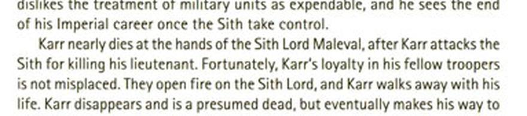
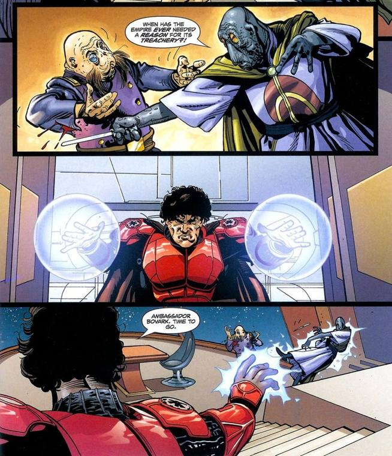

# Gar Stazi

- **Aliases:** —
- **Era:** —
- **Continuity:** default Legends; entries present for: Legends
- **Research tier:** untiered (not listed as INTRO/DEEP/MASTERY in legends-feats.md)
- **Entries:** 27 (18 with quotations; 0 quotations extended to the full sentence/passage from the source text on file; 27 marked as fragments). Rebuilt 2026-11-17 from 42 old entries; old file: `characters/_bak/gar-stazi.md.bak-20261117`.
- **How to read:** each entry is the quotation in full (block quote), then its source and point of view. "Note" lines are summaries from our notes, not quotations. `[fragment — full passage not on file]` means the source text is not on the box, so only the words in our notes are shown. Debate and forum material is in the last section and is unverified.

# LEGENDS (Legends / EU — main focus)

## Sourcebooks/Legacy Era Campaign Guide.pdf [Star Wars Roleplaying Game Saga Edition (2007)] (scan pages 121–180)

- Note (summary from our notes, not a quotation): Page contents: Mon Calamari Resistance Member (CL 2); Influential Personalities; Admiral Gar Stazi. Caption: "ADMIRAL GAR STAZI". (hand-read)
  — Source: Sourcebooks/Legacy Era Campaign Guide.pdf [Star Wars Roleplaying Game Sag.
Our notes: `notes/materials/037-sw-d20-folder/719-legacy-era-campaign-guide-scan-121-180.md:113`

- Note (summary from our notes, not a quotation): Page contents: Admiral Gar Stazi (CL 16, Medium Duros noble 5/soldier 2/officer 9; Destiny 3; Force 8; alternate talents from Starships of the Galaxy); Andurgo (CL 9, Small Dug scoundrel 7/ace pilot 2; CF9 Crossfire starfighter). (hand-read)
  — Source: Sourcebooks/Legacy Era Campaign Guide.pdf [Star Wars Roleplaying Game Sag.
Our notes: `notes/materials/037-sw-d20-folder/719-legacy-era-campaign-guide-scan-121-180.md:125`

## Star Wars Insider Special Edition (2013)

- Note (summary from our notes, not a quotation): Page contents: Military leaders #7 Revan, #8 Pers Pradeux, #9 Gar Stazi, #10 Gilad Pellaeon (viewed). (hand-read)
  — Source: Star Wars Insider Special Edition (2013).
Our notes: `notes/materials/038-star-wars-insider/159-insspecial2013.md:225`

## Star Wars: Legacy (Dark Horse, 2006–2010) single issues #20–#50, hand-read

> "CAAMAS WAS A TRAP -- AND THE DISASTER THAT THE JEDI FEARED."
>
> — Gar Stazi, Star Wars: Legacy #20, p. 18
> [fragment — full passage not on file]
>
> "IF YOU KNOW IT'S A TRAP, YOU CAN MAYBE MAKE IT WORK FOR YOU." · "NO ONE BEING CAN BE MORE IMPORTANT THAN THE CAUSE."
>
> — Gar Stazi, Star Wars: Legacy #20, p. 18
> [fragment — full passage not on file]
>
> "...CAAMAS..."
> [fragment — full passage not on file]
>
> — Gar Stazi, Star Wars: Legacy #20, p. 23
> [fragment — full passage not on file]
— Source: Star Wars: Legacy #20 — "Indomitable, Part One" (Dark Horse, Feb 2008). POV: Gar Stazi.
Context: 1. Knows it's a trap and goes anyway. p15, p18
Our notes: `notes/materials/039-legacy-2006/legacy-20.md:46`

> IT SOUNDS EXACTLY LIKE CAAMAS.
> [fragment — full passage not on file]
— Source: Star Wars: Legacy #20 — "Indomitable, Part One" (Dark Horse, Feb 2008); (p15: Captain Jailis Yorub, the Sullustan, says.
Our notes: `notes/materials/039-legacy-2006/legacy-20.md:56`

> "LIKE HELL, YORUB! PATCH ME IN FLEETWIDE!"
>
> — Gar Stazi, Star Wars: Legacy #21, p. 3
> [fragment — full passage not on file]
>
> "ATTENTION, ALL GALACTIC ALLIANCE PERSONNEL! THIS IS ADMIRAL GAR STAZI OF THE CORE FLEET! I DECLINE ANY IMPERIAL OFFER FOR SURRENDER UNLESS IT BE THEIRS!" · "I WILL SURRENDER, ADMIRAL, WHEN I CAN NO LONGER FIGHT. STAZI OUT!"
>
> — Gar Stazi, Star Wars: Legacy #21, p. 4
> [fragment — full passage not on file]
>
> "THERE ARE OTHER ROUTES, NICT-- SOME THAT ONLY THE SPACERS KNOW." · "IF YOU DON'T AGREE, NICT, THEN SHOW THEM YOUR BELLY AND BEG FOR MERCY! I WILL NOT!"
>
> — Gar Stazi, Star Wars: Legacy #21, p. 6
> [fragment — full passage not on file]
>
> "THE HYPERSPACE LANES HAVE BEEN MINED AND YOU ARE OUTNUMBERED AND OUTGUNNED. THE RESULT OF YOUR DEFIANCE CAN ONLY BE SLAUGHTER. RECONSIDER."
>
> — Grand Admiral Veed, Star Wars: Legacy #21, p. 4
> [fragment — full passage not on file]
— Source: Star Wars: Legacy #21 — "Indomitable, Part Two" (Dark Horse, Mar 2008). POV: Gar Stazi.
Context: 1. Refuses the surrender at Caamas and escapes through spacer-only hyperspace routes. p3–7
Our notes: `notes/materials/039-legacy-2006/legacy-21.md:8`

> HAVE MANAGED TO BLUNT THE SITH FEINT ON CORUSCANT. HOWEVER, THEY'VE TAKEN HEAVY CASUALTIES AND CANNOT COME TO OUR AID.
— Source: Star Wars: Legacy #21 — "Indomitable, Part Two" (Dark Horse, Mar 2008); (p3: Petan accepts Veed's surrender terms. Jailis Yorub: the Jedi.
Note (our notes, around the quote): (p3: Petan accepts Veed's surrender terms. Jailis Yorub: the Jedi "HAVE MANAGED TO BLUNT THE SITH FEINT ON CORUSCANT. HOWEVER, THEY'VE TAKEN HEAVY CASUALTIES AND CANNOT COME TO OUR AID." p7: the Pride of Corellia is destroyed and the fleet jumps. Valan: "NO! THAT'S IMPOSSIBLE!")
Our notes: `notes/materials/039-legacy-2006/legacy-21.md:21`

> "LET ME SEE IF I UNDERSTAND MY POSITION CLEARLY, ADMIRAL VALAN. ... YOUR FLEET HAS ME TRAPPED AGAINST THE PLANET, CUTTING OFF ALL HOPE FOR ESCAPE. YES?" · "VERY WELL. I SHALL ATTACK."
> [fragment — full passage not on file]
>
> — Gar Stazi, Star Wars: Legacy #21, p. 8
> [fragment — full passage not on file]
— Source: Star Wars: Legacy #21 — "Indomitable, Part Two" (Dark Horse, Mar 2008). POV: Gar Stazi.
Context: 2. Turns Valan's trap around at Mon Calamari. p8–11
Our notes: `notes/materials/039-legacy-2006/legacy-21.md:23`

> "GENIUS IS OFTEN MISTAKEN FOR MADNESS."
>
> — Imperial officer aboard the Imperious (an Alliance infiltrator), Star Wars: Legacy #21, p. 11
> [fragment — full passage not on file]
— Source: Star Wars: Legacy #21 — "Indomitable, Part Two" (Dark Horse, Mar 2008).
Context: (p10: the planetary defense stations open fire on the Imperials. Stazi had set a backdoor override in the defense grid, and the sabotage Valan's people found was the decoy. p11: Hondo Karr, in Imperial armor, retakes the Imperious: "SORRY, LIEUTENANT. ARMOR'S IMPERIAL, BUT THOSE INSIDE IT ARE ALLIANCE." Stazi puts the shipyards between his fleet and Valan's: "FORCE VALAN TO CHOOSE.")
Our notes: `notes/materials/039-legacy-2006/legacy-21.md:27`

> "I'M PREPARED TO COMPLETE MY PLAN, ADMIRAL VALAN -- WHICH IS TO TAKE THE INDOMITABLE INTO THE HEART OF THESE SHIPYARDS AND TRIGGER THE SELF-DESTRUCT SEQUENCE." · "IT SHOULD TAKE YEARS FOR THE EMPIRE TO REBUILD." · "DIDN'T THINK I COULD THINK STRATEGICALLY, DID YOU? STAZI OUT."
>
> — Gar Stazi, Star Wars: Legacy #21, p. 19
> [fragment — full passage not on file]
>
> "I'M TAKING THE INDOMITABLE IN. MY SHIP, MY JOB, MY CHOICE, JHORAM BEY. THE FLEET CANNOT AFFORD TO BE DEPENDENT ON ANY ONE BEING. I AM JUST ONE OF MANY WHO SERVE."
>
> — Gar Stazi, Star Wars: Legacy #21, p. 20
> [fragment — full passage not on file]
>
> "NO, GAR... YOU'RE NOT. YOU... REFUSE TO ACCEPT... THE FACT THAT YOU... HAVE BECOME... A SYMBOL... AND THE FLEET... NEEDS THAT." · "THIS IS THE GALACTIC ALLIANCE CRUISER INDOMITABLE. CAPTAIN JAILIS YORUB COMMANDING." · "THOUGH BATTLES HAVE BEEN LOST, THE ALLIANCE STILL LIVES. WE HAVE NOT SURRENDERED, WE DO NOT CONCEDE THE STARS. WE WILL WIN BACK OUR BIRTHRIGHT." · "FREEDOM."
> [fragment — full passage not on file]
>
> — Jailis Yorub, Star Wars: Legacy #21, p. 20, p. 22
> [fragment — full passage not on file]
— Source: Star Wars: Legacy #21 — "Indomitable, Part Two" (Dark Horse, Mar 2008). POV: Gar Stazi.
Context: 3. Covers the retreat, then rams the burning Indomitable into the Mon Cal docks and triggers its self-destruct. p16–22
Our notes: `notes/materials/039-legacy-2006/legacy-21.md:32`

> "WE MUST BE READY, JHORAM. THERE WILL BE REPRISALS. THE SITH DO NOT FORGIVE." · "IT IS ONLY A QUESTION OF HOW HARD THE HAMMER WILL FALL -- AND WHERE."
>
> — Gar Stazi, Star Wars: Legacy #21, p. 24
> [fragment — full passage not on file]
— Source: Star Wars: Legacy #21 — "Indomitable, Part Two" (Dark Horse, Mar 2008). POV: Gar Stazi.
Context: (p20–21: Bey knocks Stazi out to carry him off ("WELL, I SLUGGED THE ADMIRAL."). The wounded Yorub stays aboard and takes the ship in. p22: the Indomitable explodes in the shipyard ring. p24: "FULLY A THIRD OF THE MON CAL DOCKS DESTROYED WITH ANOTHER QUARTER HEAVILY DAMAGED." The Imperious's weapons were not yet working.)
Our notes: `notes/materials/039-legacy-2006/legacy-21.md:42`

> TEACH YOU NOT TO HIT AN ADMIRAL.
— Source: Star Wars: Legacy #21 — "Indomitable, Part Two" (Dark Horse, Mar 2008).
Note (our notes, around the quote): (p24: Bey is made Stazi's second in command, taking Yorub's place: "TEACH YOU NOT TO HIT AN ADMIRAL." Losses: ten fighters, eight confirmed dead, and half the Indomitable's crew.)
Our notes: `notes/materials/039-legacy-2006/legacy-21.md:47`

> — Gar Stazi, Star Wars: Legacy #22, p. 8
> [fragment — full passage not on file]
>
> "I HAVEN'T SHOT YOU, MASTER DARE. THAT'S GENERALLY THE LIMITS OF MY MANNERS WITH IMPERIALS."
>
> — Gar Stazi, Star Wars: Legacy #22, p. 23
> [fragment — full passage not on file]
>
> "I KNOW THE VALUE OF HIT-AND-RUN TACTICS. I ALSO KNOW THEIR LIMITS." · "PERHAPS DARTH KRAYT HAS MADE A FATAL STRATEGIC ERROR. HE HAS LAID BARE TO THE GALAXY THE SITH'S NAKED FACE OF CRUELTY." · "MASTER DARE, WOULD YOU PLEASE CONTACT EMPEROR FEL AND TELL HIM THAT I AM WILLING TO ONCE AGAIN TALK OF OUR WORKING TOGETHER AGAINST THE COMMON FOE." · "OLD ENMITIES MUST GIVE WAY TO NEW REALITIES." · "FROM NOW ON, THIS SHIP SHALL BE KNOWN AS THE ALLIANCE."
>
> — Gar Stazi, Star Wars: Legacy #22, p. 24
> [fragment — full passage not on file]
— Source: Star Wars: Legacy #22 — "The Wrath of the Dragon" (Dark Horse, Apr 2008). POV: Gar Stazi.
Context: > "AT THIS MOMENT, THERE'S NOTHING WE CAN DO, JHORAM BEY! THE WEAPONS SYSTEMS ON THIS SHIP ARE NOT YET ONLINE -- AND OUR FLEET IS TOO SMALL TO STOP WHAT THE SITH ARE DOING ON DAC!" · "THEY ARE OUT TO SEND A MESSAGE TO THE GALAXY -- 'OBEY OR DIE.'" · "OUR CONTINUED EXISTENCE SENDS A DIFFERENT MESSAGE -- ONE OF DEFIANCE."
Our notes: `notes/materials/039-legacy-2006/legacy-22.md:92`

- Note (summary from our notes, not a quotation): Setting: Ralltiir and its 28 moons (Third Imperial Fleet, loyal to Krayt); bridge of Gar Stazi's flagship; Imperial flagship bridge (Admiral Kelsan).
  — Source: Star Wars: Legacy #36 — "Renegade" (May 2009).
Our notes: `notes/materials/039-legacy-2006/legacy-36.md:7`

> "And, uniting against their common enemy—though for different reasons—Admiral Gar Stazi of the Galactic Alliance and the forces of deposed emperor Roan Fel are preparing to meet with another group, one which is ready to again fight the Sith . . ."
— Source: Star Wars: Legacy #42 — "Divided Loyalties" (Nov 2009).
Context: — Star Wars: Legacy #42, p. 2
Our notes: `notes/materials/039-legacy-2006/legacy-42.md:14`

> "YAHHHHG!" (Tealart — flag)
>
> "ALIVE, BUT HIS LIFE FORCE FLICKERS. WE MUST GET HIM TO THE SICKBAY IMMEDIATELY." (Sayar Dun'la)
> [fragment — full passage not on file]
— Source: Star Wars: Legacy #42 — "Divided Loyalties" (Nov 2009). POV: Sayar Dun'la, about Gar Stazi.
Context: (Feat: Mon Cal shipman Tealart shoots Gar Stazi in the back at point-blank range on his own bridge (p10). Drok leaps across the bridge, lightsaber ignited, and cuts Tealart's blaster apart (p10–11).)
Our notes: `notes/materials/039-legacy-2006/legacy-42.md:80`

> I'M AWARE THAT THE EMPEROR IS UNAVAILABLE, GENERAL JAEGER! WE BOTH KNOW WHY!
>
> BUT IF WE DO NOT ACT IN CONCERT IMMEDIATELY, EVERY LIVING THING ON THE PLANET DAC WILL DIE! *(Gar Stazi)*
>
> AND I AM TELLING YOU, ADMIRAL STAZI, THAT -- BARRING A DIRECT ATTACK ON OUR HOLDINGS OR A DIRECT COMMAND FROM HIS IMPERIAL MAJESTY -- -- I DO NOT HAVE THE AUTHORITY TO COMMIT IMPERIAL FORCES TO THIS. *(Gen. Oron Jaeger, hologram)*
— Source: Star Wars: Legacy #47 — "The Fate of Dac" (Apr 2010). POV: Gar Stazi.
Note (our notes, around the quote): > "I'M AWARE THAT THE EMPEROR IS UNAVAILABLE, GENERAL JAEGER! WE BOTH KNOW WHY!" / "BUT IF WE DO NOT ACT IN CONCERT IMMEDIATELY, EVERY LIVING THING ON THE PLANET DAC WILL DIE!" (Gar Stazi) / "AND I AM TELLING YOU, ADMIRAL STAZI, THAT -- BARRING A DIRECT ATTACK ON OUR HOLDINGS OR A DIRECT COMMAND FROM HIS IMPERIAL MAJESTY -- -- I DO NOT HAVE THE AUTHORITY TO COMMIT IMPERIAL FORCES TO THIS." (Gen. Oron Jaeger, hologram)
Our notes: `notes/materials/039-legacy-2006/legacy-47.md:63`

> UTAPAU, ON THE OUTER RIM. PAU CITY. *(caption)*
>
> YOU'RE A GOOD FRIEND TO TAKE IN OUR WOUNDED, ADMINISTRATOR MEDON. WE SUFFERED A LOT OF CASUALTIES DURING THE EVACUATION OF DAC. *(Gar Stazi)*
>
> WE DO WHAT WE CAN TO COUNTER THE EVIL OF THE SITH. UTAPAU CANNOT CONDONE THE GENOCIDE ON DAC. THE GALACTIC ALLIANCE IS WELCOME HERE. *(Medon)*
— Source: Star Wars: Legacy #49 — "Extremes, Part Two" (Jun 2010). POV: Gar Stazi.
Label in our notes: > (caption) / (Gar Stazi) / (Medon
Our notes: `notes/materials/039-legacy-2006/legacy-49.md:19`

## Star Wars: Legacy Book 1 (omnibus): power-scaling notes with panels

> GANNER, CAN YOU HOLD OFF THESE GUYS WHILE I RETRIEVE THE AMBASSADOR?
>
> THAT'S A JOKE, RIGHT? GO!
> [fragment — full passage not on file]
>
> the Mon Cal aide … and the guards
> [fragment — full passage not on file]
>
> WE'LL FIND OUT WHO DID THIS -- AND THEY WON'T LIVE LONG ENOUGH TO REGRET IT!
— Source: Legacy Book 1 (omnibus): power-scaling notes with panels; The Wheel (Trust Issues): (p228) Draco.
Note (our notes, around the quote): The Wheel (Trust Issues): (p228) Draco: "GANNER, CAN YOU HOLD OFF THESE GUYS WHILE I RETRIEVE THE AMBASSADOR?" · Krieg: "THAT'S A JOKE, RIGHT? GO!" Draco Force-pushes Admiral Gar Stazi, the Duros who had knifed Bovark, across the room (p229). *(Corrected 2026-10-21: 009 had "the Mon Cal aide … and the guards"; only Stazi is pushed.)* · (p231) "WE'LL FIND OUT WHO DID THIS -- AND THEY WON'T LIVE LONG ENOUGH TO REGRET IT!"
Our notes: `notes/materials/009-legacy-book-1.md:885`

> Hated, but respected, by his enemies
> [fragment — full passage not on file]
>
> sabotaged by the Imperial spy Morrigan Corde
> [fragment — full passage not on file]
— Source: Legacy Book 1 (omnibus): power-scaling notes with panels; Galactic Alliance (p459–463): Admiral Gar Stazi.
Note (our notes, around the quote): Galactic Alliance (p459–463): Admiral Gar Stazi, "Hated, but respected, by his enemies"; the talks were "sabotaged by the Imperial spy Morrigan Corde". Ships: Scythe-class battle cruiser, Crossfire fighter, Sabertooth-class assault/rescue vessel, GA frigate. (The right edge of p459 is cropped in the scan: UNCLEAR fragments.)
Our notes: `notes/materials/009-legacy-book-1.md:1136`

## Star Wars Saga Edition: *Legacy Era Campaign Guide* (WotC 2009): power-scaling notes with panels

- Note (summary from our notes, not a quotation): Galactic Alliance Remnant (Gar Stazi's Core Fleet; p121–153).
  — Source: *Legacy Era Campaign Guide* (WotC 2009): power-scaling notes with panels.
Our notes: `notes/materials/011-legacy-era-campaign-guide.md:92`

- Note (summary from our notes, not a quotation): | — | Admiral Gar Stazi | p135 | 16 | noble 5 / soldier 2 / officer 9 | — | 31 (ff 29) / 30 / 35 | 84 (35) | — | 3 / 8 | blaster pistol +16 (3d6+8) |
  — Source: *Legacy Era Campaign Guide* (WotC 2009): power-scaling notes with panels.
Context: | # | Character | Page | CL | Classes | UtF | Ref / Fort / Will | HP (Thr.) | DSS | Destiny / FP | Best lightsaber line |
Our notes: `notes/materials/011-legacy-era-campaign-guide.md:134`

- Note (summary from our notes, not a quotation): Gar Stazi CL 16, Will 35 (p135). Gial Gahan CL 14 (p138). Hondo Karr CL 10, hp 91 (p139). Jaius Yorub CL 13 (p140). Jhoram Bey CL 12 (p136).
  — Source: *Legacy Era Campaign Guide* (WotC 2009): power-scaling notes with panels.

Our notes: `notes/materials/011-legacy-era-campaign-guide.md:952`

- Note (summary from our notes, not a quotation): Others: Nyna Calixte / Morrigan Corde (CL15), Gar Stazi (CL16), Morlish Veed (CL15), Rulf and Gunn Yage, "Bantha" Rawk (CL8), the Yuuzhan Vong NPCs, and all vehicles.
  — Source: *Legacy Era Campaign Guide* (WotC 2009): power-scaling notes with panels.
Our notes: `notes/materials/011-legacy-era-campaign-guide.md:1104`

## Star Wars: Legacy Volume 2, *Shards* (TPB): power-scaling notes with panels

- Note (summary from our notes, not a quotation): #9: Maladi breaks the Jedi healer Hosk Trey'lis with interrogator droids and her will (p58–60). Krayt wants Cade "ALIVE"; Maladi doesn't know why (p61). Calixte tells Veed that Maladi's top agent is "JOR TOLIN" (sic; Torlin elsewhere), Sith-raised but lacking "SUFFICIENT FORCE SENSITIVITY", and reactivates "Morrigan Corde" (p62). She spots Cade on the Wheel's security vids (p63–64). On Bastion, Fel punishes Draco and Krieg for their rescue mission with medals and the most dangerous assignments, and sends them to escort Capt. Bovark to GA Admiral Gar Stazi on the Wheel (p65–67). Talks begin (p68–70). The two Knights sense the GA guards' concealed blasters (p71). On the Wheel's lower levels, Torlin fights a gang that Corde set on him. Corde joins in, Torlin strangles her, and she shocks him unconscious (p72–79).
  — Source: Legacy Volume 2, *Shards* (TPB): power-scaling notes with panels.
Our notes: `notes/materials/012-legacy-vol-2-shards.md:52`

> the Mon Cal aide
> [fragment — full passage not on file]
— Source: Legacy Volume 2, *Shards* (TPB): power-scaling notes with panels.
Note (our notes, around the quote): Trust Issues p90 (= 009 p229): the man knifing Bovark is Admiral Gar Stazi (Duros), not "the Mon Cal aide", and Draco's push hits Stazi only, not "the guards".

Our notes: `notes/materials/012-legacy-vol-2-shards.md:535`

## Legends Feats & Quotes (Star Wars Legends / EU)

> MASTER K'KRUHK AND THE SENIOR JEDI WILL FORM A BATTLE MEDITATION AND HAVE OVERALL COMMAND.
>
> Jedi Master
>
> Triumvir
>
> overall command at Coruscant
> [fragment — full passage not on file]
— Source: Legends Feats & Quotes (Star Wars Legends / EU).
Note (our notes, around the quote): Correction (2026-10-21, material 010 full read): the "Grand Master" part is not supported by *Legacy—War* #1–6. The title "Grand Master" appears nowhere in War, for K'Kruhk or anyone else. On the page he is "MASTER K'KRUHK" (Fel, p100: "MASTER K'KRUHK AND THE SENIOR JEDI WILL FORM A BATTLE MEDITATION AND HAVE OVERALL COMMAND.") and, at Fel's funeral, "JEDI MASTER K'KRUHK", one of the three heads of the Galactic Federation Triumvirate with Admiral Gar Stazi and Empress Marasiah Fel (p132). Use "Jedi Master / Triumvir / overall command at Coruscant", not "Grand Master (Legacy: War)". The Clone Wars half of the claim was not checked. See `notes/materials/010-legacy-war.md`.
Context: Becomes Grand Master after Kol Skywalker's death (Legacy: War); Clone Wars stats slightly above Ventress's (per thread) (debate #28)
Our notes: `legends-feats.md:1600`

# Debate and forum claims (unverified)

Forum posts, Suspect Insight debates and Discord debates, respect threads, and verdicts. These are posters' arguments or quotations they typed; none is checked against the book here unless the entry says so.

_None in our notes._
