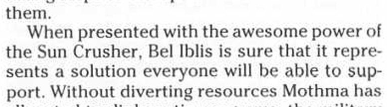
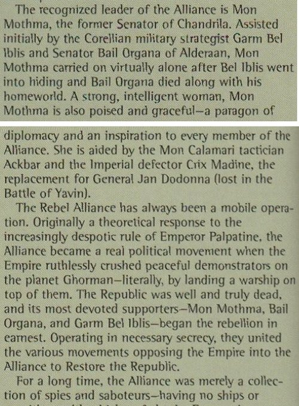
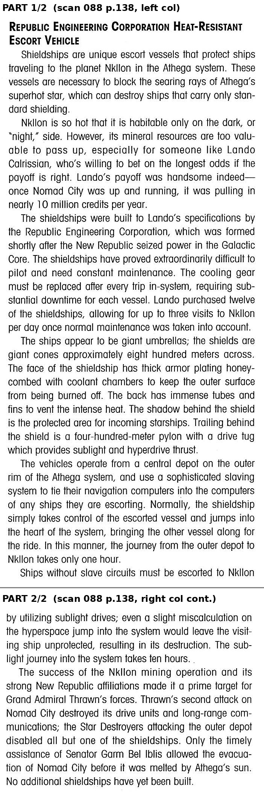

# Garm Bel Iblis

- **Aliases:** —
- **Era:** —
- **Continuity:** default Legends; entries present for: Legends
- **Research tier:** untiered (not listed as INTRO/DEEP/MASTERY in legends-feats.md)
- **Entries:** 29 (14 with quotations; 0 quotations extended to the full sentence/passage from the source text on file; 5 marked as fragments; 11 before the 2026-11-17 fragment fill). Rebuilt 2026-11-17 from 32 old entries; old file: `characters/_bak/garm-bel-iblis.md.bak-20261117`.
- **How to read:** each entry is the quotation in full (block quote), then its source and point of view. "Note" lines are summaries from our notes, not quotations. `[fragment — full passage not on file]` means the source text is not on the box, so only the words in our notes are shown. Debate and forum material is in the last section and is unverified.

# LEGENDS (Legends / EU — main focus)

## The Jedi Academy Sourcebook (WEG, 1996): power-scaling and lore notes

> When presented with the awesome power of the Sun Crusher, Bel Iblis is sure that it represents a solution everyone will be able to support.
— Source: Chapter One: The New Republic; Sun Crusher — Senator Garm Bel Iblis — the Sun Crusher plan.
Note (our notes, around the quote): Sun Crusher — Senator Garm Bel Iblis — the Sun Crusher plan: "When presented with the awesome power of the Sun Crusher, Bel Iblis is sure that it represents a solution everyone will be able to support." Source: The Jedi Academy Sourcebook, p.18

Our notes: `notes/materials/029-jedi-academy-sourcebook/01-ch1-the-new-republic.md:96`

## Sourcebooks/The New Jedi Order Sourcebook.pdf [Star Wars Roleplaying Game (d20, 2000)] (scan pages 121–162)

- Note (summary from our notes, not a quotation): Page contents: 808 words, 24 paragraphs | headings/entries: General Wedge Antilles; General Garm Bel Iblis; STA R
  — Source: Sourcebooks/The New Jedi Order Sourcebook.pdf [Star Wars Roleplaying Game.
Our notes: `notes/materials/037-sw-d20-folder/049-the-new-jedi-order-sourcebook-scan-121-162.md:101`

## Sourcebooks/Hero's Guide.pdf [Star Wars Roleplaying Game Revised Core (d20, 2002)] (scan pages 61–120)

- Note (summary from our notes, not a quotation): Page contents: Rebel Alliance description and history (Mon Mothma, Bail Organa, Garm Bel Iblis, Ackbar, Crix Madine, Dodonna, Ghorman); Sympathy. (hand-read)
  — Source: Sourcebooks/Hero's Guide.pdf [Star Wars Roleplaying Game Revised Core (d2.
Our notes: `notes/materials/037-sw-d20-folder/668-heros-guide-scan-061-120.md:263`

> The recognized leader of the Alliance is Mon Mothma, the former Senator of Chandrila. Assisted initially by the Corellian military strategist Garm Bel Iblis and Senator Bail Organa of Alderaan, Mon Mothma carried on virtually alone after Bel Iblis went into hiding and Bail Organa died along with his homeworld. A strong, intelligent woman, Mon Mothma is also poised and graceful—a paragon of diplomacy and an inspiration to every member of the Alliance. She is aided by the Mon Calamari tactician Ackbar and the Imperial defector Crix Madine, the replacement for General Jan Dodonna (lost in the Battle of Yavin).
— Source: Sourcebooks/Hero's Guide.pdf [Star Wars Roleplaying Game Revised Core (d2.
Note (our notes, around the quote): Mon Mothma; Bail Organa; Admiral Ackbar — entry/section: Mon Mothma, recognized leader of the Alliance: "The recognized leader of the Alliance is Mon Mothma, the former Senator of Chandrila. Assisted initially by the Corellian military strategist Garm Bel Iblis and Senator Bail Organa of Alderaan, Mon Mothma carried on virtually alone after Bel Iblis went into hiding and Bail Organa died along with his homeworld. A strong, intelligent woman, Mon Mothma is also poised and graceful—a paragon of diplomacy and an inspiration to every member of the Alliance. She is aided by the Mon Calamari tactician Ackbar and the Imperial defector Crix Madine, the replacement for General Jan Dodonna (lost in the Battle of Yavin)." Source: *Hero's Guide* (SWRPG d20 Revised Core), scan p.108

Our notes: `notes/materials/037-sw-d20-folder/668-heros-guide-scan-061-120.md:265`

## Sourcebooks/Rebellion Era Campaign Guide.pdf [Star Wars Roleplaying Game Saga Edition (2007)] (scan pages 1–60)

- Note (summary from our notes, not a quotation): Page contents: A Time of Rebellion: Rebel Alliance (Alliance to Restore the Republic) in decentralized cells; era lasts about eight and a half years to the capture of Coruscant. The Corellian Treaty (Mon Mothma, Bail Organa, Garm Bel Iblis; brought together under false pretenses by agents of Darth Vader); Declaration to Restore the Republic. The Death Star Plans (stolen on Toprawa; to the Tantive IV carrying Leia Organa). The Battle of Yavin. The Battle of Derra IV. The Battle of Hoth (Lando Calrissian's assistance on Cloud City foils Darth Vader's plans). (hand-read)
  — Source: Sourcebooks/Rebellion Era Campaign Guide.pdf [Star Wars Roleplaying Game.
Our notes: `notes/materials/037-sw-d20-folder/722-rebellion-era-campaign-guide-scan-001-060.md:40`

## Sourcebooks/Rebellion Era Campaign Guide.pdf [Star Wars Roleplaying Game Saga Edition (2007)] (scan pages 61–120)

> his loyal assistant, Darth Vader
> [fragment — full passage not on file]
— Source: Sourcebooks/Rebellion Era Campaign Guide.pdf [Star Wars Roleplaying Game.
Note (our notes, around the quote): Page contents: Subplot cont. Metaplot (the redemption of Anakin Skywalker by his son; General Garm Bel Iblis's splinter Rebellion; "alternate history" options such as Vader killing Han Solo instead of encasing him in carbonite). News of the Worlds (why people support the Empire). Knowledge (Galactic Lore) table DC 10 and 15 (the official Imperial story: Palpatine declared Emperor by a grateful Senate; the Emperor and "his loyal assistant, Darth Vader" scarred by Jedi assassination attempts). (hand-read)
Our notes: `notes/materials/037-sw-d20-folder/722-rebellion-era-campaign-guide-scan-061-120.md:127`

- Note (summary from our notes, not a quotation): Page contents: Chapter VI: The Rebel Alliance intro. A Brief History of the Rebellion: Early Resistance (Bail Organa and Mon Mothma meet at Cantham House on Coruscant; Garm Bel Iblis of Corellia). Unleashing Rebellion (two years before Yavin; Mothma flees Coruscant; Bel Iblis believed dead after an assassination attempt). (hand-read)
  — Source: Sourcebooks/Rebellion Era Campaign Guide.pdf [Star Wars Roleplaying Game.
Our notes: `notes/materials/037-sw-d20-folder/722-rebellion-era-campaign-guide-scan-061-120.md:157`

- Note (summary from our notes, not a quotation): Page contents: SpecForce Officer stat block (CL 7). Alliance Personalities intro (Mon Mothma, Bail Organa, Garm Bel Iblis, Starkiller covered in The Force Unleashed Campaign Guide). Admiral Ackbar (Tarkin's slave; freed by a Rebel attack; Shantipole Project created the B-wing; acquisition of Mon Calamari star cruisers). Art "Admiral Ackbar." (hand-read)
  — Source: Sourcebooks/Rebellion Era Campaign Guide.pdf [Star Wars Roleplaying Game.
Our notes: `notes/materials/037-sw-d20-folder/722-rebellion-era-campaign-guide-scan-061-120.md:260`

## Sourcebooks/Scavenger's Guide to Droids.pdf [Star Wars Roleplaying Game Saga Edition (2007)] (scan pages 61–120)

> HK-77 assassin droid. *(hand-read)*
> [fragment — full passage not on file]
— Source: Sourcebooks/Scavenger's Guide to Droids.pdf [Star Wars Roleplaying Game S.
Note (our notes, around the quote): Page contents: HK-77: still overly aggressive; not playable. Modifications: Firefighter; Gambler's Proxy (see-through vision boost for sabacc cards, burns out). Sidebar "Reputation of Fear" (crop-verified; HK-77 hunting Garm Bel Iblis from Anchoron). Caption: "HK-77 assassin droid." (hand-read)
Our notes: `notes/materials/037-sw-d20-folder/724-scavengers-guide-to-droids-scan-061-120.md:281`

## Sourcebooks/The Force Unleashed Campaign Guide.pdf [Star Wars Roleplaying Game Saga Edition (2007)] (scan pages 1–60)

- Note (summary from our notes, not a quotation): Page contents: Ascension cont. (later defections; Han Solo briefly serves the Empire). Growing Threat of the Dark Side (Inquisitorius; Emperor's Hands Mara Jade and Shira Brie; Prophets of the Dark Side of Dromund Kaas; Sith alchemy on Byss creates Imperial Sentinels; Royal Guards trained as Sovereign Protectors). Imperial Atrocities (Caamas razed; Ghorman Massacre; Duro and Centares used up; slavery of Mon Calamari and Wookiees; Corporate Sector Authority). A Less Civilized Age (Black Sun; Jorj Car'das's smuggling cartel). Corellian Treaty (Mon Mothma, Garm Bel Iblis, Bail Organa; meeting on Corellia, finalized on Kashyyyk). Sidebar: Unleashed Concepts (concept art from the game). (hand-read)
  — Source: Sourcebooks/The Force Unleashed Campaign Guide.pdf [Star Wars Roleplaying.
Our notes: `notes/materials/037-sw-d20-folder/729-the-force-unleashed-campaign-guide-scan-001-060.md:66`

- Note (summary from our notes, not a quotation): Page contents: Heroic origin themes: Imperial Persecution (Garm Bel Iblis example), Gradual Oppression (Crix Madine example), Mistaken Suspicion. Sidebar: The Birth of a Hero (key back-story questions; see A Gathering of Heroes p124). (hand-read)
  — Source: Sourcebooks/The Force Unleashed Campaign Guide.pdf [Star Wars Roleplaying.
Our notes: `notes/materials/037-sw-d20-folder/729-the-force-unleashed-campaign-guide-scan-001-060.md:153`

- Note (summary from our notes, not a quotation): Page contents: Noble cont. (idealists may find Mon Mothma, Bail Organa, Garm Bel Iblis). New Noble Talents: Inspiration (Willpower); Ideologue tree (Instruction, Idealist, Know Your Enemy, Known Dissident, Lead by Example); Lineage (Influential Friends). Sidebar: Influential Friends (GM explanation). (hand-read)
  — Source: Sourcebooks/The Force Unleashed Campaign Guide.pdf [Star Wars Roleplaying.
Our notes: `notes/materials/037-sw-d20-folder/729-the-force-unleashed-campaign-guide-scan-001-060.md:183`

## Sourcebooks/The Force Unleashed Campaign Guide.pdf [Star Wars Roleplaying Game Saga Edition (2007)] (scan pages 61–120)

- Note (summary from our notes, not a quotation): Page contents: House Organa: type noble house; enemies and allies (Imperials suspect Bail; Mon Mothma and Garm Bel Iblis allies); scale 9; criteria (Bail's sisters Celly, Rouge, and Tia); criteria tables. (hand-read)
  — Source: Sourcebooks/The Force Unleashed Campaign Guide.pdf [Star Wars Roleplaying.
Our notes: `notes/materials/037-sw-d20-folder/729-the-force-unleashed-campaign-guide-scan-061-120.md:124`

## Sourcebooks/The Force Unleashed Campaign Guide.pdf [Star Wars Roleplaying Game Saga Edition (2007)] (scan pages 181–226)

- Note (summary from our notes, not a quotation): Page contents: Mon Mothma cont. and stat block. Garm Bel Iblis begins. (hand-read)
  — Source: Sourcebooks/The Force Unleashed Campaign Guide.pdf [Star Wars Roleplaying.
Our notes: `notes/materials/037-sw-d20-folder/729-the-force-unleashed-campaign-guide-scan-181-226.md:304`

- Note (summary from our notes, not a quotation): Page contents: Garm Bel Iblis cont. and stat block (CL 8). Sabé and stat block (CL 6). (hand-read)
  — Source: Sourcebooks/The Force Unleashed Campaign Guide.pdf [Star Wars Roleplaying.
Our notes: `notes/materials/037-sw-d20-folder/729-the-force-unleashed-campaign-guide-scan-181-226.md:315`

## Star Wars Insider #75 (2004)

> There will come a time for retribution when the war is over. *(hand-read)*
— Source: Star Wars Insider #75 (2004).
Note (our notes, around the quote): Page contents: Duro coverage continued: Grievous forces Duro Chief Representative Officer Hoolidan Keggle to sign capitulation; SBI Director-General Armand Isard; Corellia may take a more active role (Senator Fang Zar defends Garm Bel Iblis; Orn Free Taa criticizes him); Senator Onaconda Farr resigns from the Senate Action Subcommittee for Corellian Trade Spine Defense; Mas Amedda: "There will come a time for retribution when the war is over." (hand-read)
Our notes: `notes/materials/038-star-wars-insider/075-ins075.md:458`

## Star Wars Insider #85 (2006)

- Note (summary from our notes, not a quotation): Page contents: Delegation: Ivor Drake, Streamdrinker, Grebleips, Garm Bel Iblis, Shea Sadashassa, Tanner Cadaman; senators gathered (hand-read)
  — Source: Star Wars Insider #85 (2006).
Our notes: `notes/materials/038-star-wars-insider/085-ins085.md:364`

## The Thrawn Trilogy (Timothy Zahn): Heir to the Empire, Dark Force Rising, The Last Command, plus the Heir 20th Anniversary extras

What it shows (our notes): Garm Bel Iblis: "The Emperor wasn’t quite able to kill me at Anchoron ... He took everything I had except my life". He met Han at age 11. He says of Han's Academy dismissal: "you’d have been quietly eliminated in the Emperor’s purge of those officers he hadn’t been able to seduce to his side."
> The Emperor wasn’t quite able to kill me at Anchoron ... He took everything I had except my life
> [fragment — full passage not on file]
>
> “There were times,” Bel Iblis agreed. “I’ll admit to having been extremely disappointed when you were dismissed from the Imperial Academy—you’d shown considerable promise there, and I felt at the time that a strongly loyal officer corps was one of the few defenses the Republic still had left against the collapse toward Empire.” He shrugged. “Under the circumstances, it’s just as well that you got out when you did. With your obvious disdain for authority, you’d have been quietly eliminated in the Emperor’s purge of those officers he hadn’t been able to seduce to his side. And then things would have gone quite differently, wouldn’t they?”
— Source: Dark Force Rising — notes part 4: ch. 9–11; Garm Bel Iblis. POV: Garm Bel Iblis.
(Excerpt widened 2026-11-17 to the relevant passage, word for word from Dark Force Rising (Timothy Zahn), Chapter 11 (text copy `MEGA_Legend_The_Thrawn_Trilogy_Star_Wars_Thrawn_Trilogy_02_Dark_Force_Rising_Timothy_Zahn_epub`).)
(Fragment completed 2026-11-17: full sentence/passage matched word for word in the source text on file: `MEGA_Legend_The_Thrawn_Trilogy_Star_Wars_Thrawn_Trilogy_02_Dark_Force_Rising_Timothy_Zahn_epub`.)
Our notes: `notes/materials/044-thrawn-trilogy/dfr-04.md:25`

## The Thrawn Trilogy Sourcebook (West End Games, 1996; WEG 40131)

> "At Tangrene, the warriors of Peregrine's Nest blasted a major Ubiqtorate center into fine dust, even though three Star Destroyers were in orbit guarding the facility." — p. 96
> [fragment — full passage not on file]
— Source: Thrawn Trilogy Sourcebook, notes part 8: PDF pp. 87–96 (book pp. 90–99), Ch. 5 The Fringe (cont.).
Context: Garm Bel Iblis: Han calls him "sir". He met Han when Han was 11. Palpatine had "his wife, and his two children" executed in front of him; "commonly believed that Bel Iblis died on Anchoron".
Our notes: `notes/materials/045-thrawn-trilogy-sourcebook/tts-08.md:16`

What it shows (our notes): Mon Mothma "is terrified of trusting the lives under her command to anyone else". His leadership saved the Siege of Coruscant from "a complete rout".
What it shows (our notes): Garm Bel Iblis: Han calls him "sir". He met Han when Han was 11. Palpatine had "his wife, and his two children" executed in front of him; "commonly believed that Bel Iblis died on Anchoron".
> BelIblis'crowning achievement since forming his private army was the incident at Tangrene. They had been sniping at the Imperials for three years, hitting small bases and military supply shipments, but the Empire had not been paying much attention to them.AtTangrene,thewarriorsof Peregrine's Nest blasted a major Ubiqtorate center into fine dust, even though three Star Destroyers were in orbit guarding the facility. After that mission, mobility became a top priority. Bel Iblis participated in the battle for the Katana fleet,andwasofficiallyinvitedtoparticipateintheNew Republic. His relationship with Mon Mothma has improved considerably in the short time since he has arrived on Coruscant. Afteryears of believingthat Mon Mothma was interested in consolidating her power simplyforpower'ssake,hehasfinallyrealizedthatMon Mothma is terrified of trusting the lives under her command to anyone else. Mon Mothma, realizing that she could trust General Bel Iblis, requested his help in the Siege of Coruscant. It was under his leadership that a bad situation was prevented from becoming a complete rout. Bel Iblis is a cultured, handsome, older gentleman, and a shrewd, charismatic leader.
— Source: Thrawn Trilogy Sourcebook, notes part 8: PDF pp. 87–96 (book pp. 90–99), Ch. 5 The Fringe (cont.); Mon Mothma.
(Excerpt widened 2026-11-17 to the relevant passage, word for word from WEG40131 Star Wars The Thrawn Trilogy Sourcebook pdf x.txt (text copy `MEGA_WEG40131_Star_Wars_The_Thrawn_Trilogy_Sourcebook_pdf_x`).)
(Excerpt widened 2026-11-17 to the relevant passage, word for word from WEG40131 Star Wars The Thrawn Trilogy Sourcebook pdf x.txt (text copy `MEGA_WEG40131_Star_Wars_The_Thrawn_Trilogy_Sourcebook_pdf_x`).)
(Fragment completed 2026-11-17: full sentence/passage matched word for word in the source text on file: `MEGA_WEG40131_Star_Wars_The_Thrawn_Trilogy_Sourcebook_pdf_x`.)
Our notes: `notes/materials/045-thrawn-trilogy-sourcebook/tts-08.md:18`

- Note (summary from our notes, not a quotation): Stats: tactics: ground assault 9D, capital ship 8D+2, command 9D, bargain 9D. Siege of Coruscant: command: Peregrine's Nest troops 11D, tactics: capital ship 9D.
  — Source: Thrawn Trilogy Sourcebook, notes part 8: PDF pp. 87–96 (book pp. 90–99), Ch. 5 The Fringe (cont.).
Context: Garm Bel Iblis: Han calls him "sir". He met Han when Han was 11. Palpatine had "his wife, and his two children" executed in front of him; "commonly believed that Bel Iblis died on Anchoron".
Our notes: `notes/materials/045-thrawn-trilogy-sourcebook/tts-08.md:19`

## Prima Official Game Guide: *Star Wars: The Force Unleashed* (2008)

> He would often act as the cavalry, arriving just in time to rescue an overwhelmed Jedi or provide air cover for Republic commandos. During the Clone Wars, Bel Iblis proved himself a brilliant military tactician, but on the Senate floor, he continued to stand against Palpatine. When Palpatine ascended to Emperor, a frustrated Bel Iblis could no longer contain his anger. He continually lashed out against the Emperor’s policies, opposing the creation of the Imperial war machine, the subjugation of entire planets, and the Imperialization of major corporations. Unwilling to believe that the Jedi had betrayed the Republic, as Palpatine claimed, Bel Iblis frequently evoked the names of the most vaunted Jedi in his speeches. Angered by his constant challenges, Emperor Palpatine ordered Imperial forces to arrest the entire Bel Iblis family. Garm was forced to watch as his wife and children were executed, but he managed to escape the slaughter. The Empire scoured the galaxy for Bel Iblis, who disappeared along with his entire private fleet, but to no avail. His flight from the Empire had been secretly aided by his allies in the senate—Bail Organa and Mon Mothma. Inspired by the mysterious Starkiller, the three have begun to discuss taking more direct action against the Empire. Garm Bel Iblis Garm Bel Iblis , or re h his a and mpire.
— Source: Prima *Star Wars: The Force Unleashed* guide — part 1: front matter, lore primer, cast and bestiary, combat systems (printed pp. 1–35); Garm Bel Iblis (p. 11).
(Excerpt widened 2026-11-17 to the relevant passage, word for word from Star Wars The Force Unleashed Prima Official eGuide pdf x.txt (text copy `MEGA_Star_Wars_The_Force_Unleashed_Prima_Official_eGuide_pdf_x`).)
(Excerpt widened 2026-11-17 to the relevant passage, word for word from Star Wars The Force Unleashed Prima Official eGuide pdf x.txt (text copy `MEGA_Star_Wars_The_Force_Unleashed_Prima_Official_eGuide_pdf_x`).)
(Fragment completed 2026-11-17: full sentence/passage matched word for word in the source text on file: `MEGA_Star_Wars_The_Force_Unleashed_Prima_Official_eGuide_pdf_x`.)
Label in our notes: His escape was
Our notes: `notes/materials/055-prima-force-unleashed/fu-01.md:40`

> Blast him with Sith Scorcher, then dash away. You can also quickly destroy the Shadow Troopers by tossing them into the large molten metal pit. Pick them up with Force Grip and throw them over the railing. Protected by copyright. Unauthorized or unlawful copying or downloading is prohibited. 77 Objective Go to Cloud City on Bespin and meet with Senator Garm Bel Iblis. Enemies Encountered Twi’lek Mercenary Mandalorian Spy Gran Grenadier: Grenade-tossing Bandit Talz Medic Whiphid Thug Ithorian Smuggler Kleef and H-TFU Droids: Minor Boss Chop’aa and Minions: Boss Collectibles Found 20 Holocrons Color Crystal 2 Force Holocrons 2 Health Holocrons Lightsaber Hilt “It’s Beautiful.” “It’s Beautiful.” With word of your victories against the Empire spreading across the galaxy, it’s time to contact the dissident Senators and organize a Rebel Alliance. General Kota decides to contact Senator Organa, but in the meantime you must travel to Cloud City to meet with another Senator.
— Source: Prima *The Force Unleashed* guide — part 6: the Wii guide, Vader's Flagship to the end, Duel mode and Sith Secrets (Wii pp. 50–112); Objective.
(Excerpt widened 2026-11-17 to the relevant passage, word for word from Star Wars The Force Unleashed Prima Official eGuide pdf x.txt (text copy `MEGA_Star_Wars_The_Force_Unleashed_Prima_Official_eGuide_pdf_x`).)
(Excerpt widened 2026-11-17 to the relevant passage, word for word from Star Wars The Force Unleashed Prima Official eGuide pdf x.txt (text copy `MEGA_Star_Wars_The_Force_Unleashed_Prima_Official_eGuide_pdf_x`).)
Our notes: `notes/materials/055-prima-force-unleashed/fu-06.md:40`

> In Cloud City, you’ll need to contact the chief administrator, Lobot. *(Wii p. 77)*
— Source: Prima *The Force Unleashed* guide — part 6: the Wii guide, Vader's Flagship to the end, Duel mode and Sith Secrets (Wii pp. 50–112).
Label in our notes: Wii p. 77
Context: Objective: "Go to Cloud City on Bespin and meet with Senator Garm Bel Iblis."
Our notes: `notes/materials/055-prima-force-unleashed/fu-06.md:41`

> Stop when you see the Mandalorians speeding at you. Hit them all with Detonate or Sith Seeker, then turn left and go through the door. At the hall’s far end, to the left, are several more of Chop’aa’s lackeys. As you slowly stalk them down the hall, use Force Push to bounce the grenadier’s grenades back at the group. Destroy Chop’aa’s thugs at the hall’s end with Sith Scorcher, then advance into the plaza ahead. Lobot is waiting, but where is the Senator? Senatorial Hunt While you’ve been battling the criminal element in Cloud City, Senator Garm Bel Iblis was captured by a rogue named Kleef. To speak with the Senator, you must rescue him first. Go down the steps on the right onto the plaza’s lower level; toss the approaching scumbags over the side ledges. They can’t fight if they’re flying over the edge, so the battle with Chop’aa’s thugs should be short and sweet. After defeating all of Chop’aa’s thugs in the plaza’s lower level, remove the crates and barrels littered behind the elevator shafts.
— Source: Prima *The Force Unleashed* guide — part 6: the Wii guide, Vader's Flagship to the end, Duel mode and Sith Secrets (Wii pp. 50–112); Then. POV: Then, about Garm Bel Iblis.
(Excerpt widened 2026-11-17 to the relevant passage, word for word from Star Wars The Force Unleashed Prima Official eGuide pdf x.txt (text copy `MEGA_Star_Wars_The_Force_Unleashed_Prima_Official_eGuide_pdf_x`).)
(Excerpt widened 2026-11-17 to the relevant passage, word for word from Star Wars The Force Unleashed Prima Official eGuide pdf x.txt (text copy `MEGA_Star_Wars_The_Force_Unleashed_Prima_Official_eGuide_pdf_x`).)
(Fragment completed 2026-11-17: full sentence/passage matched word for word in the source text on file: `MEGA_Star_Wars_The_Force_Unleashed_Prima_Official_eGuide_pdf_x`.)
Note text that was attached to the quote line: *(Wii p. 81)*
Label in our notes: Wii p. 81
Context: Plot:
Our notes: `notes/materials/055-prima-force-unleashed/fu-06.md:45`

## *Star by Star* (Troy Denning, Del Rey 2001): FULL consecutive re-read (2026-11-16 CST)

What it shows (our notes): "I will ask the military for a study."; Garm Bel Iblis; "We'll ask Tsavong Lah for an envoy"; "that Yuuzhan Vong threats merely strengthen the ties between the New Republic and her Jedi"; "What you have, Senators … is a consensus of fools."
> “What?” Leia was astonished at the ire in her own voice. Perhaps it was because of her fatigue, or perhaps because of her surprise at having miscalculated so badly, but she found herself struggling to hold back a string of invectives on the tip of her tongue. “Chief Fey’lya, the plan is a sound one—”
>
> Fey’lya raised a placating hand. “And I haven’t said no. But you must know what the loss of three Star Destroyers would mean to us. We could lose another dozen planets.” He stroked the creamy tufts on his cheek, then spoke in a deliberately thoughtful voice. “I will ask the military for a study.”
>
> “A study?” Jacen burst out. “The convoy will be drifting slag by the time they finish!”
>
> “I’m sure General Bel Iblis will expedite matters,” Fey’lya said evenly. “In the meantime, we’ll stall.”
>
> “Stall?” In her weakened state, Leia did not trust herself to keep a civil tone. She knew Garm Bel Iblis, who like Wedge Antilles had been reactivated at the outbreak of the war, would move as quickly as possible. But even he could push the plodding command bureaucracy along only so fast, and there was no guarantee that he would reach the conclusion she hoped for. “How can you stall the Yuuzhan Vong?”
>
> Fey’lya flashed a snarl she was sure he meant as reassuring. “We’ll ask Tsavong Lah for an envoy to discuss the matter.”
>
> “An envoy?” Jia shouted the question. “It will look like we’re asking for terms!”
>
> Fey’lya’s ears pricked mischievously forward. “Precisely, Senator—and it will buy time.” The Bothan was quick to look back to Leia. “But rest assured, Princess. Whatever General Bel Iblis’s conclusion, we shall tell the envoy only this: that Yuuzhan Vong threats merely strengthen the ties between the New Republic and her Jedi.”
>
> Jia actually grinned. “A point that will be underscored when we rescue the hostages.”
>
> “Or even if we must let them die,” Shesh added. She nodded her approval. “I believe we have a consensus, Chief Fey’lya.”
>
> The consensus only angered Leia more, for she had worked with Borsk Fey’lya long enough to know that his plans served only himself; whatever he intended to say to the Yuuzhan Vong, she felt sure that he would not allow the Jedi to stand in the way of making an accommodation that would save his own position.
>
> “What you have, Senators,” she said icily, “is a consensus of fools.”
— Source: The New Jedi Order: Star by Star (Troy Denning, Del Rey 2001), SBS ch. 6 — 124 notes (re-read 2026-11-16).
(Excerpt widened 2026-11-17 to the relevant passage, word for word from Star by Star (Troy Denning) (text copy `MEGA_Legend_The_New_Jedi_Order_Series_Star_Wars_New_Jedi_Order_10_Star_by_Star_Troy_Denning_epub`).)
(Excerpt widened 2026-11-17 to the relevant passage, word for word from Star by Star (Troy Denning) (text copy `MEGA_Legend_The_New_Jedi_Order_Series_Star_Wars_New_Jedi_Order_10_Star_by_Star_Troy_Denning_epub`).)
(Fragment completed 2026-11-17: full sentence/passage matched word for word in the source text on file: `MEGA_Legend_The_New_Jedi_Order_Series_Star_Wars_New_Jedi_Order_10_Star_by_Star_Troy_Denning_epub`.)
Note text that was attached to the quote line: (SBS ch. 6) — **"I will ask the military for a study."; Garm Bel Iblis; "We'll ask Tsavong Lah for an envoy"; "that Yuuzhan Vong threats merely strengthen the ties between the New Republic and her Jedi"; "What you have, Senators … is a consensus of fools."**
Our notes: `notes/materials/124-njo-10-star-by-star/sbs-02.md:60`

What it shows (our notes): Jacen's telekinetic tug; "It is not Garm's integrity I question"; "Jacen, I'm done with the senate. Again."; the Force tells her she has stepped onto a new path; "sometimes it can be dangerous to assume the best about people"; "What can he bargain with?" / "Us."
> “Mother?”
>
> Leia felt Jacen reach out to her through the Force, laving her with soothing emotions, and she realized how young he really was. The New Republic Senate was far from the unblemished body he imagined, and the good-faith compromises described in C-3PO’s civics lessons were all too rare. The senate was a power-grubbing club of people who too often saw their duty in terms of their own interests, who measured their success by how long they held office, and it made Leia ashamed to think she had played such a prominent role in its founding. She spun on her heel and would have stepped into the lift’s gate—perhaps even flipped over it—if not for a gentle telekinetic tug from her son.
>
> To cover for herself, she reached for the gate and said, “I have wasted all the time I care to with NRMOC.”
>
> Borsk Fey’lya stepped in front of her. “You really have no reason to be upset, Princess. General Bel Iblis’s integrity is beyond question.”
>
> “It is not Garm’s integrity I question, Chief.”
>
> Leia used the Force to open the gate behind Fey’lya, then brushed him aside and stepped onto the lift. Jacen came to her side, one hand ready to catch her at the first sign of weakness.
>
> When they reached the mezzanine and started for the exit, he asked, “Was that wise? We have enough enemies in the senate.”
>
> “Jacen, I’m done with the senate. Again.”
>
> As Leia spoke, an unexpected calmness came to her. She began to feel stronger and less weary, more at harmony with herself, and she knew her words had been more than the usual frustration with politicians. She had lost control with Fey’lya not because she was weak and tired—though she was—but because she no longer belonged in the halls of power, no longer believed in the process that placed selfish bureaucrats in positions of power over those they were sworn to serve. The Force was guiding her, telling her the New Republic had changed, the galaxy had changed, most of all she had changed. She had stepped onto a new path, and it was time that she realized it and stopped trying to follow the old one.
>
> Leia took Jacen’s arm and, in a more peaceful voice, said, “I’ll never appear before them or their committees again.”
>
> Jacen remained silent, but his distress and concern were as thick in the Force as the air over a Dagobah swamp. Leia wrapped an arm around his waist and, surprised as always at how far her nineteen-year-old son now towered above her, pulled him close.
>
> “Jacen, sometimes it can be dangerous to assume the best about people,” she said quietly. “Borsk is our worst enemy in the senate, and he just proved it.”
>
> “He did?”
>
> They left the committee room and started down the familiar corridor. “Think,” Leia said. “The reason behind the reason. Why would Borsk want to talk to a Yuuzhan Vong envoy? What can he bargain with?”
>
> Jacen walked a few silent steps, then stopped when the answer finally struck him. “Us.” (SBS ch. 6) — **Jacen's telekinetic tug; "It is not Garm's integrity I question"; "Jacen, I'm done with the senate. Again."; the Force tells her she has stepped onto a new path; "sometimes it can be dangerous to assume the best about people"; "What can he bargain with?"
>
> "Us."**
> [fragment — full passage not on file]
— Source: The New Jedi Order: Star by Star (Troy Denning, Del Rey 2001), SBS ch. 6 — 124 notes (re-read 2026-11-16).
(Excerpt widened 2026-11-17 to the relevant passage, word for word from Star by Star (Troy Denning) (text copy `MEGA_Legend_The_New_Jedi_Order_Series_Star_Wars_New_Jedi_Order_10_Star_by_Star_Troy_Denning_epub`).)
(Excerpt widened 2026-11-17 to the relevant passage, word for word from Star by Star (Troy Denning) (text copy `MEGA_Legend_The_New_Jedi_Order_Series_Star_Wars_New_Jedi_Order_10_Star_by_Star_Troy_Denning_epub`).)
Our notes: `notes/materials/124-njo-10-star-by-star/sbs-02.md:61`

## Essential Guide to Vehicles and Vessels (1996)

- Note (summary from our notes, not a quotation): The success of the Nkllon mining operation and its strong New Republic affiliations made it a prime target for Grand Admiral Thrawn’s forces. Thrawn’s second attack on Nomad City destroyed its drive units and long-range communications; the Star Destroyers attacking the outer depot disabled all but one of the shieldships. Only the timely assistance of Senator Garm Bel Iblis allowed the evacuation of Nomad City before it was melted by Athega’s sun. No additional shieldships have yet been built.
  — Source: The Essential Guide to Vehicles and Vessels (Bill Smith, Del Rey, 1996), printed p.138, scan p.088. The piloting and maintenance limits are this guide’s statements, not a power feat..
Our notes: `notes/materials/148-essential-guide-to-vehicles-vessels-1996/egvv-rebeltransport-through-shriwirr.md`

# Debate and forum claims (unverified)

Forum posts, Suspect Insight debates and Discord debates, respect threads, and verdicts. These are posters' arguments or quotations they typed; none is checked against the book here unless the entry says so.

_None in our notes._

# NJO FULL re-read additions (2026-11-17)
Verbatim excerpts from the full consecutive re-read of the New Jedi Order novels (Dark Journey through The Unifying Force), each shown with the text around it and its source chapter.

## *The Final Prophecy*
Bel Iblis warns Bilbringi is too far to hold like Borleias.

> “It’s too close to Coruscant,” Bel Iblis said. “And too far from our own secure zone. We can never hold it.” He shook his head. “We don’t want another Borleias. No offense, General Antilles.”
>
> “None taken. Our actions at Borleias served their intended purpose. We never imagined we would keep it.”

— Source: *The Final Prophecy* (Greg Keyes, Del Rey 2003), chapter 4 (FP).

