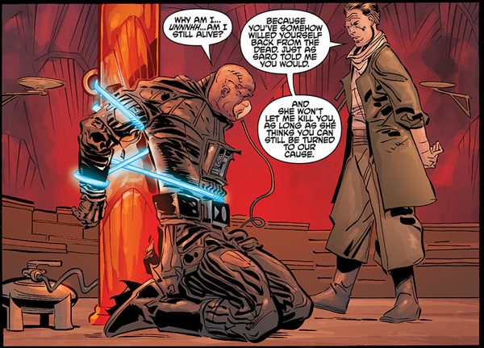

# Garoche Tarkin

- **Aliases:** Admiral Garoche Tarkin, Admiral Tarkin (son)
- **Era:** Dark Times (19 BBY)
- **Continuity:** default Legends; entries present for: Legends
- **Research tier:** untiered (not listed as INTRO/DEEP/MASTERY in legends-feats.md)
- **Entries:** 12 (9 with quotations; 0 quotations extended to the full sentence/passage from the source text on file; 9 marked as fragments). Rebuilt 2026-11-17 from 14 old entries; old file: `characters/_bak/garoche-tarkin.md.bak-20261117`.
- **How to read:** each entry is the quotation in full (block quote), then its source and point of view. "Note" lines are summaries from our notes, not quotations. `[fragment — full passage not on file]` means the source text is not on the box, so only the words in our notes are shown. Debate and forum material is in the last section and is unverified.

# LEGENDS (Legends / EU — main focus)

## Star Wars: Darth Vader and the Lost Command #1–5 (Dark Horse, Jan–May 2011) + TPB (Nov 2011)

> willed yourself back from the dead
> [fragment — full passage not on file]
— Source: Darth Vader and the Lost Command: daily-image candidates; ![Bound Vader and Garoche Tarkin.
Note (our notes, around the quote): 
Our notes: `notes/materials/042-lost-command/daily-image-candidates.md:76`

> Largely unexplored, but inhabited.
> [fragment — full passage not on file]
>
> One of my Star Destroyers entered the system several weeks ago to hunt insurgents and simply vanished.
>
> Admiral Garoche Tarkin … my *son* *(Wilhuff Tarkin speaking)*
> [fragment — full passage not on file]
— Source: Star Wars: Darth Vader and the Lost Command #1 (Dark Horse, Jan 2011): hand-read notes.
Note (our notes, around the quote): p. 09: "Rise … my apprentice." Moff Tarkin's officer has gone missing in the Atoan system, the "Ghost Nebula": "Largely unexplored, but inhabited." "One of my Star Destroyers entered the system several weeks ago to hunt insurgents and simply vanished." The commander is "Admiral Garoche Tarkin … my *son*" (Wilhuff Tarkin speaking).
Our notes: `notes/materials/042-lost-command/lc-01.md:12`

> I prayed to the twenty-nine Atoan gods to give me the power to bring peace. Then I captured one of your troopers and swallowed his tongue. Soon I could hear and speak as you do.
>
> He did not survive the ritual.
>
> You confess to killing an Imperial stormtrooper? I should execute you now.
>
> I am my people's shaman. Their spiritual protector.
>
> I will help you find Garoche Tarkin … and in exchange, you will declare me *queen* of the Ghost Nebula.
> [fragment — full passage not on file]
— Source: Darth Vader and the Lost Command #2 (Dark Horse, Feb 2011): page-by-page notes; p. 05: Saro.
Note (our notes, around the quote): p. 05: Saro: "I prayed to the twenty-nine Atoan gods to give me the power to bring peace. Then I captured one of your troopers and swallowed his tongue. Soon I could hear and speak as you do." "He did not survive the ritual." Vader: "You confess to killing an Imperial stormtrooper? I should execute you now." Saro: "I am my people's shaman. Their spiritual protector." Her terms: "I will help you find Garoche Tarkin … and in exchange, you will declare me *queen* of the Ghost Nebula."
Our notes: `notes/materials/042-lost-command/lc-02.md:8`

> The pilot revealed everything before he died. We are already en route to our next target.
>
> This mission is vital, Lord Vader -- Garoche Tarkin is easily replaceable, but his father is a powerful and loyal ally. He excels at spreading fear. I will not have him distracted.
>
> Most of the planet is covered in black oceans … the seas consume all who enter.
> [fragment — full passage not on file]
— Source: Darth Vader and the Lost Command #2 (Dark Horse, Feb 2011): page-by-page notes; p. 22: Vader kneels to a hologram of Palpatine.
Note (our notes, around the quote): p. 22: Vader kneels to a hologram of Palpatine: "The pilot revealed everything before he died. We are already en route to our next target." Palpatine: "This mission is vital, Lord Vader -- Garoche Tarkin is easily replaceable, but his father is a powerful and loyal ally. He excels at spreading fear. I will not have him distracted." On the bridge, Saro on a nameless world: "Most of the planet is covered in black oceans … the seas consume all who enter."
Our notes: `notes/materials/042-lost-command/lc-02.md:25`

> Darth Vader is searching for a missing Star Destroyer commanded by Admiral Garoche Tarkin—Moff Tarkin's son. With Captain Shale—a friend of the admiral's—as his second in command…
> [fragment — full passage not on file]
>
> Vader continues to cut a swath through the Atoan system until his troops are poised to assault a planet covered with oceans of boiling tar. Vader is cautioned that an attack could be disastrous, but the Dark Lord has a plan. . . .
— Source: Darth Vader and the Lost Command #3 (Dark Horse, Mar 2011): page-by-page notes; p. 02 crawl: >.
Note (our notes, around the quote): p. 02 crawl: > "Darth Vader is searching for a missing Star Destroyer commanded by Admiral Garoche Tarkin—Moff Tarkin's son. With Captain Shale—a friend of the admiral's—as his second in command…" … "Vader continues to cut a swath through the Atoan system until his troops are poised to assault a planet covered with oceans of boiling tar. Vader is cautioned that an attack could be disastrous, but the Dark Lord has a plan. . . ." Indicia: #3, March 2011.
Our notes: `notes/materials/042-lost-command/lc-03.md:5`

> The captain claims that this entire city has pledged fealty to the Empire -- at Admiral Garoche Tarkin's request.
>
> What? Where's Lady Saro?
> [fragment — full passage not on file]
>
> I sent her back to the ship. My protocol droid can conduct a simple interrogation.
— Source: Darth Vader and the Lost Command #3 (Dark Horse, Mar 2011): page-by-page notes.
Note (our notes, around the quote): p. 19: Vader's fighters and walkers land on the green island beside the beached city. Shale: "The captain claims that this entire city has pledged fealty to the Empire -- at Admiral Garoche Tarkin's request." "What? Where's Lady Saro?" Vader: "I sent her back to the ship. My protocol droid can conduct a simple interrogation."
Our notes: `notes/materials/042-lost-command/lc-03.md:23`

> The table tilted, raising Anakin’s restrained body to a standing position. From the shadows of the operating room, the hooded Emperor stepped forward and said, “Lord Vader. Can you hear me?”
>
> Admiral Tarkin. Garoche Tarkin. Welcome to the heart of the Ghost Nebula.
>
> Why am I... unnnhh... am I still alive?
> [fragment — full passage not on file]
>
> Because you've somehow willed yourself back from the dead. Just as Saro told me you would. And she won't let me kill you as long as she thinks you can still be turned to our cause.
— Source: Darth Vader and the Lost Command #4 (Dark Horse, Apr 2011): page-by-page notes.
(Excerpt widened 2026-11-17 to the relevant passage, word for word from Star Wars®: The Rise and Fall of Darth Vader (Ryder Windham) (text copy `MEGA_Other_Juvenile_Books_Star_Wars_The_Rise_and_Fall_of_Darth_Vader_Ryder_Windham_epub`).)
Note (our notes, around the quote): p. 22: captive Vader, his mask off and breathing tube attached, is bound to a pillar with blue coils. "Lord Vader? Can you hear me?" Garoche Tarkin: > "Admiral Tarkin. Garoche Tarkin. Welcome to the heart of the Ghost Nebula." Vader: "Why am I... unnnhh... am I still alive?" Tarkin: > "Because you've somehow willed yourself back from the dead. Just as Saro told me you would. And she won't let me kill you as long as she thinks you can still be turned to our cause."
Our notes: `notes/materials/042-lost-command/lc-04.md:26`

- Note (summary from our notes, not a quotation): (ANALYSIS) Plot: Shale's mutiny is meant to save Garoche Tarkin. Tarkin has gone native under Saro. Saro has been using Vader to kill her rivals. The Padmé apparition (p. 24) is probably Atoan/Saro-induced; the issue doesn't say.
  — Source: Darth Vader and the Lost Command #4 (Dark Horse, Apr 2011): page-by-page notes.
Our notes: `notes/materials/042-lost-command/lc-04.md:33`

> Darth Vader was sent to the Atoan system to locate a missing Star Destroyer and its commander, Admiral Garoche Tarkin, the son of the Emperor's most loyal ally.
>
> Following an encounter with the mysterious Lady Saro, who promised to help locate Tarkin in exchange for being named queen of the Atoan system, Vader embarked on a war of conquest, destroying the native defenses and setting the stage for Saro's reign. But still Tarkin was not found.
>
> Then came the betrayal by Vader's second in command, Captain Shale, and the stormtroopers loyal to him. Vader and his last squad of trusted troopers from the 501st were ambushed on the Atoan crystal planet, and Vader was captured by Shale, Saro, and the *traitor* Garoche Tarkin . . .
— Source: Darth Vader and the Lost Command #5 (Dark Horse, May 2011): page-by-page notes; p. 02 crawl: >.
Label in our notes: p. 02 crawl: > … …
Our notes: `notes/materials/042-lost-command/lc-05.md:5`

- Note (summary from our notes, not a quotation): Plot: c. 19 BBY. Palpatine sends Vader to the Atoan system in the Ghost Nebula to find Admiral Garoche Tarkin, Moff Tarkin's son. Lady Saro, High Priestess of Atoa, offers to help in exchange for being made queen. Vader's conquest kills her rivals. Captain Shale (Garoche's friend) mutinies. Garoche has gone over to Saro, who is carrying his child. Saro's illusions of Padmé break Vader down. He collapses the cathedral on everyone, survives, and Palpatine lets Wilhuff Tarkin believe natives killed his son.
  — Source: 042 Lost Command: summary of strongest findings.
Our notes: `notes/materials/042-lost-command/summary.md:3`

> Garoche Tarkin is easily replaceable, but his father is a powerful and loyal ally *(LC#2 p. 22)*
> [fragment — full passage not on file]
>
> He believes that his son was murdered by natives.
>
> Hatred gnaws at him, making him vicious and resolute. He is now a much more powerful servant. *(LC#5 p. 23)*
— Source: 042 Lost Command: summary of strongest findings; Palpatine on the Tarkins: >.
Note (our notes, around the quote): Palpatine on the Tarkins: > "Garoche Tarkin is easily replaceable, but his father is a powerful and loyal ally" (LC#2 p. 22); payoff: > "He believes that his son was murdered by natives." "Hatred gnaws at him, making him vicious and resolute. He is now a much more powerful servant." (LC#5 p. 23)
Our notes: `notes/materials/042-lost-command/summary.md:15`

- Note (summary from our notes, not a quotation): Garoche Tarkin, Captain Shale, Commander Voca (501st), Lady Saro.
  — Source: 042 Lost Command: summary of strongest findings.
Our notes: `notes/materials/042-lost-command/summary.md:21`

# Debate and forum claims (unverified)

Forum posts, Suspect Insight debates and Discord debates, respect threads, and verdicts. These are posters' arguments or quotations they typed; none is checked against the book here unless the entry says so.

_None in our notes._
