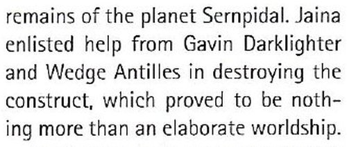

# Gavin Darklighter

- **Aliases:** —
- **Era:** New Republic
- **Continuity:** default Legends; entries present for: Legends
- **Research tier:** untiered (not listed as INTRO/DEEP/MASTERY in legends-feats.md)
- **Entries:** 27 (22 with quotations; 1 quotations extended to the full sentence/passage from the source text on file; 3 marked as fragments; 22 before the 2026-11-17 fragment fill). Rebuilt 2026-11-17 from 28 old entries; old file: `characters/_bak/gavin-darklighter.md.bak-20261117`.
- **How to read:** each entry is the quotation in full (block quote), then its source and point of view. "Note" lines are summaries from our notes, not quotations. `[fragment — full passage not on file]` means the source text is not on the box, so only the words in our notes are shown. Debate and forum material is in the last section and is unverified.

# LEGENDS (Legends / EU — main focus)

## Legacy of the Force 1–9: novel notes from the other agent (reference copy)

What it shows (our notes): Caedus Force-pressures Gavin Darklighter across ships: Darklighter «seemed more irritated than intimidated» (L1975–1977). The Commenorian retreat was something he «had not sensed it corning» — «a humbling reminder that battle meditation was not infallible» (L1981) — STATEMENT (narration via Caedus; limits).
> Darklighter seemed more irritated than intimidated, and the comm speaker remained silent.
>
> Caedus was about to press harder when the Commenorian turbolasers suddenly fell dark. The tiny specks of their capital ships began to drift across Balmorra’s pearly face, tails of blue efflux flickering at their sterns. Rather than gamble with Darklighter—and hope their starfighter complement would be as efficient as the well-trained wings of the Alliance—the Commenorians were retreating.
>
> had not sensed it corning
> [fragment — full passage not on file]
>
> a humbling reminder that battle meditation was not infallible *(L1981)*
> [fragment — full passage not on file]
— Source: L1975–1977; L1981 — Legacy of the Force 6: Inferno (novel, read in full): feats, scaling and story notes; Caedus Force-pressures Gavin Darklighter across ships: Darklighter.
(Excerpt widened 2026-11-17 to the relevant passage, word for word from Inferno (Troy Denning) (text copy `MEGA_Legend_The_Legacy_of_the_Force_Series_Star_Wars_Legacy_of_the_Force_06_Inferno_Troy_Denning_epub`).)
(Excerpt widened 2026-11-17 to the relevant passage, word for word from Inferno (Troy Denning) (text copy `MEGA_Legend_The_Legacy_of_the_Force_Series_Star_Wars_Legacy_of_the_Force_06_Inferno_Troy_Denning_epub`).)
(Full sentence/passage taken from the source text on file: `novels_tmp_inferno_FULL_txt`.)
(Fragment completed 2026-11-17: full sentence/passage matched word for word in the source text on file: `MEGA_Legend_The_Legacy_of_the_Force_Series_Star_Wars_Legacy_of_the_Force_06_Inferno_Troy_Denning_epub`.)
Note text that was attached to the quote line: *(L1975–1977)*
Our notes: `notes/materials/021-legacy-of-the-force/lotf-6-inferno-notes.md:295`

## The New Essential Guide to Characters (2002)

> Jaina enlisted help from Gavin Darklighter and Wedge Antilles in destroying the construct, which proved to be nothing more than an elaborate worldship.
— Source: scan pages 151–180; Jaina Solo. POV: Jaina Solo, about Gavin Darklighter.
Note (our notes, around the quote): Jaina Solo: "Jaina enlisted help from Gavin Darklighter and Wedge Antilles in destroying the construct, which proved to be nothing more than an elaborate worldship." Source: The New Essential Guide to Characters, p.173

Our notes: `notes/materials/034-new-essential-guide-to-characters/05-negc-scan-151-180.md:125`

## Sourcebooks/The New Jedi Order Sourcebook.pdf [Star Wars Roleplaying Game (d20, 2000)] (scan pages 1–60)

- Note (summary from our notes, not a quotation): Page contents: 648 words, 30 paragraphs | headings/entries: Knight 51; Colonel Gavin Darklighter, Rogue; Squadron Commander 52
  — Source: Sourcebooks/The New Jedi Order Sourcebook.pdf [Star Wars Roleplaying Game.
Our notes: `notes/materials/037-sw-d20-folder/049-the-new-jedi-order-sourcebook-scan-001-060.md:25`

## Jedi Counselling/Jedi Counseling 30 - Cross Breeding.pdf [Star Wars Roleplaying Game Revised Core (d20, 2002)]

- Note (summary from our notes, not a quotation): Gavin Darklighter; Rystall; Jabba the Hutt — entry/section: Can species cross-breed?: "A: Technically, it's not possible for species to cross breed. That's actually part of the definition of "species": that they are not capable of breeding with other species. In fact, that's part of a subplot (a love affair between Gavin Darklighter and a Bothan pilot) in the X-Wing novels by Michael Stackpole and Aaron Allston.
  — Source: Jedi Counselling/Jedi Counseling 30 - Cross Breeding.pdf [Star Wars Rolep.
Our notes: `notes/materials/037-sw-d20-folder/195-jedi-counseling-30-cross-breeding.md:12`

## Sourcebooks/Coruscant and the Core Worlds.pdf [Star Wars Roleplaying Game Revised Core (d20, 2002)] (scan pages 61–120)

- Note (summary from our notes, not a quotation): Page contents: Chandrilans (Admiral Drayson, Sera Faleur, Gavin Darklighter); Locations: Hanna, Brionelle Academy and Imperial Garrison, Hanna Wild Game Reserve; Datadagger (hand-read)
  — Source: Sourcebooks/Coruscant and the Core Worlds.pdf [Star Wars Roleplaying Game.
Our notes: `notes/materials/037-sw-d20-folder/665-coruscant-and-the-core-worlds-scan-061-120.md:51`

## Star Wars Insider #59 (2002)

- Note (summary from our notes, not a quotation): Page contents: Who's Who cont. (magazine p. 57), "Rogue Squadron: The Later Years" with line portraits: Pash Cracken, Gavin Darklighter, Corran Horn, Bror Jace (Thyferran, staged his own death), Erisi Dlarit (Thyferran Imperial mole, shot down by Corran at Thyferra), Aril Nunb, Ooryl Qrygg (Gand, "name reduction," declared janwuine), Inyri Forge (sister of Lujayne Forge, shot Zekka Thyne), Asyr Sei'lar (Bothan, resisted Borsk Fey'lya). (hand-read)
  — Source: Star Wars Insider #59 (2002).
Our notes: `notes/materials/038-star-wars-insider/059-ins059.md:413`

## The Dark Nest Trilogy (Troy Denning, Del Rey 2005): FULL consecutive re-read (2026-11-16 CST)

> “I guess you’ll have to open fire, Gavin. This is too important.”
>
> A long silence followed in which even the comm crackles seemed to be growing sharper. Leia angled back toward the center of the Choke, placing the last pair of XJ3s between her and the Mon Mothma, and the Star Destroyer’s tractor beams flickered off. She felt a flash of approval from Mara and the StealthX pilots, then Darklighter’s voice came over the comm again.
>
> Saba nodded her approval. “Go-od! You have done this before.”
>
> “Only forty or fi-if-ty times.” Silently, Leia added, Just never without Han.
— Source: The Unseen Queen: notes part 2, ch. 10–.
(Excerpt widened 2026-11-17 to the relevant passage, word for word from The Unseen Queen (Troy Denning) (text copy `MEGA_Legend_The_Dark_Nest_Trilogy_Star_Wars_Dark_Nest_02_The_Unseen_Queen_Troy_Denning_epub`).)
(A fragment line was removed 2026-11-17: its words appear word for word inside the full excerpt in this entry.)
(Excerpt widened 2026-11-17 to the relevant passage, word for word from The Unseen Queen (Troy Denning) (text copy `MEGA_Legend_The_Dark_Nest_Trilogy_Star_Wars_Dark_Nest_02_The_Unseen_Queen_Troy_Denning_epub`).)
Note (our notes, around the quote): The *Mon Mothma* (Gavin Darklighter) interdicts with hidden gravity-well generators. Mara and three StealthX pilots shadow the XJ3s. The *Falcon*'s reversed tractor ("repulsor beam") now has a "supplemental fusion unit". Leia: "I guess you’ll have to open fire, Gavin. This is too important." The *Mothma* fires turbolasers; Leia uses the blue giant's EM glare to escape the firing line ("Only forty or fi-if-ty times." / "Just never without Han").
Our notes: `notes/materials/051-dark-nest-trilogy/uq-02.md:5`

## NJO 2, *Dark Tide I: Onslaught* (Michael A. Stackpole, Del Rey 2000): FULL consecutive re-read (2026-11-16 CST)

> The primary console beeped, and a small box appeared around a distant object on the X-wing’s heads-up display. Gavin selected the object as a target and glanced down at its profile and image on the secondary monitor. At a quick glance it could have been mistaken for an asteroid and dismissed easily, but to Gavin it looked far too symmetrical. It reminded him a great deal of a seed—a bit bulbous in the middle, but tapered at both ends. The rear had a couple of recesses in it that could have hidden propulsion exhaust units, and a couple more up front that could house weapons.
>
> Gavin shivered, then nudged the X-wing’s throttle forward. “Catch, start recording this run. I want to be able to study the playback.” Applying a little etheric rudder, Gavin pointed the X-wing’s nose on a course that would cut behind the seed. Reaching up to his right, he flipped a switch that locked the S-foils in attack position. With a flick of his thumb, he shifted his weapons control to lasers and quadded them up so all four would fire with a single squeeze of the stick’s trigger.
>
> The seed shifted itself around so its nose swung into line with his approach vector. Sensors gave him no read on energy weapons powering up, which disturbed him less than getting no power readings for propulsion. How is that thing moving?
>
> Before any answers suggested themselves, Gavin quickly kicked the X-wing into a barrel roll to starboard and leveled out with his crosshairs covering the seed. He triggered a quick blast and waited for the seed to explode, but that didn’t happen. As the quad burst neared the target, the bolts all whirled into an invisible vortex and vanished into a pinpoint of white light.
>
> Emperor’s black bones…
>
> The seed jetted forward, swinging around to bring its nose to bear on the X-wing. Gavin started to roll port and dive, but something shook his ship. In a heartbeat Catch started screeching and the X-wing’s forward shields collapsed. Something dully red blossomed on the seed’s nose, then shot toward the X-wing. It hit hard and splattered a bit, then what appeared to be molten rock started melting through the fighter’s metal flesh.
>
> Warning sirens blared, drowning out Catch’s panicky tones. Bright red damage flags began to scroll up over the primary monitor, all but one of them moving too fast for Gavin to read. The one he could see reported a premature ignition of a proton torpedo’s engine, which lit up the whole port magazine and tore the X-wing apart.
>
> Stunned, Gavin sat back in his seat as the screens went black and the cockpit’s hatch cracked open. He glanced at his chronometer and shook his head. “Catch, we lasted twenty-five seconds. What was that thing?”
> [fragment — full passage not on file]
— Source: The New Jedi Order: Dark Tide I: Onslaught (Michael A. Stackpole, Del Rey 2000), DTO ch. 2 — 115 Dark Tide I notes (re-read 2026-11-16).
(Fragment completed 2026-11-17 with the full excerpt, word for word from Onslaught: Dark Tide I (Michael A. Stackpole) (text copy `MEGA_Legend_The_New_Jedi_Order_Series_Star_Wars_New_Jedi_Order_02_Dark_Tide_01_Onslaught_Michael_A_Stackpole_epub`).)
(Fragment completed 2026-11-17 with the full excerpt, word for word from Onslaught: Dark Tide I (Michael A. Stackpole) (text copy `MEGA_Legend_The_New_Jedi_Order_Series_Star_Wars_New_Jedi_Order_02_Dark_Tide_01_Onslaught_Michael_A_Stackpole_epub`).)
(Fragment completed 2026-11-17 with the full excerpt, word for word from Onslaught: Dark Tide I (Michael A. Stackpole) (text copy `MEGA_Legend_The_New_Jedi_Order_Series_Star_Wars_New_Jedi_Order_02_Dark_Tide_01_Onslaught_Michael_A_Stackpole_epub`).)
(Fragment completed 2026-11-17: full sentence/passage matched word for word in the source text on file: `MEGA_Legend_The_New_Jedi_Order_Series_Star_Wars_New_Jedi_Order_02_Dark_Tide_01_Onslaught_Michael_A_Stackpole_epub`.)
Note text that was attached to the quote line: (DTO ch. 2) — **FEAT (simulated, from Leia's data): the coralskipper's void swallows a quad laser burst ("whirled into an invisible vortex and vanished"); forward shields collapse; plasma melts the hull; Gavin "lasted twenty-five seconds"**
Context: FEAT (simulated, from Leia's data): the coralskipper's void swallows a quad laser burst ("whirled into an invisible vortex and vanished"); forward shields collapse; plasma melts the hull; Gavin "lasted twenty-five seconds"
Our notes: `notes/materials/115-njo-02-dark-tide-onslaught/dto-01.md:26`

What it shows (our notes): Rogues vs pirate uglies with no shields; Gavin's secondary trigger fires "a hail of down-powered laser darts" (the anti-skip modification)
> Gavin forced himself to take a deep breath, then to exhale slowly. While he trusted Inyri’s judgment about the ships they’d be flushing from the asteroids, he couldn’t shake the sense of dread that came with the memory of his first sim encounter with the coralskippers. Even though we’ve run sims against skips, coming up against them for real will be very dangerous.
>
> From behind the big asteroid burned opposition. Catch painted contact after contact on Gavin’s secondary monitor. All of the ships were, in fact, uglies, cobbled together from parts of older fighters. They included TIE-wings, which were TIE fighter cockpits married to Y-wing engine nacelles; X-ceptors, which were X-wing bodies with TIE interceptor wings; and triple-finned tri-fighters, nicknamed clutches because the ball cockpit was held in the grip of the three fins’ forward edges. All the ships were as common in pirate fleets as hydrogen was in the galaxy, and all of them could be very deadly.
>
> Gavin dropped his targeting reticle on the lead clutch and flicked his weapons over to lasers. He linked them for dual fire, then glanced at his targeting monitor. The range to target scrolled down quickly, but that concerned him less than another detail the sensor scan provided him.
>
> The clutch had no shields. There was no reason any pilot going into combat wouldn’t bring his shields up to full power. The tri-fighter was known to possess shields—which was one of the reasons it had become a successful pirate-ship design. Without shields the pirates would never stand a chance against the Rogues.
>
> “Catch, get me their tactical frequency.” Gavin nudged his stick to the right and triggered a burst that burned red past the clutch’s nose. “Five, you show any shields on these guys?”
>
> “Negative, Lead. Hulls are weak, too.”
>
> What’s happening here? Gavin lined up another shot at the clutch and waited for it to fire first. The clutch kept coming, closing well within optimal range, then finally shot a green laser bolt at Gavin’s X-wing. The energy sent a static hiss through the comm unit’s speakers as it dissipated against the shields. It had done less damage to them than it should have, and only one of the two lasers on the clutch had fired.
>
> And the only reason a pilot has to get that close is if he’s shooting with visual data—his sensors must be out.
>
> The clutch flashed past, and Gavin rolled to starboard, then hauled back on the stick and started chasing the clutch. He inverted, then dived and goosed his throttle to follow the tri-fighter through its evasive maneuvers. He switched his lasers over to quad fire, then settled his middle finger on the stick’s secondary trigger button. This modification was meant to use against the skips, but could be of use here, I think.
>
> He lined up his shot, then pulled the secondary trigger. The lasers cycled quickly, producing a hail of down-powered laser darts that stippled little burn marks all over the clutch’s fins. The fire gnawed away at the pirate ship, burning off black-and-white droid-fist insignia emblazoned there.
>
> The clutch rolled to port, then climbed sharply. Gavin chopped his throttle back, inverted, and started to climb after the clutch. He let the pirate fighter climb into his sights, then sprayed more laserfire over the ship. These bolts struck on the forward canopy and clearly surprised the pilot. The clutch jerked to starboard, then one of the ion engines belched a long jet of flaming exhaust. The other engine flared for a moment, then both shut down.
— Source: The New Jedi Order: Dark Tide I: Onslaught (Michael A. Stackpole, Del Rey 2000), DTO ch. 8 — 115 Dark Tide I notes (re-read 2026-11-16).
(Excerpt widened 2026-11-17 to the relevant passage, word for word from Onslaught: Dark Tide I (Michael A. Stackpole) (text copy `MEGA_Legend_The_New_Jedi_Order_Series_Star_Wars_New_Jedi_Order_02_Dark_Tide_01_Onslaught_Michael_A_Stackpole_epub`).)
(Excerpt widened 2026-11-17 to the relevant passage, word for word from Onslaught: Dark Tide I (Michael A. Stackpole) (text copy `MEGA_Legend_The_New_Jedi_Order_Series_Star_Wars_New_Jedi_Order_02_Dark_Tide_01_Onslaught_Michael_A_Stackpole_epub`).)
(Fragment completed 2026-11-17: full sentence/passage matched word for word in the source text on file: `MEGA_Legend_The_New_Jedi_Order_Series_Star_Wars_New_Jedi_Order_02_Dark_Tide_01_Onslaught_Michael_A_Stackpole_epub`.)
Note text that was attached to the quote line: (DTO ch. 8) — **Rogues vs pirate uglies with no shields; Gavin's secondary trigger fires "a hail of down-powered laser darts" (the anti-skip modification)**
Our notes: `notes/materials/115-njo-02-dark-tide-onslaught/dto-01.md:76`

What it shows (our notes): FEAT: the ace's void nearly sucks in Gavin's X-wing; he empties six proton torpedoes into the black hole ("somehow the black hole managed to contain the vast energy") and escapes; Nevil and Seven kill it
> Realizing that if he couldn’t tell what the enemy was planning, going along with the enemy’s plan was stupid, Gavin triggered a burst of flickers at the incoming target. The cloud of red energy needles flew out and, as he expected, curved in together into the black hole the coralskipper had erected to protect itself. What he hadn’t expected is that the void would intercept them that far forward.
>
> Gavin kicked his fighter into a snap roll to starboard, then jammed the throttle full. Sparks shot from the inertial compensator panel as the X-wing grazed the edge of the black hole. Catch screamed, and Gavin hugged the stick back to his chest. The X-wing shuddered and engines whined, but his speed started dropping. I’m getting sucked into that thing!
>
> Gavin reversed thrust on his fighter, then ruddered the nose around to point at the black hole. The screaming engines fought the black hole’s pull, but surrendered precious centimeter after centimeter to it. He flicked the weapons control over to proton torpedoes and emptied his magazine of six into the black hole. One after one the torps dived into the gravitic anomaly, and somehow the black hole managed to contain the vast energy their explosions released.
>
> But, Gavin noticed, his rate of descent into the black hole slowed.
>
> He flicked his thrust forward. The fighter picked up speed, attracted by the black hole and pushed by the engines. Then he pulled back on the stick and used the velocity he’d acquired to shoot past the black hole’s edge.
>
> More sparks shot through the cockpit, and his shields collapsed. His sensor screens blinked for a moment, then came back on full, but he couldn’t see the coralskipper. “Catch, where is it?”
>
> Nevil’s voice came through the comm speakers in his helmet. “Thanks for distracting it, Lead. Seven and I angled in and got it. Not a pretty kill, but a kill.”
— Source: The New Jedi Order: Dark Tide I: Onslaught (Michael A. Stackpole, Del Rey 2000), DTO ch. 15 — 115 Dark Tide I notes (re-read 2026-11-16).
(Excerpt widened 2026-11-17 to the relevant passage, word for word from Onslaught: Dark Tide I (Michael A. Stackpole) (text copy `MEGA_Legend_The_New_Jedi_Order_Series_Star_Wars_New_Jedi_Order_02_Dark_Tide_01_Onslaught_Michael_A_Stackpole_epub`).)
(Excerpt widened 2026-11-17 to the relevant passage, word for word from Onslaught: Dark Tide I (Michael A. Stackpole) (text copy `MEGA_Legend_The_New_Jedi_Order_Series_Star_Wars_New_Jedi_Order_02_Dark_Tide_01_Onslaught_Michael_A_Stackpole_epub`).)
(Fragment completed 2026-11-17: full sentence/passage matched word for word in the source text on file: `MEGA_Legend_The_New_Jedi_Order_Series_Star_Wars_New_Jedi_Order_02_Dark_Tide_01_Onslaught_Michael_A_Stackpole_epub`.)
Note text that was attached to the quote line: (DTO ch. 15) — **FEAT: the ace's void nearly sucks in Gavin's X-wing; he empties six proton torpedoes into the black hole ("somehow the black hole managed to contain the vast energy") and escapes; Nevil and Seven kill it**
Our notes: `notes/materials/115-njo-02-dark-tide-onslaught/dto-02.md:60`

What it shows (our notes): Leia makes Gavin take Jaina into Rogue Squadron: "she can fly an X-wing like no one else, and she's a Jedi"; "my daughter is the same age you were when you joined Rogue Squadron"
> Gavin extended the datapad toward him. “I’ve found the pilots I need to fill out Rogue Squadron. I took the liberty of looking over the records of the fliers who’ve made asteroid runs here. I’m taking the best of them—of those who are still available.”
>
> Leia held her hand out. “May I see the list?”
>
> The admiral nodded, so Gavin handed her the datapad. Leia studied it for a moment, then glanced up. “My daughter isn’t on the list.”
>
> “No, Princess, she isn’t.”
>
> “Why not? She was the best pilot to run the asteroids.” Leia knew that Jaina was restless, annoyed with her recent assignments, and eager to contribute. Jaina would be outraged if she were not chosen as a Rogue Squadron pilot because she was Leia’s daughter. And they were all in danger now, whatever their assignments.
>
> “I know that, but she’s too young.”
>
> The princess’s chin came up and her eyes narrowed. “Correct me if I am wrong,” she said in a tone that made it obvious that she knew she wasn’t, “but my daughter is the same age you were when you joined Rogue Squadron, Colonel Darklighter.”
>
> A wave of heat passed over Gavin as his face flushed red. “That’s true, yes, but those were desperate times—”
>
> “And these aren’t?”
>
> “They are, but—”
>
> Leia let some of the edge drain from her voice. “Let me ask you, Gavin, if one of your sons was one of the best pilots, would you deny him a spot in the squadron?”
>
> “Don’t ask me that.” Gavin’s stomach began to twist itself into knots. “I’ve flown against the Vong. I know how nasty they can be. I’m not sure if I’ll survive getting out of here. I don’t want to have to subject anyone’s child to getting killed out there. And especially your child, Princess. You’ve already done more than your share of sacrificing for the New Republic.”
>
> Leia took a step toward him and laid a hand on his shoulder. She looked up into his eyes and gave him a brave smile. “Gavin, you and I both know that the people who are capable of dealing with trouble never really get a chance to pass, to rest, to live a normal life. People like us assume responsibilities so other people don’t have their lives ruined. We can wish it was otherwise, but it won’t happen.”
>
> She handed him the datapad. “I cannot tell you how grateful I am that you wanted to safeguard Jaina; but by letting her fly, we can safeguard someone else. She’s a wonderful pilot, she can fly an X-wing like no one else, and she’s a Jedi. The Force might be less effective against the Yuuzhan Vong, but if she picks up that one of your other people is in trouble, she can be there to help.”
>
> Gavin swallowed past the lump choking him. “Two of the top pilots in the squadron’s past were from Corellia and Alderaan, so having someone whose blood comes from both will probably be good. Do you want to tell her, or shall I?”
>
> “You should tell her, Colonel.” Leia smiled proudly. “I think being told of this assignment by her mother would tarnish it somewhat.”
>
> “You have my word, Princess, that she will be well taken care of.”
>
> “I know, Gavin. May the Force be with you.”
>
> “Rogue Eleven, check in, please.”
>
> Jaina blinked and kind of jumped in her cockpit seat when she realized the comm call was for her. I’m in Rogue Squadron! The realization had a surreal aspect to it because, as she grew up, the part of her uncle’s life that had gone before his becoming a Jedi Knight had receded into the dim past. While Luke was acknowledged as the founder of Rogue Squadron, Wedge Antilles and the other pilots in it had really defined the squadron and made it a legend.
>
— Source: The New Jedi Order: Dark Tide I: Onslaught (Michael A. Stackpole, Del Rey 2000), DTO ch. 20 — 115 Dark Tide I notes (re-read 2026-11-16).
(A fragment line was removed 2026-11-17: its words appear word for word inside the full excerpt in this entry.)
(Excerpt widened 2026-11-17 to the relevant passage, word for word from Onslaught: Dark Tide I (Michael A. Stackpole) (text copy `MEGA_Legend_The_New_Jedi_Order_Series_Star_Wars_New_Jedi_Order_02_Dark_Tide_01_Onslaught_Michael_A_Stackpole_epub`).)
(Fragment completed 2026-11-17 with the full excerpt, word for word from Onslaught: Dark Tide I (Michael A. Stackpole) (text copy `MEGA_Legend_The_New_Jedi_Order_Series_Star_Wars_New_Jedi_Order_02_Dark_Tide_01_Onslaught_Michael_A_Stackpole_epub`).)
(Fragment completed 2026-11-17 with the full excerpt, word for word from Onslaught: Dark Tide I (Michael A. Stackpole) (text copy `MEGA_Legend_The_New_Jedi_Order_Series_Star_Wars_New_Jedi_Order_02_Dark_Tide_01_Onslaught_Michael_A_Stackpole_epub`).)
(Fragment completed 2026-11-17 with the full excerpt, word for word from novels tmp dark tide onslaught FULL, Chapter Twenty (text copy `novels_tmp_dark_tide_onslaught_FULL_txt_feaa5c2a1b`).)
(Excerpt widened 2026-11-17 to the relevant passage, word for word from Onslaught: Dark Tide I (Michael A. Stackpole) (text copy `MEGA_Legend_The_New_Jedi_Order_Series_Star_Wars_New_Jedi_Order_02_Dark_Tide_01_Onslaught_Michael_A_Stackpole_epub`).)
(Fragment completed 2026-11-17: full sentence/passage matched word for word in the source text on file: `MEGA_Legend_The_New_Jedi_Order_Series_Star_Wars_New_Jedi_Order_02_Dark_Tide_01_Onslaught_Michael_A_Stackpole_epub`.)
(Fragment completed 2026-11-17: full sentence/passage matched word for word in the source text on file: `novels_tmp_dark_tide_onslaught_FULL_txt_feaa5c2a1b`.)
Note text that was attached to the quote line: (DTO ch. 20) — **Leia makes Gavin take Jaina into Rogue Squadron: "she can fly an X-wing like no one else, and she's a Jedi"; "my daughter is the same age you were when you joined Rogue Squadron"**
Our notes: `notes/materials/115-njo-02-dark-tide-onslaught/dto-03.md:12`

> Gavin chewed his lower lip for a moment. “Look, all of you, this is not going to be an easy fight. Normally we pilots get to cloak ourselves in tradition and the romance of single combat amid the stars. The kind of snubfighters we pilot killed the Death Stars and have downed lots of Imps and pirates. We often take pride and even solace in the fact that those we face in combat are our equals in skill. It’s a fair fight.
>
> “This won’t even be close to a fair fight. Once we scrape fighter cover off the ground troops, we’ll be slaughtering them as fast as we can. Scatter shots from the lasers may only burn paint from a fighter, but they’ll broil a warrior in a second. It will not be pretty. What it is, though, is necessary.”
— Source: The New Jedi Order: Dark Tide I: Onslaught (Michael A. Stackpole, Del Rey 2000), DTO ch. 27 — 115 Dark Tide I notes (re-read 2026-11-16).
(Fragment completed 2026-11-17: full sentence/passage matched word for word in the source text on file: `MEGA_Legend_The_New_Jedi_Order_Series_Star_Wars_New_Jedi_Order_02_Dark_Tide_01_Onslaught_Michael_A_Stackpole_epub`.)
Note text that was attached to the quote line: (DTO ch. 27) — **Gavin: "This won't even be close to a fair fight … Scatter shots from the lasers may only burn paint from a fighter, but they'll broil a warrior in a second"**
Context: Gavin: "This won't even be close to a fair fight … Scatter shots from the lasers may only burn paint from a fighter, but they'll broil a warrior in a second"
Our notes: `notes/materials/115-njo-02-dark-tide-onslaught/dto-03.md:70`

> He quadded up his lasers and dropped the aiming reticle on one of the skips harassing a returning Tough. Gavin hit the secondary trigger, spewing out a hail of red energy darts. “Tough, break port.”
>
> The ugly cut to Gavin’s starboard, and the skip swerved to keep on the TIE-wing’s tail. Gavin ruddered around to starboard and kept the skip in his sights. At the same time Nevil sprayed the skip with scatter shots, Gavin hit the primary trigger and sent one full-power burst of laser fire into the skip. The black hole being used to pick off the Quarren’s shots did warp the flight path of the bolts Gavin had triggered, but managed only to draw them in toward the dovin basal creating the black hole.
>
> The bolts hit and burned through the coralskipper’s stony flesh. Something evaporated in a burst of steam, then the skip’s aft began to drop. Seconds later the last of the laser bolts burst from the other side of the craft. For a half second the skip hung in the air, its nose pointing skyward, then Nevil’s second flicker-shot barrage stippled the skip with glowing red points. One must have hit a dovin basal, killing it, because the skip then plummeted from the sky and crashed unseen into the ground below.
>
> Ahead of Gavin the sky lit up like the Coruscant cityscape during a celebration of Liberation Day. Plasma bolts arced into the sky. Laser bolts, both red and green, as well as blue ion bolts, slanted down toward the ground. Flashes of color illuminated the two huge shadowy shapes moving through the night, but Gavin could not make out much in the way of detail. He almost asked Catch to switch him over to ground-attack mode on his sensors so he could get an idea of what the Yuuzhan Vong were bringing to assault the base, but incoming fighters demanded his attention.
>
> And they’ll get it. He spitted one on his aiming reticle and tightened up on the trigger. My undivided attention.
— Source: The New Jedi Order: Dark Tide I: Onslaught (Michael A. Stackpole, Del Rey 2000), DTO ch. 28 — 115 Dark Tide I notes (re-read 2026-11-16).
(Fragment completed 2026-11-17: full sentence/passage matched word for word in the source text on file: `MEGA_Legend_The_New_Jedi_Order_Series_Star_Wars_New_Jedi_Order_02_Dark_Tide_01_Onslaught_Michael_A_Stackpole_epub`.)
Note text that was attached to the quote line: (DTO ch. 28) — **Gavin's full-power burst, warped by the void, burns through a skip; flickers kill a dovin basal**
Context: Gavin's full-power burst, warped by the void, burns through a skip; flickers kill a dovin basal
Our notes: `notes/materials/115-njo-02-dark-tide-onslaught/dto-04.md:5`

What it shows (our notes): Gavin confronts Fey'lya (Asyr Sei'lar); the Corusca Fire diverted; Kre'fey exposes Fey'lya's cover-up (Bimmiel, Garqi, the futures markets)
> Gavin glanced at Admiral Kre’fey and caught the all-but-imperceptible nod that was his signal. Raising his head slowly, twisting his ring unconsciously, Gavin stared straight into Fey’lya’s eyes. Almost two decades ago you drove my Bothan lover, Asyr Sei’lar, to distraction, and that distraction got her killed. It’s an old debt you owe me, and that debt gets paid back now, in full.
>
> “If you value our effort, Chief Fey’lya, then I have to wonder why you are working so hard to deceive me, to deceive the rest of the New Republic’s military.”
>
> Fey’lya blinked, and the fur on the back of his neck rose. “You will be forgiven that insubordinate outburst, Colonel. You are clearly overwrought.”
>
> Gavin stood slowly, letting his body uncurl into its full height. His contracted his hands into fists and let the muscles of his arms strain the seams of his jacket. He wanted them to see he was physically powerful, not just someone who sat in a seat and pulled a trigger. I want them to know I am something they could never be.
>
> He kept his voice even, despite the anger and disgust boiling inside of him. “Chief Fey’lya, in here we know the truth. The only reason the Corusca Fire was at Agamar is because Captain Rimsen is from Agamar and he diverted from his assigned patrol. He was suspicious of the fact the patrol route had been changed to prevent him from heading to Dubrillion and past Belkadan. In speaking to his family on Agamar, he learned of Leia’s visit there. He returned home to assess the situation and was able to travel with Admiral Kre’fey to save us. If he had not been there, none of us would be here.”
>
> “You have misinterpreted—”
>
> Gavin cut him off with the sharp chop of a hand through the air. “I’m not finished.”
>
> “Your career most assuredly can be, Colonel.” Fey’lya’s ears flattened back against his skull. “Are you resigning, effective immediately?”
>
> Admiral Kre’fey snapped off a quick comment in Bothan that brought Fey’lya’s head around as if he’d been punched. The chief of state clawed curls of wood from the table. He snarled a comment in return.
>
> Admiral Kre’fey came smoothly to his feet. “Oh, I dare, cousin, speak to you in that manner because you have grossly overstepped your bounds in this. Did you expect we would not know of Bimmiel? Did you expect we did not know of the sightings of Yuuzhan Vong on Garqi? How many other worlds that the Yuuzhan Vong have attacked did you expect us to remain ignorant of?”
>
> The Sullustan looked aghast. “How could you know—?”
>
> The admiral slowly shook his head. “There are a million ways to know. Commodities found on these worlds are being bid up in the futures markets. Communications companies that service these worlds are reporting outages and reduced earnings from these sectors. Recruiting numbers for our military from these worlds are down sharply. While you might have been able to shut off the flow of real news to various outlets, doubtless to prevent a panic, you have forgotten that information that doesn’t get through is just as valuable as that which does.”
>
> The members of the advisory council looked shocked. They murmured among themselves, then turned to Borsk Fey’lya. To his credit, the Bothan snorted as if what he had been told was inconsequential. “Even if these worlds are involved with the Yuuzhan Vong invasion—and you have no proof they are—the prosecution of the war against the Yuuzhan Vong is a matter for us to determine.”
>
> Gavin shook his head. “Not when it is our lives on the line.”
>
> “Again, Colonel Darklighter, are you quoting from a resignation letter?” Fey’lya sneered at him. “You Rogues quit the New Republic once before and we survived.”
— Source: The New Jedi Order: Dark Tide I: Onslaught (Michael A. Stackpole, Del Rey 2000), DTO ch. 34 — 115 Dark Tide I notes (re-read 2026-11-16).
(Excerpt widened 2026-11-17 to the relevant passage, word for word from Onslaught: Dark Tide I (Michael A. Stackpole) (text copy `MEGA_Legend_The_New_Jedi_Order_Series_Star_Wars_New_Jedi_Order_02_Dark_Tide_01_Onslaught_Michael_A_Stackpole_epub`).)
(Excerpt widened 2026-11-17 to the relevant passage, word for word from Onslaught: Dark Tide I (Michael A. Stackpole) (text copy `MEGA_Legend_The_New_Jedi_Order_Series_Star_Wars_New_Jedi_Order_02_Dark_Tide_01_Onslaught_Michael_A_Stackpole_epub`).)
(Fragment completed 2026-11-17: full sentence/passage matched word for word in the source text on file: `novels_tmp_dark_tide_onslaught_FULL_txt_feaa5c2a1b`.)
(Fragment completed 2026-11-17: full sentence/passage matched word for word in the source text on file: `MEGA_Legend_The_New_Jedi_Order_Series_Star_Wars_New_Jedi_Order_02_Dark_Tide_01_Onslaught_Michael_A_Stackpole_epub`.)
Note text that was attached to the quote line: (DTO ch. 34) — **Gavin confronts Fey'lya (Asyr Sei'lar); the Corusca Fire diverted; Kre'fey exposes Fey'lya's cover-up (Bimmiel, Garqi, the futures markets)**
Our notes: `notes/materials/115-njo-02-dark-tide-onslaught/dto-04.md:59`

> The quartet of bolts converged on the coralskipper, and only one of them got sucked into the diminishing black hole. The other three burned into the cockpit assembly. They reduced the crystalline canopy to molten stone that melted through the pilot. Their energy unabated, the bolts superheated the coralskipper’s mineral flesh, producing a geyser of rock vapor that jetted back out of the cockpit and propelled the dead fighter deeper into space.
— Source: The New Jedi Order: Dark Tide I: Onslaught (Michael A. Stackpole, Del Rey 2000), DTO ch. 15 — 115 Dark Tide I notes (re-read 2026-11-16).
(Fragment completed 2026-11-17: full sentence/passage matched word for word in the source text on file: `MEGA_Legend_The_New_Jedi_Order_Series_Star_Wars_New_Jedi_Order_02_Dark_Tide_01_Onslaught_Michael_A_Stackpole_epub`.)
Note text that was attached to the quote line: (DTO ch. 15) — **Gavin's first skip kill**
Context: Gavin's first skip kill
Our notes: `notes/materials/115-njo-02-dark-tide-onslaught/summary.md:48`

## NJO 3, *Dark Tide II: Ruin* (Michael A. Stackpole, Del Rey 2000): FULL consecutive re-read (2026-11-16 CST)

> “Come in, Jaina, please, be seated.” Gavin Darklighter nodded her toward the bunk against the wall. He sat at a small table bolted to the cabin’s opposite wall. On it he had a datapad, several data cards, and a small holocube displaying alternating images of his family. With just that holocube he’d managed to drain the small cabin of its sterility, despite the white walls and gray decking.
>
> As she sat, he turned in his chair to face her. Though he was still a young man, gray had crept into his hair at the temples, and little lines traced back from the corners of his eyes. He’d assumed command of Rogue Squadron right after the peace with the Remnant, but the dozen and a half years he’d put in with it before then had been what marked him. To Jaina he was one of a handful of legends who had survived and even thrived within Rogue Squadron.
>
> “Jaina, I should have spoken to you about this before now. What happened at Garqi was unfortunate. It was also necessary. Operational security demanded we let no one in-system at the time know that the Lost Hope was meant to go down in flames.”
>
> Jaina nodded. “I’ve been told that only Admiral Kre’fey and the techs who had prepared the ship—as well as the task force—knew what was going to happen. I know you didn’t know, so you couldn’t warn me.”
>
> “Yes, I have been informed of how kind you’ve been in supposing what I would have done had I known what was going to happen. The fact is, however, I would not have told you.” His looked straight at her, and she shivered. “The decision to keep that information secret came from above me, and I would have respected the security demands that would have kept me silent. And while I know you would have not let out any hint of what was happening, the judgment about whether or not to take that chance, again, was not one I would have made.”
>
> Jaina gripped the edge of the bunk to keep herself upright. She felt betrayed by his words, in great part because she had credited him with far more kindness than he was saying he possessed. She had trusted in him, and here he was saying he was not worthy of that trust. And while his voice rang with sincerity, he was plainly suggesting he would have remained silent no matter who or what was involved.
>
> Her anger over that latter point surprised her. Jaina would not have thought she was deserving of special treatment, but her anger clearly indicated that some part of her did. After all, she was a Jedi, as was her brother, and that should have counted for something. The affairs of Jedi were being meddled with, and that wasn’t right. Moreover, after all her family had done for the New Republic, shouldn’t it have at least taken steps to stop her from being hurt? Didn’t the New Republic owe her at least that much?
>
> She quickly caught her outrage and broke it down. The umbrage at having Jedi affairs compromised, she realized, bordered very closely on the arrogant attitude that Kyp and his followers embraced. Jedi have abilities others do not, but this does not make us any better than anyone else; and for the purposes of my time with Rogue Squadron, I am a pilot first, not a Jedi.
>
> That thought led her to explore the idea that the New Republic owed her anything. My parents might have a debt that needs to be paid off, but it’s not mine. The only way the New Republic will owe me anything is if I earn something from it. So far, in comparison to what my parents have done, I have done nothing.
>
> Colonel Darklighter leaned forward, his elbows on his knees, his hands clasped together. “I didn’t speak to you earlier by design, and while I might have saved you some pain, I thought a little now would be better than a lot later. When I came into the squadron I was your age, and I had a burden: Biggs Darklighter was my cousin, so the Darklighter reputation landed firmly on me. Like you, I was young enough to believe I could do anything. I was lucky enough that those in the squadron accepted me, helped me along, and enabled me to uphold my family’s honor.
>
> “You have a much greater burden, and one that has shifted slightly. You’ve been born to privilege, whereas I was a moisture farmer’s brat. My parents were no one; yours saved a galaxy, and continue to serve it. In that service they made enemies, and you’re smart enough to know that once your mother left power, her enemies set about weakening her image, and that of the Jedi.”
>
> Jaina nodded. “I’ve met people who figure me for a spoiled Jedi brat. I work hard to prove them wrong.”
>
> “That’s very apparent, and those of us in the squadron are very happy you’re with us. There are others on this ship, however, and in the service, who don’t have the view of you that I do.” He sighed. “Part of what happened here was to show them that we play no favorites. There isn’t a single person here who didn’t feel for the death of your brother, and none of them would have liked to have been in your boots when the Lost Hope exploded. All of them know how much you must have been hurting. And when they learned that your superiors had purposely not let you know—not let any of us in Rogue Squadron know—what was happening, they realized they’ve got more in common with us than they imagined. They realized that the problem of the Yuuzhan Vong is serious enough that the New Republic isn’t playing favorites: not for Rogue Squadron, not for the Jedi, not for any Solos.”
>
> The young pilot closed her eyes and rubbed one hand over her forehead. As he explained it, everything made sense. Jaina discovered she’d inherited from her parents the narrow belief that it was her role, her family’s role, to be saving the galaxy. The fact was that their actions were crucial, but it was the hundreds of thousands of sapient beings that made up the Rebellion that had been able to capitalize on and maintain the victories others won. Blowing up the Death Star certainly eliminated threats to the galaxy, but it hadn’t liberated a single Imperial planet. That had taken lots of others working hard.
>
> And they needed to be shown that hard work is going to be vital here. She opened her eyes and looked up at her commander. “Colonel, I—Boy, this is humbling, and I guess I didn’t realize I needed to be humbled.”
>
> Gavin laughed heartily, then nodded. “You didn’t need it as much as others might have thought you needed it. You’re not the first pilot in this unit to be taken down a notch or two, and remember, all of us were treated similarly. Rogue Squadron is the best unit in the New Republic, but now our comrades know we’re all on equal footing when it comes to how we are treated.”
>
> He held up a finger. “One more thing that I hope you’ll take away from this. In my time with Rogue Squadron I’ve seen a lot of people die. I’ve lost a lot of friends, people I was close with, and some I was very close to. What Admiral Kre’fey managed to do is remind all of us, through the persons of your brother and Corran, that none of us are immune to death out here. He reminded us that we may be called upon to make sacrifices we don’t want to make, and that’s good. If we go out there thinking we’re invulnerable, we’ll get stupid. Stupid people die, and all too often, they take friends with them.”
>
> “Yes, sir, thank you, sir.” Jaina had already seen, in the simulations she’d flown after Garqi, that she was flying sharper than before. She had more of an edge, and she knew she’d need it against the Yuuzhan Vong.
>
> “Very good, Lieutenant.” He straightened up in his chair. “Go find your squadron mates and tell them they have two hours before we report to the belly launch bay. Admiral Kre’fey thinks he has a way to neutralize some of the Yuuzhan Vong threat facing us, but we’ll still be out there patrolling in case there’s a miscalculation. I want everyone ready to go because, at the end of this little foray, I want to recover as many fighters as we put out there.”
— Source: The New Jedi Order: Dark Tide II: Ruin (Michael A. Stackpole, Del Rey 2000), RU ch. 13 — 116 Dark Tide II notes (re-read 2026-11-16).
(Fragment completed 2026-11-17: full sentence/passage matched word for word in the source text on file: `MEGA_Legend_The_New_Jedi_Order_Series_Star_Wars_New_Jedi_Order_03_Dark_Tide_02_Ruin_Michael_A_Stackpole_epub`.)
Note text that was attached to the quote line: (RU ch. 13) — **Gavin to Jaina: "the New Republic isn't playing favorites: not for Rogue Squadron, not for the Jedi, not for any Solos"; Jaina: "for the purposes of my time with Rogue Squadron, I am a pilot first, not a Jedi"; "Blowing up the Death Star certainly eliminated threats … but it hadn't liberated a single Imperial planet"**
Context: Gavin to Jaina: "the New Republic isn't playing favorites: not for Rogue Squadron, not for the Jedi, not for any Solos"; Jaina: "for the purposes of my time with Rogue Squadron, I am a pilot first, not a Jedi"; "Blowing up the Death Star certainly eliminated threats … but it hadn't liberated a single Imperial planet"
Our notes: `notes/materials/116-njo-03-dark-tide-ruin/ru-02.md:28`

What it shows (our notes): Gavin's "arctic" fury; the crate kill; his torpedoes' shock wave and turbulence bring down two crates in atmosphere
> Colonel Gavin Darklighter rolled to starboard, then spiraled down after the escaping crates. “Got my wing, Deuce?”
>
> Kral Nevil double-clicked his comm, replying in the positive. Gavin checked his scopes and found six more Rogues coming on hot. Only eight of us left? A shudder shook him. At once he was happy that so many of the Rogues were still operational, but the losses still sent icy tendrils through his guts. Anni, gone, and others whom I never got a chance to know.
>
> He snarled angrily, then felt his mind go very cold and clear, as his fury became arctic and infused his body and mind. He suddenly felt as if he was more than a pilot in a machine, that somehow he and his fighter had become one. As closely linked as a Vong pilot and his machine. He let his right hand ride lightly on the stick despite the bump of entering the atmosphere and cruised on in after one of the crates.
>
> Gavin sailed in at its aft and scattered splinter shots at it. The crate projected a void that swallowed the red darts, then its aft guns started spitting plasma sparks at him. The New Republic pilot took his fighter down enough that the crate’s own voids shielded him from the fire, then he laced the carrier’s belly with splinter shots. The void shifted down to pick off those shots, and the plasma fire resumed.
>
> Gavin smiled and tugged back on his stick. His nose came up just enough to pulse a quad burst at the crate’s aft. The lasers hit it hard, with one carving a black furrow up along the side. The other three burned holes in the back. Gavin followed them with more splinter shots, not figuring they’d do more damage to the carrier, but every one that got through the hole would wreak havoc on the cargo.
>
> That crate broke left and dived hard for the jungle below. Gavin ignored it and brought his X-wing around on the same heading as the rest of the crates. In the distance gleamed a white building complex nestled amid the jungle, and twenty kilometers north of it, the lone remaining herd ship, the Tafanda Bay, rode in the sky like a peaceful metal cloud. Four of the crates broke off for the herd ship, while the rest bore in at the ground target.
>
> Gavin flicked his weapons control over to proton torpedoes and targeted the space between two of the crates heading for the Tafanda Bay. He glanced at his monitor and read the range to target. “Catch, program the torps for detonation at two klicks or proximity void detection.”
>
> The droid beeped once, solidly, then Gavin hit the trigger. The paired missiles burned blue through the sky, and his sensors reported voids appearing behind the crates. The Yuuzhan Vong had clearly learned the proton torpedoes would go off when they detected a void, so these crates projected their voids far behind them. In space, the amount of energy from the blast would be insignificant at that range.
>
> But we’re not in space, are we, boys? The exploding proton torpedoes did two things. The first was to pulse out a shock wave that traveled faster than the speed of sound and pushed a lot of atmosphere in front of it. That dense chunk of air slammed into the two crates, boosting them forward and starting them to tumble. It raced past, dissipating as it went, but even the two leaders were bounced around a bit.
>
> The second thing the explosions did, by superheating air and blasting it out in all directions, was to create a void that a lot of air rushed in to fill. The resulting turbulence whirled the spinning crates around. Gavin had no idea how the Yuuzhan Vong pilots and the living components of their ships were able to track up, down, direction, speed, or altitude, but he knew that at the heart of a whirlwind he’d have had a hard time thinking about any of that.
>
> Apparently, so did the Yuuzhan Vong. Their ships fell from the sky, careening through the jungle. No explosions resulted from their impacts, though trees toppled, scarring the dark canopy.
>
> Gavin watched them fall, then focused on the rest of the crates. They were already quite far and quite low, and too close to the herd ship to risk another proton torpedo shot. He smiled to himself. Did what we could to slow them down. Now they’re not our problem.
— Source: The New Jedi Order: Dark Tide II: Ruin (Michael A. Stackpole, Del Rey 2000), RU ch. 31 — 116 Dark Tide II notes (re-read 2026-11-16).
(Excerpt widened 2026-11-17 to the relevant passage, word for word from Ruin: Dark Tide II (Michael A. Stackpole) (text copy `MEGA_Legend_The_New_Jedi_Order_Series_Star_Wars_New_Jedi_Order_03_Dark_Tide_02_Ruin_Michael_A_Stackpole_epub`).)
(Excerpt widened 2026-11-17 to the relevant passage, word for word from Ruin: Dark Tide II (Michael A. Stackpole) (text copy `MEGA_Legend_The_New_Jedi_Order_Series_Star_Wars_New_Jedi_Order_03_Dark_Tide_02_Ruin_Michael_A_Stackpole_epub`).)
(Fragment completed 2026-11-17: full sentence/passage matched word for word in the source text on file: `MEGA_Legend_The_New_Jedi_Order_Series_Star_Wars_New_Jedi_Order_03_Dark_Tide_02_Ruin_Michael_A_Stackpole_epub`.)
Note text that was attached to the quote line: (RU ch. 31) — **Gavin's "arctic" fury; the crate kill; his torpedoes' shock wave and turbulence bring down two crates in atmosphere**
Our notes: `notes/materials/116-njo-03-dark-tide-ruin/ru-04.md:29`

## *Edge of Victory II: Rebirth* (Greg Keyes, Del Rey 2001): FULL consecutive re-read (2026-11-16 CST)

What it shows (our notes): Rogue Squadron blocks the security ships; Gavin Darklighter: "First Corran, now you? Enough is enough. Fey'lya is selling us off to the Yuuzhan Vong a piece at a time."; Luke: "A civil war can only make us weaker." / "Not if we make it quick and painless."
> Luke watched the blockade grow larger.
>
> “Oh, boy,” Mara said.
>
> “No,” Luke murmured, placing his hand on her shoulder. “Don’t you see? They’re no danger to us.”
>
> Jaina’s voice crackled over the comm. “That’s Rogue Squadron! I can’t believe they would—”
>
> She was interrupted by a hail that came simultaneously to the Jade Shadow.
>
> Gavin Darklighter’s image appeared on the Shadow’s display.
>
> “Jade Shadow—it looks like you could use some help.”
>
> “This is unwise, Gavin,” Luke responded carefully. “Those are Coruscant security forces pursuing us.”
>
> “I’ve explained their mistake to them,” Gavin replied. “They won’t trouble you again.”
>
> “They’ll just send for more ships. This could really develop into a situation.”
>
> “Maybe the sort of situation the New Republic needs,” Gavin replied. “First Corran, now you? Enough is enough. Fey’lya is selling us off to the Yuuzhan Vong a piece at a time.”
>
> “No, he’s not. I have my disagreements with him, obviously, but he’s trying to save the New Republic, in his own way. A civil war can only make us weaker.”
>
> “Not if we make it quick and painless. Not if we have real leadership when it’s over, rather than the fractured, squabbling crowd that’s got us sitting on our thumbs.” (RB ch. 11) — **Rogue Squadron blocks the security ships; Gavin Darklighter: "First Corran, now you? Enough is enough. Fey'lya is selling us off to the Yuuzhan Vong a piece at a time."; Luke: "A civil war can only make us weaker."
>
> “Not if we make it quick and painless. Not if we have real leadership when it’s over, rather than the fractured, squabbling crowd that’s got us sitting on our thumbs.”
— Source: The New Jedi Order: Edge of Victory II: Rebirth (Greg Keyes, Del Rey 2001), RB ch. 11 — 123 notes (re-read 2026-11-16).
(Excerpt widened 2026-11-17 to the relevant passage, word for word from Star Wars: The New Jedi Order: Edge of Victory II: Rebirth (Greg Keyes) (text copy `MEGA_Legend_The_New_Jedi_Order_Series_Star_Wars_New_Jedi_Order_09_Edge_of_Victory_02_Rebirth_Greg_Keyes_epub`).)
(Excerpt widened 2026-11-17 to the relevant passage, word for word from Star Wars: The New Jedi Order: Edge of Victory II: Rebirth (Greg Keyes) (text copy `MEGA_Legend_The_New_Jedi_Order_Series_Star_Wars_New_Jedi_Order_09_Edge_of_Victory_02_Rebirth_Greg_Keyes_epub`).)
(Fragment completed 2026-11-17: full sentence/passage matched word for word in the source text on file: `MEGA_Legend_The_New_Jedi_Order_Series_Star_Wars_New_Jedi_Order_09_Edge_of_Victory_02_Rebirth_Greg_Keyes_epub`.)
Our notes: `notes/materials/123-njo-09-rebirth/rb-01.md:100`

What it shows (our notes): Gavin to Jaina: "I made a mistake not putting you back on duty … I'd like you to consider yourself still a part of the Squadron."; "Master Skywalker needs you now."
> Jaina answered the private hail from Gavin Darklighter, trying to keep composed.
>
> “Yes, Colonel,” she said. “How may I help you?”
>
> “Watch after Master Skywalker, Jaina. He needs you.”
>
> “I’ll do my best, sir. Is that all?”
>
> “No.” Gavin’s voice crackled. “I made a mistake not putting you back on duty once your vision was recovered. I let you down, and I’m sorry for that. I’d like you to consider yourself still a part of the Squadron.”
>
> “I appreciate that, Rogue Leader,” she said quietly. “You understand that right now—”
>
> “As I said. Master Skywalker needs you now. You’re still on leave, as far as I’m concerned. Go, and may the Force be with you.”
— Source: The New Jedi Order: Edge of Victory II: Rebirth (Greg Keyes, Del Rey 2001), RB ch. 11 — 123 notes (re-read 2026-11-16).
(Excerpt widened 2026-11-17 to the relevant passage, word for word from Star Wars: The New Jedi Order: Edge of Victory II: Rebirth (Greg Keyes) (text copy `MEGA_Legend_The_New_Jedi_Order_Series_Star_Wars_New_Jedi_Order_09_Edge_of_Victory_02_Rebirth_Greg_Keyes_epub`).)
(Excerpt widened 2026-11-17 to the relevant passage, word for word from Star Wars: The New Jedi Order: Edge of Victory II: Rebirth (Greg Keyes) (text copy `MEGA_Legend_The_New_Jedi_Order_Series_Star_Wars_New_Jedi_Order_09_Edge_of_Victory_02_Rebirth_Greg_Keyes_epub`).)
(Fragment completed 2026-11-17: full sentence/passage matched word for word in the source text on file: `MEGA_Legend_The_New_Jedi_Order_Series_Star_Wars_New_Jedi_Order_09_Edge_of_Victory_02_Rebirth_Greg_Keyes_epub`.)
Note text that was attached to the quote line: (RB ch. 11) — **Gavin to Jaina: "I made a mistake not putting you back on duty … I'd like you to consider yourself still a part of the Squadron."; "Master Skywalker needs you now."**
Our notes: `notes/materials/123-njo-09-rebirth/rb-01.md:102`

What it shows (our notes): Wedge's glare: "You should have told us he would be here, Lieutenant Solo"; the ranch on Chandrila above the Silver Sea (owned by a relative of Gavin's wife Sera); "Get back, Kyp."; Gavin: "You want to blame someone, blame me."
> Wedge Antilles pinched his face in a scowl. Unlike some other things about him, time had only made his glare more impressive. Jaina felt it brush her and shivered, though she knew she wasn’t its intended target. That would be Kyp, seated between her and Gavin at the roughly finished wooden table.
>
> “General Antilles—” she began, but then the full weight of his anger did fall on her, stopping her cold.
>
> “You should have told us he would be here, Lieutenant Solo,” Wedge said, his voice as soft and tense as the wire on Tionne’s lute. “It was less than honest, and far less than I expect of you.”
>
> Beyond the rustic stone walls of the hilltop garden and its topiary canopy, the sun jeweled the Silver Sea with noontime light, and the fields that rolled up to the shore breathed of bristing blooms and balmgrass. A herd of stumpy, gracile-necked fecklen whirred and boomed their displeasure at a family of hopping squalls. The sky was blue, with no hint of vapor. After the cramped quarters of an X-wing, a ranch on Chandrila was the best meeting place Jaina could have imagined. More practically, it was also a place where it was easy to see one’s enemy coming and speak freely, with only minimal fear that unwanted ears might hear. That was especially true because the estate was owned by a trusted relative of Gavin Darklighter’s wife, Sera.
>
> But that lovely world all but vanished for Jaina, replaced by Wedge’s eyes, those verdant polished spheres that had seen so much combat and tragedy, that had looked kindly on her as a child. Wedge, who had fought alongside her father and mother and her uncle Luke from the very beginning. To have him glare at her like this was … very difficult.
>
> She felt a sudden, comforting presence, and for a minute accepted it, grasped for it even. She needed every reassurance she could get. Then she recognized it as Kyp’s touch. That was the last thing in the universe she needed right now, comforting or not.
>
> Get back, Kyp.
>
> She swallowed and addressed Wedge again. “General, I apologize, but I didn’t think you would meet with me if you knew Kyp was involved. Neither did Colonel Darklighter.”
>
> Antilles now turned his ire toward Gavin. “You were in on this too, Gavin?”
>
> “She could have hidden Durron’s connection from both of us, Wedge, simply by not bringing him along when she met with me. She didn’t. She was up front with me. I advised her to do things this way because I know you and—more to the point—I thought there was every possibility that my call to you was monitored. There are plenty of people who would love to make a present of Kyp Durron to the Yuuzhan Vong. You want to blame someone, blame me.”
— Source: The New Jedi Order: Edge of Victory II: Rebirth (Greg Keyes, Del Rey 2001), RB ch. 26 — 123 notes (re-read 2026-11-16).
(Excerpt widened 2026-11-17 to the relevant passage, word for word from Star Wars: The New Jedi Order: Edge of Victory II: Rebirth (Greg Keyes) (text copy `MEGA_Legend_The_New_Jedi_Order_Series_Star_Wars_New_Jedi_Order_09_Edge_of_Victory_02_Rebirth_Greg_Keyes_epub`).)
(Excerpt widened 2026-11-17 to the relevant passage, word for word from Star Wars: The New Jedi Order: Edge of Victory II: Rebirth (Greg Keyes) (text copy `MEGA_Legend_The_New_Jedi_Order_Series_Star_Wars_New_Jedi_Order_09_Edge_of_Victory_02_Rebirth_Greg_Keyes_epub`).)
(Fragment completed 2026-11-17: full sentence/passage matched word for word in the source text on file: `MEGA_Legend_The_New_Jedi_Order_Series_Star_Wars_New_Jedi_Order_09_Edge_of_Victory_02_Rebirth_Greg_Keyes_epub`.)
Note text that was attached to the quote line: (RB ch. 26) — **Wedge's glare: "You should have told us he would be here, Lieutenant Solo"; the ranch on Chandrila above the Silver Sea (owned by a relative of Gavin's wife Sera); "Get back, Kyp."; Gavin: "You want to blame someone, blame me."**
Our notes: `notes/materials/123-njo-09-rebirth/rb-03.md:21`

What it shows (our notes): Gavin and Wedge agree; "You see, Master Durron, what another moment of silence would have cost you? Nothing at all."; "The nice thing about superweapons is that they are usually big"; many ships have left Sernpidal; "Maybe the whole peace-for-Jedi deal was an even greater ruse"
> “Well, son,” the admiral said, “I suspect that in great measure that is a burrow you’ve buried yourself in. Don’t expect anyone else to dig you out.”
>
> Kyp merely nodded and returned to his seat.
>
> “Admiral,” Gavin said, “may I continue?”
>
> “Please.”
>
> “I was saying that Durron and his Dozen-or-so went to what must have been desperate lengths to get this information. You remember, Admiral—we were there before the Yuuzhan Vong buttoned down the system as tightly as they could. What he got out of that is the clearest proof we’re going to get that the Yuuzhan Vong are priming something very dangerous indeed. It’s my opinion that we ought to do something about it.”
>
> “General Antilles?”
>
> Wedge clicked his tongue. “I agree,” he said.
>
> “As do I,” the Bothan concurred. “You see, Master Durron, what another moment of silence would have cost you? Nothing at all.”
>
> “I understand, Admiral. My apologies.”
>
> “Very well. I’ve been looking for a good target to take out, and this will do nicely. The nice thing about super-weapons is that they are usually big, and this one seems no exception. I should think we will be able to hit it.”
>
> “Hitting it will be the very least of our worries,” Gavin said. “From what Kyp said, the Yuuzhan Vong have pretty much mapped all the safe hyperspace jumps near the weapon and have them effectively blockaded. Since Sernpidal is also one of their major shipyards, and since the Yuuzhan Vong haven’t started any new offensives lately, we can expect a pretty warm reception.”
>
> “I’m sure that’s so, Colonel Darklighter. However, I have information that perhaps you do not. Sernpidal is one of the several parts of occupied territory that has been of interest to me in the past months. I’ve watched it—from somewhat a greater distance and with a good deal more caution than Master Durron, but I have watched traffic to and from it. In the last week, a large number of ships have departed Sernpidal. I was unable to determine where they were bound.”
>
> “A new push?”
>
> “Possibly they are merely reinforcing their borders with new ships,” Kre’fey said. “Or perhaps they are preparing the way for this superweapon of theirs. I should hasten to point out that nothing nearly the size of the weapon has been observed leaving, so it is presumably still there.”
>
> “But maybe not for long, if the Yuuzhan Vong are about to renew their Coreward advance,” Wedge mused. “Maybe the whole peace-for-Jedi deal was an even greater ruse than we suspected—not just to get rid of the Jedi, but to give them the time to finish growing that thing.”
>
> “We’re agreed, then, the sooner we act the better,” Kre’fey said.
>
> “Sure,” Gavin said. “But getting in—”
>
> “I have an idea about that,” the Bothan said. “If I may.”
>
> “Of course, Admiral.”
>
> “When Colonel Darklighter and I last entered the Sernpidal system, we were able to evade the Yuuzhan Vong defenses because when Sernpidal was destroyed, the redistribution of the planet’s mass opened up new hyperspace entry and exit points in the resulting asteroid field. The Yuuzhan Vong couldn’t risk jumping into the asteroids after us because they hadn’t calculated the positions of those points. By now, they must have accounted for all such locations. Master Durron, what enabled you to enter the system after those shifts were accounted for by the Yuuzhan Vong?”
>
— Source: The New Jedi Order: Edge of Victory II: Rebirth (Greg Keyes, Del Rey 2001), RB ch. 32 — 123 notes (re-read 2026-11-16).
(A fragment line was removed 2026-11-17: its words appear word for word inside the full excerpt in this entry.)
(Excerpt widened 2026-11-17 to the relevant passage, word for word from Star Wars: The New Jedi Order: Edge of Victory II: Rebirth (Greg Keyes) (text copy `MEGA_Legend_The_New_Jedi_Order_Series_Star_Wars_New_Jedi_Order_09_Edge_of_Victory_02_Rebirth_Greg_Keyes_epub`).)
(Fragment completed 2026-11-17 with the full excerpt, word for word from Star Wars: The New Jedi Order: Edge of Victory II: Rebirth (Greg Keyes) (text copy `MEGA_Legend_The_New_Jedi_Order_Series_Star_Wars_New_Jedi_Order_09_Edge_of_Victory_02_Rebirth_Greg_Keyes_epub`).)
(Fragment completed 2026-11-17 with the full excerpt, word for word from Star Wars: The New Jedi Order: Edge of Victory II: Rebirth (Greg Keyes) (text copy `MEGA_Legend_The_New_Jedi_Order_Series_Star_Wars_New_Jedi_Order_09_Edge_of_Victory_02_Rebirth_Greg_Keyes_epub`).)
(Excerpt widened 2026-11-17 to the relevant passage, word for word from Star Wars: The New Jedi Order: Edge of Victory II: Rebirth (Greg Keyes) (text copy `MEGA_Legend_The_New_Jedi_Order_Series_Star_Wars_New_Jedi_Order_09_Edge_of_Victory_02_Rebirth_Greg_Keyes_epub`).)
(Fragment completed 2026-11-17: full sentence/passage matched word for word in the source text on file: `MEGA_Legend_The_New_Jedi_Order_Series_Star_Wars_New_Jedi_Order_09_Edge_of_Victory_02_Rebirth_Greg_Keyes_epub`.)
Note text that was attached to the quote line: (RB ch. 32) — **Gavin and Wedge agree; "You see, Master Durron, what another moment of silence would have cost you? Nothing at all."; "The nice thing about superweapons is that they are usually big"; many ships have left Sernpidal; "Maybe the whole peace-for-Jedi deal was an even greater ruse"**
Our notes: `notes/materials/123-njo-09-rebirth/rb-03.md:68`

What it shows (our notes): Jaina's engines come back; Wampa blows "in eight symmetrical plates"; Gavin's cry of exultation; Three and Four lost; Kyp: "lost five starfighters … hurry, or you'll miss the party"; the Ralroost arrives: "we'll clear a path to target prime now"
> When Jaina’s engines came back on-line and she realized she wasn’t going to die—at least not right away—she was, naturally, grateful. When, an instant later, Two and Ten dusted the skips off her tail, she was ecstatic. She proved this by frying the two skips hanging tight on Nine.
>
> But the best part was watching Wampa blow. It came apart in eight symmetrical plates billowing outward on a ball of fire. The wave of charged particles blew over her at lightspeed, nearly—but not quite—generating enough static to drown out Gavin’s fierce cry of exultation.
>
> After that, the Rogues cleaned up the remaining skips—without their war coordinator, apparently on Wampa, they weren’t that much trouble. What was left of Rogue Squadron re-formed.
>
> They’d lost Three and Four, and Eight was hobbling along on one damaged engine.
>
> “Dozen, how’s it going down there?” Gavin asked.
>
> Kyp’s voice came through a steady throb of gravitic distortion.
>
> “… lost five starfighters. Can … hurry, or you’ll miss the party.”
>
> “Hang in there, Dozen, we’re on our way.”
>
> And then, another beautiful sight. The Ralroost, reverting to realspace in all her glory, followed by two corvettes and a heavy cruiser.
>
> “Kre’fey here,” the admiral’s voice boomed. “Congratulation, Rogues. Excellent work. If you don’t mind, we’ll clear a path to target prime now.”
>
> “Admiral,” Gavin replied. “We don’t mind at all.”
>
> Trailing the Ralroost, Jaina turned her nose sunward and dived.
— Source: The New Jedi Order: Edge of Victory II: Rebirth (Greg Keyes, Del Rey 2001), RB ch. 40 — 123 notes (re-read 2026-11-16).
(Excerpt widened 2026-11-17 to the relevant passage, word for word from Star Wars: The New Jedi Order: Edge of Victory II: Rebirth (Greg Keyes) (text copy `MEGA_Legend_The_New_Jedi_Order_Series_Star_Wars_New_Jedi_Order_09_Edge_of_Victory_02_Rebirth_Greg_Keyes_epub`).)
(Excerpt widened 2026-11-17 to the relevant passage, word for word from Star Wars: The New Jedi Order: Edge of Victory II: Rebirth (Greg Keyes) (text copy `MEGA_Legend_The_New_Jedi_Order_Series_Star_Wars_New_Jedi_Order_09_Edge_of_Victory_02_Rebirth_Greg_Keyes_epub`).)
(Fragment completed 2026-11-17: full sentence/passage matched word for word in the source text on file: `MEGA_Legend_The_New_Jedi_Order_Series_Star_Wars_New_Jedi_Order_09_Edge_of_Victory_02_Rebirth_Greg_Keyes_epub`.)
Note text that was attached to the quote line: (RB ch. 40) — **Jaina's engines come back; Wampa blows "in eight symmetrical plates"; Gavin's cry of exultation; Three and Four lost; Kyp: "lost five starfighters … hurry, or you'll miss the party"; the Ralroost arrives: "we'll clear a path to target prime now"**
Our notes: `notes/materials/123-njo-09-rebirth/rb-04.md:33`

What it shows (our notes): a lone dovin basal, then a corridor of paired dovin basals from the weapon almost to the star; "No, Kyp, you didn't. Not even you would …"; "No, of course he would. And he had made her part of it. And she had brought in Rogue Squadron."; "She wanted to throw up."; Gavin: "Jaina, thank goodness you're alive."; "There's something here I think you should see."
> She was drifting sunward, but was outside of the asteroid field and in no obvious or immediate danger. At least she didn’t think so until she noticed, ahead of her, a heart-shaped chunk of yorik coral. A big hunk.
>
> After a few missed beats of her own heart, however, she saw it wasn’t under power. In fact, what it looked like more than anything was a dovin basal. Alone, unattached to a ship.
>
> “You think it’s flotsam?” she asked the droid.
>
> It whistled a noncommittal reply. It was too busy to care about space junk.
>
> Curious, Jaina adjusted her sensors, and noticed something else strange. The dovin basal had a twin, about a hundred klicks away, in the same orbit. Inward, toward the primary, another pair—and another, and another. It was a sort of corridor of dovin basals stretching from the Yuuzhan Vong superweapon almost to the star in the center of the Sernpidal system.
>
> “Oh, no,” she said. “No, Kyp, you didn’t. Not even you would …”
>
> No, of course he would. And he had made her part of it. And she had brought in Rogue Squadron.
>
> She wanted to throw up. If she hadn’t been in a sealed cockpit with limited room to do so, she probably would have.
>
> The astromech informed her that it had managed to rig a new antenna. Jaina opened a channel.
>
> “Rogue Leader, you out there?”
>
> Static, and then Gavin Darklighter’s voice. “Jaina? Jaina, thank goodness you’re alive.”
>
> “Copy, Rogue Leader. Can you send somebody to pick me up?”
>
> “Absolutely. We’re finished here.”
>
> “Colonel Darklighter, you might want to come yourself. There’s something here I think you should see.”
— Source: The New Jedi Order: Edge of Victory II: Rebirth (Greg Keyes, Del Rey 2001), RB ch. 42 — 123 notes (re-read 2026-11-16).
(Excerpt widened 2026-11-17 to the relevant passage, word for word from Star Wars: The New Jedi Order: Edge of Victory II: Rebirth (Greg Keyes) (text copy `MEGA_Legend_The_New_Jedi_Order_Series_Star_Wars_New_Jedi_Order_09_Edge_of_Victory_02_Rebirth_Greg_Keyes_epub`).)
(Excerpt widened 2026-11-17 to the relevant passage, word for word from Star Wars: The New Jedi Order: Edge of Victory II: Rebirth (Greg Keyes) (text copy `MEGA_Legend_The_New_Jedi_Order_Series_Star_Wars_New_Jedi_Order_09_Edge_of_Victory_02_Rebirth_Greg_Keyes_epub`).)
(Fragment completed 2026-11-17: full sentence/passage matched word for word in the source text on file: `MEGA_Legend_The_New_Jedi_Order_Series_Star_Wars_New_Jedi_Order_09_Edge_of_Victory_02_Rebirth_Greg_Keyes_epub`.)
Note text that was attached to the quote line: (RB ch. 42) — **a lone dovin basal, then a corridor of paired dovin basals from the weapon almost to the star; "No, Kyp, you didn't. Not even you would …"; "No, of course he would. And he had made her part of it. And she had brought in Rogue Squadron."; "She wanted to throw up."; Gavin: "Jaina, thank goodness you're alive."; "There's something here I think you should see."**
Our notes: `notes/materials/123-njo-09-rebirth/rb-04.md:57`

> Kyp’s face hardened. “The Yuuzhan Vong have destroyed, conquered, and raped our planets. They enslave civilian populations, and they sacrifice our citizens by the thousands. But until today, the only Vong we’ve hurt are those who come against us—the warriors. I wanted to hit them where they live, to let them know their civilians aren’t sacrosanct if ours aren’t.”
>
> “Then why an empty worldship?” Jaina asked. “Why not just pick a full one and blow it up, Kyp? You can’t tell me you would be squeamish about that.”
>
> “You’re wrong about that, Jaina, and I think you know it,” Kyp said. “But sure, from what I’ve managed to find out we could have probably blasted one of their older ships. But that wouldn’t have really hurt them. This does. Their worldships are dying, and a lot of them aren’t in good enough shape to make it anywhere they can let people off. This one would have been hyperdrive capable, and it could have housed the populations of many of their smaller worldships. Now they have to choose between letting their children die in space or expending military resources to move them to conquered planets. Either way, it only helps us fight them—and it sends a message.”
>
> “Yeah, right,” Jaina snapped. “It sends the message that we’re not any better than they are.”
>
> “We were here first. It’s our galaxy. If they had come peacefully, we would have given them the space they needed.” He lifted his chin and raised his voice to address everyone in the room. “You should all be proud of what you did today. You fought against terrible odds and you won. You struck a blow against the Vong, and a good one. This was for Sernpidal, for Ithor, for Duro, for Dubrillion, for Garqi—for every planet the Vong have despoiled.”
>
> To Jaina’s utter astonishment, he got cheers. Not from everyone—she saw Gavin and Wedge across the room, their faces tight and angry. But nearly everyone.
— Source: The New Jedi Order: Edge of Victory II: Rebirth (Greg Keyes, Del Rey 2001), RB ch. 45 — 123 notes (re-read 2026-11-16).
(Excerpt widened 2026-11-17 to the relevant passage, word for word from Star Wars: The New Jedi Order: Edge of Victory II: Rebirth (Greg Keyes) (text copy `MEGA_Legend_The_New_Jedi_Order_Series_Star_Wars_New_Jedi_Order_09_Edge_of_Victory_02_Rebirth_Greg_Keyes_epub`).)
(Excerpt widened 2026-11-17 to the relevant passage, word for word from Star Wars: The New Jedi Order: Edge of Victory II: Rebirth (Greg Keyes) (text copy `MEGA_Legend_The_New_Jedi_Order_Series_Star_Wars_New_Jedi_Order_09_Edge_of_Victory_02_Rebirth_Greg_Keyes_epub`).)
(Fragment completed 2026-11-17: full sentence/passage matched word for word in the source text on file: `MEGA_Legend_The_New_Jedi_Order_Series_Star_Wars_New_Jedi_Order_09_Edge_of_Victory_02_Rebirth_Greg_Keyes_epub`.)
Note text that was attached to the quote line: (RB ch. 45) — **"I wanted to hit them where they live, to let them know their civilians aren't sacrosanct if ours aren't."; their worldships are dying, and this one could have housed many; "It sends the message that we're not any better than they are."; "We were here first. It's our galaxy."; "This was for Sernpidal, for Ithor, for Duro, for Dubrillion, for Garqi"; cheers, but Gavin and Wedge's faces "tight and angry"**
Context: "I wanted to hit them where they live, to let them know their civilians aren't sacrosanct if ours aren't."; their worldships are dying, and this one could have housed many; "It sends the message that we're not any better than they are."; "We were here first. It's our galaxy."; "This was for Sernpidal, for Ithor, for Duro, for Dubrillion, for Garqi"; cheers, but Gavin and Wedge's faces "tight and angry"
Our notes: `notes/materials/123-njo-09-rebirth/rb-04.md:75`

## *Star by Star* (Troy Denning, Del Rey 2001): FULL consecutive re-read (2026-11-16 CST)

What it shows (our notes): Wedge needs "evidence of suspicion"; Coruscant's mine shell and narrow travel bands; "Easy, flyboy. This is no place to start a screech fight."; Gavin Darklighter hails the Surprise: "we are armed"
> Booster failed to show, of course, and Wedge—General Antilles—was reluctant to order the boarding of a properly registered starship without “evidence of suspicion,” in this case the presence of the complaining witness. Knowing this to be no more than an essential concession to the anti-Jedi sentiments on the Advisory Council, Leia reluctantly kept her promise to Han and informed Luke it was impossible to wait for the Errant Venture any longer. They left Nova Station and jumped into hyperspace at the Perlemian Trade Route. Han guessed they would be fast enough to beat the Sweet Surprise to Coruscant.
>
> Han’s calculations were a little off. They emerged from hyperspace to the news that Rogue Squadron was already on its way to intercept the Surprise. Wedge asked Han to meet him at Orbital Control to file a report, and Han surprised no one by promising to be there after he saw what happened with the Surprise.
>
> Coruscant’s usual aura of flickering starship light was now squeezed into a stack of luminous halos. To guard against the possibility of a Yuuzhan Vong surprise attack, the military had surrounded the planet with a shell of orbiting space mines, leaving open only a few dozen narrow travel bands—and slowing the normal traffic-storm to a crawl.
>
> Han took the Falcon over the top of a travel band and came down within a few hundred meters of the Sweet Surprise’s blocky stern, drawing an ear-popping comm squeal from the thousand-meter cargo hauler he had cut off. He reached for the comm unit to return the affront and Leia practically had to throw herself out of the Wookiee-sized copilot’s seat to stop him.
>
> “Easy, flyboy. This is no place to start a screech fight.”
>
> When Han removed his hand, she opened a private frequency to the freighter. “Sorry to cut in, Freight. There’s about to be a military delay ahead. Suggest you veer port.”
>
> “Delay?” an icy Duros voice responded. “What do you call this?”
>
> The huge freighter began to slide across the traffic band, prompting such a squall of random comm squeals that Leia had to turn down the volume.
>
> “Who needs the military?” Han asked. “Let the Yuuzhan Vong into this traffic-storm and see how long they last.”
>
> The storm grew worse as four tiny X-wings streaked into view, then pivoted on their noses and fell in behind the Sweet Surprise. Leia scanned comm channels until she heard Gavin Darklighter’s familiar voice.
>
> “… and stand for inspection, Sweet Surprise.”
>
> “What for?” Plaan’s voice replied. “We aren’t violating any trade laws. We haven’t even entered customs control.”
>
> “Be advised this is a New Republic military inspection.” In a more reassuring voice, Gavin added, “No need to worry. It’s just random.”
>
> “Random?” Plaan sounded doubtful. “I’ll talk to my captain.”
>
> “Remind him we’re not interested in customs regulations,” Gavin said. “But we are armed.”
— Source: The New Jedi Order: Star by Star (Troy Denning, Del Rey 2001), SBS ch. 4 — 124 notes (re-read 2026-11-16).
(Excerpt widened 2026-11-17 to the relevant passage, word for word from Star by Star (Troy Denning) (text copy `MEGA_Legend_The_New_Jedi_Order_Series_Star_Wars_New_Jedi_Order_10_Star_by_Star_Troy_Denning_epub`).)
(Excerpt widened 2026-11-17 to the relevant passage, word for word from Star by Star (Troy Denning) (text copy `MEGA_Legend_The_New_Jedi_Order_Series_Star_Wars_New_Jedi_Order_10_Star_by_Star_Troy_Denning_epub`).)
(Fragment completed 2026-11-17: full sentence/passage matched word for word in the source text on file: `MEGA_Legend_The_New_Jedi_Order_Series_Star_Wars_New_Jedi_Order_10_Star_by_Star_Troy_Denning_epub`.)
Note text that was attached to the quote line: (SBS ch. 4) — **Wedge needs "evidence of suspicion"; Coruscant's mine shell and narrow travel bands; "Easy, flyboy. This is no place to start a screech fight."; Gavin Darklighter hails the Surprise: "we are armed"**
Our notes: `notes/materials/124-njo-10-star-by-star/sbs-02.md:39`

What it shows (our notes): Leia senses frightened hostages and "a feral stirring"; the X-wings blast a docking breach; "There may be a voxyn."; "These things spit acid and screech blastwaves."; Gavin goes in first; Biggs's cousin
> Rogue’s X-wings were spiraling after the tumbling Sweet Surprise.
>
> Startled starships were looping in all directions, their deflector shields rubbing, forks of blue lightning dancing between their hulls. Han swerved away from a space yacht, bounced the Falcon off a particle shield, slipped between two Gallofree transports, then shot out the bottom of the traffic band.
>
> Pilots below began to respond to Rogue Squadron’s emergency warnings, and a series of gaps opened ahead of the Sweet Surprise. Leia reached out with the Force to see how many survivors there were. She felt a wave of fear that convinced her Plaan had not been lying about his hostages—and also a feral stirring, a strange sense of hungry agitation unlike anything she had ever experienced.
>
> “Han …”
>
> Han pulled away. “In a minute.” He continued to glare at the Arcona. “I don’t care if you fly Star Destroyers, you’re not getting on my ship.”
>
> Below, a trio of X-wings were struggling to align themselves with the Sweet Surprise’s center of gravity. Leia glimpsed the freighter’s belly and saw where the third mine had struck. A plume of cargo and vapor streamed from the hole. The three X-wings finally arranged themselves and advanced at berthing speed, their laser cannons blasting a docking breach in the ship’s hull.
>
> The maneuver was desperate but effective, standard military protocol for entering out-of-control craft. Inside, the last pilot would seal the breach with his shields. The other two would close their vac suits and do what could be done.
>
> The feral stirring faded, just like the stirring aboard the Nebula Chaser that Jaina and Mara had described. Leia opened a scrambled channel to Rogue Squadron.
>
> “Colonels Celchu and Darklighter, this is Leia Solo. Your men will find more than smugglers on board. There may be a voxyn.”
>
> Han looked over wide-eyed, but she ignored him and waited.
>
> “Copy,” Gavin said. “Voxyn?”
>
> “Yuuzhan Vong monsters, Jedi-killers,” Leia explained. “Stay away from anything that looks like an eight-legged reptile. Far away. These things spit acid and screech blastwaves. Maybe they do worse.”
>
> “I’ll keep that in mind. Darklighter out.”
>
> Leia looked to Han. “He went in himself?”
>
> “First one,” Han confirmed.
>
> Han and Leia spent a nervous quarter hour following the Surprise into an unstable orbit around Coruscant. Gavin was not only Jaina’s commanding officer in Rogue Squadron, he was also a good friend of Han and Leia and the cousin of Biggs Darklighter, who had died helping Luke destroy the first Death Star at the Battle of Yavin. Both Solos were afraid of losing him to an accident or one of the voxyn, but trying to grab the freighter with the Falcon’s tractor beam would only drag them out of control. They could do nothing but sit by while someone else performed the heroics; Leia could tell by Han’s white knuckles that he found their helplessness even more frustrating than she did.
— Source: The New Jedi Order: Star by Star (Troy Denning, Del Rey 2001), SBS ch. 4 — 124 notes (re-read 2026-11-16).
(Excerpt widened 2026-11-17 to the relevant passage, word for word from Star by Star (Troy Denning) (text copy `MEGA_Legend_The_New_Jedi_Order_Series_Star_Wars_New_Jedi_Order_10_Star_by_Star_Troy_Denning_epub`).)
(A fragment line was removed 2026-11-17: its words appear word for word inside the full excerpt in this entry.)
(Fragment completed 2026-11-17 with the full excerpt, word for word from Star by Star (Troy Denning) (text copy `MEGA_Legend_The_New_Jedi_Order_Series_Star_Wars_New_Jedi_Order_10_Star_by_Star_Troy_Denning_epub`).)
(Excerpt widened 2026-11-17 to the relevant passage, word for word from Star by Star (Troy Denning) (text copy `MEGA_Legend_The_New_Jedi_Order_Series_Star_Wars_New_Jedi_Order_10_Star_by_Star_Troy_Denning_epub`).)
(Fragment completed 2026-11-17: full sentence/passage matched word for word in the source text on file: `MEGA_Legend_The_New_Jedi_Order_Series_Star_Wars_New_Jedi_Order_10_Star_by_Star_Troy_Denning_epub`.)
Note text that was attached to the quote line: (SBS ch. 4) — **Leia senses frightened hostages and "a feral stirring"; the X-wings blast a docking breach; "There may be a voxyn."; "These things spit acid and screech blastwaves."; Gavin goes in first; Biggs's cousin**
Our notes: `notes/materials/124-njo-10-star-by-star/sbs-02.md:42`

# Debate and forum claims (unverified)

Forum posts, Suspect Insight debates and Discord debates, respect threads, and verdicts. These are posters' arguments or quotations they typed; none is checked against the book here unless the entry says so.

_None in our notes._

# NJO FULL re-read additions (2026-11-17)
Verbatim excerpts from the full consecutive re-read of the New Jedi Order novels (Dark Journey through The Unifying Force), each shown with the text around it and its source chapter.

## *Rebel Dream*
Rogue Squadron's torpedoes and lasers crack the Vong frigate in two.

> Hurtling into the voids projected before the frigate. The vessel’s dovin basals, responding to the threat of the first attacks to arrive, created their gravitic singularities in front of the laser attacks and swallowed the majority of their energy.
>
> They were still swallowing, in fact, when the late-arriving proton torpedoes flashed between them and struck the frigate’s hull. They detonated, one, two, three brilliant explosions, and as the last of them began to fade Gavin could see the mighty frigate cracked in two, each half spitting forth flaming debris. The plasma cannons no longer aimed their energies at Rogue Squadron; two of them still fired, sending burning blobs randomly into space.
>
> “Confirmed kill,” Gavin said, “no friendly losses. Do you read, Gambler?”

— Source: *Rebel Dream* (Aaron Allston, Del Rey 2002), chapter 9 (RD).

