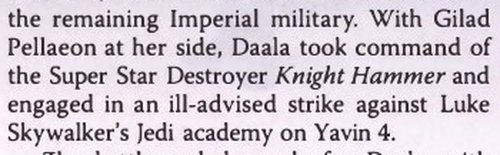
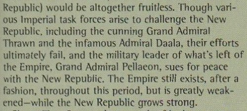
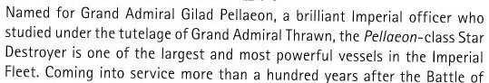

# Gilad Pellaeon

- **Aliases:** —
- **Era:** —
- **Continuity:** default Legends; entries present for: Legends
- **Research tier:** untiered (not listed as INTRO/DEEP/MASTERY in legends-feats.md)
- **Entries:** 94 (8 with quotations; 1 quotations extended to the full sentence/passage from the source text on file; 5 marked as fragments; 6 before the 2026-11-17 fragment fill). Rebuilt 2026-11-17 from 53 old entries; old file: `characters/_bak/gilad-pellaeon.md.bak-20261117`.
- **How to read:** each entry is the quotation in full (block quote), then its source and point of view. "Note" lines are summaries from our notes, not quotations. `[fragment — full passage not on file]` means the source text is not on the box, so only the words in our notes are shown. Debate and forum material is in the last section and is unverified.

# LEGENDS (Legends / EU — main focus)

## Star Wars: The New Essential Chronology (Del Rey, 2005): power-scaling and lore notes

- Note (summary from our notes, not a quotation): art caption: "Admiral Gilad Pellaeon" Source: The New Essential Chronology, p.185, caption
  — Source: Part Nine: Uprisings and Insurgencies.

Our notes: `notes/materials/027-new-essential-chronology/09-part-nine-uprisings-and-insurgencies.md:95`

## The Complete Star Wars Encyclopedia, Vol. I (A–G)

> Admiral Natasi Daala 1 59 I D'aAlln,Joveh Though Daala was versed in many strategic theories, her inexperience hampered her efforts. Using decade-old tactics at a battle over Mon Calamari, Daala was easily thwarted by Admiral Ackbar. Before long, her task force of four de­ stroyers was reduced to just her flagship, Gorgon. Defeated, shejoined the squabbling Imperial war­ lords holed up in the Deep Core Worlds. Seeing the inefficiencies of the Emperor's heirs in person again gave fuel to Daala's fiery temper. In disgust, she murdered most of the warlords, then consolidated command over the remaining Imperial military. With Gilad Pellaeon at her side, Daala took command of the Super Star Destroyer Knight Hammer and engaged in an ill-advised strike against Luke Skywalker's Jedi academy on Yavin 4. The battle ended poorly for Daala, with the Knight Hammer falling victim to sabotage. Broken, Daala abandoned her command to Pel­ laeon and fled to the remote world of Pedducis Chorios. She settled into civilian life, leading a group ofsettlers on the distant world. A year later, the inhumane tactics of Moff Getelles brought Daala out of retirement.
— Source: scan pages 161–200; Admiral Daala; Luke Skywalker.
(Excerpt widened 2026-11-17 to the relevant passage, word for word from research primary cse vol1 (text copy `research_primary_cse_vol1_pdf_45a954be6d`).)
(Excerpt widened 2026-11-17 to the relevant passage, word for word from research primary cse vol1 (text copy `research_primary_cse_vol1_pdf_45a954be6d`).)
Note (our notes, around the quote): Admiral Daala; Luke Skywalker: "With Gilad Pellaeon at her side, Daala took command of the Super Star Destroyer Knight Hammer and engaged in an ill-advised strike against Luke Skywalker's Jedi academy on Yavin 4." Source: The Complete Star Wars Encyclopedia, Vol. I, p.160

Our notes: `notes/materials/030-complete-star-wars-encyclopedia-vol-1/04-v1-scan-161-200.md:124`

## Sourcebooks/The New Jedi Order Sourcebook.pdf [Star Wars Roleplaying Game (d20, 2000)] (scan pages 1–60)

- Note (summary from our notes, not a quotation): Page contents: 847 words, 23 paragraphs | headings/entries: OL ANDO; Z < > ay 0 Z; Coruscant; Borsk Fey'lya, New Republic Chief; The Imperial Remnant; Grand Admiral Gilad Pellaeon
  — Source: Sourcebooks/The New Jedi Order Sourcebook.pdf [Star Wars Roleplaying Game.
Our notes: `notes/materials/037-sw-d20-folder/049-the-new-jedi-order-sourcebook-scan-001-060.md:114`

## Star Wars Gamer/Star Wars Gamer 07.pdf [Star Wars Roleplaying Game (d20, 2000)] (scan pages 61–108)

- Note (summary from our notes, not a quotation): Page contents: Anx: emotions shown by fin color (fin cloaks, bad sabacc players), gift-giving potlatches, uncanny anatomy sense; the Empire turned the Graviex Launchworks into a waste dump until only mutated superbacteria lived on Graviex Med; Imperial Remnant slicers faked a disassembly order to steal Thrawn's Star Destroyer Chimaera back to Gilad Pellaeon (hand-read)
  — Source: Star Wars Gamer/Star Wars Gamer 07.pdf [Star Wars Roleplaying Game (d20,.
Our notes: `notes/materials/037-sw-d20-folder/056-star-wars-gamer-07-scan-061-108.md:157`

## Sourcebooks/Hero's Guide.pdf [Star Wars Roleplaying Game Revised Core (d20, 2002)] (scan pages 61–120)

> Though various Imperial task forces arise to challenge the New Republic, including the cunning Grand Admiral Thrawn and the infamous Admiral Daala, their efforts ultimately fail, and the military leader of what's left of the Empire, Grand Admiral Pellaeon, sues for peace with the New Republic.
— Source: Sourcebooks/Hero's Guide.pdf [Star Wars Roleplaying Game Revised Core (d2.
Note (our notes, around the quote): Grand Admiral Thrawn; Admiral Daala; Gilad Pellaeon — entry/section: Imperial task forces after Endor: "Though various Imperial task forces arise to challenge the New Republic, including the cunning Grand Admiral Thrawn and the infamous Admiral Daala, their efforts ultimately fail, and the military leader of what's left of the Empire, Grand Admiral Pellaeon, sues for peace with the New Republic." Source: *Hero's Guide* (SWRPG d20 Revised Core), scan p.115

Our notes: `notes/materials/037-sw-d20-folder/668-heros-guide-scan-061-120.md:306`

## Sourcebooks/Legacy Era Campaign Guide.pdf [Star Wars Roleplaying Game Saga Edition (2007)] (scan pages 181–225)

> tend to be men and women with nerves of ice
> [fragment — full passage not on file]
>
> Named for one of the most famous Grand Admirals in the history of the Empire, Gilad Pellaeon
> [fragment — full passage not on file]
— Source: Sourcebooks/Legacy Era Campaign Guide.pdf [Star Wars Roleplaying Game Sag.
Note (our notes, around the quote): Page contents: Imperial Capital Ships intro. Ardent-class Fast Frigate (Kuat Drive Yards): used to break enemy picket lines; commanders "tend to be men and women with nerves of ice"; Tactical Fire ability; stat block CL 19. Pellaeon-class Star Destroyer (Kuat Drive Yards): "Named for one of the most famous Grand Admirals in the history of the Empire, Gilad Pellaeon"; heavily slanted forward hull; command ships and flagships; Tactical Fire (+2 attack bonus to allies). (hand-read)
Our notes: `notes/materials/037-sw-d20-folder/719-legacy-era-campaign-guide-scan-181-225.md:72`

## Sourcebooks/Starships of the Galaxy.pdf [Star Wars Roleplaying Game Saga Edition (2007)] (scan pages 61–120)

- Note (summary from our notes, not a quotation): Page contents: The Pellaeon-class Star Destroyer (named for Grand Admiral Gilad Pellaeon, Thrawn's student; serves Darth Krayt's Empire and Emperor Roan Fel's Empire-in-exile; combines Imperial II and Executor features) with stat block CL 28. (hand-read)
  — Source: Sourcebooks/Starships of the Galaxy.pdf [Star Wars Roleplaying Game Saga.
Our notes: `notes/materials/037-sw-d20-folder/727-starships-of-the-galaxy-scan-061-120.md:265`

> Named for Grand Admiral Gilad Pellaeon, a brilliant Imperial officer who studied under the tutelage of Grand Admiral Thrawn, the Pellaeon-class Star Destroyer is one of the largest and most powerful vessels in the Imperial Fleet.
— Source: Sourcebooks/Starships of the Galaxy.pdf [Star Wars Roleplaying Game Saga; Grand Admiral Thrawn. POV: Grand Admiral Thrawn, about Gilad Pellaeon.
Note (our notes, around the quote): Grand Admiral Thrawn: "Named for Grand Admiral Gilad Pellaeon, a brilliant Imperial officer who studied under the tutelage of Grand Admiral Thrawn, the Pellaeon-class Star Destroyer is one of the largest and most powerful vessels in the Imperial Fleet." Source: *Starships of the Galaxy* (SWRPG Saga Edition), scan p.100

Our notes: `notes/materials/037-sw-d20-folder/727-starships-of-the-galaxy-scan-061-120.md:267`

## Sourcebooks/The Force Unleashed Campaign Guide.pdf [Star Wars Roleplaying Game Saga Edition (2007)] (scan pages 181–226)

- Note (summary from our notes, not a quotation): Page contents: Armand Isard stat block (CL 6). Commander Crix Madine; Crix Madine stat block (CL 8). Captain Gilad Pellaeon begins. (hand-read)
  — Source: Sourcebooks/The Force Unleashed Campaign Guide.pdf [Star Wars Roleplaying.
Our notes: `notes/materials/037-sw-d20-folder/729-the-force-unleashed-campaign-guide-scan-181-226.md:97`

- Note (summary from our notes, not a quotation): Page contents: Pellaeon cont.; Gilad Pellaeon stat block (CL 6). Captain Ozzik Sturn; stat block (CL 12). Grand Moff Wilhuff Tarkin begins. (hand-read)
  — Source: Sourcebooks/The Force Unleashed Campaign Guide.pdf [Star Wars Roleplaying.
Our notes: `notes/materials/037-sw-d20-folder/729-the-force-unleashed-campaign-guide-scan-181-226.md:108`

## Star Wars Insider #108 (2009)

> rogue soldiers too dangerous and unstable to leave unfettered
> [fragment — full passage not on file]
— Source: Star Wars Insider #108 (2009).
Note (our notes, around the quote): Page contents: Star Wars Books timeline 2009: FotJ: Outcast (Allston): two years after Darth Caedus' death, Chief of State Daala considers the Jedi "rogue soldiers too dangerous and unstable to leave unfettered"; Luke and Ben retrace Jacen's journey to find which Force-using groups influenced him. The Clone Wars: No Prisoners (Traviss): Ahsoka, Rex and the 501st on a shakedown cruise aboard Captain Gilad Pellaeon's assault ship become caught in a hostage situation. Also Omen, Abyss, Imperial Commando: 501st, Deathtroopers, the third Darth Bane novel (Bane and Zannah). Crop-verified. (hand-read)
Our notes: `notes/materials/038-star-wars-insider/108-ins108.md:50`

## Star Wars Insider Special Edition (2013)

- Note (summary from our notes, not a quotation): Page contents: Military leaders #7 Revan, #8 Pers Pradeux, #9 Gar Stazi, #10 Gilad Pellaeon (viewed). (hand-read)
  — Source: Star Wars Insider Special Edition (2013).
Our notes: `notes/materials/038-star-wars-insider/159-insspecial2013.md:225`

## The Thrawn Trilogy (Timothy Zahn): Heir to the Empire, Dark Force Rising, The Last Command, plus the Heir 20th Anniversary extras

What it shows (our notes): Ending (ties into Heir): Thrawn turns to "the restoration of the Empire". The Empire has "shrunk to barely a quarter of the size it had attained under Palpatine's rule". He will contact "Captain Gilad Pellaeon … ISD Chimaera" and arranges "a bodyguard" (foreshadowing the Noghri and Rukh). Nuso Esva's dying threat: "with my death, his own will not be far off. My followers … will find him."
> But Esva has purposely arranged an intelligence breach—and also arranged the art on display to trick Thrawn into planning his attack to Esva’s expectations.
>
> Thrawn, however, has predicted this ploy by Esva and outmaneuvers the warlord. Esva’s gambit on Quethold has involved corrupting the queen into a bid for power that makes the alliance inherently untrustworthy. When the battle begins to turn against Esva, he kills the queen out of suspicion of betrayal and is in turn killed by the soldiers under her command.
>
> Thus Thrawn defeats his longtime archrival. He then concentrates on his next great plan—the restoration of the Empire to power over the New Republic.
>
> Click to buy Heir to the Empire 20th Anniversary Edition: Crisis of Faith READING THROUGH the Expanded Universe in chronological order means that this story will be the first time readers are exposed to the Empire of the Hand faction, Soontir Fel’s TIE squadron, and a 501st Stormtrooper Legion consisting of human and nonhuman soldiers. None of these elements are introduced in a manner to properly explain their origins in Crisis of Faith, as they had appeared in print in other sources first, such as Specter of the Past (1998) and Fool’s Bargain (2004).
>
> Parck winced. Thrawn had returned only occasionally to Imperial space since Palpatine’s death. Those trips had usually been short, had always been shrouded in secrecy, and had invariably left the Grand Admiral frustrated by the growing disorder there. Between the incompetence of its own leadership and the steady military pressure from the New Republic, the Empire had shrunk to barely a quarter of the size it had attained under Palpatine’s rule. “You may have trouble persuading them to accept your help,” he warned. “Some of their recent experience with Grand Admirals hasn’t been all that positive.”
>
> with my death, his own will not be far off. My followers … will find him.
> [fragment — full passage not on file]
— Source: Heir 20th Anniversary: "CRISIS OF FAITH", an original Star Wars novella by Timothy Zahn (bm1); Ending (ties into Heir): Thrawn turns to.
(Excerpt widened 2026-11-17 to the relevant passage, word for word from The Essential Reader’s Companion: Star Wars (Pablo Hidalgo) (text copy `primary_essential_guides_eg_readers_companion_2012_Star_Wars_The_Essential_Readers_Companion_Pablo_Hidalgo_8O9y2bib_epub_e20384df21`).)
(Excerpt widened 2026-11-17 to the relevant passage, word for word from The Essential Reader’s Companion: Star Wars (Pablo Hidalgo) (text copy `primary_essential_guides_eg_readers_companion_2012_Star_Wars_The_Essential_Readers_Companion_Pablo_Hidalgo_8O9y2bib_epub_e20384df21`).)
(Excerpt widened 2026-11-17 to the relevant passage, word for word from Heir to the Empire (Timothy Zahn) (text copy `MEGA_Legend_The_Thrawn_Trilogy_Star_Wars_Thrawn_Trilogy_01_Heir_to_the_Empire_20th_Anniversary_Edition_Timothy_Zahn_epub`).)
(Full sentence/passage taken from the source text on file: `primary_essential_guides_eg_readers_companion_2012_Star_Wars_The_Essential_Readers_Companion_Pablo_Hidalgo_8O9y2bib_epub`.)
(Fragment completed 2026-11-17: full sentence/passage matched word for word in the source text on file: `primary_essential_guides_eg_readers_companion_2012_Star_Wars_The_Essential_Readers_Companion_Pablo_Hidalgo_8O9y2bib_epub_e20384df21`.)
(Fragment completed 2026-11-17: full sentence/passage matched word for word in the source text on file: `MEGA_Legend_The_Thrawn_Trilogy_Star_Wars_Thrawn_Trilogy_01_Heir_to_the_Empire_20th_Anniversary_Edition_Timothy_Zahn_epub`.)
Our notes: `notes/materials/044-thrawn-trilogy/heir20-02.md:33`

- Note (summary from our notes, not a quotation): Commander Gilad Pellaeon is third bridge officer of the Chimaera under Captain Calo Drusan. Grand Admiral Zaarin is aboard the ISD Predominant.
  — Source: The Last Command: notes part 11, ch. 27 (end) to ch. 29, plus front of back matter.
Context: bm3 = Choices of One excerpt ("CHAPTER ONE"). This differs from the DFR bm3, which was a TLC ch1 excerpt.
Our notes: `notes/materials/044-thrawn-trilogy/tlc-11.md:46`

## NJO 12: Enemy Lines I: Rebel Dream (Aaron Allston) — DONE

- Note (summary from our notes, not a quotation): | 15397–16375 | LEGACY intro + LotF *Betrayal* (“He doesn’t exist”); Adumar Jacen/Ben; FotJ *Outcast* Jag/Jaina Gilad Pellaeon; Valin Not-Mirax |
  — Source: Rebel Dream — Notes batch 04 (back matter) — 127-njo-12-rebel-dream/rd-04-back-matter.md.
Our notes: `notes/materials/127-njo-12-rebel-dream/rd-04-back-matter.md:15`

## NJO 13: Enemy Lines II: Rebel Stand (Aaron Allston) — DONE

- Note (summary from our notes, not a quotation): | 16376–17358 | LEGACY intro + LotF *Betrayal* (“He doesn’t exist”); Adumar Jacen/Ben Dammant Killers; FotJ *Outcast* Jag/Jaina *Gilad Pellaeon*; Valin Not-Mirax/Not-Corran |
  — Source: Rebel Stand — Notes batch 04 (back matter) — 128-njo-13-rebel-stand/rs-04-back-matter.md.
Our notes: `notes/materials/128-njo-13-rebel-stand/rs-04-back-matter.md:15`

## NJO 14: Traitor (Matthew Woodring Stover) — DONE

- Note (summary from our notes, not a quotation): Excerpts: LotF Betrayal (Luke “He doesn’t exist” dream; Jacen/Ben Adumar Dammant Killers inspection) (15230–15753); FotJ Outcast (Gilad Pellaeon / Jag–Jaina; Valin Horn Not-Mirax / Not-Corran lunge) (15757–16149).
  — Source: Traitor — Notes batch 05 BACK MATTER (FULL.txt l.10481–16549 EOF) — 129-njo-14-traitor/tr-05-back-matter.md.
Our notes: `notes/materials/129-njo-14-traitor/tr-05-back-matter.md:36`

## NJO 15: Destiny’s Way (Walter Jon Williams) — DONE

- Note (summary from our notes, not a quotation): Pellaeon’s crystal-arbor garden HQ: cull weak / grow in rows; Deep Core route maps traded for NR Vong intel (Danni Quee).
  — Source: Destiny’s Way — Notes batch 02 (FULL.txt l.4901–~9100+) — 130-njo-15-destinys-way/dw-02-ch11-18.md.
Our notes: `notes/materials/130-njo-15-destinys-way/dw-02-ch11-18.md:11`

- Note (summary from our notes, not a quotation): Excerpts: LotF Betrayal (Luke “He doesn’t exist” dream; Jacen/Ben Adumar Dammant Killers inspection); FotJ Outcast (Gilad Pellaeon / Jag–Jaina; Valin Horn Not-Mirax / Not-Corran lunge).
  — Source: Destiny’s Way — Notes batch 04 BACK MATTER (FULL.txt l.17127–22688 EOF) — 130-njo-15-destinys-way/dw-04-back-matter.md.
Our notes: `notes/materials/130-njo-15-destinys-way/dw-04-back-matter.md:32`

## NJO 17: Force Heretic I: Remnant (Sean Williams & Shane Dix) — DONE

- Note (summary from our notes, not a quotation): Shadow bombs kill pursuing skips; hail Chimaera; Luke/Mara give yammosk targeting tip; Pellaeon: Vong used grutchins after feigned pullback; regroup Yaga Minor; look for Capt. Arien Yage / Widowmaker. Shadow withdraws rather than die with Bastion.
  — Source: Force Heretic I: Remnant — Notes batch 02 (FULL.txt 3989–8797) — 132-njo-17-force-heretic-remnant/fh1-02-part2-destination.md.
Our notes: `notes/materials/132-njo-17-force-heretic-remnant/fh1-02-part2-destination.md:6`

- Note (summary from our notes, not a quotation): Yaga Minor shipyards; Moff Flennic via Cmdr Keten demands boarding with Mark V droids; Yage overrides, boards herself. Pellaeon reportedly dying in coma after Bastion shuttle arrival.
  — Source: Force Heretic I: Remnant — Notes batch 02 (FULL.txt 3989–8797) — 132-njo-17-force-heretic-remnant/fh1-02-part2-destination.md.
Our notes: `notes/materials/132-njo-17-force-heretic-remnant/fh1-02-part2-destination.md:7`

- Note (summary from our notes, not a quotation): Pellaeon bacta; Tekli Force-heals via neural shunt; Chimaera/Superior survivors; Vitor Reige.
  — Source: Force Heretic I: Remnant — Notes batch 02 (FULL.txt 3989–8797) — 132-njo-17-force-heretic-remnant/fh1-02-part2-destination.md.
Our notes: `notes/materials/132-njo-17-force-heretic-remnant/fh1-02-part2-destination.md:15`

- Note (summary from our notes, not a quotation): Jacen vs Moff Flennic (retreat=cowardice); proposes Borosk trap fallback; Pellaeon interrupts alive, orders withdrawal, free access for Jade Shadow, GA/Jedi cooperation. Jacen returns to Widowmaker; Danni hug; slave-carrier theory (Bastion population → drones; link to Saba’s Barab I balloon-ship).
  — Source: Force Heretic I: Remnant — Notes batch 02 (FULL.txt 3989–8797) — 132-njo-17-force-heretic-remnant/fh1-02-part2-destination.md.
Our notes: `notes/materials/132-njo-17-force-heretic-remnant/fh1-02-part2-destination.md:17`

- Note (summary from our notes, not a quotation): Pellaeon (bacta, Widowmaker) directs Borosk defense: Stalwart/Relentless/Protector/Right to Rule; mines + planetary guns. Jacen traps YV infiltrators (ooglith / Fiula Blay / Torvin Xyn) + human spies on Right to Rule; stormtroopers kill three YV.
  — Source: Force Heretic I: Remnant — Notes batch 03 (FULL.txt 8798–12899) — 132-njo-17-force-heretic-remnant/fh1-03-part3-intervention.md.
Our notes: `notes/materials/132-njo-17-force-heretic-remnant/fh1-03-part3-intervention.md:9`

What it shows (our notes): Scarab droids poison delayed; Saba lightsabers belly; jelly+gnulliths + Jade Shadow tractor → rescue. Yammosk jammer (Defiant/GAM) turns fight; Vorrik withdraws (~2/3 out of Empire, ~1/3 → Yaga Minor). Pellaeon: “Empire will always strike back.”
> “Maybe one day, Vorrik,” Pellaeon said, “but not today. You really should have thought twice about this gambit of yours—especially if you didn’t have the resources to pull it off in the first place.” In the heartbeat between words he lost all hint of mockery and adopted a cold and serious tone. “We have no intentions of surrendering—not now, not ever. You may win the occasional battle against us, Vorrik, but the Empire will always strike back. That I promise you.”
— Source: Force Heretic I: Remnant — Notes batch 03 (FULL.txt 8798–12899) — 132-njo-17-force-heretic-remnant/fh1-03-part3-intervention.md.
(Excerpt widened 2026-11-17 to the relevant passage, word for word from Remnant: Force Heretic I (Sean Williams) (text copy `MEGA_Legend_The_New_Jedi_Order_Series_Star_Wars_New_Jedi_Order_17_Force_Heretic_01_Remnant_Sean_Williams_Shane_Dix_epub`).)
Our notes: `notes/materials/132-njo-17-force-heretic-remnant/fh1-03-part3-intervention.md:11`

- Note (summary from our notes, not a quotation): Moff Council / Right to Rule: Pellaeon forces GA military alliance (else navy leaves); Flennic draws blaster → Mara Force-disarms; Flennic stands down under death threat. Mara: “prefer allies armed.”
  — Source: Force Heretic I: Remnant — Notes batch 04 (FULL.txt 12900–20209) — 132-njo-17-force-heretic-remnant/fh1-04-part4-epilogue-backmatter.md.
Our notes: `notes/materials/132-njo-17-force-heretic-remnant/fh1-04-part4-epilogue-backmatter.md:7`

- Note (summary from our notes, not a quotation): 18886–19810 Legacy excerpts: Fate of the Jedi: Outcast (Luke “He doesn’t exist” dream); Legacy of the Force: Betrayal (Jacen/Ben Adumar Dammant Killers); Fate of the Jedi (Gilad Pellaeon SD; Valin Horn / fake Corran duel cut).
  — Source: Force Heretic I: Remnant — Notes batch 04 (FULL.txt 12900–20209) — 132-njo-17-force-heretic-remnant/fh1-04-part4-epilogue-backmatter.md.
Our notes: `notes/materials/132-njo-17-force-heretic-remnant/fh1-04-part4-epilogue-backmatter.md:20`

## NJO 19 Force Heretic III: Reunion (Sean Williams & Shane Dix)

- Note (summary from our notes, not a quotation): Falcon+Selonia+Twin Suns arrive: mines on sensors; 7 capital + 9 cruisers; local defense gone. Hyperspace: Grand Admiral Pellaeon / Right to Rule (+ second SD) chasing Vorrik remnant from Imperial Space. Target yammosk ship Kur-hashan. Han: “odds stacked… interesting.”
  — Source: Reunion — fh3-01 Front + PART ONE Infiltration (FULL.txt 1–3120) — 135-njo-19-force-heretic-reunion/fh3-01-front-part1.md.
Our notes: `notes/materials/135-njo-19-force-heretic-reunion/fh3-01-front-part1.md:22`

- Note (summary from our notes, not a quotation): Pellaeon: Generis fallen; chasing Vorrik remnant; yammosk jammer; Jag “Surprise me” → fakes death into dead gunship, pushes wreck as camouflaged ram toward northern flank; “Get ready”; gunship explodes (mid-ploy).
  — Source: Reunion — fh3-02 PART TWO Confrontation early (FULL.txt 3121–~5850) — 135-njo-19-force-heretic-reunion/fh3-02-part2a.md.
Our notes: `notes/materials/135-njo-19-force-heretic-reunion/fh3-02-part2a.md:9`

- Note (summary from our notes, not a quotation): Pellaeon: after transponder detonation, signals Ryn network reinforcements; ragtag fleet wrecks Kur-hashan; Vorrik self-destructs engines rather than surrender; Ryn network revealed as loosely cell-structured; Droma later revealed as network head (Onadax bar op).
  — Source: Force Heretic III: Reunion — notes fh3-04 — 135-njo-19-force-heretic-reunion/fh3-04-part4-epilogue.md.
Our notes: `notes/materials/135-njo-19-force-heretic-reunion/fh3-04-part4-epilogue.md:15`

## NJO 21 The Unifying Force (James Luceno)

- Note (summary from our notes, not a quotation): 21425–21428 Pellaeon gifts restored Killik Twilight (Alderaanian moss-painting once outside Leia’s Organa bedroom)—cultural restitution beat.
  — Source: Unifying Force — uf-05 PART FOUR The New Order (FULL.txt 19894–21724) — 137-njo-21-unifying-force/uf-05-part4.md.
Our notes: `notes/materials/137-njo-21-unifying-force/uf-05-part4.md:18`

- Note (summary from our notes, not a quotation): | 26474–27454 | LEGACY ERA (40+ ABY) | *Legacy of the Force: Betrayal* — Luke “He doesn’t exist” dream; Jacen/Ben Adumar Dammant Killers; Jaina–Jag *Gilad Pellaeon*; Valin Horn Not-Mirax / Not-Corran |
  — Source: Unifying Force — uf-06 Backmatter (FULL.txt 21725–27853 EOF) — 137-njo-21-unifying-force/uf-06-backmatter.md.
Our notes: `notes/materials/137-njo-21-unifying-force/uf-06-backmatter.md:23`

## Specter of the Past (Timothy Zahn) — Hand of Thrawn 1

- Note (summary from our notes, not a quotation): ISD Chimaera, edge Outer Rim / Unknown Space; Admiral Gilad Pellaeon, Supreme Commander; Capt. Ardiff.
  — Source: Specter of the Past — sotp-01 front + Chs 1–6 (FULL.txt ~1–1150) — 139-specter-of-the-past/sotp-01-front-ch1-6.md.
Our notes: `notes/materials/139-specter-of-the-past/sotp-01-front-ch1-6.md:9`

- Note (summary from our notes, not a quotation): Pellaeon conclusion: war lost without Thrawn. Orders Bastion meeting of Moffs at Moff Disra’s palace — emissary to NR to discuss terms of surrender.
  — Source: Specter of the Past — sotp-01 front + Chs 1–6 (FULL.txt ~1–1150) — 139-specter-of-the-past/sotp-01-front-ch1-6.md.
Our notes: `notes/materials/139-specter-of-the-past/sotp-01-front-ch1-6.md:12`

- Note (summary from our notes, not a quotation): Pellaeon briefs remaining Moffs (Andray, Bemos, Hort, Quillan, Edan, Sander, Vered, Disra). Resistance to surrender; Disra silences walkouts. Agreement to negotiate while NR is unstable (Almania cited).
  — Source: Specter of the Past — sotp-01 front + Chs 1–6 (FULL.txt ~1–1150) — 139-specter-of-the-past/sotp-01-front-ch1-6.md.
Our notes: `notes/materials/139-specter-of-the-past/sotp-01-front-ch1-6.md:30`

- Note (summary from our notes, not a quotation): After Pellaeon leaves: Disra reveals he sliced Emperor’s private Bastion records — Tierce is former Royal Guard (TR-889), was on Magagran at Endor; later Chimaera stormtrooper under Thrawn; his unit killed Rukh after Thrawn’s murder.
  — Source: Specter of the Past — sotp-01 front + Chs 1–6 (FULL.txt ~1–1150) — 139-specter-of-the-past/sotp-01-front-ch1-6.md.
Our notes: `notes/materials/139-specter-of-the-past/sotp-01-front-ch1-6.md:32`

- Note (summary from our notes, not a quotation): Cave = abandoned Imperial comm spy center (encrypt modules, Coruscant Hourly feed). Corellian Corvette Imperial ID inbound; ISD drops behind and chases it. Rogues + Lando’s Lady Luck try dilute jamming; fragment from Col. Vermel (Pellaeon’s envoy to Bel Iblis re peace talks) — “traitorous elements,” meet at abandoned mining center Pesitiin. ISD Relentless pulls Corvette into bay and jumps.
  — Source: Specter of the Past — sotp-01 front + Chs 1–6 (FULL.txt ~1–1150) — 139-specter-of-the-past/sotp-01-front-ch1-6.md.
Our notes: `notes/materials/139-specter-of-the-past/sotp-01-front-ch1-6.md:43`

- Note (summary from our notes, not a quotation): Pellaeon at Muunilinst (“Moneylend”) with defense brass (High Gen. Sutt Ramic, Gen. Jaron Kyte, etc.). Peace proposal; exposes financier Lord Graemon funneling Imperial funds to Preybird consortium + pirate equipment/personnel; Kyte twitches (suspect). Ramic will obey order despite dislike. Vermel timing: should be at Morishim “now.”
  — Source: Specter of the Past — sotp-01 front + Chs 1–6 (FULL.txt ~1–1150) — 139-specter-of-the-past/sotp-01-front-ch1-6.md.
Our notes: `notes/materials/139-specter-of-the-past/sotp-01-front-ch1-6.md:44`

> clear as roiled mud
> [fragment — full passage not on file]
— Source: Specter of the Past — sotp-02 Chs 7–10 (FULL.txt ~1169–1895) — 139-specter-of-the-past/sotp-02-ch7-10.md; Bel Iblis + Lando: Vermel fragment.
Note (our notes, around the quote): Bel Iblis + Lando: Vermel fragment “clear as roiled mud”; Bel Iblis’s instincts reject simple theft-defection; Col. Meizh Vermel on Pellaeon’s staff; will copy recording as “hobby.”
Our notes: `notes/materials/139-specter-of-the-past/sotp-02-ch7-10.md:6`

- Note (summary from our notes, not a quotation): Parallel: Pellaeon dream of Thrawn; Commander Dreyf reports Graemon’s NR financial ties + Kyte↔Cavrilhu link; Bothawui riot news. Pellaeon plans Yaga Minor records for full Caamas Document to trade for NR concessions; Vermel still missing after Morishim/Bel Iblis contact (ll.2481–2534).
  — Source: Specter of the Past — Notes 03: Chapters 11–16 — locator ll.2481 — 139-specter-of-the-past/sotp-03-ch11-16.md.
Our notes: `notes/materials/139-specter-of-the-past/sotp-03-ch11-16.md:22`

- Note (summary from our notes, not a quotation): Pellaeon with High General Hestiv: peace is necessary; Hestiv reluctantly supports. List of Disra financial names to run. Major Grodin Tierce previously tried Obliterator-authorization access—actually Disra’s aide. No tamper trace → suspicion Special Files (Emperor sealed); possibly Caamas attack details + Disra ally list altered/added (ll.2794–2825). Pellaeon leaves for lonely Pesitiin rendezvous hoping Bel Iblis got Vermel’s message (ll.2830–2834).
  — Source: Specter of the Past — Notes 03: Chapters 11–16 — locator ll.2794 — 139-specter-of-the-past/sotp-03-ch11-16.md.
Our notes: `notes/materials/139-specter-of-the-past/sotp-03-ch11-16.md:33`

- Note (summary from our notes, not a quotation): Chimaera alone at Pesitiin; Bel Iblis no-show. Fake Corellian-marked attack force (gunships + Kaloth BC + Pacifiers) engages. Pellaeon uses Preybird parade formation + proton torpedoes as A-wing slash (Bel Iblis’s own invention)—proves not Bel Iblis. Predictor to ID tactics. Stay for Bel Iblis; unknown wants them driven off. “To Be Concluded.”
  — Source: Specter of the Past — Notes 04: Chapters 17–24 (novel close) — 139-specter-of-the-past/sotp-04-ch17-24.md.
Our notes: `notes/materials/139-specter-of-the-past/sotp-04-ch17-24.md:30`

## Vision of the Future (Timothy Zahn) — Hand of Thrawn 2

- Note (summary from our notes, not a quotation): Pellaeon/Chimaera at Pesitiin: pirate (Kaloth) debris; Ardiff theories; two more weeks for Bel Iblis; Vermel presumed delivered message; comms blackout.
  — Source: Vision of the Future — Notes 01: Front + Chapters 1–3 (+ Ch4 start) — 140-vision-of-the-future/votf-01-front-ch1-3.md.
Our notes: `notes/materials/140-vision-of-the-future/votf-01-front-ch1-3.md:11`

- Note (summary from our notes, not a quotation): Parallel: Pellaeon AT-AT sim with Maj. Raines; Lt. Mavron traced Horska HoloNet after Pesitiin raid → Bastion then Kroctar; TriNebulon: Kroctar treaty with “Thrawn.” Pellaeon shaken (watched Thrawn die); fears Disra/peace-opposition sidelined him; stay Pesitiin few more days then Bastion.
  — Source: Vision of the Future — Notes 02: Chapters 4–8 — 140-vision-of-the-future/votf-02-ch4-8.md.
Our notes: `notes/materials/140-vision-of-the-future/votf-02-ch4-8.md:9`

- Note (summary from our notes, not a quotation): Gavrisom: won’t release Pellaeon’s peace offer; may keep Empire as unifying common enemy; offers Leia Presidency back—she declines (continuity of voice). Leia to draft peace-conference delegates.
  — Source: Vision of the Future — Notes 09: Chapters 32–35 — 140-vision-of-the-future/votf-09-ch32-35.md.
Our notes: `notes/materials/140-vision-of-the-future/votf-09-ch32-35.md:11`

- Note (summary from our notes, not a quotation): Pellaeon: Bastion staff insubordinate (Disra/“Gran—”); Relentless → Yaga Minor with Disra + “Thrawn.” Unknown-config ship hails Pellaeon personally—familiar male Basic voice (Car’das/Karrde implication)—offers secret meeting aboard Chimaera.
  — Source: Vision of the Future — Notes 09: Chapters 32–35 — 140-vision-of-the-future/votf-09-ch32-35.md.
Our notes: `notes/materials/140-vision-of-the-future/votf-09-ch32-35.md:33`

- Note (summary from our notes, not a quotation): Shada (zenji needle + hand-to-hand) kills Tierce after he wounds Paloma; Flim drops act, ceases fire; Pellaeon to Bel Iblis.
  — Source: Vision of the Future — Notes 11: Chapters 39–43 + all backmatter — 140-vision-of-the-future/votf-11-ch39-43-back.md.
Our notes: `notes/materials/140-vision-of-the-future/votf-11-ch39-43-back.md:21`

- Note (summary from our notes, not a quotation): Karrde bargains Mistryl: lift Shada death mark (exile from Emberlene/Mistryl). Pellaeon proposes peace treaty to Bel Iblis. Karrde’s “modest proposal” → joint neutral Intelligence (later Ch43). Artoo found Thrawn’s Caamas Document in Hand computer (not Unknown Regions download). Hangar still recovering → unchallenged lift to hyperspace.
  — Source: Vision of the Future — Notes 11: Chapters 39–43 + all backmatter — 140-vision-of-the-future/votf-11-ch39-43-back.md.
Our notes: `notes/materials/140-vision-of-the-future/votf-11-ch39-43-back.md:30`

- Note (summary from our notes, not a quotation): Sample CHAPTER ONE *Choices of One*: Pellaeon/Chimaera, masked Lord Odo, Thrawn+Car’das+Emperor Death Star construction moon, Nusoesva Unknown Regions, Odo takes Chimaera command → Wroona
  — Source: Vision of the Future — Notes 11: Chapters 39–43 + all backmatter — 140-vision-of-the-future/votf-11-ch39-43-back.md.
Our notes: `notes/materials/140-vision-of-the-future/votf-11-ch39-43-back.md:39`

## https://starwars.fandom.com/wiki/Mara_Jade_Skywalker

- Note (summary from our notes, not a quotation): During the Battle of Bastion she identified the location of a yammosk carrier for Gilad Pellaeon. In the Battle of Borosk she flew the Jade Shadow in a plan that freed prisoners from a Yuuzhan Vong slave carrier. She then saved Pellaeon from Moff Flennic's assassination attempt. [66]
  — Source: Mara Jade Skywalker — research extraction — https://starwars.fandom.com/wiki/Mara_Jade_Skywalker.
Our notes: `external/mega-notes/mara-jade-quotes.txt:98`

# Debate and forum claims (unverified)

Forum posts, Suspect Insight debates and Discord debates, respect threads, and verdicts. These are posters' arguments or quotations they typed; none is checked against the book here unless the entry says so.

## https://comicvine.gamespot.com/forums/star-wars-universe-1943200/darth-sidioussheev-palpatine-super-respect-thread-1877280/

- Note (summary from our notes, not a quotation): [502] Type: feat
  — Source: Darth Sidious/Sheev Palpatine Super Respect Thread — cited-quote extraction — https://comicvine.gamespot.com/forums/star-wars-universe-1943200/darth-sidioussheev-palpatine-super-respect-thread-1877280/; Source named in post: Gilad Pellaeon, The Last Command Sourcebook.
Posted by: not named in our notes (see thread/notes link).
(Section context: Feats)
(Quote/source-associated text (verbatim):)
(“Perhaps a few months ago, I would have scoffed at the idea of one man controlling or shaping the events of the galaxy through sheer force of will. I certainly did not agree with the Grand Admiral’s contention that the Imperial Navy’s loss at Endor was because were, in effect, enslaved to the Emperor, as if we were, in Thrawn’s words, ‘borg-implanted into a combat computer.’)
(“That was then. Now I see that the Grand Admiral, the worthiest successor to the Emperor’s throne to have yet appeared, was quite accurate in his assessment.”)
(Scaling stated in quote (verbatim):)
(None stated explicitly in this quote block.)
Our notes: `external/mega-notes/sidious-comicvine-respect.txt:5532`

# NJO FULL re-read additions (2026-11-17)
Verbatim excerpts from the full consecutive re-read of the New Jedi Order novels (Dark Journey through The Unifying Force), each shown with the text around it and its source chapter.

## *Destiny's Way*
Pellaeon tells Leia that from a garden one learns to cull the weak and unfit.

> “Every ruler should have a garden,” Pellaeon said. “It’s always useful to draw lessons from nature.”
>
> “True.” Leia cupped a vast pink blossom and lifted it to her face, inhaled its scent.
>
> “From a garden one learns to cull the weak and unfit,” Pellaeon continued, “and to encourage the strong and vigorous.” He held up his thumb and forefinger. “An inferior bud soon feels the strength of my pinch!”

— Source: *Destiny's Way* (Walter Jon Williams, Del Rey 2002), chapter 12 (DW).

## *Force Heretic I: Remnant*
Pellaeon reflects that he trusts only himself and respects everyone under his command and his enemies.

> Pellaeon’s childhood memories were lost in that same blackness. He had been born before the Empire, before the anti-alien propaganda, before the fall of the Jedi—even before the birth of the child who would grow to become Darth Vader. His first military role had been with the Judicial Forces, which he had joined at the age of fifteen, having lied about his age. From the vantage point of a ship’s deck, he had watched the tide rise and fall on so many politicians, and he had learned to be cynical about all of them—just as he had learned over the years to trust only in himself and his own judgments. That was how he had survived so many dramatic reversals. He was rarely the one at the front of the army, waving the sword and leading the charge. Gilad Pellaeon was the one more often than not standing back, ensuring his soldiers were well fed, well trained, and, above all, content. He had respect for everyone under his command—and for his enemy, too. That, above all, he thought, was why he was still alive today when so many others around him had fallen. You never knew when your enemy would become your new boss.

— Source: *Force Heretic I: Remnant* (Sean Williams and Shane Dix, Del Rey 2003), Part Two (FHR).

Pellaeon recalls arguing with the Moffs to support the galaxy's defense after seeing Ithor.

> And that, ultimately, was the trouble with the Yuuzhan Vong. They didn’t fit into this picture at all. He’d seen what they could do firsthand at Ithor, the forest world that had been utterly destroyed by the invader. He had argued with the Moffs that they should lend all support possible to the defense of the galaxy. They, however, had resisted the idea of fighting alongside the New Republic and had proposed instead to huddle in their own corner of the galaxy and watch as those worlds around them crumbled and fell to the alien intruders, all the while remaining blithely confident that they were somehow immune.

— Source: *Force Heretic I: Remnant* (Sean Williams and Shane Dix, Del Rey 2003), Part Two (FHR).

Pellaeon in the bacta tank believes a good captain goes down with the ship while Tekli says he is not dead.

> But what was he doing here with her? Superior was destroyed. He recalled ordering the evacuation of the dying hulk as it plunged into the gas giant. How had Chimaera avoided the same fate? If he had been injured and his crew had evacuated him to safety while they died, he couldn’t live with himself. A good captain went down with the ship. He should be dead.
>
> You’re not dead, Admiral. Tekli’s voice was compassionate but firm. Like I said, I’m not going to let that happen. You and Chimaera are both banged around a little, but recoverable. Just hang in there a little longer, okay?

— Source: *Force Heretic I: Remnant* (Sean Williams and Shane Dix, Del Rey 2003), Part Two (FHR).

Pellaeon tells Flennic it will take more than overeager Yuuzhan Vong to put him out of the picture.

> Flennic’s features went from startlingly purple to deathly white in the time it would have taken light to cross the room.
>
> “Grand Admiral?” he said unbelievingly. “You’re—alive?”
>
> “Of course I’m alive,” Pellaeon said, his voice oddly muffled but clear. “It will take more than a bunch of overeager Yuuzhan Vong to put me out of the picture.”

— Source: *Force Heretic I: Remnant* (Sean Williams and Shane Dix, Del Rey 2003), Part Two (FHR).

Pellaeon orders Flennic to retreat and threatens to secede the Navy from the Empire if refused.

> “Understand this, Kurlen: what I just gave you was an order, not an invitation. While I command the Imperial Navy, you will do as I say, regardless of whether or not you agree with those orders. Otherwise—and believe me when I say this—if I have to secede from the Empire in order to ensure this navy’s survival, then I shall do so without hesitation—and I guarantee that we won’t be back to pick up the pieces of your shipyards afterward.”

— Source: *Force Heretic I: Remnant* (Sean Williams and Shane Dix, Del Rey 2003), Part Two (FHR).

Pellaeon orders free access for Jade Shadow and says the Galactic Alliance and Jedi will be the Empire's best hope.

> “Good,” Pellaeon returned crisply. “But I’m not finished. This is just the beginning. You will also issue orders to allow Jade Shadow free access to this system, and any system within the Empire. The Moff Council has gravely underestimated the threat of the Yuuzhan Vong against my advice one too many times, and it won’t happen again. I won’t let it happen again. The time has come to take what few assets we have left and ensure that nothing like this ever recurs. If we survive Borosk, the Galactic Alliance and the Jedi will be our best hope of long-term survival, and I intend to take advantage of them while the Empire still exists. Is that understood?”

— Source: *Force Heretic I: Remnant* (Sean Williams and Shane Dix, Del Rey 2003), Part Two (FHR).

Pellaeon tells Jacen that Flennic understands nothing but brute force and that he would rather Flennic be angry with him than Jacen.

> “You’re probably right,” Pellaeon said. “He’ll be snug and safe where the concentration of firepower is greatest. He wouldn’t do anything that might risk his life. That won’t stop him doing what he can to protect his investment, though.” The Grand Admiral’s eyes opened again, fixing directly upon Jacen. “You did well back there, young Solo, but reason and common sense were never going to bring Flennic around. He understands nothing but force—and I’m not talking about the one you Jedi regard so highly, either. I’m talking about the brute sort.” His eyes closed once more, as if irritated by the solution. “Reminding him of his insignificance, unless he joined the greater scheme of things, might have done the trick, but in the end I’d rather have him angry with me than you. I’m used to it.”

— Source: *Force Heretic I: Remnant* (Sean Williams and Shane Dix, Del Rey 2003), Part Two (FHR).

Pellaeon deduces the Bastion vessel must be a slave carrier.

> “It has to be a slave carrier,” Pellaeon said. “They wiped out the fleets in orbit around Bastion, and that gave them an entire population ripe for capture. Those who couldn’t get away in time are probably already on their way to the nearest processing plant to be turned into mindless drones willing to sacrifice themselves for the warmaster. I saw creatures similar to them at work on Duro.”

— Source: *Force Heretic I: Remnant* (Sean Williams and Shane Dix, Del Rey 2003), Part Two (FHR).

Pellaeon says the people of the Empire deserve better and the only thing to think about is how to stop it happening again.

> Pellaeon nodded grimly. “Citizens of the Empire—all people—deserve better than this. Had we known that this was what they were after …” He trailed off, the thought as obviously disturbing for him as it was for everyone else in the room.
>
> “You were outgunned, Admiral,” Jacen offered. “There was nothing else you could have done.”
>
> “Outgunned and poorly organized,” Pellaeon agreed. “Wherever that ship came from, the chances are it’s probably hundreds of light-years away from us by now. The only thing we can think about now is how to stop it from happening again. At Borosk, or anywhere. To anyone.”

— Source: *Force Heretic I: Remnant* (Sean Williams and Shane Dix, Del Rey 2003), Part Two (FHR).

Pellaeon orders the fallback behind the mine rings: we're playing a waiting game.

> “Permission granted,” he said. As the frigate began to drop to a lower orbit around Borosk, Pellaeon switched to a general command channel. To the numerous generals, captains, and commanders to whom he entrusted the details of the battle, he said: “Commence fallback. Rule and Protector battle groups first, then Stalwart and Relentless. Orbital control, activate the mines as soon as the bulk of the enemy comes within range. Ground, make sure the targeting systems concentrate on the smaller ships, where possible; the shields and mines should keep the capital vessels at bay for us to deal with. And remember: we’re playing a waiting game. The more we can bleed them, the more they’ll hurt.”

— Source: *Force Heretic I: Remnant* (Sean Williams and Shane Dix, Del Rey 2003), Part Three (FHR).

Pellaeon says turning his back on the people the Vong captured was soul-destroying.

> The Grand Admiral’s expression sobered. “If you succeed, it’ll be the wildest stunt I’ve ever seen—and you’ll seal the gratitude of the Empire forever. Turning my back on the people the Vong captured was one of the most soul-destroying things I’ve ever had to do. It’s a burden I’ll be happy to be rid of.”

— Source: *Force Heretic I: Remnant* (Sean Williams and Shane Dix, Del Rey 2003), Part Three (FHR).

Pellaeon tells Jacen a responsible leader stays behind and one day he'll owe it to his followers to be there for them.

> “You should stay behind,” the Grand Admiral had said. “That’s where a responsible leader belongs.”
>
> Jacen had seemed mystified by this. “But I’m not leading anyone.”
>
> “One day you will,” Pellaeon had said, “and you owe it to those who follow you to be there for them, both during and after a campaign.”

— Source: *Force Heretic I: Remnant* (Sean Williams and Shane Dix, Del Rey 2003), Part Three (FHR).

Pellaeon refuses Vorrik's surrender demand and says it seems the Vong's intention was always the Empire's destruction.

> “Why should we turn on those who help us?” Pellaeon replied.
>
> “What good is the help if it results in your destruction?” Vorrik responded.
>
> “You attacked us without provocation,” Pellaeon shot back. “It would seem our destruction was always your intention.”

— Source: *Force Heretic I: Remnant* (Sean Williams and Shane Dix, Del Rey 2003), Part Three (FHR).

Pellaeon, feigning a tremor, tells Vorrik there isn't an atom of goodwill in Yuuzhan Vong culture.

> “I don’t think there’s an atom of goodwill in the entire Yuuzhan Vong culture,” he said. There was a tremor in his voice. Jacen had to admit, the Grand Admiral was playing his role well. “We would sooner die than submit to you, Vorrik.”

— Source: *Force Heretic I: Remnant* (Sean Williams and Shane Dix, Del Rey 2003), Part Three (FHR).

Pellaeon reasons Shimrra wants to intimidate the Empire, not destroy it, and Vorrik has already achieved that.

> “I know what you’re thinking,” Pellaeon said softly. “Jacen told Moff Flennic that the Empire is nothing compared to the Galactic Alliance; that we’re just a distraction. He was right, and that means I am right, too. Shimrra wants to intimidate us, not destroy us, and from Vorrik’s point of view he has already achieved that objective. He’s flattened Bastion; he’s forced us to retreat to Borosk; and he’ll probably take a swipe at the shipyards on the way out. He can make a good case that he’s done his job.”

— Source: *Force Heretic I: Remnant* (Sean Williams and Shane Dix, Del Rey 2003), Part Three (FHR).

Pellaeon tells Vorrik his threats are as empty as his boasts are shallow.

> “Maybe I’m missing something, Vorrik,” Pellaeon interrupted. “But I’m not seeing any evidence of this great plan of yours. We’re destroying your yammosks; we’ve killed your spies; we’re taking back those you thought were captives. You don’t have the muscle to take this planet, let alone the others. Your threats are as empty as your boasts are shallow.”

— Source: *Force Heretic I: Remnant* (Sean Williams and Shane Dix, Del Rey 2003), Part Three (FHR).

Pellaeon tells Luke the Empire will never take his orders but it sometimes works to its advantage to accept the Jedi's help.

> “Which was precisely what was needed,” the Grand Admiral countered. He had no intention of allowing the Jedi Master to underrate his own part in this victory. “While we may never take orders from you, Skywalker, I think you have proven today that sometimes it works to our advantage to accept your help.”

— Source: *Force Heretic I: Remnant* (Sean Williams and Shane Dix, Del Rey 2003), Part Three (FHR).

Pellaeon tells the Moffs the threat they repelled is irrelevance, which frightens him more than extinction.

> “But the threat we have repelled is not the Yuuzhan Vong. It is something far more insidious. Indeed, we didn’t know we were facing it until the very last, when it was almost too late to fend it off. That threat can be summed up in one word. It is a word that has more fear for me than extinction. It is irrelevance.”

— Source: *Force Heretic I: Remnant* (Sean Williams and Shane Dix, Del Rey 2003), Part Four (FHR).

Pellaeon says the Empire never mattered to the Yuuzhan Vong because it sat back and watched its neighbors be destroyed.

> He straightened now, his expression briefly betraying his weariness. “And it never came,” he said slowly, “because we simply didn’t matter to the Yuuzhan Vong. We weren’t considered a threat. We had demonstrated an unwillingness to become involved in someone else’s fight, and a propensity for sitting back and watching our neighbors being destroyed. Why should they attack us? We weren’t hurting them; if anything, we were making their job easier. In effect, we made ourselves irrelevant, and for that I feel the greatest shame of all.”

— Source: *Force Heretic I: Remnant* (Sean Williams and Shane Dix, Del Rey 2003), Part Four (FHR).

Pellaeon tells the Moffs the Empire was only an afterthought for Shimrra but refused to roll over and now it is a threat as long as it stays alive.

> “Well,” Pellaeon went on, “we’ve been attacked now. No one could’ve missed that. But does that mean we’re relevant?” He shook his head. “No. It means that Supreme Overlord Shimrra took a moment to stamp out a potential threat lingering around his rear lines. A potential threat, mind you, not an actual threat. The force he sent wasn’t sufficient to disable us, even with surprise on its side, but it was nothing compared to the resources he committed to Coruscant. B’shith Vorrik, furthermore, is no Tsavong Lah or Nas Choka. Had we really mattered to the overall war, Shimrra would have wiped us out years ago, not tried now as an afterthought.
>
> “But we refused to roll over and be destroyed, even when we were grievously injured. We insulted the enemy as he retreated, and we liberated some of those taken captive. We showed them that we are not easy prey, and that we will not be so easily dismissed.
>
> “If Shimrra didn’t consider the Empire a threat before, he will now. How long he considers us a threat, however, is entirely up to us.”

— Source: *Force Heretic I: Remnant* (Sean Williams and Shane Dix, Del Rey 2003), Part Four (FHR).

Pellaeon proposes the Empire take the fight to the Yuuzhan Vong.

> Flennic inclined his head slightly. “I can’t help but feel apprehensive about the alternative you’re about to propose.”
>
> “It’s the only alternative that I can see,” Pellaeon said softly, regarding each of the Moffs around the table before continuing. “We must take the fight to the Yuuzhan Vong.”

— Source: *Force Heretic I: Remnant* (Sean Williams and Shane Dix, Del Rey 2003), Part Four (FHR).

Pellaeon formally advises the Moff Council to strike an alliance with the Galactic Federation of Free Alliances.

> “As Grand Admiral of the Imperial Navy,” Pellaeon said, “I am formally advising the Moff Council that at our earliest possible convenience we must strike a formal agreement with the Galactic Federation of Free Alliances to share military resources in order to repel the threat of the Yuuzhan Vong from the galaxy.” He had to raise his voice to be heard above the hubbub that immediately filled the room. “Furthermore, I advise that this agreement be ongoing after the immediate threat has passed. The only way to survive in the future is to turn our back on the past. As much as some of you may dislike to hear it, it is time for us to make peace with one another.”

— Source: *Force Heretic I: Remnant* (Sean Williams and Shane Dix, Del Rey 2003), Part Four (FHR).

Pellaeon tells Flennic the Empire is foundering from its own internal weaknesses and blame belongs to itself.

> “Do you really believe that, Kurlen? We weren’t able to resist a handful of Rebels, so how would we have resisted the massed might of the Yuuzhan Vong?” Pellaeon’s stare was cold and hard. Clearly visible behind the Grand Admiral’s bluff, mustachioed appearance was the man who had faced down far worse threats than a hostile Moff Council. “Your reasoning is both faulty and circular—and it is precisely the kind of reasoning that has brought us to these straits. The Empire is foundering not from forces exterior to it, but as a result of its own internal weaknesses. Our current circumstances are our own fault; it is foolish to lay blame elsewhere for our own failings.”

— Source: *Force Heretic I: Remnant* (Sean Williams and Shane Dix, Del Rey 2003), Part Four (FHR).

Pellaeon tells Flennic that the council will unanimously accept the alliance or he will take the entire fleet when he leaves.

> “First,” Pellaeon said, “allying ourselves with the Galactic Alliance isn’t the same thing as dissolving the Empire. That should be obvious even to a child, Kurlen. They’re not asking us to surrender our sovereignty; nor will we. We will simply combine forces to our mutual benefit. Second, as I said earlier, the Empire exists today only because of luck: luck that the Yuuzhan Vong didn’t attack sooner, and luck that the emissaries from the Galactic Alliance came along when they did to show us how to fight effectively. Third, if we don’t fight back now, the Yuuzhan Vong will return and strike us down without any mercy whatsoever. If we don’t drive them back and join with our neighbors to keep them back, then no one will ever be safe again. And this Empire we hold so precious will completely cease to be. If you can’t accept that argument, Kurlen, then you’ll have to learn to accept your irrelevance to the council instead.”
>
> Flennic’s eyes narrowed. “Are you threatening me?”
>
> Pellaeon’s response was almost shocking in its bluntness. “Yes, Kurlen, I am,” he said. Then, eyeing each of the Moffs present, he added, “The council will unanimously accept my proposal, or I will take the entire fleet with me when I leave.”

— Source: *Force Heretic I: Remnant* (Sean Williams and Shane Dix, Del Rey 2003), Part Four (FHR).

Pellaeon tells Flennic the galaxy isn't the Empire's by right and he is sick of fighting a war it can never win against the wrong enemy.

> “Another warlord choking on remembered glories, you mean? There aren’t many left, Kurlen. Our numbers have dwindled in futile attempts to reclaim something that was taken from us long ago. The galaxy isn’t ours by right; we have lost it. The sooner we accept that, the sooner we can begin to understand what role exists for us now. And if that new role is to be part of the Galactic Alliance, then so be it. It has to be better than extinction. I for one am sick of fighting a war we can never win—and against the wrong enemy, what’s more.”

— Source: *Force Heretic I: Remnant* (Sean Williams and Shane Dix, Del Rey 2003), Part Four (FHR).

## *Force Heretic III: Reunion*
Pellaeon arrives at Esfandia aboard Right to Rule and joins Leia and Han against the Yuuzhan Vong.

> The Falcon’s comm bleeped, and Han quickly answered it. It was Grand Admiral Pellaeon.
>
> “I should have known I’d find the Millennium Falcon here,” he said. “You’re always at the heart of trouble.”
>
> Leia felt a smile creep across her face. “It’s good to hear from you, Gilad.”
>
> “As it is you, Princess,” he said.
>
> “That’s not Chimaera you’re flying,” Han put in. “It looks too old.”
>
> “It’s Right to Rule,” Pellaeon said. “One of the oldest in the fleet. We’ve been chasing this sorry bunch halfway across the galaxy, trying to restrict the amount of damage they inflict. We lost them at the last jump, which is why we’ve only just arrived. Our intelligence data on your remote stations is sadly out of date.”
>
> “Not as good as theirs, obviously,” Leia said.
>
> “We’re here to try to turn our luck around now.”
>
> “I’m glad to hear it.”
>
> “Are you joining us?”
>
> “We’re at your command, Admiral.” Leia said.
>
> “I’ll have targets for you shortly. Commander Ansween will relay them to you.” Then, almost as an afterthought, the Grand Admiral added: “Nice to be fighting beside you finally, Captain Solo.”

— Source: *Force Heretic III: Reunion* (Sean Williams and Shane Dix, Del Rey 2003), Part One (FHU).

Pellaeon reasons about Vorrik's attack and uses a yammosk jammer to disrupt the Yuuzhan Vong northern flank.

> Pellaeon didn’t consider it anything more than that. The commander in charge of the retreat, B’shith Vorrik, wasn’t a sophisticated strategist. There was little chance of a trap, or of there being a higher purpose to his strategy. The fact that Luke Skywalker had disappeared into the Unknown Regions on a secret mission just weeks earlier couldn’t possibly be connected to the attack. How could Vorrik possibly know of the mission? And if someone higher up did know about it, why should they even care?
>
> Pellaeon smiled to himself as the battle ebbed and flowed around him. The answer to the last question was probably the key to the mystery—if indeed there was one. Whatever Skywalker was up to, it was either totally irrelevant or absolutely integral to everything. There was no chance of anything in between, he was sure.
>
> And in the meantime lay the opportunity to return the insult …
>
> “Watch the northern flank,” he instructed one of his senior officers, indicating a section of the battlefield where the Yuuzhan Vong were managing to regroup. “Get a yammosk jammer in there now. I want that entire side as chaotic as possible.”
>
> He was under no illusions that they would win. All they had to do was hurt Vorrik long enough to make him reconsider his attack, and/or rescue the hardware and crew aboard the relay station. If they were alive down there, then he would make sure they were found. He wasn’t about to pull back until he knew for certain one way or the other.

— Source: *Force Heretic III: Reunion* (Sean Williams and Shane Dix, Del Rey 2003), Part Two (FHU).

Pellaeon tells his commander Jag hopes to surprise him and the Yuuzhan Vong and decides to hold the line.

> Pellaeon’s gaze didn’t shift from the display to look at the officer standing beside him. “I can see what he’s doing, Commander.”
>
> “But sir, the Yuuzhan Vong have collision avoidance systems at least as good as ours. They’re not about to let wreckage drift into their ships. If they suspect the gunship is to be used as a ram, they’ll simply blow it out of the sky! What could he possibly hope to achieve by doing this?”
>
> “He hopes to surprise me, of course. And them in the process.”
>
> Despite his belief in the young Jagged Fel’s abilities, Pellaeon couldn’t help but feel some apprehension. He’d wanted something solid and disconcerting from the Chiss pilot, certainly, but he hadn’t expected quite so dramatic a response as this.
>
> Meanwhile, the disposition of the battle hadn’t changed. The Yuuzhan Vong still outnumbered the Imperial and Galactic Alliance forces, and they were still amassing their forces in the northern flank. The alien corvette and cruiser had managed to repel all attempts to place a yammosk jammer between them. That remained a potential flashpoint. If it ignited, Esfandia might return to Yuuzhan Vong control.
>
> But he was determined not to let that happen on his watch. He’d sooner ram the Yuuzhan Vong warships himself than allow that.

— Source: *Force Heretic III: Reunion* (Sean Williams and Shane Dix, Del Rey 2003), Part Two (FHU).

Pellaeon congratulates Jag and says to consider him surprised.

> I certainly hope so, he thought as he continued to guide his battered starfighter out of the thick of things.
>
> “Congratulations on a job well done, Colonel Fel.” The voice of the Grand Admiral from the comm broke across his thoughts. “Consider me … surprised.”
>
> “I hope I managed to make a difference, sir.”

— Source: *Force Heretic III: Reunion* (Sean Williams and Shane Dix, Del Rey 2003), Part Two (FHU).

Pellaeon realizes the dovin basals on the fragments are absorbing fire and diverts all firepower to the weak spots.

> And with that realization, the rest of Jag Fel’s plan fell into place for him.
>
> “All fighters in the northern flank,” he ordered his aide, “concentrate on those two targets! Divert all firepower to the weak spots!”
>
> The aide frowned. “What weak spots, sir?”
>
> “Those weak spots!” He indicated the sudden blossoming of energy as the first gunship fragment hit the Yuuzhan Vong cruiser. He leaned back in satisfaction as his orders were relayed and fighters converged on the damaged ship, intending to add not just insult to injury, but violent destruction as well.

— Source: *Force Heretic III: Reunion* (Sean Williams and Shane Dix, Del Rey 2003), Part Two (FHU).

Pellaeon taunts Vorrik about Borosk and unsettles him by calling a social call.

> “I foul my senses every second I endure your likeness, infidel,” came the ragged, hate-filled voice. “Be quick, so I can erase your sight from my eyes.”
>
> “This is just a social call,” Pellaeon said, smiling in response to the commander’s insults. “I was wondering how Kur-hashan was faring?”
>
> “You dare mock me with your trivial—”
>
> “Mock the great commander? I wouldn’t dare.” Pellaeon couldn’t hide his amusement. “I leave that to your superiors, who send you off on a fool’s errand while they bask in the glory of the Core.”
>
> The roar of rage he received in response was gratifying. Vorrik was easily rattled. He was about to launch another string of invective at the Grand Admiral when Pellaeon spoke over the top of him.
>
> “I thought it was time to discuss the situation,” he said, loudly enough to be heard. “We have something of a standoff in place at the moment, Vorrik. I trust some thoughts on how to break it would have crossed that flat-browed mind of yours?”
>
> Vorrik looked like his flayed head was about to explode. “It will break when we crush your puny fleet!” he roared. “When we squash you like bugs beneath our feet! Then I will break you personally—bone by bone, nerve by nerve, until you are nothing but slime.”
>
> “Am I to take it, then, that negotiating a withdrawal is not an option?”
>
> “Withdrawing is not the Yuuzhan Vong way.”

— Source: *Force Heretic III: Reunion* (Sean Williams and Shane Dix, Del Rey 2003), Part Three (FHU).

Pellaeon sees Vorrik's rage as a tactical advantage.

> The black blood drained from Vorrik’s face, leaving him gray with rage. With a snarl, he struck the oggzil villip transmitting his side of the conversation. There was a blue flash, an organic squelching sound, and then nothing.
>
> Pellaeon turned away from the projector, eminently satisfied. Vorrik would be too enraged to think clearly for some time now. His tactics would be clouded and more ineffective than they would otherwise have been—and that could only be a good thing. Pellaeon had to survive until Vorrik was reminded that his orders almost certainly didn’t include wasting his time on some out-of-the-way worldlet while more pressing battles called for him elsewhere.

— Source: *Force Heretic III: Reunion* (Sean Williams and Shane Dix, Del Rey 2003), Part Three (FHU).

Pellaeon taunts Vorrik with surrender then orders full shields as he blows his drives.

> “I take it you wish to surrender, Vorrik?”
>
> The warrior snarled. “You cannot defeat us, infidel.”
>
> “Five minutes ago I would have said the same thing,” Pellaeon said. “But now …”
>
> “You may kill us, but you will not defeat us! You will never defeat us!”
>
> With a roar from the commander, the communication ended. Pellaeon knew what was about to happen. “Full shields immediately!” he commanded. “He’s going to blow his drives!”
>
> The order spread among the Imperial and other ships harassing the giant destroyer. Just as Kur-hashan’s surviving engines surged forward and something deep in its belly began to erupt, every ship within range shunted all power away from attack to defense. The commander’s final gesture was wasted. For all the fury of the dying warship, all the energy expended in one wild rush and all the Yuuzhan Vong lives lost, it did little more than nudge Right to Rule slightly off course.

— Source: *Force Heretic III: Reunion* (Sean Williams and Shane Dix, Del Rey 2003), Part Four (FHU).

Pellaeon explains his bet and the reinforcements called by the Ryn network.

> “Congratulations, Grand Admiral,” she said. “I presume you knew all along what was going to happen.”
>
> “That Vorrik would self-destruct rather than surrender? No, but it was a good bet he’d prefer to go out kicking. I may not have as much experience with the Yuuzhan Vong as you, but I know their type; I know the way they think. They never bend; all they can do is break, with an eye to the spectacular.”
>
> Mayn smiled. “Actually, I was referring to the other ships. Where did they come from? Who are they?”
>
> “Friends of yours, I believe. They told me about Esfandia after Generis. They suggested I come here to avoid another catastrophe. They also said reinforcements wouldn’t be far behind, if I needed them. I could summon them by transmitting a code phrase on a particular frequency. When Vorrik attacked rather than giving up the game, I figured the time had come.”
>
> “That was quite a gamble, sir.”
>
> “You have a problem with the way it turned out, Captain?”
>
> Mayn smiled briefly. “Not at all, Admiral. I might have done the same thing myself, given the circumstances. I’m just trying to work out who these ‘friends’ of ours are, though.”
>
> “I was hoping you could tell me,” Pellaeon said. “All I know is that they’re calling themselves the Ryn network.”
>
> Understanding and puzzlement collided on Mayn’s face. “Really? Well, I suppose they could’ve called in some favors, here and there, but I never suspected they’d have this sort of influence.”
>
> “So you do know something about them?”

— Source: *Force Heretic III: Reunion* (Sean Williams and Shane Dix, Del Rey 2003), Part Four (FHU).

Pellaeon admires the Ryn network and says they knit the black spots back together.

> The whole concept mystified the Grand Admiral, and yet at the same time he couldn’t help but be impressed by the way the Ryn worked. It was the loosest possible cell system in action: every active member of the Ryn network was in contact with only two or three immediately nearby, but no more; that way, there was no chance of anyone following the trail from the bottom to the top. But there had to be a top—or at least a genesis point. They had to have come from somewhere.
>
> “Well, we owe them a favor now,” he said.
>
> “So it would seem,” Captain Mayn said. “I guess that’s the whole idea.”
>
> Pellaeon nodded. “Not only are these people keeping tabs on what’s happening in the black spots of the galaxy, but they’re helping knit them back together again, too.”
>
> “There’s nothing like fighting side by side to create a bond between perfect strangers.”
>
> “Even old enemies,” Pellaeon said with a half smile.

— Source: *Force Heretic III: Reunion* (Sean Williams and Shane Dix, Del Rey 2003), Epilogue (FHU).

Pellaeon says he does not mind what people think as long as they obey orders.

> “I have to admit, Admiral, that at first I was … wary of you. I felt you might be hiding something from us.” Mayn paused. “I just want to say that I hope you can forgive my suspicions. It’s hard at times to shake the habit of a lifetime.”
>
> Pellaeon’s smile widened. “I don’t mind what people think of me, Captain, as long as they obey orders.”

— Source: *Force Heretic III: Reunion* (Sean Williams and Shane Dix, Del Rey 2003), Epilogue (FHU).

## *The Final Prophecy*
Pellaeon learns of Devis's death and leaves almost in a hurry.

> A strange expression passed over Pellaeon’s face like a cloud, and like a cloud it was quickly gone. But Jaina caught something in the Force, something unmistakable.
>
> “I see,” Pellaeon said.
>
> “He said to tell you he did what he thought was right.”
>
> Pellaeon clasped his hands behind his back and looked at the floor. “Well, yes, that sounds like him,” he said. He glanced at Han. “He was a great admirer of yours, I believe, Captain Solo, despite the fact that in Imperial holos you are most often portrayed as something of a villain. Or perhaps that’s why he admired you.”
>
> He clicked his heels together. “Ladies, gentlemen—until I have time for that drink.”
>
> He saluted and left—almost in a hurry, it seemed.

— Source: *The Final Prophecy* (Greg Keyes, Del Rey 2003), chapter 34 (FP).

Pellaeon apologizes to Wedge for not joining.

> “Please,” Pellaeon said. “At ease, Colonel Solo. After what you’ve been through, you deserve a rest.”
>
> He turned to Wedge and saluted stiffly. “General Antilles, I’ve come to offer my apologies. Captain Devis’s man found us, but we hadn’t had time to prepare the fleet for lightspeed before you arrived here. I should have joined you regardless, but when our communications failed—”
>
> “You did exactly as I would have done, Grand Admiral,” Wedge said. “The battle plan was explicit. It simply didn’t take into account that all our communications might fail.”
>
> “That’s very generous of you, General Antilles. I hope if I were in your situation I could be as forgiving.”

— Source: *The Final Prophecy* (Greg Keyes, Del Rey 2003), chapter 34 (FP).

## *The Unifying Force*
Pellaeon reveals Tarkin's interest in Zonama Sekot.

> Gilad Pellaeon broke a brief but uneasy silence.
>
> “I’ve been reluctant to broach this. But Imperial records suggest that former Grand Moff Tarkin once expressed interest in Zonama Sekot, based on rumors that the planet was capable of producing living ships.”

— Source: *The Unifying Force* (James Luceno, Del Rey 2004), chapter 31 (UF).

Kre'fey sees Pellaeon touring the Imperial Palace site.

> The strangest sight he had seen—stranger than the groves of alien trees, the ngdins sopping spilled blood from the streets, the AT-ATs standing shoulder to shoulder with six-legged Yuuzhan Vong beasts—was Grand Admiral Gilad Pellaeon and six of his Imperial officers touring the area where the Imperial Palace had once stood.
>
> Onetime enemies, now unequivocal allies.

— Source: *The Unifying Force* (James Luceno, Del Rey 2004), chapter 43 (UF).

Pellaeon hosts Han and Leia and speaks of his garden.

> “Five years ago, at the signing of the accord between the Imperial Sector and the New Republic, we met aboard your ship, Captain Solo and Princess Leia,” Gilad Pellaeon said. “Now I have the honor of your being aboard my vessel at the start of a new era.”
>
> “We’re the ones who are honored, Admiral,” Leia said.
>
> White-haired and mustachioed Pellaeon was attired in a pure white uniform, and Leia and Han were wearing the best of the few outfits they had left to their names. The three of them were in the Grand Admiral’s spacious and elegantly appointed quarters, on the starboard side of Right to Rule’s command tower. Beneath the viewport an exquisitely carved table was spread with bowls of food and flasks of fine liquor. In stationary orbit above Coruscant, the flagship of the Imperial fleet was central to a group of other Star Destroyers, which themselves comprised only a part of the Alliance flotilla that remained in deep-space anchor. The Falcon—with Cakhmaim and Meewalh inside—sat conspicuously in the docking bay of the huge vessel, amid TIE defenders and bombers.
>
> “When do you plan to return to Bastion space?” Han asked, sipping from his drink.
>
> “Within a standard day, Captain. Which is why I was pleased to learn that you were available to visit with me on such short notice.”
>
> “Eager to get back to your garden?” Leia asked.

— Source: *The Unifying Force* (James Luceno, Del Rey 2004), chapter 45 (UF).

Pellaeon gives Leia the moss-painting from Thrawn's collection.

> Aside from being an emotional link to Leia’s childhood with her adoptive parents, the painting had added significance for both her and Han. Khaddor’s execution of the Killiks left their reaction to the approaching darkness open to interpretation. Where Leia had seen the Killiks as running from the darkness, Han saw the insectoid race as turning toward the storm. He had interpreted the painting as an admonition that darkness could be defeated by meeting it squarely and shattering it with light, and when Leia had ultimately accepted Han’s view, it had allowed her to reconcile her ongoing confliction over the fact that Anakin Skywalker, her actual father, and Darth Vader had been one and the same person. In turn, the reconciliation had allowed her to emerge from the shadow of the Sith Lord, and decide to have children.
>
> “Gilad,” Leia said at last, “I can’t tell you how much this means to me.”
>
> Pellaeon smiled. “It is one of the few pieces of Thrawn’s collection that survived, and I thought that you of all people should have it.”

— Source: *The Unifying Force* (James Luceno, Del Rey 2004), chapter 45 (UF).

