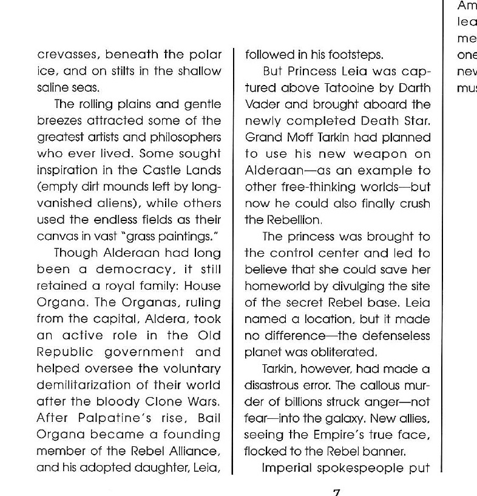
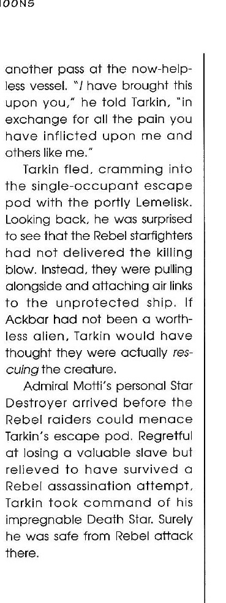
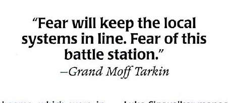

# Grand Moff Tarkin

- **Aliases:** Tarkin, Wilhuff Tarkin
- **Era:** GCW
- **Continuity:** default Legends; entries present for: Canon, Legends
- **Research tier:** untiered (not listed as INTRO/DEEP/MASTERY in legends-feats.md)
- **Entries:** 309 (167 with quotations; 6 quotations extended to the full sentence/passage from the source text on file; 88 marked as fragments; 95 before the 2026-11-17 fragment fill). Rebuilt 2026-11-17 from 365 old entries; old file: `characters/_bak/grand-moff-tarkin.md.bak-20261117`.
- **How to read:** each entry is the quotation in full (block quote), then its source and point of view. "Note" lines are summaries from our notes, not quotations. `[fragment — full passage not on file]` means the source text is not on the box, so only the words in our notes are shown. Debate and forum material is in the last section and is unverified.

# LEGENDS (Legends / EU — main focus)

## Dark Lord trilogy (Labyrinth of Evil, Revenge of the Sith, Dark Lord): novel notes from the other agent (reference copy)

> “Your fugitive Jedi, my apprentice,” Sidious said. “They are traveling to Kashyyyk.” He tipped his head to one side. “Perhaps, Lord Vader, they hope to lay a trap for you.”
— Source: L4391-4395; L4153 — Dark Lord: The Rise of Darth Vader: combat and Force feats (novel, read in full).
(Excerpt widened 2026-11-17 to the relevant passage, word for word from Dark Lord: The Rise of Darth Vader (James Luceno) (text copy `MEGA_Legend_The_Episode_Novelizations_Star_Wars_Revenge_of_the_Sith_03_Dark_Lord_The_Rise_of_Darth_Vader_James_Luceno_epub`).)
(Fragment completed 2026-11-17: full sentence/passage matched word for word in the source text on file: `MEGA_Legend_The_Episode_Novelizations_Star_Wars_Revenge_of_the_Sith_03_Dark_Lord_The_Rise_of_Darth_Vader_James_Luceno_epub`.)
Note text that was attached to the quote line: *(L4153)*
Context: F41. [III/35, L4153] Sidious: knowing where the Jedi are going. Possibly foresight, possibly Tarkin's tracking (L4391-4395).
Our notes: `notes/materials/022-dark-lord-trilogy/dark-lord-novel-feats.md:155`

> “The commanders are not pleased. They don’t know who Lord Vader is under his mask and armor. They have no inkling of the true extent of his power, or how he came to be your liaison with the regional governors and the fledgling Imperial Navy. There are rumors, my lord.”
— Source: L5517 — Dark Lord: The Rise of Darth Vader: combat and Force feats (novel, read in full); S59 [Epi/50, L5517] Tarkin: the commanders.
(Excerpt widened 2026-11-17 to the relevant passage, word for word from Dark Lord: The Rise of Darth Vader (James Luceno) (text copy `MEGA_Legend_The_Episode_Novelizations_Star_Wars_Revenge_of_the_Sith_03_Dark_Lord_The_Rise_of_Darth_Vader_James_Luceno_epub`).)
(Fragment completed 2026-11-17: full sentence/passage matched word for word in the source text on file: `MEGA_Legend_The_Episode_Novelizations_Star_Wars_Revenge_of_the_Sith_03_Dark_Lord_The_Rise_of_Darth_Vader_James_Luceno_epub`.)
Note text that was attached to the quote line: *(L5517)*
Note (our notes, around the quote): S59 [Epi/50, L5517] Tarkin: the commanders "have no inkling of the true extent of his power" (L5517)
Our notes: `notes/materials/022-dark-lord-trilogy/dark-lord-novel-feats.md:322`

- Note (summary from our notes, not a quotation): Kashyyyk (Ch. 36-49): Tarkin lets the Jedi through the checkpoint so the Empire has an excuse to invade and enslave Wookiees as labor for the battle station (L4423, L5501). The Jedi fight beside Tarfful and Chewbacca. Vader lands, kills more than 20 Wookiees, beheads Forte and Kulka, and maims Anno, Lu, and Poorf. He toys with Starstone until Shryne arrives. Shryne sends the others away and duels Vader alone. Vader wins with TK, reveals that "Lord Sidious is the Emperor" (L5201) and that he is Anakin Skywalker, "the twenty-first" (L5225), and Shryne dies as his vision comes true. Starstone's group uses a Separatist destroyer as a bomb on the Interdictor, and hundreds of ships escape. Kashyyyk falls.
  — Source: L5201; L5225 — Dark Lord: The Rise of Darth Vader: combat and Force feats (novel, read in full).
Our notes: `notes/materials/022-dark-lord-trilogy/dark-lord-novel-feats.md:397`

> What is one world, more or less, when the galaxy is being reordered? *(L5489)*
— Source: L5489 — Dark Lord: The Rise of Darth Vader: combat and Force feats (novel, read in full); Emperor to Tarkin. POV: Emperor, about Grand Moff Tarkin.
Label in our notes: L5489
Our notes: `notes/materials/022-dark-lord-trilogy/dark-lord-novel-feats.md:699`

- Note (summary from our notes, not a quotation): Chapter (added 2026-10-11, from the L-numbers above and the chapter headings in the source text): Part IV, Ch50
  — Source: Dark Lord: The Rise of Darth Vader: combat and Force feats (novel, read in full).
Context: Emperor to Tarkin: «What is one world, more or less, when the galaxy is being reordered?» (L5489)
Our notes: `notes/materials/022-dark-lord-trilogy/dark-lord-novel-feats.md:700`

- Note (summary from our notes, not a quotation): Role: a newly titled Moff who engineers the Kashyyyk invasion.
  — Source: Dark Lord: The Rise of Darth Vader: combat and Force feats (novel, read in full).
Our notes: `notes/materials/022-dark-lord-trilogy/dark-lord-novel-feats.md:838`

> The cabin to which he was ultimately led was in the uppermost reaches of the Star Destroyer’s conning tower. On entering, Vader found his host sitting behind a gleaming slab of desk, plainly debating whether to remain seated or to stand; whether to place himself on equal footing with Vader, or, by appearance, to continue to suggest superiority. Knowing, in any case, that Vader preferred to remain on his feet, his host was not likely to gesture him to a chair. Knowing, too, that Vader was capable of strangling him from clear across the cabin might also figure into his decision.
>
> Tarkin smiled again. “Lord Vader, the Emperor is apprised of everything.”
>
> But his apprentice isn’t, Vader thought.
>
> “I ordered our checkpoint personnel to ignore the obvious fact that the transport’s signature has been altered,” Tarkin continued, “and to ignore, as well, the fact that whatever codes the transport furnished were likely to be counterfeit.”
— Source: Dark Lord: The Rise of Darth Vader: combat and Force feats (novel, read in full); Statements: knows.
(Excerpt widened 2026-11-17 to the relevant passage, word for word from Dark Lord: The Rise of Darth Vader (James Luceno) (text copy `MEGA_Legend_The_Episode_Novelizations_Star_Wars_Revenge_of_the_Sith_03_Dark_Lord_The_Rise_of_Darth_Vader_James_Luceno_epub`).)
(Excerpt widened 2026-11-17 to the relevant passage, word for word from Dark Lord: The Rise of Darth Vader (James Luceno) (text copy `MEGA_Legend_The_Episode_Novelizations_Star_Wars_Revenge_of_the_Sith_03_Dark_Lord_The_Rise_of_Darth_Vader_James_Luceno_epub`).)
(Fragment completed 2026-11-17: full sentence/passage matched word for word in the source text on file: `MEGA_Legend_The_Episode_Novelizations_Star_Wars_Revenge_of_the_Sith_03_Dark_Lord_The_Rise_of_Darth_Vader_James_Luceno_epub`.)
Note (our notes, around the quote): Statements: knows «that Vader was capable of strangling him from clear across the cabin» [IV/37, L4355]. «Lord Vader, the Emperor is apprised of everything.» [IV/37, L4395].
Our notes: `notes/materials/022-dark-lord-trilogy/dark-lord-novel-feats.md:839`; `notes/materials/022-dark-lord-trilogy/dark-lord-novel-feats.md:318`; `notes/materials/022-dark-lord-trilogy/dark-lord-novel-feats.md:309`

- Note (summary from our notes, not a quotation): Scaling: non-Force. Included for his statements about Vader.
  — Source: Dark Lord: The Rise of Darth Vader: combat and Force feats (novel, read in full).
Our notes: `notes/materials/022-dark-lord-trilogy/dark-lord-novel-feats.md:840`

- Note (summary from our notes, not a quotation): Scaling implications: none. Included because the task list names him. He has no real role in this book.
  — Source: Revenge of the Sith (Matthew Stover novelization): Power-Scaling Research Notes.
Our notes: `notes/materials/022-dark-lord-trilogy/rots-novel-notes.md:698`

- Note (summary from our notes, not a quotation): Complete quote register (1 lines: every sentence that names Tarkin, verbatim, in book order):
  — Source: Revenge of the Sith (Matthew Stover novelization): Power-Scaling Research Notes.
Our notes: `notes/materials/022-dark-lord-trilogy/rots-novel-notes.md:699`

> From the bridge of a Star Destroyer, two Sith Lords stand with a sector governor named Tarkin, and survey the growing skeleton of a spherical battle station the size of a moon . . .
— Source: Revenge of the Sith (Matthew Stover novelization): Power-Scaling Research Notes; Ch21 A New Jedi Order L8879.
Context: Complete quote register (1 lines: every sentence that names Tarkin, verbatim, in book order):
Our notes: `notes/materials/022-dark-lord-trilogy/rots-novel-notes.md:700`; `notes/materials/022-dark-lord-trilogy/rots-novel-notes.md:697`

## Jedi Academy Trilogy (Kevin J. Anderson, 1994): Jedi Search, Dark Apprentice, Champions of the Force (power-scaling notes)

> During the long days of repairs Daala had come to terms with her failure. She had misplaced her priorities. Her only reason for existence should have been to protect Maw Installation, not to wage a private war against the Rebellion. Once the Rebels knew of the Installation, they would no doubt attempt to steal its secrets. Her priority now was to fulfill the mission that Tarkin had given her.
— Source: Champions of the Force, ch.26, PDF p.165 — Owner Material 026 — Jedi Academy Trilogy: Champions of the Force (Kevin J. Anderson); Daala recommits to Tarkin’s mission (also: Grand Moff Tarkin). POV: Daala recommits, about Grand Moff Tarkin.
(Excerpt widened 2026-11-17 to the relevant passage, word for word from Champions of the Force (Kevin Anderson), Chapter 26 (text copy `MEGA_Legend_The_Jedi_Academy_Trilogy_Star_Wars_Jedi_Academy_03_Champions_of_the_Force_Kevin_J_Anderson_epub`).)
Note (our notes, around the quote): Daala recommits to Tarkin’s mission (also: Grand Moff Tarkin): "During the long days of repairs Daala had come to terms with her failure. She had misplaced her priorities. Her only reason for existence should have been to protect Maw Installation, not to wage a private war against the Rebellion." Source: Champions of the Force, ch.26, PDF p.165
Our notes: `notes/materials/026-jedi-academy-trilogy/champions-of-the-force.md:159`

> Tol Sivron had met a man named Tarkin there, an ambitious young commander who already had several ships and who intended to make the small outpost on Ryloth a strategically important refueling station in the Outer Rim.
— Source: Champions of the Force, ch.17, PDF p.120 — Owner Material 026 — Jedi Academy Trilogy: Champions of the Force (Kevin J. Anderson); Tol Sivron’s backstory with Tarkin (also: Tol Sivron). POV: Tol Sivron’s backstory with Tarkin.
Note (our notes, around the quote): Tol Sivron’s backstory with Tarkin (also: Tol Sivron): "Tol Sivron had met a man named Tarkin there, an ambitious young commander who already had several ships and who intended to make the small outpost on Ryloth a strategically important refueling station in the Outer Rim." Source: Champions of the Force, ch.17, PDF p.120
Our notes: `notes/materials/026-jedi-academy-trilogy/champions-of-the-force.md:265`

> “Liquidating a dozen small threats is easier than rooting out one well-established center of defiance,” his image said, in a speech given on Carida explaining the “Tarkin Doctrine.” “Rule through the fear of force rather than through force itself. If we use our strength wisely, we shall intimidate thousands of worlds with the example of a select few.”
— Source: Dark Apprentice, ch.17, PDF p.131 — Owner Material 026 — Jedi Academy Trilogy: Dark Apprentice (Kevin J. Anderson).
Note (our notes, around the quote): Tarkin hologram (Tarkin Doctrine) watched by Daala (also: Grand Moff Tarkin): "“Liquidating a dozen small threats is easier than rooting out one well-established center of defiance,” his image said, in a speech given on Carida explaining the “Tarkin Doctrine.” “Rule through the fear of force rather than through force itself. If we use our strength wisely, we shall intimidate thousands of worlds with the example of a select few.”" Source: Dark Apprentice, ch.17, PDF p.131
Our notes: `notes/materials/026-jedi-academy-trilogy/dark-apprentice.md:168`

> Daala’s need for vengeance forged her heart into a white-hot brand that threatened to burst its way steaming and pulsing out of her chest. “Grand Moff Tarkin once said that setbacks are merely an opportunity for us to do twice as much damage the second time around.”
— Source: Dark Apprentice, ch.28, PDF p.211 — Owner Material 026 — Jedi Academy Trilogy: Dark Apprentice (Kevin J. Anderson); Tarkin maxim (also: Grand Moff Tarkin). POV: Tarkin maxim.
(Excerpt widened 2026-11-17 to the relevant passage, word for word from Dark Apprentice (Kevin Anderson), Chapter 28 (text copy `MEGA_Legend_The_Jedi_Academy_Trilogy_Star_Wars_Jedi_Academy_02_Dark_Apprentice_Kevin_J_Anderson_epub`).)
Note (our notes, around the quote): Tarkin maxim (also: Grand Moff Tarkin): "“Grand Moff Tarkin once said that setbacks are merely an opportunity for us to do twice as much damage the second time around.”" Source: Dark Apprentice, ch.28, PDF p.211
Our notes: `notes/materials/026-jedi-academy-trilogy/dark-apprentice.md:176`

> In the privacy of her chambers, she allowed herself to miss the one person in the Imperial Military Academy who had seen her talent. Tarkin had raised her rank to admiral—as far as she knew, the highest rank held by any female in the Imperial armed forces.
— Source: Dark Apprentice, ch.17, PDF p.131 — Owner Material 026 — Jedi Academy Trilogy: Dark Apprentice (Kevin J. Anderson); Daala’s rank (also: Grand Moff Tarkin). POV: Daala’s rank, about Grand Moff Tarkin.
(Excerpt widened 2026-11-17 to the relevant passage, word for word from Dark Apprentice (Kevin Anderson), Chapter 17 (text copy `MEGA_Legend_The_Jedi_Academy_Trilogy_Star_Wars_Jedi_Academy_02_Dark_Apprentice_Kevin_J_Anderson_epub`).)
Note (our notes, around the quote): Daala’s rank (also: Grand Moff Tarkin): "Tarkin had raised her rank to admiral—as far as she knew, the highest rank held by any female in the Imperial armed forces." Source: Dark Apprentice, ch.17, PDF p.131
Our notes: `notes/materials/026-jedi-academy-trilogy/dark-apprentice.md:185`

> Furgan had discovered to his surprise that Daala herself had been trained on Carida. Digging through old records, he had uncovered many disciplinary actions taken against her, reprimands in her file. Even then she had been a maverick, performing admirably but refusing to learn her place, insisting that she deserved promotions instead of others. Furgan had no record of her advancement to admiral, but Moff Tarkin had transferred her to his personal staff after one of his brief inspection tours. Furgan had no other information about Daala since that time.
— Source: Dark Apprentice, ch.24, PDF p.185 — Owner Material 026 — Jedi Academy Trilogy: Dark Apprentice (Kevin J. Anderson); Daala’s Carida record (also: Grand Moff Tarkin). POV: Daala’s Carida record, about Grand Moff Tarkin.
(Excerpt widened 2026-11-17 to the relevant passage, word for word from Dark Apprentice (Kevin Anderson), Chapter 24 (text copy `MEGA_Legend_The_Jedi_Academy_Trilogy_Star_Wars_Jedi_Academy_02_Dark_Apprentice_Kevin_J_Anderson_epub`).)
Note (our notes, around the quote): Daala’s Carida record (also: Grand Moff Tarkin): "Even then she had been a maverick, performing admirably but refusing to learn her place, insisting that she deserved promotions instead of others. Furgan had no record of her advancement to admiral, but Moff Tarkin had transferred her to his personal staff after one of his brief inspection tours." Source: Dark Apprentice, ch.24, PDF p.185
Our notes: `notes/materials/026-jedi-academy-trilogy/dark-apprentice.md:186`

> Ackbar gestured with his hands and spoke with an undignified rapidity, as if he knew he didn’t have much time. “Before I was liberated by the Rebel Alliance, I was Moff Tarkin’s indentured assistant. He took great pleasure in telling me exactly how he was going to enslave other worlds. By observing him I learned the fundamentals of space-warfare tactics, including Tarkin’s own favorite strategies.”
— Source: Dark Apprentice, ch.17, PDF p.137 — Owner Material 026 — Jedi Academy Trilogy: Dark Apprentice (Kevin J. Anderson); Ackbar reads Tarkin’s trick (also: Admiral Ackbar). POV: Ackbar reads Tarkin’s trick.
(Excerpt widened 2026-11-17 to the relevant passage, word for word from Dark Apprentice (Kevin Anderson), Chapter 17 (text copy `MEGA_Legend_The_Jedi_Academy_Trilogy_Star_Wars_Jedi_Academy_02_Dark_Apprentice_Kevin_J_Anderson_epub`).)
Note (our notes, around the quote): Ackbar reads Tarkin’s trick (also: Admiral Ackbar): "“Before I was liberated by the Rebel Alliance, I was Moff Tarkin’s indentured assistant. He took great pleasure in telling me exactly how he was going to enslave other worlds. By observing him I learned the fundamentals of space-warfare tactics, including Tarkin’s own favorite strategies.”" Source: Dark Apprentice, ch.17, PDF p.137
Our notes: `notes/materials/026-jedi-academy-trilogy/dark-apprentice.md:253`

> Tarkin had placed a hand on her shoulders, squeezing with a grip made of steel cords. “Daala,” he said, “I am giving you enough power to turn any planet to slag.”
— Source: Jedi Search, ch.19, PDF p.190 — Owner Material 026 — Jedi Academy Trilogy: Jedi Search (Kevin J. Anderson); Tarkin to Daala at Kuat (also: Grand Moff Tarkin). POV: Tarkin.
Note (our notes, around the quote): Tarkin to Daala at Kuat (also: Grand Moff Tarkin): "Tarkin had placed a hand on her shoulders, squeezing with a grip made of steel cords. “Daala,” he said, “I am giving you enough power to turn any planet to slag.”" Source: Jedi Search, ch.19, PDF p.190
Our notes: `notes/materials/026-jedi-academy-trilogy/jedi-search.md:146`

> That tactic had been one of Tarkin’s prime lessons. Command through the fear of force rather than force itself. Daala had 180,000 people at her disposal, not counting the weapons designers in Maw Installation itself. She did not want to waste them.
— Source: Jedi Search, ch.19, PDF p.191 — Owner Material 026 — Jedi Academy Trilogy: Jedi Search (Kevin J. Anderson); Daala’s command philosophy (also: Grand Moff Tarkin). POV: Daala’s command philosophy, about Grand Moff Tarkin.
(Excerpt widened 2026-11-17 to the relevant passage, word for word from Jedi Search (Kevin Anderson), Chapter 19 (text copy `MEGA_Legend_The_Jedi_Academy_Trilogy_Star_Wars_Jedi_Academy_01_Jedi_Search_Kevin_J_Anderson_epub`).)
Note (our notes, around the quote): Daala’s command philosophy (also: Grand Moff Tarkin): "That tactic had been one of Tarkin’s prime lessons. Command through the fear of force rather than force itself. Daala had 180,000 people at her disposal, not counting the weapons designers in Maw Installation itself." Source: Jedi Search, ch.19, PDF p.191
Our notes: `notes/materials/026-jedi-academy-trilogy/jedi-search.md:156`

> They became lovers, two like minds, hard in spirit and unforgiving. Though he was older than she, Tarkin had a power and a charisma that Daala admired. Gaunt and tireless in his quiet viciousness, he had a self-confidence so great that he did not flinch even in the presence of Darth Vader.
— Source: Jedi Search, ch.19, PDF p.195 — Owner Material 026 — Jedi Academy Trilogy: Jedi Search (Kevin J. Anderson); Daala and Tarkin (also: Grand Moff Tarkin, Darth Vader). POV: Daala and Tarkin.
Note (our notes, around the quote): Daala and Tarkin (also: Grand Moff Tarkin, Darth Vader): "They became lovers, two like minds, hard in spirit and unforgiving. Though he was older than she, Tarkin had a power and a charisma that Daala admired. Gaunt and tireless in his quiet viciousness, he had a self-confidence so great that he did not flinch even in the presence of Darth Vader." Source: Jedi Search, ch.19, PDF p.195
Our notes: `notes/materials/026-jedi-academy-trilogy/jedi-search.md:158`

> “You have obviously not been sent by Grand Moff Tarkin. Shuttle Endor, you are to be taken prisoner immediately and brought aboard Imperial Star Destroyer Gorgon for deep interrogation. Any attempt at escape or resistance will result in your being destroyed.”
— Source: Jedi Search, ch.17, PDF p.176 — Owner Material 026 — Jedi Academy Trilogy: Jedi Search (Kevin J. Anderson); The Gorgon still answers to Tarkin (also: Grand Moff Tarkin). POV: The Gorgon still answers, about Grand Moff Tarkin.
Note (our notes, around the quote): The Gorgon still answers to Tarkin (also: Grand Moff Tarkin): "“You have obviously not been sent by Grand Moff Tarkin. Shuttle Endor, you are to be taken prisoner immediately and brought aboard Imperial Star Destroyer Gorgon for deep interrogation. Any attempt at escape or resistance will result in your being destroyed.”" Source: Jedi Search, ch.17, PDF p.176
Our notes: `notes/materials/026-jedi-academy-trilogy/jedi-search.md:163`

> In silence Qwi and her three surviving classmates went to the window of the educational sphere so they could watch as turbolasers from the Victory-class Star Destroyer obliterated Pillik’s honeycomb settlement in punishment for his failure.
— Source: Jedi Search, ch.23, PDF p.228 — Owner Material 026 — Jedi Academy Trilogy: Jedi Search (Kevin J. Anderson); Qwi’s training under Tarkin (also: Grand Moff Tarkin). POV: Qwi’s training under Tarkin.
Note (our notes, around the quote): Qwi’s training under Tarkin (also: Grand Moff Tarkin): "In silence Qwi and her three surviving classmates went to the window of the educational sphere so they could watch as turbolasers from the Victory-class Star Destroyer obliterated Pillik’s honeycomb settlement in punishment for his failure." Source: Jedi Search, ch.23, PDF p.228
Our notes: `notes/materials/026-jedi-academy-trilogy/jedi-search.md:215`

## Star Wars: The New Essential Chronology (Del Rey, 2005): power-scaling and lore notes

> Tarkin had already been contacted by Darth Sidious and was seduced by the Sith Lord's vision of a Human High Culture
> [fragment — full passage not on file]
— Source: Part Two: The Fall of the Republic; Grand Moff Tarkin; Palpatine (Darth Sidious) — Tarkin seduced by Sidious.
Note (our notes, around the quote): Grand Moff Tarkin; Palpatine (Darth Sidious) — Tarkin seduced by Sidious: "Tarkin had already been contacted by Darth Sidious and was seduced by the Sith Lord's vision of a Human High Culture" Source: The New Essential Chronology, p.46

Our notes: `notes/materials/027-new-essential-chronology/02-part-two-fall-of-the-republic.md:154`

- Note (summary from our notes, not a quotation): Grand Moff Tarkin — art caption: "Grand Moff Wilhuff Tarkin" Source: The New Essential Chronology, p.87, caption
  — Source: Part Three: The Empire and the New Order.

Our notes: `notes/materials/027-new-essential-chronology/03-part-three-empire-new-order.md:37`

> When completed, the weapon would be able to destroy entire planets with its hypermatter-fueled superlaser.
— Source: Part Three: The Empire and the New Order; Grand Moff Tarkin — Death Star.
Note (our notes, around the quote): Grand Moff Tarkin — Death Star: "When completed, the weapon would be able to destroy entire planets with its hypermatter-fueled superlaser." Source: The New Essential Chronology, p.87

Our notes: `notes/materials/027-new-essential-chronology/03-part-three-empire-new-order.md:39`

> When a warship arrived under the command of Wilhuff Tarkin, it landed on top of the protesters and killed hundreds.
— Source: Part Three: The Empire and the New Order; Grand Moff Tarkin; Palpatine (Darth Sidious) — Ghorman Massacre.
Note (our notes, around the quote): Grand Moff Tarkin; Palpatine (Darth Sidious) — Ghorman Massacre: "When a warship arrived under the command of Wilhuff Tarkin, it landed on top of the protesters and killed hundreds." Source: The New Essential Chronology, p.88

Our notes: `notes/materials/027-new-essential-chronology/03-part-three-empire-new-order.md:46`

> Rule through the fear of force, rather than by force itself.
— Source: Part Five: The Galactic Civil War; Grand Moff Tarkin — Tarkin Doctrine.
Note (our notes, around the quote): Grand Moff Tarkin — Tarkin Doctrine: ""Rule through the fear of force, rather than by force itself."" Source: The New Essential Chronology, p.107

Our notes: `notes/materials/027-new-essential-chronology/05-part-five-galactic-civil-war.md:18`

> If a small ship were to or the bounty hunter Valance could extract a confession. fly into a surface trench and launch a proton torpedo into a Through the torture of another informant, Vader finally got | tiny thermal exhaust port, the torpedo could reach the hyper- the confirmation he sought—the Death Star's destroyer was matter core and annihilate the battle station in a catastrophic Luke Skywalker, Vader's own son. chain reaction.
>
> As the Death Star orbited into a firing position to destroy with the design flaw that had allowed the Rebels to an- the jungke moon, swarms of Rebel X-wings and Y-wings nihilate his Death Star. He summoned Bevel Lemelisk, the attacked like stinging Insects. Many Rebels died In the Battle of Yavin, but one pilot-Luke Skywalker, using his newfound skills with the Force=scored a direct hit. The Death Star exploded, killing Grand Moff Tarkin and eliminat- ing the Empire's ultimate weapon that had taken nearly twenty years to build.
>
> It was an enormous victory for the Rebel Alliance.
>
> IMPACT AND CONSEQUENCES 0-0.5 AB.Y. n his modified TIE fighter, Darth Vader escaped the destruction of the Death Star.
— Source: Part Five: The Galactic Civil War; Luke Skywalker; Grand Moff Tarkin — Battle of Yavin.
(Excerpt widened 2026-11-17 to the relevant passage, word for word from research primary new essential chronology nec paged (text copy `research_primary_new_essential_chronology_nec_paged_txt_88b808b5bc`).)
(Excerpt widened 2026-11-17 to the relevant passage, word for word from research primary new essential chronology nec paged (text copy `research_primary_new_essential_chronology_nec_paged_txt_88b808b5bc`).)
(Full sentence/passage taken from the source text on file: `research_primary_new_essential_chronology_nec_paged_txt`.)
Note (our notes, around the quote): Luke Skywalker; Grand Moff Tarkin — Battle of Yavin: "one pilot—Luke Skywalker, using his newfound skills with the Force—scored a direct hit. The Death Star exploded, killing Grand Moff Tarkin" Source: The New Essential Chronology, p.110

Our notes: `notes/materials/027-new-essential-chronology/05-part-five-galactic-civil-war.md:45`

## The Jedi Academy Sourcebook (WEG, 1996): power-scaling and lore notes

> She soon developed a reputation as a bril- liant tactician, and might have gone on to an equally brilliant career in the fleet, but for one seemingly insurmountable problem — the anti- female prejudices present through every layer of the Imperial Navy, all the way up to the Emperor himself. Daala found herself in a dead- end career, watching less qualified men pass her by on their way to their own commands.
>
> Out of frustration and a desperate desire to be heard and respected by her peers, Daala created a false persona in the computer net- works to serve as her mouthpiece. This fictional person rapidly made a name for “himself” by proposing radical but effective tactics and ideas, and drew the attention of Moff Tarkin. He trav- eled to Carida to find this brilliant new tactician and found Daala instead.
>
> More innovative and open-minded than the Emperor (or perhaps simply more willing to make use of all resources available to him), Tarkin quietly took Daala under his wing, reas- signing her to his personal staff in the Outer Rim, and set her to work. She absorbed every lesson Tarkin taught her, and came to analyze every scenario and situation in light of how he might respond to it.
>
> More innovative and open-minded than the Emperor (or perhaps simply more willing to make use of all resources available to him), Tarkin quietly took Daala under his wing, reas- signing her to his personal staff in the Outer Rim, and set her to work. She absorbed every lesson Tarkin taught her, and came to analyze every scenario and situation in light of how he might respond to it. She became his prize pro- tege and lover. Under his supervision, she be- came a commander, and then a captain.
— Source: Chapter Five: Forces of the Empire; Admiral Daala — Admiral Daala — Tarkin's protege.
(Excerpt widened 2026-11-17 to the relevant passage, word for word from research primary jedi academy sourcebook jas clean (text copy `research_primary_jedi_academy_sourcebook_jas_clean_txt_04b8ab0d44`).)
(Excerpt widened 2026-11-17 to the relevant passage, word for word from research primary jedi academy sourcebook jas clean (text copy `research_primary_jedi_academy_sourcebook_jas_clean_txt_04b8ab0d44`).)
Note (our notes, around the quote): Admiral Daala — Admiral Daala — Tarkin's protege: "She absorbed every lesson Tarkin taught her, and came to analyze every scenario and situation in light of how he might respond to it." Source: The Jedi Academy Sourcebook, p.56

Our notes: `notes/materials/029-jedi-academy-sourcebook/05-ch5-forces-of-the-empire.md:53`

> Her plan is tactically flawless, but it reveals her greatest weakness: her tendency to rely on Tarkin's strategies rather than her own instincts.
— Source: Chapter Five: Forces of the Empire; Admiral Daala — Admiral Daala — Calamari.
Note (our notes, around the quote): Admiral Daala — Admiral Daala — Calamari: "Her plan is tactically flawless, but it reveals her greatest weakness: her tendency to rely on Tarkin's strategies rather than her own instincts." Source: The Jedi Academy Sourcebook, p.56

Our notes: `notes/materials/029-jedi-academy-sourcebook/05-ch5-forces-of-the-empire.md:61`

> This —_ asteroid). allowed him to keep the location of Maw Instal- The Hub is the only asteroid with an internal lation secret even from the upper levels of the — docking baylarge enough to accommodate more government, Tarkin successfully kept knowl- — than two shuttles at a time. There are weapon edge of the installation from otherImperiallead- _ batteries scattered here and there on the sur- ers, having no desire to subject his pet project face of the Hub, though they are not seriously totheir political games and intrigues. He played intended to fend off invaders. The Star Destroy- afar more dangerous game by seeking to hide —_— ers are intended to provide defense should Maw the specifics of his project from the Emperor. Installation come under attack.
>
> Tarkin and Daala believed that Palpatine never did learn the location of Maw Installation. The Lab Modules After several false starts, Bevel Lemelisk led The lab modules are where most of the super- theteam tocreatea working prototypeofamost weapon projects are developed and built.
>
> Tarkin and Daala believed that Palpatine never did learn the location of Maw Installation. The Lab Modules After several false starts, Bevel Lemelisk led The lab modules are where most of the super- theteam tocreatea working prototypeofamost weapon projects are developed and built. Lab A impressive superweapon, code-named Death was once the primary site for the Death Star Star.
— Source: Chapter Six: Maw Installation.
(Excerpt widened 2026-11-17 to the relevant passage, word for word from research primary jedi academy sourcebook jas clean (text copy `research_primary_jedi_academy_sourcebook_jas_clean_txt_04b8ab0d44`).)
(Excerpt widened 2026-11-17 to the relevant passage, word for word from research primary jedi academy sourcebook jas clean (text copy `research_primary_jedi_academy_sourcebook_jas_clean_txt_04b8ab0d44`).)
Note (our notes, around the quote): Palpatine (Darth Sidious); Admiral Daala — Maw Installation — secret from the Emperor: "Tarkin and Daala believed that Palpatine never did learn the location of Maw Installation." Source: The Jedi Academy Sourcebook, p.65

Our notes: `notes/materials/029-jedi-academy-sourcebook/06-ch6-maw-installation.md:28`

> Of the 10 Omwati children who entered the program, only Qwi made it through all the training.
— Source: Chapter Six: Maw Installation; Qwi Xux — Qwi Xux — Tarkin's training program.
Note (our notes, around the quote): Qwi Xux — Qwi Xux — Tarkin's training program: "Of the 10 Omwati children who entered the program, only Qwi made it through all the training." Source: The Jedi Academy Sourcebook, p.75

Our notes: `notes/materials/029-jedi-academy-sourcebook/06-ch6-maw-installation.md:102`

## The Complete Star Wars Encyclopedia, Vol. I (A–G)

> One of the first to be enslaved, Ackbar eventually became an interpreter for Grand Moff Tarkin.
— Source: scan pages 1–40; Admiral Ackbar; Grand Moff Tarkin.
Note (our notes, around the quote): Admiral Ackbar; Grand Moff Tarkin: "One of the first to be enslaved, Ackbar eventually became an interpreter for Grand Moff Tarkin." Source: The Complete Star Wars Encyclopedia, Vol. I, p.9

Our notes: `notes/materials/030-complete-star-wars-encyclopedia-vol-1/00-v1-scan-001-040.md:143`

> It was Tarkin's influence that allowed Daala to ascend to the rank of admiral, and he placed her in command of a quartet of Imperial Star Destroyers patrolling the Outer Rim Territories.
— Source: scan pages 161–200; Grand Moff Tarkin; Admiral Daala.
Note (our notes, around the quote): Grand Moff Tarkin; Admiral Daala: "It was Tarkin's influence that allowed Daala to ascend to the rank of admiral, and he placed her in command of a quartet of Imperial Star Destroyers patrolling the Outer Rim Territories." Source: The Complete Star Wars Encyclopedia, Vol. I, p.159

Our notes: `notes/materials/030-complete-star-wars-encyclopedia-vol-1/04-v1-scan-161-200.md:115`

> The Death Star had the horrifying ability to destroy an entire planet teeming with life with a relatively short burst ofits superlaser. Emperor Pal­ patine hoped it would instill the terror needed to keep thousands of star systems in line. It was rule by fear of force. That doctrine, and the development of the superweapon, came from the mind of Wilhuff Tarkin, who was inspired by Raith Sienar's initial visions of an Expeditionary Battle Plan­ etoid. Sienar's technical genius foresaw that a moon-sized battle station was feasible, but it was Tarkin who understood how it could be applied to enforce order in the galaxy. During the Separatist crisis, Sith Lord Darth Tyranus tapped into the engineering prowess of many of the galaxy's leading build­ ers, and had the Geonosians develop a set of working schematics for such a battle station. Dooku then delivered these secret plans to his master, Darth Sidious, who-as Chancellor Palpatine-was in a position to make the sta­ tion a reality once he supplanted the Galactic Republic with the New Order. Tarkin had great difficulty in adapting the Geonosian plans into a working model, so he ordered a think tank of engineers within a top-secret research facility, the Maw Instal­ lation, to review the schematics for feasibil­ ity from top to bottom and create a working prototype Death Star.
— Source: scan pages 161–200; Grand Moff Tarkin. POV: Grand Moff Tarkin.
(Excerpt widened 2026-11-17 to the relevant passage, word for word from research primary cse vol1 (text copy `research_primary_cse_vol1_pdf_45a954be6d`).)
(Excerpt widened 2026-11-17 to the relevant passage, word for word from research primary cse vol1 (text copy `research_primary_cse_vol1_pdf_45a954be6d`).)
Note (our notes, around the quote): Grand Moff Tarkin: "Sienar's technical genius foresaw that a moon-sized battle station was feasible, but it was Tarkin who understood how it could be applied to enforce order in the galaxy." Source: The Complete Star Wars Encyclopedia, Vol. I, p.176

Our notes: `notes/materials/030-complete-star-wars-encyclopedia-vol-1/04-v1-scan-161-200.md:270`

## The Complete Star Wars Encyclopedia, Vol. II (H–O)

> Invincible (4) The flagship of the small, independent war fleet amassed by Ranulph Tarkin before the Stark Hyperspace Conflict.
— Source: scan pages 81–120; Grand Moff Tarkin. POV: Grand Moff Tarkin.
Note (our notes, around the quote): Grand Moff Tarkin: "Invincible (4) The flagship of the small, independent war fleet amassed by Ranulph Tarkin before the Stark Hyperspace Conflict." Source: The Complete Star Wars Encyclopedia, Vol. II, p.110

Our notes: `notes/materials/031-complete-star-wars-encyclopedia-vol-2/02-v2-scan-081-120.md:227`

> The Invincible survived the navigational computer virus developed by laco Stark and unleashed on Tarkin's ships.
— Source: scan pages 81–120; Grand Moff Tarkin. POV: Grand Moff Tarkin.
Note (our notes, around the quote): Grand Moff Tarkin: "The Invincible survived the navigational computer virus developed by laco Stark and unleashed on Tarkin's ships." Source: The Complete Star Wars Encyclopedia, Vol. II, p.110

Our notes: `notes/materials/031-complete-star-wars-encyclopedia-vol-2/02-v2-scan-081-120.md:229`

> In short order, the /nvincible was destroyed, although many officers and crew managed to evacuate, including Tarkin.
— Source: scan pages 81–120; Grand Moff Tarkin. POV: Grand Moff Tarkin.
Note (our notes, around the quote): Grand Moff Tarkin: "In short order, the /nvincible was destroyed, although many officers and crew managed to evacuate, including Tarkin." Source: The Complete Star Wars Encyclopedia, Vol. II, p.110

Our notes: `notes/materials/031-complete-star-wars-encyclopedia-vol-2/02-v2-scan-081-120.md:231`

> According to Jarvis's report, Tarkin was traveling to the Tallaan Shipyard when his shuttle malfunctioned and exploded.
— Source: scan pages 121–160; Grand Moff Tarkin. POV: Grand Moff Tarkin.
Note (our notes, around the quote): Grand Moff Tarkin: "According to Jarvis's report, Tarkin was traveling to the Tallaan Shipyard when his shuttle malfunctioned and exploded." Source: The Complete Star Wars Encyclopedia, Vol. II, p.141

Our notes: `notes/materials/031-complete-star-wars-encyclopedia-vol-2/03-v2-scan-121-160.md:190`

> He was chosen for the position because Palpatine wanted to avoid the hubris that killed Wilhuff Tarkin and lost the first Death Star.
— Source: scan pages 161–200; Palpatine (Darth Sidious); Grand Moff Tarkin.
Note (our notes, around the quote): Palpatine (Darth Sidious); Grand Moff Tarkin: "He was chosen for the position because Palpatine wanted to avoid the hubris that killed Wilhuff Tarkin and lost the first Death Star." Source: The Complete Star Wars Encyclopedia, Vol. II, p.158

Our notes: `notes/materials/031-complete-star-wars-encyclopedia-vol-2/04-v2-scan-161-200.md:37`

> Manticore One of the four Star Destroyers stationed at the Maw Installation by Grand Moff Tarkin during the New Order.
— Source: scan pages 281–320; Grand Moff Tarkin. POV: Grand Moff Tarkin.
Note (our notes, around the quote): Grand Moff Tarkin: "Manticore One of the four Star Destroyers stationed at the Maw Installation by Grand Moff Tarkin during the New Order." Source: The Complete Star Wars Encyclopedia, Vol. II, p.286

Our notes: `notes/materials/031-complete-star-wars-encyclopedia-vol-2/07-v2-scan-281-320.md:107`

> The Manticore never completed its mission, however: It was destroyed when Admiral Ackbar recognized Daala's tactics as those of Tarkin.
— Source: scan pages 281–320; Admiral Ackbar; Admiral Daala; Grand Moff Tarkin.
Note (our notes, around the quote): Admiral Ackbar; Admiral Daala; Grand Moff Tarkin: "The Manticore never completed its mission, however: It was destroyed when Admiral Ackbar recognized Daala's tactics as those of Tarkin." Source: The Complete Star Wars Encyclopedia, Vol. II, p.287

Our notes: `notes/materials/031-complete-star-wars-encyclopedia-vol-2/07-v2-scan-281-320.md:114`

> Many Mon Calamari were enslaved by the Empire, including Ackbar, who was forced to be the personal servant of Grand Moff Tarkin.
— Source: scan pages 321–360; Admiral Ackbar; Grand Moff Tarkin.
Note (our notes, around the quote): Admiral Ackbar; Grand Moff Tarkin: "Many Mon Calamari were enslaved by the Empire, including Ackbar, who was forced to be the personal servant of Grand Moff Tarkin." Source: The Complete Star Wars Encyclopedia, Vol. II, p.325

Our notes: `notes/materials/031-complete-star-wars-encyclopedia-vol-2/08-v2-scan-321-360.md:78`

> However, when Nord decided to use the ionic cannon aboard the Tarkin to take out Luke Skywalker and Leia Organa, the superweapon exploded.
— Source: scan pages 361–400; Grand Moff Tarkin; Luke Skywalker; Leia Organa Solo.
Note (our notes, around the quote): Grand Moff Tarkin; Luke Skywalker; Leia Organa Solo: "However, when Nord decided to use the ionic cannon aboard the Tarkin to take out Luke Skywalker and Leia Organa, the superweapon exploded." Source: The Complete Star Wars Encyclopedia, Vol. II, p.389

Our notes: `notes/materials/031-complete-star-wars-encyclopedia-vol-2/09-v2-scan-361-400.md:282`

## The Complete Star Wars Encyclopedia, Vol. III (P–Z)

> Taken aboard the Death Star, Leia was able to block interrogation probes, but the battle station's commander, Grand Moff Tarkin, threatened to destroy Leia's planet of Alderaan—home to her father and billions of other residents—if she didn't reveal the site of the secret Rebel base.
— Source: scan pages 161–200; Leia Organa Solo; Grand Moff Tarkin.
Note (our notes, around the quote): Leia Organa Solo; Grand Moff Tarkin: "Taken aboard the Death Star, Leia was able to block interrogation probes, but the battle station's commander, Grand Moff Tarkin, threatened to destroy Leia's planet of Alderaan—home to her father and billions of other residents—if she didn't reveal the site of the secret Rebel base." Source: The Complete Star Wars Encyclopedia, Vol. III, p.177

Our notes: `notes/materials/032-complete-star-wars-encyclopedia-vol-3/04-v3-scan-161-200.md:270`

> Quietly, she named Dantooine, a lie that Tarkin believed, but he ordered Alderaan to be destroyed anyway.
— Source: scan pages 161–200; Grand Moff Tarkin. POV: Grand Moff Tarkin.
Note (our notes, around the quote): Grand Moff Tarkin: "Quietly, she named Dantooine, a lie that Tarkin believed, but he ordered Alderaan to be destroyed anyway." Source: The Complete Star Wars Encyclopedia, Vol. III, p.177

Our notes: `notes/materials/032-complete-star-wars-encyclopedia-vol-3/04-v3-scan-161-200.md:272`

> When Grand Moff Tarkin was killed aboard the first Death Star, the Empire released an official statement claiming that Tarkin had actually died in a shuttle crash at the Tallaan shipyards.
— Source: scan pages 201–240; Grand Moff Tarkin. POV: Grand Moff Tarkin.
Note (our notes, around the quote): Grand Moff Tarkin: "When Grand Moff Tarkin was killed aboard the first Death Star, the Empire released an official statement claiming that Tarkin had actually died in a shuttle crash at the Tallaan shipyards." Source: The Complete Star Wars Encyclopedia, Vol. III, p.214

Our notes: `notes/materials/032-complete-star-wars-encyclopedia-vol-3/05-v3-scan-201-240.md:183`

- Note (summary from our notes, not a quotation): Page contents: 858 words, 16 paragraphs | headings/entries: Tarhassan; Taris; Tarkin, Gideon
  — Source: scan pages 201–240.
Our notes: `notes/materials/032-complete-star-wars-encyclopedia-vol-3/05-v3-scan-201-240.md:233`

- Note (summary from our notes, not a quotation): Page contents: 912 words, 30 paragraphs | headings/entries: Tarkin, Ranulph; Tarkin, Rivoche; Tarkin's Fang; Tarkona, Nolaa_; Tarkosa, Brace; Tarkov; Tari; Tarlen, Bentu Pall; Tar Morden; Tarn, Rhad
  — Source: scan pages 201–240.
Our notes: `notes/materials/032-complete-star-wars-encyclopedia-vol-3/05-v3-scan-201-240.md:242`

> After interrogations failed, Tarkin made Leia watch as he destroyed her adopted planet of Alderaan and its billions of inhabitants with the Death Star's main weapon.
— Source: scan pages 201–240; Grand Moff Tarkin; Leia Organa Solo — entry/section: Tarkin, Gideon.
Note (our notes, around the quote): Grand Moff Tarkin; Leia Organa Solo — entry/section: Tarkin, Gideon: "After interrogations failed, Tarkin made Leia watch as he destroyed her adopted planet of Alderaan and its billions of inhabitants with the Death Star's main weapon." Source: The Complete Star Wars Encyclopedia, Vol. III, p.221

Our notes: `notes/materials/032-complete-star-wars-encyclopedia-vol-3/05-v3-scan-201-240.md:244`

> When Colonel Nord decided to use the ionic cannon aboard the Tarkin to take out Luke Skywalker and Leia Organa, the superweapon exploded.
— Source: scan pages 281–320; Grand Moff Tarkin; Luke Skywalker; Leia Organa Solo.
Note (our notes, around the quote): Grand Moff Tarkin; Luke Skywalker; Leia Organa Solo: "When Colonel Nord decided to use the ionic cannon aboard the Tarkin to take out Luke Skywalker and Leia Organa, the superweapon exploded." Source: The Complete Star Wars Encyclopedia, Vol. III, p.309

Our notes: `notes/materials/032-complete-star-wars-encyclopedia-vol-3/07-v3-scan-281-320.md:286`

## Power of the Jedi Sourcebook (d20, 2002)

> Grand Moff Tarkin maneuvered the dreaded Death Star into position to destroy the moon with its superlaser.
— Source: Chapter Seven: Where the Force is strong; Index; Grand Moff Tarkin. POV: Grand Moff Tarkin.
Note (our notes, around the quote): Grand Moff Tarkin: "Grand Moff Tarkin maneuvered the dreaded Death Star into position to destroy the moon with its superlaser." Source: Power of the Jedi Sourcebook, p.138

Our notes: `notes/materials/033-power-of-the-jedi-sourcebook/07-ch7-locations-index.md:58`

> The Death Star was destroyed—and Grand Moff Tarkin along with it.
— Source: Chapter Seven: Where the Force is strong; Index; Grand Moff Tarkin. POV: Grand Moff Tarkin.
Note (our notes, around the quote): Grand Moff Tarkin: "The Death Star was destroyed—and Grand Moff Tarkin along with it." Source: Power of the Jedi Sourcebook, p.138

Our notes: `notes/materials/033-power-of-the-jedi-sourcebook/07-ch7-locations-index.md:62`

## The New Essential Guide to Characters (2002)

> From them, she learned of Tarkin's death and the Empire's defeat at Yavin.
— Source: scan pages 31–60; Grand Moff Tarkin. POV: Grand Moff Tarkin.
Note (our notes, around the quote): Grand Moff Tarkin: "From them, she learned of Tarkin's death and the Empire's defeat at Yavin." Source: The New Essential Guide to Characters, p.48

Our notes: `notes/materials/034-new-essential-guide-to-characters/01-negc-scan-031-060.md:82`

> Motivated by fear, he set to work designing the second Death Star, and also built the Tarkin superlaser.
— Source: scan pages 91–120; Grand Moff Tarkin. POV: Grand Moff Tarkin.
Note (our notes, around the quote): Grand Moff Tarkin: "Motivated by fear, he set to work designing the second Death Star, and also built the Tarkin superlaser." Source: The New Essential Guide to Characters, p.112

Our notes: `notes/materials/034-new-essential-guide-to-characters/03-negc-scan-091-120.md:120`

- Note (summary from our notes, not a quotation): Page contents: 607 words, 18 paragraphs | headings/entries: Five years before the Battle of; Tarkin moved back to Eriadu full; TT penne wow enmeere yeh berh midlet
  — Source: scan pages 151–180.
Our notes: `notes/materials/034-new-essential-guide-to-characters/05-negc-scan-151-180.md:180`

- Note (summary from our notes, not a quotation): Grand Moff Tarkin: "Three years after the Battle of Naboo, Tarkin saw an opportunity for advancement if he could acquire one of the legendary "living starships" from the hidden world Zonama Sekot." Source: The New Essential Guide to Characters, p.180
  — Source: scan pages 151–180. POV: Grand Moff Tarkin.

Our notes: `notes/materials/034-new-essential-guide-to-characters/05-negc-scan-151-180.md:182`

> Tarkin briefly met young Anakin, who tried to use a Force chokehold on the older man.
— Source: scan pages 151–180; Grand Moff Tarkin; Darth Vader (Anakin Skywalker).
Note (our notes, around the quote): Grand Moff Tarkin; Darth Vader (Anakin Skywalker): "Tarkin briefly met young Anakin, who tried to use a Force chokehold on the older man." Source: The New Essential Guide to Characters, p.180

Our notes: `notes/materials/034-new-essential-guide-to-characters/05-negc-scan-151-180.md:184`

> Tarkin's first act as commander of the Death Star was to destroy the penal planet around which it orbited.
— Source: scan pages 151–180; Grand Moff Tarkin. POV: Grand Moff Tarkin.
Note (our notes, around the quote): Grand Moff Tarkin: "Tarkin's first act as commander of the Death Star was to destroy the penal planet around which it orbited." Source: The New Essential Guide to Characters, p.181

Our notes: `notes/materials/034-new-essential-guide-to-characters/05-negc-scan-151-180.md:191`

> Tarkin couldn't help but imagine what a colossal bargaining chip he would hold should he train the Death Star's superlaser on Coruscant.
— Source: scan pages 151–180; Grand Moff Tarkin. POV: Grand Moff Tarkin.
Note (our notes, around the quote): Grand Moff Tarkin: "Tarkin couldn't help but imagine what a colossal bargaining chip he would hold should he train the Death Star's superlaser on Coruscant." Source: The New Essential Guide to Characters, p.181

Our notes: `notes/materials/034-new-essential-guide-to-characters/05-negc-scan-151-180.md:193`

> When Princess Leia refused to divulge the location of the main Rebel base, Tarkin destroyed the peaceful world of Alderaan on his own initiative, without consulting the Emperor, then moved against the Rebel base on Yavin 4.
— Source: scan pages 151–180; Leia Organa Solo; Grand Moff Tarkin.
Note (our notes, around the quote): Leia Organa Solo; Grand Moff Tarkin: "When Princess Leia refused to divulge the location of the main Rebel base, Tarkin destroyed the peaceful world of Alderaan on his own initiative, without consulting the Emperor, then moved against the Rebel base on Yavin 4." Source: The New Essential Guide to Characters, p.181

Our notes: `notes/materials/034-new-essential-guide-to-characters/05-negc-scan-151-180.md:195`

> More than three years after Tarkin's death, Imperial officers honored his memory by naming an experimental superlaser test bed— essentially a scaled-down Death Star—for the late Grand Moff.
— Source: scan pages 151–180; Grand Moff Tarkin. POV: Grand Moff Tarkin.
Note (our notes, around the quote): Grand Moff Tarkin: "More than three years after Tarkin's death, Imperial officers honored his memory by naming an experimental superlaser test bed— essentially a scaled-down Death Star—for the late Grand Moff." Source: The New Essential Guide to Characters, p.181

Our notes: `notes/materials/034-new-essential-guide-to-characters/05-negc-scan-151-180.md:197`

## Dark Side Sourcebook (d20, 2001)

> He worked with the Imperial inquisitors to hunt Force-users, either to wipe them out or bring them into the Emperor's fold. He also discovered and subjugated the deadly Noghri of the planet Honoghr, making them his personal strike force. When the Emperor authorized Grand Moff Tarkin to begin the construction of a new weapon-one that would demonstrate once and for all that no planet could ever be a safe place for the Emperor's enemies to hide-he put Darth Vader under Tarkin's command. This "Death Star" was a hyperdrivecapable battle station as large as a small moon, equipped with a powerful superlaser that could destroy an entire planet with a single blast. The evil Tarkin demonstrated the battle station's power to Rebel leader Princess Leia Organa by destroying her homeworld of Alderaan. The mission to rescue Princess Leia and bring the plans of the Death Star to the Rebellion also brought an old foe back to Darth Vader: Obi-Wan Kenobi, his old master. Vader and Kenobi battled one last time, and in the end, Kenobi sacrificed himself so that his new apprentice Luke Skywalker-Vader's own son, though he did not realize it at the time-could escape with the princess.
— Source: Chapter Five: Dark Side Traditions (Sith Empire, Set Harth, prophets, Brakiss…); Grand Moff Tarkin; Leia Organa Solo.
(Excerpt widened 2026-11-17 to the relevant passage, word for word from research primary dark side sourcebook dss (text copy `research_primary_dark_side_sourcebook_dss_pdf_9cd3453f4a`).)
(Excerpt widened 2026-11-17 to the relevant passage, word for word from research primary dark side sourcebook dss (text copy `research_primary_dark_side_sourcebook_dss_pdf_9cd3453f4a`).)
Note (our notes, around the quote): Grand Moff Tarkin; Leia Organa Solo: "The evil Tarkin demonstrated the battle station's power to Rebel leader Princess Leia Organa by destroying her homeworld of Alderaan." Source: Dark Side Sourcebook, p.92

Our notes: `notes/materials/035-dark-side-sourcebook/05-ch5-traditions.md:227`

## Sourcebooks/Rebellion Era Sourcebook.pdf [Star Wars Roleplaying Game (d20, 2000)] (scan pages 1–60)

- Note (summary from our notes, not a quotation): Page contents: 931 words, 27 paragraphs | headings/entries: Y crema,; IND ABiawHa; Tarkin and the New Order; Unknown to Thel or the Duros,; Se
  — Source: Sourcebooks/Rebellion Era Sourcebook.pdf [Star Wars Roleplaying Game (d20.
Our notes: `notes/materials/037-sw-d20-folder/043-rebellion-era-sourcebook-scan-001-060.md:102`

> Although he spent little time on Coruscant, preferring to work from his Outer Rim home of Eriadu, Tarkin was nonetheless a powerful figure in the Emperor's court. In matters of philosophy and policy, only the Emperor's opinions carried more weight.
— Source: Sourcebooks/Rebellion Era Sourcebook.pdf [Star Wars Roleplaying Game (d20.
Note (our notes, around the quote): Grand Moff Tarkin — entry/section: Tarkin second only to the Emperor: "Although he spent little time on Coruscant, preferring to work from his Outer Rim home of Eriadu, Tarkin was nonetheless a powerful figure in the Emperor's court. In matters of philosophy and policy, only the Emperor's opinions carried more weight." Source: *Rebellion Era Sourcebook* (SWRPG d20), scan p.19

Our notes: `notes/materials/037-sw-d20-folder/043-rebellion-era-sourcebook-scan-001-060.md:104`

> He also kept the capabilities of Force-users keenly in mind, maintaining a close relationship with Darth Vader over the decades, and calling on the Dark Lord's services almost as frequently as the Emperor himself did.
— Source: Sourcebooks/Rebellion Era Sourcebook.pdf [Star Wars Roleplaying Game (d20.
Note (our notes, around the quote): Grand Moff Tarkin; Darth Vader (Anakin Skywalker) — entry/section: Tarkin's use of Vader: "He also kept the capabilities of Force-users keenly in mind, maintaining a close relationship with Darth Vader over the decades, and calling on the Dark Lord's services almost as frequently as the Emperor himself did." Source: *Rebellion Era Sourcebook* (SWRPG d20), scan p.19

Our notes: `notes/materials/037-sw-d20-folder/043-rebellion-era-sourcebook-scan-001-060.md:106`

- Note (summary from our notes, not a quotation): Page contents: Death Star's final test upon completion was the destruction of Horuz (penal system); Tarkin believed it 'invincible'; Bevel Lemelisk Expert 12 (hand-read)
  — Source: Sourcebooks/Rebellion Era Sourcebook.pdf [Star Wars Roleplaying Game (d20.
Our notes: `notes/materials/037-sw-d20-folder/043-rebellion-era-sourcebook-scan-001-060.md:117`

> He believed that the fully functional battle station was invincible—the ultimate, impervious pinnacle of military technology.
— Source: Sourcebooks/Rebellion Era Sourcebook.pdf [Star Wars Roleplaying Game (d20.
Note (our notes, around the quote): Grand Moff Tarkin — entry/section: Tarkin Doctrine (Rebellion Era Sourcebook, Ch1): "He believed that the fully functional battle station was invincible—the ultimate, impervious pinnacle of military technology." Source: *Rebellion Era Sourcebook* (SWRPG d20), scan p.20

Our notes: `notes/materials/037-sw-d20-folder/043-rebellion-era-sourcebook-scan-001-060.md:119`

> Thanks to the twisted genius of Grand Moff Tarkin's -_- . think tank, the Death Star could be used to destroy any r 1¢ Death Star was created to be the ultimate too! of : es vorld that would not bend to Imperial might. ¢ conquest and subjugation, The original Death Star was the largest mobile space station ever built.
— Source: Sourcebooks/Rebellion Era Sourcebook.pdf [Star Wars Roleplaying Game (d20; Grand Moff Tarkin. POV: Grand Moff Tarkin.
Note (our notes, around the quote): Grand Moff Tarkin: "Thanks to the twisted genius of Grand Moff Tarkin's -_- . think tank, the Death Star could be used to destroy any r 1¢ Death Star was created to be the ultimate too! of : es vorld that would not bend to Imperial might. ¢ conquest and subjugation, The original Death Star was the largest mobile space station ever built." Source: *Rebellion Era Sourcebook* (SWRPG d20), scan p.42

Our notes: `notes/materials/037-sw-d20-folder/043-rebellion-era-sourcebook-scan-001-060.md:257`

> The Death Star was designed to destroy planets, Most Imperial strategists assumed that the threat the battle station posed would be deterrent enough for most worlds and their populations, but Grand Moff Tarkin believed that the Rebellion was growing too audacious, too bold, Tarkin convinced the Emperor that the best course of action would be to demonstrate the full power of the Death Star by eliminating a Rebel target.
— Source: Sourcebooks/Rebellion Era Sourcebook.pdf [Star Wars Roleplaying Game (d20; Grand Moff Tarkin. POV: Grand Moff Tarkin.
Note (our notes, around the quote): Grand Moff Tarkin: "The Death Star was designed to destroy planets, Most Imperial strategists assumed that the threat the battle station posed would be deterrent enough for most worlds and their populations, but Grand Moff Tarkin believed that the Rebellion was growing too audacious, too bold, Tarkin convinced the Emperor that the best course of action would be to demonstrate the full power of the Death Star by eliminating a Rebel target." Source: *Rebellion Era Sourcebook* (SWRPG d20), scan p.43

Our notes: `notes/materials/037-sw-d20-folder/043-rebellion-era-sourcebook-scan-001-060.md:264`

> When Princess Leia fell into Tarkin's hands, the Grand Moff threatened to destroy her homeworld unless she revealed the location of the main Rebel base.
— Source: Sourcebooks/Rebellion Era Sourcebook.pdf [Star Wars Roleplaying Game (d20; Leia Organa Solo; Grand Moff Tarkin.
Note (our notes, around the quote): Leia Organa Solo; Grand Moff Tarkin: "When Princess Leia fell into Tarkin's hands, the Grand Moff threatened to destroy her homeworld unless she revealed the location of the main Rebel base." Source: *Rebellion Era Sourcebook* (SWRPG d20), scan p.43

Our notes: `notes/materials/037-sw-d20-folder/043-rebellion-era-sourcebook-scan-001-060.md:266`

> Grand Moff Tarkin finally convinced her to reveal the location of the Rebel base when he threatened to destroy her home planet of Alderaan.
— Source: Sourcebooks/Rebellion Era Sourcebook.pdf [Star Wars Roleplaying Game (d20; Grand Moff Tarkin. POV: Grand Moff Tarkin.
Note (our notes, around the quote): Grand Moff Tarkin: "Grand Moff Tarkin finally convinced her to reveal the location of the Rebel base when he threatened to destroy her home planet of Alderaan." Source: *Rebellion Era Sourcebook* (SWRPG d20), scan p.57

Our notes: `notes/materials/037-sw-d20-folder/043-rebellion-era-sourcebook-scan-001-060.md:348`

## Sourcebooks/Rebellion Era Sourcebook.pdf [Star Wars Roleplaying Game (d20, 2000)] (scan pages 61–120)

- Note (summary from our notes, not a quotation): Page contents: Maw Installation established by Tarkin, 'kept hidden even from the Emperor'; Kessel Run in 12 parsecs (like Han Solo did) = Astrogate DC 21 then Pilot DC 25+; Renn Volz (Ion Ring wrecked Rion's environment) (hand-read)
  — Source: Sourcebooks/Rebellion Era Sourcebook.pdf [Star Wars Roleplaying Game (d20.
Our notes: `notes/materials/037-sw-d20-folder/043-rebellion-era-sourcebook-scan-061-120.md:119`

## Sourcebooks/Rebellion Era Sourcebook.pdf [Star Wars Roleplaying Game (d20, 2000)] (scan pages 121–161)

> It wasn't long thereafter when Ackbar, who made a habit of studying Imperial tactics and defenses while enslaved by Tarkin, returned to Mon Calamari and convinced his people to join the Alliance.
— Source: Sourcebooks/Rebellion Era Sourcebook.pdf [Star Wars Roleplaying Game (d20; Admiral Ackbar; Grand Moff Tarkin.
Note (our notes, around the quote): Admiral Ackbar; Grand Moff Tarkin: "It wasn't long thereafter when Ackbar, who made a habit of studying Imperial tactics and defenses while enslaved by Tarkin, returned to Mon Calamari and convinced his people to join the Alliance." Source: *Rebellion Era Sourcebook* (SWRPG d20), scan p.138

Our notes: `notes/materials/037-sw-d20-folder/043-rebellion-era-sourcebook-scan-121-161.md:146`

> Warlord Zsinj becomes one of the most powerful Imperial warlords of the New Republic era.
— Source: Sourcebooks/Rebellion Era Sourcebook.pdf [Star Wars Roleplaying Game (d20; Grand Moff Tarkin — entry/section: Warlords (Rebellion Era Sourcebook, Ch4).
Note (our notes, around the quote): Grand Moff Tarkin — entry/section: Warlords (Rebellion Era Sourcebook, Ch4): "Warlord Zsinj becomes one of the most powerful Imperial warlords of the New Republic era." Source: *Rebellion Era Sourcebook* (SWRPG d20), scan p.159

Our notes: `notes/materials/037-sw-d20-folder/043-rebellion-era-sourcebook-scan-121-161.md:293`

## Star Wars Gamer/Star Wars Gamer 07.pdf [Star Wars Roleplaying Game (d20, 2000)] (scan pages 61–108)

> Vader's tearm relies on Star Destroyers and Tarkin's technological terror to cover the system during the initial three planets, but the Sith Master isn't particularly con cerned with space—notice that he doesn't even have his own TIE with him in this deck The capital ships are there to be sacrificed if necessary.
— Source: Star Wars Gamer/Star Wars Gamer 07.pdf [Star Wars Roleplaying Game (d20,; Darth Vader (Anakin Skywalker); Grand Moff Tarkin.
Note (our notes, around the quote): Darth Vader (Anakin Skywalker); Grand Moff Tarkin: "Vader's tearm relies on Star Destroyers and Tarkin's technological terror to cover the system during the initial three planets, but the Sith Master isn't particularly con cerned with space—notice that he doesn't even have his own TIE with him in this deck The capital ships are there to be sacrificed if necessary." Source: *Star Wars Gamer 07* (SWRPG d20), scan p.90

Our notes: `notes/materials/037-sw-d20-folder/056-star-wars-gamer-07-scan-061-108.md:198`

## Characters/Miniatures/Icons of New Hope.pdf [Star Wars Roleplaying Game Revised Core (d20, 2002)]

- Note (summary from our notes, not a quotation): Page contents: Leia stats (Noble 4/Soldier 2, CC D, from image); Darth Vader, Dark Jedi (Fringer 1/Jedi Guardian 10/Sith Lord 1, CC F); Grand Moff Tarkin (Soldier 2/Noble 2, CC C) (hand-read)
  — Source: Characters/Miniatures/Icons of New Hope.pdf [Star Wars Roleplaying Game R.
Our notes: `notes/materials/037-sw-d20-folder/110-icons-of-new-hope.md:44`

> Force Skills: Affect Mind +6, Battlemind +10, Enhance Ability +10, Farseeing +5, Fear +9, Force Defense +9, Force Grip +13, Force Strike +6, Move Object +9, See Force +7, Telepathy +9. Feats: Exotic Weapon Proficiency (lightsaber), Force­Sensitive, Gearhead, Power Attack, Skill Emphasis (Pilot), Starship Operation (starfighter), Weapon Group Proficiency (blaster pistols, primitive weapons, simple weapons, vibro weapons). Force Feats: Alter, Burst of Speed, Control, Force Whirlwind, Lightsaber Defense, Mettle, Rage, Sense. Grand Moff Tarkin The former Governor Wilhuff Tarkin was on board the Death Star during the Battle of Yavin. It was his dream that the entire galaxy would be ruled by fear, and he believed that the destruction of the Rebel Alliance by his battle station would bring the dream to reality. Grand Moff Tarkin decided not to evacuate during what he thought would be a moment of triumph, and he was killed when Luke Skywalker destroyed the Death Star. Grand Moff Tarkin: Male Human Soldier 2/Noble 2; Init +0; Defense 14 (+4 class); Spd 10 m; VP/WP 27/13; Atk +4 melee (1d3+1, unarmed) or +3 ranged (3d6 or DC 15 stun, blaster pistol); SQ Bonus class skill (Intimidate), favor +1, inspire confidence; SV Fort +4, Ref +2, Will +4; SZ M; FP 2; DSP 5; Rep +2; Str 13, Dex 11, Con 13, Int 15, Wis 12, Cha 19. Challenge Code C.
— Source: Characters/Miniatures/Icons of New Hope.pdf [Star Wars Roleplaying Game R.
(Excerpt widened 2026-11-17 to the relevant passage, word for word from research primary sw d20 folder files Star Wars Roleplaying Game Revised Core Characters Miniatures Icons of New Hope (text copy `research_primary_sw_d20_folder_files_Star_Wars_Roleplaying_Game_Revised_Core_Characters_Miniatures_Icons_of_New_Hope_pdf_8b98da6091`).)
(Excerpt widened 2026-11-17 to the relevant passage, word for word from research primary sw d20 folder files Star Wars Roleplaying Game Revised Core Characters Miniatures Icons of New Hope (text copy `research_primary_sw_d20_folder_files_Star_Wars_Roleplaying_Game_Revised_Core_Characters_Miniatures_Icons_of_New_Hope_pdf_8b98da6091`).)
Note (our notes, around the quote): Grand Moff Tarkin; Luke Skywalker — entry/section: Tarkin's dream and death: "The former Governor Wilhuff Tarkin was on board the Death Star during the Battle of Yavin. It was his dream that the entire galaxy would be ruled by fear, and he believed that the destruction of the Rebel Alliance by his battle station would bring the dream to reality. Grand Moff Tarkin decided not to evacuate during what he thought would be a moment of triumph, and he was killed when Luke Skywalker destroyed the Death Star." Source: *Icons of New Hope* (SWRPG d20 Revised Core), scan p.3

Our notes: `notes/materials/037-sw-d20-folder/110-icons-of-new-hope.md:50`

- Note (summary from our notes, not a quotation): Page contents: Tarkin skills end, feats (hand-read)
  — Source: Characters/Miniatures/Icons of New Hope.pdf [Star Wars Roleplaying Game R.
Our notes: `notes/materials/037-sw-d20-folder/110-icons-of-new-hope.md:61`

## Jedi Counselling/Jedi Counseling 18 - Cortosis Bullets.pdf [Star Wars Roleplaying Game Revised Core (d20, 2002)]

> If the Battle of Yavin hasn't yet occurred, and none of the characters have any reason to suspect that there's a Rebel base on Yavin's moon, or that it's going to be targeted by the Death Star (which is a secret battle station, after all), don't let them just fly off to the Yavin system for no apparent reason. Second, give them incomplete information, and let them draw inaccurate conclusions. Tell them that they know where the Rebel base is, and let them set a course for it, go into hyperspace ­­ and ultimately set down on Dantooine, fooled just like Grand Moff Tarkin was.
— Source: Jedi Counselling/Jedi Counseling 18 - Cortosis Bullets.pdf [Star Wars Rol; Grand Moff Tarkin — entry/section: Fooled just like Tarkin.
(Excerpt widened 2026-11-17 to the relevant passage, word for word from ary sw d20 folder files Star Wars Roleplaying Game Revised Core Jedi Counselling Jedi Counseling 18 Cortosis Bullets (text copy `ary_sw_d20_folder_files_Star_Wars_Roleplaying_Game_Revised_Core_Jedi_Counselling_Jedi_Counseling_18_Cortosis_Bullets_pdf_7bb8857c51`).)
Note (our notes, around the quote): Grand Moff Tarkin — entry/section: Fooled just like Tarkin: "Second, give them incomplete information, and let them draw inaccurate conclusions. Tell them that they know where the Rebel base is, and let them set a course for it, go into hyperspace -- and ultimately set down on Dantooine, fooled just like Grand Moff Tarkin was." Source: *Jedi Counseling 18 - Cortosis Bullets* (SWRPG d20 Revised Core), scan p.3

Our notes: `notes/materials/037-sw-d20-folder/181-jedi-counseling-18-cortosis-bullets.md:28`

## Jedi Counselling/Jedi Counseling 25 - Dark Side Downside.pdf [Star Wars Roleplaying Game Revised Core (d20, 2002)]

> "Perhaps you should ask the Emperor." ­­ but it creates too much ambiguity for a straight "good­versus­evil" campaign. However, if you want your players' characters to use dark side abilities, but you don't want them to rack up DSPs so fast, you could award them DSPs only for the first time they use the dark side abilities, and not again for the same skill until they beat their last die roll. So they have to keep track of their best rolls (or, better, you do), and if, for example, a player's roll of 22 with Force Grip beats his previous "top score" of 20 with the same skill, then he gets another DSP. Just a suggestion. Q: Here's an additional question: Say the Emperor orders Grand Moff Tarkin to destroy Alderaan. Tarkin orders an officer to pull the switch. Who gets the DSP? All of them? Or were the lower two merely following orders? A: Yikes! That line of reasoning didn't work at Nuremburg, and it won't work in the Star Wars universe, either. All three of them would get DSPs (though in A New Hope, it was actually Grand Moff Tarkin's decision; the Emperor didn't order it).
— Source: Jedi Counselling/Jedi Counseling 25 - Dark Side Downside.pdf [Star Wars R.
(Excerpt widened 2026-11-17 to the relevant passage, word for word from y sw d20 folder files Star Wars Roleplaying Game Revised Core Jedi Counselling Jedi Counseling 25 Dark Side Downside (text copy `y_sw_d20_folder_files_Star_Wars_Roleplaying_Game_Revised_Core_Jedi_Counselling_Jedi_Counseling_25_Dark_Side_Downside_pdf_3f17174ea1`).)
(Excerpt widened 2026-11-17 to the relevant passage, word for word from y sw d20 folder files Star Wars Roleplaying Game Revised Core Jedi Counselling Jedi Counseling 25 Dark Side Downside (text copy `y_sw_d20_folder_files_Star_Wars_Roleplaying_Game_Revised_Core_Jedi_Counselling_Jedi_Counseling_25_Dark_Side_Downside_pdf_3f17174ea1`).)
Note (our notes, around the quote): Palpatine (Darth Sidious); Grand Moff Tarkin — entry/section: Who gets the Dark Side Point for Alderaan (question): "Q: Here's an additional question: Say the Emperor orders Grand Moff Tarkin to destroy Alderaan. Tarkin orders an officer to pull the switch. Who gets the DSP? All of them? Or were the lower two merely following orders?" Source: *Jedi Counseling 25 - Dark Side Downside* (SWRPG d20 Revised Core), scan p.1

Our notes: `notes/materials/037-sw-d20-folder/189-jedi-counseling-25-dark-side-downside.md:16`

> Just a suggestion. Q: Here's an additional question: Say the Emperor orders Grand Moff Tarkin to destroy Alderaan. Tarkin orders an officer to pull the switch. Who gets the DSP? All of them? Or were the lower two merely following orders? A: Yikes! That line of reasoning didn't work at Nuremburg, and it won't work in the Star Wars universe, either. All three of them would get DSPs (though in A New Hope, it was actually Grand Moff Tarkin's decision; the Emperor didn't order it). Q: Apologies if you've already answered this, but I've gone through several of your archives and I haven't seen this addressed anywhere. The rules in Chapter Nine state: "A tainted character . . . takes a ­4 penalty on any Force skill checks made to use light side Force skills." But what exactly are light side skills? Everything that isn't dark?
— Source: Jedi Counselling/Jedi Counseling 25 - Dark Side Downside.pdf [Star Wars R.
(Excerpt widened 2026-11-17 to the relevant passage, word for word from y sw d20 folder files Star Wars Roleplaying Game Revised Core Jedi Counselling Jedi Counseling 25 Dark Side Downside (text copy `y_sw_d20_folder_files_Star_Wars_Roleplaying_Game_Revised_Core_Jedi_Counselling_Jedi_Counseling_25_Dark_Side_Downside_pdf_3f17174ea1`).)
(Excerpt widened 2026-11-17 to the relevant passage, word for word from y sw d20 folder files Star Wars Roleplaying Game Revised Core Jedi Counselling Jedi Counseling 25 Dark Side Downside (text copy `y_sw_d20_folder_files_Star_Wars_Roleplaying_Game_Revised_Core_Jedi_Counselling_Jedi_Counseling_25_Dark_Side_Downside_pdf_3f17174ea1`).)
Note (our notes, around the quote): Palpatine (Darth Sidious); Grand Moff Tarkin — entry/section: Who gets the Dark Side Point for Alderaan: "A: Yikes! That line of reasoning didn't work at Nuremburg, and it won't work in the Star Wars universe, either. All three of them would get DSPs (though in A New Hope, it was actually Grand Moff Tarkin's decision; the Emperor didn't order it)." Source: *Jedi Counseling 25 - Dark Side Downside* (SWRPG d20 Revised Core), scan p.1

Our notes: `notes/materials/037-sw-d20-folder/189-jedi-counseling-25-dark-side-downside.md:18`

## Jedi Counselling/Jedi Counseling 56.pdf [Star Wars Roleplaying Game Revised Core (d20, 2002)]

- Note (summary from our notes, not a quotation): Page contents: Mara/Emperor Force points, line of sight, Tarkin commander effect, doors, Rescue the Princess (hand-read)
  — Source: Jedi Counselling/Jedi Counseling 56.pdf [Star Wars Roleplaying Game Revis.
Our notes: `notes/materials/037-sw-d20-folder/223-jedi-counseling-56.md:25`

- Note (summary from our notes, not a quotation): Grand Moff Tarkin — entry/section: Tarkin's commander effect: "Q: I have a few questions about Grand Moff Tarkin's commander effect. First, does Grand Moff Tarkin need to have line of sight to the allies he is activating?
  — Source: Jedi Counselling/Jedi Counseling 56.pdf [Star Wars Roleplaying Game Revis.
Our notes: `notes/materials/037-sw-d20-folder/223-jedi-counseling-56.md:29`

- Note (summary from our notes, not a quotation): A: No. Remember, Tarkin isn't activating the characters, you (the player) are. Tarkin only needs line of sight to an enemy at the start of any given phase." Source: *Jedi Counseling 56* (SWRPG d20 Revised Core), scan p.3
  — Source: Jedi Counselling/Jedi Counseling 56.pdf [Star Wars Roleplaying Game Revis.

Our notes: `notes/materials/037-sw-d20-folder/223-jedi-counseling-56.md:30`

## Jedi Counselling/Jedi Counseling 92.pdf [Star Wars Roleplaying Game Revised Core (d20, 2002)]

> Would this prevent me from combining fire? A: No. When you activate characters to combine fire, they don't count against your limit of activations per phase. Thus, regardless of the number of activations you can make in a phase (whether it's the normal 2 or a different number resulting from San Hill, Grand Moff Tarkin, and so on), you can activate any number of additional characters to combine fire.
— Source: Jedi Counselling/Jedi Counseling 92.pdf [Star Wars Roleplaying Game Revis.
(Excerpt widened 2026-11-17 to the relevant passage, word for word from research primary sw d20 folder files Star Wars Roleplaying Game Revised Core Jedi Counselling Jedi Counseling 92 (text copy `research_primary_sw_d20_folder_files_Star_Wars_Roleplaying_Game_Revised_Core_Jedi_Counselling_Jedi_Counseling_92_pdf_781788762d`).)
Note (our notes, around the quote): San Hill; Grand Moff Tarkin — entry/section: San Hill and combined fire: "A: No. When you activate characters to combine fire, they don't count against your limit of activations per phase. Thus, regardless of the number of activations you can make in a phase (whether it's the normal 2 or a different number resulting from San Hill, Grand Moff Tarkin, and so on), you can activate any number of additional characters to combine fire." Source: *Jedi Counseling 92* (SWRPG d20 Revised Core), scan p.3

Our notes: `notes/materials/037-sw-d20-folder/263-jedi-counseling-92.md:31`

## Locations/Planet Hoppers/Carida - Heavy Duty/Part 3 - War Games.pdf [Star Wars Roleplaying Game Revised Core (d20, 2002)]

- Note (summary from our notes, not a quotation): Page contents: War games in Tarkin's Teeth with MT-ST "bug walkers"; Shira's walker was fully armed; she killed half a dozen cadets and was laughing; written off as "instructor error" (hand-read)
  — Source: Locations/Planet Hoppers/Carida - Heavy Duty/Part 3 - War Games.pdf [Star.
Our notes: `notes/materials/037-sw-d20-folder/588-part-3-war-games.md:10`

## Locations/Planet Hoppers/Coruscant - Center of the Empire/Part 1 - Bright Lights, Very Big City.pdf [Star Wars Roleplaying Game Revised Core (d20, 2002)]

> Only Imperials live in Imperial Center
> [fragment — full passage not on file]
— Source: Locations/Planet Hoppers/Coruscant - Center of the Empire/Part 1 - Bright.
Note (our notes, around the quote): Page contents: Willic: solar reflector near-miss, the Works (TIE plants), Senate district, Galactic Games, a contact resembling Tarkin, the Entertainment district; "Only Imperials live in Imperial Center"; X-Wing novels note; Part Two teaser (Ysanne Isard); tauntaun Creature Feature plug (hand-read)
Our notes: `notes/materials/037-sw-d20-folder/590-part-1-bright-lights-very-big-city.md:15`

## Sourcebooks/Coruscant and the Core Worlds.pdf [Star Wars Roleplaying Game Revised Core (d20, 2002)] (scan pages 1–60)

- Note (summary from our notes, not a quotation): Page contents: Alderaan History (Grand Moff Tarkin orders Alderaan as Death Star's first test; Bail Organa's tip saves Mon Mothma); People (hand-read)
  — Source: Sourcebooks/Coruscant and the Core Worlds.pdf [Star Wars Roleplaying Game.
Our notes: `notes/materials/037-sw-d20-folder/665-coruscant-and-the-core-worlds-scan-001-060.md:310`

> Grand Moff Tarkin ordered that Alderaan would be the first test of the Death Star's weaponry. In a single, searing blast, all the beauty, culture, and majesty that was Alderaan vanished in a heartbeat.
— Source: Sourcebooks/Coruscant and the Core Worlds.pdf [Star Wars Roleplaying Game; Grand Moff Tarkin — entry/section: Tarkin destroys Alderaan.
Note (our notes, around the quote): Grand Moff Tarkin — entry/section: Tarkin destroys Alderaan: "Grand Moff Tarkin ordered that Alderaan would be the first test of the Death Star's weaponry. In a single, searing blast, all the beauty, culture, and majesty that was Alderaan vanished in a heartbeat." Source: *Coruscant and the Core Worlds* (SWRPG d20 Revised Core), scan p.42

Our notes: `notes/materials/037-sw-d20-folder/665-coruscant-and-the-core-worlds-scan-001-060.md:312`

## Sourcebooks/Geonosis and the Outer Rim Worlds.pdf [Star Wars Roleplaying Game Revised Core (d20, 2002)] (scan pages 1–60)

- Note (summary from our notes, not a quotation): Page contents: Eriadu: stats and system table; description (polluted factory world; Rimma Trade Route and Hydian Way); history (Quintad; Eriadu Bypass; Clone Wars with Brigadier Gideon Tarkin and Delta-7 starfighters; Wilhuff Tarkin granted the Seswenna Sector; Rebel underground; Peace Brigade). (hand-read)
  — Source: Sourcebooks/Geonosis and the Outer Rim Worlds.pdf [Star Wars Roleplaying.
Our notes: `notes/materials/037-sw-d20-folder/667-geonosis-and-the-outer-rim-worlds-scan-001-060.md:319`

> Upon Palpatine’s restructuring of the galactic government, the ambitious Wilhuff Tarkin is granted command of the Seswenna Sector, and Eriadu serves as Governor Tarkin's base of operations.
— Source: Sourcebooks/Geonosis and the Outer Rim Worlds.pdf [Star Wars Roleplaying; Grand Moff Tarkin — entry/section: Tarkin granted the Seswenna Sector.
Note (our notes, around the quote): Grand Moff Tarkin — entry/section: Tarkin granted the Seswenna Sector: "Upon Palpatine’s restructuring of the galactic government, the ambitious Wilhuff Tarkin is granted command of the Seswenna Sector, and Eriadu serves as Governor Tarkin's base of operations." Source: *Geonosis and the Outer Rim Worlds* (SWRPG d20 Revised Core), scan p.47

Our notes: `notes/materials/037-sw-d20-folder/667-geonosis-and-the-outer-rim-worlds-scan-001-060.md:321`

- Note (summary from our notes, not a quotation): Page contents: Eriadu: people (Wilhuff Tarkin's rise; slave population); Eriadu City (Accutronics, Tarkin Memorial Conference Center); Phelar Port. (hand-read)
  — Source: Sourcebooks/Geonosis and the Outer Rim Worlds.pdf [Star Wars Roleplaying.
Our notes: `notes/materials/037-sw-d20-folder/667-geonosis-and-the-outer-rim-worlds-scan-001-060.md:326`

> The privileged consist of such luminaries as Wilhuff Tarkin (who rises from Lieutenant Governor to Grand Moff between the Battle of Naboo and the Battle of Yavin), as well as several Outer Rim business leaders and high-level bureaucrats.
— Source: Sourcebooks/Geonosis and the Outer Rim Worlds.pdf [Star Wars Roleplaying; Grand Moff Tarkin — entry/section: Tarkin's rise.
Note (our notes, around the quote): Grand Moff Tarkin — entry/section: Tarkin's rise: "The privileged consist of such luminaries as Wilhuff Tarkin (who rises from Lieutenant Governor to Grand Moff between the Battle of Naboo and the Battle of Yavin), as well as several Outer Rim business leaders and high-level bureaucrats." Source: *Geonosis and the Outer Rim Worlds* (SWRPG d20 Revised Core), scan p.48

Our notes: `notes/materials/037-sw-d20-folder/667-geonosis-and-the-outer-rim-worlds-scan-001-060.md:328`

- Note (summary from our notes, not a quotation): Page contents: Eriadu: Eriadu Manufacturing Shipyards (Valorum family financing); Tarkin Memorial Conference Center map; hooks Yours for the Tarkin (Shella Motti) and The Conference Job begins. (hand-read)
  — Source: Sourcebooks/Geonosis and the Outer Rim Worlds.pdf [Star Wars Roleplaying.
Our notes: `notes/materials/037-sw-d20-folder/667-geonosis-and-the-outer-rim-worlds-scan-001-060.md:333`

> It was at one such function that Rivoche met a dashing young Academy cadet by the name of Biggs Darklighter. Eventually cognizant of Darklighter’s “questionable” ties, Rivoche steeled herself and made the decision to pass Darklighter some sensitive information she was privy to regarding a pending CompForce strike against Duro insurgents. Her hunch about young Darklighter was proven right: The Imperial plans were foiled, thanks to her information. And so it was the young Tarkin passed the point of no return. For the fledgling Rebel Alliance, it was a blessing.
— Source: Sourcebooks/Geonosis and the Outer Rim Worlds.pdf [Star Wars Roleplaying.
Note (our notes, around the quote): Rivoche Tarkin; Biggs Darklighter — entry/section: Rivoche Tarkin and Biggs Darklighter: "It was at one such function that Rivoche met a dashing young Academy cadet by the name of Biggs Darklighter. Eventually cognizant of Darklighter’s “questionable” ties, Rivoche steeled herself and made the decision to pass Darklighter some sensitive information she was privy to regarding a pending CompForce strike against Duro insurgents. Her hunch about young Darklighter was proven right: The Imperial plans were foiled, thanks to her information. And so it was the young Tarkin passed the point of no return. For the fledgling Rebel Alliance, it was a blessing." Source: *Geonosis and the Outer Rim Worlds* (SWRPG d20 Revised Core), scan p.50

Our notes: `notes/materials/037-sw-d20-folder/667-geonosis-and-the-outer-rim-worlds-scan-001-060.md:342`

## Sourcebooks/Geonosis and the Outer Rim Worlds.pdf [Star Wars Roleplaying Game Revised Core (d20, 2002)] (scan pages 61–120)

- Note (summary from our notes, not a quotation): Page contents: Mon Calamari: Ackbar rescued from Tarkin; joins the Rebellion after Yavin; Ackbar at Endor; World Devastators of the reborn Emperor; Admiral Daala destroys Reef Home; New Republic capital at Heurkea under Cal Omas; people (Mon Cals and Quarren; Quarren War). Mon Calamari: sidebar on the name Dac; Dac Extremists; locations - the Floating Cities (Coral City, Foamwander, Heurkea and Kee-Piru damaged by Palpatine's World Devastators; Reef Home destroyed by Daala); the Sunken Cities (Hikahi, Coral Depths, Aquarius). (hand-read)
  — Source: Sourcebooks/Geonosis and the Outer Rim Worlds.pdf [Star Wars Roleplaying.
Our notes: `notes/materials/037-sw-d20-folder/667-geonosis-and-the-outer-rim-worlds-scan-061-120.md:278`

> Mon Cal warships entered Alliance service, Rebel warships were dispatched to protect the sector, and the legendary Ackbar served as an unofficial member of the Alliance's high command following his rescue from enslavement at the hands of Grand Moff Tarkin.
— Source: Sourcebooks/Geonosis and the Outer Rim Worlds.pdf [Star Wars Roleplaying; Admiral Ackbar; Grand Moff Tarkin.
Note (our notes, around the quote): Admiral Ackbar; Grand Moff Tarkin: "Mon Cal warships entered Alliance service, Rebel warships were dispatched to protect the sector, and the legendary Ackbar served as an unofficial member of the Alliance's high command following his rescue from enslavement at the hands of Grand Moff Tarkin." Source: *Geonosis and the Outer Rim Worlds* (SWRPG d20 Revised Core), scan p.98

Our notes: `notes/materials/037-sw-d20-folder/667-geonosis-and-the-outer-rim-worlds-scan-061-120.md:284`

## Sourcebooks/Geonosis and the Outer Rim Worlds.pdf [Star Wars Roleplaying Game Revised Core (d20, 2002)] (scan pages 121–162)

- Note (summary from our notes, not a quotation): Page contents: Yavin 4: sidebar Corusca Fishing (Lando Calrissian; trawlers, skiffs, purse seine; floaters); A Lost Lambda (Death Star shuttle; Grand Moff Tarkin); Sifting Through the Wreckage (Luke Skywalker's torpedo; Ugors; superlaser stations); Dark Riddles; Q-7N begins. (hand-read)
  — Source: Sourcebooks/Geonosis and the Outer Rim Worlds.pdf [Star Wars Roleplaying.
Our notes: `notes/materials/037-sw-d20-folder/667-geonosis-and-the-outer-rim-worlds-scan-121-162.md:294`

> Or it could be something or someone that could change the course of
> [fragment — full passage not on file]
— Source: Sourcebooks/Geonosis and the Outer Rim Worlds.pdf [Star Wars Roleplaying; Grand Moff Tarkin — entry/section: The lost shuttle.
Note (our notes, around the quote): Grand Moff Tarkin — entry/section: The lost shuttle: "Or it could be something or someone that could change the course of" Source: *Geonosis and the Outer Rim Worlds* (SWRPG d20 Revised Core), scan p.157

Our notes: `notes/materials/037-sw-d20-folder/667-geonosis-and-the-outer-rim-worlds-scan-121-162.md:298`

## Sourcebooks/Revised Core Rulebook.pdf [Star Wars Roleplaying Game Revised Core (d20, 2002)] (scan pages 301–360)

> By the time the Emperor assigns him to assist Grand Moff Tarkin in the construction of the Death Star battle station, Vader is the deadliest warrior of his generation, shielded by imposing armor, steeled by countless combats, and empowered by the dark side of the Force.
— Source: Sourcebooks/Revised Core Rulebook.pdf [Star Wars Roleplaying Game Revised.
Note (our notes, around the quote): Darth Vader (Anakin Skywalker) — entry/section: Anakin Skywalker (Lord Darth Vader) (Revised Core Rulebook, Ch13): "By the time the Emperor assigns him to assist Grand Moff Tarkin in the construction of the Death Star battle station, Vader is the deadliest warrior of his generation, shielded by imposing armor, steeled by countless combats, and empowered by the dark side of the Force." Source: *Revised Core Rulebook* (SWRPG d20 Revised Core), scan p.302

Our notes: `notes/materials/037-sw-d20-folder/671-revised-core-rulebook-scan-301-360.md:27`

## Sourcebooks/Ultimate Alien Anthology.pdf [Star Wars Roleplaying Game Revised Core (d20, 2002)] (scan pages 61–120)

- Note (summary from our notes, not a quotation): Page contents: Nuknog traits; Omwati (Tarkin, Emperor). (hand-read)
  — Source: Sourcebooks/Ultimate Alien Anthology.pdf [Star Wars Roleplaying Game Revi.
Our notes: `notes/materials/037-sw-d20-folder/673-ultimate-alien-anthology-scan-061-120.md:304`

- Note (summary from our notes, not a quotation): Page contents: Omwati history continued (Tarkin killed at Death Star; example names incl. Qwi Xux); illustrations (Nuknog, Omwati, Ortolan, Pacithhip). OCR blank; read from page image. (hand-read)
  — Source: Sourcebooks/Ultimate Alien Anthology.pdf [Star Wars Roleplaying Game Revi.
Our notes: `notes/materials/037-sw-d20-folder/673-ultimate-alien-anthology-scan-061-120.md:309`

## Sourcebooks/Galaxy of Intrigue.pdf [Star Wars Roleplaying Game Saga Edition (2007)] (scan pages 1–60)

> “You’re sure the homing beacon is secure aboard their ship? I’m taking an awful risk, Vader. This had better work.”
— Source: Sourcebooks/Galaxy of Intrigue.pdf [Star Wars Roleplaying Game Saga Editi.
(Excerpt widened 2026-11-17 to the relevant passage, word for word from Death Star (Michael Reaves), Chapter 65 (text copy `MEGA_Legend_Standalones_Star_Wars_Death_Star_Michael_Reaves_Steve_Perry_epub`).)
Note (our notes, around the quote): Grand Moff Tarkin; Darth Vader (Anakin Skywalker) — entry/section: Pull quote (Tarkin): ""I'M TAKING AN AWFUL RISK, VADER. THIS HAD BETTER WORK." -GRAND MOFF TARKIN" Source: *Galaxy of Intrigue* (SWRPG Saga Edition), scan p.8

Our notes: `notes/materials/037-sw-d20-folder/716-galaxy-of-intrigue-scan-001-060.md:47`

## Sourcebooks/Galaxy of Intrigue.pdf [Star Wars Roleplaying Game Saga Edition (2007)] (scan pages 61–120)

> DORME IS JUST ONE OF THE INNOCENTS TARGETED BY THE QUEEN'S ENEMIES. *(hand-read)*
— Source: Sourcebooks/Galaxy of Intrigue.pdf [Star Wars Roleplaying Game Saga Editi.
Note (our notes, around the quote): Page contents: Enemies Target the Innocent (Tarkin threatens Alderaan to pressure Leia); Proxies, Liaisons, and Masks (Clawdite impersonators); Trust Doesn't Come Easy. Caption: "DORME IS JUST ONE OF THE INNOCENTS TARGETED BY THE QUEEN'S ENEMIES." (hand-read)
Our notes: `notes/materials/037-sw-d20-folder/716-galaxy-of-intrigue-scan-061-120.md:220`

## Sourcebooks/Galaxy of Intrigue.pdf [Star Wars Roleplaying Game Saga Edition (2007)] (scan pages 121–180)

> Silas Tagge approaches science the way some beings approach religion-with complete fanaticism and a devotion that overwhelms common sense. He never wears natural fibers and never eats anything but highly processed food substitutes, usually vitamin-enriched pastes. Tagge's devotion to all things scientific is matched only by his amorality and sociopathy. No sacrifice is too great if it advances his projects, and, since his projects are funded through TaggeCo, no sacrifice is too great to ensure the company's success. Of course, underlings and test subjects always make those sacrifices. Under his guidance, TaggeCo becomes a scientific brain trust rivaled only by government-sponsored efforts on Arkania and projects managed by the Empire's Grand Moff Tarkin and Grand Admiral Zaarin. In fact, the Empire and TaggeCo compete for the best and brightest students from technical academies throughout the galaxy, with TaggeCo often recruiting the superior talent due to a habit of making offers that cannot be refused. Tagge and his design teams are almost as prolific as Tarkin and Zaarin when it comes to devising weapons of mass destruction. His crowning achievement is the Omega Frost, a\ weapon that uses electromagnetics and other force fields to drop temperatures below what had been considered absolute zero in an area that could theoretically span an entire solar system.
— Source: Sourcebooks/Galaxy of Intrigue.pdf [Star Wars Roleplaying Game Saga Editi; Grand Moff Tarkin. POV: Grand Moff Tarkin.
(Excerpt widened 2026-11-17 to the relevant passage, word for word from research primary sw d20 folder files Star Wars Roleplaying Game Saga Edition Sourcebooks Galaxy of Intrigue (text copy `research_primary_sw_d20_folder_files_Star_Wars_Roleplaying_Game_Saga_Edition_Sourcebooks_Galaxy_of_Intrigue_pdf_7fa4ad4ee9`).)
(Excerpt widened 2026-11-17 to the relevant passage, word for word from research primary sw d20 folder files Star Wars Roleplaying Game Saga Edition Sourcebooks Galaxy of Intrigue (text copy `research_primary_sw_d20_folder_files_Star_Wars_Roleplaying_Game_Saga_Edition_Sourcebooks_Galaxy_of_Intrigue_pdf_7fa4ad4ee9`).)
Note (our notes, around the quote): Grand Moff Tarkin: "Under his guidance, TaggeCo becomes a scientific brain trust rivaled only by government-sponsored efforts on Arkania and projects managed by the Empire's Grand Moff Tarkin and Grand Admiral Zaarin." Source: *Galaxy of Intrigue* (SWRPG Saga Edition), scan p.122

Our notes: `notes/materials/037-sw-d20-folder/716-galaxy-of-intrigue-scan-121-180.md:21`

## Sourcebooks/Legacy Era Campaign Guide.pdf [Star Wars Roleplaying Game Saga Edition (2007)] (scan pages 121–180)

> The Trail was named in honor of Admiral Ackbar's famous journey from slavery under Grand Moff Tarkin to becoming a Rebel Alliance Admiral who defeated his former masters, the original Galactic Empire.
— Source: Sourcebooks/Legacy Era Campaign Guide.pdf [Star Wars Roleplaying Game Sag; Admiral Ackbar; Grand Moff Tarkin.
Note (our notes, around the quote): Admiral Ackbar; Grand Moff Tarkin: "The Trail was named in honor of Admiral Ackbar's famous journey from slavery under Grand Moff Tarkin to becoming a Rebel Alliance Admiral who defeated his former masters, the original Galactic Empire." Source: *Legacy Era Campaign Guide* (SWRPG Saga Edition), scan p.128

Our notes: `notes/materials/037-sw-d20-folder/719-legacy-era-campaign-guide-scan-121-180.md:75`

## Sourcebooks/Rebellion Era Campaign Guide.pdf [Star Wars Roleplaying Game Saga Edition (2007)] (scan pages 1–60)

> but two of the Empire's superweapons *(Tarkin Doctrine)*
> [fragment — full passage not on file]
>
> Darth Vader and Emperor Palpatine have an iron grip on the galaxy
> [fragment — full passage not on file]
— Source: Sourcebooks/Rebellion Era Campaign Guide.pdf [Star Wars Roleplaying Game.
Note (our notes, around the quote): Page contents: Introduction: classic-era roleplaying; Luke Skywalker joining the Rebel Alliance; differs from Dark Times; Death Stars "but two of the Empire's superweapons" (Tarkin Doctrine); "Darth Vader and Emperor Palpatine have an iron grip on the galaxy"; heroes assumed to belong to the Rebel Alliance; like Han Solo, heroes might start as citizens, smugglers or Imperial soldiers. (hand-read)
Our notes: `notes/materials/037-sw-d20-folder/722-rebellion-era-campaign-guide-scan-001-060.md:35`

## Sourcebooks/Rebellion Era Campaign Guide.pdf [Star Wars Roleplaying Game Saga Edition (2007)] (scan pages 61–120)

- Note (summary from our notes, not a quotation): Page contents: SpecForce Officer stat block (CL 7). Alliance Personalities intro (Mon Mothma, Bail Organa, Garm Bel Iblis, Starkiller covered in The Force Unleashed Campaign Guide). Admiral Ackbar (Tarkin's slave; freed by a Rebel attack; Shantipole Project created the B-wing; acquisition of Mon Calamari star cruisers). Art "Admiral Ackbar." (hand-read)
  — Source: Sourcebooks/Rebellion Era Campaign Guide.pdf [Star Wars Roleplaying Game.
Our notes: `notes/materials/037-sw-d20-folder/722-rebellion-era-campaign-guide-scan-061-120.md:260`

## Sourcebooks/The Force Unleashed Campaign Guide.pdf [Star Wars Roleplaying Game Saga Edition (2007)] (scan pages 1–60)

> Examples of this destiny include Grand Moff Tarkin and the construction of the Death Star, Raith Sienar and the TIE fighter, and Walex Blissex and the Victory-class Star Destroyers.
— Source: Sourcebooks/The Force Unleashed Campaign Guide.pdf [Star Wars Roleplaying; Grand Moff Tarkin. POV: Grand Moff Tarkin.
Note (our notes, around the quote): Grand Moff Tarkin: "Examples of this destiny include Grand Moff Tarkin and the construction of the Death Star, Raith Sienar and the TIE fighter, and Walex Blissex and the Victory-class Star Destroyers." Source: *The Force Unleashed Campaign Guide* (SWRPG Saga Edition), scan p.37

Our notes: `notes/materials/037-sw-d20-folder/729-the-force-unleashed-campaign-guide-scan-001-060.md:244`

## Sourcebooks/The Force Unleashed Campaign Guide.pdf [Star Wars Roleplaying Game Saga Edition (2007)] (scan pages 121–180)

- Note (summary from our notes, not a quotation): Page contents: Coruscant cont. (Jedi Temple closed; renamed Imperial Center; Alien Protection Zones, Invisec; Black Sun). Eriadu (Tarkin's Seswenna sector capital; slave trade; resistance nucleus). (hand-read)
  — Source: Sourcebooks/The Force Unleashed Campaign Guide.pdf [Star Wars Roleplaying.
Our notes: `notes/materials/037-sw-d20-folder/729-the-force-unleashed-campaign-guide-scan-121-180.md:263`

- Note (summary from our notes, not a quotation): Page contents: Tarkin's doctrine of fear. Sidebar Using the Tarkin Doctrine (oversectors; HoloNet; rule through fear of force; size to intimidate). The Imperial Senate. Planetary and Sector Government (Moffs, Grand Moffs; corporate sectors). (hand-read)
  — Source: Sourcebooks/The Force Unleashed Campaign Guide.pdf [Star Wars Roleplaying.
Our notes: `notes/materials/037-sw-d20-folder/729-the-force-unleashed-campaign-guide-scan-121-180.md:360`

> At the simplest level, using a Star Destroyer to intimidate the characters is a prime display of the Tarkin Doctrine.
— Source: Sourcebooks/The Force Unleashed Campaign Guide.pdf [Star Wars Roleplaying; Grand Moff Tarkin. POV: Grand Moff Tarkin.
Note (our notes, around the quote): Grand Moff Tarkin: "At the simplest level, using a Star Destroyer to intimidate the characters is a prime display of the Tarkin Doctrine." Source: *The Force Unleashed Campaign Guide* (SWRPG Saga Edition), scan p.169

Our notes: `notes/materials/037-sw-d20-folder/729-the-force-unleashed-campaign-guide-scan-121-180.md:362`

- Note (summary from our notes, not a quotation): Page contents: AT-ST Pilot; Death Star Trooper (trained by Tarkin; loyal to the Navy and Tarkin); Elite Death Star Trooper stat blocks. (hand-read)
  — Source: Sourcebooks/The Force Unleashed Campaign Guide.pdf [Star Wars Roleplaying.
Our notes: `notes/materials/037-sw-d20-folder/729-the-force-unleashed-campaign-guide-scan-121-180.md:401`

## Sourcebooks/The Force Unleashed Campaign Guide.pdf [Star Wars Roleplaying Game Saga Edition (2007)] (scan pages 181–226)

- Note (summary from our notes, not a quotation): Page contents: Pellaeon cont.; Gilad Pellaeon stat block (CL 6). Captain Ozzik Sturn; stat block (CL 12). Grand Moff Wilhuff Tarkin begins. (hand-read)
  — Source: Sourcebooks/The Force Unleashed Campaign Guide.pdf [Star Wars Roleplaying.
Our notes: `notes/materials/037-sw-d20-folder/729-the-force-unleashed-campaign-guide-scan-181-226.md:108`

- Note (summary from our notes, not a quotation): Page contents: Tarkin cont.; Grand Moff Wilhuff Tarkin stat block (CL 9). Admiral Thrawn begins. (hand-read)
  — Source: Sourcebooks/The Force Unleashed Campaign Guide.pdf [Star Wars Roleplaying.
Our notes: `notes/materials/037-sw-d20-folder/729-the-force-unleashed-campaign-guide-scan-181-226.md:120`

> Tarkin is distinctive in appearance and commands a room in a way that no other Imperial military officer is capable of.
— Source: Sourcebooks/The Force Unleashed Campaign Guide.pdf [Star Wars Roleplaying; Grand Moff Tarkin. POV: Grand Moff Tarkin.
Note (our notes, around the quote): Grand Moff Tarkin: "Tarkin is distinctive in appearance and commands a room in a way that no other Imperial military officer is capable of." Source: *The Force Unleashed Campaign Guide* (SWRPG Saga Edition), scan p.192

Our notes: `notes/materials/037-sw-d20-folder/729-the-force-unleashed-campaign-guide-scan-181-226.md:124`

- Note (summary from our notes, not a quotation): Page contents: Escort Carrier cont. (Tactical Fire). Gladiator-class Star Destroyer (Walex Blissex; Rendili StarDrive; Kuat Drive Yards; Tarkin Doctrine) and stat block. (hand-read)
  — Source: Sourcebooks/The Force Unleashed Campaign Guide.pdf [Star Wars Roleplaying.
Our notes: `notes/materials/037-sw-d20-folder/729-the-force-unleashed-campaign-guide-scan-181-226.md:253`

## Web Articles.pdf [Star Wars Roleplaying Game Saga Edition (2007)] (scan pages 61–120)

- Note (summary from our notes, not a quotation): Page contents: Jedi Counseling 100 Minis cont.: Lord Vader's Overwhelming Force is a buff that works against Force Immunity; Nym plus Mas Amedda's Booming Voice does not extend Disruptive (not a commander effect); Disruptive both blocks enemies within 6 squares from being affected by enemy commander effects and suppresses their own commander effects; examples with Grand Admiral Thrawn, Talon Karrde, Elite and Heavy Stormtroopers, and Grand Moff Tarkin's 1-3 activations (thrawn, talon-karrde, grand-moff-tarkin, nym, mas-amedda: rules-only mentions). (hand-read)
  — Source: Web Articles.pdf [Star Wars Roleplaying Game Saga Edition (2007)] (scan p.
Our notes: `notes/materials/037-sw-d20-folder/732-web-articles-scan-061-120.md:65`

## Web Articles.pdf [Star Wars Roleplaying Game Saga Edition (2007)] (scan pages 241–300)

- Note (summary from our notes, not a quotation): Page contents: Alliance and Empire Preview 1: Death Star Trooper and Han Solo in Stormtrooper Armor by Gary M. Sarli and Sterling Hershey: Death Star Trooper background (T records, Tarkin); miniatures notes; stat card (Imperial; cost 6; HP 10; Def 14; Atk +6; Dmg 10); Saga stats (refers to Rebellion Era Sourcebook p43): Death Star Trooper CL 2 Medium Human nonheroic 3/soldier 1 (Force 1, Dark Side 3; Init +3; Perception +7; Ref 14, Fort 13, Will 11; hp 46; baton +3 (1d6), blaster pistol +5 (3d6); Point Blank Shot*; Demolitionist; possessions baton, blaster pistol, comlink, utility belt, blast helmet and vest; * Human bonus feat or trained skill). (hand-read)
  — Source: Web Articles.pdf [Star Wars Roleplaying Game Saga Edition (2007)] (scan p.
Our notes: `notes/materials/037-sw-d20-folder/732-web-articles-scan-241-300.md:129`

- Note (summary from our notes, not a quotation): Page contents: Obi-Wan Kenobi, Jedi Spirit: epigraphs (Q records: Tarkin, Obi-Wan); narrative and miniatures tactics (T records); stat card (Rebel; cost 8; Unique, Speed 2, Light Spirit full text); Saga stats Obi-Wan Kenobi, Jedi Spirit CL -- Medium Human Force Spirit Jedi 7/Jedi Knight 5/Jedi Master 3 (Destiny 2; Force 7; Init +15; Perception +9; Basic, Shyriiwook; Will 30; speed none, instantaneous travel; farseeing (2); Force Point Recovery (2); Int 14, Wis 15, Cha 16; Incorporeal; Force Perception; Use the Force +19). (hand-read)
  — Source: Web Articles.pdf [Star Wars Roleplaying Game Saga Edition (2007)] (scan p.
Our notes: `notes/materials/037-sw-d20-folder/732-web-articles-scan-241-300.md:162`

> However, the Trandoshan's restricted movement will prevent that combination from coming into play unless you set it up properly. Star Wars Miniatures Stat Card Preview Faction: Fringe Cost: 9 Hit Points: 20 Defense: 15 Attack: +4 Damage: 20 Special Abilities: Double Claw Attack, Mercenary, Regeneration 10, Rend +10 Star Wars Roleplaying Game: Saga Edition Statistics Trandoshan Mercenary CL 2 Medium Trandoshan nonheroic 6 Init +7; Senses darkvision, Perception +2 Languages Basic, Dosh Defenses Ref 15 (flat-footed 13), Fort 10, Will 10; +2 armor, +1 natural hp 21; Threshold 15; limb regeneration Speed 6 squares Melee unarmed +7 (1d8+3) or Melee unarmed –3 (1d8+3) and unarmed –3 (1d8+3) or Ranged heavy blaster rifle +4 (3d10) Base Atk +4; Grp +7 Abilities Str 16, Dex 10, Con 11, Int 9, Wis 10, Cha 8 Feats Armor Proficiency (light), Improved Damage Threshold, Martial Arts I, Martial Arts II, Toughness, Weapon Proficiency (rifles, simple weapons) Skills Initiative +7 Possessions blast vest (treat as blast helmet and vest), heavy blaster rifle, comlink 254 Obi-Wan Kenobi, Jedi Spirit "Surely he must be dead by now." -- Grand Moff Tarkin "If you strike me down, I shall become more powerful than you can possibly imagine." -- Obi-Wan Kenobi With a mighty slash of his red blade, Darth Vader, Lord of the Sith, finally struck down his former master turned nemesis, Obi-Wan Kenobi. But suddenly, Kenobi completely disappeared, vanishing in the blink of an eye and the swing of a lightsaber.
>
> If you strike me down,|shall become more powerful than you can possibly imagine.
— Source: Web Articles.pdf [Star Wars Roleplaying Game Saga Edition (2007)] (scan p.
(Excerpt widened 2026-11-17 to the relevant passage, word for word from research primary sw d20 folder files Star Wars Roleplaying Game Saga Edition Web Articles (text copy `research_primary_sw_d20_folder_files_Star_Wars_Roleplaying_Game_Saga_Edition_Web_Articles_pdf_6187a774ab`).)
(Excerpt widened 2026-11-17 to the relevant passage, word for word from research primary sw d20 folder files Star Wars Roleplaying Game Saga Edition Web Articles (text copy `research_primary_sw_d20_folder_files_Star_Wars_Roleplaying_Game_Saga_Edition_Web_Articles_pdf_6187a774ab`).)
Note (our notes, around the quote): Grand Moff Tarkin; Obi-Wan Kenobi; Darth Vader (Anakin Skywalker) — entry/section: Saga Edition Web Articles: "Obi-Wan Kenobi, Jedi Spirit "Surely he must be dead by now." -- Grand Moff Tarkin "If you strike me down,|shall become more powerful than you can possibly imagine." -- Obi-Wan Kenobi With a mighty slash of his red blade, Darth Vader, Lord of the Sith, finally struck down his former master turned nemesis, Obi-Wan Kenobi." Source: *Web Articles* (SWRPG Saga Edition), scan p.254

Our notes: `notes/materials/037-sw-d20-folder/732-web-articles-scan-241-300.md:164`

> However, the Trandoshan's restricted movement will prevent that combination from coming into play unless you set it up properly. Star Wars Miniatures Stat Card Preview Faction: Fringe Cost: 9 Hit Points: 20 Defense: 15 Attack: +4 Damage: 20 Special Abilities: Double Claw Attack, Mercenary, Regeneration 10, Rend +10 Star Wars Roleplaying Game: Saga Edition Statistics Trandoshan Mercenary CL 2 Medium Trandoshan nonheroic 6 Init +7; Senses darkvision, Perception +2 Languages Basic, Dosh Defenses Ref 15 (flat-footed 13), Fort 10, Will 10; +2 armor, +1 natural hp 21; Threshold 15; limb regeneration Speed 6 squares Melee unarmed +7 (1d8+3) or Melee unarmed –3 (1d8+3) and unarmed –3 (1d8+3) or Ranged heavy blaster rifle +4 (3d10) Base Atk +4; Grp +7 Abilities Str 16, Dex 10, Con 11, Int 9, Wis 10, Cha 8 Feats Armor Proficiency (light), Improved Damage Threshold, Martial Arts I, Martial Arts II, Toughness, Weapon Proficiency (rifles, simple weapons) Skills Initiative +7 Possessions blast vest (treat as blast helmet and vest), heavy blaster rifle, comlink 254 Obi-Wan Kenobi, Jedi Spirit "Surely he must be dead by now." -- Grand Moff Tarkin "If you strike me down, I shall become more powerful than you can possibly imagine." -- Obi-Wan Kenobi With a mighty slash of his red blade, Darth Vader, Lord of the Sith, finally struck down his former master turned nemesis, Obi-Wan Kenobi. But suddenly, Kenobi completely disappeared, vanishing in the blink of an eye and the swing of a lightsaber.
— Source: Web Articles.pdf [Star Wars Roleplaying Game Saga Edition (2007)] (scan p.
(Excerpt widened 2026-11-17 to the relevant passage, word for word from research primary sw d20 folder files Star Wars Roleplaying Game Saga Edition Web Articles (text copy `research_primary_sw_d20_folder_files_Star_Wars_Roleplaying_Game_Saga_Edition_Web_Articles_pdf_6187a774ab`).)
(Excerpt widened 2026-11-17 to the relevant passage, word for word from research primary sw d20 folder files Star Wars Roleplaying Game Saga Edition Web Articles (text copy `research_primary_sw_d20_folder_files_Star_Wars_Roleplaying_Game_Saga_Edition_Web_Articles_pdf_6187a774ab`).)
Note (our notes, around the quote): Grand Moff Tarkin; Obi-Wan Kenobi — entry/section: Alliance and Empire Preview 2: Obi-Wan Kenobi, Jedi Spirit (epigraph): ""Surely he must be dead by now." —Grand Moff Tarkin" Source: *Web Articles* (SWRPG Saga Edition), scan p.254

Our notes: `notes/materials/037-sw-d20-folder/732-web-articles-scan-241-300.md:166`

- Note (summary from our notes, not a quotation): Page contents: Alliance and Empire Preview 4: Imperial Governor Tarkin and Wookiee Freedom Fighter by Gary M. Sarli and Sterling Hershey: Tarkin background and miniatures tactics (T records; text layer italic errors "A//iance", "Aebe/ Storm" corrected; dropped "cover." restored from OCR); stat card (Imperial; cost 22; HP 50; Def 14; Atk +5; Dmg 10; Unique, Doctrine of Fear; commander effect Extra Attack for allied commanders); Saga stats Imperial Governor Wilhuff Tarkin CL 7 Medium Human noble 7 (Destiny 1; Force 5; Dark Side 13; Perception +14; Basic, High Galactic, Shyriiwook, Sullustese; Ref 18, Fort 17, Will 20; hp 45; blaster pistol +5 (3d6+3); Coordinated Attack; Born Leader, Demand Surrender, Educated, Presence; Knowledge (Bureaucracy) +15, Persuasion +15; possessions Imperial uniform, rank cylinders, comlink, credit chip, blaster pistol). (hand-read)
  — Source: Web Articles.pdf [Star Wars Roleplaying Game Saga Edition (2007)] (scan p.
Our notes: `notes/materials/037-sw-d20-folder/732-web-articles-scan-241-300.md:193`

## Star Wars Insider #24 (1995)

- Note (summary from our notes, not a quotation): Page contents: Obituary by Jamie Painter: "A Look at Peter Cushing (1913-1994)", career survey (Hammer films, Grand Moff Tarkin). (hand-read)
  — Source: Star Wars Insider #24 (1995).
Our notes: `notes/materials/038-star-wars-insider/024-ins024.md:80`

## Star Wars Insider #25 (1995)

- Note (summary from our notes, not a quotation): Page contents: Dorman's Magistrates of the Empire two-page spread pp55-56 (image-read, no text): Palpatine, Royal Guards, Emperor's clone, Vader, Tarkin, Daala, Thrawn, Star Destroyer and shuttle. (hand-read)
  — Source: Star Wars Insider #25 (1995).
Our notes: `notes/materials/038-star-wars-insider/025-ins025.md:297`

## Star Wars Insider #29 (1996)

- Note (summary from our notes, not a quotation): Page contents: Stephen J. Sansweet Scouting the Galaxy (pp58-59): replica armour, foreign novels, a fan-written "Fall of the Republic" treatment, Shadows figures, Tarkin/Cantina figures, Icons prop replicas, Kenner bodies, Decipher CCG, Micro Machines, Turkish bootlegs. Questioners omitted. (hand-read)
  — Source: Star Wars Insider #29 (1996).
Our notes: `notes/materials/038-star-wars-insider/029-ins029.md:309`

## Star Wars Insider #30 (1996)

- Note (summary from our notes, not a quotation): Page contents: Stephen J. Sansweet Scouting the Galaxy (pp68-69, printed 63-64): Kenner Xizor and Dash Rendar figures, Tarkin/Cantina figure requests, Icons replicas, soundtracks; questioners omitted. Club Classifieds (advertisers omitted). (hand-read)
  — Source: Star Wars Insider #30 (1996).
Our notes: `notes/materials/038-star-wars-insider/030-ins030.md:371`

## Star Wars Insider #31 (1996)

- Note (summary from our notes, not a quotation): Page contents: Sidebar "Bill Smith's 10 Favorite Expanded Star Wars Universe Creations" (West End Games): DarkStryder technology, TIE Defender, TIE Scout, Veitch's Jedi Holocron, Imperial Troop Transport, Shadows of the Empire cards, the Shira Brie storyline (Marvel 55-63) and Tarkin story (51-52), Gallandro, Thrawn (T lines for the last two). (hand-read)
  — Source: Star Wars Insider #31 (1996).
Our notes: `notes/materials/038-star-wars-insider/031-ins031.md:110`

## Star Wars Insider #32 (1997)

- Note (summary from our notes, not a quotation): Page contents: Cover (image-read, low OCR): "Special Issue: Celebrating 20 Years of Star Wars", Star Wars Trilogy Special Edition artwork with stormtroopers, Tarkin and C-3PO; cover lines Making the Special Edition, Rebel Pilot Reunion, Star Wars on TV. S only. (hand-read)
  — Source: Star Wars Insider #32 (1997).
Our notes: `notes/materials/038-star-wars-insider/032-ins032.md:10`

## Star Wars Insider #36 (1998)

- Note (summary from our notes, not a quotation): Page contents: Unseen Planets (printed 45): Dantooine (Leia's lie to Tarkin; Vodo-Siosk Baas's training centre from Dark Lords of the Sith; Daala flattens a colony with AT-ATs, T), Kessel (C-3PO's spice-mines line, the Kessel Run, Kevin J. Anderson's Jedi Search), start of Corellia. In-universe summary. (hand-read)
  — Source: Star Wars Insider #36 (1998).
Our notes: `notes/materials/038-star-wars-insider/036-ins036.md:262`

## Star Wars Insider #37 (1998)

- Note (summary from our notes, not a quotation): Page contents: Cushing feature opener (image-read, printed 54): portrait of Peter Cushing as Tarkin, "by Constantine Nasr". S only. (hand-read)
  — Source: Star Wars Insider #37 (1998).
Our notes: `notes/materials/038-star-wars-insider/037-ins037.md:313`

What it shows (our notes): Page contents: Cushing continued (printed 80): Tarkin's tight boots ("his feet were killing him"); Forrest J. Ackerman and Lucas quotes; filmography; "poor old Tarkin was blown up at the end". Real-world. (hand-read)
> his feet were killing him
> [fragment — full passage not on file]
>
> “I was absolutely knocked for six,” he says. “I was riveted. There is an old saying among actors: ‘Never work with children or animals.’ Now we have to add to that, ‘or special effects.’ You swat away at your lines, trying to give a marvelous performance, and then a robot or a rocketship comes along, and the audience doesn’t look at you anymore. My only real disappointment was that poor old Tarkin was blown up at the end, which meant I couldn’t appear in any sequels.”
>
> Cushing’s compatriot was similarly nonplussed. “I took my nine-year-old grandson to a trade screening,” Alec Guinness says.
— Source: Star Wars Insider #37 (1998); Page contents: Cushing continued (printed 80): Tarkin's tight boots (.
(Excerpt widened 2026-11-17 to the relevant passage, word for word from The Making of Star Wars (Enhanced Edition) (J. W. Rinzler) (text copy `novels_tmp_lucas_bts_rinzler_making_of_star_wars_2007_epub_545cca41bb`).)
(Excerpt widened 2026-11-17 to the relevant passage, word for word from The Making of Star Wars (Enhanced Edition) (J. W. Rinzler) (text copy `novels_tmp_lucas_bts_rinzler_making_of_star_wars_2007_epub_545cca41bb`).)
(Full sentence/passage taken from the source text on file: `novels_tmp_lucas_bts_rinzler_making_of_star_wars_2007_epub`.)
Our notes: `notes/materials/038-star-wars-insider/037-ins037.md:451`

## Star Wars Insider #40 (1998)

> a very erudite man, but very ethereal
> [fragment — full passage not on file]
— Source: Star Wars Insider #40 (1998).
Note (our notes, around the quote): Page contents: Le Parmentier interview: character moved from Admiral to General when shooting (credits list General; books keep Admiral Motti); turned down the customs-officer part; on Peter Cushing (Grand Moff Tarkin) "a very erudite man, but very ethereal". Pull quote on Motti (crop-verified), see T. (hand-read)
Our notes: `notes/materials/038-star-wars-insider/040-ins040.md:105`

## Star Wars Insider #41 (1998)

- Note (summary from our notes, not a quotation): Page contents: Lost Cut, printed p.71 (crop-verified): deleted dialogue with Commander Jir and Tarkin on the "hidden fortress"; captions (Han's girl "Jenny" in the Cantina; Aunt Beru's blue milk). See T. (hand-read)
  — Source: Star Wars Insider #41 (1998).
Our notes: `notes/materials/038-star-wars-insider/041-ins041.md:340`

## Star Wars Insider #55 (2001)

- Note (summary from our notes, not a quotation): Page contents: Jedi Knight Shift: Decipher's new Jedi Knights trading card game (magazine p. 60), interview opener with designer Tom Lischke; "The Game in a Databurst" box (two- or four-player game; decks built around Theme characters such as Luke, Han, Vader or Tarkin; control of four planets; Final Conflict). (hand-read)
  — Source: Star Wars Insider #55 (2001).
Our notes: `notes/materials/038-star-wars-insider/055-ins055.md:351`

- Note (summary from our notes, not a quotation): Page contents: Jedi Knights TCG interview cont. (magazine p. 61): "The Cardface Deciphered!" diagram on a Boba Fett card; "Character" and "Theme" boxes (first four Theme cards Han, Luke, Vader and Tarkin); Gamorrean guard and Han Solo theme card images (card text too small to read). (hand-read)
  — Source: Star Wars Insider #55 (2001).
Our notes: `notes/materials/038-star-wars-insider/055-ins055.md:356`

## Star Wars Insider #56 (2001)

- Note (summary from our notes, not a quotation): Page contents: Kevin Smith interview cont. (flip section p. 16; scan lacks flip p. 15): Silent Bob testing as audience favorite, The Muppet Movie as influence, Clerks cartoon movie and Fletch plans, closing thanks to Star Wars; top box "Fandom Menace: Kevin Smith's Favorite Star Wars Stuff" - favorite movie Empire, favorite character, favorite alien Nien Nunb then Admiral Ackbar, favorite merchandise the AT-AT, favorite line Tarkin's; photo of Nien Nunb. (hand-read)
  — Source: Star Wars Insider #56 (2001).
Our notes: `notes/materials/038-star-wars-insider/056-ins056.md:441`

> I think my favorite line, which I try to work in as much as possible in conversation is Grand Moff Tarkin's old, 'Evacuate? In our moment of triumph? I think you overestimate their chances.' It's one of the really great unsung lines of a dude who's just about to get blown from the stars.
— Source: Star Wars Insider #56 (2001).
Note (our notes, around the quote): Grand Moff Tarkin — entry/section: Kevin Smith on his favorite Star Wars line: ""I think my favorite line, which I try to work in as much as possible in conversation is Grand Moff Tarkin's old, 'Evacuate? In our moment of triumph? I think you overestimate their chances.' It's one of the really great unsung lines of a dude who's just about to get blown from the stars." —Kevin Smith, Star Wars Insider 56, p. 16 (Kevin Smith flip section)" Source: *Star Wars Insider #56* (2001), scan p.75

Our notes: `notes/materials/038-star-wars-insider/056-ins056.md:447`

## Star Wars Insider #58 (2002)

> 99% of the so-called George Lucas autographs on eBay are 100% bogus
> [fragment — full passage not on file]
— Source: Star Wars Insider #58 (2002).
Note (our notes, around the quote): Page contents: Scouting the Galaxy cont. (magazine p. 85), letters with names omitted, columnist replies summarized: authenticated Lucas signatures (a signed Episode II cap went for $700 at Dragon*Con; "99% of the so-called George Lucas autographs on eBay are 100% bogus"); Hallmark School Days reproduction lunch boxes at 75% size, $10.95 (SW 1999, ESB and ROTJ 2000); the 1977 Christmas newspaper ad with holiday greetings from Tarkin, C-3PO, Darth Vader and Han Solo was a real national Fox ad, not a joke. (hand-read)
Our notes: `notes/materials/038-star-wars-insider/058-ins058.md:443`

## Star Wars Insider #59 (2002)

> I knew a few of the expanded universe characters, like Xizor and Mara Jade, but for many of them I had to visit the comics and novels to see what they were about. With the Episode II illustrations, I had to ask Lucasfilm questions to get a feel for them, since I thought it was crucial to capture the character's personality in addition to the costume. For example, imagine putting Grand Moff Tarkin in an action pose. It just doesn't work.
— Source: Star Wars Insider #59 (2002).
Note (our notes, around the quote): Grand Moff Tarkin; Mara Jade Skywalker — entry/section: Illustrator Michael Sutfin on researching characters: ""I knew a few of the expanded universe characters, like Xizor and Mara Jade, but for many of them I had to visit the comics and novels to see what they were about. With the Episode II illustrations, I had to ask Lucasfilm questions to get a feel for them, since I thought it was crucial to capture the character's personality in addition to the costume. For example, imagine putting Grand Moff Tarkin in an action pose. It just doesn't work." —Michael Sutfin, Star Wars Insider 59, p. 61" Source: *Star Wars Insider #59* (2002), scan p.61

Our notes: `notes/materials/038-star-wars-insider/059-ins059.md:467`

## Star Wars Insider #61 (2002)

- Note (summary from our notes, not a quotation): Page contents: Celebration II Report cont.: the 30-minute trilogy play (troupe members on playing Jabba, Han Solo, Nien Numb, Tarkin/Yoda, Vader/Chewbacca and Obi-Wan; names omitted); "Scanning for Life" sidebar on Gentle Giant's mobile scanner used on Episode II actors, with Gentle Giant's Mitchel Wu on the Mini-Bust process (scan winners' names omitted). (hand-read)
  — Source: Star Wars Insider #61 (2002).
Our notes: `notes/materials/038-star-wars-insider/061-ins061.md:262`

- Note (summary from our notes, not a quotation): No single roster character (rules/setting/general) — entry/section: David Michelinie on drifting into Return of the Jedi territory: ""Occasionally, I'd unwittingly drift into Jedi territory, such as when I plotted a story that involved the construction of a second Death Star [#51/52 "Resurrection of Evil"/"To Take the Tarkin"]." —David Michelinie" Source: *Star Wars Insider #61* (2002), scan p.83
  — Source: Star Wars Insider #61 (2002).

Our notes: `notes/materials/038-star-wars-insider/061-ins061.md:533`

## Star Wars Insider #63 (2002)

> If the humanoid Tusken Raiders are monsters, is the torturer Darth Vader also one? How about the planet-destroying Grand Moff Tarkin? Including them broadens the definition of “monster” so much that it could include half the Empire. So, let’s call Vader, Tarkin, and other bad people “villains.”
— Source: Star Wars Insider #63 (2002).
Note (our notes, around the quote): Darth Vader (Anakin Skywalker); Grand Moff Tarkin — entry/section: Editorial: monsters vs. villains: "If the humanoid Tusken Raiders are monsters, is the torturer Darth Vader also one? How about the planet-destroying Grand Moff Tarkin? Including them broadens the definition of “monster” so much that it could include half the Empire. So, let’s call Vader, Tarkin, and other bad people “villains.”" Source: *Star Wars Insider #63* (2002), p.5

Our notes: `notes/materials/038-star-wars-insider/063-ins063.md:32`

## Star Wars Insider #71 (2003)

- Note (summary from our notes, not a quotation): Page contents: Gift guide: Code 3 die-cast Falcon and X-wing; Classico mugs; Rubie's helmets and Yoda bust; Gentle Giant Tarkin and Greedo mini-busts. (hand-read)
  — Source: Star Wars Insider #71 (2003).
Our notes: `notes/materials/038-star-wars-insider/071-ins071.md:114`

## Star Wars Insider #72 (2003)

> What exactly are the Sith?
> [fragment — full passage not on file]
— Source: Star Wars Insider #72 (2003); Page contents: Lee interview continued: his layered villains; asking Lucas.
Note (our notes, around the quote): Page contents: Lee interview continued: his layered villains; asking Lucas "What exactly are the Sith?" and learning of the "Lost 20"; hoping Dooku becomes Darth Tyranus permanently; meeting Lucas in 1979; Young Indiana Jones; Peter Cushing and Donald Pleasence; his favorite Star Wars line from Leia to Tarkin. (hand-read)
Our notes: `notes/materials/038-star-wars-insider/072-ins072.md:309`

## Star Wars Insider #74 (2004)

- Note (summary from our notes, not a quotation): Page contents: Action Figure Archive: the nine 1998 European Long Photo Card figures in multilingual packaging (Ackbar, Endor Rebel soldier, Ewoks, Emperor's Royal Guard, Bespin Han, Bespin Luke, Snowtrooper, Grand Moff Tarkin, Weequay skiff guard). (hand-read)
  — Source: Star Wars Insider #74 (2004).
Our notes: `notes/materials/038-star-wars-insider/074-ins074.md:548`

## Star Wars Insider #75 (2004)

- Note (summary from our notes, not a quotation): Page contents: Jung on the "hairy" Chewbacca project and his favorite piece, Grand Moff Tarkin (from a life mask); Lyga hopes to scan Carrie Fisher, Mark Hamill and Harrison Ford and "de-age" them; head painter Mireya Romo on a Royal Guard bust-up. (hand-read)
  — Source: Star Wars Insider #75 (2004).
Our notes: `notes/materials/038-star-wars-insider/075-ins075.md:362`

> I like the way that piece came together,
> [fragment — full passage not on file]
>
> He looks very powerful sitting in his chair. There are no guns or weapons, nothing exciting in that way – but there's something about the way the piece comes together. He looks lost in thought.
— Source: Star Wars Insider #75 (2004).
Note (our notes, around the quote): Grand Moff Tarkin — entry/section: Jung on the Tarkin mini-bust: ""I like the way that piece came together," says Jung "He looks very powerful sitting in his chair. There are no guns or weapons, nothing exciting in that way – but there's something about the way the piece comes together. He looks lost in thought." —Joseph Jung, Star Wars Insider 75, p. 60" Source: *Star Wars Insider #75* (2004), scan p.60

Our notes: `notes/materials/038-star-wars-insider/075-ins075.md:364`

## Star Wars Insider #83 (2005)

- Note (summary from our notes, not a quotation): Page contents: Jedi Library (Jason Fry), "Birth of the Empire": James Luceno on Dark Lord: The Rise of Darth Vader — Vader's transitional emotional state, the Sith at each other's throats, Vader's malfunctioning suit, Roan Shryne and Olee Starstone, Kashyyyk, Tarkin, Bail Organa; Luceno would love to write how Qui-Gon learned to defeat death. (hand-read)
  — Source: Star Wars Insider #83 (2005).
Our notes: `notes/materials/038-star-wars-insider/083-ins083.md:81`

- Note (summary from our notes, not a quotation): Page contents: Ask the Master continued: Jon Berg's walker-turn animation used only as a brace; the Invisible Hand window; young Han's ignorance of Kenobi and Skywalker (Garris Shrike, Corellian isolationism); the cut Tarkin–Vader–Officer Cass dialogue; Han pull-quote. (hand-read)
  — Source: Star Wars Insider #83 (2005).
Our notes: `notes/materials/038-star-wars-insider/083-ins083.md:227`

## Star Wars Insider #84 (2005)

- Note (summary from our notes, not a quotation): Page contents: HoloNet News: Meet your regional governors (Moffs) — Wilhuff Tarkin, Denn Wessex, Marcellin Wessel (hand-read)
  — Source: Star Wars Insider #84 (2005).
Our notes: `notes/materials/038-star-wars-insider/084-ins084.md:347`

## Star Wars Insider #85 (2006)

- Note (summary from our notes, not a quotation): Page contents: Delegation: Mon Mothma, Fang Zar, Giddean Danu; Ghorman massacre under Wilhuff Tarkin (hand-read)
  — Source: Star Wars Insider #85 (2006).
Our notes: `notes/materials/038-star-wars-insider/085-ins085.md:345`

## Star Wars Insider #87 (2006)

- Note (summary from our notes, not a quotation): Page contents: Alien Encounters cont.: Dave Elsey turns Wayne Pygram into Tarkin; galactic denizens captions (hand-read)
  — Source: Star Wars Insider #87 (2006).
Our notes: `notes/materials/038-star-wars-insider/087-ins087.md:84`

> The thing is, there was never any doubt that Tarkin was only going to be there for that one second,
> [fragment — full passage not on file]
>
> but it was going to be such a cool fan boy moment for people who knew about it.
> [fragment — full passage not on file]
— Source: Star Wars Insider #87 (2006); Grand Moff Tarkin — entry/section: Tarkin's one-second cameo.
Note (our notes, around the quote): Grand Moff Tarkin — entry/section: Tarkin's one-second cameo: ""The thing is, there was never any doubt that Tarkin was only going to be there for that one second," says Elsey, "but it was going to be such a cool fan boy moment for people who knew about it." —Dave Elsey, Star Wars Insider 87, p. 15" Source: *Star Wars Insider #87* (2006), scan p.15

Our notes: `notes/materials/038-star-wars-insider/087-ins087.md:86`

## Star Wars Insider #91 (2007)

- Note (summary from our notes, not a quotation): Page contents: Comic Marvels cont.: Anticipation: The Tarkin (issue 51), Always Look for the Body (issue 81, "Jawas of Doom", Boba Fett escapes the Sarlacc), Threats from Beyond (issue 96, the Nagai and the Tofs), A Redhead with a Past (issue 56, Shira Brie; Domina Tagge), Brainstorming a Title! (issue 18, "The Empire Strikes!") (hand-read)
  — Source: Star Wars Insider #91 (2007).
Our notes: `notes/materials/038-star-wars-insider/091-ins091.md:392`

## Star Wars Insider #94 (2007)

- Note (summary from our notes, not a quotation): Page contents: Full-page montage art of the original trilogy cast (Luke, Leia, Han, Obi-Wan, Vader, Tarkin, Chewbacca, droids, stormtrooper, Greedo, X-wings) (hand-read)
  — Source: Star Wars Insider #94 (2007).
Our notes: `notes/materials/038-star-wars-insider/094-ins094.md:194`

> Don Henderson on What a Grand Moff Wears on His Feet *(women's slippers)*
> [fragment — full passage not on file]
— Source: Star Wars Insider #94 (2007). POV: Page contents, about Grand Moff Tarkin.
Note (our notes, around the quote): Page contents: "Peter Cushing: Grand Moff Tarkin" (Hammer horror actor; cast and crew tribute): boxes "On His Casting", "On His Star Wars Dialogue", "On George Lucas"; tributes "David Prowse on Peter Cushing", "Don Henderson on Peter Cushing", "Don Henderson on What a Grand Moff Wears on His Feet" (women's slippers); stills Tarkin on the Death Star, Tarkin and Leia (hand-read)
Our notes: `notes/materials/038-star-wars-insider/094-ins094.md:478`

> You would be so right for Moff Tarkin. Would you mind playing that part instead?
>
> No, not at all.
> [fragment — full passage not on file]
>
> —Peter Cushing, Star Wars Insider 94, p. 48
> [fragment — full passage not on file]
— Source: Star Wars Insider #94 (2007).
Note (our notes, around the quote): Grand Moff Tarkin; Obi-Wan Kenobi — entry/section: Would rather be Kenobi: ""Originally the idea was for me to play Ben Kenobi, but when I met George Lucas, he said, "You would be so right for Moff Tarkin. Would you mind playing that part instead?" I said, "No, not at all." Frankly, it would have been nicer to have played Kenobi." —Peter Cushing, Star Wars Insider 94, p. 48" Source: *Star Wars Insider #94* (2007), scan p.48

Our notes: `notes/materials/038-star-wars-insider/094-ins094.md:480`

> Do you want me to look as if I have body odor?
>
> —Peter Cushing, Star Wars Insider 94, p. 48
> [fragment — full passage not on file]
— Source: Star Wars Insider #94 (2007).
Note (our notes, around the quote): Grand Moff Tarkin; Leia Organa Solo — entry/section: Body odor: ""I turned to George Lucas and asked innocently: "Do you want me to look as if I have body odor?"" —Peter Cushing, Star Wars Insider 94, p. 48" Source: *Star Wars Insider #94* (2007), scan p.48

Our notes: `notes/materials/038-star-wars-insider/094-ins094.md:482`

- Note (summary from our notes, not a quotation): Page contents: Peter Cushing tribute concl.: Tarkin stills (Death Star conference room, behind-the-scenes, Tarkin and Leia); tributes "Alec Guinness on Peter Cushing", "Carrie Fisher on Peter Cushing", "Rick McCallum on Peter Cushing" (hand-read)
  — Source: Star Wars Insider #94 (2007).
Our notes: `notes/materials/038-star-wars-insider/094-ins094.md:489`

- Note (summary from our notes, not a quotation): Page contents: "David Prowse & James Earl Jones: Darth Vader" intro (the shape of evil and the voice of terror); boxes "David Prowse on Getting the Part", "David Prowse on Darth Vader's Costume", "James Earl Jones on Creating That Distinctive Voice"; Vader stills (Tantive IV corridor, with Tarkin, Death Star) (hand-read)
  — Source: Star Wars Insider #94 (2007). POV: Page contents, about Grand Moff Tarkin.
Our notes: `notes/materials/038-star-wars-insider/094-ins094.md:499`

## Star Wars Insider #95 (2007)

> I Have a Bad Feeling About This.
— Source: Star Wars Insider #95 (2007). POV: Page contents, about Grand Moff Tarkin.
Note (our notes, around the quote): Page contents: "May the Facts Be With You" cont.: #69 Imperial Pursuit (Star Destroyer Conquest); #70 Silent Scream (Alderaan explosion sound); #71 Checkmate (Kalhar monster/Mantellian Savrip); #72 Good Against a Remote Is One Thing; #73 I Can't See a Thing in This Helmet; #74 Simple Tricks; #75 "I Have a Bad Feeling About This."; #76 Unsolved Mysteries (scanning crew); #77 Bad Transmitter (TK-421/THX-1138, 501st); #78 This Bickering Is Pointless (Vader/Tarkin scripted lines); photos (Star Destroyers, Falcon cockpit, holo-chess, training remote, Tarkin and Vader) (hand-read)
Our notes: `notes/materials/038-star-wars-insider/095-ins095.md:321`

## Star Wars Insider #96 (2007)

> Rise of the Empire — All you wanted to know about the Empire, but were afraid to ask!
— Source: Star Wars Insider #96 (2007); Page contents: Cover: Star Wars Imperials Collector's Special Issue.
Note (our notes, around the quote): Page contents: Cover: Star Wars Imperials Collector's Special Issue, "Rise of the Empire — All you wanted to know about the Empire, but were afraid to ask!"; cover lines: Empire's Finest: actors interviewed!, Who's who in the Empire military?, Imperial Commander's Handbook, Death Star: the inside story!; Issue #96 October/November 2007, $5.99 US/$7.99 CAN; stormtrooper cover art with Tarkin, Palpatine, Thrawn inset (hand-read)
Our notes: `notes/materials/038-star-wars-insider/096-ins096.md:10`

- Note (summary from our notes, not a quotation): Page contents: "The Men Who Built the Empire" (Scott Chernoff, Celebration IV panel): Kenneth Colley on Piett; David Prowse on playing Vader (walking fast, gestures, Empire gantry scene with Mark Hamill); George Roubicek on Commander Praji; Barrie Holland on Lieutenant Renz and the "You Rebel scum!" slap; pull quote from Roubicek; stills incl. Tarkin (hand-read)
  — Source: Star Wars Insider #96 (2007). POV: Page contents, about Grand Moff Tarkin.
Our notes: `notes/materials/038-star-wars-insider/096-ins096.md:164`

- Note (summary from our notes, not a quotation): Page contents: Field Guide: Tech Reports — Interrogation Droid, Probe Droids, Star Destroyer, Death Star (24 zones, civilian amenities); Legends of the Empire: Grand Moff Tarkin (Tarkin Doctrine); Allegiance: "To Serve the Empire" (Grodin Tierce on the Royal Guard) (hand-read)
  — Source: Star Wars Insider #96 (2007).
Our notes: `notes/materials/038-star-wars-insider/096-ins096.md:226`

- Note (summary from our notes, not a quotation): Page contents: Star Wars Insider Top Ten: "The Empire's Finest — Who's Who in the Imperial Military", words by Dan Wallace and Abel G. Peña — intro (officers, not politicians; Tarkin and Moff Jerjerrod excluded); Emperor art (hand-read)
  — Source: Star Wars Insider #96 (2007).
Our notes: `notes/materials/038-star-wars-insider/096-ins096.md:285`

- Note (summary from our notes, not a quotation): Page contents: Top Ten: Admiral Motti (Death Star triumvirate; radio drama; New Essential Guide to Characters — Tarkin's wife of the Motti lineage; first name supplied by Lucas on Late Night With Conan O'Brien); Chief Bast (Moradmin Bast; Decipher CCG name; Holiday Special; Leland Chee ruling) (hand-read)
  — Source: Star Wars Insider #96 (2007).
Our notes: `notes/materials/038-star-wars-insider/096-ins096.md:294`

- Note (summary from our notes, not a quotation): Page contents: Set Piece: "Death Star Conference Room", words by Chris Trevas — John Barry design; plans drafted March 12, 1976; Stage 1 at Elstree; filmed May 3, 1976; Ben Burtt neck-crush effect; Cushing/Prowse Frankenstein link; boxes: Grand Moff Tarkin, Art (rank plaques) (hand-read)
  — Source: Star Wars Insider #96 (2007).
Our notes: `notes/materials/038-star-wars-insider/096-ins096.md:529`

> I designed the chairs so they were all basically the same, with a slit in the back. Those chairs weren't quite like anything we could have bought, particularly in the number we needed, so we made them.
— Source: Star Wars Insider #96 (2007); Grand Moff Tarkin — entry/section: Chairs.
Note (our notes, around the quote): Grand Moff Tarkin — entry/section: Chairs: ""I designed the chairs so they were all basically the same, with a slit in the back. Those chairs weren't quite like anything we could have bought, particularly in the number we needed, so we made them." —John Barry, Star Wars Insider 96, p. 58" Source: *Star Wars Insider #96* (2007), scan p.58

Our notes: `notes/materials/038-star-wars-insider/096-ins096.md:533`

## Star Wars Insider #104 (2008)

> PIRATE STARSHIP COCKPIT, SCS: 60 PT. & 62 [SOLO: “WATCH YOUR MOUTH,
>
> KID, OR YOU’ll FIND YOURSELF FLOATING HOME”]; A67 [COMING OUT OF HYPERSPACE]; 73 [FALCON SPOTS TIE FIGHTER]; A74 [LUKE: “HE’s HEADING FOR THAT SMALL MOON”]; C74 [OBI-WAN: *(Han Solo)*
>
> Evacuate in our moment of triumph? I think you overestimate their chances *(Grand Moff Tarkin)*
> [fragment — full passage not on file]
>
> What a piece of junk! *(Luke Skywalker)*
> [fragment — full passage not on file]
— Source: Star Wars Insider #104 (2008); Page contents: Top Ten Quotes cont. (folio 41): 6. POV: Han Solo, about Grand Moff Tarkin.
(Full sentence/passage taken from the source text on file: `novels_tmp_lucas_bts_rinzler_making_of_star_wars_2007_epub`.)
Note (our notes, around the quote): Page contents: Top Ten Quotes cont. (folio 41): 6 "Watch your mouth kid, or you'll find yourself floating home" (Han Solo); 5 "Evacuate in our moment of triumph? I think you overestimate their chances" (Grand Moff Tarkin); 4 "What a piece of junk!" (Luke Skywalker) (hand-read)
Our notes: `notes/materials/038-star-wars-insider/104-ins104.md:209`

## Star Wars Insider #108 (2009)

- Note (summary from our notes, not a quotation): Page contents: Prowse interview cont.: 20 minutes to suit up; amber lenses and black makeup; costume about 40 pounds; Vader's brisk stride (everyone subservient except Grand Moff Tarkin, "Vader's boss"); Russ Meyer's cable about the over-dubbed voice; the bald-cap for the ESB unmasking; did not know Vader was Luke's father until the premiere. Out-of-universe. (hand-read)
  — Source: Star Wars Insider #108 (2009).
Our notes: `notes/materials/038-star-wars-insider/108-ins108.md:127`

## Star Wars Insider #109 (2009)

- Note (summary from our notes, not a quotation): Page contents: Expanded Menace: Queen in Disguise, "A Summer's Dream", "The Death of Captain Tarpals", Jar Jar Episode I Adventures; Rogue Planet (Anakin, Obi-Wan, Tarkin on Zonama Sekot); Cloak of Deception as bridge novel. (hand-read)
  — Source: Star Wars Insider #109 (2009).
Our notes: `notes/materials/038-star-wars-insider/109-ins109.md:272`

## Star Wars Insider #110 (2009)

- Note (summary from our notes, not a quotation): Page contents: Tom Kane feature: taking over Yoda from Frank Oz after goofing around in a LucasArts session; Yoda in Jedi Power Battles, Galactic Battlegrounds, Battlefront I/II, ROTS game, Clone Wars micro-series; other Star Wars voices (Lobot, Ackbar, C-3PO, Nien Nunb, Bib Fortuna, Boba Fett, Tarkin); non-Star Wars voice work. (hand-read)
  — Source: Star Wars Insider #110 (2009).
Our notes: `notes/materials/038-star-wars-insider/110-ins110.md:89`

> last of his religion,
> [fragment — full passage not on file]
>
> —Leland Y. Chee (Ask Lobot), Star Wars Insider 110, p. 56
> [fragment — full passage not on file]
— Source: Star Wars Insider #110 (2009).
Note (our notes, around the quote): Darth Vader (Anakin Skywalker); Wullf Yularen; Grand Moff Tarkin — entry/section: Ask Lobot: Does Yularen know Vader is Anakin?: ""The true identity of Darth Vader is a closely guarded secret. Even Grand Moff Tarkin, who knows enough to acknowledge that Vader was the "last of his religion," is not privy to the fact that Vader was once Anakin. Though Wolffe Yularen served with Anakin for quite some time, there is nothing about Vader that would give him any clue that he was the same Jedi general with whom he served during the Clone Wars." —Leland Y. Chee (Ask Lobot), Star Wars Insider 110, p. 56" Source: *Star Wars Insider #110* (2009), scan p.56

Our notes: `notes/materials/038-star-wars-insider/110-ins110.md:349`

## Star Wars Insider #112 (2009)

> Bring Me the Children,
> [fragment — full passage not on file]
>
> This change fits with Nejaa Halcyon’s relationship with Slayke—Halcyon’s prewar pursuit of Slayke is more of a fresh memory for the Jedi rather than an event nearly three years past.
>
> Much of the setting for Jedi Trial is pieced together from earlier Expanded Universe material. Praesitlyn and its communications center were first mentioned in Heir to the Empire (1991), while Nejaa Halcyon was first introduced as part of Corran Horn’s backstory from X-Wing: Rogue Squadron (1996). Freedom’s Sons and Daughters is a very old reference to a glancing mention of Freedom’s Sons in Han Solo at Stars’ End (1979).
>
> In a Republic command center on Praesitlyn, Anakin Skywalker commands Erk H’arman and Odie Subu, for whom he will perform marriage services in a rare moment of calm in the Clone Wars.
— Source: Star Wars Insider #112 (2009).
(Excerpt widened 2026-11-17 to the relevant passage, word for word from The Essential Reader’s Companion: Star Wars (Pablo Hidalgo) (text copy `primary_essential_guides_eg_readers_companion_2012_Star_Wars_The_Essential_Readers_Companion_Pablo_Hidalgo_8O9y2bib_epub_e20384df21`).)
(Excerpt widened 2026-11-17 to the relevant passage, word for word from The Essential Reader’s Companion: Star Wars (Pablo Hidalgo) (text copy `primary_essential_guides_eg_readers_companion_2012_Star_Wars_The_Essential_Readers_Companion_Pablo_Hidalgo_8O9y2bib_epub_e20384df21`).)
(Full sentence/passage taken from the source text on file: `primary_essential_guides_eg_readers_companion_2012_Star_Wars_The_Essential_Readers_Companion_Pablo_Hidalgo_8O9y2bib_epub`.)
Note (our notes, around the quote): Page contents: Classic Star Wars ran 20 issues; Al Williamson's involvement and cover artists. Strip Teasers box: "The Kashyyyk Depths" (Manning, never reprinted, sureggi), "Tatooine Sojourn," "Princess Leia, Imperial Servant" (undercover as slave to Grand Moff Tarkin's widow), "Bring Me the Children," "The Frozen World of Ota" (Boba Fett guest appearance), "Han Solo at Stars' End." Out-of-universe. (hand-read)
Our notes: `notes/materials/038-star-wars-insider/112-ins112.md:247`

- Note (summary from our notes, not a quotation): Page contents: Next issue: Villains Special (Palpatine, Dark Times, Imperial Might with Tarkin and Thrawn, Nika Futterman on Asajj Ventress). Out-of-universe. (hand-read)
  — Source: Star Wars Insider #112 (2009).
Our notes: `notes/materials/038-star-wars-insider/112-ins112.md:507`

## Star Wars Insider #113 (2009)

> Welcome! Let me be the first to wish you Happy Empire Day!
— Source: Star Wars Insider #113 (2009).
Note (our notes, around the quote): Page contents: Editor's Welcome (Jonathan Wilkins): Darth Vader wins the totalscifionline.com most-popular-villain poll; villains special from Tarkin to Darth Krayt; Force Unleashed Ultimate Sith Edition preview; TOR trailer feature. Opening epigraph quotes Palpatine from Matthew Stover's ROTS novelization ("Welcome! Let me be the first to wish you Happy Empire Day!"). Out-of-universe. (hand-read)
Our notes: `notes/materials/038-star-wars-insider/113-ins113.md:20`

- Note (summary from our notes, not a quotation): Page contents: Contents: features Cary Silver p14; Villains p22 (Palpatine p24, Tarkin p32, Thrawn p38, Darth Krayt p44, Count Dooku p54); darkest moments (OT p30, prequels p48, EU p64); Diamond Select p68. Out-of-universe. (hand-read)
  — Source: Star Wars Insider #113 (2009).
Our notes: `notes/materials/038-star-wars-insider/113-ins113.md:25`

- Note (summary from our notes, not a quotation): Page contents: "5 Evil Deeds!" (Original Trilogy) list: 1 Vader cuts off Luke's hand; 2 Destruction of Alderaan by Tarkin; 3 Torture of Han Solo on Cloud City (editorial speculation that torture caused ripples in the Force to lure Luke). Editorial ranking, out-of-universe. (hand-read)
  — Source: Star Wars Insider #113 (2009). POV: Page contents, about Grand Moff Tarkin.
Our notes: `notes/materials/038-star-wars-insider/113-ins113.md:175`

> Fear will keep the local systems in line.
— Source: Star Wars Insider #113 (2009).
Note (our notes, around the quote): Page contents: Tarkin profile title (by Daniel Wallace), pull quote from ANH: "Fear will keep the local systems in line." Film line, logged as S. (hand-read)
Our notes: `notes/materials/038-star-wars-insider/113-ins113.md:194`

- Note (summary from our notes, not a quotation): Page contents: Tarkin profile ends: widow erected stone monument on Phelarion; war researchers built stripped-down Death Star superlaser satellite christened Tarkin. (hand-read)
  — Source: Star Wars Insider #113 (2009).
Our notes: `notes/materials/038-star-wars-insider/113-ins113.md:222`

- Note (summary from our notes, not a quotation): Page contents: Upcoming: Grand Moff Tarkin and Count Dooku (announced SDCC), then armored figures—Vader, stormtroopers, clone troopers, Boba Fett; Dave Dorman packaging murals; vinyl bank line. (hand-read)
  — Source: Star Wars Insider #113 (2009).
Our notes: `notes/materials/038-star-wars-insider/113-ins113.md:473`

## Star Wars Insider #116 (2010)

- Note (summary from our notes, not a quotation): Page contents: Incoming: Galactic Heroes Cinema Scenes. Ask Lobot (reader name omitted): why Bail Organa stayed in the Imperial Senate (Delegation of Two Thousand; exposed in The Force Unleashed when Vader's secret apprentice gathers the Rebel founders; Tarkin uses Alderaan against Leia). (hand-read)
  — Source: Star Wars Insider #116 (2010).
Our notes: `notes/materials/038-star-wars-insider/116-ins116.md:414`

## Star Wars Insider #120 (2010)

- Note (summary from our notes, not a quotation): Page contents: Hasbro History: Grand Moff Tarkin's 1997 debut; Royal Guard "salt shaker"; Wedge pack-in. (hand-read)
  — Source: Star Wars Insider #120 (2010).
Our notes: `notes/materials/038-star-wars-insider/120-ins120.md:184`

- Note (summary from our notes, not a quotation): Page contents: Hasbro History: forgotten characters (Tarkin, Bom Vimdin, Wedge); Ewok articulation; Ree-Yees sculpt; digital scanning. (hand-read)
  — Source: Star Wars Insider #120 (2010).
Our notes: `notes/materials/038-star-wars-insider/120-ins120.md:189`

## Star Wars Insider #121 (2010)

- Note (summary from our notes, not a quotation): Page contents: Classic Moment: ANH script excerpt (Tarkin, Dantooine, Alderaan destroyed; film dialogue); Carrie Fisher quote from Insider #97 on her accent; Organa Major trivia; next time Yoda vs. Dooku. (hand-read)
  — Source: Star Wars Insider #121 (2010).
Our notes: `notes/materials/038-star-wars-insider/121-ins121.md:302`

## Star Wars Insider #124 (2011)

- Note (summary from our notes, not a quotation): Page contents: Maquettes (OCR failed; read from the image): Marshall came from ILM and Mackinnon & Saunders stop-motion; Dooku was the first maquette (2005); Tarkin, and his love of the Hammer films with Cushing and Lee. (hand-read)
  — Source: Star Wars Insider #124 (2011).
Our notes: `notes/materials/038-star-wars-insider/124-ins124.md:188`

- Note (summary from our notes, not a quotation): Page contents: Maquettes (read from the image): he usually gets classic characters (Bossk, Greedo, a Gamorrean, Tarkin); he had long wanted to do Tarkin; Chewie was a surprise. (hand-read)
  — Source: Star Wars Insider #124 (2011).
Our notes: `notes/materials/038-star-wars-insider/124-ins124.md:203`

## Star Wars Insider #125 (2011)

- Note (summary from our notes, not a quotation): Page contents: Contents: Filoni, Third Strike, Peter Mayhew, Katie Lucas, Norman Reynolds, fiction, Tarkin. (hand-read)
  — Source: Star Wars Insider #125 (2011).
Our notes: `notes/materials/038-star-wars-insider/125-ins125.md:25`

- Note (summary from our notes, not a quotation): Page contents: Filoni interview: the Mortis symbolism parallels the Dagobah cave; he had Peter Mayhew visit Skywalker Ranch for Chewbacca; Stephen Stanton as young Tarkin. (hand-read)
  — Source: Star Wars Insider #125 (2011).
Our notes: `notes/materials/038-star-wars-insider/125-ins125.md:102`

- Note (summary from our notes, not a quotation): Page contents: Stephen Stanton interview (Jonathan Wilkins): title page (Obi-Wan in Empire at War, Maul in Battlefront II, now Captain Tarkin in The Clone Wars). (hand-read)
  — Source: Star Wars Insider #125 (2011).
Our notes: `notes/materials/038-star-wars-insider/125-ins125.md:370`

- Note (summary from our notes, not a quotation): Page contents: Stanton interview: Filoni on the Anakin–Tarkin relationship; "Rebel Friends!" sidebar on his special-effects career and Ray Harryhausen. (hand-read)
  — Source: Star Wars Insider #125 (2011).
Our notes: `notes/materials/038-star-wars-insider/125-ins125.md:385`

- Note (summary from our notes, not a quotation): Page contents: Stanton interview: pressure of the role; a hoped-for Tarkin–Dooku meeting (Cushing/Lee); would like to voice Ackbar. (hand-read)
  — Source: Star Wars Insider #125 (2011).
Our notes: `notes/materials/038-star-wars-insider/125-ins125.md:390`

## Star Wars Insider #127 (2011)

- Note (summary from our notes, not a quotation): Page contents: Radio drama: Brian Daley writes 13 scripts in three months; recording at Westlake Audio (June 1980); cast incl. Brock Peters (Vader), Keene Curtis (Tarkin), Perry King (Han), David Alan Grier, Meshach Taylor. (hand-read)
  — Source: Star Wars Insider #127 (2011).
Our notes: `notes/materials/038-star-wars-insider/127-ins127.md:218`

## Star Wars Insider #129 (2011)

- Note (summary from our notes, not a quotation): Page contents: Rogues' Gallery opener: Peter Cushing as Tarkin; Wayne Pygram's ROTS Tarkin makeup tests (courtesy of Dave Elsey). (hand-read)
  — Source: Star Wars Insider #129 (2011).
Our notes: `notes/materials/038-star-wars-insider/129-ins129.md:259`

## Star Wars Insider #131 (2012)

- Note (summary from our notes, not a quotation): Page contents: Fry essay: Lucas's twists on the archetypes (Leia defies Vader, Chewie as pilot and Han's conscience, Vader takes orders from Tarkin); Obi-Wan as the audience's guide; ESB's focus on character. (hand-read)
  — Source: Star Wars Insider #131 (2012).
Our notes: `notes/materials/038-star-wars-insider/131-ins131.md:205`

## Star Wars Insider #132 (2012)

- Note (summary from our notes, not a quotation): Page contents: Fiction: early Empire, Western Reaches Operation; Captain Shea Hublin (77th Wing, Sword Squadron V-wings) gives a propaganda holo-interview ("One Empire") under Moff Tarkin's command; the Kelrodoan valet Fara; Fighter Slang sidebar. (hand-read)
  — Source: Star Wars Insider #132 (2012).
Our notes: `notes/materials/038-star-wars-insider/132-ins132.md:228`

- Note (summary from our notes, not a quotation): Page contents: Fiction: the mountain explodes; all survivors escape ("the Slowest Gun in the Western Reaches"); Tarkin calls Shea personally. Tie-in to the Essential Guide to Warfare. (hand-read)
  — Source: Star Wars Insider #132 (2012).
Our notes: `notes/materials/038-star-wars-insider/132-ins132.md:248`

- Note (summary from our notes, not a quotation): Page contents: Incoming: Sideshow Tarkin with IT-O Premium Format, Clone Captain; Kotobukiya ice trays; Mimomicro. (hand-read)
  — Source: Star Wars Insider #132 (2012).
Our notes: `notes/materials/038-star-wars-insider/132-ins132.md:377`

## Star Wars Insider #133 (2012)

- Note (summary from our notes, not a quotation): Page contents: Incoming: Hasbro vintage figures (Shae Vizla, Starkiller, Tarkin); Kotobukiya Yoda and Maul ARTFX+; SDCC Carbonite Chamber pack; Duel on Naboo battle pack. (hand-read)
  — Source: Star Wars Insider #133 (2012).
Our notes: `notes/materials/038-star-wars-insider/133-ins133.md:384`

## Star Wars Insider #137 (2012)

- Note (summary from our notes, not a quotation): Page contents: Launch Pad: Star Wars Detours unveiled at Celebration VI (Seth Green, Matthew Senreich, Todd Grimes), a comedy set between Episodes III and IV: the Death Star passed off as a shopping mall, a bored Vader, a 14-year-old Leia, Bilf Tarkin, Sergeant Basher; non-canon parody. (hand-read)
  — Source: Star Wars Insider #137 (2012).
Our notes: `notes/materials/038-star-wars-insider/137-ins137.md:35`

## Star Wars Insider #139 (2013)

- Note (summary from our notes, not a quotation): Page contents: Episode guide: "Ghosts of Mortis" (the Father destroys himself with the Mortis dagger), "The Citadel" (first appearance of Tarkin), "Counterattack", "Citadel Rescue", "Padawan Lost", "Wookiee Hunt" (thanks to Peter Mayhew); Season Four: "Shadow Warrior" (Jar Jar faces Grievous), "Mercy Mission", "Nomad Droids", "Water War". (hand-read)
  — Source: Star Wars Insider #139 (2013).
Our notes: `notes/materials/038-star-wars-insider/139-ins139.md:105`

## Star Wars Insider #140 (2013)

- Note (summary from our notes, not a quotation): Page contents: "Jedi No More?": the Ahsoka finale arc. The opener at Cato Neimoidia shows her "in her prime" saving Anakin (crop-verified); the Jedi Temple bombing and her framing; the Council plays politics; Barriss Offee revealed as the head conspirator, believing the Order corrupt; Tarkin's military rises; the Republic courtroom mirrors the Death Star. (hand-read)
  — Source: Star Wars Insider #140 (2013). POV: Page contents, about Grand Moff Tarkin.
Our notes: `notes/materials/038-star-wars-insider/140-ins140.md:100`

- Note (summary from our notes, not a quotation): Page contents: "A Lasting Legacy": Dark Horse reprints (Classic Star Wars: The Early Adventures); Blackhole used by later authors, including Matthew Stover's Luke Skywalker and the Shadows of Mindor; strip panels (viewed: Chewbacca roaring at a bald Imperial; Lady Tarkin vowing revenge, caption only, not quoted). (hand-read)
  — Source: Star Wars Insider #140 (2013). POV: Page contents, about Grand Moff Tarkin.
Our notes: `notes/materials/038-star-wars-insider/140-ins140.md:309`

## Star Wars Insider #145 (2013)

> wouldn't mind killing her off
> [fragment — full passage not on file]
>
> not strong enough as the villain
> [fragment — full passage not on file]
— Source: Star Wars Insider #145 (2013). POV: Page contents, about Grand Moff Tarkin.
Note (our notes, around the quote): Page contents: "Splinter" conversation: Leia's role (crash, incognito, love story; Lucas "wouldn't mind killing her off"; a cut idea of the princess running off with the Wookiee); Vader "not strong enough as the villain", unmasking ideas, Tarkin/Vader pawn reversal; Foster sees Vader as the behind-the-scenes manipulator. Real-world brainstorm, not canon; part 2 next issue. (hand-read)
Our notes: `notes/materials/038-star-wars-insider/145-ins145.md:139`

## Star Wars Insider #149 (2014)

- Note (summary from our notes, not a quotation): Page contents: Communications letters page (letter-writer names omitted): Dark Horse to Marvel; who knew Anakin was Vader (editor: Tarkin knows, per ANH dialogue); a child's letter (family details omitted). (hand-read)
  — Source: Star Wars Insider #149 (2014).
Our notes: `notes/materials/038-star-wars-insider/149-ins149.md:55`

## Star Wars Insider #150 (2014)

- Note (summary from our notes, not a quotation): Page contents: Launchpad: four new Disney Publishing original-trilogy retellings (Tony DiTerlizzi's The Adventures of Luke Skywalker, Jedi Knight with McQuarrie art; R.J. Palacio ANH, Adam Gidwitz ESB, Tom Angleberger ROTJ illustrated by Iain McCaig); canon novel covers incl. Tarkin by James Luceno (Nov. 4, 2014). (hand-read)
  — Source: Star Wars Insider #150 (2014).
Our notes: `notes/materials/038-star-wars-insider/150-ins150.md:50`

## Star Wars Insider #151 (2014)

> The Jedi are extinct
> [fragment — full passage not on file]
— Source: Star Wars Insider #151 (2014).
Note (our notes, around the quote): Page contents: Authors of the Expanded Universe (Michael Kogge): Tales of the Jedi part 2 of 3: Tarkin's "The Jedi are extinct" line; first issue October 1993, 34 more issues, set 4,000 years before Luke; Veitch's anthology concept and three-page test script; artists Chris Gossett, Janine Johnston, David Roach, Tony Akins. (hand-read)
Our notes: `notes/materials/038-star-wars-insider/151-ins151.md:165`

## Star Wars Insider #152 (2014)

- Note (summary from our notes, not a quotation): Page contents: Publishing: James Luceno's Tarkin (cover by David Smit; out November 4) as the second book of the new Del Rey line; Marvel returns with Star Wars: The Original Marvel Years omnibus (issues #1–44 and Annual #1, 880 pages; Crimson Jack, Valance, the Tagge family; January 2015) with Axel Alonso quote. (hand-read)
  — Source: Star Wars Insider #152 (2014).
Our notes: `notes/materials/038-star-wars-insider/152-ins152.md:420`

## Star Wars Insider #153 (2014)

> The more you tighten your grip, Tarkin...
> [fragment — full passage not on file]
— Source: Star Wars Insider #153 (2014); Page contents: Contents opener (viewed): Leia's.
Note (our notes, around the quote): Page contents: Contents opener (viewed): Leia's "The more you tighten your grip, Tarkin..." quote over the starbird-tagged stormtrooper helmet. (hand-read)
Our notes: `notes/materials/038-star-wars-insider/153-ins153.md:25`

- Note (summary from our notes, not a quotation): Page contents: Contents: Launch Pad, My Star Wars (Steve Blum), Rebel Art (Amy Beth Christenson), Vader in Italy, Twitter guide, A New Hope costumes, Dark Tales (Tales of the Jedi final part), Talking Tarkin, Classic Moment, Publishing, Incoming, Bounty Hunters, Bantha Tracks. (hand-read)
  — Source: Star Wars Insider #153 (2014).
Our notes: `notes/materials/038-star-wars-insider/153-ins153.md:30`

- Note (summary from our notes, not a quotation): Page contents: Launch Pad: Tarkin poster giveaway (David Smit cover; Joe Corroney and Brian Miller art from p50). (hand-read)
  — Source: Star Wars Insider #153 (2014).
Our notes: `notes/materials/038-star-wars-insider/153-ins153.md:40`

- Note (summary from our notes, not a quotation): Page contents: Interview opener: James Luceno on Tarkin (Michael Kogge). (hand-read)
  — Source: Star Wars Insider #153 (2014).
Our notes: `notes/materials/038-star-wars-insider/153-ins153.md:245`

> parity with Darth Vader
> [fragment — full passage not on file]
— Source: Star Wars Insider #153 (2014).
Note (our notes, around the quote): Page contents: Luceno interview: the Story Group's request; Tarkin's intellect and military background rather than the Force; initiations from age eleven; the Dooku–Tarkin scene; fear as a substitute for force; historical influences; Tarkin's "parity with Darth Vader" and respect for Vader's willingness to use the Force (interview, S only). (hand-read)
Our notes: `notes/materials/038-star-wars-insider/153-ins153.md:250`

- Note (summary from our notes, not a quotation): Page contents: Full-page art (viewed): Tarkin with Vader and stormtroopers (Joe Corroney and Brian Miller). (hand-read)
  — Source: Star Wars Insider #153 (2014).
Our notes: `notes/materials/038-star-wars-insider/153-ins153.md:255`

- Note (summary from our notes, not a quotation): Page contents: Extract: Tarkin by James Luceno — Tarkin and Vader land the Carrion Spike on war-ravaged Murkhana; Tarkin goes bare-headed to look more the commanding officer [canon-era story]. (hand-read)
  — Source: Star Wars Insider #153 (2014).
Our notes: `notes/materials/038-star-wars-insider/153-ins153.md:260`

- Note (summary from our notes, not a quotation): Page contents: Extract ends: Tarkin and Vader conclude the device cache is a "stage set," possibly used for the false distress call to Sentinel Base; Vader wants to question the ISB asset. (hand-read)
  — Source: Star Wars Insider #153 (2014).
Our notes: `notes/materials/038-star-wars-insider/153-ins153.md:295`

- Note (summary from our notes, not a quotation): Page contents: Publishing: Star Wars: Imperial Handbook (becker&mayer!) — an in-universe Imperial military manual with Tarkin, Tagge, Yularen and Motti perspectives and rebel margin notes (Dodonna, Leia, Han, Luke, Madine, Rieekan, Wedge, Mon Mothma). (hand-read)
  — Source: Star Wars Insider #153 (2014).
Our notes: `notes/materials/038-star-wars-insider/153-ins153.md:349`

> doesn't lift up buildings or strike down Tarkin
> [fragment — full passage not on file]
— Source: Star Wars Insider #153 (2014).
Note (our notes, around the quote): Page contents: Red Five: J. W. Rinzler's five favorite Star Wars endings (interview by Mark Newbold) — Ben Kenobi's "ending" (he "doesn't lift up buildings or strike down Tarkin" but becomes a symbol of eternal life for Luke); Lucas announcing the Disney sale to Lucasfilm staff. (hand-read)
Our notes: `notes/materials/038-star-wars-insider/153-ins153.md:429`

## Star Wars Insider Best Buy Exclusive Collector's Issue (2004)

- Note (summary from our notes, not a quotation): Page contents: Imperials: Imperial Stormtrooper and Grand Moff Tarkin entries (viewed). (hand-read)
  — Source: Star Wars Insider Best Buy Exclusive Collector's Issue.
Our notes: `notes/materials/038-star-wars-insider/154-insbestbuy2004.md:200`

## Star Wars Insider Special Edition (2010)

- Note (summary from our notes, not a quotation): Page contents: Field Guide: interrogation droid, Imperial-class Star Destroyer armament, Royal Guard (Grodin Tierce quote), Tarkin bio, Death Star zones. (hand-read)
  — Source: Star Wars Insider Special Edition (2010).
Our notes: `notes/materials/038-star-wars-insider/157-insspecial2010.md:393`

- Note (summary from our notes, not a quotation): Page contents: 50 EU facts 7-13 (viewed): Courtship of Princess Leia, Death Star variants (Tarkin, Darksaber), Holiday Special, Grievous debut (publication trivia, S only). (hand-read)
  — Source: Star Wars Insider Special Edition (2010).
Our notes: `notes/materials/038-star-wars-insider/157-insspecial2010.md:827`

## Star Wars Insider Special Edition (2012)

- Note (summary from our notes, not a quotation): Page contents: "Vader Adrift": the Tarkin battle station. (hand-read)
  — Source: Star Wars Insider Special Edition (2012). POV: Page contents, about Grand Moff Tarkin.
Our notes: `notes/materials/038-star-wars-insider/158-insspecial2012.md:802`

- Note (summary from our notes, not a quotation): Page contents: "Vader Adrift": Vader survives in his TIE after the Tarkin explodes. (hand-read)
  — Source: Star Wars Insider Special Edition (2012). POV: Page contents, about Grand Moff Tarkin.
Our notes: `notes/materials/038-star-wars-insider/158-insspecial2012.md:811`

## Star Wars Insider Special Edition (2013)

- Note (summary from our notes, not a quotation): Page contents: Palpatine profile "A Double Life": Senator, allies (Tarkin, Jorus C'baoth, Pestage, Doriana), Naboo crisis, Outbound Flight, Clone Wars begins. (hand-read)
  — Source: Star Wars Insider Special Edition (2013).
Our notes: `notes/materials/038-star-wars-insider/159-insspecial2013.md:133`

- Note (summary from our notes, not a quotation): Page contents: Military leaders #2 Grand Moff Tarkin and the Tarkin Doctrine (crop-read from page image). (hand-read)
  — Source: Star Wars Insider Special Edition (2013).
Our notes: `notes/materials/038-star-wars-insider/159-insspecial2013.md:195`

## Star Wars Insider Special Edition (2014)

- Note (summary from our notes, not a quotation): Page contents: Death Star meeting analysis: coup politics, Vader as sidelined Sith, Tarkin destroys Alderaan. (hand-read)
  — Source: Star Wars Insider Special Edition (2014).
Our notes: `notes/materials/038-star-wars-insider/160-insspecial2014.md:600`

- Note (summary from our notes, not a quotation): Page contents: "The Death Star Commanders" box (crop-read): Tarkin, Vader, Motti, Yularen, Cass, Molock, Romodi, Bast, Tagge. (hand-read)
  — Source: Star Wars Insider Special Edition (2014). POV: Page contents, about Grand Moff Tarkin.
Our notes: `notes/materials/038-star-wars-insider/160-insspecial2014.md:610`

## Star Wars: Darth Vader and the Lost Command #1–5 (Dark Horse, Jan–May 2011) + TPB (Nov 2011)

> Largely unexplored, but inhabited.
> [fragment — full passage not on file]
>
> One of my Star Destroyers entered the system several weeks ago to hunt insurgents and simply vanished.
>
> Admiral Garoche Tarkin … my *son* *(Wilhuff Tarkin speaking)*
> [fragment — full passage not on file]
— Source: Star Wars: Darth Vader and the Lost Command #1 (Dark Horse, Jan 2011): hand-read notes.
Note (our notes, around the quote): p. 09: "Rise … my apprentice." Moff Tarkin's officer has gone missing in the Atoan system, the "Ghost Nebula": "Largely unexplored, but inhabited." "One of my Star Destroyers entered the system several weeks ago to hunt insurgents and simply vanished." The commander is "Admiral Garoche Tarkin … my *son*" (Wilhuff Tarkin speaking).
Our notes: `notes/materials/042-lost-command/lc-01.md:12`

> You are not *my* choice for this mission. I know of your failure to protect the AT-AT factory on Otavon XII. A failure caused by your obsession with hunting Jedi.
>
> The Jedi Order is *still* a threat to us.
>
> The Jedi are irrelevant…
> [fragment — full passage not on file]
>
> Lord Vader, I trust you will not be so easily distracted this time?
>
> will ensure that it succeeds
> [fragment — full passage not on file]
>
> I went through the academy with Garoche. We were rivals, but also friends.
>
> I do not require a shadow.
>
> You and Captain Shale will take two battalions of the 501st Legion. Find Admiral Tarkin and bring him home.
— Source: Star Wars: Darth Vader and the Lost Command #1 (Dark Horse, Jan 2011): hand-read notes; p. 10: Tarkin to Vader.
Note (our notes, around the quote): p. 10: Tarkin to Vader: "You are not *my* choice for this mission. I know of your failure to protect the AT-AT factory on Otavon XII. A failure caused by your obsession with hunting Jedi." Vader: "The Jedi Order is *still* a threat to us." Tarkin: "The Jedi are irrelevant…" Palpatine: "ENOUGH!" "Lord Vader, I trust you will not be so easily distracted this time?" Captain Shale "will ensure that it succeeds": "I went through the academy with Garoche. We were rivals, but also friends." Vader: "I do not require a shadow." Palpatine: "You and Captain Shale will take two battalions of the 501st Legion. Find Admiral Tarkin and bring him home."
Our notes: `notes/materials/042-lost-command/lc-01.md:13`

> It is still the early days of the Empire, and Emperor Palpatine's apprentice Darth Vader is still being tested and evaluated by his Master—and others. Alone with his own doubts, Vader wonders if he made the right choice in betraying the Jedi and becoming a Sith.
>
> Moff Tarkin's son, an admiral for the Imperial fleet, disappeared along with his command months prior.
>
> Vader and battalions of the 501st Stormtrooper Legion attack and conquer the locals. But then Vader encounters Lady Saro, the system's religious leader . . .
— Source: Darth Vader and the Lost Command #2 (Dark Horse, Feb 2011): page-by-page notes; p. 02 crawl: >.
Note (our notes, around the quote): p. 02 crawl: > "It is still the early days of the Empire, and Emperor Palpatine's apprentice Darth Vader is still being tested and evaluated by his Master—and others. Alone with his own doubts, Vader wonders if he made the right choice in betraying the Jedi and becoming a Sith." … "Moff Tarkin's son, an admiral for the Imperial fleet, disappeared along with his command months prior." … "Vader and battalions of the 501st Stormtrooper Legion attack and conquer the locals. But then Vader encounters Lady Saro, the system's religious leader . . ." Indicia: #2, February 2011.
Our notes: `notes/materials/042-lost-command/lc-02.md:5`

> Atoa, the Ghost Nebula.
> [fragment — full passage not on file]
>
> Expose the cranial cavity.
> [fragment — full passage not on file]
>
> Vader is losing patience, Lady Saro. If you don't tell us where to find Admiral Tarkin soon, I fear you'll be next on the dissection table.
>
> Lord Vader will see that my offer is reasonable. In time.
>
> Proceed through the sternum and extract the lungs.
— Source: Darth Vader and the Lost Command #2 (Dark Horse, Feb 2011): page-by-page notes; p. 03.
Note (our notes, around the quote): p. 03: "Atoa, the Ghost Nebula." A Star Destroyer. In the medical bay, Vader orders Atoan dissection: "Expose the cranial cavity." Shale: "Vader is losing patience, Lady Saro. If you don't tell us where to find Admiral Tarkin soon, I fear you'll be next on the dissection table." Saro: "Lord Vader will see that my offer is reasonable. In time." Vader: "Proceed through the sternum and extract the lungs."
Our notes: `notes/materials/042-lost-command/lc-02.md:6`

> This is *my* command!
> [fragment — full passage not on file]
>
> And it will be your *last* command if you fail. Moff Tarkin will see to that.
>
> I will meditate on it.
> [fragment — full passage not on file]
>
> Take the bodies to the incinerator. They've told us all they can.
— Source: Darth Vader and the Lost Command #2 (Dark Horse, Feb 2011): page-by-page notes; p. 07: Vader Force-chokes Shale.
Note (our notes, around the quote): p. 07: Vader Force-chokes Shale: "This is *my* command!" "And it will be your *last* command if you fail. Moff Tarkin will see to that." "I will meditate on it." Shale: "Take the bodies to the incinerator. They've told us all they can."
Our notes: `notes/materials/042-lost-command/lc-02.md:10`

> If you've come to kill me, I could not ask for a more beautiful place to die.
>
> The Empire collects specimens from every conquered planet. Test subjects for our experiments with biological and chemical weapons.
>
> I agree to your terms. Once we find Admiral Tarkin, this system is yours. But you will swear loyalty to the Emperor.
>
> I'll even build temples in *your* honor should you so desire, Lord Vader.
— Source: Darth Vader and the Lost Command #2 (Dark Horse, Feb 2011): page-by-page notes; p. 11: in the specimen garden, Saro.
Note (our notes, around the quote): p. 11: in the specimen garden, Saro: "If you've come to kill me, I could not ask for a more beautiful place to die." Vader: "The Empire collects specimens from every conquered planet. Test subjects for our experiments with biological and chemical weapons." "I agree to your terms. Once we find Admiral Tarkin, this system is yours. But you will swear loyalty to the Emperor." Saro: "I'll even build temples in *your* honor should you so desire, Lord Vader."
Our notes: `notes/materials/042-lost-command/lc-02.md:14`

> …we will find Admiral Tarkin's ship.
> [fragment — full passage not on file]
— Source: Darth Vader and the Lost Command #2 (Dark Horse, Feb 2011): page-by-page notes; p. 12 (splash).
Note (our notes, around the quote): p. 12 (splash): "…we will find Admiral Tarkin's ship." The wrecked Star Destroyer, with V-wings and an Eta-2-style fighter.
Our notes: `notes/materials/042-lost-command/lc-02.md:15`

> The loss of his son could make Tarkin even stronger, my Master. … I could ensure that Garoche does not survive his rescue, and it would appear that he had been murdered by the insurgents.
> [fragment — full passage not on file]
>
> Tar pits. The planet is covered in *hot tar*.
>
> Those tar pits may be combustible … set the whole planet on fire and kill Garoche.
> [fragment — full passage not on file]
>
> Yes…yes. Hate would then consume the father. He truly would stop at nothing to destroy our enemies. Carry out your plan, Lord Vader.
> [fragment — full passage not on file]
>
> As you wish, my Master.
> [fragment — full passage not on file]
— Source: Darth Vader and the Lost Command #2 (Dark Horse, Feb 2011): page-by-page notes; p. 23: Vader.
Label in our notes: p. 23: Vader: Shale: Palpatine
Our notes: `notes/materials/042-lost-command/lc-02.md:26`

- Note (summary from our notes, not a quotation): (ANALYSIS) Power and character notes: Vader Force-chokes his own officer (p. 07). Atoans have "a thousand hearts" that make them "faster and stronger" (p. 04). Vader is a competent squadron tactician and pilot (pp. 13–19). He and Palpatine plot Garoche's death to radicalize Tarkin (pp. 22–23).
  — Source: Darth Vader and the Lost Command #2 (Dark Horse, Feb 2011): page-by-page notes.
Our notes: `notes/materials/042-lost-command/lc-02.md:29`

> Darth Vader is searching for a missing Star Destroyer commanded by Admiral Garoche Tarkin—Moff Tarkin's son. With Captain Shale—a friend of the admiral's—as his second in command…
> [fragment — full passage not on file]
>
> Vader continues to cut a swath through the Atoan system until his troops are poised to assault a planet covered with oceans of boiling tar. Vader is cautioned that an attack could be disastrous, but the Dark Lord has a plan. . . .
— Source: Darth Vader and the Lost Command #3 (Dark Horse, Mar 2011): page-by-page notes; p. 02 crawl: >.
Note (our notes, around the quote): p. 02 crawl: > "Darth Vader is searching for a missing Star Destroyer commanded by Admiral Garoche Tarkin—Moff Tarkin's son. With Captain Shale—a friend of the admiral's—as his second in command…" … "Vader continues to cut a swath through the Atoan system until his troops are poised to assault a planet covered with oceans of boiling tar. Vader is cautioned that an attack could be disastrous, but the Dark Lord has a plan. . . ." Indicia: #3, March 2011.
Our notes: `notes/materials/042-lost-command/lc-03.md:5`

> Lady Saro … the insurgents were carrying this.
> [fragment — full passage not on file]
>
> It's an electronic box. For maps.
>
> Good. We need you to decipher the city's schematics.
>
> Lord Vader believes Admiral Tarkin is near.
— Source: Darth Vader and the Lost Command #3 (Dark Horse, Mar 2011): page-by-page notes; p. 09: bodies fall into the burning tar. Trooper.
Note (our notes, around the quote): p. 09: bodies fall into the burning tar. Trooper: "Lady Saro … the insurgents were carrying this." Saro: "It's an electronic box. For maps." "Good. We need you to decipher the city's schematics." "Lord Vader believes Admiral Tarkin is near."
Our notes: `notes/materials/042-lost-command/lc-03.md:12`

> Where is Admiral Tarkin?
> [fragment — full passage not on file]
>
> My master? He was taken away nearly a week ago… but he left this gift, should anyone come for him.
> [fragment — full passage not on file]
— Source: Darth Vader and the Lost Command #3 (Dark Horse, Mar 2011): page-by-page notes.
Note (our notes, around the quote): p. 14: he cuts a circle through the vault door. Vader: "Tarkin…" A protocol droid: "Ah, Imperials. Finally." "Where is Admiral Tarkin?" "My master? He was taken away nearly a week ago… but he left this gift, should anyone come for him." It hands over a glowing device.
Our notes: `notes/materials/042-lost-command/lc-03.md:17`

> She's shrieking more of the same. She feels these attacks are a betrayal.
>
> Then another one dies.
> [fragment — full passage not on file]
>
> Now, tell me the truth!
> [fragment — full passage not on file]
>
> Now she brands Admiral Tarkin a liar.
— Source: Darth Vader and the Lost Command #3 (Dark Horse, Mar 2011): page-by-page notes; p. 20: droid.
Note (our notes, around the quote): p. 20: droid: "She's shrieking more of the same. She feels these attacks are a betrayal." Vader: "Then another one dies." He Force-hurls a prisoner off the deck into the burning tar ("Aaaaiiii -- … -- iiieeeee--!"). Vader: "Now, tell me the truth!" Droid: "Now she brands Admiral Tarkin a liar." Shale: "This is insane!"
Our notes: `notes/materials/042-lost-command/lc-03.md:24`

> I… I thought she was attacking you.
> [fragment — full passage not on file]
>
> Sink the city. Bring our forces back to the Star Destroyer. And then we will discuss these charges against Admiral Tarkin. Your *friend*.
— Source: Darth Vader and the Lost Command #3 (Dark Horse, Mar 2011): page-by-page notes.
Note (our notes, around the quote): p. 21: Vader Force-throws more prisoners ("Aaaaagh!"), then executes the woman (*PSSSHAK!*). Shale: "I… I thought she was attacking you." Vader: "Sink the city. Bring our forces back to the Star Destroyer. And then we will discuss these charges against Admiral Tarkin. Your *friend*."
Our notes: `notes/materials/042-lost-command/lc-03.md:25`

> You'll never find Captain Shale... he's gone to the heart of the system... in search of Admiral Tarkin.
> [fragment — full passage not on file]
>
> To make himself the hero.
> [fragment — full passage not on file]
>
> No...no... he's trying to save the admiral. He thinks you will kill Tarkin.
> [fragment — full passage not on file]
— Source: Darth Vader and the Lost Command #4 (Dark Horse, Apr 2011): page-by-page notes; p. 05: captured commando: >.
Note (our notes, around the quote): p. 05: captured commando: > "You'll never find Captain Shale... he's gone to the heart of the system... in search of Admiral Tarkin." Vader: "To make himself the hero." "No...no... he's trying to save the admiral. He thinks you will kill Tarkin." Vader: > "He is right."
Our notes: `notes/materials/042-lost-command/lc-04.md:8`

- Note (summary from our notes, not a quotation): (ANALYSIS) Vader stops or catches a blaster bolt with his open palm on this page. It is a bare-hand bolt block, not a saber deflection.
  — Source: Darth Vader and the Lost Command #4 (Dark Horse, Apr 2011): page-by-page notes.
Context: p. 05: captured commando: > "You'll never find Captain Shale... he's gone to the heart of the system... in search of Admiral Tarkin." Vader: "To make himself the hero." "No...no... he's trying to save the admiral. He thinks you will kill Tarkin." Vader: > "He is right."
Our notes: `notes/materials/042-lost-command/lc-04.md:9`

> The ship has been sabotaged.
> [fragment — full passage not on file]
>
> Just like Tarkin's destroyer...
> [fragment — full passage not on file]
>
> We have to reach the hangars!
>
> Not yet. The Lady Saro comes with us.
— Source: Darth Vader and the Lost Command #4 (Dark Horse, Apr 2011): page-by-page notes; p. 09.
Label in our notes: Vader
Our notes: `notes/materials/042-lost-command/lc-04.md:13`

> The table tilted, raising Anakin’s restrained body to a standing position. From the shadows of the operating room, the hooded Emperor stepped forward and said, “Lord Vader. Can you hear me?”
>
> Admiral Tarkin. Garoche Tarkin. Welcome to the heart of the Ghost Nebula.
>
> Why am I... unnnhh... am I still alive?
> [fragment — full passage not on file]
>
> Because you've somehow willed yourself back from the dead. Just as Saro told me you would. And she won't let me kill you as long as she thinks you can still be turned to our cause.
— Source: Darth Vader and the Lost Command #4 (Dark Horse, Apr 2011): page-by-page notes.
(Excerpt widened 2026-11-17 to the relevant passage, word for word from Star Wars®: The Rise and Fall of Darth Vader (Ryder Windham) (text copy `MEGA_Other_Juvenile_Books_Star_Wars_The_Rise_and_Fall_of_Darth_Vader_Ryder_Windham_epub`).)
Note (our notes, around the quote): p. 22: captive Vader, his mask off and breathing tube attached, is bound to a pillar with blue coils. "Lord Vader? Can you hear me?" Garoche Tarkin: > "Admiral Tarkin. Garoche Tarkin. Welcome to the heart of the Ghost Nebula." Vader: "Why am I... unnnhh... am I still alive?" Tarkin: > "Because you've somehow willed yourself back from the dead. Just as Saro told me you would. And she won't let me kill you as long as she thinks you can still be turned to our cause."
Our notes: `notes/materials/042-lost-command/lc-04.md:26`

> The only one that matters.
> [fragment — full passage not on file]
>
> Unh... you think she... unh... she loves you...
> [fragment — full passage not on file]
>
> I *know* she does. I came here to conquer this system for my father. I killed *children* in his name. And then the Lady Saro came to me, and offered to reveal all of the system's secrets if I would spare her people. At first, I thought she meant hidden riches, or perhaps even a new power source. But she gave me so much more than that... She *forgave* me.
> [fragment — full passage not on file]
>
> ...You fool... she wants...
> [fragment — full passage not on file]
>
> The system? I know. And thanks to you blindly killing off all of her political rivals, she will have it. Together we will rule Atoa...
> [fragment — full passage not on file]
— Source: Darth Vader and the Lost Command #4 (Dark Horse, Apr 2011): page-by-page notes; p. 23: "What... cause?.
Note (our notes, around the quote): p. 23: "What... cause?" "The only one that matters." Vader: "Unh... you think she... unh... she loves you..." Tarkin: > "I *know* she does. I came here to conquer this system for my father. I killed *children* in his name. And then the Lady Saro came to me, and offered to reveal all of the system's secrets if I would spare her people. At first, I thought she meant hidden riches, or perhaps even a new power source. But she gave me so much more than that... She *forgave* me." Vader: "...You fool... she wants..." Tarkin: > "The system? I know. And thanks to you blindly killing off all of her political rivals, she will have it. Together we will rule Atoa..."
Our notes: `notes/materials/042-lost-command/lc-04.md:27`

> Together we will be free.
> [fragment — full passage not on file]
>
> This isn't what we wanted.
> [fragment — full passage not on file]
>
> You have finally come for me...
> [fragment — full passage not on file]
>
> I knew that one day, you would *destroy* us both.
>
> THE LAST OF THE LOST!
> [fragment — full passage not on file]
— Source: Darth Vader and the Lost Command #4 (Dark Horse, Apr 2011): page-by-page notes; p. 24: Tarkin exits.
Note (our notes, around the quote): p. 24: Tarkin exits: "Together we will be free." A woman's silhouette appears in the doorway: "This isn't what we wanted." Vader's eye: > "You have finally come for me..." Vision of a pregnant Padmé: > "Oh Anakin..." > "I knew that one day, you would *destroy* us both." Next issue: "THE LAST OF THE LOST!"
Our notes: `notes/materials/042-lost-command/lc-04.md:28`

> back from the dead *(p. 22)*
> [fragment — full passage not on file]
— Source: Darth Vader and the Lost Command #4 (Dark Horse, Apr 2011): page-by-page notes.
Note (our notes, around the quote): (ANALYSIS) Feats: unmasked saber defense against a commando squad (pp. 03–04); a palm-stopped blaster bolt (p. 05); surviving the hangar explosion (p. 12); a leap into an ambush and a Force blast through a crowd (pp. 18–19). He is beaten by an ambush plus massed flamethrowers plus Saro's energy binding (p. 21). He survives burns that Tarkin calls coming "back from the dead" (p. 22).
Our notes: `notes/materials/042-lost-command/lc-04.md:32`

- Note (summary from our notes, not a quotation): (ANALYSIS) Plot: Shale's mutiny is meant to save Garoche Tarkin. Tarkin has gone native under Saro. Saro has been using Vader to kill her rivals. The Padmé apparition (p. 24) is probably Atoan/Saro-induced; the issue doesn't say.
  — Source: Darth Vader and the Lost Command #4 (Dark Horse, Apr 2011): page-by-page notes.
Our notes: `notes/materials/042-lost-command/lc-04.md:33`

> Darth Vader was sent to the Atoan system to locate a missing Star Destroyer and its commander, Admiral Garoche Tarkin, the son of the Emperor's most loyal ally.
>
> Following an encounter with the mysterious Lady Saro, who promised to help locate Tarkin in exchange for being named queen of the Atoan system, Vader embarked on a war of conquest, destroying the native defenses and setting the stage for Saro's reign. But still Tarkin was not found.
>
> Then came the betrayal by Vader's second in command, Captain Shale, and the stormtroopers loyal to him. Vader and his last squad of trusted troopers from the 501st were ambushed on the Atoan crystal planet, and Vader was captured by Shale, Saro, and the *traitor* Garoche Tarkin . . .
— Source: Darth Vader and the Lost Command #5 (Dark Horse, May 2011): page-by-page notes; p. 02 crawl: >.
Label in our notes: p. 02 crawl: > … …
Our notes: `notes/materials/042-lost-command/lc-05.md:5`

> And what of Moff Tarkin?
> [fragment — full passage not on file]
>
> He believes that his son was murdered by natives.
>
> Hatred gnaws at him, making him vicious and resolute. He is now a much more powerful servant.
>
> Yes, you have done very well indeed, my apprentice.
>
> But there is still much left to do.
— Source: Darth Vader and the Lost Command #5 (Dark Horse, May 2011): page-by-page notes; p. 23: Vader on the suit rack. Vader.
Note (our notes, around the quote): p. 23: Vader on the suit rack. Vader: "And what of Moff Tarkin?" Palpatine: > "He believes that his son was murdered by natives." > "Hatred gnaws at him, making him vicious and resolute. He is now a much more powerful servant." > "Yes, you have done very well indeed, my apprentice." > "But there is still much left to do." A droid brings the helmet.
Our notes: `notes/materials/042-lost-command/lc-05.md:35`

> Hate would then consume the father
> [fragment — full passage not on file]
— Source: Darth Vader and the Lost Command #5 (Dark Horse, May 2011): page-by-page notes.
Note (our notes, around the quote): (ANALYSIS) This pays off the LC#2 pp. 22–23 plan ("Hate would then consume the father"). Wilhuff Tarkin is deceived about Garoche's death.
Context: p. 23: Vader on the suit rack. Vader: "And what of Moff Tarkin?" Palpatine: > "He believes that his son was murdered by natives." > "Hatred gnaws at him, making him vicious and resolute. He is now a much more powerful servant." > "Yes, you have done very well indeed, my apprentice." > "But the
Our notes: `notes/materials/042-lost-command/lc-05.md:36`

- Note (summary from our notes, not a quotation): Plot: c. 19 BBY. Palpatine sends Vader to the Atoan system in the Ghost Nebula to find Admiral Garoche Tarkin, Moff Tarkin's son. Lady Saro, High Priestess of Atoa, offers to help in exchange for being made queen. Vader's conquest kills her rivals. Captain Shale (Garoche's friend) mutinies. Garoche has gone over to Saro, who is carrying his child. Saro's illusions of Padmé break Vader down. He collapses the cathedral on everyone, survives, and Palpatine lets Wilhuff Tarkin believe natives killed his son.
  — Source: 042 Lost Command: summary of strongest findings.
Our notes: `notes/materials/042-lost-command/summary.md:3`

> Darth Vader is tasked with a mission to locate a lost Imperial expeditionary force—one led by the son of Vader's rising nemesis, Moff Tarkin.
>
> The perils of Vader's journey into the unexplored Ghost Nebula are compounded by traitors among his crew, the presence of the system's religious leader—the beautiful and mysterious Lady Saro—and the fact that Vader himself is still haunted by the death of Anakin Skywalker's beloved Padmé . . .
>
> Within two pages, writer Haden Blackman dives right into the psyche of one of sci-fi's most beloved characters…
> [fragment — full passage not on file]
— Source: Darth Vader and the Lost Command TPB (Dark Horse Books, Nov 2011): extras / front & back matter; File 119, back cover: >.
Note (our notes, around the quote): File 119, back cover: > "Darth Vader is tasked with a mission to locate a lost Imperial expeditionary force—one led by the son of Vader's rising nemesis, Moff Tarkin." > "The perils of Vader's journey into the unexplored Ghost Nebula are compounded by traitors among his crew, the presence of the system's religious leader—the beautiful and mysterious Lady Saro—and the fact that Vader himself is still haunted by the death of Anakin Skywalker's beloved Padmé . . ." Blurb (IGN.com): "Within two pages, writer Haden Blackman dives right into the psyche of one of sci-fi's most beloved characters…"
Our notes: `notes/materials/042-lost-command/tpb-extras.md:12`

> the galaxy's ostensive second in command
> [fragment — full passage not on file]
— Source: Darth Vader and the Lost Command TPB (Dark Horse Books, Nov 2011): extras / front & back matter.
Note (our notes, around the quote): (ANALYSIS) The TPB calls Wilhuff Tarkin "Vader's rising nemesis" and calls Vader "the galaxy's ostensive second in command". The intro's word "inadvertently" frames Padmé's death as accidental, which fits Vader's own confession in LC#5 p. 16.
Our notes: `notes/materials/042-lost-command/tpb-extras.md:14`

## The Thrawn Trilogy (Timothy Zahn): Heir to the Empire, Dark Force Rising, The Last Command, plus the Heir 20th Anniversary extras

> Leia shivered, the rough rubbing of her tunic against her skin horribly loud in her ears. That voice had the unmistakable tone of an Imperial commander, but with a calmness and sheer weight of authority behind it. An authority that surpassed even the smug condescension she’d faced from Governor Tarkin aboard the Death Star.
— Source: Dark Force Rising — notes part 5: ch. 12–14; Thrawn's authority.
(Excerpt widened 2026-11-17 to the relevant passage, word for word from Dark Force Rising (Timothy Zahn), Chapter 13 (text copy `MEGA_Legend_The_Thrawn_Trilogy_Star_Wars_Thrawn_Trilogy_02_Dark_Force_Rising_Timothy_Zahn_epub`).)
(Fragment completed 2026-11-17: full sentence/passage matched word for word in the source text on file: `MEGA_Legend_The_Thrawn_Trilogy_Star_Wars_Thrawn_Trilogy_02_Dark_Force_Rising_Timothy_Zahn_epub`.)
Our notes: `notes/materials/044-thrawn-trilogy/dfr-05.md:19`

## Star Wars Visual Dictionaries, Episodes I–VI (DK, 1998–2005) + The Phantom Menace Expanded Visual Dictionary (DK, 2012)

- Note (summary from our notes, not a quotation): p04 contents: Special Technology 6 ... Acknowledgements 64. Props: Tarkin's and Motti's code cylinders, stormtrooper grappling hook, Rebel Hoth backpack, stormtrooper sergeant's/enlisted pauldrons.
  — Source: Star Wars: The Visual Dictionary (DK, 1998; Episodes IV–VI): hand-read notes.
Our notes: `notes/materials/047-visual-dictionaries/vd46-ep4-6.md:11`

> Once regarded as mad human wreckage, with the increasing favor of the Emperor Vader has risen in power and influence to become a much-feared military commander. Grand Moff Tarkin was one of the few who recognized Vader's capabilities in spite of his bizarre appearance and eccentric conduct, and as Tarkin's right-hand man Vader attained a new level of respect
> [fragment — full passage not on file]
>
> Unable to survive without the constant life support provided by his suit, Vader is nonetheless a powerful figure whose knowledge of the dark side of the Force makes him unnerving and dangerous.
>
> connecting with a flat backpack to cycle air in and out of Vader's broken lungs and keeping his hideously damaged skull in shape
> [fragment — full passage not on file]
>
> Vader plotted with the Emperor to sway Luke to the dark side ... Where Vader's loyalties really stood at this time is lost in the darkness filling his soul.
> [fragment — full passage not on file]
>
> Over time Vader has advanced in his ability to manipulate the dark side of the Force, and has used it to sustain his own damaged body as well as to persuade opponents of his will. Under the Emperor's tutelage, Vader learns to kill with mere suggestion.
>
> Vader's injuries occurred in a battle against his former teacher, Obi-Wan Kenobi, and much of his body is now replaced by machine components.
>
> Vader incurs the wrath of high officers by piloting his own fighter into combat.
>
> committed to finding redemption for his father
> [fragment — full passage not on file]
— Source: Star Wars: The Visual Dictionary (DK, 1998; Episodes IV–VI): hand-read notes; p30-31 Darth Vader [KEY].
Note (our notes, around the quote): p30-31 Darth Vader [KEY]: "Once regarded as mad human wreckage, with the increasing favor of the Emperor Vader has risen in power and influence to become a much-feared military commander. Grand Moff Tarkin was one of the few who recognized Vader's capabilities in spite of his bizarre appearance and eccentric conduct, and as Tarkin's right-hand man Vader attained a new level of respect"; "Unable to survive without the constant life support provided by his suit, Vader is nonetheless a powerful figure whose knowledge of the dark side of the Force makes him unnerving and dangerous." Rose through the ranks; isolation chamber with mechanical arms; chestplate controls; belt; helmet ("connecting with a flat backpack to cycle air in and out of Vader's broken lungs and keeping his hideously damaged skull in shape"). "Vader plotted with the Emperor to sway Luke to the dark side ... Where Vader's loyalties really stood at this time is lost in the darkness filling his soul." DATA FILE [KEY]: "Over time Vader has advanced in his ability to manipulate the dark side of the Force, and has used it to sustain his own damaged body as well as to persuade opponents of his will. Under the Emperor's tutelage, Vader learns to kill with mere suggestion." "Vader's injuries occurred in a battle against his former teacher, Obi-Wan Kenobi, and much of his body is now replaced by machine components." "Vader incurs the wrath of high officers by piloting his own fighter into combat." Anakin Skywalker: Luke "committed to finding redemption for his father".
Our notes: `notes/materials/047-visual-dictionaries/vd46-ep4-6.md:33`

> The price for failure can be death
> [fragment — full passage not on file]
>
> many of the Empire's commanders are formidable military talents in a system that values ruthless efficiency.
> [fragment — full passage not on file]
>
> contains a hypermatter reactor that can generate enough power to destroy an entire planet. Invulnerable to large-scale assault, the space station has a fatal weakness in a small thermal exhaust port
> [fragment — full passage not on file]
>
> Governor of the Imperial Outland Regions, Grand Moff Wilhuff Tarkin conceives the horrific Death Star superweapon as part of his doctrine of Rule by Fear
> [fragment — full passage not on file]
— Source: Star Wars: The Visual Dictionary (DK, 1998; Episodes IV–VI): hand-read notes; p32 Imperial Leaders.
Note (our notes, around the quote): p32 Imperial Leaders: "The price for failure can be death"; "many of the Empire's commanders are formidable military talents in a system that values ruthless efficiency." [KEY] The First Death Star: "contains a hypermatter reactor that can generate enough power to destroy an entire planet. Invulnerable to large-scale assault, the space station has a fatal weakness in a small thermal exhaust port". Death Star gunners ("titanic energies"). Grand Moff Tarkin ("Governor of the Imperial Outland Regions, Grand Moff Wilhuff Tarkin conceives the horrific Death Star superweapon as part of his doctrine of Rule by Fear"). General Maximillian Veers. Admiral Piett, Admiral Ozzel, Captain Needa, Moff Jerjerrod.
Our notes: `notes/materials/047-visual-dictionaries/vd46-ep4-6.md:34`

## Star Wars: The Ultimate Visual Guide (Ryder Windham, DK 2005)

> As every step becomes more perilous and Vader's attacks more ferocious, Obi-Wan realizes that he still cares for Anakin, and that the only way he can defeat his opponent is to let go of his feelings for his former friend. When Obi-Wan releases this emotional attachment, the battle turns for the Jedi.
>
> Vader believes he has restored peace and justice to the galaxy and so brought balance to the Force ... He will not stray from this viewpoint until the last day of his life, when he finally realizes that there is a power stronger than the dark side.
> [fragment — full passage not on file]
>
> Despite his fighting skills, Vader is defeated by Obi-Wan. With both legs and an arm severed, Vader lies helpless as red-hot lava burns his flesh and sears his lungs ... Fueled by anger and hatred, Vader never relinquishes his embrace of the dark side.
> [fragment — full passage not on file]
>
> incorporates advanced technology with arcane Sith healing techniques ... Vader constructs a new, red-bladed Sith lightsaber to replace the weapon he lost on Mustafar.
> [fragment — full passage not on file]
>
> Vader is filled with fury, not because of his imagined role in Padmé's death, but because he feels cheated by her loss. In his incredible selfishness, Vader is completely consumed by the dark side of the Force, and his humanity becomes almost entirely irretrievable.
— Source: Star Wars: The Ultimate Visual Guide (DK, 2005): The Clone Wars and The Dark Times (pp. 50–71), hand-read notes.
Note (our notes, around the quote): p60-61 Dark Lord Reborn (19 BBY) [KEY]: Chokehold. DUEL ON MUSTAFAR: "As every step becomes more perilous and Vader's attacks more ferocious, Obi-Wan realizes that he still cares for Anakin, and that the only way he can defeat his opponent is to let go of his feelings for his former friend. When Obi-Wan releases this emotional attachment, the battle turns for the Jedi." A PROPHECY FULFILLED?: "Vader believes he has restored peace and justice to the galaxy and so brought balance to the Force ... He will not stray from this viewpoint until the last day of his life, when he finally realizes that there is a power stronger than the dark side." BURNING RAGE: "Despite his fighting skills, Vader is defeated by Obi-Wan. With both legs and an arm severed, Vader lies helpless as red-hot lava burns his flesh and sears his lungs ... Fueled by anger and hatred, Vader never relinquishes his embrace of the dark side." REBUILDING VADER: "incorporates advanced technology with arcane Sith healing techniques ... Vader constructs a new, red-bladed Sith lightsaber to replace the weapon he lost on Mustafar." Ubrikkian DD-13 surgical droid. Polis Massa: Padmé "does not survive". MORE MACHINE THAN MAN: "Vader is filled with fury, not because of his imagined role in Padmé's death, but because he feels cheated by her loss. In his incredible selfishness, Vader is completely consumed by the dark side of the Force, and his humanity becomes almost entirely irretrievable." Death Star construction under Tarkin; twins split up.
Our notes: `notes/materials/048-ultimate-visual-guide/uvg-02-clone-wars-dark-times.md:11`

> Measuring 120 kilometers (75 miles) in diameter ... exceed a million beings, not including a security force of more than 25,000 stormtroopers and a support 'crew' of more than 400,000 droids. Weaponry includes 10,000 turbolasers and heavy turbolasers, 2,500 laser cannons, 2,500 ion cannons, and 768 long-range tractor beams.
> [fragment — full passage not on file]
>
> over 700 tractor beam generators
> [fragment — full passage not on file]
>
> former Lieutenant Governor of Eriadu ... Tarkin believes that humans are superior to aliens ... Tarkin Doctrine: 'Rule through fear of force rather than by force itself.'
> [fragment — full passage not on file]
>
> eight combined beams ... more firepower than half of the Imperial fleet ... recharge period of 24 standard hours
> [fragment — full passage not on file]
>
> previously helped the Geonosians produce their attack craft and also designed the Death Star's prototype, the first weapon ever to wield a superlaser ... When it is eventually discovered that the Death Star has a major design flaw, the Emperor will hold Lemelisk responsible.
> [fragment — full passage not on file]
>
> reusable durasheet scrolls ... would fade away and disappear after a short period.
> [fragment — full passage not on file]
— Source: Star Wars: The Ultimate Visual Guide (DK, 2005): The Clone Wars and The Dark Times (pp. 50–71), hand-read notes; p70-71 The Death Star (19–0 BBY).
Note (our notes, around the quote): p70-71 The Death Star (19–0 BBY): "Measuring 120 kilometers (75 miles) in diameter ... exceed a million beings, not including a security force of more than 25,000 stormtroopers and a support 'crew' of more than 400,000 droids. Weaponry includes 10,000 turbolasers and heavy turbolasers, 2,500 laser cannons, 2,500 ion cannons, and 768 long-range tractor beams." [Note: p16 says "over 700 tractor beam generators".] Tarkin "former Lieutenant Governor of Eriadu ... Tarkin believes that humans are superior to aliens ... Tarkin Doctrine: 'Rule through fear of force rather than by force itself.'" Destroyer of Worlds: "eight combined beams ... more firepower than half of the Imperial fleet ... recharge period of 24 standard hours". Officers: Tagge, Motti. Turbolaser defenses. IMPERIAL ENGINEER: Bevel Lemelisk "previously helped the Geonosians produce their attack craft and also designed the Death Star's prototype, the first weapon ever to wield a superlaser ... When it is eventually discovered that the Death Star has a major design flaw, the Emperor will hold Lemelisk responsible." Caption: blueprints on "reusable durasheet scrolls ... would fade away and disappear after a short period."
Our notes: `notes/materials/048-ultimate-visual-guide/uvg-02-clone-wars-dark-times.md:16`

## https://starwars.fandom.com/wiki/Ahsoka_Tano/Legends

- Note (summary from our notes, not a quotation): During the Citadel rescue, she ran Commander Osi Sobeck through the chest with her lightsaber, instantly killing him and saving Tarkin. [Biography > Clone Wars > Rescuing Even Piell; 54]
  — Source: UNRESOLVED (sentence not found in current Wookieepedia article revision; primary source not identified) — AHSOKA TANO (LEGENDS) — RESEARCH EXTRACTION — https://starwars.fandom.com/wiki/Ahsoka_Tano/Legends.
(Source: UNRESOLVED (sentence not found in current Wookieepedia article revision; primary source not identified))
Our notes: `external/mega-notes/ahsoka-quotes.txt:70`

## Darth Plagueis (novel, read in full): feats, scaling, quotes and story notes

> Relaxing back into the padded seat, he exhaled for what felt like the first time all day. In the space of a standard year he had gone from leading two lives to managing almost half a dozen: apprentice to Plagueis; Master to Maul; distinguished Senator; ally of Supreme Chancellor Valorum; and leader of a growing cabal of conspirators that included Pestage, Doriana, Greejatus—in line to replace him in the Senate—the Force-sensitive human Sim Aloo, intelligence analyst Armand Isard, Eriadu Senator Wilhuff Tarkin, and Umbaran telepath Sly Moore, whom he had made his covert aide.
— Source: Darth Plagueis (novel, read in full): feats, scaling, quotes and story notes; Ch25 The Discreet Charm of the Meritocracy L5809.
(Excerpt widened 2026-11-17 to the relevant passage, word for word from Darth Plagueis (James Luceno), Chapter 25 (text copy `MEGA_Legend_Standalones_Star_Wars_Darth_Plagueis_James_Luceno_epub`).)
Context: Complete quote register (11 lines: every sentence that names Janus Greejatus, verbatim, in book order):
Our notes: `external/mega-notes/darth-plagueis-notes.md:1719`; `external/mega-notes/darth-plagueis-notes.md:1738`

What it shows (our notes): Ranulph Tarkin: Eriaduan Senator at the Ch14 reception («"A monster of our own creation," Tarkin muttered.», L3473).
> “A monster of our own creation,” Tarkin muttered. “The Trade Federation didn’t become powerful by exploiting the Outer Rim. It was supported by Eriadu’s own House Valorum, and supported by Tagge and others.”
— Source: Darth Plagueis (novel, read in full): feats, scaling, quotes and story notes; Ranulph Tarkin: Eriaduan Senator at the Ch14 reception (.
(Excerpt widened 2026-11-17 to the relevant passage, word for word from Darth Plagueis (James Luceno), Chapter 14 (text copy `MEGA_Legend_Standalones_Star_Wars_Darth_Plagueis_James_Luceno_epub`).)
Our notes: `external/mega-notes/darth-plagueis-notes.md:1724`; `external/mega-notes/darth-plagueis-notes.md:1730`

- Note (summary from our notes, not a quotation): Scaling implications: none.
  — Source: Darth Plagueis (novel, read in full): feats, scaling, quotes and story notes.
Our notes: `external/mega-notes/darth-plagueis-notes.md:1726`

- Note (summary from our notes, not a quotation): Complete quote register (12 lines: every sentence that names Wilhuff Tarkin, verbatim, in book order):
  — Source: Darth Plagueis (novel, read in full): feats, scaling, quotes and story notes.
Our notes: `external/mega-notes/darth-plagueis-notes.md:1727`

> Some dozen beings were grouped in a circle, all of them male but not all of them human. The prominent chairs were occupied by Gran Protectorate Senator Pax Teem and his aide, Aks Moe. To both sides of them sat Sullustan and Sluissi Senators. Also present were Eriaduan Senator Ranulph Tarkin and his aide, Bor Gracus; the Darknell ambassador; and Dugs, Boss Cabra—a Black Sun Vigo—and his son, Darnada, guests of the Podrace winners and attendees of the most recent Gathering on Sojourn.
— Source: Darth Plagueis (novel, read in full): feats, scaling, quotes and story notes; Ch14 The Shape of His Shadow L3431.
(Excerpt widened 2026-11-17 to the relevant passage, word for word from Darth Plagueis (James Luceno), Chapter 14 (text copy `MEGA_Legend_Standalones_Star_Wars_Darth_Plagueis_James_Luceno_epub`).)
Context: Complete quote register (12 lines: every sentence that names Wilhuff Tarkin, verbatim, in book order):
Our notes: `external/mega-notes/darth-plagueis-notes.md:1728`

> Kim became the object of everyone’s gaze. An outspoken critic of King Tapalo and Ars Veruna, he continued to serve in the Senate only as an appeasement to those noble houses that were aligned against the regent.
>
> “It is my understanding that Naboo embraced the arrangement,” Ranulph Tarkin said.
— Source: Darth Plagueis (novel, read in full): feats, scaling, quotes and story notes; Ch14 The Shape of His Shadow L3463.
(Excerpt widened 2026-11-17 to the relevant passage, word for word from Darth Plagueis (James Luceno), Chapter 14 (text copy `MEGA_Legend_Standalones_Star_Wars_Darth_Plagueis_James_Luceno_epub`).)
Context: Complete quote register (12 lines: every sentence that names Wilhuff Tarkin, verbatim, in book order):
Our notes: `external/mega-notes/darth-plagueis-notes.md:1729`

> Tarkin put his elbows on the table and leaned forward. “I’ve heard the rumors to the effect that Damask has been meeting with the heads of the guilds, the Corporate Alliance, and the Techno Union. What might become of trade—of any sort—if he brokered a deal between them and the Trade Federation?”
— Source: Darth Plagueis (novel, read in full): feats, scaling, quotes and story notes; Ch14 The Shape of His Shadow L3487.
(Excerpt widened 2026-11-17 to the relevant passage, word for word from Darth Plagueis (James Luceno), Chapter 14 (text copy `MEGA_Legend_Standalones_Star_Wars_Darth_Plagueis_James_Luceno_epub`).)
Context: Complete quote register (12 lines: every sentence that names Wilhuff Tarkin, verbatim, in book order):
Our notes: `external/mega-notes/darth-plagueis-notes.md:1731`

> Before Kim could add anything, Tarkin said to Palpatine, “Do you agree that the Trade Federation needs to be taken down a notch, Ambassador?”
>
> Palpatine glanced at Kim, who said, “Speak freely.”
— Source: Darth Plagueis (novel, read in full): feats, scaling, quotes and story notes; Ch14 The Shape of His Shadow L3491.
(Excerpt widened 2026-11-17 to the relevant passage, word for word from Darth Plagueis (James Luceno) (text copy `MEGA_Legend_Standalones_Star_Wars_Darth_Plagueis_James_Luceno_epub`).)
(Excerpt widened 2026-11-17 to the relevant passage, word for word from Darth Plagueis (James Luceno) (text copy `MEGA_Legend_Standalones_Star_Wars_Darth_Plagueis_James_Luceno_epub`).)
Context: Complete quote register (12 lines: every sentence that names Wilhuff Tarkin, verbatim, in book order):
Our notes: `external/mega-notes/darth-plagueis-notes.md:1732`

> Tarkin watched him closely. “Is Naboo prepared to assume control of transporting its plasma? Aren’t you in danger of biting the proverbial hand that feeds you?”
— Source: Darth Plagueis (novel, read in full): feats, scaling, quotes and story notes; Ch14 The Shape of His Shadow L3497.
(Excerpt widened 2026-11-17 to the relevant passage, word for word from Darth Plagueis (James Luceno), Chapter 14 (text copy `MEGA_Legend_Standalones_Star_Wars_Darth_Plagueis_James_Luceno_epub`).)
(Fragment completed 2026-11-17: full sentence/passage matched word for word in the source text on file: `MEGA_Legend_Standalones_Star_Wars_Darth_Plagueis_James_Luceno_epub`.)
Context: Complete quote register (12 lines: every sentence that names Wilhuff Tarkin, verbatim, in book order):
Our notes: `external/mega-notes/darth-plagueis-notes.md:1733`

> Tarkin thought about it. “So you feel that a defeat in the Senate might make the Trade Federation more … pliable, as it were.”
— Source: Darth Plagueis (novel, read in full): feats, scaling, quotes and story notes; Ch14 The Shape of His Shadow L3501.
(Excerpt widened 2026-11-17 to the relevant passage, word for word from Darth Plagueis (James Luceno), Chapter 14 (text copy `MEGA_Legend_Standalones_Star_Wars_Darth_Plagueis_James_Luceno_epub`).)
(Fragment completed 2026-11-17: full sentence/passage matched word for word in the source text on file: `MEGA_Legend_Standalones_Star_Wars_Darth_Plagueis_James_Luceno_epub`.)
Context: Complete quote register (12 lines: every sentence that names Wilhuff Tarkin, verbatim, in book order):
Our notes: `external/mega-notes/darth-plagueis-notes.md:1734`

> “Well put,” Tarkin said.
>
> Palpatine waited for someone to point out that he had offered nothing of substance, but no one did. Even Kim failed to grasp that he was being undermined.
— Source: Darth Plagueis (novel, read in full): feats, scaling, quotes and story notes; Ch14 The Shape of His Shadow L3505.
(Excerpt widened 2026-11-17 to the relevant passage, word for word from Darth Plagueis (James Luceno) (text copy `MEGA_Legend_Standalones_Star_Wars_Darth_Plagueis_James_Luceno_epub`).)
(Excerpt widened 2026-11-17 to the relevant passage, word for word from Darth Plagueis (James Luceno) (text copy `MEGA_Legend_Standalones_Star_Wars_Darth_Plagueis_James_Luceno_epub`).)
(Fragment completed 2026-11-17: full sentence/passage matched word for word in the source text on file: `MEGA_Legend_Standalones_Star_Wars_Darth_Plagueis_James_Luceno_epub`.)
Context: Complete quote register (12 lines: every sentence that names Wilhuff Tarkin, verbatim, in book order):
Our notes: `external/mega-notes/darth-plagueis-notes.md:1735`

> “The very word I was searching for.” Veruna paused briefly. “It has reached my ear that you made quite an impression on Seswenna sector Senator Ranulph Tarkin when you were on Malastare recently.”
— Source: Darth Plagueis (novel, read in full): feats, scaling, quotes and story notes; Ch14 The Shape of His Shadow L3557.
(Excerpt widened 2026-11-17 to the relevant passage, word for word from Darth Plagueis (James Luceno), Chapter 14 (text copy `MEGA_Legend_Standalones_Star_Wars_Darth_Plagueis_James_Luceno_epub`).)
Context: Complete quote register (12 lines: every sentence that names Wilhuff Tarkin, verbatim, in book order):
Our notes: `external/mega-notes/darth-plagueis-notes.md:1736`

> Valorum’s political career had been forged during the Stark Hyperspace War. Now, Palpatine thought, he begins to sound like his onetime rival Ranulph Tarkin.
— Source: Darth Plagueis (novel, read in full): feats, scaling, quotes and story notes; Ch22 Ordinary Beings L5009.
(Excerpt widened 2026-11-17 to the relevant passage, word for word from Darth Plagueis (James Luceno), Chapter 22 (text copy `MEGA_Legend_Standalones_Star_Wars_Darth_Plagueis_James_Luceno_epub`).)
Context: Complete quote register (12 lines: every sentence that names Wilhuff Tarkin, verbatim, in book order):
Our notes: `external/mega-notes/darth-plagueis-notes.md:1737`

> “Better than expected, what with the Jedi running in circles and convinced that Valorum was the target. I savored their dismayed incredulity on learning that the droids had emptied their weapons on the members of the directorate. In the end, the leaders of the Nebula Front died, as well, and our friend Wilhuff Tarkin is making matters difficult for Republic investigators. Soon the aurodium stolen from the Trade Federation freighter will be discovered to have been invested in Valorum Shipping and Transport, making it appear that the Supreme Chancellor’s push for taxation was motivated by greed and illegal enrichment. He is brought down. Even his power to deploy the Jedi or Judicials will be stripped from him.”
— Source: Darth Plagueis (novel, read in full): feats, scaling, quotes and story notes; Ch27 Calibrations L6133.
(Excerpt widened 2026-11-17 to the relevant passage, word for word from Darth Plagueis (James Luceno), Chapter 27 (text copy `MEGA_Legend_Standalones_Star_Wars_Darth_Plagueis_James_Luceno_epub`).)
Context: Complete quote register (12 lines: every sentence that names Wilhuff Tarkin, verbatim, in book order):
Our notes: `external/mega-notes/darth-plagueis-notes.md:1739`; `external/mega-notes/darth-plagueis-notes.md:1725`

## https://starwars.fandom.com/wiki/Mara_Jade_Skywalker

- Note (summary from our notes, not a quotation): The article says she was adept at covert espionage and assassination by age fourteen and became an Emperor's Hand after successfully breaking into Grand Moff Tarkin's private quarters. In the test she fought droid guards with blaster and lightsaber and knocked out the living guard rather than kill him. [2, 5, 19]
  — Source: Rebellion Era Sourcebook ; Legacy of the Force: Sacrifice ; Allegiance ; The New Essential Guide to Characters [per Wookieepedia "Mara Jade Skywalker" rev 15683787, ref 18,2,19,5; approximate match 0.61, verify]; per Wookieepedia "Mara Jade Skywalker" rev 15683787, ref 18,2,19,5; approximate match 0.61, verify — Mara Jade Skywalker — research extraction — https://starwars.fandom.com/wiki/Mara_Jade_Skywalker.
(Source: Rebellion Era Sourcebook ; Legacy of the Force: Sacrifice ; Allegiance ; The New Essential Guide to Characters [per Wookieepedia "Mara Jade Skywalker" rev 15683787, ref 18,2,19,5; approximate match 0.61, verify])
Our notes: `external/mega-notes/mara-jade-quotes.txt:38`

## https://starwars.fandom.com/wiki/Darth_Vader/Legends ; https://starwars.fandom.com/wiki/Anakin_Skywalker/Legends

> When Ke Daiv, now Tarkin's bodyguard, attempted to kill Skywalker, the boy, in a fit of uncontrollable rage, telekinetically burned the Blood Carver from the inside out—it was Anakin's ‘first personal kill.’
— Source: Rogue Planet [per Wookieepedia "Anakin Skywalker/Legends" rev 15723061, ref 53; exact text match]; per Wookieepedia "Anakin Skywalker/Legends" rev 15723061, ref 53; exact text match — Darth Vader/Legends — feat and power-statement extraction — https://starwars.fandom.com/wiki/Darth_Vader/Legends ; https://starwars.fandom.com/wiki/Anakin_Skywalker/Legends.
Label in our notes: [Zonama Sekot]
(Source: Rogue Planet [per Wookieepedia "Anakin Skywalker/Legends" rev 15723061, ref 53; exact text match])
Our notes: `external/mega-notes/vader-legends-quotes.txt:32`

> After the team defeated the commando droids, they rescued Tarkin and the rest of the officers.
— Source: Star Wars: The Clone Wars — "The Citadel" [per Wookieepedia "Anakin Skywalker/Legends" rev 15723061, ref 147; exact text match]; per Wookieepedia "Anakin Skywalker/Legends" rev 15723061, ref 147; exact text match — Darth Vader/Legends — feat and power-statement extraction — https://starwars.fandom.com/wiki/Darth_Vader/Legends ; https://starwars.fandom.com/wiki/Anakin_Skywalker/Legends.
Label in our notes: [Rescuing Master Piell]
(Source: Star Wars: The Clone Wars — "The Citadel" [per Wookieepedia "Anakin Skywalker/Legends" rev 15723061, ref 147; exact text match])
Our notes: `external/mega-notes/vader-legends-quotes.txt:90`

> Vader survived after being buried alive for days.
— Source: Darth Vader and the Lost Command 5 [per Wookieepedia "Anakin Skywalker/Legends" rev 15723061, ref 211; exact text match]; per Wookieepedia "Anakin Skywalker/Legends" rev 15723061, ref 211; exact text match — Darth Vader/Legends — feat and power-statement extraction — https://starwars.fandom.com/wiki/Darth_Vader/Legends ; https://starwars.fandom.com/wiki/Anakin_Skywalker/Legends.
Note (our notes, around the quote): “Vader survived after being buried alive for days.” [Showdown with Lady Saro, Garoche Tarkin and Shale]
(Source: Darth Vader and the Lost Command 5 [per Wookieepedia "Anakin Skywalker/Legends" rev 15723061, ref 211; exact text match])
Our notes: `external/mega-notes/vader-legends-quotes.txt:148`

## Essential Guide to Planets and Moons (1998)

- Note (summary from our notes, not a quotation): The princess was brought to the control center and led to believe that she could save her homeworld by divulging the site of the secret Rebel base. Leia named a location, but it made no difference—the defenseless planet was obliterated. Tarkin, however, had made a disastrous error. The callous murder of billions struck anger—not fear—into the galaxy. New allies, seeing the Empire's true face, flocked to the Rebel banner.
  — Source: The Essential Guide to Planets and Moons (Daniel Wallace, Del Rey, 1998), printed p.7, scan p.021.
Our notes: `notes/materials/150-essential-guide-to-planets-and-moons-1998/egpm-alderaan-through-almania.md`

What it shows (our notes): "I have brought this upon you," he told Tarkin, "in exchange for all the pain you have inflicted upon me and others like me."
> “Shields are down, our engines crippled,” Ackbar said. “And now they are coming in for the kill.” He looked up at the front viewport. “I just wanted you to understand that I have brought this upon you, Grand Moff Tarkin, in exchange for all the pain you have inflicted upon me and others like me.”
— Source: The Essential Guide to Planets and Moons (Daniel Wallace, Del Rey, 1998), printed p.81, scan p.095.
(Excerpt widened 2026-11-17 to the relevant passage, word for word from Darksaber (Kevin Anderson), Chapter 40 (text copy `MEGA_Legend_The_Callista_Trilogy_Star_Wars_Callista_Trilogy_02_Darksaber_Kevin_Anderson_epub`).)
(Full sentence/passage taken from the source text on file: `novels_tmp_darksaber_book_epub`.)
Our notes: `notes/materials/150-essential-guide-to-planets-and-moons-1998/egpm-eriadu-through-etti4.md`

## Essential Guide to Vehicles and Vessels (1996)

- Note (summary from our notes, not a quotation): The Sun Crusher was an Imperial superweapon designed at the Maw Installation, an Imperial military think tank that had been secretly established by Grand Moff Tarkin. The Maw Installation was hidden in the heart of the Maw, a cluster of black holes near the infamous spice world of Kessel. The original Death Star superlaser was invented at the Maw Installation by Imperial Engineer Bevel Lemelisk and a top design team that included an Omwati female named Qui Xux [sic]. After Tarkin and Lemelisk departed to build the Death Star, Tarkin left Admiral Daala in command and ordered Qui Xux [sic] to create a new Imperial superweapon.
  — Source: The Essential Guide to Vehicles and Vessels (Bill Smith, Del Rey, 1996), printed p.162, scan p.100. This 1996 printing spells the name Qui Xux. The character file remains Qwi Xux. The spelling is not normalized. These are the 1996 guide’s statements, not a power feat..
Our notes: `notes/materials/148-essential-guide-to-vehicles-vessels-1996/egvv-starlight-through-swoop.md`

## The New Essential Guide to Weapons and Technology (2004)

What it shows (our notes): "Fear will keep the local systems in line. Fear of this battle station." —Grand Moff Tarkin.
> Tarkin said, “The regional governors now have direct control over their territories. Fear will keep the local systems in line. Fear of this battle station.”
— Source: The New Essential Guide to Weapons and Technology (W. Haden Blackman, Del Rey, 2004), printed p.98, scan p.124..
(Excerpt widened 2026-11-17 to the relevant passage, word for word from Star Wars®: Episode IV: A New Hope™ (by Ryder Windham, created by George Lucas) (text copy `MEGA_The_Episode_Junior_Novelizations_Star_Wars_Episode_IV_A_New_Hope_Junior_Novelization_Ryder_Windham_epub`).)
Our notes: `notes/materials/155-new-essential-guide-to-weapons-technology-2004/quotes/QUOTES-INDEX.md`

# CANON (Disney canon — kept separate)

## Jedi Academy Trilogy (Kevin J. Anderson, 1994): Jedi Search, Dark Apprentice, Champions of the Force (power-scaling notes)

> “Since the factions seem to have forgotten that our true enemy is the Rebellion, I think we will set an example for them. We must focus their attention on the appropriate enemy—the Rebels who killed Grand Moff Tarkin, who destroyed the Death Star, who murdered the Emperor. Since Grand Admiral Thrawn was the only person in the Imperial fleet with a rank higher than my own, I must assume that my rank is now at least as high as any of the pretenders.”
— Source: Dark Apprentice, ch.4, PDF p.43-44 — Owner Material 026 — Jedi Academy Trilogy: Dark Apprentice (Kevin J. Anderson); Daala on rank after Thrawn (also: Grand Admiral Thrawn). POV: Daala, about Grand Moff Tarkin.
Note (our notes, around the quote): Daala on rank after Thrawn (also: Grand Admiral Thrawn): "“Since the factions seem to have forgotten that our true enemy is the Rebellion, I think we will set an example for them. We must focus their attention on the appropriate enemy—the Rebels who killed Grand Moff Tarkin, who destroyed the Death Star, who murdered the Emperor. Since Grand Admiral Thrawn was the only person in the Imperial fleet with a rank higher than my own, I must assume that my rank is now at least as high as any of the pretenders.”" Source: Dark Apprentice, ch.4, PDF p.43-44
Our notes: `notes/materials/026-jedi-academy-trilogy/dark-apprentice.md:164`

## The Complete Star Wars Encyclopedia, Vol. II (H–O)

> Had the Rebels not destroyed the Death Star when they did, it's possible that the power structure of the Empire could have vastly changed with Tarkin and Motti in command.
— Source: scan pages 321–360; Grand Moff Tarkin. POV: Grand Moff Tarkin.
Note (our notes, around the quote): Grand Moff Tarkin: "Had the Rebels not destroyed the Death Star when they did, it's possible that the power structure of the Empire could have vastly changed with Tarkin and Motti in command." Source: The Complete Star Wars Encyclopedia, Vol. II, p.337

Our notes: `notes/materials/031-complete-star-wars-encyclopedia-vol-2/08-v2-scan-321-360.md:158`

## The Complete Star Wars Encyclopedia, Vol. III (P–Z)

> Later the Tarkin was destroyed by an elite team of Rebels that included Luke Skywalker, Leia Organa, Chewbacca, C-3PO, and R2-D2.
— Source: scan pages 201–240; Grand Moff Tarkin; Luke Skywalker; Leia Organa Solo; Chewbacca.
Note (our notes, around the quote): Grand Moff Tarkin; Luke Skywalker; Leia Organa Solo; Chewbacca: "Later the Tarkin was destroyed by an elite team of Rebels that included Luke Skywalker, Leia Organa, Chewbacca, C-3PO, and R2-D2." Source: The Complete Star Wars Encyclopedia, Vol. III, p.220

Our notes: `notes/materials/032-complete-star-wars-encyclopedia-vol-3/05-v3-scan-201-240.md:237`

> When, at the Battle of Yavin, advisers told Tarkin that there was a slim chance the Rebels might be able to destroy the Death Star, Tarkin was incredulous and refused to evacuate his glorious weapon.
— Source: scan pages 201–240; Grand Moff Tarkin — entry/section: Tarkin, Gideon.
Note (our notes, around the quote): Grand Moff Tarkin — entry/section: Tarkin, Gideon: "When, at the Battle of Yavin, advisers told Tarkin that there was a slim chance the Rebels might be able to destroy the Death Star, Tarkin was incredulous and refused to evacuate his glorious weapon." Source: The Complete Star Wars Encyclopedia, Vol. III, p.221

Our notes: `notes/materials/032-complete-star-wars-encyclopedia-vol-3/05-v3-scan-201-240.md:246`

## The New Essential Guide to Characters (2002)

> And had the Rebels not destroyed the Death Star, Tarkin might have been the ruler of the galaxy.
— Source: scan pages 151–180; Grand Moff Tarkin. POV: Grand Moff Tarkin.
Note (our notes, around the quote): Grand Moff Tarkin: "And had the Rebels not destroyed the Death Star, Tarkin might have been the ruler of the galaxy." Source: The New Essential Guide to Characters, p.179

Our notes: `notes/materials/034-new-essential-guide-to-characters/05-negc-scan-151-180.md:175`

## Sourcebooks/Hero's Guide.pdf [Star Wars Roleplaying Game Revised Core (d20, 2002)] (scan pages 61–120)

> Even worse, the Rebels stole the plans for the battle station, then lured it to the remote world of Yavin, where they treacherously destroyed it with all hands aboard—including its respected administrator, Grand Moff Tarkin, who was conducting a final inspection. Only Darth Vader— battling the Rebel ships in his own custom TIE fighter—survived the devastation.
— Source: Sourcebooks/Hero's Guide.pdf [Star Wars Roleplaying Game Revised Core (d2.
Note (our notes, around the quote): Darth Vader (Anakin Skywalker); Grand Moff Tarkin — entry/section: Vader the sole survivor of the Death Star: "Even worse, the Rebels stole the plans for the battle station, then lured it to the remote world of Yavin, where they treacherously destroyed it with all hands aboard—including its respected administrator, Grand Moff Tarkin, who was conducting a final inspection. Only Darth Vader— battling the Rebel ships in his own custom TIE fighter—survived the devastation." Source: *Hero's Guide* (SWRPG d20 Revised Core), scan p.95

Our notes: `notes/materials/037-sw-d20-folder/668-heros-guide-scan-061-120.md:192`

## Star Wars Insider #130 (2012)

- Note (summary from our notes, not a quotation): Page contents: Interview (Kellogg): telling the Umbara clones apart through brows and lids; villains like Osi Sobeck can be pushed about 20 percent more; Ackbar in "Water War", young Tarkin; box on Chewbacca (Peter Mayhew helped shape his TCW performance). (hand-read)
  — Source: Star Wars Insider #130 (2012).
Our notes: `notes/materials/038-star-wars-insider/130-ins130.md:317`

## Star Wars Insider #131 (2012)

- Note (summary from our notes, not a quotation): Page contents: My Star Wars: Stephen Stanton (TCW's Captain Tarkin; interview by Mark Newbold and James Burns): favorite films ANH, ESB, TPM; a newspaper review that mislabeled two stormtroopers as C-3PO and R2-D2. (hand-read)
  — Source: Star Wars Insider #131 (2012).
Our notes: `notes/materials/038-star-wars-insider/131-ins131.md:160`

- Note (summary from our notes, not a quotation): Page contents: My Star Wars (Stanton): favorite scene, Tarkin and Vader in the conference room; a TIE fighter toy from Dave Filoni at his first TCW session; Lost in Space fan; the 15-minute Super 8 digest of Star Wars. (hand-read)
  — Source: Star Wars Insider #131 (2012).
Our notes: `notes/materials/038-star-wars-insider/131-ins131.md:165`

## Star Wars Insider #150 (2014)

- Note (summary from our notes, not a quotation): Page contents: TCW guide: 112 "Sabotage", 113 "The Jedi Who Knew Too Much", 114 "To Catch a Jedi", 115 "The Wrong Jedi" (Ahsoka framed, expelled, prosecuted by Tarkin; Hitchcock titles; last Cartoon Network episode); 116 "The Unknown" (clone Tup's inhibitor-chip episode kills a Jedi Master; written by Katie Lucas). (hand-read)
  — Source: Star Wars Insider #150 (2014).
Our notes: `notes/materials/038-star-wars-insider/150-ins150.md:148`

## Star Wars Visual Dictionaries, Episodes I–VI (DK, 1998–2005) + The Phantom Menace Expanded Visual Dictionary (DK, 2012)

> Once a slave to Grand Moff Tarkin, Ackbar was rescued by Rebels
> [fragment — full passage not on file]
>
> the largest ships in the Rebel fleet
> [fragment — full passage not on file]
>
> highest leader of the Rebellion
> [fragment — full passage not on file]
>
> Bothan teams will endure heavy losses to accomplish their objectives
> [fragment — full passage not on file]
— Source: Star Wars: The Visual Dictionary (DK, 1998; Episodes IV–VI): hand-read notes.
Note (our notes, around the quote): p27 Admiral Ackbar: from Mon Calamari; "Once a slave to Grand Moff Tarkin, Ackbar was rescued by Rebels"; Mon Cal star cruisers "the largest ships in the Rebel fleet"; Headquarters Frigate. Mon Mothma ("highest leader of the Rebellion"; Chandrillian Freedom Medal). Rebel helmet of Red Leader Garven Dreis. DATA FILE: Bothan spynet ("Bothan teams will endure heavy losses to accomplish their objectives"); 300-meter Nebulon B escort as medical frigate.
Our notes: `notes/materials/047-visual-dictionaries/vd46-ep4-6.md:30`

# Debate and forum claims (unverified)

Forum posts, Suspect Insight debates and Discord debates, respect threads, and verdicts. These are posters' arguments or quotations they typed; none is checked against the book here unless the entry says so.

## https://comicvine.gamespot.com/forums/star-wars-universe-1943200/darth-sidioussheev-palpatine-super-respect-thread-1877280/

- Note (summary from our notes, not a quotation): [384] Type: statement
  — Source: Darth Sidious/Sheev Palpatine Super Respect Thread — cited-quote extraction — https://comicvine.gamespot.com/forums/star-wars-universe-1943200/darth-sidioussheev-palpatine-super-respect-thread-1877280/; Source named in post: The Essential Guide to Characters.
Posted by: not named in our notes (see thread/notes link).
(Section context: Feats)
(Quote/source-associated text (verbatim):)
(Emperor Palpatine is aware of Grand Moff Tarkin’s plans to develop a superweapon in the Maw, despite the latter’s belief that he didn’t)
(The second was to establish an invulnerable and powerful superweapon, part dramatic symbol, part real threat. Tarkin himself was developing plans for the weapon and he had established a hidden think tank of designers and scientists in a black-hole cluster known as the Maw. The Grand Moff didn't think the Emperor yet knew of his secrets, and intended to present the plans for any weapons developed himself, taking all the credit. Palpatine did know though, as he knew of Tarkin's ambitions.)
(Scaling stated in quote (verbatim):)
(None stated explicitly in this quote block.)
Our notes: `external/mega-notes/sidious-comicvine-respect.txt:3952`; `suspect-insight/respect-threads/darth-sidious--palpatine-emperor-legends.md:2138`

- Note (summary from our notes, not a quotation): [676] Type: feat
  — Source: Darth Sidious/Sheev Palpatine Super Respect Thread — cited-quote extraction — https://comicvine.gamespot.com/forums/star-wars-universe-1943200/darth-sidioussheev-palpatine-super-respect-thread-1877280/; Source named in post: The New Essential Guide to Characters.
Posted by: not named in our notes (see thread/notes link).
(Section context: Feats)
(Quote/source-associated text (verbatim):)
(The Death Star worked as planned, but fell victim to a design flaw at Yavin. As a result, the Emperor punished the engineer with the torture of flesh-eating piranha-beetles. Lemelisk died in agony, then awoke in the body of a clone. Motivated by fear, he set to work designing the second Death Star, and also built the Tarkin super-laser. Lemelisk died seven times in total, dark side magic shuttling his consciousness through seven clones.)
(Scaling stated in quote (verbatim):)
(None stated explicitly in this quote block.)
Our notes: `external/mega-notes/sidious-comicvine-respect.txt:8456`; `suspect-insight/respect-threads/darth-sidious--palpatine-emperor-legends.md:4855`

## https://comicvine.gamespot.com/profile/zapan871/blog/darth-vader-respect-thread-part-2/102636/

- Note (summary from our notes, not a quotation): [65] Section: Telepathy | Type: statement
  — Source: VADER RESPECT THREAD (PART 2) - CITED EXTRACTION — https://comicvine.gamespot.com/profile/zapan871/blog/darth-vader-respect-thread-part-2/102636/.
Posted by: not named in our notes (see thread/notes link).
(Lead-in: "He senses hostility in some of Tarkin's men:")
(Quote: "Vader could sense the hostility of some of the men behind Tarkin, but that was of no importance. Hostile words or actions he could and would deal with, but thoughts of the weak-minded were no threat.")
(Source named: "-- Death Star" | Label: Legends)
(Scaling: None stated.)
Our notes: `external/mega-notes/vader-comicvine-respect-part2.txt:498`

## https://comicvine.gamespot.com/profile/zapan871/blog/darth-vader-respect-thread-part-3/127003/

- Note (summary from our notes, not a quotation): [86] Section: Combat skill / Accolades | Type: statement
  — Source: DARTH VADER RESPECT THREAD (PART 3) - CITED EXTRACTION — https://comicvine.gamespot.com/profile/zapan871/blog/darth-vader-respect-thread-part-3/127003/; Source named in post: "-- Star Wars Roleplaying Game: Revised Core Rulebook".
Posted by: not named in our notes (see thread/notes link).
(Caption (poster text): "By the time of ANH, Vader is the deadliest warrior of his generation:")
(Quote: "By the time the Emperor assigns him to assist Grand Moff Tarkin in the construction of the Death Star battle station, Vader is the deadliest warrior of his generation, shielded by imposing armor, steeled by countless combats, and empowered by the dark side of the Force.")
(Label: Legends)
(Scaling stated: "the deadliest warrior of his generation")
([SAVE 2 COMPLETE: Combat skill / Accolades items 65-86])
Our notes: `external/mega-notes/vader-comicvine-respect-part3.txt:595`

## Super Fight III: Darth Vader (Azronger) vs Revan (DarthAnt66)

> While that’s incredibly unlikely, let’s go on a journey together and find out -https://www.youtube.com/watch?v=wlWCPVgYJZE (listen to this as you read)
>
> Per Darth Vader - A 3-D Reconstruction Log, “The patient can remove the armor and bodysuit, but if the surrounding air isn’t oxygen-rich and free of contaminants he will die.” In other words, Vader’s able to rest without his helmet in completely sterile and oxygen-rich environments, which his personal living quarters would be. Otherwise, there’s no reason why Vader would needlessly sleep through sheer will and potentially die when he has a mask.
>
> Do you even know what the chest box does? No, I assume you don’t. The chest box monitors and regulates Vader’s systems, but the systems themselves operate independently and are located at other places throughout the suit. Your repeated mentioning of it is pointless.
>
> You’re joking, right? The comic literally shows what happens - Vader’s overwhelmed by two flamethrowers and stunned unconsciousness. The next page, Vader awakens from that experience. There’s no possible way Vader died from that - a ray gun’s not even a lethal weapon. Tarkin’s statement is obviously not literal - his next line is even, “And she won't let me kill you as long as she thinks you can still be turned to our case,” which doesn’t make sense to say to someone who literally just willed themselves from chaos back to the physical realm.
>
> Yes, we’re all aware of the impressive willpower showing - Vader’s able to survive for days without his machinery. That doesn’t address my point Vader’s factually and demonstrably unable to live for long periods of time without his machinery. Given you’re arguing Vader’s will dictates reality, why does Vader have to live with his machinery at all? Why can’t Vader simply will his injuries to go away and survive indefinitely as an unburned man. Instead, “His efforts to heal his shattered body through the Force were humiliating failures.”
— Source: Super Fight III: Darth Vader (Azronger) vs Revan (DarthAnt66) — https://www.suspectinsightforums.com/t49-ss-super-fight-iii-darth-vader-azronger-vs-revan-darthant66.
Context: Q71 — Source: (inline bold passage)
Posted by: not named in our notes (see thread/notes link).
Our notes: `suspect-insight/debates/052-super-fight-iii-darth-vader-vs-revan.md:521`

> Gets pissed after a post-mortem visit from his wife, tears through the labyrinth, smashing pillars and walls, tanking grenade explosions and bringing down the cathedral with telekinesis, survives being buried alive for days; all without the help of his life support. When questioned by the Emperor as to how he survived, Vader simply responds: “The dark side gave me all I needed.
— Source: Super Fight III: Darth Vader (Azronger) vs Revan (DarthAnt66) — https://www.suspectinsightforums.com/t49-ss-super-fight-iii-darth-vader-azronger-vs-revan-darthant66.
Context: Q75 — Source: [source not stated adjacent] (preceding line: "en a lethal weapon. Tarkin’s statement is obviously not literal - his next line is even, “And she won't let me kill you as long as she thinks you can still be turned to our case,” which doesn’t make sense to say to someone who literally just willed t")
Posted by: not named in our notes (see thread/notes link).
Our notes: `suspect-insight/debates/052-super-fight-iii-darth-vader-vs-revan.md:551`

## Darth Vader (AncientPower) vs Darth Malgus (Janix)

> ”Vader would’ve become infinitely more powerful if he hadn’t ended up his suit, if he hadn’t become half man, half machine which diminishes his powers considerably, which were the powers the Emperor has, so I wanted that relationship of Vader kind of being reduced to, I mean an assistant is too low a word, but he’s a henchmen, which is the impression you had when you saw the first movie by itself, but if you reflect on it a little bit you realize it’s actually not the way it is, the fact that he basically takes orders from Tarkin, who isn’t an equal to him at all, you know he’s way below him, really, but he doesn’t have much choice because he’s hobbled by his infirmities and the New Order, which he’s become a part of.”
— Source: Darth Vader (AncientPower) vs Darth Malgus (Janix) — https://www.suspectinsightforums.com/t4454-darth-vader-ancientpower-vs-darth-malgus-janix.
Context: Q56 — Source: George Lucas, A New Hope Alternative Commentary with Archival Interviews from Cast and Crew | --
Posted by: not named in our notes (see thread/notes link).
Our notes: `suspect-insight/debates/113-darth-vader-vs-darth-malgus.md:285`; `suspect-insight/debates/043-tcw-s7-maul-vs-obi-wan-kenobi.md:364`

## Respect Darth Vader (canon) — respect-thread notes

- Note (summary from our notes, not a quotation): Withstands an actual lightning strike(with heavily compromised/damaged armor) and proceeds to Force choke Tarkin:
  — Source: SI respect-thread directory: Respect Darth Vader (canon) — https://www.suspectinsightforums.com/t3334-respect-darth-vader-canon.
Posted by: not named in our notes (see thread/notes link).
Our notes: `suspect-insight/respect-threads/darth-vader--vader-darth-suit-canon.md:982`

## Respect Plo Koon — respect-thread notes

- Note (summary from our notes, not a quotation): Plo Koon speaks telepathically to Ranulph Tarkin, and to Jace Dallin.
  — Source: SI respect-thread directory: Respect Plo Koon — https://www.suspectinsightforums.com/t4408-respect-plo-koon.
Posted by: not named in our notes (see thread/notes link).
Our notes: `suspect-insight/respect-threads/plo-koon.md:823`

- Note (summary from our notes, not a quotation): [image: https://qph.fs.quoracdn.net/main-qimg-fd4e9b751a7d8ecd9a5bdf7d926bffbf]
  — Source: SI respect-thread directory: Respect Plo Koon — https://www.suspectinsightforums.com/t4408-respect-plo-koon.
Posted by: not named in our notes (see thread/notes link).
Context: Plo Koon speaks telepathically to Ranulph Tarkin, and to Jace Dallin.
Our notes: `suspect-insight/respect-threads/plo-koon.md:824`

- Note (summary from our notes, not a quotation): [image: https://qph.fs.quoracdn.net/main-qimg-740fa9797d0511878989d4bfa04a358a-mzj]
  — Source: SI respect-thread directory: Respect Plo Koon — https://www.suspectinsightforums.com/t4408-respect-plo-koon.
Posted by: not named in our notes (see thread/notes link).
Context: Plo Koon speaks telepathically to Ranulph Tarkin, and to Jace Dallin.
Our notes: `suspect-insight/respect-threads/plo-koon.md:825`
